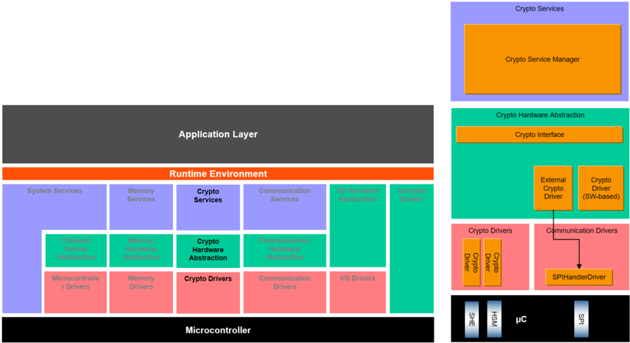
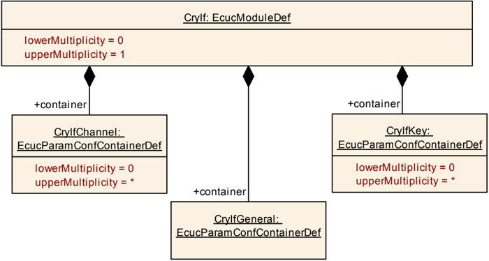
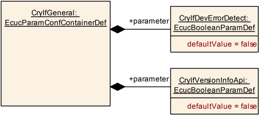
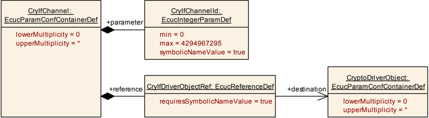
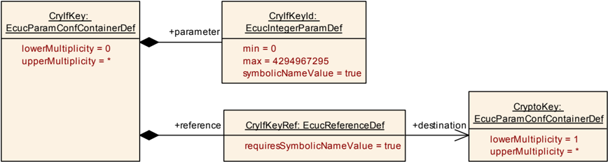

## 1. 简介和功能概述

本规范规定了 **AUTOSAR** 基础软件模块加密接口（**CRYIF**）的功能、**API** 和配置。

加密接口模块位于底层加密解决方案（加密驱动程序 [\[4\]](#ref-4) 和基于软件的 **CDD**）与上层服务层（加密服务管理器 [\[5\]](#ref-5)）之间。它为上层服务层表示（一个或多个）加密驱动程序的服务接口。**AUTOSAR** 分层视图参见图6.1。

加密接口模块提供了一个统一的接口，用于管理不同的加密硬件和软件解决方案，例如 **HSM**、**SHE** 或基于软件的 **CDD**。这样，加密服务管理器模块便可以基于由加密接口维护的映射方案，利用多个底层的内部和外部加密硬件以及软件解决方案。

## 2. 缩略语

**CDD**
> Complex Device Driver：复杂设备驱动程序

**CSM**
> Crypto Service Manager：加密服务管理器

**CRYIF**
> Crypto Interface：加密接口

**CRYPTO**
> Crypto Driver：加密驱动程序

**DET**
> Default Error Tracer：默认错误跟踪器

**HSM**
> Hardware Security Module：硬件安全模块

**HW**
> Hardware：硬件

**SHE**
> Security Hardware Extension：安全硬件扩展

**SW**
> Software：软件

### 2.1. 术语表

**加密驱动程序对象（Crypto Driver Object）**
> 加密驱动程序对象是加密模块（硬件或软件）的一个实例，能够执行一个或多个不同的加密操作。

**密钥（Key）**
> 密钥可以被 **Csm** 中的作业引用。在加密驱动程序中，密钥引用特定的密钥类型。

**密钥类型（Key Type）**
> 密钥类型由对密钥元素的引用组成。密钥类型通常由加密驱动程序的供应商预先配置。

**密钥元素（Key Element）**
> 密钥元素用于存储数据。该数据可以是例如 **AES** 加密所需的密钥材料或者 **IV**。它还可用于配置密钥管理功能的行为。不同密钥的密钥元素拥有不同的存储区域（包括 **NV** 区域和 **RAM** 区域）。

**通道（Channel）**
> 通道是从加密服务管理器队列通过加密接口到特定加密驱动程序对象的路径。

**Job**
> 作业是一个被配置的 **CsmJob**。除此之外，它还引用密钥、加密原语和参考通道。

**加密原语（Crypto Primitive）**
> 加密原语是已配置加密算法的一个实例。

**操作（Operation）**
> 加密原语的操作声明了应执行加密原语的哪一部分。共有三种不同的操作：
>
> * **START**：此操作表示加密原语的一个新请求，并且它应取消之前的所有请求。
> * **UPDATE**：此操作表示加密原语期望输入数据。
> * **FINISH**：此操作表示在此部分之后，所有数据均已完全馈入，加密原语可以完成计算。
>
> 通过连接操作模式参数的相应位，也可以一次执行多个操作。

**原语（Primitive）**
> 「原语（Primitive）」是在加密驱动程序对象中实现的已配置加密算法的一个实例。除此之外，它还指 **CSM** 向应用程序提供的功能、具体的底层「算法家族（algorithm family）」（例如 **AES**、**MD5**、**RSA** 等）以及「算法模式（algorithmmode）」（例如 **ECB**、**CBC** 等）。

**优先级（Priority）**
> 作业的优先级定义了它的重要性。优先级（包括数值）越高，作业就会被越快地执行。加密作业的优先级是配置的一部分。

**处理（Processing）**
> 表示作业处理的类型。
>
> * **异步（Asynchronous）**：调用相应函数时，作业不会立即被处理。通常，当作业完成时，会通过回调函数通知调用者。
> * **同步（Synchronous）**：调用相应函数时，作业会被立即处理。当函数返回时，结果将可用。

**服务（Service）**
> 服务需按照 **TR_Glossary** 文档中的定义来理解：服务是一种具有已发布的接口和行为规范的操作，涉及功能提供者与潜在客户之间的合同。

## 3. 相关文档

### 3.1. 输入文件

<a id="ref-1"></a>[1] AUTOSAR Layered Software Architecture
> AUTOSAR_CP_EXP_LayeredSoftwareArchitecture

<a id="ref-2"></a>[2] AUTOSAR General Requirements on Basic Software Modules
> AUTOSAR_CP_SRS_BSWGeneral

<a id="ref-3"></a>[3] AUTOSAR General Specification for Basic Software Modules
> AUTOSAR_CP_SWS_BSWGeneral

<a id="ref-4"></a>[4] AUTOSAR Specification of Crypto Driver
> AUTOSAR_CP_SWS_CryptoDriver

<a id="ref-5"></a>[5] AUTOSAR Specification of Crypto Service Manager
> AUTOSAR_CP_SWS_CryptoServiceManager

<a id="ref-6"></a>[6] AUTOSAR Requirements on Crypto Modules
> AUTOSAR_CP_SRS_CryptoStack

<a id="ref-7"></a>[7] Glossary
> AUTOSAR_FO_TR_Glossary

### 3.2. 相关标准与规范

[8] IEC 7498-1
> The Basic Model, IEC Norm, 1994

### 3.3. 相关规范

AUTOSAR 提供了基础软件通用规范（SWS BSW General）[\[3\]](#ref-3)，它对加密接口同样有效。因此，规范 SWS BSW General [\[3\]](#ref-3) 应被视为加密接口的附加和必需规范。

## 4. 约束和假设

### 4.1. 限制

加密接口专门设计用于与一个或多个底层加密驱动程序协同工作。覆盖不同硬件处理单元或内核的多个加密驱动程序模块仅由一个通用接口表示，该接口如加密驱动程序规范 [\[4\]](#ref-4) 所规定。

任何基于软件的加密驱动程序均应实现为 **CDD**，并由上述相同的接口表示。

### 4.2. 汽车域的适用性

当需要使用信息安全功能时，加密接口可用于所有域的应用程序。

## 5. 对其他模块的依赖

加密接口（**CRYIF**）应能够被加密服务管理器（**CSM**）调用，并将其服务请求转发给底层的加密驱动程序。

**CRYIF** 应能够访问底层的加密驱动程序，以使用其加密服务计算结果。这些结果应由 **CRYIF** 返回给 **CSM**。

### 5.1. 文件结构

#### 5.1.1. 代码文件结构

本规范并未完整定义代码文件结构。

代码文件结构应包含一个源文件 CryIf.c，该文件包含 **CRYIF** 的全部代码。

## 6. 功能规格

加密接口位于加密服务管理器和底层加密驱动程序之间，是为所有上层（**BSW**）访问加密操作的统一接口。加密接口也是加密驱动程序的唯一使用者，并提供用于管理不同加密硬件和软件解决方案的统一接口。抽象层封装了硬件和软件访问的不同机制，因此加密接口的实现独立于底层加密驱动程序，后者可以用硬件或软件来实现。

此外，它确保对加密服务的并发访问，从而可以同时处理多个加密任务。



### 6.1. 多核

在 **CSM** 和加密驱动程序被分配到不同分区的分布式设置中，**CryIf** **API** 将在不同的分区中使用。尽管如此，**CryIf** 应保持为纯转发组件，而不必关心执行上下文，也就是说，它只是在原始调用者的上下文中转发请求。

**CryIf** 模块应采用适当的机制，以允许从任何分区调用其 **API**。

**CryIf** 模块应在原始调用者的上下文中转发调用。

### 6.2. 错误分类

文档 [\[3\]](#ref-3)《基础软件模块通用规范》的第 [7.2](#72-类型定义) 章「错误处理」详细描述了基础软件的错误处理。最重要的是，它构成了一个由可能发生在 **BSW** 模块中的五种错误类型组成的分类方案。

在此基础上，以下章节规定了在下面各小节中安排的特定错误。

#### 6.2.1. 开发错误

| 错误类型 | 相关错误代码 | 错误值 |
|---|---|---|
| 在 **CRYIF** 模块初始化之前调用 **API** 请求。 | CRYIF_E_UNINIT | 0x00 |
| **CRYIF** 模块初始化失败。 | CRYIF_E_INIT_FAILED | 0x01 |
| **API** 请求以无效参数（空指针）调用。 | CRYIF_E_PARAM_POINTER | 0x02 |
| **API** 请求以无效参数（超出范围）调用。 | CRYIF_E_PARAM_HANDLE | 0x03 |
| **API** 请求以无效参数（无效值）调用。 | CRYIF_E_PARAM_VALUE | 0x04 |
| 源密钥元素的大小与目标密钥元素的大小不匹配。 | CRYIF_E_KEY_SIZE_MISMATCH | 0x05 |

#### 6.2.2. 运行时错误

没有运行时错误。

#### 6.2.3. 瞬态故障

没有瞬态故障。

#### 6.2.4. 生产错误

没有生产错误。

#### 6.2.5. 扩展生产错误

没有扩展生产错误。

### 6.3. 错误检测

本章描述适用于多个特定函数的一般错误检测。

如果参数 `job->jobPrimitiveInfo->primitiveInfo->service` 设置为 CRYPTO_KEYSETVALID、CRYPTO_KEYSETINVALID、CRYPTO_RANDOMSEED、CRYPTO_KEYGENERATE、CRYPTO_KEYDERIVE、CRYPTO_KEYEXCHANGECALCPUBVAL、CRYPTO_KEYEXCHANGECALCSECRET 或 CRYPTO_CUSTOM，则应检查参数 `job->jobPrimitiveInputOutput->cryIfKeyId` 以及（如适用）`job->jobPrimitiveInputOutput->targetCryIfKeyId` 是否在有效范围内。如果密钥超出范围，则在开发模式下应向 **DET** 报告 [CRYIF_E_PARAM_HANDLE](#621-开发错误)，否则返回 E_NOT_OK。

如果调用了作业，且参数 `job->jobPrimitiveInfo->primitiveInfo->service` 设置为 CRYPTO_MACGENERATE、CRYPTO_MACVERIFY、CRYPTO_ENCRYPT、CRYPTO_DECRYPT、CRYPTO_AEADENCRYPT、CRYPTO_AEADDECRYPT、CRYPTO_RANDOMGENERATE、CRYPTO_SIGNATUREGENERATE、CRYPTO_SIGNATUREVERIFY 或 CRYPTO_CUSTOM，则应检查参数 `job->jobPrimitiveInfo->cryIfKeyId` 是否在有效范围内。如果密钥超出范围，则在开发模式下应向 **DET** 报告 [CRYIF_E_PARAM_HANDLE](#621-开发错误)，否则返回 E_NOT_OK。

## 7. API规范

### 7.1. 导入的类型

本章列出了从以下文件包含的所有类型：

| 模块 | 头文件 | 导入的类型 |
|---|---|---|
| Csm | Crypto_GeneralTypes.h | Crypto_AlgorithmFamilyType |
| Csm | Crypto_GeneralTypes.h | Crypto_AlgorithmInfoType |
| Csm | Crypto_GeneralTypes.h | Crypto_AlgorithmModeType |
| Csm | Crypto_GeneralTypes.h | Crypto_JobPrimitiveInfoType |
| Csm | Crypto_GeneralTypes.h | Crypto_JobPrimitiveInputOutputType |
| Csm | Crypto_GeneralTypes.h | Crypto_JobRedirectionInfoType |
| Csm | Crypto_GeneralTypes.h | Crypto_JobStateType |
| Csm | Crypto_GeneralTypes.h | Crypto_JobType |
| Csm | Crypto_GeneralTypes.h | Crypto_PrimitiveInfoType |
| Csm | Crypto_GeneralTypes.h | Crypto_ProcessingType |
| Csm | Crypto_GeneralTypes.h | Crypto_ServiceInfoType |
| Csm | Rte_Csm_Type.h | Crypto_KeyStatusType |
| Csm | Rte_Csm_Type.h | Crypto_OperationModeType |
| Csm | Rte_Csm_Type.h | Crypto_ResultType |
| Csm | Rte_Csm_Type.h | Crypto_VerifyResultType |
| Std | Std_Types.h | Std_ReturnType |
| Std | Std_Types.h | Std_VersionInfoType |

需要注意，**Crypto Stack** API 使用 **CSM** 模块定义的密钥元素索引（参见 SWS_Csm_00122）。

### 7.2. 类型定义

#### 7.2.1. Std_ReturnType 的扩展

类型，**Std_ReturnType** 的扩展，定义本模块各服务返回码的取值。可通过**Crypto_GeneralTypes.h**获得。

* **CRYPTO_E_BUSY**（0x02）：由于服务仍在忙而导致服务请求失败。
* **CRYPTO_E_ENTROPY_EXHAUSTED**（0x04）：由于随机数生成器的熵已耗尽而导致服务请求失败。
* **CRYPTO_E_KEY_READ_FAIL**（0x06）：由于读访问被拒绝而导致服务请求失败。
* **CRYPTO_E_KEY_WRITE_FAIL**（0x07）：由于写访问失败而导致服务请求失败。
* **CRYPTO_E_KEY_NOT_AVAILABLE**（0x08）：由于至少一个所需的密钥元素不可用而导致服务请求失败。
* **CRYPTO_E_KEY_NOT_VALID**（0x09）：由于密钥无效而导致服务请求失败。
* **CRYPTO_E_KEY_SIZE_MISMATCH**（0x0A）：由于密钥大小不匹配而导致服务请求失败。
* **CRYPTO_E_JOB_CANCELED**（0x0C）：由于作业已被取消而导致服务请求失败。
* **CRYPTO_E_KEY_EMPTY**（0x0D）：由于源密钥元素未初始化而导致服务请求失败。
* **CRYPTO_E_CUSTOM_ERROR**（0x0E）：自定义处理失败。

**注意：**CRYPTO_E_KEY_NOT_AVAILABLE 用于表明密钥此前已被编程、但当前无法访问（例如暂时不可访问，如密钥因调试器连接而被禁用，或参数错误时）。

**注意：**CRYPTO_E_KEY_EMPTY 用于表明所引用的密钥内容至今尚未写入且没有默认值（例如，在 **SHE** 1.1 中，此时将返回错误码 ERC_KEY_EMPTY，即"如果应用程序试图使用尚未初始化的密钥"）。

#### 7.2.2. CryIf_ConfigType

结构类型。元素为特定于实现（**Type**: --，注释：配置数据结构的内容是特定于实现的）。**CRYIF** 模块的配置数据结构。可通过**CryIf.h**获得。

### 7.3. 函数定义

以下是提供给上层模块的函数列表。

#### 7.3.1. 通用 API

##### 7.3.1.1. CryIf_Init

**说明**: 初始化 **CRYIF** 模块。可通过**CryIf.h**获得。本服务为同步调用，不可重入。参数 configPtr（in）：指向所选配置结构的指针。返回值：无。

```C
void CryIf_Init ( const CryIf_ConfigType* configPtr )
```

配置指针 configPtr 应始终具有空指针值。

配置指针 configPtr 目前未使用，因此应设置为空指针值。

如果 **CRYIF** 模块的初始化失败，**CRYIF** 应向 **DET** 报告 [CRYIF_E_INIT_FAILED](#621-开发错误)。

服务 CryIf_Init() 应初始化 **CRYIF** 的全局变量和数据结构，包括标志和缓冲区。

##### 7.3.1.2. CryIf_GetVersionInfo

**说明**: 返回本模块的版本信息。可通过**CryIf.h**获得。本服务为同步调用，可重入。参数 versioninfo（in）：指向存储本模块版本信息的位置的指针。返回值：无。

```C
void CryIf_GetVersionInfo ( Std_VersionInfoType* versioninfo )
```

如果启用了 **CRYIF** 模块的开发错误检测：当参数 versioninfo 为空指针时，函数 CryIf_GetVersionInfo 应向 **DET** 报告 [CRYIF_E_PARAM_POINTER](#621-开发错误)。

#### 7.3.2. 作业处理接口

##### 7.3.2.1. CryIf_ProcessJob

为了将加密服务的单次调用函数与流式处理方式统一起来，提供了一个接口 CryIf_ProcessJob()。其 Crypto_JobType 类型的 job 参数包含一个 Crypto_OperationModeType 标志字段（job->jobPrimitiveInputOutput.mode），该字段可设置为"START"、"UPDATE"、"FINISH"或它们的组合。它明确声明应执行何种操作。这些操作模式可以混合，从而一次执行多个操作。

要通过单次调用 Crypto_ProcessJob() 处理加密服务，操作模式是"START|UPDATE|FINISH"三种模式的析取。

**说明**: 该接口将接收到的作业分发给已配置的加密驱动程序对象。可通过**CryIf.h**获得。本服务为同步或异步调用（取决于配置），可重入。参数 channelId（in）：保存加密通道的标识符。参数 job（inout）：指向作业配置的指针，包含与用户和原语相关的信息结构。返回值：Std_ReturnType，E_OK：请求成功；E_NOT_OK：请求失败；CRYPTO_E_BUSY：请求失败，加密驱动程序对象忙；CRYPTO_E_KEY_NOT_VALID：请求失败，密钥无效；CRYPTO_E_KEY_SIZE_MISMATCH：请求失败，某个密钥元素大小错误；CRYPTO_E_KEY_READ_FAIL：服务请求失败，因为不允许提取密钥元素；CRYPTO_E_KEY_WRITE_FAIL：服务请求失败，因为写访问失败；CRYPTO_E_KEY_NOT_AVAILABLE：服务请求失败，因为密钥不可用；CRYPTO_E_JOB_CANCELED：服务请求失败，因为同步作业已被取消；CRYPTO_E_KEY_EMPTY：由于源密钥元素未初始化而导致请求失败；CRYPTO_E_ENTROPY_EXHAUSTED；CRYPTO_E_CUSTOM_ERROR：远程处理失败。

```C
Std_ReturnType CryIf_ProcessJob ( uint32 channelId, Crypto_JobType* job )
```

如果启用了 **CRYIF** 的开发错误检测：当模块尚未初始化时，函数 CryIf_ProcessJob 应向 **DET** 报告 [CRYIF_E_UNINIT](#621-开发错误)。

如果启用了 **CRYIF** 的开发错误检测：当参数 channelId 超出范围时，函数 CryIf_ProcessJob 应向 **DET** 报告 [CRYIF_E_PARAM_HANDLE](#621-开发错误)。

如果启用了 **CRYIF** 的开发错误检测：当参数 job 为空指针时，函数 CryIf_ProcessJob 应向 **DET** 报告 [CRYIF_E_PARAM_POINTER](#621-开发错误)。

如果 **CRYIF** 未检测到错误，服务 CryIf_ProcessJob() 应为映射到该服务的驱动程序配置调用 Crypto_&lt;vi&gt;_&lt;ai&gt;_ProcessJob()，并传递返回值。

如果对某个作业使用了作业处理重定向，加密接口需要将传入的加密接口密钥引用和密钥元素引用，适配为加密驱动程序相应值所对应的密钥引用和密钥元素引用。

##### 7.3.2.2. 分发密钥 ID

如果参数 job->jobPrimitiveInfo->primitiveInfo->service 设置为 CRYPTO_KEYSETVALID、CRYPTO_KEYSETINVALID、CRYPTO_RANDOMSEED、CRYPTO_KEYGENERATE、CRYPTO_KEYDERIVE、CRYPTO_KEYEXCHANGECALCPUBVAL、CRYPTO_KEYEXCHANGECALCSECRET 或 CRYPTO_CUSTOM，则必须检查参数 job->jobPrimitiveInputOutput->cryIfKeyId 以及（如适用）job->jobPrimitiveInputOutput->targetCryIfKeyId 是否处于有效范围内。若是，**CRYIF** 应将 job->cryptoKeyId 设置为与 job->jobPrimitiveInputOutput->cryIfKeyId 相对应的加密驱动程序密钥 ID，并且（如适用）将 job->targetCryptoKeyId 设置为与 job->jobPrimitiveInputOutput->targetCryIfKeyId 相对应的加密驱动程序密钥 ID。

如果参数 job->jobPrimitiveInfo->primitiveInfo->service 设置为 CRYPTO_KEYSETVALID、CRYPTO_KEYSETINVALID、CRYPTO_RANDOMSEED、CRYPTO_KEYGENERATE、CRYPTO_KEYDERIVE、CRYPTO_KEYEXCHANGECALCPUBVAL、CRYPTO_KEYEXCHANGECALCSECRET 或 CRYPTO_CUSTOM，则参数 job->cryIfKeyId 必须处于有效范围内；否则函数 [CryIf_ProcessJob](#7321-cryif_processjob) 应向 **DET** 报告 [CRYIF_E_PARAM_HANDLE](#621-开发错误)。

如果参数 job->jobPrimitiveInfo->primitiveInfo->service 设置为 CRYPTO_KEYDERIVE，则参数 job->cryIfTargetKeyId 必须处于有效范围内；否则函数 [CryIf_ProcessJob](#7321-cryif_processjob) 应向 **DET** 报告 [CRYIF_E_PARAM_HANDLE](#621-开发错误)。

如果调用的作业其参数 job->jobPrimitiveInfo->primitiveInfo->service 设置为 CRYPTO_MACGENERATE、CRYPTO_MACVERIFY、CRYPTO_ENCRYPT、CRYPTO_DECRYPT、CRYPTO_AEADENCRYPT、CRYPTO_AEADDECRYPT、CRYPTO_RANDOMGENERATE、CRYPTO_SIGNATUREGENERATE 或 CRYPTO_SIGNATUREVERIFY，则必须检查参数 job->jobPrimitiveInfo->cryIfKeyId 是否处于有效范围内。若是，**CRYIF** 应将 job->cryptoKeyId 设置为与 job->jobPrimitiveInfo->cryIfKeyId 相对应的加密驱动程序密钥 ID。

#### 7.3.3. 作业取消接口

##### 7.3.3.1. CryIf_CancelJob

**说明**: 该接口将作业取消函数分发给已配置的加密驱动程序对象。可通过**CryIf.h**获得。本服务为同步调用，可重入。参数 channelId（in）：保存加密通道的标识符。参数 job（inout）：指向作业配置的指针，包含与用户和原语相关的信息结构。返回值：Std_ReturnType，E_OK：请求成功，作业已被移除；E_NOT_OK：请求失败，作业无法被移除；CRYPTO_E_JOB_CANCELED。

```C
Std_ReturnType CryIf_CancelJob ( uint32 channelId, Crypto_JobType* job )
```

如果启用了 **CRYIF** 的开发错误检测：当模块尚未初始化时，函数 CryIf_CancelJob 应向 **DET** 报告 [CRYIF_E_UNINIT](#621-开发错误)。

如果启用了 **CRYIF** 的开发错误检测：当参数 channelId 超出范围时，函数 CryIf_CancelJob 应向 **DET** 报告 [CRYIF_E_PARAM_HANDLE](#621-开发错误)。

如果启用了 **CRYIF** 的开发错误检测：当参数 job 为空指针时，函数 CryIf_CancelJob 应向 **DET** 报告 [CRYIF_E_PARAM_POINTER](#621-开发错误)。

如果 **CRYIF** 未检测到错误，服务 CryIf_CancelJob() 应为映射到该服务的驱动程序配置调用 Crypto_&lt;vi&gt;_&lt;ai&gt;_CancelJob()，并传递返回值。

#### 7.3.4. 密钥管理接口

##### 7.3.4.1. 密钥设置接口

###### 7.3.4.1.1. CryIf_KeyElementSet

**说明**: 该函数应将设置密钥元素函数分发给已配置的加密驱动程序对象。可通过**CryIf.h**获得。本服务为同步调用，不可重入。参数 cryIfKeyId（in）：保存应设置其密钥元素的密钥的标识符。参数 keyElementId（in）：保存应设置的密钥元素的标识符。参数 keyPtr（in）：保存指向将被设置为密钥元素的密钥数据的指针。参数 keyLength（in）：包含密钥元素的长度（以字节为单位）。返回值：Std_ReturnType，E_OK：请求成功；E_NOT_OK：请求失败；CRYPTO_E_BUSY：请求失败，加密驱动程序对象忙；CRYPTO_E_KEY_WRITE_FAIL：由于写访问被拒绝而导致请求失败；CRYPTO_E_KEY_NOT_AVAILABLE：请求失败，因为密钥不可用；CRYPTO_E_KEY_SIZE_MISMATCH：请求失败，密钥元素大小与所提供数据的大小不匹配。

```C
Std_ReturnType CryIf_KeyElementSet ( uint32 cryIfKeyId, uint32 keyElementId, const uint8* keyPtr, uint32 keyLength )
```

如果启用了 **CRYIF** 模块的开发错误检测：当模块尚未初始化时，函数 CryIf_KeyElementSet 应向 **DET** 报告 [CRYIF_E_UNINIT](#621-开发错误)。

如果启用了 **CRYIF** 模块的开发错误检测：当参数 cryIfKeyId 超出范围时，函数 CryIf_KeyElementSet 应向 **DET** 报告 [CRYIF_E_PARAM_HANDLE](#621-开发错误)。

如果启用了 **CRYIF** 模块的开发错误检测：当参数 keyPtr 为空指针时，函数 CryIf_KeyElementSet 应向 **DET** 报告 [CRYIF_E_PARAM_POINTER](#621-开发错误)。

如果启用了 **CRYIF** 的开发错误检测：当 keyLength 为零时，函数 CryIf_KeyElementSet 应向 **DET** 报告 [CRYIF_E_PARAM_VALUE](#621-开发错误)。

如果 **CRYIF** 未检测到错误，服务 CryIf_KeyElementSet() 应为映射到该服务的驱动程序配置调用 Crypto_&lt;vi&gt;_&lt;ai&gt;_KeyElementSet()，并传递返回值。

###### 7.3.4.1.2. CryIf_KeySetValid

**说明**: 该函数应将设置密钥有效函数分发给已配置的加密驱动程序对象。可通过**CryIf.h**获得。本服务为同步调用，不可重入。参数 cryIfKeyId（in）：保存其密钥元素应被设置为有效的密钥的标识符。返回值：Std_ReturnType，E_OK：请求成功；E_NOT_OK：请求失败；CRYPTO_E_BUSY：请求失败，加密驱动程序对象忙。

```C
Std_ReturnType CryIf_KeySetValid ( uint32 cryIfKeyId )
```

如果启用了 **CRYIF** 模块的开发错误检测：当模块尚未初始化时，函数 CryIf_KeySetValid 应向 **DET** 报告 [CRYIF_E_UNINIT](#621-开发错误)。

如果启用了 **CRYIF** 模块的开发错误检测：当参数 cryIfKeyId 超出范围时，函数 CryIf_KeySetValid 应向 **DET** 报告 [CRYIF_E_PARAM_HANDLE](#621-开发错误)。

如果 **CRYIF** 未检测到错误，服务 CryIf_KeySetValid() 应为映射到该服务的驱动程序配置调用 Crypto_&lt;vi&gt;_&lt;ai&gt;_KeySetValid()，并传递返回值。

###### 7.3.4.1.3. CryIf_KeySetInvalid

**说明**: 将 cryIfKeyId 所标识密钥的状态设置为无效。可通过**CryIf.h**获得。本服务为同步调用，不可重入。参数 cryIfKeyId（in）：保存其状态应被设置为无效的密钥的标识符。返回值：Std_ReturnType，E_OK：请求成功；E_NOT_OK：请求失败；CRYPTO_E_BUSY：请求失败，加密驱动程序对象忙。

```C
Std_ReturnType CryIf_KeySetInvalid ( uint32 cryIfKeyId )
```

如果启用了 **CryIf** 模块的开发错误检测，当模块尚未初始化时，函数 CryIf_KeySetInvalid() 应报告错误 [CRYIF_E_UNINIT](#621-开发错误)。

如果启用了 **CryIf** 模块的开发错误检测，当参数 cryIfKeyId 超出范围时，函数 CryIf_KeySetInvalid() 应报告错误 [CRYIF_E_PARAM_HANDLE](#621-开发错误)。

如果 **CryIf** 未检测到错误，服务 CryIf_KeySetInvalid() 应为映射到该服务的驱动程序配置调用 Crypto_&lt;vi&gt;_&lt;ai&gt;_KeySetInvalid()，并传递返回值。

##### 7.3.4.2. 密钥状态接口

###### 7.3.4.2.1. CryIf_KeyGetStatus

**说明**: 返回 cryIfKeyId 所标识密钥的密钥状态。可通过**CryIf.h**获得。本服务为同步调用，不可重入。参数 cryIfKeyId（in）：保存应返回其密钥状态的密钥的标识符。参数 keyStatusPtr（out）：包含指向将要存储密钥状态的数据的指针。返回值：Std_ReturnType，E_OK：请求成功；E_NOT_OK：请求失败。

```C
Std_ReturnType CryIf_KeyGetStatus ( uint32 cryIfKeyId, Crypto_KeyStatusType* keyStatusPtr )
```

如果启用了 **CryIf** 模块的开发错误检测，当模块尚未初始化时，函数 CryIf_KeyGetStatus() 应向 **DET** 报告 [CRYIF_E_UNINIT](#621-开发错误)。

如果启用了 **CryIf** 模块的开发错误检测，当参数 cryIfKeyId 超出范围时，函数 CryIf_KeyGetStatus() 应向 **DET** 报告 [CRYIF_E_PARAM_HANDLE](#621-开发错误)。

如果启用了 **CryIf** 模块的开发错误检测，当参数 keyStatusPtr 为空指针时，函数 CryIf_KeyGetStatus() 应向 **DET** 报告 [CRYIF_E_PARAM_POINTER](#621-开发错误)。

如果 **CryIf** 未检测到错误，服务 CryIf_KeyGetStatus() 应为映射到该服务的驱动程序配置调用 Crypto_&lt;vi&gt;_&lt;ai&gt;_KeyGetStatus()，并传递返回值。

##### 7.3.4.3. 密钥提取接口

###### 7.3.4.3.1. CryIf_KeyElementGet

**说明**: 该函数应将获取密钥元素函数分发给已配置的加密驱动程序对象。可通过**CryIf.h**获得。本服务为同步调用，可重入。参数 cryIfKeyId（in）：保存应返回其密钥元素的密钥的标识符。参数 keyElementId（in）：保存应返回的密钥元素的标识符。参数 resultLengthPtr（inout）：保存指向存储长度信息的内存位置的指针。调用本函数时，该参数应包含 resultPtr 所提供缓冲区的大小。如果密钥元素被配置为允许部分访问，则该参数包含应从密钥元素中读取的数据量；此时该大小可能不再等于所提供缓冲区的大小。请求完成后，应存储已存储的数据量。参数 resultPtr（out）：保存用于返回密钥元素的缓冲区的指针。返回值：Std_ReturnType，E_OK：请求成功；E_NOT_OK：请求失败；CRYPTO_E_BUSY：请求失败，加密驱动程序对象忙；CRYPTO_E_KEY_NOT_AVAILABLE：请求失败，所请求的密钥元素不可用；CRYPTO_E_KEY_READ_FAIL：由于读访问被拒绝而导致请求失败；CRYPTO_E_KEY_EMPTY：由于源密钥元素未初始化而导致请求失败。

```C
Std_ReturnType CryIf_KeyElementGet ( uint32 cryIfKeyId, uint32 keyElementId, uint8* resultPtr, uint32* resultLengthPtr )
```

如果启用了 **CRYIF** 模块的开发错误检测：当模块尚未初始化时，函数 CryIf_KeyElementGet 应向 **DET** 报告 [CRYIF_E_UNINIT](#621-开发错误)。

如果启用了 **CRYIF** 模块的开发错误检测：当参数 cryIfKeyId 超出范围时，函数 CryIf_KeyElementGet 应向 **DET** 报告 [CRYIF_E_PARAM_HANDLE](#621-开发错误)。

如果启用了 **CRYIF** 模块的开发错误检测：当参数 resultPtr 为空指针时，函数 CryIf_KeyElementGet 应向 **DET** 报告 [CRYIF_E_PARAM_POINTER](#621-开发错误)。

如果启用了 **CRYIF** 模块的开发错误检测：当参数 resultLengthPtr 为空指针时，函数 CryIf_KeyElementGet 应向 **DET** 报告 [CRYIF_E_PARAM_POINTER](#621-开发错误)。

如果启用了 **CRYIF** 模块的开发错误检测：当 resultLengthPtr 所指向的值为零时，函数 CryIf_KeyElementGet 应向 **DET** 报告 [CRYIF_E_PARAM_VALUE](#621-开发错误)。

如果 **CRYIF** 未检测到错误，服务 CryIf_KeyElementGet() 应为映射到该服务的驱动程序配置调用 Crypto_&lt;vi&gt;_&lt;ai&gt;_KeyElementGet()，并传递返回值。

##### 7.3.4.4. 密钥复制接口

###### 7.3.4.4.1. CryIf_KeyElementCopy

**说明**: 该函数应将一个密钥元素从一个密钥复制到目标密钥。可通过**CryIf.h**获得。本服务为同步调用，可重入，但对同一 cryIfKeyId 不可重入。参数 cryIfKeyId（in）：保存其密钥元素应作为源元素的密钥的标识符。参数 keyElementId（in）：保存应作为复制操作源的密钥元素的标识符。参数 targetCryIfKeyId（in）：保存其密钥元素应作为目标元素的密钥的标识符。参数 targetKeyElementId（in）：保存应作为复制操作目标的密钥元素的标识符。返回值：Std_ReturnType，E_OK：请求成功；E_NOT_OK：请求失败；CRYPTO_E_BUSY：请求失败，加密驱动程序对象忙；CRYPTO_E_KEY_NOT_AVAILABLE：请求失败，所请求的密钥元素不可用；CRYPTO_E_KEY_READ_FAIL：请求失败，不允许提取密钥元素；CRYPTO_E_KEY_WRITE_FAIL：请求失败，不允许写入密钥元素；CRYPTO_E_KEY_SIZE_MISMATCH：请求失败，密钥元素大小不兼容；CRYPTO_E_KEY_EMPTY：由于源密钥元素未初始化而导致请求失败。

```C
Std_ReturnType CryIf_KeyElementCopy ( uint32 cryIfKeyId, uint32 keyElementId, uint32 targetCryIfKeyId, uint32 targetKeyElementId )
```

如果启用了 **CRYIF** 的开发错误检测：当模块尚未初始化时，函数 CryIf_KeyElementCopy 应向 **DET** 报告 [CRYIF_E_UNINIT](#621-开发错误)。

如果启用了 **CRYIF** 的开发错误检测：当参数 cryIfKeyId 超出范围时，函数 CryIf_KeyElementCopy 应向 **DET** 报告 [CRYIF_E_PARAM_HANDLE](#621-开发错误)。

如果启用了 **CRYIF** 的开发错误检测：当参数 targetCryIfKeyId 超出范围时，函数 CryIf_KeyElementCopy 应向 **DET** 报告 [CRYIF_E_PARAM_HANDLE](#621-开发错误)。

如果 **CRYIF** 未检测到错误且 cryIfKeyId 与 targetCryIfKeyId 位于同一加密驱动程序中，服务 CryIf_KeyElementCopy() 应为映射到该服务的驱动程序配置调用 Crypto_&lt;vi&gt;_&lt;ai&gt;_KeyElementCopy()，并传递返回值。

如果 **CRYIF** 未检测到错误且 cryIfKeyId 与 targetCryIfKeyId 位于不同加密驱动程序中，服务 CryIf_KeyElementCopy() 应通过 Crypto_&lt;vi&gt;_&lt;ai&gt;_KeyElementGet() 获取该密钥元素，并通过 Crypto_&lt;vi&gt;_&lt;ai&gt;_KeyElementSet() 设置目标密钥元素，从而复制所提供的密钥元素。

如果启用了 **CRYIF** 的开发错误检测：当 targetCryIfKeyId 中存在 cryIfKeyId 的所请求密钥元素、且源元素大小与目标密钥元素大小不匹配时，CryIf_KeyElementCopy() 应向 **DET** 报告 [CRYIF_E_KEY_SIZE_MISMATCH](#621-开发错误)。

###### 7.3.4.4.2. CryIf_KeyElementCopyPartial

**说明**: 将一个密钥元素复制到另一个密钥元素。keyElementOffsets 和 keyElementCopyLength 允许仅将源密钥元素的一部分复制到目标密钥元素中。可通过**CryIf.h**获得。本服务为同步调用，可重入，但对同一 cryIfKeyId 不可重入。参数 cryIfKeyId（in）：保存其密钥元素应作为源元素的密钥的标识符。参数 keyElementId（in）：保存应作为复制操作源的密钥元素的标识符。参数 keyElementSourceOffset（in）：源密钥元素的偏移量，指示复制操作的起始索引。参数 keyElementTargetOffset（in）：目标密钥元素的偏移量，指示复制操作的起始索引。参数 keyElementCopyLength（in）：指定应复制的字节数。参数 targetCryIfKeyId（in）：保存其密钥元素应作为目标元素的密钥的标识符。参数 targetKeyElementId（in）：保存应作为复制操作目标的密钥元素的标识符。返回值：Std_ReturnType，E_OK：请求成功；E_NOT_OK：请求失败；CRYPTO_E_BUSY：请求失败，加密驱动程序对象忙；CRYPTO_E_KEY_NOT_AVAILABLE：请求失败，所请求的密钥元素不可用；CRYPTO_E_KEY_READ_FAIL：请求失败，不允许提取密钥元素；CRYPTO_E_KEY_WRITE_FAIL：请求失败，不允许写入密钥元素；CRYPTO_E_KEY_SIZE_MISMATCH：请求失败，密钥元素大小不兼容；CRYPTO_E_KEY_EMPTY：由于源密钥元素未初始化而导致请求失败。

```C
Std_ReturnType CryIf_KeyElementCopyPartial ( uint32 cryIfKeyId, uint32 keyElementId, uint32 keyElementSourceOffset, uint32 keyElementTargetOffset, uint32 keyElementCopyLength, uint32 targetCryIfKeyId, uint32 targetKeyElementId )
```

如果加密接口尚未初始化，且启用了加密接口的开发错误检测，函数 CryIf_KeyElementCopyPartial 应向 **DET** 报告 [CRYIF_E_UNINIT](#621-开发错误)。

如果 cryIfKeyId 或 targetCryIfKeyId 超出范围，且启用了加密接口的开发错误检测，函数 CryIf_KeyElementCopyPartial 应向 **DET** 报告 [CRYIF_E_PARAM_HANDLE](#621-开发错误)。

如果 **CRYIF** 未检测到错误且 cryIfKeyId 与 targetCryIfKeyId 位于同一加密驱动程序中，服务 CryIf_KeyElementCopyPartial() 应为映射到该服务的驱动程序配置调用 Crypto_&lt;vi&gt;_&lt;ai&gt;_KeyElementCopyPartial()，并传递返回值。

如果 **CRYIF** 未检测到错误且 cryIfKeyId 与 targetCryIfKeyId 位于不同加密驱动程序中，服务 CryIf_KeyElementCopyPartial() 应通过 Crypto_&lt;vi&gt;_&lt;ai&gt;_KeyElementGet() 获取该密钥元素，将部分数据复制到其目标位置，并通过 Crypto_&lt;vi&gt;_&lt;ai&gt;_KeyElementSet() 设置目标密钥元素，从而复制所提供的密钥元素。

###### 7.3.4.4.3. CryIf_KeyCopy

**说明**: 该函数应将源密钥的所有密钥元素复制到目标密钥。可通过**CryIf.h**获得。本服务为同步调用，可重入，但对同一 cryIfKeyId 不可重入。参数 cryIfKeyId（in）：保存其密钥元素应作为源元素的密钥的标识符。参数 targetCryIfKeyId（in）：保存其密钥元素应作为目标元素的密钥的标识符。返回值：Std_ReturnType，E_OK：请求成功；E_NOT_OK：请求失败；CRYPTO_E_BUSY：请求失败，加密驱动程序对象忙；CRYPTO_E_KEY_NOT_AVAILABLE：请求失败，所请求的密钥元素不可用；CRYPTO_E_KEY_READ_FAIL：请求失败，不允许提取密钥元素；CRYPTO_E_KEY_WRITE_FAIL：请求失败，不允许写入密钥元素；CRYPTO_E_KEY_SIZE_MISMATCH：请求失败，密钥元素大小不兼容；CRYPTO_E_KEY_EMPTY：由于源密钥元素未初始化而导致请求失败。

```C
Std_ReturnType CryIf_KeyCopy ( uint32 cryIfKeyId, uint32 targetCryIfKeyId )
```

如果启用了 **CRYIF** 的开发错误检测：当模块尚未初始化时，函数 CryIf_KeyCopy 应向 **DET** 报告 [CRYIF_E_UNINIT](#621-开发错误)。

如果启用了 **CRYIF** 的开发错误检测：当参数 cryIfKeyId 超出范围时，函数 CryIf_KeyCopy 应向 **DET** 报告 [CRYIF_E_PARAM_HANDLE](#621-开发错误)。

如果启用了 **CRYIF** 的开发错误检测：当参数 targetCryIfKeyId 超出范围时，函数 CryIf_KeyCopy 应向 **DET** 报告 [CRYIF_E_PARAM_HANDLE](#621-开发错误)。

如果 **CRYIF** 未检测到错误且 cryIfKeyId 与 targetCryIfKeyId 位于同一加密驱动程序中，服务 CryIf_KeyCopy() 应为映射到该服务的驱动程序配置调用 Crypto_&lt;vi&gt;_&lt;ai&gt;_KeyCopy()，并传递返回值。

如果 **CRYIF** 未检测到错误且 cryIfKeyId 与 targetCryIfKeyId 位于不同加密驱动程序中，服务 CryIf_KeyCopy() 应将源密钥的密钥元素传输到目标密钥。首先，应使用函数 Crypto_&lt;vi&gt;_&lt;ai__KeyElementdsIdGet() 读取 cryIfKeyId 和 targetCryIfKeyId 的密钥元素列表。该列表中彼此相同的所有密钥元素，应通过 Crypto_&lt;vi&gt;_&lt;ai&gt;_KeyElementGet() 读取 cryIfKeyId 的每个密钥元素、并通过 Crypto_&lt;vi&gt;_&lt;ai&gt;_KeyElementSet() 设置 targetCryIfKeyId 的目标密钥元素来复制。

如果启用了 **CRYIF** 的开发错误检测：对于 cryIfKeyId 中存在于 targetCryIfKeyId 中的所有密钥元素，当源元素大小与目标密钥元素大小不匹配时，CryIf_KeyCopy() 应向 **DET** 报告 [CRYIF_E_KEY_SIZE_MISMATCH](#621-开发错误)。

##### 7.3.4.5. 密钥生成接口

###### 7.3.4.5.1. CryIf_RandomSeed

**说明**: 该函数应将随机种子函数分发给已配置的加密驱动程序对象。可通过**CryIf.h**获得。本服务为同步调用，可重入。参数 cryIfKeyId（in）：保存应为其生成新种子的密钥的标识符。参数 seedPtr（in）：保存指向包含用于馈送种子数据的内存位置的指针。参数 seedLength（in）：包含种子的长度（以字节为单位）。返回值：Std_ReturnType，E_OK：请求成功；E_NOT_OK：请求失败；CRYPTO_E_KEY_NOT_VALID：请求失败，cryptoKeyId 所标识密钥的密钥状态为"无效"。

```C
Std_ReturnType CryIf_RandomSeed ( uint32 cryIfKeyId, const uint8* seedPtr, uint32 seedLength )
```

如果启用了 **CRYIF** 的开发错误检测：当模块尚未初始化时，函数 CryIf_RandomSeed 应向 **DET** 报告 [CRYIF_E_UNINIT](#621-开发错误)。

如果启用了 **CRYIF** 的开发错误检测：当参数 cryIfKeyId 超出范围时，函数 CryIf_RandomSeed 应向 **DET** 报告 [CRYIF_E_PARAM_HANDLE](#621-开发错误)。

如果启用了 **CRYIF** 的开发错误检测：当参数 seedPtr 为空指针时，函数 CryIf_RandomSeed 应向 **DET** 报告 [CRYIF_E_PARAM_POINTER](#621-开发错误)。

如果启用了 **CRYIF** 的开发错误检测：当 seedLength 为零时，函数 CryIf_RandomSeed 应向 **DET** 报告 [CRYIF_E_PARAM_VALUE](#621-开发错误)。

如果 **CRYIF** 未检测到错误，服务 CryIf_RandomSeed() 应为映射到该服务的驱动程序配置调用 Crypto_&lt;vi&gt;_&lt;ai&gt;_RandomSeed()，并传递返回值。

###### 7.3.4.5.2. CryIf_KeyGenerate

**说明**: 该函数应将密钥生成函数分发给已配置的加密驱动程序对象。可通过**CryIf.h**获得。本服务为同步调用，可重入。参数 cryIfKeyId（in）：保存将用生成的值进行更新的密钥的标识符。返回值：Std_ReturnType，E_OK：请求成功；E_NOT_OK：请求失败；CRYPTO_E_BUSY：请求失败，加密驱动程序对象忙；CRYPTO_E_KEY_EMPTY：由于源密钥元素未初始化而导致请求失败；CRYPTO_E_KEY_NOT_VALID：请求失败，cryptoKeyId 所标识密钥的密钥状态为"无效"。

```C
Std_ReturnType CryIf_KeyGenerate ( uint32 cryIfKeyId )
```

如果启用了 **CRYIF** 模块的开发错误检测：当模块尚未初始化时，函数 CryIf_KeyGenerate 应向 **DET** 报告 [CRYIF_E_UNINIT](#621-开发错误)。

如果启用了 **CRYIF** 模块的开发错误检测：当参数 cryIfKeyId 超出范围时，函数 CryIf_KeyGenerate 应向 **DET** 报告 [CRYIF_E_PARAM_HANDLE](#621-开发错误)。

如果 **CRYIF** 未检测到错误，服务 CryIf_KeyGenerate() 应为映射到该服务的驱动程序配置调用 Crypto_&lt;vi&gt;_&lt;ai&gt;_KeyGenerate()，并传递返回值。

##### 7.3.4.6. 密钥派生接口

###### 7.3.4.6.1. CryIf_KeyDerive

**说明**: 该函数应将密钥派生函数分发给已配置的加密驱动程序对象。可通过**CryIf.h**获得。本服务为同步调用，可重入。参数 cryIfKeyId（in）：保存用于密钥派生的密钥的标识符。参数 targetCryIfKeyId（in）：保存用于存储派生密钥的密钥的标识符。返回值：Std_ReturnType，E_OK：请求成功；E_NOT_OK：请求失败；CRYPTO_E_KEY_EMPTY：由于源密钥元素未初始化而导致请求失败；CRYPTO_E_BUSY：加密驱动程序对象已返回 CRYPTO_E_BUSY；CRYPTO_E_KEY_NOT_VALID：请求失败，cryptoKeyId 所标识密钥的密钥状态为"无效"。

```C
Std_ReturnType CryIf_KeyDerive ( uint32 cryIfKeyId, uint32 targetCryIfKeyId )
```

如果启用了 **CRYIF** 模块的开发错误检测：当模块尚未初始化时，函数 CryIf_KeyDerive 应向 **DET** 报告 [CRYIF_E_UNINIT](#621-开发错误)。

如果启用了 **CRYIF** 模块的开发错误检测：当参数 cryIfKeyId 超出范围时，函数 CryIf_KeyDerive 应向 **DET** 报告 [CRYIF_E_PARAM_HANDLE](#621-开发错误)。

如果启用了 **CRYIF** 模块的开发错误检测：当参数 targetCryIfKeyId 超出范围时，函数 CryIf_KeyDerive 应向 **DET** 报告 [CRYIF_E_PARAM_HANDLE](#621-开发错误)。

如果 **CRYIF** 未检测到错误，服务 CryIf_KeyDerive() 应为映射到该服务的驱动程序配置调用 Crypto_&lt;vi&gt;_&lt;ai&gt;_KeyDerive()，并传递返回值。

密钥派生服务需要一个盐值（salt）和一个密码（password）来派生新密钥。因此，盐值和密码作为密钥元素存储在 cryIfKeyId 所引用的密钥中。

##### 7.3.4.7. 密钥交换接口

###### 7.3.4.7.1. CryIf_KeyExchangeCalcPubVal

**说明**: 该函数应将密钥交换公开值计算函数分发给已配置的加密驱动程序对象。可通过**CryIf.h**获得。本服务为同步调用，可重入。参数 cryIfKeyId（in）：保存应用于密钥交换协议的密钥的标识符。参数 publicValueLengthPtr（inout）：保存指向存储公开值长度信息的内存位置的指针。调用本函数时，该参数应包含 publicValuePtr 所提供缓冲区的大小；请求完成后，应存储所返回值的实际长度。参数 publicValuePtr（out）：包含指向将要存储公开值的数据的指针。返回值：Std_ReturnType，E_OK：请求成功；E_NOT_OK：请求失败；CRYPTO_E_BUSY：请求失败，加密驱动程序对象忙；CRYPTO_E_KEY_EMPTY：由于源密钥元素未初始化而导致请求失败；CRYPTO_E_KEY_NOT_VALID：请求失败，cryptoKeyId 所标识密钥的密钥状态为"无效"。

```C
Std_ReturnType CryIf_KeyExchangeCalcPubVal ( uint32 cryIfKeyId, uint8* publicValuePtr, uint32* publicValueLengthPtr )
```

如果启用了 **CRYIF** 模块的开发错误检测：当模块尚未初始化时，函数 CryIf_KeyExchangeCalcPubVal 应向 **DET** 报告 [CRYIF_E_UNINIT](#621-开发错误)。

如果启用了 **CRYIF** 模块的开发错误检测：当参数 cryIfKeyId 超出范围时，函数 CryIf_KeyExchangeCalcPubVal 应向 **DET** 报告 [CRYIF_E_PARAM_HANDLE](#621-开发错误)。

如果启用了 **CRYIF** 模块的开发错误检测：当参数 publicValuePtr 为空指针时，函数 CryIf_KeyExchangeCalcPubVal 应向 **DET** 报告 [CRYIF_E_PARAM_POINTER](#621-开发错误)。

如果启用了 **CRYIF** 模块的开发错误检测：当参数 publicValueLengthPtr 为空指针时，函数 CryIf_KeyExchangeCalcPubVal 应向 **DET** 报告 [CRYIF_E_PARAM_POINTER](#621-开发错误)。

如果启用了 **CRYIF** 模块的开发错误检测：当 publicValueLengthPtr 所指向的值为零时，函数 CryIf_KeyExchangeCalcPubVal 应向 **DET** 报告 [CRYIF_E_PARAM_VALUE](#621-开发错误)。

如果 **CRYIF** 未检测到错误，服务 CryIf_KeyExchangeCalcPubVal() 应为映射到该服务的驱动程序配置调用 Crypto_&lt;vi&gt;_&lt;ai&gt;_KeyExchangeCalcPubVal()，并传递返回值。

###### 7.3.4.7.2. CryIf_KeyExchangeCalcSecret

**说明**: 该函数应将密钥交换公共共享密钥计算函数分发给已配置的加密驱动程序对象。可通过**CryIf.h**获得。本服务为同步调用，可重入。参数 cryIfKeyId（in）：保存应用于密钥交换协议的密钥的标识符。参数 partnerPublicValuePtr（in）：保存指向包含伙伴公开值的内存位置的指针。参数 partnerPublicValueLength（in）：包含伙伴公开值的长度（以字节为单位）。返回值：Std_ReturnType，E_OK：请求成功；E_NOT_OK：请求失败；CRYPTO_E_BUSY：请求失败，加密驱动程序对象忙；CRYPTO_E_KEY_EMPTY：由于源密钥元素未初始化而导致请求失败；CRYPTO_E_KEY_NOT_VALID：请求失败，cryIfKeyId 所标识密钥的密钥状态为"无效"。

```C
Std_ReturnType CryIf_KeyExchangeCalcSecret ( uint32 cryIfKeyId, const uint8* partnerPublicValuePtr, uint32 partnerPublicValueLength )
```

如果启用了 **CRYIF** 模块的开发错误检测：当模块尚未初始化时，函数 CryIf_KeyExchangeCalcSecret 应向 **DET** 报告 [CRYIF_E_UNINIT](#621-开发错误)。

如果启用了 **CRYIF** 模块的开发错误检测：当参数 cryIfKeyId 超出范围时，函数 CryIf_KeyExchangeCalcSecret 应向 **DET** 报告 [CRYIF_E_PARAM_HANDLE](#621-开发错误)。

如果启用了 **CRYIF** 模块的开发错误检测：当参数 partnerPublicValuePtr 为空指针时，函数 CryIf_KeyExchangeCalcSecret 应向 **DET** 报告 [CRYIF_E_PARAM_POINTER](#621-开发错误)。

如果启用了 **CRYIF** 模块的开发错误检测：当 partnerPublicValueLength 为零时，函数 CryIf_KeyExchangeCalcSecret 应向 **DET** 报告 [CRYIF_E_PARAM_VALUE](#621-开发错误)。

如果 **CRYIF** 未检测到错误，服务 CryIf_KeyExchangeCalcSecret() 应为映射到该服务的驱动程序配置调用 Crypto_&lt;vi&gt;_&lt;ai&gt;_KeyExchangeCalcSecret()，并传递返回值。

#### 7.3.5. 自定义服务接口

##### 7.3.5.1. CryIf_CustomSync

**说明**: 请求执行由给定分发 ID 所指定的函数。可通过**CryIf.h**获得。本服务为同步调用，不可重入。参数 dispatchId（in）：用于标识请求的唯一 ID。参数 keyId（in）：存储证书的密钥的密钥 ID。参数 keyElementId（in）：密钥元素 ID。参数 targetKeyId（in）：保存目标密钥 ID。参数 targetKeyElementId（in）：--。参数 inputPtr（in）：指向输入数据的指针。参数 inputLength（in）：包含输入长度（以字节为单位）。参数 outputPtr（out）：指向输出数据的指针。参数 outputLengthPtr（out）：包含输出长度（以字节为单位）。参数 secondaryOutputPtr（out）：指向次级输出数据的指针。参数 secondaryOutputLengthPtr（out）：包含次级输出长度（以字节为单位）。返回值：Std_ReturnType，E_OK：请求成功；E_NOT_OK：请求失败；CRYPTO_E_BUSY：由于服务仍在忙而导致服务请求失败；CRYPTO_E_CUSTOM_ERROR：自定义处理失败。

```C
Std_ReturnType CryIf_CustomSync ( uint32 dispatchId, uint32 keyId, uint32 keyElementId, uint32 targetKeyId, uint32 targetKeyElementId, const uint8* inputPtr, uint32 inputLength, uint8* outputPtr, uint32* outputLengthPtr, uint8* secondaryOutputPtr, uint32* secondaryOutputLengthPtr )
```

如果 **CRYIF** 未检测到错误，服务 CryIf_CustomSync() 应为映射到该服务的驱动程序配置调用 Crypto_CustomSync()，并传递返回值。

### 7.4. 回调通知

以下是为其他模块提供的函数列表。

#### 7.4.1. CryIf_CallbackNotification

**说明**: 将请求的完成情况及加密操作的结果通知 **CRYIF**。可通过**CryIf.h**获得。本服务为同步调用，不可重入。参数 job（in）：指向已完成的作业信息结构的指针。该结构包含用于标识哪个作业已完成的回调 ID。参数 result（in）：包含加密操作的结果。返回值：无。

```C
void CryIf_CallbackNotification ( Crypto_JobType* job, Crypto_ResultType result )
```

如果启用了 **CRYIF** 模块的开发错误检测：当模块尚未初始化时，函数 CryIf_CallbackNotification 应向 **DET** 报告 [CRYIF_E_UNINIT](#621-开发错误)。

如果启用了 **CRYIF** 模块的开发错误检测：当参数 job 为空指针时，函数 CryIf_CallbackNotification 应向 **DET** 报告 [CRYIF_E_PARAM_POINTER](#621-开发错误)。

如果 **CRYIF** 未检测到错误，服务 CryIf_CallbackNotification() 应调用 Csm_CallbackNotification() 并传递结果。

### 7.5. 期望接口

#### 7.5.1. 强制接口

本章定义了实现 **CryIf** 模块核心功能所需的所有接口。

| API 函数 | 头文件 | 描述 |
|---|---|---|
| Csm_CallbackNotification | Csm.h | 通知 **CSM** 某个作业已完成。该函数由下层（**CRYIF**）使用。 |
| Det_ReportRuntimeError | Det.h | 报告运行时错误的服务。如果已配置 **callout**，则应调用该 **callout**。 |

#### 7.5.2. 可选接口

本章定义了实现 **CryIf** 模块可选功能所需的所有接口。

| API 函数 | 头文件 | 描述 |
|---|---|---|
| Det_ReportError | Det.h | 报告开发错误的服务。 |

## 8. 配置规范

第 9.1 章规定模块 **CRYIF** 的结构（容器）和参数。

第 9.2 章规定模块 **CRYIF** 的附加发布信息。

### 8.1. 容器与配置参数

以下各节汇总所有配置参数。各参数的详细含义见第 6 章和第 7 章。

**注意：**配置容器中的 ID 应连续、无间隙，并且应从零开始。

#### 8.1.1. 变体

有关详情，请参阅 SWS_BSWGeneral 中的第 10.1.2 章「Variants」（变体）。

#### 8.1.2. CryIf

| SWS 条目 | [ECUC_CryIf_00001] |
|---|---|
| 模块名称 | CryIf |
| 描述 | 加密接口的配置。 |
| Post-Build 变体支持 | false |

| 容器名称 | 多重性 | 作用域/依赖 |
|---|---|---|
| CryIfChannel | 0..* | 用于并入 CryIfChannel 的容器。 |
| CryIfGeneral | 1 | 用于并入 CryIfGeneral 的容器。 |
| CryIfKey | 0..* | 用于并入 CryIfKey 的容器。 |



#### 8.1.3. CryIfGeneral

| SWS 条目 | [ECUC_CryIf_00009] |
|---|---|
| 容器名称 | CryIfGeneral |
| 父容器 | CryIf |
| 描述 | 用于并入 CryIfGeneral 的容器。 |
| 配置参数 | 见下方参数表 |

| SWS 条目 | [ECUC_CryIf_00010] |
|---|---|
| 参数名称 | CryIfDevErrorDetect |
| 父容器 | CryIfGeneral |
| 描述 | 开启或关闭开发错误检测与通知（true：启用检测与通知；false：禁用检测与通知）。 |
| 多重性 | 1 |
| 类型 | EcucBooleanParamDef |
| 默认值 | false |
| 作用域/依赖 | scope: local |

| SWS 条目 | [ECUC_CryIf_00011] |
|---|---|
| 参数名称 | CryIfVersionInfoApi |
| 父容器 | CryIfGeneral |
| 描述 | 启用/禁用 VersionInfo() 可用性的预处理器开关（true：**API** CryIf_GetVersionInfo() 可用；false：VersionInfo() 不可用）。 |
| 多重性 | 1 |
| 类型 | EcucBooleanParamDef |
| 默认值 | false |
| 作用域/依赖 | scope: local |

无包含的容器。



#### 8.1.4. CryIfChannel

| SWS 条目 | [ECUC_CryIf_00002] |
|---|---|
| 容器名称 | CryIfChannel |
| 父容器 | CryIf |
| 描述 | 用于并入 CryIfChannel 的容器。 |
| 配置参数 | 见下方参数表 |

| SWS 条目 | [ECUC_CryIf_00004] |
|---|---|
| 参数名称 | CryIfChannelId |
| 父容器 | CryIfChannel |
| 描述 | 加密通道的标识符。指定 **CSM** 队列连接到哪个加密通道。 |
| 多重性 | 1 |
| 类型 | EcucIntegerParamDef（为此参数生成符号名） |
| 范围 | 0 .. 4294967295 |
| 默认值 | -- |
| Post-Build 变体多重性 | false |
| Post-Build 变体值 | false |
| 作用域/依赖 | scope: local |

| SWS 条目 | [ECUC_CryIf_00005] |
|---|---|
| 参数名称 | CryIfDriverObjectRef |
| 父容器 | CryIfChannel |
| 描述 | 此参数引用一个加密驱动程序对象。指定加密通道连接到哪个加密驱动程序对象。 |
| 多重性 | 1 |
| 类型 | 对 CryptoDriverObject 的符号名引用 |
| Post-Build 变体多重性 | false |
| Post-Build 变体值 | false |
| 作用域/依赖 | scope: local |

无包含的容器。



#### 8.1.5. CryIfKey

| SWS 条目 | [ECUC_CryIf_00003] |
|---|---|
| 容器名称 | CryIfKey |
| 父容器 | CryIf |
| 描述 | 用于并入 CryIfKey 的容器。 |
| 配置参数 | 见下方参数表 |

| SWS 条目 | [ECUC_CryIf_00007] |
|---|---|
| 参数名称 | CryIfKeyId |
| 父容器 | CryIfKey |
| 描述 | **CryIf** 密钥的标识符。指定 **CSM** 密钥映射到哪个 **CryIf** 密钥。 |
| 多重性 | 1 |
| 类型 | EcucIntegerParamDef（为此参数生成符号名） |
| 范围 | 0 .. 4294967295 |
| 默认值 | -- |
| Post-Build 变体值 | false |
| 作用域/依赖 | scope: local |

| SWS 条目 | [ECUC_CryIf_00008] |
|---|---|
| 参数名称 | CryIfKeyRef |
| 父容器 | CryIfKey |
| 描述 | 此参数引用加密驱动程序密钥。指定 **CryIf** 密钥映射到哪个加密驱动程序密钥。 |
| 多重性 | 1 |
| 类型 | 对 CryptoKey 的符号名引用 |
| Post-Build 变体值 | false |
| 作用域/依赖 | scope: local |

无包含的容器。



### 8.2. 发布信息

发布信息包含由软件模块实现者定义的数据，当模块适配（即配置）到实际硬件/软件环境时，这些数据不会改变。因此，它包含版本和制造商信息。

如适用，其他模块特定的发布参数在下方列出。
