## 1. 简介和功能概述

本文介绍了软件模块 **CSM** 加密服务管理器的功能、API 和配置，以对应 CSM 需求规范中的顶级要求。

**CSM** 需提供同步或异步服务，并实现对所有软件模块的基本加密功能的唯一访问。 **CSM** 提供一个抽象层，为上层的软件层提供标准化接口以访问这些加解密功能。

由于每个软件模块所需的功能可能不同于其他软件模块所需的功能，所以有可能需要为每个软件模块提供单独配置和初始化 **CSM** 的服务，同时配置还需包括对 **CSM** 服务的同步或异步处理的选择。

**CSM** 模块的构造方法遵循通用方法，当结构和接口的详细规范会限制 **CSM** 的可用性的范围时，接口和结构就会以通用方式定义。这能为将来的扩展提供了机会。

## 2. 缩略语

**AEAD**
> Authenticated Encryption with Associated Data，具有关联数据的经过身份验证的加密。

**CDD**
> Complex Device Driver，复杂设备驱动程序

**CSM**
> Crypto Service Manager，加密服务管理器

**CRYIF**
> Crypto Interface，加密接口

**CRYPTO**
> Crypto Driver，加密驱动程序

**DET**
> Default Error Tracer，默认错误跟踪器

**HSM**
> Hardware Security Module，硬件安全模块

**HW**
> Hardware，硬件

**SHE**
> Security Hardware Extension，安全硬件扩展

**SW**
> Software，软件

### 2.1. 术语表

**加密驱动程序对象（Crypto Driver Object）**
> 加密驱动程序实现一个或多个加密驱动程序对象。加密驱动程序对象可以在硬件或软件中提供不同的加密原语。加密驱动程序的每个加密驱动程序对象彼此独立。每个加密驱动对象只有一个工作区（即：只能同时执行一个加密原语）。

**密钥（Key）**
> 密钥可以被 **Csm** 中的作业引用。在加密驱动程序中，每个密钥需要引用特定的密钥类型。

**密钥类型（Key Type）**
> 密钥类型由对密钥元素的引用组成。密钥类型通常由加密驱动程序的供应商预先配置。

**密钥元素（Key Element）**
> 密钥元素用于存储数据。该数据可以是例如 AES 加密所需的密钥材料或者 IV。它还可用于配置密钥管理功能的行为。不同密钥的密钥元素具有不同的内存区域（NV 和 RAM 区域）。

**作业（Job）**
> 作业是一个被配置的[**CsmJob**](#915-csmjob)。除此之外，它也可以是一个密钥、加密原语和参考通道。

**通道（Channel）**
> 通道是从加密服务管理器队列通过加密接口到特定加密驱动程序对象的路径。

**原语（Primitive）**
> 加密原语是在加密驱动程序对象中实现的已配置加密算法的实例。除此之外，它也可以理解为是 CSM 为应用程序提供的功能，具体强调了底层的算法家族。例如： AES、MD5、RSA 等。或者是底层的算法模式，例如：ECB、CBC 等。

**操作（Operation）**
> 一个加密原语的操作声明了应执行加密原语的哪一部分。
  
> 共有三种不同的操作模式：
* 开始（START）：此操作模式表示一个新的加密原语请求，它应取消之前所有相同作业和原语的请求，执行必要的初始化，并检查加密原语是否可被处理。
* 更新（UPDATE）：此操作模式表示加密原语需要输入数据。更新操作可能提供中间结果。
* 完成（FINISH）：此操作模式表示在此部分之后，所有数据都已完全馈入，加密原语可以完成计算。完成操作可能提供最终结果。

> 通过连接操作模式参数的相应位，也可以一次执行多个操作。

**作业的优先级（Priority）**
> 作业的优先级定义了它的重要性。优先级（即：数值）越高，作业更需立即执行。加密作业的优先级属于配置的一部分。

**处理（Processing）**
> 表示作业处理的类型。
* 异步（Asynchronous）：调用相应函数时作业不会被立即处理。通常通过回调函数告知调用者作业已完成。
* 同步（Synchronous）：调用相应函数时作业会被立即处理。函数返回时结果即可用。

**服务（Service）**
> 服务需按照 TR_Glossary 文档中的定义来理解：服务是一种具有已发布的接口和行为规范的操作，涉及功能提供者与潜在客户之间的合同。

## 3. 相关文档

### 3.1. 输入文件和相关标准与规范

<a id="ref-1"></a>[1] List of Basic Software Modules
> AUTOSAR_TR_BSWModuleList.pdf

<a id="ref-2"></a>[2] Layered Software Architecture
> AUTOSAR_EXP_LayeredSoftwareArchitecture.pdf

<a id="ref-3"></a>[3] General Requirements on Basic Software Modules
> AUTOSAR_SRS_BSWGeneral.pdf

<a id="ref-4"></a>[4] Specification of RTE Software
> AUTOSAR_SWS_RTE.pdf

<a id="ref-5"></a>[5] Specification of BSW Scheduler
> AUTOSAR_SWS_Scheduler.pdf

<a id="ref-6"></a>[6] Specification of ECU Configuration
> AUTOSAR_TPS_ECUConfiguration.pdf

<a id="ref-7"></a>[7] Specification of Memory Mapping
> AUTOSAR_SWS_MemoryMapping.pdf

<a id="ref-8"></a>[8] Specification of Default Error Tracer
> AUTOSAR_SWS_DefaultErrorTracer.doc.pdf

<a id="ref-9"></a>[9] Specification of Diagnostic Event Manager
> AUTOSAR_SWS_DiagnosticEventManager.pdf

<a id="ref-10"></a>[10] Specification of ECU State Manager
> AUTOSAR_SWS_ECUStateManager.pdf

<a id="ref-11"></a>[11] Specification of C Implementation Rules
> AUTOSAR_TR_CImplementationRules.pdf

<a id="ref-12"></a>[12] Specification of Standard Types
> AUTOSAR_SWS_StandardTypes.pdf

<a id="ref-13"></a>[13] AUTOSAR Glossary
> AUTOSAR_TR_Glossary.pdf

<a id="ref-14"></a>[14] Requirements on the Crypto Stack
> AUTOSAR_SRS_CryptoStack.pdf

<a id="ref-15"></a>[15] Specification of the Crypto Interface
> AUTOSAR_SWS_CryptoInterface.pdf

<a id="ref-16"></a>[16] Specification of the Crypto Driver
> AUTOSAR_SWS_CryptoDriver.pdf

<a id="ref-17"></a>[17] General Specification of Basic Software Modules
> AUTOSAR_SWS_BSWGeneral.pdf

<a id="ref-18"></a>[18] IEC 7498-1 The Basic Model, IEC Norm, 1994

<a id="ref-19"></a>[19] [IETF RFC5639](https://www.ietf.org/rfc/rfc5639.txt) Elliptic Curve Cryptography (ECC) Brainpool Standard Curves and Curve Generation, 2010

<a id="ref-20"></a>[20] [IETF RFC6637](https://www.rfc-editor.org/rfc/rfc6637) Elliptic Curve Cryptography (ECC) in OpenPGP, 2012

### 3.2. 相关规范

AUTOSAR 提供了基本软件模块的通用规范（SWS BSW General），对加密服务管理器也同样有效。所以 **SWS BSW General** 规范需被视为加密服务管理器的附加和必需规范。

## 4. 约束和假设

### 4.1. 限制

CSM 的某些类型定义以前缀 **CRYPTO_** 开头，这将违反 **SRS_BSW_00305**。这在 **4.3.1** 版中得到协调。尽管如此，由于 [constr_1050] 第1部分的限制，端口仍然被认为是兼容的。

### 4.2. 安全隐患

**CSM** 并未提供适当的用户管理，以防止未经授权访问 **CSM** 的任何服务。这意味着：如果需要任何访问保护，则必须由应用程序和为CSM服务加密库模块实现。访问权限的保护不属于 **CSM** 的范畴。

## 5. 对其他模块的依赖

**CSM** 需能够访问根据加密接口(**CRYIF**)规范实现的加密接口 。

**CSM** 模块应使用加密接口 (**CRYIF**) 与底层加密驱动程序 (**CRYPTO**) 的接口来计算加密服务的结果。

加密驱动程序的合并加密库模块或硬件扩展需提供以下的加密例程。例如：**SHA-1**、**RSA**、**AES**、**Diffie-Hellman** 密钥交换等。

## 6. 功能规格

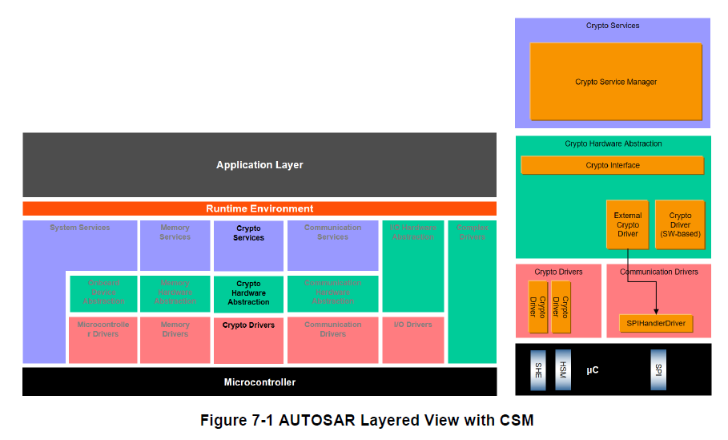

### 6.1. 基础架构指南

**CSM** 模块设计是基于 **AUTOSAR** 分层软件架构（见图 7-1）。在AUTOSAR分层软件架构的基础上，对 **CSM** 模块架构的描述有助于理解后续章节中 **CSM** 模块的接口规范和功能。

**AUTOSAR** 的体系结构由几个层组成，如图 7-1 所示。服务层是基础软件的最高层。它的任务是为应用软件和基础软件模块提供基础服务，即为应用软件和基础软件模块提供最相关的功能。

**CSM** 是一种提供加密功能的服务，基于依赖于软件库或硬件模块的加密驱动程序。 此外，可以使用多个加密驱动程序进行混合设置。**CSM** 可通过加密接口 **CRYIF** 访问不同的加密驱动程序 **CryptoDriver**。

**CSM** 作为服务层，为 **SW-C** 或 **BSW** 提供密码操作的接口。**CSM** 的主要任务是对服务进行调度和优先级排序，并调用加密接口 (**CryIf**) 进行进一步操作。**CryIf** 将请求调度到加密驱动程序及其静态分配给此服务的加密驱动程序对象。

**CSM** 使用基于原语（[**CsmPrimitives**](#9112-csmprimitives)）的静态配置来定义加密操作，然后将定义的原语分配给作业配置 ([**CsmJob**](#915-csmjob))，该作业配置确定进一步的属性，如：优先级、异步或同步执行、以及操作需使用什么密钥。需注意的是，密钥始终位于加密驱动程序本身中，**CSM** 仅使用对它的引用。

密钥和原语的分离允许将用于加密操作（**cryptographic operation**）和密钥管理（**key management**）的 **API** 分开。此设计允许应用程序能够更专注于所需的加密操作，如：**MAC** 计算和验证。而密钥管理器在配置设置期间提供密钥。

**CSM** 的 **API** 大致可以分为两类：直接API（主要用于密钥管理）和基于作业的API（主要用于加解密操作）。

* 直接 API（**Direct API**）：直接对应于 **CryIf** 和加密驱动程序中的函数。这些函数只能同步调用。**CSM** 会将参数从应用程序直接传递给函数调用。 
* 基于作业的 API（**Job-based API**）：使用作业结构 [**Crypto_JobType**](#726-crypto_jobtype)，它包含静态和动态参数以及对结构的引用。此数据为加密驱动程序提供执行该作业所需的所有信息。每个使用作业的服务都将使用此结构。服务的所有必要参数将由 **CSM** 打包到结构的元素中，然后将调用 **CryIf**，而这又将调用配置的加密驱动程序。

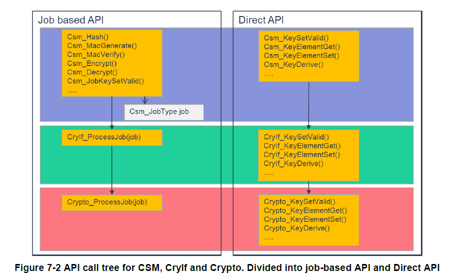

根据静态配置，作业可以同步或异步运行。加密服务信息、加密算法系列和模式的参数确定了应在加密驱动程序中执行的确切加密算法。

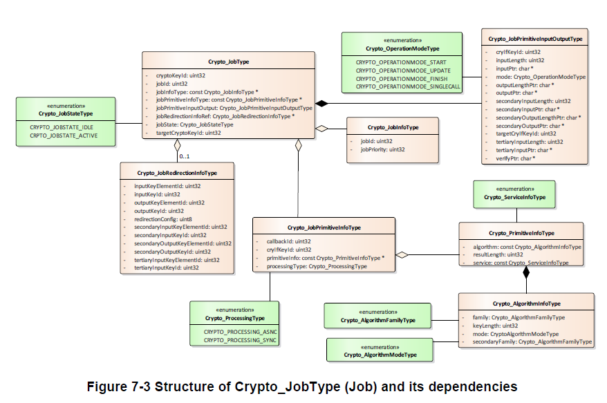

如果配置参数 [**CsmPrimitives**](#9112-csmprimitives) 中的 **AlgorithmFamily**、**AlgorithmMode** 或者 **SecondaryAlgorithmFamily** 设置为 **CRYPTO_ALGOFAM_CUSTOM** (0xFF)，则**CryptoPrimitiveAlgorithmFamilyCustom** / **CryptoPrimitiveAlgorithmFamilyCustomId** 或者 **CryptoPrimitiveAlgorithmModeCustom** / **CryptoPrimitiveAlgorithmModeCustomId** 需引用相关在加密驱动程序中的 [**Crypto_AlgorithmInfoType**](#7212-crypto_algorithminfotype) 中的字段 **Family**、**Mode** 或者 SecondaryFamily，而不是自定义（**0xFF**）值的本身。

### 6.2. 一般行为

作业是配置的加密原语的实例。对于每个作业，CSM 一次只能处理一个实例。

**CSM** 模块应允许并行处理不同的作业。

如果请求 **CSM** 模块的服务，同时相应的作业处于激活（**ACTIVE**）状态，则作业请求需调用 CryIf_ProcessJob() 并传递返回值。

如果请求 **CSM** 模块的服务，同时 **CSM** 作业需要排队，并且队列已满，则应拒绝作业请求，并返回错误 **CRYPTO_E_BUSY**。

如果配置了异步接口，CSM 模块应提供一个主函数 [**Csm_MainFunction**](#73141-csm_mainfunction)()，该函数被循环调用以通过状态机控制作业的处理。

#### 6.2.1. 普通操作

为了将单个调用函数和加密服务的流方法结合起来，可通过Mode参数来决定操作的模式。此服务操作是一个标志字段，用于表示操作方式：**START**、**UPDATE** 或**FINISH**。它明确声明需执行什么样的操作。这些操作模式可以混合，一次执行多个操作。下图表显示了此设计的作业的状态机。

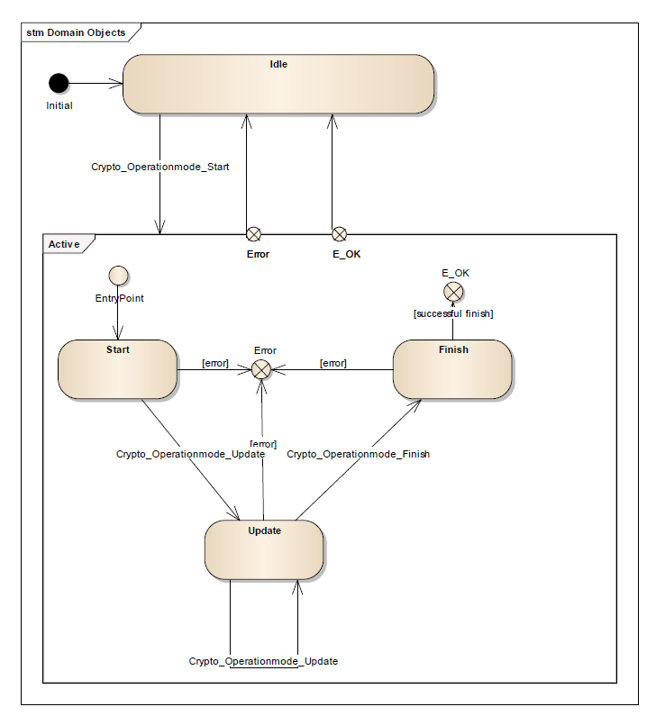

**注意：**

状态的实际事务是在与这些状态一起工作的层中进行的，即：包含在加密驱动程序中。

**CSM** 加密服务需能通过一次调用处理来支持多种操作模式的输入。

如果设置了 **CRYPTO_OPERATIONMODE_START** 和 **CRYPTO_OPERATIONMODE_FINISH** 位并且未设置 **CRYPTO_OPERATIONMODE_UPDATE**，则 Csm_&lt;Service&gt;() 函数需返回 **E_NOT_OK**。

**注意：**

由于单一连贯的方法调用开销较少，所以可以提升性能。因为只需调用一次，而无需多次显式地调用 **API**，这种方法可用于需要快速处理的小数据输入。

但在使用流方法时，如：**START**、**UPDATE**、**FINISH** 操作时，专用加密驱动程序对象会一直处于等待进一步的输入（UPDATE），直到切换到 **FINISH** 状态。在此期间 **Crypto Driver** 实例也无法同时处理其他的作业。

##### 6.2.1.1. 配置

每个加密原语配置都需实现为一个 [**Crypto_PrimitiveInfoType**](#7214-crypto_primitiveinfotype) 类型的常量结构。

每个作业原语配置都需实现为一个 [**Crypto_JobPrimitiveInfoType**](#729-crypto_jobprimitiveinfotype) 类型的常量结构。

**CSM** 配置应该可以为每个加密原语创建多个配置。

**CSM** 配置需支持一个原语对应一个作业。

当创建原语配置时，应该可以从底层加密驱动对象选择所有可用和允许的配置方案。

如果选择异步接口，每个作业原语配置需包含一个回调函数。

##### 6.2.1.2. 同步作业处理

当使用同步接口时，接口函数需在底层加密堆栈模块的支持下能够立即计算出结果。

如果发出同步作业并且优先级大于队列中可用的最高优先级，则 **CSM** 将会禁止再处理队列中的新作业，直到处理完当前作业后，轮到下一次主函数（**Main Function**）被调用。

**注意：**

1. 一个通道可能包含异步和同步处理类型的作业。如果是这样，虽然同步作业的优先级高于所有异步作业的优先级，但它可能不会被接受进行处理。
2. 由于底层加密驱动程序 **Crypto Driver** 可以有自己的队列，所以不能始终确保应用程序提供的最高优先级作业一定会被优先处理。

如果一个同步作业被发出并且优先级低于队列中可用的最高优先级，**CSM** 将返回 **CRYPTO_E_BUSY**。

**注意：**

如果同步作业具有较高的优先级，为了确保同步作业可以被连续地处理，而不必等待其间的异步作业，则可以通过暂停对 **CSM** 主函数（**Main Function**）的调用来实现。例如: 调用同步作业期间的访问 **critical sections**。 同时也需考虑在加密驱动程序对象中禁用队列排队，以确保同步作业能被快速处理。

如果从队列中加载异步作业不应被同步作业暂停，则同步作业的优先级必须小于异步作业。

##### 6.2.1.3. 异步作业处理

如果使用异步接口，接口函数只需将必要的信息转交给底层的加密栈模块处理即可。

当请求的加密服务被处理时，作业原语中所配置的回调函数需被调用，**CSM** 的用户需得到相应地通知。

#### 6.2.2. 设计说明

**CSM** 提供两种服务：(1) 加密服务本身；(2) 密钥管理。

##### 6.2.2.1. CSM模块启动

[**Csm_Init**](#7311-csm_init)() 请求不负责触发底层 **CRYIF** 的初始化。假定底层 **CRYIF** 将由任何适当的实体（例如：BswM）初始化。

使用 **CSM** 模块的软件组件应负责检查 **CSM** 模块启动产生的全局错误和状态信息。

##### 6.2.2.2. 加密服务

###### 6.2.2.2.1. CSM 加密服务的使用

**CSM** 加密服务需提供 Csm_&lt;Service&gt;() API。

应用程序需能够使用操作模式 **CRYPTO_OPERATIONMODE_START** 调用 Csm_&lt;Service&gt;()，以初始化加密计算。

应用程序需能够使用操作模式 **CRYPTO_OPERATIONMODE_UPDATE** 任意地（但至少一次）调用 Csm_&lt;Service&gt;()，以将输入数据提供给作业的加密原语。

应用程序需能够使用操作模式 **CRYPTO_OPERATIONMODE_FINISH** 调用 Csm_&lt;Service&gt;() 以完成加密计算。

以下服务操作需支持 API 指定的操作模式 START、UPDATE 和 FINISH：

* HASH
* MACGENERATE
* MACVERIFY
* ENCRYPT
* DECRYPT
* AEAD_ENCRYPT
* AEAD_DECRYPT
* SIGNATUREGENERATE
* SIGNATUREVERIFY 

对于所有其他服务操作，**CSM** 需将操作模式设置为 **CRYPTO_OPERATIONMODE_SINGLECALL**，即使 API 不提供操作模式。

**注意：**

Csm_&lt;Service&gt;() 会使用一个指向 [**Crypto_JobType**](#726-crypto_jobtype) 的指针，调用 CryIf_ProcessJob()，其中存储了处理作业所需的所有信息。

此 [**Crypto_JobType**](#726-crypto_jobtype) 的一部分是 [**Crypto_JobPrimitiveInputOutputType**](#728-crypto_jobprimitiveinputoutputtype)，其中存储了有关取决于服务的输入和输出参数的所有信息。从 Csm_&lt;Service&gt;() 的 **API** 参数到 [**Crypto_JobPrimitiveInputOutputType**](#728-crypto_jobprimitiveinputoutputtype) 的参数的映射定义，可以在加密驱动程序规范的 [SWS_Crypto_00073] 中找到。

如果 CSM 向加密接口发出服务 CRYPTO_MACGENERATE、CRYPTO_MACVERIFY、CRYPTO_ENCRYPT、CRYPTO_DECRYPT、CRYPTO_AEADENCRYPT、CRYPTO_AEADDECRYPT、 CRYPTO_RANDOMGENERATE、CRYPTO_SIGNATUREGENERATE 或者 CRYPTO_SIGNATUREVERIFY，它需要确保 [**Crypto_JobType**](#726-crypto_jobtype) 作业结构中的元素 jobPrimitiveInfo->cryIfKeyId 引用该作业的分配密钥。

Note: The CryIf is responsible to transform this ID to the corresponding key ID of the respective crypto driver.

If one of the primitive services CRYPTO_KEYSETVALID, CRYPTO_KEYSETINVALID, CRYPTO_RANDOMSEED, CRYPTO_KEYGENERATE, CRYPTO_KEYDERIVE, CRYPTO_KEYEXCHANGECALCPUBVAL or CRYPTO_KEYEXCHANGECALCSECRET are to be executed, the CSM shall fill in the elements of the structure Csm_JobType->jobPrimitiveInputOutput->cryIfKeyId and, if applicable, Csm_JobType->jobPrimitiveInputOutput->targetCryIfKeyId with the corresponding CryIf key ID.

Note: The CryIf is responsible to transform these IDs to the corresponding key IDs of the respective crypto driver.

**注意：**

**CryIf** 负责将这些 **ID** 转换为相应加密驱动程序的相应密钥 **ID**。

如果要执行原语服务 CRYPTO_KEYSETVALID、CRYPTO_KEYSETINVALID,、CRYPTO_RANDOMSEED,、CRYPTO_KEYGENERATE、CRYPTO_KEYDERIVE、CRYPTO_KEYEXCHANGECALCPUBVAL 或者 CRYPTO_KEYEXCHANGECALCSECRET ，**CSM** 需使用相应的 **CryIf** 密钥 ID 填充结构 Csm_JobType->jobPrimitiveInputOutput->cryIfKeyId 的元素。如果适用，Csm_JobType->jobPrimitiveInputOutput->targetCryIfKeyId 的元素。

**注意：**

**CryIf** 负责将这些 **ID** 转换为相应加密驱动程序的相应密钥 **ID**。

###### 6.2.2.2.2. 队列

**CSM** 可能有多个队列，其中作业根据其优先级排列，以处理多个加密请求。从 **CSM** 队列通过 **CryIf** 到加密驱动程序对象的路径称为通道。**CSM** 的每个队列都映射到一个通道以访问加密驱动程序对象的加密原语。队列的大小是可配置的。

为了优化 **Crypto Driver Object** 的硬件使用，**Crypto Driver** 中也有一个可选的队列。

加密驱动程序对象表示独立加密设备的实例。包括：硬件或软件。例如：AES 加速器。对于高优先级作业，在 **HSM** 上可能有一个用于快速 **AES** 和 **CMAC** 计算的通道，该通道地终点为加密驱动程序中的本机 AES 计算服务。但也有可能，加密驱动程序对象是一个软件，例如：用户可以使用 **RSA** 算法加密、解密、签名或验证数据。

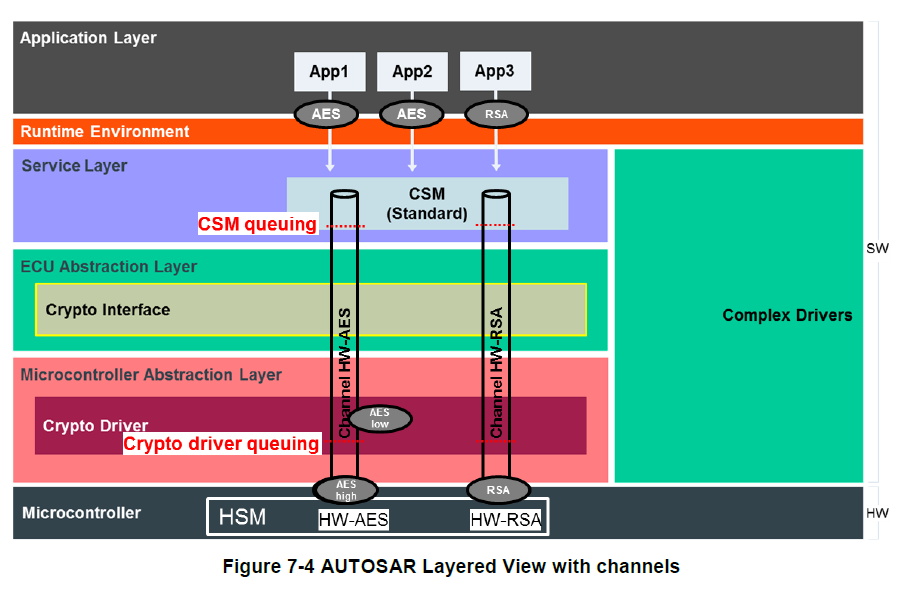

图 **7-4** 说明了带有通道的 **AUTOSAR** 分层视图。在此示例中包含一个 **HSM** 和两个加密驱动程序对象（**Crypto Driver Object**），包括 **HW-AES** 和 **HW-RSA**。同时每个对象都有自己的通道，每个通道都连接到一个 **CSM** 队列和一个加密驱动程序对象队列。

在这种情况下，两个加密驱动对象都在处理一个加密作业 **AES-high** 和 **RSA**，而加密驱动对象的队列又包含一个作业 **AES-low**。如果 **HSM** 的 **HW-AES** 完成了 **AES-high** 作业，**AES-low** 作业将作为下一个作业处理。

在此相同设置的场景下，未在处理中或者队列中的作业，具体推导如下：

* 应用程序有新的作业需要使用 **RSA** 算法。
* 如果 **RSA** 的加密驱动程序对象（**Crypto Driver Object**）不忙，将立即处理该作业。
* 如果 **RSA** 的加密驱动程序对象（**Crypto Driver Object**）繁忙，加密驱动程序对象的队列未满，则作业将按其优先级顺序列在该队列中。一旦加密驱动对象空闲，就会执行此加密驱动对象队列中优先级最高的作业。
* 如果 **RSA** 的加密驱动程序对象（**Crypto Driver Object**）繁忙，加密驱动程序对象的队列已满，则作业将按优先级顺序存储在 **CSM** 队列中。
* 如果 **RSA** 的加密驱动程序对象（**Crypto Driver Object**）繁忙，加密驱动程序对象的队列和 **CSM** 队列都满了，则 **CSM** 需拒绝请求。
* 如果 **RSA** 的加密驱动程序对象（**Crypto Driver Object**）处于活动状态（**active**），说明作业已在加密驱动程序中被启动，它处于等待更多数据处理指令（**UPDATE**）或者完成（**FINISH**）命令。

**CSM** 作业进行排队可以在配置参数 [**CsmQueues**](#918-csmqueues) 进行配置。同时 [**CsmQueues**](#918-csmqueues) 需根据配置的作业优先级对作业进行排序。作业优先级数值越大表明作业的优先级越高。

只有在保证作业结构的数据一致性的情况下，才能将服务操作加入队列。当将具有相同 jobID 的服务添加到队列时，应特别考虑这一点。例如：调用 [Csm_SignatureVerify](#7362-csm_signatureverify)()，随后调用[Csm_SaveContextJob](#73101-csm_savecontextjob)()的情况。如果不能保证这一点，服务操作将返回 **E_BUSY**。

如果具有相同JobID的服务可以被添加到队列中，则这些服务的执行顺序应与传入服务操作请求的顺序相对应。即符合先进先出的顺序。

Csm_&lt;Service&gt;() 函数的行为需如下图所示。

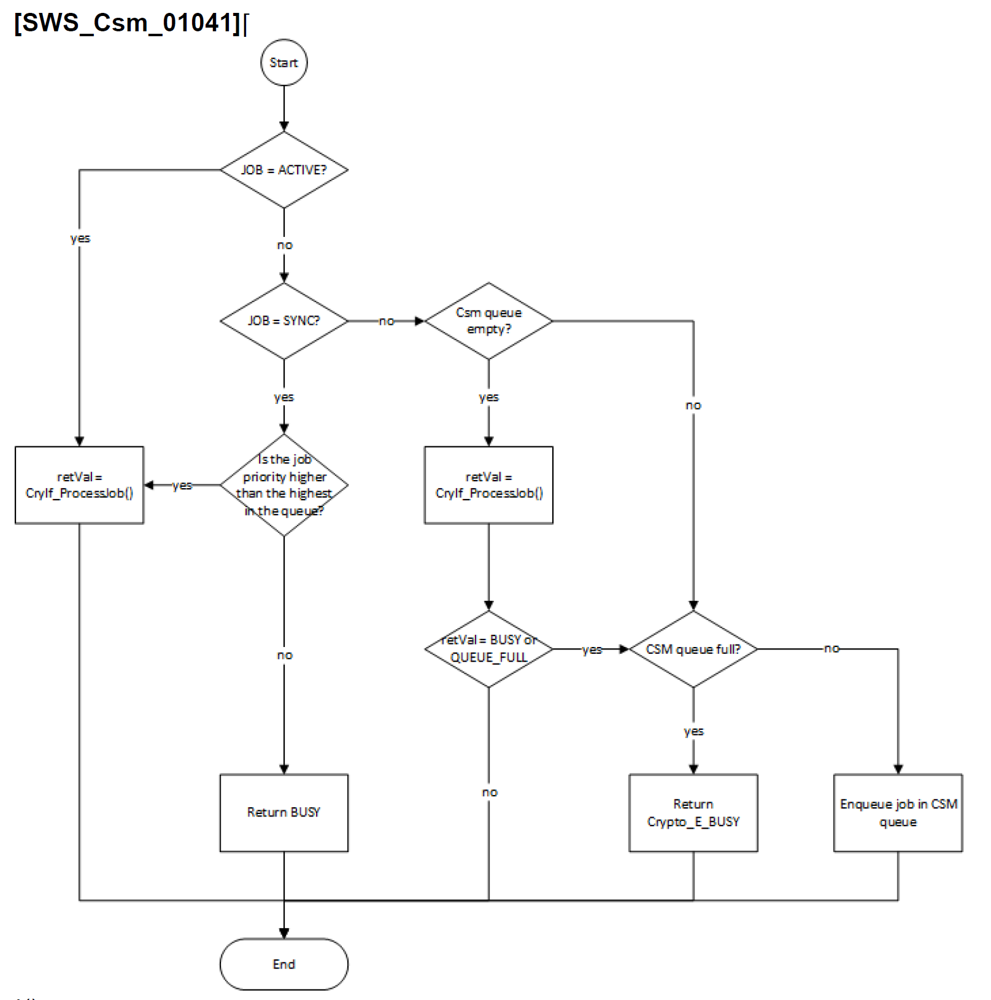

因为对于同步作业处理来说，队列排队可能用途不大。所以如果选择了同步作业处理，则建议把队列大小设定为 **0**。 但是，如果通道同时支持同步和异步作业，则队列排队机制还是有使用的必要。在 [**Csm_MainFunction**](#73141-csm_mainfunction)() 中，可以将排队的作业传递给给 **CRYIF** 模块。

如果当前作业的状态为活动状态，**CSM** 需假设映射的加密驱动程序实例当前正在处理该作业。当调用者希望继续操作（例如：使用 **UPDATE** 操作提供更多数据），加密驱动程序实例中必须执行合理性地检查（**plausibility check**）。

##### 6.2.2.3. 密钥管理

属于密钥管理的服务需仅提供 Csm_&lt;Service&gt;() 函数。一个密钥（**Key**）可以包括一个或多个密钥元素（**Key Element**）组成。

密钥元素是密钥材料本身。如：

* 初始化向量（**initialization vector**）。
* 随机数生成的种子（**a seed for random number generation**）。
* 符合 **SHE** 标准的证明（**the proof of the SHE standard**）。

密钥是相应的密钥 ID 在配置中地一个给定的符号名称。Crypto Stack API 使用 **CSM** 模块中的以下密钥元素索引定义：

| Crypto Service | key element      | key element Name                   | key element ID |
| -------------- | ---------------- | ---------------------------------- | -------------- |
| MAC            | Key Material     | CRYPTO_KE_MAC_KEY                  | 1              |
| MAC            | Proof (SHE)      | CRYPTO_KE_MAC_PROOF                | 2              |
| MAC            | Seed             | CRYPTO_KE_KEYGENERATE_SEED         | 16             |
| Signature      | Key Material     | CRYPTO_KE_SIGNATURE_KEY            | 1              |
| Signature      | ECC curve type   | CRYPTO_KE_SIGNATURE_CURVETYPE      | 29             |
| Random         | Seed State       | CRYPTO_KE_RANDOM_SEED_STATE        | 3              |
| Random         | Algorithm        | CRYPTO_KE_RANDOM_ALGORITHM         | 4              |
| Cipher/AEAD    | Key Material     | CRYPTO_KE_CIPHER_KEY               | 1              |
| Cipher/AEAD    | Proof (SHE)      | CRYPTO_KE_CIPHER_PROOF             | 2              |
| Cipher/AEAD    | Init Vector      | CRYPTO_KE_CIPHER_IV                | 5              |
| Cipher/AEAD    | 2nd Key Material | CRYPTO_KE_CIPHER_2NDKEY            | 7              |
| Key Exchange   | Base             | CRYPTO_KE_KEYEXCHANGE_BASE         | 8              |
| Key Exchange   | Private Key      | CRYPTO_KE_KEYEXCHANGE_PRIVKEY      | 9              |
| Key Exchange   | Own Public Key   | CRYPTO_KE_KEYEXCHANGE_OWNPUBKEY    | 10             |
| Key Exchange   | Shared Value     | CRYPTO_KE_KEYEXCHANGE_SHAREDVALUE  | 1              |
| Key Exchange   | Algorithm        | CRYPTO_KE_KEYEXCHANGE_ALGORITHM    | 12             |
| Key Exchange   | ECC curve type   | CRYPTO_KE_KEYEXCHANGE_CURVETYPE    | 29             |
| Key Derivation | Password         | CRYPTO_KE_KEYDERIVATION_PASSWORD   | 1              |
| Key Derivation | Salt             | CRYPTO_KE_KEYDERIVATION_SALT       | 13             |
| Key Derivation | Iterations       | CRYPTO_KE_KEYDERIVATION_ITERATIONS | 14             |
| Key Derivation | Algorithm        | CRYPTO_KE_KEYDERIVATION_ALGORITHM  | 15             |
| Key Derivation | ECC curve type   | CRYPTO_KE_KEYDERIVATION_CURVETYPE  | 29             |
| Key Generate   | Key Material     | CRYPTO_KE_KEYGENERATE_KEY          | 1              |
| Key Generate   | Seed             | CRYPTO_KE_KEYGENERATE_SEED         | 16             |
| Key Generate   | Algorithm        | CRYPTO_KE_KEYGENERATE_ALGORITHM    | 17             |
| Key Generate   | ECC curve type   | CRYPTO_KE_KEYGENERATE_CURVETYPE    | 29             |

密钥元素索引可以由供应商进行扩展。

对于包含加密密钥材料的每个密钥元素，所提供密钥的格式应在用于数据交换的配置中指定。例如：对于 [Csm_KeyElementGet](#73831-csm_keyelementget)() 或 [Csm_KeyElementSet](#73811-csm_keyelementset)()。特定加密驱动程序支持的密钥格式是加密驱动程序附带的预配置信息的一部分。

可以使用以下密钥格式：

**CRYPTO_KE_FORMAT_BIN_OCTET**
> 密钥以二进制形式作为八位字节值提供。

**CRYPTO_KE_FORMAT_BIN_SHEKEYS**
> SHE 操作的组合输入/输出键（M1+M2+M3）和（M4+M5）。

**CRYPTO_KE_FORMAT_BIN_IDENT_PRIVATEKEY_PKCS8**
> 带有标识的 ASN.1 编码形式（BER 编码）的私钥材料。数据以二进制形式提供。

**CRYPTO_KE_FORMAT_BIN_IDENT_PUBLICKEY**
> 带有标识的 ASN.1 编码形式（BER 编码）的公钥材料。 数据以二进制形式提供。

**CRYPTO_KE_FORMAT_BIN_RSA_PRIVATEKEY**
> ASN.1 编码形式（BER 编码）的私钥材料。 密钥材料以二进制形式提供。

**CRYPTO_KE_FORMAT_BIN_RSA_PUBLICKEY**
> ASN.1 编码形式（BER 编码）的公钥材料。 密钥材料以二进制形式提供。


**基本原理：**

非对称密钥可以提供或不提供标识。该标识用于唯一标识提供的密钥本身，以便密钥解析器可以检查密钥材料是否合适。如果没有标识，密钥材料必须与为此密钥指定的格式相对应。按照 IETF 标准，密钥的标识作为对象标识符 (OID) 作为 ASN.1 描述的一部分提供。

供应商特定的 keyElementIds 应该从 1000 开始，以避免干扰加密堆栈的未来扩展版本。

**注意：**

密钥元素 CRYPTO_KE_\[…\]_ALGORITHM 用于配置密钥管理功能的行为。因为它们独立于作业，所以不能像原语那样配置。

如果密码原语使用椭圆曲线算法，但其算法族和算法模式不能充分指定具体的曲线参数，则应使用 **CRYPTO_KE_xxxxx_CURVETYPE** 类型的附加密钥元素来提供所需信息。此信息是在运行时通过密钥元素接口设置的。密钥元素的数据应按照[\[19\]](#ref-19)和[\[20\]](#ref-20)中定义的格式设置其对象标识符。

示例：用于签名生成的 ECC Brainpool 160 P1 密钥的定义。

```C
P2CONST(uint8, AUTOMATIC, MSN_CONST) EccKey = { 
    0x12, 0x23, 0x34, ... 
} ; // The required key value.

// According to RFC5639:
// {iso(1) identified-organization(3) teletrust(36) 
// algorithm(3) signatureAlgorithm(3) ecSign(2) 
// ecStdCurvesAndGeneration(8) ellipticCurve(1)}
// brainpoolP160r1(1)

P2CONST(uint8, AUTOMATIC, MSN_CONST) EccType =
{ 1, 3, 36, 3, 3, 2, 8, 1, 1 } ; //OID definition of ECC Brainpool 160 P1

Csm_KeyElementSet(MyEccKeyId, CRYPTO_KE_SIGNATURE_KEY, EccKey, sizeof(EccKey) );

Csm_KeyElementSet(MyEccKeyId, CRYPTO_KE_SIGNATURE_CURVETYPE, EccType, sizeof(EccType) );

Csm_KeySetValid(MyEccKeyId);
```

##### 6.2.2.4. 加密作业输入和/或输出的重定向

作业的输入或输出数据可以重定向到密钥元素（**Key element**）。密钥及其密钥元素重定向到哪个输入输出值，只能编译时静态配置，在运行期间是不允许更改的。

如果作业的输入或输出数据被重定向到密钥元素，即 **CsmInOutRedirectionRef** 存在，并且相应的输入或输出长度值不为 **0**，则不应处理该作业并应返回 **E_NOT_OK**。

如果作业的输入或输出重定向并未用于作业元素（**Job Element**），即：**CsmInOutRedirectionRef** 不存在，则 **jobRedirectionInfoRef** 需被设置为 **NULL_PTR**。 如果使用重定向元素，即：**CsmInOutRedirectionRef** 存在，则**jobRedirectionInfoRef** 应指向 [**Crypto_JobRedirectionInfoType**](#7211-crypto_jobredirectioninfotype) 结构。

结构 [**Crypto_JobRedirectionInfoType**](#7211-crypto_jobredirectioninfotype) 包含哪些密钥元素将用于重定向的信息。提供了一个称为 **redirectionConfig** 的位字段，用于指示重定向哪个输入和/或输出值。

**redirectionConfig** 的值是一个位编码值，用于指示哪个输入和输出缓冲区被重定向。 如果 **redirectionConfig** 的最低有效位（第 1 位 或 0x01）被设置为主输入键并且它的元素被重定向，并且 **inputKeyId** 和 **inputKeyElementId** 的值必须指示用于输入缓冲区的元素而不是 **inputPtr** 及其长度。如果设置了第 **1** 位，则将 **secondaryInputBuffer** 重定向到已设置的辅助输入键，并且必须设置键和密钥元素。而第 **2** 位用于第三输入键。第 3 位保留供将来使用。

如果第 **4** 位被设置，则 outputPtr 被重定向到输出键的输出密钥元素。第 **5** 位表示将辅助输出缓冲区重定向到辅助键及其密钥元素。如果某个位设置为 0，则输入或输出不应重定向到相关的密钥元素。

示例：**00110001** 的 **redirectionConfig** 值表示应从 **inputKeyId** 的 **inputKeyElement** 收集输入，输出缓冲区和辅助输出缓冲区应重定向到 **outputKeyId** 的**outputKeyElement** 和 **secondaryOutputKeyId** 的 **secondaryOutputKeyElement**。

##### 6.2.2.5. 作业上下文接口

作业的上下文接口允许为来自加密驱动程序的特定加密服务保存或恢复工作区的上下文数据。这允许将所有动态创建的数据存储在加密驱动程序中，以便稍后可以恢复它以在保存上下文快照的确切位置继续此前的操作。

同时密钥元素数据不受任何影响。也就是说密钥元素不属于上下文数据的一部分。而且在必要时必须由密钥元素接口进行单独的设置或读取。

在调用 [**Csm_SaveContextJob**](#73101-csm_savecontextjob)() 或 [**Csm_RestoreContextJob**](#73102-csm_restorecontextjob)() 时，**CSM** 需检查相关作业当前是否处于活动状态。

* 如果作业处于活动状态，操作需按照规范继续下去。
* 如果作业处于空闲状态，函数需立即返回 **E_NOT_OK**。

在调用 [**Csm_SaveContextJob**](#73101-csm_savecontextjob)() 或 [**Csm_RestoreContextJob**](#73102-csm_restorecontextjob)() 时，**CSM** 应检查相关作业当前是否正在积极处理数据。这意味着 **CSM** 已将与此作业相关的操作安排提交给了驱动程序，并正在等待处理响应。在这种情况下，函数需立即返回 **E_NOT_OK**。

在调用 [**Csm_SaveContextJob**](#73101-csm_savecontextjob)() 或 [**Csm_RestoreContextJob**](#73102-csm_restorecontextjob)() 时，**CSM** 应检查作业是否引用 **CsmPrimitive**、[**CsmHash**](#7521-csmhash)、[**CsmEncrypt**](#7524-csmencrypt)、**CsmEncryptAEAD**、**CsmDecryptAEAD**、[**CsmDecrypt**](#7525-csmdecrypt)、[**CsmMacGenerate**](#7522-csmmacgenerate)、[**CsmMacVerify**](#7523-csmmacverify)、[**CsmSignatureGenerate**](#7528-csmsignaturegenerate) 或 [**CsmSignatureVerify**](#7529-csmsignatureverify)。 如果是，操作应按规定继续。否则，不应执行该操作，并且当 **CsmDevErrorDetect** 设定为 **true** 时，需将 [**CSM_E_SERVICE_TYPE**](#631-开发错误) 报告给 **DET**。

### 6.3. 错误分类

文档[\[17\]](#ref-17)《基础软件模块通用规范》的「错误处理」一章详细描述了基础软件的错误处理。最重要的是，它构成了一个由可能发生在 **BSW** 模块中的五种错误类型组成的分类方案。

在此基础上，以下章节规定了在下面各小节中安排的特定错误。

#### 6.3.1. 开发错误

| 错误类型 | 相关错误代码 | 错误值 |
|---|---|---|
| **API** 请求以无效参数调用（空指针） | CSM_E_PARAM_POINTER | 0x01 |
| Csm 配置 ID 超出范围 | CSM_E_PARAM_HANDLE | 0x04 |
| **CSM** 模块初始化之前调用 **API** 请求 | CSM_E_UNINIT | 0x05 |
| **CSM** 模块初始化失败 | CSM_E_INIT_FAILED | 0x07 |
| **API** 请求以无效处理模式调用 | CSM_E_PROCESSING_MODE | 0x08 |
| 被调用的 **API** 请求与作业的服务类型不匹配 | CSM_E_SERVICE_TYPE | 0x09 |

#### 6.3.2. 运行时错误

| 错误类型 | 相关错误代码 | 错误值 |
|---|---|---|
| 队列溢出 | CSM_E_QUEUE_FULL | 0x01 |

#### 6.3.3. 瞬态故障

没有瞬态故障。

#### 6.3.4. 生产错误

没有生产错误。

#### 6.3.5. 扩展生产错误

没有扩展生产错误。

### 6.4. 错误检测

当 **CSM** 未初始化时调用了 **CSM API** 中除 [**Csm_Init**](#7311-csm_init)() 和 [**Csm_GetVersionInfo**](#7312-csm_getversioninfo)() 之外的任何函数，则不应执行该操作，并且在 **CsmDevErrorDetect** 为 true 时向 **DET** 报告 [**CSM_E_UNINIT**](#631-开发错误)。

如果向 **API** 函数传递了空指针，且相应的输入或输出数据未重定向到密钥元素，则不应执行该操作，并且在 **CsmDevErrorDetect** 为 true 时向 **DET** 报告 [**CSM_E_PARAM_POINTER**](#631-开发错误)。

如果调用了接口中带有 ID 句柄的 **CSM API**，且该 ID 句柄超出范围，则不应执行该操作，并且在 **CsmDevErrorDetect** 为 true 时向 **DET** 报告 [**CSM_E_PARAM_HANDLE**](#631-开发错误)。

如果调用了接口中带有作业句柄（称为 **jobId**）的 **CSM API**，且作业的 [**Crypto_ServiceInfoType**](#7210-crypto_serviceinfotype) 与所请求的服务不匹配，则不应执行该操作，并且在 **CsmDevErrorDetect** 为 true 时向 **DET** 报告 [**CSM_E_SERVICE_TYPE**](#631-开发错误)。

如果 **CSM** 作业需要排队且队列已满，则应向 **DET** 报告运行时错误 [**CSM_E_QUEUE_FULL**](#632-运行时错误)。

**注意：**

队列溢出的指示被记录为运行时错误。

### 6.5. 多核系统

如果 Crypto-Stack 分布在多个分区中，**Csm** 应允许在不同分区中调用其 &lt;sevice&gt; API。

[**CsmQueues**](#918-csmqueues) 需在通过 **CsmQueueMainFunctionRef** 引用的 **MainFunction** 中进行处理。

**注意：**

如果 [**CsmJob**](#915-csmjob) 根本没有在 **MainFunction** 上下文中处理（如：同步接口），则 **MainFunction** （通过相应的 [CsmQueue](#919-csmqueue)）分配到 [**CsmJob**](#915-csmjob) 所被分配到的分区。

**Csm** 模块需使用适当的机制，以允许从其 [**CsmJobs**](#914-csmjobs) 分配到的分区里，调用 Csm_&lt;Service&gt;() API。

## 7. API规范

### 7.1. 导入的类型

需仅导入 **Std_Types.h** 所提供的标准 **AUTOSAR** 类型。

### 7.2. 类型定义

#### 7.2.1. Std_ReturnType 的扩展

**CSM** 模块对 **Std_ReturnType** 的扩展定义了以下返回码。可通过 **Crypto_GeneralTypes.h** 获得。

* **CRYPTO_E_BUSY**（0x02）：服务请求失败，因为服务仍然忙碌。
* **CRYPTO_E_ENTROPY_EXHAUSTED**（0x04）：服务请求失败，因为随机数生成器的熵已耗尽。
* **CRYPTO_E_KEY_READ_FAIL**（0x06）：服务请求失败，因为读访问被拒绝。
* **CRYPTO_E_KEY_WRITE_FAIL**（0x07）：服务请求失败，因为写访问失败。
* **CRYPTO_E_KEY_NOT_AVAILABLE**（0x08）：服务请求失败，因为至少一个所需的密钥元素不可用。
* **CRYPTO_E_KEY_NOT_VALID**（0x09）：服务请求失败，因为密钥无效。
* **CRYPTO_E_KEY_SIZE_MISMATCH**（0x0A）：服务请求失败，因为密钥大小不匹配。
* **CRYPTO_E_JOB_CANCELED**（0x0C）：服务请求失败，因为作业已被取消。
* **CRYPTO_E_KEY_EMPTY**（0x0D）：服务请求失败，因为源密钥元素未初始化。
* **CRYPTO_E_CUSTOM_ERROR**（0x0E）：自定义处理失败。

#### 7.2.2. Csm_ConfigType

结构类型（**Structure**）。**Csm** 模块的配置数据结构。元素为实现特定的内容：配置结构的内容是实现特定的。可通过 **Csm.h** 获得。

#### 7.2.3. Crypto_AlgorithmFamilyType

枚举类型（**Enumeration**）。算法族（**algorithm family**）的枚举。取值范围：

| 枚举值 | 值 | 说明 |
|---|---|---|
| CRYPTO_ALGOFAM_NOT_SET | 0x00 | 未设置算法族 |
| CRYPTO_ALGOFAM_SHA1 | 0x01 | SHA1 哈希 |
| CRYPTO_ALGOFAM_SHA2_224 | 0x02 | SHA2-224 哈希 |
| CRYPTO_ALGOFAM_SHA2_256 | 0x03 | SHA2-256 哈希 |
| CRYPTO_ALGOFAM_SHA2_384 | 0x04 | SHA2-384 哈希 |
| CRYPTO_ALGOFAM_SHA2_512 | 0x05 | SHA2-512 哈希 |
| CRYPTO_ALGOFAM_SHA2_512_224 | 0x06 | SHA2-512/224 哈希 |
| CRYPTO_ALGOFAM_SHA2_512_256 | 0x07 | SHA2-512/256 哈希 |
| CRYPTO_ALGOFAM_SHA3_224 | 0x08 | SHA3-224 哈希 |
| CRYPTO_ALGOFAM_SHA3_256 | 0x09 | SHA3-256 哈希 |
| CRYPTO_ALGOFAM_SHA3_384 | 0x0a | SHA3-384 哈希 |
| CRYPTO_ALGOFAM_SHA3_512 | 0x0b | SHA3-512 哈希 |
| CRYPTO_ALGOFAM_SHAKE128 | 0x0c | SHAKE128 哈希 |
| CRYPTO_ALGOFAM_SHAKE256 | 0x0d | SHAKE256 哈希 |
| CRYPTO_ALGOFAM_RIPEMD160 | 0x0e | RIPEMD 哈希 |
| CRYPTO_ALGOFAM_BLAKE_1_256 | 0x0f | BLAKE-1-256 哈希 |
| CRYPTO_ALGOFAM_BLAKE_1_512 | 0x10 | BLAKE-1-512 哈希 |
| CRYPTO_ALGOFAM_BLAKE_2s_256 | 0x11 | BLAKE-2s-256 哈希 |
| CRYPTO_ALGOFAM_BLAKE_2s_512 | 0x12 | BLAKE-2s-512 哈希 |
| CRYPTO_ALGOFAM_3DES | 0x13 | 3DES 密码 |
| CRYPTO_ALGOFAM_AES | 0x14 | AES 密码 |
| CRYPTO_ALGOFAM_CHACHA | 0x15 | ChaCha 密码 |
| CRYPTO_ALGOFAM_RSA | 0x16 | RSA 密码 |
| CRYPTO_ALGOFAM_ED25519 | 0x17 | ED25519 椭圆曲线 |
| CRYPTO_ALGOFAM_BRAINPOOL | 0x18 | Brainpool 椭圆曲线 |
| CRYPTO_ALGOFAM_ECCNIST | 0x19 | NIST ECC 椭圆曲线 |
| CRYPTO_ALGOFAM_RNG | 0x1b | 随机数生成器 |
| CRYPTO_ALGOFAM_SIPHASH | 0x1c | SipHash |
| CRYPTO_ALGOFAM_ECCANSI | 0x1e | 符合 ANSI X9.62 的椭圆曲线 |
| CRYPTO_ALGOFAM_ECCSEC | 0x1f | 符合 SECG 的椭圆曲线 |
| CRYPTO_ALGOFAM_DRBG | 0x20 | 符合 NIST SP800-90A 的随机数生成器 |
| CRYPTO_ALGOFAM_FIPS186 | 0x21 | 符合 FIPS 186 的随机数生成器 |
| CRYPTO_ALGOFAM_PADDING_PKCS7 | 0x22 | 符合 PKCS.7 的密码填充 |
| CRYPTO_ALGOFAM_PADDING_ONEWITHZEROS | 0x23 | 密码填充模式。用 0 填充/校验数据，但数据后的第一位为 1。例如 “DATA” & 0x80 & 0x00... |
| CRYPTO_ALGOFAM_PBKDF2 | 0x24 | 基于口令的密钥派生函数 2（**Password-Based Key Derivation Function 2**） |
| CRYPTO_ALGOFAM_KDFX963 | 0x25 | ANSI X9.63 公钥密码学 |
| CRYPTO_ALGOFAM_DH | 0x26 | Diffie-Hellman |
| CRYPTO_ALGOFAM_SM2 | 0x27 | SM2 椭圆曲线算法 |
| CRYPTO_ALGOFAM_EEA3 | 0x28 | 基于 [x01] 的流密码 |
| CRYPTO_ALGOFAM_SM3 | 0x29 | 基于 [x02] 的中国哈希算法 |
| CRYPTO_ALGOFAM_EIA3 | 0x2A | 认证算法 [x01] |
| CRYPTO_ALGOFAM_HKDF | 0x2B | 基于 **HMAC** 的提取-扩展密钥派生函数 |
| CRYPTO_ALGOFAM_ECDSA | 0x2C | 椭圆曲线数字签名 |
| CRYPTO_ALGOFAM_POLY1305 | 0x2D | **MAC** 计算算法 |
| CRYPTO_ALGOFAM_X25519 | 0x2E | 用于 **ECDH** 的椭圆曲线 X25519 |
| CRYPTO_ALGOFAM_ECDH | 0x2F | 椭圆曲线 Diffie Hellman |
| CRYPTO_ALGOFAM_CUSTOM | 0xff | 自定义算法族 |

可通过 **Crypto_GeneralTypes.h** 获得。

#### 7.2.4. Crypto_AlgorithmModeType

枚举类型（**Enumeration**）。算法模式（**algorithm mode**）的枚举。取值范围：

| 枚举值 | 值 | 说明 |
|---|---|---|
| CRYPTO_ALGOMODE_NOT_SET | 0x00 | 未设置算法密钥 |
| CRYPTO_ALGOMODE_ECB | 0x01 | 块模式：电子密码本（**Electronic Code Book**） |
| CRYPTO_ALGOMODE_CBC | 0x02 | 块模式：密码分组链接（**Cipher Block Chaining**） |
| CRYPTO_ALGOMODE_CFB | 0x03 | 块模式：密码反馈模式（**Cipher Feedback Mode**） |
| CRYPTO_ALGOMODE_OFB | 0x04 | 块模式：输出反馈模式（**Output Feedback Mode**） |
| CRYPTO_ALGOMODE_CTR | 0x05 | 块模式：计数器模式（**Counter Mode**） |
| CRYPTO_ALGOMODE_GCM | 0x06 | 块模式：Galois/计数器模式（**Galois/Counter Mode**） |
| CRYPTO_ALGOMODE_XTS | 0x07 | 带密文窃取的 XEX 可调块密码（**XEX Tweakable Block Cipher with Ciphertext Stealing**） |
| CRYPTO_ALGOMODE_RSAES_OAEP | 0x08 | **RSA** 最优非对称加密填充（**RSA Optimal Asymmetric Encryption Padding**） |
| CRYPTO_ALGOMODE_RSAES_PKCS1_v1_5 | 0x09 | 采用 PKCS#1 v1.5 填充的 **RSA** 加密/解密 |
| CRYPTO_ALGOMODE_RSASSA_PSS | 0x0a | **RSA** 概率签名方案（**RSA Probabilistic Signature Scheme**） |
| CRYPTO_ALGOMODE_RSASSA_PKCS1_v1_5 | 0x0b | 采用 PKCS#1 v1.5 的 **RSA** 签名 |
| CRYPTO_ALGOMODE_8ROUNDS | 0x0c | 8 轮（例如 ChaCha8） |
| CRYPTO_ALGOMODE_12ROUNDS | 0x0d | 12 轮（例如 ChaCha12） |
| CRYPTO_ALGOMODE_20ROUNDS | 0x0e | 20 轮（例如 ChaCha20） |
| CRYPTO_ALGOMODE_HMAC | 0x0f | 基于哈希的 **MAC**（**Hashed-based MAC**） |
| CRYPTO_ALGOMODE_CMAC | 0x10 | 基于密码的 **MAC**（**Cipher-based MAC**） |
| CRYPTO_ALGOMODE_GMAC | 0x11 | Galois **MAC** |
| CRYPTO_ALGOMODE_CTRDRBG | 0x12 | 基于计数器的确定性随机位生成器（**Counter-based Deterministic Random Bit Generator**） |
| CRYPTO_ALGOMODE_SIPHASH_2_4 | 0x13 | Siphash-2-4 |
| CRYPTO_ALGOMODE_SIPHASH_4_8 | 0x14 | Siphash-4-8 |
| CRYPTO_ALGOMODE_PXXXR1 | 0x15 | ANSI R1 曲线 |
| CRYPTO_ALGOMODE_AESKEYWRAP | 0x16 | **AES** 密钥包装（**AES Key Wrap**，RFC 3394） |
| CRYPTO_ALGOMODE_CUSTOM | 0xff | 自定义算法模式 |

可通过 **Crypto_GeneralTypes.h** 获得。

#### 7.2.5. Crypto_InputOutputRedirectionConfigType

枚举类型（**Enumeration**）。定义哪些输入/输出参数被重定向到密钥元素。这些值可以组合起来以定义位域。取值范围：

| 枚举值 | 值 | 说明 |
|---|---|---|
| CRYPTO_REDIRECT_CONFIG_PRIMARY_INPUT | 0x01 | - |
| CRYPTO_REDIRECT_CONFIG_SECONDARY_INPUT | 0x02 | - |
| CRYPTO_REDIRECT_CONFIG_TERTIARY_INPUT | 0x04 | - |
| CRYPTO_REDIRECT_CONFIG_PRIMARY_OUTPUT | 0x10 | - |
| CRYPTO_REDIRECT_CONFIG_SECONDARY_OUTPUT | 0x20 | - |

可通过 **Crypto_GeneralTypes.h** 获得。

#### 7.2.6. Crypto_JobType

结构类型（**Structure**）。包含取决于作业和加密原语的进一步信息的结构。元素：

| 元素 | 类型 | 说明 |
|---|---|---|
| jobId | uint32 | 作业结构的标识符。 |
| jobState | [Crypto_JobStateType](#727-crypto_jobstatetype) | 确定当前的作业状态。 |
| jobPrimitiveInputOutput | [Crypto_JobPrimitiveInputOutputType](#728-crypto_jobprimitiveinputoutputtype) | 包含取决于作业和加密原语的输入和输出信息的结构。 |
| jobPrimitiveInfo | const [Crypto_JobPrimitiveInfoType](#729-crypto_jobprimitiveinfotype)* | 指向一个结构的指针，该结构包含取决于作业和加密原语的进一步信息。 |
| jobRedirectionInfoRef | [Crypto_JobRedirectionInfoType](#7211-crypto_jobredirectioninfotype)* | 指向一个结构的指针，该结构包含关于密钥用作作业输入和输出的进一步信息。 |
| cryptoKeyId | uint32 | 加密驱动程序密钥的标识符。该标识符应由加密接口写入。 |
| targetCryptoKeyId | uint32 | 加密驱动程序密钥的目标标识符。该标识符应由加密接口写入。 |
| jobPriority | const uint32 | 指定作业的重要性（数值越高，越重要）。 |

可通过 **Crypto_GeneralTypes.h** 获得。

#### 7.2.7. Crypto_JobStateType

枚举类型（**Enumeration**）。当前作业状态的枚举。取值范围：

| 枚举值 | 值 | 说明 |
|---|---|---|
| CRYPTO_JOBSTATE_IDLE | 0x00 | 作业处于“空闲”状态。该状态在 [**Csm_Init**](#7311-csm_init)() 之后或在“完成”状态结束后到达。 |
| CRYPTO_JOBSTATE_ACTIVE | 0x01 | 作业处于“活动”状态。已经有一些输入或者存在中间结果。该状态在“更新”或“开始”操作结束时到达。 |

可通过 **Crypto_GeneralTypes.h** 获得。

#### 7.2.8. Crypto_JobPrimitiveInputOutputType

结构类型（**Structure**）。包含取决于作业和加密原语的输入和输出信息的结构。元素：

| 元素 | 类型 | 说明 |
|---|---|---|
| inputPtr | const uint8* | 指向输入数据的指针。 |
| inputLength | uint32 | 包含以字节为单位的输入长度。 |
| secondaryInputPtr | const uint8* | 指向第二输入数据的指针（用于 **MacVerify**、**SignatureVerify**）。 |
| secondaryInputLength | uint32 | 包含第二输入的长度，以位或字节为单位，取决于所请求的服务。 |
| tertiaryInputPtr | const uint8* | 指向第三输入数据的指针（用于 **MacVerify**、**SignatureVerify**）。 |
| tertiaryInputLength | uint32 | 包含以字节为单位的第三输入长度。 |
| outputPtr | uint8* | 指向输出数据的指针。 |
| outputLengthPtr | uint32* | 持有指向一个内存位置的指针，该位置包含以字节为单位的输出长度。 |
| secondaryOutputPtr | uint8* | 指向第二输出数据的指针。 |
| secondaryOutputLengthPtr | uint32* | 持有指向一个内存位置的指针，该位置包含以字节为单位的第二输出长度。 |
| verifyPtr | [Crypto_VerifyResultType](#7562-crypto_verifyresulttype)* | 指向一个持有 [**Crypto_VerifyResultType**](#7562-crypto_verifyresulttype) 的内存位置的输出指针。 |
| mode | [Crypto_OperationModeType](#7561-crypto_operationmodetype) | 要执行的模式/操作的指示器。 |
| cryIfKeyId | uint32 | 保存用于密钥操作服务的 **CryIf** 密钥 ID。 |
| targetCryIfKeyId | uint32 | 保存用于密钥操作服务的目标 **CryIf** 密钥 ID。 |

可通过 **Crypto_GeneralTypes.h** 获得。

#### 7.2.9. Crypto_JobPrimitiveInfoType

结构类型（**Structure**）。包含取决于作业和加密原语的进一步信息的结构。元素：

| 元素 | 类型 | 说明 |
|---|---|---|
| callbackId | uint32 | 回调函数的内部标识符，当所配置的服务完成时由 **Csm** 调用。 |
| primitiveInfo | const [Crypto_PrimitiveInfoType](#7214-crypto_primitiveinfotype)* | 指向一个结构的指针，该结构包含加密原语的进一步配置。 |
| cryIfKeyId | uint32 | **CryIf** 密钥的标识符。 |
| processingType | [Crypto_ProcessingType](#7213-crypto_processingtype) | 确定同步或异步行为。 |

可通过 **Crypto_GeneralTypes.h** 获得。

#### 7.2.10. Crypto_ServiceInfoType

枚举类型（**Enumeration**）。服务类型的枚举。取值范围：

| 枚举值 | 值 | 说明 |
|---|---|---|
| CRYPTO_HASH | 0x00 | 哈希服务 |
| CRYPTO_MACGENERATE | 0x01 | **MacGenerate** 服务 |
| CRYPTO_MACVERIFY | 0x02 | **MacVerify** 服务 |
| CRYPTO_ENCRYPT | 0x03 | **Encrypt** 服务 |
| CRYPTO_DECRYPT | 0x04 | **Decrypt** 服务 |
| CRYPTO_AEADENCRYPT | 0x05 | **AEADEncrypt** 服务 |
| CRYPTO_AEADDECRYPT | 0x06 | **AEADDecrypt** 服务 |
| CRYPTO_SIGNATUREGENERATE | 0x07 | **SignatureGenerate** 服务 |
| CRYPTO_SIGNATUREVERIFY | 0x08 | **SignatureVerify** 服务 |
| CRYPTO_RANDOMGENERATE | 0x0B | **RandomGenerate** 服务 |
| CRYPTO_RANDOMSEED | 0x0C | **RandomSeed** 服务 |
| CRYPTO_KEYGENERATE | 0x0D | **KeyGenerate** 服务 |
| CRYPTO_KEYDERIVE | 0x0E | **KeyDerive** 服务 |
| CRYPTO_KEYEXCHANGECALCPUBVAL | 0x0F | **KeyExchangeCalcPubVal** 服务 |
| CRYPTO_KEYEXCHANGECALCSECRET | 0x10 | **KeyExchangeCalcSecret** 服务 |
| CRYPTO_KEYSETVALID | 0x13 | **KeySetValid** 服务 |
| CRYPTO_KEYSETINVALID | 0x14 | **KeySetInvalid** 服务 |
| CRYPTO_CUSTOM_SERVICE | 0x15 | 自定义服务作业 |

可通过 **Crypto_GeneralTypes.h** 获得。

#### 7.2.11. Crypto_JobRedirectionInfoType

结构类型（**Structure**）。该结构保存将用作作业输入和输出的密钥和密钥元素的标识符，以及一个指示哪些缓冲区应被重定向到这些密钥元素的位结构。元素：

| 元素 | 类型 | 说明 |
|---|---|---|
| redirectionConfig | uint8 | 指示哪个缓冲区应被重定向到密钥元素的位结构。可以使用 [**Crypto_InputOutputRedirectionConfigType**](#725-crypto_inputoutputredirectionconfigtype) 中的值并通过按位或运算进行组合。 |
| inputKeyId | uint32 | 将用作输入的密钥的标识符。 |
| inputKeyElementId | uint32 | 将用作输入的密钥元素的标识符。 |
| secondaryInputKeyId | uint32 | 将用作第二输入的密钥的标识符。 |
| secondaryInputKeyElementId | uint32 | 将用作第二输入的密钥元素的标识符。 |
| tertiaryInputKeyId | uint32 | 将用作第三输入的密钥的标识符。 |
| tertiaryInputKeyElementId | uint32 | 将用作第三输入的密钥元素的标识符。 |
| outputKeyId | uint32 | 将用作输出的密钥的标识符。 |
| outputKeyElementId | uint32 | 将用作输出的密钥元素的标识符。 |
| secondaryOutputKeyId | uint32 | 将用作第二输出的密钥的标识符。 |
| secondaryOutputKeyElementId | uint32 | 将用作第二输出的密钥元素的标识符。 |

可通过 **Crypto_GeneralTypes.h** 获得。

#### 7.2.12. Crypto_AlgorithmInfoType

结构类型（**Structure**）。确定确切算法的结构。注意，并非每个算法都需要指定所有字段。**AUTOSAR** 应只允许有效的组合。元素：

| 元素 | 类型 | 说明 |
|---|---|---|
| family | [Crypto_AlgorithmFamilyType](#723-crypto_algorithmfamilytype) | 算法的族。 |
| secondaryFamily | [Crypto_AlgorithmFamilyType](#723-crypto_algorithmfamilytype) | 算法的第二族。 |
| keyLength | uint32 | 该算法所使用的密钥长度（以位为单位）。 |
| mode | [Crypto_AlgorithmModeType](#724-crypto_algorithmmodetype) | 该算法所使用的操作模式。 |

可通过 **Crypto_GeneralTypes.h** 获得。

#### 7.2.13. Crypto_ProcessingType

枚举类型（**Enumeration**）。处理类型的枚举。取值范围：

| 枚举值 | 值 | 说明 |
|---|---|---|
| CRYPTO_PROCESSING_ASYNC | 0x00 | 异步作业处理 |
| CRYPTO_PROCESSING_SYNC | 0x01 | 同步作业处理 |

可通过 **Crypto_GeneralTypes.h** 获得。

#### 7.2.14. Crypto_PrimitiveInfoType

结构类型（**Structure**）。包含加密原语的基本信息的结构。元素：

| 元素 | 类型 | 说明 |
|---|---|---|
| service | const [Crypto_ServiceInfoType](#7210-crypto_serviceinfotype) | 包含所用服务的枚举，例如 **Encrypt**。 |
| algorithm | const [Crypto_AlgorithmInfoType](#7212-crypto_algorithminfotype) | 包含所用算法的信息。 |

可通过 **Crypto_GeneralTypes.h** 获得。

### 7.3. 函数定义

所有函数都不需要是可重入的。关于重入调用情况下的行为，参见第 [6.2](#62-一般行为) 章「一般行为」。

#### 7.3.1. 通用接口

##### 7.3.1.1. Csm_Init

**说明**: 初始化 **CSM** 模块。 在配置中 **Csm** 被分配给多个分区（即: **Csm_MainFunctions** 被映射到分区），**Csm** 可以为每个分区提供一个初始化函数。可通过**Csm.h**获得。本服务为同步调用，不可重入。参数 configPtr（in）：指向所选配置结构的指针。返回值：无。

```C
void Csm_Init ( 
    const Csm_ConfigType* configPtr 
)
```

配置指针 configPtr 应始终具有空指针值。

配置指针 configPtr 目前未被使用，因此应将其设置为空指针值。

如果 **CSM** 模块初始化失败，则在 **CsmDevErrorDetect** 为 true 时，**CSM** 应向 **DET** 报告 [CSM_E_INIT_FAILED](#631-开发错误)。

##### 7.3.1.2. Csm_GetVersionInfo

**说明**: 返回此模块的版本信息。可通过**Csm.h**获得。本服务为同步调用，可重入。参数 versioninfo（out）：指向存储本模块版本信息位置的指针。返回值：无。

```C
void Csm_GetVersionInfo ( 
    Std_VersionInfoType* versioninfo 
)
```

#### 7.3.2. 哈希接口

加密散列函数是一种确定性过程，它采用任意数据块并返回固定大小的位串，散列值。这样对数据的意外或有意更改将更改散列值。哈希函数的主要特性是无法找到具有给定哈希值的消息或找到具有相同哈希值的两个不同消息。

##### 7.3.2.1. Csm_Hash

**说明**: 使用给定的数据执行哈希计算并存储哈希。可通过**Csm.h**获得。本服务的同步/异步行为取决于配置，可重入。参数 jobId（in）：保存使用 **CSM** 服务的作业的标识符。参数 mode（in）：指示要执行的操作模式。参数 dataPtr（in）：包含指向需计算哈希的数据的指针。参数 dataLength（in）：包含需哈希的字节数。参数 resultLengthPtr（inout）：保存指向存储以字节为单位的输出长度的内存位置的指针。调用本函数时，该参数应包含 resultPtr 所提供缓冲区的大小；当请求完成时，应存储返回值的实际长度。如果提供的长度信息小于哈希结果的总长度，则 resultPtr 将包含被截断的哈希结果。参数 resultPtr（out）：包含指向存储哈希值的数据的指针。返回值：**Std_ReturnType**，E_OK：请求成功；E_NOT_OK：请求失败。

```C
Std_ReturnType Csm_Hash ( 
    uint32 jobId, 
    Crypto_OperationModeType mode, 
    const uint8* dataPtr, 
    uint32 dataLength, 
    uint8* resultPtr, 
    uint32* resultLengthPtr 
)
```

#### 7.3.3. MAC接口

消息验证码MAC（**message authentication code**）是用于验证消息的一小段信息。MAC 算法接受密钥和要验证的任意长度消息作为输入，并最终输出 **MAC**。 **MAC** 值通过允许验证者（也拥有密钥）检测消息内容的任何更改来保护消息的数据完整性及其真实性。

##### 7.3.3.1. Csm_MacGenerate

**说明**: 使用给定数据执行 **MAC** 生成并将 **MAC** 存储在 **MAC** 指针指向的内存位置。可通过**Csm.h**获得。本服务的同步/异步行为取决于配置，可重入。参数 jobId（in）：保存使用 **CSM** 服务的作业的标识符。参数 mode（in）：指示要执行的操作模式。参数 dataPtr（in）：包含指向需计算 **MAC** 的数据的指针。参数 dataLength（in）：包含需哈希的字节数。参数 macLengthPtr（inout）：保存指向存储以字节为单位的输出长度的内存位置的指针。调用本函数时，该参数应包含 macPtr 所提供缓冲区的大小；当请求完成时，应存储返回的 **MAC** 的实际长度。如果提供的长度信息小于 **MAC** 结果的总长度，则 macPtr 将包含被截断的 **MAC** 结果。参数 macPtr（out）：包含指向存储 **MAC** 的数据的指针。返回值：**Std_ReturnType**，E_OK：请求成功；E_NOT_OK：请求失败；CRYPTO_E_BUSY：请求失败，服务仍处于忙碌状态；CRYPTO_E_KEY_NOT_VALID：请求失败，密钥状态为"无效"；CRYPTO_E_KEY_SIZE_MISMATCH：请求失败，某个密钥元素的大小错误；CRYPTO_E_KEY_EMPTY：请求失败，因为源密钥元素未初始化。

```C
Std_ReturnType Csm_MacGenerate ( 
    uint32 jobId, 
    Crypto_OperationModeType mode, 
    const uint8* dataPtr, 
    uint32 dataLength, 
    uint8* macPtr, 
    uint32* macLengthPtr 
)
```

##### 7.3.3.2. Csm_MacVerify

**说明**: 通过比较是否使用给定数据生成 **MAC** 来验证给定的 **MAC**。可通过**Csm.h**获得。本服务的同步/异步行为取决于配置，可重入。参数 jobId（in）：保存使用 **CSM** 服务的作业的标识符。参数 mode（in）：指示要执行的操作模式。参数 dataPtr（in）：保存指向需验证 **MAC** 的数据的指针。参数 dataLength（in）：包含需验证 **MAC** 的数据字节数。参数 macPtr（in）：保存指向待验证 **MAC** 的指针。参数 macLength（in）：包含待验证 **MAC** 的长度（以位为单位）。参数 verifyPtr（out）：保存指向将持有 **MAC** 验证结果的内存位置的指针。返回值：**Std_ReturnType**，E_OK：请求成功；E_NOT_OK：请求失败；CRYPTO_E_BUSY：请求失败，服务仍处于忙碌状态；CRYPTO_E_KEY_NOT_VALID：请求失败，密钥状态为"无效"；CRYPTO_E_KEY_SIZE_MISMATCH：请求失败，某个密钥元素的大小错误；CRYPTO_E_KEY_EMPTY：请求失败，因为源密钥元素未初始化。

```C
Std_ReturnType Csm_MacVerify ( 
    uint32 jobId, 
    Crypto_OperationModeType mode, 
    const uint8* dataPtr, 
    uint32 dataLength, 
    const uint8* macPtr, 
    const uint32 macLength, 
    Crypto_VerifyResultType* verifyPtr 
)
```

#### 7.3.4. 加解密接口

加解密接口（**Cipher Interface**）可用于对称和非对称加密或解密。此外，还可以将这些接口分别用于压缩和解压缩。

##### 7.3.4.1. Csm_Encrypt

**说明**: 加密给定数据并将密文存储在结果指针指向的内存位置。可通过**Csm.h**获得。本服务的同步/异步行为取决于配置，可重入。参数 jobId（in）：保存使用 **CSM** 服务的作业的标识符。参数 mode（in）：指示要执行的操作模式。参数 dataPtr（in）：包含指向待加密数据的指针。参数 dataLength（in）：包含待加密的字节数。参数 resultLengthPtr（inout）：保存指向存储以字节为单位的输出长度信息的内存位置的指针。调用本函数时，该参数应包含 resultPtr 所提供缓冲区的大小；当请求完成时，应存储返回值的实际长度。参数 resultPtr（out）：包含指向存储加密数据位置的数据的指针。返回值：**Std_ReturnType**，E_OK：请求成功；E_NOT_OK：请求失败；CRYPTO_E_BUSY：请求失败，服务仍处于忙碌状态；CRYPTO_E_KEY_NOT_VALID：请求失败，密钥状态为"无效"；CRYPTO_E_KEY_SIZE_MISMATCH：请求失败，某个密钥元素的大小错误；CRYPTO_E_KEY_EMPTY：请求失败，因为源密钥元素未初始化。

```C
Std_ReturnType Csm_Encrypt ( 
    uint32 jobId, 
    Crypto_OperationModeType mode, 
    const uint8* dataPtr, 
    uint32 dataLength, 
    uint8* resultPtr, 
    uint32* resultLengthPtr 
)
```

对于块密码，应可以传入不是相应块大小倍数的 dataLength。底层加密驱动程序负责处理这些输入数据。

##### 7.3.4.2. Csm_Decrypt

**说明**: 解密给定的加密数据，并将解密后的明文存储在结果指针指向的内存位置。可通过**Csm.h**获得。本服务的同步/异步行为取决于配置，可重入。参数 jobId（in）：保存使用 **CSM** 服务的作业的标识符。参数 mode（in）：指示要执行的操作模式。参数 dataPtr（in）：包含指向待解密数据的指针。参数 dataLength（in）：包含待解密的字节数。参数 resultLengthPtr（inout）：保存指向存储以字节为单位的输出长度信息的内存位置的指针。调用本函数时，该参数应包含 resultPtr 所提供缓冲区的大小；当请求完成时，应存储返回值的实际长度。参数 resultPtr（out）：包含指向存储解密数据位置的内存位置的指针。返回值：**Std_ReturnType**，E_OK：请求成功；E_NOT_OK：请求失败；CRYPTO_E_BUSY：请求失败，服务仍处于忙碌状态；CRYPTO_E_KEY_NOT_VALID：请求失败，密钥状态为"无效"；CRYPTO_E_KEY_SIZE_MISMATCH：请求失败，某个密钥元素的大小错误；CRYPTO_E_KEY_EMPTY：请求失败，因为源密钥元素未初始化。

```C
Std_ReturnType Csm_Decrypt ( 
    uint32 jobId, 
    Crypto_OperationModeType mode, 
    const uint8* dataPtr, 
    uint32 dataLength, 
    uint8* resultPtr, 
    uint32* resultLengthPtr 
)
```

#### 7.3.5. 带关联数据 (AEAD) 接口的认证加密

AEAD（也称为经过身份验证的加密）是一种块密码操作模式，它还允许进行完整性检查（例如：AES-GCM）。

##### 7.3.5.1. Csm_AEADEncrypt

**说明**: 使用给定的输入数据执行 **AEAD** 加密，并将密文和 **MAC** 存储在密文指针和 **Tag** 指针指向的内存位置。可通过**Csm.h**获得。本服务的同步/异步行为取决于配置，可重入。参数 jobId（in）：保存使用 **CSM** 服务的作业的标识符。参数 mode（in）：指示要执行的操作模式。参数 plaintextPtr（in）：包含指向待加密数据的指针。参数 plaintextLength（in）：包含待加密的字节数。参数 associatedDataPtr（in）：包含指向关联数据的指针。参数 associatedDataLength（in）：包含关联数据的字节数。参数 ciphertextLengthPtr（inout）：保存指向存储以字节为单位的密文输出长度的内存位置的指针。调用本函数时，该参数应包含 resultPtr 所提供缓冲区的大小；当请求完成时，应存储返回值的实际长度。参数 tagLengthPtr（inout）：保存指向存储以字节为单位的 **Tag** 输出长度的内存位置的指针。调用本函数时，该参数应包含 resultPtr 所提供缓冲区的大小；当请求完成时，应存储返回值的实际长度。参数 ciphertextPtr（out）：包含指向存储加密数据位置的数据的指针。参数 tagPtr（out）：包含指向存储 **Tag** 位置的数据的指针。返回值：**Std_ReturnType**，E_OK：请求成功；E_NOT_OK：请求失败；CRYPTO_E_BUSY：请求失败，服务仍处于忙碌状态；CRYPTO_E_KEY_NOT_VALID：请求失败，密钥状态为"无效"；CRYPTO_E_KEY_SIZE_MISMATCH：请求失败，某个密钥元素的大小错误；CRYPTO_E_KEY_EMPTY：请求失败，因为源密钥元素未初始化。

```C
Std_ReturnType Csm_AEADEncrypt ( 
    uint32 jobId, 
    Crypto_OperationModeType mode, 
    const uint8* plaintextPtr, 
    uint32 plaintextLength, 
    const uint8* associatedDataPtr, 
    uint32 associatedDataLength, 
    uint8* ciphertextPtr, 
    uint32* ciphertextLengthPtr, 
    uint8* tagPtr, 
    uint32* tagLengthPtr 
)
```

##### 7.3.5.2. Csm_AEADDecrypt

**说明**: 使用给定数据执行 **AEAD** 加密，并将密文和 **MAC** 存储在密文指针和 **Tag** 指针指向的内存位置。可通过**Csm.h**获得。本服务的同步/异步行为取决于配置，可重入。参数 jobId（in）：保存使用 **CSM** 服务的作业的标识符。参数 mode（in）：指示要执行的操作模式。参数 ciphertextPtr（in）：包含指向待解密数据的指针。参数 ciphertextLength（in）：包含待解密的字节数。参数 associatedDataPtr（in）：包含指向关联数据的指针。参数 associatedDataLength（in）：包含关联数据的长度（以字节为单位）。参数 tagPtr（in）：包含指向待验证 **Tag** 的指针。参数 tagLength（in）：包含待验证 **Tag** 的长度（以字节为单位）。参数 plaintextLengthPtr（inout）：保存指向存储以字节为单位的明文输出长度的内存位置的指针。调用本函数时，该参数应包含 plaintextPtr 所提供缓冲区的大小；当请求完成时，应存储返回值的实际长度。参数 plaintextPtr（out）：包含指向存储解密数据位置的内存位置的指针。参数 verifyPtr（out）：包含指向验证结果的指针。返回值：**Std_ReturnType**，E_OK：请求成功；E_NOT_OK：请求失败；CRYPTO_E_BUSY：请求失败，服务仍处于忙碌状态；CRYPTO_E_KEY_NOT_VALID：请求失败，密钥状态为"无效"；CRYPTO_E_KEY_SIZE_MISMATCH：请求失败，某个密钥元素的大小错误；CRYPTO_E_KEY_EMPTY：请求失败，因为源密钥元素未初始化。

```C
Std_ReturnType Csm_AEADDecrypt ( 
    uint32 jobId, 
    Crypto_OperationModeType mode, 
    const uint8* ciphertextPtr, 
    uint32 ciphertextLength, 
    const uint8* associatedDataPtr, 
    uint32 associatedDataLength, 
    const uint8* tagPtr, 
    uint32 tagLength, 
    uint8* plaintextPtr, 
    uint32* plaintextLengthPtr, 
    Crypto_VerifyResultType* verifyPtr 
)
```

#### 7.3.6. 签名接口

数字签名是一种非对称密码术。数字签名在许多方面等同于传统的手写签名。

数字签名可用于验证消息的来源以及证明签名消息的完整性。如果邮件经过数字签名，则签名后邮件中的任何更改都将使签名无效。此外，没有有效的方法来修改消息及其签名以生成具有有效签名的新消息。

##### 7.3.6.1. Csm_SignatureGenerate

**说明**: 使用给定的数据进行签名计算，并将签名存储在结果指针指向的内存位置。可通过**Csm.h**获得。本服务的同步/异步行为取决于配置，可重入。参数 jobId（in）：保存使用 **CSM** 服务的作业的标识符。参数 mode（in）：指示要执行的操作模式。参数 dataPtr（in）：包含指向待签名数据的指针。参数 dataLength（in）：包含待签名的字节数。参数 signatureLengthPtr（inout）：保存指向存储以字节为单位的签名输出长度的内存位置的指针。调用本函数时，该参数应包含 resultPtr 所提供缓冲区的大小；当请求完成时，应存储返回值的实际长度。参数 signaturePtr（out）：包含指向存储签名位置的数据的指针。返回值：**Std_ReturnType**，E_OK：请求成功；E_NOT_OK：请求失败；CRYPTO_E_BUSY：请求失败，服务仍处于忙碌状态；CRYPTO_E_KEY_NOT_VALID：请求失败，密钥状态为"无效"；CRYPTO_E_KEY_SIZE_MISMATCH：请求失败，某个密钥元素的大小错误；CRYPTO_E_KEY_EMPTY：请求失败，因为源密钥元素未初始化。

```C
Std_ReturnType Csm_SignatureGenerate ( 
    uint32 jobId, 
    Crypto_OperationModeType mode, 
    const uint8* dataPtr, 
    uint32 dataLength, 
    uint8* signaturePtr, 
    uint32* signatureLengthPtr 
)
```

##### 7.3.6.2. Csm_SignatureVerify

**说明**: 通过比较是否使用给定数据生成签名来验证给定的 **MAC**。可通过**Csm.h**获得。本服务的同步/异步行为取决于配置，可重入。参数 jobId（in）：保存使用 **CSM** 服务的作业的标识符。参数 mode（in）：指示要执行的操作模式。参数 dataPtr（in）：包含指向待验证数据的指针。参数 dataLength（in）：包含数据字节数。参数 signaturePtr（in）：保存指向待验证签名的指针。参数 signatureLength（in）：包含签名长度（以字节为单位）。参数（inout）：无。参数 verifyPtr（out）：保存指向将持有签名验证结果的内存位置的指针。返回值：**Std_ReturnType**，E_OK：请求成功；E_NOT_OK：请求失败；CRYPTO_E_BUSY：请求失败，服务仍处于忙碌状态；CRYPTO_E_KEY_NOT_VALID：请求失败，密钥状态为"无效"；CRYPTO_E_KEY_SIZE_MISMATCH：请求失败，某个密钥元素的大小错误；CRYPTO_E_KEY_EMPTY：请求失败，因为源密钥元素未初始化。

```C
Std_ReturnType Csm_SignatureVerify ( 
    uint32 jobId, 
    Crypto_OperationModeType mode, 
    const uint8* dataPtr, 
    uint32 dataLength, 
    const uint8* signaturePtr, 
    uint32 signatureLength, 
    Crypto_VerifyResultType* verifyPtr
)
```

#### 7.3.7. 随机数接口

随机数接口提供随机数的生成。随机数可以由物理设备（真随机数生成器）或计算算法（伪随机数生成器）生成。伪随机数发生器的随机性可以通过适当的种子选择来增加。

**注意：**

随机生成器的播种方式是项目特定的，超出了本规范的范围。如果适用，应在请求任何随机数之前执行适当的播种操作。建议使用 **ECU** 集中式熵生成来为随机数生成器提供种子。特别是如果硬件中没有真正的随机数生成器 (TRNG) 可用于生成随机数。

##### 7.3.7.1. Csm_RandomGenerate

**说明**: 产生一个随机数，存放在结果指针指向的内存位置。可通过**Csm.h**获得。本服务的同步/异步行为取决于配置，可重入。参数 jobId（in）：保存使用 **CSM** 服务的作业的标识符。参数 resultLengthPtr（inout）：保存指向存储以字节为单位的结果长度的内存位置的指针。调用本函数时，该参数应包含 resultPtr 所提供缓冲区的大小；当请求完成时，应存储返回的随机数的实际长度。如果提供的长度信息小于随机数结果的总长度，则 resultPtr 将包含被截断的随机数。参数 resultPtr（out）：保存指向将持有随机数生成结果的内存位置的指针。返回值：**Std_ReturnType**，E_OK：请求成功；E_NOT_OK：请求失败；CRYPTO_E_BUSY：请求失败，服务仍处于忙碌状态；CRYPTO_E_ENTROPY_EXHAUSTED：请求失败，随机数生成器的熵已耗尽。

```C
Std_ReturnType Csm_RandomGenerate ( 
    uint32 jobId, 
    uint8* resultPtr, 
    uint32* resultLengthPtr
)
```

生成随机数无需流式处理。Csm_RandomGenerate 接口可以被任意频繁地调用以生成多个随机数。

Csm_RandomGenerate() 函数调用的操作模式应设置为 **CRYPTO_OPERATIONMODE_SINGLECALL**。

#### 7.3.8. 密钥管理接口

以下接口用于密钥管理。基本上，一个密钥包含一个或多个密钥元素。 一个密钥元素可以是多个密钥的一部分。例如：允许从具有一个 **keyId** 的密码，派生出一个密钥元素，并使用这个派生的密钥元素与另一个 **keyId** 一起进行加密。

**注意：**

如果要修改的实际密钥元素直接映射到闪存，调用密钥管理函数（同步操作）时可能会有更大的延迟。

如果调用密钥管理函数，**CSM** 将禁止处理队列中的新作业，直到下一次调用主函数。

##### 7.3.8.1. 密钥设置接口

###### 7.3.8.1.1. Csm_KeyElementSet

**说明**: 将给定的密钥元素字节设置为由 **keyId** 标识的键。可通过**Csm.h**获得。本服务为同步调用，不可重入。参数 keyId（in）：保存需为其设置新材料的密钥的标识符。参数 keyElementId（in）：保存待写入密钥元素的标识符。参数 keyElementPtr（in）：保存指向待处理密钥元素字节的指针。参数 keyElementLength（in）：包含密钥元素字节数。参数（inout）：无。参数（out）：无。返回值：**Std_ReturnType**，E_OK：请求成功；E_NOT_OK：请求失败；CRYPTO_E_BUSY：请求失败，加密驱动程序对象处于忙碌状态；CRYPTO_E_KEY_WRITE_FAIL：请求失败，因为写访问被拒绝；CRYPTO_E_KEY_NOT_AVAILABLE：请求失败，因为密钥不可用；CRYPTO_E_KEY_SIZE_MISMATCH：请求失败，密钥元素大小与所提供数据的大小不匹配。

```C
Std_ReturnType Csm_KeyElementSet ( 
    uint32 keyId, 
    uint32 keyElementId, 
    const uint8* keyElementPtr, 
    uint32 keyElementLength
)
```

**注意：**

如果在调用 Csm_KeyElementSet() API 期间观察到错误，则需将密钥元素的状态视为未知。应用程序可以通过调用 Csm_KeyGetStatus() 显式检查密钥内容的状态。

如果 **CSM** 未检测到任何错误，服务 Csm_KeyElementSet() 应调用 CryIf_KeyElementSet()。

###### 7.3.8.1.2. Csm_KeySetValid

**说明**: 将由 **keyId** 标识的密钥的密钥状态设置为有效。可通过**Csm.h**获得。本服务为同步调用，不可重入。参数 keyId（in）：保存需为其验证新材料的密钥的标识符。参数（inout）：无。参数（out）：无。返回值：**Std_ReturnType**，E_OK：请求成功；E_NOT_OK：请求失败；CRYPTO_E_BUSY：请求失败，加密驱动程序对象处于忙碌状态。

```C
Std_ReturnType Csm_KeySetValid ( 
    uint32 keyId 
)
```

如果 **CSM** 未检测到任何错误，服务 Csm_KeySetValid() 应调用 CryIf_KeySetValid()。

###### 7.3.8.1.3. Csm_KeySetInvalid

**说明**: 将密钥状态设置为无效。密钥不能再用于加密操作，直到它再次被设置为有效状态。可通过**Csm.h**获得。本服务为同步调用，不可重入。参数 keyId（in）：保存待失效密钥的标识符。参数（inout）：无。参数（out）：无。返回值：**Std_ReturnType**，E_OK：请求成功；E_NOT_OK：请求失败；CRYPTO_E_BUSY：请求失败，加密驱动程序对象处于忙碌状态。

```C
Std_ReturnType Csm_KeySetInvalid ( 
    uint32 keyId 
)
```

如果 **CSM** 未检测到任何错误，服务 Csm_KeySetInvalid() 应调用 CryIf_KeySetInvalid()。

##### 7.3.8.2. 密钥状态接口

###### 7.3.8.2.1. Csm_KeyGetStatus

**说明**: 返回由 **keyId** 标识的密钥的密钥状态。可通过**Csm.h**获得。本服务为同步调用，可重入。参数 keyId（in）：保存需返回其密钥状态的密钥的标识符。参数（inout）：无。参数 keyStatusPtr（out）：包含指向存储密钥状态位置的数据的指针。返回值：**Std_ReturnType**，E_OK：请求成功；E_NOT_OK：请求失败。

```C
Std_ReturnType Csm_KeyGetStatus ( 
    uint32 keyId, 
    Crypto_KeyStatusType* keyStatusPtr
)
```

如果 **CSM** 未检测到任何错误，服务 Csm_KeyGetStatus() 应调用 CryIf_KeyGetStatus()。

##### 7.3.8.3. 密钥提取接口

###### 7.3.8.3.1. Csm_KeyElementGet

**说明**: 从由 **keyId** 标识的密钥的特定密钥元素中检索密钥元素字节，并将密钥元素存储在密钥指针指向的内存位置。可通过**Csm.h**获得。本服务为同步调用，可重入。参数 keyId（in）：保存需从中提取密钥元素的密钥的标识符。参数 keyElementId（in）：保存待提取密钥元素的标识符。参数 keyElementLengthPtr（inout）：保存指向存储以字节为单位的输出缓冲区长度的内存位置的指针。调用本函数时，该参数应包含 keyElementPtr 的缓冲区长度（以字节为单位）；当请求完成时，应存储已写入的输入字节的实际大小。参数 keyElementPtr（out）：保存指向密钥元素将被复制到的内存位置的指针。返回值：**Std_ReturnType**，E_OK：请求成功；E_NOT_OK：请求失败；CRYPTO_E_BUSY：请求失败，加密驱动程序对象处于忙碌状态；CRYPTO_E_KEY_NOT_AVAILABLE：请求失败，请求的密钥元素不可用；CRYPTO_E_KEY_READ_FAIL：请求失败，因为读访问被拒绝；CRYPTO_E_KEY_EMPTY：请求失败，因为源密钥元素未初始化。

```C
Std_ReturnType Csm_KeyElementGet ( 
    uint32 keyId, 
    uint32 keyElementId, 
    uint8* keyElementPtr, 
    uint32* keyElementLengthPtr 
)
```

如果 **CSM** 未检测到任何错误，服务 Csm_KeyElementGet() 应调用 CryIf_KeyElementGet()。

底层加密驱动程序必须决定是否以及如何提取密钥元素字节。

##### 7.3.8.4. 密钥复制接口

###### 7.3.8.4.1. Csm_KeyElementCopy

**说明**: 此函数将密钥元素从一个密钥复制到目标键。可通过**Csm.h**获得。本服务为同步调用，针对不同 keyId 可重入。参数 keyId（in）：保存其密钥元素作为源元素的密钥的标识符。参数 keyElementId（in）：保存作为复制操作源的密钥元素的标识符。参数 targetKeyId（in）：保存其密钥元素作为目标元素的密钥的标识符。参数 targetKeyElementId（in）：保存作为复制操作目标的密钥元素的标识符。参数（inout）：无。参数（out）：无。返回值：**Std_ReturnType**，E_OK：请求成功；E_NOT_OK：请求失败；CRYPTO_E_BUSY：请求失败，加密驱动程序对象处于忙碌状态；CRYPTO_E_KEY_NOT_AVAILABLE：请求失败，请求的密钥元素不可用；CRYPTO_E_KEY_READ_FAIL：请求失败，不允许提取密钥元素；CRYPTO_E_KEY_WRITE_FAIL：请求失败，不允许写入密钥元素；CRYPTO_E_KEY_SIZE_MISMATCH：请求失败，密钥元素大小不兼容；CRYPTO_E_KEY_EMPTY：请求失败，因为源密钥元素未初始化。

```C
Std_ReturnType Csm_KeyElementCopy ( 
    const uint32 keyId, 
    const uint32 keyElementId, 
    const uint32 targetKeyId, 
    const uint32 targetKeyElementId 
)
```

如果 **CSM** 未检测到任何错误，且 keyId 与 targetKeyId 位于不同的加密驱动程序中，服务 Csm_KeyElementCopy() 应调用 CryIf_KeyElementCopy() 并传递返回值。

###### 7.3.8.4.2. Csm_KeyCopy

**说明**: 此函数将所有密钥元素从源密钥复制到目标密钥。可通过**Csm.h**获得。本服务为同步调用，针对不同 keyId 可重入。参数 keyId（in）：保存其密钥元素作为源元素的密钥的标识符。参数 targetKeyId（in）：保存其密钥元素作为目标元素的密钥的标识符。参数（inout）：无。参数（out）：无。返回值：**Std_ReturnType**，E_OK：请求成功；E_NOT_OK：请求失败；CRYPTO_E_BUSY：请求失败，加密驱动程序对象处于忙碌状态；CRYPTO_E_KEY_NOT_AVAILABLE：请求失败，请求的密钥元素不可用；CRYPTO_E_KEY_READ_FAIL：请求失败，不允许提取密钥元素；CRYPTO_E_KEY_WRITE_FAIL：请求失败，不允许写入密钥元素；CRYPTO_E_KEY_SIZE_MISMATCH：请求失败，密钥元素大小不兼容；CRYPTO_E_KEY_EMPTY：请求失败，因为源密钥元素未初始化。

```C
Std_ReturnType Csm_KeyCopy ( 
    const uint32 keyId, 
    const uint32 targetKeyId 
)
```

如果 **CSM** 未检测到任何错误，服务 Csm_KeyCopy() 应调用 CryIf_KeyCopy() 并传递返回值。

**注意：**

由于在 Csm_KeyCopy 期间，**CSM** 和 **CryIf** 并未对密钥元素进行任何预定的检查，例如：

- 目标密钥元素的大小大于或等于相应源密钥元素的大小
- 源密钥元素和目标密钥元素的访问权限允许通过 Crypto_KeyElementGet 和 Crypto_KeyElementGet 在不同加密驱动程序之间进行复制

因此在配置不当时，目标密钥可能出现不一致的状态。

这些不一致必须在开发期间识别，并应通过配置加以解决。

###### 7.3.8.4.3. Csm_KeyElementCopyPartial

**说明**: 将一个密钥元素复制到同一加密驱动程序中的另一个密钥元素。 keyElementSourceOffset 和 keyElementCopyLength 允许仅将源密钥元素的一部分复制到目标中。目标键的偏移量也用这个函数指定。可通过**Csm.h**获得。本服务为同步调用，针对不同 keyId 可重入。参数 keyId（in）：保存其密钥元素作为复制操作源元素的密钥的标识符。参数 keyElementId（in）：保存作为复制操作源的密钥元素的标识符。参数 keyElementSourceOffset（in）：源密钥元素的偏移量，指示复制操作的起始索引。参数 keyElementTargetOffset（in）：目标密钥元素的偏移量，指示复制操作的起始索引。参数 keyElementCopyLength（in）：指定要复制的字节数。参数 targetKeyId（in）：保存其密钥元素作为目标元素的密钥的标识符。参数 targetKeyElementId（in）：保存作为复制操作目标的密钥元素的标识符。参数（inout）：无。参数（out）：无。返回值：**Std_ReturnType**，E_OK：请求成功；E_NOT_OK：请求失败；CRYPTO_E_BUSY：请求失败，加密驱动程序对象处于忙碌状态；CRYPTO_E_KEY_NOT_AVAILABLE：请求失败，请求的密钥元素不可用；CRYPTO_E_KEY_READ_FAIL：请求失败，不允许提取密钥元素；CRYPTO_E_KEY_WRITE_FAIL：请求失败，不允许写入密钥元素；CRYPTO_E_KEY_SIZE_MISMATCH：请求失败，密钥元素大小不兼容；CRYPTO_E_KEY_EMPTY：请求失败，因为源密钥元素未初始化。

```C
Std_ReturnType Csm_KeyElementCopyPartial ( 
    uint32 keyId, 
    uint32 keyElementId, 
    uint32 keyElementSourceOffset, 
    uint32 keyElementTargetOffset, 
    uint32 keyElementCopyLength, 
    uint32 targetKeyId, 
    uint32 targetKeyElementId 
)
```

**注意：**

通过多次调用 Csm_KeyElementCopyPartial() 并适当地调整 keyElementTargetOffset，可以将部分密钥拼接为一个密钥元素。

如果 **CSM** 未检测到任何错误，应调用 CryIf_KeyElementCopyPartial() 并传递返回值。

如果目标密钥元素的当前长度大于或等于 (keyElementTargetOffset + keyElementCopyLength)，则密钥元素长度保持不变，目标数据将被源数据的内容覆盖。

如果目标密钥元素的当前长度小于 (keyElementTargetOffset + keyElementCopyLength)，且密钥元素的最大长度大于或等于 (keyElementTargetOffset + keyElementCopyLength)，则应将源数据复制到目标密钥元素中，并且长度应设置为 (keyElementTargetOffset + keyElementCopyLength)。

如果目标密钥元素的最大长度小于 (keyElementTargetOffset + keyElementCopyLength)，则不应执行复制操作，函数应返回错误码 **CRYPTO_E_KEY_SIZE_MISMATCH**。

##### 7.3.8.5. 密钥生成接口

密钥生成接口用于根据密钥元素 **CRYPTO_KE_KEYGENERATE_ALGORITHM** 中定义的算法生成密钥到密钥元素 **CRYPTO_KE_KEYGENERATE_KEY** 中。

密钥将会通过位于密钥元素 **CRYPTO_KE_KEYGENERATE_SEED** 中的随机值生成。

例如：可以使用函数 [**Csm_RandomGenerate**](#7371-csm_randomgenerate)() 生成随机值，并且必须在触发密钥生成之前将其存储在 **CRYPTO_KE_KEYGENERATE_SEED** 中。

重要的是要检查随机性的质量及其种子的熵，这取决于所使用的硬件和软件协议栈。随机性对生成的密钥材料的质量有重大影响。

Id 为 **CRYPTO_KE_KEYGENERATE_ALGORITHM** 的密钥元素包含来自 [**Crypto_AlgorithmFamilyType**](#723-crypto_algorithmfamilytype) 的类型。例如 **CRYPTO_ALGOFAM_AES**、**CRYPTO_ALGOFAM_RSA** 或 **CRYPTO_ALGOFAM_ED25519**，允许生成一个充分的密钥。作为反例：算法族类型 **CRYPTO_ALGOFAM_SHA2_256** 是不充分的，因为它没有提供应生成什么密钥的提示。

对于密钥元素 **CRYPTO_KE_KEYGENERATE_KEY**，密钥元素配置项 **CryptoKeyElement/CryptoKeyElementFormat** 表示生成密钥的格式。

###### 7.3.8.5.1. Csm_RandomSeed

**说明**: 为密钥元素 **CRYPTO_KE_RANDOM_SEED** 提供随机种子。可通过**Csm.h**获得。本服务为同步调用，针对不同 keyId 可重入。参数 keyId（in）：保存需为其生成新种子的密钥的标识符。参数 seedPtr（in）：保存指向包含用于提供种子数据的内存位置的指针。参数 seedLength（in）：包含种子的长度（以字节为单位）。参数（inout）：无。参数（out）：无。返回值：**Std_ReturnType**，E_OK：请求成功；E_NOT_OK：请求失败；CRYPTO_E_BUSY：请求失败，加密驱动程序对象处于忙碌状态；CRYPTO_E_KEY_NOT_VALID：请求失败，密钥状态为"无效"。

```C
Std_ReturnType Csm_RandomSeed ( 
    uint32 keyId, 
    const uint8* seedPtr, 
    uint32 seedLength 
)
```

如果 **CSM** 未检测到任何错误，服务 Csm_RandomSeed() 应调用 CryIf_RandomSeed()。

###### 7.3.8.5.2. Csm_KeyGenerate

**说明**: 生成新的密钥材料并将其存储在由 keyId 标识的密钥中。可通过**Csm.h**获得。本服务为同步调用，针对不同 keyId 可重入。参数 keyId（in）：保存需为其生成新材料的密钥的标识符。参数（inout）：无。参数（out）：无。返回值：**Std_ReturnType**，E_OK：请求成功；E_NOT_OK：请求失败；CRYPTO_E_BUSY：请求失败，加密驱动程序对象处于忙碌状态；CRYPTO_E_KEY_NOT_VALID：请求失败，密钥状态为"无效"；CRYPTO_E_KEY_EMPTY：请求失败，因为源密钥元素未初始化。

```C
Std_ReturnType Csm_KeyGenerate ( 
    uint32 keyId 
)
```

如果 **CSM** 未检测到任何错误，服务 Csm_KeyGenerate() 应调用 CryIf_KeyGenerate()。

##### 7.3.8.6. 密钥派生接口

在密码学中，密钥派生函数（或 KDF）是一种函数，它从秘密值（**secret value**）或者其他已知信息（例如：**passphrase** 或 **cryptographic key**）中派生出一个或多个秘密密钥（**secret key**）。

通过使用 **Csm_KeyDeriveKey** 接口可以实现受硬件保护的输入键的规范。

###### 7.3.8.6.1. Csm_KeyDerive

**说明**: 使用由 **keyId** 标识的给定密钥中的密钥元素派生新密钥。给定的密钥包含密码和盐的密钥元素。派生密钥存储在由 **targetCryptoKeyId** 标识的密钥的 **ID** 为 1 的密钥元素中。可通过**Csm.h**获得。本服务为同步调用，针对不同 keyId 可重入。参数 keyId（in）：保存用于密钥派生的密钥的标识符。参数 targetKeyId（in）：保存用于存储派生密钥的密钥的标识符。参数（inout）：无。参数（out）：无。返回值：**Std_ReturnType**，E_OK：请求成功；E_NOT_OK：请求失败；CRYPTO_E_BUSY：请求失败，加密驱动程序对象处于忙碌状态；CRYPTO_E_KEY_READ_FAIL：请求失败，不允许提取密钥元素；CRYPTO_E_KEY_WRITE_FAIL：请求失败，不允许写入密钥元素；CRYPTO_E_KEY_NOT_VALID：请求失败，密钥状态为"无效"；CRYPTO_E_KEY_SIZE_MISMATCH：请求失败，密钥元素大小不兼容；CRYPTO_E_KEY_EMPTY：请求失败，因为源密钥元素未初始化。

```C
Std_ReturnType Csm_KeyDerive ( 
    uint32 keyId, 
    uint32 targetKeyId 
)
```

如果 **CSM** 未检测到任何错误，服务 Csm_KeyDerive() 应调用 CryIf_KeyDerive()。

如果加密驱动程序需要密钥派生的迭代次数，则应将其存储在密钥元素 **CRYPTO_KE_KEYDERIVATION_ITERATIONS** 中。

##### 7.3.8.7. 密钥交换接口

各自拥有私人秘密（**private secret**）的两个用户可以使用密钥交换协议来获得公共秘密（**common secret**）。例如：对称密钥算法的密钥，无需告诉对方他们的私人秘密，也没有任何听众能够获得公共秘密或他们的私人秘密。

函数 [**Csm_KeyExchangeCalcPubVal**](#73871-csm_keyexchangecalcpubval)() / [**Csm_JobKeyExchangeCalcPubVal**](#7396-csm_jobkeyexchangecalcpubval)() 和 [**Csm_KeyExchangeCalcSecret**](#73872-csm_keyexchangecalcsecret)() / [**Csm_JobKeyExchangeCalcSecret**](#7397-csm_jobkeyexchangecalcsecret)() 用于支持 Diffie-Hellman (DH) 密钥交换。这允许两个伙伴 **Alice** 和 **Bob** 生成私钥和公钥材料（**private and public key material**），交换公共部分，以便双方最终可以生成一个公共共享秘密（**common shared secret**）。这个共享秘密可以被进一步使用，例如用于数据加密或者 **MAC** 生成的对称数据操作。公钥和私钥材料可以使用基于 **RSA** 或者椭圆曲线（**elliptic-curve diffie-hellman**）算法的基于质数的大数。

**CSM** 密钥交换功能需要一个带有密钥元素的密钥，在加密服务密钥交换行中。密钥元素 **CRYPTO_KE_KEYEXCHANGE_BASE**、**CRYPTO_KE_KEYEXCHANGE_PRIVKEY** 和 **CRYPTO_KE_KEYEXCHANGE_OWNPUBKEY** 用于保存公钥或者私钥材料。这些数值可以是预先定义，并由 [**Csm_KeyElementSet**](#73811-csm_keyelementset)() 后跟 [**Csm_KeySetValid**](#73812-csm_keysetvalid)() 设置或生成。

例如：这些键值可以通过 [**Csm_KeyGenerate**](#73852-csm_keygenerate)() 生成，然后调用 [**Csm_KeyElementCopy**](#73841-csm_keyelementcopy)() 复制到相应的密钥元素，接着在调用 [**Csm_KeySetValid**](#73812-csm_keysetvalid)() 使其生效。

具体算法示例如下：

1. 首先 **Alice** 会调用 [**Csm_KeyExchangeCalcPubVal**](#73871-csm_keyexchangecalcpubval)() / [**Csm_JobKeyExchangeCalcPubVal**](#7396-csm_jobkeyexchangecalcpubval)() 函数，并将生产的结果发送给 **Bob**。数据的交换可能需要被签名（**signed**）或者加密（**enncyrpted**），具体方案取决于协议的定义。需要注意，如果 **KeyExchangeCalcPubVal** 被调用时，并不存在有效的密钥材料（如：密钥无效或者基础密钥元素的长度为 0 的情况），**KeyExchangeCalcPubVal** 函数需生成必要的密钥材料并正常继续。
2. 如有需要，**Bob** 会把收到的 **Alice** 密钥材料保存到相应的密钥元素中。他还将调用 [**Csm_KeyExchangeCalcPubVal**](#73871-csm_keyexchangecalcpubval)() 来生成他需要发送给 **Alice** 的共享值（**shared value**）。接着 **Bob** 可以调用 [**Csm_KeyExchangeCalcSecret**](#73872-csm_keyexchangecalcsecret)() 来生成公共秘密（**common secret**），并将此数值保存到密钥元素 **CRYPTO_KE_KEYEXCHANGE_SHAREDVALUE** 中。
3. 当 **Alice** 收到 **Bob** 的公开值（**public value**）时，它会调用 **KeyExchangeCalcSecret**() ，并在函数的参数中提供 **Bob** 的值。公共共享秘密（**common shared secret**）通过此函数生成，并保存到密钥元素 **CRYPTO_KE_KEYEXCHANGE_SHAREDVALUE** 中。根据算法的不同，**Bob** 需要将密钥材料发送给 **Alice**，以允许她生成公共共享秘密。

密钥元素 **CRYPTO_KE_KEYEXCHANGE_ALGORITHM** 指定 **Diffie-Hellman** 算法。密钥元素值的类型为 **Crypto_AlgorithmFamily**，例如：基于模数的 DH 的 **CRYPTO_ALGOFAM_DH** 或者 基于 **ECDH(E)** 的 **CRYPTO_ALGOFAM_ED25519**。也可以使用附加密钥元素 **CRYPTO_KE_KEYEXCHANGE_CURVE** 指定附加椭圆曲线参数。

其他密钥元素含义如下：

|                                 | DH(E)          | ECDH(E)         |
| ------------------------------- | -------------- | --------------- |
| CRYPTO_KE_KEYEXCHANGE_BASE      | Modulo         | Generator point |
| CRYPTO_KE_KEYEXCHANGE_PRIVKEY   | Local exponent | Private key     |
| CRYPTO_KE_KEYEXCHANGE_OWNPUBKEY | Generator      | Public key      |

###### 7.3.8.7.1. Csm_KeyExchangeCalcPubVal

**说明**: 计算当前用户用于密钥交换的公钥，并将公钥存储在公钥指针指向的内存位置。可通过**Csm.h**获得。本服务为同步调用，针对不同 keyId 可重入。参数 keyId（in）：保存用于密钥交换协议的密钥的标识符。参数 publicValueLengthPtr（inout）：保存指向存储公钥长度信息的内存位置的指针。调用本函数时，该参数应包含 publicValuePtr 所提供缓冲区的大小；当请求完成时，应存储返回值的实际长度。参数 publicValuePtr（out）：包含指向存储公钥位置的数据的指针。返回值：**Std_ReturnType**，E_OK：请求成功；E_NOT_OK：请求失败；CRYPTO_E_BUSY：请求失败，加密驱动程序对象处于忙碌状态；CRYPTO_E_KEY_NOT_VALID：请求失败，密钥状态为"无效"；CRYPTO_E_KEY_EMPTY：请求失败，因为源密钥元素未初始化。

```C
Std_ReturnType Csm_KeyExchangeCalcPubVal ( 
    uint32 keyId, 
    uint8* publicValuePtr, 
    uint32* publicValueLengthPtr 
)
```

如果 **CSM** 未检测到任何错误，服务 Csm_KeyExchangeCalcPubVal() 应调用 CryIf_KeyExchangeCalcPubVal()。

###### 7.3.8.7.2. Csm_KeyExchangeCalcSecret

**说明**: 计算共享密钥，用于与由keyId标识的密钥的密钥材料和伙伴公钥进行密钥交换。共享密钥存储为同一密钥中的密钥元素。可通过**Csm.h**获得。本服务为同步调用，针对不同 keyId 可重入。参数 keyId（in）：保存用于密钥交换协议的密钥的标识符。参数 partnerPublicValuePtr（in）：保存指向包含伙伴公开值的内存位置的指针。参数 partnerPublicValueLength（in）：包含伙伴公开值的长度（以字节为单位）。参数（inout）：无。参数（out）：无。返回值：**Std_ReturnType**，E_OK：请求成功；E_NOT_OK：请求失败；CRYPTO_E_BUSY：请求失败，加密驱动程序对象处于忙碌状态；CRYPTO_E_KEY_NOT_VALID：请求失败，密钥状态为"无效"；CRYPTO_E_KEY_EMPTY：请求失败，因为源密钥元素未初始化。

```C
Std_ReturnType Csm_KeyExchangeCalcSecret ( 
    uint32 keyId, 
    const uint8* partnerPublicValuePtr, 
    uint32 partnerPublicValueLength
)
```

如果 **CSM** 未检测到任何错误，服务 Csm_KeyExchangeCalcSecret() 应调用 CryIf_KeyExchangeCalcSecret()。

#### 7.3.9. 加密原语和方案

##### 7.3.9.1. Csm_JobKeySetValid

**说明**: 必要时存储密钥，并将 **keyId** 标识的密钥的密钥状态设置为有效。可通过**Csm.h**获得。本服务的同步/异步行为取决于配置，可重入。参数 jobId（in）：保存使用 **CSM** 服务的作业的标识符。参数（inout）：无。参数（out）：无。返回值：**Std_ReturnType**，E_OK：请求成功；E_NOT_OK：请求失败；CRYPTO_E_BUSY：请求失败，加密驱动程序对象处于忙碌状态。

```C
Std_ReturnType Csm_JobKeySetValid ( 
    uint32 jobId 
)
```

##### 7.3.9.2. Csm_JobKeySetInvalid

**说明**: 将密钥状态设置为无效。密钥不能再用于加密操作，直到它再次被设置为有效状态。可通过**Csm.h**获得。本服务的同步/异步行为取决于配置，可重入。参数 jobId（in）：保存使用 **CSM** 服务的作业的标识符。参数（inout）：无。参数（out）：无。返回值：**Std_ReturnType**，E_OK：请求成功；E_NOT_OK：请求失败；CRYPTO_E_BUSY：请求失败，加密驱动程序对象处于忙碌状态。

```C
Std_ReturnType Csm_JobKeySetInvalid ( 
    uint32 jobId
)
```

##### 7.3.9.3. Csm_JobRandomSeed

**说明**: 为用于关联随机数生成器的指定密钥提供新种子。可通过**Csm.h**获得。本服务的同步/异步行为取决于配置，可重入。参数 jobId（in）：保存使用 **CSM** 服务的作业的标识符。参数 seedPtr（in）：保存指向包含用于提供种子数据的内存位置的指针。参数 seedLength（in）：包含种子的长度（以字节为单位）。参数（inout）：无。参数（out）：无。返回值：**Std_ReturnType**，E_OK：请求成功；E_NOT_OK：请求失败；CRYPTO_E_BUSY：请求失败，服务仍处于忙状态；CRYPTO_E_KEY_NOT_VALID：请求失败，密钥状态为"无效"。

```C
Std_ReturnType Csm_JobRandomSeed ( 
    uint32 jobId, 
    const uint8* seedPtr, 
    uint32 seedLength 
)
```

##### 7.3.9.4. Csm_JobKeyGenerate

**说明**: 生成新的密钥材料并将其存储在由 **keyId** 标识的密钥中。可通过**Csm.h**获得。本服务的同步/异步行为取决于配置，可重入。参数 jobId（in）：保存使用 **CSM** 服务的作业的标识符。参数（inout）：无。参数（out）：无。返回值：**Std_ReturnType**，E_OK：请求成功；E_NOT_OK：请求失败；CRYPTO_E_BUSY：请求失败，服务仍处于忙状态；CRYPTO_E_KEY_NOT_VALID：请求失败，密钥状态为"无效"；CRYPTO_E_KEY_EMPTY：请求失败，因为源密钥元素未初始化。

```C
Std_ReturnType Csm_JobKeyGenerate ( 
    uint32 jobId 
)
```

##### 7.3.9.5. Csm_JobKeyDerive

**说明**: 使用由 keyId 标识的给定密钥中的密钥元素派生新密钥。给定的密钥包含password和Salt的密钥元素。派生密钥存储在由 **targetCryptoKeyId** 标识的密钥的 ID 为 1 的密钥元素中。可通过**Csm.h**获得。本服务的同步/异步行为取决于配置，可重入。参数 jobId（in）：保存使用 **CSM** 服务的作业的标识符。参数 targetKeyId（in）：保存用于存储派生密钥的密钥的标识符。参数（inout）：无。参数（out）：无。返回值：**Std_ReturnType**，E_OK：请求成功；E_NOT_OK：请求失败；CRYPTO_E_BUSY：请求失败，服务仍处于忙状态；CRYPTO_E_KEY_READ_FAIL：请求失败，不允许提取密钥元素；CRYPTO_E_KEY_WRITE_FAIL：请求失败，不允许写入密钥元素；CRYPTO_E_KEY_NOT_VALID：请求失败，密钥状态为"无效"；CRYPTO_E_KEY_SIZE_MISMATCH：请求失败，密钥元素大小不兼容；CRYPTO_E_KEY_EMPTY：请求失败，因为源密钥元素未初始化。

```C
Std_ReturnType Csm_JobKeyDerive ( 
    uint32 jobId, 
    uint32 targetKeyId 
)
```

##### 7.3.9.6. Csm_JobKeyExchangeCalcPubVal

**说明**: 计算当前用户用于密钥交换的公钥，并将公钥存储在公钥指针指向的内存位置。可通过**Csm.h**获得。本服务的同步/异步行为取决于配置，可重入。参数 jobId（in）：保存使用 **CSM** 服务的作业的标识符。参数 publicValueLengthPtr（inout）：保存指向存储公钥长度信息的内存位置的指针。调用本函数时，该参数应包含 publicValuePtr 所提供缓冲区的大小；当请求完成时，应存储返回值的实际长度。参数 publicValuePtr（out）：包含指向存储公钥位置的数据的指针。返回值：**Std_ReturnType**，E_OK：请求成功；E_NOT_OK：请求失败；CRYPTO_E_BUSY：请求失败，服务仍处于忙状态；CRYPTO_E_KEY_NOT_VALID：请求失败，密钥状态为"无效"；CRYPTO_E_KEY_EMPTY：请求失败，因为源密钥元素未初始化。

```C
Std_ReturnType Csm_JobKeyExchangeCalcPubVal ( 
    uint32 jobId, 
    uint8* publicValuePtr, 
    uint32* publicValueLengthPtr 
)
```

##### 7.3.9.7. Csm_JobKeyExchangeCalcSecret

**说明**: 计算共享密钥，用于与由keyId标识的密钥的密钥材料和伙伴公钥进行密钥交换。共享密钥存储为同一密钥中的密钥元素。可通过**Csm.h**获得。本服务的同步/异步行为取决于配置，可重入。参数 jobId（in）：保存使用 **CSM** 服务的作业的标识符。参数 partnerPublicValuePtr（in）：保存指向包含伙伴公开值的内存位置的指针。参数 partnerPublicValueLength（in）：包含伙伴公开值的长度（以字节为单位）。参数（inout）：无。参数（out）：无。返回值：**Std_ReturnType**，E_OK：请求成功；E_NOT_OK：请求失败；CRYPTO_E_BUSY：请求失败，服务仍处于忙状态；CRYPTO_E_KEY_NOT_VALID：请求失败，密钥状态为"无效"；CRYPTO_E_KEY_EMPTY：请求失败，因为源密钥元素未初始化。

```C
Std_ReturnType Csm_JobKeyExchangeCalcSecret ( 
    uint32 jobId, 
    const uint8* partnerPublicValuePtr, 
    uint32 partnerPublicValueLength 
)
```

#### 7.3.10. 上下文保存和恢复

##### 7.3.10.1. Csm_SaveContextJob

**说明**: 加密驱动程序将相应加密操作的内部上下文存储到 contextBuffer。可通过**Csm.h**获得。本服务的同步/异步行为取决于配置，可重入。参数 jobId（in）：保存使用 **CSM** 服务的作业的标识符。参数 contextBufferLengthPtr（inout）：保存指向长度值所在缓冲区的指针。作为输入数据，它提供 contextBufferPtr 中可用数据的最大长度；作为输出数据，它提供 contextBufferPtr 中数据的实际长度（失败时为 0）。参数 contextBufferPtr（out）：保存指向应用程序中用于存储上下文数据的缓冲区的指针。返回值：**Std_ReturnType**，E_OK：成功提供上下文数据；E_NOT_OK：无法提供上下文数据；值无效；CRYPTO_E_BUSY：请求失败，服务仍处于忙状态。

```C
Std_ReturnType Csm_SaveContextJob ( 
    uint32 jobId, 
    uint8* contextBufferPtr, 
    uint32* contextBufferLengthPtr 
)
```

如果调用 Csm_SaveContextJob() 且作业处于激活状态，**CSM** 应将 contextBufferPtr 放入 job.PrimitiveInputOutput.outputPtr，并将 contextOutputLengthPtr 放入 job.PrimitiveInputOutput.outputLengthPtr，将 job->jobPrimitiveInputOutput->mode 设置为 **CRYPTO_OPERATIONMODE_SAVE_CONTEXT**，并使用该作业对应的 ChannelId 和指向作业本身的指针调用 CryIf_ProcessJob()。该函数调用的任何返回值都应回传给应用程序。

##### 7.3.10.2. Csm_RestoreContextJob

**说明**: 加密驱动程序从 contextBuffer 中提取上下文数据并恢复内部状态，以便此加密服务的进一步加密操作将在获取上下文的确切时间点继续。可通过**Csm.h**获得。本服务的同步/异步行为取决于配置，可重入。参数 jobId（in）：保存需从中请求上下文的作业的标识符。参数 contextBufferPtr（in）：保存指向待恢复上下文数据所在缓冲区的指针。参数 contextBufferLength（in）：提供 contextBufferPtr 中上下文数据的长度。参数（inout）：无。参数（out）：无。返回值：**Std_ReturnType**，E_OK：成功恢复上下文数据；E_NOT_OK：无法恢复上下文数据；CRYPTO_E_BUSY：请求失败，服务仍处于忙状态。

```C
Std_ReturnType Csm_RestoreContextJob ( 
    uint32 jobId, 
    uint8* contextBufferPtr, 
    uint32 contextBufferLength 
)
```

如果调用 Csm_RestoreContextJob() 且作业处于激活状态，**CSM** 应将 contextBufferPtr 放入 job.PrimitiveInputOutput.inputPtr，并将 contextBufferLength 放入 job.PrimitiveInputOutput.inputLength，将 job->jobPrimitiveInputOutput->mode 设置为 **CRYPTO_OPERATIONMODE_RESTORE_CONTEXT**，并使用该作业对应的 ChannelId 和指向作业本身的指针调用 CryIf_ProcessJob()。该函数调用的任何返回值都应回传给应用程序。

#### 7.3.11. 作业取消接口

##### 7.3.11.1. Csm_CancelJob

**说明**: 取消异步或流作业的作业处理。可通过**Csm.h**获得。本服务为同步调用，不可重入。参数 job（in）：保存要取消的作业的标识符。参数 mode（in）：未使用，仅为接口兼容性而提供。参数（inout）：无。参数（out）：无。返回值：**Std_ReturnType**，E_OK：请求成功。作业已从任意队列中移除，并可能已从加密驱动程序硬件中移除；E_NOT_OK：请求失败；CRYPTO_E_JOB_CANCELED：无法立即取消。取消将在下一个合适的处理步骤中完成，并通过作业的否定关闭回调进行通知。

```C
Std_ReturnType Csm_CancelJob ( 
    uint32 job, 
    Crypto_OperationModeType mode 
)
```

当 **CSM** 的开发错误检测启用时：如果对同步作业调用 Csm_CancelJob()，则该函数应报告 [CSM_E_PROCESSING_MODE](#631-开发错误) 错误并返回 **E_NOT_OK**。

**CSM** 应将作业从其自己的队列中移除，或调用 CryIf_CancelJob() 以取消驱动程序中潜在的作业。

如果 CryIf_CancelJob() 返回 **E_OK**，则应以结果值 **CRYPTO_E_JOB_CANCELED** 调用作业的关闭回调 CallbackNotification。

如果 CryIf_CancelJob() 返回 **CRYPTO_E_JOB_CANCELED**（即作业未被立即取消），**CSM** 应将作业关闭回调的调用推迟到下一次调用 Csm_CallbackNotification() 时进行。作业关闭回调的结果应为 **CRYPTO_E_JOB_CANCELED**。

**注意：**

如果加密驱动程序不支持立即取消作业，应用程序需要等待作业的关闭回调以释放缓冲区。加密驱动程序仍可能写入输出缓冲区。

#### 7.3.12. 自定义服务接口

现有 **CSM** 服务接口不支持的安全相关服务可以通过自定义服务来实现。该服务的用途未作规定，可以由供应商自定义。建议在加密驱动程序配置文件（**Crypto Driver profile**）中对齐特定自定义服务的设置（参见 SWS **Crypto Driver** 第 [7.5.2](#752-客户端-服务器接口data_references) 章 [\[16\]](#ref-16)）。

##### 7.3.12.1. Csm_CustomService

**说明**: 分发安全相关作业以在安全环境中进行自定义执行。可通过**Csm.h**获得。本服务的同步/异步行为取决于配置，针对不同 jobId 可重入。参数 jobId（in）：被分发给自定义处理的作业的 ID。参数 mode（in）：指示自定义作业要执行的操作模式。参数 targetKeyId（in）：保存自定义作业的目标密钥 ID。参数 inputPtr（in）：指向输入数据的指针。参数 inputLength（in）：包含输入长度（以字节为单位）。参数 secondaryInputPtr（in）：指向次级输入数据的指针。参数 secondaryInputLength（in）：包含次级输入长度（以字节为单位）。参数 tertiaryInputPtr（in）：指向第三级输入数据的指针。参数 tertiaryInputLength（in）：包含第三级输入长度（以字节为单位）。参数 outputPtr（out）：指向输出数据的指针。参数 outputLengthPtr（out）：包含输出长度（以字节为单位）。参数 secondaryOutputPtr（out）：指向次级输出数据的指针。参数 secondaryOutputLengthPtr（out）：包含次级输出长度（以字节为单位）。参数 verifyPtr（out）：指向验证结果的指针。返回值：Std_ReturnType，E_OK：请求成功；E_NOT_OK：请求失败；CRYPTO_E_BUSY：请求失败，服务仍处于忙状态；CRYPTO_E_CUSTOM_ERROR：自定义处理失败。

```C
Std_ReturnType Csm_CustomService ( 
    uint32 jobId, 
    Crypto_OperationModeType mode, 
    uint32 targetKeyId, 
    const uint8* inputPtr, 
    uint32 inputLength, 
    const uint8* secondaryInputPtr, 
    uint32 secondaryInputLength, 
    const uint8* tertiaryInputPtr, 
    uint32 tertiaryInputLength, 
    uint8* outputPtr, 
    uint32* outputLengthPtr, 
    uint8* secondaryOutputPtr, 
    uint32* secondaryOutputLengthPtr, 
    Crypto_VerifyResultType* verifyPtr 
)
```

##### 7.3.12.2. Csm_CustomSync

**说明**: 请求执行由给定分发 ID 所指定的函数。可通过**Csm.h**获得。本服务为同步调用，不可重入。参数 dispatchId（in）：用于标识请求的唯一 ID。参数 keyId（in）：证书所存储的密钥的密钥 ID。参数 keyElementId（in）：密钥元素 ID。参数 targetKeyId（in）：保存目标密钥 ID。参数 targetKeyElementId（in）：-。参数 inputPtr（in）：指向输入数据的指针。参数 inputLength（in）：包含输入长度（以字节为单位）。参数 outputPtr（out）：指向输出数据的指针。参数 outputLengthPtr（out）：包含输出长度（以字节为单位）。参数 secondaryOutputPtr（out）：指向次级输出数据的指针。参数 secondaryOutputLengthPtr（out）：包含次级输出长度（以字节为单位）。返回值：Std_ReturnType，E_OK：请求成功；E_NOT_OK：请求失败；CRYPTO_E_BUSY：服务请求失败，因为服务仍处于忙状态；CRYPTO_E_CUSTOM_ERROR：自定义处理失败。

```C
Std_ReturnType Csm_CustomSync ( 
    uint32 dispatchId, 
    uint32 keyId, 
    uint32 keyElementId, 
    uint32 targetKeyId, 
    uint32 targetKeyElementId, 
    const uint8* inputPtr, 
    uint32 inputLength, 
    uint8* outputPtr, 
    uint32* outputLengthPtr, 
    uint8* secondaryOutputPtr, 
    uint32* secondaryOutputLengthPtr 
)
```

如果 **CSM** 未检测到任何错误，服务 Csm_CustomSync 应调用 CryIf_CustomSync()。

#### 7.3.13. 回调通知

##### 7.3.13.1. Csm_CallbackNotification

**说明**: 通知 **CSM** 作业已完成。该函数由底层（**CRYIF**）使用。可通过**Csm.h**获得。本回调函数为同步调用，可重入。参数 job（in）：保存指向已完成的作业的指针。参数 result（in）：包含加密操作的结果。参数（inout）：无。参数（out）：无。返回值：无。

```C
void Csm_CallbackNotification ( 
    Crypto_JobType* job, 
    Crypto_ResultType result 
)
```

如果 job->jobPrimitiveInputOutput.mode 中设置了 **CRYPTO_OPERATIONMODE_FINISH** 位，则 Csm_CallbackNotification 应调用已配置的回调函数。

如果 job->jobPrimitiveInputOutput.mode 中设置了 **CRYPTO_OPERATIONMODE_FINISH** 位，且 **CsmProcessingMode** 被设置为 **CRYPTO_PROCESSING_ASYNC**，并且 **CsmJobInterfaceUsePort** 被设置为 **CRYPTO_USE_PORT_OPTIMIZED**，则 **CSM** 应触发 CallbackNotification 服务。

#### 7.3.14. 调度函数

##### 7.3.14.1. Csm_MainFunction

**说明**: 此 **API** 被周期性的调用以处理请求的作业。**Csm_MainFunction** 应检查作业队列以传递给底层 CRYIF。每个已配置的 [**CsmMainFunction**](#913-csmmainfunction) 实例应实施一个 Csm_MainFunction_<shortName>。 其中<shortName>是ECU配置中[CsmMainFunction](#913-csmmainfunction)配置容器的简称。可通过**SchM_Csm.h**获得。

```C
void Csm_MainFunction ( 
    void 
)
```

### 7.4. 期望接口

#### 7.4.1. 强制接口

| API 函数 | 头文件 | 描述 |
|---|---|---|
| CryIf_CancelJob | CryIf.h | 该接口将作业取消函数分发给已配置的加密驱动程序对象。 |
| CryIf_KeyCopy | CryIf.h | 此函数应将所有密钥元素从源密钥复制到目标密钥。 |
| CryIf_KeyElementCopy | CryIf.h | 此函数应将一个密钥元素从一个密钥复制到目标密钥。 |
| CryIf_KeyElementCopyPartial | CryIf.h | 将一个密钥元素复制到另一个密钥元素。keyElementOffsets 和 keyElementCopyLength 允许仅将源密钥元素的一部分复制到目标密钥元素中。 |
| CryIf_KeyElementGet | CryIf.h | 此函数应将获取密钥元素函数分发给已配置的加密驱动程序对象。 |
| CryIf_KeyElementSet | CryIf.h | 此函数应将设置密钥元素函数分发给已配置的加密驱动程序对象。 |
| CryIf_KeyExchangeCalcSecret | CryIf.h | 此函数应将密钥交换公共共享秘密计算函数分发给已配置的加密驱动程序对象。 |
| CryIf_KeyGenerate | CryIf.h | 此函数应将密钥生成函数分发给已配置的加密驱动程序对象。 |
| CryIf_KeySetValid | CryIf.h | 此函数应将设置密钥有效函数分发给已配置的加密驱动程序对象。 |
| CryIf_ProcessJob | CryIf.h | 该接口将接收到的作业分发给已配置的加密驱动程序对象。 |
| CryIf_RandomSeed | CryIf.h | 此函数应将随机种子函数分发给已配置的加密驱动程序对象。 |
| Det_ReportRuntimeError | Det.h | 报告运行时错误的服务。如果已配置了回调（callout），则应调用该回调。 |

#### 7.4.2. 可选接口

| API 函数 | 头文件 | 描述 |
|---|---|---|
| Det_ReportError | Det.h | 报告开发错误的服务。 |

#### 7.4.3. 可配置接口

##### 7.4.3.1. &lt;Csm_ApplicationCallbackNotification&gt;

**说明**: **CSM** 通知应用程序作业已完成。函数名是可配置的。函数名本身由 "{[CsmJob](#915-csmjob)/CsmJobPrimitiveCallbackRef}/CsmCallbackFunc" 派生。可通过**Csm.h**获得。本回调函数为同步调用，可重入。参数 jobId（in）：引发回调的操作的作业 ID。参数 result（in）：包含加密操作的结果。返回值：无。

```C
void <Csm_ApplicationCallbackNotification> ( 
    uint32 jobId, 
    Crypto_ResultType result 
)
```

当异步作业的调用结束时，应在最后调用一次 Csm_ApplicationCallbackNotification，即：给定的操作模式已完全处理完毕、作业因错误而中止或作业已被取消。因此，如果一个作业的调用处理了多个操作模式，即 CRYPTO_OPERATIONMODE_STREAMSTART 或 CRYPTO_OPERATIONMODE_SINGLECALL，则 Csm_ApplicationCallbackNotification 仅被调用一次。

如果满足以下条件，**CSM** 应调用应用程序回调函数：

```C
({ecuc(Csm/CsmJobs/CsmJob.CsmProcessingMode)} == CRYPTO_PROCESSING_ASYN) && (CsmJob/CsmJobInterfaceUsePort == CRYPTO_USE_FNC) && (CsmJob/CsmJobPrimitiveCallbackRef != 0)
```

对于服务接口，如果配置了异步处理，则应调用回调服务：

```C
({ecuc(Csm/CsmJobs/CsmJob.CsmProcessingMode)} == CRYPTO_PROCESSING_ASYN) && (CsmJob/CsmJobInterfaceUsePort != CRYPTO_USE_FNC)
```

### 7.5. 服务接口

本章是对 **Csm** 模块规范的补充。规范的其他部分定义了相应基础软件模块的行为和 C 接口，而本章则以 **SWC** 模板的形式正式规定相应的 **AUTOSAR** 服务。此处描述的接口将在 **VFB** 上可见，并用于在应用软件和 **Csm** 模块之间生成 **RTE**。

#### 7.5.1. 客户端-服务器接口

##### 7.5.1.1. CsmKeyManagement_{Key}

客户端-服务器接口 **CsmKeyManagement_{Key}**：

| 名称 | CsmKeyManagement_{Key} |
|---|---|
| 注释 | 用于执行密钥管理函数的接口。 |
| IsService | true |
| 变体 | ({ecuc(Csm/[CsmKeys](#916-csmkeys)/[CsmKey](#917-csmkey).CsmKeyUsePort)} == TRUE) Key = {ecuc(Csm/[CsmKeys](#916-csmkeys)/[CsmKey](#917-csmkey).SHORT-NAME)} |
| 可能的错误 0 | E_OK 操作成功 |
| 可能的错误 1 | E_NOT_OK 操作失败 |
| 可能的错误 2 | CRYPTO_E_BUSY 请求失败，服务仍处于忙状态。 |
| 可能的错误 6 | CRYPTO_E_KEY_READ_FAIL 服务请求失败，因为读取访问被拒绝。 |
| 可能的错误 7 | CRYPTO_E_KEY_WRITE_FAIL 服务请求失败，因为写入访问被拒绝。 |
| 可能的错误 8 | CRYPTO_E_KEY_NOT_AVAILABLE 服务请求失败，因为密钥不可用。 |
| 可能的错误 9 | CRYPTO_E_KEY_NOT_VALID 请求失败，密钥无效。 |
| 可能的错误 10 | CRYPTO_E_KEY_SIZE_MISMATCH 请求失败，因为密钥元素不可部分访问，且提供的密钥元素长度对该密钥元素而言过短或过长。 |
| 可能的错误 13 | CRYPTO_E_KEY_EMPTY 服务请求失败，因为源密钥元素未初始化。 |

操作 [**KeyCopy**](#73842-csm_keycopy)：

| 操作 | [KeyCopy](#73842-csm_keycopy) |
|---|---|
| 注释 | 此函数应将所有密钥元素从源密钥复制到目标密钥。 |
| 映射到 API | [Csm_KeyCopy](#73842-csm_keycopy) |
| 参数 targetKeyId（类型） | uint32 |
| 参数 targetKeyId（方向） | IN |
| 参数 targetKeyId（注释） | 保存其密钥元素将作为目标元素的密钥的标识符。 |
| 变体 | -- |
| 可能的错误 | E_OK E_NOT_OK CRYPTO_E_BUSY CRYPTO_E_KEY_READ_FAIL CRYPTO_E_KEY_WRITE_FAIL CRYPTO_E_KEY_NOT_AVAILABLE CRYPTO_E_KEY_SIZE_MISMATCH CRYPTO_E_KEY_EMPTY |

操作 [**KeyDerive**](#73861-csm_keyderive)：

| 操作 | [KeyDerive](#73861-csm_keyderive) |
|---|---|
| 注释 | 通过使用给定密钥中的密钥元素来派生新密钥。给定的密钥包含密码和盐的密钥元素。派生的密钥存储在由 targetCryptoKeyId 标识的密钥的 ID 为 1 的密钥元素中。 |
| 映射到 API | [Csm_KeyDerive](#73861-csm_keyderive) |
| 参数 targetKeyId（类型） | uint32 |
| 参数 targetKeyId（方向） | IN |
| 参数 targetKeyId（注释） | 保存用于存储派生密钥的密钥的标识符。 |
| 变体 | -- |
| 可能的错误 | E_OK E_NOT_OK CRYPTO_E_BUSY CRYPTO_E_KEY_READ_FAIL CRYPTO_E_KEY_WRITE_FAIL CRYPTO_E_KEY_NOT_VALID CRYPTO_E_KEY_SIZE_MISMATCH CRYPTO_E_KEY_EMPTY |

操作 [**KeyElementCopy**](#73841-csm_keyelementcopy)：

| 操作 | [KeyElementCopy](#73841-csm_keyelementcopy) |
|---|---|
| 注释 | 此函数应将一个密钥元素从一个密钥复制到目标密钥 |
| 映射到 API | [Csm_KeyElementCopy](#73841-csm_keyelementcopy) |
| 参数 keyElementId（类型） | uint32 |
| 参数 keyElementId（方向） | IN |
| 参数 keyElementId（注释） | 保存将作为复制操作源的密钥元素的标识符。 |
| 参数 targetKeyId（类型） | uint32 |
| 参数 targetKeyId（方向） | IN |
| 参数 targetKeyId（注释） | 保存其密钥元素将作为目标元素的密钥的标识符。 |
| 参数 targetKeyElementId（类型） | uint32 |
| 参数 targetKeyElementId（方向） | IN |
| 参数 targetKeyElementId（注释） | 保存将作为复制操作目标的密钥元素的标识符。 |
| 变体 | -- |
| 可能的错误 | E_OK E_NOT_OK CRYPTO_E_BUSY CRYPTO_E_KEY_READ_FAIL CRYPTO_E_KEY_WRITE_FAIL CRYPTO_E_KEY_NOT_AVAILABLE CRYPTO_E_KEY_SIZE_MISMATCH CRYPTO_E_KEY_EMPTY |

操作 [**KeyElementCopyPartial**](#73843-csm_keyelementcopypartial)：

| 操作 | [KeyElementCopyPartial](#73843-csm_keyelementcopypartial) |
|---|---|
| 注释 | 此函数应将一个密钥元素的一部分从一个密钥复制到目标密钥的目标密钥元素的一部分中。 |
| 映射到 API | [Csm_KeyElementCopyPartial](#73843-csm_keyelementcopypartial) |
| 参数 keyElementId（类型） | uint32 |
| 参数 keyElementId（方向） | IN |
| 参数 keyElementId（注释） | 保存将作为复制操作源的密钥元素的标识符。 |
| 参数 keyElementSourceOffset（类型） | uint32 |
| 参数 keyElementSourceOffset（方向） | IN |
| 参数 keyElementSourceOffset（注释） | 这是源密钥元素的偏移量，指示复制操作的起始索引。 |
| 参数 keyElementTargetOffset（类型） | uint32 |
| 参数 keyElementTargetOffset（方向） | IN |
| 参数 keyElementTargetOffset（注释） | 这是目标密钥元素的偏移量，指示复制操作的起始索引。 |
| 参数 keyElementCopyLength（类型） | uint32 |
| 参数 keyElementCopyLength（方向） | IN |
| 参数 keyElementCopyLength（注释） | 指定要复制的字节数。 |
| 参数 targetKeyId（类型） | uint32 |
| 参数 targetKeyId（方向） | IN |
| 参数 targetKeyId（注释） | 保存其密钥元素将作为目标元素的密钥的标识符。 |
| 参数 targetKeyElementId（类型） | uint32 |
| 参数 targetKeyElementId（方向） | IN |
| 参数 targetKeyElementId（注释） | 保存将作为复制操作目标的密钥元素的标识符。 |
| 变体 | -- |
| 可能的错误 | E_OK E_NOT_OK CRYPTO_E_BUSY CRYPTO_E_KEY_READ_FAIL CRYPTO_E_KEY_WRITE_FAIL CRYPTO_E_KEY_NOT_AVAILABLE CRYPTO_E_KEY_SIZE_MISMATCH CRYPTO_E_KEY_EMPTY |

操作 [**KeyElementGet**](#73831-csm_keyelementget)：

| 操作 | [KeyElementGet](#73831-csm_keyelementget) |
|---|---|
| 注释 | 从密钥的特定密钥元素中检索密钥元素字节，并将该密钥元素存储在提供的缓冲区中。 |
| 映射到 API | [Csm_KeyElementGet](#73831-csm_keyelementget) |
| 参数 keyElementId（类型） | uint32 |
| 参数 keyElementId（方向） | IN |
| 参数 keyElementId（注释） | 保存要读取的密钥元素的标识符。 |
| 参数 keyElement（类型） | Csm_KeyDataType_{Crypto} |
| 参数 keyElement（方向） | OUT |
| 参数 keyElement（注释） | 保存要写入的密钥元素字节数据。 |
| 参数 keyElementLength（类型） | uint32 |
| 参数 keyElementLength（方向） | INOUT |
| 参数 keyElementLength（注释） | 包含密钥元素的字节数。 |
| 变体 | -- |
| 可能的错误 | E_OK E_NOT_OK CRYPTO_E_BUSY CRYPTO_E_KEY_READ_FAIL CRYPTO_E_KEY_NOT_AVAILABLE CRYPTO_E_KEY_EMPTY |

操作 [**KeyElementSet**](#73811-csm_keyelementset)：

| 操作 | [KeyElementSet](#73811-csm_keyelementset) |
|---|---|
| 注释 | 将给定的密钥元素字节设置到密钥。 |
| 映射到 API | [Csm_KeyElementSet](#73811-csm_keyelementset) |
| 参数 keyElementId（类型） | uint32 |
| 参数 keyElementId（方向） | IN |
| 参数 keyElementId（注释） | 保存要写入的密钥元素的标识符。 |
| 参数 keyElement（类型） | Csm_KeyDataType_{Crypto} |
| 参数 keyElement（方向） | IN |
| 参数 keyElement（注释） | 保存要处理的密钥元素字节数据。 |
| 参数 keyElementLength（类型） | uint32 |
| 参数 keyElementLength（方向） | IN |
| 参数 keyElementLength（注释） | 包含密钥元素的字节数。 |
| 变体 | -- |
| 可能的错误 | E_OK E_NOT_OK CRYPTO_E_BUSY CRYPTO_E_KEY_WRITE_FAIL CRYPTO_E_KEY_NOT_AVAILABLE CRYPTO_E_KEY_SIZE_MISMATCH |

操作 [**KeyExchangeCalcPubVal**](#73871-csm_keyexchangecalcpubval)：

| 操作 | [KeyExchangeCalcPubVal](#73871-csm_keyexchangecalcpubval) |
|---|---|
| 注释 | 计算当前用户用于密钥交换的公钥值，并将公钥存储在提供的缓冲区中 |
| 映射到 API | [Csm_KeyExchangeCalcPubVal](#73871-csm_keyexchangecalcpubval) |
| 参数 publicValue（类型） | Csm_KeyDataType_{Crypto} |
| 参数 publicValue（方向） | OUT |
| 参数 publicValue（注释） | 包含指向应存储公钥值的内存位置的指针。 |
| 参数 publicValueLength（类型） | uint32 |
| 参数 publicValueLength（方向） | INOUT |
| 参数 publicValueLength（注释） | 保存指向存储公钥值长度（以字节为单位）的内存位置的指针。调用此函数时，该参数应包含 publicValuePtr 提供的缓冲区大小（以字节为单位）。请求完成后，应存储返回值的实际长度。 |
| 变体 | -- |
| 可能的错误 | E_OK E_NOT_OK CRYPTO_E_BUSY CRYPTO_E_KEY_NOT_VALID CRYPTO_E_KEY_EMPTY |

操作 [**KeyExchangeCalcSecret**](#73872-csm_keyexchangecalcsecret)：

| 操作 | [KeyExchangeCalcSecret](#73872-csm_keyexchangecalcsecret) |
|---|---|
| 注释 | 使用由 keyId 标识的密钥的密钥材料和伙伴公钥计算用于密钥交换的共享秘密密钥。共享秘密密钥作为密钥元素存储在同一密钥中。 |
| 映射到 API | [Csm_KeyExchangeCalcSecret](#73872-csm_keyexchangecalcsecret) |
| 参数 partnerPublicValue（类型） | Csm_KeyDataType_{Crypto} |
| 参数 partnerPublicValue（方向） | IN |
| 参数 partnerPublicValue（注释） | 保存指向包含伙伴公钥值的内存位置的指针 |
| 参数 partnerPublicValueLength（类型） | uint32 |
| 参数 partnerPublicValueLength（方向） | IN |
| 参数 partnerPublicValueLength（注释） | 包含伙伴公钥值的字节数 |
| 变体 | -- |
| 可能的错误 | E_OK E_NOT_OK CRYPTO_E_BUSY CRYPTO_E_KEY_NOT_VALID CRYPTO_E_KEY_EMPTY |

操作 [**KeyGenerate**](#73852-csm_keygenerate)：

| 操作 | [KeyGenerate](#73852-csm_keygenerate) |
|---|---|
| 注释 | 生成新的密钥材料并将其存储在由 keyId 标识的密钥中。 |
| 映射到 API | [Csm_KeyGenerate](#73852-csm_keygenerate) |
| 变体 | -- |
| 可能的错误 | E_OK E_NOT_OK CRYPTO_E_BUSY CRYPTO_E_KEY_NOT_VALID CRYPTO_E_KEY_EMPTY |

操作 [**KeyGetStatus**](#73821-csm_keygetstatus)：

| 操作 | [KeyGetStatus](#73821-csm_keygetstatus) |
|---|---|
| 注释 | 返回由 keyId 标识的密钥的密钥状态。 |
| 映射到 API | [Csm_KeyGetStatus](#73821-csm_keygetstatus) |
| 参数 keyStatusPtr（类型） | [Crypto_KeyStatusType](#75630-crypto_keystatustype) |
| 参数 keyStatusPtr（方向） | OUT |
| 参数 keyStatusPtr（注释） | 保存端口引用的密钥的状态。 |
| 变体 | -- |
| 可能的错误 | E_OK E_NOT_OK |

操作 [**KeySetInvalid**](#73813-csm_keysetinvalid)：

| 操作 | [KeySetInvalid](#73813-csm_keysetinvalid) |
|---|---|
| 注释 | 将密钥状态设置为无效的操作。 |
| 映射到 API | [Csm_KeySetInvalid](#73813-csm_keysetinvalid) |
| 变体 | -- |
| 可能的错误 | E_OK E_NOT_OK CRYPTO_E_BUSY |

操作 [**KeySetValid**](#73812-csm_keysetvalid)：

| 操作 | [KeySetValid](#73812-csm_keysetvalid) |
|---|---|
| 注释 | 将给定的密钥元素字节设置到密钥。 |
| 映射到 API | [Csm_KeySetValid](#73812-csm_keysetvalid) |
| 变体 | -- |
| 可能的错误 | E_OK E_NOT_OK CRYPTO_E_BUSY |

操作 [**RandomSeed**](#73851-csm_randomseed)：

| 操作 | [RandomSeed](#73851-csm_randomseed) |
|---|---|
| 注释 | 为密钥元素 CRYPTO_KE_RANDOM_SEED 提供随机种子。 |
| 映射到 API | [Csm_RandomSeed](#73851-csm_randomseed) |
| 参数 seed（类型） | Csm_KeyDataType_{Crypto} |
| 参数 seed（方向） | IN |
| 参数 seed（注释） | 保存将用于随机种子初始化的数据。 |
| 参数 seedLength（类型） | uint32 |
| 参数 seedLength（方向） | IN |
| 参数 seedLength（注释） | 包含种子的长度（以字节为单位）。 |
| 变体 | -- |
| 可能的错误 | E_OK E_NOT_OK CRYPTO_E_BUSY CRYPTO_E_KEY_NOT_VALID CRYPTO_E_KEY_EMPTY |

##### 7.5.1.2. CsmHash_{PrimitiveCfg}

客户端-服务器接口 **CsmHash_{PrimitiveCfg}**：

| 名称 | CsmHash_{PrimitiveCfg} |
|---|---|
| 注释 | 用于执行哈希计算的同步处理接口。 |
| IsService | true |
| 变体 | Primitive = {ecuc(Csm/[CsmPrimitives](#9112-csmprimitives).SHORT-NAME)} PrimitiveCfg = {ecuc(Csm/[CsmPrimitives](#9112-csmprimitives)/{Primitive}/{Primitive}Config.SHORT-NAME)} |
| 可能的错误 0 | E_OK 操作成功 |
| 可能的错误 1 | E_NOT_OK 操作失败 |
| 可能的错误 2 | CRYPTO_E_BUSY 请求失败，服务仍处于忙状态。 |

操作 [**Hash**](#7321-csm_hash)：

| 操作 | [Hash](#7321-csm_hash) |
|---|---|
| 注释 | 哈希计算的流式处理方式。 |
| 映射到 API | [Csm_Hash](#7321-csm_hash) |
| 参数 data（类型） | Csm_HashDataType_{Crypto} |
| 参数 data（方向） | IN |
| 参数 data（注释） | 包含要哈希的数据。 |
| 参数 data（变体） | Crypto = {ecuc/Csm/[CsmPrimitives](#9112-csmprimitives).SHORT-NAME} |
| 参数 dataLength（类型） | uint32 |
| 参数 dataLength（方向） | IN |
| 参数 dataLength（注释） | 包含要哈希的数据的长度（以字节为单位）。 |
| 参数 dataLength（变体） | -- |
| 参数 result（类型） | Csm_HashResultType_{Crypto} |
| 参数 result（方向） | OUT |
| 参数 result（注释） | 包含哈希的数据。 |
| 参数 result（变体） | Crypto = {ecuc/Csm/[CsmPrimitives](#9112-csmprimitives).SHORT-NAME} |
| 参数 resultLength（类型） | uint32 |
| 参数 resultLength（方向） | INOUT |
| 参数 resultLength（注释） | 包含哈希的长度（以字节为单位）。 |
| 参数 resultLength（变体） | -- |
| 变体 | -- |
| 可能的错误 | E_OK E_NOT_OK CRYPTO_E_BUSY |

##### 7.5.1.3. CsmMacGenerate_{PrimitiveCfg}

客户端-服务器接口 **CsmMacGenerate_{PrimitiveCfg}**：

| 名称 | CsmMacGenerate_{PrimitiveCfg} |
|---|---|
| 注释 | 用于执行 MAC 生成的同步处理接口。 |
| IsService | true |
| 变体 | Primitive = {ecuc(Csm/[CsmPrimitives](#9112-csmprimitives).SHORT-NAME)} PrimitiveCfg = {ecuc(Csm/[CsmPrimitives](#9112-csmprimitives)/{Primitive}/{Primitive}Config.SHORT-NAME)} |
| 可能的错误 0 | E_OK 操作成功 |
| 可能的错误 1 | E_NOT_OK 操作失败 |
| 可能的错误 2 | CRYPTO_E_BUSY 请求失败，服务仍处于忙状态。 |
| 可能的错误 9 | CRYPTO_E_KEY_NOT_VALID 请求失败，密钥无效。 |
| 可能的错误 10 | CRYPTO_E_KEY_SIZE_MISMATCH 请求失败，因为密钥元素不可部分访问，且提供的密钥元素长度对该密钥元素而言过短或过长。 |
| 可能的错误 13 | CRYPTO_E_KEY_EMPTY 服务请求失败，因为源密钥元素未初始化。 |

操作 [**MacGenerate**](#7331-csm_macgenerate)：

| 操作 | [MacGenerate](#7331-csm_macgenerate) |
|---|---|
| 注释 | 使用给定数据执行 MAC 生成，并将 MAC 存储在 MAC 指针指向的内存位置。 |
| 映射到 API | [Csm_MacGenerate](#7331-csm_macgenerate) |
| 参数 data（类型） | Csm_MacGenerateDataType_{Crypto} |
| 参数 data（方向） | IN |
| 参数 data（注释） | 包含要从中生成 MAC 的数据。 |
| 参数 data（变体） | Crypto = {ecuc/Csm/[CsmPrimitives](#9112-csmprimitives).SHORT-NAME} |
| 参数 dataLength（类型） | uint32 |
| 参数 dataLength（方向） | IN |
| 参数 dataLength（注释） | 包含要从中生成 MAC 的数据的长度（以字节为单位）。 |
| 参数 dataLength（变体） | -- |
| 参数 mac（类型） | Csm_MacGenerateResultType_{Crypto} |
| 参数 mac（方向） | OUT |
| 参数 mac（注释） | 包含 MAC 的数据。 |
| 参数 mac（变体） | Crypto = {ecuc/Csm/[CsmPrimitives](#9112-csmprimitives).SHORT-NAME} |
| 参数 macLength（类型） | uint32 |
| 参数 macLength（方向） | INOUT |
| 参数 macLength（注释） | 包含 MAC 的长度（以字节为单位）。 |
| 参数 macLength（变体） | -- |
| 变体 | -- |
| 可能的错误 | E_OK E_NOT_OK CRYPTO_E_BUSY CRYPTO_E_KEY_NOT_VALID CRYPTO_E_KEY_SIZE_MISMATCH CRYPTO_E_KEY_EMPTY |

##### 7.5.1.4. CsmMacVerify_{PrimitiveCfg}

客户端-服务器接口 **CsmMacVerify_{PrimitiveCfg}**：

| 名称 | CsmMacVerify_{PrimitiveCfg} |
|---|---|
| 注释 | 用于执行 MAC 验证的同步处理接口。 |
| IsService | true |
| 变体 | Primitive = {ecuc(Csm/[CsmPrimitives](#9112-csmprimitives).SHORT-NAME)} PrimitiveCfg = {ecuc(Csm/[CsmPrimitives](#9112-csmprimitives)/{Primitive}/{Primitive}Config.SHORT-NAME)} |
| 可能的错误 0 | E_OK 操作成功 |
| 可能的错误 1 | E_NOT_OK 操作失败 |
| 可能的错误 2 | CRYPTO_E_BUSY 请求失败，服务仍处于忙状态。 |
| 可能的错误 9 | CRYPTO_E_KEY_NOT_VALID 请求失败，密钥无效。 |
| 可能的错误 10 | CRYPTO_E_KEY_SIZE_MISMATCH 请求失败，因为密钥元素不可部分访问，且提供的密钥元素长度对该密钥元素而言过短或过长。 |
| 可能的错误 13 | CRYPTO_E_KEY_EMPTY 服务请求失败，因为源密钥元素未初始化。 |

操作 [**MacVerify**](#7332-csm_macverify)：

| 操作 | [MacVerify](#7332-csm_macverify) |
|---|---|
| 注释 | 使用给定数据执行 MAC 生成，并将 MAC 存储在 MAC 指针指向的内存位置。 |
| 映射到 API | [Csm_MacVerify](#7332-csm_macverify) |
| 参数 data（类型） | Csm_MacVerifyDataType_{Crypto} |
| 参数 data（方向） | IN |
| 参数 data（注释） | 包含要从中生成 MAC 的数据。 |
| 参数 data（变体） | Crypto = {ecuc/Csm/[CsmPrimitives](#9112-csmprimitives).SHORT-NAME} |
| 参数 dataLength（类型） | uint32 |
| 参数 dataLength（方向） | IN |
| 参数 dataLength（注释） | 包含要验证其 MAC 的数据的长度（以字节为单位）。 |
| 参数 dataLength（变体） | -- |
| 参数 mac（类型） | Csm_MacVerifyCompareType_{Crypto} |
| 参数 mac（方向） | IN |
| 参数 mac（注释） | 包含要验证的 MAC。 |
| 参数 mac（变体） | Crypto = {ecuc/Csm/[CsmPrimitives](#9112-csmprimitives).SHORT-NAME} |
| 参数 macLength（类型） | uint32 |
| 参数 macLength（方向） | IN |
| 参数 macLength（注释） | 包含要验证的 MAC 的长度（以位为单位）。 |
| 参数 macLength（变体） | -- |
| 参数 verify（类型） | [Crypto_VerifyResultType](#7562-crypto_verifyresulttype) |
| 参数 verify（方向） | OUT |
| 参数 verify（注释） | 包含验证结果。 |
| 参数 verify（变体） | -- |
| 变体 | -- |
| 可能的错误 | E_OK E_NOT_OK CRYPTO_E_BUSY CRYPTO_E_KEY_NOT_VALID CRYPTO_E_KEY_SIZE_MISMATCH CRYPTO_E_KEY_EMPTY |

##### 7.5.1.5. CsmEncrypt_{PrimitiveCfg}

客户端-服务器接口 **CsmEncrypt_{PrimitiveCfg}**：

| 名称 | CsmEncrypt_{PrimitiveCfg} |
|---|---|
| 注释 | 用于执行加密的同步处理接口。 |
| IsService | true |
| 变体 | Primitive = {ecuc(Csm/[CsmPrimitives](#9112-csmprimitives).SHORT-NAME)} PrimitiveCfg = {ecuc(Csm/[CsmPrimitives](#9112-csmprimitives)/{Primitive}/{Primitive}Config.SHORT-NAME)} |
| 可能的错误 0 | E_OK 操作成功 |
| 可能的错误 1 | E_NOT_OK 操作失败 |
| 可能的错误 2 | CRYPTO_E_BUSY 请求失败，服务仍处于忙状态。 |
| 可能的错误 9 | CRYPTO_E_KEY_NOT_VALID 请求失败，密钥无效。 |
| 可能的错误 10 | CRYPTO_E_KEY_SIZE_MISMATCH 请求失败，因为密钥元素不可部分访问，且提供的密钥元素长度对该密钥元素而言过短或过长。 |
| 可能的错误 13 | CRYPTO_E_KEY_EMPTY 服务请求失败，因为源密钥元素未初始化。 |

操作 [**Encrypt**](#7341-csm_encrypt)：

| 操作 | [Encrypt](#7341-csm_encrypt) |
|---|---|
| 注释 | 加密给定数据并将密文存储在结果指针指向的内存位置。 |
| 映射到 API | [Csm_Encrypt](#7341-csm_encrypt) |
| 参数 data（类型） | Csm_EncryptDataType_{Crypto} |
| 参数 data（方向） | IN |
| 参数 data（注释） | 包含要加密的数据。 |
| 参数 data（变体） | Crypto = {ecuc/Csm/[CsmPrimitives](#9112-csmprimitives).SHORT-NAME} |
| 参数 dataLength（类型） | uint32 |
| 参数 dataLength（方向） | IN |
| 参数 dataLength（注释） | 包含要加密的数据的长度（以字节为单位）。 |
| 参数 dataLength（变体） | -- |
| 参数 result（类型） | Csm_EncryptResultType_{Crypto} |
| 参数 result（方向） | OUT |
| 参数 result（注释） | 包含密文的数据。 |
| 参数 result（变体） | Crypto = {ecuc/Csm/[CsmPrimitives](#9112-csmprimitives).SHORT-NAME} |
| 参数 resultLength（类型） | uint32 |
| 参数 resultLength（方向） | INOUT |
| 参数 resultLength（注释） | 包含密文的长度（以字节为单位）。 |
| 参数 resultLength（变体） | -- |
| 变体 | -- |
| 可能的错误 | E_OK E_NOT_OK CRYPTO_E_BUSY CRYPTO_E_KEY_NOT_VALID CRYPTO_E_KEY_SIZE_MISMATCH CRYPTO_E_KEY_EMPTY |

##### 7.5.1.6. CsmDecrypt_{PrimitiveCfg}

客户端-服务器接口 **CsmDecrypt_{PrimitiveCfg}**：

| 名称 | CsmDecrypt_{PrimitiveCfg} |
|---|---|
| 注释 | 用于执行解密的同步处理接口。 |
| IsService | true |
| 变体 | Primitive = {ecuc(Csm/[CsmPrimitives](#9112-csmprimitives).SHORT-NAME)} PrimitiveCfg = {ecuc(Csm/[CsmPrimitives](#9112-csmprimitives)/{Primitive}/{Primitive}Config.SHORT-NAME)} |
| 可能的错误 0 | E_OK 操作成功 |
| 可能的错误 1 | E_NOT_OK 操作失败 |
| 可能的错误 2 | CRYPTO_E_BUSY 请求失败，服务仍处于忙状态。 |
| 可能的错误 9 | CRYPTO_E_KEY_NOT_VALID 请求失败，密钥无效。 |
| 可能的错误 10 | CRYPTO_E_KEY_SIZE_MISMATCH 请求失败，因为密钥元素不可部分访问，且提供的密钥元素长度对该密钥元素而言过短或过长。 |
| 可能的错误 13 | CRYPTO_E_KEY_EMPTY 服务请求失败，因为源密钥元素未初始化。 |

操作 [**Decrypt**](#7342-csm_decrypt)：

| 操作 | [Decrypt](#7342-csm_decrypt) |
|---|---|
| 注释 | 解密的流式处理方式。 |
| 映射到 API | [Csm_Decrypt](#7342-csm_decrypt) |
| 参数 data（类型） | Csm_DecryptDataType_{Crypto} |
| 参数 data（方向） | IN |
| 参数 data（注释） | 包含要解密的数据。 |
| 参数 data（变体） | Crypto = {ecuc/Csm/[CsmPrimitives](#9112-csmprimitives).SHORT-NAME} |
| 参数 dataLength（类型） | uint32 |
| 参数 dataLength（方向） | IN |
| 参数 dataLength（注释） | 包含要解密的数据的长度（以字节为单位）。 |
| 参数 dataLength（变体） | -- |
| 参数 result（类型） | Csm_DecryptResultType_{Crypto} |
| 参数 result（方向） | OUT |
| 参数 result（注释） | 包含解密后的明文数据。 |
| 参数 result（变体） | Crypto = {ecuc/Csm/[CsmPrimitives](#9112-csmprimitives).SHORT-NAME} |
| 参数 resultLength（类型） | uint32 |
| 参数 resultLength（方向） | INOUT |
| 参数 resultLength（注释） | 包含解密后的明文的长度（以字节为单位）。 |
| 参数 resultLength（变体） | -- |
| 变体 | -- |
| 可能的错误 | E_OK E_NOT_OK CRYPTO_E_BUSY CRYPTO_E_KEY_NOT_VALID CRYPTO_E_KEY_SIZE_MISMATCH CRYPTO_E_KEY_EMPTY |

##### 7.5.1.7. CsmAEADEncrypt_{PrimitiveCfg}

客户端-服务器接口 **CsmAEADEncrypt_{PrimitiveCfg}**：

| 名称 | CsmAEADEncrypt_{PrimitiveCfg} |
|---|---|
| 注释 | 用于执行 AEAD 加密的同步处理接口。 |
| IsService | true |
| 变体 | Primitive = {ecuc(Csm/[CsmPrimitives](#9112-csmprimitives).SHORT-NAME)} PrimitiveCfg = {ecuc(Csm/[CsmPrimitives](#9112-csmprimitives)/{Primitive}/{Primitive}Config.SHORT-NAME)} |
| 可能的错误 0 | E_OK 操作成功 |
| 可能的错误 1 | E_NOT_OK 操作失败 |
| 可能的错误 2 | CRYPTO_E_BUSY 请求失败，服务仍处于忙状态。 |
| 可能的错误 9 | CRYPTO_E_KEY_NOT_VALID 请求失败，密钥无效。 |
| 可能的错误 10 | CRYPTO_E_KEY_SIZE_MISMATCH 请求失败，因为密钥元素不可部分访问，且提供的密钥元素长度对该密钥元素而言过短或过长。 |
| 可能的错误 13 | CRYPTO_E_KEY_EMPTY 服务请求失败，因为源密钥元素未初始化。 |

操作 [**AEADEncrypt**](#7351-csm_aeadencrypt)：

| 操作 | [AEADEncrypt](#7351-csm_aeadencrypt) |
|---|---|
| 注释 | AEAD 加密的流式处理方式。 |
| 映射到 API | [Csm_AEADEncrypt](#7351-csm_aeadencrypt) |
| 参数 plaintext（类型） | Csm_AEADEncryptPlaintextType_{Crypto} |
| 参数 plaintext（方向） | IN |
| 参数 plaintext（注释） | 包含要用 AEAD 加密的明文。 |
| 参数 plaintext（变体） | Crypto = {ecuc/Csm/[CsmPrimitives](#9112-csmprimitives).SHORT-NAME} |
| 参数 plaintextLength（类型） | uint32 |
| 参数 plaintextLength（方向） | IN |
| 参数 plaintextLength（注释） | 该元素包含要用 AEAD 加密的明文的长度（以字节为单位）。 |
| 参数 plaintextLength（变体） | -- |
| 参数 associatedData（类型） | Csm_AEADEncryptAssociatedDataType_{Crypto} |
| 参数 associatedData（方向） | IN |
| 参数 associatedData（注释） | 包含头部的数据（该数据不参与加密，但参与认证）。 |
| 参数 associatedData（变体） | Crypto = {ecuc/Csm/[CsmPrimitives](#9112-csmprimitives).SHORT-NAME} |
| 参数 associatedDataLength（类型） | uint32 |
| 参数 associatedDataLength（方向） | IN |
| 参数 associatedDataLength（注释） | 包含头部数据的长度（以字节为单位）。 |
| 参数 associatedDataLength（变体） | -- |
| 参数 ciphertext（类型） | Csm_AEADEncryptCiphertextType_{Crypto} |
| 参数 ciphertext（方向） | OUT |
| 参数 ciphertext（注释） | 包含 AEAD 密文的数据。 |
| 参数 ciphertext（变体） | Crypto = {ecuc/Csm/[CsmPrimitives](#9112-csmprimitives).SHORT-NAME} |
| 参数 ciphertextLength（类型） | uint32 |
| 参数 ciphertextLength（方向） | INOUT |
| 参数 ciphertextLength（注释） | 包含 AEAD 密文数据的长度（以字节为单位）。 |
| 参数 ciphertextLength（变体） | -- |
| 参数 tag（类型） | Csm_AEADEncryptTagType_{Crypto} |
| 参数 tag（方向） | OUT |
| 参数 tag（注释） | 包含 Tag 的数据。 |
| 参数 tag（变体） | Crypto = {ecuc/Csm/[CsmPrimitives](#9112-csmprimitives).SHORT-NAME} |
| 参数 tagLength（类型） | uint32 |
| 参数 tagLength（方向） | INOUT |
| 参数 tagLength（注释） | 包含 Tag 数据的长度（以字节为单位）。 |
| 参数 tagLength（变体） | -- |
| 变体 | -- |
| 可能的错误 | E_OK E_NOT_OK CRYPTO_E_BUSY CRYPTO_E_KEY_NOT_VALID CRYPTO_E_KEY_SIZE_MISMATCH CRYPTO_E_KEY_EMPTY |

##### 7.5.1.8. CsmAEADDecrypt_{PrimitiveCfg}

客户端-服务器接口 **CsmAEADDecrypt_{PrimitiveCfg}**：

| 名称 | CsmAEADDecrypt_{PrimitiveCfg} |
|---|---|
| 注释 | 用于执行 AEAD 解密的同步处理接口。 |
| IsService | true |
| 变体 | Primitive = {ecuc(Csm/[CsmPrimitives](#9112-csmprimitives).SHORT-NAME)} PrimitiveCfg = {ecuc(Csm/[CsmPrimitives](#9112-csmprimitives)/{Primitive}/{Primitive}Config.SHORT-NAME)} |
| 可能的错误 0 | E_OK 操作成功 |
| 可能的错误 1 | E_NOT_OK 操作失败 |
| 可能的错误 2 | CRYPTO_E_BUSY 请求失败，服务仍处于忙状态。 |
| 可能的错误 9 | CRYPTO_E_KEY_NOT_VALID 请求失败，密钥无效。 |
| 可能的错误 10 | CRYPTO_E_KEY_SIZE_MISMATCH 请求失败，因为密钥元素不可部分访问，且提供的密钥元素长度对该密钥元素而言过短或过长。 |
| 可能的错误 13 | CRYPTO_E_KEY_EMPTY 服务请求失败，因为源密钥元素未初始化。 |

操作 [**AEADDecrypt**](#7352-csm_aeaddecrypt)：

| 操作 | [AEADDecrypt](#7352-csm_aeaddecrypt) |
|---|---|
| 注释 | AEAD 解密的流式处理方式。 |
| 映射到 API | [Csm_AEADDecrypt](#7352-csm_aeaddecrypt) |
| 参数 ciphertext（类型） | Csm_AEADDecryptCiphertextType_{Crypto} |
| 参数 ciphertext（方向） | IN |
| 参数 ciphertext（注释） | 包含要用 AEAD 解密的密文。 |
| 参数 ciphertext（变体） | Crypto = {ecuc/Csm/[CsmPrimitives](#9112-csmprimitives).SHORT-NAME} |
| 参数 ciphertextLength（类型） | uint32 |
| 参数 ciphertextLength（方向） | IN |
| 参数 ciphertextLength（注释） | 包含要用 AEAD 解密的密文的长度（以字节为单位）。 |
| 参数 ciphertextLength（变体） | -- |
| 参数 associatedData（类型） | Csm_AEADDecryptAssociatedDataType_{Crypto} |
| 参数 associatedData（方向） | IN |
| 参数 associatedData（注释） | 包含头部的数据（该数据不参与加密，但参与认证）。 |
| 参数 associatedData（变体） | Crypto = {ecuc/Csm/[CsmPrimitives](#9112-csmprimitives).SHORT-NAME} |
| 参数 associatedDataLength（类型） | uint32 |
| 参数 associatedDataLength（方向） | IN |
| 参数 associatedDataLength（注释） | 包含头部数据的长度（以字节为单位）。 |
| 参数 associatedDataLength（变体） | -- |
| 参数 tag（类型） | Csm_AEADDecryptTagType_{Crypto} |
| 参数 tag（方向） | IN |
| 参数 tag（注释） | 包含 Tag 的数据。 |
| 参数 tag（变体） | Crypto = {ecuc/Csm/[CsmPrimitives](#9112-csmprimitives).SHORT-NAME} |
| 参数 tagLength（类型） | uint32 |
| 参数 tagLength（方向） | IN |
| 参数 tagLength（注释） | 包含 Tag 数据的长度（以位为单位）。 |
| 参数 tagLength（变体） | -- |
| 参数 plaintext（类型） | Csm_AEADDecryptPlaintextType_{Crypto} |
| 参数 plaintext（方向） | OUT |
| 参数 plaintext（注释） | 包含解密后的 AEAD 明文数据。 |
| 参数 plaintext（变体） | Crypto = {ecuc/Csm/[CsmPrimitives](#9112-csmprimitives).SHORT-NAME} |
| 参数 plaintextLength（类型） | uint32 |
| 参数 plaintextLength（方向） | INOUT |
| 参数 plaintextLength（注释） | 包含解密后的 AEAD 明文数据的长度（以字节为单位）。 |
| 参数 plaintextLength（变体） | -- |
| 参数 verify（类型） | [Crypto_VerifyResultType](#7562-crypto_verifyresulttype) |
| 参数 verify（方向） | OUT |
| 参数 verify（注释） | 包含验证结果。 |
| 参数 verify（变体） | -- |
| 变体 | -- |
| 可能的错误 | E_OK E_NOT_OK CRYPTO_E_BUSY CRYPTO_E_KEY_NOT_VALID CRYPTO_E_KEY_SIZE_MISMATCH CRYPTO_E_KEY_EMPTY |

##### 7.5.1.9. CsmSignatureGenerate_{PrimitiveCfg}

客户端-服务器接口 **CsmSignatureGenerate_{PrimitiveCfg}**：

| 名称 | CsmSignatureGenerate_{PrimitiveCfg} |
|---|---|
| 注释 | 用于生成签名的同步处理接口。 |
| IsService | true |
| 变体 | Primitive = {ecuc(Csm/[CsmPrimitives](#9112-csmprimitives).SHORT-NAME)} PrimitiveCfg = {ecuc(Csm/[CsmPrimitives](#9112-csmprimitives)/{Primitive}/{Primitive}Config.SHORT-NAME)} |
| 可能的错误 0 | E_OK 操作成功 |
| 可能的错误 1 | E_NOT_OK 操作失败 |
| 可能的错误 2 | CRYPTO_E_BUSY 请求失败，服务仍处于忙状态。 |
| 可能的错误 9 | CRYPTO_E_KEY_NOT_VALID 请求失败，密钥无效。 |
| 可能的错误 10 | CRYPTO_E_KEY_SIZE_MISMATCH 请求失败，因为密钥元素不可部分访问，且提供的密钥元素长度对该密钥元素而言过短或过长。 |
| 可能的错误 13 | CRYPTO_E_KEY_EMPTY 服务请求失败，因为源密钥元素未初始化。 |

操作 [**SignatureGenerate**](#7361-csm_signaturegenerate)：

| 操作 | [SignatureGenerate](#7361-csm_signaturegenerate) |
|---|---|
| 注释 | 签名生成的流式处理方式。 |
| 映射到 API | [Csm_SignatureGenerate](#7361-csm_signaturegenerate) |
| 参数 data（类型） | Csm_SignatureGenerateDataType_{Crypto} |
| 参数 data（方向） | IN |
| 参数 data（注释） | 包含要从中生成签名的数据。 |
| 参数 data（变体） | Crypto = {ecuc/Csm/[CsmPrimitives](#9112-csmprimitives).SHORT-NAME} |
| 参数 dataLength（类型） | uint32 |
| 参数 dataLength（方向） | IN |
| 参数 dataLength（注释） | 包含要从中生成签名的数据的长度（以字节为单位）。 |
| 参数 dataLength（变体） | -- |
| 参数 signature（类型） | Csm_SignatureGenerateResultType_{Crypto} |
| 参数 signature（方向） | OUT |
| 参数 signature（注释） | 包含签名。 |
| 参数 signature（变体） | Crypto = {ecuc/Csm/[CsmPrimitives](#9112-csmprimitives).SHORT-NAME} |
| 参数 signatureLength（类型） | uint32 |
| 参数 signatureLength（方向） | INOUT |
| 参数 signatureLength（注释） | 包含签名的长度（以字节为单位）。 |
| 参数 signatureLength（变体） | -- |
| 变体 | -- |
| 可能的错误 | E_OK E_NOT_OK CRYPTO_E_BUSY CRYPTO_E_KEY_NOT_VALID CRYPTO_E_KEY_SIZE_MISMATCH CRYPTO_E_KEY_EMPTY |

##### 7.5.1.10. CsmSignatureVerify_{PrimitiveCfg}

客户端-服务器接口 **CsmSignatureVerify_{PrimitiveCfg}**：

| 名称 | CsmSignatureVerify_{PrimitiveCfg} |
|---|---|
| 注释 | 用于执行签名验证的同步处理接口。 |
| IsService | true |
| 变体 | Primitive = {ecuc(Csm/[CsmPrimitives](#9112-csmprimitives).SHORT-NAME)} PrimitiveCfg = {ecuc(Csm/[CsmPrimitives](#9112-csmprimitives)/{Primitive}/{Primitive}Config.SHORT-NAME)} |
| 可能的错误 0 | E_OK 操作成功 |
| 可能的错误 1 | E_NOT_OK 操作失败 |
| 可能的错误 2 | CRYPTO_E_BUSY 请求失败，服务仍处于忙状态。 |
| 可能的错误 9 | CRYPTO_E_KEY_NOT_VALID 请求失败，密钥无效。 |
| 可能的错误 10 | CRYPTO_E_KEY_SIZE_MISMATCH 请求失败，因为密钥元素不可部分访问，且提供的密钥元素长度对该密钥元素而言过短或过长。 |
| 可能的错误 13 | CRYPTO_E_KEY_EMPTY 服务请求失败，因为源密钥元素未初始化。 |

操作 [**SignatureVerify**](#7362-csm_signatureverify)：

| 操作 | [SignatureVerify](#7362-csm_signatureverify) |
|---|---|
| 注释 | 用于验证签名的接口。 |
| 映射到 API | [Csm_SignatureVerify](#7362-csm_signatureverify) |
| 参数 data（类型） | Csm_SignatureVerifyDataType_{Crypto} |
| 参数 data（方向） | IN |
| 参数 data（注释） | 包含需验证其签名的数据。 |
| 参数 data（变体） | Crypto = {ecuc/Csm/[CsmPrimitives](#9112-csmprimitives).SHORT-NAME} |
| 参数 dataLength（类型） | uint32 |
| 参数 dataLength（方向） | IN |
| 参数 dataLength（注释） | 包含需验证其签名的数据的长度（以字节为单位）。 |
| 参数 dataLength（变体） | -- |
| 参数 signature（类型） | Csm_SignatureVerifyCompareType_{Crypto} |
| 参数 signature（方向） | IN |
| 参数 signature（注释） | 包含要验证的签名。 |
| 参数 signature（变体） | Crypto = {ecuc/Csm/[CsmPrimitives](#9112-csmprimitives).SHORT-NAME} |
| 参数 signatureLength（类型） | uint32 |
| 参数 signatureLength（方向） | IN |
| 参数 signatureLength（注释） | 包含要验证的签名的长度（以字节为单位）。 |
| 参数 signatureLength（变体） | -- |
| 参数 verify（类型） | [Crypto_VerifyResultType](#7562-crypto_verifyresulttype) |
| 参数 verify（方向） | OUT |
| 参数 verify（注释） | 包含验证结果。 |
| 参数 verify（变体） | -- |
| 变体 | -- |
| 可能的错误 | E_OK E_NOT_OK CRYPTO_E_BUSY CRYPTO_E_KEY_NOT_VALID CRYPTO_E_KEY_SIZE_MISMATCH CRYPTO_E_KEY_EMPTY |

##### 7.5.1.11. CsmRandomGenerate_{PrimitiveCfg}

客户端-服务器接口 **CsmRandomGenerate_{PrimitiveCfg}**：

| 名称 | CsmRandomGenerate_{PrimitiveCfg} |
|---|---|
| 注释 | 用于执行随机数生成的同步处理接口。 |
| IsService | true |
| 变体 | Primitive = {ecuc(Csm/[CsmPrimitives](#9112-csmprimitives).SHORT-NAME)} PrimitiveCfg = {ecuc(Csm/[CsmPrimitives](#9112-csmprimitives)/{Primitive}/{Primitive}Config.SHORT-NAME)} |
| 可能的错误 0 | E_OK 操作成功 |
| 可能的错误 1 | E_NOT_OK 操作失败 |
| 可能的错误 2 | CRYPTO_E_BUSY 请求失败，服务仍处于忙状态。 |
| 可能的错误 4 | CRYPTO_E_ENTROPY_EXHAUSTED 请求失败，随机数生成器的熵已耗尽。 |

操作 [**RandomGenerate**](#7371-csm_randomgenerate)：

| 操作 | [RandomGenerate](#7371-csm_randomgenerate) |
|---|---|
| 注释 | 用于执行随机数生成的同步处理接口。 |
| 映射到 API | [Csm_RandomGenerate](#7371-csm_randomgenerate) |
| 参数 result（类型） | Csm_RandomGenerateResultType_{Crypto} |
| 参数 result（方向） | OUT |
| 参数 result（注释） | 包含随机数。 |
| 参数 result（变体） | Crypto = {ecuc/Csm/[CsmPrimitives](#9112-csmprimitives).SHORT-NAME} |
| 参数 resultLength（类型） | uint32 |
| 参数 resultLength（方向） | INOUT |
| 参数 resultLength（注释） | 包含随机数数据的长度（以字节为单位）。 |
| 参数 resultLength（变体） | -- |
| 变体 | -- |
| 可能的错误 | E_OK E_NOT_OK CRYPTO_E_BUSY CRYPTO_E_ENTROPY_EXHAUSTED |

#### 7.5.2. 客户端-服务器接口（DATA_REFERENCES）

##### 7.5.2.1. CsmHash

客户端-服务器接口 [**CsmHash**](#7521-csmhash)：

| 名称 | [CsmHash](#7521-csmhash) |
|---|---|
| 注释 | 用于执行哈希计算的异步处理接口。 |
| IsService | true |
| 变体 | Primitive = {ecuc(Csm/[CsmPrimitives](#9112-csmprimitives).SHORT-NAME)} |
| 可能的错误 0 | E_OK 操作成功 |
| 可能的错误 1 | E_NOT_OK 操作失败 |
| 可能的错误 2 | CRYPTO_E_BUSY 请求失败，服务仍处于忙状态。 |
| 可能的错误 12 | CRYPTO_E_JOB_CANCELED 请求失败，因为作业已被取消。 |

操作 [**CancelJob**](#73111-csm_canceljob)：

| 操作 | [CancelJob](#73111-csm_canceljob) |
|---|---|
| 注释 | 取消作业。 |
| 映射到 API | [Csm_CancelJob](#73111-csm_canceljob) |
| 变体 | -- |
| 可能的错误 | E_OK E_NOT_OK CRYPTO_E_JOB_CANCELED |

操作 [**Hash**](#7321-csm_hash)：

| 操作 | [Hash](#7321-csm_hash) |
|---|---|
| 注释 | 使用随机种子服务。 |
| 映射到 API | [Csm_Hash](#7321-csm_hash) |
| 变体 | -- |
| 参数 dataPtr（类型） | ConstVoidPtr |
| 参数 dataPtr（方向） | IN |
| 参数 dataPtr（注释） | 引用要进行哈希计算的数据。 |
| 参数 dataPtr（变体） | -- |
| 参数 dataLength（类型） | uint32 |
| 参数 dataLength（方向） | IN |
| 参数 dataLength（注释） | 包含要进行哈希计算的数据的长度（以字节为单位）。 |
| 参数 dataLength（变体） | -- |
| 参数 resultPtr（类型） | VoidPtr |
| 参数 resultPtr（方向） | IN |
| 参数 resultPtr（注释） | 引用哈希的数据。 |
| 参数 resultPtr（变体） | -- |
| 参数 resultLengthPtr（类型） | [Csm_LengthPtr](#75628-csm_lengthptr) |
| 参数 resultLengthPtr（方向） | IN |
| 参数 resultLengthPtr（注释） | 包含哈希的长度（以字节为单位）。 |
| 参数 resultLengthPtr（变体） | -- |
| 可能的错误 | E_OK E_NOT_OK CRYPTO_E_BUSY |

##### 7.5.2.2. CsmMacGenerate

客户端-服务器接口 [**CsmMacGenerate**](#7522-csmmacgenerate)：

| 名称 | [CsmMacGenerate](#7522-csmmacgenerate) |
|---|---|
| 注释 | 用于执行 MAC 生成的异步处理接口。 |
| IsService | true |
| 变体 | Primitive = {ecuc(Csm/[CsmPrimitives](#9112-csmprimitives).SHORT-NAME)} |
| 可能的错误 0 | E_OK 操作成功 |
| 可能的错误 1 | E_NOT_OK 操作失败 |
| 可能的错误 2 | CRYPTO_E_BUSY 请求失败，服务仍处于忙状态。 |
| 可能的错误 9 | CRYPTO_E_KEY_NOT_VALID 请求失败，密钥无效。 |
| 可能的错误 10 | CRYPTO_E_KEY_SIZE_MISMATCH 请求失败，因为密钥元素不可部分访问，且提供的密钥元素长度对该密钥元素而言过短或过长。 |
| 可能的错误 12 | CRYPTO_E_JOB_CANCELED 请求失败，因为作业已被取消。 |
| 可能的错误 13 | CRYPTO_E_KEY_EMPTY 服务请求失败，因为源密钥元素未初始化。 |

操作 [**CancelJob**](#73111-csm_canceljob)：

| 操作 | [CancelJob](#73111-csm_canceljob) |
|---|---|
| 注释 | 取消作业。 |
| 映射到 API | [Csm_CancelJob](#73111-csm_canceljob) |
| 变体 | -- |
| 可能的错误 | E_OK E_NOT_OK CRYPTO_E_JOB_CANCELED |

操作 [**MacGenerate**](#7331-csm_macgenerate)：

| 操作 | [MacGenerate](#7331-csm_macgenerate) |
|---|---|
| 注释 | 使用给定的数据执行 MAC 生成，并将 MAC 存储到 MAC 指针所指向的内存位置。 |
| 映射到 API | [Csm_MacGenerate](#7331-csm_macgenerate) |
| 变体 | -- |
| 参数 dataPtr（类型） | ConstVoidPtr |
| 参数 dataPtr（方向） | IN |
| 参数 dataPtr（注释） | 引用要从中生成 MAC 的数据。 |
| 参数 dataPtr（变体） | -- |
| 参数 dataLength（类型） | uint32 |
| 参数 dataLength（方向） | IN |
| 参数 dataLength（注释） | 包含要从中生成 MAC 的数据的长度（以字节为单位）。 |
| 参数 dataLength（变体） | -- |
| 参数 macPtr（类型） | VoidPtr |
| 参数 macPtr（方向） | IN |
| 参数 macPtr（注释） | 引用 MAC 的数据。 |
| 参数 macPtr（变体） | -- |
| 参数 macLengthPtr（类型） | [Csm_LengthPtr](#75628-csm_lengthptr) |
| 参数 macLengthPtr（方向） | IN |
| 参数 macLengthPtr（注释） | 包含 MAC 的长度（以字节为单位）。 |
| 参数 macLengthPtr（变体） | -- |
| 可能的错误 | E_OK E_NOT_OK CRYPTO_E_BUSY CRYPTO_E_KEY_NOT_VALID CRYPTO_E_KEY_SIZE_MISMATCH CRYPTO_E_KEY_EMPTY |

##### 7.5.2.3. CsmMacVerify

客户端-服务器接口 [**CsmMacVerify**](#7523-csmmacverify)：

| 名称 | [CsmMacVerify](#7523-csmmacverify) |
|---|---|
| 注释 | 用于执行 MAC 验证的异步处理接口。 |
| IsService | true |
| 变体 | Primitive = {ecuc(Csm/[CsmPrimitives](#9112-csmprimitives).SHORT-NAME)} |
| 可能的错误 0 | E_OK 操作成功 |
| 可能的错误 1 | E_NOT_OK 操作失败 |
| 可能的错误 2 | CRYPTO_E_BUSY 请求失败，服务仍处于忙状态。 |
| 可能的错误 9 | CRYPTO_E_KEY_NOT_VALID 请求失败，密钥无效。 |
| 可能的错误 10 | CRYPTO_E_KEY_SIZE_MISMATCH 请求失败，因为密钥元素不可部分访问，且提供的密钥元素长度对该密钥元素而言过短或过长。 |
| 可能的错误 12 | CRYPTO_E_JOB_CANCELED 请求失败，因为作业已被取消。 |
| 可能的错误 13 | CRYPTO_E_KEY_EMPTY 服务请求失败，因为源密钥元素未初始化。 |

操作 [**CancelJob**](#73111-csm_canceljob)：

| 操作 | [CancelJob](#73111-csm_canceljob) |
|---|---|
| 注释 | 取消作业。 |
| 映射到 API | [Csm_CancelJob](#73111-csm_canceljob) |
| 变体 | -- |
| 可能的错误 | E_OK E_NOT_OK CRYPTO_E_JOB_CANCELED |

操作 [**MacVerify**](#7332-csm_macverify)：

| 操作 | [MacVerify](#7332-csm_macverify) |
|---|---|
| 注释 | 使用给定的数据执行 MAC 生成，并将 MAC 存储到 MAC 指针所指向的内存位置。 |
| 映射到 API | [Csm_MacVerify](#7332-csm_macverify) |
| 变体 | -- |
| 参数 dataPtr（类型） | ConstVoidPtr |
| 参数 dataPtr（方向） | IN |
| 参数 dataPtr（注释） | 引用要从中生成 MAC 的数据。 |
| 参数 dataPtr（变体） | -- |
| 参数 dataLength（类型） | uint32 |
| 参数 dataLength（方向） | IN |
| 参数 dataLength（注释） | 包含需验证其 MAC 的数据的长度（以字节为单位）。 |
| 参数 dataLength（变体） | -- |
| 参数 macPtr（类型） | ConstVoidPtr |
| 参数 macPtr（方向） | IN |
| 参数 macPtr（注释） | 引用要验证的 MAC。 |
| 参数 macPtr（变体） | -- |
| 参数 macLength（类型） | uint32 |
| 参数 macLength（方向） | IN |
| 参数 macLength（注释） | 包含要验证的 MAC 的长度（以位为单位）。 |
| 参数 macLength（变体） | -- |
| 参数 verifyPtr（类型） | [Csm_VerifyResultPtr](#75629-csm_verifyresultptr) |
| 参数 verifyPtr（方向） | IN |
| 参数 verifyPtr（注释） | 包含验证结果。 |
| 参数 verifyPtr（变体） | -- |
| 可能的错误 | E_OK E_NOT_OK CRYPTO_E_BUSY CRYPTO_E_KEY_NOT_VALID CRYPTO_E_KEY_SIZE_MISMATCH CRYPTO_E_KEY_EMPTY |

##### 7.5.2.4. CsmEncrypt

客户端-服务器接口 [**CsmEncrypt**](#7524-csmencrypt)：

| 名称 | [CsmEncrypt](#7524-csmencrypt) |
|---|---|
| 注释 | 用于执行加密的异步处理接口。 |
| IsService | true |
| 变体 | Primitive = {ecuc(Csm/[CsmPrimitives](#9112-csmprimitives).SHORT-NAME)} |
| 可能的错误 0 | E_OK 操作成功 |
| 可能的错误 1 | E_NOT_OK 操作失败 |
| 可能的错误 2 | CRYPTO_E_BUSY 请求失败，服务仍处于忙状态。 |
| 可能的错误 9 | CRYPTO_E_KEY_NOT_VALID 请求失败，密钥无效。 |
| 可能的错误 10 | CRYPTO_E_KEY_SIZE_MISMATCH 请求失败，因为密钥元素不可部分访问，且提供的密钥元素长度对该密钥元素而言过短或过长。 |
| 可能的错误 12 | CRYPTO_E_JOB_CANCELED 请求失败，因为作业已被取消。 |
| 可能的错误 13 | CRYPTO_E_KEY_EMPTY 服务请求失败，因为源密钥元素未初始化。 |

操作 [**CancelJob**](#73111-csm_canceljob)：

| 操作 | [CancelJob](#73111-csm_canceljob) |
|---|---|
| 注释 | 取消作业。 |
| 映射到 API | [Csm_CancelJob](#73111-csm_canceljob) |
| 变体 | -- |
| 可能的错误 | E_OK E_NOT_OK CRYPTO_E_JOB_CANCELED |

操作 [**Encrypt**](#7341-csm_encrypt)：

| 操作 | [Encrypt](#7341-csm_encrypt) |
|---|---|
| 注释 | 加密给定的数据，并将密文存储到结果指针所指向的内存位置。 |
| 映射到 API | [Csm_Encrypt](#7341-csm_encrypt) |
| 变体 | -- |
| 参数 dataPtr（类型） | ConstVoidPtr |
| 参数 dataPtr（方向） | IN |
| 参数 dataPtr（注释） | 引用要加密的数据。 |
| 参数 dataPtr（变体） | -- |
| 参数 dataLength（类型） | uint32 |
| 参数 dataLength（方向） | IN |
| 参数 dataLength（注释） | 包含要加密的数据的长度（以字节为单位）。 |
| 参数 dataLength（变体） | -- |
| 参数 resultPtr（类型） | VoidPtr |
| 参数 resultPtr（方向） | IN |
| 参数 resultPtr（注释） | 引用密文的数据。 |
| 参数 resultPtr（变体） | -- |
| 参数 resultLengthPtr（类型） | [Csm_LengthPtr](#75628-csm_lengthptr) |
| 参数 resultLengthPtr（方向） | IN |
| 参数 resultLengthPtr（注释） | 包含密文的长度（以字节为单位）。 |
| 参数 resultLengthPtr（变体） | -- |
| 可能的错误 | E_OK E_NOT_OK CRYPTO_E_BUSY CRYPTO_E_KEY_NOT_VALID CRYPTO_E_KEY_SIZE_MISMATCH CRYPTO_E_KEY_EMPTY |

##### 7.5.2.5. CsmDecrypt

客户端-服务器接口 [**CsmDecrypt**](#7525-csmdecrypt)：

| 名称 | [CsmDecrypt](#7525-csmdecrypt) |
|---|---|
| 注释 | 用于执行解密的异步处理接口。 |
| IsService | true |
| 变体 | Primitive = {ecuc(Csm/[CsmPrimitives](#9112-csmprimitives).SHORT-NAME)} |
| 可能的错误 0 | E_OK 操作成功 |
| 可能的错误 1 | E_NOT_OK 操作失败 |
| 可能的错误 2 | CRYPTO_E_BUSY 请求失败，服务仍处于忙状态。 |
| 可能的错误 9 | CRYPTO_E_KEY_NOT_VALID 请求失败，密钥无效。 |
| 可能的错误 10 | CRYPTO_E_KEY_SIZE_MISMATCH 请求失败，因为密钥元素不可部分访问，且提供的密钥元素长度对该密钥元素而言过短或过长。 |
| 可能的错误 12 | CRYPTO_E_JOB_CANCELED 请求失败，因为作业已被取消。 |
| 可能的错误 13 | CRYPTO_E_KEY_EMPTY 服务请求失败，因为源密钥元素未初始化。 |

操作 [**CancelJob**](#73111-csm_canceljob)：

| 操作 | [CancelJob](#73111-csm_canceljob) |
|---|---|
| 注释 | 取消作业。 |
| 映射到 API | [Csm_CancelJob](#73111-csm_canceljob) |
| 变体 | -- |
| 可能的错误 | E_OK E_NOT_OK CRYPTO_E_JOB_CANCELED |

操作 [**Decrypt**](#7342-csm_decrypt)：

| 操作 | [Decrypt](#7342-csm_decrypt) |
|---|---|
| 注释 | 解密给定的数据，并将明文存储到 resultBuffer 指针所指向的内存位置。 |
| 映射到 API | [Csm_Decrypt](#7342-csm_decrypt) |
| 变体 | -- |
| 参数 dataPtr（类型） | ConstVoidPtr |
| 参数 dataPtr（方向） | IN |
| 参数 dataPtr（注释） | 引用要解密的数据。 |
| 参数 dataPtr（变体） | -- |
| 参数 dataLength（类型） | uint32 |
| 参数 dataLength（方向） | IN |
| 参数 dataLength（注释） | 包含要解密的数据的长度（以字节为单位）。 |
| 参数 dataLength（变体） | -- |
| 参数 resultPtr（类型） | VoidPtr |
| 参数 resultPtr（方向） | IN |
| 参数 resultPtr（注释） | 引用解密后的明文的数据。 |
| 参数 resultPtr（变体） | -- |
| 参数 resultLengthPtr（类型） | [Csm_LengthPtr](#75628-csm_lengthptr) |
| 参数 resultLengthPtr（方向） | IN |
| 参数 resultLengthPtr（注释） | 包含解密后的明文的长度（以字节为单位）。 |
| 参数 resultLengthPtr（变体） | -- |
| 可能的错误 | E_OK E_NOT_OK CRYPTO_E_BUSY CRYPTO_E_KEY_NOT_VALID CRYPTO_E_KEY_SIZE_MISMATCH CRYPTO_E_KEY_EMPTY |

##### 7.5.2.6. CsmAEADEncrypt

客户端-服务器接口 [**CsmAEADEncrypt**](#7526-csmaeadencrypt)：

| 名称 | [CsmAEADEncrypt](#7526-csmaeadencrypt) |
|---|---|
| 注释 | 用于执行 AEAD 加密的异步处理接口。 |
| IsService | true |
| 变体 | Primitive = {ecuc(Csm/[CsmPrimitives](#9112-csmprimitives).SHORT-NAME)} |
| 可能的错误 0 | E_OK 操作成功 |
| 可能的错误 1 | E_NOT_OK 操作失败 |
| 可能的错误 2 | CRYPTO_E_BUSY 请求失败，服务仍处于忙状态。 |
| 可能的错误 9 | CRYPTO_E_KEY_NOT_VALID 请求失败，密钥无效。 |
| 可能的错误 10 | CRYPTO_E_KEY_SIZE_MISMATCH 请求失败，因为密钥元素不可部分访问，且提供的密钥元素长度对该密钥元素而言过短或过长。 |
| 可能的错误 12 | CRYPTO_E_JOB_CANCELED 请求失败，因为作业已被取消。 |
| 可能的错误 13 | CRYPTO_E_KEY_EMPTY 服务请求失败，因为源密钥元素未初始化。 |

操作 [**AEADEncrypt**](#7351-csm_aeadencrypt)：

| 操作 | [AEADEncrypt](#7351-csm_aeadencrypt) |
|---|---|
| 注释 | AEAD 加密的流式处理方式。 |
| 映射到 API | [Csm_AEADEncrypt](#7351-csm_aeadencrypt) |
| 变体 | -- |
| 参数 plaintextPtr（类型） | ConstVoidPtr |
| 参数 plaintextPtr（方向） | IN |
| 参数 plaintextPtr（注释） | 引用要用 AEAD 加密的明文。 |
| 参数 plaintextPtr（变体） | -- |
| 参数 plaintextLength（类型） | uint32 |
| 参数 plaintextLength（方向） | IN |
| 参数 plaintextLength（注释） | 此元素包含要用 AEAD 加密的明文的长度（以字节为单位）。 |
| 参数 plaintextLength（变体） | -- |
| 参数 associatedDataPtr（类型） | ConstVoidPtr |
| 参数 associatedDataPtr（方向） | IN |
| 参数 associatedDataPtr（注释） | 引用头部的数据（头部不参与加密，但参与身份验证）。 |
| 参数 associatedDataPtr（变体） | -- |
| 参数 associatedDataLength（类型） | uint32 |
| 参数 associatedDataLength（方向） | IN |
| 参数 associatedDataLength（注释） | 包含头部数据的长度（以字节为单位）。 |
| 参数 associatedDataLength（变体） | -- |
| 参数 ciphertextPtr（类型） | VoidPtr |
| 参数 ciphertextPtr（方向） | IN |
| 参数 ciphertextPtr（注释） | 引用 AEAD 密文的数据。 |
| 参数 ciphertextPtr（变体） | -- |
| 参数 ciphertextLengthPtr（类型） | [Csm_LengthPtr](#75628-csm_lengthptr) |
| 参数 ciphertextLengthPtr（方向） | IN |
| 参数 ciphertextLengthPtr（注释） | 包含 AEAD 密文数据的长度（以字节为单位）。 |
| 参数 ciphertextLengthPtr（变体） | -- |
| 参数 tagPtr（类型） | VoidPtr |
| 参数 tagPtr（方向） | IN |
| 参数 tagPtr（注释） | 引用 Tag 的数据。 |
| 参数 tagPtr（变体） | -- |
| 参数 tagLengthPtr（类型） | [Csm_LengthPtr](#75628-csm_lengthptr) |
| 参数 tagLengthPtr（方向） | IN |
| 参数 tagLengthPtr（注释） | 包含 Tag 数据的长度（以字节为单位）。 |
| 参数 tagLengthPtr（变体） | -- |
| 可能的错误 | E_OK E_NOT_OK CRYPTO_E_BUSY CRYPTO_E_KEY_NOT_VALID CRYPTO_E_KEY_SIZE_MISMATCH CRYPTO_E_KEY_EMPTY |

操作 [**CancelJob**](#73111-csm_canceljob)：

| 操作 | [CancelJob](#73111-csm_canceljob) |
|---|---|
| 注释 | 取消作业。 |
| 映射到 API | [Csm_CancelJob](#73111-csm_canceljob) |
| 变体 | -- |
| 可能的错误 | E_OK E_NOT_OK CRYPTO_E_JOB_CANCELED |

##### 7.5.2.7. CsmAEADDecrypt

客户端-服务器接口 [**CsmAEADDecrypt**](#7527-csmaeaddecrypt)：

| 名称 | [CsmAEADDecrypt](#7527-csmaeaddecrypt) |
|---|---|
| 注释 | 用于执行 AEAD 解密的异步处理接口。 |
| IsService | true |
| 变体 | Primitive = {ecuc(Csm/[CsmPrimitives](#9112-csmprimitives).SHORT-NAME)} |
| 可能的错误 0 | E_OK 操作成功 |
| 可能的错误 1 | E_NOT_OK 操作失败 |
| 可能的错误 2 | CRYPTO_E_BUSY 请求失败，服务仍处于忙状态。 |
| 可能的错误 9 | CRYPTO_E_KEY_NOT_VALID 请求失败，密钥无效。 |
| 可能的错误 10 | CRYPTO_E_KEY_SIZE_MISMATCH 请求失败，因为密钥元素不可部分访问，且提供的密钥元素长度对该密钥元素而言过短或过长。 |
| 可能的错误 12 | CRYPTO_E_JOB_CANCELED 请求失败，因为作业已被取消。 |
| 可能的错误 13 | CRYPTO_E_KEY_EMPTY 服务请求失败，因为源密钥元素未初始化。 |

操作 [**AEADDecrypt**](#7352-csm_aeaddecrypt)：

| 操作 | [AEADDecrypt](#7352-csm_aeaddecrypt) |
|---|---|
| 注释 | AEAD 解密的流式处理方式。 |
| 映射到 API | [Csm_AEADDecrypt](#7352-csm_aeaddecrypt) |
| 变体 | -- |
| 参数 ciphertextPtr（类型） | ConstVoidPtr |
| 参数 ciphertextPtr（方向） | IN |
| 参数 ciphertextPtr（注释） | 引用要用 AEAD 解密的密文。 |
| 参数 ciphertextPtr（变体） | -- |
| 参数 ciphertextLength（类型） | uint32 |
| 参数 ciphertextLength（方向） | IN |
| 参数 ciphertextLength（注释） | 包含要用 AEAD 解密的密文的长度（以字节为单位）。 |
| 参数 ciphertextLength（变体） | -- |
| 参数 associatedDataPtr（类型） | ConstVoidPtr |
| 参数 associatedDataPtr（方向） | IN |
| 参数 associatedDataPtr（注释） | 引用头部的数据（头部不参与加密，但参与身份验证）。 |
| 参数 associatedDataPtr（变体） | -- |
| 参数 associatedDataLength（类型） | uint32 |
| 参数 associatedDataLength（方向） | IN |
| 参数 associatedDataLength（注释） | 包含头部数据的长度（以字节为单位）。 |
| 参数 associatedDataLength（变体） | -- |
| 参数 tagPtr（类型） | ConstVoidPtr |
| 参数 tagPtr（方向） | IN |
| 参数 tagPtr（注释） | 引用 Tag 的数据。 |
| 参数 tagPtr（变体） | -- |
| 参数 tagLength（类型） | uint32 |
| 参数 tagLength（方向） | IN |
| 参数 tagLength（注释） | 包含 Tag 数据的长度（以位为单位）。 |
| 参数 tagLength（变体） | -- |
| 参数 plaintextPtr（类型） | VoidPtr |
| 参数 plaintextPtr（方向） | IN |
| 参数 plaintextPtr（注释） | 引用解密后的 AEAD 明文的数据。 |
| 参数 plaintextPtr（变体） | -- |
| 参数 plaintextLengthPtr（类型） | [Csm_LengthPtr](#75628-csm_lengthptr) |
| 参数 plaintextLengthPtr（方向） | IN |
| 参数 plaintextLengthPtr（注释） | 包含解密后的 AEAD 明文数据的长度（以字节为单位）。 |
| 参数 plaintextLengthPtr（变体） | -- |
| 参数 verifyPtr（类型） | [Csm_VerifyResultPtr](#75629-csm_verifyresultptr) |
| 参数 verifyPtr（方向） | IN |
| 参数 verifyPtr（注释） | 包含验证结果。 |
| 参数 verifyPtr（变体） | -- |
| 可能的错误 | E_OK E_NOT_OK CRYPTO_E_BUSY CRYPTO_E_KEY_NOT_VALID CRYPTO_E_KEY_SIZE_MISMATCH CRYPTO_E_KEY_EMPTY |

操作 [**CancelJob**](#73111-csm_canceljob)：

| 操作 | [CancelJob](#73111-csm_canceljob) |
|---|---|
| 注释 | 取消作业。 |
| 映射到 API | [Csm_CancelJob](#73111-csm_canceljob) |
| 变体 | -- |
| 可能的错误 | E_OK E_NOT_OK CRYPTO_E_JOB_CANCELED |

##### 7.5.2.8. CsmSignatureGenerate

客户端-服务器接口 [**CsmSignatureGenerate**](#7528-csmsignaturegenerate)：

| 名称 | [CsmSignatureGenerate](#7528-csmsignaturegenerate) |
|---|---|
| 注释 | 用于生成签名的异步处理接口。 |
| IsService | true |
| 变体 | Primitive = {ecuc(Csm/[CsmPrimitives](#9112-csmprimitives).SHORT-NAME)} |
| 可能的错误 0 | E_OK 操作成功 |
| 可能的错误 1 | E_NOT_OK 操作失败 |
| 可能的错误 2 | CRYPTO_E_BUSY 请求失败，服务仍处于忙状态。 |
| 可能的错误 9 | CRYPTO_E_KEY_NOT_VALID 请求失败，密钥无效。 |
| 可能的错误 10 | CRYPTO_E_KEY_SIZE_MISMATCH 请求失败，因为密钥元素不可部分访问，且提供的密钥元素长度对该密钥元素而言过短或过长。 |
| 可能的错误 12 | CRYPTO_E_JOB_CANCELED 请求失败，因为作业已被取消。 |
| 可能的错误 13 | CRYPTO_E_KEY_EMPTY 服务请求失败，因为源密钥元素未初始化。 |

操作 [**CancelJob**](#73111-csm_canceljob)：

| 操作 | [CancelJob](#73111-csm_canceljob) |
|---|---|
| 注释 | 取消作业。 |
| 映射到 API | [Csm_CancelJob](#73111-csm_canceljob) |
| 变体 | -- |
| 可能的错误 | E_OK E_NOT_OK CRYPTO_E_JOB_CANCELED |

操作 [**SignatureGenerate**](#7361-csm_signaturegenerate)：

| 操作 | [SignatureGenerate](#7361-csm_signaturegenerate) |
|---|---|
| 注释 | 用于生成签名的操作。 |
| 映射到 API | [Csm_SignatureGenerate](#7361-csm_signaturegenerate) |
| 变体 | -- |
| 参数 dataPtr（类型） | ConstVoidPtr |
| 参数 dataPtr（方向） | IN |
| 参数 dataPtr（注释） | 引用要从中生成签名的数据。 |
| 参数 dataPtr（变体） | -- |
| 参数 dataLength（类型） | uint32 |
| 参数 dataLength（方向） | IN |
| 参数 dataLength（注释） | 包含要从中生成签名的数据的长度（以字节为单位）。 |
| 参数 dataLength（变体） | -- |
| 参数 resultPtr（类型） | VoidPtr |
| 参数 resultPtr（方向） | IN |
| 参数 resultPtr（注释） | 引用签名。 |
| 参数 resultPtr（变体） | -- |
| 参数 resultLengthPtr（类型） | [Csm_LengthPtr](#75628-csm_lengthptr) |
| 参数 resultLengthPtr（方向） | IN |
| 参数 resultLengthPtr（注释） | 包含签名的长度（以字节为单位）。 |
| 参数 resultLengthPtr（变体） | -- |
| 可能的错误 | E_OK E_NOT_OK CRYPTO_E_BUSY CRYPTO_E_KEY_NOT_VALID CRYPTO_E_KEY_SIZE_MISMATCH CRYPTO_E_KEY_EMPTY |

##### 7.5.2.9. CsmSignatureVerify

客户端-服务器接口 [**CsmSignatureVerify**](#7529-csmsignatureverify)：

| 名称 | [CsmSignatureVerify](#7529-csmsignatureverify) |
|---|---|
| 注释 | 用于执行签名验证的异步处理接口。 |
| IsService | true |
| 变体 | Primitive = {ecuc(Csm/[CsmPrimitives](#9112-csmprimitives).SHORT-NAME)} |
| 可能的错误 0 | E_OK 操作成功 |
| 可能的错误 1 | E_NOT_OK 操作失败 |
| 可能的错误 2 | CRYPTO_E_BUSY 请求失败，服务仍处于忙状态。 |
| 可能的错误 9 | CRYPTO_E_KEY_NOT_VALID 请求失败，密钥无效。 |
| 可能的错误 10 | CRYPTO_E_KEY_SIZE_MISMATCH 请求失败，因为密钥元素不可部分访问，且提供的密钥元素长度对该密钥元素而言过短或过长。 |
| 可能的错误 12 | CRYPTO_E_JOB_CANCELED 请求失败，因为作业已被取消。 |
| 可能的错误 13 | CRYPTO_E_KEY_EMPTY 服务请求失败，因为源密钥元素未初始化。 |

操作 [**CancelJob**](#73111-csm_canceljob)：

| 操作 | [CancelJob](#73111-csm_canceljob) |
|---|---|
| 注释 | 取消作业。 |
| 映射到 API | [Csm_CancelJob](#73111-csm_canceljob) |
| 变体 | -- |
| 可能的错误 | E_OK E_NOT_OK CRYPTO_E_JOB_CANCELED |

操作 [**SignatureVerify**](#7362-csm_signatureverify)：

| 操作 | [SignatureVerify](#7362-csm_signatureverify) |
|---|---|
| 注释 | 用于验证签名的操作。 |
| 映射到 API | [Csm_SignatureVerify](#7362-csm_signatureverify) |
| 变体 | -- |
| 参数 dataPtr（类型） | ConstVoidPtr |
| 参数 dataPtr（方向） | IN |
| 参数 dataPtr（注释） | 引用需验证其签名的数据。 |
| 参数 dataPtr（变体） | -- |
| 参数 dataLength（类型） | uint32 |
| 参数 dataLength（方向） | IN |
| 参数 dataLength（注释） | 包含需验证其签名的数据的长度（以字节为单位）。 |
| 参数 dataLength（变体） | -- |
| 参数 comparePtr（类型） | ConstVoidPtr |
| 参数 comparePtr（方向） | IN |
| 参数 comparePtr（注释） | 引用要验证的签名。 |
| 参数 comparePtr（变体） | -- |
| 参数 compareLength（类型） | uint32 |
| 参数 compareLength（方向） | IN |
| 参数 compareLength（注释） | 包含要验证的签名的长度（以字节为单位）。 |
| 参数 compareLength（变体） | -- |
| 参数 verifyPtr（类型） | [Csm_VerifyResultPtr](#75629-csm_verifyresultptr) |
| 参数 verifyPtr（方向） | IN |
| 参数 verifyPtr（注释） | 包含验证结果。 |
| 参数 verifyPtr（变体） | -- |
| 可能的错误 | E_OK E_NOT_OK CRYPTO_E_BUSY CRYPTO_E_KEY_NOT_VALID CRYPTO_E_KEY_SIZE_MISMATCH CRYPTO_E_KEY_EMPTY |

##### 7.5.2.10. CsmRandomGenerate

客户端-服务器接口 [**CsmRandomGenerate**](#75210-csmrandomgenerate)：

| 名称 | [CsmRandomGenerate](#75210-csmrandomgenerate) |
|---|---|
| 注释 | 用于执行随机数生成的异步处理接口。 |
| IsService | true |
| 变体 | Primitive = {ecuc(Csm/[CsmPrimitives](#9112-csmprimitives).SHORT-NAME)} |
| 可能的错误 0 | E_OK 操作成功 |
| 可能的错误 1 | E_NOT_OK 操作失败 |
| 可能的错误 2 | CRYPTO_E_BUSY 请求失败，服务仍处于忙状态。 |
| 可能的错误 4 | CRYPTO_E_ENTROPY_EXHAUSTED 请求失败，随机数生成器的熵已耗尽。 |
| 可能的错误 12 | CRYPTO_E_JOB_CANCELED 请求失败，因为作业已被取消。 |

操作 [**CancelJob**](#73111-csm_canceljob)：

| 操作 | [CancelJob](#73111-csm_canceljob) |
|---|---|
| 注释 | 取消作业。 |
| 映射到 API | [Csm_CancelJob](#73111-csm_canceljob) |
| 变体 | -- |
| 可能的错误 | E_OK E_NOT_OK CRYPTO_E_JOB_CANCELED |

操作 [**RandomGenerate**](#7371-csm_randomgenerate)：

| 操作 | [RandomGenerate](#7371-csm_randomgenerate) |
|---|---|
| 注释 | 生成一个随机数，并将其存储到 resultBuffer 指针所指向的内存位置。 |
| 映射到 API | [Csm_RandomGenerate](#7371-csm_randomgenerate) |
| 变体 | -- |
| 参数 resultPtr（类型） | VoidPtr |
| 参数 resultPtr（方向） | IN |
| 参数 resultPtr（注释） | 引用随机数。 |
| 参数 resultPtr（变体） | -- |
| 参数 resultLengthPtr（类型） | [Csm_LengthPtr](#75628-csm_lengthptr) |
| 参数 resultLengthPtr（方向） | IN |
| 参数 resultLengthPtr（注释） | 包含随机数数据的长度（以字节为单位）。 |
| 参数 resultLengthPtr（变体） | -- |
| 可能的错误 | E_OK E_NOT_OK CRYPTO_E_BUSY CRYPTO_E_ENTROPY_EXHAUSTED |

##### 7.5.2.11. CsmCustom

客户端-服务器接口 [**CsmCustom**](#75211-csmcustom)：

| 名称 | [CsmCustom](#75211-csmcustom) |
|---|---|
| 注释 | 用于执行自定义加密操作的异步处理接口。 |
| IsService | true |
| 变体 | Primitive = {ecuc(Csm/[CsmPrimitives](#9112-csmprimitives).SHORT-NAME)} |
| 可能的错误 0 | E_OK 操作成功 |
| 可能的错误 1 | E_NOT_OK 操作失败 |
| 可能的错误 2 | CRYPTO_E_BUSY 请求失败，服务仍处于忙状态。 |
| 可能的错误 12 | CRYPTO_E_JOB_CANCELED 请求失败，因为作业已被取消。 |
| 可能的错误 14 | CRYPTO_E_CUSTOM_ERROR -- |

操作 [**CancelJob**](#73111-csm_canceljob)：

| 操作 | [CancelJob](#73111-csm_canceljob) |
|---|---|
| 注释 | 取消作业。 |
| 映射到 API | [Csm_CancelJob](#73111-csm_canceljob) |
| 变体 | -- |
| 可能的错误 | E_OK E_NOT_OK CRYPTO_E_JOB_CANCELED |

操作 [**CustomService**](#73121-csm_customservice)：

| 操作 | [CustomService](#73121-csm_customservice) |
|---|---|
| 注释 | 用于执行自定义加密作业的操作。 |
| 映射到 API | [Csm_CustomService](#73121-csm_customservice) |
| 变体 | -- |
| 参数 targetKeyId（类型） | uint32 |
| 参数 targetKeyId（方向） | IN |
| 参数 targetKeyId（注释） | -- |
| 参数 targetKeyId（变体） | -- |
| 参数 inputPtr（类型） | ConstVoidPtr |
| 参数 inputPtr（方向） | IN |
| 参数 inputPtr（注释） | -- |
| 参数 inputPtr（变体） | -- |
| 参数 inputLength（类型） | uint32 |
| 参数 inputLength（方向） | IN |
| 参数 inputLength（注释） | -- |
| 参数 inputLength（变体） | -- |
| 参数 secondaryInputPtr（类型） | ConstVoidPtr |
| 参数 secondaryInputPtr（方向） | IN |
| 参数 secondaryInputPtr（注释） | -- |
| 参数 secondaryInputPtr（变体） | -- |
| 参数 secondaryInputLength（类型） | uint32 |
| 参数 secondaryInputLength（方向） | IN |
| 参数 secondaryInputLength（注释） | -- |
| 参数 secondaryInputLength（变体） | -- |
| 参数 tertiaryInputPtr（类型） | ConstVoidPtr |
| 参数 tertiaryInputPtr（方向） | IN |
| 参数 tertiaryInputPtr（注释） | -- |
| 参数 tertiaryInputPtr（变体） | -- |
| 参数 tertiaryInputLength（类型） | uint32 |
| 参数 tertiaryInputLength（方向） | IN |
| 参数 tertiaryInputLength（注释） | -- |
| 参数 tertiaryInputLength（变体） | -- |
| 参数 outputPtr（类型） | VoidPtr |
| 参数 outputPtr（方向） | IN |
| 参数 outputPtr（注释） | -- |
| 参数 outputPtr（变体） | -- |
| 参数 outputLengthPtr（类型） | uint32* |
| 参数 outputLengthPtr（方向） | IN |
| 参数 outputLengthPtr（注释） | -- |
| 参数 outputLengthPtr（变体） | -- |
| 参数 secondaryOutputPtr（类型） | VoidPtr |
| 参数 secondaryOutputPtr（方向） | IN |
| 参数 secondaryOutputPtr（注释） | -- |
| 参数 secondaryOutputPtr（变体） | -- |
| 参数 secondaryOutputLengthPtr（类型） | uint32* |
| 参数 secondaryOutputLengthPtr（方向） | IN |
| 参数 secondaryOutputLengthPtr（注释） | -- |
| 参数 secondaryOutputLengthPtr（变体） | -- |
| 参数 verifyPtr（类型） | [Crypto_VerifyResultType](#7562-crypto_verifyresulttype)* |
| 参数 verifyPtr（方向） | IN |
| 参数 verifyPtr（注释） | -- |
| 参数 verifyPtr（变体） | -- |
| 可能的错误 | E_OK E_NOT_OK CRYPTO_E_BUSY CRYPTO_E_JOB_CANCELED CRYPTO_E_CUSTOM_ERROR |

#### 7.5.3. 客户端-服务器接口（密钥管理）

##### 7.5.3.1. CsmJobKeySetValid

客户端-服务器接口 [**CsmJobKeySetValid**](#7531-csmjobkeysetvalid)：

| 名称 | [CsmJobKeySetValid](#7531-csmjobkeysetvalid) |
|---|---|
| 注释 | 用于设置密钥有效的接口。 |
| IsService | true |
| 变体 | Primitive = {ecuc(Csm/[CsmPrimitives](#9112-csmprimitives).SHORT-NAME)} |
| 可能的错误 0 | E_OK 操作成功 |
| 可能的错误 1 | E_NOT_OK 操作失败 |
| 可能的错误 2 | CRYPTO_E_BUSY 请求失败，服务仍处于忙状态。 |
| 可能的错误 12 | CRYPTO_E_JOB_CANCELED 请求失败，因为作业已被取消。 |

操作 [**CancelJob**](#73111-csm_canceljob)：

| 操作 | [CancelJob](#73111-csm_canceljob) |
|---|---|
| 注释 | 取消作业。 |
| 映射到 API | [Csm_CancelJob](#73111-csm_canceljob) |
| 变体 | -- |
| 可能的错误 | E_OK E_NOT_OK CRYPTO_E_JOB_CANCELED |

操作 [**KeySetValid**](#7391-csm_jobkeysetvalid)：

| 操作 | [KeySetValid](#7391-csm_jobkeysetvalid) |
|---|---|
| 注释 | 用于设置密钥有效的操作。 |
| 映射到 API | [Csm_JobKeySetValid](#7391-csm_jobkeysetvalid) |
| 变体 | -- |
| 可能的错误 | E_OK E_NOT_OK CRYPTO_E_BUSY |

##### 7.5.3.2. CsmJobKeySetInvalid

客户端-服务器接口 [**CsmJobKeySetInvalid**](#7532-csmjobkeysetinvalid)：

| 名称 | [CsmJobKeySetInvalid](#7532-csmjobkeysetinvalid) |
|---|---|
| 注释 | 用于将密钥状态设置为无效的接口。 |
| IsService | true |
| 变体 | Primitive = {ecuc(Csm/[CsmPrimitives](#9112-csmprimitives).SHORT-NAME)} |
| 可能的错误 0 | E_OK 操作成功 |
| 可能的错误 1 | E_NOT_OK 操作失败 |
| 可能的错误 2 | CRYPTO_E_BUSY 请求失败，服务仍处于忙状态。 |
| 可能的错误 12 | CRYPTO_E_JOB_CANCELED 请求失败，因为作业已被取消。 |

操作 [**CancelJob**](#73111-csm_canceljob)：

| 操作 | [CancelJob](#73111-csm_canceljob) |
|---|---|
| 注释 | 取消作业。 |
| 映射到 API | [Csm_CancelJob](#73111-csm_canceljob) |
| 变体 | -- |
| 可能的错误 | E_OK E_NOT_OK CRYPTO_E_JOB_CANCELED |

操作 [**KeySetInvalid**](#7392-csm_jobkeysetinvalid)：

| 操作 | [KeySetInvalid](#7392-csm_jobkeysetinvalid) |
|---|---|
| 注释 | 用于将密钥状态设置为无效的操作。 |
| 映射到 API | [Csm_JobKeySetInvalid](#7392-csm_jobkeysetinvalid) |
| 变体 | -- |
| 可能的错误 | E_OK E_NOT_OK CRYPTO_E_BUSY |

##### 7.5.3.3. CsmJobRandomSeed

客户端-服务器接口 [**CsmJobRandomSeed**](#7533-csmjobrandomseed)：

| 名称 | [CsmJobRandomSeed](#7533-csmjobrandomseed) |
|---|---|
| 注释 | 用于随机种子操作的接口。 |
| IsService | true |
| 变体 | Primitive = {ecuc(Csm/[CsmPrimitives](#9112-csmprimitives).SHORT-NAME)} |
| 可能的错误 0 | E_OK 操作成功 |
| 可能的错误 1 | E_NOT_OK 操作失败 |
| 可能的错误 2 | CRYPTO_E_BUSY 请求失败，服务仍处于忙状态。 |
| 可能的错误 9 | CRYPTO_E_KEY_NOT_VALID 请求失败，密钥无效。 |
| 可能的错误 12 | CRYPTO_E_JOB_CANCELED 请求失败，因为作业已被取消。 |

操作 [**CancelJob**](#73111-csm_canceljob)：

| 操作 | [CancelJob](#73111-csm_canceljob) |
|---|---|
| 注释 | 取消作业。 |
| 映射到 API | [Csm_CancelJob](#73111-csm_canceljob) |
| 变体 | -- |
| 可能的错误 | E_OK E_NOT_OK CRYPTO_E_JOB_CANCELED |

操作 [**RandomSeed**](#7393-csm_jobrandomseed)：

| 操作 | [RandomSeed](#7393-csm_jobrandomseed) |
|---|---|
| 注释 | 使用随机种子服务。 |
| 映射到 API | [Csm_JobRandomSeed](#7393-csm_jobrandomseed) |
| 变体 | -- |
| 参数 seedPtr（类型） | Csm_DataPtr |
| 参数 seedPtr（方向） | IN |
| 参数 seedPtr（注释） | 保存将用于随机种子初始化的数据。 |
| 参数 seedPtr（变体） | -- |
| 参数 seedLength（类型） | uint32 |
| 参数 seedLength（方向） | IN |
| 参数 seedLength（注释） | 包含种子的长度（以字节为单位）。 |
| 参数 seedLength（变体） | -- |
| 可能的错误 | E_OK E_NOT_OK CRYPTO_E_BUSY CRYPTO_E_KEY_NOT_VALID |

##### 7.5.3.4. CsmJobKeyGenerate

客户端-服务器接口 [**CsmJobKeyGenerate**](#7534-csmjobkeygenerate)：

| 名称 | [CsmJobKeyGenerate](#7534-csmjobkeygenerate) |
|---|---|
| 注释 | 用于执行密钥生成的接口。 |
| IsService | true |
| 变体 | Primitive = {ecuc(Csm/[CsmPrimitives](#9112-csmprimitives).SHORT-NAME)} |
| 可能的错误 0 | E_OK 操作成功 |
| 可能的错误 1 | E_NOT_OK 操作失败 |
| 可能的错误 2 | CRYPTO_E_BUSY 请求失败，服务仍处于忙状态。 |
| 可能的错误 9 | CRYPTO_E_KEY_NOT_VALID 请求失败，密钥无效。 |
| 可能的错误 12 | CRYPTO_E_JOB_CANCELED 请求失败，因为作业已被取消。 |
| 可能的错误 13 | CRYPTO_E_KEY_EMPTY 服务请求失败，因为源密钥元素未初始化。 |

操作 [**CancelJob**](#73111-csm_canceljob)：

| 操作 | [CancelJob](#73111-csm_canceljob) |
|---|---|
| 注释 | 取消作业。 |
| 映射到 API | [Csm_CancelJob](#73111-csm_canceljob) |
| 变体 | -- |
| 可能的错误 | E_OK E_NOT_OK CRYPTO_E_JOB_CANCELED |

操作 [**KeyGenerate**](#7394-csm_jobkeygenerate)：

| 操作 | [KeyGenerate](#7394-csm_jobkeygenerate) |
|---|---|
| 注释 | 生成新的密钥材料，并将其存储到 keyId 所标识的密钥中。 |
| 映射到 API | [Csm_JobKeyGenerate](#7394-csm_jobkeygenerate) |
| 变体 | -- |
| 可能的错误 | E_OK E_NOT_OK CRYPTO_E_BUSY CRYPTO_E_KEY_NOT_VALID CRYPTO_E_KEY_EMPTY |

##### 7.5.3.5. CsmJobKeyDerive

客户端-服务器接口 [**CsmJobKeyDerive**](#7535-csmjobkeyderive)：

| 名称 | [CsmJobKeyDerive](#7535-csmjobkeyderive) |
|---|---|
| 注释 | 用于执行密钥派生的接口。 |
| IsService | true |
| 变体 | Primitive = {ecuc(Csm/[CsmPrimitives](#9112-csmprimitives).SHORT-NAME)} |
| 可能的错误 0 | E_OK 操作成功 |
| 可能的错误 1 | E_NOT_OK 操作失败 |
| 可能的错误 2 | CRYPTO_E_BUSY 请求失败，服务仍处于忙状态。 |
| 可能的错误 6 | CRYPTO_E_KEY_READ_FAIL 服务请求失败，因为读访问被拒绝。 |
| 可能的错误 7 | CRYPTO_E_KEY_WRITE_FAIL 服务请求失败，因为写访问被拒绝。 |
| 可能的错误 9 | CRYPTO_E_KEY_NOT_VALID 请求失败，密钥无效。 |
| 可能的错误 10 | CRYPTO_E_KEY_SIZE_MISMATCH 请求失败，因为密钥元素不可部分访问，且提供的密钥元素长度对该密钥元素而言过短或过长。 |
| 可能的错误 12 | CRYPTO_E_JOB_CANCELED 请求失败，因为作业已被取消。 |
| 可能的错误 13 | CRYPTO_E_KEY_EMPTY 服务请求失败，因为源密钥元素未初始化。 |

操作 [**CancelJob**](#73111-csm_canceljob)：

| 操作 | [CancelJob](#73111-csm_canceljob) |
|---|---|
| 注释 | 取消作业。 |
| 映射到 API | [Csm_CancelJob](#73111-csm_canceljob) |
| 变体 | -- |
| 可能的错误 | E_OK E_NOT_OK CRYPTO_E_JOB_CANCELED |

操作 [**KeyDerive**](#7395-csm_jobkeyderive)：

| 操作 | [KeyDerive](#7395-csm_jobkeyderive) |
|---|---|
| 注释 | 通过使用给定密钥中的密钥元素来派生新密钥。给定密钥包含密码和盐值的密钥元素。派生出的密钥存储在 targetCryptoKeyId 所标识密钥的 id 为 1 的密钥元素中。 |
| 映射到 API | [Csm_JobKeyDerive](#7395-csm_jobkeyderive) |
| 变体 | -- |
| 参数 targetKeyId（类型） | uint32 |
| 参数 targetKeyId（方向） | IN |
| 参数 targetKeyId（注释） | 保存用于存储派生密钥的密钥标识符。 |
| 参数 targetKeyId（变体） | -- |
| 可能的错误 | E_OK E_NOT_OK CRYPTO_E_BUSY CRYPTO_E_KEY_READ_FAIL CRYPTO_E_KEY_WRITE_FAIL CRYPTO_E_KEY_NOT_VALID CRYPTO_E_KEY_SIZE_MISMATCH CRYPTO_E_KEY_EMPTY |

##### 7.5.3.6. CsmJobKeyExchangeCalcPubVal

客户端-服务器接口 [**CsmJobKeyExchangeCalcPubVal**](#7536-csmjobkeyexchangecalcpubval)：

| 名称 | [CsmJobKeyExchangeCalcPubVal](#7536-csmjobkeyexchangecalcpubval) |
|---|---|
| 注释 | 用于执行密钥交换公钥值计算的接口。 |
| IsService | true |
| 变体 | Primitive = {ecuc(Csm/[CsmPrimitives](#9112-csmprimitives).SHORT-NAME)} |
| 可能的错误 0 | E_OK 操作成功 |
| 可能的错误 1 | E_NOT_OK 操作失败 |
| 可能的错误 2 | CRYPTO_E_BUSY 请求失败，服务仍处于忙状态。 |
| 可能的错误 9 | CRYPTO_E_KEY_NOT_VALID 请求失败，密钥无效。 |
| 可能的错误 12 | CRYPTO_E_JOB_CANCELED 请求失败，因为作业已被取消。 |
| 可能的错误 13 | CRYPTO_E_KEY_EMPTY 服务请求失败，因为源密钥元素未初始化。 |

操作 [**CancelJob**](#73111-csm_canceljob)：

| 操作 | [CancelJob](#73111-csm_canceljob) |
|---|---|
| 注释 | 取消作业。 |
| 映射到 API | [Csm_CancelJob](#73111-csm_canceljob) |
| 变体 | -- |
| 可能的错误 | E_OK E_NOT_OK CRYPTO_E_JOB_CANCELED |

操作 [**KeyExchangeCalcPubVal**](#7396-csm_jobkeyexchangecalcpubval)：

| 操作 | [KeyExchangeCalcPubVal](#7396-csm_jobkeyexchangecalcpubval) |
|---|---|
| 注释 | 为密钥交换计算当前用户的公钥值，并将公钥存储到提供的缓冲区中。 |
| 映射到 API | [Csm_JobKeyExchangeCalcPubVal](#7396-csm_jobkeyexchangecalcpubval) |
| 变体 | -- |
| 参数 publicValuePtr（类型） | VoidPtr |
| 参数 publicValuePtr（方向） | IN |
| 参数 publicValuePtr（注释） | 包含指向将存储公钥值的内存位置的指针。 |
| 参数 publicValuePtr（变体） | -- |
| 参数 publicValueLengthPtr（类型） | [Csm_LengthPtr](#75628-csm_lengthptr) |
| 参数 publicValueLengthPtr（方向） | IN |
| 参数 publicValueLengthPtr（注释） | 保存指向存储公钥值长度（以字节为单位）的内存位置的指针。调用此函数时，该参数需包含 publicValuePtr 所提供缓冲区的大小（以字节为单位）。当请求完成后，将存储返回值的实际长度。 |
| 参数 publicValueLengthPtr（变体） | -- |
| 可能的错误 | E_OK E_NOT_OK CRYPTO_E_BUSY CRYPTO_E_KEY_NOT_VALID CRYPTO_E_KEY_EMPTY |

##### 7.5.3.7. CsmJobKeyExchangeCalcSecret

客户端-服务器接口 [**CsmJobKeyExchangeCalcSecret**](#7537-csmjobkeyexchangecalcsecret)：

| 名称 | [CsmJobKeyExchangeCalcSecret](#7537-csmjobkeyexchangecalcsecret) |
|---|---|
| 注释 | 用于执行密钥交换共享密钥计算的接口。 |
| IsService | true |
| 变体 | Primitive = {ecuc(Csm/[CsmPrimitives](#9112-csmprimitives).SHORT-NAME)} |
| 可能的错误 0 | E_OK 操作成功 |
| 可能的错误 1 | E_NOT_OK 操作失败 |
| 可能的错误 2 | CRYPTO_E_BUSY 请求失败，服务仍处于忙状态。 |
| 可能的错误 9 | CRYPTO_E_KEY_NOT_VALID 请求失败，密钥无效。 |
| 可能的错误 12 | CRYPTO_E_JOB_CANCELED 请求失败，因为作业已被取消。 |
| 可能的错误 13 | CRYPTO_E_KEY_EMPTY 服务请求失败，因为源密钥元素未初始化。 |

操作 [**CancelJob**](#73111-csm_canceljob)：

| 操作 | [CancelJob](#73111-csm_canceljob) |
|---|---|
| 注释 | 取消作业。 |
| 映射到 API | [Csm_CancelJob](#73111-csm_canceljob) |
| 变体 | -- |
| 可能的错误 | E_OK E_NOT_OK CRYPTO_E_JOB_CANCELED |

操作 [**KeyExchangeCalcSecret**](#7397-csm_jobkeyexchangecalcsecret)：

| 操作 | [KeyExchangeCalcSecret](#7397-csm_jobkeyexchangecalcsecret) |
|---|---|
| 注释 | 使用 keyId 所标识密钥的密钥材料和伙伴公钥为密钥交换计算共享密钥。共享密钥作为密钥元素存储在同一密钥中。 |
| 映射到 API | [Csm_JobKeyExchangeCalcSecret](#7397-csm_jobkeyexchangecalcsecret) |
| 变体 | -- |
| 参数 partnerPublicValuePtr（类型） | Csm_KeyDataType_{Crypto} |
| 参数 partnerPublicValuePtr（方向） | IN |
| 参数 partnerPublicValuePtr（注释） | 保存指向包含伙伴公钥值的内存位置的指针。 |
| 参数 partnerPublicValuePtr（变体） | -- |
| 参数 partnerPublicValueLength（类型） | uint32 |
| 参数 partnerPublicValueLength（方向） | IN |
| 可能的错误 | E_OK E_NOT_OK CRYPTO_E_BUSY CRYPTO_E_KEY_NOT_VALID CRYPTO_E_KEY_EMPTY |

#### 7.5.4. 客户端-服务器接口（上下文服务）

##### 7.5.4.1. CsmContextService_{Job}

客户端-服务器接口 **CsmContextService_{Job}**：

| 名称 | CsmContextService_{Job} |
|---|---|
| 注释 | 用于上下文数据操作的接口。 |
| IsService | true |
| 变体 | {ecuc(Csm/[CsmJobs](#914-csmjobs)/[CsmJob](#915-csmjob).CsmJobServiceInterfaceContextUsePort)} == CRYPTO_USE_PORT Job = {ecuc(Csm/[CsmJobs](#914-csmjobs)/[CsmJob](#915-csmjob).SHORT-NAME)} |
| 可能的错误 0 | E_OK 操作成功 |
| 可能的错误 1 | E_NOT_OK 操作失败 |
| 可能的错误 2 | CRYPTO_E_BUSY 请求失败，服务仍处于忙状态。 |

操作 **RestoreContextJob**：

| 操作 | RestoreContextJob |
|---|---|
| 注释 | 恢复作业上下文。 |
| 映射到 API | [Csm_RestoreContextJob](#73102-csm_restorecontextjob) |
| 变体 | -- |
| 参数 contextBuffer（类型） | VoidPtr |
| 参数 contextBuffer（方向） | IN |
| 参数 contextBuffer（注释） | 提供作为 [DATA_REFERENCE] 的上下文缓冲区。 |
| 参数 contextBuffer（变体） | -- |
| 参数 contextBufferLength（类型） | uint32 |
| 参数 contextBufferLength（方向） | IN |
| 参数 contextBufferLength（注释） | 包含上下文缓冲区的长度（以字节为单位）。 |
| 参数 contextBufferLength（变体） | -- |
| 可能的错误 | E_OK E_NOT_OK CRYPTO_E_BUSY |

操作 **SaveContextJob**：

| 操作 | SaveContextJob |
|---|---|
| 注释 | 将作业上下文保存到提供的缓冲区。 |
| 映射到 API | [Csm_SaveContextJob](#73101-csm_savecontextjob) |
| 变体 | -- |
| 参数 contextBufferPtr（类型） | VoidPtr |
| 参数 contextBufferPtr（方向） | IN |
| 参数 contextBufferPtr（注释） | 提供作为 [DATA_REFERENCE] 的上下文缓冲区。 |
| 参数 contextBufferPtr（变体） | -- |
| 参数 contextBufferLengthPtr（类型） | uint32 |
| 参数 contextBufferLengthPtr（方向） | IN |
| 参数 contextBufferLengthPtr（注释） | 包含上下文缓冲区的长度（以字节为单位），作为 [DATA_REFERENCE]。 |
| 参数 contextBufferLengthPtr（变体） | -- |
| 可能的错误 | E_OK E_NOT_OK CRYPTO_E_BUSY |

#### 7.5.5. 客户端-服务器接口回调

##### 7.5.5.1. CallbackNotification

客户端-服务器接口 **CallbackNotification**：

| 名称 | CallbackNotification |
|---|---|
| 注释 | 用于回调通知的接口。 |
| IsService | true |
| 变体 | -- |
| 可能的错误 | -- |

操作 **CallbackNotification**：

| 操作 | CallbackNotification |
|---|---|
| 注释 | 以返回值通知应用程序作业已完成。 |
| 映射到 API | [Csm_CallbackNotification](#73131-csm_callbacknotification) |
| 变体 | -- |
| 参数 result（类型） | [Crypto_ResultType](#7564-crypto_resulttype) |
| 参数 result（方向） | IN |
| 参数 result（注释） | 需返回给应用程序的返回值。 |
| 参数 result（变体） | -- |
| 可能的错误 | -- |

#### 7.5.6. 实现数据类型

##### 7.5.6.1. Crypto_OperationModeType

枚举类型（**Enumeration**）。枚举应执行的操作。该枚举由位掩码构成，其中第一位表示 "Start"，第二位表示 "Update"，第三位表示 "Finish"。取值范围：

| 枚举值 | 值 | 说明 |
|---|---|---|
| CRYPTO_OPERATIONMODE_START | 0x01 | 操作模式为 "Start"。作业的状态应被复位，即：删除之前的输入数据和中间结果。 |
| CRYPTO_OPERATIONMODE_UPDATE | 0x02 | 操作模式为 "Update"。用于计算中间结果。 |
| CRYPTO_OPERATIONMODE_STREAMSTART | 0x03 | 操作模式为 "Stream Start"。"Start" 和 "Update" 的组合，用于流式处理。 |
| CRYPTO_OPERATIONMODE_FINISH | 0x04 | 操作模式为 "Finish"。应完成计算。 |
| CRYPTO_OPERATIONMODE_SINGLECALL | 0x07 | 操作模式为 "Single Call"。"Start"、"Update" 和 "Finish" 的组合。 |
| CRYPTO_OPERATIONMODE_SAVE_CONTEXT | 0x08 | 操作模式为 "Save workspace context"。上下文数据应由加密驱动程序提供给应用程序。 |
| CRYPTO_OPERATIONMODE_RESTORE_CONTEXT | 0x10 | 操作模式为 "Restore workspace context"。应用程序提供之前存储的上下文数据，加密驱动程序应恢复内部工作区。 |

变体：-。可通过 **Rte_Csm_Type.h** 获得。

##### 7.5.6.2. Crypto_VerifyResultType

枚举类型（**Enumeration**）。验证操作结果类型的枚举。取值范围：

| 枚举值 | 值 | 说明 |
|---|---|---|
| CRYPTO_E_VER_OK | 0x00 | 验证结果为 "true"，即：两个被比较的元素相同。该返回码应以值 "0" 给出。 |
| CRYPTO_E_VER_NOT_OK | 0x01 | 验证结果为 "false"，即：两个被比较的元素不相同。该返回码应以值 "1" 给出。 |

变体：-。可通过 **Rte_Csm_Type.h** 获得。

##### 7.5.6.3. Csm_KeyDataType_{Crypto}

数组（**Array**），元素类型 uint8。数组长度足以存储所考虑密钥的任何密钥元素。大小：max({ecuc(Csm/[CsmKeys](#916-csmkeys)/[CsmKey](#917-csmkey)/CsmKeyRef->CryIfKey/CryIfKeyRef->CryptoKey/CryptoKeyTypeRef->CryptoKeyType/CryptoKeyElementRef->CryptoKeyElement/CryptoKeyElementSize) Elements。变体：Crypto = {ecuc(Csm/[CsmKeys](#916-csmkeys)/[CsmKey](#917-csmkey).SHORT-NAME)}。可通过 **Rte_Csm_Type.h** 获得。

##### 7.5.6.4. Crypto_ResultType

枚举类型（**Enumeration**）。用于 Cryptostack 的 Std_ReturnType 返回值。取值范围：

| 枚举值 | 值 | 说明 |
|---|---|---|
| E_OK | 0x00 | 服务请求成功。 |
| E_NOT_OK | 0x01 | 服务请求失败。 |
| CRYPTO_E_BUSY | 0x02 | 服务请求失败，因为服务仍处于忙状态。 |
| CRYPTO_E_ENTROPY_EXHAUSTED | 0x04 | 服务请求失败，因为随机数生成器的熵已耗尽。 |
| CRYPTO_E_KEY_READ_FAIL | 0x06 | 服务请求失败，因为读访问被拒绝。 |
| CRYPTO_E_KEY_WRITE_FAIL | 0x07 | 服务请求失败，因为写访问失败。 |
| CRYPTO_E_KEY_NOT_AVAILABLE | 0x08 | 服务请求失败，因为密钥不可用。 |
| CRYPTO_E_KEY_NOT_VALID | 0x09 | 服务请求失败，因为密钥无效。 |
| CRYPTO_E_KEY_SIZE_MISMATCH | 0x0A | 服务请求失败，因为密钥大小不匹配。 |
| CRYPTO_E_JOB_CANCELED | 0x0C | 服务请求失败，因为作业已被取消。 |
| CRYPTO_E_KEY_EMPTY | 0x0D | 服务请求失败，因为源密钥元素未初始化。 |

变体：-。可通过 **Rte_Csm_Type.h** 获得。

##### 7.5.6.5. Csm_HashDataType_{Crypto}

数组（**Array**），元素类型 uint8。数组长度足以存储要进行哈希计算的数据。大小：{ecuc(Csm/[CsmPrimitives](#9112-csmprimitives)/[CsmHash](#7521-csmhash)/[CsmHashConfig](#9114-csmhashconfig)/CsmHashDataMaxLength} Elements。变体：Crypto = {ecuc/Csm/[CsmPrimitives](#9112-csmprimitives).SHORT-NAME}。可通过 **Rte_Csm_Type.h** 获得。

##### 7.5.6.6. Csm_HashResultType_{Crypto}

数组（**Array**），元素类型 uint8。数组长度足以存储哈希的数据。大小：{ecuc(Csm/[CsmPrimitives](#9112-csmprimitives)/[CsmHash](#7521-csmhash)/[CsmHashConfig](#9114-csmhashconfig)/CsmHashResultLength} Elements。变体：Crypto = {ecuc/Csm/[CsmPrimitives](#9112-csmprimitives).SHORT-NAME}。可通过 **Rte_Csm_Type.h** 获得。

##### 7.5.6.7. Csm_MacGenerateDataType_{Crypto}

数组（**Array**），元素类型 uint8。数组长度足以存储要从中生成 MAC 的数据。大小：{ecuc(Csm/[CsmPrimitives](#9112-csmprimitives)/[CsmMacGenerate](#7522-csmmacgenerate)/[CsmMacGenerateConfig](#9116-csmmacgenerateconfig)/CsmMacGenerateDataMaxLength} Elements。变体：Crypto = {ecuc/Csm/[CsmPrimitives](#9112-csmprimitives).SHORT-NAME}。可通过 **Rte_Csm_Type.h** 获得。

##### 7.5.6.8. Csm_MacGenerateResultType_{Crypto}

数组（**Array**），元素类型 uint8。数组长度足以存储 MAC 的数据。大小：{ecuc(Csm/[CsmPrimitives](#9112-csmprimitives)/[CsmMacGenerate](#7522-csmmacgenerate)/[CsmMacGenerateConfig](#9116-csmmacgenerateconfig)/CsmMacGenerateResultLength} Elements。变体：Crypto = {ecuc/Csm/[CsmPrimitives](#9112-csmprimitives).SHORT-NAME}。可通过 **Rte_Csm_Type.h** 获得。

##### 7.5.6.9. Csm_MacVerifyDataType_{Crypto}

数组（**Array**），元素类型 uint8。数组长度足以存储需验证其 MAC 的数据。大小：{ecuc(Csm/[CsmPrimitives](#9112-csmprimitives)/[CsmMacVerify](#7523-csmmacverify)/[CsmMacVerifyConfig](#9118-csmmacverifyconfig)/CsmMacVerifyDataMaxLength} Elements。变体：Crypto = {ecuc/Csm/[CsmPrimitives](#9112-csmprimitives).SHORT-NAME}。可通过 **Rte_Csm_Type.h** 获得。

##### 7.5.6.10. Csm_MacVerifyCompareType_{Crypto}

数组（**Array**），元素类型 uint8。数组长度足以存储要验证的 MAC。大小：{ecuc(Csm/[CsmPrimitives](#9112-csmprimitives)/[CsmMacVerify](#7523-csmmacverify)/[CsmMacVerifyConfig](#9118-csmmacverifyconfig)/CsmMacVerifyCompareLength}/8 Elements。变体：Crypto = {ecuc/Csm/[CsmPrimitives](#9112-csmprimitives).SHORT-NAME}。可通过 **Rte_Csm_Type.h** 获得。

##### 7.5.6.11. Csm_EncryptDataType_{Crypto}

数组（**Array**），元素类型 uint8。数组长度足以存储要加密的数据。大小：{ecuc(Csm/[CsmPrimitives](#9112-csmprimitives)/[CsmEncrypt](#7524-csmencrypt)/[CsmEncryptConfig](#9120-csmencryptconfig)/CsmEncryptDataMaxLength} Elements。变体：Crypto = {ecuc/Csm/[CsmPrimitives](#9112-csmprimitives).SHORT-NAME}。可通过 **Rte_Csm_Type.h** 获得。

##### 7.5.6.12. Csm_EncryptResultType_{Crypto}

数组（**Array**），元素类型 uint8。数组长度足以存储密文的数据。大小：{ecuc(Csm/[CsmPrimitives](#9112-csmprimitives)/[CsmEncrypt](#7524-csmencrypt)/[CsmEncryptConfig](#9120-csmencryptconfig)/CsmEncryptResultMaxLength} Elements。变体：Crypto = {ecuc/Csm/[CsmPrimitives](#9112-csmprimitives).SHORT-NAME}。可通过 **Rte_Csm_Type.h** 获得。

##### 7.5.6.13. Csm_DecryptDataType_{Crypto}

数组（**Array**），元素类型 uint8。数组长度足以存储要解密的数据。大小：{ecuc(Csm/[CsmPrimitives](#9112-csmprimitives)/[CsmDecrypt](#7525-csmdecrypt)/[CsmDecryptConfig](#9122-csmdecryptconfig)/CsmDecryptDataMaxLength} Elements。变体：Crypto = {ecuc/Csm/[CsmPrimitives](#9112-csmprimitives).SHORT-NAME}。可通过 **Rte_Csm_Type.h** 获得。

##### 7.5.6.14. Csm_DecryptResultType_{Crypto}

数组（**Array**），元素类型 uint8。数组长度足以存储解密后的明文的数据。大小：{ecuc(Csm/[CsmPrimitives](#9112-csmprimitives)/[CsmDecrypt](#7525-csmdecrypt)/[CsmDecryptConfig](#9122-csmdecryptconfig)/CsmDecryptResultMaxLength} Elements。变体：Crypto = {ecuc/Csm/[CsmPrimitives](#9112-csmprimitives).SHORT-NAME}。可通过 **Rte_Csm_Type.h** 获得。

##### 7.5.6.15. Csm_AEADEncryptPlaintextType_{Crypto}

数组（**Array**），元素类型 uint8。数组长度足以存储要用 AEAD 加密的明文。大小：{ecuc(Csm/[CsmPrimitives](#9112-csmprimitives)/[CsmAEADEncrypt](#7526-csmaeadencrypt)/[CsmAEADEncryptConfig](#9124-csmaeadencryptconfig)/CsmAEADEncryptPlaintextMaxLength} Elements。变体：Crypto = {ecuc/Csm/[CsmPrimitives](#9112-csmprimitives).SHORT-NAME}。可通过 **Rte_Csm_Type.h** 获得。

##### 7.5.6.16. Csm_AEADEncryptAssociatedDataType_{Crypto}

数组（**Array**），元素类型 uint8。数组长度足以存储头部的数据。大小：{ecuc(Csm/[CsmPrimitives](#9112-csmprimitives)/[CsmAEADEncrypt](#7526-csmaeadencrypt)/[CsmAEADEncryptConfig](#9124-csmaeadencryptconfig)/CsmAEADEncryptAssociatedDataMaxLength} Elements。变体：Crypto = {ecuc/Csm/[CsmPrimitives](#9112-csmprimitives).SHORT-NAME}。可通过 **Rte_Csm_Type.h** 获得。

##### 7.5.6.17. Csm_AEADEncryptCiphertextType_{Crypto}

数组（**Array**），元素类型 uint8。数组长度足以存储密文的数据。大小：{ecuc(Csm/[CsmPrimitives](#9112-csmprimitives)/[CsmAEADEncrypt](#7526-csmaeadencrypt)/[CsmAEADEncryptConfig](#9124-csmaeadencryptconfig)/CsmAEADEncryptCiphertextMaxLength} Elements。变体：Crypto = {ecuc/Csm/[CsmPrimitives](#9112-csmprimitives).SHORT-NAME}。可通过 **Rte_Csm_Type.h** 获得。

##### 7.5.6.18. Csm_AEADEncryptTagType_{Crypto}

数组（**Array**），元素类型 uint8。数组长度足以存储 Tag 的数据。大小：{ecuc(Csm/[CsmPrimitives](#9112-csmprimitives)/[CsmAEADEncrypt](#7526-csmaeadencrypt)/[CsmAEADEncryptConfig](#9124-csmaeadencryptconfig)/CsmAEADEncryptTagLength)} Elements。变体：Crypto = {ecuc/Csm/[CsmPrimitives](#9112-csmprimitives).SHORT-NAME}。可通过 **Rte_Csm_Type.h** 获得。

##### 7.5.6.19. Csm_AEADDecryptCiphertextType_{Crypto}

数组（**Array**），元素类型 uint8。数组长度足以存储要用 AEAD 解密的密文。大小：{ecuc(Csm/[CsmAEADDecrypt](#7527-csmaeaddecrypt)/[CsmAEADDecryptConfig](#9126-csmaeaddecryptconfig)/CsmAEADDecryptCiphertextMaxLength} Elements。变体：Crypto = {ecuc/Csm/[CsmPrimitives](#9112-csmprimitives).SHORT-NAME}。可通过 **Rte_Csm_Type.h** 获得。

##### 7.5.6.20. Csm_AEADDecryptAssociatedDataType_{Crypto}

数组（**Array**），元素类型 uint8。数组长度足以存储头部的数据。大小：{ecuc(Csm/[CsmAEADDecrypt](#7527-csmaeaddecrypt)/[CsmAEADDecryptConfig](#9126-csmaeaddecryptconfig)/CsmAEADDecryptAssociatedDataMaxLength} Elements。变体：Crypto = {ecuc/Csm/[CsmPrimitives](#9112-csmprimitives).SHORT-NAME}。可通过 **Rte_Csm_Type.h** 获得。

##### 7.5.6.21. Csm_AEADDecryptTagType_{Crypto}

数组（**Array**），元素类型 uint8。数组长度足以存储 Tag 的数据。大小：(({ecuc(Csm/[CsmPrimitives](#9112-csmprimitives)/[CsmAEADDecrypt](#7527-csmaeaddecrypt)/[CsmAEADDecryptConfig](#9126-csmaeaddecryptconfig)/CsmAEADDecryptTagLength)}+7)/8) Elements。变体：Crypto = {ecuc/Csm/[CsmPrimitives](#9112-csmprimitives).SHORT-NAME}。可通过 **Rte_Csm_Type.h** 获得。

##### 7.5.6.22. Csm_AEADDecryptPlaintextType_{Crypto}

数组（**Array**），元素类型 uint8。数组长度足以存储明文的数据。大小：{ecuc(Csm/[CsmPrimitives](#9112-csmprimitives)/[CsmAEADDecrypt](#7527-csmaeaddecrypt)/[CsmAEADDecryptConfig](#9126-csmaeaddecryptconfig)/CsmAEADDecryptPlaintextMaxLength} Elements。变体：Crypto = {ecuc/Csm/[CsmPrimitives](#9112-csmprimitives).SHORT-NAME}。可通过 **Rte_Csm_Type.h** 获得。

##### 7.5.6.23. Csm_SignatureGenerateDataType_{Crypto}

数组（**Array**），元素类型 uint8。数组长度足以存储要从中生成签名的数据。大小：{ecuc(Csm/[CsmPrimitives](#9112-csmprimitives)/[CsmSignatureGenerate](#7528-csmsignaturegenerate)/[CsmSignatureGenerateConfig](#9128-csmsignaturegenerateconfig)/CsmSignatureGenerateDataMaxLength} Elements。变体：Crypto = {ecuc/Csm/[CsmPrimitives](#9112-csmprimitives).SHORT-NAME}。可通过 **Rte_Csm_Type.h** 获得。

##### 7.5.6.24. Csm_SignatureGenerateResultType_{Crypto}

数组（**Array**），元素类型 uint8。数组长度足以存储签名及其长度。大小：{ecuc(Csm/[CsmPrimitives](#9112-csmprimitives)/[CsmSignatureGenerate](#7528-csmsignaturegenerate)/[CsmSignatureGenerateConfig](#9128-csmsignaturegenerateconfig)/CsmSignatureGenerateResultLength} Elements。变体：Crypto = {ecuc/Csm/[CsmPrimitives](#9112-csmprimitives).SHORT-NAME}。可通过 **Rte_Csm_Type.h** 获得。

##### 7.5.6.25. Csm_SignatureVerifyDataType_{Crypto}

数组（**Array**），元素类型 uint8。数组长度足以存储需验证其签名的数据。大小：{ecuc(Csm/[CsmPrimitives](#9112-csmprimitives)/[CsmSignatureVerify](#7529-csmsignatureverify)/[CsmSignatureVerifyConfig](#9130-csmsignatureverifyconfig)/CsmSignatureVerifyDataMaxLength} Elements。变体：Crypto = {ecuc/Csm/[CsmPrimitives](#9112-csmprimitives).SHORT-NAME}。可通过 **Rte_Csm_Type.h** 获得。

##### 7.5.6.26. Csm_SignatureVerifyCompareType_{Crypto}

数组（**Array**），元素类型 uint8。数组长度足以存储要验证的签名。大小：{ecuc(Csm/[CsmPrimitives](#9112-csmprimitives)/[CsmSignatureVerify](#7529-csmsignatureverify)/[CsmSignatureVerifyConfig](#9130-csmsignatureverifyconfig)/CsmSignatureVerifyCompareLength} Elements。变体：Crypto = {ecuc/Csm/[CsmPrimitives](#9112-csmprimitives).SHORT-NAME}。可通过 **Rte_Csm_Type.h** 获得。

##### 7.5.6.27. Csm_RandomGenerateResultType_{Crypto}

数组（**Array**），元素类型 uint8。数组长度足以存储随机数的数据。大小：{ecuc(Csm/[CsmPrimitives](#9112-csmprimitives)/[CsmRandomGenerate](#75210-csmrandomgenerate)/[CsmRandomGenerateConfig](#9132-csmrandomgenerateconfig)/CsmRandomGenerateResultLength) Elements。变体：Crypto = {ecuc/Csm/[CsmPrimitives](#9112-csmprimitives).SHORT-NAME}。可通过 **Rte_Csm_Type.h** 获得。

##### 7.5.6.28. Csm_LengthPtr

指针类型（**Pointer**），目标类型 uint32*。类别为 DATA_REFERENCE 的 ImplementationDataType，指针目标为 uint32，以便能够异步返回长度。变体：-。可通过 **Rte_Csm_Type.h** 获得。

##### 7.5.6.29. Csm_VerifyResultPtr

指针类型（**Pointer**），目标类型 [Crypto_VerifyResultType](#7562-crypto_verifyresulttype)*。类别为 DATA_REFERENCE 的 ImplementationDataType，指针目标为 [Crypto_VerifyResultType](#7562-crypto_verifyresulttype)，以便能够异步返回验证结果。变体：-。可通过 **Rte_Csm_Type.h** 获得。

##### 7.5.6.30. Crypto_KeyStatusType

枚举类型（**Enumeration**）。密钥状态的枚举。取值范围：

| 枚举值 | 值 | 说明 |
|---|---|---|
| CRYPTO_KEYSTATUS_INVALID | 0x00 | 密钥状态为无效（例如：在 [Csm_KeyElementSet](#73811-csm_keyelementset) 之后未调用 [Csm_KeySetValid](#73812-csm_keysetvalid)）。 |
| CRYPTO_KEYSTATUS_VALID | 0x01 | 密钥状态为有效（例如：状态已由 [Csm_KeySetValid](#73812-csm_keysetvalid) 成功设置）。 |
| CRYPTO_KEYSTATUS_UPDATE_IN_PROGRESS | 0x02 | 表示分配给该密钥的 NV RAM Block 当前正在被更新。更新操作正在进行中，尚未由 NVM 完成。 |

变体：-。可通过 **Rte_Csm_Type.h** 获得。

#### 7.5.7. 端口

##### 7.5.7.1. CsmKey_{Key}

端口 **CsmKey_{Key}**：

| 名称 | CsmKey_{Key} |
|---|---|
| Kind | ProvidedPort |
| 接口 | CsmKeyManagement_{Key} |
| 描述 | 与特定加密密钥相关的端口，用于同步执行密钥管理功能。 |
| 端口定义的参数值 | 类型 uint32，值 {ecuc(Csm/[CsmKeys](#916-csmkeys)/[CsmKey](#917-csmkey)/CsmKeyId)} |
| 变体 | {ecuc(Csm/[CsmKeys](#916-csmkeys)/[CsmKey](#917-csmkey).CsmKeyUsePort)} == TRUE Key = {ecuc(Csm/[CsmKeys](#916-csmkeys)/[CsmKey](#917-csmkey).SHORT-NAME)} |

##### 7.5.7.2. CsmJob_{Job}（CRYPTO_USE_PORT）

端口 **CsmJob_{Job}**：

| 名称 | CsmJob_{Job} |
|---|---|
| Kind | ProvidedPort |
| 接口 | CsmHash_{PrimitiveCfg}, CsmMacGenerate_{PrimitiveCfg}, CsmMacVerify_{PrimitiveCfg}, CsmEncrypt_{PrimitiveCfg}, CsmDecrypt_{PrimitiveCfg}, CsmAEADEncrypt_{PrimitiveCfg}, CsmAEADDecrypt_{PrimitiveCfg}, CsmSignatureGenerate_{PrimitiveCfg}, CsmSignatureVerify_{PrimitiveCfg}, CsmRandomGenerate_{PrimitiveCfg} |
| 描述 | 与特定加密作业相关的端口，用于同步执行所分配的加密计算。 |
| 端口定义的参数值 | 类型 uint32，值 {ecuc(Csm/[CsmJobs](#914-csmjobs)/[CsmJob](#915-csmjob).CsmJobId)} |
| 端口定义的参数值 | 类型 [Crypto_OperationModeType](#7561-crypto_operationmodetype)，值 CRYPTO_OPERATIONMODE_SINGLECALL |
| 变体 | ({ecuc(Csm/[CsmJobs](#914-csmjobs)/[CsmJob](#915-csmjob).CsmJobInterfaceUsePort)} == CRYPTO_USE_PORT) && ({ecuc(Csm/[CsmJobs](#914-csmjobs)/[CsmJob](#915-csmjob).CsmJobPrimitiveRef)} != NULL) Job = {ecuc(Csm/[CsmJobs](#914-csmjobs)/[CsmJob](#915-csmjob).SHORT-NAME)} Primitive = {ecuc(Csm/[CsmJobs](#914-csmjobs)/[CsmJob](#915-csmjob).CsmJobPrimitiveRef->[CsmPrimitives](#9112-csmprimitives)/*.SHORT-NAME)} |

##### 7.5.7.3. CsmJob_{Job}（CRYPTO_USE_PORT_OPTIMIZED）

端口 **CsmJob_{Job}**：

| 名称 | CsmJob_{Job} |
|---|---|
| Kind | ProvidedPort |
| 接口 | [CsmCustom](#75211-csmcustom), [CsmJobKeySetInvalid](#7532-csmjobkeysetinvalid), [CsmHash](#7521-csmhash), [CsmMacGenerate](#7522-csmmacgenerate), [CsmMacVerify](#7523-csmmacverify), [CsmEncrypt](#7524-csmencrypt), [CsmDecrypt](#7525-csmdecrypt), [CsmAEADEncrypt](#7526-csmaeadencrypt), [CsmAEADDecrypt](#7527-csmaeaddecrypt), [CsmSignatureGenerate](#7528-csmsignaturegenerate), [CsmSignatureVerify](#7529-csmsignatureverify), [CsmRandomGenerate](#75210-csmrandomgenerate), [CsmJobKeyDerive](#7535-csmjobkeyderive), [CsmJobKeyExchangeCalcPubVal](#7536-csmjobkeyexchangecalcpubval), [CsmJobKeyExchangeCalcSecret](#7537-csmjobkeyexchangecalcsecret), [CsmJobKeyGenerate](#7534-csmjobkeygenerate), [CsmJobKeySetValid](#7531-csmjobkeysetvalid), [CsmJobRandomSeed](#7533-csmjobrandomseed) |
| 描述 | 与特定加密作业相关的端口，用于异步执行所分配的加密计算。 |
| 端口定义的参数值 | 类型 uint32，值 {ecuc(Csm/[CsmJobs](#914-csmjobs)/[CsmJob](#915-csmjob).CsmJobId)} |
| 端口定义的参数值 | 类型 [Crypto_OperationModeType](#7561-crypto_operationmodetype)，值 CRYPTO_OPERATIONMODE_SINGLECALL |
| 变体 | ({ecuc(Csm/[CsmJobs](#914-csmjobs)/[CsmJob](#915-csmjob).CsmJobInterfaceUsePort)} == CRYPTO_USE_PORT_OPTIMIZED) && ({ecuc(Csm/[CsmJobs](#914-csmjobs)/[CsmJob](#915-csmjob).CsmJobPrimitiveRef)} != NULL) Job = {ecuc(Csm/[CsmJobs](#914-csmjobs)/[CsmJob](#915-csmjob).SHORT-NAME)} Primitive = {ecuc(Csm/[CsmJobs](#914-csmjobs)/[CsmJob](#915-csmjob).CsmJobPrimitiveRef->[CsmPrimitives](#9112-csmprimitives)/*.SHORT-NAME)} |

##### 7.5.7.4. CallbackNotification_{Job}

端口 **CallbackNotification_{Job}**：

| 名称 | CallbackNotification_{Job} |
|---|---|
| Kind | RequiredPort |
| 接口 | [CallbackNotification](#7551-callbacknotification) |
| 描述 | 用于回调通知的端口。 |
| 变体 | ({ecuc(Csm/[CsmJobs](#914-csmjobs)/[CsmJob](#915-csmjob).CsmProcessingMode)}==CRYPTO_PROCESSING_ASYN)&&([CsmJob](#915-csmjob)/CsmJobInterfaceUsePort!=CRYPTO_USE_FNC) Job = {ecuc(Csm/[CsmJobs](#914-csmjobs)/[CsmJob](#915-csmjob).SHORT-NAME)} |

##### 7.5.7.5. CsmContext_{Job}

端口 **CsmContext_{Job}**：

| 名称 | CsmContext_{Job} |
|---|---|
| Kind | ProvidedPort |
| 接口 | CsmContextService_{Job} |
| 描述 | 与上下文数据操作相关的端口。 |
| 端口定义的参数值 | 类型 uint32，值 {ecuc(Csm/[CsmJobs](#914-csmjobs)/[CsmJob](#915-csmjob).CsmJobId)} |
| 变体 | {ecuc(Csm/[CsmJobs](#914-csmjobs)/[CsmJob](#915-csmjob).CsmJobServiceInterfaceContextUsePort)} == CRYPTO_USE_PORT Job = {ecuc(Csm/[CsmJobs](#914-csmjobs)/[CsmJob](#915-csmjob).SHORT-NAME)} |

## 8. 时序图

以下时序图重点描述 **CSM** 模块与软件组件之间以及与 **ECU** 状态管理器之间的交互。

### 8.1. 异步调用

下图（异步调用时序图）展示了异步执行的请求的函数调用序列示例。异步函数的结果可以在异步通知（调用已配置的回调函数）之后获取。

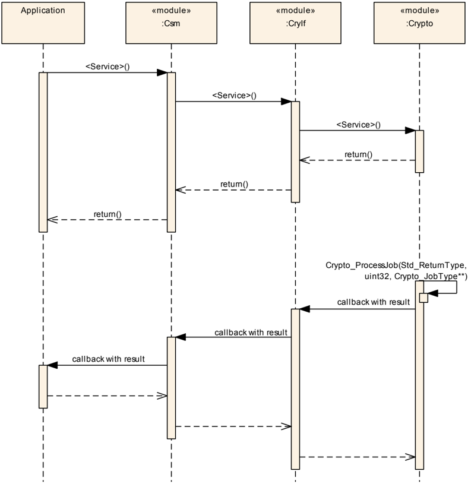

### 8.2. 同步调用

下图（同步调用时序图）展示了在调度器参与下同步执行的请求的函数调用序列示例。

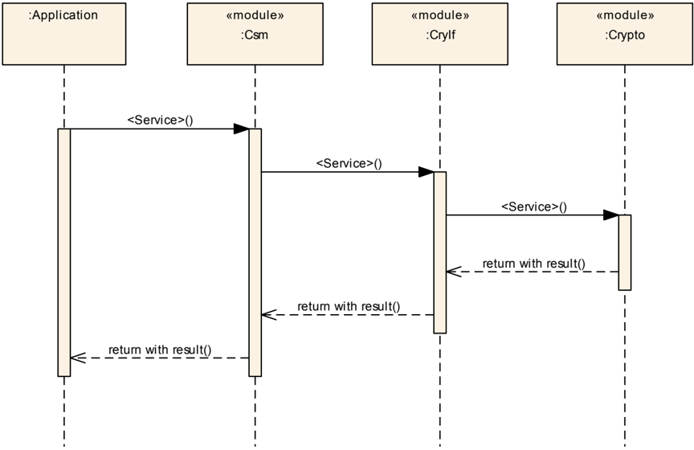

## 9. 配置规范

本章总体上定义了配置参数及其到容器中的聚类。为支持该规范，第 9.1 章描述了基础知识，还规定了参数规范所应使用的模板（表）。

第 9.1 章规定了模块 CSM 的结构（容器）和参数。

第 9.2 章规定了模块 CSM 的发布信息。

### 9.1. 容器和配置参数

有关详细信息，请参阅 **SWS_BSWGeneral** 的第 10.1 章"配置规范介绍"。

以下各节汇总了所有配置参数。各参数的详细含义见第 6 章和第 7 章。

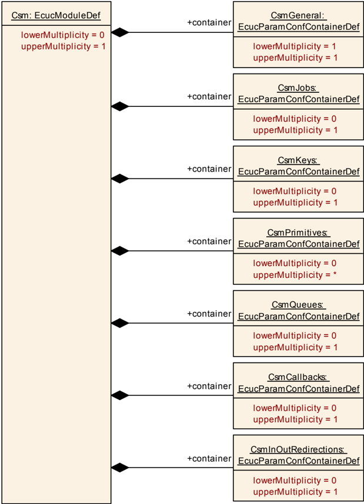

#### 9.1.1. Csm

| SWS 条目 | [ECUC_Csm_00818] |
|---|---|
| 模块名称 | Csm |
| 描述 | Csm（CryptoServiceManager，加密服务管理器）模块的配置。 |
| Post-Build 变体支持 | false |
| 支持的配置变体 | VARIANT-PRE-COMPILE |

| 容器名称 | 多重性 | 作用域/依赖 |
|---|---|---|
| CsmCallbacks | 0..1 | 回调函数配置的容器。 |
| CsmGeneral | 1 | 通用配置选项的容器。 |
| CsmInOutRedirections | 0..1 | CSM 重定向配置的配置。 |
| CsmJobs | 0..1 | CSM 作业配置的容器。 |
| CsmKeys | 0..1 | CSM 密钥配置的容器。 |
| CsmMainFunction | 0..* | 此容器的每个元素定义一个 Csm_MainFunction 实例。对于需实例化 Csm 模块的每个分区，需至少配置一个 MainFunction 实例。 |
| CsmPrimitives | 0..* | CsmPrimitives 配置的容器。 |
| CsmQueues | 0..1 | CSM 队列配置的容器。 |

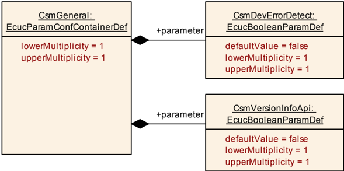

#### 9.1.2. CsmGeneral

| SWS 条目 | [ECUC_Csm_00002] |
|---|---|
| 容器名称 | CsmGeneral |
| 父容器 | Csm |
| 描述 | 通用配置选项的容器。 |
| 多重性配置类 | Pre-compile time：X（All Variants）；Link time：-；Post-build time：- |
| 配置参数 | 见下方参数表 |

| SWS 条目 | [ECUC_Csm_00001] |
|---|---|
| 参数名称 | CsmDevErrorDetect |
| 父容器 | CsmGeneral |
| 描述 | 开启或关闭开发错误检测和通知。true：启用检测和通知。false：禁用检测和通知。 |
| 多重性 | 1 |
| 类型 | EcucBooleanParamDef |
| 默认值 | false |
| Post-Build 变体值 | false |
| 多重性配置类 | Pre-compile time：X（All Variants）；Link time：-；Post-build time：- |
| 值配置类 | Pre-compile time：X（All Variants）；Link time：-；Post-build time：- |
| 作用域/依赖 | scope: local |

| SWS 条目 | [ECUC_Csm_00003] |
|---|---|
| 参数名称 | CsmVersionInfoApi |
| 父容器 | CsmGeneral |
| 描述 | 预处理器开关，用于启用和禁用 API Csm_GetVersionInfo() 的可用性。True：API Csm_GetVersionInfo() 可用。False：API Csm_GetVersionInfo() 不可用。 |
| 多重性 | 1 |
| 类型 | EcucBooleanParamDef |
| 默认值 | false |
| Post-Build 变体值 | false |
| 多重性配置类 | Pre-compile time：X（All Variants）；Link time：-；Post-build time：- |
| 值配置类 | Pre-compile time：X（All Variants）；Link time：-；Post-build time：- |
| 作用域/依赖 | scope: local |

该容器不包含任何子容器。

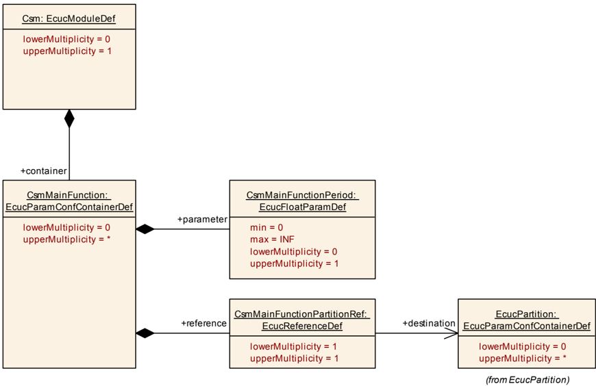

#### 9.1.3. CsmMainFunction

| SWS 条目 | [ECUC_Csm_00279] |
|---|---|
| 容器名称 | CsmMainFunction |
| 父容器 | Csm |
| 描述 | 此容器的每个元素定义一个 Csm_MainFunction 实例。对于需实例化 Csm 模块的每个分区，需至少配置一个 MainFunction 实例。 |
| 配置参数 | 见下方参数表 |

| SWS 条目 | [ECUC_Csm_00113] |
|---|---|
| 参数名称 | CsmMainFunctionPeriod |
| 父容器 | CsmMainFunction |
| 描述 | 以秒为单位指定 main 函数 Csm_MainFunction 的周期。 |
| 多重性 | 0..1 |
| 类型 | EcucFloatParamDef |
| 范围 | ]0 .. INF[ |
| 默认值 | - |
| Post-Build 变体多重性 | false |
| Post-Build 变体值 | false |
| 多重性配置类 | Pre-compile time：X（All Variants）；Link time：-；Post-build time：- |
| 值配置类 | Pre-compile time：X（All Variants）；Link time：-；Post-build time：- |
| 作用域/依赖 | scope: local |

| SWS 条目 | [ECUC_Csm_00280] |
|---|---|
| 参数名称 | CsmMainFunctionPartitionRef |
| 父容器 | CsmMainFunction |
| 描述 | 引用相应的 CsmMainFunction 实例所分配到的 EcucPartition。 |
| 多重性 | 1 |
| 类型 | 对 EcucPartition 的引用 |
| 值配置类 | Pre-compile time：X（All Variants）；Link time：-；Post-build time：- |
| 作用域/依赖 | scope: local |

该容器不包含任何子容器。

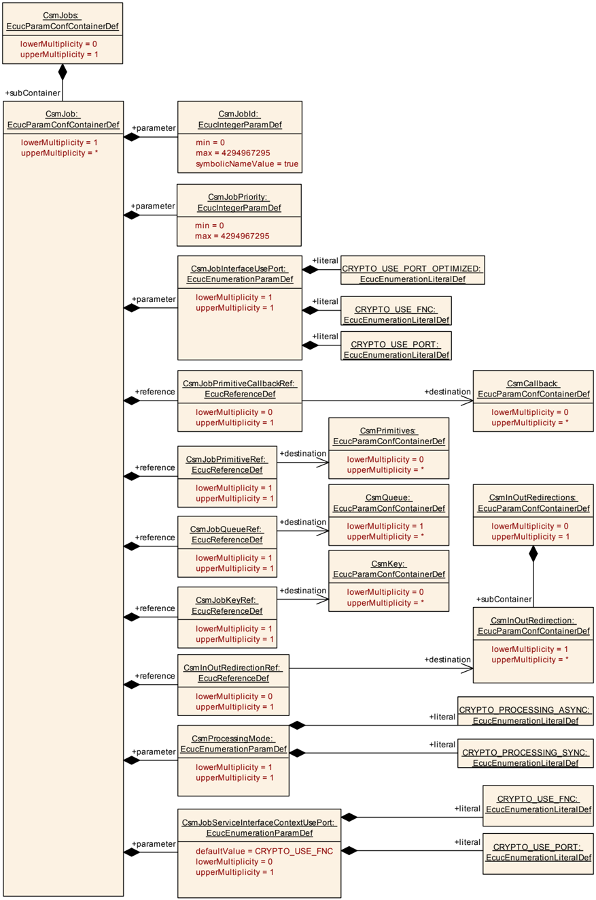

#### 9.1.4. CsmJobs

| SWS 条目 | [ECUC_Csm_00112] |
|---|---|
| 容器名称 | CsmJobs |
| 父容器 | Csm |
| 描述 | CSM 作业配置的容器。 |
| 多重性配置类 | Pre-compile time：X（All Variants）；Link time：-；Post-build time：- |

| 容器名称 | 多重性 | 作用域/依赖 |
|---|---|---|
| CsmJob | 1..* | CSM 作业配置的容器。容器名称用作作业配置标识符的符号名。 |

#### 9.1.5. CsmJob

| SWS 条目 | [ECUC_Csm_00118] |
|---|---|
| 容器名称 | CsmJob |
| 父容器 | CsmJobs |
| 描述 | CSM 作业配置的容器。容器名称用作作业配置标识符的符号名。 |
| 多重性配置类 | Pre-compile time：X（All Variants）；Link time：-；Post-build time：- |
| 配置参数 | 见下方参数表 |

| SWS 条目 | [ECUC_Csm_00119] |
|---|---|
| 参数名称 | CsmJobId |
| 父容器 | CsmJob |
| 描述 | CSM 作业的标识符。实际配置的标识符集合应是连续且无间隙的。 |
| 多重性 | 1 |
| 类型 | EcucIntegerParamDef（为此参数生成符号名） |
| 范围 | 0 .. 4294967295 |
| 默认值 | - |
| Post-Build 变体值 | false |
| 多重性配置类 | Pre-compile time：X（All Variants）；Link time：-；Post-build time：- |
| 值配置类 | Pre-compile time：X（All Variants）；Link time：-；Post-build time：- |
| 作用域/依赖 | scope: local |

| SWS 条目 | [ECUC_Csm_00275] |
|---|---|
| 参数名称 | CsmJobInterfaceUsePort |
| 父容器 | CsmJob |
| 描述 | 该作业是否需要 RTE 接口？ |
| 多重性 | 1 |
| 类型 | EcucEnumerationParamDef |
| 范围 | CRYPTO_USE_FNC：不使用端口；CRYPTO_USE_PORT：使用端口；CRYPTO_USE_PORT_OPTIMIZED：使用 DATA_REFERENCE |
| Post-Build 变体值 | false |
| 值配置类 | Pre-compile time：X（All Variants）；Link time：-；Post-build time：- |
| 作用域/依赖 | scope: local |

| SWS 条目 | [ECUC_Csm_00120] |
|---|---|
| 参数名称 | CsmJobPriority |
| 父容器 | CsmJob |
| 描述 | 作业的优先级。值越高，作业的优先级越高。 |
| 多重性 | 1 |
| 类型 | EcucIntegerParamDef |
| 范围 | 0 .. 4294967295 |
| 默认值 | - |
| Post-Build 变体值 | false |
| 多重性配置类 | Pre-compile time：X（All Variants）；Link time：-；Post-build time：- |
| 值配置类 | Pre-compile time：X（All Variants）；Link time：-；Post-build time：- |
| 作用域/依赖 | scope: local |

| SWS 条目 | [ECUC_Csm_00327] |
|---|---|
| 参数名称 | CsmJobServiceInterfaceContextUsePort |
| 父容器 | CsmJob |
| 描述 | 该作业是否需要用于上下文操作的 RTE 接口。 |
| 多重性 | 0..1 |
| 类型 | EcucEnumerationParamDef |
| 范围 | CRYPTO_USE_FUNC：不使用端口；CRYPTO_USE_PORT：此操作使用端口 |
| 默认值 | CRYPTO_USE_FUNC |
| 多重性配置类 | Pre-compile time：X（All Variants）；Link time：-；Post-build time：- |
| 值配置类 | Pre-compile time：X（All Variants）；Link time：-；Post-build time：- |
| 作用域/依赖 | scope: local |

| SWS 条目 | [ECUC_Csm_00276] |
|---|---|
| 参数名称 | CsmProcessingMode |
| 父容器 | CsmJob |
| 描述 | 决定该作业应如何使用接口。同步处理返回时带有结果，而异步处理返回时不处理作业。调用者将通过相应的回调得到通知。 |
| 多重性 | 1 |
| 类型 | EcucEnumerationParamDef |
| 范围 | CRYPTO_PROCESSING_ASYNC：--；CRYPTO_PROCESSING_SYNC：-- |
| Post-Build 变体值 | false |
| 值配置类 | Pre-compile time：X（All Variants）；Link time：-；Post-build time：- |
| 作用域/依赖 | scope: local |

| SWS 条目 | [ECUC_Csm_00263] |
|---|---|
| 参数名称 | CsmInOutRedirectionRef |
| 父容器 | CsmJob |
| 描述 | 此参数引用所使用的重定向。 |
| 多重性 | 0..1 |
| 类型 | 对 CsmInOutRedirection 的引用 |
| Post-Build 变体多重性 | false |
| Post-Build 变体值 | false |
| 多重性配置类 | Pre-compile time：X（All Variants）；Link time：-；Post-build time：- |
| 值配置类 | Pre-compile time：X（All Variants）；Link time：-；Post-build time：- |
| 作用域/依赖 | scope: local |

| SWS 条目 | [ECUC_Csm_00126] |
|---|---|
| 参数名称 | CsmJobKeyRef |
| 父容器 | CsmJob |
| 描述 | 此参数引用 CsmPrimitive 应使用的密钥。不同的作业可以使用同一个 CsmKey。 |
| 多重性 | 1 |
| 类型 | 对 CsmKey 的引用 |
| Post-Build 变体值 | false |
| 多重性配置类 | Pre-compile time：X（All Variants）；Link time：-；Post-build time：- |
| 值配置类 | Pre-compile time：X（All Variants）；Link time：-；Post-build time：- |
| 作用域/依赖 | scope: local；dependency: 如果 CsmPrimitive 不需要密钥（例如进行哈希计算），则应引用一个虚拟密钥。 |

| SWS 条目 | [ECUC_Csm_00123] |
|---|---|
| 参数名称 | CsmJobPrimitiveCallbackRef |
| 父容器 | CsmJob |
| 描述 | 此参数引用所使用的 CsmCallback。当加密作业完成时，会调用所引用的 CsmCallback。 |
| 多重性 | 0..1 |
| 类型 | 对 CsmCallback 的引用 |
| Post-Build 变体值 | false |
| 多重性配置类 | Pre-compile time：X（All Variants）；Link time：-；Post-build time：- |
| 值配置类 | Pre-compile time：X（All Variants）；Link time：-；Post-build time：- |
| 作用域/依赖 | scope: local |

| SWS 条目 | [ECUC_Csm_00122] |
|---|---|
| 参数名称 | CsmJobPrimitiveRef |
| 父容器 | CsmJob |
| 描述 | 此参数引用所使用的 CsmPrimitive。不同的作业可以引用同一个 CsmPrimitive。所引用的 CsmPrimitive 提供实际加密例程的详细信息。 |
| 多重性 | 1 |
| 类型 | 对 CsmPrimitives 的引用 |
| Post-Build 变体值 | false |
| 多重性配置类 | Pre-compile time：X（All Variants）；Link time：-；Post-build time：- |
| 值配置类 | Pre-compile time：X（All Variants）；Link time：-；Post-build time：- |
| 作用域/依赖 | scope: local |

| SWS 条目 | [ECUC_Csm_00125] |
|---|---|
| 参数名称 | CsmJobQueueRef |
| 父容器 | CsmJob |
| 描述 | 此参数引用队列。当底层加密驱动程序对象忙时使用该队列。该队列还引用所使用的通道。 |
| 多重性 | 1 |
| 类型 | 对 CsmQueue 的引用 |
| Post-Build 变体值 | false |
| 多重性配置类 | Pre-compile time：X（All Variants）；Link time：-；Post-build time：- |
| 值配置类 | Pre-compile time：X（All Variants）；Link time：-；Post-build time：- |
| 作用域/依赖 | scope: local |

该容器不包含任何子容器。

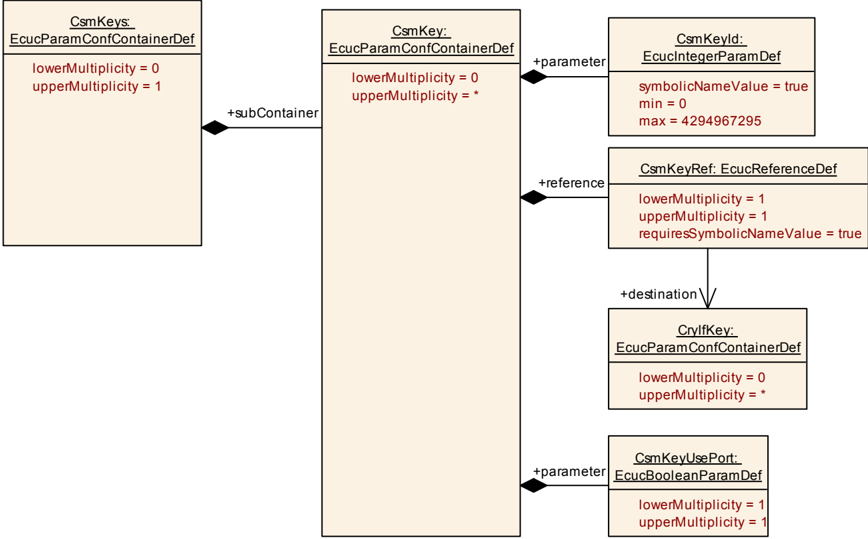

#### 9.1.6. CsmKeys

| SWS 条目 | [ECUC_Csm_00005] |
|---|---|
| 容器名称 | CsmKeys |
| 父容器 | Csm |
| 描述 | CSM 密钥配置的容器。 |

| 容器名称 | 多重性 | 作用域/依赖 |
|---|---|---|
| CsmKey | 0..* | CSM 密钥配置的容器。容器名称用作密钥配置标识符的符号名。 |

#### 9.1.7. CsmKey

| SWS 条目 | [ECUC_Csm_00014] |
|---|---|
| 容器名称 | CsmKey |
| 父容器 | CsmKeys |
| 描述 | CSM 密钥配置的容器。容器名称用作密钥配置标识符的符号名。 |
| 配置参数 | 见下方参数表 |

| SWS 条目 | [ECUC_Csm_00015] |
|---|---|
| 参数名称 | CsmKeyId |
| 父容器 | CsmKey |
| 描述 | CsmKey 的标识符。实际配置的标识符集合应是连续且无间隙的。 |
| 多重性 | 1 |
| 类型 | EcucIntegerParamDef（为此参数生成符号名） |
| 范围 | 0 .. 4294967295 |
| 默认值 | - |
| Post-Build 变体值 | false |
| 多重性配置类 | Pre-compile time：X（All Variants）；Link time：-；Post-build time：- |
| 值配置类 | Pre-compile time：X（All Variants）；Link time：-；Post-build time：- |
| 作用域/依赖 | scope: local |

| SWS 条目 | [ECUC_Csm_00127] |
|---|---|
| 参数名称 | CsmKeyUsePort |
| 父容器 | CsmKey |
| 描述 | 该密钥是否需要 RTE 接口？True：此密钥使用 RTE 接口。False：此密钥不使用 RTE 接口。 |
| 多重性 | 1 |
| 类型 | EcucBooleanParamDef |
| 默认值 | - |
| Post-Build 变体值 | false |
| 多重性配置类 | Pre-compile time：X（All Variants）；Link time：-；Post-build time：- |
| 值配置类 | Pre-compile time：X（All Variants）；Link time：-；Post-build time：- |
| 作用域/依赖 | scope: local |

| SWS 条目 | [ECUC_Csm_00016] |
|---|---|
| 参数名称 | CsmKeyRef |
| 父容器 | CsmKey |
| 描述 | 此参数引用所使用的 CryIfKey。底层 CryIfKey 引用加密驱动程序中的特定 CryptoKey。 |
| 多重性 | 1 |
| 类型 | 对 CryIfKey 的符号名引用 |
| Post-Build 变体值 | false |
| 多重性配置类 | Pre-compile time：X（All Variants）；Link time：-；Post-build time：- |
| 值配置类 | Pre-compile time：X（All Variants）；Link time：-；Post-build time：- |
| 作用域/依赖 | scope: local |

该容器不包含任何子容器。

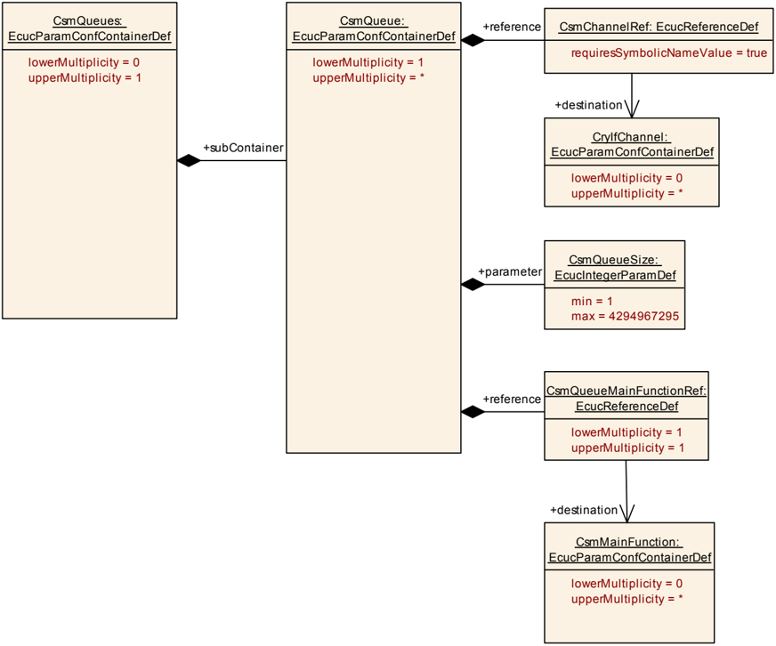

#### 9.1.8. CsmQueues

| SWS 条目 | [ECUC_Csm_00007] |
|---|---|
| 容器名称 | CsmQueues |
| 父容器 | Csm |
| 描述 | CSM 队列配置的容器。 |

| 容器名称 | 多重性 | 作用域/依赖 |
|---|---|---|
| CsmQueue | 1..* | CSM 队列配置的容器。队列有两个任务：1. 将由于底层硬件忙而无法处理的作业进行排队；2. 引用应使用的通道。 |

#### 9.1.9. CsmQueue

| SWS 条目 | [ECUC_Csm_00032] |
|---|---|
| 容器名称 | CsmQueue |
| 父容器 | CsmQueues |
| 描述 | CSM 队列配置的容器。队列有两个任务：1. 将由于底层硬件忙而无法处理的作业进行排队；2. 引用应使用的通道。 |
| 配置参数 | 见下方参数表 |

| SWS 条目 | [ECUC_Csm_00034] |
|---|---|
| 参数名称 | CsmQueueSize |
| 父容器 | CsmQueue |
| 描述 | CsmQueue 的大小。当作业因底层硬件忙而无法被处理时，作业将停留在已排定优先级的队列中。如果队列已满，下一个作业将被拒绝。 |
| 多重性 | 1 |
| 类型 | EcucIntegerParamDef |
| 范围 | 1 .. 4294967295 |
| 默认值 | - |
| Post-Build 变体值 | false |
| 多重性配置类 | Pre-compile time：X（All Variants）；Link time：-；Post-build time：- |
| 值配置类 | Pre-compile time：X（All Variants）；Link time：-；Post-build time：- |
| 作用域/依赖 | scope: local |

| SWS 条目 | [ECUC_Csm_00033] |
|---|---|
| 参数名称 | CsmChannelRef |
| 父容器 | CsmQueue |
| 描述 | 引用底层的加密接口通道。 |
| 多重性 | 1 |
| 类型 | 对 CryIfChannel 的符号名引用 |
| Post-Build 变体值 | false |
| 多重性配置类 | Pre-compile time：X（All Variants）；Link time：-；Post-build time：- |
| 值配置类 | Pre-compile time：X（All Variants）；Link time：-；Post-build time：- |
| 作用域/依赖 | scope: local |

| SWS 条目 | [ECUC_Csm_00281] |
|---|---|
| 参数名称 | CsmQueueMainFunctionRef |
| 父容器 | CsmQueue |
| 描述 | 引用相应的 CsmQueue 所分配到的 CsmMainFunction。 |
| 多重性 | 1 |
| 类型 | 对 CsmMainFunction 的引用 |
| 值配置类 | Pre-compile time：X（All Variants）；Link time：-；Post-build time：- |
| 作用域/依赖 | scope: local |

该容器不包含任何子容器。

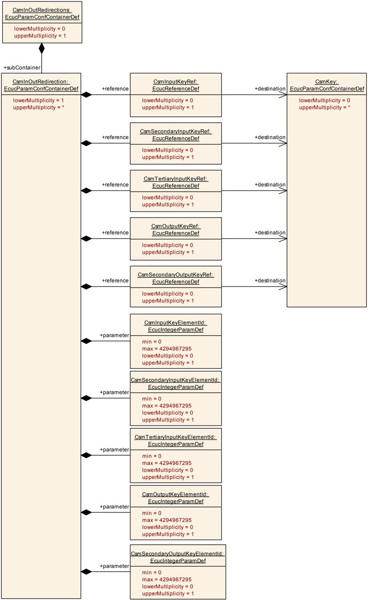

#### 9.1.10. CsmInOutRedirections

| SWS 条目 | [ECUC_Csm_00262] |
|---|---|
| 容器名称 | CsmInOutRedirections |
| 父容器 | Csm |
| 描述 | CSM 重定向配置的配置。 |

| 容器名称 | 多重性 | 作用域/依赖 |
|---|---|---|
| CsmInOutRedirection | 1..* | CSM 重定向配置的容器。重定向使 CSM 作业可以将特定的密钥元素用作输入和/或输出。 |

#### 9.1.11. CsmInOutRedirection

| SWS 条目 | [ECUC_Csm_00264] |
|---|---|
| 容器名称 | CsmInOutRedirection |
| 父容器 | CsmInOutRedirections |
| 描述 | CSM 重定向配置的容器。重定向使 CSM 作业可以将特定的密钥元素用作输入和/或输出。 |
| 配置参数 | 见下方参数表 |

| SWS 条目 | [ECUC_Csm_00266] |
|---|---|
| 参数名称 | CsmInputKeyElementId |
| 父容器 | CsmInOutRedirection |
| 描述 | 用作输入的密钥元素的标识符 |
| 多重性 | 0..1 |
| 类型 | EcucIntegerParamDef |
| 范围 | 0 .. 4294967295 |
| 默认值 | - |
| Post-Build 变体多重性 | false |
| Post-Build 变体值 | false |
| 多重性配置类 | Pre-compile time：X（All Variants）；Link time：-；Post-build time：- |
| 值配置类 | Pre-compile time：X（All Variants）；Link time：-；Post-build time：- |
| 作用域/依赖 | scope: local |

| SWS 条目 | [ECUC_Csm_00272] |
|---|---|
| 参数名称 | CsmOutputKeyElementId |
| 父容器 | CsmInOutRedirection |
| 描述 | 用作输出的密钥元素的标识符。 |
| 多重性 | 0..1 |
| 类型 | EcucIntegerParamDef |
| 范围 | 0 .. 4294967295 |
| 默认值 | - |
| Post-Build 变体多重性 | false |
| Post-Build 变体值 | false |
| 多重性配置类 | Pre-compile time：X（All Variants）；Link time：-；Post-build time：- |
| 值配置类 | Pre-compile time：X（All Variants）；Link time：-；Post-build time：- |
| 作用域/依赖 | scope: local |

| SWS 条目 | [ECUC_Csm_00269] |
|---|---|
| 参数名称 | CsmSecondaryInputKeyElementId |
| 父容器 | CsmInOutRedirection |
| 描述 | 用作辅助输入的密钥元素的标识符。 |
| 多重性 | 0..1 |
| 类型 | EcucIntegerParamDef |
| 范围 | 0 .. 4294967295 |
| 默认值 | - |
| Post-Build 变体多重性 | false |
| Post-Build 变体值 | false |
| 多重性配置类 | Pre-compile time：X（All Variants）；Link time：-；Post-build time：- |
| 值配置类 | Pre-compile time：X（All Variants）；Link time：-；Post-build time：- |
| 作用域/依赖 | scope: local |

| SWS 条目 | [ECUC_Csm_00274] |
|---|---|
| 参数名称 | CsmSecondaryOutputKeyElementId |
| 父容器 | CsmInOutRedirection |
| 描述 | 用作辅助输出的密钥元素的标识符。 |
| 多重性 | 0..1 |
| 类型 | EcucIntegerParamDef |
| 范围 | 0 .. 4294967295 |
| 默认值 | - |
| Post-Build 变体多重性 | false |
| Post-Build 变体值 | false |
| 多重性配置类 | Pre-compile time：X（All Variants）；Link time：-；Post-build time：- |
| 值配置类 | Pre-compile time：X（All Variants）；Link time：-；Post-build time：- |
| 作用域/依赖 | scope: local |

| SWS 条目 | [ECUC_Csm_00270] |
|---|---|
| 参数名称 | CsmTertiaryInputKeyElementId |
| 父容器 | CsmInOutRedirection |
| 描述 | 用作第三输入的密钥元素的标识符。 |
| 多重性 | 0..1 |
| 类型 | EcucIntegerParamDef |
| 范围 | 0 .. 4294967295 |
| 默认值 | - |
| Post-Build 变体多重性 | false |
| Post-Build 变体值 | false |
| 多重性配置类 | Pre-compile time：X（All Variants）；Link time：-；Post-build time：- |
| 值配置类 | Pre-compile time：X（All Variants）；Link time：-；Post-build time：- |
| 作用域/依赖 | scope: local |

| SWS 条目 | [ECUC_Csm_00265] |
|---|---|
| 参数名称 | CsmInputKeyRef |
| 父容器 | CsmInOutRedirection |
| 描述 | 此参数引用用作输入的密钥。 |
| 多重性 | 0..1 |
| 类型 | 对 CsmKey 的引用 |
| Post-Build 变体多重性 | false |
| Post-Build 变体值 | false |
| 多重性配置类 | Pre-compile time：X（All Variants）；Link time：-；Post-build time：- |
| 值配置类 | Pre-compile time：X（All Variants）；Link time：-；Post-build time：- |
| 作用域/依赖 | scope: local |

| SWS 条目 | [ECUC_Csm_00271] |
|---|---|
| 参数名称 | CsmOutputKeyRef |
| 父容器 | CsmInOutRedirection |
| 描述 | 此参数引用用作输出的密钥。 |
| 多重性 | 0..1 |
| 类型 | 对 CsmKey 的引用 |
| Post-Build 变体多重性 | false |
| Post-Build 变体值 | false |
| 多重性配置类 | Pre-compile time：X（All Variants）；Link time：-；Post-build time：- |
| 值配置类 | Pre-compile time：X（All Variants）；Link time：-；Post-build time：- |
| 作用域/依赖 | scope: local |

| SWS 条目 | [ECUC_Csm_00267] |
|---|---|
| 参数名称 | CsmSecondaryInputKeyRef |
| 父容器 | CsmInOutRedirection |
| 描述 | 此参数引用用作辅助输入的密钥。 |
| 多重性 | 0..1 |
| 类型 | 对 CsmKey 的引用 |
| Post-Build 变体多重性 | false |
| Post-Build 变体值 | false |
| 多重性配置类 | Pre-compile time：X（All Variants）；Link time：-；Post-build time：- |
| 值配置类 | Pre-compile time：X（All Variants）；Link time：-；Post-build time：- |
| 作用域/依赖 | scope: local |

| SWS 条目 | [ECUC_Csm_00273] |
|---|---|
| 参数名称 | CsmSecondaryOutputKeyRef |
| 父容器 | CsmInOutRedirection |
| 描述 | 此参数引用用作辅助输出的密钥。 |
| 多重性 | 0..1 |
| 类型 | 对 CsmKey 的引用 |
| Post-Build 变体多重性 | false |
| Post-Build 变体值 | false |
| 多重性配置类 | Pre-compile time：X（All Variants）；Link time：-；Post-build time：- |
| 值配置类 | Pre-compile time：X（All Variants）；Link time：-；Post-build time：- |
| 作用域/依赖 | scope: local |

| SWS 条目 | [ECUC_Csm_00268] |
|---|---|
| 参数名称 | CsmTertiaryInputKeyRef |
| 父容器 | CsmInOutRedirection |
| 描述 | 此参数引用用作第三输入的密钥。 |
| 多重性 | 0..1 |
| 类型 | 对 CsmKey 的引用 |
| Post-Build 变体多重性 | false |
| Post-Build 变体值 | false |
| 多重性配置类 | Pre-compile time：X（All Variants）；Link time：-；Post-build time：- |
| 值配置类 | Pre-compile time：X（All Variants）；Link time：-；Post-build time：- |
| 作用域/依赖 | scope: local |

该容器不包含任何子容器。

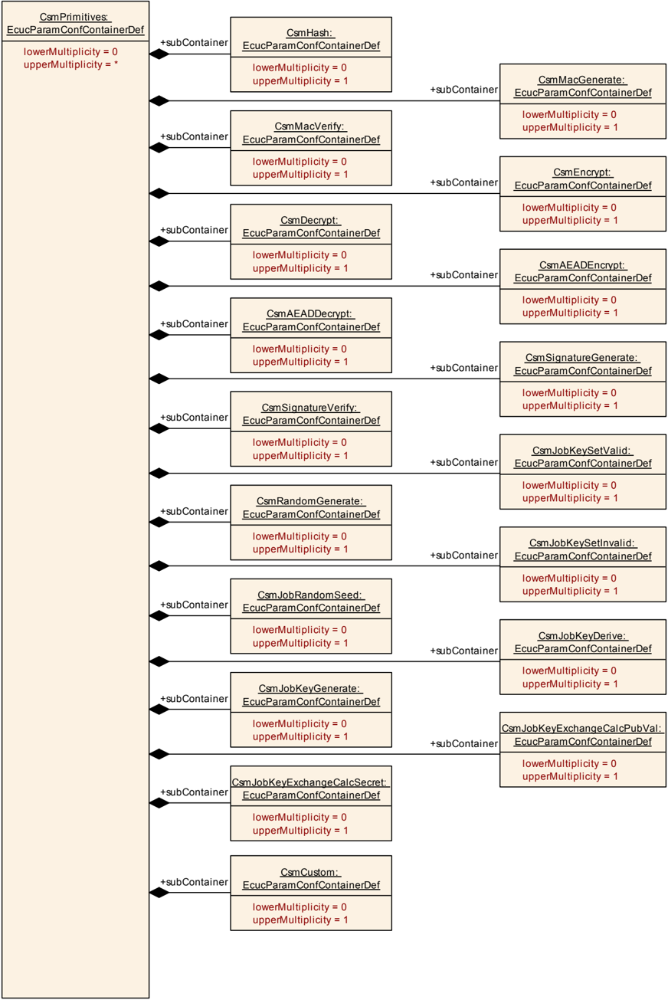

#### 9.1.12. CsmPrimitives

| SWS 条目 | [ECUC_Csm_00006] |
|---|---|
| 容器名称 | CsmPrimitives |
| 父容器 | Csm |
| 描述 | CsmPrimitives 配置的容器。 |

| 容器名称 | 多重性 | 作用域/依赖 |
|---|---|---|
| CsmAEADDecrypt | 0..1 | AEAD 解密原语的配置 |
| CsmAEADEncrypt | 0..1 | AEAD 加密原语的配置 |
| CsmCustom | 0..1 | CSM 自定义加密原语配置的容器。 |
| CsmDecrypt | 0..1 | 解密原语的配置 |
| CsmEncrypt | 0..1 | 加密原语的配置 |
| CsmHash | 0..1 | 哈希配置的容器 |
| CsmJobKeyDerive | 0..1 | KeyDerive 原语的配置 |
| CsmJobKeyExchangeCalcPubVal | 0..1 | KeyExchangeCalcPubVal 原语的配置 |
| CsmJobKeyExchangeCalcSecret | 0..1 | KeyExchangeCalcSecret 原语的配置 |
| CsmJobKeyGenerate | 0..1 | KeyGenerate 原语的配置 |
| CsmJobKeySetInvalid | 0..1 | KeySetInvalid 原语的配置 |
| CsmJobKeySetValid | 0..1 | KeySetValid 原语的配置 |
| CsmJobRandomSeed | 0..1 | RandomSeed 原语的配置 |
| CsmMacGenerate | 0..1 | MacGenerate 原语的配置 |
| CsmMacVerify | 0..1 | MacVerify 原语的配置 |
| CsmRandomGenerate | 0..1 | RandomGenerate 原语的配置 |
| CsmSignatureGenerate | 0..1 | SignatureGenerate 原语的配置 |
| CsmSignatureVerify | 0..1 | SignatureVerify 原语的配置 |

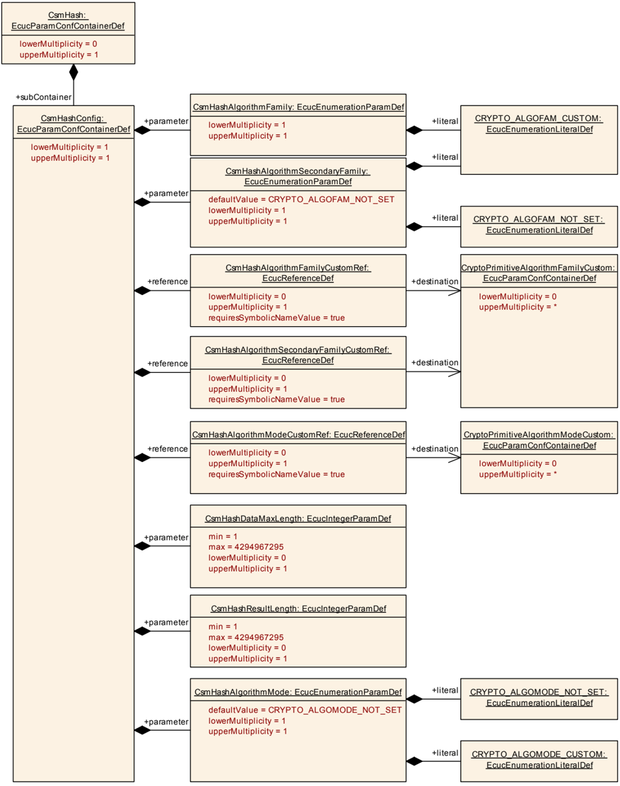

#### 9.1.13. CsmHash

| SWS 条目 | [ECUC_Csm_00021] |
|---|---|
| 容器名称 | CsmHash |
| 父容器 | CsmPrimitives |
| 描述 | 哈希配置的容器。 |

| 容器名称 | 多重性 | 作用域/依赖 |
|---|---|---|
| CsmHashConfig | 1 | CSM 哈希配置的容器。容器名称用作密钥配置标识符的符号名。 |

#### 9.1.14. CsmHashConfig

| SWS 条目 | [ECUC_Csm_00036] |
|---|---|
| 容器名称 | CsmHashConfig |
| 父容器 | CsmHash |
| 描述 | CSM 哈希配置的容器。容器名称用作密钥配置标识符的符号名。 |
| 配置参数 | 见下方参数表 |

| SWS 条目 | [ECUC_Csm_00038] |
|---|---|
| 参数名称 | CsmHashAlgorithmFamily |
| 父容器 | CsmHashConfig |
| 描述 | 确定加密服务所使用的算法族。此参数定义算法的最主要部分。 |
| 多重性 | 1 |
| 类型 | EcucEnumerationParamDef |
| 范围 | CRYPTO_ALGOFAM_BLAKE_1_256：--；CRYPTO_ALGOFAM_BLAKE_1_512：--；CRYPTO_ALGOFAM_BLAKE_2s_256：--；CRYPTO_ALGOFAM_BLAKE_2s_512：--；CRYPTO_ALGOFAM_CUSTOM：--；CRYPTO_ALGOFAM_RIPEMD160：--；CRYPTO_ALGOFAM_SHA1：--；CRYPTO_ALGOFAM_SHA2_224：--；CRYPTO_ALGOFAM_SHA2_256：--；CRYPTO_ALGOFAM_SHA2_384：--；CRYPTO_ALGOFAM_SHA2_512：--；CRYPTO_ALGOFAM_SHA2_512_224：--；CRYPTO_ALGOFAM_SHA2_512_256：--；CRYPTO_ALGOFAM_SHA3_224：--；CRYPTO_ALGOFAM_SHA3_256：--；CRYPTO_ALGOFAM_SHA3_384：--；CRYPTO_ALGOFAM_SHA3_512：--；CRYPTO_ALGOFAM_SHAKE128：--；CRYPTO_ALGOFAM_SHAKE256：--；CRYPTO_ALGOFAM_SM3：-- |
| Post-Build 变体值 | false |
| 多重性配置类 | Pre-compile time：X（All Variants）；Link time：-；Post-build time：- |
| 值配置类 | Pre-compile time：X（All Variants）；Link time：-；Post-build time：- |
| 作用域/依赖 | scope: local |

| SWS 条目 | [ECUC_Csm_00131] |
|---|---|
| 参数名称 | CsmHashAlgorithmMode |
| 父容器 | CsmHashConfig |
| 描述 | 确定加密服务所使用的算法模式 |
| 多重性 | 1 |
| 类型 | EcucEnumerationParamDef |
| 范围 | CRYPTO_ALGOMODE_CUSTOM：--；CRYPTO_ALGOMODE_NOT_SET：-- |
| 默认值 | CRYPTO_ALGOMODE_NOT_SET |
| Post-Build 变体值 | false |
| 多重性配置类 | Pre-compile time：X（All Variants）；Link time：-；Post-build time：- |
| 值配置类 | Pre-compile time：X（All Variants）；Link time：-；Post-build time：- |
| 作用域/依赖 | scope: local |

| SWS 条目 | [ECUC_Csm_00181] |
|---|---|
| 参数名称 | CsmHashAlgorithmSecondaryFamily |
| 父容器 | CsmHashConfig |
| 描述 | 确定加密服务所使用的算法族 |
| 多重性 | 1 |
| 类型 | EcucEnumerationParamDef |
| 范围 | CRYPTO_ALGOFAM_CUSTOM：--；CRYPTO_ALGOFAM_NOT_SET：-- |
| 默认值 | CRYPTO_ALGOFAM_NOT_SET |
| Post-Build 变体值 | false |
| 多重性配置类 | Pre-compile time：X（All Variants）；Link time：-；Post-build time：- |
| 值配置类 | Pre-compile time：X（All Variants）；Link time：-；Post-build time：- |
| 作用域/依赖 | scope: local |

| SWS 条目 | [ECUC_Csm_00040] |
|---|---|
| 参数名称 | CsmHashDataMaxLength |
| 父容器 | CsmHashConfig |
| 描述 | 若此原语被 Csm 作业引用，则为同步 RTE 服务接口的输入数据缓冲区的大小。其他 BSW 模块也可能使用该长度参数进行缓冲区大小计算。 |
| 多重性 | 0..1 |
| 类型 | EcucIntegerParamDef |
| 范围 | 1 .. 4294967295 |
| 默认值 | - |
| Post-Build 变体值 | false |
| 多重性配置类 | Pre-compile time：X（All Variants）；Link time：-；Post-build time：- |
| 值配置类 | Pre-compile time：X（All Variants）；Link time：-；Post-build time：- |
| 作用域/依赖 | scope: local；dependency: 仅当 CsmJobInterfaceUsePort 配置为 CRYPTO_USE_PORT 时，此参数才相关。 |

| SWS 条目 | [ECUC_Csm_00130] |
|---|---|
| 参数名称 | CsmHashResultLength |
| 父容器 | CsmHashConfig |
| 描述 | 若此原语被 Csm 作业引用，则为同步 RTE 服务接口的结果数据缓冲区的大小。其他 BSW 模块也可能使用该长度参数进行缓冲区大小计算。 |
| 多重性 | 0..1 |
| 类型 | EcucIntegerParamDef |
| 范围 | 1 .. 4294967295 |
| 默认值 | - |
| Post-Build 变体值 | false |
| 多重性配置类 | Pre-compile time：X（All Variants）；Link time：-；Post-build time：- |
| 值配置类 | Pre-compile time：X（All Variants）；Link time：-；Post-build time：- |
| 作用域/依赖 | scope: local；dependency: 仅当 CsmJobInterfaceUsePort 配置为 CRYPTO_USE_PORT 时，此参数才相关。 |

| SWS 条目 | [ECUC_Csm_00282] |
|---|---|
| 参数名称 | CsmHashAlgorithmFamilyCustomRef |
| 父容器 | CsmHashConfig |
| 描述 | 对客户特定的算法族自定义容器的引用 |
| 多重性 | 0..1 |
| 类型 | 对 CryptoPrimitiveAlgorithmFamilyCustom 的符号名引用 |
| 多重性配置类 | Pre-compile time：X（All Variants）；Link time：-；Post-build time：- |
| 值配置类 | Pre-compile time：X（All Variants）；Link time：-；Post-build time：- |
| 作用域/依赖 | scope: local；dependency: 仅当 CsmHashAlgorithmFamily 设置为 CRYPTO_ALGOFAM_CUSTOM 时，才应存在此参数。 |

| SWS 条目 | [ECUC_Csm_00284] |
|---|---|
| 参数名称 | CsmHashAlgorithmModeCustomRef |
| 父容器 | CsmHashConfig |
| 描述 | 对客户特定的算法模式自定义容器的引用 |
| 多重性 | 0..1 |
| 类型 | 对 CryptoPrimitiveAlgorithmModeCustom 的符号名引用 |
| 多重性配置类 | Pre-compile time：X（All Variants）；Link time：-；Post-build time：- |
| 值配置类 | Pre-compile time：X（All Variants）；Link time：-；Post-build time：- |
| 作用域/依赖 | scope: local；dependency: 仅当 CsmHashAlgorithmMode 设置为 CRYPTO_ALGOMODE_CUSTOM 时，才应存在此引用。 |

| SWS 条目 | [ECUC_Csm_00283] |
|---|---|
| 参数名称 | CsmHashAlgorithmSecondaryFamilyCustomRef |
| 父容器 | CsmHashConfig |
| 描述 | 对加密驱动程序中客户特定的算法族容器的引用 |
| 多重性 | 0..1 |
| 类型 | 对 CryptoPrimitiveAlgorithmFamilyCustom 的符号名引用 |
| 多重性配置类 | Pre-compile time：X（All Variants）；Link time：-；Post-build time：- |
| 值配置类 | Pre-compile time：X（All Variants）；Link time：-；Post-build time：- |
| 作用域/依赖 | scope: local；dependency: 仅当 CsmHashSecondaryAlgorithmFamily 设置为 CRYPTO_ALGOFAM_CUSTOM 时，才应存在此引用。 |

该容器不包含任何子容器。

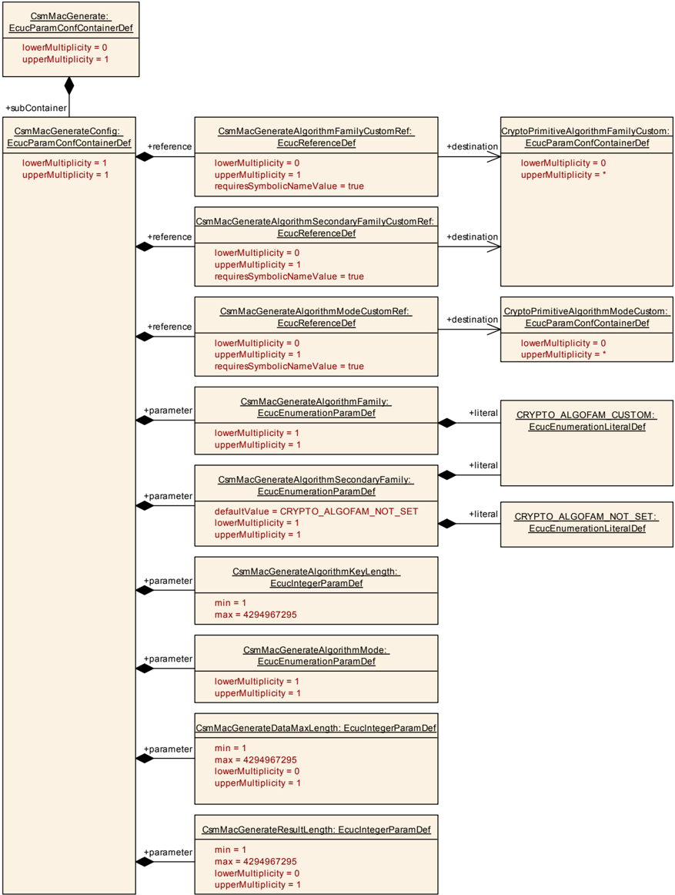

#### 9.1.15. CsmMacGenerate

| SWS 条目 | [ECUC_Csm_00022] |
|---|---|
| 容器名称 | CsmMacGenerate |
| 父容器 | CsmPrimitives |
| 描述 | MacGenerate 原语的配置。 |

| 容器名称 | 多重性 | 作用域/依赖 |
|---|---|---|
| CsmMacGenerateConfig | 1 | CSM MAC 生成接口配置的容器。容器名称用作 MAC 生成接口标识符的符号名。 |

#### 9.1.16. CsmMacGenerateConfig

| SWS 条目 | [ECUC_Csm_00041] |
|---|---|
| 容器名称 | CsmMacGenerateConfig |
| 父容器 | CsmMacGenerate |
| 描述 | CSM MAC 生成接口配置的容器。容器名称用作 MAC 生成接口标识符的符号名。 |
| 配置参数 | 见下方参数表 |

| SWS 条目 | [ECUC_Csm_00188] |
|---|---|
| 参数名称 | CsmMacGenerateAlgorithmFamily |
| 父容器 | CsmMacGenerateConfig |
| 描述 | 确定加密服务所使用的算法族。此参数定义算法的最主要部分。 |
| 多重性 | 1 |
| 类型 | EcucEnumerationParamDef |
| 范围 | CRYPTO_ALGOFAM_3DES：--；CRYPTO_ALGOFAM_AES：--；CRYPTO_ALGOFAM_BLAKE_1_256：--；CRYPTO_ALGOFAM_BLAKE_1_512：--；CRYPTO_ALGOFAM_BLAKE_2s_256：--；CRYPTO_ALGOFAM_BLAKE_2s_512：--；CRYPTO_ALGOFAM_CHACHA：--；CRYPTO_ALGOFAM_CUSTOM：--；CRYPTO_ALGOFAM_EEA3：--；CRYPTO_ALGOFAM_EIA3：--；CRYPTO_ALGOFAM_POLY1305：--；CRYPTO_ALGOFAM_RIPEMD160：--；CRYPTO_ALGOFAM_RNG：--；CRYPTO_ALGOFAM_SHA1：--；CRYPTO_ALGOFAM_SHA2_224：--；CRYPTO_ALGOFAM_SHA2_256：--；CRYPTO_ALGOFAM_SHA2_384：--；CRYPTO_ALGOFAM_SHA2_512：--；CRYPTO_ALGOFAM_SHA2_512_224：--；CRYPTO_ALGOFAM_SHA2_512_256：--；CRYPTO_ALGOFAM_SHA3_224：--；CRYPTO_ALGOFAM_SHA3_256：--；CRYPTO_ALGOFAM_SHA3_384：--；CRYPTO_ALGOFAM_SHA3_512：--；CRYPTO_ALGOFAM_SHAKE128：--；CRYPTO_ALGOFAM_SHAKE256：--；CRYPTO_ALGOFAM_SIPHASH：--；CRYPTO_ALGOFAM_SM3：-- |
| Post-Build 变体值 | false |
| 多重性配置类 | Pre-compile time：X（All Variants）；Link time：-；Post-build time：- |
| 值配置类 | Pre-compile time：X（All Variants）；Link time：-；Post-build time：- |
| 作用域/依赖 | scope: local |

| SWS 条目 | [ECUC_Csm_00044] |
|---|---|
| 参数名称 | CsmMacGenerateAlgorithmKeyLength |
| 父容器 | CsmMacGenerateConfig |
| 描述 | MAC 密钥的大小（单位为字节） |
| 多重性 | 1 |
| 类型 | EcucIntegerParamDef |
| 范围 | 1 .. 4294967295 |
| 默认值 | - |
| Post-Build 变体值 | false |
| 多重性配置类 | Pre-compile time：X（All Variants）；Link time：-；Post-build time：- |
| 值配置类 | Pre-compile time：X（All Variants）；Link time：-；Post-build time：- |
| 作用域/依赖 | scope: local |

| SWS 条目 | [ECUC_Csm_00189] |
|---|---|
| 参数名称 | CsmMacGenerateAlgorithmMode |
| 父容器 | CsmMacGenerateConfig |
| 描述 | 确定加密服务所使用的算法模式 |
| 多重性 | 1 |
| 类型 | EcucEnumerationParamDef |
| 范围 | CRYPTO_ALGOMODE_CMAC：--；CRYPTO_ALGOMODE_CTRDRBG：--；CRYPTO_ALGOMODE_CUSTOM：--；CRYPTO_ALGOMODE_GMAC：--；CRYPTO_ALGOMODE_HMAC：--；CRYPTO_ALGOMODE_NOT_SET：--；CRYPTO_ALGOMODE_SIPHASH_2_4：--；CRYPTO_ALGOMODE_SIPHASH_4_8：-- |
| Post-Build 变体值 | false |
| 多重性配置类 | Pre-compile time：X（All Variants）；Link time：-；Post-build time：- |
| 值配置类 | Pre-compile time：X（All Variants）；Link time：-；Post-build time：- |
| 作用域/依赖 | scope: local |

| SWS 条目 | [ECUC_Csm_00134] |
|---|---|
| 参数名称 | CsmMacGenerateAlgorithmSecondaryFamily |
| 父容器 | CsmMacGenerateConfig |
| 描述 | 确定加密服务所使用的辅助算法族 |
| 多重性 | 1 |
| 类型 | EcucEnumerationParamDef |
| 范围 | CRYPTO_ALGOFAM_CUSTOM：--；CRYPTO_ALGOFAM_NOT_SET：-- |
| 默认值 | CRYPTO_ALGOFAM_NOT_SET |
| Post-Build 变体值 | false |
| 多重性配置类 | Pre-compile time：X（All Variants）；Link time：-；Post-build time：- |
| 值配置类 | Pre-compile time：X（All Variants）；Link time：-；Post-build time：- |
| 作用域/依赖 | scope: local |

| SWS 条目 | [ECUC_Csm_00137] |
|---|---|
| 参数名称 | CsmMacGenerateDataMaxLength |
| 父容器 | CsmMacGenerateConfig |
| 描述 | 若此原语被 Csm 作业引用，则为同步 RTE 服务接口的输入数据缓冲区的大小。其他 BSW 模块也可能使用该长度参数进行缓冲区大小计算。 |
| 多重性 | 0..1 |
| 类型 | EcucIntegerParamDef |
| 范围 | 1 .. 4294967295 |
| 默认值 | - |
| Post-Build 变体值 | false |
| 多重性配置类 | Pre-compile time：X（All Variants）；Link time：-；Post-build time：- |
| 值配置类 | Pre-compile time：X（All Variants）；Link time：-；Post-build time：- |
| 作用域/依赖 | scope: local；dependency: 仅当 CsmJobInterfaceUsePort 配置为 CRYPTO_USE_PORT 时，此参数才相关。 |

| SWS 条目 | [ECUC_Csm_00138] |
|---|---|
| 参数名称 | CsmMacGenerateResultLength |
| 父容器 | CsmMacGenerateConfig |
| 描述 | 若此原语被 Csm 作业引用，则为同步 RTE 服务接口的结果数据缓冲区的大小。其他 BSW 模块也可能使用该长度参数进行缓冲区大小计算。 |
| 多重性 | 0..1 |
| 类型 | EcucIntegerParamDef |
| 范围 | 1 .. 4294967295 |
| 默认值 | - |
| Post-Build 变体值 | false |
| 多重性配置类 | Pre-compile time：X（All Variants）；Link time：-；Post-build time：- |
| 值配置类 | Pre-compile time：X（All Variants）；Link time：-；Post-build time：- |
| 作用域/依赖 | scope: local；dependency: 仅当 CsmJobInterfaceUsePort 配置为 CRYPTO_USE_PORT 时，此参数才相关。 |

| SWS 条目 | [ECUC_Csm_00285] |
|---|---|
| 参数名称 | CsmMacGenerateAlgorithmFamilyCustomRef |
| 父容器 | CsmMacGenerateConfig |
| 描述 | 对客户特定的算法族自定义容器的引用 |
| 多重性 | 0..1 |
| 类型 | 对 CryptoPrimitiveAlgorithmFamilyCustom 的符号名引用 |
| 多重性配置类 | Pre-compile time：X（All Variants）；Link time：-；Post-build time：- |
| 值配置类 | Pre-compile time：X（All Variants）；Link time：-；Post-build time：- |
| 作用域/依赖 | scope: local；dependency: 仅当 CsmMacGenerateAlgorithmFamily 设置为 CRYPTO_ALGOFAM_CUSTOM 时，才应存在此引用。 |

| SWS 条目 | [ECUC_Csm_00286] |
|---|---|
| 参数名称 | CsmMacGenerateAlgorithmModeCustomRef |
| 父容器 | CsmMacGenerateConfig |
| 描述 | 对客户特定的算法模式自定义容器的引用 |
| 多重性 | 0..1 |
| 类型 | 对 CryptoPrimitiveAlgorithmModeCustom 的符号名引用 |
| 多重性配置类 | Pre-compile time：X（All Variants）；Link time：-；Post-build time：- |
| 值配置类 | Pre-compile time：X（All Variants）；Link time：-；Post-build time：- |
| 作用域/依赖 | scope: local；dependency: 仅当 CsmMacGenerateAlgorithmMode 设置为 CRYPTO_ALGOMODE_CUSTOM 时，才应存在此引用。 |

| SWS 条目 | [ECUC_Csm_00287] |
|---|---|
| 参数名称 | CsmMacGenerateAlgorithmSecondaryFamilyCustomRef |
| 父容器 | CsmMacGenerateConfig |
| 描述 | 对加密驱动程序中客户特定的算法族容器的引用 |
| 多重性 | 0..1 |
| 类型 | 对 CryptoPrimitiveAlgorithmFamilyCustom 的符号名引用 |
| 多重性配置类 | Pre-compile time：X（All Variants）；Link time：-；Post-build time：- |
| 值配置类 | Pre-compile time：X（All Variants）；Link time：-；Post-build time：- |
| 作用域/依赖 | scope: local；dependency: 仅当 CsmMacGenerateSecondaryAlgorithmFamily 设置为 CRYPTO_ALGOFAM_CUSTOM 时，才应存在此参数。 |

该容器不包含任何子容器。

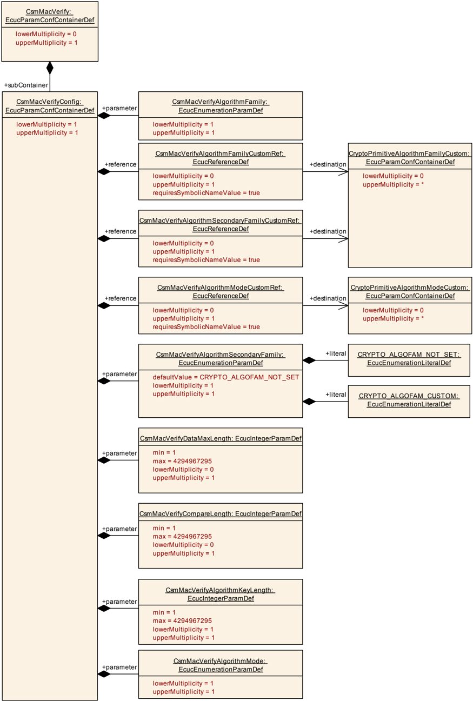

#### 9.1.17. CsmMacVerify

| SWS 条目 | [ECUC_Csm_00023] |
|---|---|
| 容器名称 | CsmMacVerify |
| 父容器 | CsmPrimitives |
| 描述 | MacVerify 原语的配置。 |

| 容器名称 | 多重性 | 作用域/依赖 |
|---|---|---|
| CsmMacVerifyConfig | 1 | CSM MAC 验证接口配置的容器。容器名称用作 MAC 生成接口标识符的符号名。 |

#### 9.1.18. CsmMacVerifyConfig

| SWS 条目 | [ECUC_Csm_00049] |
|---|---|
| 容器名称 | CsmMacVerifyConfig |
| 父容器 | CsmMacVerify |
| 描述 | CSM MAC 验证接口配置的容器。容器名称用作 MAC 生成接口标识符的符号名。 |
| 配置参数 | 见下方参数表 |

| SWS 条目 | [ECUC_Csm_00051] |
|---|---|
| 参数名称 | CsmMacVerifyAlgorithmFamily |
| 父容器 | CsmMacVerifyConfig |
| 描述 | 确定加密服务所使用的算法族。此参数定义算法的最主要部分。 |
| 多重性 | 1 |
| 类型 | EcucEnumerationParamDef |
| 范围 | CRYPTO_ALGOFAM_3DES：--；CRYPTO_ALGOFAM_AES：--；CRYPTO_ALGOFAM_BLAKE_1_256：--；CRYPTO_ALGOFAM_BLAKE_1_512：--；CRYPTO_ALGOFAM_BLAKE_2s_256：--；CRYPTO_ALGOFAM_BLAKE_2s_512：--；CRYPTO_ALGOFAM_CHACHA：--；CRYPTO_ALGOFAM_EEA3：--；CRYPTO_ALGOFAM_EIA3：--；CRYPTO_ALGOFAM_POLY1305：--；CRYPTO_ALGOFAM_RIPEMD160：--；CRYPTO_ALGOFAM_RNG：--；CRYPTO_ALGOFAM_SHA1：--；CRYPTO_ALGOFAM_SHA2_224：--；CRYPTO_ALGOFAM_SHA2_256：--；CRYPTO_ALGOFAM_SHA2_384：--；CRYPTO_ALGOFAM_SHA2_512：--；CRYPTO_ALGOFAM_SHA2_512_224：--；CRYPTO_ALGOFAM_SHA2_512_256：--；CRYPTO_ALGOFAM_SHA3_224：--；CRYPTO_ALGOFAM_SHA3_256：--；CRYPTO_ALGOFAM_SHA3_384：--；CRYPTO_ALGOFAM_SHA3_512：--；CRYPTO_ALGOFAM_SHAKE128：--；CRYPTO_ALGOFAM_SHAKE256：--；CRYPTO_ALGOFAM_SIPHASH：--；CRYPTO_ALGOFAM_SM3：--；CRYPTO_ALGOMODE_CUSTOM：-- |
| Post-Build 变体值 | false |
| 多重性配置类 | Pre-compile time：X（All Variants）；Link time：-；Post-build time：- |
| 值配置类 | Pre-compile time：X（All Variants）；Link time：-；Post-build time：- |
| 作用域/依赖 | scope: local |

| SWS 条目 | [ECUC_Csm_00193] |
|---|---|
| 参数名称 | CsmMacVerifyAlgorithmKeyLength |
| 父容器 | CsmMacVerifyConfig |
| 描述 | MAC 密钥的大小（单位为字节） |
| 多重性 | 1 |
| 类型 | EcucIntegerParamDef |
| 范围 | 1 .. 4294967295 |
| 默认值 | - |
| 多重性配置类 | Pre-compile time：X（All Variants）；Link time：-；Post-build time：- |
| 值配置类 | Pre-compile time：X（All Variants）；Link time：-；Post-build time：- |
| 作用域/依赖 | scope: local |

| SWS 条目 | [ECUC_Csm_00195] |
|---|---|
| 参数名称 | CsmMacVerifyAlgorithmMode |
| 父容器 | CsmMacVerifyConfig |
| 描述 | 确定加密服务所使用的算法模式 |
| 多重性 | 1 |
| 类型 | EcucEnumerationParamDef |
| 范围 | CRYPTO_ALGOMODE_CMAC：--；CRYPTO_ALGOMODE_CTRDRBG：--；CRYPTO_ALGOMODE_CUSTOM：--；CRYPTO_ALGOMODE_GMAC：--；CRYPTO_ALGOMODE_HMAC：--；CRYPTO_ALGOMODE_NOT_SET：--；CRYPTO_ALGOMODE_SIPHASH_2_4：--；CRYPTO_ALGOMODE_SIPHASH_4_8：-- |
| 多重性配置类 | Pre-compile time：X（All Variants）；Link time：-；Post-build time：- |
| 值配置类 | Pre-compile time：X（All Variants）；Link time：-；Post-build time：- |
| 作用域/依赖 | scope: local |

| SWS 条目 | [ECUC_Csm_00140] |
|---|---|
| 参数名称 | CsmMacVerifyAlgorithmSecondaryFamily |
| 父容器 | CsmMacVerifyConfig |
| 描述 | 确定加密服务所使用的辅助算法族 |
| 多重性 | 1 |
| 类型 | EcucEnumerationParamDef |
| 范围 | CRYPTO_ALGOFAM_CUSTOM：--；CRYPTO_ALGOFAM_NOT_SET：-- |
| 默认值 | CRYPTO_ALGOFAM_NOT_SET |
| Post-Build 变体值 | false |
| 多重性配置类 | Pre-compile time：X（All Variants）；Link time：-；Post-build time：- |
| 值配置类 | Pre-compile time：X（All Variants）；Link time：-；Post-build time：- |
| 作用域/依赖 | scope: local |

| SWS 条目 | [ECUC_Csm_00142] |
|---|---|
| 参数名称 | CsmMacVerifyCompareLength |
| 父容器 | CsmMacVerifyConfig |
| 描述 | 若此原语被 Csm 作业引用，则为同步 RTE 服务接口的输入 MAC 缓冲区的大小（单位为位）。其他 BSW 模块也可能使用该长度参数进行缓冲区大小计算。 |
| 多重性 | 0..1 |
| 类型 | EcucIntegerParamDef |
| 范围 | 1 .. 4294967295 |
| 默认值 | - |
| Post-Build 变体值 | false |
| 多重性配置类 | Pre-compile time：X（All Variants）；Link time：-；Post-build time：- |
| 值配置类 | Pre-compile time：X（All Variants）；Link time：-；Post-build time：- |
| 作用域/依赖 | scope: local；dependency: 仅当 CsmJobInterfaceUsePort 配置为 CRYPTO_USE_PORT 时，此参数才相关。 |

| SWS 条目 | [ECUC_Csm_00056] |
|---|---|
| 参数名称 | CsmMacVerifyDataMaxLength |
| 父容器 | CsmMacVerifyConfig |
| 描述 | 若此原语被 Csm 作业引用，则为同步 RTE 服务接口的输入数据缓冲区的大小。其他 BSW 模块也可能使用该长度参数进行缓冲区大小计算。 |
| 多重性 | 0..1 |
| 类型 | EcucIntegerParamDef |
| 范围 | 1 .. 4294967295 |
| 默认值 | - |
| Post-Build 变体值 | false |
| 多重性配置类 | Pre-compile time：X（All Variants）；Link time：-；Post-build time：- |
| 值配置类 | Pre-compile time：X（All Variants）；Link time：-；Post-build time：- |
| 作用域/依赖 | scope: local；dependency: 仅当 CsmJobInterfaceUsePort 配置为 CRYPTO_USE_PORT 时，此参数才相关。 |

| SWS 条目 | [ECUC_Csm_00288] |
|---|---|
| 参数名称 | CsmMacVerifyAlgorithmFamilyCustomRef |
| 父容器 | CsmMacVerifyConfig |
| 描述 | 对客户特定的算法族自定义容器的引用 |
| 多重性 | 0..1 |
| 类型 | 对 CryptoPrimitiveAlgorithmFamilyCustom 的符号名引用 |
| 多重性配置类 | Pre-compile time：X（All Variants）；Link time：-；Post-build time：- |
| 值配置类 | Pre-compile time：X（All Variants）；Link time：-；Post-build time：- |
| 作用域/依赖 | scope: local；dependency: 仅当 CsmMacVerifyAlgorithmFamily 设置为 CRYPTO_ALGOFAM_CUSTOM 时，才应存在此引用。 |

| SWS 条目 | [ECUC_Csm_00289] |
|---|---|
| 参数名称 | CsmMacVerifyAlgorithmModeCustomRef |
| 父容器 | CsmMacVerifyConfig |
| 描述 | 对客户特定的算法模式自定义容器的引用 |
| 多重性 | 0..1 |
| 类型 | 对 CryptoPrimitiveAlgorithmModeCustom 的符号名引用 |
| 多重性配置类 | Pre-compile time：X（All Variants）；Link time：-；Post-build time：- |
| 值配置类 | Pre-compile time：X（All Variants）；Link time：-；Post-build time：- |
| 作用域/依赖 | scope: local；dependency: 仅当 CsmMacVerifyAlgorithmMode 设置为 CRYPTO_ALGOMODE_CUSTOM 时，才应存在此引用。 |

| SWS 条目 | [ECUC_Csm_00290] |
|---|---|
| 参数名称 | CsmMacVerifyAlgorithmSecondaryFamilyCustomRef |
| 父容器 | CsmMacVerifyConfig |
| 描述 | 对加密驱动程序中客户特定的算法族容器的引用 |
| 多重性 | 0..1 |
| 类型 | 对 CryptoPrimitiveAlgorithmFamilyCustom 的符号名引用 |
| 多重性配置类 | Pre-compile time：X（All Variants）；Link time：-；Post-build time：- |
| 值配置类 | Pre-compile time：X（All Variants）；Link time：-；Post-build time：- |
| 作用域/依赖 | scope: local；dependency: 仅当 CsmMacVerifySecondaryAlgorithmFamily 设置为 CRYPTO_ALGOFAM_CUSTOM 时，才应存在此引用。 |

该容器不包含任何子容器。

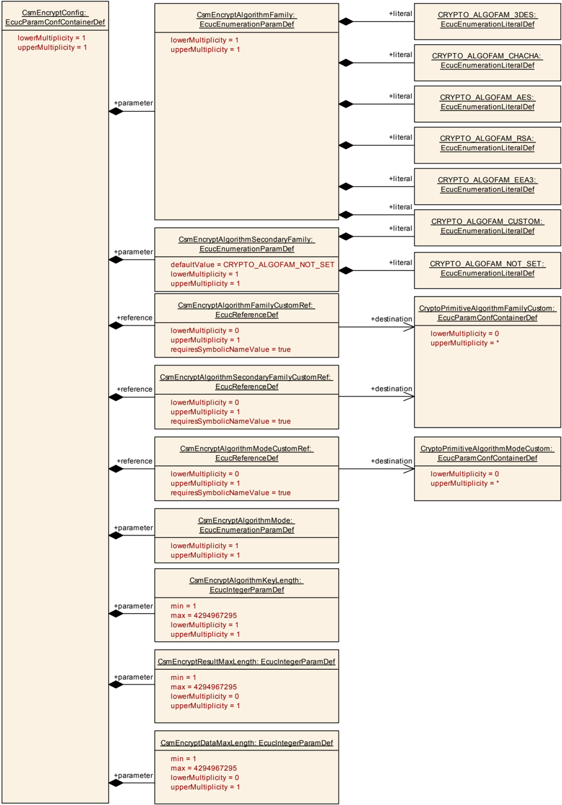

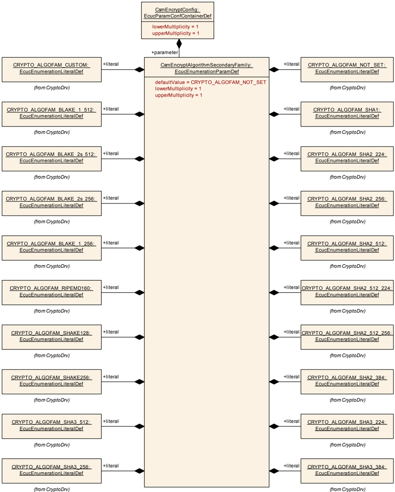

#### 9.1.19. CsmEncrypt

| SWS 条目 | [ECUC_Csm_00024] |
|---|---|
| 容器名称 | CsmEncrypt |
| 父容器 | CsmPrimitives |
| 描述 | 加密原语的配置。 |

| 容器名称 | 多重性 | 作用域/依赖 |
|---|---|---|
| CsmEncryptConfig | 1 | CSM 加密接口配置的容器。容器名称用作加密接口标识符的符号名。 |

#### 9.1.20. CsmEncryptConfig

| SWS 条目 | [ECUC_Csm_00057] |
|---|---|
| 容器名称 | CsmEncryptConfig |
| 父容器 | CsmEncrypt |
| 描述 | CSM 加密接口配置的容器。容器名称用作加密接口标识符的符号名。 |
| 配置参数 | 见下方参数表 |

| SWS 条目 | [ECUC_Csm_00182] |
|---|---|
| 参数名称 | CsmEncryptAlgorithmFamily |
| 父容器 | CsmEncryptConfig |
| 描述 | 确定加密服务所使用的算法族。此参数定义算法的最主要部分。 |
| 多重性 | 1 |
| 类型 | EcucEnumerationParamDef |
| 范围 | CRYPTO_ALGOFAM_3DES：--；CRYPTO_ALGOFAM_AES：--；CRYPTO_ALGOFAM_CHACHA：--；CRYPTO_ALGOFAM_CUSTOM：--；CRYPTO_ALGOFAM_EEA3：--；CRYPTO_ALGOFAM_RSA：-- |
| Post-Build 变体值 | false |
| 多重性配置类 | Pre-compile time：X（All Variants）；Link time：-；Post-build time：- |
| 值配置类 | Pre-compile time：X（All Variants）；Link time：-；Post-build time：- |
| 作用域/依赖 | scope: local |

| SWS 条目 | [ECUC_Csm_00191] |
|---|---|
| 参数名称 | CsmEncryptAlgorithmKeyLength |
| 父容器 | CsmEncryptConfig |
| 描述 | 加密密钥的大小（单位为字节） |
| 多重性 | 1 |
| 类型 | EcucIntegerParamDef |
| 范围 | 1 .. 4294967295 |
| 默认值 | - |
| Post-Build 变体值 | false |
| 多重性配置类 | Pre-compile time：X（All Variants）；Link time：-；Post-build time：- |
| 值配置类 | Pre-compile time：X（All Variants）；Link time：-；Post-build time：- |
| 作用域/依赖 | scope: local |

| SWS 条目 | [ECUC_Csm_00060] |
|---|---|
| 参数名称 | CsmEncryptAlgorithmMode |
| 父容器 | CsmEncryptConfig |
| 描述 | 确定加密服务所使用的算法模式 |
| 多重性 | 1 |
| 类型 | EcucEnumerationParamDef |
| 范围 | CRYPTO_ALGOMODE_12ROUNDS：--；CRYPTO_ALGOMODE_20ROUNDS：--；CRYPTO_ALGOMODE_8ROUNDS：--；CRYPTO_ALGOMODE_CBC：--；CRYPTO_ALGOMODE_CFB：--；CRYPTO_ALGOMODE_CTR：--；CRYPTO_ALGOMODE_CUSTOM：--；CRYPTO_ALGOMODE_ECB：--；CRYPTO_ALGOMODE_NOT_SET：--；CRYPTO_ALGOMODE_OFB：--；CRYPTO_ALGOMODE_RSAES_OAEP：--；CRYPTO_ALGOMODE_RSAES_PKCS1_v1_5：--；CRYPTO_ALGOMODE_XTS：-- |
| Post-Build 变体值 | false |
| 多重性配置类 | Pre-compile time：X（All Variants）；Link time：-；Post-build time：- |
| 值配置类 | Pre-compile time：X（All Variants）；Link time：-；Post-build time：- |
| 作用域/依赖 | scope: local |

| SWS 条目 | [ECUC_Csm_00144] |
|---|---|
| 参数名称 | CsmEncryptAlgorithmSecondaryFamily |
| 父容器 | CsmEncryptConfig |
| 描述 | 确定加密服务所使用的算法族 |
| 多重性 | 1 |
| 类型 | EcucEnumerationParamDef |
| 范围 | CRYPTO_ALGOFAM_BLAKE_1_256：--；CRYPTO_ALGOFAM_BLAKE_1_512：--；CRYPTO_ALGOFAM_BLAKE_2s_256：--；CRYPTO_ALGOFAM_BLAKE_2s_512：--；CRYPTO_ALGOFAM_CUSTOM：--；CRYPTO_ALGOFAM_NOT_SET：--；CRYPTO_ALGOFAM_RIPEMD160：--；CRYPTO_ALGOFAM_SHA1：--；CRYPTO_ALGOFAM_SHA2_224：--；CRYPTO_ALGOFAM_SHA2_256：--；CRYPTO_ALGOFAM_SHA2_384：--；CRYPTO_ALGOFAM_SHA2_512：--；CRYPTO_ALGOFAM_SHA2_512_224：--；CRYPTO_ALGOFAM_SHA2_512_256：--；CRYPTO_ALGOFAM_SHA3_224：--；CRYPTO_ALGOFAM_SHA3_256：--；CRYPTO_ALGOFAM_SHA3_384：--；CRYPTO_ALGOFAM_SHA3_512：--；CRYPTO_ALGOFAM_SHAKE128：--；CRYPTO_ALGOFAM_SHAKE256：-- |
| 默认值 | CRYPTO_ALGOFAM_NOT_SET |
| Post-Build 变体值 | false |
| 多重性配置类 | Pre-compile time：X（All Variants）；Link time：-；Post-build time：- |
| 值配置类 | Pre-compile time：X（All Variants）；Link time：-；Post-build time：- |
| 作用域/依赖 | scope: local |

| SWS 条目 | [ECUC_Csm_00146] |
|---|---|
| 参数名称 | CsmEncryptDataMaxLength |
| 父容器 | CsmEncryptConfig |
| 描述 | 若此原语被 Csm 作业引用，则为同步 RTE 服务接口的输入明文缓冲区的大小。其他 BSW 模块也可能使用该长度参数进行缓冲区大小计算。 |
| 多重性 | 0..1 |
| 类型 | EcucIntegerParamDef |
| 范围 | 1 .. 4294967295 |
| 默认值 | - |
| Post-Build 变体值 | false |
| 多重性配置类 | Pre-compile time：X（All Variants）；Link time：-；Post-build time：- |
| 值配置类 | Pre-compile time：X（All Variants）；Link time：-；Post-build time：- |
| 作用域/依赖 | scope: local；dependency: 仅当 CsmJobInterfaceUsePort 配置为 CRYPTO_USE_PORT 时，此参数才相关。" |

| SWS 条目 | [ECUC_Csm_00147] |
|---|---|
| 参数名称 | CsmEncryptResultMaxLength |
| 父容器 | CsmEncryptConfig |
| 描述 | 若此原语被 Csm 作业引用，则为同步 RTE 服务接口的结果数据缓冲区的大小。其他 BSW 模块也可能使用该长度参数进行缓冲区大小计算。 |
| 多重性 | 0..1 |
| 类型 | EcucIntegerParamDef |
| 范围 | 1 .. 4294967295 |
| 默认值 | - |
| Post-Build 变体值 | false |
| 多重性配置类 | Pre-compile time：X（All Variants）；Link time：-；Post-build time：- |
| 值配置类 | Pre-compile time：X（All Variants）；Link time：-；Post-build time：- |
| 作用域/依赖 | scope: local；dependency: 仅当 CsmJobInterfaceUsePort 配置为 CRYPTO_USE_PORT 时，此参数才相关。 |

| SWS 条目 | [ECUC_Csm_00291] |
|---|---|
| 参数名称 | CsmEncryptAlgorithmFamilyCustomRef |
| 父容器 | CsmEncryptConfig |
| 描述 | 对客户特定的算法族自定义容器的引用 |
| 多重性 | 0..1 |
| 类型 | 对 CryptoPrimitiveAlgorithmFamilyCustom 的符号名引用 |
| 多重性配置类 | Pre-compile time：X（All Variants）；Link time：-；Post-build time：- |
| 值配置类 | Pre-compile time：X（All Variants）；Link time：-；Post-build time：- |
| 作用域/依赖 | scope: local；dependency: 仅当 CsmEncryptAlgorithmFamily 设置为 CRYPTO_ALGOFAM_CUSTOM 时，才应存在此参数。 |

| SWS 条目 | [ECUC_Csm_00292] |
|---|---|
| 参数名称 | CsmEncryptAlgorithmModeCustomRef |
| 父容器 | CsmEncryptConfig |
| 描述 | 对客户特定的算法模式自定义容器的引用 |
| 多重性 | 0..1 |
| 类型 | 对 CryptoPrimitiveAlgorithmModeCustom 的符号名引用 |
| 多重性配置类 | Pre-compile time：X（All Variants）；Link time：-；Post-build time：- |
| 值配置类 | Pre-compile time：X（All Variants）；Link time：-；Post-build time：- |
| 作用域/依赖 | scope: local；dependency: 仅当 CsmEncryptAlgorithmMode 设置为 CRYPTO_ALGOMODE_CUSTOM 时，才应存在此引用。 |

| SWS 条目 | [ECUC_Csm_00293] |
|---|---|
| 参数名称 | CsmEncryptAlgorithmSecondaryFamilyCustomRef |
| 父容器 | CsmEncryptConfig |
| 描述 | 对加密驱动程序中客户特定的算法族容器的引用 |
| 多重性 | 0..1 |
| 类型 | 对 CryptoPrimitiveAlgorithmFamilyCustom 的符号名引用 |
| 多重性配置类 | Pre-compile time：X（All Variants）；Link time：-；Post-build time：- |
| 值配置类 | Pre-compile time：X（All Variants）；Link time：-；Post-build time：- |
| 作用域/依赖 | scope: local；dependency: 仅当 CsmEncryptSecondaryAlgorithmFamily 设置为 CRYPTO_ALGOFAM_CUSTOM 时，才应存在此参数。 |

该容器不包含任何子容器。

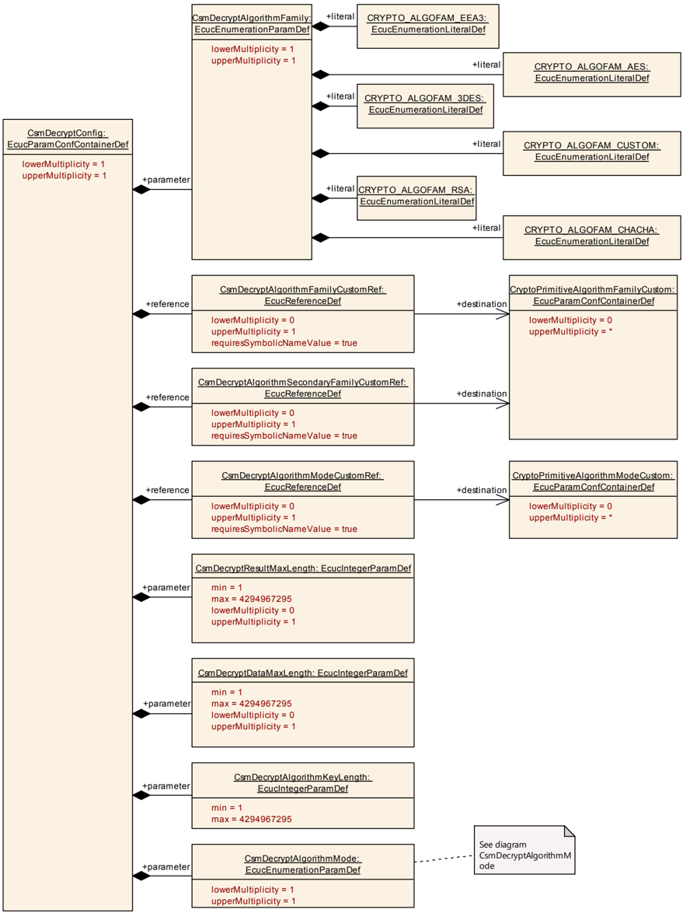

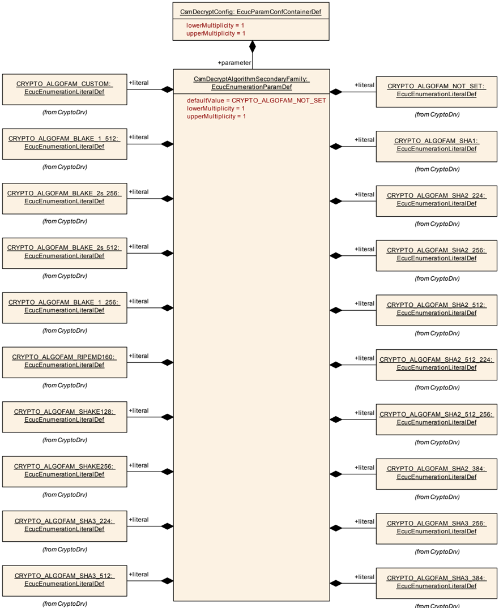

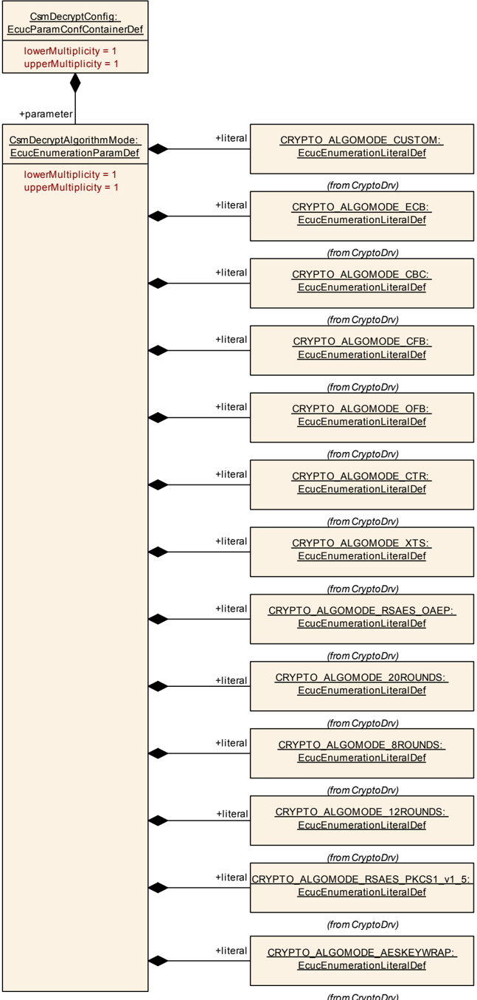

#### 9.1.21. CsmDecrypt

| SWS 条目 | [ECUC_Csm_00025] |
|---|---|
| 容器名称 | CsmDecrypt |
| 父容器 | CsmPrimitives |
| 描述 | 解密原语的配置。 |

| 容器名称 | 多重性 | 作用域/依赖 |
|---|---|---|
| CsmDecryptConfig | 1 | CSM 解密接口配置的容器。容器名称用作解密接口标识符的符号名。 |

#### 9.1.22. CsmDecryptConfig

| SWS 条目 | [ECUC_Csm_00064] |
|---|---|
| 容器名称 | CsmDecryptConfig |
| 父容器 | CsmDecrypt |
| 描述 | CSM 解密接口配置的容器。容器名称用作解密接口标识符的符号名。 |
| 配置参数 | 见下方参数表 |

| SWS 条目 | [ECUC_Csm_00066] |
|---|---|
| 参数名称 | CsmDecryptAlgorithmFamily |
| 父容器 | CsmDecryptConfig |
| 描述 | 确定加密服务所使用的算法族。此参数定义算法的最主要部分。 |
| 多重性 | 1 |
| 类型 | EcucEnumerationParamDef |
| 范围 | CRYPTO_ALGOFAM_3DES：--；CRYPTO_ALGOFAM_AES：--；CRYPTO_ALGOFAM_CHACHA：--；CRYPTO_ALGOFAM_CUSTOM：--；CRYPTO_ALGOFAM_EEA3：--；CRYPTO_ALGOFAM_RSA：-- |
| Post-Build 变体值 | false |
| 多重性配置类 | Pre-compile time：X（All Variants）；Link time：-；Post-build time：- |
| 值配置类 | Pre-compile time：X（All Variants）；Link time：-；Post-build time：- |
| 作用域/依赖 | scope: local |

| SWS 条目 | [ECUC_Csm_00067] |
|---|---|
| 参数名称 | CsmDecryptAlgorithmKeyLength |
| 父容器 | CsmDecryptConfig |
| 描述 | 加密密钥的大小（单位为字节） |
| 多重性 | 1 |
| 类型 | EcucIntegerParamDef |
| 范围 | 1 .. 4294967295 |
| 默认值 | - |
| Post-Build 变体值 | false |
| 多重性配置类 | Pre-compile time：X（All Variants）；Link time：-；Post-build time：- |
| 值配置类 | Pre-compile time：X（All Variants）；Link time：-；Post-build time：- |
| 作用域/依赖 | scope: local |

| SWS 条目 | [ECUC_Csm_00068] |
|---|---|
| 参数名称 | CsmDecryptAlgorithmMode |
| 父容器 | CsmDecryptConfig |
| 描述 | 确定加密服务所使用的算法模式 |
| 多重性 | 1 |
| 类型 | EcucEnumerationParamDef |
| 范围 | CRYPTO_ALGOMODE_12ROUNDS：--；CRYPTO_ALGOMODE_20ROUNDS：--；CRYPTO_ALGOMODE_8ROUNDS：--；CRYPTO_ALGOMODE_AESKEYWRAP：--；CRYPTO_ALGOMODE_CBC：--；CRYPTO_ALGOMODE_CFB：--；CRYPTO_ALGOMODE_CTR：--；CRYPTO_ALGOMODE_CUSTOM：--；CRYPTO_ALGOMODE_ECB：--；CRYPTO_ALGOMODE_OFB：--；CRYPTO_ALGOMODE_RSAES_OAEP：--；CRYPTO_ALGOMODE_RSAES_PKCS1_v1_5：--；CRYPTO_ALGOMODE_XTS：-- |
| Post-Build 变体值 | false |
| 多重性配置类 | Pre-compile time：X（All Variants）；Link time：-；Post-build time：- |
| 值配置类 | Pre-compile time：X（All Variants）；Link time：-；Post-build time：- |
| 作用域/依赖 | scope: local |

| SWS 条目 | [ECUC_Csm_00149] |
|---|---|
| 参数名称 | CsmDecryptAlgorithmSecondaryFamily |
| 父容器 | CsmDecryptConfig |
| 描述 | 确定加密服务所使用的辅助算法族 |
| 多重性 | 1 |
| 类型 | EcucEnumerationParamDef |
| 范围 | CRYPTO_ALGOFAM_BLAKE_1_256：--；CRYPTO_ALGOFAM_BLAKE_1_512：--；CRYPTO_ALGOFAM_BLAKE_2s_256：--；CRYPTO_ALGOFAM_BLAKE_2s_512：--；CRYPTO_ALGOFAM_CUSTOM：--；CRYPTO_ALGOFAM_NOT_SET：--；CRYPTO_ALGOFAM_RIPEMD160：--；CRYPTO_ALGOFAM_SHA1：--；CRYPTO_ALGOFAM_SHA2_224：--；CRYPTO_ALGOFAM_SHA2_256：--；CRYPTO_ALGOFAM_SHA2_384：--；CRYPTO_ALGOFAM_SHA2_512：--；CRYPTO_ALGOFAM_SHA2_512_224：--；CRYPTO_ALGOFAM_SHA2_512_256：--；CRYPTO_ALGOFAM_SHA3_224：--；CRYPTO_ALGOFAM_SHA3_256：--；CRYPTO_ALGOFAM_SHA3_384：--；CRYPTO_ALGOFAM_SHA3_512：--；CRYPTO_ALGOFAM_SHAKE128：--；CRYPTO_ALGOFAM_SHAKE256：-- |
| 默认值 | CRYPTO_ALGOFAM_NOT_SET |
| Post-Build 变体值 | false |
| 多重性配置类 | Pre-compile time：X（All Variants）；Link time：-；Post-build time：- |
| 值配置类 | Pre-compile time：X（All Variants）；Link time：-；Post-build time：- |
| 作用域/依赖 | scope: local |

| SWS 条目 | [ECUC_Csm_00154] |
|---|---|
| 参数名称 | CsmDecryptDataMaxLength |
| 父容器 | CsmDecryptConfig |
| 描述 | 若此原语被 Csm 作业引用，则为同步 RTE 服务接口的输入密文缓冲区的大小。其他 BSW 模块也可能使用该长度参数进行缓冲区大小计算。 |
| 多重性 | 0..1 |
| 类型 | EcucIntegerParamDef |
| 范围 | 1 .. 4294967295 |
| 默认值 | - |
| Post-Build 变体值 | false |
| 多重性配置类 | Pre-compile time：X（All Variants）；Link time：-；Post-build time：- |
| 值配置类 | Pre-compile time：X（All Variants）；Link time：-；Post-build time：- |
| 作用域/依赖 | scope: local；dependency: 仅当 CsmJobInterfaceUsePort 配置为 CRYPTO_USE_PORT 时，此参数才相关。 |

| SWS 条目 | [ECUC_Csm_00155] |
|---|---|
| 参数名称 | CsmDecryptResultMaxLength |
| 父容器 | CsmDecryptConfig |
| 描述 | 若此原语被 Csm 作业引用，则为同步 RTE 服务接口的结果数据缓冲区的大小。其他 BSW 模块也可能使用该长度参数进行缓冲区大小计算。 |
| 多重性 | 0..1 |
| 类型 | EcucIntegerParamDef |
| 范围 | 1 .. 4294967295 |
| 默认值 | - |
| Post-Build 变体值 | false |
| 多重性配置类 | Pre-compile time：X（All Variants）；Link time：-；Post-build time：- |
| 值配置类 | Pre-compile time：X（All Variants）；Link time：-；Post-build time：- |
| 作用域/依赖 | scope: local；dependency: 仅当 CsmJobInterfaceUsePort 配置为 CRYPTO_USE_PORT 时，此参数才相关。 |

| SWS 条目 | [ECUC_Csm_00294] |
|---|---|
| 参数名称 | CsmDecryptAlgorithmFamilyCustomRef |
| 父容器 | CsmDecryptConfig |
| 描述 | 对客户特定的算法族自定义容器的引用 |
| 多重性 | 0..1 |
| 类型 | 对 CryptoPrimitiveAlgorithmFamilyCustom 的符号名引用 |
| 多重性配置类 | Pre-compile time：X（All Variants）；Link time：-；Post-build time：- |
| 值配置类 | Pre-compile time：X（All Variants）；Link time：-；Post-build time：- |
| 作用域/依赖 | scope: local；dependency: 仅当 CsmDecryptAlgorithmFamily 设置为 CRYPTO_ALGOFAM_CUSTOM 时，才应存在此引用。 |

| SWS 条目 | [ECUC_Csm_00295] |
|---|---|
| 参数名称 | CsmDecryptAlgorithmModeCustomRef |
| 父容器 | CsmDecryptConfig |
| 描述 | 对客户特定的算法模式自定义容器的引用 |
| 多重性 | 0..1 |
| 类型 | 对 CryptoPrimitiveAlgorithmModeCustom 的符号名引用 |
| 多重性配置类 | Pre-compile time：X（All Variants）；Link time：-；Post-build time：- |
| 值配置类 | Pre-compile time：X（All Variants）；Link time：-；Post-build time：- |
| 作用域/依赖 | scope: local；dependency: 仅当 CsmDecryptAlgorithmMode 设置为 CRYPTO_ALGOMODE_CUSTOM 时，才应存在此引用。 |

| SWS 条目 | [ECUC_Csm_00296] |
|---|---|
| 参数名称 | CsmDecryptAlgorithmSecondaryFamilyCustomRef |
| 父容器 | CsmDecryptConfig |
| 描述 | 对加密驱动程序中客户特定的算法族容器的引用 |
| 多重性 | 0..1 |
| 类型 | 对 CryptoPrimitiveAlgorithmFamilyCustom 的符号名引用 |
| 多重性配置类 | Pre-compile time：X（All Variants）；Link time：-；Post-build time：- |
| 值配置类 | Pre-compile time：X（All Variants）；Link time：-；Post-build time：- |
| 作用域/依赖 | scope: local；dependency: 仅当 CsmDecryptSecondaryAlgorithmFamily 设置为 CRYPTO_ALGOFAM_CUSTOM 时，才应存在此引用。 |

该容器不包含任何子容器。

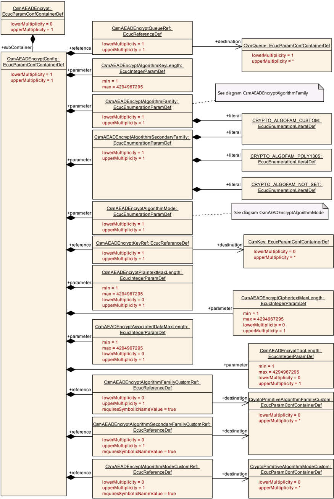

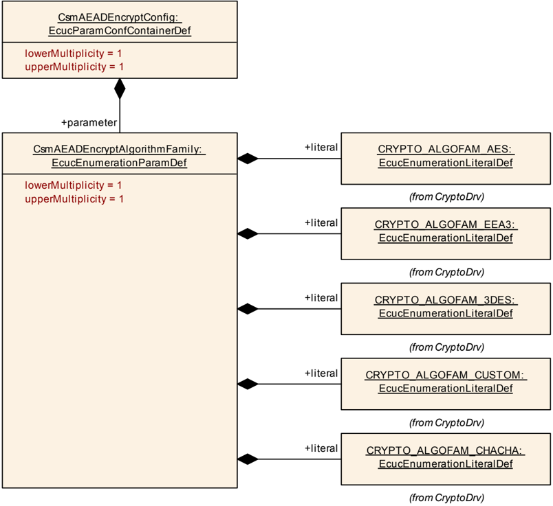

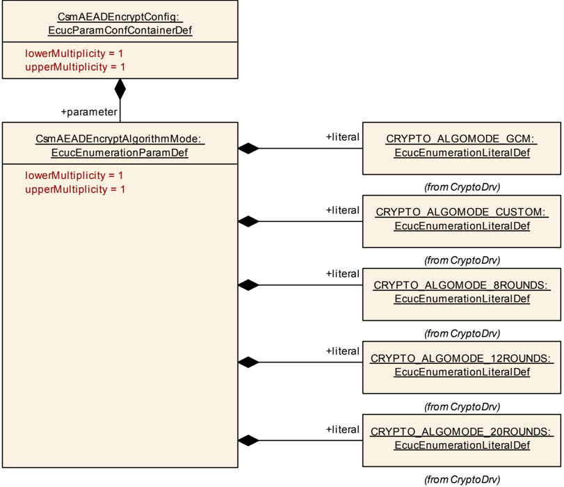

#### 9.1.23. CsmAEADEncrypt

| SWS 条目 | [ECUC_Csm_00026] |
|---|---|
| 容器名称 | CsmAEADEncrypt |
| 父容器 | CsmPrimitives |
| 描述 | AEAD 加密原语的配置。 |

| 容器名称 | 多重性 | 作用域/依赖 |
|---|---|---|
| CsmAEADEncryptConfig | 1 | CSM 加密接口配置的容器。容器名称用作加密接口标识符的符号名。 |

#### 9.1.24. CsmAEADEncryptConfig

| SWS 条目 | [ECUC_Csm_00072] |
|---|---|
| 容器名称 | CsmAEADEncryptConfig |
| 父容器 | CsmAEADEncrypt |
| 描述 | CSM 加密接口配置的容器。容器名称用作加密接口标识符的符号名。 |
| 配置参数 | 见下方参数表 |

| SWS 条目 | [ECUC_Csm_00074] |
|---|---|
| 参数名称 | CsmAEADEncryptAlgorithmFamily |
| 父容器 | CsmAEADEncryptConfig |
| 描述 | 确定加密服务所使用的算法族。此参数定义算法的最主要部分。 |
| 多重性 | 1 |
| 类型 | EcucEnumerationParamDef |
| 范围 | CRYPTO_ALGOFAM_3DES：--；CRYPTO_ALGOFAM_AES：--；CRYPTO_ALGOFAM_CHACHA：--；CRYPTO_ALGOFAM_CUSTOM：--；CRYPTO_ALGOFAM_EEA3：-- |
| Post-Build 变体值 | false |
| 多重性配置类 | Pre-compile time：X（All Variants）；Link time：-；Post-build time：- |
| 值配置类 | Pre-compile time：X（All Variants）；Link time：-；Post-build time：- |
| 作用域/依赖 | scope: local |

| SWS 条目 | [ECUC_Csm_00075] |
|---|---|
| 参数名称 | CsmAEADEncryptAlgorithmKeyLength |
| 父容器 | CsmAEADEncryptConfig |
| 描述 | AEAD 加密密钥的大小（单位为字节） |
| 多重性 | 1 |
| 类型 | EcucIntegerParamDef |
| 范围 | 1 .. 4294967295 |
| 默认值 | - |
| Post-Build 变体值 | false |
| 多重性配置类 | Pre-compile time：X（All Variants）；Link time：-；Post-build time：- |
| 值配置类 | Pre-compile time：X（All Variants）；Link time：-；Post-build time：- |
| 作用域/依赖 | scope: local |

| SWS 条目 | [ECUC_Csm_00076] |
|---|---|
| 参数名称 | CsmAEADEncryptAlgorithmMode |
| 父容器 | CsmAEADEncryptConfig |
| 描述 | 确定加密服务所使用的算法模式 |
| 多重性 | 1 |
| 类型 | EcucEnumerationParamDef |
| 范围 | CRYPTO_ALGOMODE_12ROUNDS：--；CRYPTO_ALGOMODE_20ROUNDS：--；CRYPTO_ALGOMODE_8ROUNDS：--；CRYPTO_ALGOMODE_CUSTOM：--；CRYPTO_ALGOMODE_GCM：-- |
| Post-Build 变体值 | false |
| 多重性配置类 | Pre-compile time：X（All Variants）；Link time：-；Post-build time：- |
| 值配置类 | Pre-compile time：X（All Variants）；Link time：-；Post-build time：- |
| 作用域/依赖 | scope: local |

| SWS 条目 | [ECUC_Csm_00278] |
|---|---|
| 参数名称 | CsmAEADEncryptAlgorithmSecondaryFamily |
| 父容器 | CsmAEADEncryptConfig |
| 描述 | 定义加密服务所使用的辅助算法族 |
| 多重性 | 1 |
| 类型 | EcucEnumerationParamDef |
| 范围 | CRYPTO_ALGOFAM_CUSTOM：--；CRYPTO_ALGOFAM_NOT_SET：--；CRYPTO_ALGOFAM_POLY1305：-- |
| Post-Build 变体值 | false |
| 多重性配置类 | Pre-compile time：X（All Variants）；Link time：-；Post-build time：- |
| 值配置类 | Pre-compile time：X（All Variants）；Link time：-；Post-build time：- |
| 作用域/依赖 | scope: local |

| SWS 条目 | [ECUC_Csm_00159] |
|---|---|
| 参数名称 | CsmAEADEncryptAssociatedDataMaxLength |
| 父容器 | CsmAEADEncryptConfig |
| 描述 | 若此原语被 Csm 作业引用，则为同步 RTE 服务接口的输入关联数据缓冲区的大小。其他 BSW 模块也可能使用该长度参数进行缓冲区大小计算。 |
| 多重性 | 0..1 |
| 类型 | EcucIntegerParamDef |
| 范围 | 1 .. 4294967295 |
| 默认值 | - |
| Post-Build 变体值 | false |
| 多重性配置类 | Pre-compile time：X（All Variants）；Link time：-；Post-build time：- |
| 值配置类 | Pre-compile time：X（All Variants）；Link time：-；Post-build time：- |
| 作用域/依赖 | scope: local；dependency: 仅当 CsmJobInterfaceUsePort 配置为 CRYPTO_USE_PORT 时，此参数才相关。 |

| SWS 条目 | [ECUC_Csm_00160] |
|---|---|
| 参数名称 | CsmAEADEncryptCiphertextMaxLength |
| 父容器 | CsmAEADEncryptConfig |
| 描述 | 若此原语被 Csm 作业引用，则为同步 RTE 服务接口的输出密文缓冲区的大小。其他 BSW 模块也可能使用该长度参数进行缓冲区大小计算。 |
| 多重性 | 0..1 |
| 类型 | EcucIntegerParamDef |
| 范围 | 1 .. 4294967295 |
| 默认值 | - |
| Post-Build 变体值 | false |
| 多重性配置类 | Pre-compile time：X（All Variants）；Link time：-；Post-build time：- |
| 值配置类 | Pre-compile time：X（All Variants）；Link time：-；Post-build time：- |
| 作用域/依赖 | scope: local；dependency: 仅当 CsmJobInterfaceUsePort 配置为 CRYPTO_USE_PORT 时，此参数才相关。 |

| SWS 条目 | [ECUC_Csm_00158] |
|---|---|
| 参数名称 | CsmAEADEncryptPlaintextMaxLength |
| 父容器 | CsmAEADEncryptConfig |
| 描述 | 若此原语被 Csm 作业引用，则为同步 RTE 服务接口的输入明文缓冲区的大小。其他 BSW 模块也可能使用该长度参数进行缓冲区大小计算 |
| 多重性 | 0..1 |
| 类型 | EcucIntegerParamDef |
| 范围 | 1 .. 4294967295 |
| 默认值 | - |
| Post-Build 变体值 | false |
| 多重性配置类 | Pre-compile time：X（All Variants）；Link time：-；Post-build time：- |
| 值配置类 | Pre-compile time：X（All Variants）；Link time：-；Post-build time：- |
| 作用域/依赖 | scope: local；dependency: 仅当 CsmJobInterfaceUsePort 配置为 CRYPTO_USE_PORT 时，此参数才相关。 |

| SWS 条目 | [ECUC_Csm_00161] |
|---|---|
| 参数名称 | CsmAEADEncryptTagLength |
| 父容器 | CsmAEADEncryptConfig |
| 描述 | 若此原语被 Csm 作业引用，则为同步 RTE 服务接口的输出标签长度缓冲区的大小。其他 BSW 模块也可能使用该长度参数进行缓冲区大小计算。 |
| 多重性 | 0..1 |
| 类型 | EcucIntegerParamDef |
| 范围 | 1 .. 4294967295 |
| 默认值 | - |
| Post-Build 变体值 | false |
| 多重性配置类 | Pre-compile time：X（All Variants）；Link time：-；Post-build time：- |
| 值配置类 | Pre-compile time：X（All Variants）；Link time：-；Post-build time：- |
| 作用域/依赖 | scope: local；dependency: 仅当 CsmJobInterfaceUsePort 配置为 CRYPTO_USE_PORT 时，此参数才相关。 |

| SWS 条目 | [ECUC_Csm_00297] |
|---|---|
| 参数名称 | CsmAEADEncryptAlgorithmFamilyCustomRef |
| 父容器 | CsmAEADEncryptConfig |
| 描述 | 对客户特定的算法族自定义容器的引用 |
| 多重性 | 0..1 |
| 类型 | 对 CryptoPrimitiveAlgorithmFamilyCustom 的符号名引用 |
| 多重性配置类 | Pre-compile time：X（All Variants）；Link time：-；Post-build time：- |
| 值配置类 | Pre-compile time：X（All Variants）；Link time：-；Post-build time：- |
| 作用域/依赖 | scope: local；dependency: 仅当 CsmAEADEncryptAlgorithmFamily 设置为 CRYPTO_ALGOFAM_CUSTOM 时，才应存在此引用。 |

| SWS 条目 | [ECUC_Csm_00298] |
|---|---|
| 参数名称 | CsmAEADEncryptAlgorithmModeCustomRef |
| 父容器 | CsmAEADEncryptConfig |
| 描述 | 对客户特定的算法模式自定义容器的引用 |
| 多重性 | 0..1 |
| 类型 | 对 CryptoPrimitiveAlgorithmModeCustom 的符号名引用 |
| 多重性配置类 | Pre-compile time：X（All Variants）；Link time：-；Post-build time：- |
| 值配置类 | Pre-compile time：X（All Variants）；Link time：-；Post-build time：- |
| 作用域/依赖 | scope: local；dependency: 仅当 CsmAEADEncryptAlgorithmMode 设置为 CRYPTO_ALGOMODE_CUSTOM 时，才应存在此引用。 |

| SWS 条目 | [ECUC_Csm_00299] |
|---|---|
| 参数名称 | CsmAEADEncryptAlgorithmSecondaryFamilyCustomRef |
| 父容器 | CsmAEADEncryptConfig |
| 描述 | 对加密驱动程序中客户特定的算法族容器的引用 |
| 多重性 | 0..1 |
| 类型 | 对 CryptoPrimitiveAlgorithmFamilyCustom 的符号名引用 |
| 多重性配置类 | Pre-compile time：X（All Variants）；Link time：-；Post-build time：- |
| 值配置类 | Pre-compile time：X（All Variants）；Link time：-；Post-build time：- |
| 作用域/依赖 | scope: local；dependency: 仅当 CsmAEADEncryptSecondaryAlgorithmFamily 设置为 CRYPTO_ALGOFAM_CUSTOM 时，才应存在此引用。 |

| SWS 条目 | [ECUC_Csm_00157] |
|---|---|
| 参数名称 | CsmAEADEncryptKeyRef |
| 父容器 | CsmAEADEncryptConfig |
| 描述 | 此参数引用该加密原语所使用的密钥。 |
| 多重性 | 1 |
| 类型 | 对 CsmKey 的引用 |
| Post-Build 变体值 | false |
| 多重性配置类 | Pre-compile time：X（All Variants）；Link time：-；Post-build time：- |
| 值配置类 | Pre-compile time：X（All Variants）；Link time：-；Post-build time：- |
| 作用域/依赖 | scope: local |

| SWS 条目 | [ECUC_Csm_00156] |
|---|---|
| 参数名称 | CsmAEADEncryptQueueRef |
| 父容器 | CsmAEADEncryptConfig |
| 描述 | 此参数引用该加密原语所使用的队列。 |
| 多重性 | 1 |
| 类型 | 对 CsmQueue 的引用 |
| Post-Build 变体值 | false |
| 多重性配置类 | Pre-compile time：X（All Variants）；Link time：-；Post-build time：- |
| 值配置类 | Pre-compile time：X（All Variants）；Link time：-；Post-build time：- |
| 作用域/依赖 | scope: local |

该容器不包含任何子容器。

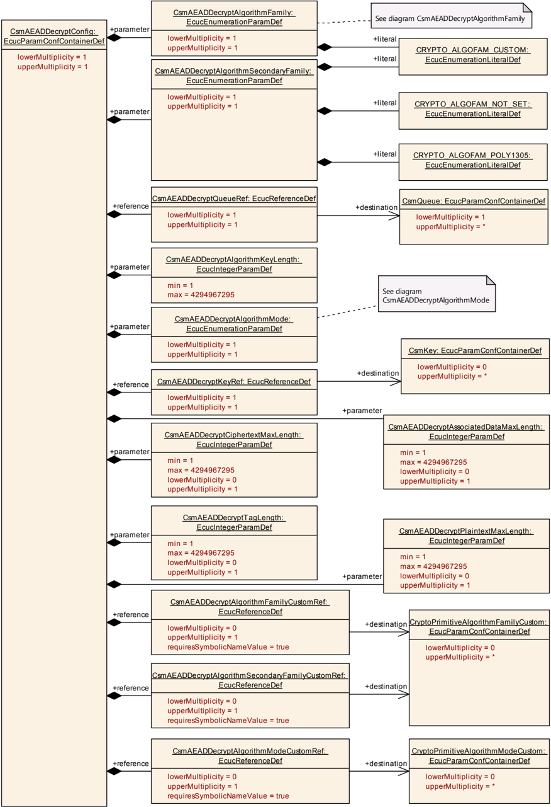

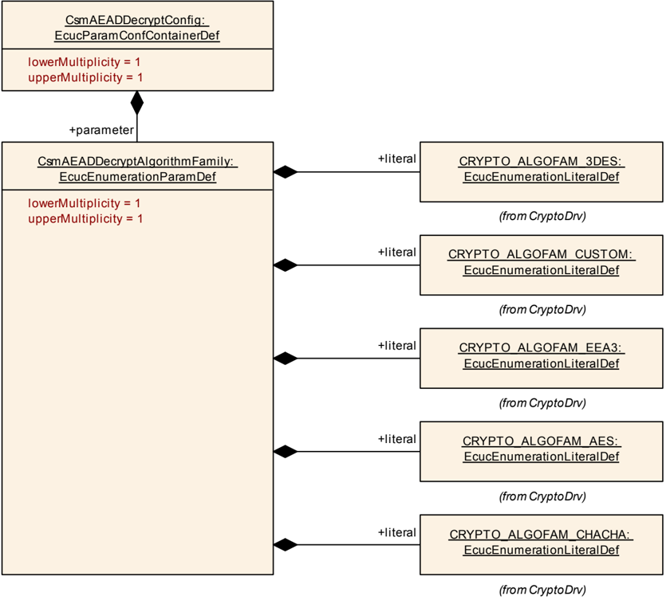

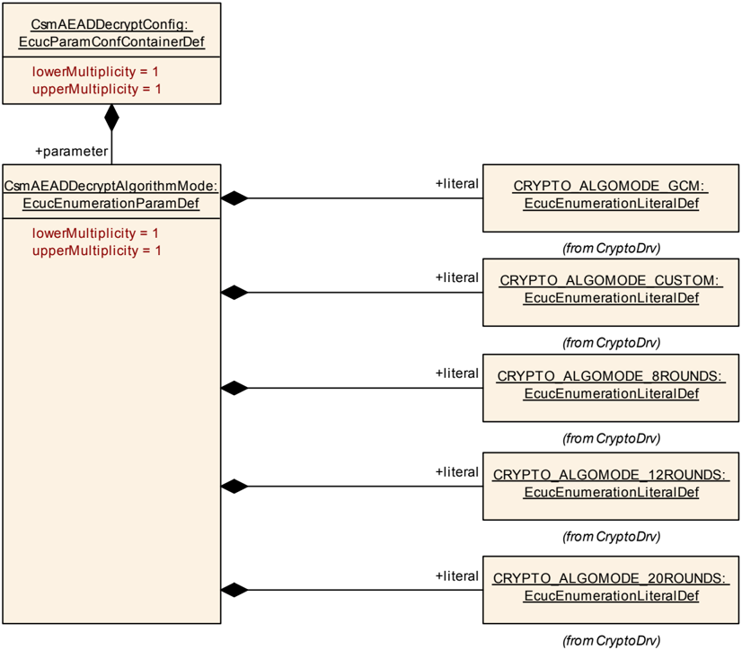

#### 9.1.25. CsmAEADDecrypt

| SWS 条目 | [ECUC_Csm_00027] |
|---|---|
| 容器名称 | CsmAEADDecrypt |
| 父容器 | CsmPrimitives |
| 描述 | AEAD 解密原语的配置。 |

| 容器名称 | 多重性 | 作用域/依赖 |
|---|---|---|
| CsmAEADDecryptConfig | 1 | CSM 解密接口配置的容器。容器名称用作解密接口标识符的符号名。 |

#### 9.1.26. CsmAEADDecryptConfig

| SWS 条目 | [ECUC_Csm_00080] |
|---|---|
| 容器名称 | CsmAEADDecryptConfig |
| 父容器 | CsmAEADDecrypt |
| 描述 | CSM 解密接口配置的容器。容器名称用作解密接口标识符的符号名。 |
| 配置参数 | 见下方参数表 |

| SWS 条目 | [ECUC_Csm_00082] |
|---|---|
| 参数名称 | CsmAEADDecryptAlgorithmFamily |
| 父容器 | CsmAEADDecryptConfig |
| 描述 | 确定加密服务所使用的算法族。此参数定义算法的最主要部分。 |
| 多重性 | 1 |
| 类型 | EcucEnumerationParamDef |
| 范围 | CRYPTO_ALGOFAM_3DES：--；CRYPTO_ALGOFAM_AES：--；CRYPTO_ALGOFAM_CHACHA：--；CRYPTO_ALGOFAM_CUSTOM：--；CRYPTO_ALGOFAM_EEA3：-- |
| Post-Build 变体值 | false |
| 多重性配置类 | Pre-compile time：X（All Variants）；Link time：-；Post-build time：- |
| 值配置类 | Pre-compile time：X（All Variants）；Link time：-；Post-build time：- |
| 作用域/依赖 | scope: local |

| SWS 条目 | [ECUC_Csm_00083] |
|---|---|
| 参数名称 | CsmAEADDecryptAlgorithmKeyLength |
| 父容器 | CsmAEADDecryptConfig |
| 描述 | AEAD 解密密钥的大小（单位为字节） |
| 多重性 | 1 |
| 类型 | EcucIntegerParamDef |
| 范围 | 1 .. 4294967295 |
| 默认值 | - |
| Post-Build 变体值 | false |
| 多重性配置类 | Pre-compile time：X（All Variants）；Link time：-；Post-build time：- |
| 值配置类 | Pre-compile time：X（All Variants）；Link time：-；Post-build time：- |
| 作用域/依赖 | scope: local |

| SWS 条目 | [ECUC_Csm_00084] |
|---|---|
| 参数名称 | CsmAEADDecryptAlgorithmMode |
| 父容器 | CsmAEADDecryptConfig |
| 描述 | 确定加密服务所使用的算法模式 |
| 多重性 | 1 |
| 类型 | EcucEnumerationParamDef |
| 范围 | CRYPTO_ALGOMODE_12ROUNDS：--；CRYPTO_ALGOMODE_20ROUNDS：--；CRYPTO_ALGOMODE_8ROUNDS：--；CRYPTO_ALGOMODE_CUSTOM：--；CRYPTO_ALGOMODE_GCM：-- |
| Post-Build 变体值 | false |
| 多重性配置类 | Pre-compile time：X（All Variants）；Link time：-；Post-build time：- |
| 值配置类 | Pre-compile time：X（All Variants）；Link time：-；Post-build time：- |
| 作用域/依赖 | scope: local |

| SWS 条目 | [ECUC_Csm_00277] |
|---|---|
| 参数名称 | CsmAEADDecryptAlgorithmSecondaryFamily |
| 父容器 | CsmAEADDecryptConfig |
| 描述 | 定义加密服务所使用的辅助算法族 |
| 多重性 | 1 |
| 类型 | EcucEnumerationParamDef |
| 范围 | CRYPTO_ALGOFAM_CUSTOM：--；CRYPTO_ALGOFAM_NOT_SET：--；CRYPTO_ALGOFAM_POLY1305：-- |
| 值配置类 | Pre-compile time：X（All Variants）；Link time：-；Post-build time：- |
| 作用域/依赖 | scope: local |

| SWS 条目 | [ECUC_Csm_00163] |
|---|---|
| 参数名称 | CsmAEADDecryptAssociatedDataMaxLength |
| 父容器 | CsmAEADDecryptConfig |
| 描述 | 若此原语被 Csm 作业引用，则为同步 RTE 服务接口的输入关联数据缓冲区的大小。其他 BSW 模块也可能使用该长度参数进行缓冲区大小计算。 |
| 多重性 | 0..1 |
| 类型 | EcucIntegerParamDef |
| 范围 | 1 .. 4294967295 |
| 默认值 | - |
| Post-Build 变体值 | false |
| 多重性配置类 | Pre-compile time：X（All Variants）；Link time：-；Post-build time：- |
| 值配置类 | Pre-compile time：X（All Variants）；Link time：-；Post-build time：- |
| 作用域/依赖 | scope: local；dependency: 仅当 CsmJobInterfaceUsePort 配置为 CRYPTO_USE_PORT 时，此参数才相关。 |

| SWS 条目 | [ECUC_Csm_00162] |
|---|---|
| 参数名称 | CsmAEADDecryptCiphertextMaxLength |
| 父容器 | CsmAEADDecryptConfig |
| 描述 | 若此原语被 Csm 作业引用，则为同步 RTE 服务接口的输入密文缓冲区的大小。其他 BSW 模块也可能使用该长度参数进行缓冲区大小计算。 |
| 多重性 | 0..1 |
| 类型 | EcucIntegerParamDef |
| 范围 | 1 .. 4294967295 |
| 默认值 | - |
| Post-Build 变体值 | false |
| 多重性配置类 | Pre-compile time：X（All Variants）；Link time：-；Post-build time：- |
| 值配置类 | Pre-compile time：X（All Variants）；Link time：-；Post-build time：- |
| 作用域/依赖 | scope: local；dependency: 仅当 CsmJobInterfaceUsePort 配置为 CRYPTO_USE_PORT 时，此参数才相关 |

| SWS 条目 | [ECUC_Csm_00165] |
|---|---|
| 参数名称 | CsmAEADDecryptPlaintextMaxLength |
| 父容器 | CsmAEADDecryptConfig |
| 描述 | 若此原语被 Csm 作业引用，则为同步 RTE 服务接口的输出明文缓冲区的大小。其他 BSW 模块也可能使用该长度参数进行缓冲区大小计算。 |
| 多重性 | 0..1 |
| 类型 | EcucIntegerParamDef |
| 范围 | 1 .. 4294967295 |
| 默认值 | - |
| Post-Build 变体值 | false |
| 多重性配置类 | Pre-compile time：X（All Variants）；Link time：-；Post-build time：- |
| 值配置类 | Pre-compile time：X（All Variants）；Link time：-；Post-build time：- |
| 作用域/依赖 | scope: local；dependency: 仅当 CsmJobInterfaceUsePort 配置为 CRYPTO_USE_PORT 时，此参数才相关。 |

| SWS 条目 | [ECUC_Csm_00164] |
|---|---|
| 参数名称 | CsmAEADDecryptTagLength |
| 父容器 | CsmAEADDecryptConfig |
| 描述 | 若此原语被 Csm 作业引用，则为同步 RTE 服务接口的输入标签缓冲区的大小（单位为 BIT）。其他 BSW 模块也可能使用该长度参数进行缓冲区大小计算。" |
| 多重性 | 0..1 |
| 类型 | EcucIntegerParamDef |
| 范围 | 1 .. 4294967295 |
| 默认值 | - |
| Post-Build 变体值 | false |
| 多重性配置类 | Pre-compile time：X（All Variants）；Link time：-；Post-build time：- |
| 值配置类 | Pre-compile time：X（All Variants）；Link time：-；Post-build time：- |
| 作用域/依赖 | scope: local；dependency: 仅当 CsmJobInterfaceUsePort 配置为 CRYPTO_USE_PORT 时，此参数才相关。 |

| SWS 条目 | [ECUC_Csm_00300] |
|---|---|
| 参数名称 | CsmAEADDecryptAlgorithmFamilyCustomRef |
| 父容器 | CsmAEADDecryptConfig |
| 描述 | 对客户特定的算法族自定义容器的引用 |
| 多重性 | 0..1 |
| 类型 | 对 CryptoPrimitiveAlgorithmFamilyCustom 的符号名引用 |
| 多重性配置类 | Pre-compile time：X（All Variants）；Link time：-；Post-build time：- |
| 值配置类 | Pre-compile time：X（All Variants）；Link time：-；Post-build time：- |
| 作用域/依赖 | scope: local；dependency: 仅当 CsmAEADDecryptAlgorithmFamily 设置为 CRYPTO_ALGOFAM_CUSTOM 时，才应存在此引用。 |

| SWS 条目 | [ECUC_Csm_00301] |
|---|---|
| 参数名称 | CsmAEADDecryptAlgorithmModeCustomRef |
| 父容器 | CsmAEADDecryptConfig |
| 描述 | 对客户特定的算法模式自定义容器的引用 |
| 多重性 | 0..1 |
| 类型 | 对 CryptoPrimitiveAlgorithmModeCustom 的符号名引用 |
| 多重性配置类 | Pre-compile time：X（All Variants）；Link time：-；Post-build time：- |
| 值配置类 | Pre-compile time：X（All Variants）；Link time：-；Post-build time：- |
| 作用域/依赖 | scope: local；dependency: 仅当 CsmAEADDecryptAlgorithmMode 设置为 CRYPTO_ALGOMODE_CUSTOM 时，才应存在此引用。 |

| SWS 条目 | [ECUC_Csm_00302] |
|---|---|
| 参数名称 | CsmAEADDecryptAlgorithmSecondaryFamilyCustomRef |
| 父容器 | CsmAEADDecryptConfig |
| 描述 | 对加密驱动程序中客户特定的算法族容器的引用 |
| 多重性 | 0..1 |
| 类型 | 对 CryptoPrimitiveAlgorithmFamilyCustom 的符号名引用 |
| 多重性配置类 | Pre-compile time：X（All Variants）；Link time：-；Post-build time：- |
| 值配置类 | Pre-compile time：X（All Variants）；Link time：-；Post-build time：- |
| 作用域/依赖 | scope: local；dependency: 仅当 CsmAEADDecryptSecondaryAlgorithmFamily 设置为 CRYPTO_ALGOFAM_CUSTOM 时，才应存在此引用。 |

| SWS 条目 | [ECUC_Csm_00086] |
|---|---|
| 参数名称 | CsmAEADDecryptKeyRef |
| 父容器 | CsmAEADDecryptConfig |
| 描述 | 此参数引用该解密原语所使用的密钥。 |
| 多重性 | 1 |
| 类型 | 对 CsmKey 的引用 |
| Post-Build 变体值 | false |
| 多重性配置类 | Pre-compile time：X（All Variants）；Link time：-；Post-build time：- |
| 值配置类 | Pre-compile time：X（All Variants）；Link time：-；Post-build time：- |
| 作用域/依赖 | scope: local |

| SWS 条目 | [ECUC_Csm_00081] |
|---|---|
| 参数名称 | CsmAEADDecryptQueueRef |
| 父容器 | CsmAEADDecryptConfig |
| 描述 | 此参数引用该解密原语所使用的队列。 |
| 多重性 | 1 |
| 类型 | 对 CsmQueue 的引用 |
| Post-Build 变体值 | false |
| 多重性配置类 | Pre-compile time：X（All Variants）；Link time：-；Post-build time：- |
| 值配置类 | Pre-compile time：X（All Variants）；Link time：-；Post-build time：- |
| 作用域/依赖 | scope: local |

该容器不包含任何子容器。

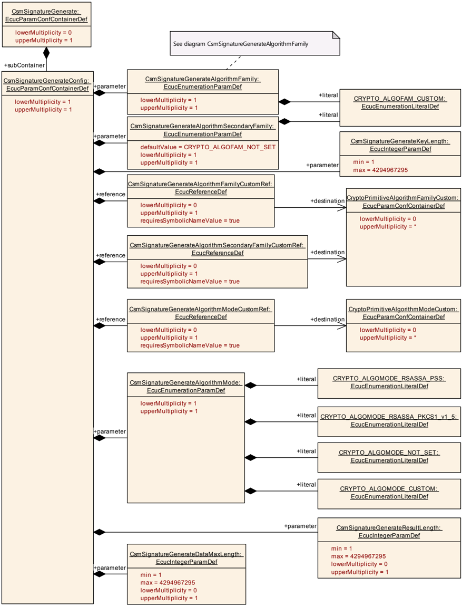

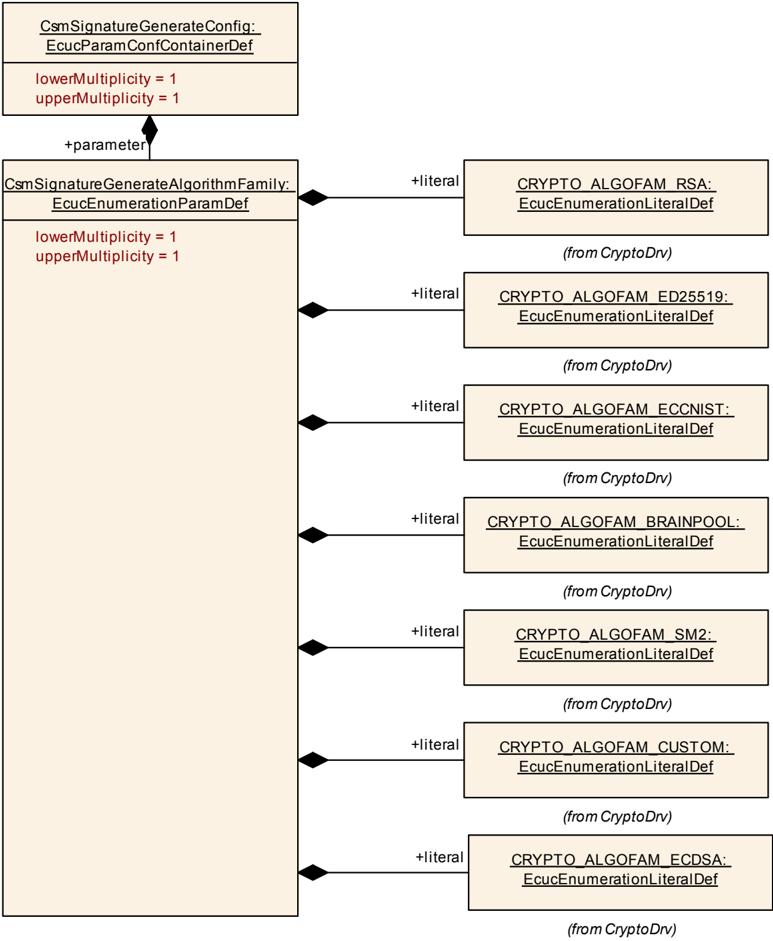

#### 9.1.27. CsmSignatureGenerate

| SWS 条目 | [ECUC_Csm_00028] |
|---|---|
| 容器名称 | CsmSignatureGenerate |
| 父容器 | CsmPrimitives |
| 描述 | SignatureGenerate 原语的配置。 |

| 容器名称 | 多重性 | 作用域/依赖 |
|---|---|---|
| CsmSignatureGenerateConfig | 1 | CSM 签名生成接口配置的容器。容器名称用作签名生成接口标识符的符号名。 |

#### 9.1.28. CsmSignatureGenerateConfig

| SWS 条目 | [ECUC_Csm_00087] |
|---|---|
| 容器名称 | CsmSignatureGenerateConfig |
| 父容器 | CsmSignatureGenerate |
| 描述 | CSM 签名生成接口配置的容器。容器名称用作签名生成接口标识符的符号名。 |
| 配置参数 | 见下方参数表 |

| SWS 条目 | [ECUC_Csm_00089] |
|---|---|
| 参数名称 | CsmSignatureGenerateAlgorithmFamily |
| 父容器 | CsmSignatureGenerateConfig |
| 描述 | 确定加密服务所使用的算法族。此参数定义算法的最主要部分。 |
| 多重性 | 1 |
| 类型 | EcucEnumerationParamDef |
| 范围 | CRYPTO_ALGOFAM_BRAINPOOL：--；CRYPTO_ALGOFAM_CUSTOM：--；CRYPTO_ALGOFAM_ECCNIST：--；CRYPTO_ALGOFAM_ECDSA：--；CRYPTO_ALGOFAM_ED25519：--；CRYPTO_ALGOFAM_RSA：--；CRYPTO_ALGOFAM_SM2：-- |
| Post-Build 变体值 | false |
| 多重性配置类 | Pre-compile time：X（All Variants）；Link time：-；Post-build time：- |
| 值配置类 | Pre-compile time：X（All Variants）；Link time：-；Post-build time：- |
| 作用域/依赖 | scope: local |

| SWS 条目 | [ECUC_Csm_00091] |
|---|---|
| 参数名称 | CsmSignatureGenerateAlgorithmMode |
| 父容器 | CsmSignatureGenerateConfig |
| 描述 | 确定加密服务所使用的算法模式 |
| 多重性 | 1 |
| 类型 | EcucEnumerationParamDef |
| 范围 | CRYPTO_ALGOMODE_CUSTOM：--；CRYPTO_ALGOMODE_NOT_SET：--；CRYPTO_ALGOMODE_RSASSA_PKCS1_v1_5：--；CRYPTO_ALGOMODE_RSASSA_PSS：-- |
| Post-Build 变体值 | false |
| 多重性配置类 | Pre-compile time：X（All Variants）；Link time：-；Post-build time：- |
| 值配置类 | Pre-compile time：X（All Variants）；Link time：-；Post-build time：- |
| 作用域/依赖 | scope: local |

| SWS 条目 | [ECUC_Csm_00183] |
|---|---|
| 参数名称 | CsmSignatureGenerateAlgorithmSecondaryFamily |
| 父容器 | CsmSignatureGenerateConfig |
| 描述 | 确定加密服务所使用的算法模式 |
| 多重性 | 1 |
| 类型 | EcucEnumerationParamDef |
| 范围 | CRYPTO_ALGOFAM_BLAKE_1_256：--；CRYPTO_ALGOFAM_BLAKE_1_512：--；CRYPTO_ALGOFAM_BLAKE_2s_256：--；CRYPTO_ALGOFAM_BLAKE_2s_512：--；CRYPTO_ALGOFAM_CUSTOM：--；CRYPTO_ALGOFAM_NOT_SET：--；CRYPTO_ALGOFAM_RIPEMD160：--；CRYPTO_ALGOFAM_SHA1：--；CRYPTO_ALGOFAM_SHA2_224：--；CRYPTO_ALGOFAM_SHA2_256：--；CRYPTO_ALGOFAM_SHA2_384：--；CRYPTO_ALGOFAM_SHA2_512：--；CRYPTO_ALGOFAM_SHA2_512_224：--；CRYPTO_ALGOFAM_SHA2_512_256：--；CRYPTO_ALGOFAM_SHA3_224：--；CRYPTO_ALGOFAM_SHA3_256：--；CRYPTO_ALGOFAM_SHA3_384：--；CRYPTO_ALGOFAM_SHA3_512：--；CRYPTO_ALGOFAM_SHAKE128：--；CRYPTO_ALGOFAM_SHAKE256：-- |
| 默认值 | CRYPTO_ALGOFAM_NOT_SET |
| Post-Build 变体值 | false |
| 多重性配置类 | Pre-compile time：X（All Variants）；Link time：-；Post-build time：- |
| 值配置类 | Pre-compile time：X（All Variants）；Link time：-；Post-build time：- |
| 作用域/依赖 | scope: local |

| SWS 条目 | [ECUC_Csm_00169] |
|---|---|
| 参数名称 | CsmSignatureGenerateDataMaxLength |
| 父容器 | CsmSignatureGenerateConfig |
| 描述 | 若此原语被 Csm 作业引用，则为同步 RTE 服务接口的输入数据缓冲区的大小。其他 BSW 模块也可能使用该长度参数进行缓冲区大小计算。 |
| 多重性 | 0..1 |
| 类型 | EcucIntegerParamDef |
| 范围 | 1 .. 4294967295 |
| 默认值 | - |
| Post-Build 变体值 | false |
| 多重性配置类 | Pre-compile time：X（All Variants）；Link time：-；Post-build time：- |
| 值配置类 | Pre-compile time：X（All Variants）；Link time：-；Post-build time：- |
| 作用域/依赖 | scope: local；dependency: 仅当 CsmJobInterfaceUsePort 配置为 CRYPTO_USE_PORT 时，此参数才相关。 |

| SWS 条目 | [ECUC_Csm_00090] |
|---|---|
| 参数名称 | CsmSignatureGenerateKeyLength |
| 父容器 | CsmSignatureGenerateConfig |
| 描述 | 签名生成密钥的大小（单位为字节）。 |
| 多重性 | 1 |
| 类型 | EcucIntegerParamDef |
| 范围 | 1 .. 4294967295 |
| 默认值 | - |
| Post-Build 变体值 | false |
| 多重性配置类 | Pre-compile time：X（All Variants）；Link time：-；Post-build time：- |
| 值配置类 | Pre-compile time：X（All Variants）；Link time：-；Post-build time：- |
| 作用域/依赖 | scope: local |

| SWS 条目 | [ECUC_Csm_00170] |
|---|---|
| 参数名称 | CsmSignatureGenerateResultLength |
| 父容器 | CsmSignatureGenerateConfig |
| 描述 | 若此原语被 Csm 作业引用，则为同步 RTE 服务接口的结果数据缓冲区的大小。其他 BSW 模块也可能使用该长度参数进行缓冲区大小计算。 |
| 多重性 | 0..1 |
| 类型 | EcucIntegerParamDef |
| 范围 | 1 .. 4294967295 |
| 默认值 | - |
| Post-Build 变体值 | false |
| 多重性配置类 | Pre-compile time：X（All Variants）；Link time：-；Post-build time：- |
| 值配置类 | Pre-compile time：X（All Variants）；Link time：-；Post-build time：- |
| 作用域/依赖 | scope: local；dependency: 仅当 CsmJobInterfaceUsePort 配置为 CRYPTO_USE_PORT 时，此参数才相关。 |

| SWS 条目 | [ECUC_Csm_00303] |
|---|---|
| 参数名称 | CsmSignatureGenerateAlgorithmFamilyCustomRef |
| 父容器 | CsmSignatureGenerateConfig |
| 描述 | 对客户特定的算法族自定义容器的引用 |
| 多重性 | 0..1 |
| 类型 | 对 CryptoPrimitiveAlgorithmFamilyCustom 的符号名引用 |
| 多重性配置类 | Pre-compile time：X（All Variants）；Link time：-；Post-build time：- |
| 值配置类 | Pre-compile time：X（All Variants）；Link time：-；Post-build time：- |
| 作用域/依赖 | scope: local；dependency: 仅当 CsmSignatureGenerateAlgorithmFamily 设置为 CRYPTO_ALGOFAM_CUSTOM 时，才应存在此引用。 |

| SWS 条目 | [ECUC_Csm_00304] |
|---|---|
| 参数名称 | CsmSignatureGenerateAlgorithmModeCustomRef |
| 父容器 | CsmSignatureGenerateConfig |
| 描述 | 对客户特定的算法模式自定义容器的引用 |
| 多重性 | 0..1 |
| 类型 | 对 CryptoPrimitiveAlgorithmModeCustom 的符号名引用 |
| 多重性配置类 | Pre-compile time：X（All Variants）；Link time：-；Post-build time：- |
| 值配置类 | Pre-compile time：X（All Variants）；Link time：-；Post-build time：- |
| 作用域/依赖 | scope: local；dependency: 仅当 CsmSignatureGenerateAlgorithmMode 设置为 CRYPTO_ALGOMODE_CUSTOM 时，才应存在此引用。 |

| SWS 条目 | [ECUC_Csm_00305] |
|---|---|
| 参数名称 | CsmSignatureGenerateAlgorithmSecondaryFamilyCustomRef |
| 父容器 | CsmSignatureGenerateConfig |
| 描述 | 对加密驱动程序中客户特定的算法族容器的引用 |
| 多重性 | 0..1 |
| 类型 | 对 CryptoPrimitiveAlgorithmFamilyCustom 的符号名引用 |
| 多重性配置类 | Pre-compile time：X（All Variants）；Link time：-；Post-build time：- |
| 值配置类 | Pre-compile time：X（All Variants）；Link time：-；Post-build time：- |
| 作用域/依赖 | scope: local；dependency: 仅当 CsmSignatureGenerateSecondaryAlgorithmFamily 设置为 CRYPTO_ALGOFAM_CUSTOM 时，才应存在此引用。 |

该容器不包含任何子容器。

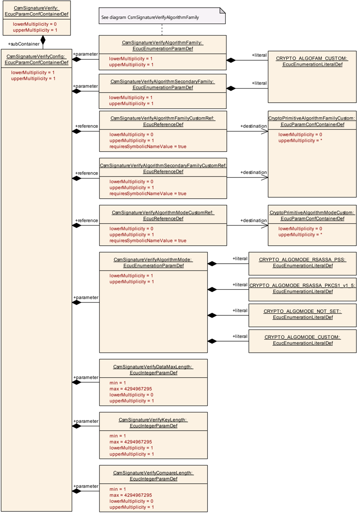

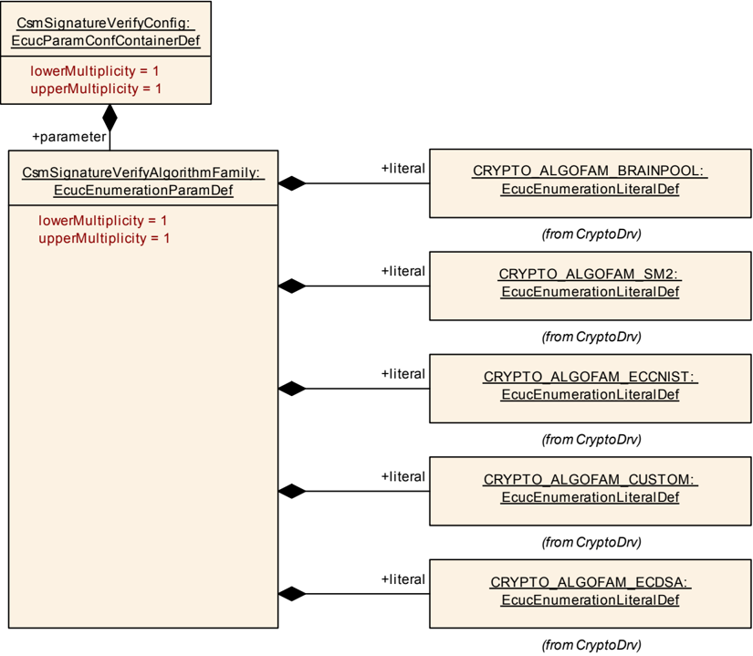

#### 9.1.29. CsmSignatureVerify

| SWS 条目 | [ECUC_Csm_00029] |
|---|---|
| 容器名称 | CsmSignatureVerify |
| 父容器 | CsmPrimitives |
| 描述 | SignatureVerify 原语的配置。 |

| 容器名称 | 多重性 | 作用域/依赖 |
|---|---|---|
| CsmSignatureVerifyConfig | 1 | CSM 签名验证接口配置的容器。容器名称用作签名验证接口标识符的符号名。 |

#### 9.1.30. CsmSignatureVerifyConfig

| SWS 条目 | [ECUC_Csm_00094] |
|---|---|
| 容器名称 | CsmSignatureVerifyConfig |
| 父容器 | CsmSignatureVerify |
| 描述 | CSM 签名验证接口配置的容器。容器名称用作签名验证接口标识符的符号名。 |
| 配置参数 | 见下方参数表 |

| SWS 条目 | [ECUC_Csm_00096] |
|---|---|
| 参数名称 | CsmSignatureVerifyAlgorithmFamily |
| 父容器 | CsmSignatureVerifyConfig |
| 描述 | 确定加密服务所使用的算法族。此参数定义算法的最主要部分。 |
| 多重性 | 1 |
| 类型 | EcucEnumerationParamDef |
| 范围 | CRYPTO_ALGOFAM_BRAINPOOL：--；CRYPTO_ALGOFAM_CUSTOM：--；CRYPTO_ALGOFAM_ECCNIST：--；CRYPTO_ALGOFAM_ECDSA：--；CRYPTO_ALGOFAM_ED25519：--；CRYPTO_ALGOFAM_RSA：--；CRYPTO_ALGOFAM_SM2：-- |
| Post-Build 变体值 | false |
| 多重性配置类 | Pre-compile time：X（All Variants）；Link time：-；Post-build time：- |
| 值配置类 | Pre-compile time：X（All Variants）；Link time：-；Post-build time：- |
| 作用域/依赖 | scope: local |

| SWS 条目 | [ECUC_Csm_00098] |
|---|---|
| 参数名称 | CsmSignatureVerifyAlgorithmMode |
| 父容器 | CsmSignatureVerifyConfig |
| 描述 | 确定加密服务所使用的算法模式 |
| 多重性 | 1 |
| 类型 | EcucEnumerationParamDef |
| 范围 | CRYPTO_ALGOMODE_CUSTOM：--；CRYPTO_ALGOMODE_NOT_SET：--；CRYPTO_ALGOMODE_RSASSA_PKCS1_v1_5：--；CRYPTO_ALGOMODE_RSASSA_PSS：-- |
| Post-Build 变体值 | false |
| 多重性配置类 | Pre-compile time：X（All Variants）；Link time：-；Post-build time：- |
| 值配置类 | Pre-compile time：X（All Variants）；Link time：-；Post-build time：- |
| 作用域/依赖 | scope: local |

| SWS 条目 | [ECUC_Csm_00172] |
|---|---|
| 参数名称 | CsmSignatureVerifyAlgorithmSecondaryFamily |
| 父容器 | CsmSignatureVerifyConfig |
| 描述 | 确定加密服务所使用的算法族。此参数定义算法的最主要部分。 |
| 多重性 | 1 |
| 类型 | EcucEnumerationParamDef |
| 范围 | CRYPTO_ALGOFAM_BLAKE_1_256：--；CRYPTO_ALGOFAM_BLAKE_1_512：--；CRYPTO_ALGOFAM_BLAKE_2s_256：--；CRYPTO_ALGOFAM_BLAKE_2s_512：--；CRYPTO_ALGOFAM_CUSTOM：--；CRYPTO_ALGOFAM_NOT_SET：--；CRYPTO_ALGOFAM_RIPEMD160：--；CRYPTO_ALGOFAM_SHA1：--；CRYPTO_ALGOFAM_SHA2_224：--；CRYPTO_ALGOFAM_SHA2_256：--；CRYPTO_ALGOFAM_SHA2_384：--；CRYPTO_ALGOFAM_SHA2_512：--；CRYPTO_ALGOFAM_SHA2_512_224：--；CRYPTO_ALGOFAM_SHA2_512_256：--；CRYPTO_ALGOFAM_SHA3_224：--；CRYPTO_ALGOFAM_SHA3_256：--；CRYPTO_ALGOFAM_SHA3_384：--；CRYPTO_ALGOFAM_SHA3_512：--；CRYPTO_ALGOFAM_SHAKE128：--；CRYPTO_ALGOFAM_SHAKE256：-- |
| Post-Build 变体值 | false |
| 多重性配置类 | Pre-compile time：X（All Variants）；Link time：-；Post-build time：- |
| 值配置类 | Pre-compile time：X（All Variants）；Link time：-；Post-build time：- |
| 作用域/依赖 | scope: local |

| SWS 条目 | [ECUC_Csm_00176] |
|---|---|
| 参数名称 | CsmSignatureVerifyCompareLength |
| 父容器 | CsmSignatureVerifyConfig |
| 描述 | 若此原语被 Csm 作业引用，则为同步 RTE 服务接口的输入签名缓冲区的大小。其他 BSW 模块也可能使用该长度参数进行缓冲区大小计算。 |
| 多重性 | 0..1 |
| 类型 | EcucIntegerParamDef |
| 范围 | 1 .. 4294967295 |
| 默认值 | - |
| Post-Build 变体值 | false |
| 多重性配置类 | Pre-compile time：X（All Variants）；Link time：-；Post-build time：- |
| 值配置类 | Pre-compile time：X（All Variants）；Link time：-；Post-build time：- |
| 作用域/依赖 | scope: local；dependency: 仅当 CsmJobInterfaceUsePort 配置为 CRYPTO_USE_PORT 时，此参数才相关。 |

| SWS 条目 | [ECUC_Csm_00175] |
|---|---|
| 参数名称 | CsmSignatureVerifyDataMaxLength |
| 父容器 | CsmSignatureVerifyConfig |
| 描述 | 若此原语被 Csm 作业引用，则为同步 RTE 服务接口的输入数据缓冲区的大小。其他 BSW 模块也可能使用该长度参数进行缓冲区大小计算。 |
| 多重性 | 0..1 |
| 类型 | EcucIntegerParamDef |
| 范围 | 1 .. 4294967295 |
| 默认值 | - |
| Post-Build 变体值 | false |
| 多重性配置类 | Pre-compile time：X（All Variants）；Link time：-；Post-build time：- |
| 值配置类 | Pre-compile time：X（All Variants）；Link time：-；Post-build time：- |
| 作用域/依赖 | scope: local；dependency: 仅当 CsmJobInterfaceUsePort 配置为 CRYPTO_USE_PORT 时，此参数才相关。 |

| SWS 条目 | [ECUC_Csm_00192] |
|---|---|
| 参数名称 | CsmSignatureVerifyKeyLength |
| 父容器 | CsmSignatureVerifyConfig |
| 描述 | 签名验证密钥的大小（单位为字节）。 |
| 多重性 | 1 |
| 类型 | EcucIntegerParamDef |
| 范围 | 1 .. 4294967295 |
| 默认值 | - |
| Post-Build 变体值 | false |
| 多重性配置类 | Pre-compile time：X（All Variants）；Link time：-；Post-build time：- |
| 值配置类 | Pre-compile time：X（All Variants）；Link time：-；Post-build time：- |
| 作用域/依赖 | scope: local |

| SWS 条目 | [ECUC_Csm_00306] |
|---|---|
| 参数名称 | CsmSignatureVerifyAlgorithmFamilyCustomRef |
| 父容器 | CsmSignatureVerifyConfig |
| 描述 | 对客户特定的算法族自定义容器的引用 |
| 多重性 | 0..1 |
| 类型 | 对 CryptoPrimitiveAlgorithmFamilyCustom 的符号名引用 |
| 多重性配置类 | Pre-compile time：X（All Variants）；Link time：-；Post-build time：- |
| 值配置类 | Pre-compile time：X（All Variants）；Link time：-；Post-build time：- |
| 作用域/依赖 | scope: local；dependency: 仅当 CsmSignatureVerifyAlgorithmFamily 设置为 CRYPTO_ALGOFAM_CUSTOM 时，才应存在此引用。 |

| SWS 条目 | [ECUC_Csm_00307] |
|---|---|
| 参数名称 | CsmSignatureVerifyAlgorithmModeCustomRef |
| 父容器 | CsmSignatureVerifyConfig |
| 描述 | 对客户特定的算法模式自定义容器的引用 |
| 多重性 | 0..1 |
| 类型 | 对 CryptoPrimitiveAlgorithmModeCustom 的符号名引用 |
| 多重性配置类 | Pre-compile time：X（All Variants）；Link time：-；Post-build time：- |
| 值配置类 | Pre-compile time：X（All Variants）；Link time：-；Post-build time：- |
| 作用域/依赖 | scope: local；dependency: 仅当 CsmSignatureVerifyAlgorithmMode 设置为 CRYPTO_ALGOMODE_CUSTOM 时，才应存在此引用。 |

| SWS 条目 | [ECUC_Csm_00308] |
|---|---|
| 参数名称 | CsmSignatureVerifyAlgorithmSecondaryFamilyCustomRef |
| 父容器 | CsmSignatureVerifyConfig |
| 描述 | 对加密驱动程序中客户特定的算法族容器的引用 |
| 多重性 | 0..1 |
| 类型 | 对 CryptoPrimitiveAlgorithmFamilyCustom 的符号名引用 |
| 多重性配置类 | Pre-compile time：X（All Variants）；Link time：-；Post-build time：- |
| 值配置类 | Pre-compile time：X（All Variants）；Link time：-；Post-build time：- |
| 作用域/依赖 | scope: local；dependency: 仅当 CsmSignatureVerifySecondaryAlgorithmFamily 设置为 CRYPTO_ALGOFAM_CUSTOM 时，才应存在此引用。 |

该容器不包含任何子容器。

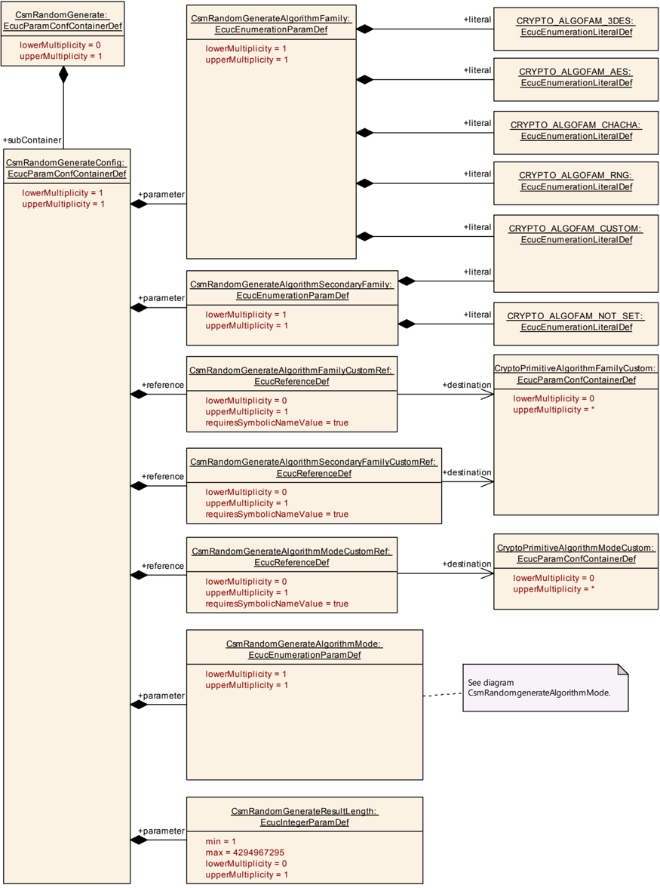

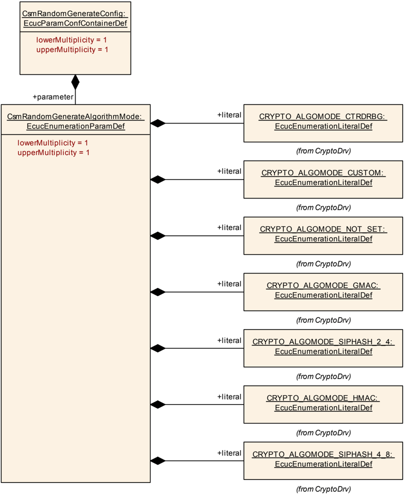

#### 9.1.31. CsmRandomGenerate

| SWS 条目 | [ECUC_Csm_00031] |
|---|---|
| 容器名称 | CsmRandomGenerate |
| 父容器 | CsmPrimitives |
| 描述 | RandomGenerate 原语的配置。 |

| 容器名称 | 多重性 | 作用域/依赖 |
|---|---|---|
| CsmRandomGenerateConfig | 1 | CSM 随机数发生器配置的容器。容器名称用作随机数发生器配置标识符的符号名。 |

#### 9.1.32. CsmRandomGenerateConfig

| SWS 条目 | [ECUC_Csm_00103] |
|---|---|
| 容器名称 | CsmRandomGenerateConfig |
| 父容器 | CsmRandomGenerate |
| 描述 | CSM 随机数发生器配置的容器。容器名称用作随机数发生器配置标识符的符号名。 |
| 配置参数 | 见下方参数表 |

| SWS 条目 | [ECUC_Csm_00105] |
|---|---|
| 参数名称 | CsmRandomGenerateAlgorithmFamily |
| 父容器 | CsmRandomGenerateConfig |
| 描述 | 确定加密服务所使用的算法族。此参数定义算法的最主要部分。 |
| 多重性 | 1 |
| 类型 | EcucEnumerationParamDef |
| 范围 | CRYPTO_ALGOFAM_3DES：--；CRYPTO_ALGOFAM_AES：--；CRYPTO_ALGOFAM_BLAKE_1_256：--；CRYPTO_ALGOFAM_BLAKE_1_512：--；CRYPTO_ALGOFAM_BLAKE_2s_256：--；CRYPTO_ALGOFAM_BLAKE_2s_512：--；CRYPTO_ALGOFAM_CHACHA：--；CRYPTO_ALGOFAM_CUSTOM：--；CRYPTO_ALGOFAM_EEA3：--；CRYPTO_ALGOFAM_RIPEMD160：--；CRYPTO_ALGOFAM_RNG：--；CRYPTO_ALGOFAM_SHA1：--；CRYPTO_ALGOFAM_SHA2_224：--；CRYPTO_ALGOFAM_SHA2_256：--；CRYPTO_ALGOFAM_SHA2_384：--；CRYPTO_ALGOFAM_SHA2_512：--；CRYPTO_ALGOFAM_SHA2_512_224：--；CRYPTO_ALGOFAM_SHA2_512_256：--；CRYPTO_ALGOFAM_SHA3_224：--；CRYPTO_ALGOFAM_SHA3_256：--；CRYPTO_ALGOFAM_SHA3_384：--；CRYPTO_ALGOFAM_SHA3_512：--；CRYPTO_ALGOFAM_SHAKE128：--；CRYPTO_ALGOFAM_SHAKE256：--；CRYPTO_ALGOFAM_SM3：-- |
| Post-Build 变体值 | false |
| 多重性配置类 | Pre-compile time：X（All Variants）；Link time：-；Post-build time：- |
| 值配置类 | Pre-compile time：X（All Variants）；Link time：-；Post-build time：- |
| 作用域/依赖 | scope: local |

| SWS 条目 | [ECUC_Csm_00107] |
|---|---|
| 参数名称 | CsmRandomGenerateAlgorithmMode |
| 父容器 | CsmRandomGenerateConfig |
| 描述 | 确定加密服务所使用的算法模式 |
| 多重性 | 1 |
| 类型 | EcucEnumerationParamDef |
| 范围 | CRYPTO_ALGOMODE_CTRDRBG：--；CRYPTO_ALGOMODE_CUSTOM：--；CRYPTO_ALGOMODE_GMAC：--；CRYPTO_ALGOMODE_HMAC：--；CRYPTO_ALGOMODE_NOT_SET：--；CRYPTO_ALGOMODE_SIPHASH_2_4：--；CRYPTO_ALGOMODE_SIPHASH_4_8：-- |
| Post-Build 变体值 | false |
| 多重性配置类 | Pre-compile time：X（All Variants）；Link time：-；Post-build time：- |
| 值配置类 | Pre-compile time：X（All Variants）；Link time：-；Post-build time：- |
| 作用域/依赖 | scope: local |

| SWS 条目 | [ECUC_Csm_00178] |
|---|---|
| 参数名称 | CsmRandomGenerateAlgorithmSecondaryFamily |
| 父容器 | CsmRandomGenerateConfig |
| 描述 | 确定加密服务所使用的算法族 |
| 多重性 | 1 |
| 类型 | EcucEnumerationParamDef |
| 范围 | CRYPTO_ALGOFAM_CUSTOM：--；CRYPTO_ALGOFAM_NOT_SET：-- |
| Post-Build 变体值 | false |
| 多重性配置类 | Pre-compile time：X（All Variants）；Link time：-；Post-build time：- |
| 值配置类 | Pre-compile time：X（All Variants）；Link time：-；Post-build time：- |
| 作用域/依赖 | scope: local |

| SWS 条目 | [ECUC_Csm_00106] |
|---|---|
| 参数名称 | CsmRandomGenerateResultLength |
| 父容器 | CsmRandomGenerateConfig |
| 描述 | 若此原语被 Csm 作业引用，则为同步 RTE 服务接口的结果数据缓冲区的大小。其他 BSW 模块也可能使用该长度参数进行缓冲区大小计算 |
| 多重性 | 0..1 |
| 类型 | EcucIntegerParamDef |
| 范围 | 1 .. 4294967295 |
| 默认值 | - |
| Post-Build 变体值 | false |
| 多重性配置类 | Pre-compile time：X（All Variants）；Link time：-；Post-build time：- |
| 值配置类 | Pre-compile time：X（All Variants）；Link time：-；Post-build time：- |
| 作用域/依赖 | scope: local；dependency: 仅当 CsmJobInterfaceUsePort 配置为 CRYPTO_USE_PORT 时，此参数才相关。 |

| SWS 条目 | [ECUC_Csm_00309] |
|---|---|
| 参数名称 | CsmRandomGenerateAlgorithmFamilyCustomRef |
| 父容器 | CsmRandomGenerateConfig |
| 描述 | 对客户特定的算法族自定义容器的引用 |
| 多重性 | 0..1 |
| 类型 | 对 CryptoPrimitiveAlgorithmFamilyCustom 的符号名引用 |
| 多重性配置类 | Pre-compile time：X（All Variants）；Link time：-；Post-build time：- |
| 值配置类 | Pre-compile time：X（All Variants）；Link time：-；Post-build time：- |
| 作用域/依赖 | scope: local；dependency: 仅当 CsmRandomGenerateAlgorithmFamily 设置为 CRYPTO_ALGOFAM_CUSTOM 时，才应存在此引用。 |

| SWS 条目 | [ECUC_Csm_00310] |
|---|---|
| 参数名称 | CsmRandomGenerateAlgorithmModeCustomRef |
| 父容器 | CsmRandomGenerateConfig |
| 描述 | 对客户特定的算法模式自定义容器的引用 |
| 多重性 | 0..1 |
| 类型 | 对 CryptoPrimitiveAlgorithmModeCustom 的符号名引用 |
| 多重性配置类 | Pre-compile time：X（All Variants）；Link time：-；Post-build time：- |
| 值配置类 | Pre-compile time：X（All Variants）；Link time：-；Post-build time：- |
| 作用域/依赖 | scope: local；dependency: 仅当 CsmRandomGenerateAlgorithmMode 设置为 CRYPTO_ALGOMODE_CUSTOM 时，才应存在此引用。 |

| SWS 条目 | [ECUC_Csm_00311] |
|---|---|
| 参数名称 | CsmRandomGenerateAlgorithmSecondaryFamilyCustomRef |
| 父容器 | CsmRandomGenerateConfig |
| 描述 | 对加密驱动程序中客户特定的算法族容器的引用 |
| 多重性 | 0..1 |
| 类型 | 对 CryptoPrimitiveAlgorithmFamilyCustom 的符号名引用 |
| 多重性配置类 | Pre-compile time：X（All Variants）；Link time：-；Post-build time：- |
| 值配置类 | Pre-compile time：X（All Variants）；Link time：-；Post-build time：- |
| 作用域/依赖 | scope: local；dependency: 仅当 CsmRandomGenerateSecondaryAlgorithmFamily 设置为 CRYPTO_ALGOFAM_CUSTOM 时，才应存在此引用。 |

该容器不包含任何子容器。

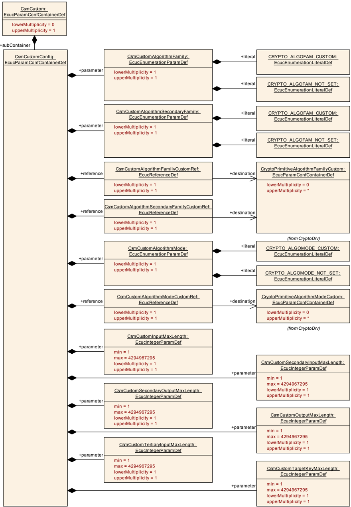

#### 9.1.33. CsmCustom

| SWS 条目 | [ECUC_Csm_00342] |
|---|---|
| 容器名称 | CsmCustom |
| 父容器 | CsmPrimitives |
| 描述 | CSM 自定义加密原语配置的容器。 |

| 容器名称 | 多重性 | 作用域/依赖 |
|---|---|---|
| CsmCustomConfig | 1 | 自定义原语配置配置参数的容器。 |

#### 9.1.34. CsmCustomConfig

| SWS 条目 | [ECUC_Csm_00343] |
|---|---|
| 容器名称 | CsmCustomConfig |
| 父容器 | CsmCustom |
| 描述 | 自定义原语配置配置参数的容器。 |
| 配置参数 | 见下方参数表 |

| SWS 条目 | [ECUC_Csm_00344] |
|---|---|
| 参数名称 | CsmCustomAlgorithmFamily |
| 父容器 | CsmCustomConfig |
| 描述 | 确定加密服务所使用的算法族。此参数定义算法的最主要部分。 |
| 多重性 | 1 |
| 类型 | EcucEnumerationParamDef |
| 范围 | CRYPTO_ALGOFAM_CUSTOM：--；CRYPTO_ALGOFAM_NOT_SET：-- |
| Post-Build 变体值 | false |
| 多重性配置类 | Pre-compile time：X（All Variants）；Link time：-；Post-build time：- |
| 值配置类 | Pre-compile time：X（All Variants）；Link time：-；Post-build time：- |
| 作用域/依赖 | scope: local |

| SWS 条目 | [ECUC_Csm_00346] |
|---|---|
| 参数名称 | CsmCustomAlgorithmMode |
| 父容器 | CsmCustomConfig |
| 描述 | 确定加密服务所使用的算法模式 |
| 多重性 | 1 |
| 类型 | EcucEnumerationParamDef |
| 范围 | CRYPTO_ALGOMODE_CUSTOM：--；CRYPTO_ALGOMODE_NOT_SET：-- |
| 多重性配置类 | Pre-compile time：X（All Variants）；Link time：-；Post-build time：- |
| 值配置类 | Pre-compile time：X（All Variants）；Link time：-；Post-build time：- |
| 作用域/依赖 | scope: local |

| SWS 条目 | [ECUC_Csm_00348] |
|---|---|
| 参数名称 | CsmCustomAlgorithmSecondaryFamily |
| 父容器 | CsmCustomConfig |
| 描述 | 确定加密服务所使用的算法模式 |
| 多重性 | 1 |
| 类型 | EcucEnumerationParamDef |
| 范围 | CRYPTO_ALGOFAM_CUSTOM：--；CRYPTO_ALGOFAM_NOT_SET：-- |
| Post-Build 变体值 | false |
| 多重性配置类 | Pre-compile time：X（All Variants）；Link time：-；Post-build time：- |
| 值配置类 | Pre-compile time：X（All Variants）；Link time：-；Post-build time：- |
| 作用域/依赖 | scope: local |

| SWS 条目 | [ECUC_Csm_00350] |
|---|---|
| 参数名称 | CsmCustomInputMaxLength |
| 父容器 | CsmCustomConfig |
| 描述 | 若此原语被 Csm 作业引用，则为同步 RTE 服务接口的输入数据缓冲区的大小。其他 BSW 模块也可能使用该长度参数进行缓冲区大小计算。 |
| 多重性 | 1 |
| 类型 | EcucIntegerParamDef |
| 范围 | 1 .. 4294967295 |
| 默认值 | - |
| Post-Build 变体值 | false |
| 多重性配置类 | Pre-compile time：X（All Variants）；Link time：-；Post-build time：- |
| 值配置类 | Pre-compile time：X（All Variants）；Link time：-；Post-build time：- |
| 作用域/依赖 | scope: local |

| SWS 条目 | [ECUC_Csm_00353] |
|---|---|
| 参数名称 | CsmCustomOutputMaxLength |
| 父容器 | CsmCustomConfig |
| 描述 | 若此原语被 Csm 作业引用，则为同步 RTE 服务接口的结果数据缓冲区的大小。其他 BSW 模块也可能使用该长度参数进行缓冲区大小计算。 |
| 多重性 | 1 |
| 类型 | EcucIntegerParamDef |
| 范围 | 1 .. 4294967295 |
| 默认值 | - |
| Post-Build 变体值 | false |
| 多重性配置类 | Pre-compile time：X（All Variants）；Link time：-；Post-build time：- |
| 值配置类 | Pre-compile time：X（All Variants）；Link time：-；Post-build time：- |
| 作用域/依赖 | scope: local |

| SWS 条目 | [ECUC_Csm_00351] |
|---|---|
| 参数名称 | CsmCustomSecondaryInputMaxLength |
| 父容器 | CsmCustomConfig |
| 描述 | 若此原语被 Csm 作业引用，则为同步 RTE 服务接口的输入数据缓冲区的大小。其他 BSW 模块也可能使用该长度参数进行缓冲区大小计算。 |
| 多重性 | 1 |
| 类型 | EcucIntegerParamDef |
| 范围 | 1 .. 4294967295 |
| 默认值 | - |
| Post-Build 变体值 | false |
| 多重性配置类 | Pre-compile time：X（All Variants）；Link time：-；Post-build time：- |
| 值配置类 | Pre-compile time：X（All Variants）；Link time：-；Post-build time：- |
| 作用域/依赖 | scope: local |

| SWS 条目 | [ECUC_Csm_00354] |
|---|---|
| 参数名称 | CsmCustomSecondaryOutputMaxLength |
| 父容器 | CsmCustomConfig |
| 描述 | 若此原语被 Csm 作业引用，则为同步 RTE 服务接口的结果数据缓冲区的大小。其他 BSW 模块也可能使用该长度参数进行缓冲区大小计算。 |
| 多重性 | 1 |
| 类型 | EcucIntegerParamDef |
| 范围 | 1 .. 4294967295 |
| 默认值 | - |
| Post-Build 变体值 | false |
| 多重性配置类 | Pre-compile time：X（All Variants）；Link time：-；Post-build time：- |
| 值配置类 | Pre-compile time：X（All Variants）；Link time：-；Post-build time：- |
| 作用域/依赖 | scope: local |

| SWS 条目 | [ECUC_Csm_00355] |
|---|---|
| 参数名称 | CsmCustomTargetKeyMaxLength |
| 父容器 | CsmCustomConfig |
| 描述 | 密钥的大小（单位为字节）。 |
| 多重性 | 1 |
| 类型 | EcucIntegerParamDef |
| 范围 | 1 .. 4294967295 |
| 默认值 | - |
| Post-Build 变体值 | false |
| 多重性配置类 | Pre-compile time：X（All Variants）；Link time：-；Post-build time：- |
| 值配置类 | Pre-compile time：X（All Variants）；Link time：-；Post-build time：- |
| 作用域/依赖 | scope: local |

| SWS 条目 | [ECUC_Csm_00352] |
|---|---|
| 参数名称 | CsmCustomTertiaryInputMaxLength |
| 父容器 | CsmCustomConfig |
| 描述 | 若此原语被 Csm 作业引用，则为同步 RTE 服务接口的输入数据缓冲区的大小。其他 BSW 模块也可能使用该长度参数进行缓冲区大小计算。 |
| 多重性 | 1 |
| 类型 | EcucIntegerParamDef |
| 范围 | 1 .. 4294967295 |
| 默认值 | - |
| Post-Build 变体值 | false |
| 多重性配置类 | Pre-compile time：X（All Variants）；Link time：-；Post-build time：- |
| 值配置类 | Pre-compile time：X（All Variants）；Link time：-；Post-build time：- |
| 作用域/依赖 | scope: local |

| SWS 条目 | [ECUC_Csm_00345] |
|---|---|
| 参数名称 | CsmCustomAlgorithmFamilyCustomRef |
| 父容器 | CsmCustomConfig |
| 描述 | 对客户特定的算法族自定义容器的引用 |
| 多重性 | 1 |
| 类型 | 对 CryptoPrimitiveAlgorithmFamilyCustom 的引用 |
| 多重性配置类 | Pre-compile time：X（All Variants）；Link time：-；Post-build time：- |
| 值配置类 | Pre-compile time：X（All Variants）；Link time：-；Post-build time：- |
| 作用域/依赖 | scope: local |

| SWS 条目 | [ECUC_Csm_00347] |
|---|---|
| 参数名称 | CsmCustomAlgorithmModeCustomRef |
| 父容器 | CsmCustomConfig |
| 描述 | 对客户特定的算法模式自定义容器的引用 |
| 多重性 | 1 |
| 类型 | 对 CryptoPrimitiveAlgorithmModeCustom 的引用 |
| 多重性配置类 | Pre-compile time：X（All Variants）；Link time：-；Post-build time：- |
| 值配置类 | Pre-compile time：X（All Variants）；Link time：-；Post-build time：- |
| 作用域/依赖 | scope: local |

| SWS 条目 | [ECUC_Csm_00349] |
|---|---|
| 参数名称 | CsmCustomAlgorithmSecondaryFamilyCustomRef |
| 父容器 | CsmCustomConfig |
| 描述 | 对加密驱动程序中客户特定的算法族容器的引用 |
| 多重性 | 1 |
| 类型 | 对 CryptoPrimitiveAlgorithmFamilyCustom 的引用 |
| 多重性配置类 | Pre-compile time：X（All Variants）；Link time：-；Post-build time：- |
| 值配置类 | Pre-compile time：X（All Variants）；Link time：-；Post-build time：- |
| 作用域/依赖 | scope: local |

该容器不包含任何子容器。

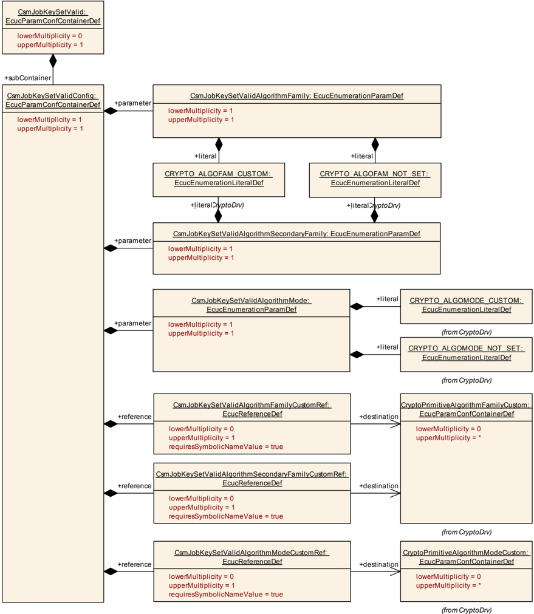

#### 9.1.35. CsmJobKeySetValid

| SWS 条目 | [ECUC_Csm_00196] |
|---|---|
| 容器名称 | CsmJobKeySetValid |
| 父容器 | CsmPrimitives |
| 描述 | KeySetValid 原语的配置。 |

| 容器名称 | 多重性 | 作用域/依赖 |
|---|---|---|
| CsmJobKeySetValidConfig | 1 | CSM 密钥置有效操作配置的容器。容器名称用作密钥配置标识符的符号名。 |

#### 9.1.36. CsmJobKeySetValidConfig

| SWS 条目 | [ECUC_Csm_00204] |
|---|---|
| 容器名称 | CsmJobKeySetValidConfig |
| 父容器 | CsmJobKeySetValid |
| 描述 | CSM 密钥置有效操作配置的容器。容器名称用作密钥配置标识符的符号名。 |
| 配置参数 | 见下方参数表 |

| SWS 条目 | [ECUC_Csm_00328] |
|---|---|
| 参数名称 | CsmJobKeySetValidAlgorithmFamily |
| 父容器 | CsmJobKeySetValidConfig |
| 描述 | 确定加密服务所使用的算法族。此参数定义算法的最主要部分。 |
| 多重性 | 1 |
| 类型 | EcucEnumerationParamDef |
| 范围 | CRYPTO_ALGOFAM_CUSTOM：--；CRYPTO_ALGOFAM_NOT_SET：-- |
| 多重性配置类 | Pre-compile time：X（All Variants）；Link time：-；Post-build time：- |
| 值配置类 | Pre-compile time：X（All Variants）；Link time：-；Post-build time：- |
| 作用域/依赖 | scope: local |

| SWS 条目 | [ECUC_Csm_00329] |
|---|---|
| 参数名称 | CsmJobKeySetValidAlgorithmMode |
| 父容器 | CsmJobKeySetValidConfig |
| 描述 | 确定加密服务所使用的算法模式。 |
| 多重性 | 1 |
| 类型 | EcucEnumerationParamDef |
| 范围 | CRYPTO_ALGOMODE_CUSTOM：--；CRYPTO_ALGOMODE_NOT_SET：-- |
| 多重性配置类 | Pre-compile time：X（All Variants）；Link time：-；Post-build time：- |
| 值配置类 | Pre-compile time：X（All Variants）；Link time：-；Post-build time：- |
| 作用域/依赖 | scope: local |

| SWS 条目 | [ECUC_Csm_00340] |
|---|---|
| 参数名称 | CsmJobKeySetValidAlgorithmSecondaryFamily |
| 父容器 | CsmJobKeySetValidConfig |
| 描述 | 确定加密服务所使用的次要算法族。 |
| 多重性 | 1 |
| 类型 | EcucEnumerationParamDef |
| 范围 | CRYPTO_ALGOFAM_CUSTOM：--；CRYPTO_ALGOFAM_NOT_SET：-- |
| 多重性配置类 | Pre-compile time：X（All Variants）；Link time：-；Post-build time：- |
| 值配置类 | Pre-compile time：X（All Variants）；Link time：-；Post-build time：- |
| 作用域/依赖 | scope: local |

| SWS 条目 | [ECUC_Csm_00330] |
|---|---|
| 参数名称 | CsmJobKeySetValidAlgorithmFamilyCustomRef |
| 父容器 | CsmJobKeySetValidConfig |
| 描述 | 对客户特定的算法族自定义容器的引用 |
| 多重性 | 0..1 |
| 类型 | 对 CryptoPrimitiveAlgorithmFamilyCustom 的符号名引用 |
| 多重性配置类 | Pre-compile time：X（All Variants）；Link time：-；Post-build time：- |
| 值配置类 | Pre-compile time：X（All Variants）；Link time：-；Post-build time：- |
| 作用域/依赖 | scope: local；dependency: 仅当 CsmJobKeySetValidAlgorithmFamily 设置为 CRYPTO_ALGOFAM_CUSTOM 时，才应存在此引用。 |

| SWS 条目 | [ECUC_Csm_00331] |
|---|---|
| 参数名称 | CsmJobKeySetValidAlgorithmModeCustomRef |
| 父容器 | CsmJobKeySetValidConfig |
| 描述 | 对客户特定的算法模式自定义容器的引用 |
| 多重性 | 0..1 |
| 类型 | 对 CryptoPrimitiveAlgorithmModeCustom 的符号名引用 |
| 多重性配置类 | Pre-compile time：X（All Variants）；Link time：-；Post-build time：- |
| 值配置类 | Pre-compile time：X（All Variants）；Link time：-；Post-build time：- |
| 作用域/依赖 | scope: local；dependency: 仅当 CsmJobKeySetValidAlgorithmMode 设置为 CRYPTO_ALGOMODE_CUSTOM 时，才应存在此引用。 |

| SWS 条目 | [ECUC_Csm_00332] |
|---|---|
| 参数名称 | CsmJobKeySetValidAlgorithmSecondaryFamilyCustomRef |
| 父容器 | CsmJobKeySetValidConfig |
| 描述 | 对加密驱动程序中客户特定的算法族容器的引用 |
| 多重性 | 0..1 |
| 类型 | 对 CryptoPrimitiveAlgorithmFamilyCustom 的符号名引用 |
| 多重性配置类 | Pre-compile time：X（All Variants）；Link time：-；Post-build time：- |
| 值配置类 | Pre-compile time：X（All Variants）；Link time：-；Post-build time：- |
| 作用域/依赖 | scope: local；dependency: 仅当 CsmJobKeySetValidSecondaryAlgorithmFamily 设置为 CRYPTO_ALGOFAM_CUSTOM 时，才应存在此引用。 |

该容器不包含任何子容器。

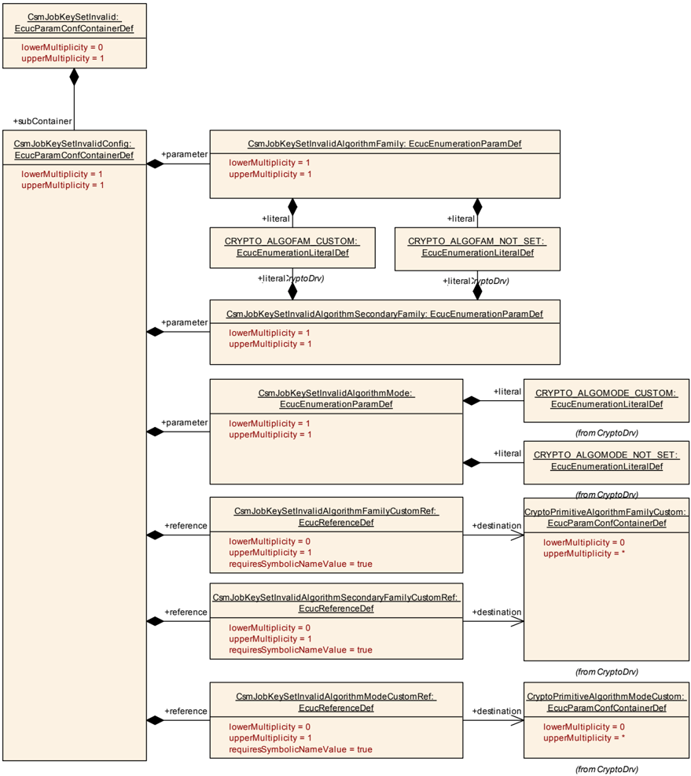

#### 9.1.37. CsmJobKeySetInvalid

| SWS 条目 | [ECUC_Csm_00333] |
|---|---|
| 容器名称 | CsmJobKeySetInvalid |
| 父容器 | CsmPrimitives |
| 描述 | KeySetInvalid 原语的配置。 |

| 容器名称 | 多重性 | 作用域/依赖 |
|---|---|---|
| CsmJobKeySetInvalidConfig | 1 | CSM 密钥置无效操作配置的容器。 |

#### 9.1.38. CsmJobKeySetInvalidConfig

| SWS 条目 | [ECUC_Csm_00334] |
|---|---|
| 容器名称 | CsmJobKeySetInvalidConfig |
| 父容器 | CsmJobKeySetInvalid |
| 描述 | CSM 密钥置无效操作配置的容器。 |
| 配置参数 | 见下方参数表 |

| SWS 条目 | [ECUC_Csm_00335] |
|---|---|
| 参数名称 | CsmJobKeySetInvalidAlgorithmFamily |
| 父容器 | CsmJobKeySetInvalidConfig |
| 描述 | 确定加密服务所使用的算法族。此参数定义算法的最主要部分。 |
| 多重性 | 1 |
| 类型 | EcucEnumerationParamDef |
| 范围 | CRYPTO_ALGOFAM_CUSTOM：--；CRYPTO_ALGOFAM_NOT_SET：-- |
| 多重性配置类 | Pre-compile time：X（All Variants）；Link time：-；Post-build time：- |
| 值配置类 | Pre-compile time：X（All Variants）；Link time：-；Post-build time：- |
| 作用域/依赖 | scope: local |

| SWS 条目 | [ECUC_Csm_00336] |
|---|---|
| 参数名称 | CsmJobKeySetInvalidAlgorithmMode |
| 父容器 | CsmJobKeySetInvalidConfig |
| 描述 | 确定加密服务所使用的算法模式。 |
| 多重性 | 1 |
| 类型 | EcucEnumerationParamDef |
| 范围 | CRYPTO_ALGOMODE_CUSTOM：--；CRYPTO_ALGOMODE_NOT_SET：-- |
| 多重性配置类 | Pre-compile time：X（All Variants）；Link time：-；Post-build time：- |
| 值配置类 | Pre-compile time：X（All Variants）；Link time：-；Post-build time：- |
| 作用域/依赖 | scope: local |

| SWS 条目 | [ECUC_Csm_00341] |
|---|---|
| 参数名称 | CsmJobKeySetInvalidAlgorithmSecondaryFamily |
| 父容器 | CsmJobKeySetInvalidConfig |
| 描述 | 确定加密服务所使用的次要算法族。 |
| 多重性 | 1 |
| 类型 | EcucEnumerationParamDef |
| 范围 | CRYPTO_ALGOFAM_CUSTOM：--；CRYPTO_ALGOFAM_NOT_SET：-- |
| 多重性配置类 | Pre-compile time：X（All Variants）；Link time：-；Post-build time：- |
| 值配置类 | Pre-compile time：X（All Variants）；Link time：-；Post-build time：- |
| 作用域/依赖 | scope: local |

| SWS 条目 | [ECUC_Csm_00337] |
|---|---|
| 参数名称 | CsmJobKeySetInvalidAlgorithmFamilyCustomRef |
| 父容器 | CsmJobKeySetInvalidConfig |
| 描述 | 对客户特定的算法族自定义容器的引用 |
| 多重性 | 0..1 |
| 类型 | 对 CryptoPrimitiveAlgorithmFamilyCustom 的符号名引用 |
| 多重性配置类 | Pre-compile time：X（All Variants）；Link time：-；Post-build time：- |
| 值配置类 | Pre-compile time：X（All Variants）；Link time：-；Post-build time：- |
| 作用域/依赖 | scope: local；dependency: 仅当 CsmJobKeySetInvalidAlgorithmFamily 设置为 CRYPTO_ALGOFAM_CUSTOM 时，才应存在此引用。 |

| SWS 条目 | [ECUC_Csm_00339] |
|---|---|
| 参数名称 | CsmJobKeySetInvalidAlgorithmModeCustomRef |
| 父容器 | CsmJobKeySetInvalidConfig |
| 描述 | 对客户特定的算法模式自定义容器的引用 |
| 多重性 | 0..1 |
| 类型 | 对 CryptoPrimitiveAlgorithmModeCustom 的符号名引用 |
| 多重性配置类 | Pre-compile time：X（All Variants）；Link time：-；Post-build time：- |
| 值配置类 | Pre-compile time：X（All Variants）；Link time：-；Post-build time：- |
| 作用域/依赖 | scope: local；dependency: 仅当 CsmJobKeySetInvalidAlgorithmMode 设置为 CRYPTO_ALGOMODE_CUSTOM 时，才应存在此引用。 |

| SWS 条目 | [ECUC_Csm_00338] |
|---|---|
| 参数名称 | CsmJobKeySetInvalidAlgorithmSecondaryFamilyCustomRef |
| 父容器 | CsmJobKeySetInvalidConfig |
| 描述 | 对加密驱动程序中客户特定的算法族容器的引用 |
| 多重性 | 0..1 |
| 类型 | 对 CryptoPrimitiveAlgorithmFamilyCustom 的符号名引用 |
| 多重性配置类 | Pre-compile time：X（All Variants）；Link time：-；Post-build time：- |
| 值配置类 | Pre-compile time：X（All Variants）；Link time：-；Post-build time：- |
| 作用域/依赖 | scope: local；dependency: 仅当 CsmJobKeySetInvalidSecondaryAlgorithmFamily 设置为 CRYPTO_ALGOFAM_CUSTOM 时，才应存在此引用。 |

该容器不包含任何子容器。

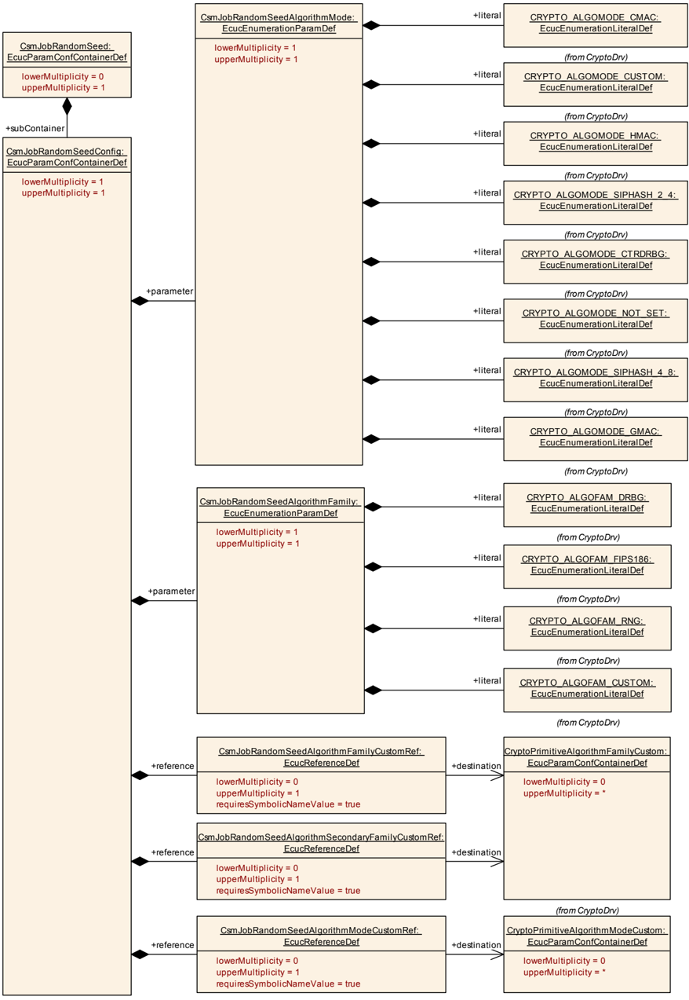

#### 9.1.39. CsmJobRandomSeed

| SWS 条目 | [ECUC_Csm_00197] |
|---|---|
| 容器名称 | CsmJobRandomSeed |
| 父容器 | CsmPrimitives |
| 描述 | RandomSeed 原语的配置。 |

| 容器名称 | 多重性 | 作用域/依赖 |
|---|---|---|
| CsmJobRandomSeedConfig | 1 | CSM 随机种子操作配置的容器。容器名称用作随机种子配置标识符的符号名。 |

#### 9.1.40. CsmJobRandomSeedConfig

| SWS 条目 | [ECUC_Csm_00261] |
|---|---|
| 容器名称 | CsmJobRandomSeedConfig |
| 父容器 | CsmJobRandomSeed |
| 描述 | CSM 随机种子操作配置的容器。容器名称用作随机种子配置标识符的符号名。 |
| 配置参数 | 见下方参数表 |

| SWS 条目 | [ECUC_Csm_00206] |
|---|---|
| 参数名称 | CsmJobRandomSeedAlgorithmFamily |
| 父容器 | CsmJobRandomSeedConfig |
| 描述 | 确定加密服务所使用的算法族。 |
| 多重性 | 1 |
| 类型 | EcucEnumerationParamDef |
| 范围 | CRYPTO_ALGOFAM_3DES：--；CRYPTO_ALGOFAM_AES：--；CRYPTO_ALGOFAM_BLAKE_1_256：--；CRYPTO_ALGOFAM_BLAKE_1_512：--；CRYPTO_ALGOFAM_BLAKE_2s_256：--；CRYPTO_ALGOFAM_BLAKE_2s_512：--；CRYPTO_ALGOFAM_CHACHA：--；CRYPTO_ALGOFAM_CUSTOM：--；CRYPTO_ALGOFAM_DRBG：--；CRYPTO_ALGOFAM_EEA3：--；CRYPTO_ALGOFAM_FIPS186：--；CRYPTO_ALGOFAM_RIPEMD160：--；CRYPTO_ALGOFAM_RNG：--；CRYPTO_ALGOFAM_SHA1：--；CRYPTO_ALGOFAM_SHA2_224：--；CRYPTO_ALGOFAM_SHA2_256：--；CRYPTO_ALGOFAM_SHA2_384：--；CRYPTO_ALGOFAM_SHA2_512：--；CRYPTO_ALGOFAM_SHA2_512_224：--；CRYPTO_ALGOFAM_SHA2_512_256：--；CRYPTO_ALGOFAM_SHA3_224：--；CRYPTO_ALGOFAM_SHA3_256：--；CRYPTO_ALGOFAM_SHA3_384：--；CRYPTO_ALGOFAM_SHA3_512：--；CRYPTO_ALGOFAM_SHAKE128：--；CRYPTO_ALGOFAM_SHAKE256：--；CRYPTO_ALGOFAM_SM3：-- |
| Post-Build 变体值 | false |
| 多重性配置类 | Pre-compile time：X（All Variants）；Link time：-；Post-build time：- |
| 值配置类 | Pre-compile time：X（All Variants）；Link time：-；Post-build time：- |
| 作用域/依赖 | scope: local |

| SWS 条目 | [ECUC_Csm_00208] |
|---|---|
| 参数名称 | CsmJobRandomSeedAlgorithmMode |
| 父容器 | CsmJobRandomSeedConfig |
| 描述 | 确定加密服务所使用的算法模式 |
| 多重性 | 1 |
| 类型 | EcucEnumerationParamDef |
| 范围 | CRYPTO_ALGOMODE_CMAC：--；CRYPTO_ALGOMODE_CTRDRBG：--；CRYPTO_ALGOMODE_CUSTOM：--；CRYPTO_ALGOMODE_GMAC：--；CRYPTO_ALGOMODE_HMAC：--；CRYPTO_ALGOMODE_NOT_SET：--；CRYPTO_ALGOMODE_SIPHASH_2_4：--；CRYPTO_ALGOMODE_SIPHASH_4_8：-- |
| Post-Build 变体值 | false |
| 值配置类 | Pre-compile time：X（All Variants）；Link time：-；Post-build time：- |
| 作用域/依赖 | scope: local |

| SWS 条目 | [ECUC_Csm_00210] |
|---|---|
| 参数名称 | CsmJobRandomSeedAlgorithmSecondaryFamily |
| 父容器 | CsmJobRandomSeedConfig |
| 描述 | 确定加密服务所使用的算法族。 |
| 多重性 | 1 |
| 类型 | EcucEnumerationParamDef |
| 范围 | CRYPTO_ALGOFAM_3DES：--；CRYPTO_ALGOFAM_AES：--；CRYPTO_ALGOFAM_BLAKE_1_256：--；CRYPTO_ALGOFAM_BLAKE_1_512：--；CRYPTO_ALGOFAM_BLAKE_2s_256：--；CRYPTO_ALGOFAM_BLAKE_2s_512：--；CRYPTO_ALGOFAM_CHACHA：--；CRYPTO_ALGOFAM_CUSTOM：--；CRYPTO_ALGOFAM_NOT_SET：--；CRYPTO_ALGOFAM_RIPEMD160：--；CRYPTO_ALGOFAM_SHA1：--；CRYPTO_ALGOFAM_SHA2_224：--；CRYPTO_ALGOFAM_SHA2_256：--；CRYPTO_ALGOFAM_SHA2_384：--；CRYPTO_ALGOFAM_SHA2_512：--；CRYPTO_ALGOFAM_SHA2_512_224：--；CRYPTO_ALGOFAM_SHA2_512_256：--；CRYPTO_ALGOFAM_SHA3_224：--；CRYPTO_ALGOFAM_SHA3_256：--；CRYPTO_ALGOFAM_SHA3_384：--；CRYPTO_ALGOFAM_SHA3_512：--；CRYPTO_ALGOFAM_SHAKE128：--；CRYPTO_ALGOFAM_SHAKE256：-- |
| Post-Build 变体值 | false |
| 值配置类 | Pre-compile time：X（All Variants）；Link time：-；Post-build time：- |
| 作用域/依赖 | scope: local |

| SWS 条目 | [ECUC_Csm_00312] |
|---|---|
| 参数名称 | CsmJobRandomSeedAlgorithmFamilyCustomRef |
| 父容器 | CsmJobRandomSeedConfig |
| 描述 | 对客户特定的算法族自定义容器的引用 |
| 多重性 | 0..1 |
| 类型 | 对 CryptoPrimitiveAlgorithmFamilyCustom 的符号名引用 |
| 多重性配置类 | Pre-compile time：X（All Variants）；Link time：-；Post-build time：- |
| 值配置类 | Pre-compile time：X（All Variants）；Link time：-；Post-build time：- |
| 作用域/依赖 | scope: local；dependency: 仅当 CsmJobRandomSeedAlgorithmFamily 设置为 CRYPTO_ALGOFAM_CUSTOM 时，才应存在此引用。 |

| SWS 条目 | [ECUC_Csm_00313] |
|---|---|
| 参数名称 | CsmJobRandomSeedAlgorithmModeCustomRef |
| 父容器 | CsmJobRandomSeedConfig |
| 描述 | 对客户特定的算法模式自定义容器的引用 |
| 多重性 | 0..1 |
| 类型 | 对 CryptoPrimitiveAlgorithmModeCustom 的符号名引用 |
| 多重性配置类 | Pre-compile time：X（All Variants）；Link time：-；Post-build time：- |
| 值配置类 | Pre-compile time：X（All Variants）；Link time：-；Post-build time：- |
| 作用域/依赖 | scope: local；dependency: 仅当 CsmJobRandomSeedAlgorithmMode 设置为 CRYPTO_ALGOMODE_CUSTOM 时，才应存在此参数。 |

| SWS 条目 | [ECUC_Csm_00314] |
|---|---|
| 参数名称 | CsmJobRandomSeedAlgorithmSecondaryFamilyCustomRef |
| 父容器 | CsmJobRandomSeedConfig |
| 描述 | 对加密驱动程序中客户特定的算法族容器的引用 |
| 多重性 | 0..1 |
| 类型 | 对 CryptoPrimitiveAlgorithmFamilyCustom 的符号名引用 |
| 多重性配置类 | Pre-compile time：X（All Variants）；Link time：-；Post-build time：- |
| 值配置类 | Pre-compile time：X（All Variants）；Link time：-；Post-build time：- |
| 作用域/依赖 | scope: local；dependency: 仅当 CsmJobRandomSeedSecondaryAlgorithmFamily 设置为 CRYPTO_ALGOFAM_CUSTOM 时，才应存在此参数。 |

该容器不包含任何子容器。

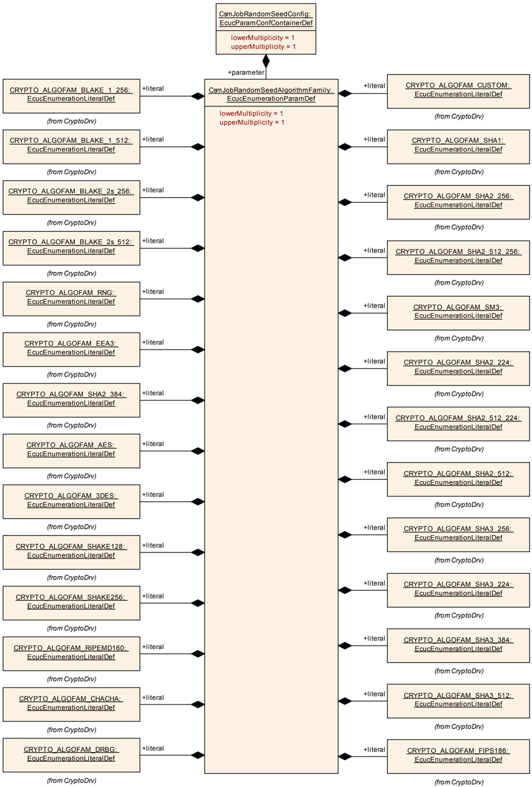

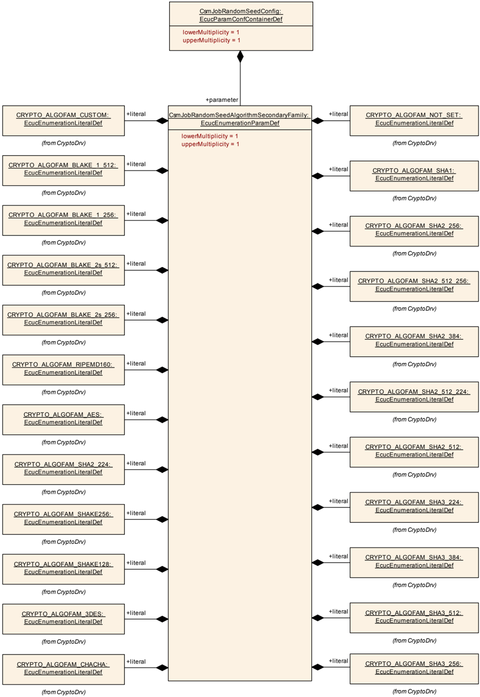


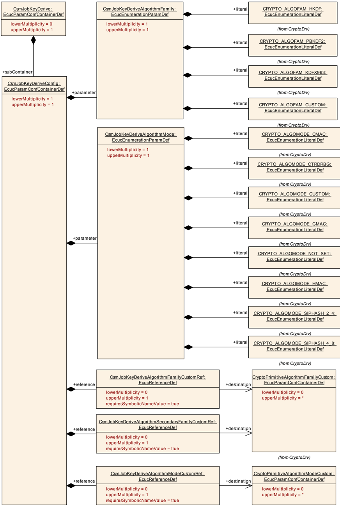

#### 9.1.41. CsmJobKeyDerive

| SWS 条目 | [ECUC_Csm_00198] |
|---|---|
| 容器名称 | CsmJobKeyDerive |
| 父容器 | CsmPrimitives |
| 描述 | KeyDerive 原语的配置。 |

| 容器名称 | 多重性 | 作用域/依赖 |
|---|---|---|
| CsmJobKeyDeriveConfig | 1 | CSM 密钥派生操作配置的容器。容器名称用作密钥派生配置标识符的符号名。 |

#### 9.1.42. CsmJobKeyDeriveConfig

| SWS 条目 | [ECUC_Csm_00213] |
|---|---|
| 容器名称 | CsmJobKeyDeriveConfig |
| 父容器 | CsmJobKeyDerive |
| 描述 | CSM 密钥派生操作配置的容器。容器名称用作密钥派生配置标识符的符号名。 |
| 配置参数 | 见下方参数表 |

| SWS 条目 | [ECUC_Csm_00215] |
|---|---|
| 参数名称 | CsmJobKeyDeriveAlgorithmFamily |
| 父容器 | CsmJobKeyDeriveConfig |
| 描述 | 确定加密服务所使用的算法族。此参数定义算法的最主要部分。 |
| 多重性 | 1 |
| 类型 | EcucEnumerationParamDef |
| 范围 | CRYPTO_ALGOFAM_CUSTOM：--；CRYPTO_ALGOFAM_HKDF：--；CRYPTO_ALGOFAM_KDFX963：--；CRYPTO_ALGOFAM_PBKDF2：-- |
| Post-Build 变体值 | false |
| 值配置类 | Pre-compile time：X（All Variants）；Link time：-；Post-build time：- |
| 作用域/依赖 | scope: local |

| SWS 条目 | [ECUC_Csm_00216] |
|---|---|
| 参数名称 | CsmJobKeyDeriveAlgorithmMode |
| 父容器 | CsmJobKeyDeriveConfig |
| 描述 | 确定加密服务所使用的算法模式 |
| 多重性 | 1 |
| 类型 | EcucEnumerationParamDef |
| 范围 | CRYPTO_ALGOMODE_CMAC：--；CRYPTO_ALGOMODE_CTRDRBG：--；CRYPTO_ALGOMODE_CUSTOM：--；CRYPTO_ALGOMODE_GMAC：--；CRYPTO_ALGOMODE_HMAC：--；CRYPTO_ALGOMODE_NOT_SET：--；CRYPTO_ALGOMODE_SIPHASH_2_4：--；CRYPTO_ALGOMODE_SIPHASH_4_8：-- |
| Post-Build 变体值 | false |
| 值配置类 | Pre-compile time：X（All Variants）；Link time：-；Post-build time：- |
| 作用域/依赖 | scope: local |

| SWS 条目 | [ECUC_Csm_00218] |
|---|---|
| 参数名称 | CsmJobKeyDeriveAlgorithmSecondaryFamily |
| 父容器 | CsmJobKeyDeriveConfig |
| 描述 | 确定加密服务所使用的算法族。 |
| 多重性 | 1 |
| 类型 | EcucEnumerationParamDef |
| 范围 | CRYPTO_ALGOFAM_BLAKE_1_256：--；CRYPTO_ALGOFAM_BLAKE_1_512：--；CRYPTO_ALGOFAM_BLAKE_2s_256：--；CRYPTO_ALGOFAM_BLAKE_2s_512：--；CRYPTO_ALGOFAM_CUSTOM：--；CRYPTO_ALGOFAM_NOT_SET：--；CRYPTO_ALGOFAM_RIPEMD160：--；CRYPTO_ALGOFAM_SHA1：--；CRYPTO_ALGOFAM_SHA2_224：--；CRYPTO_ALGOFAM_SHA2_256：--；CRYPTO_ALGOFAM_SHA2_384：--；CRYPTO_ALGOFAM_SHA2_512：--；CRYPTO_ALGOFAM_SHA2_512_224：--；CRYPTO_ALGOFAM_SHA2_512_256：--；CRYPTO_ALGOFAM_SHA3_224：--；CRYPTO_ALGOFAM_SHA3_256：--；CRYPTO_ALGOFAM_SHA3_384：--；CRYPTO_ALGOFAM_SHA3_512：--；CRYPTO_ALGOFAM_SHAKE128：--；CRYPTO_ALGOFAM_SHAKE256：-- |
| 默认值 | CRYPTO_ALGOFAM_NOT_SET |
| Post-Build 变体值 | false |
| 值配置类 | Pre-compile time：X（All Variants）；Link time：-；Post-build time：- |
| 作用域/依赖 | scope: local |

| SWS 条目 | [ECUC_Csm_00315] |
|---|---|
| 参数名称 | CsmJobKeyDeriveAlgorithmFamilyCustomRef |
| 父容器 | CsmJobKeyDeriveConfig |
| 描述 | 对客户特定的算法族自定义容器的引用 |
| 多重性 | 0..1 |
| 类型 | 对 CryptoPrimitiveAlgorithmFamilyCustom 的符号名引用 |
| 多重性配置类 | Pre-compile time：X（All Variants）；Link time：-；Post-build time：- |
| 值配置类 | Pre-compile time：X（All Variants）；Link time：-；Post-build time：- |
| 作用域/依赖 | scope: local；dependency: 仅当 CsmJobKeyDeriveAlgorithmFamily 设置为 CRYPTO_ALGOFAM_CUSTOM 时，才应存在此引用。 |

| SWS 条目 | [ECUC_Csm_00316] |
|---|---|
| 参数名称 | CsmJobKeyDeriveAlgorithmModeCustomRef |
| 父容器 | CsmJobKeyDeriveConfig |
| 描述 | 对客户特定的算法模式自定义容器的引用 |
| 多重性 | 0..1 |
| 类型 | 对 CryptoPrimitiveAlgorithmModeCustom 的符号名引用 |
| 多重性配置类 | Pre-compile time：X（All Variants）；Link time：-；Post-build time：- |
| 值配置类 | Pre-compile time：X（All Variants）；Link time：-；Post-build time：- |
| 作用域/依赖 | dependency: 仅当 CsmJobKeyDeriveAlgorithmMode 设置为 CRYPTO_ALGOMODE_CUSTOM 时，才应存在此引用。 |

| SWS 条目 | [ECUC_Csm_00317] |
|---|---|
| 参数名称 | CsmJobKeyDeriveAlgorithmSecondaryFamilyCustomRef |
| 父容器 | CsmJobKeyDeriveConfig |
| 描述 | 对加密驱动程序中客户特定的算法族容器的引用 |
| 多重性 | 0..1 |
| 类型 | 对 CryptoPrimitiveAlgorithmFamilyCustom 的符号名引用 |
| 多重性配置类 | Pre-compile time：X（All Variants）；Link time：-；Post-build time：- |
| 值配置类 | Pre-compile time：X（All Variants）；Link time：-；Post-build time：- |
| 作用域/依赖 | scope: local；dependency: 仅当 CsmJobKeyDeriveSecondaryAlgorithmFamily 设置为 CRYPTO_ALGOFAM_CUSTOM 时，才应存在此引用。 |

该容器不包含任何子容器。

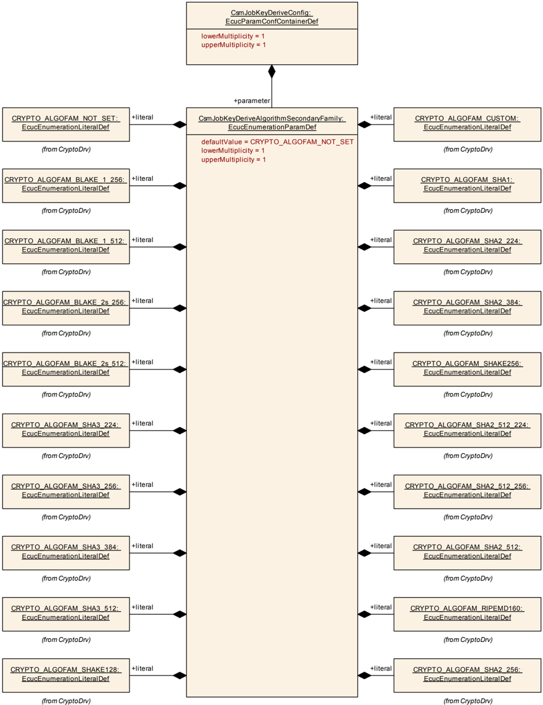

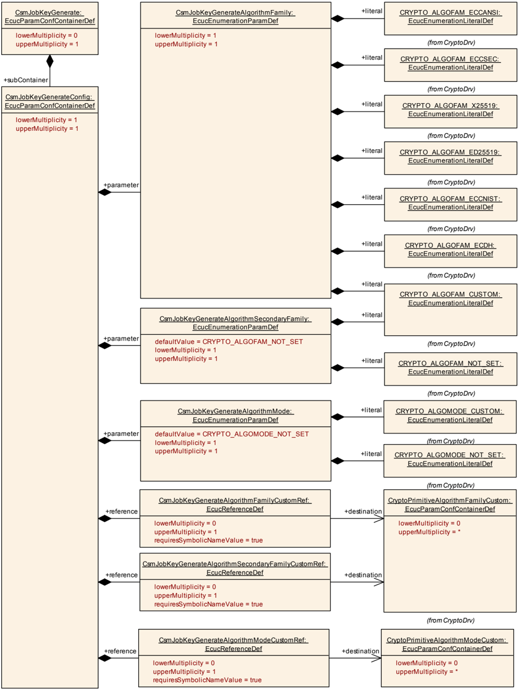

#### 9.1.43. CsmJobKeyGenerate

| SWS 条目 | [ECUC_Csm_00199] |
|---|---|
| 容器名称 | CsmJobKeyGenerate |
| 父容器 | CsmPrimitives |
| 描述 | KeyGenerate 原语的配置。 |

| 容器名称 | 多重性 | 作用域/依赖 |
|---|---|---|
| CsmJobKeyGenerateConfig | 1 | CSM 密钥生成操作配置的容器。容器名称用作密钥生成配置标识符的符号名。 |

#### 9.1.44. CsmJobKeyGenerateConfig

| SWS 条目 | [ECUC_Csm_00220] |
|---|---|
| 容器名称 | CsmJobKeyGenerateConfig |
| 父容器 | CsmJobKeyGenerate |
| 描述 | CSM 密钥生成操作配置的容器。容器名称用作密钥生成配置标识符的符号名。 |
| 配置参数 | 见下方参数表 |

| SWS 条目 | [ECUC_Csm_00222] |
|---|---|
| 参数名称 | CsmJobKeyGenerateAlgorithmFamily |
| 父容器 | CsmJobKeyGenerateConfig |
| 描述 | 确定加密服务所使用的算法族。此参数定义算法的最主要部分。 |
| 多重性 | 1 |
| 类型 | EcucEnumerationParamDef |
| 范围 | CRYPTO_ALGOFAM_CUSTOM：--；CRYPTO_ALGOFAM_ECCANSI：--；CRYPTO_ALGOFAM_ECCNIST：--；CRYPTO_ALGOFAM_ECCSEC：--；CRYPTO_ALGOFAM_ECDH：--；CRYPTO_ALGOFAM_ED25519：--；CRYPTO_ALGOFAM_X25519：-- |
| Post-Build 变体值 | false |
| 值配置类 | Pre-compile time：X（All Variants）；Link time：-；Post-build time：- |
| 作用域/依赖 | scope: local |

| SWS 条目 | [ECUC_Csm_00223] |
|---|---|
| 参数名称 | CsmJobKeyGenerateAlgorithmMode |
| 父容器 | CsmJobKeyGenerateConfig |
| 描述 | 确定加密服务所使用的算法模式 |
| 多重性 | 1 |
| 类型 | EcucEnumerationParamDef |
| 范围 | CRYPTO_ALGOMODE_CUSTOM：--；CRYPTO_ALGOMODE_NOT_SET：-- |
| 默认值 | CRYPTO_ALGOMODE_NOT_SET |
| Post-Build 变体值 | false |
| 值配置类 | Pre-compile time：X（All Variants）；Link time：-；Post-build time：- |
| 作用域/依赖 | scope: local |

| SWS 条目 | [ECUC_Csm_00225] |
|---|---|
| 参数名称 | CsmJobKeyGenerateAlgorithmSecondaryFamily |
| 父容器 | CsmJobKeyGenerateConfig |
| 描述 | 确定加密服务所使用的算法族。 |
| 多重性 | 1 |
| 类型 | EcucEnumerationParamDef |
| 范围 | CRYPTO_ALGOFAM_CUSTOM：--；CRYPTO_ALGOFAM_NOT_SET：-- |
| 默认值 | CRYPTO_ALGOFAM_NOT_SET |
| Post-Build 变体值 | false |
| 值配置类 | Pre-compile time：X（All Variants）；Link time：-；Post-build time：- |
| 作用域/依赖 | scope: local |

| SWS 条目 | [ECUC_Csm_00318] |
|---|---|
| 参数名称 | CsmJobKeyGenerateAlgorithmFamilyCustomRef |
| 父容器 | CsmJobKeyGenerateConfig |
| 描述 | 对客户特定的算法族自定义容器的引用 |
| 多重性 | 0..1 |
| 类型 | 对 CryptoPrimitiveAlgorithmFamilyCustom 的符号名引用 |
| 多重性配置类 | Pre-compile time：X（All Variants）；Link time：-；Post-build time：- |
| 值配置类 | Pre-compile time：X（All Variants）；Link time：-；Post-build time：- |
| 作用域/依赖 | scope: local；dependency: 仅当 CsmJobKeyGenerateAlgorithmFamily 设置为 CRYPTO_ALGOFAM_CUSTOM 时，才应存在此引用。 |

| SWS 条目 | [ECUC_Csm_00319] |
|---|---|
| 参数名称 | CsmJobKeyGenerateAlgorithmModeCustomRef |
| 父容器 | CsmJobKeyGenerateConfig |
| 描述 | 对客户特定的算法模式自定义容器的引用 |
| 多重性 | 0..1 |
| 类型 | 对 CryptoPrimitiveAlgorithmModeCustom 的符号名引用 |
| 多重性配置类 | Pre-compile time：X（All Variants）；Link time：-；Post-build time：- |
| 值配置类 | Pre-compile time：X（All Variants）；Link time：-；Post-build time：- |
| 作用域/依赖 | scope: local；dependency: 仅当 CsmJobKeyGenerateAlgorithmMode 设置为 CRYPTO_ALGOMODE_CUSTOM 时，才应存在此引用。 |

| SWS 条目 | [ECUC_Csm_00320] |
|---|---|
| 参数名称 | CsmJobKeyGenerateAlgorithmSecondaryFamilyCustomRef |
| 父容器 | CsmJobKeyGenerateConfig |
| 描述 | 对加密驱动程序中客户特定的算法族容器的引用 |
| 多重性 | 0..1 |
| 类型 | 对 CryptoPrimitiveAlgorithmFamilyCustom 的符号名引用 |
| 多重性配置类 | Pre-compile time：X（All Variants）；Link time：-；Post-build time：- |
| 值配置类 | Pre-compile time：X（All Variants）；Link time：-；Post-build time：- |
| 作用域/依赖 | scope: local；dependency: 仅当 CsmJobKeyGenerateSecondaryAlgorithmFamily 设置为 CRYPTO_ALGOFAM_CUSTOM 时，才应存在此引用。 |

该容器不包含任何子容器。

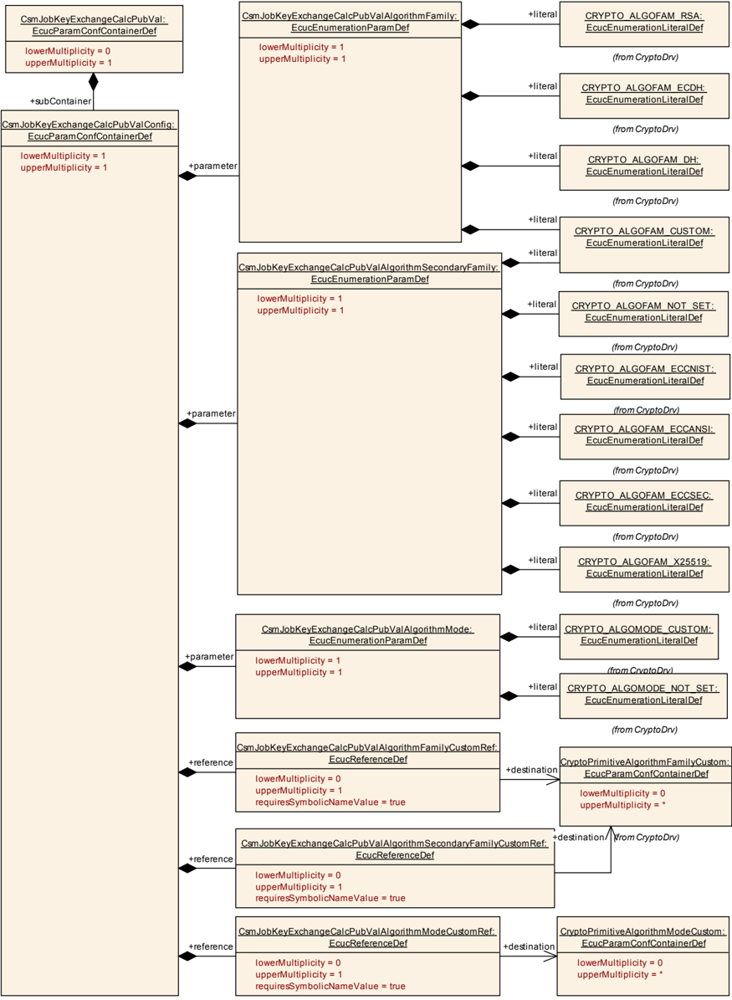

#### 9.1.45. CsmJobKeyExchangeCalcPubVal

| SWS 条目 | [ECUC_Csm_00200] |
|---|---|
| 容器名称 | CsmJobKeyExchangeCalcPubVal |
| 父容器 | CsmPrimitives |
| 描述 | KeyExchangeCalcPubVal 原语的配置。 |

| 容器名称 | 多重性 | 作用域/依赖 |
|---|---|---|
| CsmJobKeyExchangeCalcPubValConfig | 1 | CSM JobKeyExchangeCalcPubVal 配置的容器。容器名称用作密钥配置标识符的符号名。 |

#### 9.1.46. CsmJobKeyExchangeCalcPubValConfig

| SWS 条目 | [ECUC_Csm_00226] |
|---|---|
| 容器名称 | CsmJobKeyExchangeCalcPubValConfig |
| 父容器 | CsmJobKeyExchangeCalcPubVal |
| 描述 | CSM JobKeyExchangeCalcPubVal 配置的容器。容器名称用作密钥配置标识符的符号名。 |
| 配置参数 | 见下方参数表 |

| SWS 条目 | [ECUC_Csm_00227] |
|---|---|
| 参数名称 | CsmJobKeyExchangeCalcPubValAlgorithmFamily |
| 父容器 | CsmJobKeyExchangeCalcPubValConfig |
| 描述 | 确定加密服务所使用的算法族。此参数定义算法的最主要部分。 |
| 多重性 | 1 |
| 类型 | EcucEnumerationParamDef |
| 范围 | CRYPTO_ALGOFAM_CUSTOM：--；CRYPTO_ALGOFAM_DH：--；CRYPTO_ALGOFAM_ECDH：--；CRYPTO_ALGOFAM_RSA：-- |
| Post-Build 变体值 | false |
| 值配置类 | Pre-compile time：X（All Variants）；Link time：-；Post-build time：- |
| 作用域/依赖 | scope: local |

| SWS 条目 | [ECUC_Csm_00229] |
|---|---|
| 参数名称 | CsmJobKeyExchangeCalcPubValAlgorithmMode |
| 父容器 | CsmJobKeyExchangeCalcPubValConfig |
| 描述 | 确定加密服务所使用的算法模式 |
| 多重性 | 1 |
| 类型 | EcucEnumerationParamDef |
| 范围 | CRYPTO_ALGOMODE_CUSTOM：--；CRYPTO_ALGOMODE_NOT_SET：-- |
| Post-Build 变体值 | false |
| 值配置类 | Pre-compile time：X（All Variants）；Link time：-；Post-build time：- |
| 作用域/依赖 | scope: local |

| SWS 条目 | [ECUC_Csm_00231] |
|---|---|
| 参数名称 | CsmJobKeyExchangeCalcPubValAlgorithmSecondaryFamily |
| 父容器 | CsmJobKeyExchangeCalcPubValConfig |
| 描述 | 确定加密服务所使用的算法族。 |
| 多重性 | 1 |
| 类型 | EcucEnumerationParamDef |
| 范围 | CRYPTO_ALGOFAM_CUSTOM：--；CRYPTO_ALGOFAM_ECCANSI：--；CRYPTO_ALGOFAM_ECCNIST：--；CRYPTO_ALGOFAM_ECCSEC：--；CRYPTO_ALGOFAM_NOT_SET：--；CRYPTO_ALGOFAM_X25519：-- |
| Post-Build 变体值 | false |
| 值配置类 | Pre-compile time：X（All Variants）；Link time：-；Post-build time：- |
| 作用域/依赖 | scope: local |

| SWS 条目 | [ECUC_Csm_00321] |
|---|---|
| 参数名称 | CsmJobKeyExchangeCalcPubValAlgorithmFamilyCustomRef |
| 父容器 | CsmJobKeyExchangeCalcPubValConfig |
| 描述 | 对客户特定的算法族自定义容器的引用 |
| 多重性 | 0..1 |
| 类型 | 对 CryptoPrimitiveAlgorithmFamilyCustom 的符号名引用 |
| 多重性配置类 | Pre-compile time：X（All Variants）；Link time：-；Post-build time：- |
| 值配置类 | Pre-compile time：X（All Variants）；Link time：-；Post-build time：- |
| 作用域/依赖 | scope: local；dependency: 仅当 CsmJobKeyExchangeCalcPubValAlgorithmFamily 设置为 CRYPTO_ALGOFAM_CUSTOM 时，才应存在此引用。 |

| SWS 条目 | [ECUC_Csm_00322] |
|---|---|
| 参数名称 | CsmJobKeyExchangeCalcPubValAlgorithmModeCustomRef |
| 父容器 | CsmJobKeyExchangeCalcPubValConfig |
| 描述 | 对客户特定的算法模式自定义容器的引用 |
| 多重性 | 0..1 |
| 类型 | 对 CryptoPrimitiveAlgorithmModeCustom 的符号名引用 |
| 多重性配置类 | Pre-compile time：X（All Variants）；Link time：-；Post-build time：- |
| 值配置类 | Pre-compile time：X（All Variants）；Link time：-；Post-build time：- |
| 作用域/依赖 | scope: local；dependency: 仅当 CsmJobKeyExchangeCalcPubValAlgorithmMode 设置为 CRYPTO_ALGOMODE_CUSTOM 时，才应存在此参数。 |

| SWS 条目 | [ECUC_Csm_00323] |
|---|---|
| 参数名称 | CsmJobKeyExchangeCalcPubValAlgorithmSecondaryFamilyCustomRef |
| 父容器 | CsmJobKeyExchangeCalcPubValConfig |
| 描述 | 对加密驱动程序中客户特定的算法族容器的引用 |
| 多重性 | 0..1 |
| 类型 | 对 CryptoPrimitiveAlgorithmFamilyCustom 的符号名引用 |
| 多重性配置类 | Pre-compile time：X（All Variants）；Link time：-；Post-build time：- |
| 值配置类 | Pre-compile time：X（All Variants）；Link time：-；Post-build time：- |
| 作用域/依赖 | scope: local；dependency: 仅当 CsmJobKeyExchangeCalcPubValSecondaryAlgorithmFamily 设置为 CRYPTO_ALGOFAM_CUSTOM 时，才应存在此引用。 |

该容器不包含任何子容器。

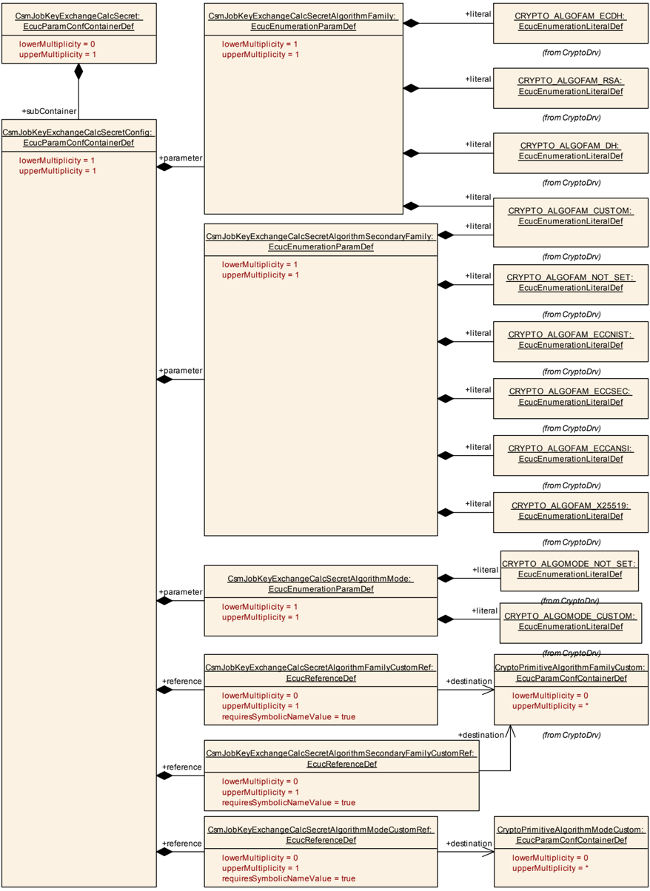

#### 9.1.47. CsmJobKeyExchangeCalcSecret

| SWS 条目 | [ECUC_Csm_00201] |
|---|---|
| 容器名称 | CsmJobKeyExchangeCalcSecret |
| 父容器 | CsmPrimitives |
| 描述 | KeyExchangeCalcSecret 原语的配置。 |

| 容器名称 | 多重性 | 作用域/依赖 |
|---|---|---|
| CsmJobKeyExchangeCalcSecretConfig | 1 | CSM JobKeyExchangeCalcSecret 配置的容器。容器名称用作 JobKeyExchangeCalcSecret 配置标识符的符号名。 |

#### 9.1.48. CsmJobKeyExchangeCalcSecretConfig

| SWS 条目 | [ECUC_Csm_00234] |
|---|---|
| 容器名称 | CsmJobKeyExchangeCalcSecretConfig |
| 父容器 | CsmJobKeyExchangeCalcSecret |
| 描述 | CSM JobKeyExchangeCalcSecret 配置的容器。容器名称用作 JobKeyExchangeCalcSecret 配置标识符的符号名。 |
| 配置参数 | 见下方参数表 |

| SWS 条目 | [ECUC_Csm_00235] |
|---|---|
| 参数名称 | CsmJobKeyExchangeCalcSecretAlgorithmFamily |
| 父容器 | CsmJobKeyExchangeCalcSecretConfig |
| 描述 | 确定加密服务所使用的算法族。此参数定义算法的最主要部分。 |
| 多重性 | 1 |
| 类型 | EcucEnumerationParamDef |
| 范围 | CRYPTO_ALGOFAM_CUSTOM：--；CRYPTO_ALGOFAM_DH：--；CRYPTO_ALGOFAM_ECDH：--；CRYPTO_ALGOFAM_RSA：-- |
| Post-Build 变体值 | false |
| 值配置类 | Pre-compile time：X（All Variants）；Link time：-；Post-build time：- |
| 作用域/依赖 | scope: local |

| SWS 条目 | [ECUC_Csm_00237] |
|---|---|
| 参数名称 | CsmJobKeyExchangeCalcSecretAlgorithmMode |
| 父容器 | CsmJobKeyExchangeCalcSecretConfig |
| 描述 | 确定加密服务所使用的算法模式 |
| 多重性 | 1 |
| 类型 | EcucEnumerationParamDef |
| 范围 | CRYPTO_ALGOMODE_CUSTOM：--；CRYPTO_ALGOMODE_NOT_SET：-- |
| Post-Build 变体值 | false |
| 值配置类 | Pre-compile time：X（All Variants）；Link time：-；Post-build time：- |
| 作用域/依赖 | scope: local |

| SWS 条目 | [ECUC_Csm_00239] |
|---|---|
| 参数名称 | CsmJobKeyExchangeCalcSecretAlgorithmSecondaryFamily |
| 父容器 | CsmJobKeyExchangeCalcSecretConfig |
| 描述 | 确定加密服务所使用的算法族。 |
| 多重性 | 1 |
| 类型 | EcucEnumerationParamDef |
| 范围 | CRYPTO_ALGOFAM_CUSTOM：--；CRYPTO_ALGOFAM_ECCANSI：--；CRYPTO_ALGOFAM_ECCNIST：--；CRYPTO_ALGOFAM_ECCSEC：--；CRYPTO_ALGOFAM_NOT_SET：--；CRYPTO_ALGOFAM_X25519：-- |
| Post-Build 变体值 | false |
| 值配置类 | Pre-compile time：X（All Variants）；Link time：-；Post-build time：- |
| 作用域/依赖 | scope: local |

| SWS 条目 | [ECUC_Csm_00324] |
|---|---|
| 参数名称 | CsmJobKeyExchangeCalcSecretAlgorithmFamilyCustomRef |
| 父容器 | CsmJobKeyExchangeCalcSecretConfig |
| 描述 | 对客户特定的算法族自定义容器的引用 |
| 多重性 | 0..1 |
| 类型 | 对 CryptoPrimitiveAlgorithmFamilyCustom 的符号名引用 |
| 多重性配置类 | Pre-compile time：X（All Variants）；Link time：-；Post-build time：- |
| 值配置类 | Pre-compile time：X（All Variants）；Link time：-；Post-build time：- |
| 作用域/依赖 | scope: local；dependency: 仅当 CsmJobKeyExchangeCalcSecretAlgorithmFamily 设置为 CRYPTO_ALGOFAM_CUSTOM 时，才应存在此引用。 |

| SWS 条目 | [ECUC_Csm_00325] |
|---|---|
| 参数名称 | CsmJobKeyExchangeCalcSecretAlgorithmModeCustomRef |
| 父容器 | CsmJobKeyExchangeCalcSecretConfig |
| 描述 | 对客户特定的算法模式自定义容器的引用 |
| 多重性 | 0..1 |
| 类型 | 对 CryptoPrimitiveAlgorithmModeCustom 的符号名引用 |
| 多重性配置类 | Pre-compile time：X（All Variants）；Link time：-；Post-build time：- |
| 值配置类 | Pre-compile time：X（All Variants）；Link time：-；Post-build time：- |
| 作用域/依赖 | scope: local；dependency: 仅当 CsmJobKeyExchangeCalcSecretAlgorithmMode 设置为 CRYPTO_ALGOMODE_CUSTOM 时，才应存在此引用。 |

| SWS 条目 | [ECUC_Csm_00326] |
|---|---|
| 参数名称 | CsmJobKeyExchangeCalcSecretAlgorithmSecondaryFamilyCustomRef |
| 父容器 | CsmJobKeyExchangeCalcSecretConfig |
| 描述 | 对加密驱动程序中客户特定的算法族容器的引用 |
| 多重性 | 0..1 |
| 类型 | 对 CryptoPrimitiveAlgorithmFamilyCustom 的符号名引用 |
| 多重性配置类 | Pre-compile time：X（All Variants）；Link time：-；Post-build time：- |
| 值配置类 | Pre-compile time：X（All Variants）；Link time：-；Post-build time：- |
| 作用域/依赖 | scope: local；dependency: 仅当 CsmJobKeyExchangeCalcSecretSecondaryAlgorithmFamily 设置为 CRYPTO_ALGOFAM_CUSTOM 时，才应存在此引用。 |

该容器不包含任何子容器。

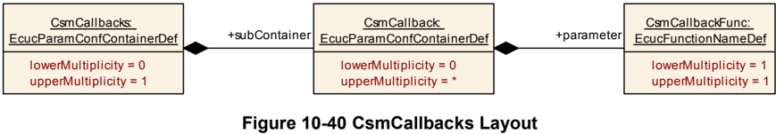

#### 9.1.49. CsmCallbacks

| SWS 条目 | [ECUC_Csm_00008] |
|---|---|
| 容器名称 | CsmCallbacks |
| 父容器 | Csm |
| 描述 | 回调函数配置的容器。 |

| 容器名称 | 多重性 | 作用域/依赖 |
|---|---|---|
| CsmCallback | 0..* | 回调函数配置的容器。 |

#### 9.1.50. CsmCallback

| SWS 条目 | [ECUC_Csm_00109] |
|---|---|
| 容器名称 | CsmCallback |
| 父容器 | CsmCallbacks |
| 描述 | 回调函数配置的容器。 |
| 多重性配置类 | Pre-compile time：X（All Variants）；Link time：-；Post-build time：- |
| 配置参数 | 见下方参数表 |

| SWS 条目 | [ECUC_Csm_00110] |
|---|---|
| 参数名称 | CsmCallbackFunc |
| 父容器 | CsmCallback |
| 描述 | 当异步操作完成时应调用的回调函数。相应的作业需配置为异步处理。 |
| 多重性 | 1 |
| 类型 | EcucFunctionNameDef |
| 默认值 | - |
| 正则表达式 | - |
| Post-Build 变体值 | false |
| 多重性配置类 | Pre-compile time：X（All Variants）；Link time：-；Post-build time：- |
| 值配置类 | Pre-compile time：X（All Variants）；Link time：-；Post-build time：- |
| 作用域/依赖 | scope: local |

该容器不包含任何子容器。

### 9.2. 发布信息

详情请参阅 SWS_BSWGeneral 中的第 10.3 章「Published Information」（发布信息）。
