## 1. 简介和功能概述

本规范规定了 **AUTOSAR** 基础软件模块 &lt;KeyManager&gt; 的功能、**API** 和配置。

**AUTOSAR KeyM** 模块由两个子模块组成，即加密密钥子模块和证书子模块，以满足 [\[1\]](#ref-1)「AUTOSAR 密码栈需求」的要求。

加密密钥子模块提供用于引入或更新预定义加密密钥材料（**key material**）的 API 和配置项。它充当密钥客户端（**key client**），解释来自密钥服务器（**key server**）的提供数据并创建相应的密钥材料。这些密钥被提供给加密服务管理器（**CSM**）。在密钥材料成功安装后，应用程序便能够使用加密操作。这使得 **OEM** 能够在生产或维护阶段独立于应用程序地向 **ECU** 引入密钥材料。

证书子模块提供用于操作证书（**certificate**）的 API 和配置。它允许定义证书槽（**certificate slot**），并将它们按 **PKI** 中使用的层次结构进行关联。证书可以被永久存储，例如根证书（**root certificate**）或中间证书（**intermediate certificate**），以便用于针对证书链（**certificate chain**）验证给定的证书。此外，证书子模块还允许访问证书元素（**certificate element**）或验证其内容。

### 1.1. 重要说明

本规范为整车密钥和证书管理系统提供了 API 骨架。并非所有功能都已完整规定。这可能在解释和实现细节方面留有一定的自由度。尽管这些接口的设计是通用且灵活的，但在未来的 AUTOSAR 版本中它们仍可能发生变化。

## 2. 缩略语

下面的词汇表包含与密钥管理模块相关、且未包含在 [\[2\]](#ref-2)（AUTOSAR 词汇表）中的缩略语和缩写。

**KeyM**
> Key Manager，密钥管理器

**PKI**
> Public Key Infrastructure，公钥基础设施

**CSR**
> Certificate Signing Request，证书签名请求

**CSM**
> Crypto Service Manager，加密服务管理器

**CRL**
> Certificate Revocation List，证书吊销列表

**CA**
> Certificate Authority，证书颁发机构

**OID**
> Object Identifier，对象标识符。一个标识证书元素、元素组或证书元素列表的字节数组。

## 3. 相关文档

### 3.1. 输入文件和相关标准与规范

<a id="ref-1"></a>[1] Requirements on Crypto Stack
> AUTOSAR_CP_SRS_CryptoStack

<a id="ref-2"></a>[2] Glossary
> AUTOSAR_FO_TR_Glossary

<a id="ref-3"></a>[3] IEC：基础模型，IEC 规范（The Basic Model, IEC Norm）

<a id="ref-4"></a>[4] General Specification of Basic Software Modules
> AUTOSAR_CP_SWS_BSWGeneral

<a id="ref-5"></a>[5] Specification of Crypto Service Manager
> AUTOSAR_CP_SWS_CryptoServiceManager

<a id="ref-6"></a>[6] Secure Hardware Extension（安全硬件扩展）
> Secure Hardware Extension

<a id="ref-7"></a>[7] Layered Software Architecture
> AUTOSAR_CP_EXP_LayeredSoftwareArchitecture

<a id="ref-8"></a>[8] Standard X.509
> https://www.itu.int/rec/T-REC-X.509/en

<a id="ref-9"></a>[9] Requirements on Intrusion Detection System
> AUTOSAR_FO_RS_IntrusionDetectionSystem

### 3.2. 相关规范

**AUTOSAR** 提供了基础软件模块通用规范 [\[4\]](#ref-4)（**SWS BSW General**），该规范同样适用于密钥管理模块。因此，**SWS BSW General** 规范应被视为密钥和证书管理模块的附加且必需的规范。

## 4. 约束和假设

### 4.1. 限制

密钥管理模块应与加密服务管理器及其底层模块一起使用。

当前每个 CsmKey 仅支持一个密钥元素（**KeyElement**）（ID = 1）。

### 4.2. 汽车域的适用性

本规范对特定汽车域没有限制。

## 5. 对其他模块的依赖

本章列出 **AUTOSAR KeyM** 模块所使用的与其他模块的关系。

### 5.1. 对加密服务管理器的依赖

**KeyM** 模块依赖于 [\[5\]](#ref-5)「**Csm** 模块」所提供的加密算法和函数。**KeyM** 模块需要用于检索和设置密钥元素以及验证证书签名（**signature**）的 API 函数，即：

- 密钥设置接口（**Key Setting Interface**）
- 密钥提取接口（**Key Extraction Interface**）
- 密钥复制接口（**Key Copying Interface**）
- 密钥生成接口（**Key Generation Interface**）
- 密钥派生接口（**Key Derivation Interface**）
- 密钥交换接口（**Key Exchange Interface**）
- 签名接口（**Signature Interface**）

### 5.2. 对非易失性存储器的依赖

可以将 **KeyM** 配置为将密钥材料存储在非易失性存储器（**NVM**）中。这需要与 **NVM** 的接口。

### 5.3. 对同步时基的依赖

证书有效期（**validity**）验证所需的时间由 **STBM** 提供。

## 6. 功能规格

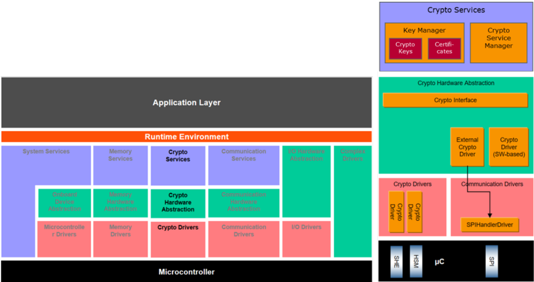

密钥管理模块大致可以分为两部分：加密密钥子模块和证书子模块。加密密钥子模块主要用于与发起密钥生成或直接提供密钥材料的密钥提供实体（**key master**，密钥主控）交互。这些密钥被分配给 CSM 的加密密钥，并存储在专用的 NVM 块中，或者可以作为相应加密驱动程序的密钥进行存储。证书子模块允许配置证书链中的证书，提供用于存储和验证它们的接口。证书中包含的公钥（**public key**）还可以进一步分配给 CSM 密钥，以便加密作业（**crypto job**）使用它们。

如果 KeyMCryptoKeyManagerEnabled 设置为 FALSE，则密钥管理器的加密密钥子模块应被完全禁用。在这种情况下，不应有任何函数可用，并且不应分配任何对于其他操作并非必需的资源。

如果 KeyMCertificateManagerEnabled 设置为 FALSE，则应完全禁用密钥管理器中对证书子模块的支持。在这种情况下，任何与证书操作相关联的函数都不应可用，也不应分配与之相关的资源。

### 6.1. 加密密钥子模块

加密密钥子模块用于为 ECU 初始化、更新和维护加密密钥材料。一个用例是为需要分发到相关 ECU 的安全车载通信（**secured on-board communication**）提供密钥。这些密钥应被提供给分配给加密作业的 CSM 密钥，这些加密作业用于 **Secured I-PDU** 的认证。因此，从建模的角度来看，将密钥主控提供的密钥分配给相应 Secured I-PDU 所使用的 CSM 密钥和作业至关重要。这是整车中的一项全局性任务，并以同样的方式影响多个 ECU。支持这一操作是加密密钥子模块的目的之一。

密钥主控可以直接位于车辆内部以在内部协调密钥生成，例如作为一个特定的 ECU。也可以使用云端的后端系统来生成密钥材料，并以安全的方式向 ECU 提供必要的数据。密钥主控与加密密钥子模块之间的通信通常直接或间接地使用诊断命令。

#### 6.1.1. 一般行为

加密密钥子模块可以配置为以类似会话（**session**）的方式执行加密密钥操作。这样，诸如 [KeyM_Prepare](#7322-keym_prepare)() 或 [KeyM_Update](#7323-keym_update)() 之类的密钥操作仅在会话打开期间被接受。

会话通过调用 [KeyM_Start](#7321-keym_start)() 启动。此后可以执行密钥操作，直到通过调用函数 [KeyM_Finalize](#7324-keym_finalize)() 关闭该会话。

默认情况下，[KeyM_Start](#7321-keym_start)() 函数不会考虑任何输入数据或长度信息，也不会提供任何输出数据，输出数据长度也不会被改变。

或者，如果配置选项 KeyMCryptoKeyHandlerStartFinalizeEnabled 设置为 TRUE，则可以调用密钥处理器（**key handler**）。[KeyM_Start](#7321-keym_start)() 函数将依次以与 [KeyM_Start](#7321-keym_start)() 相同的参数调用 [KeyM_KH_Start](#7731-keym_kh_start)() 函数。[KeyM_KH_Start](#7731-keym_kh_start)() 的返回值将用作 [KeyM_Start](#7321-keym_start)() 的返回值。

**原理：** [KeyM_KH_Start](#7731-keym_kh_start)() 函数可以执行 OEM 特定的检查，例如对任何输入数据进行签名验证（**signature verification**），以证明密钥管理操作的真实性。

**注意：** KeyMCryptoKeyHandlerStartFinalizeEnabled 的定义仅在 KeyMCryptoKeyStartFinalizeFunctionEnabled 设置为 TRUE 时才有效果。

如果配置选项 KeyMCryptoKeyStartFinalizeFunctionEnabled 设置为 FALSE，则密钥管理模块不提供 [KeyM_Start](#7321-keym_start)() 和 [KeyM_Finalize](#7324-keym_finalize)() 函数。此时密钥更新（**key update**）操作可以随时执行。

会话通过调用 [KeyM_Finalize](#7324-keym_finalize)() 关闭。在该调用期间，会话内被更新的所有密钥都将通过调用 Csm_KeySetValid() 被设置为有效。在该函数完成其操作后，将不再接受进一步的密钥更新操作。

如果所有密钥都已成功验证，[KeyM_Finalize](#7324-keym_finalize)() 函数将返回 E_OK。如果至少有一个密钥未能成功验证，该函数应返回 E_NOT_OK。尽管如此，所有已更新的密钥都应被验证，并且如果其中一个密钥验证失败，操作也不应中止。

如果配置选项 KeyMCryptoKeyPrepareFunctionEnabled 设置为 TRUE，则提供 [KeyM_Prepare](#7322-keym_prepare)() 函数。该函数目前没有任何功能行为。如果该配置选项设置为 FALSE，则不提供该功能接口。

如果配置选项 KeyMCryptoKeyHandlerPrepareEnabled 设置为 TRUE，则对 [KeyM_Prepare](#7322-keym_prepare)() 的调用将依次传递给 [KeyM_KH_Prepare](#7732-keym_kh_prepare)()，参数和返回值也将相应地传递。

**原理：** 其意图是在密钥更新会话启动之后，在开始时调用一次 [KeyM_Prepare](#7322-keym_prepare)()。发起调用的诊断服务可以向密钥处理器提供执行后续密钥更新操作所需的特定数据。例如，它可用于提取密钥主控所需的加密驱动程序特定信息，该信息从（**SHE**）硬件中提取并再次在输出缓冲区中提供。或者，它可以启动 OEM 特定的密钥协商过程，其结果在稍后的密钥更新过程中是必需的。另一种可能性是，密钥主控在准备阶段提供一个（加密的）公共密钥。特定的密钥处理器能够（解密并将）该密钥存储到 CSM 中。这样便得到一个分配给 CSM 密钥的公共密钥，并可进一步用于派生其他密钥。

密钥更新通过调用 [KeyM_Update](#7323-keym_update)() 触发，通常由诊断服务发起。

如果调用 [KeyM_Update](#7323-keym_update)() 时 KeyMCryptoKeyHandlerUpdateEnabled 设置为 FALSE 且 keyNameLength 大于 0，则加密密钥子模块应搜索在 [KeyMCryptoKey](#7833-keymcryptokey)/KeyMCryptoKeyName 中配置的密钥名称。如果未找到该密钥名称，函数应返回 KEYM_E_PARAMETER_MISMATCH。如果找到，函数应触发密钥更新操作。

如果调用 [KeyM_Update](#7323-keym_update)() 时 KeyMCryptoKeyHandlerUpdateEnabled 设置为 FALSE 且 keyNameLength 为 0，则加密密钥子模块会将输入数据解释为 [\[6\]](#ref-6)「**SHE**」密钥的 M1M2M3 值。key_ID 通过提取输入数据的位 121..124 从 M1 中提取，并将在 KeyMCryptoKeyCryptoProps 中搜索对应的值，以识别 KeyMCryptoKeyId 和关联的 CsmKeyRef。如果找到，函数将触发密钥更新操作。

**注意：** 在这种情况下，CsmKey 应配置为 SHE 密钥。格式应为算法类型 SHE，且 KeyMCryptoKeyGenerationType 应设置为 KEYM_STORED_KEY。

当调用 [KeyM_Update](#7323-keym_update)() 且通过所提供的密钥处理器 [KeyM_KH_Update](#7733-keym_kh_update)() 找到 KeyMCryptoKeyId 时，应按照 KeyMCryptoKeyGenerationType 中配置的密钥生成方式执行密钥生成。如果未找到关联的密钥，应使用 KEYM_RT_NOT_OK 调用 [KeyM_CryptoKeyUpdateCallbackNotification](#7737-keym_cryptokeyupdatecallbacknotification)() 函数。

如果识别出了密钥 ID 且 KeyMCryptoKeyGenerationType 配置为 KEYM_STORED_KEY，则将使用对 KeyMCryptoKeyCsmKeyTargetRef 的引用和密钥元素 ID '1' 调用 Csm_KeyElementSet() 函数。将为该密钥设置一个内部标记，表明其内容已被更改且需要完成（**finalize**）。

如果识别出了密钥 ID 且 KeyMCryptoKeyGenerationType 配置为 KEYM_DERIVE_KEY，则将调用 Csm_KeyDerive() 函数从公共密钥（由 KeyMCryptoKeyCsmKeySourceDeriveRef 引用）派生（**derivation**）出一个新密钥（由 KeyMCryptoKeyCsmKeyTargetRef 引用）。将为该密钥设置一个内部标记，表明其内容已被更改且需要完成。

如果 KeyMCryptoKeyStartFinalizeFunctionEnabled 设置为 FALSE，则应在成功的密钥派生或存储操作之后立即调用 Csm_KeySetValid() 函数。

关于如何执行密钥更新有几种可选方式：一种显而易见的方式是多次调用 [KeyM_Update](#7323-keym_update)() 函数，即对每个需要更新的密钥调用一次。密钥主控将从外部触发函数调用，并在每次服务调用中提供密钥材料。另一种可能性是通过单次调用（例如 [KeyM_Prepare](#7322-keym_prepare)()，它会依次调用 [KeyM_KH_Prepare](#7732-keym_kh_prepare)()）提供一个容器。这允许以 OEM 特定的格式提供该容器。密钥处理器将扫描该容器，并且必须对容器中可用的每个密钥多次调用 [KeyM_Update](#7323-keym_update)()。

如果配置项 KeyMCryptoKeyStartFinalizeFunctionEnabled 设置为 TRUE，则加密密钥操作必须以调用 [KeyM_Finalize](#7324-keym_finalize)() 结束。该函数将对所有设置了内部标记的密钥触发调用 Csm_KeySetValid()，以完成密钥更新操作。无论该函数调用是否成功，在此函数调用之后密钥更新会话都会关闭，并且所有内部标记都会被清除。

如果配置项 KeyMCryptoKeyVerifyFunctionEnabled 设置为 TRUE，则加密密钥子模块应提供 [KeyM_Verify](#7325-keym_verify)() 函数。该函数可以由密钥主控触发，用于运行由 KeyMCryptoKeyCsmVerifyJobRef 引用的加密作业。[KeyM_Verify](#7325-keym_verify)() 可以随时调用，且不绑定到活动的加密密钥会话。

### 6.2. 证书子模块

KeyM 的证书子模块函数使 **BSW** 模块和 **SWC** 能够更高效地、在 [\[7\]](#ref-7)「AUTOSAR 软件架构」中的一个中心点执行与证书相关的操作。此类操作的示例包括验证完整的证书链，或从运行时提供并验证过的证书中检索元素。

所需的加密操作（例如证书签名的验证）仍由在加密服务管理器中定义的关联加密作业执行。此外，证书的安全存储可以位于 CSM 的密钥存储位置中，例如以便将根证书存储在 **HSM** 内。

#### 6.2.1. 一般行为

证书子模块允许定义和配置证书，使其可以在生产阶段存储并在之后用于多种用途。该配置允许以层次结构定义证书链中的证书，包括 PKI 系统中使用的根证书、中间证书和目标证书。已存储的证书将在启动时按照配置的层次结构进行检查。该配置还允许检查特定的证书元素是否具有确定的值。此外还支持读取证书的特定元素，并且证书中包含的公钥可以关联到 CsmKey，以便在已配置的 CSM 加密作业中使用它们。

因此，本规范的一个重要部分是用于定义证书各部分的配置，以实现灵活而全面的验证和信息提取。证书可以关联到 [KeyMCryptoKey](#7833-keymcryptokey) 容器。这允许将证书永久存储在 NVM 或 CSM 中。

根证书和中间证书（如需要）可以在 ECU 或整车的生产阶段提供。这些证书将被永久存储在指定的位置。当有证书提交给 ECU 时，该证书可以存储在临时位置以请求验证。证书子模块将检查关联证书链中已有的证书，并开始解析其内容、根据预先配置的条件进行验证，然后针对其链中所有可用的证书检查签名。

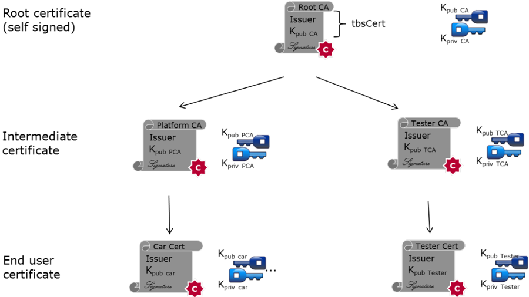

#### 6.2.2. 初始化

在初始化期间，证书子模块将检索永久存储的证书，为解析（**parsing**）做好准备，并使其可按需使用，例如用于证书元素提取或针对其他证书的验证。

或者，证书子模块可以不在每次启动时都解析证书，而是只解析一次并将解析后的信息存储在专用的 NVM 块中。将解析结果存储在 NVM 中的优势是可以加快系统的启动速度。

由于证书的解析和验证可能耗费大量时间，建议在启动后的后台任务中对已存储的证书执行此操作。

如果解析操作成功，证书子模块应从证书中提取公钥，并将其存储到所提供的 CSM 密钥引用或 NVM 中。

**注意：** 解析可能包含特定规范所定义的额外处理。例如，KeyMCertFormatType X509 必须考虑 X.509 规范，这也包括定义了压缩处理的 **ECC** SubjectPublicKeyInfo（**RFC 5480**）。

#### 6.2.3. 证书配置

至少应将一个证书定义为 PKI 的根证书。相应 [KeyMCertificate](#913-keymcertificate) 容器的 KeyMCertUpperHierarchicalCertRef 引用其自身。

**原理：** 根证书的特征是：其签名使用存储在同一证书中的公钥进行验证（自签名证书，**self-signed certificate**）。它是层次结构中的顶层证书。

图 7.3 所示为三个 [KeyMCertificate](#913-keymcertificate) 容器的层次化配置示例。它展示了 CSM 作业和密钥的配置以及来自 [KeyMCertificate](#913-keymcertificate) 的引用。这表明了这些容器引用了哪些 CSM 作业和密钥，以及哪个作业用于签名验证。

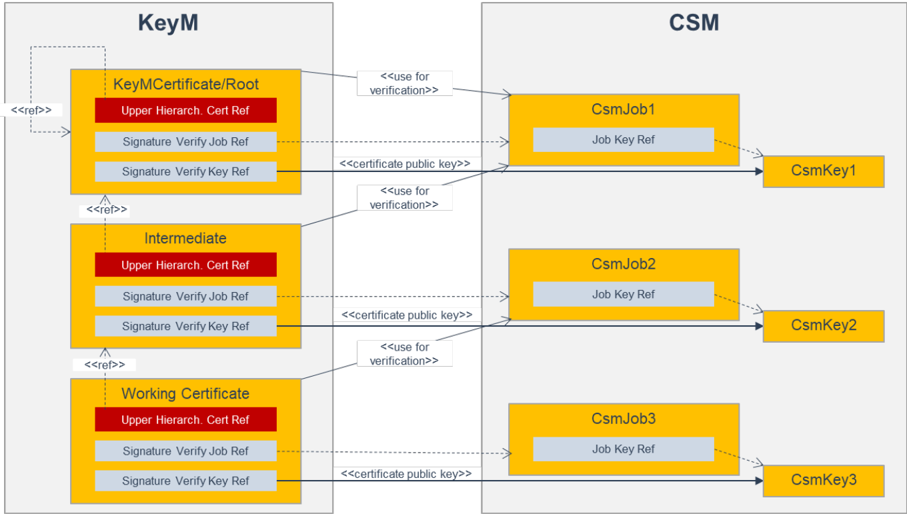

证书通过调用 [KeyM_SetCertificate](#7332-keym_setcertificate)() 函数存储以进行验证。该证书将被放置在 [KeyMCertificate](#913-keymcertificate)/KeyMCertificateStorage 预配置的存储类（**storage class**）中。

**注意：** 此类证书通常放置在 **RAM** 中，不打算用于永久存储。[KeyM_SetCertificate](#7332-keym_setcertificate)() 仅用于验证所提交的证书，并非用于永久存储（例如根证书的存储）。要永久存储证书，应使用 [KeyM_ServiceCertificate](#7331-keym_servicecertificate){ByCertId}() 函数。

证书可以用不同的格式表示。

配置应支持三种不同的格式，[\[8\]](#ref-8) 即 **X.509**、**CVC** 和 **CRL**。

分配给证书的密钥元素可以归类为该结构的基本元素（**basic elements**）。这通过 [KeyMCertificateElement](#7832-keymcertificateelement)/KeyMCertificateElementOfStructure 进行配置。

下面的表格给出了 KeyMCertificateElementOfStructure 的枚举值与相应规范命名约定的对应关系。

表7.1：RFC5280 的 X.509 元素与 [KeyMCertificateElement](#7832-keymcertificateelement)/KeyMCertificateElementOfStructure 元素项配置的对应关系（**Corresponding items of X.509 elements from RFC5280 with element item configuration of [KeyMCertificateElement](#7832-keymcertificateelement)/KeyMCertificateElementOfStructure**）

| RFC 5280 | [KeyMCertificateElement](#7832-keymcertificateelement)/KeyMCertificateElementOfStructure 的 KeyM 配置 |
| --- | --- |
| Version | CertificateVersionNumber |
| Certificate Serial Number | CertificateSerialNumber |
| Signature Algorithm Identifier | CertificateSignatureAlgorithmID |
| Issuer Name | CertificateIssuerName |
| Validity Not Before Time | CertificateValidityPeriodNotBefore |
| Validity Not After Time | CertificateValidityPeriodNotAfter |
| Subject Name | CertificateSubjectName |
| Subject Public Key Algorithm | CertificateSubjectPublicKeyInfo_PublicKeyAlgorithm |
| Subject Public Key | CertificateSubjectPublicKeyInfo_SubjectPublicKey |
| Extensions | CertificateExtension |

表7.2：BSI 技术指南 TR-03110 定义的 CVC 元素与 [KeyMCertificateElement](#7832-keymcertificateelement)/KeyMCertificateElementOfStructure 元素项配置的对应关系（**Corresponding items of CVC elements as defined in BSI - Technical Guideline TR-03110 with element item configuration of [KeyMCertificateElement](#7832-keymcertificateelement)/KeyMCertificateElementOfStructure**）

| BSI - Technical Guideline TR-03110 | [KeyMCertificateElement](#7832-keymcertificateelement)/KeyMCertificateElementOfStructure 的 KeyM 配置 |
| --- | --- |
| Certificate Profile Identifier | CertificateVersionNumber |
| Certificate Authority Reference | CertificateIssuerName |
| Signature Algorithm Identifier | CertificateSignatureAlgorithmID |
| Public Key Object Identifier | CertificateSubjectPublicKeyInfo_PublicKeyAlgorithm |
| Public Key Domain Parameters | CertificateSubjectPublicKeyInfo_SubjectPublicKey |
| Certificate Holder Reference | CertificateSubjectName |
| Certificate Holder Authorization Template | CertificateSubjectAuthorization |
| Certificate Effective Date | CertificateValidityPeriodNotBefore |
| Certificate Expiration Date | CertificateValidityPeriodNotAfter |
| Certificate Extensions | CertificateExtension |

元素 RevokedCertificates 用于指示该元素是证书吊销列表（**CRL**）中被吊销证书的列表。

支持超出预定义可用编码类型（**Encoding**）之外编码类型的 **KeyM**，应通过参数 KeyMCertEncodingTypeCustom 定义自定义的编码类型。

#### 6.2.4. 操作模式

如果配置项 KeyMServiceCertificateFunctionEnabled 和 KeyMCertificateManagerEnabled 设置为 TRUE，则证书子模块应提供 [KeyM_ServiceCertificate](#7331-keym_servicecertificate){ByCertId}() 函数。该函数可以由密钥主控触发，用于向证书子模块提供与证书相关的信息。可以执行多种与证书相关的操作，例如引入或更新系统中永久存储的证书。

每个可以通过其符号名称 [KeyMCertificate](#913-keymcertificate)/KeyMCertificateId 寻址的证书都提供一个 [KeyM_CertificateStatusType](#7826-keym_certificatestatustype) 中定义的证书状态（**certificate status**）。每个状态都通过图 7.4 所示的已定义状态转换进入。证书的当前状态可以通过 [KeyM_CertGetStatus](#73312-keym_certgetstatus)() 请求。

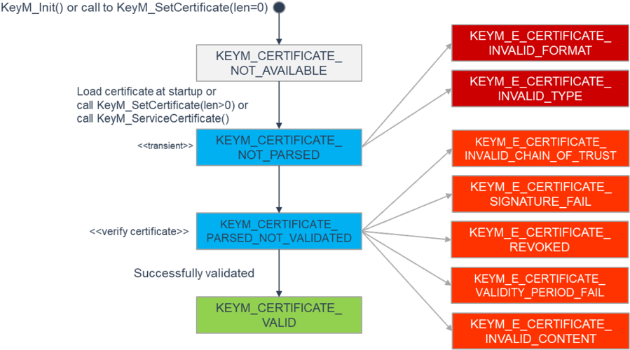

证书状态 KEYM_CERTIFICATE_NOT_AVAILABLE 在 KeyM 初始化之后进入。也可以通过调用 [KeyM_SetCertificate](#7332-keym_setcertificate)() 并在 [KeyM_CertDataType](#78210-keym_certdatatype) 结构中将证书数据长度 certDataLength 设置为 0 来复位证书及其状态，从而进入该状态（参见第 [7.3.3.2](#7332-keym_setcertificate) 章）。

证书的解析过程应在证书通过 [KeyM_SetCertificate](#7332-keym_setcertificate)() 或 [KeyM_ServiceCertificate](#7331-keym_servicecertificate){ByCertId}() 存储后立即启动。当解析正在进行时，证书状态应变为瞬态状态 KEYM_CERTIFICATE_NOT_PARSED，直到解析过程完成。解析过程也可以在 KeyM 初始化时就被触发（如第 [6.2.2](#622-初始化) 章所述），此时证书状态同样应变为 KEYM_CERTIFICATE_NOT_PARSED。

如果证书解析操作检测到违反 KeyMCertEncodingType（如已配置）所指定的编码规则的行为，或在 KeyMCertFormatType 上违反诸如 **ASN.1** 或 **TLV**（Tag-Length-Values，标签-长度-值）之类的语法，则应设置证书状态 KEYM_E_CERTIFICATE_INVALID_FORMAT，并在已配置的回调（**callback**）要求时向应用程序报告。在该状态被重置之前，不得对该证书执行诸如解析和验证之类的进一步操作。

如果证书是格式良好的 ASN.1 结构，但缺少指定格式类型（KeyMCertFormatType）在 KeyMCertificateElementOfStructure 中所述的基本元素，则应设置证书状态 KEYM_E_CERTIFICATE_INVALID_TYPE，并在已配置的回调要求时向应用程序报告。在该状态被重置之前，不得对该证书执行诸如验证之类的进一步操作。

如果解析操作已成功完成而无失败，则证书状态应设置为 KEYM_CERTIFICATE_PARSED_NOT_VALIDATED，并在已配置的回调要求时向应用程序报告。

仅当证书处于 KEYM_CERTIFICATE_PARSED_NOT_VALIDATED 状态时，才应启动证书的验证（**verification**）。验证最迟应通过调用 [KeyM_VerifyCertificate](#7335-keym_verifycertificate)()、[KeyM_VerifyCertificates](#7334-keym_verifycertificates)() 或 [KeyM_VerifyCertificateChain](#7336-keym_verifycertificatechain)() 函数之一来触发。

**注意：** KeyM 的实现可以在这些函数调用之前更早地启动验证过程，例如在初始化后的后台中进行，或在需要验证证书链时。

证书的验证应按照以下要求所述的顺序步骤进行。如果其中一个步骤失败，则应将证书状态设置为相应的值，并通过回调函数（如已配置）报告，且验证应停止。证书状态应保持在该状态，直到按照前述要求将其重置为止。

证书验证首先检查所有通过 KeyMCertUpperHierarchicalCertRef 链接的证书是否处于 KEYM_CERTIFICATE_VALID 状态。如果这些被引用的证书中有任何一个处于 KEYM_CERTIFICATE_NOT_PARSED 或 KEYM_CERTIFICATE_PARSED_NOT_VALIDATED 状态，则应为这些被链接的证书启动解析和/或验证过程，顺序为从顶部（链接列表中要么没有进一步链接、要么链接到自身的最后一个证书）向下到底部（与当前正在处理的证书的 KeyMCertUpperHierarchicalCertRef 直接链接的下一个证书）。在这种情况下，应在所有已启动的证书验证都达到最终状态后重新进行被链接证书的状态检查。

如果所有通过 KeyMCertUpperHierarchicalCertRef 链接的证书都处于 KEYM_CERTIFICATE_VALID 状态，或者 KeyMCertUpperHierarchicalCertRef 链接到自身（自签名证书），则应使用下一个上层证书（即 KeyMCertUpperHierarchicalCertRef 所引用的证书）的颁发者（**issuer**）字段来验证当前正在验证的证书的主体（**subject**）字段。如果上述检查之一失败，则应设置状态 KEYM_E_CERTIFICATE_INVALID_CHAIN_OF_TRUST，并通过回调函数（如已配置）报告，且验证过程应停止。否则，接下来应执行下述检查。

应通过使用由 KeyMCertUpperHierarchicalCertRef/KeyMCertCsmSignatureVerifyJobRef 引用的 CSM 验证作业来验证证书的签名（见图 7.4）。需要注意，对于自签名证书，该证书的公钥需要事先在 KeyMCertCsmSignatureVerifyKeyRef 中设置并验证。如果签名验证失败，则应设置证书状态 KEYM_E_CERTIFICATE_SIGNATURE_FAIL，并通过回调函数（如已配置）报告，且验证过程应停止。否则，接下来应执行下述检查。

如果 KeyM 模块维护吊销列表（**revocation list**），则应检查正在验证的证书是否属于已吊销的证书。如果是，则应设置证书状态 KEYM_E_CERTIFICATE_REVOKED，并通过回调函数（如已配置）报告，且验证过程应停止。否则，接下来应执行下述检查。

如果证书格式类型包含时间段，则 KeyM 模块应从所配置的时间源（KeyMCertTimebaseRef）查询当前时间，并比较当前时间是否在证书的有效期内。如果不是，则应设置证书状态 KEYM_E_CERTIFICATE_VALIDITY_PERIOD_FAIL，并通过回调函数（如已配置）报告，且验证过程应停止。否则，接下来应执行下述检查。

证书元素的内容应通过检查所有 KeyMCertCertificateElementRuleRef 来核查。如果其中任何一条规则被违反，则应设置证书状态 KEYM_E_CERTIFICATE_INVALID_CONTENT，并通过回调函数（如已配置）报告，且验证过程应停止。否则，应执行下述要求。

如果所有验证步骤都已执行且在验证过程中未检测到错误，则应将证书的公钥设置并验证（Csm_KeySetValid()）到由 KeyMCertCsmSignatureVerifyKeyRef 引用的 CSM 密钥中（对于自签名证书，如尚未执行此操作，参见前文）。应设置证书状态 KEYM_CERTIFICATE_VALID，并在已配置的回调要求时向应用程序报告。

### 6.3. 自定义处理

发送到 KeyM 的服务请求既可以在 KeyM 本地处理，也可以在适配的加密驱动程序（例如 HSM）上处理。这通过自定义 CSM 作业和 API 将 KeyM 服务请求链接到适配的加密驱动程序来实现。适配的加密驱动程序可以将请求传输给 HSM。这样，KeyM 充当代理（**proxy**），相应配置的证书操作完全在加密栈（例如 HSM）中处理。无论证书是在 KeyM 本地处理还是在加密驱动程序中处理，KeyM 的 API 都保持不变。这样的优势在于，所传递数据的序列化和反序列化完全在加密栈（**Crypto Stack**）内处理。

为了能够将 KeyM 作业作为自定义加密作业执行，Crypto 中的一个专用配置文件（**profile**）提供了到 Csm 异步或同步作业处理的映射（见 SWS Crypto Driver 第 7.5.2 章）。对于状态请求等 KeyM 同步函数，使用 Csm_CustomSync 函数。加密驱动程序配置文件也为其定义了设置。

证书链的所有证书要么由 KeyM 本地处理，要么由 Csm 自定义处理。

如果配置容器 [KeyMCertificateCustomService](#9131-keymcertificatecustomservice) 包含在某个证书的配置中，则证书子模块应使用所提供的 Csm 作业和函数进行自定义处理（Csm_CustomService 和 Csm_CustomSync），使用引用定义 KeyMCertCsmCustomJobRef。

#### 6.3.1. 处理自定义服务请求

下表展示了所提供的自定义处理函数及其对应的服务请求/函数。

| KeyM 服务请求 | Csm API（自定义处理函数） |
| --- | --- |
| [KeyM_ServiceCertificate](#7331-keym_servicecertificate) | Csm_CustomService |
| KeyM_ServiceCertificateByCertId | Csm_CustomService |
| [KeyM_VerifyCertificates](#7334-keym_verifycertificates) | Csm_CustomService |
| [KeyM_VerifyCertificate](#7335-keym_verifycertificate) | Csm_CustomService |
| [KeyM_VerifyCertificateChain](#7336-keym_verifycertificatechain) | Csm_CustomService |
| [KeyM_CertElementGet](#7337-keym_certelementget) | Csm_CustomSync |
| [KeyM_CertGetStatus](#73312-keym_certgetstatus) | Csm_CustomSync |
| KeyM_CertificateElementGetByIndex | Csm_CustomSync |
| KeyM_CertificateElementGetCount | Csm_CustomSync |
| [KeyM_SetCertificate](#7332-keym_setcertificate) | Csm_CustomSync |
| [KeyM_GetCertificate](#7333-keym_getcertificate) | Csm_CustomSync |

**注意：** 如果使用了自定义服务 API，则需要通过使用 KeyM_CertificateElementGetByIndex() 和 KeyM_CertificateElementGetCount() 来实现 KeyM_CertificateElementGetFirst() 和 KeyM_CertificateElementGetNext() API。

### 6.4. 安全事件

如果已为 KeyM 模块启用安全事件（**security event**）报告（KeyMEnableSecurityEventReporting = true），则应通过 [\[4\]](#ref-4)「AUTOSAR_SWS_BSWGeneral」中定义的接口将相应的安全事件报告给 [\[9\]](#ref-9)「**IdsM**」。

下表列出了为 KeyM 标准化的安全事件及其触发条件：

**KeyM 的安全事件（Security events for KeyM）**

| 名称 | 描述 | ID |
| --- | --- | --- |
| SEV_CERT_ROOT_INST_REQ | 尝试安装根证书。 | 1 |
| SEV_CERT_ROOT_UPD_REQ | 尝试更新已有的根证书。 | 2 |
| SEV_CERT_INTERMEDIATE_INST_REQ | 尝试安装中间证书。 | 3 |
| SEV_CERT_INTERMEDIATE_UPD_REQ | 尝试更新中间证书。 | 4 |
| SEV_CERT_VERIF_FAILED | 针对证书链验证证书的请求未成功。 | 5 |

下表描述了应为相应安全事件报告的上下文数据（**Context Data**）：

| 安全事件 | 上下文数据 |
| --- | --- |
| SEV_CERT_ROOT_INST_REQ | 上下文数据（41 字节）<br>• Result（1 字节）<br>- 操作失败：0x0<br>- 操作成功：0x1<br>• 证书的 HashedID8（8 字节）<br>• certificateIssuerName（32 字节） |
| SEV_CERT_ROOT_UPD_REQ | 上下文数据（41 字节）<br>• Result（1 字节）<br>- 操作失败：0x0<br>- 操作成功：0x1<br>• 证书的 HashedID8（8 字节）<br>• certificateIssuerName（32 字节） |
| SEV_CERT_INTERMEDIATE_INST_REQ | 上下文数据（41 字节）<br>• Result（1 字节）<br>- 操作失败：0x0<br>- 操作成功：0x1<br>• 证书的 HashedID8（8 字节）<br>• certificateIssuerName（32 字节） |
| SEV_CERT_INTERMEDIATE_UPD_REQ | 上下文数据（41 字节）<br>• Result（1 字节）<br>- 操作失败：0x0<br>- 操作成功：0x1<br>• 证书的 HashedID8（8 字节）<br>• certificateIssuerName（32 字节） |
| SEV_CERT_VERIF_FAILED | 上下文数据（41 字节）<br>• Result（1 字节）<br>- E_NOT_OK：0x0<br>- KEYM_E_BUSY：0x1<br>- KEYM_E_PARAMETER_MISMATCH：0x05<br>- KEYM_E_KEY_CERT_EMPTY：0x0A<br>- KEYM_E_CERT_INVALID_CHAIN_OF_TRUST：0x0B<br>• 证书的 HashedID8（8 字节）<br>• certificateIssuerName（32 字节） |

### 6.5. 错误分类

[\[4\]](#ref-4)「基础软件模块通用规范」文档中的“错误处理”（**Error Handling**）一节详细描述了基础软件的错误处理。其中首先构成了一个分类方案，包含 **BSW** 模块中可能出现的五种错误类型。

在此基础上，下文将在相应的小节中规定具体的错误。

#### 6.5.1. 开发错误

**KeyM 模块中开发错误的定义（Definition of development errors in module KeyM）**

| 错误类型 | 相关错误代码 | 错误值 |
| --- | --- | --- |
| 使用无效参数（空指针）调用 API 服务 | KEYM_E_PARAM_POINTER | 0x01 |
| 缓冲区对于该操作而言太小 | KEYM_E_SMALL_BUFFER | 0x02 |
| 在模块已初始化之前调用了 API | KEYM_E_UNINIT | 0x03 |
| KeyM 模块初始化失败 | KEYM_E_INIT_FAILED | 0x04 |
| KeyM 配置失败 | KEYM_E_CONFIG_FAILURE | 0x05 |

#### 6.5.2. 运行时错误

无运行时错误。

#### 6.5.3. 瞬态故障

无瞬态故障。

#### 6.5.4. 生产错误

无生产错误。

#### 6.5.5. 扩展生产错误

无扩展生产错误。

### 6.6. 错误检测

如果开发错误处于激活状态，密钥管理器应在每次函数调用时检查模块是否已通过 [KeyM_Init](#7311-keym_init)() 初始化且尚未通过 [KeyM_Deinit](#7312-keym_deinit)() 反初始化。否则，应设置开发错误 [KEYM_E_UNINIT](#651-开发错误)。

如果开发错误处于激活状态，密钥管理器应在每个提供了结果缓冲区的函数中检查所提供的缓冲区是否足够大，以存储所请求的结果。如果不够，应设置开发错误 [KEYM_E_SMALL_BUFFER](#651-开发错误)。

如果开发错误处于激活状态，密钥管理器应在每个提供了指针的函数中检查该指针是否不是 NULL_PTR。如果提供了 NULL_PTR 但并非预期，则应设置开发错误 [KEYM_E_PARAM_POINTER](#651-开发错误)。

## 7. API规范

### 7.1. 导入的类型

本章列出了从以下模块包含的所有类型：

**KeyM**模块的导入数据类型定义

| 模块 | 头文件 | 导入的类型 |
|---|---|---|
| Csm | Rte_Csm_Type.h | Crypto_OperationModeType |
| Csm | Rte_Csm_Type.h | Crypto_VerifyResultType |
| IdsM | IdsM_Types.h | IdsM_SecurityEventIdType |
| StbM | Rte_StbM_Type.h | StbM_SynchronizedTimeBaseType |
| StbM | Rte_StbM_Type.h | StbM_TimeBaseStatusType |
| StbM | Rte_StbM_Type.h | StbM_TimeStampType |
| StbM | Rte_StbM_Type.h | StbM_TimeTupleType |
| StbM | Rte_StbM_Type.h | StbM_UserDataType |
| StbM | StbM.h | StbM_VirtualLocalTimeType |
| Std | Std_Types.h | Std_ReturnType |
| Std | Std_Types.h | Std_VersionInfoType |

### 7.2. 类型定义

#### 7.2.1. KeyM_ConfigType

结构类型。元素为实现特定的内容：该数据结构的内容是实现特定的。此结构是初始化**KeyM**模块的基础类型。可通过**KeyM.h**获得。

#### 7.2.2. KeyM_KH_UpdateOperationType

枚举类型。指定在回调中执行的密钥处理程序更新操作的类型。可通过**KeyM.h**获得。

* **KEYM_KH_UPDATE_KEY_UPDATE_REPEAT**（0x01）：密钥处理程序已成功执行该操作，并提供新的密钥数据，该数据将由**KeyM**的更新函数进一步处理。请求再次调用密钥处理程序。
* **KEYM_KH_UPDATE_FINISH**（0x02）：密钥处理程序已成功执行所有更新操作。更新操作已完成，结果数据可以交回，作为 [KeyM_Update](#7323-keym_update) 操作的最终结果。

#### 7.2.3. KeyM_CertElementIteratorType

结构类型。元素为实现特定的内容：该数据结构的内容是实现特定的。该结构用于遍历证书的多个元素。可通过**KeyM.h**获得。

#### 7.2.4. KeyM_CryptoKeyIdType

类型，派生自 uint16。加密密钥句柄。可通过**KeyM.h**获得。

#### 7.2.5. KeyM_CertDataPointerType

指针类型（uint8*）。指向证书数据的字节指针。可通过**KeyM.h**获得。

#### 7.2.6. Std_ReturnType 的扩展

类型，**Std_ReturnType** 的扩展。**KeyM**模块使用对 **Std_ReturnType** 的以下扩展：用于 **Std_ReturnType** 的密钥管理专用返回值。可通过**KeyM.h**获得。

* **KEYM_E_BUSY**（0x02）：密钥管理正忙于其他操作。
* **KEYM_E_PENDING**（0x03）：操作请求已被接受，响应待定。该操作现在以异步模式运行，响应将通过回调给出。
* **KEYM_E_KEY_CERT_SIZE_MISMATCH**（0x04）：参数大小与期望值不匹配。
* **KEYM_E_PARAMETER_MISMATCH**（0x05）：传递给函数的参数未提供期望的值。
* **KEYM_E_KEY_CERT_INVALID**（0x06）：密钥或证书无效，不能用于该操作。
* **KEYM_E_KEY_CERT_WRITE_FAIL**（0x07）：证书或密钥写操作失败。
* **KEYM_E_KEY_CERT_UPDATE_FAIL**（0x08）：密钥或证书更新操作失败。
* **KEYM_E_KEY_CERT_READ_FAIL**（0x09）：由于读取或权限故障，无法提供证书或密钥。
* **KEYM_E_KEY_CERT_EMPTY**（0x0A）：所请求的密钥或证书不可用，槽位为空。
* **KEYM_E_CERT_INVALID_CHAIN_OF_TRUST**（0x0B）：证书验证失败 —— 信任链无效。

### 7.3. 函数定义

以下是提供给上层模块的函数列表。

#### 7.3.1. 通用

##### 7.3.1.1. KeyM_Init

**说明**: 此函数初始化密钥管理模块。可通过**KeyM.h**获得。本服务为同步调用，不可重入。参数 ConfigPtr（in）：指向 **VARIANT-POST-BUILD** 配置集的指针。

```C
void KeyM_Init ( const KeyM_ConfigType* ConfigPtr )
```

配置指针 configPtr 应始终具有空指针（NULL_PTR）值。

**注意：**初始化时对**KeyM**的配置目前尚未使用，因此应向模块传递空指针（NULL_PTR）。

如果密钥管理模块初始化失败，且开发错误已激活，则应向 **DET** 报告错误 [KEYM_E_INIT_FAILED](#651-开发错误)。

如果证书子模块处于激活状态，且存在处于未解析、未验证状态的持久化存储证书，则 **KeyM** 证书子模块部分应启动一个后台任务，对证书进行预解析和预验证。

**原理：**如果 **CPU** 时间可用，该操作可以在后台任务中完成。预验证证书将有助于加快认证速度：当呈现一个证书并需要针对预先安装的证书链在运行时进行验证时，即可从中受益。

如果加密密钥子模块处于激活状态，则在初始化期间，所有存储在 **NVM** 中的密钥都应从 **NVM** 中读出并存储到 **CSM** 的（**RAM**）密钥槽位中。

##### 7.3.1.2. KeyM_Deinit

**说明**: 此函数将密钥管理模块重置为未初始化状态。可通过**KeyM.h**获得。本服务为同步调用，不可重入。

```C
void KeyM_Deinit ( void )
```

出于安全原因，加密密钥子模块应主动销毁 **RAM** 中所有曾用于加密密钥材料的数据。特别是，对称密钥和中间结果应被设置为一个初始值。

##### 7.3.1.3. KeyM_GetVersionInfo

**说明**: 提供本模块的版本信息。可通过**KeyM.h**获得。本服务为同步调用，不可重入。参数 VersionInfo（out）：指向本模块版本信息的指针。

```C
void KeyM_GetVersionInfo ( Std_VersionInfoType* VersionInfo )
```

#### 7.3.2. 加密密钥操作

##### 7.3.2.1. KeyM_Start

**说明**: 此函数为可选函数，仅在配置项 KeyMCryptoKeyStartFinalizeFunctionEnabled 设置为 true 时使用，其意图是允许密钥更新操作。可通过**KeyM.h**获得。本服务为同步调用，不可重入。参数 StartType（in）：定义密钥操作应以哪种模式执行。参数 RequestData（in）：随请求一起提供的信息，例如签名。参数 RequestDataLength（in）：RequestData 数组中数据的长度。参数 ResponseDataLength（inout）：入：ResponseData 中可用的最大字节数；出：实际数量。参数 ResponseData（out）：函数返回的数据。返回值：Std_ReturnType，E_OK：启动操作已成功执行，现在允许密钥更新操作；E_NOT_OK：启动操作未被接受；KEYM_E_PARAMETER_MISMATCH：参数与期望值不匹配；KEYM_E_KEY_CERT_SIZE_MISMATCH：参数大小不匹配。

```C
Std_ReturnType KeyM_Start ( KeyM_StartType StartType, const uint8* RequestData, uint16 RequestDataLength, uint8* ResponseData, uint16* ResponseDataLength )
```

如果 KeyMCryptoKeyStartFinalizeFunctionEnabled 设置为 **TRUE**，则应调用此函数以发起一次密钥更新会话。该函数通过 E_OK 表明密钥操作现在可以进行。

如果密钥更新会话已处于活动状态，且以相同的参数调用该函数，则该函数应返回 E_OK，并继续接受密钥更新操作。

默认情况下，KeyM_Start() 函数不检查请求数据（Request Data）的长度或值。对于携带有效 startTypes 的每一次函数调用，它都会接受，以发起密钥更新会话。

针对启动操作的 **OEM** 或安全性特定检查应在相应的密钥处理程序操作中执行。

##### 7.3.2.2. KeyM_Prepare

**说明**: 此函数用于准备一次密钥更新操作。其主要意图是向密钥服务器提供密钥操作所需的信息。其他操作可以发起公共秘密的协商，该秘密随后用于派生密钥材料。此函数仅在 KeyMCryptoKeyPrepareFunctionEnabled 设置为 **TRUE** 时可用。可通过**KeyM.h**获得。本服务为同步调用，不可重入。参数 RequestData（in）：随请求一起提供的信息。参数 RequestDataLength（in）：RequestData 数组中数据的长度。参数 ResponseDataLength（inout）：入：ResponseData 中可用的最大字节数；出：实际字节数。参数 ResponseData（out）：函数返回的数据。返回值：Std_ReturnType，E_OK：服务已被接受并将在内部处理，结果将通过回调提供；E_NOT_OK：由于内部错误，服务未被接受；KEYM_E_PARAMETER_MISMATCH：参数与期望值不匹配；KEYM_E_KEY_CERT_SIZE_MISMATCH：参数大小不匹配。

```C
Std_ReturnType KeyM_Prepare ( const uint8* RequestData, uint16 RequestDataLength, uint8* ResponseData, uint16* ResponseDataLength )
```

当 KeyMCryptoKeyPrepareFunctionEnabled 设置为 **TRUE** 时，将提供 KeyM_Prepare() 函数。它没有专门的实现，但可以使用密钥处理程序向密钥服务器提供生成密钥材料所需的特定信息。在启用的情况下，此类信息或进一步的操作可以通过密钥处理程序回调 [KeyM_KH_Prepare](#7732-keym_kh_prepare)() 执行，例如提供 **SHE** 信息或生成秘密密钥生成操作。

默认情况下，该函数返回 E_NOT_OK。如果配置了要调用的密钥处理程序，此函数将以完全相同的参数调用该密钥处理程序，并将该密钥处理程序的返回值传回给调用者。

##### 7.3.2.3. KeyM_Update

**说明**: 此函数用于发起密钥生成或更新过程。可通过**KeyM.h**获得。本服务为异步调用，不可重入。参数 KeyNamePtr（in）：指向一个数组的指针，该数组定义要更新的密钥的名称。参数 KeyNameLength（in）：指定 keyName 中的字节数。值 0 表示此函数中未提供 keyName。参数 RequestDataPtr（in）：随请求一起提供的信息。参数 RequestDataLength（in）：RequestData 数组中数据的长度。参数 ResultDataMaxLength（in）：ResultDataPtr 中可用的最大字节数。参数 ResultDataPtr（out）：指向数据缓冲区的指针，函数使用该缓冲区存储结果。返回值：Std_ReturnType，E_OK：服务已被接受并将在内部处理，结果将通过回调提供；E_NOT_OK：由于内部错误，服务未被接受；E_BUSY：由于另一个操作已在进行中，服务无法被接受，请下次再试；KEYM_E_PARAMETER_MISMATCH：参数与期望值不匹配；KEYM_E_KEY_CERT_SIZE_MISMATCH：参数大小不匹配。

```C
Std_ReturnType KeyM_Update ( const uint8* KeyNamePtr, uint16 KeyNameLength, const uint8* RequestDataPtr, uint16 RequestDataLength, uint8* ResultDataPtr, uint16 ResultDataMaxLength )
```

通过调用此函数，将请求一次密钥更新操作。

如果提供了 KeyName，**KeyM** 应在容器中搜索与 /[KeyMCryptoKey](#7833-keymcryptokey)/KeyMCryptoKeyName 匹配的元素。如果找到，则应将该 CryptoKeyId 用作 KeyID，并且该容器应用于引用任何后续的密钥更新操作（派生或存储密钥值）。

如果 KeyNamePtr 无效或 KeyNameLength 为 0，且已定义 KeyMCryptoKeyCryptoProps，则 **KeyM** 应将 RequestData 解释为 **SHE** 密钥的 M1M2M3 值。**KeyM** 应提取位于 RequestDataPtr 中的第 121..124 位（如果 RequestDataLength 表明数据足够），并检查 KeyMCryptoKeyCryptoProps 中是否存在与之对应的值。如果找到匹配的值，则应将该容器的 CryptoKeyId 用作 KeyID，并且该容器应用于引用任何后续的密钥更新操作（派生或存储密钥值）。

如果无法识别出 KeyID，且 KeyMCryptoKeyHandlerUpdateEnabled 设置为 **FALSE**，则 KeyM_Update() 不应执行密钥更新操作，并应返回 KEYM_E_PARAMETER_MISMATCH。

如果 KeyMCryptoKeyHandlerUpdateEnabled 设置为 **TRUE** 以执行密钥处理程序操作，则 KeyM_Update() 应调用 [KeyM_KH_Update](#7733-keym_kh_update)()。参数 RequestDataPtr、RequestDataLength、KeyName 和 KeyNameLength 应传递给密钥处理程序。如果在上述步骤之一中识别出了 [KeyMCryptoKey](#7833-keymcryptokey) 容器，则应通过 KeymId 参数提供 KeyMCryptoKeyID；否则，应使用值 0xFFFF。

如果未为密钥更新操作配置密钥处理程序（KeyMCryptoKeyHandlerUpdateEnabled 设置为 **FALSE**）且已识别出 CryptoKey 容器，则应根据配置（派生密钥或在 **CSM** 中存储密钥）执行密钥更新操作，并按配置进行存储。因此，如果 KeyMCryptoKeyStorage 设置为 KEYM_STORAGE_IN_NVM，则此密钥 **ID** 的 ResultData 及其长度应存储在所配置的 **NVM** 块中；否则，如果设置了 KEYM_STORAGE_IN_CSM，则在密钥数据设置完成之后，由 **CSM** 负责存储该密钥数据。

如果通过密钥 **ID** 识别出了一个密钥，并且 RequestDataPtr 和 RequestDataLength 表明有数据，或者 [KeyM_KH_Update](#7733-keym_kh_update)() 已返回 E_OK 且 ResultDataPtr 和 ResultDataLengthPtr 表明有数据，并且配置 /[KeyMCryptoKey](#7833-keymcryptokey)/KeyMCryptoKeyGenerationType 设置为 KEYM_STORED_KEY，则此函数应调用 Csm_KeyElementSet() 将数据提供给 **CSM**。密钥元素 **ID** 始终为 1，并使用 KeyMCryptoKeyCsmKeyTargetRef 来标识目标密钥。

如果找到了 CryptoKey 容器，并且 RequestDataPtr 和 RequestDataLength 提供了数据，或者 [KeyM_KH_Update](#7733-keym_kh_update)() 已返回 E_OK 且 ResultDataPtr 和 ResultDataLengthPtr 提供了数据，并且配置 /[KeyMCryptoKey](#7833-keymcryptokey)/KeyMCryptoKeyGenerationType 设置为 KEYM_DERIVE_KEY，则应将数据设置到密钥元素 CRYPTO_KE_KEYDERIVATION_PASSWORD 中。如果配置值 KeyMCryptoKeyGenerationInfo 已设置，则该值应用作目标密钥的盐值（salt），并应将该值设置到密钥元素 **ID** CRYPTO_KE_KEYDERIVATION_SALT 中。使用 KeyMCryptoKeyCsmKeyTargetRef 标识目标密钥，将 KeyMCryptoKeyCsmKeySourceDeriveRef 用作派生的源密钥，并相应地调用函数 Csm_KeyDerive()。

如果密钥更新操作成功，且 KeyMCryptoKeyStartFinalizeFunctionEnabled 设置为 **FALSE**，则在密钥元素成功设置到 **CSM** 中之后，应立即调用函数 Csm_KeySetValid()。

如果通过 **CSM** 操作成功执行了密钥更新操作，且 KeyMCryptoKeyStartFinalizeFunctionEnabled 设置为 **TRUE**，则应为此密钥设置一个标志，表明应在密钥更新操作的最终处理期间调用该密钥的 Csm_KeySetValid()。

KeyM_Update() 以异步模式运行。注意，密钥处理程序 [KeyM_KH_Update](#7733-keym_kh_update)() 是以同步模式调用的，因此应在后台任务内调用它。

如果单个密钥更新操作已成功完成，或密钥更新操作由于对 **CSM** 或密钥处理程序的函数调用未返回 E_OK 而失败，或 [KeyM_KH_Update](#7733-keym_kh_update)() 已提供操作类型 KEYM_KH_UPDATE_FINISH，则必须调用回调函数 [KeyM_CryptoKeyUpdateCallbackNotification](#7737-keym_cryptokeyupdatecallbacknotification)()。

调用 KeyM_Update() 的函数应通过 ResultDataPtr 提供指向缓冲区的指针。如果 KeyM_Update() 通过返回 E_OK 接受了该操作，则在回调通知 [KeyM_CryptoKeyUpdateCallbackNotification](#7737-keym_cryptokeyupdatecallbacknotification)() 被调用之前，该函数不得触碰此缓冲区。KeyM_Update() 操作的任何结果都将被复制到此缓冲区中。调用 KeyM_Update() 时提供的同一缓冲区指针（ResultDataPtr）将作为 ResultDataPtr 随回调通知一起提供。回调还会指出结果数据的长度以及更新操作的总体结果。

**提示：**结果数据要么是来自密钥处理程序的结果，要么在未使用密钥处理程序时包含 **SHE** 密钥的 M4M5。

##### 7.3.2.4. KeyM_Finalize

**说明**: 此函数用于最终完成密钥更新操作。它通常与 [KeyM_Start](#7321-keym_start) 操作结合使用，并将密钥操作返回到空闲模式。在初始化新的 [KeyM_Start](#7321-keym_start) 操作之前，不接受进一步的密钥准备或更新操作。此函数仅在 KeyMCryptoKeyStartFinalizeFunctionEnabled 设置为 **TRUE** 时可用。此外，更新后的密钥材料将被持久化并设置为有效状态（调用 Csm_KeySetValid）。可通过**KeyM.h**获得。本服务为异步调用，不可重入。参数 RequestDataPtr（in）：随请求一起提供的信息。参数 RequestDataLength（in）：RequestData 数组中数据的长度。参数 ResponseMaxDataLength（in）：ResponseDataPtr 中可用的最大字节数。参数 ResponseDataPtr（out）：函数返回的数据。返回值：Std_ReturnType，E_OK：操作已被接受并将在内部处理，结果将通过回调提供；E_NOT_OK：由于内部错误，操作未被接受；KEYM_E_BUSY：尚无法执行验证，**KeyM** 当前正忙于其他作业；KEYM_E_PARAMETER_MISMATCH：参数与期望值不匹配；KEYM_E_KEY_CERT_SIZE_MISMATCH：参数大小不匹配。

```C
Std_ReturnType KeyM_Finalize ( const uint8* RequestDataPtr, uint16 RequestDataLength, uint8* ResponseDataPtr, uint16 ResponseMaxDataLength )
```

如果 KeyMCryptoKeyStartFinalizeFunctionEnabled 设置为 **TRUE**，此函数将结束密钥更新操作。在会话期间被标记为要更新的所有密钥，都应通过调用 Csm_KeySetValid() 来完成最终处理。应对所有已更新的密钥执行验证，即使 Csm_KeySetValid() 对其中某个密钥返回失败也应如此。这是为了即使一个密钥失败，也能尽可能多地完成密钥的最终处理。如果至少有一个密钥失败，则总体结果是在回调结果中给出失败信息。

如果 KeyMCryptoKeyStartFinalizeFunctionEnabled 和 KeyMCryptoKeyHandlerStartFinalizeEnabled 设置为 **TRUE**，此函数将以与 KeyM_Finalize() 所提供的参数完全相同的参数调用 [KeyM_KH_Finalize](#7734-keym_kh_finalize)()。密钥处理程序的最终处理必须在密钥验证（对 Csm_KeySetValid() 的调用）之前进行。如果密钥处理程序返回 E_OK，则此函数将按规范继续其操作；如果密钥处理程序最终处理函数返回 E_NOT_OK，则不得进行任何验证。

如果操作已完成，将调用回调函数 [KeyM_CryptoKeyFinalizeCallbackNotification](#7738-keym_cryptokeyfinalizecallbacknotification)()。此回调的参数 'ResultDataPtr' 应提供调用 KeyM_Finalize() 时所提供的缓冲区指针 'ResponseDataPtr'。结果信息提供所有密钥验证的残余结果。

**提示：**由于密钥验证可能花费相当长的时间，此函数仅在异步模式下使用。由于密钥处理程序是以同步模式调用的，建议不要在 KeyM_Finalize() 内部调用它，而是将调用委托给后台任务。KeyM_Finalize() 的调用者应提供一个足以存储响应的缓冲区。如果 KeyM_Finalize() 返回 E_OK，则在回调通知指出最终处理操作结束之前，调用者不得触碰此缓冲区。

在密钥最终处理操作结束时，必须清除密钥验证的所有标志，并且会话状态应设置为初始模式。因此，不再允许任何进一步的密钥更新操作。

##### 7.3.2.5. KeyM_Verify

**说明**: 密钥服务器请求验证所提供的密钥。**KeyM**对所分配的作业执行操作，并将结果返回给密钥服务器，由密钥服务器验证结果是否符合该密钥的预期。此函数仅在 KeyMCryptoKeyVerifyFunctionEnabled 设置为 **TRUE** 时可用。可通过**KeyM.h**获得。本服务的同步/异步特性取决于配置，不可重入。参数 KeyNamePtr（in）：指向一个数组的指针，该数组定义要更新的密钥的名称。参数 KeyNameLength（in）：指定 KeyNamePtr 中的字节数。值 0 表示此函数中未提供 KeyNamePtr。参数 RequestData（in）：随请求一起提供的信息。参数 RequestDataLength（in）：RequestData 数组中数据的长度。参数 ResponseDataLength（inout）：入：ResponseData 中可用的最大字节数；出：ResponseData 中实际的字节数；若服务以异步模式运行且函数返回 KEYM_E_PENDING，则保持不变。参数 ResponseData（out）：函数返回的数据。返回值：Std_ReturnType，KEYM_E_PENDING：操作以异步模式运行，已被接受并将在内部处理，结果将通过回调提供；E_OK：操作已成功执行，结果信息可用；E_NOT_OK：由于内部错误，操作未被接受；KEYM_E_BUSY：尚无法执行验证，**KeyM** 当前正忙于其他作业（针对异步模式）；KEYM_E_PARAMETER_MISMATCH：参数与期望值不匹配；KEYM_E_KEY_CERT_SIZE_MISMATCH：参数大小不匹配；KEYM_E_KEY_CERT_INVALID：由于密钥名称无效，无法执行密钥操作；KEYM_E_KEY_CERT_EMPTY：此槽位的密钥尚未设置。

```C
Std_ReturnType KeyM_Verify ( const uint8* KeyNamePtr, uint16 KeyNameLength, const uint8* RequestData, uint16 RequestDataLength, uint8* ResponseData, uint16* ResponseDataLength )
```

如果 KeyMCryptoKeyVerifyFunctionEnabled 设置为 **TRUE**，此函数可用于执行密钥验证。此函数随时都可以调用，不绑定到密钥更新会话。

如果 KeyMCryptoKeyVerifyAsyncMode 设置为 **FALSE**，该函数将使用 [KeyMCryptoKey](#7833-keymcryptokey)/KeyMCryptoKeyCsmKeyVerifyJobRef 来执行**加密**操作。如果指定了该项，则还应指定配置 KeyMCryptoCsmVerifyJobType，以标识应调用哪个作业。

**提示：**由于仅指定了一个输入缓冲区和一个输出缓冲区，因此只有 **MAC** 生成和数据解密/加密操作可以在本函数中自主完成。其他操作（如 **AEAD** 加密/解密或 **MAC** 验证）需要对结构化的 RequestData 进行解释，这需要在密钥处理程序验证函数中进行解释。

如果 KeyMCryptoKeyVerifyAsyncMode 设置为 **TRUE**，该函数将以异步模式运行。如果作业被接受，直接函数调用将返回 KEYM_E_PENDING；如果作业无法被接受，则返回任何其他返回值。在异步模式下，[KeyM_CryptoKeyVerifyCallbackNotification](#7739-keym_cryptokeyverifycallbacknotification) 将提供**加密**作业操作的结果。

**提示：**如果至少有一个 **CSM** 验证作业被配置为异步操作，这尤其有用。理想情况下，验证应在后台任务中发起。

#### 7.3.3. 证书处理

##### 7.3.3.1. KeyM_ServiceCertificate

**说明**: 密钥服务器向密钥客户端请求一个操作。操作的类型在第一个参数 [KeyM_ServiceCertificateType](#7824-keym_servicecertificatetype) 中指定。证书操作请求通过本函数进行处理。仅当配置参数 KeyMServiceCertificateFunctionEnabled 设置为 TRUE 时，本函数才可用。可通过**KeyM.h**获得。本服务为异步调用，不可重入。参数 Service（in）：提供密钥管理器必须执行的服务类型。参数 CertNamePtr（in）：指向一个数组的指针，该数组定义了待更新证书的名称。参数 CertNameLength（in）：指定 CertNamePtr 中的字节数；值 0 表示本函数中未提供 CertNamePtr。参数 RequestData（in）：随请求一起提供的信息。参数 RequestDataLength（in）：RequestData 数组中数据的长度。参数 ResponseDataLength（inout）：ResponseDataPtr 中可用的最大字节数。参数 ResponseData（out）：函数返回的数据。返回值：Std_ReturnType，E_OK：服务数据操作已被成功接受；E_NOT_OK：由于内部错误导致操作未被接受；KEYM_E_PARAMETER_MISMATCH：参数与期望值不匹配；KEYM_E_KEY_CERT_SIZE_MISMATCH：参数大小不匹配；KEYM_E_BUSY：证书服务无法执行，操作正忙。

```C
Std_ReturnType KeyM_ServiceCertificate ( KeyM_ServiceCertificateType Service, const uint8* CertNamePtr, uint32 CertNameLength, const uint8* RequestData, uint32 RequestDataLength, uint8* ResponseData, uint32* ResponseDataLength )
```

**说明**: 本节还定义了 API 函数 KeyM_ServiceCertificateByCertId。该函数中，密钥服务器向密钥客户端请求一个操作。操作的类型在参数 [KeyM_ServiceCertificateType](#7824-keym_servicecertificatetype) 中指定。证书操作请求通过本函数进行处理。仅当配置参数 KeyMServiceCertificateFunctionEnabled 设置为 TRUE 时，本函数才可用。本函数与 KeyM_ServiceCertificate() 相同，但已直接使用证书标识符作为参数，因此无需按名称搜索已配置的证书。可通过**KeyM.h**获得。本服务为异步调用，不可重入。参数 CertId（in）：持有证书的标识符。参数 Service（in）：提供密钥管理器必须执行的服务类型。参数 RequestData（in）：随请求一起提供的信息。参数 RequestDataLength（in）：RequestData 数组中数据的长度。参数 ResponseDataLength（inout）：ResponseDataPtr 中可用的最大字节数。参数 ResponseData（out）：函数返回的数据。返回值：Std_ReturnType，E_OK：服务数据操作已被成功接受；E_NOT_OK：由于内部错误导致操作未被接受；KEYM_E_PARAMETER_MISMATCH：参数与期望值不匹配；KEYM_E_KEY_CERT_SIZE_MISMATCH：参数大小不匹配；KEYM_E_BUSY：证书服务无法执行，操作正忙。

```C
Std_ReturnType KeyM_ServiceCertificateByCertId ( KeyM_CertificateIdType CertId, KeyM_ServiceCertificateType Service, const uint8* RequestData, uint32 RequestDataLength, uint8* ResponseData, uint32* ResponseDataLength )
```

如果 KeyMServiceCertificateFunctionEnabled 设置为 TRUE，则提供本服务函数用于更新证书或证书信息。操作的类型由 Service 参数指定。

可以将服务证书密钥处理器配置为延迟（defer）服务操作。如果 KeyMCryptoKeyHandlerServiceCertificateEnabled 设置为 TRUE，本函数将通过向处理器传递完全相同的参数来直接调用服务证书密钥处理器，并返回该处理器返回的值，不再执行其他操作。

如果 KeyMCryptoKeyHandlerServiceCertificateEnabled 设置为 FALSE，服务证书函数将检查所请求的服务，并通过首先按名称搜索已配置的证书来执行所请求的操作。

应根据 Service 参数提供以下服务。这些服务中的任何一个或所有服务的实现均为可选。

| 服务 | 描述 |
|---|---|
| KEYM_SERVICE_CERT_REQUEST_CSR | 密钥服务器请求一个证书签名请求（**CSR**）。服务证书应按照该格式生成证书，将生成一个 **RSA** 或 **ECC** 密钥对，并将这些值存储在已配置的容器中。生成的证书将提供给密钥服务器。 |
| KEYM_SERVICE_CERT_UPDATE_SIGNED_CSR | 密钥服务器已修改并签署了该证书。证书被返回，本函数随即将有效的证书存储到已配置的存储区中。 |
| KEYM_SERVICE_CERT_SET_ROOT | 密钥服务器请求存储一个根证书。服务检查证书槽是否为空，若为空，则根据已配置的规则验证根证书，并存储该根证书。 |
| KEYM_SERVICE_CERT_UPDATE_ROOT | 密钥服务器请求更新一个已有的根证书。服务检查根证书是否存在，并将新的根证书与已有的根证书进行验证。如果验证成功，则在该槽中更新（re-new）根证书。 |
| KEYM_SERVICE_CERT_SET_INTERMEDIATE | 密钥服务器请求存储一个中间证书。必须已存在根证书，才能针对根证书以及链中可能存在的其他证书验证该中间证书。检查证书槽为空。如果验证成功，证书将被存储在该槽中。 |
| KEYM_SERVICE_CERT_UPDATE_INTERMEDIATE | 密钥服务器请求更新一个中间证书。将针对根证书以及链中可能存在的其他证书对它进行验证。如果验证成功，则更新该证书。 |
| KEYM_SERVICE_CERT_UPDATE_CRL | 密钥服务器提供一个证书吊销列表。服务检查该列表的签名，如果验证成功则将其存储在槽中。此后，如果至少有一个吊销列表可用，则在证书验证过程中应检查该吊销列表。 |

下表规定了 KeyM_ServiceCertificate() API 依据 Service 参数的输入参数和输出参数。

表8.1：服务参数（**Service Parameters**）

| 服务参数 | 请求 | 响应 |
|---|---|---|
| KEYM_SERVICE_CERT_REQUEST_CSR | _ | certificate |
| KEYM_SERVICE_CERT_UPDATE_SIGNED_CSR | certificate | _ |
| KEYM_SERVICE_CERT_SET_ROOT | root certificate | _ |
| KEYM_SERVICE_CERT_UPDATE_ROOT | root certificate | _ |
| KEYM_SERVICE_CERT_SET_INTERMEDIATE | certificate | _ |
| KEYM_SERVICE_CERT_UPDATE_INTERMEDIATE | certificate | _ |
| KEYM_SERVICE_CERT_UPDATE_CRL | revocation list | _ |

**注意：**[KeyM_SetCertificate](#7332-keym_setcertificate)() 函数用于存储给定的证书，以便针对证书链进行验证。链中的证书既可以临时提供在专用的证书槽中并通过 [KeyM_SetCertificate](#7332-keym_setcertificate)() 存储，也可以通过 KeyM_ServiceCertificate{ByCertId}() 永久存储。例如，这可以在制造过程中通过专有操作完成。为了正常运行，至少必须提供根证书。

如果 KeyMCryptoKeyStartFinalizeFunctionEnabled 设置为 TRUE，则在能够执行服务证书操作之前，应先启动一个密钥更新会话。

服务操作异步运行，并将在操作完成时调用 [KeyM_ServiceCertificateCallbackNotification](#77310-keym_servicecertificatecallbacknotification)() 并提供结果。

##### 7.3.3.2. KeyM_SetCertificate

**说明**: 本函数向密钥管理模块提供证书数据，以临时存储该证书。可通过**KeyM.h**获得。本服务为同步调用，不可重入。参数 CertId（in）：持有证书的标识符。参数 CertificateDataPtr（in）：指向提供证书数据的结构的指针。返回值：Std_ReturnType，E_OK：证书已被接受；E_NOT_OK：无法设置证书；KEYM_E_PARAMETER_MISMATCH：参数与期望值不匹配；KEYM_E_KEY_CERT_SIZE_MISMATCH：参数大小不匹配。

```C
Std_ReturnType KeyM_SetCertificate ( KeyM_CertificateIdType CertId, const KeyM_CertDataType* CertificateDataPtr )
```

KeyM_SetCertificate() 函数用于存储给定的证书，以便针对证书链进行验证。链中的证书既可以临时提供在专用的证书槽中并通过 KeyM_SetCertificate() 存储，也可以通过 [KeyM_ServiceCertificate](#7331-keym_servicecertificate)() 永久存储。例如，这可以在制造过程中通过专有操作完成。为了正常运行，至少必须提供根证书。

如果所有参数都被接受，函数应将提供的证书数据存储在分配给给定 CertId 所引用证书槽的内部存储器中（通常是 **RAM**）。一旦提供了证书，证书子模块将开始解析该证书。

证书的解析既可以直接在本函数内完成，也可以在后台函数或主函数中进行。

**注意：**设置证书并成功解析并不一定意味着该证书已在其信任链中得到验证。解析只是执行证书验证的前提条件，证书验证需通过另一个函数请求。

如果证书被基本接受，函数返回 E_OK。任何其他返回值都表示证书未被接受。在提供并接受新证书之前，不能对该证书执行任何解析和验证操作。

**提示：**证书是否已成功解析或验证，可以通过 [KeyM_CertGetStatus](#73312-keym_certgetstatus)() 检查。

如果容器 [KeyMCertificate](#913-keymcertificate)//KeyMCertificateStorage 所引用证书的存储类被设置为 KEYM_STORAGE_IN_CSM 或 KEYM_STORAGE_IN_NVM，则应产生开发错误 [KEYM_E_CONFIG_FAILURE](#651-开发错误)。如果开发模式被禁用，则应返回值 E_NOT_OK。

可以通过以相应的证书 ID 但长度信息为 0 调用 KeyM_SetCertificate() 来重置证书的状态。函数将返回 E_OK，并将证书的状态重置为 KEYM_CERTIFICATE_NOT_AVAILABLE（参见 [KeyM_CertGetStatus](#73312-keym_certgetstatus)()）。

##### 7.3.3.3. KeyM_GetCertificate

**说明**: 本函数提供 **DER** 编码的证书数据。可通过**KeyM.h**获得。本服务为同步调用，不可重入。参数 CertId（in）：持有证书的标识符。参数 CertificateDataPtr（inout）：提供指向证书数据结构的指针。该指针在结构中所定位的缓冲区应由本函数的调用者提供；调用本函数时，长度信息表示缓冲区的最大长度；如果返回 E_OK，则长度信息表示缓冲区中证书数据的实际长度。返回值：Std_ReturnType，E_OK：证书数据可用且已提供；E_NOT_OK：由于内部错误导致操作未被接受；KEYM_E_PARAMETER_MISMATCH：证书 ID 无效；KEYM_E_KEY_CERT_SIZE_MISMATCH：为证书提供的缓冲区太小；KEYM_E_KEY_CERT_EMPTY：无证书数据可用，证书槽为空；KEYM_E_KEY_CERT_READ_FAIL：无法提供证书，访问被拒绝。

```C
Std_ReturnType KeyM_GetCertificate ( KeyM_CertificateIdType CertId, KeyM_CertDataType* CertificateDataPtr )
```

本函数应提供由证书 ID 引用的 **DER** 编码证书数据。它从相应的槽中检索信息，检查数据结构所引用的数据缓冲区是否大到足以存储所请求的证书，将数据复制到 CertificateDataPtr 的元素中并调整大小。函数成功时返回 E_OK；如果无法提供证书数据，则返回任何其他适当的返回值。

##### 7.3.3.4. KeyM_VerifyCertificates

**说明**: 本函数对两个已在内部存储并解析的证书进行相互验证。CertId 所引用的证书是由 certUpperId 所引用的证书签署的。可通过**KeyM.h**获得。本服务为异步调用，不可重入。参数 CertId（in）：持有链中下层证书的标识符。参数 CertUpperId（in）：持有链中上层证书的标识符。返回值：Std_ReturnType，E_OK：证书验证请求已被接受，操作将在后台执行，并通过回调给出响应；E_NOT_OK：由于内部错误导致操作未被接受；KEYM_E_BUSY：尚无法执行验证，KeyM 当前正忙于其他作业；KEYM_E_PARAMETER_MISMATCH：证书 ID 无效；KEYM_E_KEY_CERT_EMPTY：其中一个证书槽为空；KEYM_E_CERT_INVALID_CHAIN_OF_TRUST：某个上层证书无效。

```C
Std_ReturnType KeyM_VerifyCertificates ( KeyM_CertificateIdType CertId, KeyM_CertificateIdType CertUpperId )
```

函数应验证由证书 ID 引用的两个证书。两个证书数据都必须存在，且 CertUpperId 所引用的证书必须先前已被验证，否则函数将返回 KEYM_E_CERT_INVALID_CHAIN_OF_TRUST。

如果验证请求被接受，函数返回 E_OK。任何其他返回值都表示发生错误，验证将不会启动。函数并不直接执行验证操作，而是在后台执行。验证完成后将调用一个回调函数以提供结果。

在证书子模块成功验证证书后，相应的公钥应存储在 **CSM** 中分配的密钥元素里。这使得应用程序能够运行分配有该密钥的作业。

如果某个证书需要验证但尚未解析，则应尽快执行解析操作，并在其后启动验证过程。

##### 7.3.3.5. KeyM_VerifyCertificate

**说明**: 本函数将先前通过 [KeyM_SetCertificate](#7332-keym_setcertificate)() 提供的证书，与已用其他证书 ID 存储的证书进行相互验证。可通过**KeyM.h**获得。本服务为异步调用，不可重入。参数 CertId（in）：持有证书的标识符。返回值：Std_ReturnType，E_OK：证书验证请求已被接受，操作将在后台执行，并通过回调给出响应；E_NOT_OK：由于内部错误导致操作未被接受；KEYM_E_BUSY：尚无法执行验证，KeyM 当前正忙于其他作业；KEYM_E_PARAMETER_MISMATCH：证书 ID 无效；KEYM_E_KEY_CERT_EMPTY：其中一个证书槽为空；KEYM_E_CERT_INVALID_CHAIN_OF_TRUST：某个上层证书无效。

```C
Std_ReturnType KeyM_VerifyCertificate ( KeyM_CertificateIdType CertId )
```

KeyM_VerifyCertificate() 的目的是自主识别 CertID 所引用的证书以及链中与之关联的证书。待验证的证书应在本函数调用之前通过 [KeyM_SetCertificate](#7332-keym_setcertificate)() 设置。如果链中的某个证书尚未验证，它将被自动解析和验证，直到完整的信任链被解析并验证到根证书为止。验证应从证书层次结构的顶部向底部进行。因此，函数应首先识别信任链并检查根证书是否已验证。如果根证书有效，则接着检查下一个中间证书，直到要验证 CertID 所引用的证书为止。验证的顺序对于满足安全要求非常重要。

证书的验证应异步进行。信任链中涉及的所有证书都应自顶向下进行验证。验证完成后应调用回调函数 [KeyM_CertificateVerifyCallbackNotification](#77311-keym_certificateverifycallbacknotification)()，并在回调中提供操作结果。

如果操作已被接受且可以执行，函数返回 E_OK。任何其他返回值将指示相应的错误，验证将不会启动。

在 [KeyMCertificateElement](#7832-keymcertificateelement) 及其子容器中关联和定义的证书元素，应用于根据配置验证证书的各个元素。每个需要验证的证书都应执行此操作。

##### 7.3.3.6. KeyM_VerifyCertificateChain

**说明**: 本函数针对一个证书列表执行证书验证。前提条件是：待检查的证书已经通过 [KeyM_SetCertificate](#7332-keym_setcertificate)() 写入，并且根证书或者在该列表中，或者已分配给其他证书之一。可通过**KeyM.h**获得。本服务为异步调用，不可重入。参数 CertId（in）：持有链中最后一个证书的标识符。参数 certChainData（in）：指向一个证书数组的指针，该数组按照 **PKI** 中的顺序排序。参数 NumberOfCertificates（in）：定义 CertChainData 数组中存储的证书数量。返回值：Std_ReturnType，E_OK：证书验证请求已被接受，操作将在后台执行，并通过回调给出响应；E_NOT_OK：由于内部错误导致操作未被接受；KEYM_E_BUSY：尚无法执行验证，KeyM 当前正忙于其他作业；KEYM_E_PARAMETER_MISMATCH：证书 ID 无效；KEYM_E_KEY_CERT_EMPTY：其中一个证书槽为空；KEYM_E_CERT_INVALID_CHAIN_OF_TRUST：某个上层证书无效。

```C
Std_ReturnType KeyM_VerifyCertificateChain ( KeyM_CertificateIdType CertId, const KeyM_CertDataType[] certChainData, uint8 NumberOfCertificates )
```

当某个证书需要验证、而信任链还需要一个或多个其他证书时，会调用 KeyM_VerifyCertificateChain() 函数。例如，一个 **PKI** 由四个证书组成，包括根证书和用于认证的证书。另外两个证书在配置中不是永久可用的，只是需要用来证明现有证书的认证。这样，只有待验证的证书需要用 [KeyM_SetCertificate](#7332-keym_setcertificate)() 设置，而链中另外两个证书可以在临时缓冲区中提供。需要它们来补全信任链。验证将从识别永久提供的证书开始，即现有的根证书。首先检查该证书，接着检查任何其他永久存储的证书，直到链中缺失的证书。这些证书由 certChainData 引用。列表中的第一个证书将被解析，并与最后一个永久存储在证书子模块中的证书进行验证——在我们的例子中即根证书。如果 certChainData 中的第一个证书可以针对根证书完成验证，则 certChainData 中的下一个证书将针对前一个已验证的证书进行验证，直到 certChainData 中的所有证书都被验证。列表中的最后一个证书随后用于验证 CertId 所引用的证书。只有此验证的最终结果是重要的，需要存储。certChainData 验证的中间结果并不重要，可以丢弃。

证书的验证应异步进行。信任链中涉及的所有证书都应自顶向下进行验证。验证完成后应调用回调函数 [KeyM_CertificateVerifyCallbackNotification](#77311-keym_certificateverifycallbacknotification)()，并在回调中提供操作结果。

如果操作已被接受且可以执行，函数返回 E_OK。任何其他返回值将指示相应的错误，验证将不会启动。

在证书子模块成功验证证书后，相应的公钥应存储在 **CSM** 中分配的密钥元素里。这使得应用程序能够运行分配有该密钥的作业。每次成功执行证书验证后都必须执行此操作，无论使用的是哪个函数调用。

##### 7.3.3.7. KeyM_CertElementGet

**说明**: 提供特定证书元素的内容。证书配置定义了证书子模块如何找到该元素，例如通过提供对象标识符（**OID**）。如果相应的 **OID** 只分配了一个元素，则使用本函数检索该信息。可通过**KeyM.h**获得。本服务为同步调用，不可重入。参数 CertId（in）：持有证书的标识符。参数 CertElementId（in）：指定要从中读取数据的 ElementId。参数 CertElementDataLength（inout）：入：指向一个值的指针，该值包含 CertElementData 缓冲区的最大数据长度。出：如果函数返回 E_OK，数据长度将被覆盖为放入缓冲区的数据的实际长度；否则，它将被覆盖为值零。参数 CertElementData（out）：指向由本函数调用者分配的数据缓冲区的指针。如果可用，函数返回 E_OK 并将数据复制到该缓冲区中。返回值：Std_ReturnType，E_OK：找到元素且数据已提供在缓冲区中；E_NOT_OK：未找到元素数据；KEYM_E_PARAMETER_MISMATCH：证书 ID 或证书元素 ID 无效；KEYM_E_KEY_CERT_SIZE_MISMATCH：为证书元素提供的缓冲区太小；KEYM_E_KEY_CERT_EMPTY：无证书数据可用，证书槽为空；KEYM_E_KEY_CERT_INVALID：证书无效或尚未验证。

```C
Std_ReturnType KeyM_CertElementGet ( KeyM_CertificateIdType CertId, KeyM_CertElementIdType CertElementId, uint8* CertElementData, uint32* CertElementDataLength )
```

函数应按照配置中的定义，通过在证书的已配置节中搜索对象 ID 来从证书中检索证书元素，并在指示的缓冲区大小足够大时，通过将内容复制到提供的数据缓冲区中，提供来自已解析且已验证证书的数据。

##### 7.3.3.8. KeyM_CertElementGetByIndex

**说明**: 本函数提供证书的元素数据。当某个元素类型可以具有多个参数时，使用本函数。索引指定要读取的元素。本函数的工作方式与 [KeyM_CertElementGetFirst](#73310-keym_certelementgetfirst)/[KeyM_CertElementGetNext](#73311-keym_certelementgetnext) 类似，但不是通过迭代，而是可以通过索引访问各个元素（类似于服务接口中的操作）。可通过**KeyM.h**获得。本服务为同步调用，不可重入。参数 CertId（in）：要从中读取元素的证书的标识符。参数 CertElementId（in）：指定要从中读取数据的 ElementId。参数 Index（in）：指定要读取的元素的索引（0..N）。参数 CertElementDataLengthPtr（inout）：入：指向一个值的指针，该值包含 CertElementData 缓冲区的最大数据长度。出：如果函数返回 E_OK，数据长度将被覆盖为放入缓冲区的数据的实际长度。参数 CertElementDataPtr（out）：指向由本函数调用者分配的数据缓冲区的指针。如果函数返回 E_OK，元素数据将被复制到该缓冲区中。返回值：Std_ReturnType，E_OK：找到元素且数据已提供在缓冲区中；E_NOT_OK：无法读取元素数据；KEYM_E_PARAMETER_MISMATCH：证书 ID 无效、元素 ID 无效或索引超出范围；KEYM_E_KEY_CERT_SIZE_MISMATCH：为证书元素提供的缓冲区太小；KEYM_E_KEY_CERT_EMPTY：无证书数据可用，证书为空；KEYM_E_CERT_INVALID：证书无效或未成功验证。

```C
Std_ReturnType KeyM_CertificateElementGetByIndex ( KeyM_CertificateIdType CertId, KeyM_CertElementIdType CertElementId, uint16 Index, uint8* CertElementDataPtr, uint32* CertElementDataLengthPtr )
```

##### 7.3.3.9. KeyM_CertElementGetCount

**说明**: 本函数提供指定证书元素可用的数据元素总数。通常只有一个数据元素可用。但在某些情况下，多个数据元素可以依次分配给一个证书元素。本函数检索元素的总数。随后可以使用 KeyM_CertificateElementGetByIndex() 访问各个数据元素。它类似于 [KeyM_CertElementGetFirst](#73310-keym_certelementgetfirst)/[KeyM_CertElementGetNext](#73311-keym_certelementgetnext) 函数，用于检索一个证书元素的一组数据元素。可通过**KeyM.h**获得。本服务为同步调用，不可重入。参数 CertId（in）：证书的标识符。参数 CertElementId（in）：指定证书元素。参数 CountPtr（out）：指向缓冲区的指针，此证书元素可用数据元素的数量应复制到该缓冲区中。返回值：Std_ReturnType，E_OK：已提供计数值；E_NOT_OK：无法提供计数值；KEYM_E_PARAMETER_MISMATCH：证书 ID 或证书元素 ID 无效或超出范围。

```C
Std_ReturnType KeyM_CertificateElementGetCount ( KeyM_CertificateIdType CertId, KeyM_CertElementIdType CertElementId, uint16* CountPtr )
```

##### 7.3.3.10. KeyM_CertElementGetFirst

**说明**: 本函数用于初始化证书数据元素的迭代式提取。它总是从已配置的证书元素中检索顶部元素，并初始化 KeyM_CertElementIterator 结构，以便可以使用 [KeyM_CertElementGetNext](#73311-keym_certelementgetnext)() 读取来自该元素的后续数据。可通过**KeyM.h**获得。本服务为同步调用，可重入（仅对同一个迭代器可重入）。参数 CertId（in）：持有证书的标识符。参数 CertElementId（in）：指定要从中读取数据的 CertElementId。参数 CertElementIterator（inout）：指向一个由调用者分配和维护的结构的指针。在通过 [KeyM_CertElementGetNext](#73311-keym_certelementgetnext)() 检索完所有元素之前，应用程序不得销毁或更改该结构。参数 CertElementDataLength（inout）：入：指向一个值的指针，该值包含 CertElementData 缓冲区的最大数据长度。出：如果函数返回 E_OK，数据长度将被覆盖为放入缓冲区的数据的实际长度。参数 CertElementData（out）：指向由本函数调用者分配的数据缓冲区的指针。如果可用，函数返回 E_OK 并将数据复制到该缓冲区中。返回值：Std_ReturnType，E_OK：找到元素且数据已提供在缓冲区中，CertElementIterator 已相应地初始化；E_NOT_OK：未找到元素数据，CertElementIterator 不能用于后续调用；KEYM_E_PARAMETER_MISMATCH：证书 ID 或证书元素 ID 无效；KEYM_E_KEY_CERT_SIZE_MISMATCH：为证书元素提供的缓冲区太小；KEYM_E_KEY_CERT_EMPTY：无证书数据可用，证书为空；KEYM_E_CERT_INVALID：证书无效或未成功验证。

```C
Std_ReturnType KeyM_CertElementGetFirst ( KeyM_CertificateIdType CertId, KeyM_CertElementIdType CertElementId, KeyM_CertElementIteratorType* CertElementIterator, uint8* CertElementData, uint32* CertElementDataLength )
```

函数应按照配置中的定义，通过在证书的已配置节中搜索对象 ID 来从证书中检索证书元素。如果未检测到错误，则应在指示的缓冲区大小足够大时，通过将内容复制到提供的数据缓冲区中，从已解析且已验证的证书中提供所识别的数据，且函数应返回 E_OK。否则，应提供任何其他适当的错误码。

函数返回 E_OK 时，迭代器结构的初始化方式应使得能够逐个检索与所引用证书元素关联的后续列表元素。

**原理：**某些证书元素可以包含与一个对象 ID 关联的多个元素。应使用 KeyM_CertElementGetFirst()/[KeyM_CertElementGetNext](#73311-keym_certelementgetnext)() 函数对逐个检索元素列表。应使用迭代器（其为实现特定的）对元素列表进行前向遍历。

##### 7.3.3.11. KeyM_CertElementGetNext

**说明**: 本函数提供证书元素的后续数据，例如当一组数据位于一个证书元素中且需要依次读取时。只有在本函数之前已调用过一次 [KeyM_CertElementGetFirst](#73310-keym_certelementgetfirst)() 函数的情况下，才能调用本函数。可通过**KeyM.h**获得。本服务为同步调用，可重入（仅对同一个迭代器可重入）。参数 CertElementIterator（inout）：指向一个由调用者分配并由函数使用的结构的指针。在从列表中读出所有元素之前，应用程序不得销毁或更改该结构。参数 CertElementDataLength（inout）：入：指向一个值的指针，该值包含 CertElementData 缓冲区的最大数据长度。出：如果函数返回 E_OK，数据长度将被覆盖为放入缓冲区的数据的实际长度。参数 CertElementData（out）：指向由本函数调用者分配的数据缓冲区的指针。如果可用，函数返回 E_OK 并将数据复制到该缓冲区中。返回值：Std_ReturnType，E_OK：找到元素且数据已提供在缓冲区中，CertElementIterator 已相应地初始化；E_NOT_OK：未找到元素数据，CertElementIterator 不能用于后续调用；KEYM_E_PARAMETER_MISMATCH：证书 ID 或证书元素 ID 无效；KEYM_E_KEY_CERT_SIZE_MISMATCH：为证书元素提供的缓冲区太小；KEYM_E_KEY_CERT_EMPTY：无证书数据可用，证书为空；KEYM_E_CERT_INVALID：证书无效或未成功验证。

```C
Std_ReturnType KeyM_CertElementGetNext ( KeyM_CertElementIteratorType* CertElementIterator, uint8* CertElementData, uint32* CertElementDataLength )
```

只能对 KeyMCertificateElementHasIteration 设置为 TRUE 的证书元素调用本函数。否则，函数应返回 KEYM_E_CERT_INVALID。

在能够调用 KeyM_CertGetElementNext() 之前，应先调用一次 KeyM_CertGetElementFirst() 且其返回值为 E_OK。

如果 KeyM_CertGetElementNext() 返回 E_OK 以外的任何值，则在重新成功调用一次 [KeyM_CertElementGetFirst](#73310-keym_certelementgetfirst)() 之前，不允许使用该迭代器结构再次调用 KeyM_CertElementGetNext()。

函数 KeyM_CertGetElementNext() 返回 E_OK，并提供由对 KeyM_CertGetElementFirst() 的调用所使用的证书和证书元素 ID 所引用列表中的后续数据。

##### 7.3.3.12. KeyM_CertGetStatus

**说明**: 本函数提供证书的状态。可通过**KeyM.h**获得。本服务为同步调用，不可重入。参数 CertId（in）：持有证书的标识符。参数 Status（out）：提供证书的状态。返回值：Std_ReturnType，E_OK：状态已成功提供；E_NOT_OK：当前无法提供状态；KEYM_E_PARAMETER_MISMATCH：证书 ID 无效。

```C
Std_ReturnType KeyM_CertGetStatus ( KeyM_CertificateIdType CertId, KeyM_CertificateStatusType* Status )
```

证书子模块应维护证书的状态，并按需提供该状态。

如果证书已针对 **PKI** 的其他证书完成解析并完整验证，则证书具有状态 KEYM_CERTIFICATE_VALID。信任链中的所有证书都可用且已完整验证。

如果由于内部错误（例如格式错误、签名失败、有效期失败）或验证过程中发生的任何其他故障而无法解析证书内容，则证书处于状态 KEYM_CERTIFICATE_INVALID。

如果证书已经提供（例如通过函数 [KeyM_SetCertificate](#7332-keym_setcertificate)()）并且已成功解析，但验证尚未启动（例如尚未调用 [KeyM_VerifyCertificate](#7335-keym_verifycertificate)()），则证书具有状态 KEYM_CERTIFICATE_PARSED_NOT_VALIDATED。

如果证书已经提供（例如通过 [KeyM_SetCertificate](#7332-keym_setcertificate)()），但解析过程仍在后台进行，则证书具有状态 KEYM_CERTIFICATE_NOT_PARSED。

如果证书尚未通过函数调用 [KeyM_SetCertificate](#7332-keym_setcertificate)() 提供，或者调用函数时使用了证书 ID 但证书长度为 0，则证书处于状态 KEYM_CERTIFICATE_NOT_AVAILABLE。

### 7.4. 回调通知

以下是提供给其他模块的函数列表。

### 7.5. 调出定义

**KeyM**模块不提供调出。

### 7.6. 调度函数

这些函数由基础软件调度器（**Basic Software Scheduler**）直接调用。下列函数应没有返回值，也没有参数。所有函数均应为不可重入。

#### 7.6.1. KeyM_MainFunction

**说明**: 本函数按照指定的时间间隔被周期性调用。可通过**SchM_KeyM.h**获得。

```C
void KeyM_MainFunction ( void )
```

#### 7.6.2. KeyM_MainBackgroudFunction

**说明**: 本函数在不需要执行其他任务操作时由可抢占操作系统调用。可用于调用诸如 [KeyM_KH_Update](#7733-keym_kh_update)() 之类耗时的同步函数。可通过**SchM_KeyM.h**获得。

```C
void KeyM_MainBackgroundFunction ( void )
```

### 7.7. 期望接口

本章列出了**KeyM**模块需要从其他模块获得的所有接口。

#### 7.7.1. 强制接口

**注意：**本节定义了为实现模块核心功能所需的所有接口。

| API 函数 | 头文件 | 描述 |
|---|---|---|
| Csm_KeyElementGet | Csm.h | 从 keyId 所标识密钥的特定密钥元素中检索密钥元素字节，并将密钥元素存储在密钥指针所指向的内存位置中。 |
| Csm_KeyElementSet | Csm.h | 将给定的密钥元素字节设置到 keyId 所标识的密钥中。 |
| Csm_KeySetValid | Csm.h | 将 keyId 所标识密钥的密钥状态设置为有效。 |

#### 7.7.2. 可选接口

本节定义了为实现模块可选功能所需的所有接口。

| API 函数 | 头文件 | 描述 |
|---|---|---|
| Csm_KeyDerive | Csm.h | 通过使用 keyId 所标识的给定密钥中的密钥元素来派生新密钥。给定密钥包含口令和盐值的密钥元素。派生出的密钥存储在 targetCryptoKeyId 所标识密钥中 id 为 1 的密钥元素中。 |
| Csm_SignatureVerify | Csm.h | 通过比较签名是否由给定数据生成来验证给定的 **MAC**。 |
| Det_ReportError | Det.h | 报告开发错误的服务。 |
| IdsM_SetSecurityEvent | IdsM.h | 此 **API** 是用于向 **IdsM** 报告安全事件的应用程序接口。 |
| IdsM_SetSecurityEventWithContextData | IdsM.h | 此 **API** 是用于向 **IdsM** 报告带有上下文数据的安全事件的应用程序接口。 |
| StbM_GetCurrentTime | StbM.h | 返回一个时间元组（本地时间、全局时间和时基状态）以及用户数据详细信息。**注意：**应在锁定中断的情况下/在独占区内调用此 **API**，以防止中断（即函数调用返回时时间戳已过时的风险）。 |

#### 7.7.3. 可配置接口

本节列出了目标函数可配置的所有接口。目标函数通常是一个回调函数。这类接口的名称并不是固定的，因为它们是可配置的。

**提示：**密钥处理函数的功能行为在调用它们的密钥管理函数的相应章节中描述。

##### 7.7.3.1. KeyM_KH_Start

**说明**: 如果 KeyMCryptoKeyStartFinalizeFunctionEnabled 和 KeyMCryptoKeyHandlerStartFinalizeEnabled 设置为 **TRUE**，本函数将在 [KeyM_Start](#7321-keym_start) 被调用时立即被调用。本函数应返回 E_OK，以使密钥管理器切换到可执行任意密钥操作的激活状态。可通过**KeyM_Externals.h**获得。本服务为同步调用，不可重入。参数 StartType（in）：定义密钥操作应以何种模式执行。参数 RequestData（in）：随请求一起提供的信息，例如签名。参数 RequestDataLength（in）：RequestData 数组中数据的长度。参数 ResponseDataLength（inout）：入：ResponseData 中可用的最大字节数；出：若函数返回 E_OK，则为 ResponseData 中的实际字节数。参数 ResponseData（out）：函数返回的数据。返回值：Std_ReturnType，E_OK：启动操作已成功执行，现在允许进行密钥更新操作；E_NOT_OK：启动操作未被接受；KEYM_E_PARAMETER_MISMATCH：参数与期望值不匹配；KEYM_E_KEY_CERT_SIZE_MISMATCH：参数大小不匹配。

```C
Std_ReturnType KeyM_KH_Start ( KeyM_StartType StartType, const uint8* RequestData, uint16 RequestDataLength, uint8* ResponseData, uint16* ResponseDataLength )
```

##### 7.7.3.2. KeyM_KH_Prepare

**说明**: 如果配置参数 KeyMCryptoKeyPrepareFunctionEnabled 和 KeyMCryptoKeyHandlerPrepareEnabled 均设置为 **TRUE**，则本函数将在 [KeyM_Prepare](#7322-keym_prepare) 被调用时立即被调用。本函数接管准备密钥管理操作的任务。响应数据将按原样传递给 Key_Prepare 的调用者。可通过**KeyM_Externals.h**获得。本服务为同步调用，不可重入。参数 RequestData（in）：随请求一起提供的信息。参数 RequestDataLength（in）：RequestData 数组中数据的长度。参数 ResponseDataLength（inout）：入：ResponseData 中可用的最大字节数；出：ResponseData 中的实际字节数。参数 ResponseDataPtr（out）：函数返回的数据。返回值：Std_ReturnType，E_OK：服务已被接受并将在内部处理，结果将通过回调提供；E_NOT_OK：由于内部错误，服务未被接受；KEYM_E_PARAMETER_MISMATCH：参数与期望值不匹配；KEYM_E_KEY_CERT_SIZE_MISMATCH：参数大小不匹配。

```C
Std_ReturnType KeyM_KH_Prepare ( const uint8* RequestData, uint16 RequestDataLength, uint8* ResponseDataPtr, uint16* ResponseDataLength )
```

##### 7.7.3.3. KeyM_KH_Update

**说明**: 如果配置项 KeyMCryptoKeyHandlerUpdateEnabled 设置为 **TRUE**，[KeyM_Update](#7323-keym_update) 函数将不执行任何操作，而是把该操作委托给密钥处理程序。返回时，本函数提供密钥操作的状态。可通过**KeyM_Externals.h**获得。本服务为同步调用，不可重入。参数 KeyNamePtr（in）：指向定义待更新密钥名称的数组。参数 KeyNameLength（in）：指定 KeyNamePtr 中的字节数。值 0 表示本函数中未提供 KeyNamePtr。参数 RequestData（in）：随请求一起提供的信息。参数 RequestDataLength（in）：RequestData 数组中数据的长度。参数 ResultDataLengthPtr（inout）：入：ResultDataPtr 中可用的最大字节数；出：ResultData 中的实际字节数，若无可用数据则为 0。若返回值指示失败，则该值未指定或保持不变。参数 KeymId（inout）：以加密密钥表的索引形式提供对加密密钥的引用。入：如果提供了名称且找到了密钥，则提供该密钥 ID；如果未找到密钥，则返回 0xFFFFFFFFul。出：如果 updateOperation 指示为密钥操作，则为应对其执行操作的密钥的密钥 ID。参数 ResultDataPtr（out）：函数返回的数据。参数 UpdateOperation（out）：向调用者提供已执行了何种操作以及应如何解读 ResultData 的信息。返回值：Std_ReturnType，E_OK：由本函数返回数据；E_NOT_OK：一般错误，未提供数据；E_BUSY：由于另一个操作正在进行中，服务无法被接受，请下次重试；KEYM_E_PARAMETER_MISMATCH：某个参数不具有期望值，服务被丢弃；KEYM_E_KEY_CERT_WRITE_FAIL：无法写入密钥；KEYM_E_KEY_CERT_UPDATE_FAIL：更新密钥时发生一般性失败。

```C
Std_ReturnType KeyM_KH_Update ( const uint8* KeyNamePtr, uint16 KeyNameLength, const uint8* RequestData, uint16 RequestDataLength, uint8* ResultDataPtr, uint16* ResultDataLengthPtr, KeyM_CryptoKeyIdType* KeymId, KeyM_KH_UpdateOperationType* UpdateOperation )
```

如果密钥更新操作使用了密钥处理程序（KeyMCryptoKeyHandlerUpdateEnabled 设置为 **TRUE**），密钥管理器在调用 KeyM_KH_Update() 时应向密钥处理程序提供指向内部缓冲区的指针。密钥处理程序可以使用该缓冲区在操作期间存储密钥数据结果。因此，[KeyM_Update](#7323-keym_update)() 函数在调用 KeyM_KH_Update() 之后、密钥处理程序返回之前，不应触碰该缓冲区。缓冲区的长度应至少与 [KeyMCryptoKey](#7833-keymcryptokey) 容器中定义的所有 [KeyMCryptoKey](#7833-keymcryptokey)/KeyMCryptoKeyMaxLength 值中的最大值一样大。

如果密钥处理程序返回 E_OK，并提供操作类型 KEYM_KH_UPDATE_KEY_UPDATE_REPEAT，且 ResultDataLengthPtr 指示的值大于 0，则密钥管理器应按照配置执行密钥更新操作（在 **CSM** 中存储或派生密钥），并使用存储在 ResultDataPtr 中的数据。如果更新操作成功，应再次调用密钥处理程序。

**提示：**对密钥处理程序更新操作的重复调用使密钥处理程序能够一次更新多个密钥。

如果密钥处理程序返回并提供操作类型 KEYM_KH_UPDATE_FINISH，密钥更新操作应结束，并使用密钥处理程序的返回值。KeyM_KH_Update::ResultDataPtr 的数据缓冲区应被复制到 [KeyM_Update](#7323-keym_update)::ResultDataPtr 所提供的缓冲区中，并且 [KeyM_CryptoKeyUpdateCallbackNotification](#7737-keym_cryptokeyupdatecallbacknotification)() 函数应由 [KeyM_Update](#7323-keym_update)() 函数的作业调用。

**提示：**这使得密钥处理程序更新操作能够将结果返回给密钥服务器。

##### 7.7.3.4. KeyM_KH_Finalize

**说明**: 如果 KeyMCryptoKeyStartFinalizeFunctionEnabled 和 KeyMCryptoKeyHandlerStartFinalizeEnabled 设置为 **TRUE**，本函数将在 [KeyM_Finalize](#7324-keym_finalize) 被调用时立即被调用。[KeyM_Finalize](#7324-keym_finalize)() 将不执行任何操作，而是调用此密钥处理函数来委托该操作。可通过**KeyM_Externals.h**获得。本服务为同步调用，不可重入。参数 RequestData（in）：随请求一起提供的信息。参数 RequestDataLength（in）：RequestData 数组中数据的长度。参数 ResponseDataLength（inout）：入：ResponseData 中可用的最大字节数；出：ResponseData 中的实际字节数。参数 ResponseData（out）：函数返回的数据。返回值：Std_ReturnType，E_OK：操作已被接受并将在内部处理，结果将通过回调提供；E_NOT_OK：由于内部错误，操作未被接受；KEYM_E_BUSY：尚无法执行验证，**KeyM** 当前正忙于其他作业；KEYM_E_PARAMETER_MISMATCH：参数与期望值不匹配；KEYM_E_KEY_CERT_SIZE_MISMATCH：参数大小不匹配。

```C
Std_ReturnType KeyM_KH_Finalize ( const uint8* RequestData, uint16 RequestDataLength, uint8* ResponseData, uint16* ResponseDataLength )
```

##### 7.7.3.5. KeyM_KH_Verify

**说明**: 如果 KeyMCryptoKeyHandlerVerifyEnabled 设置为 **TRUE**，[KeyM_Verify](#7325-keym_verify) 函数将不执行任何操作，而是把其操作委托给此服务回调。其目的是使用 KeyMCryptoKeyCsmVerifyJobRef 所引用的 **CSM** 作业对输入数据执行验证。可通过**KeyM_Externals.h**获得。本服务为同步调用，不可重入。参数 KeyNamePtr（in）：指向定义待更新密钥名称的数组的指针。参数 KeyNameLength（in）：指定 keyName 中的字节数。值 0 表示本函数中未提供 keyName。参数 RequestData（in）：随请求一起提供的信息。参数 RequestDataLength（in）：RequestData 数组中数据的长度。参数 ResponseDataLength（inout）：入：ResponseData 中可用的最大字节数；出：ResponseData 中的实际字节数。参数 ResponseData（out）：函数返回的数据。返回值：Std_ReturnType，KEYM_E_PENDING：操作以异步模式运行，已被接受并将在内部处理，结果将通过回调提供；E_OK：操作已成功执行，结果信息可用；E_NOT_OK：由于内部错误，操作未被接受；KEYM_E_BUSY：尚无法执行验证，**KeyM** 当前正忙于其他作业（异步模式）；KEYM_E_PARAMETER_MISMATCH：参数与期望值不匹配；KEYM_E_KEY_CERT_SIZE_MISMATCH：参数大小不匹配；KEYM_E_KEY_CERT_INVALID：由于密钥名称无效，无法执行密钥操作；KEYM_E_KEY_CERT_EMPTY：此槽位的密钥尚未设置。

```C
Std_ReturnType KeyM_KH_Verify ( const uint8* KeyNamePtr, uint16 KeyNameLength, const uint8* RequestData, uint16 RequestDataLength, uint8* ResponseData, uint16* ResponseDataLength )
```

##### 7.7.3.6. KeyM_KH_ServiceCertificate

**说明**: 如果 KeyMCryptoKeyHandlerServiceCertificateEnabled 设置为 **TRUE**，[KeyM_ServiceCertificate](#7331-keym_servicecertificate)() 将调用本函数，把操作委托给这个用户特定的服务函数。可通过**KeyM_Externals.h**获得。本服务为同步调用，不可重入。参数 Service（in）：提供证书子模块必须执行的服务类型。参数 CertName（in）：指向定义待更新密钥名称的数组。参数 CertNameLength（in）：指定 keyName 中的字节数。值 0 表示本函数中未提供 keyName。参数 RequestData（in）：随请求一起提供的信息。参数 RequestDataLength（in）：RequestData 数组中数据的长度。参数 ResponseDataLength（inout）：入：ResponseData 中可用的最大字节数；出：ResponseData 中的实际字节数。参数 ResponseData（out）：函数返回的数据。返回值：Std_ReturnType，E_OK：服务数据操作已被成功接受；E_NOT_OK：由于内部错误，操作未被接受；KEYM_E_PARAMETER_MISMATCH：参数与期望值不匹配；KEYM_E_KEY_CERT_SIZE_MISMATCH：参数大小不匹配。

```C
Std_ReturnType KeyM_KH_ServiceCertificate ( KeyM_ServiceCertificateType Service, const uint8* CertName, uint32 CertNameLength, const uint8* RequestData, uint32 RequestDataLength, uint8* ResponseData, uint32* ResponseDataLength )
```

##### 7.7.3.7. KeyM_CryptoKeyUpdateCallbackNotification

**说明**: 通知应用程序加密密钥更新操作已经完成。密钥管理器使用此函数。可通过**KeyM_Externals.h**获得。本服务为同步调用，可重入。参数 Result（in）：包含有关操作结果的信息。参数 ResultDataLength（in）：包含此操作结果数据的长度（如果有）。参数 ResultDataPtr（in）：指向结果数据的指针。返回值：无。

```C
void KeyM_CryptoKeyUpdateCallbackNotification ( KeyM_ResultType Result, uint16 ResultDataLength, const uint8* ResultDataPtr )
```

此回调函数指示密钥更新操作的结束。在对 [KeyM_Update](#7323-keym_update)() 的成功调用（该调用已返回 E_OK）且所请求的密钥更新操作已完成之后，本函数被调用。仅当 KeyMCryptoKeyManagerEnabled 设置为 **TRUE** 时才需要本函数。

##### 7.7.3.8. KeyM_CryptoKeyFinalizeCallbackNotification

**说明**: 通知应用程序加密密钥最终处理操作已经完成。仅当 KeyMCryptoKeyStartFinalizeFunctionEnabled 设置为 **TRUE** 时，才会调用此回调函数，也仅在该情况下才需要此回调函数。可通过**KeyM_Externals.h**获得。本服务为同步调用，可重入。参数 Result（in）：包含有关操作结果的信息。参数 ResultDataLength（in）：包含此操作结果数据的长度。参数 ResultDataPtr（in）：指向结果数据的指针（即随服务函数提供的数据缓冲区）。返回值：无。

```C
void KeyM_CryptoKeyFinalizeCallbackNotification ( KeyM_ResultType Result, uint16 ResultDataLength, const uint8* ResultDataPtr )
```

如果 KeyMCryptoKeyStartFinalizeFunctionEnabled 设置为 **TRUE**，回调函数 KeyM_CryptoKeyFinalizeCallbackNotification() 指示最终处理操作已经结束。结果值提供最终处理操作的状态，即所有密钥是否均已成功验证。ResultData 可以提供有关最终处理操作的附加信息，用于将这些信息返回给密钥服务器。

##### 7.7.3.9. KeyM_CryptoKeyVerifyCallbackNotification

**说明**: 通知应用程序加密密钥验证操作已经完成。密钥管理器使用此函数。可通过**KeyM_Externals.h**获得。本服务为同步调用，可重入。参数 Result（in）：包含有关操作结果的信息。参数 KeyId（in）：启动此验证操作所针对的密钥的标识符。参数 ResultDataLength（in）：包含此操作结果数据的长度（如果有）。参数 ResultDataPtr（in）：指向结果数据的指针。返回值：无。

```C
void KeyM_CryptoKeyVerifyCallbackNotification ( KeyM_ResultType Result, uint32 KeyId, uint16 ResultDataLength, const uint8* ResultDataPtr )
```

如果 KeyMCryptoKeyVerifyFunctionEnabled 设置为 **TRUE** 且 [KeyM_Verify](#7325-keym_verify)() 已被成功调用并返回 E_OK，并且 KeyMCryptoKeyVerifyAsyncMode 设置为 **TRUE**，则密钥管理器将以异步模式执行验证操作。在对给定密钥的验证完成之后，密钥管理器将调用 KeyM_CryptoKeyVerifyCallbackNotification() 函数并提供结果。

##### 7.7.3.10. KeyM_ServiceCertificateCallbackNotification

**说明**: 通知应用程序证书服务操作已经完成。证书子模块使用此函数。仅当 KeyMServiceCertificateFunctionEnabled 设置为 **TRUE** 时才提供此回调。函数名可通过 KeyMServiceCertificateCallbackNotificationFunc 配置。可通过**KeyM_Externals.h**获得。本服务为同步调用，可重入。参数 CertId（in）：启动此服务所针对的证书标识符。参数 Result（in）：包含有关操作结果的信息。返回值：无。

```C
void <KeyM_ServiceCertificateCallbackNotification> ( KeyM_CertificateIdType CertId, KeyM_ResultType Result )
```

如果 KeyMServiceCertificateFunctionEnabled 设置为 **TRUE**，且 [KeyM_ServiceCertificate](#7331-keym_servicecertificate){ByCertId}() 已被成功调用并返回 E_OK，并且 KeyMServiceCertificateCallbackNotificationFunc 配置了有效的函数名，则将针对相应的证书调用此函数，以指示所请求操作的结果。

##### 7.7.3.11. KeyM_CertificateVerifyCallbackNotification

**说明**: 通知应用程序证书验证已经完成。函数名可通过 KeyMCertificateVerifyCallbackNotificationFunc 配置。可通过**KeyM_Externals.h**获得。本服务为同步调用，可重入。参数 CertId（in）：已被验证的证书标识符。参数 Result（in）：包含有关操作结果的信息。返回值：Std_ReturnType，E_OK。

```C
Std_ReturnType <KeyM_CertificateVerifyCallbackNotification> ( KeyM_CertificateIdType CertId, KeyM_CertificateStatusType Result )
```

如果证书验证请求已通过 [KeyM_VerifyCertificate](#7335-keym_verifycertificate)()、[KeyM_VerifyCertificates](#7334-keym_verifycertificates)() 或 [KeyM_VerifyCertificateChain](#7336-keym_verifycertificatechain)() 成功提交（返回 E_OK），并且 KeyMCertificateVerifyCallbackNotificationFunc 配置了有效的函数名，则将针对相应的证书调用此函数，以指示验证操作的结果。

### 7.8. 服务接口

本章是对 **KeyM** 模块规范的附加部分。规范的其他部分定义了相应基础软件模块的行为和 C 接口，而本章以形式化的方式描述由 **RTE** 生成的、面向 **SWC** 的相应 **AUTOSAR** 服务。此处描述的接口将在 **VFB** 上可见，并用于在应用程序与 **KEYM** 模块之间生成 **RTE**。

#### 7.8.1. 本章范围

本章定义密钥管理器服务（**KeyM**）的 **AUTOSAR** 接口蓝图。

根据 TPS_GST_00081，这些蓝图位于 **ARPackage** /AUTOSAR/KeyM 中。

#### 7.8.2. 数据类型

##### 7.8.2.1. KeyM_StartType

派生自 **uint8** 的实现数据类型。该类型指定密钥操作将以哪种模式启动：**OEM** 生产模式相比车间模式（**workshop mode**）提供更高的权限。可通过**Rte_KeyM_Type.h**获得。

* **KEYM_START_OEM_PRODUCTIONMODE**（0x01）：密钥操作在 **OEM** 生产模式下启动。
* **KEYM_START_WORKSHOPMODE**（0x02）：密钥操作在车间模式下启动。
* **reserved**（0x80-0x9F）：0x80-0x9F 范围保留用于用户特定扩展。

##### 7.8.2.2. KeyM_CertElementIdType

派生自 **uint16** 的实现数据类型。证书元素句柄。可通过**Rte_KeyM_Type.h**获得。

##### 7.8.2.3. KeyM_CertificateIdType

派生自 **uint16** 的实现数据类型。证书句柄。可通过**Rte_KeyM_Type.h**获得。

##### 7.8.2.4. KeyM_ServiceCertificateType

派生自 **uint8** 的实现数据类型。该类型指定所请求的服务操作以及随之提供的信息。可通过**Rte_KeyM_Type.h**获得。

* **KEYM_SERVICE_CERT_REQUEST_CSR**（0x01）：密钥服务器请求密钥客户端生成证书。
* **KEYM_SERVICE_CERT_UPDATE_SIGNED_CSR**（0x02）：密钥服务器返回先前接收到的证书，该证书现已由 **CA** 签名。
* **KEYM_SERVICE_CERT_SET_ROOT**（0x03）：密钥服务器想要添加新的根证书。
* **KEYM_SERVICE_CERT_UPDATE_ROOT**（0x04）：密钥服务器想要更新现有的根证书。
* **KEYM_SERVICE_CERT_SET_INTERMEDIATE**（0x05）：密钥服务器想要添加新的 **CA** 证书。前提条件：为使验证成功，应已事先存储根证书。
* **KEYM_SERVICE_CERT_UPDATE_INTERMEDIATE**（0x06）：密钥服务器想要更新现有的 **CA** 证书。
* **KEYM_SERVICE_CERT_UPDATE_CRL**（0x07）：提供或更新证书吊销列表（**CRL**）。
* **reserved**（0x80-0x9F）：0x80-0x9F 范围保留用于用户特定扩展。

##### 7.8.2.5. KeyM_KeyCertNameDataType

数组类型的实现数据类型，元素类型为 **uint8**，其大小为 {ecuc(KeyM/[KeyMGeneral](#912-keymgeneral)/KeyMKeyCertNameMaxLength)} 个元素。该数组的长度足以存储密钥或证书名称。可通过**Rte_KeyM_Type.h**获得。

##### 7.8.2.6. KeyM_CertificateStatusType

派生自 **uint8** 的实现数据类型，是验证操作结果类型的枚举。可通过**Rte_KeyM_Type.h**获得。

* **KEYM_CERTIFICATE_VALID**（0x00）：证书已成功解析并验证。
* **KEYM_CERTIFICATE_INVALID**（0x01）：证书无效（未指明的失败）。
* **KEYM_CERTIFICATE_NOT_PARSED**（0x02）：证书迄今尚未解析。
* **KEYM_CERTIFICATE_PARSED_NOT_VALIDATED**（0x03）：证书已解析但尚未验证。
* **KEYM_CERTIFICATE_NOT_AVAILABLE**（0x04）：证书未设置。
* **KEYM_E_CERTIFICATE_VALIDITY_PERIOD_FAIL**（0x05）：证书验证失败 - 时间段无效。
* **KEYM_E_CERTIFICATE_SIGNATURE_FAIL**（0x06）：证书验证失败 - 签名无效。
* **KEYM_E_CERTIFICATE_INVALID_CHAIN_OF_TRUST**（0x07）：证书验证失败 - 信任链无效。
* **KEYM_E_CERTIFICATE_INVALID_TYPE**（0x08）：证书验证失败 - 类型无效。
* **KEYM_E_CERTIFICATE_INVALID_FORMAT**（0x09）：证书验证失败 - 格式无效。
* **KEYM_E_CERTIFICATE_INVALID_CONTENT**（0x0A）：证书验证失败 - 内容无效。
* **KEYM_E_CERTIFICATE_REVOKED**（0x0B）：证书验证失败 - 作用域无效。

##### 7.8.2.7. KeyM_CertificateElementType_{KeyMCertificate}_{KeyMCertificateElement}

数组类型的实现数据类型，元素类型为 **uint8**，其大小为 {ecuc(KeyM/[KeyMCertificateElement](#7832-keymcertificateelement)/KeyMCertificateElementMaxLength} 个元素，数组的长度足以存储数据。变体：[KeyMCertificate](#913-keymcertificate) = {ecuc(KeyM/[KeyMCertificate](#913-keymcertificate).SHORT-NAME)}；[KeyMCertificateElement](#7832-keymcertificateelement) = {ecuc(KeyM/[KeyMCertificate](#913-keymcertificate)/[KeyMCertificateElement](#7832-keymcertificateelement).SHORT-NAME)}。可通过**Rte_KeyM_Type.h**获得。

##### 7.8.2.8. KeyM_CryptoKeyDataType

指针类型的实现数据类型，指向 **uint8**。指向输入或输出数据的字节指针。可通过**Rte_KeyM_Type.h**获得。

##### 7.8.2.9. KeyM_ResultType

派生自 **uint8** 的实现数据类型，指定异步密钥管理函数的结果类型。可通过**Rte_KeyM_Type.h**获得。

* **KEYM_RT_OK**（0x00）：密钥管理操作成功。
* **KEYM_RT_NOT_OK**（0x01）：密钥管理操作期间发生一般错误。
* **KEYM_RT_KEY_CERT_INVALID**（0x02）：密钥或证书无效，不能用于该操作。
* **KEYM_RT_KEY_CERT_WRITE_FAIL**（0x03）：密钥或证书无法写入指定的存储器。
* **KEYM_RT_KEY_CERT_UPDATE_FAIL**（0x04）：更新密钥或证书期间发生一般性失败（错误代码无法由其他错误代码之一进一步明确）。
* **KEYM_RT_CERT_INVALID_CHAIN_OF_TRUST**（0x05）：证书验证失败 - 信任链无效。

##### 7.8.2.10. KeyM_CertDataType

结构类型的实现数据类型，用于通过接口函数交换证书数据。可通过**KeyM.h**获得。

* certDataLength（uint32）：证书数据的长度。
* certData（VoidPtr）：指针引用调用者本地数据区中的证书数据。

#### 7.8.3. 客户端-服务器接口

##### 7.8.3.1. KeyM_Certificate

| 属性 | 值 |
| --- | --- |
| 名称 | KeyMCertificate_{[KeyMCertificate](#913-keymcertificate)} |
| 注释 | 证书子模块的服务 |
| IsService | true |
| 变体 | [KeyMCertificate](#913-keymcertificate) = {ecuc(KeyM/[KeyMCertificate](#913-keymcertificate).SHORT-NAME)} |
| 可能的错误 | 0：E_OK<br>1：E_NOT_OK<br>2：KEYM_E_BUSY<br>4：KEYM_E_KEY_CERT_SIZE_MISMATCH<br>5：KEYM_E_PARAMETER_MISMATCH<br>7：KEYM_E_KEY_CERT_WRITE_FAIL<br>9：KEYM_E_KEY_CERT_READ_FAIL<br>10：KEYM_E_KEY_CERT_EMPTY<br>11：KEYM_E_CERT_INVALID_CHAIN_OF_TRUST |

**操作** GetCertificate

| 属性 | 值 |
| --- | --- |
| 注释 | 从证书子模块读取 **DER** 编码的证书数据 |
| 映射到的API | [KeyM_GetCertificate](#7333-keym_getcertificate) |
| 变体 | - |
| 可能的错误 | E_OK、E_NOT_OK、KEYM_E_KEY_CERT_SIZE_MISMATCH、KEYM_E_PARAMETER_MISMATCH、KEYM_E_KEY_CERT_READ_FAIL、KEYM_E_KEY_CERT_EMPTY |

| 参数 | 类型 | 方向 | 变体 | 描述 |
| --- | --- | --- | --- | --- |
| Certificate | [KeyM_CertDataType](#78210-keym_certdatatype) | INOUT | [KeyMCertificate](#913-keymcertificate) = {ecuc(KeyM/[KeyMCertificate](#913-keymcertificate).SHORT-NAME)} | 证书 |

**操作** GetStatus

| 属性 | 值 |
| --- | --- |
| 注释 | 提供证书的状态。 |
| 映射到的API | [KeyM_CertGetStatus](#73312-keym_certgetstatus) |
| 变体 | - |
| 可能的错误 | E_OK、E_NOT_OK |

| 参数 | 类型 | 方向 | 变体 | 描述 |
| --- | --- | --- | --- | --- |
| Status | [KeyM_CertificateStatusType](#7826-keym_certificatestatustype) | OUT | - | 提供状态类型。 |

**操作** SetCertificate

| 属性 | 值 |
| --- | --- |
| 注释 | 提供要由证书子模块处理的证书数据 |
| 映射到的API | [KeyM_SetCertificate](#7332-keym_setcertificate) |
| 变体 | - |
| 可能的错误 | E_OK、E_NOT_OK、KEYM_E_KEY_CERT_SIZE_MISMATCH、KEYM_E_PARAMETER_MISMATCH、KEYM_E_KEY_CERT_WRITE_FAIL |

| 参数 | 类型 | 方向 | 变体 | 描述 |
| --- | --- | --- | --- | --- |
| Certificate | [KeyM_CertDataType](#78210-keym_certdatatype) | IN | [KeyMCertificate](#913-keymcertificate) = {ecuc(KeyM/[KeyMCertificate](#913-keymcertificate).SHORT-NAME)} | 证书数据 |

**操作** VerifyCertificate

| 属性 | 值 |
| --- | --- |
| 注释 | 验证来自证书子模块的证书数据 |
| 映射到的API | [KeyM_VerifyCertificate](#7335-keym_verifycertificate) |
| 变体 | - |
| 可能的错误 | E_OK、E_NOT_OK、KEYM_E_BUSY、KEYM_E_KEY_CERT_SIZE_MISMATCH、KEYM_E_PARAMETER_MISMATCH、KEYM_E_KEY_CERT_EMPTY、KEYM_E_CERT_INVALID_CHAIN_OF_TRUST |

##### 7.8.3.2. KeyMCertificateElement

| 属性 | 值 |
| --- | --- |
| 名称 | KeyMCertificateElement_{[KeyMCertificate](#913-keymcertificate)}_{[KeyMCertificateElement](#7832-keymcertificateelement)} |
| 注释 | 证书子模块用于访问证书元素的服务。 |
| IsService | true |
| 变体 | [KeyMCertificate](#913-keymcertificate) = {ecuc(KeyM/[KeyMCertificate](#913-keymcertificate).SHORT-NAME)}；[KeyMCertificateElement](#7832-keymcertificateelement) = {ecuc(KeyM/[KeyMCertificate](#913-keymcertificate)/[KeyMCertificateElement](#7832-keymcertificateelement).SHORT-NAME)} |
| 可能的错误 | 0：E_OK<br>1：E_NOT_OK<br>4：KEYM_E_KEY_CERT_SIZE_MISMATCH<br>5：KEYM_E_PARAMETER_MISMATCH<br>6：KEYM_E_CERT_INVALID<br>10：KEYM_E_KEY_CERT_EMPTY |

**操作** CertificateElementGet

| 属性 | 值 |
| --- | --- |
| 注释 | 提供特定证书元素的内容。证书配置定义了证书子模块查找该元素的方式，例如通过提供对象标识符（**OID**）。当只有一个元素被分配给相应的 **OID** 时，使用此函数检索该信息。 |
| 映射到的API | [KeyM_CertElementGet](#7337-keym_certelementget) |
| 变体 | - |
| 可能的错误 | E_OK、E_NOT_OK、KEYM_E_KEY_CERT_SIZE_MISMATCH、KEYM_E_PARAMETER_MISMATCH、KEYM_E_CERT_INVALID、KEYM_E_KEY_CERT_EMPTY |

| 参数 | 类型 | 方向 | 变体 | 描述 |
| --- | --- | --- | --- | --- |
| CertificateElementData | KeyM_CertificateElementType_{[KeyMCertificate](#913-keymcertificate)}_{[KeyMCertificateElement](#7832-keymcertificateelement)} | OUT | [KeyMCertificate](#913-keymcertificate) = {ecuc(KeyM/[KeyMCertificate](#913-keymcertificate).SHORT-NAME)}，[KeyMCertificateElement](#7832-keymcertificateelement) = {ecuc(KeyM/[KeyMCertificate](#913-keymcertificate)/[KeyMCertificateElement](#7832-keymcertificateelement).SHORT-NAME)} | - |
| CertificateDataLength | uint32 | INOUT | - | - |

**操作** CertificateElementGetByIndex

| 属性 | 值 |
| --- | --- |
| 注释 | 此操作提供证书元素的数据。当一个元素可能包含多于一个元素时，使用此函数。索引允许访问元素的第 n 个值。这可以被视为一种"数组"访问。Index=0 访问第一个元素。 |
| 映射到的API | [KeyM_CertificateElementGetByIndex](#7338-keym_certelementgetbyindex) |
| 变体 | - |
| 可能的错误 | E_OK、E_NOT_OK、KEYM_E_KEY_CERT_SIZE_MISMATCH、KEYM_E_PARAMETER_MISMATCH、KEYM_E_CERT_INVALID、KEYM_E_KEY_CERT_EMPTY |

| 参数 | 类型 | 方向 | 变体 | 描述 |
| --- | --- | --- | --- | --- |
| Index | uint16 | IN | - | 这是列表中指定元素的索引 |
| CertificateElementData | KeyM_CertificateElementType_{[KeyMCertificate](#913-keymcertificate)}_{[KeyMCertificateElement](#7832-keymcertificateelement)} | OUT | [KeyMCertificate](#913-keymcertificate) = {ecuc(KeyM/[KeyMCertificate](#913-keymcertificate).SHORT-NAME)}，[KeyMCertificateElement](#7832-keymcertificateelement) = {ecuc(KeyM/[KeyMCertificate](#913-keymcertificate)/[KeyMCertificateElement](#7832-keymcertificateelement).SHORT-NAME)} | - |
| CertificateDataLength | uint32 | INOUT | - | - |

**操作** CertificateElementGetCount

| 属性 | 值 |
| --- | --- |
| 注释 | 此操作提供证书元素可用的数据元素数量。此函数用于检索一个证书元素中可用数据元素的总数，并与操作 CertificateElementGetByIndex 结合使用。如果只有一个数据元素可用，该函数返回"1"。 |
| 映射到的API | [KeyM_CertificateElementGetCount](#7339-keym_certelementgetcount) |
| 变体 | - |
| 可能的错误 | E_OK、E_NOT_OK、KEYM_E_KEY_CERT_SIZE_MISMATCH、KEYM_E_PARAMETER_MISMATCH、KEYM_E_CERT_INVALID、KEYM_E_KEY_CERT_EMPTY |

| 参数 | 类型 | 方向 | 变体 | 描述 |
| --- | --- | --- | --- | --- |
| count | uint16 | OUT | - | 一个元素可用的条目数量 |

##### 7.8.3.3. KeyMCryptoKey

| 属性 | 值 |
|---|---|
| 名称 | [KeyMCryptoKey](#7833-keymcryptokey) |
| 注释 | CryptoKey子模块的服务 |
| IsService | true |
| 变体 | - |
| 可能的错误 | E_OK（0）、E_NOT_OK（1）、KEYM_E_BUSY（2）、KEYM_E_PENDING（3）、KEYM_E_KEY_CERT_SIZE_MISMATCH（4）、KEYM_E_PARAMETER_MISMATCH（5）、KEYM_E_CERT_INVALID（6）、KEYM_E_KEY_CERT_EMPTY（10） |

**操作** Finalize

| 属性 | 值 |
|---|---|
| 注释 | - |
| 映射到的API | [KeyM_Finalize](#7324-keym_finalize) |
| 变体 | {ecuc(KeyM/[KeyMGeneral](#912-keymgeneral)/KeyMCryptoKeyHandlerStartFinalizeEnabled)} == true |
| 可能的错误 | E_OK、E_NOT_OK、KEYM_E_KEY_CERT_SIZE_MISMATCH、KEYM_E_PARAMETER_MISMATCH |

| 参数 | 类型 | 方向 | 描述 |
|---|---|---|---|
| RequestData | [KeyM_CryptoKeyDataType](#7828-keym_cryptokeydatatype) | IN | 随请求一起提供的信息，例如签名 |
| RequestDataLength | uint16 | IN | - |
| ResponseData | [KeyM_CryptoKeyDataType](#7828-keym_cryptokeydatatype) | OUT | 本操作返回的数据 |
| ResponseMaxDataLength | uint16 | IN | - |

**操作** Prepare

| 属性 | 值 |
|---|---|
| 注释 | - |
| 映射到的API | [KeyM_Prepare](#7322-keym_prepare) |
| 变体 | {ecuc(KeyM/[KeyMGeneral](#912-keymgeneral)/KeyMCryptoKeyPrepareFunctionEnabled)} == true |
| 可能的错误 | E_OK、E_NOT_OK、KEYM_E_KEY_CERT_SIZE_MISMATCH、KEYM_E_PARAMETER_MISMATCH |

| 参数 | 类型 | 方向 | 描述 |
|---|---|---|---|
| RequestData | [KeyM_CryptoKeyDataType](#7828-keym_cryptokeydatatype) | IN | 随请求一起提供的信息，例如签名 |
| RequestDataLength | uint16 | IN | - |
| ResponseData | [KeyM_CryptoKeyDataType](#7828-keym_cryptokeydatatype) | OUT | 本操作返回的数据 |
| ResponseDataLength | uint16 | INOUT | - |

**操作** Start

| 属性 | 值 |
|---|---|
| 注释 | 此函数旨在启动一个密钥更新操作。 |
| 映射到的API | [KeyM_Start](#7321-keym_start) |
| 变体 | {ecuc(KeyM/[KeyMGeneral](#912-keymgeneral)/KeyMCryptoKeyHandlerStartFinalizeEnabled)} == true |
| 可能的错误 | E_OK、E_NOT_OK、KEYM_E_KEY_CERT_SIZE_MISMATCH |

| 参数 | 类型 | 方向 | 描述 |
|---|---|---|---|
| StartType | [KeyM_StartType](#7821-keym_starttype) | IN | 定义应以哪种模式执行密钥操作 |
| RequestData | [KeyM_CryptoKeyDataType](#7828-keym_cryptokeydatatype) | IN | 随请求一起提供的信息，例如签名 |
| RequestDataLength | uint16 | IN | - |
| ResponseData | [KeyM_CryptoKeyDataType](#7828-keym_cryptokeydatatype) | OUT | 本操作返回的数据 |
| ResponseDataLength | uint16 | OUT | - |

**操作** Update

| 属性 | 值 |
|---|---|
| 注释 | - |
| 映射到的API | [KeyM_Update](#7323-keym_update) |
| 变体 | - |
| 可能的错误 | E_OK、E_NOT_OK、KEYM_E_KEY_CERT_SIZE_MISMATCH |

| 参数 | 类型 | 方向 | 描述 |
|---|---|---|---|
| KeyName | [KeyM_KeyCertNameDataType](#7825-keym_keycertnamedatatype) | IN | 提供待验证的密钥的名称 |
| KeyNameLength | uint16 | IN | - |
| RequestData | [KeyM_CryptoKeyDataType](#7828-keym_cryptokeydatatype) | IN | 随请求一起提供的信息，例如签名 |
| RequestDataLength | uint16 | IN | - |
| ResponseData | [KeyM_CryptoKeyDataType](#7828-keym_cryptokeydatatype) | OUT | 本操作返回的数据 |
| ResponseDataLength | uint16 | OUT | - |

**操作** Verify

| 属性 | 值 |
|---|---|
| 注释 | 旨在使用分配了密钥的加密作业对输入数据执行验证。 |
| 映射到的API | [KeyM_Verify](#7325-keym_verify) |
| 变体 | {ecuc(KeyM/[KeyMGeneral](#912-keymgeneral)/KeyMCryptoKeyVerifyFunctionEnabled)} == true |
| 可能的错误 | E_OK、E_NOT_OK、KEYM_E_BUSY、KEYM_E_PENDING、KEYM_E_KEY_CERT_SIZE_MISMATCH、KEYM_E_PARAMETER_MISMATCH、KEYM_E_CERT_INVALID、KEYM_E_KEY_CERT_EMPTY |

| 参数 | 类型 | 方向 | 描述 |
|---|---|---|---|
| KeyName | [KeyM_KeyCertNameDataType](#7825-keym_keycertnamedatatype) | IN | 提供待验证的密钥的名称 |
| KeyNameLength | uint16 | IN | - |
| RequestData | [KeyM_CryptoKeyDataType](#7828-keym_cryptokeydatatype) | IN | 随请求一起提供的信息，例如签名 |
| RequestDataLength | uint16 | IN | - |
| ResponseData | [KeyM_CryptoKeyDataType](#7828-keym_cryptokeydatatype) | OUT | 本操作返回的数据 |
| ResponseDataLength | uint16 | INOUT | - |

##### 7.8.3.4. KeyMVerifyCertificateNotification

| 属性 | 值 |
|---|---|
| 名称 | KeyMVerifyCertificateNotification |
| 注释 | 本服务接口提供用于证书管理操作的回调。 |
| IsService | true |
| 变体 | - |
| 可能的错误 | - |

**操作** VerifyNotification

| 属性 | 值 |
|---|---|
| 注释 | 通知应用程序证书验证已完成。 |
| 映射到的API | [&lt;KeyM_CertificateVerifyCallbackNotification&gt;](#77311-keym_certificateverifycallbacknotification) |
| 变体 | - |
| 可能的错误 | - |

| 参数 | 类型 | 方向 | 描述 |
|---|---|---|---|
| CertId | [KeyM_CertificateIdType](#7823-keym_certificateidtype) | IN | 包含正在验证哪个证书的信息。 |
| Result | [KeyM_CertificateStatusType](#7826-keym_certificatestatustype) | IN | 包含有关操作结果的信息。 |

##### 7.8.3.5. KeyMServiceCertificate

| 属性 | 值 |
|---|---|
| 名称 | KeyMServiceCertificate |
| 注释 | 本服务接口提供证书管理操作。 |
| IsService | true |
| 变体 | {ecuc(KeyM/[KeyMGeneral](#912-keymgeneral)/KeyMServiceCertificateFunctionEnabled)} == true |
| 可能的错误 | E_OK（0）：服务数据操作已被成功接受。<br>E_NOT_OK（1）：由于内部错误导致操作未被接受<br>KEYM_E_BUSY（2）：证书服务无法执行，操作正忙<br>KEYM_E_KEY_CERT_SIZE_MISMATCH（4）：参数大小不匹配<br>KEYM_E_PARAMETER_MISMATCH（5）：参数与期望值不匹配 |

**操作** ServiceCertificate

| 属性 | 值 |
|---|---|
| 注释 | 用于执行证书管理操作的操作。 |
| 映射到的API | [KeyM_ServiceCertificate](#7331-keym_servicecertificate) |
| 变体 | {ecuc(KeyM/[KeyMGeneral](#912-keymgeneral)/KeyMServiceCertificateFunctionEnabled)} == true |
| 可能的错误 | E_OK、E_NOT_OK、KEYM_E_BUSY、KEYM_E_KEY_CERT_SIZE_MISMATCH、KEYM_E_PARAMETER_MISMATCH |

| 参数 | 类型 | 方向 | 描述 |
|---|---|---|---|
| Service | [KeyM_ServiceCertificateType](#7824-keym_servicecertificatetype) | IN | 提供密钥管理器必须执行的服务类型 |
| CertNamePtr | ConstVoidPtr | IN | - |
| CertNameLength | uint32 | IN | 指定 CertNamePtr 中的字节数。值 0 表示本函数中未提供 CertNamePtr。 |
| RequestData | ConstVoidPtr | IN | - |
| RequestDataLength | uint32 | IN | RequestData 数组中数据的长度 |
| ResponseData | VoidPtr | OUT | 服务返回的数据 |
| ResponseDataLength | uint32 | INOUT | ResponseDataPtr 中可用的最大字节数。 |

##### 7.8.3.6. KeyMServiceCertificatetByCertId

| 属性 | 值 |
|---|---|
| 名称 | KeyMServiceCertificateByCertId |
| 注释 | 本服务接口提供证书管理操作。 |
| IsService | true |
| 变体 | {ecuc(KeyM/[KeyMGeneral](#912-keymgeneral)/KeyMServiceCertificateFunctionEnabled)} == true |
| 可能的错误 | E_OK（0）：服务数据操作已被成功接受。<br>E_NOT_OK（1）：由于内部错误导致操作未被接受<br>KEYM_E_BUSY（2）：证书服务无法执行，操作正忙<br>KEYM_E_KEY_CERT_SIZE_MISMATCH（4）：参数大小不匹配<br>KEYM_E_PARAMETER_MISMATCH（5）：参数与期望值不匹配 |

**操作** ServiceCertificateByCertId

| 属性 | 值 |
|---|---|
| 注释 | 用于执行证书管理操作的操作。 |
| 映射到的API | [KeyM_ServiceCertificateByCertId](#7331-keym_servicecertificate) |
| 变体 | {ecuc(KeyM/[KeyMGeneral](#912-keymgeneral)/KeyMServiceCertificateFunctionEnabled)} == true |
| 可能的错误 | E_OK、E_NOT_OK、KEYM_E_BUSY、KEYM_E_KEY_CERT_SIZE_MISMATCH、KEYM_E_PARAMETER_MISMATCH |

| 参数 | 类型 | 方向 | 描述 |
|---|---|---|---|
| Service | [KeyM_ServiceCertificateType](#7824-keym_servicecertificatetype) | IN | 提供密钥管理器必须执行的服务类型 |
| RequestData | ConstVoidPtr | IN | - |
| RequestDataLength | uint32 | IN | RequestData 数组中数据的长度 |
| ResponseData | VoidPtr | OUT | 服务返回的数据 |
| ResponseDataLength | uint32 | INOUT | ResponseDataPtr 中可用的最大字节数。 |

##### 7.8.3.7. KeyMServiceCertificateNotification

| 属性 | 值 |
|---|---|
| 名称 | KeyMServiceCertificateNotification |
| 注释 | 本服务接口提供用于证书管理操作的回调。 |
| IsService | true |
| 变体 | {ecuc(KeyM/[KeyMGeneral](#912-keymgeneral)/KeyMServiceCertificateFunctionEnabled)} == true |
| 可能的错误 | - |

**操作** ServiceNotification

| 属性 | 值 |
|---|---|
| 注释 | 通知应用程序证书服务操作已完成 |
| 映射到的API | [&lt;KeyM_ServiceCertificateCallbackNotification&gt;](#77310-keym_servicecertificatecallbacknotification) |
| 变体 | - |
| 可能的错误 | - |

| 参数 | 类型 | 方向 | 描述 |
|---|---|---|---|
| CertId | [KeyM_CertificateIdType](#7823-keym_certificateidtype) | IN | 服务是针对具有此标识符的证书启动的。 |
| Result | [KeyM_ResultType](#7829-keym_resulttype) | IN | 包含有关操作结果的信息。 |

##### 7.8.3.8. KeyMCryptoKeyNotification

| 属性 | 值 |
|---|---|
| 名称 | KeyMCryptoKeyNotification |
| 注释 | &lt;module&gt;的服务 |
| IsService | true |
| 变体 | - |
| 可能的错误 | - |

**操作** CryptoKeyFinalizeCallbackNotification

| 属性 | 值 |
|---|---|
| 注释 | 通知应用程序加密密钥终结（finalize）操作已完成。仅当 KeyMCryptoKeyStartFinalizeFunctionEnabled 设置为 TRUE 时，才会调用该回调函数，也才需要该回调函数。 |
| 映射到的API | [KeyM_CryptoKeyFinalizeCallbackNotification](#7738-keym_cryptokeyfinalizecallbacknotification) |
| 变体 | {ecuc(KeyM/[KeyMGeneral](#912-keymgeneral)/KeyMCryptoKeyStartFinalizeFunctionEnabled)} == true |
| 可能的错误 | - |

| 参数 | 类型 | 方向 | 描述 |
|---|---|---|---|
| Result | [KeyM_ResultType](#7829-keym_resulttype) | IN | 包含有关操作结果的信息。 |
| ResponseDataLength | uint16 | IN | - |
| ResponseData | [KeyM_CryptoKeyDataType](#7828-keym_cryptokeydatatype) | IN | 本操作返回的数据 |

**操作** CryptoKeyUpdateCallbackNotification

| 属性 | 值 |
|---|---|
| 注释 | 通知应用程序加密密钥更新操作已完成。该函数由密钥管理器使用。 |
| 映射到的API | [KeyM_CryptoKeyUpdateCallbackNotification](#7737-keym_cryptokeyupdatecallbacknotification) |
| 变体 | - |
| 可能的错误 | - |

| 参数 | 类型 | 方向 | 描述 |
|---|---|---|---|
| Result | [KeyM_ResultType](#7829-keym_resulttype) | IN | 包含有关操作结果的信息。 |
| ResponseDataLength | uint16 | IN | - |
| ResponseData | [KeyM_CryptoKeyDataType](#7828-keym_cryptokeydatatype) | IN | 本操作返回的数据 |

**操作** CryptoKeyVerifyCallbackNotification

| 属性 | 值 |
|---|---|
| 注释 | 通知应用程序加密密钥验证操作已完成。该函数由密钥管理器使用。 |
| 映射到的API | [KeyM_CryptoKeyVerifyCallbackNotification](#7739-keym_cryptokeyverifycallbacknotification) |
| 变体 | - |
| 可能的错误 | - |

| 参数 | 类型 | 方向 | 描述 |
|---|---|---|---|
| Result | [KeyM_ResultType](#7829-keym_resulttype) | IN | 包含有关操作结果的信息。 |
| KeyId | uint32 | IN | 此验证所针对的密钥的标识符。 |
| ResultDataLength | uint16 | IN | - |
| ResultData | [KeyM_CryptoKeyDataType](#7828-keym_cryptokeydatatype) | IN | 本操作返回的数据 |

#### 7.8.4. 端口

##### 7.8.4.1. KeyM_Certificate_{KeyMCertificate}

| 属性 | 值 |
|---|---|
| 名称 | KeyMCertificate_{[KeyMCertificate](#913-keymcertificate)} |
| 种类 | 提供端口（**ProvidedPort**） |
| 接口 | KeyMCertificate_{[KeyMCertificate](#913-keymcertificate)} |
| 描述 | 用于执行证书相关功能的端口。 |
| 端口定义参数 | 类型：[KeyM_CertificateIdType](#7823-keym_certificateidtype) |
| 端口定义参数 | 值：{ecuc(KeyM/[KeyMCertificate](#913-keymcertificate)/KeyMCertificateId)} |
| 变体 | [KeyMCertificate](#913-keymcertificate) = {ecuc(KeyM/[KeyMCertificate](#913-keymcertificate).SHORT-NAME)} |

##### 7.8.4.2. KeyMServiceCertificateNotification_{KeyMCertificate}

| 属性 | 值 |
|---|---|
| 名称 | KeyMServiceCertificateNotification_{[KeyMCertificate](#913-keymcertificate)} |
| 种类 | 所需端口（**RequiredPort**） |
| 接口 | [KeyMServiceCertificateNotification](#7837-keymservicecertificatenotification) |
| 描述 | 用于执行证书通知相关功能的端口。 |
| 变体 | {ecuc(KeyM/[KeyMGeneral](#912-keymgeneral)/KeyMServiceCertificateFunctionEnabled)} == true；[KeyMCertificate](#913-keymcertificate) = {ecuc(KeyM/[KeyMCertificate](#913-keymcertificate).SHORT-NAME)} |

##### 7.8.4.3. KeyMCertificateElement_{KeyMCertificate}_{KeyMCertificateElement}

| 属性 | 值 |
|---|---|
| 名称 | KeyMCertificateElement_{[KeyMCertificate](#913-keymcertificate)}_{[KeyMCertificateElement](#7832-keymcertificateelement)} |
| 种类 | 提供端口（**ProvidedPort**） |
| 接口 | KeyMCertificateElement_{[KeyMCertificate](#913-keymcertificate)}_{[KeyMCertificateElement](#7832-keymcertificateelement)} |
| 描述 | 用于执行证书相关功能的端口。 |
| 端口定义参数 | 类型：[KeyM_CertificateIdType](#7823-keym_certificateidtype) |
| 端口定义参数 | 值：{ecuc(KeyM/[KeyMCertificate](#913-keymcertificate)/KeyMCertificateId)} |
| 端口定义参数 | 类型：[KeyM_CertElementIdType](#7822-keym_certelementidtype) |
| 端口定义参数 | 值：{ecuc(KeyM/[KeyMCertificate](#913-keymcertificate)/[KeyMCertificateElement](#7832-keymcertificateelement)/KeyMCertificateElementId)} |
| 变体 | [KeyMCertificate](#913-keymcertificate) = {ecuc(KeyM/[KeyMCertificate](#913-keymcertificate).SHORT-NAME)}；[KeyMCertificateElement](#7832-keymcertificateelement) = {ecuc(KeyM/[KeyMCertificate](#913-keymcertificate)/[KeyMCertificateElement](#7832-keymcertificateelement).SHORT-NAME)} |

##### 7.8.4.4. KeyMCryptoKey

| 属性 | 值 |
|---|---|
| 名称 | [KeyMCryptoKey](#7833-keymcryptokey) |
| 种类 | 提供端口（**ProvidedPort**） |
| 接口 | [KeyMCryptoKey](#7833-keymcryptokey) |
| 描述 | 用于执行加密密钥相关功能的端口。 |
| 变体 | - |

##### 7.8.4.5. KeyMCryptoKeyNotification

| 属性 | 值 |
|---|---|
| 名称 | [KeyMCryptoKeyNotification](#7838-keymcryptokeynotification) |
| 种类 | 所需端口（**RequiredPort**） |
| 接口 | [KeyMCryptoKeyNotification](#7838-keymcryptokeynotification) |
| 描述 | 用于执行加密密钥通知相关功能的端口。 |
| 变体 | - |

##### 7.8.4.6. KeyM_VerifiyCertificateNotification_{KeyMCertificate}

| 属性 | 值 |
|---|---|
| 名称 | KeyMVerifyCertificateNotification_{[KeyMCertificate](#913-keymcertificate)} |
| 种类 | 所需端口（**RequiredPort**） |
| 接口 | [KeyMVerifyCertificateNotification](#7834-keymverifycertificatenotification) |
| 描述 | 用于执行证书通知相关功能的端口。 |
| 变体 | KeyMCertificateVerifyCallbackNotificationFunc == NULL；[KeyMCertificate](#913-keymcertificate) = {ecuc(KeyM/[KeyMCertificate](#913-keymcertificate).SHORT-NAME)} |

##### 7.8.4.7. KeyM_ServiceCertificate_{KeyMCertificate}

| 属性 | 值 |
|---|---|
| 名称 | KeyMServiceCertificate_{[KeyMCertificate](#913-keymcertificate)} |
| 种类 | 提供端口（**ProvidedPort**） |
| 接口 | [KeyMServiceCertificate](#7835-keymservicecertificate) |
| 描述 | 用于执行证书相关功能的端口。 |
| 端口定义参数 | 类型：[KeyM_CertificateIdType](#7823-keym_certificateidtype) |
| 端口定义参数 | 值：{ecuc(KeyM/[KeyMCertificate](#913-keymcertificate)/KeyMCertificateId)} |
| 变体 | {ecuc(KeyM/[KeyMGeneral](#912-keymgeneral)/KeyMServiceCertificateFunctionEnabled)} == true；[KeyMCertificate](#913-keymcertificate) = {ecuc(KeyM/[KeyMCertificate](#913-keymcertificate).SHORT-NAME)} |

##### 7.8.4.8. KeyM_ServiceCertificateByCertId_{KeyMCertificate}

| 属性 | 值 |
|---|---|
| 名称 | KeyMServiceCertificateByCertId_{[KeyMCertificate](#913-keymcertificate)} |
| 种类 | 提供端口（**ProvidedPort**） |
| 接口 | KeyMServiceCertificateByCertId |
| 描述 | 用于执行证书相关功能的端口。 |
| 端口定义参数 | 类型：[KeyM_CertificateIdType](#7823-keym_certificateidtype) |
| 端口定义参数 | 值：{ecuc(KeyM/[KeyMCertificate](#913-keymcertificate)/KeyMCertificateId)} |
| 变体 | {ecuc(KeyM/[KeyMGeneral](#912-keymgeneral)/KeyMServiceCertificateFunctionEnabled)} == true；[KeyMCertificate](#913-keymcertificate) = {ecuc(KeyM/[KeyMCertificate](#913-keymcertificate).SHORT-NAME)} |

## 8. 时序图

### 8.1. 存储单个密钥

假定配置项 KeyMCryptoKeyStartFinalizeFunctionEnabled 为 FALSE，此时 [KeyM_Prepare](#7322-keym_prepare)() 被激活并委托给**密钥处理程序**（key handler）。

[KeyM_Update](#7323-keym_update)() 操作完全由 KeyM 覆盖。

存储单个密钥的时序（KeyMCryptoKeyGenerationType==KEYM_STORED_KEY）。

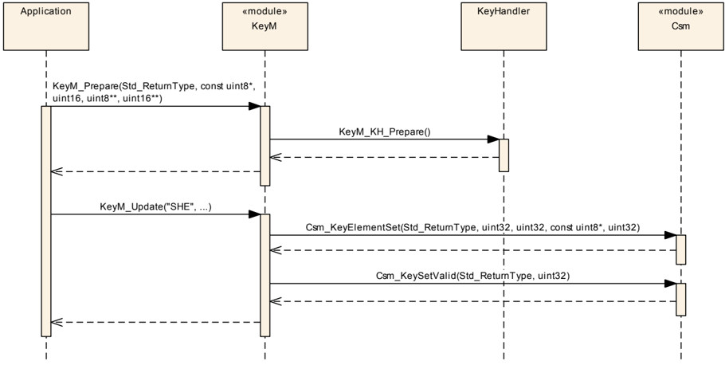

### 8.2. 存储多个密钥

一个启用 StartFinalize 并由 KeyM 管理的示例（不通过 [KeyM_KH_Start](#7731-keym_kh_start)() 委托给密钥处理程序）。[KeyM_Prepare](#7322-keym_prepare)() 操作委托给密钥处理程序。通过多次调用 [KeyM_Update](#7323-keym_update)() 来设置或更新多个密钥。密钥根据各自的配置使用 Csm_KeyElementSet() 函数进行更新。

在终结化（finalization）期间，KeyM 将所有密钥置为有效。

存储多个密钥的时序（KeyMCryptoKeyGenerationType==KEYM_STORED_KEY）。

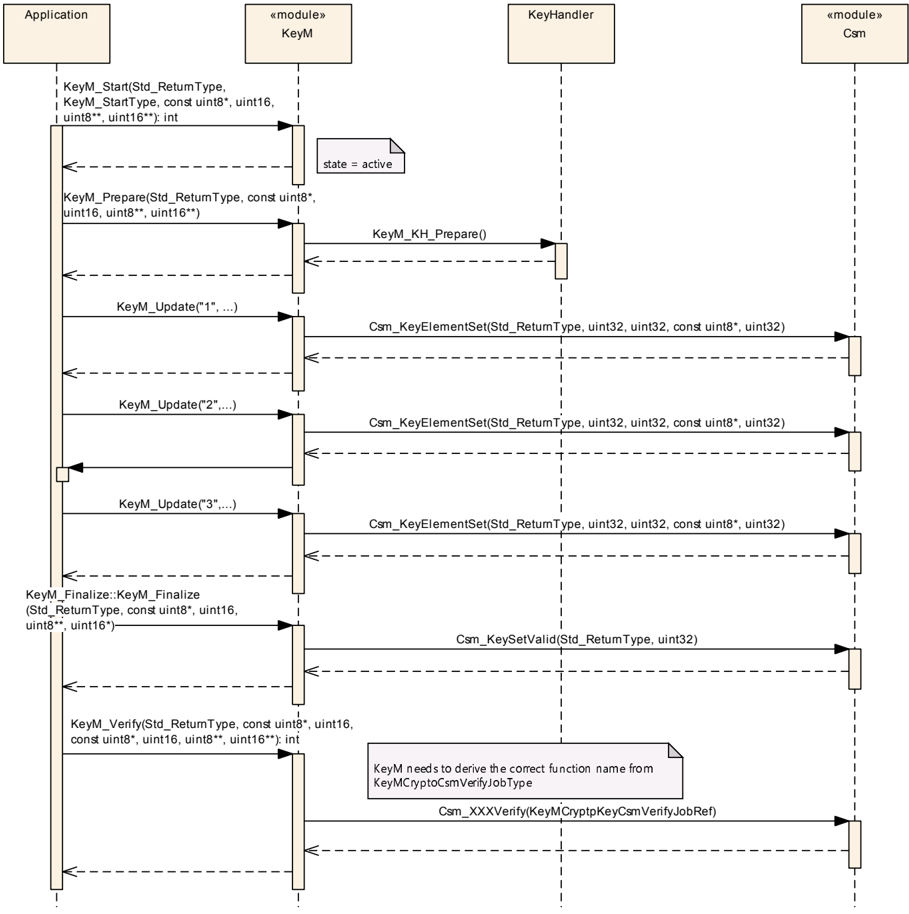

### 8.3. 派生密钥

使用 Csm_KeyDerive 时序而非 Csm_KeyElementSet() 的示例（KeyMCryptoKeyGenerationType==KEYM_DERIVED_KEY）。

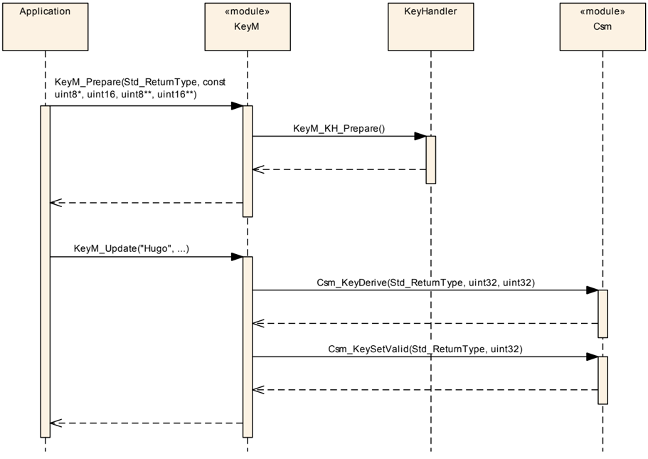

### 8.4. 添加工作证书

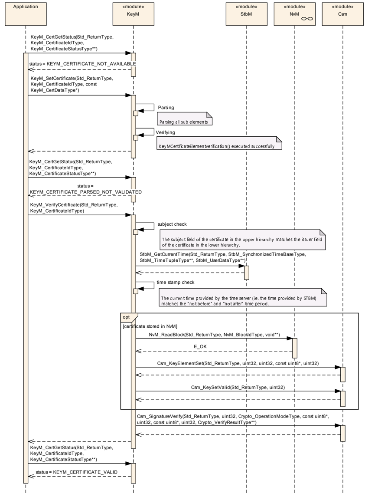

### 8.5. 添加根证书或中间证书

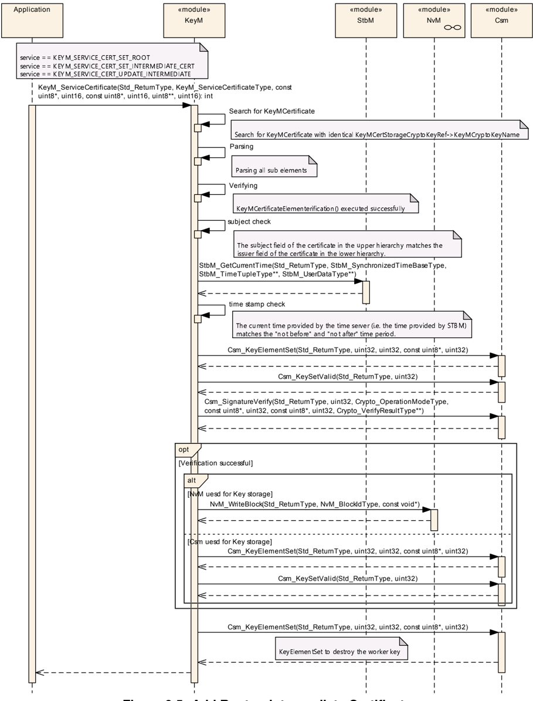

## 9. 配置规范

总体而言，本章定义配置参数及其到**容器**（container）的聚类组织。为支持本规范，本章描述基础知识，并规定了应用于参数规范的模板（表）。我们有意将这些内容保留在规范中以保证可理解性。

详情请参阅 SWS_BSWGeneral 中的第 10.1 章「Introduction to configuration specification」（配置规范简介）。

第 9.1 章规定模块 KeyM 的结构（容器）和参数。

第 9.2 章规定模块 KeyM 的发布信息。

### 9.1. 容器与配置参数

以下各节汇总所有配置参数。各参数的详细含义见第 6 章和第 7 章。

#### 9.1.1. KeyM

| SWS 条目 | [ECUC_KeyM_00001] |
|---|---|
| 模块名称 | KeyM |
| 描述 | Mcu（微控制器单元）模块的配置。 |
| Post-Build 变体支持 | true |
| 支持的配置变体 | VARIANT-POST-BUILD, VARIANT-PRE-COMPILE |

| 容器名称 | 多重性 | 作用域/依赖 |
|---|---|---|
| KeyMCertificate | 0..65535 | 此容器包含证书的配置。 |
| KeyMCertificateElementVerification | 0..65535 | 此容器定义是否需要验证证书元素以及如何验证。 |
| KeyMCryptoKey | 0..65535 | 此容器包含可更新的加密密钥。 |
| KeyMGeneral | 1 | 此容器保存密钥管理器的通用配置（参数）。 |
| KeyMNvmBlock | 0..65535 | 当 KeyM 模块需要 ECU 中的非易失性存储器来存储信息（例如加密密钥或证书）时，对 Nvm 可选用法的配置。 |

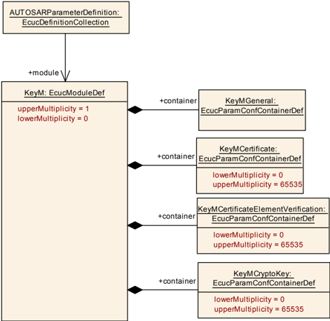

#### 9.1.2. KeyMGeneral

| SWS 条目 | [ECUC_KeyM_00002] |
|---|---|
| 容器名称 | KeyMGeneral |
| 父容器 | KeyM |
| 描述 | 此容器保存密钥管理器的通用配置（参数）。 |
| 配置参数 | 见下方参数表 |

| SWS 条目 | [ECUC_KeyM_00008] |
|---|---|
| 参数名称 | KeyMCertificateChainMaxDepth |
| 父容器 | KeyMGeneral |
| 描述 | 证书链中定义的证书的最大数量。 |
| 多重性 | 1 |
| 类型 | EcucIntegerParamDef |
| 范围 | 1 .. 255 |
| 默认值 | - |
| Post-Build 变体值 | false |
| 值配置类 | Pre-compile time：x（All Variants）；Link time：-；Post-build time：- |
| 作用域/依赖 | scope: local |

| SWS 条目 | [ECUC_KeyM_00010] |
|---|---|
| 参数名称 | KeyMCertificateManagerEnabled |
| 父容器 | KeyMGeneral |
| 描述 | 启用（TRUE）或禁用（FALSE）管理证书的部分。 |
| 多重性 | 1 |
| 类型 | EcucBooleanParamDef |
| 默认值 | false |
| Post-Build 变体值 | false |
| 值配置类 | Pre-compile time：x（All Variants）；Link time：-；Post-build time：- |
| 作用域/依赖 | scope: local |

| SWS 条目 | [ECUC_KeyM_00018] |
|---|---|
| 参数名称 | KeyMCryptoKeyHandlerPrepareEnabled |
| 父容器 | KeyMGeneral |
| 描述 | 启用（TRUE）或禁用（FALSE）密钥处理程序 Prepare 函数的调用。如果设置为 true，则应提供相应的密钥处理程序函数。 |
| 多重性 | 1 |
| 类型 | EcucBooleanParamDef |
| 默认值 | false |
| Post-Build 变体值 | false |
| 值配置类 | Pre-compile time：x（All Variants）；Link time：-；Post-build time：- |
| 作用域/依赖 | scope: local |

| SWS 条目 | [ECUC_KeyM_00021] |
|---|---|
| 参数名称 | KeyMCryptoKeyHandlerServiceCertificateEnabled |
| 父容器 | KeyMGeneral |
| 描述 | 启用（TRUE）或禁用（FALSE）密钥处理程序服务函数的调用。如果设置为 true，则应提供证书子模块函数 KeyM_KH_ServiceCertificate()。 |
| 多重性 | 1 |
| 类型 | EcucBooleanParamDef |
| 默认值 | false |
| Post-Build 变体值 | false |
| 值配置类 | Pre-compile time：x（All Variants）；Link time：-；Post-build time：- |
| 作用域/依赖 | scope: local |

| SWS 条目 | [ECUC_KeyM_00017] |
|---|---|
| 参数名称 | KeyMCryptoKeyHandlerStartFinalizeEnabled |
| 父容器 | KeyMGeneral |
| 描述 | 启用（TRUE）或禁用（FALSE）密钥处理程序 Start 和 Finalize 函数的调用。如果设置为 true，则应提供密钥处理程序函数 KeyM_KH_Start() 和 KeyM_KH_Finalize()。 |
| 多重性 | 1 |
| 类型 | EcucBooleanParamDef |
| 默认值 | false |
| Post-Build 变体值 | false |
| 值配置类 | Pre-compile time：x（All Variants）；Link time：-；Post-build time：- |
| 作用域/依赖 | scope: local |

| SWS 条目 | [ECUC_KeyM_00019] |
|---|---|
| 参数名称 | KeyMCryptoKeyHandlerUpdateEnabled |
| 父容器 | KeyMGeneral |
| 描述 | 启用（TRUE）或禁用（FALSE）对密钥处理程序更新函数 KeyM_KH_Update() 的调用。如果设置为 true，则应提供相应的密钥处理程序函数。 |
| 多重性 | 1 |
| 类型 | EcucBooleanParamDef |
| 默认值 | false |
| Post-Build 变体值 | false |
| 值配置类 | Pre-compile time：x（All Variants）；Link time：-；Post-build time：- |
| 作用域/依赖 | scope: local |

| SWS 条目 | [ECUC_KeyM_00020] |
|---|---|
| 参数名称 | KeyMCryptoKeyHandlerVerifyEnabled |
| 父容器 | KeyMGeneral |
| 描述 | 启用（TRUE）或禁用（FALSE）对密钥处理程序验证函数 KeyM_KH_Verify() 的调用。如果设置为 true，则应提供相应的密钥处理程序函数。 |
| 多重性 | 1 |
| 类型 | EcucBooleanParamDef |
| 默认值 | false |
| Post-Build 变体值 | false |
| 值配置类 | Pre-compile time：x（All Variants）；Link time：-；Post-build time：- |
| 作用域/依赖 | scope: local |

| SWS 条目 | [ECUC_KeyM_00011] |
|---|---|
| 参数名称 | KeyMCryptoKeyManagerEnabled |
| 父容器 | KeyMGeneral |
| 描述 | 启用（TRUE）或禁用（FALSE）管理加密密钥操作的部分。 |
| 多重性 | 1 |
| 类型 | EcucBooleanParamDef |
| 默认值 | false |
| Post-Build 变体值 | false |
| 值配置类 | Pre-compile time：x（All Variants）；Link time：-；Post-build time：- |
| 作用域/依赖 | scope: local |

| SWS 条目 | [ECUC_KeyM_00013] |
|---|---|
| 参数名称 | KeyMCryptoKeyPrepareFunctionEnabled |
| 父容器 | KeyMGeneral |
| 描述 | 启用（TRUE）或禁用（FALSE）密钥管理器的 Prepare 函数。如果设置为 true，则必须相应地调用 KeyM_Prepare() 函数。 |
| 多重性 | 0..1 |
| 类型 | EcucBooleanParamDef |
| 默认值 | false |
| Post-Build 变体多重性 | false |
| Post-Build 变体值 | false |
| 多重性配置类 | Pre-compile time：x；Link time：-；Post-build time：- |
| 值配置类 | Pre-compile time：x；Link time：-；Post-build time：- |
| 作用域/依赖 | scope: local |

| SWS 条目 | [ECUC_KeyM_00012] |
|---|---|
| 参数名称 | KeyMCryptoKeyStartFinalizeFunctionEnabled |
| 父容器 | KeyMGeneral |
| 描述 | 启用（TRUE）或禁用（FALSE）密钥管理器的 Start 和 Finish 函数。如果设置为 true，则必须调用 KeyM_Start() 和 KeyM_Finalize() 函数。 |
| 多重性 | 0..1 |
| 类型 | EcucBooleanParamDef |
| 默认值 | false |
| Post-Build 变体多重性 | false |
| Post-Build 变体值 | false |
| 多重性配置类 | Pre-compile time：x；Link time：-；Post-build time：- |
| 值配置类 | Pre-compile time：x；Link time：-；Post-build time：- |
| 作用域/依赖 | scope: local |

| SWS 条目 | [ECUC_KeyM_00015] |
|---|---|
| 参数名称 | KeyMCryptoKeyVerifyAsyncMode |
| 父容器 | KeyMGeneral |
| 描述 | 此参数定义函数 KeyM_Verify() 以同步还是异步模式运行。 |
| 多重性 | 0..1 |
| 类型 | EcucBooleanParamDef |
| 默认值 | false |
| Post-Build 变体多重性 | false |
| Post-Build 变体值 | false |
| 多重性配置类 | Pre-compile time：x（All Variants）；Link time：-；Post-build time：- |
| 值配置类 | Pre-compile time：x（All Variants）；Link time：-；Post-build time：- |
| 作用域/依赖 | scope: local |

| SWS 条目 | [ECUC_KeyM_00014] |
|---|---|
| 参数名称 | KeyMCryptoKeyVerifyFunctionEnabled |
| 父容器 | KeyMGeneral |
| 描述 | 启用（TRUE）或禁用（FALSE）密钥管理器的 Verify 函数。如果设置为 true，则可以调用 KeyM_Verify() 函数。 |
| 多重性 | 0..1 |
| 类型 | EcucBooleanParamDef |
| 默认值 | false |
| Post-Build 变体多重性 | false |
| Post-Build 变体值 | false |
| 多重性配置类 | Pre-compile time：x；Link time：-；Post-build time：- |
| 值配置类 | Pre-compile time：x；Link time：-；Post-build time：- |
| 作用域/依赖 | scope: local |

| SWS 条目 | [ECUC_KeyM_00006] |
|---|---|
| 参数名称 | KeyMDevErrorDetect |
| 父容器 | KeyMGeneral |
| 描述 | 开启或关闭开发错误检测与通知（true：启用检测与通知；false：禁用检测与通知）。 |
| 多重性 | 1 |
| 类型 | EcucBooleanParamDef |
| 默认值 | false |
| Post-Build 变体值 | false |
| 值配置类 | Pre-compile time：x（All Variants）；Link time：-；Post-build time：- |
| 作用域/依赖 | scope: local |

| SWS 条目 | [ECUC_KeyM_00078] |
|---|---|
| 参数名称 | KeyMEnableSecurityEventReporting |
| 父容器 | KeyMGeneral |
| 描述 | 开启或关闭向 IdsM 上报安全事件的功能（true：启用上报；false：禁用上报）。 |
| 多重性 | 1 |
| 类型 | EcucBooleanParamDef |
| 默认值 | false |
| Post-Build 变体值 | false |
| 值配置类 | Pre-compile time：x（All Variants）；Link time：-；Post-build time：- |
| 作用域/依赖 | scope: ECU |

| SWS 条目 | [ECUC_KeyM_00009] |
|---|---|
| 参数名称 | KeyMKeyCertNameMaxLength |
| 父容器 | KeyMGeneral |
| 描述 | 服务接口使用的证书或密钥名称的最大长度（以字节为单位）。 |
| 多重性 | 1 |
| 类型 | EcucIntegerParamDef |
| 范围 | 1 .. 255 |
| 默认值 | - |
| Post-Build 变体值 | false |
| 值配置类 | Pre-compile time：x（All Variants）；Link time：-；Post-build time：- |
| 作用域/依赖 | scope: local |

| SWS 条目 | [ECUC_KeyM_00007] |
|---|---|
| 参数名称 | KeyMMainFunctionPeriod |
| 父容器 | KeyMGeneral |
| 描述 | 以秒为单位指定主函数 KeyM_MainFunction 的周期。 |
| 多重性 | 1 |
| 类型 | EcucFloatParamDef |
| 范围 | ]0 .. INF[ |
| 默认值 | - |
| Post-Build 变体值 | false |
| 值配置类 | Pre-compile time：x（All Variants）；Link time：-；Post-build time：- |
| 作用域/依赖 | scope: local |

| SWS 条目 | [ECUC_KeyM_00016] |
|---|---|
| 参数名称 | KeyMServiceCertificateFunctionEnabled |
| 父容器 | KeyMGeneral |
| 描述 | 启用（TRUE）或禁用（FALSE）密钥管理器的证书服务函数。如果设置为 true，则必须相应地调用 KeyM_ServiceCertificate{ByCertId}() 函数。 |
| 多重性 | 0..1 |
| 类型 | EcucBooleanParamDef |
| 默认值 | false |
| Post-Build 变体多重性 | false |
| Post-Build 变体值 | false |
| 多重性配置类 | Pre-compile time：x（All Variants）；Link time：-；Post-build time：- |
| 值配置类 | Pre-compile time：x（All Variants）；Link time：-；Post-build time：- |
| 作用域/依赖 | scope: local |

| 容器名称 | 多重性 | 作用域/依赖 |
|---|---|---|
| KeyMSecurityEventRefs | 0..1 | 用于容纳对 IdsMEvent 元素的引用的容器，这些 IdsMEvent 元素表示 KeyM 模块在发生相应的安全相关事件时应向 IdsM 上报的安全事件（且当 KeyMEnableSecurityEventReporting 设置为「true」时）。此容器中的标准化安全事件可以通过供应商特定的安全事件加以扩展。 |

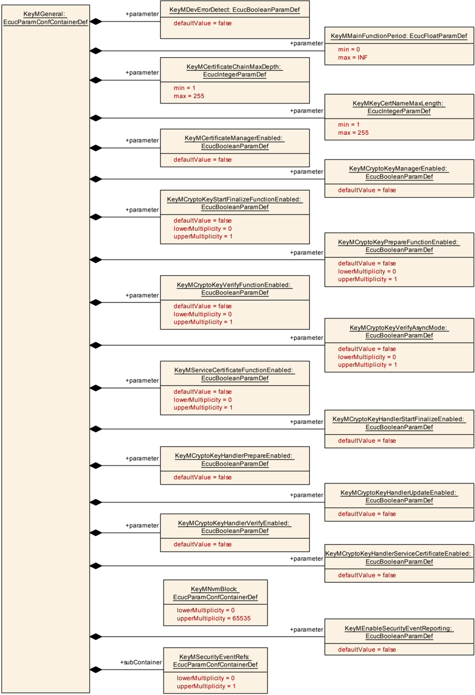

#### 9.1.3. KeyMCertificate

| SWS 条目 | [ECUC_KeyM_00003] |
|---|---|
| 容器名称 | KeyMCertificate |
| 父容器 | KeyM |
| 描述 | 此容器包含证书的配置。 |
| 配置参数 | 见下方参数表 |

| SWS 条目 | [ECUC_KeyM_00029] |
|---|---|
| 参数名称 | KeyMCertAlgorithmType |
| 父容器 | KeyMCertificate |
| 描述 | 指定 **CA** 用于签署此证书的加密算法。 |
| 多重性 | 1 |
| 类型 | EcucEnumerationParamDef |
| 范围 | ECC：仅表示未压缩的密钥；RSA：- |
| Post-Build 变体值 | false |
| 值配置类 | Pre-compile time：x（All Variants）；Link time：-；Post-build time：- |
| 作用域/依赖 | scope: local |

| SWS 条目 | [ECUC_KeyM_00088] |
|---|---|
| 参数名称 | KeyMCertEncodingType |
| 父容器 | KeyMCertificate |
| 描述 | 指定接受证书所采用的编码。如果不存在此参数，则 KeyM 将尝试以供应商特定的方式从接收到的证书本身检测编码类型，例如：如果供应商仅支持 **DER** 编码，而证书采用的是另一种编码类型，则 KeyM 将拒绝该证书；如果供应商支持两种编码类型，则其可以根据证书数据决定它是哪一种编码。 |
| 多重性 | 0..1 |
| 类型 | EcucEnumerationParamDef |
| 范围 | CUSTOM：自定义取值应通过 KeyMCertEncodingTypeCustom 选择；DER：可辨别编码规则（Distinguished Encoding Rules）；PEM：隐私增强邮件（Privacy Enhanced Mail） |
| Post-Build 变体值 | false |
| 值配置类 | Pre-compile time：x（All Variants）；Link time：-；Post-build time：- |
| 作用域/依赖 | scope: local |

| SWS 条目 | [ECUC_KeyM_00089] |
|---|---|
| 参数名称 | KeyMCertEncodingTypeCustom |
| 父容器 | KeyMCertificate |
| 描述 | 客户特定的编码类型。 |
| 多重性 | 0..1 |
| 类型 | EcucEnumerationParamDef |
| 范围 | - |
| Post-Build 变体值 | false |
| 值配置类 | Pre-compile time：x（All Variants）；Link time：-；Post-build time：- |
| 作用域/依赖 | scope: local dependency: 仅当 KeyMCertEncodingType 设置为 CUSTOM 时才应存在此参数。 |

| SWS 条目 | [ECUC_KeyM_00028] |
|---|---|
| 参数名称 | KeyMCertFormatType |
| 父容器 | KeyMCertificate |
| 描述 | 指定以何种格式提供证书。 |
| 多重性 | 1 |
| 类型 | EcucEnumerationParamDef |
| 范围 | CRL、CVC、X509 |
| Post-Build 变体值 | false |
| 值配置类 | Pre-compile time：x（All Variants）；Link time：-；Post-build time：- |
| 作用域/依赖 | scope: local |

| SWS 条目 | [ECUC_KeyM_00022] |
|---|---|
| 参数名称 | KeyMCertificateId |
| 父容器 | KeyMCertificate |
| 描述 | 证书的标识符。已配置的标识符集合应是连续且无间隙的。 |
| 多重性 | 1 |
| 类型 | EcucIntegerParamDef（为此参数生成符号名） |
| 范围 | 0 .. 65535 |
| 默认值 | - |
| Post-Build 变体值 | false |
| 值配置类 | Pre-compile time：x（All Variants）；Link time：-；Post-build time：- |
| 作用域/依赖 | scope: local |

| SWS 条目 | [ECUC_KeyM_00023] |
|---|---|
| 参数名称 | KeyMCertificateMaxLength |
| 父容器 | KeyMCertificate |
| 描述 | 指定证书的最大长度（以字节为单位）。 |
| 多重性 | 1 |
| 类型 | EcucIntegerParamDef |
| 范围 | 1 .. 65535 |
| 默认值 | - |
| Post-Build 变体值 | false |
| 值配置类 | Pre-compile time：x（All Variants）；Link time：-；Post-build time：- |
| 作用域/依赖 | scope: local |

| SWS 条目 | [ECUC_KeyM_00024] |
|---|---|
| 参数名称 | KeyMCertificateName |
| 父容器 | KeyMCertificate |
| 描述 | 提供用于标识的证书唯一名称。证书临时实体（certificate provisional）将通过该唯一名称引用证书。 |
| 多重性 | 1 |
| 类型 | EcucStringParamDef |
| 默认值 | - |
| 正则表达式 | - |
| Post-Build 变体值 | false |
| 值配置类 | Pre-compile time：x（All Variants）；Link time：-；Post-build time：- |
| 作用域/依赖 | scope: local |

| SWS 条目 | [ECUC_KeyM_00073] |
|---|---|
| 参数名称 | KeyMCertificateStorage |
| 父容器 | KeyMCertificate |
| 描述 | 指定证书的存储位置。 |
| 多重性 | 1 |
| 类型 | EcucEnumerationParamDef |
| 范围 | KEYM_STORAGE_IN_CSM、KEYM_STORAGE_IN_NVM、KEYM_STORAGE_IN_RAM |
| 多重性配置类 | Pre-compile time：x（All Variants）；Link time：-；Post-build time：- |
| 值配置类 | Pre-compile time：x（All Variants）；Link time：-；Post-build time：- |
| 作用域/依赖 | scope: local |

| SWS 条目 | [ECUC_KeyM_00025] |
|---|---|
| 参数名称 | KeyMCertificateVerifyCallbackNotificationFunc |
| 父容器 | KeyMCertificate |
| 描述 | 此参数为回调 &lt;KeyM_CertificateVerifyCallbackNotification&gt; 提供函数名。该参数指示证书验证操作是否已完成，并提供其状态。如果省略此参数，则不会提供回调。 |
| 多重性 | 0..1 |
| 类型 | EcucFunctionNameDef |
| 默认值 | - |
| 正则表达式 | - |
| Post-Build 变体多重性 | false |
| Post-Build 变体值 | false |
| 多重性配置类 | Pre-compile time：x（All Variants）；Link time：-；Post-build time：- |
| 值配置类 | Pre-compile time：x（All Variants）；Link time：-；Post-build time：- |
| 作用域/依赖 | scope: local |

| SWS 条目 | [ECUC_KeyM_00087] |
|---|---|
| 参数名称 | KeyMCertPublicKeyAlgorithmType |
| 父容器 | KeyMCertificate |
| 描述 | 指定以何种格式提供证书的公钥。如果省略此参数，则应使用 KeyMCertAlgorithmType 作为默认值。 |
| 多重性 | 0..1 |
| 类型 | EcucEnumerationParamDef |
| 范围 | ECC：仅表示未压缩的密钥；ECC_COMPRESS_INFO_FROM_KEY：-；RSA：- |
| Post-Build 变体值 | false |
| 值配置类 | Pre-compile time：x（All Variants）；Link time：-；Post-build time：- |
| 作用域/依赖 | scope: local |

| SWS 条目 | [ECUC_KeyM_00026] |
|---|---|
| 参数名称 | KeyMServiceCertificateCallbackNotificationFunc |
| 父容器 | KeyMCertificate |
| 描述 | 此参数为服务证书回调 &lt;KeyM_ServiceCertificateCallbackNotification&gt; 提供函数名。该参数指示证书服务操作是否已完成，并提供其状态。如果未设置此参数，则不会提供回调。 |
| 多重性 | 0..1 |
| 类型 | EcucFunctionNameDef |
| 默认值 | - |
| 正则表达式 | - |
| Post-Build 变体多重性 | false |
| Post-Build 变体值 | false |
| 多重性配置类 | Pre-compile time：x（All Variants）；Link time：-；Post-build time：- |
| 值配置类 | Pre-compile time：x（All Variants）；Link time：-；Post-build time：- |
| 作用域/依赖 | scope: local |

| SWS 条目 | [ECUC_KeyM_00034] |
|---|---|
| 参数名称 | KeyMCertCertificateElementRuleRef |
| 父容器 | KeyMCertificate |
| 描述 | 对应在证书校验步骤中验证的证书元素规则的引用。 |
| 多重性 | 0..65535 |
| 类型 | 对 KeyMCertificateElementRule 的引用 |
| Post-Build 变体多重性 | false |
| Post-Build 变体值 | false |
| 多重性配置类 | Pre-compile time：x；Link time：-；Post-build time：- |
| 值配置类 | Pre-compile time：x；Link time：-；Post-build time：- |
| 作用域/依赖 | scope: local dependency: 如果不存在此配置项，密钥将位于 RAM 中。 |

| SWS 条目 | [ECUC_KeyM_00077] |
|---|---|
| 参数名称 | KeyMCertCsmSignatureGenerateJobRef |
| 父容器 | KeyMCertificate |
| 描述 | 对用于计算签名的 CSM 作业的引用。 |
| 多重性 | 0..1 |
| 类型 | 对 CsmJob 的符号名引用 |
| 值配置类 | Pre-compile time：x（All Variants）；Link time：-；Post-build time：- |
| 作用域/依赖 | scope: local dependency: 仅当需要为证书生成签名（例如证书签名请求（CSR））时才需要此项。 |

| SWS 条目 | [ECUC_KeyM_00030] |
|---|---|
| 参数名称 | KeyMCertCsmSignatureVerifyJobRef |
| 父容器 | KeyMCertificate |
| 描述 | 对用于验证签名的 CSM 作业的引用。 |
| 多重性 | 0..1 |
| 类型 | 对 CsmJob 的符号名引用 |
| Post-Build 变体值 | false |
| 值配置类 | Pre-compile time：x（All Variants）；Link time：-；Post-build time：- |
| 作用域/依赖 | scope: local |

| SWS 条目 | [ECUC_KeyM_00031] |
|---|---|
| 参数名称 | KeyMCertCsmSignatureVerifyKeyRef |
| 父容器 | KeyMCertificate |
| 描述 | 对与 CSM 签名验证作业相关联的 CSM 密钥的引用。此证书的公钥应设置为该密钥所引用的密钥元素（CRYPTO_KE_SIGNATURE_KEY）。 |
| 多重性 | 0..1 |
| 类型 | 对 CsmKey 的符号名引用 |
| Post-Build 变体多重性 | false |
| Post-Build 变体值 | false |
| 多重性配置类 | Pre-compile time：x（All Variants）；Link time：-；Post-build time：- |
| 值配置类 | Pre-compile time：x（All Variants）；Link time：-；Post-build time：- |
| 作用域/依赖 | scope: local |

| SWS 条目 | [ECUC_KeyM_00074] |
|---|---|
| 参数名称 | KeyMCertificateCsmKeyTargetRef |
| 父容器 | KeyMCertificate |
| 描述 | 定义对证书应存储到的关联 CSM 密钥的引用。 |
| 多重性 | 0..1 |
| 类型 | 对 CsmKey 的符号名引用 |
| 多重性配置类 | Pre-compile time：x（All Variants）；Link time：-；Post-build time：- |
| 值配置类 | Pre-compile time：x（All Variants）；Link time：-；Post-build time：- |
| 作用域/依赖 | scope: local dependency: 仅当 KeyMCertificateStorage 设置为 KEYM_STORAGE_IN_CSM 时才需要。 |

| SWS 条目 | [ECUC_KeyM_00075] |
|---|---|
| 参数名称 | KeyMCertificateNvmBlockRef |
| 父容器 | KeyMCertificate |
| 描述 | 定义对证书将要存储到的 NvM 块的引用。 |
| 多重性 | 0..1 |
| 类型 | 对 KeyMNvmBlock 的引用 |
| 多重性配置类 | Pre-compile time：x（All Variants）；Link time：-；Post-build time：- |
| 值配置类 | Pre-compile time：x（All Variants）；Link time：-；Post-build time：- |
| 作用域/依赖 | dependency: 仅当 KeyMCertificateStorage 设置为 KEYM_STORAGE_IN_NVM 时才需要。 |

| SWS 条目 | [ECUC_KeyM_00033] |
|---|---|
| 参数名称 | KeyMCertPrivateKeyStorageCryptoKeyRef |
| 父容器 | KeyMCertificate |
| 描述 | 定义证书私钥的存储位置。 |
| 多重性 | 0..1 |
| 类型 | 对 KeyMCryptoKey 的引用 |
| Post-Build 变体多重性 | false |
| Post-Build 变体值 | false |
| 多重性配置类 | Pre-compile time：x；Link time：-；Post-build time：- |
| 值配置类 | Pre-compile time：x；Link time：-；Post-build time：- |
| 作用域/依赖 | scope: local dependency: 如果不存在此配置项，密钥将位于 RAM 中。 |

| SWS 条目 | [ECUC_KeyM_00032] |
|---|---|
| 参数名称 | KeyMCertTimebaseRef |
| 父容器 | KeyMCertificate |
| 描述 | 这是对 **StbM** 时基的引用，用于验证有效期。或者，也可以将 KeyMCertificateElementVerification 与 CertificateValidityPeriodNotBefore 或 CertificateValidityPeriodNotAfter 的 KeyMCertificateElement 结合使用。 |
| 多重性 | 0..1 |
| 类型 | 对 StbMSynchronizedTimeBase 的符号名引用 |
| Post-Build 变体值 | false |
| 值配置类 | Pre-compile time：x（All Variants）；Link time：-；Post-build time：- |
| 作用域/依赖 | scope: local dependency: 如果不存在此配置项，密钥将位于 RAM 中。 |

| SWS 条目 | [ECUC_KeyM_00027] |
|---|---|
| 参数名称 | KeyMCertUpperHierarchicalCertRef |
| 父容器 | KeyMCertificate |
| 描述 | 在 **PKI** 层次结构中高一级的证书的标识符。对于根证书，该引用指向其自身。 |
| 多重性 | 1 |
| 类型 | 对 KeyMCertificate 的引用 |
| Post-Build 变体值 | false |
| 值配置类 | Pre-compile time：x（All Variants）；Link time：-；Post-build time：- |
| 作用域/依赖 | scope: local |

| 容器名称 | 多重性 | 作用域/依赖 |
|---|---|---|
| KeyMCertificateElement | 0..65535 | 此容器包含证书元素的配置。 |

##### 9.1.3.1. KeyMCertificateCustomService

| SWS 条目 | [ECUC_KeyM_00085] |
|---|---|
| 容器名称 | KeyMCertificateCustomService |
| 父容器 | KeyMCertificateElement |
| 描述 | 此容器的存在定义了针对此证书的自定义处理。 |
| 配置参数 | 见下方参数表 |

| SWS 条目 | [ECUC_KeyM_00086] |
|---|---|
| 参数名称 | KeyMCertCsmCustomJobRef |
| 父容器 | KeyMCertificateCustomService |
| 描述 | 对用于处理自定义动作的 CSM 作业的引用。 |
| 多重性 | 1 |
| 类型 | 对 CsmJob 的符号名引用 |
| Post-Build 变体值 | false |
| 值配置类 | Pre-compile time：x（All Variants）；Link time：-；Post-build time：- |
| 作用域/依赖 | scope: local |

无包含的容器。

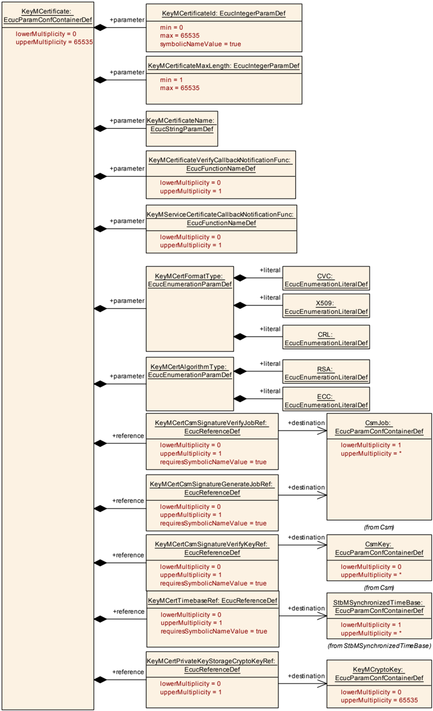

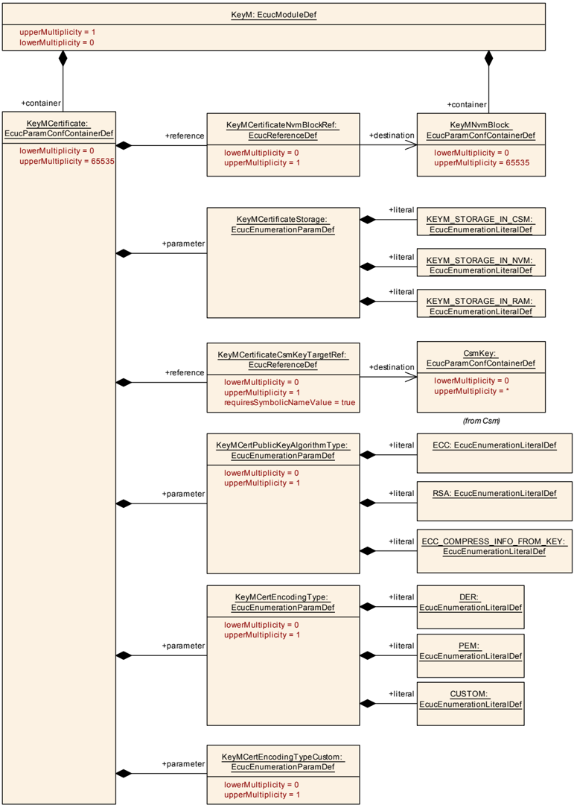

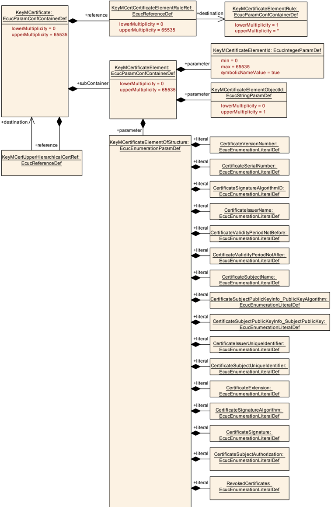

#### 9.1.4. KeyMCertificateElement

| SWS 条目 | [ECUC_KeyM_00035] |
|---|---|
| 容器名称 | KeyMCertificateElement |
| 父容器 | KeyMCertificate |
| 描述 | 此容器包含证书元素的配置。 |
| 配置参数 | 见下方参数表 |

| SWS 条目 | [ECUC_KeyM_00040] |
|---|---|
| 参数名称 | KeyMCertificateElementHasIteration |
| 父容器 | KeyMCertificateElement |
| 描述 | 定义该证书元素是否可以出现多次。如果可以，则可以使用迭代器来检索该证书元素的各个数据值。 |
| 多重性 | 1 |
| 类型 | EcucBooleanParamDef |
| 默认值 | false |
| Post-Build 变体值 | false |
| 值配置类 | Pre-compile time：x（All Variants）；Link time：-；Post-build time：- |
| 作用域/依赖 | scope: local |

| SWS 条目 | [ECUC_KeyM_00036] |
|---|---|
| 参数名称 | KeyMCertificateElementId |
| 父容器 | KeyMCertificateElement |
| 描述 | 证书元素的标识符。 |
| 多重性 | 1 |
| 类型 | EcucIntegerParamDef（为此参数生成符号名） |
| 范围 | 0 .. 65535 |
| 默认值 | - |
| Post-Build 变体值 | false |
| 值配置类 | Pre-compile time：x（All Variants）；Link time：-；Post-build time：- |
| 作用域/依赖 | scope: local |

| SWS 条目 | [ECUC_KeyM_00039] |
|---|---|
| 参数名称 | KeyMCertificateElementMaxLength |
| 父容器 | KeyMCertificateElement |
| 描述 | 最大长度（字节）。 |
| 多重性 | 1 |
| 类型 | EcucIntegerParamDef |
| 范围 | 1 .. 65535 |
| 默认值 | - |
| Post-Build 变体值 | false |
| 值配置类 | Pre-compile time：x（All Variants）；Link time：-；Post-build time：- |
| 作用域/依赖 | scope: local |

| SWS 条目 | [ECUC_KeyM_00037] |
|---|---|
| 参数名称 | KeyMCertificateElementObjectId |
| 父容器 | KeyMCertificateElement |
| 描述 | 这是对象标识符（**OID**），用于在该证书元素的元素结构中标识该证书元素。 |
| 多重性 | 0..1 |
| 类型 | EcucStringParamDef |
| 默认值 | - |
| 正则表达式 | - |
| Post-Build 变体多重性 | false |
| Post-Build 变体值 | false |
| 多重性配置类 | Pre-compile time：x；Link time：-；Post-build time：- |
| 值配置类 | Pre-compile time：x；Link time：-；Post-build time：- |
| 作用域/依赖 | scope: local |

| SWS 条目 | [ECUC_KeyM_00041] |
|---|---|
| 参数名称 | KeyMCertificateElementObjectType |
| 父容器 | KeyMCertificateElement |
| 描述 | 证书元素以 **ASN.1** 格式存储。在此项中可以指定 ASN.1 TLV 的类型（例如 INTEGER 的值为 '2'）。这可用于仅标识此类证书元素。如果类型不同，该元素将不包含在搜索中。如果未指定 KeyMCertificateElementObjectType，则将使用任意 ASN.1 编码数据类型来读取该值。 |
| 多重性 | 0..1 |
| 类型 | EcucIntegerParamDef |
| 范围 | 0 .. 255 |
| 默认值 | - |
| Post-Build 变体值 | false |
| 值配置类 | Pre-compile time：x（All Variants）；Link time：-；Post-build time：- |
| 作用域/依赖 | scope: local |

| SWS 条目 | [ECUC_KeyM_00038] |
|---|---|
| 参数名称 | KeyMCertificateElementOfStructure |
| 父容器 | KeyMCertificateElement |
| 描述 | 这定义了该证书元素位于哪个结构中。 |
| 多重性 | 1 |
| 类型 | EcucEnumerationParamDef |
| 范围 | CertificateExtension、CertificateIssuerName、CertificateIssuerUniqueIdentifier、CertificateSerialNumber、CertificateSignature、CertificateSignatureAlgorithm、CertificateSignatureAlgorithmID、CertificateSubjectAuthorization、CertificateSubjectName、CertificateSubjectPublicKeyInfo_PublicKeyAlgorithm、CertificateSubjectPublicKeyInfo_SubjectPublicKey、CertificateSubjectUniqueIdentifier、CertificateValidityPeriodNotAfter、CertificateValidityPeriodNotBefore、CertificateVersionNumber、RevokedCertificates |
| Post-Build 变体值 | false |
| 值配置类 | Pre-compile time：x（All Variants）；Link time：-；Post-build time：- |
| 作用域/依赖 | scope: local |

| 容器名称 | 多重性 | 作用域/依赖 |
|---|---|---|
| KeyMCertificateCustomService | 0..1 | 此容器的存在定义了针对此证书的自定义处理。 |

#### 9.1.5. KeyMCertificateElementVerification

| SWS 条目 | [ECUC_KeyM_00004] |
|---|---|
| 容器名称 | KeyMCertificateElementVerification |
| 父容器 | KeyM |
| 描述 | 该容器定义是否以及如何验证证书元素。 |
| 配置参数 | 见下方参数表 |

| 容器名称 | 多重性 | 作用域/依赖 |
|---|---|---|
| KeyMCertificateElementCondition | 1..* | 该容器包含 KeyElement 比较条件的配置，这些条件可用作 KeyMCertificateElementRule 的参数。一个 KeyMCertificateElementCondition 应包含一个 KeyMCertificateElementSwcCallback、或一个 KeyMCertificateElementSwcSRDataElementRef、或一个 KeyMCertificateElementSwcSRDataElementValueRef。 |
| KeyMCertificateElementRule | 1..* | 该容器包含一个模式规则的配置，该规则表示以 KeyMCertificateElementCondition 或其他 KeyMCertificateElementRule 作为参数的逻辑表达式。所有参数都使用 KeyMLogicalOperator 定义的运算符处理，例如：Argument_A AND Argument_B AND Argument_C。 |

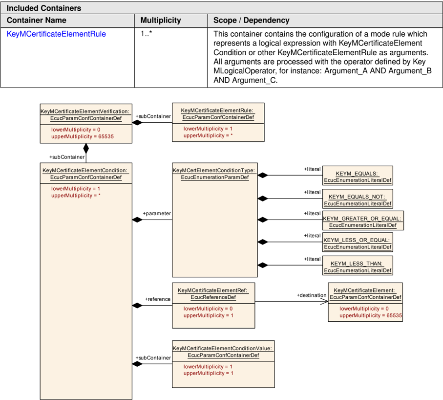

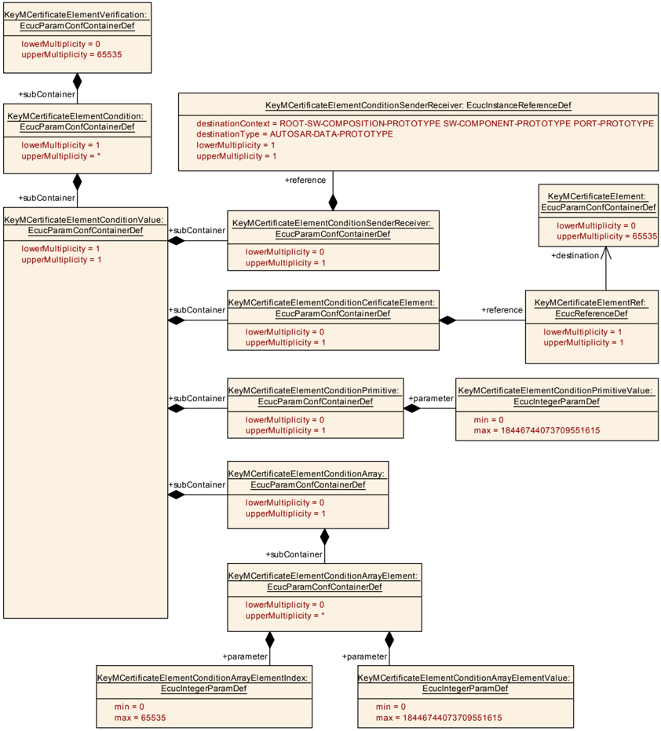

#### 9.1.6. KeyMCertificateElementRule

| SWS 条目 | [ECUC_KeyM_00043] |
|---|---|
| 容器名称 | KeyMCertificateElementRule |
| 父容器 | KeyMCertificateElementVerification |
| 描述 | 该容器包含一个模式规则的配置，该规则表示以 KeyMCertificateElementCondition 或其他 KeyMCertificateElementRule 作为参数的逻辑表达式。所有参数都使用 KeyMLogicalOperator 定义的运算符处理，例如：Argument_A AND Argument_B AND Argument_C。 |
| 配置参数 | 见下方参数表 |

| SWS 条目 | [ECUC_KeyM_00057] |
|---|---|
| 参数名称 | KeyMLogicalOperator |
| 父容器 | KeyMCertificateElementRule |
| 描述 | 该参数指定在逻辑表达式中使用的逻辑运算符。如果表达式仅由单个条件组成，则不应使用该参数。 |
| 多重性 | 0..1 |
| 类型 | EcucEnumerationParamDef |
| 范围 | KEYM_AND、KEYM_OR |
| Post-Build 变体值 | false |
| 值配置类 | Pre-compile time：x；Link time：-；Post-build time：- |
| 作用域/依赖 | scope: local |

| SWS 条目 | [ECUC_KeyM_00058] |
|---|---|
| 参数名称 | KeyMArgumentRef |
| 父容器 | KeyMCertificateElementRule |
| 描述 | 这是一个选择引用，指向作为子表达式的一个条件或另一个规则。 |
| 多重性 | 1..* |
| 类型 | Choice reference to [ KeyMCertificateElementCondition, KeyMCertificateElementRule ] |
| Post-Build 变体多重性 | false |
| Post-Build 变体值 | false |
| 多重性配置类 | Pre-compile time：x（All Variants）；Link time：-；Post-build time：- |
| 值配置类 | Pre-compile time：x（All Variants）；Link time：-；Post-build time：- |
| 作用域/依赖 | scope: local |

无包含的容器。

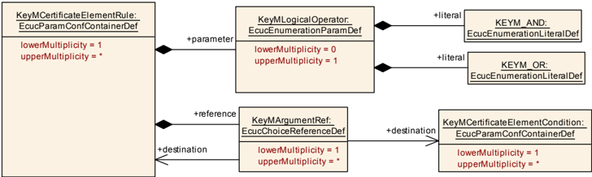

#### 9.1.7. KeyMCertificateElementCondition

| SWS 条目 | [ECUC_KeyM_00042] |
|---|---|
| 容器名称 | KeyMCertificateElementCondition |
| 父容器 | KeyMCertificateElementVerification |
| 描述 | 该容器包含 KeyElement 比较条件的配置，这些条件可用作 KeyMCertificateElementRule 的参数。一个 KeyMCertificateElementCondition 应包含一个 KeyMCertificateElementSwcCallback、或一个 KeyMCertificateElementSwcSRDataElementRef、或一个 KeyMCertificateElementSwcSRDataElementValueRef。 |
| 配置参数 | 见下方参数表 |

| SWS 条目 | [ECUC_KeyM_00044] |
|---|---|
| 参数名称 | KeyMCertElementConditionType |
| 父容器 | KeyMCertificateElementCondition |
| 描述 | 该参数指定为评估模式条件而进行的比较类型。 |
| 多重性 | 1 |
| 类型 | EcucEnumerationParamDef |
| 范围 | KEYM_EQUALS、KEYM_EQUALS_NOT、KEYM_GREATER_OR_EQUAL、KEYM_LESS_OR_EQUAL、KEYM_LESS_THAN |
| Post-Build 变体值 | false |
| 值配置类 | Pre-compile time：x；Link time：-；Post-build time：- |
| 作用域/依赖 | scope: local |

| SWS 条目 | [ECUC_KeyM_00045] |
|---|---|
| 参数名称 | KeyMCertificateElementRef |
| 父容器 | KeyMCertificateElementCondition |
| 描述 | 对条件所使用的证书元素的引用。 |
| 多重性 | 0..1 |
| 类型 | Reference to KeyMCertificateElement |
| Post-Build 变体多重性 | false |
| Post-Build 变体值 | false |
| 多重性配置类 | Pre-compile time：x（All Variants）；Link time：-；Post-build time：- |
| 值配置类 | Pre-compile time：x（All Variants）；Link time：-；Post-build time：- |
| 作用域/依赖 | scope: local |

| 容器名称 | 多重性 | 作用域/依赖 |
|---|---|---|
| KeyMCertificateElementConditionValue | 1 | 该容器包含一个比较值的配置。 |

#### 9.1.8. KeyMCertificateElementConditionPrimitive

| SWS 条目 | [ECUC_KeyM_00047] |
|---|---|
| 容器名称 | KeyMCertificateElementConditionPrimitive |
| 父容器 | KeyMCertificateElementConditionValue |
| 描述 | 该容器包含一个基本类型（primitive）比较值的配置。 |
| 配置参数 | 见下方参数表 |

| SWS 条目 | [ECUC_KeyM_00053] |
|---|---|
| 参数名称 | KeyMCertificateElementConditionPrimitiveValue |
| 父容器 | KeyMCertificateElementConditionPrimitive |
| 描述 | 基本类型比较值。 |
| 多重性 | 1 |
| 类型 | EcucIntegerParamDef |
| 范围 | 0 .. 18446744073709551615 |
| 默认值 | - |
| Post-Build 变体值 | false |
| 值配置类 | Pre-compile time：x（All Variants）；Link time：-；Post-build time：- |
| 作用域/依赖 | scope: local |

无包含的容器。

#### 9.1.9. KeyMCertificateElementConditionArray

| SWS 条目 | [ECUC_KeyM_00048] |
|---|---|
| 容器名称 | KeyMCertificateElementConditionArray |
| 父容器 | KeyMCertificateElementConditionValue |
| 描述 | 该容器包含一个数组比较值的配置。 |
| 配置参数 | 见下方参数表 |

| 容器名称 | 多重性 | 作用域/依赖 |
|---|---|---|
| KeyMCertificateElementConditionArrayElement | 0..* | 该容器包含一个数组比较值的配置。 |

#### 9.1.10. KeyMCertificateElementConditionArrayElement

| SWS 条目 | [ECUC_KeyM_00054] |
|---|---|
| 容器名称 | KeyMCertificateElementConditionArrayElement |
| 父容器 | KeyMCertificateElementConditionArray |
| 描述 | 该容器包含一个数组比较值的配置。 |
| 配置参数 | 见下方参数表 |

| SWS 条目 | [ECUC_KeyM_00055] |
|---|---|
| 参数名称 | KeyMCertificateElementConditionArrayElementIndex |
| 父容器 | KeyMCertificateElementConditionArrayElement |
| 描述 | 指向比较值数组中一个元素的索引。 |
| 多重性 | 1 |
| 类型 | EcucIntegerParamDef |
| 范围 | 0 .. 65535 |
| 默认值 | - |
| Post-Build 变体值 | false |
| 值配置类 | Pre-compile time：x（All Variants）；Link time：-；Post-build time：- |
| 作用域/依赖 | scope: local |

| SWS 条目 | [ECUC_KeyM_00056] |
|---|---|
| 参数名称 | KeyMCertificateElementConditionArrayElementValue |
| 父容器 | KeyMCertificateElementConditionArrayElement |
| 描述 | 一个数组元素比较值的值。 |
| 多重性 | 1 |
| 类型 | EcucIntegerParamDef |
| 范围 | 0 .. 18446744073709551615 |
| 默认值 | - |
| Post-Build 变体值 | false |
| 值配置类 | Pre-compile time：x（All Variants）；Link time：-；Post-build time：- |
| 作用域/依赖 | scope: local |

无包含的容器。

#### 9.1.11. KeyMCertificateElementConditionCerificateElement

| SWS 条目 | [ECUC_KeyM_00046] |
|---|---|
| 容器名称 | KeyMCertificateElementConditionValue |
| 父容器 | KeyMCertificateElementCondition |
| 描述 | 该容器包含一个比较值的配置。 |
| 配置参数 | 见下方参数表 |

| 容器名称 | 多重性 | 作用域/依赖 |
|---|---|---|
| KeyMCertificateElementConditionArray | 0..1 | 该容器包含一个数组比较值的配置。 |
| KeyMCertificateElementConditionCerificateElement | 0..1 | 该容器包含一个作为比较值的证书元素的配置。 |
| KeyMCertificateElementConditionPrimitive | 0..1 | 该容器包含一个基本类型比较值的配置。 |
| KeyMCertificateElementConditionSenderReceiver | 0..1 | 该容器包含发送者-接收者接口中一个动态比较值的配置。 |

| SWS 条目 | [ECUC_KeyM_00049] |
|---|---|
| 容器名称 | KeyMCertificateElementConditionCerificateElement |
| 父容器 | KeyMCertificateElementConditionValue |
| 描述 | 该容器包含一个作为比较值的证书元素的配置。 |
| 配置参数 | 见下方参数表 |

| SWS 条目 | [ECUC_KeyM_00051] |
|---|---|
| 参数名称 | KeyMCertificateElementRef |
| 父容器 | KeyMCertificateElementConditionCerificateElement |
| 描述 | 对另一个证书元素的引用。 |
| 多重性 | 1 |
| 类型 | Reference to KeyMCertificateElement |
| Post-Build 变体值 | false |
| 值配置类 | Pre-compile time：x（All Variants）；Link time：-；Post-build time：- |
| 作用域/依赖 | scope: local |

无包含的容器。

#### 9.1.12. KeyMCertificateElementConditionSenderReceiver

| SWS 条目 | [ECUC_KeyM_00050] |
|---|---|
| 容器名称 | KeyMCertificateElementConditionSenderReceiver |
| 父容器 | KeyMCertificateElementConditionValue |
| 描述 | 该容器包含发送者-接收者接口中一个动态比较值的配置。 |
| 配置参数 | 见下方参数表 |

| SWS 条目 | [ECUC_KeyM_00052] |
|---|---|
| 参数名称 | KeyMCertificateElementConditionSenderReceiver |
| 父容器 | KeyMCertificateElementConditionSenderReceiver |
| 描述 | 该参数引用软件组件的特定模式请求端口中用于该条件的一个模式。 |
| 多重性 | 1 |
| 类型 | Instance reference to AUTOSAR-DATA-PROTOTYPE context: ROOT-SW-COMPOSITION-PROTOTYPE SW-COMPONENT-PROTOTYPE PORT-PROTOTYPE |
| Post-Build 变体值 | false |
| 值配置类 | Pre-compile time：x；Link time：-；Post-build time：- |
| 作用域/依赖 | scope: local |

无包含的容器。

#### 9.1.13. KeyMCryptoKey

| SWS 条目 | [ECUC_KeyM_00005] |
|---|---|
| 容器名称 | KeyMCryptoKey |
| 父容器 | KeyM |
| 描述 | 该容器包含可以更新的加密密钥。 |
| 配置参数 | 见下方参数表 |

| SWS 条目 | [ECUC_KeyM_00067] |
|---|---|
| 参数名称 | KeyMCryptoCsmVerifyJobType |
| 父容器 | KeyMCryptoKey |
| 描述 | 指定密钥验证操作使用的函数类型。 |
| 多重性 | 0..1 |
| 类型 | EcucEnumerationParamDef |
| 范围 | KEYM_VERIFY_AEADDECRYPT、KEYM_VERIFY_AEADENCRYPT、KEYM_VERIFY_DECRYPT、KEYM_VERIFY_ENCRYPT、KEYM_VERIFY_MACGENERATE、KEYM_VERIFY_MACVERIFY |
| Post-Build 变体值 | false |
| 值配置类 | Pre-compile time：x；Link time：-；Post-build time：- |
| 作用域/依赖 | scope: local dependency: 仅当 KeymGeneral/KeyMCryptoKey/KeyMCryptoKeyVerifyFunctionEnabled 设置为 TRUE 时才需要该参数。 |

| SWS 条目 | [ECUC_KeyM_00069] |
|---|---|
| 参数名称 | KeyMCryptoKeyCryptoProps |
| 父容器 | KeyMCryptoKey |
| 描述 | 如果设置，它将向 KeyM 用来标识密钥的加密密钥提供额外的提示。典型做法是将该值设置为密钥所在的 SHE 槽位 ID。如果存在，KeyM 将获取该信息并通过其槽位 ID 标识密钥。槽位信息将从 M1M2M3 数据的相应字段中提取。 |
| 多重性 | 0..1 |
| 类型 | EcucStringParamDef |
| 默认值 | - |
| 正则表达式 | - |
| Post-Build 变体多重性 | false |
| Post-Build 变体值 | false |
| 多重性配置类 | Pre-compile time：x；Link time：-；Post-build time：- |
| 值配置类 | Pre-compile time：x；Link time：-；Post-build time：- |
| 作用域/依赖 | scope: local |

| SWS 条目 | [ECUC_KeyM_00068] |
|---|---|
| 参数名称 | KeyMCryptoKeyGenerationInfo |
| 父容器 | KeyMCryptoKey |
| 描述 | 该数据可以包含用于密钥派生的静态数据。如果一个密钥被配置为从另一个密钥派生，且设置了该配置项，则该数据将作为盐值（salt）添加。 |
| 多重性 | 0..1 |
| 类型 | EcucStringParamDef |
| 默认值 | - |
| 正则表达式 | - |
| Post-Build 变体多重性 | false |
| Post-Build 变体值 | false |
| 多重性配置类 | Pre-compile time：x；Link time：-；Post-build time：- |
| 值配置类 | Pre-compile time：x；Link time：-；Post-build time：- |
| 作用域/依赖 | scope: local |

| SWS 条目 | [ECUC_KeyM_00061] |
|---|---|
| 参数名称 | KeyMCryptoKeyGenerationType |
| 父容器 | KeyMCryptoKey |
| 描述 | 指定 CryptoKey 的生成方式：从另一个密钥派生，或通过 KeyElementSet 直接存储。 |
| 多重性 | 1 |
| 类型 | EcucEnumerationParamDef |
| 范围 | KEYM_DERIVED_KEY、KEYM_STORED_KEY |
| Post-Build 变体值 | false |
| 值配置类 | Pre-compile time：x；Link time：-；Post-build time：- |
| 作用域/依赖 | scope: local |

| SWS 条目 | [ECUC_KeyM_00059] |
|---|---|
| 参数名称 | KeyMCryptoKeyId |
| 父容器 | KeyMCryptoKey |
| 描述 | 加密密钥的标识符。已配置标识符的集合应是连续且无间隙的。 |
| 多重性 | 1 |
| 类型 | EcucIntegerParamDef（为此参数生成符号名） |
| 范围 | 0 .. 65535 |
| 默认值 | - |
| Post-Build 变体值 | false |
| 值配置类 | Pre-compile time：x；Link time：-；Post-build time：- |
| 作用域/依赖 | scope: local |

| SWS 条目 | [ECUC_KeyM_00060] |
|---|---|
| 参数名称 | KeyMCryptoKeyMaxLength |
| 父容器 | KeyMCryptoKey |
| 描述 | CryptoKey 的最大大小（以字节为单位）。 |
| 多重性 | 1 |
| 类型 | EcucIntegerParamDef |
| 范围 | 1 .. 4294967295 |
| 默认值 | - |
| Post-Build 变体值 | false |
| 值配置类 | Pre-compile time：x（All Variants）；Link time：-；Post-build time：- |
| 作用域/依赖 | scope: local |

| SWS 条目 | [ECUC_KeyM_00062] |
|---|---|
| 参数名称 | KeyMCryptoKeyName |
| 父容器 | KeyMCryptoKey |
| 描述 | 提供用于标识的唯一密钥名称。密钥主控（key master）将通过该唯一密钥名称引用密钥。 |
| 多重性 | 1 |
| 类型 | EcucStringParamDef |
| 默认值 | - |
| 正则表达式 | - |
| Post-Build 变体值 | false |
| 值配置类 | Pre-compile time：x；Link time：-；Post-build time：- |
| 作用域/依赖 | scope: local |

| SWS 条目 | [ECUC_KeyM_00063] |
|---|---|
| 参数名称 | KeyMCryptoKeyStorage |
| 父容器 | KeyMCryptoKey |
| 描述 | 指定证书的存储位置。 |
| 多重性 | 1 |
| 类型 | EcucEnumerationParamDef |
| 范围 | KEYM_STORAGE_IN_CSM、KEYM_STORAGE_IN_NVM、KEYM_STORAGE_IN_RAM |
| Post-Build 变体值 | false |
| 值配置类 | Pre-compile time：x（All Variants）；Link time：-；Post-build time：- |
| 作用域/依赖 | scope: local |

| SWS 条目 | [ECUC_KeyM_00064] |
|---|---|
| 参数名称 | KeyMCryptoKeyCsmKeySourceDeriveRef |
| 父容器 | KeyMCryptoKey |
| 描述 | 定义对关联 CSM 密钥的引用，该密钥用作此密钥派生的源。 |
| 多重性 | 0..1 |
| 类型 | Symbolic name reference to CsmKey |
| Post-Build 变体多重性 | false |
| Post-Build 变体值 | false |
| 多重性配置类 | Pre-compile time：x（All Variants）；Link time：-；Post-build time：- |
| 值配置类 | Pre-compile time：x（All Variants）；Link time：-；Post-build time：- |
| 作用域/依赖 | scope: local dependency: 仅当 KeyMCryptoKeyGenerationType 设置为 KEYM_DERIVED_KEY 时才需要。 |

| SWS 条目 | [ECUC_KeyM_00065] |
|---|---|
| 参数名称 | KeyMCryptoKeyCsmKeyTargetRef |
| 父容器 | KeyMCryptoKey |
| 描述 | 定义对应生成的关联 CSM 密钥的引用。 |
| 多重性 | 1 |
| 类型 | Symbolic name reference to CsmKey |
| Post-Build 变体值 | false |
| 值配置类 | Pre-compile time：x（All Variants）；Link time：-；Post-build time：- |
| 作用域/依赖 | scope: local dependency: 仅当 KeyMCryptoKeyGenerationType 设置为 KEYM_DERIVED_KEY 时才需要。 |

| SWS 条目 | [ECUC_KeyM_00066] |
|---|---|
| 参数名称 | KeyMCryptoKeyCsmVerifyJobRef |
| 父容器 | KeyMCryptoKey |
| 描述 | 定义密钥验证函数可用于验证某个密钥的加密作业。 |
| 多重性 | 0..1 |
| 类型 | Symbolic name reference to CsmJob |
| Post-Build 变体多重性 | false |
| Post-Build 变体值 | false |
| 多重性配置类 | Pre-compile time：x；Link time：-；Post-build time：- |
| 值配置类 | Pre-compile time：x；Link time：-；Post-build time：- |
| 作用域/依赖 | scope: local |

| SWS 条目 | [ECUC_KeyM_00076] |
|---|---|
| 参数名称 | KeyMCryptoKeyNvmBlockRef |
| 父容器 | KeyMCryptoKey |
| 描述 | 定义对将要存储密钥的 NvM 块的引用。 |
| 多重性 | 0..1 |
| 类型 | Reference to KeyMNvmBlock |
| 多重性配置类 | Pre-compile time：x；Link time：-；Post-build time：- |
| 值配置类 | Pre-compile time：x；Link time：-；Post-build time：- |
| 作用域/依赖 | scope: local dependency: 仅当 KeyMCryptoKeyStorage 设置为 KEYM_STORAGE_IN_NVM 时才需要。 |

无包含的容器。

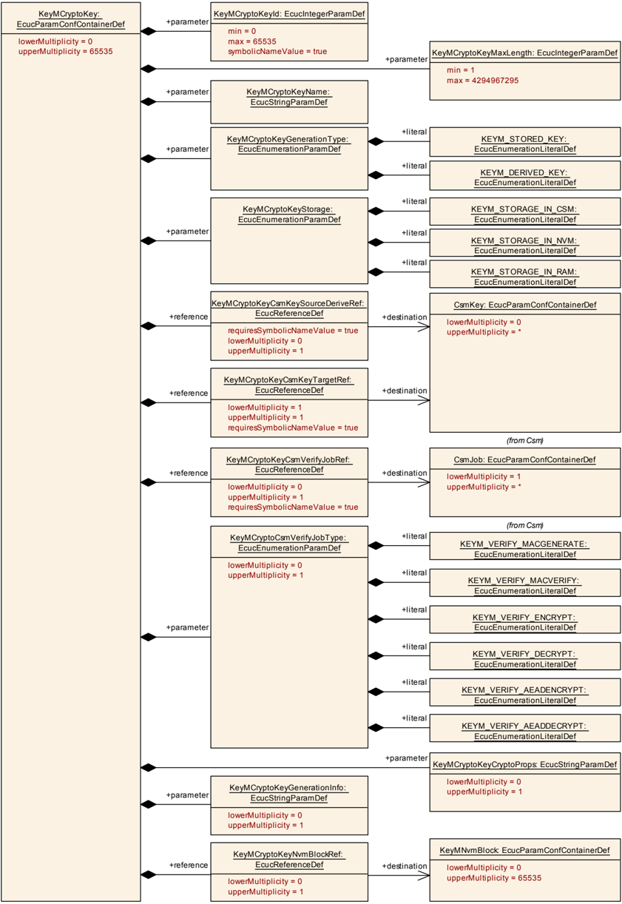

#### 9.1.14. KeyMNvmBlock

| SWS 条目 | [ECUC_KeyM_00070] |
|---|---|
| 容器名称 | KeyMNvmBlock |
| 父容器 | KeyM |
| 描述 | 当 KeyM 模块需要 ECU 中的非易失性存储器来存储信息（例如：加密密钥或证书）时，对 Nvm 可选用法的配置。 |
| 配置参数 | 见下方参数表 |

| SWS 条目 | [ECUC_KeyM_00072] |
|---|---|
| 参数名称 | KeyMNvmBlockWriteDelayed |
| 父容器 | KeyMNvmBlock |
| 描述 | 这是密钥更新后将其写入 NVM 的延迟时间（ms）。值为 0 表示密钥在更新后立即写入。如果更新了多个分配给同一容器的密钥，则应使用第一个到期的延迟时间。在该时间内已更新的所有密钥都应被写入，并且其延迟定时器应停止。 |
| 多重性 | 1 |
| 类型 | EcucIntegerParamDef |
| 范围 | 0 .. 65535 |
| 默认值 | - |
| 多重性配置类 | Pre-compile time：x；Link time：-；Post-build time：- |
| 值配置类 | Pre-compile time：x；Link time：-；Post-build time：- |
| 作用域/依赖 |  |

| SWS 条目 | [ECUC_KeyM_00071] |
|---|---|
| 参数名称 | KeyMNvmBlockDescriptorRef |
| 父容器 | KeyMNvmBlock |
| 描述 | 对 Nvm 模块配置中 Nvm 块描述的引用。 |
| 多重性 | 0..1 |
| 类型 | Symbolic name reference to NvMBlockDescriptor |
| Post-Build 变体多重性 | false |
| Post-Build 变体值 | false |
| 多重性配置类 | Pre-compile time：x（All Variants）；Link time：-；Post-build time：- |
| 值配置类 | Pre-compile time：x（All Variants）；Link time：-；Post-build time：- |
| 作用域/依赖 | scope: ECU |

无包含的容器。

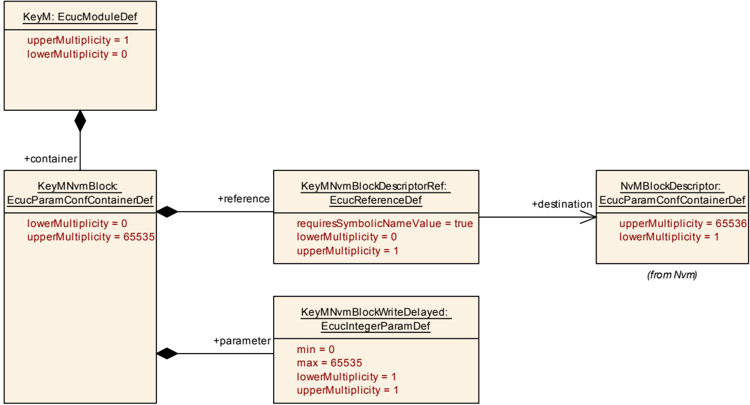

#### 9.1.15. KeyMSecurityEventRefs

| SWS 条目 | [ECUC_KeyM_00079] |
|---|---|
| 容器名称 | KeyMSecurityEventRefs |
| 父容器 | KeyMGeneral |
| 描述 | 该容器包含对 IdsMEvent 元素的引用，这些元素表示当发生相应的安全相关事件时（并且如果 KeyMEnableSecurityEventReporting 设置为 "true"），KeyM 模块应向 IdsM 报告的安全事件。该容器中的标准化安全事件可以通过供应商特定的安全事件进行扩展。 |
| Post-Build 变体多重性 | false |
| 多重性配置类 | Pre-compile time：x；Link time：-；Post-build time：- |
| 配置参数 | 见下方参数表 |

| SWS 条目 | [ECUC_KeyM_00082] |
|---|---|
| 参数名称 | SEV_CERT_INTERMEDIATE_INST_REQ |
| 父容器 | KeyMSecurityEventRefs |
| 描述 | 尝试安装中间证书。 |
| 多重性 | 0..1 |
| 类型 | Symbolic name reference to IdsMEvent |
| Post-Build 变体多重性 | false |
| Post-Build 变体值 | false |
| 多重性配置类 | Pre-compile time：x（All Variants）；Link time：-；Post-build time：- |
| 值配置类 | Pre-compile time：x（All Variants）；Link time：-；Post-build time：- |
| 作用域/依赖 | scope: local |

| SWS 条目 | [ECUC_KeyM_00083] |
|---|---|
| 参数名称 | SEV_CERT_INTERMEDIATE_UPD_REQ |
| 父容器 | KeyMSecurityEventRefs |
| 描述 | 尝试更新一个已有的中间证书。 |
| 多重性 | 0..1 |
| 类型 | Symbolic name reference to IdsMEvent |
| Post-Build 变体多重性 | false |
| Post-Build 变体值 | false |
| 多重性配置类 | Pre-compile time：x；Link time：-；Post-build time：- |
| 值配置类 | Pre-compile time：x；Link time：-；Post-build time：- |
| 作用域/依赖 | scope: local |

| SWS 条目 | [ECUC_KeyM_00080] |
|---|---|
| 参数名称 | SEV_CERT_ROOT_INST_REQ |
| 父容器 | KeyMSecurityEventRefs |
| 描述 | 尝试安装根证书。 |
| 多重性 | 0..1 |
| 类型 | Symbolic name reference to IdsMEvent |
| Post-Build 变体多重性 | false |
| Post-Build 变体值 | false |
| 多重性配置类 | Pre-compile time：x（All Variants）；Link time：-；Post-build time：- |
| 值配置类 | Pre-compile time：x（All Variants）；Link time：-；Post-build time：- |
| 作用域/依赖 | scope: local |

| SWS 条目 | [ECUC_KeyM_00081] |
|---|---|
| 参数名称 | SEV_CERT_ROOT_UPD_REQ |
| 父容器 | KeyMSecurityEventRefs |
| 描述 | 尝试更新一个已有的根证书。 |
| 多重性 | 0..1 |
| 类型 | Symbolic name reference to IdsMEvent |
| Post-Build 变体多重性 | false |
| Post-Build 变体值 | false |
| 多重性配置类 | Pre-compile time：x（All Variants）；Link time：-；Post-build time：- |
| 值配置类 | Pre-compile time：x（All Variants）；Link time：-；Post-build time：- |
| 作用域/依赖 | scope: local |

| SWS 条目 | [ECUC_KeyM_00084] |
|---|---|
| 参数名称 | SEV_CERT_VERIF_FAILED |
| 父容器 | KeyMSecurityEventRefs |
| 描述 | 针对证书链验证证书的请求未成功。 |
| 多重性 | 0..1 |
| 类型 | Symbolic name reference to IdsMEvent |
| Post-Build 变体多重性 | false |
| Post-Build 变体值 | false |
| 多重性配置类 | Pre-compile time：x；Link time：-；Post-build time：- |
| 值配置类 | Pre-compile time：x；Link time：-；Post-build time：- |
| 作用域/依赖 | scope: local |

无包含的容器。

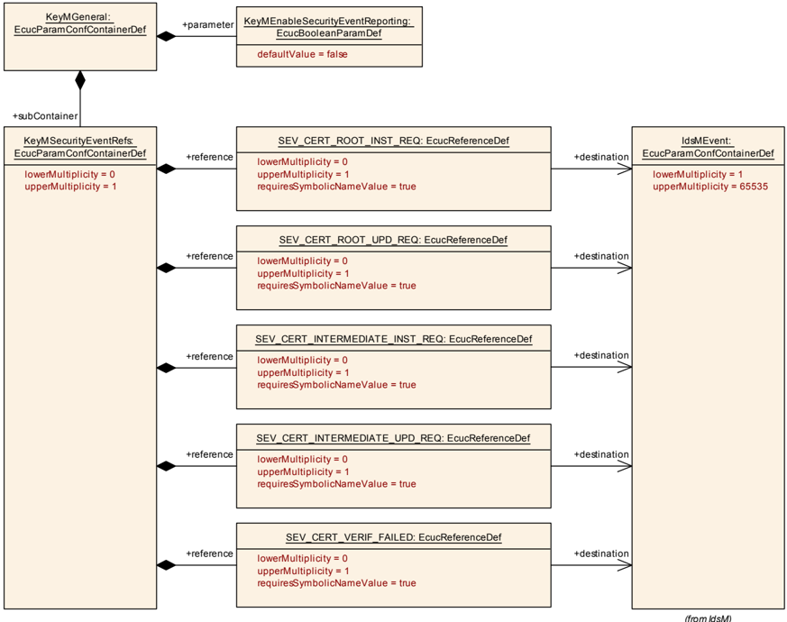

### 9.2. 发布信息

有关详细信息，请参阅 SWS_BSWGeneral 中的第 10.3 章「Published Information」（发布信息）。

## B. 规范条目历史

请注意，本章中的列表还包括在后续版本中已从规范中移除的规范条目。这些规范条目不会作为超链接出现在文档中。

### B.1. 本文档相对于 AUTOSAR R22-11 的规范条目历史

#### B.1.1. R23-11 中新增的规范条目

表B.1：R23-11 中新增的规范条目（**Added Specification Items in R23-11**）

| 编号 | 标题 |
|---|---|
| [SWS_KeyM_00182] |  |
| [SWS_KeyM_00731] |  |
| [SWS_KeyM_91021] | 客户端-服务器接口 KeyMCryptoKeyNotification 的定义 |

#### B.1.2. R23-11 中变更的规范条目

表B.2：R23-11 中变更的规范条目（**Changed Specification Items in R23-11**）

| 编号 | 标题 |
|---|---|
| [SWS_KeyM_00027] |  |
| [SWS_KeyM_00038] | 实现数据类型 KeyM_StartType 的定义 |
| [SWS_KeyM_00039] | 实现数据类型 KeyM_ServiceCertificateType 的定义 |
| [SWS_KeyM_00054] | API 函数 KeyM_Verify 的定义 |
| [SWS_KeyM_00056] | API 函数 KeyM_ServiceCertificate 的定义 |
| [SWS_KeyM_00058] | API 函数 KeyM_GetCertificate 的定义 |
| [SWS_KeyM_00072] | 可配置接口 KeyM_KH_ServiceCertificate 的定义 |
| [SWS_KeyM_00078] | KeyM 模块中可选接口的定义 |
| [SWS_KeyM_00082] | 客户端-服务器接口 KeyMCertificate_{KeyMCertificate} 的定义 |
| [SWS_KeyM_00083] | 客户端-服务器接口 KeyMCertificateElement_{KeyMCertificate}_{KeyMCertificateElement} 的定义 |
| [SWS_KeyM_00084] | 客户端-服务器接口 KeyMCryptoKey 的定义 |
| [SWS_KeyM_00117] |  |
| [SWS_KeyM_00147] | 可配置接口 &lt;KeyM_ServiceCertificateCallbackNotification&gt; 的定义 |
| [SWS_KeyM_00159] | 客户端-服务器接口 KeyMVerifyCertificateNotification 的定义 |
| [SWS_KeyM_00172] | KeyM 的安全事件 |
| [SWS_KeyM_00173] |  |
| [SWS_KeyM_00181] |  |
| [SWS_KeyM_91003] | 实现数据类型 KeyM_CertificateStatusType 的定义 |
| [SWS_KeyM_91008] | 实现数据类型 KeyM_ResultType 的定义 |
| [SWS_KeyM_91010] | 客户端-服务器接口 KeyMServiceCertificate 的定义 |
| [SWS_KeyM_91016] | API 函数 KeyM_ServiceCertificateByCertId 的定义 |
| [SWS_KeyM_91017] | 客户端-服务器接口 KeyMServiceCertificateByCertId 的定义 |
| [SWS_KeyM_91018] | 客户端-服务器接口 KeyMServiceCertificateNotification 的定义 |

#### B.1.3. R23-11 中删除的规范条目

无
