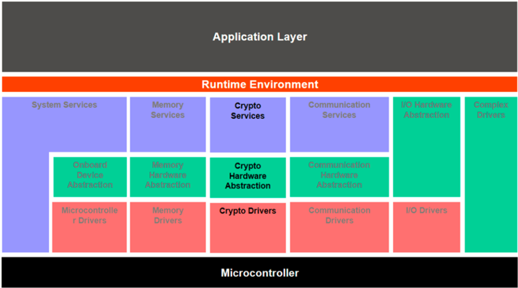

<!-- 源文档 AUTOSAR_CP_EXP_UtilizationOfCryptoServices（R23-11），讲述型指南（EXP），不受 Type A 七章骨架约束；章节结构镜像源文档自身编号（1–6）。 -->

## 1. 引言

### 1.1. 文档目的

本文档描述自 AUTOSAR 4.3 起规定的 AUTOSAR 加密功能的预期用法。本文档的目的是向用户/集成者介绍 AUTOSAR 支持的加密功能的基本概念。

### 1.2. 文档范围

本文档的范围是帮助加密栈的集成者和用户理解：

- AUTOSAR 加密栈的架构；
- 模块及其关系的整体表示；
- 加密硬件与软件的集成。

### 1.3. 限制

无限制。

## 2. 术语与缩略语的定义

### 2.1. 缩略语与缩写

| 缩写/缩略语 | 说明 |
| --- | --- |
| BSW | Basic Software（基础软件） |
| CDD | Complex Device Driver（复杂设备驱动） |
| CRYIF | Crypto Interface（加密接口） |
| CRYPTO | Crypto Driver（加密驱动） |
| CSM | Crypto Service Manager（加密服务管理器） |
| HSM | Hardware Security Module（硬件安全模块） |
| NvM | NVRAM Manager（NVRAM 管理器） |
| RTE | Runtime Environment（运行时环境） |
| SHE | Security Hardware Extension（安全硬件扩展） |
| SWC | Software Component（软件组件） |

### 2.2. 术语定义

| 术语 | 说明 |
| --- | --- |
| 加密驱动对象（Crypto Driver Object） | 一个加密驱动实现一个或多个加密驱动对象。加密驱动对象可以在硬件或软件中提供不同的加密原语。同一加密驱动的各加密驱动对象彼此独立。每个加密驱动对象只有一个工作区（即同一时刻只能执行一个加密原语）。 |
| 加密原语（Crypto Primitive） | 加密原语是在加密驱动对象中实现的一个已配置加密算法的实例。 |
| 作业（Job） | 作业是一个已配置的加密原语与一个被引用的密钥的组合。 |
| 密钥（Key） | 密钥可以被作业或 CSM 中的密钥管理函数引用。在加密驱动中，密钥引用一种特定的密钥类型。 |
| 密钥元素（Key Element） | 密钥元素用于存储数据。该数据可以是例如密钥材料或 AES 加密所需的 IV。它也可以用于配置密钥管理函数的行为。 |
| 密钥类型（Key Type） | 密钥类型由对密钥元素的引用组成。密钥类型通常由加密驱动的供应商预先配置。 |
| 处理（Processing） | 指示作业处理的种类。 |
| 异步（Asynchronous） | 调用相应函数时作业不会立即被处理。通常，在作业完成时经由回调函数通知调用者。 |
| 同步（Synchronous） | 调用相应函数时作业立即被处理。函数返回时，结果即可用。 |

## 3. 相关文档

### 3.1. 输入文件和相关标准与规范

[1] Specification of Crypto Service Manager
> AUTOSAR_CP_SWS_CryptoServiceManager

[2] Specification of Crypto Interface
> AUTOSAR_CP_SWS_CryptoInterface

[3] Specification of Crypto Driver
> AUTOSAR_CP_SWS_CryptoDriver

[4] Layered Software Architecture
> AUTOSAR_CP_EXP_LayeredSoftwareArchitecture

## 4. 加密栈概览

加密服务包括例如哈希的计算、非对称签名的验证或数据的对称加密。在 AUTOSAR 中，这些服务由 AUTOSAR 加密栈提供，即加密服务管理器（CSM）[\[1\]](#ref-1)、底层的加密接口（CRYIF）[\[2\]](#ref-2) 和加密驱动（CRYPTO）[\[3\]](#ref-3)。

CSM 服务使用借助加密软件或硬件模块实现的加密算法——两者都超出范围且不由 AUTOSAR 规定。硬件实现在很大程度上取决于目标平台所支持的特性。软件实现缺乏例如安全密钥存储的支持，必须依赖 AUTOSAR 栈提供的存储服务。

AUTOSAR 加密栈不提供安全概念。它提供可用于支持和实现某一特定安全概念的加密服务。

### 4.1. 栈架构

AUTOSAR 加密栈横跨 AUTOSAR 分层架构 [\[4\]](#ref-4) 的所有层：

- 在最低层——微控制器抽象层——是加密驱动（CRYPTO）[\[3\]](#ref-3)。这些模块持有不同加密硬件与软件实例的实际实现，例如外部 HSM。加密栈的一个特定特征是：可能存在多于一个的加密驱动模块；
- CRYIF 模块位于硬件抽象层。它为 CSM 提供一个通用的接口以访问可用的加密驱动模块，并使访问独立于底层的加密驱动；
- CSM 位于服务层。它提供一个抽象层，经由 RTE 端口机制为应用提供对加密服务的标准化访问。其他 BSW 模块和 CDD 可以使用 CSM 提供的 C-API 调用来使用加密服务。

### 4.2. 加密服务管理器（CSM）

CSM [\[1\]](#ref-1) 控制一个或多个客户端对一个或多个同步/异步加密服务的并发访问。它提供优先级队列，管理无法由专用 CRYPTO 直接处理的作业。CSM 提供的功能覆盖以下领域：

- 哈希计算；
- 消息认证码的生成与验证；
- 数字签名的生成与验证；
- 使用对称或非对称算法的加密与解密；
- 随机数生成；
- 密钥管理操作，例如密钥设置与生成。

CSM 服务是通用的，CSM 允许不同的应用使用带不同加密算法的相同服务。由于可以单独配置和初始化各个服务，这是可行的。例如，一个应用可能需要哈希服务来计算 SHA-2 摘要，另一个应用计算 SHA-3 摘要。

实际的加密例程由 CSM 封装。服务客户端不需要关心该例程是在软件还是硬件中实现、或哪个 CRYPTO 模块实际维护所请求的加密例程。CSM 为加密栈中可用的所有加密特性提供一个抽象层。

### 4.3. 加密接口（CRYIF）

CRYIF [\[2\]](#ref-2) 被上层 CSM 和下层 CRYPTO 包围。它接收来自 CSM 的请求，并把它们映射到 CRYPTO 中适当的加密操作。CRYIF 把 CSM 给出的请求转发给特定的 CRYPTO。在请求是异步的情况下，回调通知告知其结果。

CRYIF 可以操作多个 CRYPTO 模块。例如，可以有一个 CRYPTO 模块用于外部加密硬件模块，另有一个 CRYPTO 模块持有加密软件库。CRYIF 提供一个通用接口，使得来自 CSM 的访问不需要区分实际的 CRYPTO 实现。

### 4.4. 加密驱动（CRYPTO）

CRYPTO [\[3\]](#ref-3) 通常持有实际的加密实现，并支持加密服务的密钥存储、密钥配置与密钥管理。它可以拥有一个或多个加密驱动对象，各对象拥有独立的工作区。每个加密驱动对象可以提供任意多的加密原语。加密原语是一个已配置加密算法的实例。一个加密驱动对象在同一时刻只能执行一个加密原语。

多个 CRYPTO 模块与多个加密驱动对象的概念允许相同加密服务的不同的、并发的实现。可能存在具有不同优化目标的 CRYPTO 模块变体。例如，同一哈希算法可以在两个不同的 CRYPTO 模块中实现，一个由更快（更昂贵）的硬件方案实现，另一个由更慢（更便宜）的软件方案实现。

以下示例描述一个使用多个 CRYPTO 模块的可能场景：

有两个由不同供应商提供的 CRYPTO 实现。一个 CRYPTO 是硬件方案的抽象（「CRYPTO_HW」），另一个 CRYPTO 是纯软件方案（「CRYPTO_SW」）。CRYPTO_SW 是一个加密库，提供哈希服务以及一个（伪）随机数生成器。为了能够并行处理这两种服务，CRYPTO_SW 拥有两个加密驱动对象：一个用于哈希服务（「CDO_HASH」），一个用于随机数生成器（「CDO_RNG」）。如果某些加密例程不应并行运行，则应把它们放入同一个加密驱动对象。

## 5. 使用方面

### 5.1. 作业概念

对 CSM 的加密例程请求表示为作业。作业包含要处理哪个加密例程以及哪个加密密钥的信息。作业不包含实际的密钥数据本身，而是引用相应的密钥。密钥管理函数不作为作业处理。

#### 5.1.1 同步与异步模式

由于加密服务的计算可能是非常计算密集的，作业处理应被视为同步的或异步的。

使用同步作业处理时，CSM 服务将在调用者的上下文中立即执行。加密例程的结果在函数返回时直接可用。

异步作业稍后由专用 CRYPTO 处理——在调度的 main 函数的上下文中或在硬件中。如果特定的 CRYPTO 驱动对象因为忙而拒绝该作业，CSM 把该服务请求放到相应的 CSM 作业队列中。CRYPTO 使用 CRYIF 的回调函数把异步作业的完成通知给 CRYIF。CRYIF 再经由 CSM 的回调函数转发结果。

#### 5.1.2 排队与优先级

CSM 可以拥有若干个队列，异步作业在其中按照优先级处理。CSM 的每个队列映射到一个单独的加密驱动对象，从而启用对所选加密驱动对象的加密原语的访问。在 CRYPTO 因为忙而拒绝一个 CSM 服务请求之后，相应的作业按照其优先级被放入适当的 CSM 队列。排队的作业在周期性的 Csm_MainFunction 期间被传递给 CRYIF。CRYIF 将把作业转发给特定的 CRYPTO。可选地，加密驱动对象也可以拥有一个作业队列。这可能有助于优化加密驱动对象的硬件使用。

每个作业的优先级由其配置定义。优先级值越高，作业的优先级越高。作业按照其优先级执行。

参考 [4.4](#44-加密驱动crypto) 节引入的例子，以下可能是一个可能的场景：CSM 收到两个异步作业请求，一个针对 CDO_HASH，一个针对 CDO_RNG。两个加密驱动对象都属于 CRYPTO_SW。CSM 为两个加密驱动对象都设有作业队列。由于 CDO_HASH 没有队列、且正在处理另一个作业，CRYPTO_SW 拒绝该作业，CRYIF 把这一点告知 CSM。如果相应的 CSM 队列未满，针对 CDO_HASH 的作业按照其优先级在 CSM 中排队。Csm_MainFunction 的下一次执行将处理 CSM 队列中优先级最高的作业。当哈希作业出队时，它将从 CSM 队列中移除，CRYIF 把该作业移交给 CDO_HASH。

#### 5.1.3 流式方式与单次调用方式

加密服务的处理包含「START」「UPDATE」和「FINISH」操作：

- 「START」（CRYPTO_OPERATIONMODE_START）通知某个特定作业的新开始，并初始化加密计算；
- 可以使用「UPDATE」模式（CRYPTO_OPERATIONMODE_UPDATE）提供输入数据，并计算中间结果；
- 「FINISH」（CRYPTO_OPERATIONMODE_FINISH）表示应执行最终的加密计算。

[SWS_Csm_00024] 基于上述操作给出作业状态机的概览。被请求的操作作为操作模式参数提供给 CSM 作业。

加密服务可以用流式（streaming）方式或单次调用（single call）方式调用。流式方式对给定数据分别执行单个操作。流式方式可通过对每个操作模式分别调用例如 Csm_MacGenerate 来使用。使用流式方式允许例如通过以「UPDATE」操作模式多次调用服务函数来处理非常庞大的输入数据。

为了提升加密服务的性能，单次调用方式把若干个作业操作组合到一次函数调用中。这减少了多次调用函数的开销。操作模式声明应执行哪个操作，并且可以组合。操作按「START」「UPDATE」「FINISH」的顺序执行。在上面的例子中，可以传入一个包含所有操作模式的操作模式类型来调用 Csm_MacGenerate。单次调用方式在处理小数据集时尤其有益。在这种情况下，加密服务可以在一次遍历中完成。

### 5.2. 密钥处理

密钥处理包括加密密钥的生成、更新、导入/导出、交换与派生。加密密钥可以存储在加密硬件中，或使用 NvM。

加密密钥通过引用某个密钥类型来创建。CRYPTO 实现的供应商预先配置适合与所提供的加密原语一起使用的密钥类型。密钥类型由对一个或多个密钥元素的引用组成。例如，密钥元素可以是 AES 加密所需的密钥材料，或用于随机数生成的种子。加密栈使用密钥元素索引定义。[\[1\]](#ref-1) 例如，加密服务 MAC 有一个强制的密钥元素「Key Material」，密钥元素 id 为「1」。密钥元素索引可以由供应商扩展。一个密钥元素也可以是若干个密钥类型的一部分。

在密钥配置期间，必须指定对适当密钥类型的引用。特定的 CRYPTO 为密钥类型中包含的密钥元素提供数据存储，实际的密钥数据保存在那里。硬件 CRYPTO 实现通常使用密钥槽（key slot），而软件 CRYPTO 将使用 NvM 来管理密钥存储。

### 5.3. 配置理念

#### 5.3.1 加密功能的注册

任意多 CRYPTO 模块的概念为可用加密特性带来了灵活性。这要求一种注册机制，使 CRYPTO 实现中的实际加密特性为 CRYIF 和 CSM 所知。否则，将无法在 CSM 中配置和使用实际的加密特性。

这由供应商提供的预配置解决，预配置表示每个 CRYPTO 模块的能力。预配置自底向上加载，即从 CRYPTO 经由 CRYIF 到 CSM。CRYIF 挂载每个注册的 CRYPTO 模块，并把相应的加密特性整合进提供给 CSM 的通用接口。CSM 接收已注册 CRYPTO 的可用加密特性，并推导出供用户配置的相应加密特性。

#### 5.3.2 项目配置

加密栈的配置通常以自顶向下的方式进行，从 CSM 经由 CRYIF 到 CRYPTO：

- 在 CSM 中，用户选择并配置要使用的、由 CRYIF 和 CRYPTO 提供的加密原语与密钥。用户还定义作业与作业队列；
- 在 CRYIF 中，用户主要定义把 CSM 请求的特性映射到已注册 CRYPTO 模块提供的特性；
- 在 CRYPTO 中，用户适配并扩展加密原语与密钥的预配置。

## 6. 示例

下面使用服务「消息认证码」（MAC）概述加密栈的使用。

### 6.1. 模块中的配置

用户创建一个作业，引用所请求的 MAC 加密原语和要使用的加密密钥。他进一步配置该作业应同步（CRYPTO_PROCESSING_SYNC）还是异步（CRYPTO_PROCESSING_ASYNC）处理。如果作业是异步的，他还定义应处理该作业的队列。

MAC 要求一个密钥至少引用密钥元素「Key Material」（CRYPTO_KE_MAC_KEY）。

### 6.2. 涉及的 API

应用（即 SWC 的一个可运行体）经由 RTE 端口与加密栈（即 CSM）通信。对每个已配置的作业，RTE 生成一个名为 {Job}_MacGenerate 的端口，带客户端/服务器接口 CsmMacGenerate_{Primitive}()。该端口有一个端口定义的参数值 Crypto_OperationModeType，取值为 CRYPTO_OPERATIONMODE_SINGLECALL。这样，SWC 可以通过调用 CsmMacGenerate_{Primitive} 来调用 MAC 服务，并在对 CSM 的一次单次调用中提供执行 MAC 请求所需的全部数据。BSW 模块或 CDD 通过直接调用 C-API Csm_MacGenerate 来使用 MAC 服务。此处，要处理的作业必须作为输入参数传入。

取决于所用作业的配置，作业的处理将是异步的或同步的。在本例中，我们假定作业必须同步地、在调用者的上下文中处理。CSM 通过调用 CryIf_ProcessJob、并传入作业作为输入参数，把被请求的 MAC 服务分派给 CRYIF。CRYIF 通过调用 Crypto_ProcessJob 把作业的处理转移给 CRYPTO，后者最终执行作业参数中配置的加密原语。注意，如果存在不同的 CRYPTO 实现，函数命名将通过使用 vendorId（vi）和 vendorApiInfix（ai）来区分。因此，调用将是 Crypto_&lt;vi&gt;_&lt;ai&gt;_ProcessJob。最后，CRYPTO 把 MAC 存储到在 CSM 作业中配置的内存空间中。
