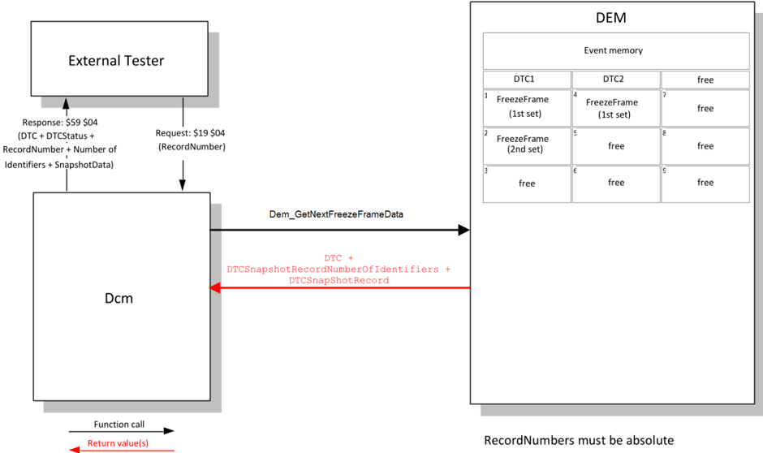
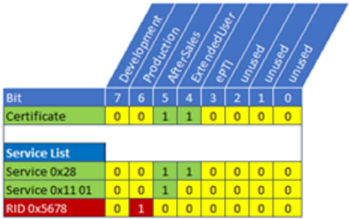
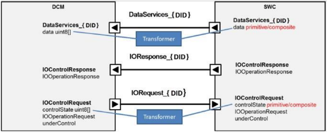
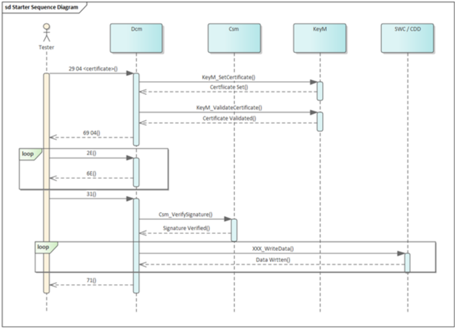
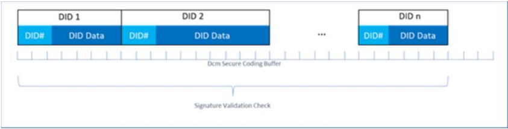

## 1. 简介和功能概述

本文描述了**AUTOSAR**基础软件模块**Dcm**（诊断通信管理器）的功能、API 和配置。

**Dcm**模块为诊断服务提供了一个公共**API**。**Dcm**模块所提供的功能是为了**ECU**在开发、制造或服务期间，供外部诊断仪（**Tester**）所使用的。
​


**Dcm**模块确保诊断数据流和管理诊断状态，特别是诊断会话和安全状态的管理。此外**Dcm**模块会检查诊断服务请求是否被支持，以及服务是否可以在当前会话的状态被执行。**Dcm**模块提供表1中的**OSI-Layer 5 ~ 7**。

表1.1：诊断协议与 OSI 层（**Diagnostic protocols and OSI-Layers**）

| OSI-层 | 协议 | | | | |
|---|---|---|---|---|---|
| 7 | UDS-Protocol - ISO14229-1 [1] | | | | Legislated OBD - ISO15031-5 [2] |
| 6 | - | - | - | - | - |
| 5 | ISO15765-3 | - | - | - | ISO 15765-4 |
| 4 | ISO15765-2 | - | - | - | - |
| 3 | ISO15765-2 | - | - | - | ISO 15765-4 |
| 2 | CAN- Protocol | LIN-Protocol | FlexRay | MOST | ISO 15765-4 |
| 1 | CAN- Protocol | LIN-Protocol | FlexRay | MOST | ISO 15765-4 |
​
在**OSI**的第7层，**Dcm**模块提供广泛的**ISO14229-1**[1]的服务，此外**Dcm**模块也提供了在文件**SAE J1979**[3]和**ISO 15031-5**[2]中定义的**OBD**服务机制的$01 - $0A的支持。通过这些服务，**AUTOSAR** **OBD**功能能够满足全球所有轻量级的OBD法规（如：加州 **OBD II**、**EOBD**、日本**OBD**等)。

在**OSI**的第5层，**Dcm**模块处理以下规范的网络独立部分:

* **ISO15765-3**[4]: 统一诊断业务实现（**UDS on CAN**）。
* **ISO15765-4**[5]: 排放相关系统的需求。第五章“会话层”
  
在**AUTOSAR**体系结构中，诊断通信管理器位于通信服务(服务层)。
​


**Dcm**模块是与网络独立的。所有网络特定的功能（如：**CAN**、**LIN**、**FlexRay**或**MOST**等网络的特定功能）都是在**Dcm**模块之外处理的。**PduR**（**PDU Router**）模块为**Dcm**模块提供了独立的网络接口。**Dcm**模块只会收到**PduR**模块发来的诊断消息。Dcm模块处理并在内部检查诊断消息。作为处理请求的诊断服务的一部分，**Dcm**将与其他**BSW**模块或**SW-C**通过**RTE**进行交互，以获取请求的数据或执行请求的命令。通常**Dcm**将收集到的信息集合起来，并通过**PduR**模块发送一条回复消息。

## 2. 缩略语

下面的词汇表列出了与 &lt;MODULE_NAME&gt; 模块相关、未包含在 [6, AUTOSAR 术语表] 中的缩略语和缩写。

**地址和长度格式标识符（AddressAndLengthFormat Identifier）**
> 定义了请求消息中用于**memoryAddress**和**memorySize**参数的字节数。

**应用层（Application Layer）**
> 应用层位于**RTE**之上。在应用层中放置**AUTOSAR**的软件组件。

**原子发送者/接收者接口（Atomic Sender/Receiver interface）**
> 原子发送者/接收者接口可用于将 **DID** 数据元素分组为一个记录数据元素原型。所有数据元素都可以通过单个读取或写入操作进行读取或写入。

**通道（Channel）**
> 可以进行数据传输的链路。如果存在多个通道，通常会为通道分配某种类型的 ID。

**Concurrent TesterPresent**（并发 TesterPresent）
> 一个设置了 suppressPosRspMsgIndicationBit（3E 80）的 **UDS** 服务 **TesterPresent**，通过功能寻址接收。它也被称为保活（keep-alive）逻辑。

**诊断通道（Diagnostic Channel）**
> 诊断工具与 **ECU** 之间可以进行数据传输的链路。示例：一个 **ECU** 通过 **CAN** 连接，且该诊断通道被分配了一个 **CAN-ID**。连接到其他总线系统（如 **MOST**、**FlexRay**、**LIN** 等）的诊断通道同样是可能的。

**外部诊断工具（External Diagnostic Tool）**
> 一种并非永久连接到车辆通信网络的设备。外部诊断工具可以出于多种目的连接到车辆，例如：开发、制造、服务（在修理厂）。外部诊断工具的示例有：诊断仪（diagnostic tester）、OBD 扫描工具（OBD scan tool）。外部诊断工具由维修人员连接，以从车辆“内部”收集信息。

**冻结帧（Freeze Frame）**
> 特定时刻的车辆/系统运行条件集合。

**功能寻址（Functional Addressing）**
> 一种诊断通信模型，其中特定通信网络的一组或所有节点从一个发送节点接收消息（1-n 通信）。该模型也被称为“广播”（broadcast）或“多播”（multicast）。OBD 通信始终以功能寻址模式进行。

**内部诊断工具（Internal Diagnostic Tool）**
> 一种连接到车辆通信网络的设备/**ECU**。内部诊断工具可用于：高级事件跟踪、高级分析、服务。内部诊断工具的行为可以与外部诊断工具相同。“内部诊断工具”的概念并不意味着它作为 **AUTOSAR** 软件组件包含在每个 **ECU** 中。

**物理寻址（Physical Addressing）**
> 一种诊断通信模型，其中特定通信网络的一个节点从一个发送节点接收消息（1-1 通信）。该模型也被称为“单播”（unicast）。

**UDS 服务（UDS Service）**
> 这是指 **ISO14229-1** [1] 中定义的 **UDS** 服务。

**OBD 扫描工具（OBD Scan tool）**
> 参见外部诊断工具（**External Diagnostic Tool**）的定义。

**OBD 服务（OBD Service）**
> 这是指 **ISO15031-5** [2] 中定义的 **OBD** 服务。

**OBD UDS DTC 分离（OBD UDS DTC separation）**
> 该特性将针对基于 **SAE J1979-2** 的 **UDS** 通信报告与非 **J1979-2** **UDS** 通信不同的 3 字节 **DTC** 编号。

**周期传输速率（periodic transmission rate）**
> 定义周期数据标识符传输的两次调用之间时间间隔的值。该值是配置特定的，快速、中速和慢速周期数据传输分别有单独的值。配置的值始终是 **Dcm** 主函数时间的整数倍。

**API**
> 应用编程接口（**Application Programming Interface**）

**CAN**
> 控制器局域网（**Controller Area Network**）

**CEMR**
> 控制使能掩码记录（**ControlEnableMaskRecord**）

**Dcm**
> 诊断通信管理器（**Diagnostic Communication Manager**）

**Dem**
> 诊断事件管理器（**Diagnostic Event Manager**）

**Det**
> 默认错误跟踪器（**Default Error Tracer**）

**DID**
> 数据标识符（**Data Identifier**）

**DSD**
> 诊断服务分发器（**Diagnostic Service Dispatcher**，**Dcm** 模块的子模块）

**DSL**
> 诊断会话层（**Diagnostic Session Layer**，**Dcm** 模块的子模块）

**DSP**
> 诊断服务处理（**Diagnostic Service Processing**，**Dcm** 模块的子模块）

**DTC**
> 诊断故障码（**Diagnostic Trouble Codes**）

**ID**
> 标识符（**Identifier**）

**LIN**
> 局部互联网络（**Local Interconnect Network**）

**MCU**
> 微控制器单元（**Micro-Controller Unit**）

**MOST**
> 面向媒体的系统传输（**Media Orientated System Transport**）

**NRC**
> 负响应码（**Negative Response Code**）

**OBD**
> 车载诊断（**On-Board Diagnosis**）

**OSI**
> 开放系统互连（**Open Systems Interconnection**）

**PDID**
> 周期数据标识符（**Periodic Data Identifier**，在 **ReadDataByPeriodicIndentifer** 请求后由 **Dcm** 周期性发送）

**PDU**
> 协议数据单元（**Protocol Data Unit**）

**PID**
> 参数标识符（**Parameter Identifier**）

**RCRRP**
> 响应正确接收——响应挂起（**Response correctly received - response pending**）

**RID**
> 例程标识符（**Routine Identifier**）

**ROE**
> 事件响应（**ResponseOnEvent**）

**RTE**
> 运行时环境（**Runtime Environment**）

**SAP**
> 服务访问点（**Service Access Point**）

**SDU**
> 服务数据单元（**Service Data Unit**）

**SID**
> 服务标识符（**Service Identifier**）

**SW-C**
> 软件组件（**Software-Component**）

**TP**
> 传输协议（**Transport Protocol**）

**UDS**
> 统一诊断服务（**Unified Diagnostic Services**）

**Xxx\_**
> **API** 提供者的占位符（**Placeholder for an API provider**）

**SPRMIB**
> 抑制正响应消息指示位（**suppressPosRspMsgIndicationBit**）

### 2.1. 排版约定

本文档使用以下排版约定：

- 参见配置参数 myConfigurationParameter：这是对一个配置参数的引用，可在第 9 章中找到。
- myFunction()：这是模块提供或要求的函数，其定义见第 7 章。

## 3. 相关文档

### 3.1. 输入文件和相关标准与规范

- [1] Unified diagnostic services (UDS) - Part 1: Application layer (Release 2013-03) https://www.iso.org
- [2] Road vehicles - Communication between vehicle and external equipment for emission-related diagnostic - Part 5: Emission-related diagnostic services. https://www.iso.org
- [3] SAE J1979
- [4] Diagnostics on controller area network (CAN) - Part 3: Implementation of unified diagnostic services (UDS on CAN) (Release 2004 10-06)
- [5] Diagnostics on controller area network (CAN) - Part 4: Requirements for emission-related systems (Release 2005 01-04)
- [6] Glossary AUTOSAR_FO_TR_Glossary
- [7] General Specification of Basic Software Modules AUTOSAR_CP_SWS_BSWGeneral
- [8] Unified diagnostic services (UDS) - Part 1: Application layer (Release 2020-02) https://www.iso.org
- [9] Requirements on Diagnostics AUTOSAR_FO_RS_Diagnostics
- [10] Requirements on Intrusion Detection System AUTOSAR_FO_RS_IntrusionDetectionSystem
- [11] General Requirements on Basic Software Modules AUTOSAR_CP_SRS_BSWGeneral
- [12] ISO 17356-3: Road vehicles - Open interface for embedded automotive applications - Part 3: OSEK/VDX Operating System (OS)
- [13] Unified diagnostic services (UDS) - Part 2: Session layer services (Release 2021-10) https://www.iso.org
- [14] Specification of PDU Router AUTOSAR_CP_SWS_PDURouter
- [15] Road vehicles - Diagnostics on Controller Area Networks (CAN) - Part 2: Network layer services
- [16] Road vehicles - Communication between vehicle and external equipment for emission-related diagnostic - Part 6: Diagnostic trouble code definitions
- [17] Specification of Crypto Service Manager AUTOSAR_CP_SWS_CryptoServiceManager
- [18] Specification of Key Manager AUTOSAR_CP_SWS_KeyManager
- [19] Specification of I/O Hardware Abstraction AUTOSAR_CP_SWS_IOHardwareAbstraction
- [20] Specification of Diagnostic Event Manager AUTOSAR_CP_SWS_DiagnosticEventManager

### 3.2. 相关规范

**AUTOSAR** 提供的基础软件模块通用规范 [7, SWS BSW General] 同样适用于诊断通信管理器。因此，SWS BSW General 规范应被视为诊断通信管理器的附加且必需的规范。

## 4. 约束和假设

### 4.1. 限制

使用 **Dcm** 模块时适用以下限制：

- **Dcm** 模块不提供任何诊断多通道能力。这意味着测试仪针对不同独立功能发出的并行请求无法由单个 **Dcm** 模块处理。此外，当前实现的概念未考虑位于一个 **ECU** 中的多个 **Dcm** 模块实例。由于立法者要求 **ISO 15031-5** [2] 的排放相关服务请求应先于任何增强型诊断请求处理，**Dcm** 模块提供了基于协议优先级的协议切换机制。
- **CAN** 和 **LIN** 的 **ISO** 标准不支持 **UDS** 服务 **AccessTimingParameter**（0x83）。**FlexRay** 也未计划支持该服务。因此没有对该服务的支持计划。
- 当前版本不支持服务 **ResponseOnEvent** 的子功能 **onComparisionOfValues**。
- 当前版本不支持服务 **ResponseOnEvent** 的子功能 **onTimerInterrupt**。
- 当前版本不支持 **UDS** 服务 **SecuredDataTransmission**（0x84）。
- **Dcm** SWS 不涵盖任何 **SAE J1939** 相关的诊断需求。
- 由于 **DEM** 的限制，诊断服务 $19 05 仅限于 **OBD** 立法冻结帧。
- 不支持对请求和响应中没有 **InputOutputControlParameter** 的 **IOControl** 服务的管理。
- **IOControl** 请求和响应中 **controlState** 参数的长度必须具有相同的大小（由于只有一个配置参数 **DcmDspDataByteSize**）。
- 在 **RDBI**、**WDBI** 或 **IOCBI** 服务中使用的 **DID** 具有相同的布局。
- **ControlDTCSetting** 请求中的用户可选参数 **DTCSettingControlOptionRecord** 仅在它对应于 groupOfAllDTCs（0xFFFFFF）值时受支持。在其他情况下，必须在供应商特定的实现中进行管理。
- 仅支持 **ControlDTCSetting** 的子功能 0x01 和 0x02。
- **SWS** 未涵盖 **DCM/DEM** &lt;-&gt; **SW-C** 交互期间 **RTE** 报告的基础设施错误（infrastructure errors）的处理，如果实现者需要，可能必须将其考虑在内。
- **Dcm** 不支持用于 **ROE** 的 **DLT**。
- **ROE** 的 **ServiceToRespondTo** 不支持分页缓冲（PageBuffering）。
- **ROE** 仅支持表 2 中列出的子功能。
- **DID** 范围特性不能应用于服务 **DynamicallyDefineDataIdentifier**、**ReadDataByPeriodicIdentifier** 和 **InputOutputControlById**。
- **AUTOSAR Dcm** 并非打算在引导加载程序（bootloader）中使用。
- **FlexRay** 上无法进行周期传输（PeriodicTransmission），因为 **ISO 14229-4** 要求报头信息（地址信息（源地址和目标地址）和 FPL（帧有效载荷长度））。这些信息无法用 IF 接口的既定概念填充。
- 当前 **AUTOSAR** 版本未标准化 **Dcm** 模块与 **NvBlockSoftwareComponentType** 之间 **ECU** 内通信的转换器（transformer）规范。对于这种场景，可以使用由复杂驱动（complex driver）实现的自定义转换器。为详细说明这一点，责任相关方（通常是 **OEM**）需要在单独的文档中从行为角度指定该自定义转换器（这可能包括字节顺序或对齐方式的定义）。如果需要在模型中定义转换器特定的属性，可以使用 **UserDefinedTransformationDescription** 和 **UserDefinedTransformationISignalProps** 中的特殊数据组来完成。对于此场景的配置，**Dcm** 模块和 **NvBlockSoftwareComponentType** 的受影响 **SenderReceiverInterface** 应存在一个 **DataPrototypeMapping**，它在角色 **firstToSecondDataTransformation** 中引用一个 **DataTransformation**。该 **DataTransformation** 应在角色 **transformerChain** 中引用恰好一个 **transformerClass** 属性设置为 "serializer" 的 **TransformationTechnology**，并可以在角色 **transformationDescription** 中组合一个 **UserDefinedTransformationDescription**。
- 在某些情况下，**Dcm** 模块能够并行处理诊断请求。这种可能性明确限于 **OBD** 与 **UDS** 协议处理并行。不支持任何其他协议组合的并行处理。特别是不支持并行处理两个或更多 **UDS** 协议请求、或 **WWH-OBD** 与 **UDS** 协议的用例。
- 对于 **UDS** 服务 0x29，**Dcm** 仅支持 **PKI** 的子功能。不支持通过挑战-响应（challenge response）方式进行的身份验证。
- 对于 **UDS** 服务 0x29，不支持通过 **Diffie-Hellman** 密钥交换的安全诊断通信。
- 对于 **UDS** 服务 0x29，**Dcm** 不支持 **NRC** “Certificate verification failed - Invalid Content”。
- **Dcm** 仅支持 **ISO 14229-1:2020** [8] 中选定的功能子集。除非明确说明，**Dcm** 遵循 **ISO 14229-1:2013** [1]。
- **AUTOSAR PduR** 架构允许使用流式协议。由于诊断协议不使用流式协议，**Dcm** 也不支持流式协议，因此不支持 **TpSduLength** 等于零的 **Dcm_StartOfReception**。
- **Dcm** 对 **UDS** 服务 0x36 的 **NRC** 顺序有所不同。**ISO14229-1** [1] 为该服务定义的 **NRC** 顺序将需要更多的 **API**，这会使整体服务处理更加复杂。详情见第 6.6.2.21 章。

### 4.2. 汽车域的适用性

**Dcm** 模块可用于所有汽车域。

### 4.3. 排放相关环境（OBD）的适用性

本 **Dcm** SWS 旨在满足立法者给出的排放相关要求。但是，排放相关系统的供应商负责满足 **OBD** 要求。某些要求无法由 **Dcm** 模块本身满足，而需要在整个 **ECU** 或系统层面加以考虑。示例：在系统内集成 **Dcm** 模块期间，必须满足时序要求（50ms 响应时间）。

对于 **WWH-OBD**，当前仅支持 **FunctionalGroupIdentifier** 0x33。

## 5. 与其他模块的依赖关系

**AUTOSAR** 诊断通信管理器（**DCM**）与以下基础软件模块和 **SW-C** 存在接口和依赖关系：


- 诊断事件管理器（**DEM**）：**DEM** 模块提供检索与故障内存相关的所有信息的功能，使 **Dcm** 模块能够通过从故障内存读取数据来响应诊断仪的请求。
- 协议数据单元路由器（**PduR** 模块）：**PduR** 模块提供发送和接收诊断数据的功能。**Dcm** 模块的正常运行假定 **PduR** 接口支持诊断应用层与底层传输层之间为服务访问点（**SAP**）定义的所有服务原语（参见 **ISO14229-1** [1] 第 5 章“应用层服务”）。
- 通信管理器（**ComM**）：**ComM** 模块提供使 **Dcm** 模块能够针对诊断通信指示“活动”（active）和“非活动”（inactive）状态的功能。**Dcm** 模块提供处理通信需求“**Full-**/ **Silent-**/ **No-Communication**”的功能。此外，**Dcm** 模块还提供在 **ComM** 模块请求时启用和禁用诊断通信的功能。
- **SW-C** 和 **RTE**：**Dcm** 模块能够分析接收到的诊断请求数据流，并处理与诊断通信相关的所有功能，如协议处理和时序。基于对请求数据流的分析，**Dcm** 模块组装响应数据流，并将例程或 **IO-Control** 的执行委托给 **SW-C**。如果某些数据元素或功能状态无法由 **Dcm** 模块自身提供，**Dcm** 会通过端口接口（port-interface）从 **SW-C**、或通过直接函数调用从其他 **BSW** 模块请求数据或功能状态。
- **BswM**：如果 **Dcm** 的初始化是从引导加载程序跳转的结果，则 **Dcm** 通知 **BswM** 应用程序已被更新。**Dcm** 还向 **BswM** 指示通信模式的变化。
- 加密服务管理器（**Csm**）：加密服务模块提供广泛的加密算法。**Csm** 用于身份验证计算。
- 密钥管理器（**KeyM**）：密钥管理器模块提供证书处理支持以及用于实现基于证书的认证诊断的 **API**。

## 6. 功能规格

### 6.1. 安全事件

如果为 **Dcm** 模块启用了安全事件报告（DcmEnableSecurityEventReporting = true），则应通过 **AUTOSAR_SWS_BSWGeneral** 中定义的接口将相应的安全事件报告给 **IdsM**。

#### 6.1.1. Dcm 的安全事件

| 名称 | 描述 | ID |
|---|---|---|
| SEV_UDS_WRITE_INVALID_DATA | 诊断仪通过服务 **WriteDataByIdentifier** 写入无效数据。 | 23 |
| SEV_UDS_SECURITY_ACCESS_DENIED | 诊断仪发送的诊断请求未满足服务器对该服务的安全级别要求。返回了 **NRC** 0x33（securityAccessDenied）。 | 24 |
| SEV_UDS_COMMUNICATION_CONTROL_SWITCHED_OFF | **ECU** 通信被服务 **CommunicationControl** 关闭。 | 25 |
| SEV_UDS_SERVICE_NOT_SUPPORTED | 请求了不受支持或在当前活动会话中不受支持的诊断服务。返回了 **NRC** 0x11（serviceNotSupported）或 **NRC** 0x7F（serviceNotSupportedInActiveSession）。 | 26 |
| SEV_UDS_SUBFUNCTION_NOT_SUPPORTED | 请求的诊断服务的某个子功能不受支持。 | 27 |
| SEV_UDS_INCORRECT_MESSAGE_LENGTH_OR_FORMAT | 接收到的请求消息与规定的长度不匹配，或参数的格式与该服务规定的格式不同。返回了 **NRC** 0x13（incorrectMessageLengthOrInvalidFormat）。 | 28 |
| SEV_UDS_REQUEST_SEQUENCE_ERROR | 以错误的顺序接收到诊断服务。返回了 **NRC** 0x24（requestSequenceError）。 | 29 |
| SEV_UDS_REQUEST_OUT_OF_RANGE | 接收到一个参数超出允许范围的诊断请求。返回了 **NRC** 0x31（requestOutOfRange）。 | 30 |
| SEV_UDS_REQUESTED_ACTIONS_REQUIRES_AUTHENTICATION | 在未获得执行该服务所需身份验证的情况下接收到诊断请求。返回了 **NRC** 0x34（authenticationRequired）。 | 31 |
| SEV_UDS_SECURITY_ACCESS_NUMBER_OF_ATTEMPTS_EXCEEDED | **Security Access** 失败，且无效尝试次数已超限。返回了 **NRC** 0x36（exceedNumberOfAttempts）。 | 32 |
| SEV_UDS_SECURITY_ACCESS_INVALID_KEY | **Security Access** 失败，因为诊断仪向服务器发送了无效的密钥。返回了 **NRC** 0x35（invalidKey）。 | 33 |
| SEV_UDS_SECURITY_ACCESS_REQUIRED_TIME_DELAY_NOT_EXPIRED | 在延迟时间到期之前再次尝试解锁 **ECU**。发送了 **NRC** 0x37（requiredTimeDelayNotExpired）。 | 34 |
| SEV_UDS_NUMBER_OF_FAILED_AUTHENTICATION_ATTEMPTS_EXCEEDED | 身份验证失败次数超限 —— **OEM** 特定。 | 35 |
| SEV_UDS_CERTIFICATE_FAILURE | 诊断仪尝试使用无效证书进行身份验证。 | 36 |
| SEV_UDS_ECU_UNLOCK_SUCCESSFUL | 成功解锁 **ECU**（通过 **Security Access** $27），按级别计。 | 37 |
| SEV_UDS_AUTHENTICATION_SUCCESSFUL | 成功完成身份验证（通过 **Authentication** $29）。 | 38 |
| SEV_UDS_CLEAR_DTC_SUCCESSFUL | **DTC** 信息已通过 **SID** 0x14 **ClearDTCInformation** 清除。 | 39 |
| SEV_UDS_ECU_RESET | **ECU** 已被 **SID** 0x11 **ResetECU** 复位。 | 40 |
| SEV_UDS_WRITE_DATA | 诊断数据标识符已通过 **SID** 0x2E 写入。 | 41 |
| SEV_UDS_REQUEST_DOWNLOAD | 通过 **SID** 0x34 请求了诊断数据下载序列。 | 42 |
| SEV_UDS_DTC_SETTING_SWITCHED_OFF | 通过服务 0x85（**ControlDTCSetting**）关闭了 **DTC** 设置。 | 43 |

### 6.2. 错误分类

本节描述 **Dcm** 模块在生命周期中可能发生的几类错误的处理方式。

诊断通信错误在 **ISO** 协议中通过 **NRC** 直接处理。

错误值应在所有错误类型中唯一。**Dcm** 应仅使用本章给出的值。

《基础软件模块通用规范》（**General Specification of Basic Software Modules**）的“错误处理（Error Handling）”一节详细描述了基础软件的错误处理。其中最重要的是，它构成了一个由五种错误类型组成的分类方案，这些错误类型可能发生在 **BSW** 模块中。

基于这一基础，下节将在相应的小节中对特定错误进行规定。

#### 6.2.1. 开发错误

以下描述的错误和异常应由 **Dcm** 模块根据其构建版本（开发/生产模式）可检测。

##### 6.2.1.1. Dcm 模块开发错误的定义

| 错误类型 | 相关错误代码 | 错误值 |
|---|---|---|
| 调用 **Dcm** 时输入参数值无效，或 **Dcm** 调用了某个函数且该函数返回无效的出参或返回值。 | DCM_E_INVALID_VALUE | 0x02 |
| 接口返回值超出范围 | DCM_E_INTERFACE_RETURN_VALUE | 0x02 |
| 内部：**Dcm** 未初始化 | DCM_E_UNINIT | 0x05 |
| **Dcm API** 函数输入参数无效 | DCM_E_PARAM | 0x06 |
| 以 **NULL** 指针作为参数调用 **Dcm API** 服务 | DCM_E_PARAM_POINTER | 0x07 |
| **Dcm** 初始化失败 | DCM_E_INIT_FAILED | 0x08 |
| 存储 **ProgConditions** 失败 | DCM_E_SET_PROG_CONDITIONS_FAIL | 0x09 |

#### 6.2.2. 运行时错误

以下描述的错误和异常应由 **Dcm** 模块根据其构建版本（开发/生产模式）可检测。

**Dcm** 模块运行时错误的定义：

| 错误类型 | 相关错误代码 | 错误值 |
|---|---|---|
| 接口：与另一个模块交互期间发生超时（例如达到最大响应挂起（response pending）次数） | DCM_E_INTERFACE_TIMEOUT | 0x01 |
| 接口：与另一个模块（应用、**Dem**、**PduR** 等）交互期间，**Dcm** 提供的缓冲区边界检查失败 | DCM_E_INTERFACE_BUFFER_OVERFLOW | 0x03 |

#### 6.2.3. 瞬时故障

没有瞬时故障。

#### 6.2.4. 生产错误

没有生产错误。

#### 6.2.5. 扩展生产错误

没有扩展生产错误。

### 6.3. 通用设计元素

#### 6.3.1. Dcm 模块内的子模块

为了定义 **Dcm** 模块的功能，**Dcm** SWS 将 **Dcm** 模块建模为由以下子模块组成：

- 诊断会话层（**DSL**）子模块：**DSL** 子模块确保与诊断请求和响应相关的数据流，监督并保证诊断协议时序，并管理诊断状态（特别是诊断会话和安全状态）。
- 诊断服务分发器（**DSD**）子模块：**DSD** 子模块处理诊断数据流。该子模块：
  - 通过网络接收新的诊断请求，并将其转发给数据处理器。
  - 在数据处理器（例如 **DSP** 子模块）触发时，通过网络发送诊断响应。
- 诊断服务处理（**DSP**）子模块：**DSP** 子模块处理实际的诊断服务（相应地为子服务）请求。

下一张图给出 **Dcm** 模块内 **DSP**、**DSD** 和 **DSL** 子模块之间接口的概览。


**注意：** 这些子模块及其之间接口的实现不是强制的。引入它们只是为了提高规范的可读性。

#### 6.3.2. 负响应码（NRC）

定义 **UDS** 服务和 **OBD** 服务的标准定义了负响应码（**NRC**）。**Dcm** SWS 在 **Dcm** 与其他 **BSW** 模块及 **SW-C** 之间的接口中使用这些 **NRC**。这些 **NRC** 在数据类型 **Dcm_NegativeResponseCodeType** 中定义。

发送的 **NRC** 的顺序应符合 **ISO14229-1** [1] 中描述的顺序。

#### 6.3.3. 非易失信息

**Dcm** 的若干特性需要初始化非易失信息。**AUTOSAR** 未描述如何访问该信息，也未描述当 **Dcm** 初始化时该信息是否已经可用。因此，非易失信息的访问是实现特定的，必须在集成期间予以保证。

**Dcm** 应检查 **NvM** 是否被正确读出。如果非易失信息无法被正确读出，**Dcm** 应启动默认反应。默认反应在使用该非易失数据的章节中描述。

如果 **Dcm** 取消一个带有 **NvM** 访问的服务，它应调用 NvM_CancelJobs()。

该服务的取消或者是因为达到了 **RCRRP NRC** 的最大次数，或者是因为协议抢占。

#### 6.3.4. 类型

**Dcm** 应将非整数数据类型（例如 uint8[n]）当作匹配大小的整数数据类型来处理；或者在 DcmDspDataEndianness 配置为 OPAQUE 的情况下，将其内容不作解释地保留。

**Dcm** 模块应将不透明（opaque）数据解释为 uint8[n]，并始终将其映射到一个 n 字节大小的信号。对于不透明数据的字节序，DcmDspDataEndianness 必须配置为 OPAQUE。

**Dcm** 应将 [12] 中定义的字节序转换扩展到有符号数据类型。

在 [12]（第 2.4 章）中，字节序转换是针对无符号数据类型定义的。相关的配置可在配置 **DcmDspData** 中找到。

##### 6.3.4.1. 原子类型概览


##### 6.3.4.2. 数据数组类型概览


##### 6.3.4.3. 嵌套数据类型概览

用于 **DID** 和诊断例程（Diagnostic Routine）的数据类型可以以嵌套方式定义。一个 **DID** 或例程参数（Routine Argument）可以由多个元素组成，例如一个数组，其中每个数组元素是一个结构体，而该结构体又由多个以基本类型、数组或更深层结构体类型化的数据元素组成。

在配置中，这通过一个专用的模式来表示：

- 根数据元素定义一个嵌套元素池（例如 **DcmDspDid** 中的 DcmDspDidSignalCompositePool）。
- 根数据元素有一个锚对象（例如 DcmDspDidSignal），该锚对象可以表示基本数据或数组数据，在这种情况下没有定义对池元素的引用（例如 DcmDspDidSignalCompositeRef）。
- 如果锚对象表示一个结构体，则它定义一个或多个对池元素的引用（例如 DcmDspDidSignalCompositeRef）。这定义了被引用的池元素构成该结构体的内容。

池元素本身可以是一个嵌套定义。这允许结构化元素的任意嵌套。


如果一个 DcmDspDidSignal 包含至少一个 DcmDspDidSignalCompositeRef，则该 DcmDspDidSignal 应只定义以下参数：

- DcmDspDidByteOffset
- DcmDspDataByteSize

具体而言，这意味着 DcmDspDidSignal 不应定义任何 DcmDspDidDataRef，因为那会给出基本数据类型或数组数据类型的具体数据类型信息。如果 DcmDspDidSignal 包含一个 DcmDspDidSignalCompositeRef，则该 DcmDspDidSignal 是一个嵌套数据类型。

嵌套数据类型占用从 DcmDspDidByteOffset 位置开始的连续若干字节（DcmDspDataByteSize）。

嵌套数据类型范围内定义的所有数据类型都应放置在 DcmDspDataByteSize 和 DcmDspDidByteOffset 定义的区域内。

嵌套数据元素的 DcmDspDidByteOffset 值应给出相对于 **DID** 的绝对起始位置（而不是相对于相应的组合结构体）。

每个 DcmDspDidSignalCompositePool 只应被一个 DcmDspDidSignalCompositeRef 引用至多一次。每个 DcmDspDidSignalCompositePool 元素被明确定义为位于 **DID** 中的一个专用位置，并且在 **DcmDspDid** 的定义中只能出现一次。

DcmDspDidSignalCompositeRef 只应引用与 DcmDspDidSignalCompositeRef 的所有者定义在同一个 **DcmDspDid** 范围内的 DcmDspDidSignalCompositePool 元素。

上述规范是基于 **DcmDspDid** 定义的。嵌套数据类型定义的相同模式也已应用于配置的其他部分。下面的列表给出上文使用的配置项与用于嵌套数据类型定义的其他配置项之间的对应关系。

数据类型的嵌套不仅适用于 **DcmDspDid**，也支持以下定义：

- DcmDspDid 对应于
  - DcmDspStartRoutineIn
  - DcmDspStartRoutineOut
  - DcmDspStopRoutineIn
  - DcmDspStopRoutineOut
  - DcmDspRequestRoutineResultsIn
  - DcmDspRequestRoutineResultsOut
- DcmDspDidSignal 对应于
  - DcmDspStartRoutineInSignal
  - DcmDspStartRoutineOutSignal
  - DcmDspStopRoutineInSignal
  - DcmDspStopRoutineOutSignal
  - DcmDspRequestRoutineResultsInSignal
  - DcmDspRequestRoutineResultsOutSignal
- DcmDspDidSignalCompositePool 对应于
  - DcmDspStartRoutineInSignalCompositePool
  - DcmDspStartRoutineOutSignalCompositePool
  - DcmDspStopRoutineInSignalCompositePool
  - DcmDspStopRoutineOutSignalCompositePool
  - DcmDspRequestRoutineResultsInSignalCompositePool
  - DcmDspRequestRoutineResultsOutSignalCompositePool
- DcmDspDidSignalCompositeRef 对应于
  - DcmDspStartRoutineInSignalCompositeSignalRef
  - DcmDspStartRoutineOutSignalCompositeSignalRef
  - DcmDspStopRoutineInSignalCompositeSignalRef
  - DcmDspStopRoutineOutSignalCompositeSignalRef
  - DcmDspRequestRoutineResultsInSignalCompositeSignalRef
  - DcmDspRequestRoutineResultsOutSignalCompositeSignalRef

图 7.5 中的示例嵌套数据类型定义为 A，它由定义为基本类型的 X 和 Y 组成。


A 从 **DcmDspStartRoutineIn** 的位置 2 开始，大小为 4 字节。嵌套的叶子元素 X 和 Y 定义在结构体 A 的范围之内且不重叠。在这个例子中，X 和 Y 之间甚至留下了一个间隙。

图 7.6 给出了图 7.5 中嵌套数据类型的示例配置。


容器 DcmDspStartRoutineIn 包含根元素 DcmDspStartRoutineInSignal_Signal_A 以及两个池元素 DcmDspStartRoutineInSignalContainedPool_X 和 DcmDspStartRoutineInSignalContainedPool_Y 的定义。

根元素 DcmDspStartRoutineInSignal_Signal_A 将其绝对起始位置定义为 2（DcmDspRoutineSignalPos_Signal_A），将其以字节计的大小定义为 4（DcmDspRoutineParameterSize_Signal_A）。根元素 DcmDspStartRoutineInSignal_Signal_A 还通过引用 DcmDspStartRoutineInSignalContainedPool_X 和 DcmDspStartRoutineInSignalContainedPool_Y 定义了有两个嵌套元素属于该根元素。这些引用指向定义在同一个 **DcmDspStartRoutineIn** 范围内的池元素。

被引用的池元素分别定义了它们各自的绝对位置（DcmDspRoutineSignalPos_Signal_X）、大小（DcmDspRoutineParameterSize_Signal_X）和基本类型（DcmDspRoutineSignalType_Signal_X）。

##### 6.3.4.4. 数据类型约束

**大小参数的存在性（Existence of size parameter）**：如果 DcmDspDataType 设置为 UINT8_N、SINT8_N、UINT16_N、SINT16_N、UINT32_N、SINT32_N 或 UINT8_DYN，则应存在 DcmDspDataByteSize。

**注意：** 基本数据类型不需要 DcmDspDataByteSize。

**16 位数组大小参数的限制（Restrictions on size parameter for 16 Bit arrays）**：如果 DcmDspDataByteSize 的值大于 2 且 DcmDspDataType 为 UINT16_N 或 SINT16_N，则 DcmDspDataByteSize 应为 2 的倍数。

**32 位数组大小参数的限制（Restrictions on size parameter for 32 Bit arrays）**：如果 DcmDspDataByteSize 的值大于 4 且 DcmDspDataType 为 UINT32_N 或 SINT32_N，则 DcmDspDataByteSize 应为 4 的倍数。

**DcmDspRoutineParameterSize 参数用法的定义（Define the usage of DcmDspRoutineParameterSize parameter）**：只有当 DcmDspRoutineSignalType 设置为 SINT8_N、SINT16_N、SINT32_N、UINT8_N、UINT16_N、UINT32_N 或 VARIABLE_LENGTH 时，才需要 DcmDspRoutineParameterSize。

**RID 中只有最后的参数可以有可变长度（Only last parameters in RID may have a variable length）**：设置为 VARIABLE_LENGTH 的 DcmDspRoutineSignalType 仅对最后一个信号有效。

**大小参数的存在性（Existence of size parameter）**：如果 DcmDspPidDataType 设置为 UINT8_N、SINT8_N、UINT16_N、SINT16_N、UINT32_N 或 SINT32_N，则应存在 DcmDspPidDataByteSize。

**注意：** 基本数据类型不需要 DcmDspPidDataByteSize。

**16 位数组大小参数的限制（Restrictions on size parameter for 16 Bit arrays）**：如果 DcmDspPidDataByteSize 的值大于 2 且 DcmDspPIDDataType 为 UINT16_N 或 SINT16_N，则 DcmDspPidDataByteSize 应为 2 的倍数。

**32 位数组大小参数的限制（Restrictions on size parameter for 32 Bit arrays）**：如果 DcmDspPidDataByteSize 的值大于 4 且 DcmDspPIDDataType 为 UINT32_N 或 SINT32_N，则 DcmDspPidDataByteSize 应为 4 的倍数。

对于 1 到 8 之间的位长，应使用 **UINT8** 作为（实现）数据类型。

**S/R 通信、NvRam 访问或 ECU 信号访问情况下可变数据长度的使用（Usage of variable data length in case of S/R communication, NvRam access or ECU signal access）**：当 DcmDspDataUsePort 设置为 USE_DATA_SENDER_RECEIVER、USE_DATA_SENDER_RECEIVER_AS_SERVICE 或 USE_ECU_SIGNAL 时，不允许使用可变数据长度。

**注意：** DcmDspData 的 SHORT-NAME 和 DcmDspPidData 的 SHORT-NAME 应各不相同。可变数据长度只有在使用 **UINT8** 数组且 DcmDspDataType 设置为 UINT8_DYN 时才可能。

##### 6.3.4.5. Dcm_OpStatusType

对于使用 **Dcm_OpStatusType** 的操作，**Dcm** 应按如下方式工作：

在第一次调用使用 **Dcm_OpStatusType** 的操作时，**Dcm** 以 OpStatus = DCM_INITIAL 调用该操作。

如果使用 **Dcm_OpStatusType** 的操作返回值 DCM_E_FORCE_RCRRP，则 **Dcm** 应发起 RCR-RP 的发送请求（**NRC** 0x78 发送），并且在 RCR-RP 被发送之前，**Dcm** 不应再次调用该操作。

在前述操作的上下文中发送的 RCR-RP 的发送确认之后，**Dcm** 从 Dcm_MainFunction（由于调用上下文的原因）以 OpStatus = DCM_FORCE_RCRRP_OK 再次调用该操作。

如果使用 **Dcm_OpStatusType** 的操作返回值 DCM_E_PENDING，则只要返回 DCM_E_PENDING，**Dcm** 就在每次 Dcm_MainFunction 调用时以 OpStatus = DCM_PENDING 调用该操作。

##### 6.3.4.6. Dcm_Cemr_{DID}Type

为便于在 **SWC** 中使用，**Dcm** 为带 **IO** 控制的 **DID** 中使用的每个数据元素生成一个符号名称，用于按照 **Dcm_Cemr_{DID}Type** 访问 **CEMR** 位。**SWC** 只能使用位域文本表生成的符号值来屏蔽某个位。这有助于避免混淆，因为网络上的第一个 **RID** 位控制 **DID** 的第一个参数，但该位在 **MSB** 中是最有效位。如果 **RID** 的大小发生变化，该符号名称也会有所帮助。在这种情况下，位掩码也会改变，但符号值始终会更新。

### 6.4. 诊断会话层（DSL）

#### 6.4.1. 简介

**DSL** 子模块的所有功能领域应符合 **ISO14229-1** [1]、**ISO14229-2** [13] 以及 **ISO15765-3** [4] 中与网络无关的部分的规定。

**DSL** 子模块中不存在与网络相关的功能领域。在配置中，某些参数可以依赖于网络进行设置。

#### 6.4.2. 用例

**DSL** 子模块提供以下功能：

- 会话处理（**ISO14229-1** [1] 和 **ISO 15765-3** [4] 的要求）
- 应用层时序处理（**ISO14229-1** [1] 和 **ISO 15765-3** [4] 的要求）
- 特定的响应行为（**ISO14229-1** [1] 和 **ISO 15765-3** [4] 的要求）
- 每个诊断连接的认证状态处理（**ISO 14229-1:2018** 的要求）
  - 提供每个连接的认证状态
  - 管理认证状态转换

#### 6.4.3. 与其他模块的交互

**DSL** 与其他模块有以下交互：

- **PduR** 模块
  - **PduR** 模块提供传入诊断请求的数据。
  - **DSL** 子模块触发诊断响应的输出。
- **DSD** 子模块
  - **DSL** 子模块将传入请求通知 **DSD** 子模块并提供数据。
  - **DSD** 子模块触发诊断响应的输出。
- **SW-C** / **DSP** 子模块。**DSL** 子模块提供对安全和会话状态的访问。
- **ComM** 模块
  - **DSL** 子模块保证 **ComM** 模块要求的通信行为。

#### 6.4.4. 功能描述

##### 6.4.4.1. 概述

**DSL** 子模块提供以下功能：

**请求处理（Request Handling）**

- 将来自 **PduR** 模块的请求转发给 **DSD** 子模块。
- 并发 **TesterPresent**（“保活逻辑”）。

**响应处理（Response Handling）**

- 将来自 **DSD** 子模块的响应转发给 **PduR** 模块。
- 保证对诊断仪的响应时序。
- 支持周期传输。
- 支持 **ResponseOnEvent**（**ROE**）传输。
- 支持分段响应。
- 支持由应用程序触发的 **ResponsePending** 响应。

**安全级别处理（Security Level Handling）**

- 管理安全级别。

**会话状态处理（Session State Handling）**

- 管理会话状态。
- 跟踪活动的非默认会话。
- 允许修改时序参数。

**诊断协议处理（Diagnostic Protocol Handling）**

- 处理不同的诊断协议。
- 管理资源。

**通信模式处理（Communication Mode Handling）**

- 处理通信需求（**Full-** / **Silent-** / **No Communication**）。
- 指示诊断的活动/非活动状态。
- 启用/禁用所有类型的诊断传输。

##### 6.4.4.2. 将来自 PduR 模块的请求转发给 DSD 子模块

每当在分配给 **Dcm** 模块的 DcmDslProtocolRxPduId 上开始接收新的诊断请求内容时，**PduR** 模块就会通知 **Dcm** 模块。这是通过调用 Dcm_StartOfReception 完成的，该调用将待接收的数据大小通知 **Dcm** 模块并提供首帧或单帧的数据，并允许 **Dcm** 在数据大小超出其缓冲区大小或请求的服务不可用时拒绝接收。随后对 Dcm_CopyRxData 的调用请求 **Dcm** 模块将数据从提供的缓冲区复制到 **Dcm** 缓冲区。如果诊断请求的接收已完成（当 Dcm_StartOfReception 成功时），**PduR** 模块将调用 Dcm_TpRxIndication 向 **Dcm** 模块给出接收指示。**Dcm** 应能够使用通用连接（generic connection），其中寻址信息由 Dcm_StartOfReception 通过 DcmRxPdu 的 MetaData 提供给 **Dcm**。该寻址信息必须被存储并用于响应以及识别来自同一诊断仪的请求。更多细节参见第 6.4.4.5 节“通用连接处理”。

只有在以参数 Result = E_OK 调用 Dcm_TpRxIndication 之后，**DSL** 子模块才应将接收到的数据转发给 **DSD** 子模块。

一旦接收到请求消息（在以参数 Result = E_OK 调用 Dcm_TpRxIndication 之后，直到为关联的 TxDcmPduId 调用 Dcm_TpTxConfirmation 为止），**DSL** 子模块应阻塞对应的 DcmPduId。在该请求的处理期间，在相应的响应消息被发送且 DcmPduId 被再次释放之前，不能接收同一 DcmDslConnection 的任何其他请求（例如，增强会话可能被 **OBD** 会话结束）（并发 **TesterPresent** 请求除外）。

有关这些 **API**（原型、输入/输出参数）的更多描述，可参见 **PduR** 模块 [14] 的接口描述。

不同的诊断通信应用允许使用不同的 DcmPduId。例如：

- **OBD** DcmDslProtocolRxPduId：用于接收 **OBD** 请求，
- **OBD** DcmTxPduId：用于发送 **OBD** 响应，
- **UDS** 物理 DcmDslProtocolRxPduId：用于接收 **UDS** 物理寻址请求，
- **UDS** 功能 DcmDslProtocolRxPduId：用于接收 **UDS** 功能寻址请求，
- **UDS** DcmTxPduId：用于发送 **UDS** 响应。

地址类型（物理寻址/功能寻址）按 DcmDslProtocolRxPduId 配置。之所以可以按 DcmDslProtocolRxPduId 配置，是因为功能寻址接收和物理寻址接收总是会有不同的 DcmDslProtocolRxPduId 值，而与传输层的寻址格式（扩展寻址、正常寻址）无关。

###### 6.4.4.2.1. Dcm_StartOfReception

如果请求的大小大于 **DCM** 中可用的缓冲区，函数 Dcm_StartOfReception 应返回 BUFREQ_E_OVFL。

当 **API** Dcm_StartOfReception 以等于 0 的 TpSduLength 被调用时，应返回值 BUFREQ_E_NOT_OK。

**根据 ISO 14229-2 的消息接收（Message reception according to ISO 14229-2）**：**Dcm** 应根据 **ISO14229-2** [13] 的会话层服务接收并处理诊断消息。

**T_DataSOM.ind 的映射（Mapping of T_DataSOM.ind）**：**Dcm** 应将对 Dcm_StartOfReception 的调用映射到 **ISO14229-2** [13] 的 T_DataSOM.ind。

**T_Data.ind 的映射（Mapping of T_Data.ind）**：**Dcm** 应将对 Dcm_TpRxIndication 的调用映射到 **ISO14229-2** [13] 的 T_Data.ind。

**多客户端处理（Multi client handling）**：**Dcm** 应根据 **ISO14229-1** [1] 附录 J 处理来自多个客户端的请求。

**ISO14229-1** [1] 的“图 J.2 —— 多客户端处理流程（Figure J.2 - Multiple client handling flow）”给出了并行客户端请求处理的全面概览。一个重要方面是对附加协议资源的支持。**Dcm** 遵循该流程图，并为每个配置的 DcmDslProtocolRow 提供协议资源。在默认会话中，这允许 **Dcm** 并行处理请求。

**协议资源可用性（Protocol resource availability）**：**Dcm** 应为每个配置了独立 DcmDslBuffer 的 DcmDslProtocolRow 分配附加的协议资源。

配置参数 DcmDslDiagRespOnSecondDeclinedRequest 定义了 **ISO14229-1** [1]“图 J.2 —— 多客户端处理流程”中判定框“是否支持 **NRC** 0x21 处理？”的行为。

**以 NRC 0x21 拒绝第二个请求（Decline a second request with NRC 0x21）**：如果 **Dcm** 根据 **ISO14229-1** [1] 附录 J 拒绝接收到的第二个请求，且 DcmDslDiagRespOnSecondDeclinedRequest 设置为 TRUE，则 **Dcm** 应返回 **NRC** 0x21 作为对被拒绝的第二个请求的响应。

**忽略第二个请求（Ignoring a second request）**：如果 **Dcm** 根据 **ISO14229-1** [1] 附录 J 拒绝接收到的第二个请求，且 DcmDslDiagRespOnSecondDeclinedRequest 设置为 FALSE，则 **Dcm** 应忽略该新请求。

**ISO14229-1** [1] 附录 J 缺少对以下情况的服务器行为的定义：当服务器仍在处理某连接上的请求时，又从同一连接接收到第二个诊断请求。**Dcm** 通过不接受更多诊断请求进行处理来填补这一空缺。在这种情况下，不发送任何响应，甚至不发送 **NRC** 0x21。

**同一连接上的多个请求（Multiple requests on the same connection）**：如果 **Dcm** 接收到另一个待处理的诊断请求，而 **Dcm** 仍在处理同一连接上一个正在进行的请求，则 **Dcm** 应拒绝新接收到的请求。

###### 6.4.4.2.2. Dcm_CopyRxData

如果 Dcm_StartOfReception 返回 BUFREQ_OK，随后对 Dcm_CopyRxData 的调用应将数据从 info 参数中提供的缓冲区复制到 **Dcm** 缓冲区，并在本次调用完成后用 **Dcm** 接收缓冲区中剩余的空闲空间更新 bufferSizePtr 参数。

当 **API** Dcm_CopyRxData 以 info 中等于 0 的 SduLength 被调用时，应返回值 BUFREQ_OK，且 bufferSizePtr 应填充 **Rx** 缓冲区的剩余大小。

**注意：** **Rx** 缓冲区的大小基于缓冲区长度，该长度在 **API** Dcm_StartOfReception 的参数 RxBufferSizePtr 中返回。

在开始复制接收到的数据之后，**Dcm** 模块在通过服务 Dcm_TpRxIndication 被通知接收成功完成或未成功终止之前，不应访问接收缓冲区。

**注意：** 只有当 Dcm_StartOfReception 成功时才预期调用 Dcm_TpRxIndication。

###### 6.4.4.2.3. Dcm_TpRxIndication

如果以不同于 E_OK 的参数 Result 调用 Dcm_TpRxIndication，则 **Dcm** 模块不应评估分配给该 **I-PDU** 的缓冲区（在参数 DcmRxPduId 中引用）。

**基本原理：** 在这种情况下，缓冲区的哪一部分包含有效数据是未定义的。

##### 6.4.4.3. 并发 TesterPresent（“保活逻辑”）

并发 **TesterPresent** 由 **ISO14229-1** [1] 定义，也被称为“旁路逻辑（bypass logic）”或“保活逻辑（keep alive logic）”。其目的是保持非默认会话活动，并复位 **ISO14229-2** [13] 定义的 **S3** 定时器。并发 **TesterPresent** 仅通过功能寻址接收，并且独立于物理请求上的任何活动和服务处理进行处理。

**并发 TesterPresent 支持（Concurrent tester present support）**：**Dcm** 应根据 **ISO14229-1** [1] 处理并发 **TesterPresent**。

除 **ISO14229-1** [1] 之外，**Dcm** 将对收到的并发 **TesterPresent** 消息的处理限制在请求进入非默认会话的连接上。这避免了未请求该非默认会话的诊断仪影响另一个诊断仪的协议和时序行为。

**来自不同连接的并发 TesterPresent（Concurrent tester present from different connections）**：**Dcm** 应只处理在请求 **Dcm** 进入非默认会话的同一 DcmDslConnection 上接收到的并发 **TesterPresent** 消息。

###### 6.4.4.3.1. Dcm_CopyTxData

如果复制的数据小于服务 PduR_DcmTransmit() 中请求传输的长度，则在当前复制的数据已被传输后，**Dcm** 模块将被服务 Dcm_CopyTxData 请求提供更多数据。

如果函数 Dcm_CopyTxData 被调用且 **Dcm** 模块成功将数据复制到 info 参数提供的缓冲区中，则该函数应返回 BUFREQ_OK。

Dcm_CopyTxData 的注意事项：

- 函数 Dcm_CopyTxData 的参数 availableDataPtr 的值不应超过仍待发送的字节数。
- 如果本服务返回 BUFREQ_E_NOT_OK，则通过调用服务 PduR_DcmTransmit() 发出的传输请求仍未结束。需要一个最终确认（通过调用服务 Dcm_TpTxConfirmation 指示错误）来结束本服务，并能够开始另一次传输（调用 PduR_DcmTransmit()）。因此，是否确认传输中止取决于传输协议层。

###### 6.4.4.3.2. Dcm_TpTxConfirmation

如果函数 Dcm_TpTxConfirmation 被调用，则 **Dcm** 模块应解锁发送缓冲区。

如果函数 Dcm_TpTxConfirmation 被调用，则 **Dcm** 模块应停止错误处理（分页缓冲超时、P2ServerMax/P2*ServerMax 超时）。

对于通过 **FlexRay** 的传输，必须考虑以下限制：由于 **FlexRay** 规范并不强制要求存在发送中断，因此该确认的确切含义（即“传入 **FlexRay** 控制器的发送缓冲区”还是“发送到 **FlexRay** 网络”）取决于 **FlexRay** 通信控制器的能力和 **FlexRay** 接口的配置。

##### 6.4.4.4. 将来自 DSD 子模块的响应转发给 PduR 模块

**DSD** 子模块应请求 **DSL** 子模块发送响应。

当 DcmDslMainConnection 的诊断响应就绪时，**DSL** 子模块应通过使用相应的 DcmDslProtocolTxPduRef 参数作为 PduId 调用 PduR_DcmTransmit()，触发向 **PduR** 模块发送诊断响应。

在周期传输（PeriodicTransmission）的情况下，**Dcm** 应在对 PduR_DcmTransmit() 的调用中提供完整的有效载荷数据，并且不预期对 Dcm_CopyTxData 的调用。

在周期传输的情况下，**Dcm** 将通过 Dcm_TxConfirmation 被调用以指示传输结果。

响应使用 DcmTxPduId 发送，该 **ID** 在 **Dcm** 模块配置中与 DcmDslProtocolRxPduId（即请求被接收时所用的 **ID**）相关联（参见配置参数 DcmDslProtocolTx）。在 PduR_DcmTransmit() 中，只有长度信息以及（对于通用连接的）寻址信息被交给 **PduR** 模块。在 **Dcm** 模块成功调用 PduR_DcmTransmit() 之后，**PduR** 模块将调用 Dcm_CopyTxData 请求 **Dcm** 模块提供待传输的数据，并在完整的 **PDU** 成功传输或发生错误后调用 Dcm_TpTxConfirmation。有关通用连接内地址信息处理的更多细节，参见第 6.4.4.5 节“通用连接处理”。

如果 **DSL** 子模块在完整的 **Dcm PDU** 已成功传输或发生错误后，通过调用 Dcm_TpTxConfirmation 接收到确认，则 **DSL** 子模块应将该确认转发给 **DSD** 子模块。

在传输失败（PduR_DcmTransmit() 请求失败）或错误确认（带错误的 Dcm_TpTxConfirmation）的情况下，**DSD** 子模块不应重复诊断响应的传输。

**注意：** 只有当 PduR_DcmTransmit 成功时才预期调用 Dcm_TpTxConfirmation。

如果 DcmDslProtocolTx 的多重性（Multiplicity）设置为“0”，则 **Dcm** 应处理接收到的诊断请求而不发送响应。

有关这些 **API**（原型、输入/输出参数）的更多描述，可参见 **PduR** 模块 [14] 的接口描述。

##### 6.4.4.5. 通用连接处理

**Dcm** 应能够处理以带有 SOURCE_ADDRESS_16 和 TARGET_ADDRESS_16 类型 MetaDataItem 的 DcmPdu 标识的通用连接。这些连接在运行时携带实际的诊断仪地址。支持通过 **IP** 的诊断、**FlexRay** 诊断以及按照 **ISO15765-2** [15] 使用正常固定寻址或混合 29 位寻址格式的 **CAN** 诊断的通用连接。根据 **CAN ID** 的实际布局，通用连接也可用于扩展、正常及混合 11 位寻址格式。**Dcm** 不感知 **CanTp** 使用的实际寻址格式。多个连接可以引用相同的 DcmPdus。

**通用连接应保持一致（Generic connections shall be consistent）**：这意味着一个 DcmDslConnection 的所有被引用 **PDU**（DcmDslProtocolRxPduRef、DcmDslProtocolTxPduRef、DcmDslPeriodicTxPduRef）的 MetaDataItem 和 PduLength 应完全相同。

必须存储通过通用连接接收到的诊断请求的源地址。它通过 Dcm_StartOfReception 提供的 MetaDataItem SOURCE_ADDRESS_16 提供。

**通用连接传输的目标地址（Target address for generic connection transmission）**：如果 **Dcm** 即将针对通用连接请求发送响应、事件响应（response on event）或周期消息，则 **Dcm** 应在 PduR_DcmTransmit() 中将 MetaDataPtr 中的 TARGET_ADDRESS_16 设置为存储的源地址的值。

通过通用连接接收到的诊断请求的源地址应在参数 TesterSourceAddress 中提供给应用程序。

通过通用连接接收到的诊断请求的目标地址可以在通过 Dcm_StartOfReception() 接收到的 MetaDataItem TARGET_ADDRESS_16 中提供。在这种情况下，**Dcm** 应忽略目标地址不等于所配置 **ECU** 地址 DcmDspProtocolEcuAddr 的物理请求。

通过通用连接传输的响应的源地址可从配置参数 DcmDspProtocolEcuAddr 读取。如果该地址在发送 **PDU** 中配置，则应在 MetaDataItem SOURCE_ADDRESS_16 中将其提供给 PduR_DcmTransmit()。

**注意：** 如果同一 DcmDslProtocolRow 的某些被传输的诊断消息需要不同的源地址，则可以从 **PDU** 中省略 MetaDataItem SOURCE_ADDRESS_16，并将地址配置在较低层。对于物理请求同样如此，此时可以从 **PDU** 中省略 TARGET_ADDRESS_16。

##### 6.4.4.6. 通过发送忙响应保证对诊断仪的时序

如果应用程序（或 **DSP** 子模块）能够执行被请求的诊断任务，但需要额外的时间来完成任务并准备响应，则 **DSL** 子模块应在到达响应时间（DcmDspSessionP2ServerMax - DcmTimStrP2ServerAdjust 或 DcmDspSessionP2StarServerMax - DcmTimStrP2StarServerAdjust）时发送带有 **NRC** 0x78（**Response pending**）的负响应。

**基本原理：** **DSL** 子模块保证对诊断仪的响应时序。

**DSL** 子模块应从单独的缓冲区发送上述要求的负响应。

**基本原理：** 这样做是为了避免覆盖正在进行的请求处理，例如应用程序已经在诊断缓冲区中准备了响应内容。可以通过配置参数 DcmDslDiagRespMaxNumRespPend 限制针对一个诊断请求发送的带有 **NRC** 0x78（**response pending**）的负响应的数量，以避免在应用程序死锁时无休止地发送 **NRC** 0x78。

带有 **NRC** 0x78 的负响应的最大次数可以使用可选的配置参数 DcmDslDiagRespMaxNumRespPend 进行配置。如果未配置该参数，则带有 **NRC** 0x78 的负响应的默认次数为无限。

##### 6.4.4.7. 支持周期传输

**UDS** 服务 **ReadDataByPeriodicIdentifier**（0x2A）允许诊断仪请求由一个或多个 periodicDataIdentifier 标识的、来自 **ECU** 的数据记录值的周期传输。

**Dcm** 模块应使用单独的协议和可配置大小的单独缓冲区发送周期传输的响应。

配置参数 DcmDslPeriodicTransmissionConRef 允许将用于接收周期传输请求/发送周期传输响应的协议与用于传输周期传输消息的协议相关联。注意，多个 DcmTxPduId 可以被分配给周期传输协议。**Dcm** 模块遵循以下通信模式相关的限制：

周期传输通信只应在完全通信模式（**Full Communication Mode**）下进行。

周期传输事件可能发生在非完全通信模式下。因此存在以下要求：

**Dcm** 模块应丢弃完全通信模式之外的周期传输事件，且不应将其排队等待传输。

周期传输事件不应激活完全通信模式。

##### 6.4.4.8. 支持分段响应（分页缓冲）

如果启用（DcmPagedBufferEnabled = TRUE），**Dcm** 模块应提供一种机制来发送大于所配置和分配的诊断缓冲区的响应。

**DcmDslProtocolMaximumResponseSize 的依赖关系（Dependency for DcmDslProtocolMaximumResponseSize）**：只有当 DcmPagedBufferEnabled 设置为 TRUE 时，才应存在 DcmDslProtocolMaximumResponseSize。

如果 DcmPagedBufferEnabled == TRUE 且为某个请求生成的响应长于 DcmDslProtocolMaximumResponseSize，则 **Dcm** 应以 **NRC** 0x14（DCM_E_RESPONSETOOLONG）响应。

如果 DcmPagedBufferEnabled == FALSE 且为某个请求生成的响应长于 **Dcm_MsgContextType** 结构体元素 resMaxDataLen，则 **Dcm** 应以 **NRC** 0x14（DCM_E_RESPONSETOOLONG）响应。

通过分页缓冲处理，**ECU** 不必被迫提供一个与最大响应长度一样大的缓冲区。请注意：

- 分页缓冲处理仅用于发送 —— 不支持接收。
- 分页缓冲处理不提供给应用程序使用（仅 **DCM** 内部使用）。

##### 6.4.4.9. 支持由应用程序触发的 ResponsePending 响应

在某些情况下，例如例程执行时，应用程序需要请求立即发送 **NRC** 0x78（**Response pending**），该响应应立即发送，而不是在即将到达响应时间（P2ServerMax 或 P2*ServerMax）时才发送。

当 **Dcm** 模块调用某个操作并得到错误状态 DCM_E_FORCE_RCRRP 时，**DSL** 子模块将触发发送带有 **NRC** 0x78（**Response pending**）的负响应。该响应需要从单独的缓冲区发送，以避免覆盖正在进行的请求处理。

##### 6.4.4.10. 管理安全级别

**DSL** 子模块应保存当前活动安全级别的级别。

为了访问该级别，**DSL** 子模块提供以下接口：

- 获取当前活动安全级别：Dcm_GetSecurityLevel
- 设置新的安全级别：DslInternal_SetSecurityLevel()

在 **Dcm** 初始化期间，安全级别被设置为值 0x00（DCM_SEC_LEV_LOCKED）。

在以下条件之一发生时，**DSL** 应将安全级别复位为值 0x00（即安全已启用）：

- 执行了从默认会话（defaultSession）以外的任何诊断会话到另一个非默认会话（包括当前活动的诊断会话）的转换，或
- 执行了从默认会话以外的任何诊断会话到默认会话的转换（DslInternal_SetSecurityLevel()）（由 **UDS** 服务 **DiagnosticSessionControl**（0x10）或 **S3Server** 超时发起）。

同一时间只能有一个安全级别处于活动状态。

在每次安全级别变更时，**Dcm** 应使用新的安全级别更新 **ModeDeclarationGroup** DcmSecurityAccess。

**对 DcmDspSecurityAttemptCounterEnabled 的依赖（Dependency on DcmDspSecurityAttemptCounterEnabled）**：如果未配置 DcmDspSecurityNumAttDelay，则同一 DcmDspSecurityRow 上的 DcmDspSecurityAttemptCounterEnabled 应设置为 FALSE。

DcmDspSecurityResetAttemptCounterOnTimeout 只有在 DcmDspSecurityRow 的 DcmDspSecurityAttemptCounterEnabled 设置为 TRUE 时才应存在。

###### 6.4.4.10.1. 初始化序列

初始化时，对于 DcmDspSecurityAttemptCounterEnabled 配置参数设置为 TRUE 的每个 DcmDspSecurityRow 条目，应调用相应的 Xxx_GetSecurityAttemptCounter，以获取这些 DcmDspSecurityRow 条目各自的 AttemptCounter 值。

如果 Xxx_GetSecurityAttemptCounter 返回 E_NOT_OK，则尝试计数器应设置为相应 SecurityLevel 中 DcmDspSecurityNumAttDelay 配置的值。

如果任何 Xxx_GetSecurityAttemptCounter 操作返回 DCM_E_PENDING 值，**Dcm** 应中断调用 Xxx_GetSecurityAttemptCounter()，以便在下一个 Dcm_MainFunction() 周期内恢复这一调用链。

**注意：** 当这些值存储在某些特定的非易失存储器中时，可能会出现这种情况。

**DcmDspSecurityGetAttemptCounterFnc 的依赖关系（Dependency for DcmDspSecurityGetAttemptCounterFnc）**：只有当 DcmDspSecurityUsePort 设置为 USE_ASYNCH_FNC 且 DcmDspSecurityAttemptCounterEnabled 设置为 TRUE 时，才应存在 DcmDspSecurityGetAttemptCounterFnc。

如果已到达 Dcm_MainFunction() 首次调用后由 DcmDspSecurityMaxAttemptCounterReadoutTime 配置的延迟，且尚未调用所有的 Xxx_GetSecurityAttemptCounter（即某个操作在上一个 Dcm_MainFunction() 周期中返回了 DCM_E_PENDING 状态），则应通过以 OpStatus 设置为 DCM_CANCEL 的调用取消该挂起的操作。

在这种情况下，其余安全级别的 AttemptCounter（尚未通过对其 Xxx_GetSecurityAttemptCounter 的调用获取的）应以相应 SecurityLevel 中 DcmDspSecurityNumAttDelay 配置的值进行初始化。

在并非所有 Xxx_GetSecurityAttemptCounter 操作都已返回最终状态且操作链尚未被取消期间，对任何 **SecurityAccess**（0x27）的 requestSeed 子功能请求应返回 conditionsNotCorrect（0x22）**NRC**。

一旦所有 AttemptCounter 值已被成功或不成功地获取（所有 Xxx_GetSecurityAttemptCounter() 操作都已执行并返回了最终的、非 PENDING 的错误值，或操作链已被取消），如果恢复的 AttemptCounter 值中至少有一个大于或等于为其对应 DcmDspSecurityRow 配置的 DcmDspSecurityNumAttDelay，则 **Dcm** 应启动 **SecurityDelayTimer**，其取值为相应 DcmDspSecurityRow 的 DcmDspSecurityDelayTimeOnBoot / DcmDspSecurityDelayTime 中的较高值。

配置为 0 的定时器（DcmDspSecurityDelayTime、DcmDspSecurityMaxAttemptCounterReadoutTime）应被视为在启动时立即超时，即不具有延迟效果。

**DcmDspSecurityMaxAttemptCounterReadoutTime 的依赖关系（Dependency for DcmDspSecurityMaxAttemptCounterReadoutTime）**：DcmDspSecurityMaxAttemptCounterReadoutTime 应为 DcmTaskTime 的倍数且至少等于 DcmTaskTime。

###### 6.4.4.10.2. AttemptCounter 更新

成功的 sendKey 子功能请求应复位该安全级别特定的 AttemptCounter。

如果 DcmDspSecurityResetAttemptCounterOnTimeout 设置为 TRUE 且 **SecurityDelayTimer** 到期，则 **Dcm** 应复位该安全级别特定的 AttemptCounter。

当 **Dcm** 已更改尝试计数器时，**Dcm** 应调用 Xxx_SetSecurityAttemptCounter()（在相应 DcmDspSecurityRow 的配置参数 DcmDspSecurityAttemptCounterEnabled 设置为 TRUE 的情况下），以将计数器的变更通知应用程序。

**DcmDspSecuritySetAttemptCounterFnc 的依赖关系（Dependency for DcmDspSecuritySetAttemptCounterFnc）**：只有当 DcmDspSecurityUsePort 设置为 USE_ASYNCH_FNC 且 DcmDspSecurityAttemptCounterEnabled 设置为 TRUE 时，才应存在 DcmDspSecuritySetAttemptCounterFnc。

##### 6.4.4.11. 管理会话状态

**DSL** 子模块应保存当前活动会话的状态。

为了访问该变量，**DSL** 子模块提供以下接口：

- 获取当前活动会话：Dcm_GetSesCtrlType
- 设置新会话：DslInternal_SetSesCtrlType()

在 **Dcm** 初始化期间，会话状态被设置为值 0x01（“**DefaultSession**”）。

对 Dcm_ResetToDefaultSession 的调用允许应用程序将当前会话复位为默认会话，并通过调用 SchM_Switch_&lt;bsnp&gt;_DcmDiagnosticSessionControl(RTE_MODE_DcmDiagnosticSessionControl_DCM_DEFAULT_SESSION) 触发 **ModeDeclarationGroupPrototype** DcmDiagnosticSessionControl 的模式切换。

示例：超过车速限制时自动终止扩展诊断会话。

##### 6.4.4.12. 管理认证状态

**Dcm** 提供认证诊断的手段。**DSL** 子模块为每个诊断连接提供一个认证状态。它在启动时初始化该状态，并负责在连接空闲一段时间后回退到未认证状态。

**每个连接的认证状态（Authentication state per connection）**：**Dcm** 应为每个配置的 DcmDslConnection 提供一个认证状态。

**每个认证状态的模式声明组（Mode declaration group per authentication state）**：**Dcm** 应通过 **ModeDeclarationGroupPrototype** DcmAuthentication_&lt;ConnectionName&gt; 提供每个认证状态的状态。

**Dcm** 维护一个认证状态，并将该状态镜像到模式声明组 DcmAuthentication_&lt;ConnectionName&gt;。该模式声明组只应由 **Dcm** 更改，但更改此状态的应用程序不会影响 **Dcm** 的认证状态。

**认证状态（Authentication states）**：**Dcm** 应为每个连接支持以下两种认证状态：

- deauthenticated（未认证）
- authenticated（已认证）

启动时，**Dcm** 处于未认证状态或恢复持久化的状态。只有在客户端成功执行认证序列之后，才能转换到已认证状态。在某些用例中（例如在生产中），会频繁执行上电/断电序列。为了在断电后保持已达到的认证状态，有一个专用的模式规则请求 **Dcm** 持久化已认证状态。


**认证状态的初始化（Initialization of authentication state）**：如果未配置 DcmDspAuthenticationPersistStateModeRuleRef，或 DcmDspAuthenticationPersistStateModeRuleRef 引用的模式规则被评估为 false，则 **Dcm** 应在 Dcm_Init 中将所有认证状态初始化为未认证状态。

**持久化认证状态的初始化（Initialization of persisted authentication states）**：如果 DcmDspAuthenticationPersistStateModeRuleRef 引用的模式规则被评估为 true，则 **Dcm** 应在每个连接上初始化持久化的认证状态（包括角色和白名单）。

已认证状态之间的转换由 **DSL** 和 **DSP** 子模块共同控制。**DSL** 子模块负责将已认证状态回退到未认证状态。**DSP** 子模块负责处理由客户端通过诊断服务触发的转换变更。

图 7.7：无持久化状态时的已认证状态转换（**Authenticated state transitions without persistent states**）

**空闲连接时回退到未认证会话（Fallback to deauthenticated session on idle connection）**：对于已配置的连接，如果满足以下条件，**Dcm** 应执行从已认证状态到未认证状态的转换：

- 在该连接上发送最后一个诊断响应时 **Dcm** 处于默认会话，且
- 已配置 DcmDspAuthenticationDefaultSessionTimeOut，并且在该连接上最后一次 Dcm_TpTxConfirmation 之后的 DcmDspAuthenticationDefaultSessionTimeOut 秒内未在该连接上接收到有效的诊断请求。

**S3Server 超时时回退到未认证会话（Fallback to deauthenticated session on S3server timeout）**：如果 **Dcm** 处于非默认会话且发生 **S3Server** 超时，则 **Dcm** 应在处于非默认会话的那个连接所分配的认证状态上执行从已认证状态到未认证状态的转换。

**清除持久化的认证状态（Clearing persisted authentication state）**：如果一个连接的认证状态发生到未认证状态的转换，则 **Dcm** 应清除该连接上所有持久化的认证信息。

**回退到未认证状态的反应（Reaction of fallback into deauthenticated state）**：在从已认证状态转换到未认证状态时，**Dcm** 应丢弃当前角色和白名单，并使用 DcmDspAuthenticationDeauthenticatedRoleRef 中配置的未认证角色。

在某些用例中，希望由应用程序设置角色，而不是使用可能需要耗时的证书解析的诊断服务。**Dcm** 提供 **API** Dcm_SetDeauthenticatedRole 来覆盖所配置的未认证角色。被覆盖的角色仅在未认证状态下有效，不会被持久化，并且会被服务 0x29 通过证书提供的角色覆盖。

**由 SWC 设置的默认认证角色（Default authentication role set from SWC）**：如果一个连接处于未认证状态且 **API** Dcm_SetDeauthenticatedRole 被调用，则 **Dcm** 应将所提供的 deauthenticatedRole 用作该连接未认证状态的新角色。

**仅在未认证状态下由 SWC 设置未认证角色（Setting deauthenticated role by SWC only in deauthenticated state）**：只有当连接处于未认证状态时，**Dcm** 才应处理对 Dcm_SetDeauthenticatedRole 的调用。

##### 6.4.4.13. 非默认会话

**S3Server 会话定时器支持（S3Server session timer support）**：**Dcm** 应支持 **S3Server**，并根据 **ISO14229-2** [13] 启动和停止该定时器。

**会话与连接（Sessions and connections）**：**Dcm** 应根据 **ISO14229-2** [13] 启动或停止 **S3Server**，但只针对在请求非默认会话的 DcmDslConnection 上的客户端。

**S3Server 到期后切换到默认会话（Change to default session upon S3Server elapses）**：如果 **S3Server** 到期，**Dcm** 应切换到默认会话。

##### 6.4.4.14. 允许修改时序参数

**Dcm** 模块应按照 **ISO14229-2** [13] 处理以下协议时序参数：P2ServerMin、P2ServerMax、P2*ServerMin、P2*ServerMax、S3Server。

P2min / P2*min 应设置为规定的值：P2min = 0ms，P2*min = 0ms。

**默认 S3 超时值（Default S3 timeout value）**：如果参数 DcmS3ServerTimeoutOverwrite 未配置，**Dcm** 应取 5000ms 作为 **S3Server** 超时值。

**被覆盖的 S3 超时值（Overwritten S3 timeout value）**：如果参数 DcmS3ServerTimeoutOverwrite 已配置，**Dcm** 应取所配置的值作为 **S3Server** 超时值。

这些协议时序参数影响会话层时序（对传输层时序没有影响）。其中一些时序参数可以在协议活动期间通过以下方式修改：

- **UDS** 服务 **DiagnosticSessionControl**（0x10）
- **UDS** 服务 **AccessTimingParameter**（0x83）

**DSL** 子模块提供以下修改时序参数的功能：

- 提供活动时序参数，
- 设置新的时序参数。只有在响应发送完成之后，才允许激活新的时序值。

###### 6.4.4.14.1. 不同的服务表

对于不同的协议，有效的诊断服务集合不同（例如增强诊断的 **UDS** 命令、**OBD** 协议的 **OBD** mode 服务）。可以创建不同的服务表并将它们链接到诊断协议。

在每次协议初始化时，**DSL** 子模块都会设置指向相应服务表的链接（参见配置参数 DcmDslProtocolSIDTable）。

**DSD** 子模块使用该链接进一步处理诊断请求。

###### 6.4.4.14.2. 协议优先级

配置参数 DcmDslProtocolPriority 使得可以为每个协议赋予其自己的相对优先级。可能的用例：存在一些 **ECU**，它们与车载内部诊断仪（运行增强诊断）和车外 **OBD-II**/**WWH-OBD** 诊断仪通信。**OBD-II**/**WWH-OBD** 通信必须比增强诊断具有更高的优先级。

具有更高优先级的协议允许抢占已经在运行的协议。

诊断协议的区分是可能的，因为协议配置中引用了不同的 DcmDslProtocolRxPduId 值（按协议配置，参见配置参数 DcmDslProtocolRxPduRef）。

###### 6.4.4.14.3. 协议抢占

**被抢占协议的回调通知（Callback notification for preempted protocols）**：如果一个正在运行的诊断请求被更高优先级的请求抢占，**DSL** 子模块应在被抢占的协议上调用所有已配置的 Xxx_StopProtocol() 函数。

Xxx_StopProtocol 函数通过配置参数 DcmDslCallbackDCMRequestService 配置。协议抢占不能由具有更高优先级协议的并发 **TesterPresent** 激活。

如果一个协议被抢占且该协议有一个正在进行的挂起响应传输，则 **Dcm** 应为该传输调用 PduR_DcmCancelTransmit()，参数如下：PduId —— 待取消的 **Pdu** 的 id。

当 PduR_DcmCancelTransmit() 返回 E_NOT_OK 时，**Dcm** 模块应停止当前协议。

如果一个正在运行的诊断请求被更高优先级的请求抢占，**Dcm** 应以 Dcm_OpStatus 设置为 DCM_CANCEL 取消被抢占协议上的所有外部挂起操作。

如果对 **Dem** 的一个操作正在挂起，而新请求也需要与 **Dem** 交互，则 **Dcm** 应接受该新请求，并使用来自新请求的参数调用相应的 **Dem API**。

如果 **Dcm** 正在抢占一个具有挂起接收的协议，则 **Dcm** 模块应以 PduR_DcmCancelReceive() 取消该接收。

当 PduR_DcmCancelReceive() 返回 E_NOT_OK 时，**Dcm** 应停止当前协议。

低优先级或同优先级请求可以抢占一个更高优先级协议，前提是该更高优先级协议处于默认会话且没有活动请求处于执行阶段。在这种情况下，**DSL** 子模块应调用所有已配置的 Xxx_StopProtocol() 函数（参见配置参数 DcmDslCallbackDCMRequestService）。

应可以处理具有相同优先级的协议。

如果诊断请求由于更高优先级的协议而无法被处理，且 DcmDslDiagRespOnSecondDeclinedRequest 设置为 True，则 **Dcm** 应为未被处理的请求发送 **NRC** 0x21（**BusyRepeatRequest**）。

如果诊断请求由于更高优先级的协议而无法被处理，且 DcmDslDiagRespOnSecondDeclinedRequest 设置为 False，则 **Dcm** 应忽略该请求。在这种情况下，完全不生成任何响应消息。

在具有不同 **PduID** 的多个客户端请求同一协议的情况下，由于同一协议的所有连接具有相同的优先级，第二个请求（使用不同的 RxPduId）将不会被处理。如果配置参数 DcmDslDiagRespOnSecondDeclinedRequest 为 TRUE，则应为第二个请求发出带有 **NRC** 0x21（**BusyRepeatRequest**）的负响应。如果配置参数为 FALSE，则不发出响应。

**注意：**

- 每个 DcmDslProtocol 可以配置多个 **RxPduID**。
- 这些 **RxPduID** 可以通过 **PduR** 配置连接到不同的诊断仪。
- 这意味着可以为同一协议配置多个诊断仪。
- 这代表了一种非 **UDS** 扩展/用例。为了获得符合 **UDS** 的流程，每个诊断仪应有一个 DcmDslProtocol 实例。

在诊断并行请求的情况下，如果并行请求的优先级与活动请求相同或更低，则不应调用 **ComM API**（ComM_DCM_ActiveDiagnostic、ComM_DCM_InactiveDiagnostic）。

###### 6.4.4.14.4. 并行诊断协议处理

多个诊断仪是当今车辆的常见场景。为了将并发诊断仪请求之间的干扰降到最低，**Dcm** 支持并行诊断服务处理。该行为符合 **ISO 14229-1** 附录 J 的推荐实践。存在某些限制：在非默认会话中，只允许来自一个诊断仪的诊断通信。在默认会话以及 **OBD-II** 通信中，可以并行处理诊断请求。对于装备了所谓“**OBD** dongle”或电子记录设备的车辆，并行的 **OBD** 和 **UDS** 通信尤为重要。这些设备由车辆车主安装，并通过标准化的 **OBD** 服务进行诊断通信。此类设备的存在应尽可能少地干扰车辆内部的 **UDS** 通信。因此，只要可能，**Dcm** 就支持并行处理。

**默认会话中并行请求的处理（Processing of parallel requests in default session）**：如果 **Dcm** 接收到一个请求，且当前没有更高优先级的协议处于非默认会话，则 **Dcm** 应接受该新传入的请求并处理它。

**非默认会话中不进行并行处理（No parallel processing in non-default session）**：如果 **Dcm** 接收到一个请求，且有另一个更高优先级的协议当前处于非默认会话，则 **Dcm** 应拒绝新接收到的请求。

某些 **Dcm** 接口提供对不同诊断服务的访问，例如例程控制（**RoutineControl**，0x31）的 **Start**、**Stop** 和 **Request Result** 子功能的 **RoutineService** 接口，或读/写操作的 **DataServices** 接口。在这些接口上，任何时刻只应有一个客户端访问数据。

**同一接口上并行处理的延迟（Delay parallel processing on the same interface）**：如果 **Dcm** 接收到一个请求，且对该请求的服务处理需要调用当前正在处理另一个请求的同一接口，则 **Dcm** 应延迟对该接口的调用，直到该接口上正在运行的操作完成。

如果 **Dcm** 因上述要求而延迟服务处理，则适用带 **P2** 和 **NRC** 0x78 的标准时序行为。从外部视角看，对应用程序的延迟调用看起来就像应用程序本身花费了更多执行时间。

**Dcm** 应在运行中的 **UDS** 请求之外并行处理传入的 **OBD-II** 请求。在这种情况下，跳过协议优先级检查，且不执行协议抢占。

通过容器 DcmDslProtocolRow，**Dcm** 配置支持多个协议。每个协议都有一个配置的 DcmDemClientRef，定义与 **Dem** 交互的 **Dem** 客户端。该客户端 **ID** 使 **Dem** 能够区分 **Dcm** 为处理某个请求而对同一函数或函数集的并发调用。

在处理从给定协议接收到的诊断请求时，**Dcm** 应确定被处理协议的 DcmDslProtocolRow 的 DcmDemClientRef。**Dcm** 应在所有以 ClientId 为参数的 **Dem API** 调用中使用该值。

**对同一接口多次调用的串行化（Serialization of multiple calls to the same interface）**：在并行诊断服务处理期间，**Dcm** 应在内部对同一端口接口或 C 函数的所有异步 C/S 接口或 C 函数调用进行串行化，并向可重入的调用者返回 pending。

如果 **Dcm** 在比当前处理的请求所在协议更高优先级的协议上接收到一个请求，且当前正在处理非默认会话中的诊断服务，则 **Dcm** 应取消正在运行的诊断请求，转换到默认会话并处理新接收到的请求。

集成商会为 **OBD** 协议分配最高优先级以满足立法规定的响应和时序要求。因此，所有“更高优先级协议”的定义都适用于使用 **OBD** 的用例。

如果 **Dcm** 在默认会话中处理来自高优先级协议的请求，且 **Dcm** 正在接收一个请求转换到非默认会话的诊断请求，则 **Dcm** 应延迟该会话变更请求，直到高优先级协议的服务按照上述要求完成，然后转换到所请求的非默认会话。

**仅限一个 OBD 协议的限制（Limitation to one single OBD protocol）**：**Dcm** 应只支持一个 DcmDslProtocolRow 的 DcmDslProtocolType 配置为 DCM_OBD_ON_&lt;XYZ&gt;。

**OBD 协议应具有最高优先级（OBD protocol shall have highest priority）**：**Dcm** 应支持一个 DcmDslProtocolType 设置为 DCM_OBD_ON_&lt;XYZ&gt; 的 DcmDslProtocolRow 作为最高优先级。

###### 6.4.4.14.5. 协议启动的检测

随着诊断协议的第一个请求，**DSL** 子模块应调用所有已配置的 Xxx_StartProtocol() 函数（参见配置参数 DcmDslCallbackDCMRequestService）。

在该函数内部，应用程序可以检查环境条件并启用/禁用协议的后续处理。

在所有 Xxx_StartProtocol() 函数返回 E_OK（意味着所有组件都允许协议启动）之后，默认时序参数从默认会话配置中加载（参见配置参数 DcmDspSessionRow）。

**接口与模式之间命名的一致性（Harmonize the naming between interfaces and modes）**：DcmDspSessionRow 的短名称应与 Dcm_SesCtrlType 的名称以及 DcmDiagnosticSessionControl 的模式声明的名称相匹配。所有短名称都必须带有“DCM_”前缀。

**为 ISO 标准化诊断会话提供标准化名称（Provide standardized names for ISO standardized diagnostic sessions）**：DcmDspSessionLevel 的以下值（代表 **ISO** 定义的诊断会话）应用于 DcmDspSessionRow 的短名称：

1 DCM_DEFAULT_SESSION　2 DCM_PROGRAMMING_SESSION　3 DCM_EXTENDED_DIAGNOSTIC_SESSION　4 DCM_SAFETY_SYSTEM_DIAGNOSTIC_SESSION

在所有 Xxx_StartProtocol() 函数返回 E_OK（意味着所有组件都允许协议启动）之后，设置服务表（参见配置参数 DcmDslProtocolSIDTable）。

在所有 Xxx_StartProtocol() 函数返回 E_OK（意味着所有组件都允许协议启动）之后，安全状态被复位。

在所有 Xxx_StartProtocol() 函数返回 E_OK（意味着所有组件都允许协议启动）之后，会话状态被复位为默认会话。此外，**Dcm** 模块应通过调用 SchM_Switch_&lt;bsnp&gt;_DcmDiagnosticSessionControl(RTE_MODE_DcmDiagnosticSessionControl_DEFAULT_SESSION) 触发 **ModeDeclarationGroupPrototype** DcmDiagnosticSessionControl 的模式切换。

**注意：** &lt;bsnp&gt; 是 **BSW** 调度器名称前缀（**BSW Scheduler Name Prefix**）。

如果 Xxx_StartProtocol() 未返回 E_OK，则 **Dcm** 应返回 **NRC** 0x22。

###### 6.4.4.14.6. 协议停止

协议停止只在协议抢占的情况下出现（参见第 6.4.4.14.3 节“协议抢占”）。

当接收到与 **DSL** 子模块给出的响应相关联的 Dcm_TpTxConfirmation 时，**Dcm** 不应停止当前协议（不调用 Xxx_StopProtocol）。

**注意：** 一个协议（例如 **OBD**）将保持活动，直到复位或其他协议抢占。

如果 Xxx_StopProtocol() 未返回 E_OK，则 **Dcm** 应返回 **NRC** 0x22。

##### 6.4.4.15. 资源管理

由于资源有限，以下几点应作为设计提示加以考虑：

- 允许在 **Dcm** 模块中只使用并分配一个诊断缓冲区。该缓冲区随后用于处理诊断请求和响应。
- **NRC** 0x78（**Response pending**）响应的输出使用单独的缓冲区完成。
- 分页缓冲处理（见第 6.4.4.8 节）。

##### 6.4.4.16. 通信模式处理

通信模式处理是 **Dcm** 与 **ComM** 之间的接口。**ComM** 将通道的当前通信状态通知 **Dcm**。**Dcm** 就活动的诊断（active Diagnostic）呼叫 **ComM**，以防止 **ECU** 关机/休眠。

状态 **ActiveDiagnostic** 显示诊断请求是否应保持 **ECU** 唤醒（ActiveDiagnostic == 'DCM_COMM_ACTIVE'），或者诊断请求是否不应阻止 **ECU** 关机/休眠（ActiveDiagnostic == 'DCM_COMM_NOT_ACTIVE'）。应用程序可以根据系统条件更改 **ActiveDiagnostic** 状态。

应用程序将通过调用 Xxx_SetActiveDiagnostic() 将 **ActiveDiagnostic** 状态通知 **Dcm**。

在 Dcm_Init 之后，**Dcm** 应将 **ActiveDiagnostic** 设置为 'DCM_COMM_ACTIVE'。

如果 Xxx_SetActiveDiagnostic() 以 'false' 被调用，**Dcm** 将 **ActiveDiagnostic** 设置为 'DCM_COMM_NOT_ACTIVE'。

如果 Xxx_SetActiveDiagnostic() 以 'true' 被调用，**Dcm** 将 **ActiveDiagnostic** 设置为 'DCM_COMM_ACTIVE'。

**Dcm** 应等待来自 **ComM** 的完全通信模式指示（对 Dcm_ComM_FullComModeEntered 的调用），然后才发起诊断应答的传输。等待时间自接收到请求的时刻起不应长于 P2ServerMax。

如果 **Dcm** 因上述要求而未能确认响应挂起传输（DCM_E_FORCE_RCRRP），则 **Dcm** 应触发 **Det** 错误 DCM_E_FORCE_RCRRP_IN_SILENT_COMM。

**注意：** 在接收侧，静默通信模式可能导致分段传输情况下请求的丢失。

###### 6.4.4.16.1. 无通信

**ComM** 模块将通过调用 Dcm_ComM_NoComModeEntered 向 **Dcm** 模块指示无通信模式（**No Communication Mode**）。作为响应，**Dcm** 将立即禁用所有传输（细节参见 Dcm_ComM_NoComModeEntered 的定义）。

Dcm_ComM_NoComModeEntered 应禁用所有类型的通信传输（接收和发送）。这意味着消息接收和消息传输都应关闭。

Dcm_ComM_NoComModeEntered 应禁用 **ResponseOnEvent** 传输。

Dcm_ComM_NoComModeEntered 应禁用周期 **ID** 传输（**ReadDataByPeriodicIdentifier**）。

Dcm_ComM_NoComModeEntered 应禁用正常传输。

在 Dcm_ComM_NoComModeEntered 被调用之后，**Dcm** 模块不应再调用函数 PduR_DcmTransmit()。

如果 Dcm_ComM_NoComModeEntered 以一个 **Dcm** 中未引用的 **ComM** 通道的 NetworkId 被调用（参见配置参数 DcmDslProtocolComMChannelRef），则 **Dcm** 应直接返回而不执行任何进一步的操作。

###### 6.4.4.16.2. 静默通信

**ComM** 模块将通过调用 Dcm_ComM_SilentComModeEntered 向 **Dcm** 模块指示静默通信模式（**Silent Communication Mode**）。作为响应，**Dcm** 将立即禁用所有传输（细节参见 Dcm_ComM_SilentComModeEntered 的定义）。

Dcm_ComM_SilentComModeEntered 应禁用所有传输。这意味着消息传输应关闭。

Dcm_ComM_SilentComModeEntered 应禁用 **ResponseOnEvent** 传输。

Dcm_ComM_SilentComModeEntered 应禁用周期 **ID** 传输（**ReadDataByPeriodicIdentifier**）。

Dcm_ComM_SilentComModeEntered 应禁用正常传输。

如果 Dcm_ComM_SilentComModeEntered 以一个 **Dcm** 中未引用的 **ComM** 通道的 NetworkId 被调用（参见配置参数 DcmDslProtocolComMChannelRef），则 **Dcm** 应直接返回而不执行任何进一步的操作。

###### 6.4.4.16.3. 完全通信

**ComM** 模块将通过调用 Dcm_ComM_FullComModeEntered 向 **Dcm** 模块指示完全通信模式（**Full Communication Mode**）。作为响应，**Dcm** 将启用所有传输（细节参见 Dcm_ComM_FullComModeEntered 的定义）。

Dcm_ComM_FullComModeEntered 应启用所有类型的通信。这意味着消息接收和消息传输都应开启。

Dcm_ComM_FullComModeEntered 应启用 **ResponseOnEvent** 传输。

Dcm_ComM_FullComModeEntered 应启用周期 **ID** 传输（**ReadDataByPeriodicIdentifier**）。

Dcm_ComM_FullComModeEntered 应启用正常传输。

在 Dcm_ComM_FullComModeEntered 被调用之后，**Dcm** 应不受限制地处理函数 DslInternal_ResponseOnOneDataByPeriodicId() 或 DslInternal_ResponseOnOneEvent()。

如果 Dcm_ComM_FullComModeEntered 以一个 **Dcm** 中未引用的 **ComM** 通道的 NetworkId 被调用（参见配置参数 DcmDslProtocolComMChannelRef），则 **Dcm** 应直接返回而不执行任何进一步的操作。

###### 6.4.4.16.4. 诊断激活状态

**Dcm** 就所有网络的内部诊断状态通知 **ComM** 模块。网络上的诊断状态有两种。在“活动（active）”诊断状态下，**Dcm** 正在处理来自该网络的一个或多个诊断请求，或 **Dcm** 处于非默认会话。在“非活动（inactive）”诊断状态下，**Dcm** 处于默认会话且未在该网络上处理诊断请求。

当网络上没有正在进行的通信时，**Dcm** 会将诊断激活状态设置为“非活动”。当网络上存在诊断通信时，**Dcm** 将诊断状态设置为“活动”。在任何非默认会话中，诊断状态保持“活动”状态。通信状态也可以由 **API** Xxx_SetActiveDiagnostic 控制。

如果在某个网络上接收到诊断请求，或诊断会话被更改为任何非默认会话，则 **Dcm** 应在该网络上进入“活动”诊断状态。

当当前的诊断请求处理完成、**Dcm** 未在处理该网络上另一个协议的诊断请求、且 **Dcm** 处于默认会话时，**Dcm** 应在该网络上进入“非活动”诊断状态。

如果发生 **S3Server** 超时且 **Dcm** 转换到默认会话，则 **Dcm** 应在所有网络上进入“非活动”诊断状态。

如果 **ActiveDiagnostic** 为 'DCM_COMM_ACTIVE' 且 **Dcm** 正在转换到某个诊断协议的“活动”诊断状态，则 **Dcm** 应对每个请求调用 ComM_DCM_ActiveDiagnostic(NetworkId)（NetworkId 与接收到的 **Pdu** 关联，参见 DcmDslProtocolComMChannelRef），以通知 **ComM** 模块需要保持在完全通信模式。

在诊断状态转换为“非活动”时，**Dcm** 应通过调用 ComM_DCM_InactiveDiagnostic(NetworkId)（NetworkId 与接收到的 **Pdu** 关联，参见 DcmDslProtocolComMChannelRef）将该网络上非活动的诊断状态通知 **ComM** 模块。

上述“诊断请求已完成”的定义如下：

- **Dcm** 已发送了不同于 **NRC** 0x78 的正响应或负响应，并通过与 **DSL** 子模块给出的响应相关联的 Dcm_TpTxConfirmation 接收到确认。
- **Dcm** 已处理了 **SPRMIB**=true 的服务，且正响应被抑制。
- 在功能寻址的情况下，**Dcm** 已处理该服务，且负响应被抑制。

### 6.5. 诊断服务分发器（DSD）

#### 6.5.1. 简介

**DSD** 子模块负责检查传入诊断请求的有效性（诊断会话/**Security Access** 级别/应用权限的验证），并跟踪服务请求执行的进度。

**DSD** 子模块应只处理有效的请求，并应拒绝无效的请求。

#### 6.5.2. 用例

以下用例是相关的，将在后面详细描述：

- 接收请求消息并发送正响应消息
- 接收请求消息并抑制正响应
- 接收请求消息并抑制负响应
- 接收请求消息并发送负响应消息
- 在没有对应请求的情况下发送正响应消息
- 分段响应

##### 6.5.2.1. 接收请求消息并发送正响应消息

这是正常通信的标准用例（“乒乓”）。服务器接收诊断请求消息。**DSD** 子模块确保请求消息的有效性。在该用例中，请求是有效的，响应将为正响应。请求将被转发给 **DSP** 子模块中相应的数据处理器。当数据处理器完成数据处理的所有操作后，它触发 **DSD** 子模块对响应消息的传输。

如果数据处理器作为请求指示函数的一部分立即处理该服务，数据处理器可以在该指示函数内部触发传输（“同步”）。如果处理需要较长时间（例如等待 **EEPROM** 驱动），数据处理器会推迟部分处理（“异步”）。响应挂起（response pending）机制由 **DSL** 子模块覆盖。数据处理器显式触发传输，但是在数据处理器的上下文内。

一旦接收到请求消息，**DSL** 子模块就会阻塞对应的 DcmPduId。在该请求的处理期间，在相应的响应消息被发送且 DcmPduId 被再次释放之前，不能接收同一协议类型的任何其他请求（例如，增强会话可能被 **OBD** 会话结束）。

##### 6.5.2.2. 接收请求消息并抑制正响应

这是前一个用例的子用例。在 **UDS** 协议中，可以通过在请求消息中设置一个特殊的位来抑制正响应。这种特殊的抑制处理完全在 **DSD** 子模块内执行。

##### 6.5.2.3. 接收请求消息并抑制负响应

在功能寻址的情况下，**DSD** 子模块应抑制 **NRC** 0x11、0x12、0x31、0x7E 和 0x7F 的负响应。

##### 6.5.2.4. 接收请求消息并发送负响应消息

请求消息被拒绝且需要发送负响应的原因有很多。如果诊断请求无效，或者请求不能在当前会话中执行，**DSD** 子模块将拒绝处理，并返回一个负响应。

但是，拒绝执行格式良好的请求消息的原因也很多，例如 **ECU** 或系统状态不允许执行。在这种情况下，**DSP** 子模块将触发一个负响应，其中包括一个提供该请求被拒绝原因的附加信息的 **NRC**。

在请求由多个参数组成的情况下（例如带有多个待读标识符的 **UDS** 服务 **ReadDataByIdentifier**（0x22）请求），每个参数被单独处理。这些参数中的每一个都可能返回错误。如果至少有一个参数被成功处理，这种请求返回正响应。

**DSD** 子模块应按照 **ISO14229-1** [1] 给定的顺序检查接收到的诊断请求。如果其中一项计算失败，**Dcm** 应停止 **NRC** 检查序列的执行，然后停止或不启动对收到的诊断请求的执行，最后发送该计算失败对应的 **NRC**。

##### 6.5.2.5. 在没有对应请求的情况下发送正响应消息

在 **UDS** 协议中有两个服务，它们针对仅一个请求发送多个响应。通常，其中一个服务用于启用（和禁用）另一个服务的事件触发或时间触发传输，后者由 **ECU** 在没有对应请求的情况下发送（参见 **ISO14229-1** [1]）。这些服务是：

- **UDS** 服务 **ReadDataByPeriodicIdentifier**（0x2A）。该服务允许客户端请求由一个或多个 periodicDataIdentifier 标识的、来自服务器的数据记录值的周期传输。

  Type 2 = 在单独的 DcmTxPduId 上的 **UUDT** 消息。

- **ResponseOnEvent**（0x86）。该服务请求服务器在指定事件发生时开始或停止响应的传输。

  Type 1 = 在已用于正常诊断响应的 DcmTxPduId 上的 **USDT** 消息，Type 2 = 在单独的 DcmTxPduId 上的 **USDT** 消息。

对于 Type 1，发出的消息必须与具有更高优先级的“正常发出消息”同步。

这一处理主要由 **DSL** 子模块控制。但是，**DSD** 子模块也提供了在没有对应请求的情况下生成响应的可能性。

##### 6.5.2.6. 分段响应（分页缓冲）

在诊断协议中，一些服务允许交换大量数据，例如 **UDS** 服务 **ReadDTCInformation**（0x19）和 **UDS** 服务 **TransferData**（0x36）。

在传统方法中，**ECU** 内部缓冲区必须足够大，以容纳要交换的最长数据消息（最坏情况），并且在传输开始之前填满整个缓冲区。

**ECU** 中的 **RAM** 存储器通常是关键资源，尤其是在较小的微控制器中。在更节省存储器的方法中，缓冲区只被部分填充、部分传输，然后再次部分填充——依此类推。这种分页机制只需要显著减少的存储器量，但要求缓冲区重新填充具有明确定义的反应时间。

用户可以决定在诊断中使用“线性缓冲区（linear buffer）”还是分页缓冲（paged-buffer）。

#### 6.5.3. DSD 与其他模块的交互

**DSL** 子模块在接收到诊断消息时调用 **DSD** 子模块，后者执行以下操作：

- 将请求的处理委托给 **DSP** 子模块或 **Dcm** 之外的外部模块
- 跟踪请求的处理（在 &lt;Module&gt;_&lt;DiagnosticService&gt;() 和 &lt;Module&gt;_&lt;DiagnosticService&gt;_&lt;SubService&gt;() **API** 调用或“服务解释器调用（Service Interpreter calls）”上返回状态）
- 将应用程序的响应传输给 **DSL** 子模块（传输功能）

##### 6.5.3.1. DSD 与 DSL 主功能的交互

表7.1：DSD 子模块与 DSL 子模块之间的交互（**Interaction between the DSD submodule and the DSL submodule**）

| 方向 | 说明 |
|---|---|
| 双向 | 交换诊断消息（接收/发送）。 |
| DSD 子模块到 DSL 子模块 | 获取最新的诊断会话和最新的安全级别。 |
| DSL 子模块到 DSD 子模块 | 诊断消息传输的确认。 |

##### 6.5.3.2. DSD 与 DSP 的交互

表7.2：DSD 与 DSP 的交互（**Interaction of the DSD with the DSP**）

| 方向 | 说明 |
|---|---|
| DSD 子模块到 DSP 子模块 | 委派请求的处理；诊断消息传输的确认。 |
| DSP 子模块到 DSD 子模块 | 通知处理已结束。 |

#### 6.5.4. DSD 的功能描述

##### 6.5.4.1. 支持检查诊断服务标识符并适配诊断消息

当识别出新的诊断消息时，**DSL** 子模块应触发 **DSD** 子模块。**DSD** 子模块将通过分析接收到的诊断消息中包含的诊断服务标识符来开始处理。

如果已配置（配置参数 DcmRespondAllRequest = FALSE），且 **Dcm** 模块接收到一个包含处于 0x40 到 0x7F 或 0xC0 到 0xFF 范围内的服务 **ID** 的诊断请求，则 **Dcm** 不应响应该请求。

该范围对应于诊断响应标识符。

**DSD** 子模块应分析（传入的）诊断消息以获取诊断服务标识符（基于诊断消息的第一个字节），并应使用新接收到的诊断服务标识符检查受支持的服务。

在此检查期间，**DSD** 子模块应在“服务标识符表（Service Identifier Table）”中搜索新接收到的诊断服务标识符。

出于性能原因，可能需要以“查找表（lookup table）”功能完成支持检查。在这个“服务标识符表”中，预定义了 **ECU** 的所有受支持的服务 **ID**。

**DSL** 子模块应提供当前的“服务标识符表”。

**基本原理：** “服务标识符表”和关于受支持服务的信息将从配置生成。可以配置多于一个的服务标识符表以供选择。同一时间只能有一个服务标识符表处于活动状态。

在检查时，**DSD** 子模块应在活动的“服务标识符表”中扫描新接收到的诊断服务标识符。如果该服务标识符受支持且配置参数 DcmDsdSidTabFnc 不为空，则 **DSD** 子模块应调用所配置的服务接口（&lt;Module&gt;_&lt;DiagnosticService&gt;）。如果配置参数为空，则 **Dcm** 应调用内部实现的服务接口。

当诊断服务标识符未包含在“服务标识符表”中时，它是不受支持的。

如果新接收到的诊断服务标识符不受支持，则 **DSD** 子模块应向 **DSL** 子模块发送带有 **NRC** 0x11（**Service not supported**）的负响应。

**DSD** 子模块应存储新接收到的诊断服务标识符以供后续使用。

例如：**WriteDataByIdentifier**（用于写入 **VIN** 号）：

1. **DSL** 子模块接收到一个新的诊断消息。（诊断消息 **WriteDataByIdentifier** = 0x2E, 0xF1, 0x90, 0x57, 0x30, 0x4C, 0x30, 0x30, 0x30, 0x30, 0x34, 0x33, 0x4D, 0x42, 0x35, 0x34, 0x31, 0x33, 0x32, 0x36）
2. **DSL** 子模块通过“数据指示（Data Indication）”功能向 **DSD** 子模块指示一个新的诊断消息。诊断消息被存储在诊断消息缓冲区中（buffer = 0x2E,0xF1,0x90,...）。
3. **DSD** 子模块使用确定的服务标识符（缓冲区第一个字节 0x2E）对传入的诊断消息执行受支持服务的检查。
4. 传入的诊断消息被存储在 **Dcm** 变量 **Dcm_MsgContextType** 中。

在 DcmDsdServiceTable 中配置的 DcmDsdSidTabServiceId 的服务标识符 **Id** 应是唯一的。

对于 &lt;Module&gt;_&lt;DiagnosticService&gt; 的第一次调用，opStatus 应设置为 DCM_INITIAL。

当 &lt;Module&gt;_&lt;DiagnosticService&gt;() 返回 DCM_E_PENDING 时，**Dcm** 不应接受（相同或更低优先级的）进一步请求。**Dcm** 内部超时处理（基于 **RCR-RP** 限制）可能导致外部诊断服务处理被取消。

在取消的情况下，**API** &lt;Module&gt;_&lt;DiagnosticService&gt; 会再次被调用，参数 opStatus 设置为 DCM_CANCEL。

##### 6.5.4.2. "suppressPosRspMsgIndicationBit" 的处理

“suppressPosRspMsgIndicationBit”是子功能参数结构的一部分（位 7，基于诊断消息的第二个字节，参见 **ISO14229-1** [1] 第 6.5 节：服务器响应实现规则）。

如果“suppressPosRspMsgIndicationBit”为 TRUE，则 **DSD** 子模块不应发送正响应消息。

**DSD** 子模块应从诊断消息中移除“suppressPosRspMsgIndicationBit”（通过屏蔽该位）。

**Dcm** 模块应通过参数 **Dcm_MsgContextType** 在各层之间传输正响应抑制处于活动状态的信息。

在 responsePending 的情况下，**Dcm** 模块应清除“suppressPosRspMsgIndicationBit”。

**基本原理：** 在所述情况下，最终响应（负/正）是必需的。

**Dcm** 模块只应在为新接收到的服务标识符设置了配置参数 DcmDsdSidTabSubfuncAvail 时，才执行“suppressPosRspMsgIndicationBit”处理。

**注意：** “suppressPosRspMsgIndicationBit”处理需要独立于请求中的处理顺序加以考虑（例如 **RoutineControl** 服务）。

**基本原理：** 只有当服务具有子功能时，“suppressPosRspMsgIndicationBit”才可用。

##### 6.5.4.3. 验证功能

在执行接收到的诊断服务之前，**DSD** 执行一组验证。只有当所有验证都成功通过时，**DSD** 才会接受一个服务。

**服务执行前的 DSD 验证（DSD verifications prior of service execution）**：只有当以下验证按以下顺序通过时，**Dcm** 才应接受一个诊断请求：

1. 制造商权限的验证（调用制造商接口指示操作）
2. **SID** 的验证
3. 当前认证状态下服务访问控制的验证
4. 诊断会话的验证
5. 服务 **Security Access** 级别的验证
6. 供应商权限的验证（调用供应商接口指示操作）
7. 服务 **ID** 的模式规则验证。

如果 **DSD** 生成一个 **NRC**，则 **Dcm** 应只调用 Xxx_Confirmation。

这意味着 **Dcm** 不会调用 DspInternal_DcmConfirmation()。

###### 6.5.4.3.1. 诊断服务访问权限的验证

**UDS** 服务 **Authentication**（0x29）用于更改诊断连接的认证状态并提供访问权限。根据所达到的角色和提供的白名单，诊断仪在该连接上可以使用一组动态的诊断服务。**DSD** 子模块在服务 **ID**（**SID**）和子功能（**SF**）级别验证服务是否可以执行。

**仅对 UDS 服务进行认证（Authentication on UDS services only）**：**Dcm** 应只对 **UDS** 服务进行认证验证。**UDS** 服务的服务 **ID** 在 0x10 到 0xFF 范围内。

**OBD** 服务被明确排除在认证检查之外。根据立法，**OBD** 服务必须始终可用，与活动的认证状态无关。如果使用 **WWH-OBD**，系统工程师必须确保这些服务始终可访问。

**验证访问权限（Verifying access rights）**：只有当容器 DcmDspAuthentication 已配置时，**Dcm** 才应验证并检查诊断服务的已配置访问权限。

如果未配置 DcmDspAuthentication，**Dcm** 将处理所有诊断服务，就像当前连接被授予执行当前处理的服务的权限一样。诊断服务访问权限的检查在服务结构的不同级别进行。诊断服务访问权限的使用提供了根据当前角色和认证状态允许或拒绝诊断服务的手段。有些服务应始终允许执行，例如用于设置当前诊断仪访问权限的服务 0x29（**Authentication**）。该服务和其他 **OEM** 或供应商特定的服务应独立于认证状态被授予访问权限。为实现这一点，**Dcm** 使用一个在所有未认证状态下使用的默认角色。在该状态下，所有基于角色的验证都与已认证状态一样进行。活动角色由配置提供。

**未认证状态下服务的访问权限（Access rights for services in deauthenticated state）**：如果当前连接处于未认证状态，**Dcm** 应使用 DcmDspAuthenticationDeauthenticatedRoleRef 配置的角色作为所有基于角色访问验证检查的当前角色。

**允许服务执行的定义（Definition of allowed service execution）**：如果角色验证成功或该服务被白名单允许，**Dcm** 应允许服务执行。

**诊断服务执行权限验证（Diagnostic service execution rights verification）**：**Dcm** 应检查在当前认证检查中是否允许执行服务。**Dcm** 应按以下给定顺序执行以下检查。如果某项检查授予了对服务的访问权限，则跳过其余检查：

1. 服务 **ID** 级别的检查
2. 服务 **ID** 和子功能级别的检查
3. 带有一个或多个 **DID** 的服务的检查
4. 动态定义 **DID** 的检查
5. 服务 0x31 按子功能的检查
6. 服务 0x19 参数 **MemorySelection** 的检查

**UDS 服务请求的服务 ID 认证检查（Service ID authentication check for UDS service requests）**：在处理诊断服务时，如果满足以下条件之一，**Dcm** 应授予对该诊断服务的访问权限：

1. 已通过 DcmDsdServiceRoleRef 为该服务配置了服务角色，且相应的验证成功；或
2. 该连接上的活动白名单中有一个与该服务匹配的 **SID**（1 字节元素）条目。

**UDS 服务请求的带子功能服务认证检查（Service with sub-function authentication check for UDS service requests）**：在处理带子功能的诊断服务时，如果满足以下条件之一，**Dcm** 应授予对该诊断服务的访问权限：

1. 已通过 DcmDsdSubServiceRoleRef 为该服务和子功能配置了子服务角色，且相应的验证成功；或
2. 该连接上的活动白名单中有一个与该服务和子功能匹配的带子功能的 **SID**（2 字节元素）条目。

**3 字节和 4 字节的白名单验证（White list verification for services with 3 and 4 bytes）**：对于服务的 3 字节和 4 字节白名单条目，**Dcm** 应在已配置白名单服务元素的全长上进行验证。如果接收到的请求的前几个字节与整个白名单条目匹配，则该服务被授予访问权限。

在 **Dsd** 内验证第 3 和第 4 字节超出了典型 **Dsd** 操作的范围。它提供了扩展白名单服务验证能力的手段，并为适配遗留认证解决方案提供了手段。

**无访问权限服务的响应行为（Response behavior of services without access rights）**：如果服务执行验证由于该项检查失败而失败，则 **Dcm** 应发送 **NRC** 0x34 authenticationRequired 并停止服务处理。

###### 6.5.4.3.2. 诊断会话的验证

**UDS** 服务 **DiagnosticSessionControl**（0x10）用于在 **ECU** 中启用不同的诊断会话（例如默认会话、扩展会话）。诊断会话在 **ECU** 中启用一组特定的诊断服务和/或功能。它还启用适用于所启动会话的、依赖于协议的时序参数数据集。

在接收到服务请求时，**DSD** 模块将通过 Dcm_GetSesCtrlType 获取当前诊断会话，并验证所请求的服务（不是 **UDS** 服务 **DiagnosticSessionControl**（0x10）本身）和子服务是否允许在当前诊断会话中执行。

注意，**UDS** 服务 **DiagnosticSessionControl**（0x10）本身的处理不属于 **DSD** 子模块。

如果新接收到的诊断服务在当前诊断会话中不被允许（根据配置参数 DcmDsdSidTabSessionLevelRef），则 **DSD** 子模块应向 **DSL** 子模块发送带有 **NRC** 0x7F（**serviceNotSupportedInActiveSession**）的负响应。

如果新接收到的诊断服务在当前诊断会话中被允许，但请求的子服务在当前诊断会话中不被允许（根据配置参数 DcmDsdSubServiceSessionLevelRef），则 **DSD** 子模块应向 **DSL** 子模块发送带有 **NRC** 0x7E（**subFunctionNotSupportedInActiveSession**）的负响应。

###### 6.5.4.3.3. 服务 Security Access 级别的验证

**Security Access** 级别处理的目的是提供访问因安全、排放或安全（safety）原因而限制访问的数据和/或诊断服务的可能性。**DSD** 子模块应使用 **UDS** 服务 **SecurityAccess**（0x27）执行该处理。**DSD** 子模块将通过使用 **DSL** 函数 Dcm_GetSecurityLevel 询问当前安全级别，来验证所请求的服务（不是 **UDS** 服务 **SecurityAccess**（0x27）本身）是否允许在当前 **Security** 级别中执行。

安全级别的管理不属于 **DSD** 子模块。

**注意：** 对于某些用例（例如 **UDS** 服务 **ReadDataByIdentifier**（0x22），其中某些 **DataIdentifier** 可能是受安全保护的），应用程序也有必要调用函数 Dcm_GetSecurityLevel。

如果新接收到的诊断服务在当前 **Security** 级别中不被允许（根据配置参数 DcmDsdSidTabSecurityLevelRef），则 **DSD** 子模块应向 **DSL** 子模块发送带有 **NRC** 0x33（**Security access denied**）的负响应。

如果新接收到的诊断服务在当前 **Security** 级别中被允许，但请求的子服务在当前 **Security** 级别中不被允许（根据配置参数 DcmDsdSubServiceSecurityLevelRef），则 **DSD** 子模块应向 **DSL** 子模块发送带有 **NRC** 0x33（**Security access denied**）的负响应。

###### 6.5.4.3.4. 服务模式依赖的验证

如果新接收到的诊断服务在当前模式条件下不被允许（根据配置参数 DcmDsdSidTabModeRuleRef），则 **DSD** 子模块应向 **DSL** 子模块发送被引用 DcmModeRule 计算出的负响应。

如果新接收到的诊断服务在当前模式条件下被允许，但请求的子服务在当前模式条件下不被允许（根据配置参数 DcmDsdSubServiceModeRuleRef），则 **DSD** 子模块应向 **DSL** 子模块发送被引用 DcmModeRule 计算出的负响应。

##### 6.5.4.4. 检查格式和子功能支持

**DSD** 子模块在执行所请求的命令之前检查特定子功能是否受支持。

**通用子功能受支持 NRC 检查（General sub-function supported NRC check）**：如果对于所处理的服务不存在带有该服务 DcmDsdSubServiceId 的已配置 DcmDsdSubService，则 **DSD** 应发送负响应 **NRC** 0x12（**sub-functionNotSupported**）。对于 **UDS** 服务 0x31（**RoutineControl**），不应进行该 **NRC** 检查。

**DSD** 子模块将在执行所请求的命令之前检查最小消息长度。

如果请求的长度小于请求的最小长度，**DSD** 子模块应触发带有 **NRC** 0x13（**Incorrect message length or invalid format**）的负响应。

如果为某个 DcmDsdService 配置了 DcmDsdSubService，则 **Dcm** 应支持在 DcmDsdSubServiceId 中配置的子功能，**SPRMIB** 设置为 0 或 1。

###### 6.5.4.4.1. 制造商应用环境/权限的验证

该功能的目的是：在接收到诊断请求之后，立即请求制造商应用（**Manufacturer Application**）检查权限/环境。

例如在后运行（after-run）**ECU** 状态下，可能不允许处理 **OBD** 请求。

如果容器 DcmDsdServiceRequestManufacturerNotification 存在，**DSD** 子模块应在所有已配置的 **ServiceRequestIndication** 端口上调用操作 Xxx_Indication（参见配置参数 DcmDsdServiceRequestManufacturerNotification）。

如果按上述要求调用的至少一个 Xxx_Indication 函数返回 E_REQUEST_NOT_ACCEPTED，则 **DSD** 子模块不应给出任何响应。

在这种情况下，**DSD** 应只调用 Xxx_Confirmation 而不调用 DspInternal_DcmConfirmation。

如果按上述要求调用的至少一个 Xxx_Indication 函数返回了 E_NOT_OK 且没有函数返回 E_REQUEST_NOT_ACCEPTED，则 **DSD** 子模块应使用来自 **ErrorCode** 参数的 **NRC** 触发负响应。

如果按上述要求调用了多于一个的 Xxx_Indication 函数，它们中有多于一个返回了 E_NOT_OK 且没有函数返回 E_REQUEST_NOT_ACCEPTED，则 **DSD** 子模块应使用第一个返回 E_NOT_OK 的 Xxx_Indication 的 **ErrorCode** 参数触发负响应。

###### 6.5.4.4.2. 供应商应用环境/权限的验证

该功能的目的是：在处理诊断消息之前，请求供应商应用（**Supplier Application**）检查权限/环境。

例如在后运行 **ECU** 状态下，可能不允许处理 **OBD** 请求。

如果容器 DcmDsdServiceRequestSupplierNotification 存在，**DSD** 子模块应在所有已配置的 **ServiceRequestIndication** 端口上调用操作 Xxx_Indication（参见配置参数 DcmDsdServiceRequestSupplierNotification）。

如果按上述要求调用的至少一个 Xxx_Indication 函数返回 E_REQUEST_NOT_ACCEPTED，则 **DSD** 子模块不应给出任何响应。

如果按上述要求调用的至少一个 Xxx_Indication 函数返回了 E_NOT_OK 且没有函数返回 E_REQUEST_NOT_ACCEPTED，则 **DSD** 子模块应使用来自 **ErrorCode** 参数的 **NRC** 触发负响应。

如果按上述要求调用了多于一个的 Xxx_Indication 函数，它们中有多于一个返回了 E_NOT_OK 且没有函数返回 E_REQUEST_NOT_ACCEPTED，则 **DSD** 子模块应使用第一个返回 E_NOT_OK 的 Xxx_Indication 的 **ErrorCode** 参数触发负响应。

##### 6.5.4.5. 将诊断消息分发给 DSP 子模块

**DSD** 子模块应为新接收到的诊断服务标识符搜索 **DSP** 子模块的可执行功能，并应调用相应的 **DSP** 服务解释器。

##### 6.5.4.6. 组装正响应或负响应

当 **DSP** 子模块完成了所请求诊断服务的执行时，**DSD** 子模块应组装响应。

**DSP** 服务解释器的执行可以有以下结果：

- 正结果，或
- 负结果。

可以组装以下可能的响应：

- 正响应，
- 负响应，或
- 无响应（在响应被抑制的情况下）。

###### 6.5.4.6.1. 正响应

**DSD** 子模块应在参数“**Dcm_MsgContextType**”中加入响应服务标识符和（由应用程序返回的）响应数据流。

因此，**DSD** 子模块应将 **Dcm_MsgContextType** 转移到一个（响应）缓冲区中，并应在缓冲区的第一个字节处加入服务标识符。

**DSD** 子模块应在下一个执行步骤中执行“发起传输（Initiate transmission）”功能。

###### 6.5.4.6.2. 负响应

**DSP** 子模块可以向 **DSD** 子模块触发发送带有特定 **NRC** 的负响应。有关所执行服务 **ID** 允许的 **NRC**，请参见 **ISO14229-1** [1] 中该服务的规范（见第 4.2.4 节“响应码参数定义（Response code parameter definition）”表 12）和 **ISO15031-5** [2]。**DSP** 和应用程序必须注意正确使用所执行服务 **ID** 的 **NRC**。

**DSD** 子模块应处理应用程序支持的所有 **NRC** 以及在 **Dcm_NegativeResponseCodeType** 中定义的 **NRC**。

###### 6.5.4.6.3. 响应的抑制

如果在“suppressPosRspMsgIndicationBit 的处理”功能中指示了“suppressPosRspMsgIndicationBit”（存储在变量 **Dcm_MsgContextType**（元素：Dcm_MsgAddInfo）中），则 **DSD** 子模块应激活对正响应的抑制。

在执行结果为负且功能寻址处于活动状态的情况下，**DSD** 子模块应激活对以下负响应的抑制：

- **NRC** 0x11（**Service not supported**），
- **NRC** 0x12（**SubFunction not supported**），
- **NRC** 0x31（**Request out of range**），
- **NRC** 0x7E（**Subfunction not supported in active session**），
- **NRC** 0x7F（**Service not supported in active session**）

##### 6.5.4.7. 发起传输

**DSD** 子模块应将诊断（响应）消息（正响应或负响应）转发给 **DSL** 子模块。

**DSL** 子模块应通过执行 **DSL** 传输功能，将诊断（响应）消息（正响应或负响应）进一步转发给 **PduR** 模块。

**DSL** 子模块在转发数据后将收到来自 **PduR** 模块的确认。

**DSL** 子模块应把从 **PduR** 模块收到的确认转发给 **DSD** 子模块。

**DSD** 子模块应通过内部函数 DspInternal_DcmConfirmation() 将确认转发给 **DSP** 子模块。

在不发送任何诊断（响应）消息的情况下（响应被抑制），**DSL** 子模块不应传输任何响应。

在这种情况下，**DSL** 子模块不会向 **DSD** 子模块发送数据确认，但 **DSD** 子模块仍会调用内部函数 DspInternal_DcmConfirmation()。

在该请求已被 **Dcm** 完全处理的情况下，**DSD** 子模块应通过调用 DspInternal_DcmConfirmation() 来完成诊断服务分发器的一条诊断消息的处理。

**基本原理：** **DSP** 子模块正在等待 DspInternal_DcmConfirmation() 功能的执行。因此必须发送它，即使没有提供数据确认。

总而言之，这意味着在以下任何情况下：

- 正响应，
- 负响应，
- 被抑制的正响应，以及
- 被抑制的负响应

**DSD** 子模块都会通过调用 DspInternal_DcmConfirmation() 来结束（参见第 7.10.3 节 DspInternal_DcmConfirmation）。

**DSD** 子模块应在使用 **ServiceRequestNotification** 接口的所有端口上调用操作 Xxx_Confirmation()（参见配置参数 DcmDsdServiceRequestManufacturerNotification 和 DcmDsdServiceRequestSupplierNotification）。

对 Xxx_Confirmation() 的调用应在调用 DspInternal_DcmConfirmation() 之后立即进行。

如果操作 Indication() 返回值 E_REQUEST_NOT_ACCEPTED，则 **Dcm** 模块不应发送任何诊断响应，并应结束当前诊断请求的管理。

如果操作 Indication() 返回值 E_NOT_OK，则 **Dcm** 模块应发送一个 **NRC** 值等于 **ErrorCode** 参数值的负响应。
### 6.6. 诊断服务处理（DSP）

#### 6.6.1. 概述

当从 **DSD** 子模块接收到要求 **DSP** 子模块处理诊断服务请求的函数调用时，**DSP** 总是执行以下基本处理步骤：

- 分析接收到的请求消息，
- 检查格式以及所寻址的子功能是否受支持，
- 在 **DEM**、**SW-C** 或其他 **BSW** 模块上获取数据或执行所需的函数调用，
- 组装响应。

以下小节是一些通用说明。

##### 6.6.1.1. 检查格式和子功能支持

**DSP** 子模块将在执行所请求的命令之前检查适当的消息长度和结构。

当请求消息的分析导致格式或长度失败时，**DSP** 子模块应触发带有 **NRC** 0x13（**Incorrect message length or invalid format**）的负响应。

**注意：** 格式检查执行的细致程度取决于实现，并取决于诊断数据描述在编译时提供的详细程度。

##### 6.6.1.2. 组装响应

**DSP** 子模块应组装响应消息（不包括响应服务标识符）并确定响应消息的长度。

如果使用了分页缓冲机制，**DSP** 子模块应在任何数据被传递给 **DSD** 子模块或 **DSL** 子模块之前确定总体响应长度。

提出该要求的原因是基于 **ISO15765-2** [15] 的 **CAN** 分段诊断数据传输：它要求在相应数据传输的第一帧 **CAN** 帧中提供完整数据流的总体长度（关于分页缓冲机制的细节请参见第 6.4.4.8 节）。

##### 6.6.1.3. 负响应码处理

除非规定了另一个特定的 **NRC**，当为执行服务而进行的 **API** 调用未返回 OK 时，**DSP** 子模块应触发带有 **NRC** 0x10（**generalReject**）的负响应。

**Dcm_NegativeResponseCodeType 负响应的可接受范围（Accepted range of Dcm_NegativeResponseCodeType for negative responses）**：如果 **Dcm** 通过任何带有出参 **Dcm_NegativeResponseCodeType** ErrorCode 的 **API** 调用外部应用程序，则在返回值为 E_NOT_OK 的情况下，**Dcm** 应只接受 0x01-0xFF 范围内的值。

**应用程序返回意外返回码时的行为（Behavior on application returning unexpected return code）**：如果 **Dcm** 调用带有出参 **Dcm_NegativeResponseCodeType** ErrorCode 的 **API**，且应用程序将该参数设置为 DCM_POS_RESP 而返回 E_NOT_OK，则 **Dcm** 应报告运行时错误 DCM_E_INVALID_VALUE。

当请求消息的分析导致其他不受支持的消息参数时，**DSP** 子模块应触发带有 **NRC** 0x31（**Request out of range**）的负响应。

##### 6.6.1.4. 诊断模式声明组

**Dcm** 应作为以下诊断模式的管理者（mode manager）：

1. DcmDiagnosticSessionControl（服务 0x10）
2. DcmEcuReset（部分服务 0x11）
3. DcmSecurityAccess（服务 0x27）
4. DcmModeRapidPowerShutDown（部分服务 0x11）
5. DcmCommunicationControl_&lt;ComMChannelId 的符号名称&gt;（服务 0x28）
6. DcmControlDTCSetting（服务 0x85）
7. DcmResponseOnEvent_&lt;RoeEventID&gt;（服务 0x86）
8. DcmAuthenticationState_&lt;DcmDslMainConnection 的符号名称&gt;

**注意：** **RTE**/**SchM** 会为这些名称加上“MODE_”前缀，因此这些名称不包含 **MODE** 关键字。

**Dcm** 应基于以下 **ModeDeclarationGroup** 定义 **ModeDeclarationGroupPrototype** DcmSecurityAccess 作为提供的模式组（provided-ModeGroup）：

```
ModeDeclarationGroup DcmSecurityAccess {
  {
    DCM_SEC_LEV_LOCKED
    DCM_SEC_LEV_1
    ...
    DCM_SEC_LEV_63
  }
  initialMode = DCM_SEC_LEV_LOCKED
};
```

```
ModeSwitchInterface SchM_Switch_<bsnp>_DcmSecurityAccess {
  isService = true;
  SecLevel currentMode;
};
```

**Dcm** 应基于 **ModeDeclarationGroup** DcmDiagnosticSessionControl 定义 **ModeDeclarationGroupPrototype** DcmDiagnosticSessionControl 作为其基础软件模块实例中的 provided-ModeGroup。

**Dcm** 应基于 **ModeDeclarationGroup** DcmEcuReset 定义 **ModeDeclarationGroupPrototype** DcmEcuReset 作为其基础软件模块实例中的 provided-ModeGroup。

**Dcm** 应基于 **ModeDeclarationGroup** DcmModeRapidPowerShutDown 定义 **ModeDeclarationGroupPrototype** DcmModeRapidPowerShutDown 作为其基础软件模块实例中的 provided-ModeGroup。

对于 **CommunicationControl** 服务中涉及的每个网络，**Dcm** 应基于 **ModeDeclarationGroup** DcmCommunicationControl 定义一个单独的 **ModeDeclarationGroupPrototype** DcmCommunicationControl_&lt;ComMChannelId 的符号名称&gt; 作为其基础软件模块实例中的 provided-ModeGroup。

**Dcm** 应基于 **ModeDeclarationGroup** DcmControlDTCSetting 定义 **ModeDeclarationGroupPrototype** DcmControlDTCSetting 作为其基础软件模块实例中的 provided-ModeGroup。

对于每个 RoeEvent，**Dcm** 应基于 **ModeDeclarationGroup** DcmResponseOnEvent 定义一个单独的 **ModeDeclarationGroupPrototype** DcmResponseOnEvent_&lt;RoeEventId 的符号名称&gt; 作为其基础软件模块实例中的 provided-ModeGroup。

**Dcm** 为每个 RoeEvent 提供一个状态机。**SWC** 需要某个 RoeEvent 的状态来激活事件报告或向某个 **Did** 报告 **ROE** 状态。因此，**Dcm** 为每个 RoeEvent 的每个状态提供一个 **ModeDeclarationGroupPrototype**，将该状态机的当前状态作为模式报告。

**ModeDeclarationGroupPrototype** 应表示该 RoeEvent 的 **ROE** 状态机的当前状态。

##### 6.6.1.5. 依赖环境条件的执行

诊断服务的执行或证书的接受可以受模式条件（mode condition）限制。这使 **Dcm** 能够将环境检查形式化。对于诊断服务处理，可以为 **Dcm** 配置进一步的检查（参见第 6.5.4.3.4 节）。这类似于会话和安全检查。被引用的模式规则会对多个模式声明组的若干模式声明进行仲裁，请求可以在其中被处理；否则将响应一个可配置的 **NRC**。同样的模式规则检查可以应用于证书验证。证书可以限于某些车辆属性，例如 **VIN** 或某个版本号。只有当所有条件都有效时，**Dcm** 才接受该证书。

**DcmModeRule** 应评估所有被引用的 DcmModeCondition 和/或嵌套的 DcmModeRule：当 DcmLogicalOperator 设置为 DCM_AND 时通过逻辑与评估，当 DcmLogicalOperator 设置为 DCM_OR 时通过逻辑或评估。如果只引用了单个 DcmModeCondition 或 DcmModeRule，则不应存在（因此也不使用）DcmLogicalOperator。

DcmModeCondition 应具有 DcmBswModeRef、DcmSwcModeRef 或 DcmSwcSRDataElementRef 之一作为外部引用。

DcmModeCondition 的 DcmSwcModeRef 和 DcmBswModeRef 应进行评估：当 DcmConditionType 设置为 DCM_EQUALS 时，被引用的模式声明是否被置位；当 DcmConditionType 设置为 DCM_EQUALS_NOT 时，被引用的模式声明是否未被置位。

**模式条件评估（Mode condition evaluation）**：对于每个模式条件，**Dcm** 应将一个比较值与一个 S/R 数据元素进行比较。比较值由 DcmSwcSRDataElementValueRef 或 DcmModeConditionConnectionCertificateCompareElementRef 提供，S/R 元素由 DcmSwcSRDataElementRef 提供。如果 S/R 数据元素的值为：

- 等于比较值（当 DcmConditionType 设置为 DCM_EQUALS 时），
- 不等于比较值（当 DcmConditionType 设置为 DCM_EQUALS_NOT 时），
- 大于比较值（当 DcmConditionType 设置为 DCM_GREATER_THAN 时），
- 大于或等于比较值（当 DcmConditionType 设置为 DCM_GREATER_OR_EQUAL 时），
- 小于比较值（当 DcmConditionType 设置为 DCM_LESS_THAN 时），
- 小于或等于比较值（当 DcmConditionType 设置为 DCM_LESS_OR_EQUAL 时），

则模式条件评估为 true。

值 DCM_GREATER_THAN、DCM_GREATER_OR_EQUAL、DCM_LESS_OR_EQUAL 和 DCM_LESS_THAN 不应与模式引用（DcmBswModeRef 或 DcmSwcModeRef）一起使用。

**注意：** 被引用的 **ModeDeclarationGroupPrototype** 的当前模式可以通过 **API** SchM_Mode（在 DcmBswModeRef 的情况下）或 **API** Rte_Mode（在 DcmSwcModeRef 的情况下）读取。

如果在一个 DcmModeRule 中引用了多个 DcmModeCondition，则应按 DcmArgumentRef 的 EcucReferenceValue 的索引属性顺序进行评估。

**注意：** 这隐含了 **NRC** 的优先级。

如果 DcmModeRule 未被 DcmDspAuthenticationConnection 引用，则当该模式规则被评估为 false 时，**Dcm** 应使用可选参数 DcmModeRuleNrcValue 作为 **NegativeResponseCode**。

DcmDspAuthenticationConnection 的模式规则不属于 **NRC** 评估的一部分。

如果一个嵌套的 DcmModeRule 也包含 DcmModeRuleNrcValue 参数，则应优先使用该 **NRC** 而不是更高层级的 **NRC**。

当 DcmLogicalOperator 设置为 DCM_AND 时，应使用第一个带有显式配置 **NRC**（DcmModeRuleNrcValue）的失败 DcmModeRule 来定义响应消息的 **NRC**。

当 DcmLogicalOperator 设置为 DCM_OR 时，应使用最后一个带有显式配置 **NRC**（DcmModeRuleNrcValue）的失败 DcmModeRule 来定义响应消息的 **NRC**。

**注意：** **AND** 和 **OR** 逻辑运算的差异是为了允许优化的实现。

如果完整评估的结果没有特定的 **NRC**，则应使用 **NRC** 0x22（**ConditionsNotCorrect**）。

**Dcm** 应为 DcmModeCondition 的每个 DcmSwcModeRef 的常用 **ModeDeclarationGroupPrototype** 创建一个引用该 **ModeDeclarationGroupPrototype** 的所需模式切换端口。当 **ModeDeclarationGroupPrototype** 短名称唯一时，该端口原型（port prototype）的命名模式应为 DcmModeUser_&lt;ModeDeclarationGroupPrototype&gt;；否则命名模式为实现特定，但必须带有必需的前缀“DcmModeUser_”。

**注意：** **ModeDeclarationGroupPrototype** 不一定是唯一的，因此需要该例外以避免 **Dcm Service SWC** 中的名称冲突。

使用模式相关请求执行的示例：

**一般假设：**

1. DcmModeRule1 由 DcmModeCondition1、DcmModeRule2 和 DcmModeRule3 组成
2. DcmModeRule1 定义了 **NRC** 0x22
3. DcmModeRule2 和 DcmModeRule3 没有任何子规则
4. DcmModeRule2 定义了 **NRC** 0x72
5. DcmModeRule3 未定义 **NRC** 值

**示例 1：**

- DcmModeRule1 使用 **OR** 组合（DcmModeCondition1 OR DcmModeRule2 OR DcmModeRule3）
  - DcmModeCondition1 失败 → 返回 **NRC** 0x22
  - DcmModeRule2 失败 → 返回 **NRC** 0x72
  - DcmModeRule3 失败 → 返回 **NRC** 0x22
  - DcmModeCondition1、DcmModeRule2 和 DcmModeRule3 都失败 → 返回 **NRC** 0x72
  - DcmModeCondition1 和 DcmModeRule3 失败 → 返回 **NRC** 0x22

**示例 2：**

- DcmModeRule1 使用 **AND** 组合（DcmModeCondition1 AND DcmModeRule2 AND DcmModeRule3）
  - DcmModeCondition1 失败 → 返回 **NRC** 0x22
  - DcmModeRule2 失败 → 返回 **NRC** 0x72
  - DcmModeRule3 失败 → 返回 **NRC** 0x22
  - DcmModeCondition1、DcmModeRule2 和 DcmModeRule3 都失败 → 返回 **NRC** 0x22

##### 6.6.1.6. 发送者/接收者通信

如果存在 DcmDspDiagnosisScaling，**Dcm** 应从 DcmDspDiagnosisScaling 容器导出 **CompuMethod**，并将其添加到各自的端口接口中的 **DataType**，用于 DataServices_Data 的 S/R 端口。

##### 6.6.1.7. 将 SwDataDefProps 属性从 DEXT 文件传递给 Dcm Service SW-C

用例：将 **CompuMethod**、**DataConstr** 和 **Units** 等 **SwDataDefProps** 细节传递给 **Dcm Service SW-C**，并使其在那里按 **DID DataElement** / 按 **RoutineControl** 信号可用。有两种可选的工作流。

##### 6.6.1.7.1. DcmDspDiagnosticDataElementRef 工作流

图7.8：DcmDspDiagnosticDataElementRef 工作流（**DcmDspDiagnosticDataElementRef Workflow**）


DcmDspDiagnosticDataElementRef 工作流的特性是在生成的 **EcuC** 值中使用 EcucForeignReference。在导入 **DEXT** 信息时，会生成一个专用的 **EcuC** 参数，该参数持有一个名为 DcmDspDiagnosticDataElementRef 的 EcucForeignReference，指向 **DEXT** 文件中的一个 **DiagnosticDataElement**。该 EcucForeignReference 使我们可以访问相应 **DiagnosticDataElement** 的所有 **SwDataDefProps**（**BaseType**、**CompuMethod**、**DataConstr** 等）。容器 DcmDspAlternativeDiagnosticDataElement 聚合了该 EcucForeignReference。在生成相应 **Service SWC** 的处理步骤中，所有需要的内容将基于该 EcucForeignReference 直接从 **DEXT** 复制到 **Service SW-C**。在该工作流中，生成 **Service SW-C** 时需要 **DEXT** 文件存在。

DcmDspAlternativeDataType 处 DcmDspTextTableMapping 的聚合只有在 DcmDspAlternativeDataType.DcmApplicationDataType 所引用 **DataType** 的 **CompuMethod** 类别设置为 TEXTTABLE 或 SCALE_LINEAR_AND_TEXTTABLE 时才有效。

##### 6.6.1.7.2. DcmDspAlternativeDataType.DcmApplicationDataType 工作流

图7.9：DcmDspAlternativeDataType.DcmApplicationDataType 工作流（**DcmDspAlternativeDataType.DcmApplicationDataType Workflow**）


DcmDspAlternativeDataType.DcmApplicationDataType 工作流的特性是：在导入 **DEXT** 信息时，除了 **EcuC** 值之外，还会生成一个 **SW-C** 片段。在该 **SW-C** 片段中，所有需要的 **SwDataDefProps** 都直接从 **DEXT** 文件复制。在生成的 **EcuC** 值中，**EcuC** 参数 DcmDspAlternativeDataType.DcmApplicationDataType 指向该 **SW-C** 片段，从而可以访问所有 **SwDataDefProps**（**BaseType**、**CompuMethod**、**DataConstr** 等）。在生成相应 **Service SW-C** 的处理步骤中，所有需要的内容将基于 DcmDspAlternativeDataType.DcmApplicationDataType 到该 **SW-C** 片段的引用被包含进来。在该工作流中，生成 **Service SW-C** 时不需要 **DEXT** 文件存在。

##### 6.6.1.8. 异步调用行为

如果某个 **Dem** 函数返回 DEM_PENDING，则只要返回 DEM_PENDING，**Dcm** 应在稍后的时间点再次调用该函数。

如果针对某个请求的诊断任务（见第 6.4.4.6 节）的负响应次数达到配置参数 DcmDslDiagRespMaxNumRespPend 定义的值，则 **Dcm** 模块应停止处理活动的诊断请求，通过将活动端口接口的 **OpStatus** 参数设置为 DCM_CANCEL 来通知应用程序或 **BSW**（如果该诊断任务隐含对 **SW-C** 接口或 **BSW** 接口的调用），报告运行时错误 DCM_E_INTERFACE_TIMEOUT，并应发送带有 **NRC** 0x10（**General reject**）的负响应。

如果上一次 **Dcm_SetProgConditions** **API** 的返回状态为 E_PENDING，则应在下一个 **Dcm** 主函数周期中再次调用该 **API**。

返回 DCM_E_PENDING 应进行重新触发（例如在下一个 **MainFunction** 周期中）。

以等于 DCM_CANCEL 的 **OpStatus** 调用的接口，其返回值应被忽略。

#### 6.6.2. UDS 服务

**诊断请求验证（Diagnostic Request Validation）**：**Dcm** 应按照 **ISO 14229-1** [1] 执行诊断请求验证、负响应码（**NRC**）判定和处理。

**Dcm** 模块应按下表实现 **UDS** 的服务。

**UDS 服务的支持（Support of UDS Services）**：

表7.3：UDS 服务的支持（**Support of UDS Services**）

| SID | 服务 | 子功能 | 支持情况 |
|---|---|---|---|
| 0x10 | DiagnosticSessionControl | | 支持 |
| 0x11 | ECUReset | | 支持 |
| 0x14 | ClearDiagnosticInformation | | 支持 |
| 0x19 | ReadDTCInformation | | 支持 |
| 0x22 | ReadDataByIdentifier | | 支持 |
| 0x23 | ReadMemoryByAddress | | 支持（callout） |
| 0x24 | ReadScalingDataByIdentifier | | 支持 |
| 0x27 | SecurityAccess | | 支持 |
| 0x28 | CommunicationControl | | 支持 |
| 0x29 | Authentication | | 支持 |
| 0x2A | ReadDataByPeriodicIdentifier | | 支持 |
| 0x2C | DynamicallyDefineDataIdentifier | | 支持 |
| 0x2E | WriteDataByIdentifier | | 支持 |
| 0x2F | InputOutputControlByIdentifier | | 支持 |
| 0x31 | RoutineControl | | 支持 |
| 0x34 | RequestDownload | | 支持（callout） |
| 0x35 | RequestUpload | | 支持（callout） |
| 0x36 | TransferData | | 支持 |
| 0x37 | RequestTransferExit | | 支持 |
| 0x38 | RequestFileTransfer | | 支持（callout） |
| 0x3D | WriteMemoryByAddress | | 支持（callout） |
| 0x3E | TesterPresent | | 支持 |
| 0x83 | AccessTimingParameter | | **NRC** "ServiceNotSupported" |
| 0x84 | SecuredDataTransmission | | **NRC** "ServiceNotSupported" |
| 0x85 | ControlDTCSetting | On、off | 支持 |
| 0x86 | ResponseOnEvent | 除 onComparisionOfValues 和 OnTimerInterrupt 之外的所有子功能 | 支持 |
| 0x87 | LinkControl | | 用户可选 |

##### 6.6.2.1. 使用 DEM 接口的通用行为

默认情况下，与故障内存相关的诊断服务直接在 **Dcm** 内处理。**Dcm** 使用 **Dem** 模块来清除、查询和读取诊断故障码、状态和相关数据。通过 **DSD** 子模块的 callout 处理此类诊断的选项（例如服务 0x19 的 DcmDsdSubServiceFnc）被视为例外用例。

本章描述通用规则，以及 **Dcm** 如何与 **Dem** 交互以完成处理故障内存相关 **UDS** 服务的任务。

**UDS** 定义的 **DTC** 状态可用性掩码由 **Dem** 模块管理，因此不在 **Dcm** 中配置。当需要该掩码时，**Dcm** 使用 Dem_GetDTCStatusAvailabilityMask **API** 读取该信息。

**UDS** 定义的 **DTC** 严重度可用性掩码同样由 **Dem** 管理，因此不在 **Dcm** 中配置。**Dcm** 使用 Dem_GetDTCStatusAvailabilityMask 获取该掩码信息。

为确保读取序列期间事件相关数据的一致性，**Dcm** 模块将在读取操作期间锁定事件相关数据的更新。**Dem** 提供 Dem_DisableDTCRecordUpdate 和 Dem_EnableDTCRecordUpdate 来临时停止更新事件内存。尤其是在使用以下 **Dem API** 时会发生这种情况：

- Dem_SelectExtendedDataRecord()
- Dem_GetSizeOfExtendedDataRecordSelection()
- Dem_GetNextExtendedDataRecord()
- Dem_SelectFreezeFrameData()
- Dem_GetSizeOfFreezeFrameSelection() 以及
- Dem_GetNextFreezeFrameData()

**Dem** 中可能耗时的 **API** 调用被设计为异步的，这样调用可以返回，调用者可以在稍后的时间再次调用以获取请求的数据。这些 **API** 将 DEM_PENDING 作为可能的返回值。如果检测到该返回值，**Dcm** 将以相同的参数再次调用。下一次调用的时间是实现特定的，但大多数情况下这会发生在下一个 **Dcm_MainFunction** 中。反复出现 **Dem** 返回 DEM_PENDING 可能导致 **Dcm** 发送 **ResponsePending NRC** 0x78。

##### 6.6.2.2. 服务 0x10 - Diagnostic Session Control

**UDS** 服务 0x10 允许外部诊断仪在服务器中启用不同的诊断会话。诊断会话在服务器中启用一组特定的诊断服务和/或功能。服务请求包含参数：

- diagnosticSessionType

**Dcm** 模块应实现 **UDS** 服务 0x10。

在响应 **UDS** 服务 0x10 时，如果请求的子功能值未在 **ECU** 中配置（配置参数 DcmDspSessionLevel），**DSP** 子模块应触发带有 **NRC** 0x12（**SubFunction not supported**）的负响应。

如果请求的子功能值已配置，则即使请求的会话类型与已运行的会话类型相同，也会处理以下步骤（参见 **ISO14229-1** [1] 第 9.2 节）。

发送确认函数应使用 DslInternal_SetSesCtrlType() 设置新的诊断会话类型，并应设置新的时序参数（P2ServerMax、P2ServerMax*）（参见配置参数 DcmDspSessionP2ServerMax 和 DcmDspSessionP2StarServerMax），并通过以新的诊断会话类型调用 SchM_Switch_&lt;bsnp&gt;_DcmDiagnosticSessionControl() 执行 **ModeDeclarationGroupPrototype** DcmDiagnosticSessionControl 的模式切换。

**DSP** 子模块应在内部管理 **ISO14229-1** [1] 中定义的 dataIdentifier 0xF186（**ActiveDiagnosticSessionDataIdentifier**）的读取访问。

##### 6.6.2.3. 服务 0x11 - ECUReset

**UDS** 服务 **ECUReset**（0x11）允许外部诊断仪请求服务器复位。服务请求包含参数：

- resetType

**Dcm** 模块应实现 **UDS** 服务 **ECUReset**（0x11）。

在接收到子功能不是 enableRapidPowerShutDown（0x04）或 disableRapidPowerShutDown（0x05）的 **UDS** 服务 0x11 请求时，**Dcm** 模块应触发 **ModeDeclarationGroupPrototype** DcmEcuReset 的模式切换，切换到等于接收到的 resetType 的模式。在请求模式切换之后，**Dcm** 应触发正响应消息传输的启动。子功能 hardReset（0x01）到 HARD；子功能 keyOffOnReset（0x02）到 KEYONOFF；子功能 softReset（0x03）到 SOFT。

**注意：** 通过该模式切换，**Dcm** 通知 **BswM** 执行处理该特定复位类型所需的操作。这些操作可以在与所请求复位类型对应的 **BswM** 动作列表中配置。在这里，集成商还可以定义是否最终执行 **ECU** 复位。

在正响应的发送确认（调用 Dcm_TpTxConfirmation）时，**Dcm** 模块应触发 **ModeDeclarationGroupPrototype** DcmEcuReset 到模式 EXECUTE 的模式切换（通过 SchM_Switch_&lt;bsnp&gt;_DcmEcuReset(RTE_MODE_DcmEcuReset_EXECUTE)）。

**注意：** 通过该模式切换，**Dcm** 请求 **BswM** 按照已配置的动作列表对复位类型执行最终处理。

在接收到子功能为 enableRapidPowerShutdown（0x04）或 disableRapidPowerShutdown（0x05）的 **UDS** 服务 0x11 请求时，**Dcm** 模块应触发 **ModeDeclarationGroupPrototype** DcmRapidPowerShutDown 的模式切换：子功能 enableRapidPowerShutDown（0x04）到 ENABLE_RAPIDPOWERSHUTDOWN；子功能 disableRapidPowerShutDown（0x05）到 DISABLE_RAPIDPOWERSHUTDOWN。

**注意：** 如果启用了 **EnableRapidPowerShutdown**，**ECU** 应缩短其掉电时间。

如果参数 DcmDspPowerDownTime 存在，则 **Dcm** 应在子服务 enableRapidPowerShutDown 的正响应中将 powerDownTime 设置为 DcmDspPowerDownTime 中设置的值。

在发送 **EcuReset** 的正响应之后（调用 Dcm_TpTxConfirmation），**Dcm** 应在复位处理期间忽略所有后续请求。

**DcmDspEcuResetRow 容器配置（DcmDspEcuResetRow container configuration）**：对于为 **UDS** 服务 **ECUReset**（0x11）配置的、未配置相应 DcmDsdSubServiceFnc 参数的每个 DcmDsdSubService（DcmDspEcuResetId 与 DcmDsdSubServiceId 匹配），应配置一个容器 DcmDspEcuResetRow。

##### 6.6.2.4. 服务 0x14 - Clear Diagnostic Information

**UDS** 服务 **ClearDiagnosticInformation**（0x14）请求 **ECU** 清除错误内存。服务请求包含参数：

- groupOfDTC

**Dcm** 模块应实现 **UDS** 服务 0x14。

在接收到带有参数 groupOfDTC 的 **UDS** 服务 **ClearDiagnosticInformation**（0x14）请求时，**Dcm** 模块应以以下参数值调用 **API** Dem_SelectDTC()：

- ClientId：该 **Dcm** 实例的客户端 **Id**（参见 DcmDemClientRef）
- DTC：来自服务请求的 groupOfDTC
- DTCFormat：DEM_DTC_FORMAT_UDS
- DTCOrigin：DEM_DTC_ORIGIN_PRIMARY_MEMORY

在调用 Dem_SelectDTC() 之后，**Dcm** 应以以下参数值调用 Dem_GetDTCSelectionResultForClearDTC()：

- ClientId：该 **Dcm** 实例的客户端 **Id**（参见 DcmDemClientRef）。

在 Dem_GetDTCSelectionResultForClearDTC() 返回 DEM_WRONG_DTC 的情况下，**Dcm** 应发送 **NRC** 0x31（**RequestOutOfRange**）。

在 Dem_GetDTCSelectionResultForClearDTC() 返回 E_OK 的情况下，**Dcm** 模块应检查应用程序是否允许清除该 **DTC**（根据配置参数 DcmDspClearDTCCheckFnc）。如果不允许，**Dcm** 模块应发送一个 **NRC** 设置为参数“ErrorCode”值的负响应。

在应用程序允许清除该 **DTC** 的情况下，**Dcm** 模块应检查该 **DTC** 是否可以在当前模式条件下被清除（根据配置参数 DcmDspClearDTCModeRuleRef）。如果不可以，**Dcm** 模块应发送被引用 DcmModeRule 计算出的负响应码。

如果条件检查成功完成，**Dcm** 模块应以以下参数值调用 Dem_ClearDTC：

- ClientId = 该 **Dcm** 实例的客户端 **Id**（参见 DcmDemClientRef）

在 Dem_ClearDTC() 返回 E_OK 的情况下，**Dcm** 模块应发送正响应。

在 Dem_ClearDTC() 返回 DEM_CLEAR_FAILED 的情况下，**Dcm** 应发送负响应 0x22（**conditionsNotCorrect**）。

在 Dem_ClearDTC() 返回 DEM_WRONG_DTC 的情况下，**Dcm** 应发送负响应 0x31（**requestOutOfRange**）。

在 Dem_ClearDTC() 返回 DEM_CLEAR_BUSY 的情况下，**Dcm** 应发送负响应 0x22（**conditionsNotCorrect**）。

在 Dem_ClearDTC() 返回 DEM_CLEAR_MEMORY_ERROR 的情况下，**Dcm** 应触发带有 **NRC** 0x72（**generalProgrammingFailure**）的负响应。

在 Dem_ClearDTC() 返回 DEM_WRONG_DTCORIGIN 的情况下，**Dcm** 应触发负响应 0x31（**requestOutOfRange**）。

##### 6.6.2.5. 服务 0x19 - Read DTC Information

服务 0x19 允许客户端读取服务器驻留的诊断故障码（**DTC**）信息的状态。

**Dcm** 模块应实现 **UDS** 服务 0x19。

为了设置从 **Dem** 模块获取特定数据，**Dcm** 将调用不同的过滤 **API**（Dem_SetDTCFilter()、Dem_SetFreezeFrameRecordFilter()、Dem_SelectFreezeFrameData() 和 Dem_SelectExtendedDataRecord()）。

在 Dem_SetDTCFilter() 返回 E_NOT_OK 的情况下，**Dcm** 模块应发送带有 **NRC** 0x31（**requestOutOfRange**）的负响应。

对于所有寻址用户定义故障内存的子功能，在调用相应的 **Dem API** 之前，**Dcm** 应在接收到的选择请求参数 **MemorySelection** 上加 0x0100，以匹配 **Dem_DTCOriginType**。

**UDS** 服务 **ReadDTCInformation**（0x19）的 **Dcm** 服务处理器可用于支持 **SAE J1979-2** 的配置，使得 **SAE J1979-2** 服务报告的 **DTC** 值与 **UDS DTC** 所用的 **DTC** 值不同。

一些制造商不希望完全转变为支持带 **UDS** 的 **SAE J1979-2**，而只希望在 J1979-2 定义的有限 **UDS** 子集上支持 J1979-2 功能，因此增加了 **OBD UDS DTC** 分离特性。

**OBD 与 UDS DTC 的分离使用（Use of separated OBD and UDS DTCs）**：如果 DcmDspReadDTCInformationSupportedObdUdsDtcSeparation 设置为 True，则 **Dcm** 服务处理器对于按照 **SAE J1979-2** 的所有诊断请求，应使用 **Dem API** Dem_SelectDTC（参数 DTCFormat 设置为 DEM_DTC_FORMAT_OBD_3BYTE）来查询和处理 **DTC** 相关信息。

如果 DcmDspReadDTCInformationSupportedObdUdsDtcSeparation 设置为 False，则 **Dcm** 服务处理器对于按照 **SAE J1979-2** 的所有诊断请求，应使用 **Dem API** Dem_SelectDTC（参数 DTCFormat 设置为 DEM_DTC_FORMAT_UDS）来查询和处理 **DTC** 相关信息。

对于请求中带有 **FunctionalGroupIdentifier** 参数的服务，**Dcm** 应只处理 **FunctionalGroupIdentifier** 等于 0x33 的请求消息。

对于请求中带有 **FunctionalGroupIdentifier** 参数且 **FunctionalGroupIdentifier** 不等于 0x33 的服务，**Dcm** 应返回 **NRC** 0x31（**RequestOutOfRange**）。

###### 6.6.2.5.1. 子功能 0x01、0x07 和 0x12

**UDS** 服务 0x19 的子功能 0x01 或 0x12 请求 **ECU** 报告与诊断仪定义的条件相匹配的 **DTC** 数量。服务请求包含参数：

- DTCStatusMask

**UDS** 服务 0x19 的子功能 0x07 请求 **ECU** 报告与诊断仪定义的条件相匹配的 **DTC** 数量。服务请求包含以下参数：

- DTCSeverityMask
- DTCStatusMask

在向 **UDS** 服务 0x19 的子功能 0x01、0x07 或 0x12 发送正响应时，**Dcm** 模块应使用符合表7.4 的响应消息中的数据。

表7.4：子功能 0x01、0x07 和 0x12 的响应值（**Subfunction 0x01, 0x07 and 0x12 response values**）

| 参数名称 | 值 |
|---|---|
| DTCStatusAvailabilityMask | DTCStatusAvailabilityMask |
| DTCFormatIdentifier | 由 Dem_GetTranslationType() 返回的值 |
| DTCCount | 通过 Dem_GetNumberOfFilteredDTC() 计算得到的 **DTC** 数量 |

在响应 **UDS** 服务 0x19 的子功能 0x01、0x07 或 0x12 时，**Dcm** 模块应在使用表7.5 中的参数值通过 Dem_SetDTCFilter() 设置 **DEM** 过滤器之后，使用 Dem_GetNumberOfFilteredDTC() 计算 **DTC** 数量。

表7.5：子功能 0x01、0x07 和 0x12 的 Dem_SetDTCFilter() 参数值（**Dem_SetDTCFilter() parameters values for subfunctions 0x01, 0x07 and 0x12**）

| 参数名称 | reportNumberOfDTCByStatusMask（0x01） | reportNumberOfDTCBySeverityMaskRecord（0x07） | reportNumberOfEmissionsRelatedOBDDTCByStatusMask（0x12） |
|---|---|---|---|
| ClientId | 此 Dcm 实例的 Client Id（参见 DcmDemClientRef） | 此 Dcm 实例的 Client Id（参见 DcmDemClientRef） | 此 Dcm 实例的 Client Id（参见 DcmDemClientRef） |
| DTCStatusMask | 来自请求的 DTCStatusMask | 来自请求的 DTCStatusMask | 来自请求的 DTCStatusMask |
| DTCFormat | DEM_DTC_FORMAT_UDS | DEM_DTC_FORMAT_UDS | DEM_DTC_FORMAT_UDS |
| DTCOrigin | PRIMARY_MEMORY | PRIMARY_MEMORY | DEM_DTC_ORIGIN_OBD_RELEVANT_MEMORY |
| FilterWithSeverity | FALSE | TRUE | FALSE |
| DTCSeverityMask | 不相关 | 来自请求的 DTCSeverityMask | 不相关 |
| FilterForFaultDetectionCounter | FALSE | FALSE | FALSE |

###### 6.6.2.5.2. 子功能 0x02、0x0A、0x13、0x15 和 0x17

**UDS** 服务 0x19 的子功能 0x02 或 0x13 请求满足特定条件的 **DTC**（及其相关状态）。服务请求包含参数：

- DTCStatusMask

**UDS** 服务 0x19 的子功能 0x0A 请求所有受支持的 **DTC** 及其相关状态。**UDS** 服务 0x19 的子功能 0x15 请求所有具有永久（permanent）状态的 **DTC**。

在向 **UDS** 服务 0x19 的子功能 0x02、0x0A、0x13、0x15 或 0x17 发送正响应时，**Dcm** 模块应使用表7.6 所定义的响应消息中的数据。

表7.6：子功能 0x02、0x0A、0x13、0x15 和 0x17 的响应值（**Subfunction 0x02, 0x0A, 0x13, 0x15 and 0x17 response values**）

| 参数名称 | 值 |
|---|---|
| DTCStatusAvailabilityMask | DTCStatusAvailabilityMask |
| DTCAndStatusRecord | 按 Dem_GetNextFilteredDTC() 记录获取要求定义（参见下文） |
| MemorySelection（仅子服务 0x17） | 来自请求 |

**用户定义存储器的状态掩码读取认证检查（Read user defined memory by status mask authentication check）**：在接收到 **UDS** 服务 **ReadDTCInformation**（0x19）子功能 reportUserDefMemoryDTCByStatusMask（0x17）时，**Dcm** 应检查对参数 MemorySelection 中所选用户定义存储器的访问是否已认证，并且仅在以下情况下读取 **DTC** 信息：

- 为该用户定义故障存储器配置了与 MemorySelection 匹配的 DcmDspReadDTCInformationUserDefinedFaultMemoryRoleId，并且通过 DcmDspReadDTCInformationUserDefinedFaultMemoryRoleRef 配置了角色，且角色验证成功，或者
- 该连接上的活动白名单针对所请求的用户定义存储器选择存在一个条目。

根据以上要求，认证检查仅在配置了 DcmDspAuthentication 时执行。认证失败时的 **NRC** 处理按照 UDS 服务访问权限与认证的 **NRC** 规则执行（参见 §6.5.4.3.1 和 §6.6.2.10）。

在接收到子功能为 0x02 和 0x13 的 **UDS** 服务 0x19 请求时，如果请求消息中接收到的 DTCStatusMask 与 **DEM** 报告的 DTCStatusAvailabilityMask 之间的按位与运算结果为 0，则 **Dcm** 模块应以 0 个 **DTC** 作出正响应。

在响应 **UDS** 服务 0x19 的子功能 0x02、0x0A、0x13、0x15 或 0x17 时，**Dcm** 模块应在使用表7.7 中的参数值通过 Dem_SetDTCFilter() 配置过滤器之后，通过重复调用 Dem_GetNextFilteredDTC() 获取带有 **DTC**（及其相关状态）的记录。

表7.7：子功能 0x02、0x0A、0x13、0x15 和 0x17 的 Dem_SetDTCFilter() 参数值（**Dem_SetDTCFilter() parameters values for subfunctions 0x02, 0x0A, 0x13, 0x15 and 0x17**）

| 参数名称 | reportDTCByStatusMask（0x02） | reportSupportedDTCs（0x0A） | reportEmissionsRelatedOBDDTCByStatusMask（0x13） | reportDTCWithPermanentStatus（0x15） | reportUserDefMemoryDTCByStatusMask（0x17） |
|---|---|---|---|---|---|
| ClientId | 此 Dcm 实例的 Client Id（参见 DcmDemClientRef） | 此 Dcm 实例的 Client Id（参见 DcmDemClientRef） | 此 Dcm 实例的 Client Id（参见 DcmDemClientRef） | 此 Dcm 实例的 Client Id（参见 DcmDemClientRef） | 此 Dcm 实例的 Client Id（参见 DcmDemClientRef） |
| DTCStatusMask | 来自请求的 DTCStatusMask | 0x00 | 来自请求的 DTCStatusMask | 0x00 | 来自请求的 DTCStatusMask |
| DTCFormat | DEM_DTC_FORMAT_UDS | DEM_DTC_FORMAT_UDS | DEM_DTC_FORMAT_UDS | DEM_DTC_FORMAT_UDS | DEM_DTC_FORMAT_UDS |
| DTCOrigin | PRIMARY_MEMORY | PRIMARY_MEMORY | DEM_DTC_ORIGIN_OBD_RELEVANT_MEMORY | PERMANENT_MEMORY | 来自请求的 MemorySelection + 0x0100 |
| FilterWithSeverity | NO | NO | NO | NO | NO |
| DTCSeverityMask | 不相关 | 不相关 | 不相关 | 不相关 | 不相关 |
| FilterForFaultDetectionCounter | NO | NO | NO | NO | NO |

**注意：**

- **Dcm** 模块可以通过 Dem_GetNumberOfFilteredDTC() 得到使用 Dem_GetNextFilteredDTC() 将找到的记录数量的指示。这允许实现在遍历 **DTC** 之前计算响应的总大小。
- 子功能 0x0A 和 0x15 用作 DTCStatusMask 的值 0x00 会禁用 Dem_SetDTCFilter() 中的状态字节过滤。

在未启用分页缓冲支持的情况下，**Dcm** 模块不应向 **UDS** 服务 0x19 的子功能 0x02、0x0A、0x13、0x15 或 0x17 的响应中插入零填充的 **DTC**。

在使用分页缓冲机制时，某些情况下匹配过滤器的 **DTC** 数量可能在计算第一页传输所需的总大小与发送后续页之间发生变化。因此适用以下要求：

在启用分页缓冲支持的情况下，**Dcm** 应将响应大小限制为发送第一页时计算出的大小。如果在此次发送之后有更多 **DTC** 匹配过滤器，则不应考虑额外的 **DTC**。

在启用分页缓冲支持的情况下，**Dcm** 应按发送第一页时计算出的大小对响应进行填充。如果在此次发送之后有更少的 **DTC** 匹配过滤器，则缺失的 **DTC** 应按 15031-6 [16] 的定义用 0 值填充。

如果 Dem_GetNextFilteredDTC() 返回 DEM_NO_SUCH_ELEMENT，且此前已能获取至少一个匹配元素，则 **Dcm** 应发送包含这些数据元素的正响应。

如果 Dem_GetNextFilteredDTC() 返回 DEM_NO_SUCH_ELEMENT，且此前未能获取任何匹配元素，则 **Dcm** 应仅针对正响应所需的服务、子服务及附加参数发送正响应。

###### 6.6.2.5.3. 子功能 0x08

**UDS** 服务 0x19 的子功能 0x08 请求与诊断仪定义的严重度掩码记录相匹配的 **DTC** 及其相关状态。服务请求包含以下参数：

- DTCSeverityMask
- DTCStatusMask

在向 **UDS** 服务 0x19 的子功能 0x08 发送正响应时，**Dcm** 模块应使用表7.8 所定义的响应消息中的数据。

表7.8：子功能 0x08 的响应值（**Subfunction 0x08 response values**）

| 参数名称 | 值 |
|---|---|
| DTCStatusAvailabilityMask | DTCStatusAvailabilityMask |
| DTCAndSeverityRecord | 按 **DTC** 严重度记录获取规则（Dem_GetNextFilteredDTCAndSeverity()）定义 |

在响应 **UDS** 服务 0x19 的子功能 0x08 时，**Dcm** 模块应在使用表7.9 中的参数值通过 Dem_SetDTCFilter() 配置过滤器之后，通过重复调用 Dem_GetNextFilteredDTCAndSeverity() 获取 DTCAndSeverityRecord。

表7.9：子功能 0x08 的 Dem_SetDTCFilter() 参数值（**Dem_SetDTCFilter() parameters values for Subfunction 0x08**）

| 参数名称 | reportDTCBySeverityMaskRecord |
|---|---|
| ClientId | 此 Dcm 实例的 Client Id（参见 DcmDemClientRef） |
| DTCStatusMask | 来自请求的 DTCStatusMask |
| DTCFormat | DEM_DTC_FORMAT_UDS |
| DTCOrigin | PRIMARY_MEMORY |
| FilterWithSeverity | TRUE |
| DTCSeverityMask | 来自请求的 DTCSeverityMask |
| FilterForFaultDetectionCounter | FALSE |

**注意：** **Dcm** 模块可以通过 Dem_GetNumberOfFilteredDTC() 得到使用 Dem_GetNextFilteredDTCAndSeverity() 将找到的记录数量的指示。

###### 6.6.2.5.4. 子功能 0x09

**UDS** 服务 0x19 的子功能 0x09 请求某个 **DTC** 的严重度信息。服务请求包含参数：

- DTCMaskRecord

在向 **UDS** 服务 0x19 的子功能 0x09 发送正响应时，**Dcm** 模块应使用表7.10 所定义的响应消息中的数据。

表7.10：子功能 0x09 的响应值（**Subfunction 0x09 response values**）

| 参数名称 | 值 |
|---|---|
| DTCStatusAvailabilityMask | DTCStatusAvailabilityMask |
| DTCAndSeverityRecord | DTCSeverityMask：由 Dem_GetSeverityOfDTC() 获取；DTCFunctionalUnit：由 Dem_GetFunctionalUnitOfDTC() 获取；DTC：请求中给定的 **DTC**；statusOfDTC：由 Dem_GetStatusOfDTC() 获取 |

为了选择该 **DTC**，**Dcm** 模块应使用以下参数值调用 **API** Dem_SelectDTC()：

- ClientId：此 Dcm 实例的 Client Id（参见 DcmDemClientRef）
- DTC：来自服务请求的 **DTC**
- DTCFormat：DEM_DTC_FORMAT_UDS
- DTCOrigin：DEM_DTC_ORIGIN_PRIMARY_MEMORY

为了获取所选 **DTC** 的 DTCSeverityMask，**Dcm** 应使用以下参数值调用 Dem_GetSeverityOfDTC()：

- ClientId：此 Dcm 实例的 Client Id（参见 DcmDemClientRef）

为了获取所选 **DTC** 的 DTCFunctionalUnit，**Dcm** 应使用以下参数值调用 Dem_GetFunctionalUnitOfDTC()：

- ClientId：此 Dcm 实例的 Client Id（参见 DcmDemClientRef）

为了获取所选 **DTC** 的 statusOfDTC，**Dcm** 应使用以下参数值调用 Dem_GetStatusOfDTC()：

- ClientId：此 Dcm 实例的 Client Id（参见 DcmDemClientRef）

如果 Dem_GetFunctionalUnitOfDTC() 返回 DEM_WRONG_DTC 或 DEM_WRONG_DTCORIGIN，则 **Dcm** 应发送 **NRC** 0x31（requestOutOfRange）。

如果 Dem_GetSeverityOfDTC() 返回 DEM_WRONG_DTC，则 **Dcm** 应发送 **NRC** 0x31（requestOutOfRange）。

如果 Dem_GetStatusOfDTC() 返回 DEM_WRONG_DTC 或 DEM_WRONG_DTCORIGIN，则 **Dcm** 应发送 **NRC** 0x31（requestOutOfRange）。

###### 6.6.2.5.5. 子功能 0x06/0x19

**UDS** 服务 0x19 的子功能 0x06 或 0x19 请求针对特定 **DTC** 的特定扩展数据记录。服务请求包含参数：

- DTCMaskRecord
- DTCExtendedDataRecordNumber

**用户定义存储器的扩展数据记录读取认证检查（Read user defined memory extended data record authentication check）**：在接收到 **UDS** 服务 **ReadDTCInformation**（0x19）子功能 reportUserDefMemoryDTCExtDataRecordByDTCNumber（0x19）时，**Dcm** 应检查对参数 MemorySelection 中所选用户定义存储器的访问是否已认证，并且仅在以下情况下读取 **DTC** 信息：

- 为该用户定义故障存储器配置了与 MemorySelection 匹配的 DcmDspReadDTCInformationUserDefinedFaultMemoryRoleId，并且通过 DcmDspReadDTCInformationUserDefinedFaultMemoryRoleRef 配置了角色，且角色验证成功（参见 §6.6.2.10.4），或者
- 该连接上的活动白名单针对所请求的用户定义存储器选择存在一个条目。

根据以上要求，认证检查仅在配置了 DcmDspAuthentication 时执行。认证失败时的 **NRC** 处理按照 §6.4.4.12 和 §6.5.4.3.1 中的规则执行。

在接收到 **UDS** 服务 0x19 的子功能 0x06 或 0x19 时，**Dcm** 应从 **Dem** 检索所请求 **DTC** 和来源的已存储扩展数据记录。

在响应 **UDS** 服务 0x19 的子功能 0x06 或 0x19 时，**Dcm** 模块应首先使用表7.11 中的参数值调用 Dem_SelectDTC()，然后使用 ClientId = 此 Dcm 实例的 Client Id（参见 DcmDemClientRef）调用 Dem_GetStatusOfDTC()，以计算 statusOfDTC。

表7.11：子功能 0x06 和 0x19 的 Dem_SelectDTC() 参数值（**Dem_SelectDTC() parameters values for subfunctions 0x06 and 0x19**）

| 参数名称 | reportDTCExtendedDataRecordByDTCNumber（0x06） | reportUserDefMemoryDTCExtDataRecordByDTCNumber（0x19） |
|---|---|---|
| ClientId | 此 Dcm 实例的 Client Id（参见 DcmDemClientRef） | 此 Dcm 实例的 Client Id（参见 DcmDemClientRef） |
| DTC | 来自请求的 DTCMaskRecord | 来自请求的 DTCMaskRecord |
| DTCOrigin | PRIMARY_MEMORY | 来自请求的 MemorySelection + 0x0100 |

如果 Dem_GetNextExtendedDataRecord() 返回 E_OK 且 BufSize 为 0（空缓冲区），则 **Dcm** 模块应在服务 0x19 子功能 0x06/0x19 的响应中省略相关记录的 DTCExtendedDataRecordNumber。

在响应 **UDS** 服务 0x19 的子功能 0x06 或 0x19 时，**Dcm** 模块应首先使用表7.12 中的参数值调用 Dem_SelectExtendedDataRecord()，然后重复调用 Dem_GetNextExtendedDataRecord() 直到返回 DEM_NO_SUCH_ELEMENT，以计算 DTCExtendedDataRecord。

表7.12：子功能 0x06 和 0x19 的 Dem_SelectExtendedDataRecord() 参数值（**Dem_SelectExtendedDataRecord() parameters values for subfunctions 0x06 and 0x19**）

| 参数名称 | reportDTCExtendedDataRecordByDTCNumber（0x06） | reportUserDefMemoryDTCExtDataRecordByDTCNumber（0x19） |
|---|---|---|
| ClientId | 此 Dcm 实例的 Client Id（参见 DcmDemClientRef） | 此 Dcm 实例的 Client Id（参见 DcmDemClientRef） |
| DTC | 来自请求的 DTCMaskRecord | 来自请求的 DTCMaskRecord |
| DTCOrigin | PRIMARY_MEMORY | 来自请求的 MemorySelection + 0x0100 |
| ExtendedDataNumber | 来自请求的 DTCExtendedDataRecordNumber | 来自请求的 DTCExtendedDataRecordNumber |

**Dcm** 模块应使用 Dem_GetSizeOfExtendedDataRecordSelection() 获取扩展数据记录的大小。

###### 6.6.2.5.6. 子功能 0x03

**UDS** 服务 0x19 的子功能 0x03 允许外部诊断仪请求 **ECU** 中所有 **DTC** 的所有已存储快照记录。

**Dcm** 应按照 **ISO 14229-1:2020** [8] 支持 **UDS** 服务 0x19 的子功能 0x03。

在使用分页缓冲机制时，某些情况下匹配过滤器的 **DTC** 数量可能在计算第一页传输所需的总大小与发送后续页之间发生变化。因此，§6.6.2.5.2 中定义的响应大小限制与填充要求同样适用于该子功能。

###### 6.6.2.5.7. 子功能 0x04 和 0x18

使用 **UDS** 服务 0x19 的子功能 0x04 或 0x18，外部诊断仪可以请求特定 **DTC** 的一个或全部快照记录的快照记录数据。

为了处理 **UDS** 服务 0x19 子功能 0x04 或 0x19 子功能 0x18，**Dcm** 支持两种选项：在与 **Dem** 交互的同时由 **BSW** 内部处理整个服务，以及将服务处理留给外部服务处理器。

**使用内部服务处理器读取快照记录（Use of internal service processor to read snapshot records）**：如果为服务 0x19 配置了带有子功能 0x04 或 0x18 的 DcmDsdSubService 的 DcmDsdService，且没有为该服务配置 DcmDsdSubServiceFnc，则 **Dcm** 应按照 **ISO 14229-1** [1] 处理诊断请求。

**使用外部服务处理器读取快照记录（Use of external service processor to read snapshot records）**：如果为服务 0x19 配置了带有子功能 0x04 或 0x18 的 DcmDsdSubService 的 DcmDsdService，且为该服务配置了 DcmDsdSubServiceFnc，则 **Dcm** 应将诊断请求的处理留给 DcmDsdSubServiceFnc 中提供的外部服务处理器。

图7.10：通过快照记录号请求 DTC 快照记录（**Request DTC Snapshot Record by Snapshot Record Number**）



**用户定义存储器的快照记录读取认证检查（Read user defined memory snapshot record authentication check）**：在接收到 **UDS** 服务 **ReadDTCInformation**（0x19）子功能 reportUserDefMemoryDTCSnapshotRecordByDTCNumber（0x18）时，**Dcm** 应检查对参数 MemorySelection 中所选用户定义存储器的访问是否已认证，并且仅在以下情况下读取 **DTC** 信息：

- 为该用户定义故障存储器配置了与 MemorySelection 匹配的 DcmDspReadDTCInformationUserDefinedFaultMemoryRoleId，并且通过 DcmDspReadDTCInformationUserDefinedFaultMemoryRoleRef 配置了角色，且角色验证成功（参见 §6.6.2.10.4），或者
- 该连接上的活动白名单针对所请求的用户定义存储器选择存在一个条目。

根据以上要求，认证检查仅在配置了 DcmDspAuthentication 时执行。认证失败时的 **NRC** 处理按照 §6.4.4.12 和 §6.5.4.3.1 中的规则执行。

###### 6.6.2.5.8. 子功能 0x05

**UDS** 服务 0x19 的子功能 0x05 允许外部诊断仪请求特定 **FreezeFrame** 记录号的 **FreezeFrame** 信息。服务请求包含参数：

- DTCStoredDataRecordNumber

由于 **Dem** 的限制，诊断服务 $19 05 仅限于 **OBD** 法规相关的冻结帧（freeze frame）。

在接收到服务 0x19 的子功能 0x05 时，如果诊断请求的记录号与 0x00 不同，则 **Dcm** 模块应发送带有 **NRC** 0x31（request out of range）的负响应。

在向 **UDS** 服务 0x19 的子功能 0x05 发送正响应且 DTCStoredDataRecordNumber 为 0x00 时，**Dcm** 模块应使用表7.13 中的响应消息数据。

表7.13：子功能 0x05 的响应值（**Subfunction 0x05 response values**）

| 参数名称 | 值 |
|---|---|
| DTCStoredDataRecordNumber | 来自请求的 DTCStoredDataRecordNumber（0x00） |
| DTCAndStatusRecord | **DTC** 由 Dem_DcmGetDTCOfOBDFreezeFrame() 获取，statusOfDTC 由 Dem_GetStatusOfDTC() 获取 |
| DTCStoredDataRecordNumberOfIdentifiers / DTCStoredDataRecord | 按 OBD 冻结帧组装要求（Dem_DcmReadDataOfOBDFreezeFrame()）定义 |

在响应 **UDS** 服务 0x19 的子功能 0x05 且 DTCStoredDataRecordNumber 为 0x00 时，**Dcm** 应通过遍历所有 DcmDspPid 并收集为服务 0x02 配置的所有 DcmDspPidData、针对相应数据元素调用 Dem_DcmReadDataOfOBDFreezeFrame() 来组装 **OBD** 冻结帧。**Dcm** 应通过在 Pid 上加 0xF400 来组成 DidId，并计算填充和受支持信息。

在响应 **UDS** 服务 0x19 的子功能 0x05 且 DTCStoredDataRecordNumber 为 0x00 时，**Dcm** 应使用 FrameNumber 0x00 和 DTCFormat DEM_DTC_FORMAT_UDS 调用 Dem_DcmGetDTCOfOBDFreezeFrame()，以检索所提供 **FreezeFrame** 的 **DTC**。

在响应 **UDS** 服务 0x19 的子功能 0x05 且 DTCStoredDataRecordNumber 为 0x00 时，**Dcm** 模块应首先使用以下参数调用 Dem_SelectDTC() 来获取 **DTC** 的状态：

- ClientId：此 Dcm 实例的 Client Id（参见 DcmDemClientRef）
- DTC：如上文组装的 **OBD** 冻结帧 **DTC**
- DTCOrigin：DEM_DTC_ORIGIN_PRIMARY_MEMORY

然后使用以下参数调用 Dem_GetStatusOfDTC()：

- ClientId：此 Dcm 实例的 Client Id（参见 DcmDemClientRef）

###### 6.6.2.5.9. 子功能 0x0B、0x0C、0x0D 和 0x0E

外部测试工具可以通过发送包含子功能 0x0B、0x0C、0x0D、0x0E 之一的 **UDS** 服务请求 0x19，请求首个出现的或最近一次失败或已确认的 **DTC** 及其相关状态。

在向 **UDS** 服务 0x19 的子功能 0x0B、0x0C、0x0D 或 0x0E 发送正响应时，**Dcm** 模块应使用表7.14 所定义的响应消息中的数据。

表7.14：子功能 0x0B、0x0C、0x0D 和 0x0E 的响应值（**Subfunctions 0x0B, 0x0C, 0x0D and 0x0E response values**）

| 参数名称 | 值 |
|---|---|
| DTCStatusAvailabilityMask | DTCStatusAvailabilityMask |
| DTCAndStatusRecord | **DTC** 通过 Dem_GetDTCByOccurrenceTime() 获取，StatusOfDtc 通过 Dem_GetStatusOfDTC() 获取 |

为了响应 **UDS** 服务 0x19 的子功能 0x0B、0x0C、0x0D 或 0x0E，**Dcm** 模块应使用以下参数值调用 Dem_GetStatusOfDTC() 获取 StatusOfDtc：

- ClientId：此 Dcm 实例的 Client Id（参见 DcmDemClientRef）
- DTC：通过 Dem_GetDTCByOccurrenceTime() 获取的 **DTC** 值
- DTCOrigin：DEM_DTC_ORIGIN_PRIMARY_MEMORY

为了响应 **UDS** 服务 0x19 的子功能 0x0B、0x0C、0x0D 或 0x0E，**Dcm** 应使用表7.15 中的参数值调用 Dem_GetDTCByOccurrenceTime() 获取 **DTC**。

表7.15：子功能 0x0B、0x0C、0x0D 和 0x0E 的 Dem_GetDTCByOccurrenceTime() 参数值（**Dem_GetDTCByOccurrenceTime() parameters values for subfunctions 0x0B, 0x0C, 0x0D and 0x0E**）

| 参数名称 | reportFirstTestFailedDTC（0x0B） | reportFirstConfirmedDTC（0x0C） | reportMostRecentTestFailedDTC（0x0D） | reportMostRecentConfirmedDTC（0x0E） |
|---|---|---|---|---|
| ClientId | 此 Dcm 实例的 Client Id（参见 DcmDemClientRef） | 此 Dcm 实例的 Client Id（参见 DcmDemClientRef） | 此 Dcm 实例的 Client Id（参见 DcmDemClientRef） | 此 Dcm 实例的 Client Id（参见 DcmDemClientRef） |
| DTCRequest | DEM_FIRST_FAILED_DTC | DEM_FIRST_DET_CONFIRMED_DTC | DEM_MOST_RECENT_FAILED_DTC | DEM_MOST_REC_DET_CONFIRMED_DTC |

如果 **Dcm** 在调用 Dem_GetDTCByOccurrenceTime 时收到 DEM_NO_SUCH_ELEMENT，则应以正响应和空的 DTCAndStatusRecord 作出应答。

###### 6.6.2.5.10. 子功能 0x14

外部测试工具可以通过发送子功能为 0x14 的 **UDS** 服务请求 0x19，请求 **ECU** 报告所有具有“预失败（Prefailed）”状态的 **DTC** 的 FaultDetectionCounter。

在向 **UDS** 服务 0x19 的子功能 0x14 发送正响应时，**Dcm** 模块应使用表7.16 所定义的响应消息中的数据。

表7.16：子功能 0x14 的响应值（**Subfunction 0x14 response values**）

| 参数名称 | 值 |
|---|---|
| DTC | **DTC** 通过调用 Dem_GetNextFilteredDTCAndFDC() 获取 |
| DTCFaultDetectionCounter | DTCFaultDetectionCounter 通过调用 Dem_GetNextFilteredDTCAndFDC() 获取 |

在响应 **UDS** 服务 0x19 的子功能 0x14 时，**Dcm** 模块应在使用表7.17 中的参数值通过 Dem_SetDTCFilter() 配置过滤器之后，通过重复调用 Dem_GetNextFilteredDTCAndFDC() 获取每个具有“prefailed”状态的 **DTC** 的 DTCFaultCounter。

表7.17：子功能 0x14 的 Dem_GetNextFilteredDTCAndFDC() 参数值（**Dem_GetNextFilteredDTCAndFDC() parameters values for subfunctions 0x14**）

| 参数名称 | 值 |
|---|---|
| ClientId | 此 Dcm 实例的 Client Id（参见 DcmDemClientRef） |
| DTCStatusMask | 0x00 |
| DTCFormat | DEM_DTC_FORMAT_UDS |
| DTCOrigin | PRIMARY_MEMORY |
| FilterWithSeverity | FALSE |
| DTCSeverityMask | 不相关 |
| FilterForFaultDetectionCounter | TRUE |

**Dcm** 模块应使用 Dem_GetNumberOfFilteredDTC() 获取将使用 Dem_GetNextFilteredDTCAndFDC() 找到的记录数量。

将参数 FilterForFaultDetectionCounter 设置为 YES 的 Dem_SetDTCFilter() 调用应在 **Dcm_MainFunction** 上下文中执行。

这允许实现在遍历 **DTC** 之前计算响应的总大小。

在使用分页缓冲机制时，某些情况下匹配过滤器的 **DTC** 数量可能在计算第一页传输所需的总大小与发送后续页之间发生变化。因此，在实现该子服务时应考虑 §6.6.2.5.2 中定义的响应大小限制与填充要求。

如果 Dem_GetNextFilteredDTCAndFDC() 返回 DEM_NO_SUCH_ELEMENT，且此前已能获取至少一个匹配元素，则 **Dcm** 应发送包含这些数据元素的正响应。

如果 Dem_GetNextFilteredDTCAndFDC() 返回 DEM_NO_SUCH_ELEMENT，且此前未能获取任何匹配元素，则 **Dcm** 应仅针对服务与子服务发送正响应。

###### 6.6.2.5.11. 子功能 0x1A

**UDS** 服务 0x19 的子功能 0x1A 请求 **Dcm** 检索所有支持扩展数据记录的 **DTC**。

**Dcm** 应按照 **ISO 14229-1:2020** [8] 支持 **UDS** 服务 0x19 的子功能 0x1A。

为了检索支持扩展数据记录的 **DTC**，**Dem** 提供 **API** Dem_SetDTCFilterByExtendedDataRecordNumber，它允许为扩展数据记录设置过滤器。后续对 Dem_GetNextFilteredDTC 的调用提供所请求的数据。

正响应由 **DTC** 编号和 **DTC** 状态的枚举组成。**Dcm** 不定义 **DTC** 在正响应消息中报告的任何特定顺序。

**子功能 0x1A 的正响应（Positive response of UDS Service 0x19 with subfunction 0x1A）**：如果所请求的 DTCExtDataRecordNumber 支持一个或多个扩展数据记录，则 **Dcm** 应发送包含所有 **DTC** 及其 **DTC** 状态的正响应。

**子功能 0x1A 的负响应（Negative response of UDS Service 0x19 with subfunction 0x1A）**：如果所请求的 DTCExtDataRecordNumber 不支持任何扩展数据记录，则 **Dcm** 应发送带有 **NRC** 0x31（**RequestOutOfRange**）的负响应。

###### 6.6.2.5.12. 子功能 0x42

**UDS** 服务 0x19 的子功能 0x42 请求与 **DTC** 状态掩码和严重度掩码记录相匹配的 **WWH OBD DTC**。服务请求包含以下参数：

- FunctionalGroupIdentifier
- DTCSeverityMask
- DTCStatusMask

在向 **UDS** 服务 0x19 的子功能 0x42 发送正响应时，**Dcm** 模块应使用表7.18 所定义的响应消息中的数据。

表7.18：子功能 0x42 的响应值（**Subfunction 0x42 response values**）

| 参数名称 | 值 |
|---|---|
| FunctionalGroupIdentifier | 0x33 |
| DTCStatusAvailabilityMask | Dem_GetDTCStatusAvailabilityMask |
| DTCSeverityAvailabilityMask | Dem_GetDTCStatusAvailabilityMask |
| DTCFormatIdentifier | Dem_GetTranslationType（限值为 0x04 和 0x02） |
| DTCAndSeverityRecord | 按 Dem_GetNextFilteredDTCAndSeverity() 记录获取要求定义 |

在响应 **UDS** 服务 0x19 的子功能 0x42 时，**Dcm** 模块应在使用表7.19 中的参数值通过 Dem_SetDTCFilter() 配置过滤器之后，通过重复调用 Dem_GetNextFilteredDTCAndSeverity() 获取 DTCAndSeverityRecord。

表7.19：子功能 0x42 的 Dem_GetNextFilteredDTCAndSeverity() 参数值（**Dem_GetNextFilteredDTCAndSeverity() parameters values for subfunctions 0x42**）

| 参数名称 | 值 |
|---|---|
| ClientId | 此 Dcm 实例的 Client Id（参见 DcmDemClientRef） |
| DTCStatusMask | 来自请求的 DTCStatusMask |
| DTCFormat | DEM_DTC_FORMAT_UDS |
| DTCOrigin | DEM_DTC_ORIGIN_OBD_RELEVANT_MEMORY |
| FilterWithSeverity | TRUE |
| DTCSeverityMask | 来自请求的 DTCSeverityMask |
| FilterForFaultDetectionCounter | FALSE |

Dem_GetNextFilteredDTCAndSeverity 的返回值应按表7.20 填充。

表7.20：Dem_GetNextFilteredDTCAndSeverity 的返回值（**Dem_GetNextFilteredDTCAndSeverity return values**）

| 参数名称 | 值 |
|---|---|
| DTCSeverity | DTCSeverity |
| DTCHighByte（MSB） | **DTC**（高字节） |
| DTCMiddleByte | **DTC**（中间字节） |
| DTCLowByte | **DTC**（低字节） |
| statusOfDTC | DTCStatus |

**注意：** **Dcm** 模块可以通过 Dem_GetNumberOfFilteredDTC() 得到使用 Dem_GetNextFilteredDTCAndSeverity() 将找到的记录数量的指示。

###### 6.6.2.5.13. 子功能 0x55

借助 **UDS** 服务 0x19 的子功能 0x55，客户端可以检索具有“永久 **DTC**（permanent **DTC**）”状态的 **OBD DTC** 列表。服务请求包含以下参数：

- FunctionalGroupIdentifier

在向 **UDS** 服务 0x19 的子功能 0x55 发送正响应时，**Dcm** 模块应使用表7.21 所定义的响应消息中的数据。

表7.21：子功能 0x55 的响应值（**Subfunction 0x55 response values**）

| 参数名称 | 值 |
|---|---|
| FunctionalGroupIdentifier | 0x33 |
| DTCStatusAvailabilityMask | Dem_GetDTCStatusAvailabilityMask |
| DTCFormatIdentifier | Dem_GetTranslationType（限值为 0x04 和 0x02） |
| DTCAndStatusRecord | 由 Dem_GetNextFilteredDTC() 返回 |

**注意：** 在响应 **UDS** 服务 0x19 的子功能 0x55 时，**Dcm** 模块可以在使用表7.22 中的参数值通过 Dem_SetDTCFilter() 配置过滤器之后，通过重复调用 Dem_GetNextFilteredDTC() 获取 DTCAndStatusRecord。

表7.22：子功能 0x55 的 Dem_SetDTCFilter() 参数值（**Dem_SetDTCFilter() parameters values for subfunction 0x55**）

| 参数名称 | 值 |
|---|---|
| ClientId | 参见 DcmDemClientRef |
| DTCStatusMask | 0x00 |
| DTCFormat | DEM_DTC_FORMAT_UDS |
| DTCOrigin | DEM_DTC_ORIGIN_PERMANENT_MEMORY |
| FilterWithSeverity | FALSE |
| DTCSeverityMask | 不相关 |
| FilterForFaultDetectionCounter | FALSE |

**Dcm** 模块可以通过 Dem_GetNumberOfFilteredDTC() 得到使用 Dem_GetNextFilteredDTC() 将找到的记录数量的指示。

在响应 **UDS** 服务 0x19 的子功能 0x55 时，如果 Dem_GetTranslationType 返回的 Dem_DTCTranslationFormatType 不是 0x02（DEM_DTC_TRANSLATION_SAEJ1939_73）或 0x04（DEM_DTC_TRANSLATION_J2012DA_FORMAT_04），则 **Dcm** 模块应返回 **NRC** 0x10（generalReject）。

###### 6.6.2.5.14. 子功能 0x56

**UDS** 服务 0x19 的子功能 0x56 请求 **Dcm** 检索所有分配给某个 **DTC** 就绪组标识符的 **DTC**。

**Dcm** 应按照 **ISO 14229-1:2020** [8] 支持 **UDS** 服务 0x19 的子功能 0x56。

为了检索分配给某个 **DTC** 就绪组的 **DTC**，**Dem** 提供 **API** Dem_SetDTCFilterByReadinessGroup，它允许为就绪组设置过滤器。后续对 Dem_GetNextFilteredDTC 的调用提供所请求的数据。

正响应由 **DTC** 编号和 **DTC** 状态的枚举组成。**Dcm** 不定义 **DTC** 在正响应消息中报告的任何特定顺序。

**子功能 0x56 的正响应（Positive response of UDS Service 0x19 with subfunction 0x56）**：如果一个或多个 **DTC** 支持所请求的 **DTC** 就绪组标识符，则 **Dcm** 应发送包含所有 **DTC** 及其 **DTC** 状态的正响应。

**子功能 0x56 的负响应（Negative response of UDS Service 0x19 with subfunction 0x56）**：如果没有 **DTC** 支持所请求的 **DTC** 就绪组，则 **Dcm** 应发送带有 **NRC** 0x31（requestOutOfRange）的负响应。

##### 6.6.2.6. 服务 0x22 - ReadDataByIdentifier

**Dcm** 模块应实现 **UDS** 服务 **ReadDataByIdentifier**（0x22）。

在接收到 **UDS** 服务 **ReadDataByIdentifier**（0x22）时，如果所请求的 **DID** 数量超过配置的最大数据标识符数量（参见配置参数 DcmDspMaxDidToRead），则 **Dcm** 模块应发送 **NRC** 0x13（Incorrect message length or invalid format）。

借助 **UDS** 服务 0x22，诊断仪可以请求一个或多个 **DID** 的值。

**UDS DID 读取认证检查（Read UDS DID authentication check）**：在接收到 **UDS** 服务 **ReadDataByIdentifier**（0x22）时，**Dcm** 应检查对 0xF200-0xF8FF 范围之外所有所请求 **DID** 的访问是否已认证，并且仅在以下情况下读取数据标识符：

- 为该读取 **DID** 通过 DcmDspDidReadRoleRef 配置了角色，且角色验证成功（参见 §6.6.2.10.4），或者
- 该连接上的活动白名单针对每个所请求的 **DID** 具有一个带有读访问权限且与该 **DID** 匹配的条目。

**动态定义 DID 的读取认证检查（Read Dynamically defined DID authentication check）**：在接收到 **UDS** 服务 **ReadDataByIdentifier**（0x22）时，**Dcm** 应针对 0xF200-0xF3FF 范围内的所有所请求 **DID** 检查其内容是否基于已认证的 **DID** 或 **DID** 的组成部分，并且仅在以下情况下读取数据标识符：

- 为这些读取 **DID** 通过 DcmDspDidReadRoleRef 配置了角色，且角色验证成功（参见 §6.6.2.10.4），或者
- 该连接上的活动白名单针对每个所请求的 **DID** 具有一个带有读访问权限且与这些 **DID** 匹配的条目。

根据以上要求，认证检查仅在配置了 DcmDspAuthentication 时执行。认证失败时的 **NRC** 处理按照 §6.5.4.3.1 和 §6.6.2.10 中的规则执行。

在接收到 **UDS** 服务 **ReadDataByIdentifier**（0x22）时，**Dcm** 模块应针对每个所请求的 **DID** 检查该 **DID** 是否受支持（参见配置参数 DcmDspDid 和 DcmDspDidRange）。如果所请求的 **DID** 均不受支持，则 **Dcm** 模块应发送 **NRC** 0x31（Request out of range）。

在接收到 **DID** 位于 0xF200 到 0xF3FF 范围内的 **UDS** 服务 **ReadDataByIdentifier**（0x22）时，**Dcm** 模块应检查该 **DID** 是否可以被动态定义（其引用的 DcmDspDidInfo 的 DcmDspDidDynamicallyDefined 设置为 true）。如果可以，并且该 **DID** 尚未通过调用 **DynamicallyDefineDataIdentifier**（0x2C）服务被动态定义，即尚未定义任何数据源，则 **Dcm** 模块应发送 **NRC** 0x31（Request out of range）。

在接收到 **DID** 位于 0xF200 到 0xF3FF 范围内的 **UDS** 服务 **ReadDataByIdentifier**（0x22）时，如果验证已成功完成（参见上一段要求）且动态 **DID** 已使用 **DID** 源定义，则 **Dcm** 模块应使用该 **DID** 源的配置来读取数据。

在接收到 **DID** 位于 0xF200 到 0xF3FF 范围内的 **UDS** 服务 **ReadDataByIdentifier**（0x22）时，如果验证已成功完成（参见上一段要求）且动态 **DID** 已使用 **DID** 源定义，则当配置参数 DcmDspDDDIDcheckPerSourceDID 设置为 TRUE 时，**Dcm** 模块应对所有源 **DID** 执行会话、安全和模式依赖检查。

在配置参数 DcmDspDDDIDcheckPerSourceDID 设置为 FALSE 的情况下，不对源 **DID** 执行会话、安全或模式依赖检查。

**注意：** 如果始终需要验证会话或安全依赖关系，则应在任何安全和会话切换时清除 DDDID。

在接收到 **DID** 位于 0xF200 到 0xF3FF 范围内的 **UDS** 服务 **ReadDataByIdentifier**（0x22）时，如果验证已成功完成且动态 **DID** 已使用存储器地址定义，则 **Dcm** 模块应使用 callout Dcm_ReadMemory 读取数据。

如果某个 **DID** 被设置为未使用（DcmDspDidUsed 设置为 FALSE），则 **Dcm** 应将该 **DID** 视为不受支持（参见上文对 **DID** 支持性的检查要求）。

在接收到 **UDS** 服务 **ReadDataByIdentifier**（0x22）时，**Dcm** 模块应针对每个所请求的 **DID** 检查该 **DID** 是否配置了读访问（参见 DcmDspDidInfo 中的配置参数 DcmDspDidRead）。如果没有任何 **DID** 具有读访问权限，则 **Dcm** 模块应发送 **NRC** 0x31（Request out of range）。

在接收到 **UDS** 服务 **ReadDataByIdentifier**（0x22）时，**Dcm** 模块应针对每个所请求的 **DID** 检查该 **DID** 是否可以在当前会话中读取（参见配置参数 DcmDspDidReadSessionRef）。如果没有任何 **DID** 可以在当前会话中读取，则 **Dcm** 模块应发送 **NRC** 0x31（RequestOutOfRange）。

在接收到 **UDS** 服务 **ReadDataByIdentifier**（0x22）时，**Dcm** 模块应针对每个所请求的 **DID** 检查该 **DID** 是否可以在当前安全级别中读取（参见配置参数 DcmDspDidReadSecurityLevelRef）。如果不行，则 **Dcm** 模块应发送 **NRC** 0x33（Security access denied）。

在接收到 **UDS** 服务 **ReadDataByIdentifier**（0x22）时，**Dcm** 模块应针对每个所请求的 **DID** 检查该 **DID** 是否可以在当前模式条件下读取（根据配置参数 DcmDspDidReadModeRuleRef）。如果不行，则 **Dcm** 模块应发送所引用 DcmModeRule 计算出的负响应。

在接收到 **UDS** 服务 **ReadDataByIdentifier**（0x22）时，对于 **OBD** 范围（F400-F8FF）之外的每个所请求 **DID**，**Dcm** 模块应通过对该 **DID** 的每个数据调用所配置的函数（如果参数 DcmDspDataUsePort 设置为 USE_DATA_SYNCH_FNC 或 USE_DATA_ASYNCH_FNC 或 USE_DATA_ASYNCH_FNC_ERROR 或 USE_DATA_SYNCH_FNC_PROXY 或 USE_DATA_ASYNCH_FNC_PROXY；参见配置参数 DcmDspDataConditionCheckReadFnc）或调用关联的 ConditionCheckRead 操作（如果参数 DcmDspDataUsePort 设置为 USE_DATA_SYNCH_CLIENT_SERVER 或 USE_DATA_ASYNCH_CLIENT_SERVER 或 USE_DATA_ASYNCH_CLIENT_SERVER_ERROR），向应用程序请求该 **DID** 是否可以被读取。如果不行（某个函数返回 E_NOT_OK），则 **Dcm** 模块应发送负响应，其 **NRC** 设置为 DcmDspDataConditionCheckReadFnc 函数或 ConditionCheckRead 操作的参数“ErrorCode”的值。

**注意：** 该要求超出了 **ISO 14229-1** “NRC handling for ReadDataByIdentifier service” 所描述的标准 ConditionCheck 行为，因为它不限于在负响应中使用 **NRC** 0x22。

如果所请求的 **DID** 通过 DcmDspDidRef 引用其他 **DID**，则 **Dcm** 模块应处理每个被引用 **DID** 的验证与读取，并根据配置中的顺序无间隙地拼接响应数据。

DcmDspDid 容器不应包含相同的 DcmDspDidRef 参数多于一次。

DcmDspDataEcuSignal 应仅在 DcmDspDataUsePort 设置为 USE_ECU_SIGNAL 时存在。

在未配置 DcmDspDataEndianness 的情况下，应改用 DcmDspDataDefaultEndianness。

DcmDspDataReadDataLengthFnc 应仅在以下情况下存在：

- DcmDspDataUsePort 设置为 USE_DATA_SYNCH_FNC，或者
- DcmDspDataUsePort 设置为 USE_DATA_ASYNCH_FNC，或者
- DcmDspDataUsePort 设置为 USE_DATA_ASYNCH_FNC_ERROR，或者
- DcmDspDataUsePort 设置为 USE_DATA_SYNCH_FNC_PROXY，或者
- DcmDspDataUsePort 设置为 USE_DATA_ASYNCH_FNC_PROXY

DcmDspDataReadFnc 应仅在以下情况下存在：

- DcmDspDataUsePort 设置为 USE_DATA_SYNCH_FNC，或者
- DcmDspDataUsePort 设置为 USE_DATA_ASYNCH_FNC，或者
- DcmDspDataUsePort 设置为 USE_DATA_ASYNCH_FNC_ERROR，或者
- DcmDspDataUsePort 设置为 USE_DATA_SYNCH_FNC_PROXY，或者
- DcmDspDataUsePort 设置为 USE_DATA_ASYNCH_FNC_PROXY

如果 **DID** 数据记录中存在未被任何数据元素定义的字节，则 **Dcm** 应将这些字节填充为 0x00。

如果配置了配置参数 DcmDspDidSize，则 **Dcm** 应强制 **DID** 数据具有所配置的大小。

**原子 BndM 读取操作（Atomic BndM read operation）**：在所有验证之后，**Dcm** 模块应对于每个 DcmDspDidUsePort 设置为 USE_ATOMIC_BNDM 且位于 **OBD** 范围（F400-F8FF）之外的所请求 **DID**，使用块特定的读取函数 BndM_GetBlockPtr_&lt;BlockId.Shortname&gt; 从 **BndM**（DcmDspDidBndMBlockIdRef）读取关联 BlockId 的数据，以获取数据值。

###### 6.6.2.6.1. UDS DID

在接收到 **UDS** 服务 **ReadDataByIdentifier**（0x22）时，对于 **OBD** 范围（F400-F8FF）之外的每个所请求 **DID**，在所有验证之后，如果数据被配置为 **IoHwAb** 的“**ECU** 信号”（参数 DcmDspDataUsePort），则 **Dcm** 应调用 **API** IoHwAb_Dcm_Read&lt;EcuSignalName&gt;()（参数 DcmDspDataReadEcuSignal）以获取数据。在这种情况下，上文针对读取数据的要求、**DID** 信号动态数据长度的要求以及数据值获取的要求均不适用。

在接收到 **UDS** 服务 **ReadDataByIdentifier**（0x22）时，对于 **OBD** 范围（F400-F8FF）之外的每个所请求 **DID**，**Dcm** 模块应对每个具有动态数据长度（DcmDspDataType 设置为 UINT8_DYN）的信号（DcmDspDidSignal）：调用所配置的函数 DcmDspDataReadDataLengthFnc（如果参数 DcmDspDataUsePort 设置为 USE_DATA_SYNCH_FNC 或 USE_DATA_ASYNCH_FNC 或 USE_DATA_ASYNCH_FNC_ERROR 或 USE_DATA_SYNCH_FNC_PROXY 或 USE_DATA_ASYNCH_FNC_PROXY）或调用关联的 ReadDataLength 操作（如果参数 DcmDspDataUsePort 设置为 USE_DATA_SYNCH_CLIENT_SERVER 或 USE_DATA_ASYNCH_CLIENT_SERVER 或 USE_DATA_ASYNCH_CLIENT_SERVER_ERROR），以获取以字节为单位的数据长度。

在所有验证之后，**Dcm** 模块应对于 **OBD** 范围（F400-F8FF）之外的每个所请求 **DID**，通过调用所有已配置的函数（如果参数 DcmDspDataUsePort 设置为 USE_DATA_SYNCH_FNC 或 USE_DATA_ASYNCH_FNC 或 USE_DATA_ASYNCH_FNC_ERROR 或 USE_DATA_SYNCH_FNC_PROXY 或 USE_DATA_ASYNCH_FNC_PROXY；参见配置参数 DcmDspDataReadFnc）或调用所有关联的 ReadData 操作（如果参数 DcmDspDataUsePort 设置为 USE_DATA_SYNCH_CLIENT_SERVER 或 USE_DATA_ASYNCH_CLIENT_SERVER 或 USE_DATA_ASYNCH_CLIENT_SERVER_ERROR）或读取所有关联的 SenderReceiver 接口（如果参数 DcmDspDataUsePort 设置为 USE_DATA_SENDER_RECEIVER 或 USE_DATA_SENDER_RECEIVER_AS_SERVICE），获取所有数据值。

在所有验证之后，**Dcm** 模块应对于每个 DcmDspDidUsePort 设置为 USE_ATOMIC_SENDER_RECEIVER_INTERFACE、USE_ATOMIC_SENDER_RECEIVER_INTERFACE_AS_SERVICE 或 USE_ATOMIC_NV_DATA_INTERFACE 且位于 **OBD** 范围（F400-F8FF）之外的所请求 **DID**，通过读取关联的 sender-receiver 或 NvDataInterface DataServices_{DID} 来获取数据值。

为了将所需的 **AUTOSAR** 数据类型（有符号和无符号整数）序列化到 **ReadDataByIdentifier** 响应的响应消息中，对于 DcmDspDataUsePort 设置为 USE_DATA_SENDER_RECEIVER、USE_DATA_SENDER_RECEIVER_AS_SERVICE、USE_ECU_SIGNAL 的 DcmDspData 元素，应考虑 DcmDspDataEndianness 中配置的目标端序。

在未配置 DcmDspDataEndianness 的情况下，应改用 DcmDspDataDefaultEndianness。

###### 6.6.2.6.2. OBD DID

在接收到 **UDS** 服务 **ReadDataByIdentifier**（0x22）时，对于 **OBD** 范围（F400-F4FF）内的每个所请求 **DID**，如果 DcmDspEnableObdMirror 设置为 true，则 **Dcm** 模块应按 **OBD** 服务 $01 的定义（即通过 **OBD** 服务 $01 的读取规则）获取 **DID** 值。

在接收到 **UDS** 服务 **ReadDataByIdentifier**（0x22）时，对于 **OBD** 监视器范围（F600-F6FF）内的每个所请求 **DID**，**Dcm** 模块应按 **OBD** 服务 $06 的定义（即通过 **OBD** 服务 $06 的测试结果读取规则）获取 **DID** 值。

在接收到 **UDS** 服务 **ReadDataByIdentifier**（0x22）时，对于 **OBD** InfoType 范围（F800-F8FF）内的每个所请求 **DID**，如果 DcmDspEnableObdMirror 设置为 true，则 **Dcm** 模块应按 **OBD** 服务 $09 的定义（即通过 **OBD** 服务 $09 的车辆信息读取规则）获取 **DID** 值，且响应中不包含数据项数量。

如果 DcmDspEnableObdMirror 设置为 true，则 **OBD** 范围（F400-F4FF）和 **OBD** InfoType 范围（F800-F8FF）内显式配置的 **DID** 应使用 **UDS** 接口。

如果 DcmDspEnableObdMirror 设置为 FALSE，则 **OBD DID** 范围内的所有请求应使用 **UDS** 接口。

如果 DcmDspEnableObdMirror 设置为 FALSE，或者 **DID** 在 **OBD** PID 范围（F400-F4FF）内被显式配置，则应按以下方式提供对 **OBD** 数据的访问：

在接收到仅以“可用性 OBDDataIdentifier”为参数的 **UDS** 服务 **ReadDataByIdentifier**（0x22）请求时，**Dcm** 应使用 **OBD** 范围（F400-F4FF）内相应的受支持（即已配置）**DID** 作出响应。

在接收到仅包含不是“可用性 OBDDataIdentifier”的 OBDDataIdentifier 的 **UDS** 服务 **ReadDataByIdentifier**（0x22）请求时，**Dcm** 应通过对该 OBDDataIdentifier 的每个数据调用所配置的 Xxx_ReadData() 函数来获取这些 OBDDataIdentifier 的当前值，并将这些值作为服务 0x22 的响应返回。

如果某个 OBDDataIdentifier 包含支持信息（存在 DcmDspDidDataSupportInfo 容器），则 **Dcm** 应在诊断响应中添加该支持信息。

如果某个 OBDDataIdentifier 包含支持信息（存在 DcmDspDidDataSupportInfo 容器），则 **Dcm** 应根据该 **DID** 的可用数据计算支持信息值：对于该 **DID** 存在的每个 DcmDspData 容器，DcmDspDidDataSupportInfo 中引用的关联支持信息位应设置为 1。

在以 OBDDataIdentifier 响应 **UDS** 服务 **ReadDataByIdentifier**（0x22）时，**Dcm** 应在 OBDDataIdentifier 中的 DcmDspData 之间插入填充字节，以在内容字节缺失时符合 **DID** 大小（参见配置参数 DcmDspDidSize）。

为了将所需的 **AUTOSAR** 数据类型（有符号和无符号整数）序列化到 **ReadDataByIdentifier**（0x22）OBDDataIdentifier 响应的响应消息中，对于 DcmDspDataUsePort 设置为 {USE_DATA_SENDER_RECEIVER, USE_DATA_SENDER_RECEIVER_AS_SERVICE, USE_ECU_SIGNAL} 的 DcmDspData 元素，应考虑 DcmDspDataEndianness 中配置的目标端序。在未配置 DcmDspDataEndianness 的情况下，应改用 DcmDspDataDefaultEndianness。

如果 DcmDspEnableObdMirror 设置为 FALSE，或者 **DID** 在 **OBD** InfoType 范围（F800-F8FF）内被显式配置，则应按以下方式提供对 **OBD** 数据的访问：

在接收到以一个或多个“可用性 OBDInfoTypeDataIdentifier”为参数的 **UDS** 服务 **ReadDataByIdentifier**（0x22）请求时，**Dcm** 模块应使用 **OBD** 范围（F800-F8FF）内相应的受支持（即已配置）**DID** 作出响应。

在接收到带有不是“可用性 OBDInfoTypeDataIdentifier”的 OBDInfoTypeDataIdentifier 的 **UDS** 服务 **ReadDataByIdentifier**（0x22）请求时，**Dcm** 模块应通过对该 OBDInfoTypeDataIdentifier 的每个数据调用所有已配置的 Xxx_ReadData() 函数来获取该 OBDInfoTypeDataIdentifier 的值，并将该值作为服务 0x22 的响应返回。

##### 6.6.2.7. 服务 0x24 - ReadScalingDataByIdentifier

**Dcm** 模块应实现 **UDS** 服务 **ReadScalingDataByIdentifier**（0x24）。

为了获取缩放信息，诊断仪可以使用 2 字节 **DID** 作为参数调用 **UDS** 服务 0x24。**Dcm** 的配置为每个已配置的 **DID** 包含：

- 2 字节 **DID**（参见配置参数 DcmDspDidIdentifier）
- 该 **DID** 的每个数据：
  - 函数 GetScalingInformation（参见配置参数 DcmDspDataGetScalingInfoFnc 和 DcmDspDataUsePort）
  - 由 GetScalingInformation 函数返回的 ScalingInfo 的长度（参见配置参数 DcmDspDataScalingInfoSize）

在接收到 **UDS** 服务 **ReadScalingByIdentifier** 的请求时，**Dcm** 模块应针对请求中接收到的 **DID** 的每个数据调用所配置的每个 Xxx_GetScalingInformation() 函数，并在响应中返回所接收的数据。

针对上述要求，**Dcm** 应将 **DcmDspDid** 中每个数据所接收到的缩放信息按 DcmDspDidByteOffset 指定的相同顺序放置。

DcmDspDataGetScalingInfoFnc 应仅在以下情况下存在：

- DcmDspDataUsePort 设置为 USE_DATA_SYNCH_FNC，或者
- DcmDspDataUsePort 设置为 USE_DATA_ASYNCH_FNC，或者
- DcmDspDataUsePort 设置为 USE_DATA_ASYNCH_FNC_ERROR，或者
- DcmDspDataUsePort 设置为 USE_DATA_SYNCH_FNC_PROXY，或者
- DcmDspDataUsePort 设置为 USE_DATA_ASYNCH_FNC_PROXY

##### 6.6.2.8. 服务 0x27 - SecurityAccess

**Dcm** 模块应实现 **UDS** 服务 **SecurityAccess**（0x27）。

该服务的目的是提供一种访问数据或诊断服务的手段，这些数据或诊断服务出于安全、排放或功能安全原因而具有受限访问。

如果请求长度正确，**DSP** 子模块应检查所请求的子功能值（访问类型）是否已在 **ECU** 中配置（参见配置参数 DcmDspSecurityLevel）。如果所请求的子功能值未配置，则 **DSP** 子模块应触发带有 **NRC** 0x12（SubFunction not supported）的负响应。

如果所请求的子功能值已配置，并且已接收到子功能类型为“requestSeed”（即奇数值）的服务，且所请求的访问类型已经激活（参见 Dcm_GetSecurityLevel），则 **DSP** 子模块应将种子内容设置为 0x00。

在与上述情形不同的另一种情况下（访问类型未激活或请求为“send key”），如果 DcmDspSecurityUsePort 设置为 USE_ASYNCH_CLIENT_SERVER，则 **DSP** 子模块应调用所配置的操作 Xxx_GetSeed()（在接收到“request seed”的情况下）或 Xxx_CompareKey()（在接收到“send key”的情况下）。

在接收到子功能类型为“requestSeed”的 **UDS** 服务 **SecurityAccess**（0x27）且所请求的访问类型尚未激活时，**Dcm** 模块应通过调用所配置的 Xxx_GetSeed() 函数来请求种子（如果配置参数 DcmDspSecurityUsePort 设置为 USE_ASYNCH_FNC，参见配置参数 DcmDspSecurityGetSeedFnc）。

**注意：** 如果使用静态种子机制，则处理需要由实现 Xxx_GetSeed() 和 Xxx_CompareKey() 函数的应用程序完成。

DcmDspSecurityGetSeedFnc 应仅在 DcmDspSecurityUsePort 设置为 USE_ASYNCH_FNC 时存在。

在接收到子功能类型为“sendKey”的 **UDS** 服务 **SecurityAccess**（0x27）、所请求的访问类型尚未激活且相关访问类型的“request seed”已成功执行时，**Dcm** 模块应通过调用所配置的 Xxx_CompareKey() 函数来请求密钥比较结果（如果配置参数 DcmDspSecurityUsePort 设置为 USE_ASYNCH_FNC，参见配置参数 DcmDspSecurityCompareKeyFnc）。

DcmDspSecurityCompareKeyFnc 应仅在 DcmDspSecurityUsePort 设置为 USE_ASYNCH_FNC 时配置。

以下列表以示例方式给出安全访问服务可以检测并存储在错误码信息中的错误：

- RequestSequenceError（**NRC** 0x24），当在“send key”时发送了无效的访问类型，
- RequiredTimeDelayNotExpired（**NRC** 0x37），当时间延迟处于激活状态（参见配置参数 DcmDspSecurityDelayTime），
- ExceededNumberOfAttempts（**NRC** 0x36），当获取安全访问的尝试次数达到或超过所配置的限制（参见配置参数 DcmDspSecurityNumAttDelay），以及
- InvalidKey（**NRC** 0x35），当在“send key”时发送了无效的密钥。

如果 CompareKey() 操作返回 E_OK，则 **DSP** 子模块应使用 DslInternal_SetSecurityLevel() 设置新的访问类型（参见 ECUC_Dcm_00754 DcmDspSecurityLevel 中给出的换算公式）。

如果 Xxx_CompareKey() 返回值 DCM_E_COMPARE_KEY_FAILED 且配置了 DcmDspSecurityNumAttDelay，则 **Dcm** 应增加 sendKey 子功能请求失败的安全级别的尝试计数器。

如果 Xxx_CompareKey() 返回值 DCM_E_COMPARE_KEY_FAILED，且进入所请求安全级别的失败尝试次数（AttemptCounter）小于所请求安全级别的 DcmDspSecurityNumAttDelay 参数所配置的值，则 **Dcm** 模块应发送带有 **NRC** 0x35（InvalidKey）的负响应，并且不应更改 **Dcm** 内部安全级别。

**注意：** 如果未配置 DcmDspSecurityNumAttDelay 参数，则不考虑进入所请求安全级别的失败尝试次数（AttemptCounter）。

如果 Xxx_CompareKey() 返回值 DCM_E_COMPARE_KEY_FAILED，且进入所请求安全级别的失败尝试次数（AttemptCounter）大于或等于所请求安全级别的 DcmDspSecurityNumAttDelay 参数所配置的值，则 **Dcm** 模块应使用该失败请求所请求的 SecurityLevel 在 DcmDspSecurityDelayTime 中配置的值启动 SecurityDelayTimer，发送带有 **NRC** 0x36（exceededNumberOfAttempts）的负响应，并且不应更改 **Dcm** 内部安全级别。

如果 Xxx_CompareKey() 返回值 E_NOT_OK，则 **Dcm** 模块应发送 **NRC** 码等于 ErrorCode 参数值的负响应，并且不应增加尝试计数器或更改 **Dcm** 内部安全级别。

在 SecurityLevel 的 SecurityDelayTimer 尚未到期期间，对于该 Security Level 的 **SecurityAccess**（0x27）requestSeed 子功能请求，**Dcm** 模块应发送带有 **NRC** 0x37（requiredTimeDelayNotExpired）的负响应。

如果 Xxx_GetSeed() 返回值 E_NOT_OK，则 **Dcm** 模块应发送 **NRC** 码等于 ErrorCode 参数值的负响应。

##### 6.6.2.9. 服务 0x28 - CommunicationControl

**Dcm** 模块应实现统一诊断服务中的 **CommunicationControl**（服务 0x28）。

在 **DSD** 调用 **UDS** 服务 **CommunicationControl**（0x28）的发送确认函数且请求的子网参数等于 0x00 时，**Dcm** 应对 DcmDspComControlAllChannel 中配置的每个 NetworkHandle（参见 DcmDspAllComMChannelRef）执行以下操作：

1. 触发模式切换 Dcm_CommunicationControl_&lt;Network&gt; ModeDeclarationGroupPrototype 到与 **CommunicationControl** 请求中的 communicationType 和 controlType 参数相对应的模式。
2. 使用与 **CommunicationControl** 请求中的 communicationType 和 controlType 参数相对应的参数 NetworkHandleType 和 Dcm_CommunicationModeType 调用 **API** BswM_Dcm_CommunicationMode_CurrentState（参见 **Dcm_CommunicationModeType** 定义）。

在 **DSD** 调用 **UDS** 服务 **CommunicationControl**（0x28）的发送确认函数且请求的子网参数等于 0x0F（对接收请求所在网络进行 **CommunicationControl**）时，**Dcm** 应对当前接收到的 DcmDslProtocolRxPduRef 的 NetworkHandle（参见 DcmDslProtocolComMChannelRef）执行以下操作：

1. 触发模式切换 Dcm_CommunicationControl_&lt;Network&gt; ModeDeclarationGroupPrototype 到与 **CommunicationControl** 请求中的 communicationType 和 controlType 参数相对应的模式。
2. 使用与 **CommunicationControl** 请求中的 communicationType 和 controlType 参数相对应的参数 NetworkHandleType 和 Dcm_CommunicationModeType 调用 **API** BswM_Dcm_CommunicationMode_CurrentState（参见 **Dcm_CommunicationModeType** 定义）。

在 **DSD** 调用 **UDS** 服务 **CommunicationControl**（0x28）的发送确认函数且请求的子网参数在 0x01 到 0x0E 之间时，**Dcm** 应检查所接收到的子网参数（参见 DcmDspSubnetNumber）是否受支持。如果不受支持，则应发送负响应码 0x31。如果受支持，则 **Dcm** 应对所接收子网参数（参见 DcmDspSubnetNumber）的相应 NetworkHandle（参见 DcmDspSpecificComMChannelRef）执行以下操作：

1. 触发模式切换 Dcm_CommunicationControl_&lt;Network&gt; ModeDeclarationGroupPrototype 到与 **CommunicationControl** 请求中的 communicationType 和 controlType 参数相对应的模式。
2. 使用与 **CommunicationControl** 请求中的 communicationType 和 controlType 参数相对应的参数 NetworkHandleType 和 Dcm_CommunicationModeType 调用 **API** BswM_Dcm_CommunicationMode_CurrentState（参见 **Dcm_CommunicationModeType** 定义）。

对于某些用例，**Dcm** 可能由于外部改变的模式条件而重新启用 **CommunicationControl**：

在某个 NetworkHandle 当前所处的状态不是 DCM_ENABLE_RX_TX_NORM_NM、且所引用的 ModeRule（参见 ECUC_Dcm_00943）不再被满足的情况下，**Dcm** 应：

1. 将模式组 Dcm_CommunicationControl_&lt;Network&gt; ModeDeclarationGroupPrototype 切换到 DCM_ENABLE_RX_TX_NORM_NM
2. 使用参数 NetworkHandleType 设置为该网络对应的 NetworkHandle、RequestedCommunicationMode 设置为 DCM_ENABLE_RX_TX_NORM_NM 调用 BswM_Dcm_CommunicationMode_CurrentState

对于当前所处状态不是 DCM_ENABLE_RX_TX_NORM_NM 的 NetworkHandle，如果 **Dcm** 正在切换到默认会话，或者在新的会话不再支持 **UDS** 服务 **CommunicationControl** 的任何诊断会话切换时，**Dcm** 应：

1. 将模式组 Dcm_CommunicationControl_&lt;Network&gt; ModeDeclarationGroupPrototype 切换到 DCM_ENABLE_RX_TX_NORM_NM
2. 使用参数 NetworkHandleType 设置为该网络对应的 NetworkHandle、RequestedCommunicationMode 设置为 DCM_ENABLE_RX_TX_NORM_NM 调用 BswM_Dcm_CommunicationMode_CurrentState

**注意：** 需要考虑的 NetworkHandle 是 DcmDspSpecificComMChannelRef、DcmDspAllComMChannelRef 或 DcmDspComControlSubNodeComMChannelRef 中引用的所有 **ComM** 通道。

如果接收到子功能为“enableRxAndDisableTxWithEnhancedAddressInformation”的 **CommunicationControl** 请求，则 **Dcm** 应检查列为 DcmDspComControlSubNodeId 的“nodeIdentificationNumber”，并针对所引用的网络（参见 DcmDspComControlSubNodeComMChannelRef）执行以下操作：

1. 触发模式切换 Dcm_CommunicationControl_&lt;Network&gt; ModeDeclarationGroupPrototype 到与 **CommunicationControl** 请求中的 communicationType 和 controlType 参数相对应的模式。
2. 使用与 **CommunicationControl** 请求中的 communicationType 和 controlType 参数相对应的参数 NetworkHandleType 和 Dcm_CommunicationModeType 调用 **API** BswM_Dcm_CommunicationMode_CurrentState（参见 **Dcm_CommunicationModeType** 定义）。

类似的 controlType enableRxAndDisableTx 应与以下现有的 **Dcm_CommunicationModeType** 值一起使用：

- DCM_ENABLE_RX_DISABLE_TX_NORM
- DCM_ENABLE_RX_DISABLE_TX_NM
- DCM_ENABLE_RX_DISABLE_TX_NORM_NM

如果接收到子功能为“enableRxAndDisableTxWithEnhancedAddressInformation”且“nodeIdentificationNumber”未列为 DcmDspComControlSubNodeId 的 **CommunicationControl** 请求，则 **Dcm** 应触发带有 **NRC** 0x31（**RequestOutOfRange**）的负响应。

如果接收到子功能为“enableRxAndTxWithEnhancedAddressInformation”的 **CommunicationControl** 请求，则 **Dcm** 应检查列为 DcmDspComControlSubNodeId 的“nodeIdentificationNumber”，并针对所引用的网络（参见 DcmDspComControlSubNodeComMChannelRef）执行以下操作：

1. 触发模式切换 Dcm_CommunicationControl_&lt;Network&gt; ModeDeclarationGroupPrototype 到与 **CommunicationControl** 请求中的 communicationType 和 controlType 参数相对应的模式。
2. 使用与 **CommunicationControl** 请求中的 communicationType 和 controlType 参数相对应的参数 NetworkHandleType 和 Dcm_CommunicationModeType 调用 **API** BswM_Dcm_CommunicationMode_CurrentState（参见 **Dcm_CommunicationModeType** 定义）。

类似的 controlType enableRxAndTx 应与以下现有的 **Dcm_CommunicationType** 值一起使用：

- DCM_ENABLE_RX_TX_NORM
- DCM_ENABLE_RX_TX_NM
- DCM_ENABLE_RX_TX_NORM_NM

如果接收到子功能为“enableRxAndTxWithEnhancedAddressInformation”且“nodeIdentificationNumber”未列为 DcmDspComControlSubNodeId 的 **CommunicationControl** 请求，则 **Dcm** 应触发带有 **NRC** 0x31（**RequestOutOfRange**）的负响应。

如果 DcmDspComControlSubNodeUsed 设置为 FALSE，则该子系统（DcmDspComControlSubNode）在此配置中不可用。

如果 DcmDspComControlSubNodeUsed 设置为 TRUE，则该子系统（DcmDspComControlSubNode）在此配置中可用。

**注意：** 对 CommunicationType 和 NetworkType 的条件检查（即 **NRC** 22 检查）以及对 CommunicationType 支持的检查（即 CommunicationType 的 **NRC** 0x31 检查）不直接由 **Dcm** 支持。可以使用供应商/制造商的通知（notification）。

##### 6.6.2.10. 服务 0x29 - Authentication

**UDS** 服务 **Authentication**（0x29）用于提供控制对诊断服务访问的动态手段。执行某些诊断服务可能对功能安全、排放或车辆产生影响。通过证书控制对诊断服务的访问，提供了在生产之后控制诊断服务访问的手段。对这些资源的访问可以在时间上受限，或仅绑定到特定车辆或 **ECU**。**AUTOSAR Dcm** 为具有给定 **UDS** 服务 **Authentication** 语义的认证诊断提供了开箱即用的解决方案。即使 **ISO14229-1** [8] 留出了更多自由度，**Dcm** 也仅使用本章规定的功能。进一步的解释、证书类型或证书内容超出 **AUTOSAR Dcm** 模块的范围。

**UDS 服务认证的支持（Support of UDS service authentication）**：**Dcm** 应实现 **UDS** 服务 **Authentication**（0x29）的以下子功能：

- deAuthenticate
- verifyCertificateUnidirectional
- verifyCertificateBidirectional
- proofOfOwnership
- authenticationConfiguration

**注意：** **AUTOSAR Dcm** 仅实现基于 **PKI** 证书交换的认证。基于挑战-响应（challenge-response，ACR）的认证超出 **AUTOSAR** 的范围。如果需要，则必须使用现有的 **Dcm** callout 进行自定义服务处理，以实现完整的自定义实现。

**UDS 服务认证的 NRC 处理（NRC Handling for UDS service authentication）**：**Dcm** 应遵循 **ISO 14229-1:2018** 中为 **UDS** 服务认证定义的 **NRC** 处理。这包括 **NRC** 码以及各个 **NRC** 检查的顺序。

**认证配置（Authentication configuration）**：DcmDsdSidTabServiceId 设置为 0x29 的 DcmDsdService 的存在，要求在 DcmDsp 上配置容器 DcmDspAuthentication。

**每个连接的认证（Authentication per connection）**：DcmDsdSidTabServiceId 设置为 0x29 的 DcmDsdService 的存在，要求为每个已配置的连接 DcmDslConnection 配置 DcmDspAuthenticationConnection。

**每个连接一个认证配置（One authentication configuration per connection）**：每个 DcmDspAuthenticationConnection 应通过 DcmDspAuthenticationConnectionMainConnectionRef 中的引用指向不同的 DcmDslMainConnection。

**Dcm** 使用 **Csm** 和 **KeyM** 进行证书管理。解析证书是可能耗时的操作，需要异步执行。

存在这样的观点：安全机制不应透露认证失败的任何原因，因此对于不同的证书失败不应有专用的 **NRC**。为支持该用例，**Dcm** 提供了通用的安全 **NRC** 处理。

**对无效证书或内容使用通用 NRC（Use of generic NRC for invalid certificate or content）**：如果 DcmDspAuthenticationGeneralNRCModeRuleRef 所引用的模式求值为 true，则**在所有证书验证失败并返回 NRC 的情形中**，**Dcm** 应发送 DcmDspAuthenticationGeneralNRC 中给出的 **NRC** 码，而不是特定的 **NRC** 码。

**通用 NRC 配置要求（Generic NRC configuration requirements）**：如果配置了 DcmDspAuthenticationGeneralNRCModeRuleRef，则还应配置参数 DcmDspAuthenticationGeneralNRC。

###### 6.6.2.10.1. 去认证

如果使用服务 0x29，则 de-authenticate 子功能应始终可用。该服务将收到请求所在诊断连接的认证状态设置为已去认证（deauthenticated）。

DcmDsdSidTabServiceId 设置为 0x29 的 DcmDsdService 的存在，要求在该 DcmDsdService 上有一个 DcmDsdSubServiceId 设置为 deAuthenticate 的 DcmDsdSubService。

**通过诊断服务请求去认证（Deauthentication by diagnostic service request）**：在接收到子功能等于 de-authenticate 的 **Authentication**（0x29）服务时，**Dcm** 应将 **Dcm** 接收该请求所在连接的认证状态设置为已去认证。

在接收到子功能等于 de-Authenticate 的 **Authentication**（0x29）服务时，**Dcm** 应以 authenticationReturnParameter 设置为 DeAuthentication successful 的正响应作出应答。

###### 6.6.2.10.2. 验证证书

**支持的 communicationConfiguration（Supported communicationConfiguration）**：在接收到子功能等于 verifyCertificateUnidirectional 或 verifyCertificateBidirectional 的 **Authentication**（0x29）服务时，如果 communicationConfiguration（COCO）参数的值不是 0x00，则 **Dcm** 应以 **NRC** 0x31（requestOutOfRange）作出应答。

支持常量值为 0x00 的 COCO 意味着 **Dcm** 不支持会话密钥（session key）。在接收到子功能为 verifyCertificateUniDirectional 且 communicationConfiguration（COCO）设置为 0x00 的认证请求时，**Dcm** 开始验证证书。该服务有意在 **BSW** 层面实现，以将服务 0x29 可能的方言种类减少到 **AUTOSAR** 原生支持的范围。**Csm** [17] 和 **KeyM** [18] 模块允许使用不同的密码学方法。**Dcm** 策略的一部分是明确要求证书及其内部所有形式的信息访问都由 **Csm** 及其配置处理。这允许将具有不同安全级别的不同种类证书映射到 **Dcm**，从而对 **Dcm** 隐藏证书的复杂性。

**verifyCertificateUnidirectional 消息长度检查（Verify verifyCertificateUnidirectional message length check）**：在接收到子功能等于 verifyCertificateUnidirectional 的 **Authentication**（0x29）服务时，**Dcm** 应验证消息长度是否符合参数 lengthOfCertificateClient 给出的大小，如果大小不匹配则返回 **NRC** 0x13。

**verifyCertificateBidirectional 消息长度检查（Verify verifyCertificateBidirectional message length check）**：在接收到子功能等于 verifyCertificateBidirectional 的 **Authentication**（0x29）服务时，**Dcm** 应验证消息长度是否符合参数 lengthOfCertificateClient 和 lengthOfChallengeClient 给出的大小，如果大小不匹配则返回 **NRC** 0x13。**Dcm** 使用 lengthOfCertificateClient 作为偏移量来计算 lengthOfChallengeClient 的位置。

**双向认证所需配置（Required configuration for bidirectional authentication）**：如果在 0x29 的 DsdServiceSubFunction 中配置了子功能 verifyCertificateBidirectional，则配置参数 DcmDspAuthenticationECUCertificateRef 和 DcmDspAuthenticationECUCertificateKeyElementRef 是必需的。

**必需的证书数据（Mandatory certificate data）**：在接收到子功能等于 verifyCertificateUnidirectional 或 verifyCertificateBidirectional 且 lengthOfCertificateClient 等于 0 的 **Authentication**（0x29）服务时，**Dcm** 应以 **NRC** 0x13（incorrectMessageLengthOrInvalidFormat）作出响应。

**在 Csm 中存储证书（Store certificate in Csm）** —— **证书验证（Certificate validation）**：在接收到子功能等于 verifyCertificateUnidirectional 或 verifyCertificateBidirectional 的 **Authentication**（0x29）服务时，**Dcm** 应使用 **KeyM API** KeyM_SetCertificate 将来自服务请求的客户端证书存储到 **KeyM** 模块中。应使用以下参数值：

- CertificateId = DcmDspAuthenticationConnectionCertificateRef -&gt; KeyMCertificate.KeyMCertificateId
- certificateDataPtr.certData = 指向请求中 certificateClient 的指针
- certificateDataPtr.certDataLength = 来自请求的 lengthOfCertificateClient

诊断证书配置主要是在 **Csm** 和 **KeyM** 模块中执行的任务。**Dcm** 提供了对这些模块的抽象，仅保留对保存信息的容器的符号引用。在配置 **Csm** 和 **KeyM** 时请注意“以 **Dcm** 证书的精神”进行配置。

**无效证书大小失败（Invalid certificate size failure）**：如果 **API** KeyM_SetCertificate 返回 KEYM_E_SIZE_MISMATCH，则 **Dcm** 应返回 **NRC** 0x13（incorrectMessageLengthOrInvalidFormat）。

**密码学操作忙碌时的行为（Behavior on busy crypto operation）**：如果 **Dcm** 调用的任何 **Csm** 或 **KeyM API** 返回 CRYPTO_E_BUSY 或 KEYM_E_BUSY，则 **Dcm** 应返回 **NRC** 0x21（busyRepeat）。

**Csm API 返回失败码时的行为（Csm APIs returning failure code behavior）**：本章中 **Csm** 或 **KeyM** 用于处理认证请求。这些 **API** 具有表示失败的返回值。除非对某个给定返回值没有专门要求，并且该返回值不同于 E_OK，否则 **Dcm** 应返回 **NRC** 0x10“GeneralReject”。

密码学操作可能具有较长的执行时间，并以异步方式调用。

**异步证书操作处理（Asynchronous certificate operation handling）**：对于所有异步 **Csm** 或 **KeyM** 操作，**Dcm** 应等待回调被调用（表明作业成功结束）。如果结果（例如 KeyM_CertificateStatusType）为 E_OK，则 **Dcm** 应继续处理 0x29 请求；如果结果不同于 E_OK，则 **Dcm** 应跳过进一步处理并返回带有 **NRC**“GeneralReject”的负响应。

**在 Csm 中解析并验证证书（Parse and Verify certificate in Csm）**

**验证客户端证书（Verifying client certificate）**：在 **Dcm** 按上文所述设置证书之后，**Dcm** 应使用以下参数调用 KeyM_VerifyCertificate 来验证证书：

- CertificateId = DcmDspAuthenticationConnectionCertificateRef -&gt; KeyMMCertificate.KeyMCertificateId

**证书验证失败时的行为（Behavior on failed certificate verification）**：在 **Dcm** 验证证书且 KeyM_CertificateStatusType 设置为 KEYM_E_CERTIFICATE_SIGNATURE_FAIL 之后，**Dcm** 应发送 **NRC** 设置为“Certificate verification failed - Invalid Signature”的负响应。

**检查证书信任链（Check certificate chain of trust）**：如果上文启动的操作返回 KEYM_E_CERTIFICATE_INVALID_CHAIN_OF_TRUST，则 **Dcm** 应拒绝客户端证书并返回 **NRC**“Certificate verification failed - Invalid Chain of Trust”的负响应。

**检查证书类型（Check certificate type）**：如果上文启动的操作返回 KEYM_E_CERTIFICATE_INVALID_TYPE，则 **Dcm** 应拒绝客户端证书并返回 **NRC**“Certificate verification failed - Invalid Type”的负响应。

**检查证书格式（Check certificate format）**：如果上文启动的操作返回 KEYM_E_CERTIFICATE_INVALID_FORMAT，则 **Dcm** 应拒绝客户端证书并返回 **NRC**“Certificate verification failed - Invalid Format”的负响应。

如果上文启动的操作返回 KEYM_E_CERTIFICATE_INVALID_CONTENT，则 **Dcm** 应拒绝客户端证书并返回 **NRC**“Certificate verification failed - Invalid Scope”的负响应。

**注意：** 虽然大多数 **KeyM** 返回值可以 1:1 映射到 **UDS NRC** 值，但 KEYM_E_CERTIFICATE_INVALID_CONTENT 并非如此。来自 **KeyM** 的无效内容表明密钥元素验证失败。密钥元素验证失败意味着证书本身有效，但 **KeyM** 拒绝该证书，因为数据不符合服务器的要求值。在 **UDS** 中这由“Certificate verification failed - Invalid Scope”表示。因此，来自 **KeyM** 的无效内容将触发 **NRC** invalid scope。

如果上文启动的操作返回 KEYM_E_CERTIFICATE_REVOKED，则 **Dcm** 应拒绝客户端证书并返回 **NRC**“Certificate verification failed - Invalid Certificate (revoked)”的负响应。

**检查证书有效期（Check certificate valid until）**：如果上文启动的操作返回 KEYM_E_CERTIFICATE_VALIDITY_PERIOD_FAIL，则 **Dcm** 应拒绝客户端证书并返回 **NRC**“Certificate verification failed -Invalid Time Period”的负响应。

**提供服务器挑战（Providing the server challenge）**

**Dcm** 使用 **Csm** 通过返回随机值来创建服务器挑战。

**服务器挑战的长度（Length of server challenge）**：**Dcm** 应创建长度按 DcmDspAuthenticationEcuChallengeLength 配置的服务器挑战。

**创建服务器挑战（Creating the server challenge）**：在成功验证客户端证书之后，**Dcm** 应按以下顺序使用 **Csm** 创建服务器挑战：

1. 使用以下参数调用 Csm_RandomGenerate：
   - jobId：DcmDspAuthenticationRandomJobRef -&gt; CsmJobId
2. 按照异步操作处理要求等待异步作业结束。

**API** Csm_RandomGenerate 需要已初始化的随机数生成器。随机数生成器的初始化是系统（集成商）的任务。

如果服务器挑战的计算失败，即 Csm_RandomGenerate 返回 CRYPTO_E_ENTROPY_EXHAUSTED，则 **Dcm** 应发送 **NRC** 0x59（Challenge calculation failed）。

**verifyCertificateUniDirectional 的正响应（Sending positive response on verifyCertificateUniDirectional）**：如果 **Dcm** 已成功计算出服务器挑战，则 **Dcm** 应使用以下参数值发送 verifyCertificateUniDirectional 请求的正响应：

- authenticationReturnParameter：“Certificate verified, Ownership verification necessary”
- lengtfOfChallengeServer：上文生成的挑战长度
- challengeServer：上文生成的挑战
- lengthOfEphemeralPublicKeyServer：0x0000

处理诊断请求 verifyCertificateBidirectional 还要求 **Dcm** 发送服务器证书并对客户端挑战进行签名。因此，对于 verifyCertificateBidirectional 还要额外执行以下步骤。

**对客户端挑战签名（Signing client challenge）**：在接收到子功能等于 verifyCertificateBidirectional 的 **Authentication**（0x29）服务时，**Dcm** 应使用以下参数值调用 Csm_SignatureGenerate 对接收到的客户端挑战进行签名：

- jobId：DcmDspAuthenticationClientChallengeSignJobRef -&gt; CsmJobId
- mode：CRYPTO_OPERATIONMODE_SINGLECALL
- dataPtr：指向请求中 challengeClient 的指针
- dataLength：来自请求的 lengthOfChallengeClient
- resultPtr：用于存储 proofOfOwnershipServer 的 **Dcm** 侧缓冲区
- resultLengthPtr：lengthOfProofOfOwnershipServer 的响应数据

**要求异步的客户端挑战签名（Require asynchronous client challenge signing）**：DcmDspAuthenticationClientChallengeSignJobRef 仅在所引用的 **CsmJob** 本身满足以下条件时才被接受：

- 其 CsmProcessingMode 设置为 CRYPTO_PROCESSING_ASYNC
- 引用了聚合 CsmSignatureGenerate 的 CsmPrimitive

**提供服务器证书（Providing the server certificate）**：在接收到子功能等于 verifyCertificateBidirectional 的 **Authentication**（0x29）服务时，**Dcm** 应在响应中提供服务器证书。**Dcm** 应使用以下参数调用 KeyM_GetCertificate：

- certId：DcmDspAuthenticationECUCertificateRef /KeyMCertificateId
- certificateDataPtr：**Dcm** 实现特定

**服务器证书大小检查（Server certificate size check）**：如果 **API** KeyM_GetCertificate 返回 KEYM_E_KEY_CERT_SIZE_MISMATCH（0x04），则 **Dcm** 应返回 **NRC** 0x10（generalReject）。

**verifyCertificateBidirectional 的正响应（Sending positive response on verifyCertificateBidirectional）**：如果 **Dcm** 已成功计算出服务器挑战、服务器挑战与服务器证书，则 **Dcm** 应使用以下参数值发送 verifyCertificateBidirectional 请求的正响应：

- authenticationReturnParameter：“Certificate verified, Ownership verification necessary”
- lengtfOfChallengeServer：上文生成的挑战长度
- challengeServer：上文生成的挑战
- lengthOfCertificateServer：上文提供的证书长度
- certificateServer：上文提供的证书
- lengthOfProofOfOwnershipServer：上文创建的 proof-of-ownership server 的长度
- proofOfOwnershipServer：上文创建的 proof-of-ownership server
- lengthOfEphemeralPublicKeyServer：0x0000

###### 6.6.2.10.3. 客户端所有权证明

**顺序检查（Sequence check）**：在接收到子功能等于 proofOfOwnership 的 **Authentication**（0x29）服务时，如果该连接上最近处理的 verifyCertificateUnidirectional 或 verifyCertificateBidirectional 服务失败，或尚未处理过此类子功能，则 **Dcm** 应发送负响应“requestSequenceError”。该连接应保持已去认证状态。

**所有权证明消息长度检查（Proof of ownership message length check）**：在接收到子功能等于 proofOfOwnership 的 **Authentication**（0x29）服务时，**Dcm** 应验证消息长度是否符合参数 lengthOfProofOfOwnershipClient 和 lengthOfEphemeralPublicKeyClient 给出的大小，如果大小不匹配则返回 **NRC** 0x13。

**客户端所有权证明验证（Client proof of ownership verification）**：在接收到子功能等于 proofOfOwnership 的 **Authentication**（0x29）服务时，**Dcm** 应使用以下输入参数调用 Csm_SignatureVerify，以验证请求中提供的客户端所有权证明数据：

- jobId：DcmDspAuthenticationVerifyProofOfOwnerShipClientJobRef -&gt; CsmJob.CsmJobId
- mode：设置为 CRYPTO_OPERATIONMODE_SINGLECALL
- dataPtr：上文生成的挑战
- dataLength：上文生成的挑战长度
- signaturePtr：来自请求的 proofOfOwnerShipClient
- signatureLength：来自请求的 lengthOfProofOfOwnerShipClient

**要求异步签名验证（Require asynchronous signature verification）**：DcmDspAuthenticationVerifyProofOfOwnerShipClientJobRef 仅在所引用的 **CsmJob** 本身满足以下条件时有效：

- 其 CsmProcessingMode 设置为 CRYPTO_PROCESSING_ASYNC
- 引用了聚合 CsmSignatureVerify 的 CsmPrimitive

**所有权验证失败（Failed ownership verification）**：如果 Csm_SignatureVerify 的结果 Crypto_VerifyResultType 等于 CRYPTO_E_VER_NOT_OK，则 **Dcm** 应发送带有 **NRC**“Ownership verification failed”的负响应。

**会话密钥支持（SessionKey support）**：在发送子功能等于 proofOfOwnership 的认证请求的正响应时，**Dcm** 应：

- 将 lengthOfSessionKeyInfo 的所有字节设置为 0x00
- 省略 sessionKeyInfo

**设置当前角色（Set current role）**

**更新当前角色（Update the current role）**：如果所有权证明验证成功并返回 CRYPTO_E_VER_OK，则 **Dcm** 应将从证书扩展 DcmDspAuthenticationRoleElementRef 中读取的值作为当前已认证状态的新角色。

**角色大小检查（Role size check）**：如果读取到的角色信息大小与 DcmDspAuthenticationRoleSize 中的大小不同，则 **Dcm** 应发送带有 **NRC**“Certificate verification failed - Invalid Content”的负响应。

**设置白名单（Set white list）**

**更新当前白名单（Update the current whitelist）**：如果所有权证明验证成功并返回 CRYPTO_E_VER_OK，则 **Dcm** 应使用根据下文要求从证书中读取的白名单作为当前已认证状态的新白名单。

**白名单访问（White list access）**：为了从证书中读取白名单，**Dcm** 应通过重复调用 KeyM_CertElementGetFirst 和 KeyM_CertElementGetNext 的序列（直到没有更多子元素可用），从所引用的 DcmDspAuthenticationWhiteListServicesElementRef、DcmDspAuthenticationWhiteListDIDElementRef、DcmDspAuthenticationWhiteListRIDElementRef 和 DcmDspAuthenticationWhiteListMemorySelectionElementRef 证书数据中读取所有子元素。**Dcm** 应使用以下输入参数值：

- certId：DcmDspAuthenticationConnectionCertificateRef -&gt; KeyMCertificate.KeyMCertificateId
- certElementId：DcmDspAuthenticationWhiteListMemorySelectionElementRef -&gt; KeyMCertificateElement.KeyMCertificateElementId

**白名单大小检查（White list size check）**：如果读取到的白名单信息大小大于 DcmDspAuthenticationWhiteListMemorySelectionMaxSize 中的大小，则 **Dcm** 应发送带有 **NRC**“Certificate verification failed - Invalid Content”的负响应。

**白名单所需大小（Required size for white lists）**：如果配置了任何可选的 DcmDspAuthenticationWhiteListMemorySelectionElementRef，则应为该白名单配置对应的 DcmDspAuthenticationWhiteListMemorySelectionMaxSize。

###### 6.6.2.10.4. 角色的定义和验证

证书中传输的角色用于为一个连接上的诊断仪分配一个或多个角色。单个角色本身由角色位域表示中的某一位表示。**Dcm** 内部对每个诊断服务存在静态的角色分配。如果分配给某个服务的至少一个角色（位）与证书中的某个角色（位）匹配，则该服务可以执行。

**受支持的角色大小（Supported role sizes）**：参数 DcmDspAuthenticationRoleSize 定义了在证书和 **ECU** 内部静态角色配置中使用的字节大小。所有角色参数（例如 DcmDspServiceRole）的值应适合 DcmDspAuthenticationRoleSize 所给出的字节数。

**证书中角色的整数解释（Integer interpretation of roles in certificates）**：**Dcm** 应以小端格式解释所有已配置的角色整数值。

**角色验证（Role verification）**：在每次角色验证时，**Dcm** 应对证书中为该连接提供的角色值与分配给该服务的角色值执行按位“与”运算。分配给服务的值通过设置每个 DcmDspAuthenticationRow 所引用的所有位来计算。如果结果大于 0，则 **Dcm** 应将该服务视为允许执行。

**角色验证失败（Failed role verification）**：在每次角色验证时，**Dcm** 应对证书中为该连接提供的角色与分配给该服务的角色执行按位“与”运算。如果结果等于 0，则 **Dcm** 应停止该服务的处理并发送负响应“authenticationRequired”。

证书中的角色与分配了证书的服务的示例见图7.11。所提供的证书为角色使用 1 个字节，其中定义了 5 个角色。该证书将授予诊断仪“AfterSales”和“ExtendedUser”角色的权限。使用该证书，诊断仪可以执行在这些角色中具有相应执行权限的服务。在该示例中，服务 0x28 和 0x11 01 都允许执行。标识符为 0x5678 的例程仅允许在“production”角色中执行，**Dcm** 将以 **NRC**“authenticationRequired”拒绝执行。

图7.11：角色的示例（**Example for roles**）



###### 6.6.2.10.5. 白名单的定义和验证

除了使用角色之外，证书还可以扩展可选的白名单用于服务执行。这允许证书的签发者在不必更新 **ECU** 中访问列表的情况下扩展允许服务的范围。

白名单由以下元素构成：

- 允许的服务列表，每个 1-4 字节
- 允许的数据标识符（**DID**）及访问信息列表，每个 3 字节
- 允许的例程标识符（**RID**）及访问信息列表，每个 3 字节
- 允许的用户定义故障存储器列表，每个 1 字节

白名单不同元素的解析与访问通过按前述要求调用 KeyM_CertElementGetFirst 和 KeyM_CertElementGetNext 完成。

**服务白名单的定义（White list for services definition）**：服务白名单是一组值，每个值最多由 4 个字节组成。每个值本身包含允许执行的诊断服务的前几个字节。

**示例：** 在以下示例中显示了证书中的白名单段。它包含 5 个可执行的附加服务：

```text
1 ... 2 SEQUENCE (1 elem) 3 SEQUENCE (2 elem) 4 OBJECT IDENTIFIER 3.9.3.345.3.1.3453.24.3.9.355.73 5 SET (6 elem) 6 OCTET STRING (1 byte) 85 7 OCTET STRING (2 byte) 1101 8 OCTET STRING (3 byte) 22123A 9 OCTET STRING (3 byte) 2E123A 10 OCTET STRING (4 byte) 310113F4 11 SEQUENCE (3 elem) ....
```

这将允许 **Dcm** 执行：

- 服务 0x85（任意子功能和 DTCSettingControlOptionRecord 字节）
- 服务 0x11 01
- 对 DID 0x123A 的 Read 和 WriteDataByIdentifier
- 对 RID 0x13F4 的 Routine Start

对服务白名单的检查全部在 **DSD** 层面完成。**Dcm** 检查接收到的诊断请求的前几个字节是否与白名单允许的值匹配。如果存在一个白名单条目，其所有字节都与请求的前几个字节匹配，则授予该服务访问权限。

对于所有其他白名单，**Dcm** 在 **DSP** 层面由相应的服务处理器执行检查。

请注意，可以在白名单的两个位置允许 DID 执行：1）作为 3 字节服务，2）作为 DID 列表中的 DID。区别在于，服务检查仅检查 **PDU** 的前 3 个字节，不会检测到该 DID 被用于多个 DID 或动态定义 DID 请求的情形，而 DID 列表元素会在所有请求该 DID 的服务中验证。

**DID 的白名单定义（White list definition for DIDs）**：**DID** 的白名单定义了允许被读取、写入和控制的数据标识符集合。每个条目应在前两个字节中包含 **DID** 编号，在第三个字节中包含以下访问定义：

- 位 0：读访问
- 位 1：写访问
- 位 2：控制访问（通过 InputOutputControlByIdentifier）

位值 0 表示该操作被禁止，位值 1 表示该操作被允许。所有未使用的位（3-7）应设置为零。

**DID** 编号始终为大端格式（MSB 在前）。

示例：

| DID 访问记录 | 授予的访问权限 |
|---|---|
| 0x1A90 0x01 | 对 DID 0x1A90 的所有 read data by identifier 操作 |
| 0x314F 0x05 | 对 DID 0x314F 的所有 read data by identifier 和 IOcontrol 操作 |

DID 读取操作由各种 **UDS** 服务执行。**Dcm** 在每次 DID 读取时检查对该 DID 的访问权限。

**RID 的白名单定义（White list definition for RIDs）**：**RID** 的白名单定义了可访问子功能 startRoutine、stopRoutine 和 requestRoutineResult 的例程标识符集合。每个条目应在前两个字节中包含 **RID** 编号，在第三个字节中包含以下访问定义：

- 位 0：对子功能“startRoutine”的访问
- 位 1：对子功能“stopRoutine”的访问
- 位 2：对子功能“requestRoutineResult”的访问

位值 0 表示该子功能被禁止，位值 1 表示该子功能被允许。所有未使用的位（3-7）应设置为零。

**RID** 编号始终为大端格式（MSB 在前）。

示例：

| RID 访问记录 | 授予的访问权限 |
|---|---|
| 0x0240 0x01 | RID 0x0240 允许 StartRoutine |
| 0x028A 0x07 | RID 0x028A 允许所有例程子功能 |

**MemorySelection 的白名单定义（White list definition for MemorySelection）**：白名单存储器选择用于 **UDS** 服务 0x19 的子功能 0x17、0x18 和 0x19。白名单中的值定义了 **UDS** 请求中 MemorySelection 可接受的参数值。

**转换到已认证会话（Transition into authenticated session）**

**转换到已认证状态（Transition into authenticated state）**：如果所有权证明验证成功并返回 CRYPTO_E_VER_OK，并且在角色与白名单设置完成之后，**Dcm** 应将该连接上的 DcmAuthenticationState_{Channel} 设置为 DCM_AUTHENTICATED。

**所有权验证成功（Successful ownership verification）**：如果 Csm_SignatureVerify 的结果 Crypto_VerifyResultType 等于 CRYPTO_E_VER_OK，则 **Dcm** 应发送正响应，authenticationReturnParameter 设置为“Ownership verified, Authentication complete”，并且 lengthOfSessionKeyInfo 的大小为 0 且不包含 sessionKeyInfo。

**保持认证状态（Persisting authentication state）**：如果 Csm_SignatureVerify 的结果 Crypto_VerifyResultType 等于 CRYPTO_E_VER_OK，且 DcmDspAuthenticationPersistStateModeRuleRef 所引用的模式规则求值为 true，则 **Dcm** 应保持该连接上的认证状态、角色和白名单。

**角色与白名单的激活（Activation of role and white list）**：**Dcm** 应仅在处于已认证状态时考虑角色和白名单用于访问控制。

**重新进入已认证状态（Re-entering authenticated state）**：如果 **Dcm** 已处于已认证状态，同时又根据上述要求请求转换到已认证状态，则 **Dcm** 应覆盖角色和白名单，并仅使用最后接收到的证书中的角色和白名单。

###### 6.6.2.10.6. AuthenticationConfiguration

**提供认证配置（Providing the authentication configuration）**：如果配置了 DcmDspAuthentication，并且接收到子功能等于 authenticationConfiguration 的 **Authentication**（0x29）服务，则 **Dcm** 应发送正响应，authenticationReturnParameter 设置为“AuthenticationConfiguration APCE”。

###### 6.6.2.10.7. TransmitCertificate

子功能 transmitCertificate（0x4）提供了一种将通用证书传输到 **ECU** 的机制。**Dcm** 不直接解释此类证书，而是允许应用程序使用它们。通常其语义超出 **Dcm** 的范围。典型的示例有：

- 安全编码（Secure coding）证书 —— 验证由 WDBDI 写入的数据
- SecOC 证书
- TLS ECU 证书
- 增强诊断权限证书

**Dcm** 可以支持其中多个证书。识别证书类型的关键是 **UDS** 请求消息中的 certificateEvaluationId 参数。DcmDspAuthenticationTransmitCertificate 提供关于如何处理证书以及使用哪个应用程序回调通知证书传输成功的配置信息。

**子功能 transmitCertificate 的支持（Support of subfunction transmitCertificate）**：**Dcm** 应按照 **ISO 14229-1:2020** [8] 支持 **UDS** 服务 **Authentication** 的子功能 transmitCertificate。

**验证 certificateEvaluationId（Verify certificateEvaluationId）**：如果接收到子功能等于 transmitCertificate 的 **UDS** 服务 **Authentication**（0x29）服务，且 certificateEvaluationId 在任何 DcmDspAuthenticationTransmitCertificate 容器中都没有配置的 DcmDspAuthenticationTransmitCertificateEvaluationId，则 **Dcm** 应返回 **NRC** 0x31（requestOutOfRange）。

**Dcm** 使用 **KeyM** 进行所有证书管理操作。本文档仅提及 **KeyM** 以及对 KeyMCertificate 的配置引用。关于如何使用 **KeyM** 模块的详细信息，请阅读 **KeyM** 的 SWS 文档。请注意密码学操作可能具有较长的执行时间并以异步方式调用。

**证书的存储、解析与验证（Certificate storage parsing and verification）**：**Dcm** 应在 **KeyM** 模块中存储、解析并验证证书，对接收到的 certificateEvaluationId 使用 **KeyM** 目标 DcmDspAuthenticationTransmitCertificateRef。

在证书按上述要求成功处理之后，证书被正确存储在服务器中，应用程序通过 **KeyM** 获知新证书的存在。

##### 6.6.2.11. 服务 0x2A - ReadDataByPeriodicIdentifier

**Dcm** 应按照 **ISO 14229-1:2020** [8] 支持所有 transmissionMode 类型的 **UDS** 服务 **ReadDataByPeriodicIdentifier**（0x2A）。

**静态定义 DID 的周期性 DID 读取认证检查（Read Periodic DID authentication check for statically defined DIDs）**：在接收到 **UDS** 服务 **ReadDataByPeriodicIdentifier**（0x2A）时，**Dcm** 应检查对所有静态定义的目标 **DID** 的访问是否已认证，并且仅在以下情况下周期性读取数据标识符：

- 为该 **DID** 通过 DcmDspDidReadRoleRef 配置了 **DID** 读取角色，且角色验证成功（参见 §6.6.2.10.4），或者
- 该连接上的活动白名单针对每个所请求的 **DID** 具有一个带有读访问权限且与该 **DID** 匹配的条目。

**动态定义 DID 的周期性 DID 读取认证检查（Read Periodic DID authentication check for dynamically defined DIDs）**：在接收到 **UDS** 服务 **ReadDataByPeriodicIdentifier**（0x2A）时，**Dcm** 应检查对所有动态定义的目标 **DID**（其内容基于 **DID** 或 **DID** 的组成部分）的访问是否已认证，并且仅在以下情况下周期性读取数据标识符：

- 为该 **DID** 通过 DcmDspDidReadRoleRef 配置了 **DID** 读取角色，且角色验证成功（参见 §6.6.2.10.4），或者
- 该连接上的活动白名单针对每个所请求的 **DID** 具有一个带有读访问权限且与该 **DID** 匹配的条目。

根据以上要求，认证检查仅在配置了 DcmDspAuthentication 时执行。认证失败时的 **NRC** 处理按照 §6.5.4.3.1 和 §6.6.2.10 中的规则执行。

在接收到 **UDS** 服务 **ReadDataByPeriodicIdentifier**（0x2A）时，**Dcm** 模块应针对每个所请求的 periodicDID 检查该 periodicDID 是否可以在当前会话中读取（参见配置参数 DcmDspDidReadSessionRef）。如果没有任何 periodicDID 可以在当前会话中读取，则 **Dcm** 模块应发送 **NRC** 0x31（RequestOutOfRange）。

在接收到 **UDS** 服务 **ReadDataByPeriodicIdentifier**（0x2A）时，**Dcm** 模块应针对每个所请求的 periodicDID 检查该 periodicDID 是否可以在当前安全级别中读取（参见配置参数 DcmDspDidReadSecurityLevelRef）。如果不可读取，则 **Dcm** 模块应发送 **NRC** 0x33（Security access denied）。

**注意：** 为评估会话与安全分配，**Dcm** 使用 **ReadDataByIdentifier** 所用的配置，例如 DcmDspDidReadSessionRef 或 DcmDspDidReadSecurityLevelRef。

在接收到 **UDS** 服务 **ReadDataByPeriodicIdentifier**（0x2A）时，**Dcm** 模块应针对每个所请求的 periodicDID 检查该 periodicDID 是否可以在当前模式条件下读取（参见配置参数 DcmDspDidReadModeRuleRef）。如果不可读取，则 **Dcm** 模块应发送由所引用的 DcmModeRule 计算得到的否定响应码。

在接收到 **UDS** 服务 **ReadDataByPeriodicIdentifier**（0x2A）时，如果验证已成功完成（参见上述会话、安全和模式检查要求），且请求中包含一个或多个动态定义的 **DID**，则当配置参数 DcmDspDDDIDcheckPerSourceDID 设置为 TRUE 时，**Dcm** 模块应对所有源数据执行会话、安全和模式依赖检查。

在接收到 **UDS** 服务 **ReadDataByPeriodicIdentifier**（0x2A）时，**Dcm** 模块应针对每个所请求的 periodicDID 在已配置的情况下调用 ConditionCheckRead 操作（或相应的 C 函数）。在结果为否定的情况下，返回的 ErrorCode 应作为最终的否定响应码。

在接收到 **UDS** 服务 **ReadDataByPeriodicIdentifier**（0x2A）时，**Dcm** 模块应针对每个具有所配置动态长度的所请求 periodicDID 调用 ReadDataLength 操作（或相应的 C 函数）以获取该 periodicDID 的长度。该长度在该 periodicDID 被从调度器中移除或通过新请求更新之前的每次 ReadData 操作中均有效。此外，该长度应用于与 UUDT 大小的检查。

在接收到 **UDS** 服务 **ReadDataByPeriodicIdentifier**（0x2A）时，**Dcm** 模块应检查单个请求中所请求的 periodicDataIdentifier 是否未超过配置的 DcmDspMaxPeriodicDidToRead（最大长度检查）。否则（在元素数量超出的情况下），**Dcm** 模块应发送 **NRC** 0x13（Incorrect message length or invalid format）。

如果 DcmDspDidUsed 设置为 FALSE，则 **Dcm** 应将该 **DID** 视为不受支持。

###### 6.6.2.11.1. 调度器周期性传输（Scheduler PeriodicTransmission）

**注意：** 周期性响应消息的布局遵循 **ISO 14229-1:2020** [8]。它包含周期性数据标识符和数据。服务 ID 与 A_PCI 字节不属于周期性响应消息的一部分。

**Dcm** 应使用所配置的 DcmDslPeriodicConnection 发送所有周期性调度的响应。

**ISO 14229-1:2020** [8] 为 **ReadDataByPeriodicIdentifier** 定义了两种不同的调度器类型。取决于调度器类型，**Dcm** 具有不同的传输策略。服务器的所用调度器类型通过将 DcmDspPeriodicTransmissionSchedulerType 设置为两种类型之一来选择。

**周期传输类型 1 的支持（Support of periodic transmission type 1）**：如果 DcmDspPeriodicTransmissionSchedulerType 设置为 SCHEDULER_TYPE1，且 **Dcm** 已设置为发送 PDID，则每次所配置的周期性传输速率到时，**Dcm** 应触发所有已调度 PDID 的传输。

**每个可用连接传输一个 PDID（Transmission of one PDID per available connection）**：如果依据上述要求触发了 PDID 传输，则 **Dcm** 应在每个可用周期性连接上传输一个 PDID，从已调度 PDID 列表中的第一个 PDID 开始。

如果 PDID 传输按上述要求触发，且要传输的 PDID 数量多于可用周期性连接的数量，则 **Dcm** 应在下一次 **Dcm** 主函数调用中继续传输。每次均应使用可用的周期性连接。

如果 PDID 传输按上述要求触发，并且在 **Dcm** 尚未完成发送已调度 PDID 之前又出现下一次周期性传输速率触发，则 **Dcm** 应继续按上述方式传输 PDID，并在上一个 PDID 传输完成之后安排新触发所对应的 PDID。

**周期传输类型 2 的支持（Support of periodic transmission type 2）**：如果 DcmDspPeriodicTransmissionSchedulerType 设置为 SCHEDULER_TYPE2，**Dcm** 已设置为发送 PDID，并且某个调度器的周期性传输速率到时，则 **Dcm** 应触发在所有可用周期性连接上传输下一批已调度 PDID。

**调度器类型 2 的 PDID 传输顺序（PDID transmission sequence for scheduler type 2）**：对于调度器类型 2 在调度器单次到时内的 PDID 传输，**Dcm** 应从第一个所配置的 PDID 开始传输，并连续传输所有其他已配置的 PDID。如果最后一个 PDID 已传输，**Dcm** 从第一个所配置的 PDID 重新开始该序列。如果某个 PDID 在调度器单次到时内被发送多次，则每次重传时该 PDID 的内容应使用适用的 **DID** / 存储器数据重新加载。

如果调度器类型 2 的 PDID 传输处于活动状态，而已调度 PDID 的数量大于可用周期性连接的数量，则 **Dcm** 应在下一次周期性传输速率调度器到时发送下一批已调度 PDID。

以下示例概述了调度器类型 1 和类型 2。它们使用从 0xF201 开始的 PDID，且所有 PDID 数据均设置为零。PDID 在 CAN 2.0 上使用 CAN-ID 0x6A0、0x6A1 发送。

**示例 1：调度器类型 1（Example 1: Scheduler Type 1）**

| 参数 | 值 |
|---|---|
| SchedulerRate | 1000 ms |
| PeriodicRate | 4000 ms |
| NumPeriodicAddr | 1 |
| NumPDID | 2 |

传输序列（时间戳 / CAN-ID / PDID / 数据）：

```
1017.02  6A0 01 00 00 00 00 00 00 00
2016.97  6A0 02 00 00 00 00 00 00 00
5016.87  6A0 01 00 00 00 00 00 00 00
6016.78  6A0 02 00 00 00 00 00 00 00
9016.67  6A0 01 00 00 00 00 00 00 00
10016.63 6A0 02 00 00 00 00 00 00 00
13016.52 6A0 01 00 00 00 00 00 00 00
14016.46 6A0 02 00 00 00 00 00 00 00
```

**示例 2：调度器类型 2（Example 2: Scheduler Type 2）**

| 参数 | 值 |
|---|---|
| SchedulerRate | 1000 ms |
| PeriodicRate | 4000 ms |
| NumPeriodicAddr | 1 |
| NumPDID | 2 |

```
945.01   6A0 01 00 00 00 00 00 00 00
4944.78  6A0 02 00 00 00 00 00 00 00
8944.66  6A0 01 00 00 00 00 00 00 00
12944.49 6A0 02 00 00 00 00 00 00 00
16944.33 6A0 01 00 00 00 00 00 00 00
20944.28 6A0 02 00 00 00 00 00 00 00
24944.01 6A0 01 00 00 00 00 00 00 00
```

**示例 3：调度器类型 1 的别名（Example 3: Aliasing with Scheduler Type 1）**

| 参数 | 值 |
|---|---|
| SchedulerRate | 1000 ms |
| PeriodicRate | 4000 ms |
| NumPeriodicAddr | 1 |
| NumPDID | 5 |

```
529.89   6A0 01 00 00 00 00 00 00 00
1529.70  6A0 02 00 00 00 00 00 00 00
2529.59  6A0 03 00 00 00 00 00 00 00
3529.35  6A0 04 00 00 00 00 00 00 00
4529.16  6A0 05 00 00 00 00 00 00 00  <-- 别名（本应从 01 重新开始）
5529.02  6A0 01 00 00 00 00 00 00 00
6529.15  6A0 02 00 00 00 00 00 00 00
7529.03  6A0 03 00 00 00 00 00 00 00
8528.92  6A0 04 00 00 00 00 00 00 00  <-- 别名（本应从 01 重新开始）
9528.82  6A0 05 00 00 00 00 00 00 00
10528.46 6A0 01 00 00 00 00 00 00 00
11528.60 6A0 02 00 00 00 00 00 00 00
12528.47 6A0 03 00 00 00 00 00 00 00  <-- 别名（本应从 01 重新开始）
13528.36 6A0 04 00 00 00 00 00 00 00
14528.27 6A0 05 00 00 00 00 00 00 00
```

**示例 4：调度器类型 2（Example 4: Scheduler Type 2）**

| 参数 | 值 |
|---|---|
| SchedulerRate | 1000 ms |
| PeriodicRate | 4000 ms |
| NumPeriodicAddr | 1 |
| NumPDID | 5 |

```
592.03   6A0 01 00 00 00 00 00 00 00
4591.56  6A0 02 00 00 00 00 00 00 00
8591.13  6A0 03 00 00 00 00 00 00 00
12590.69 6A0 04 00 00 00 00 00 00 00
16590.26 6A0 05 00 00 00 00 00 00 00
20589.78 6A0 01 00 00 00 00 00 00 00
24589.23 6A0 02 00 00 00 00 00 00 00
28588.90 6A0 03 00 00 00 00 00 00 00
32588.45 6A0 04 00 00 00 00 00 00 00
36588.05 6A0 05 00 00 00 00 00 00 00
```

**示例 5：具有多个周期性地址的调度器 1（Example 5: Scheduler 1 with Multiple Periodic Addresses）**

| 参数 | 值 |
|---|---|
| SchedulerRate | 1000 ms |
| PeriodicRate | 4000 ms |
| NumPeriodicAddr | 2 |
| NumPDID | 5 |

```
778.69   6A0 01 00 00 00 00 00 00 00
778.73   6A1 02 00 00 00 00 00 00 00
1778.56  6A0 03 00 00 00 00 00 00 00
1778.61  6A1 04 00 00 00 00 00 00 00
2778.44  6A0 05 00 00 00 00 00 00 00
4778.24  6A0 01 00 00 00 00 00 00 00
4778.27  6A1 02 00 00 00 00 00 00 00
5778.08  6A0 03 00 00 00 00 00 00 00
5778.12  6A1 04 00 00 00 00 00 00 00
6778.12  6A0 05 00 00 00 00 00 00 00
8777.90  6A0 01 00 00 00 00 00 00 00
8777.93  6A1 02 00 00 00 00 00 00 00
9777.70  6A0 03 00 00 00 00 00 00 00
9777.73  6A1 04 00 00 00 00 00 00 00
10777.57 6A0 05 00 00 00 00 00 00 00
```

**示例 6：具有多个周期性地址的调度器 2（Example 6: Scheduler 2 with Multiple Periodic Addresses）**

| 参数 | 值 |
|---|---|
| SchedulerRate | 1000 ms |
| PeriodicRate | 4000 ms |
| NumPeriodicAddr | 2 |
| NumPDID | 5 |

```
764.64   6A0 01 00 00 00 00 00 00 00
764.69   6A1 02 00 00 00 00 00 00 00
4762.79  6A0 03 00 00 00 00 00 00 00
4762.82  6A1 04 00 00 00 00 00 00 00
8762.35  6A0 05 00 00 00 00 00 00 00
8762.36  6A1 01 00 00 00 00 00 00 00
12762.01 6A0 02 00 00 00 00 00 00 00
12762.04 6A1 03 00 00 00 00 00 00 00
```

**示例 7：具有 2 个周期性地址和 1 个 PDID 的调度器 2（Example 7: Scheduler 2 with 2 Periodic Addresses and 1 PDID）**

| 参数 | 值 |
|---|---|
| SchedulerRate | 1000 ms |
| PeriodicRate | 1000 ms |
| NumPeriodicAddr | 2 |
| NumPDID | 1 |

```
7.19     6A0 01 00 00 00 00 00 00 00
77.21    6A1 01 00 00 00 00 00 00 00
1077.61  6A0 01 00 00 00 00 00 00 00
1077.68  6A1 01 00 00 00 00 00 00 00
2078.29  6A0 01 00 00 00 00 00 00 00
2078.40  6A1 01 00 00 00 00 00 00 00
3078.26  6A0 01 00 00 00 00 00 00 00
3078.33  6A1 01 00 00 00 00 00 00 00
4079.13  6A0 01 00 00 00 00 00 00 00
4079.19  6A1 01 00 00 00 00 00 00 00
5079.17  6A0 01 00 00 00 00 00 00 00
5079.24  6A1 01 00 00 00 00 00 00 00
6079.75  6A0 01 00 00 00 00 00 00 00
6079.82  6A1 01 00 00 00 00 00 00 00
7080.77  6A0 01 00 00 00 00 00 00 00
7080.91  6A1 01 00 00 00 00 00 00 00
8080.90  6A0 01 00 00 00 00 00 00 00
8080.97  6A1 01 00 00 00 00 00 00 00
9081.09  6A0 01 00 00 00 00 00 00 00
9081.15  6A1 01 00 00 00 00 00 00 00
```

**要求上一次确认之后再触发下一次传输（Require previous confirmation before next transmission）**：**Dcm** 应仅在接收到上一次所传输周期性响应的 DcmDslPeriodicTxConfirmationPduId 传输确认之后，才触发 DcmDslPeriodicTxPduRef 传输。

**传输错误行为（Transmission error behavior）**：在 PDID 传输错误的情况下，**Dcm** 应始终对每个客户端使用相同的 periodicDID 顺序。传输错误不应影响该顺序，**Dcm** 应继续重试传输，并且仅在 PDID 成功传输之后才开始发送下一个 PDID。

**正响应之后周期性 DID 无否定响应（No negative response for periodic DID after positive response）**：在 periodicDID 启动并发送正响应之后，**Dcm** 应开始发送周期性 **DID**。

**在无进一步条件检查的情况下发送周期性 DID（Sending periodic DIDs without further condition checks）**：每次某个 periodicDataIdentifier 的计数器到时，**Dcm** 应在不验证进一步条件（即会话、安全、模式依赖、ConditionCheckRead 和 ReadDataLength）的情况下获取 **DID** 数据。

**注意：** 某个 transmissionMode 的速率定义为：在仅调度单个 periodicDID 时，任意两条具有同一 periodicDataIdentifier 的连续响应消息之间的时间。如果多个 periodicDID 同时被调度，则同一 periodicDataIdentifier 之间的有效周期将根据以下设计参数而变化：

- 主函数重复周期 DcmTaskTime
- 可用周期性连接的数量
- 可同时调度的 periodicDID 数量（参见配置参数 DcmDspMaxPeriodicDidScheduler）

**快速传输的连接限制（Connection limitation for fast transmission）**：如果配置了 DcmDspPeriodicTransmissionMaxPeriodicFastTransmissions，则 **Dcm** 应将 transmissionMode `sendAtFastRate` 所使用的周期性连接数量限制为 DcmDspPeriodicTransmissionMaxPeriodicFastTransmissions 个连接。

**中等速率传输的连接限制（Connection limitation for medium transmission）**：如果配置了 DcmDspPeriodicTransmissionMaxPeriodicMediumTransmissions，则 **Dcm** 应将 transmissionMode `sendAtMediumRate` 所使用的周期性连接数量限制为 DcmDspPeriodicTransmissionMaxPeriodicMediumTransmissions 个连接。

**慢速传输的连接限制（Connection limitation for slow transmission）**：如果配置了 DcmDspPeriodicTransmissionMaxPeriodicSlowTransmissions，则 **Dcm** 应将 transmissionMode `sendAtSlowRate` 所使用的周期性连接数量限制为 DcmDspPeriodicTransmissionMaxPeriodicSlowTransmissions 个连接。

**受限传输的连接顺序（Connection order for limited transmissions）**：如果配置了上述任一传输连接限制，则 **Dcm** 应按定义顺序选择 DcmDslPeriodicConnection。这意味着第一个被传输的周期性 **DID** 应使用第一批所配置的连接，依此类推。

**周期性 DDDID 传输与会话切换（Periodic DDDID transmission and session change）**：如果 DcmDspDDDIDcheckPerSourceDID 设置为 TRUE，则在会话切换时，**Dcm** 应停止任何包含当前会话不支持的源数据的已调度周期性 DDDID。

**周期性 DDDID 传输与安全级别切换（Periodic DDDID transmission and security level change）**：如果 DcmDspDDDIDcheckPerSourceDID 设置为 TRUE，则在任何安全级别切换时，**Dcm** 应停止任何包含当前安全级别不支持的源数据的已调度周期性 DDDID。

**取消挂起的读取操作（Cancel pending read operations）**：在停止对某个数据标识符的周期性读取时，如果仍有挂起的异步 ReadData 操作正在执行，**Dcm** 应通过以 OpStatus = DCM_CANCEL 调用 ReadData 来取消该挂起的读取操作。

**停止时取消挂起的传输（Stop cancels pending transmissions）**：在停止对某个数据标识符的周期性读取时，**Dcm** 应取消该 **DID** 的挂起传输。

**停止时完成已发起的传输（Finalizing initiated transmissions upon stop）**：在停止对某个数据标识符的周期性读取时，**Dcm** 应完成该 **DID** 已发起的传输。

##### 6.6.2.12. 服务 0x2C - DynamicallyDefineDataIdentifier

**DSP** 子模块应实现统一诊断服务中的 **DynamicallyDefineDataIdentifier**（服务 0x2C，诊断数据访问）。

**DynamicallyDefineDataIdentifier** 服务在 **Dcm** 模块内部实现。

如果配置参数 DcmDDDIDStorage 设置为 FALSE，则 **Dcm** 应在启动（Dcm_Init）时将全部 DDDID 初始化为不存在。

如果配置参数 DcmDDDIDStorage 设置为 TRUE，则 **Dcm** 应在启动（Dcm_Init）时从 **NvM** 恢复 DDDID 定义。

如果配置参数 DcmDDDIDStorage 设置为 TRUE，则 **Dcm** 应触发将 DDDID 定义存储到 NvRam（通过 NvM_SetRamBlockStatus）。

在接收到子服务为 defineByIdentifier 或 defineByMemoryAddress 的 **DynamicallyDefineDataIdentifier** 服务时，**Dcm** 模块应使用来自诊断请求的关联信息配置该新 **DID**：存储器地址与存储器长度，或者 **DID** 源、位置与大小。

在接收到 **UDS** 服务 **DynamicallyDefineDataIdentifier**（0x2C）时，**Dcm** 模块应检查该 DDDID 是否不会超出配置参数 DcmDspDDDIDMaxElements 的值。否则（在元素数量将超出的情况下），**Dcm** 模块应发送 **NRC** 0x31（RequestOutOfRange）。

在接收到子服务为 defineByMemoryAddress 的 **UDS** 服务 **DynamicallyDefineDataIdentifier**（0x2C）时，**Dcm** 应检查所请求的 AddressAndLengthFormatIdentifier 是否受支持（参见配置参数 DcmDspSupportedAddressAndLengthFormatIdentifier），否则应返回 **NRC** 0x31（requestOutOfRange）。在未提供容器 AddressAndLengthFormatIdentifier 的情况下，**Dcm** 应接受所有可能的 AddressAndLengthFormatIdentifier。

在接收到子服务为 clearDynamicallyDefinedDataIdentifier 的 **DynamicallyDefineDataIdentifier** 服务时，**Dcm** 模块应移除该 **DID** 的配置。

在接收到 **UDS** 服务 **DynamicallyDefineDataIdentifier**（0x2C）时，**Dcm** 模块应检查该 DDDID 是否可以在当前会话中定义（参见配置参数 DcmDspDidReadSessionRef）。如果不可定义，则 **Dcm** 模块应发送 **NRC** 0x31（RequestOutOfRange）。

在接收到 **UDS** 服务 **DynamicallyDefineDataIdentifier**（0x2C）时，**Dcm** 模块应检查该 DDDID 是否可以在当前安全级别中定义（参见配置参数 DcmDspDidReadSecurityLevelRef）。如果不可定义，则 **Dcm** 模块应发送 **NRC** 0x33（Security access denied）。

在接收到 **UDS** 服务 **DynamicallyDefineDataIdentifier**（0x2C）时，**Dcm** 模块应检查所请求的源 **DID** 是否在当前会话中受支持（参见所引用 **DID** 的配置参数 DcmDspDidReadSessionRef）。如果不支持，则 **Dcm** 模块应发送 **NRC** 0x31（RequestOutOfRange）。

在接收到 **UDS** 服务 **DynamicallyDefineDataIdentifier**（0x2C）时，**Dcm** 模块应检查所请求的源 **DID** 或存储器范围是否在当前安全级别中受支持（参见所引用 **DID** 的配置参数 DcmDspDidReadSecurityLevelRef，或存储器范围的 DcmDspReadMemoryRangeSecurityLevelRef）。如果不支持，则 **Dcm** 模块应发送 **NRC** 0x33（Security access denied）。

在接收到 **UDS** 服务 **DynamicallyDefineDataIdentifier**（0x2C）时，**Dcm** 模块应检查所请求的源 **DID** 或存储器范围是否在当前模式条件下受支持（参见所引用 **DID** 的配置参数 DcmDspDidReadModeRuleRef，或存储器范围的 DcmDspReadMemoryRangeModeRuleRef）。如果不支持，则 **Dcm** 模块应发送由所引用的 DcmModeRule 计算得到的否定响应码。

在存储器地址的情况下，当接收到针对某个动态定义 **DID** 的 **ReadDataByIdentifier** 或 **ReadDataByPeriodicIdentifier** 请求时，**Dcm** 将使用 callout Dcm_ReadMemory 访问所有所包含的存储器地址的数据。

在接收到 **UDS** 服务 **DynamicallyDefineDataIdentifier**（0x2C）时，如果请求消息中包含与 DcmDspMemoryIdInfo 容器中所配置值不同的 MemoryIdValue，则 **Dcm** 应发送 **NRC** 0x31（RequestOutOfRange）。

在 **DID** 源的情况下，当接收到针对某个动态定义 **DID** 的 **ReadDataByIdentifier** 或 **ReadDataByPeriodicIdentifier** 请求时，**Dcm** 将使用所包含 **DID** 的配置来读取数据。

##### 6.6.2.13. 服务 0x2E - WriteDataByIdentifier

**Dcm** 模块应实现统一诊断服务中的 **UDS** 服务 **WriteDataByIdentifier**（0x2E）。

使用服务 0x2E 时，诊断仪的请求包含 2 字节 **DID** 以及带有待写入数据的 dataRecord。**Dcm** 的配置包含受支持 **DID** 的列表，并为每个所配置的 **DID** 定义：

- 2 字节的 **DID**（参见配置参数 DcmDspDidIdentifier）
- 该 **DID** 的每个数据：
    - 该数据所使用的 WriteData 函数（参见配置参数 DcmDspDataWriteFnc 和 DcmDspDataUsePort）

**写入 UDS DID 认证检查（Write UDS DID authentication check）**：在接收到 **UDS** 服务 **WriteDataByIdentifier**（0x2E）时，**Dcm** 应检查对所请求 **DID** 的写访问是否已认证，并且仅在以下情况下写入该数据标识符：

- 为该写入 **DID** 通过 DcmDspDidWriteRoleRef 配置了角色，且角色验证成功（参见 §6.6.2.10.4），或者
- 该连接上的活动白名单针对所请求的 **DID** 具有一个带有写访问权限且与该 **DID** 匹配的条目。

根据以上要求，认证检查仅在配置了 DcmDspAuthentication 时执行。认证失败时的 **NRC** 处理按照 §6.5.4.3.1 和 §6.6.2.10 中的规则执行。

在接收到 **UDS** 服务 **WriteDataByIdentifier**（0x2E）时，**Dcm** 模块应检查该 **DID** 是否受支持（参见配置参数 DcmDspDid 和 DcmDspDidRange）。如果不支持，则 **Dcm** 模块应发送 **NRC** 0x31（Request out of range）。

如果某个 **DID** 被设置为未使用（DcmDspDidUsed 设置为 FALSE），则 **Dcm** 应将该 **DID** 视为不受支持（参见上文对 **DID** 支持性的检查要求）。

在接收到 **UDS** 服务 **WriteDataByIdentifier**（0x2E）时，**Dcm** 模块应检查该 **DID** 是否配置了写访问（参见 DcmDspDidInfo 中的配置参数 DcmDspDidWrite）。如果未配置，则 **Dcm** 模块应发送 **NRC** 0x31（Request out of range）。

在接收到 **UDS** 服务 **WriteDataByIdentifier**（0x2E）时，**Dcm** 模块应检查该 **DID** 是否可以在当前会话中写入（参见配置参数 DcmDspDidWriteSessionRef）。如果不可写入，则 **Dcm** 模块应发送 **NRC** 0x31（Request Out of Range）。

在接收到 **UDS** 服务 **WriteDataByIdentifier**（0x2E）时，**Dcm** 模块应检查该 **DID** 是否可以在当前安全级别中写入（参见配置参数 DcmDspDidWriteSecurityLevelRef）。如果不可写入，则 **Dcm** 模块应发送 **NRC** 0x33（Security access denied）。

在接收到 **UDS** 服务 **WriteDataByIdentifier**（0x2E）时，**Dcm** 模块应检查该 **DID** 是否可以在当前模式条件下写入（参见配置参数 DcmDspDidWriteModeRuleRef）。如果不可写入，则 **Dcm** 模块应发送由所引用的 DcmModeRule 计算得到的否定响应码。

在接收到 **UDS** 服务 **WriteDataByIdentifier**（0x2E）时，如果该 **DID** 的所有信号（DcmDspDidSignal）均具有固定长度（DcmDspDataType 不等于 UINT8_DYN），则 **Dcm** 模块应检查所接收的数据长度是否与该 **DID** 的数据长度（所有 DcmDspDataByteSize 之和）一致。

在完成所有验证（参见上述对 **DID** 支持性、写访问、会话、安全以及数据长度的检查要求）之后，**Dcm** 模块应写入该 **DID** 的所有信号（DcmDspDidSignal），方式是调用所配置的函数 DcmDspDataWriteFnc（如果参数 DcmDspDataUsePort 设置为 USE_DATA_SYNCH_FNC 或 USE_DATA_ASYNCH_FNC 或 USE_DATA_ASYNCH_FNC_ERROR 或 USE_DATA_SYNCH_FNC_PROXY 或 USE_DATA_ASYNCH_FNC_PROXY），或者调用关联的 WriteData 操作（如果参数 DcmDspDataUsePort 设置为 USE_DATA_SYNCH_CLIENT_SERVER 或 USE_DATA_ASYNCH_CLIENT_SERVER 或 USE_DATA_ASYNCH_CLIENT_SERVER_ERROR），或者调用关联的 SenderReceiver 接口（如果参数 DcmDspDataUsePort 设置为 USE_DATA_SENDER_RECEIVER 或 USE_DATA_SENDER_RECEIVER_AS_SERVICE），并使用以下参数值：

- Data：来自请求的 dataRecord
- DataLength：dataRecord 中的字节数（如果该数据具有固定长度，即 DcmDspDataType 不等于 UINT8_DYN，则取自配置；如果该数据具有动态长度，即 DcmDspDataType 设置为 UINT8_DYN，则取自诊断请求长度）

在完成所有验证（参见上述对 **DID** 支持性、写访问、会话、安全以及数据长度的检查要求）之后，对于 DcmDspDidUsePort 设置为 USE_ATOMIC_SENDER_RECEIVER_INTERFACE、USE_ATOMIC_SENDER_RECEIVER_INTERFACE_AS_SERVICE 或 USE_ATOMIC_NV_DATA_INTERFACE 的 **DID**，**Dcm** 模块应通过写入关联的 sender-receiver 或 NvDataInterface DataServices_{DID} 来写入数据。

**可变数据长度的信号（Signals with variable datalength）**：一个 **DID** 中只有最后一个信号（DcmDspDidSignal）可以具有可变数据长度（DcmDspDataType 设置为 UINT8_DYN）。

在其他情况下，**Dcm** 将无法从请求中拆分数据。

为将 **UDS** 服务 **WriteDataByIdentifier** 请求的请求消息序列化为所需的 **AUTOSAR** 数据类型（有符号和无符号整数），对于 DcmDspDataUsePort 设置为 USE_DATA_SENDER_RECEIVER、USE_DATA_SENDER_RECEIVER_AS_SERVICE 的 DcmDspData 元素，应考虑 DcmDspDataEndianness 中所配置的目标字节序。在未提供 DcmDspDataEndianness 的情况下，应改用 DcmDspDataDefaultEndianness。

服务 0x2E 中使用的 DcmDspData 元素不得将 DcmDspDataUsePort 设置为 USE_ECU_SIGNAL。

**DcmDspDataWriteFnc 的依赖关系（Dependency for DcmDspDataWriteFnc）**：DcmDspDataWriteFnc 应仅在以下情况下存在：

- DcmDspDataUsePort 设置为 USE_DATA_SYNCH_FNC，或
- DcmDspDataUsePort 设置为 USE_DATA_ASYNCH_FNC，或
- DcmDspDataUsePort 设置为 USE_DATA_ASYNCH_FNC_ERROR，或
- DcmDspDataUsePort 设置为 USE_DATA_SYNCH_FNC_PROXY，或
- DcmDspDataUsePort 设置为 USE_DATA_ASYNCH_FNC_PROXY

**注意：** 函数 BndM_WriteStart 与 BndM_WriteFinalize 的调用不属于 **Dcm** 规范的内容。这些函数通过项目特定的实现（例如 CDD）调用。

**原子 BndM 写操作（Atomic BndM write operation）**：在完成所有验证（参见上述对 **DID** 支持性、写访问、会话、安全以及数据长度的检查要求）之后，对于 DcmDspDidUsePort 设置为 USE_ATOMIC_BNDM 的 **DID**，**Dcm** 模块应使用块专用写函数 BndM_WriteBlock_&lt;BlockId.Shortname&gt; 将数据写入 **BndM** 中关联的 BlockId（DcmDspDidBndMBlockIdRef）。

**不允许的原子 BndM 写操作（Not allowed atomic BndM write operation）**：如果 **Dcm** 按上述要求调用 BndM_WriteBlock_'BlockId.Shortname'，且 BndM_WriteBlock_'BlockId.Shortname' 返回 E_NOT_OK，则 **Dcm** 应返回否定响应 0x24（requestSequenceError）。

**注意：** 作为前提，**BndM** 需被置于写模式。这由 **Dcm** 中的编码子模块或 CDD 完成。

**原子 BndM 写操作的正响应（Positive response on atomic BndM write operation）**：如果 **Dcm** 已按上述要求触发原子 BndM 写操作，则当 **BndM** 的写操作以参数 result 设置为 E_OK 调用 Dcm_BndMWriteBlockFinish 时，**Dcm** 应返回正响应。

**原子 BndM 写操作的否定响应（Negative response on atomic BndM write operation）**：如果 **Dcm** 已按上述要求触发原子 BndM 写操作，则当 **BndM** 的写操作以参数 result 设置为 E_NOT_OK 调用 Dcm_BndMWriteBlockFinish 时，**Dcm** 应返回否定响应 0x72（generalProgrammingFailure）。

**注意：** 在等待上述作业完成回调期间，**Dcm** 需确保遵守在需要额外处理时间时发送 **NRC** 0x78（Response pending）的时序要求（参见 §6.4.4.6）。

如果 **Dcm** 正在读取或写入 DcmDspDidUsePort 设置为 USE_ATOMIC_BNDM 的 **DID**，则 **Dcm** 应将该 dataRecord 转换为相应的 **BndM** 类型。**DID** 的数据元素结构需与所引用的 BndMBlockDescriptor 的 ImplementationDataType 兼容。每个 **DID** 数据元素在 ImplementationDataType 中都应存在一个具有相同短名的相应子元素，且基础类型应兼容。

**BndM 块配置的一致性（Consistency of BndM Block configuration）**：如果某个 DcmDspDid 的 DcmDspDidUsePort 设置为 USE_ATOMIC_BNDM，则参数 DcmDspDidBndMBlockIdRef 应存在。

##### 6.6.2.14. 服务 0x2F - InputOutputControlByIdentifier

**Dcm** 模块应实现 **UDS** 服务 **InputOutputControlByIdentifier**（0x2F）。

使用服务 0x2F 时，诊断仪的请求包含 2 字节 **DID**。

**Dcm** 的配置包含受支持 **DID** 的列表。对于每个 **DID**，**Dcm** 配置指定：

- 2 字节的 **DID**（参见配置参数 DcmDspDidIdentifier）
- 该 **DID** 的每个数据：
    - 该数据所使用的函数 Xxx_ReturnControlToECU()（参见配置参数 DcmDspDataReturnControlToEcuFnc 和 DcmDspDataUsePort）
    - 该数据所使用的函数 Xxx_ResetToDefault()（参见配置参数 DcmDspDataResetToDefaultFnc 和 DcmDspDataUsePort）
    - 该 **DID** 所使用的函数 Xxx_FreezeCurrentState()（参见配置参数 DcmDspDataFreezeCurrentStateFnc 和 DcmDspDataUsePort）
    - 该 **DID** 所使用的函数 Xxx_ShortTermAdjustment()（参见配置参数 DcmDspDataShortTermAdjustmentFnc 和 DcmDspDataUsePort）
    - 函数 Xxx_ShortTermAdjustment() 中所使用的控制记录的大小（参见配置参数 DcmDspDataByteSize）

**Dcm** 应支持表7.23 中所定义 **InputOutputControlParameter** 的取值。

表7.23：InputOutputControlParameter 定义（**InputOutputControlParameter definitions**）

| 十六进制 | 描述 |
|---|---|
| 0x00 | returnControlToECU |
| 0x01 | resetToDefault |
| 0x02 | freezeCurrentState |
| 0x03 | shortTermAdjustment |

**IOControl DID 认证检查（IOControl DID authentication check）**：在接收到 **UDS** 服务 **InputOutputControlByIdentifier**（0x2F）时，**Dcm** 应检查对所请求 **DID** 的控制访问是否已认证，并且仅在以下情况下执行 IO 控制：

- 为该 IO 控制通过 DcmDspDidControlRoleRef 配置了角色，且角色验证成功（参见 §6.6.2.10.4），或者
- 该连接上的活动白名单针对所请求的 **DID** 具有一个带有控制访问权限且与该 **DID** 匹配的条目。

根据以上要求，认证检查仅在配置了 DcmDspAuthentication 时执行。认证失败时的 **NRC** 处理按照 §6.5.4.3.1 和 §6.6.2.10 中的规则执行。

在接收到 **UDS** 服务 **InputOutputControlByIdentifier**（0x2F）时，**Dcm** 模块应检查该 **DID** 是否受支持（参见配置参数 DcmDspDid）。如果不支持，则 **Dcm** 模块应发送 **NRC** 0x31（Request out of range）。

如果某个 **DID** 被设置为未使用（DcmDspDidUsed 设置为 FALSE），则 **Dcm** 应将该 **DID** 视为不受支持（参见上文对 **DID** 支持性的检查要求）。

在接收到 **UDS** 服务 **InputOutputControlByIdentifier**（0x2F）时，**Dcm** 模块应检查该 **DID** 是否配置了控制访问（参见 DcmDspDidInfo 中的配置参数 DcmDspDidControl）。如果未配置，则 **Dcm** 模块应发送 **NRC** 0x31（Request out of range）。

在接收到 **UDS** 服务 **InputOutputControlByIdentifier**（0x2F）时，**Dcm** 模块应检查该 **DID** 是否可以在当前会话中控制（参见配置参数 DcmDspDidControlSessionRef）。如果不可控制，则 **Dcm** 模块应发送 **NRC** 0x31（Request Out of Range）。

在接收到 **UDS** 服务 **InputOutputControlByIdentifier**（0x2F）时，**Dcm** 模块应检查该 **DID** 是否可以在当前安全级别中控制（参见配置参数 DcmDspDidControlSecurityLevelRef）。如果不可控制，则 **Dcm** 模块应发送 **NRC** 0x33（Security access denied）。

在接收到 **UDS** 服务 **InputOutputControlByIdentifier**（0x2F）时，**Dcm** 模块应检查该 **DID** 是否可以在当前模式条件下控制（参见配置参数 DcmDspDidControlModeRuleRef）。如果不可控制，则 **Dcm** 模块应发送由所引用的 DcmModeRule 计算得到的否定响应码。

**UDS 请求中不含 CEMR 时 S/R 接口上的 CEMR（CEMR on SR interface for DIDs with no CEMR in the UDS request）**：如果 IOC **DID** 在 **UDS** 请求消息中不包含 CEMR，则 **Dcm** 应在接口 IOControlRequest 上使用一种 Dcm_Cemr_Type，其中该 **DID** 的每个 DcmDspData 对应一位，且每一位均设置为 1。

在接收到 **UDS** 服务 **InputOutputControlByIdentifier**（0x2F）的请求时，如果所有验证均已成功完成（参见上述对受支持性、控制访问、会话和安全级别的检查要求），并且该数据被配置为 **IoHwAb** 的“**ECU** 信号”（参数 DcmDspDataUsePort），则 **Dcm** 应调用 API IoHwAb_Dcm_&lt;**ECU** 信号的符号名（参数 DcmDspDataEcuSignal）&gt;()，以 InputOutputControlParameter 作为 `action` 参数；在 InputOutputControlParameter 设置为 `shortTermAdjustment` 的情况下，还会传入信号值作为 `signal` 参数。在此情况下，关于通过配置的函数、C/S 操作或 S/R 接口执行 **ReturnControlToECU**、**ResetToDefault**、**FreezeCurrentState** 与 **ShortTermAdjustment** 的通用要求（参见下文对各类 inputOutputControlParameter 的处理要求）不适用。

在一个 **DataIdentifier** 支持多于一个 I/O 信号且配置参数 DcmDspDidControlMask 设置为 DCM_CONTROLMASK_INTERNAL 的情况下，**Dcm** 应在内部考虑参数 controlEnableMaskRecord，并且仅控制请求消息中所包含的信号。

配置参数 DcmDspDidControlMaskSize 应仅在 DcmDspDidControlMask 等于 DCM_CONTROLMASK_EXTERNAL 或 DCM_CONTROLMASK_INTERNAL 时存在。

如果配置参数 DcmDspDidControlMask 设置为 DCM_CONTROLMASK_EXTERNAL 或 DCM_CONTROLMASK_INTERNAL，或者服务 0x2F 中所使用的 DcmDspDid 元素被配置为具有原子 S/R 接口，则 **Dcm** 应以 **NRC** 0x13（incorrectMessageLengthOrInvalidFormat）拒绝未包含 control enable mask record 的请求。

如果配置参数 DcmDspDidControlMask 设置为 DCM_CONTROLMASK_NO，则 **Dcm** 应以 **NRC** 0x13（incorrectMessageLengthOrInvalidFormat）拒绝包含 control enable mask record 的请求。

**IOControl 的发送方-接收方通信仅限于原子 S/R 接口（Sender-receiver communication for IOControls is limited to atomic S/R interfaces）**：如果某个 **DID** 配置了 DcmDspDidUsePort = USE_DATA_ELEMENT_SPECIFIC_INTERFACES，则 DcmDspDataUsePort 的可能取值仅限于非 S/R 接口。

**IOControl 的原子 S/R 仅限于非 NV 接口（Atomic S/R for IOControls are limited to non-NV interfaces）**：如果某个 **DID** 配置了 DcmDspDidControl，则 DcmDspDidUsePort 的可能取值仅限于原子 S/R 接口和 USE_DATA_ELEMENT_SPECIFIC_INTERFACES。

**具有原子 S/R 的 DID 的信号不与其他 DID 共享（Signals for DIDs with Atomic S/R are not shared with other DIDs）**：如果某个 DcmDspDid 被配置为具有原子 S/R 接口，则该 **DID** 所引用的所有 DcmDspDataElement 应仅被该 **DID** 引用。

如果某个 DcmDspDid 在服务 0x2F 中使用并被配置为具有原子 S/R 接口，则 DcmDspDidControlMask 应设置为 DCM_CONTROLMASK_EXTERNAL，且参数 DcmDspDidControlMaskSize 应存在并具有大于零的值。

**内部 ControlEnableMaskRecord 到 DID 数据元素的映射（Mapping of internal ControlEnableMaskRecord to DID data elements）**：如果 DcmDspDidControlMask 设置为 DCM_CONTROLMASK_INTERNAL，则 ControlEnableMaskRecord 应按以下映射关系映射到 **DID** 的数据元素：

- ControlEnableMask 第一个字节的最高有效位应对应第一个 **DID** 数据元素
- ControlEnableMask 第一个字节的次高有效位应对应第二个 **DID** 数据元素，并以此方式继续，按需使用尽可能多的 ControlEnableMask 字节来映射所有 **DID** 数据元素

controlEnableMaskRecord 仅在 **DataIdentifier** 支持多于一个信号时才存在。

**Dcm** 支持通过配置 DcmDspDidUsePort 设置为 USE_ATOMIC_SENDER_RECEIVER_INTERFACE 或 USE_ATOMIC_SENDER_RECEIVER_INTERFACE_AS_SERVICE 所激活的原子 S/R 接口。在本章的正文与要求中，IO 控制所涉及的术语“原子 S/R 接口”表示所控制的 IO **DID** 被配置为这两种选择之一。

服务用例 TPS_SWCT_01654 与约束 constr_1679 将用于 IOControl 的 S/R 接口限定为显式 S/R 通信。**Dcm** 不支持隐式通信。

**IOControl 的通用执行顺序（IOControl General execution sequence）**：在接收到 **UDS** 服务 **InputOutputControlByIdentifier**（0x2F）的请求时，**Dcm** 应首先执行上述服务验证（受支持性、控制访问、会话和安全级别检查），并在验证成功通过后启动所配置的服务处理。

在接收到 inputOutputControlParameter 等于 returnControlToEcu 的 **UDS** 服务 **InputOutputControlByIdentifier**（0x2F）请求时，对于 controlEnableMaskRecord 中所有受影响的已配置函数（如果参数 DcmDspDataUsePort 设置为 USE_DATA_SYNCH_FNC 或 USE_DATA_ASYNCH_FNC 或 USE_DATA_ASYNCH_FNC_ERROR 或 USE_DATA_SYNCH_FNC_PROXY 或 USE_DATA_ASYNCH_FNC_PROXY；参见配置参数 DcmDspDataReturnControlToEcuFnc），**Dcm** 模块应调用它们；或者，对于请求中所接收到的该 **DID** 的每个数据，调用所有关联的 ReturnControlToECU 操作（如果参数 DcmDspDataUsePort 设置为 USE_DATA_SYNCH_CLIENT_SERVER 或 USE_DATA_ASYNCH_CLIENT_SERVER 或 USE_DATA_ASYNCH_CLIENT_SERVER_ERROR）。

在接收到 inputOutputControlParameter 等于 resetToDefault 的 **UDS** 服务 **InputOutputControlByIdentifier**（0x2F）请求时，对于 controlEnableMaskRecord 中所有受影响的已配置函数（如果参数 DcmDspDataUsePort 设置为上述函数端口；参见配置参数 DcmDspDataResetToDefaultFnc），**Dcm** 模块应调用它们；或者，对于请求中所接收到的该 **DID** 的每个数据，调用所有关联的 ResetToDefault 操作（如果参数 DcmDspDataUsePort 设置为上述 C/S 端口）。

在接收到 inputOutputControlParameter 等于 freezeCurrentState 的 **UDS** 服务 **InputOutputControlByIdentifier**（0x2F）请求时，对于 controlEnableMaskRecord 中所有受影响的已配置函数（如果参数 DcmDspDataUsePort 设置为上述函数端口；参见配置参数 DcmDspDataFreezeCurrentStateFnc），**Dcm** 模块应调用它们；或者，对于请求中所接收到的该 **DID** 的每个数据，调用所有关联的 FreezeCurrentState 操作（如果参数 DcmDspDataUsePort 设置为上述 C/S 端口）。

在接收到 inputOutputControlParameter 等于 shortTermAdjustment 的 **UDS** 服务 **InputOutputControlByIdentifier**（0x2F）请求时，对于 controlEnableMaskRecord 中所有受影响的已配置函数（如果参数 DcmDspDataUsePort 设置为上述函数端口；参见配置参数 DcmDspDataShortTermAdjustmentFnc），**Dcm** 模块应调用它们；或者，对于请求中所接收到的该 **DID** 的每个数据，调用所有关联的 ShortTermAdjustment 操作（如果参数 DcmDspDataUsePort 设置为上述 C/S 端口）。

**会话切换时取消活动的 IO 控制（Cancel active IO controls on session change）**：在任何会话切换时，**Dcm** 应停止所有当前活动的、且新会话不支持的 IO 控制（按上文所述的取消序列执行）。

**在默认会话中取消活动的 IO 控制（Cancel active IO controls in default sessions）**：在切换到默认会话时，**Dcm** 应停止所有当前活动的 IO 控制（按下文所述的取消序列执行）。

**安全级别切换时取消活动的 IO 控制（Cancel active IO controls on security level change）**：在任何安全级别切换时，**Dcm** 应停止所有当前活动的、且新安全级别不再支持的 IO 控制（按下文所述的取消序列执行）。

**Dcm 取消 IO 控制的序列（Dcm cancel IO control sequence）**：如果 **Dcm** 因会话切换或安全级别切换需要取消某个活动的 IO 控制，则 **Dcm** 应执行以下操作：

- 对于 DcmDspDataUsePort 设置为 USE_ECU_SIGNAL 的受控数据元素：调用 IoHwAb_Dcm_&lt;**ECU** 信号符号名&gt;()，并将 `action` 参数设置为 ReturnControlToECU。
- 对于 DcmDspDataUsePort 设置为 USE_DATA_ASYNCH_CLIENT_SERVER、USE_DATA_SYNCH_CLIENT_SERVER 或 USE_DATA_ASYNCH_CLIENT_SERVER_ERROR 的受控数据元素：调用 C/S 接口操作 ReturnControlToECU。
- 对于 DcmDspDataUsePort 设置为 USE_DATA_SYNCH_FNC、USE_DATA_ASYNCH_FNC、USE_DATA_ASYNCH_FNC_ERROR、USE_DATA_SYNCH_FNC_PROXY 或 USE_DATA_ASYNCH_FNC_PROXY 的受控数据元素：调用所配置的函数 Xxx_ReturnControlToECU（参见参数 DcmDspDataReturnControlToEcuFnc）。
- 对于配置为原子 S/R 接口的受控 **DID**：将数据元素 IOOperationRequest 更新为 inputOutputControlParameter = 0x00、controlEnableMask = 0xFFFFFFFF（掩码的大小取决于参数 DcmDspDidControlMaskSize），并将数据元素 underControl 更新为 0x00。

为将请求消息（在 inputOutputControlParameter 设置为 `shortTermAdjustment` 的情况下）中的所需 **AUTOSAR** 数据类型（有符号和无符号整数）序列化，或序列化到 **UDS** 服务 **InputOutputControlByIdentifier** 响应消息中，对于 DcmDspDataUsePort 设置为 USE_ECU_SIGNAL 的 DcmDspData 元素，应考虑 DcmDspDataEndianness 中所配置的目标字节序。在未提供 DcmDspDataEndianness 的情况下，应改用 DcmDspDataDefaultEndianness。

对于 IoControl 服务正响应消息，ControlStatusRecord 中的 controlState 应在 IO 控制请求的应用程序处理被正面完成后，通过关联的 ReadData 操作/函数/SenderReceiver 获取。

除 Client/Server 接口之外，**Dcm** 还提供 SenderReceiver 接口 IOControlRequest_{DID}。该接口的 underControl 数据元素由 **Dcm** 计算，其中每个数据元素对应一个状态位，与 CEMR 一致。应用程序可以直接获得当前生效的控制使能状态，而无需维护内部状态。

位掩码 underControl 包含关于该特定 I/O 的哪些数据元素当前处于诊断控制之下的累计状态。如果 underControl 的值为 0x00（即初始值），则可推导出正常运行状态。每个置位的位表示某个数据元素当前正通过 FreezeCurrentState、ResetToDefault 或 ShortTermAdjustment 处于诊断控制之下。

**underControl 数据元素的计算（Calculation of the underControl data element）**：**Dcm** 应计算 S/R 接口 IOControlRequest_{DID} 的 underControl 数据元素。underControl 是一个位域，其大小与受控 **DID** 的 CEMR 相同。每一位表示与 CEMR 中相同的数据元素。值为 0 表示相应数据元素当前不受 **Dcm** 控制，值为 1 表示受控制。初始值为 0，每个针对某数据元素且 inputOutputControlParameter 等于 ResetToDefault、FreezeCurrentState 或 ShortTermAdjustment 的控制请求都会将对应位设置为 1，而每个 inputOutputControlParameter 设置为 ReturnControlToECU 的控制请求都会将该位设置为 0。

每个 I/O 控制请求都会向应用程序提供一个命令 IOOperationRequest，用于更新输入或相应的输出。IOOperationRequest 包含 inputOutputControlParameter、controlEnableMask，以及在 ShortTermAdjustment 的情况下包含 controlState。

为识别先前的操作已完成（例如写入 IOControlRequest_{DID}），用户可以使用 **RTE** 的更新标志（update flag）机制。

应用程序需要更新其输出值，并通过响应消息 IOOperationResponse 向 **Dcm** 完成该请求。可能的取值有：

- 0x00 正响应（类似于 E_OK）
- 0x10 generalReject
- 0x21 busyRepeatRequest
- 0x22 conditionsNotCorrect
- 0x26 FailurePreventsExecutionOfRequestedAction
- 0x31 requestOutOfRange
- 0x78 ResponsePending（类似于 E_PENDING）

基于 SW-C 对 IOControlResponse_{DID}.IOOperationResponse 的写入触发，**Dcm** 将：

1. 等待最终处理（0x78）
2. 发送正响应消息（0x00）
3. 发送否定响应消息（除 0xFF 之外的所有其他值）

图7.12：带发送方/接收方接口的 IO 控制（**IO-Control with Sender/Receiver interfaces**）



**inputOutputControlParameter 的空闲状态（inputOutputControlParameter idle state）**：来自 S/R 接口 IOControlRequest_{DID} 的 IOOperationRequest 数据元素的 inputOutputControlParameter 应具有初始值 0xFF。该值向应用程序表明，**Dcm** 当前未处理用于控制该 **DID** 的 **UDS** 服务。

**处理 UDS InputOutputControlByIdentifier（0x2F）服务之后的 inputOutputControlParameter**：如果 **Dcm** 正在处理 inputOutputControlParameter 等于 ResetToDefault、FreezeCurrentState 或 ShortTermAdjustment 的 **InputOutputControlByIdentifier** 请求，则在应用程序已将 IOControlResponse_{DID}.IOOperationResponse 设置为 0x00 之后、并且在处理其他 **InputOutputControlByIdentifier** 请求之前，**Dcm** 应将来自 S/R 接口 IOControlRequest_{DID} 的 IOOperationRequest 数据元素的 inputOutputControlParameter 设置为空闲状态 0xFF。

在 **Dcm** 写入 IOControlRequest_{DID} 的 IOOperationRequest 之后，SWC 处理该 IO 控制请求。SWC 通过更新 IOControlResponse_{DID}.IOOperationResponse 向 **Dcm** 通知当前处理状态。

**基于 IOOperationResponse 的正响应（Positive response based on IOOperationResponse）**：如果 **Dcm** 正在处理 **InputOutputControlByIdentifier** 请求，并且应用程序将 IOControlResponse_{DID}.IOOperationResponse 设置为 0x00，则 **Dcm** 应回复正响应。

**基于 IOOperationResponse 的否定响应（Negative response based on IOOperationResponse）**：如果 **Dcm** 正在处理 **InputOutputControlByIdentifier** 请求，并且应用程序将 IOControlResponse_{DID}.IOOperationResponse 设置为不同于 0x00 和 0x78 的值，则 **Dcm** 应回复带有 NRC（等于 IOControlResponse_{DID}.IOOperationResponse）的否定响应。

**基于 IOOperationResponse 的 RCRRP**：如果 **Dcm** 正在处理 **InputOutputControlByIdentifier** 请求，且 IOControlResponse_{DID}.IOOperationResponse 的值为 0x78，则 **Dcm** 应等待直到 IOControlResponse_{DID}.IOOperationResponse 获得不同于 0x78 的值，并按 §6.4.4.6 中的要求发送 RCRRP（**NRC** 0x78）。

**注意：** 使用 **RTE** 功能 'IsUpdated' 是 **Dcm** 检测 SW-C 对 S/R 数据元素进行写入的一种可行机制。

**具有原子 S/R 的所有 inputOutputControlParameter 操作的通用动作（Common action for all inputOutputControlParameter operations with atomic S/R）**：如果 **Dcm** 正在处理针对某个配置为原子 S/R 接口的 **DID** 的 **InputOutputControlByIdentifier** 请求，则 **Dcm** 模块应在 IOControlRequest_{DID} 中更新数据元素 IOOperationRequest，其中：

1. controlEnableMask = 请求消息中的 controlEnableMaskRecord
2. inputOutputControlParameter = 请求消息中的 inputOutputControlParameter

命令 IOOperationRequest 的 inputOutputControlParameter 值 0xFF 表示“空闲”状态。值 0x00（ReturnControlToECU）、0x01（ResetToDefault）、0x02（FreezeCurrentState）或 0x03（ShortTermAdjustment）会启动请求处理，并包含控制选项 inputOutputControlParameter、controlEnableMask 以及 controlState（仅对 ShortTermAdjustment）。

**具有原子 S/R 时 ShortTermAdjustment 的 InputOutputControl 操作的附加动作（Additional action for InputOutputControl operations for ShortTermAdjustment with atomic S/R）**：如果 **Dcm** 正在处理针对某个配置为原子 S/R 接口的 **DID** 且 inputOutputControlParameter 等于 ShortTermAdjustment 的 **InputOutputControlByIdentifier** 请求，则除上述通用动作之外，**Dcm** 模块还应在 IOControlRequest_{DID} 中更新数据元素 controlState，内容取自请求消息中的 controlState。

**注意：** controlState 是一个独立的数据元素，因此它可以可选地由数据变换器处理，以便将字节流转换为复合类型（参见图7.12：带发送方/接收方接口的 IO 控制）。

**Dcm** S/R 交互的示例见图 9.23、图 9.24 和图 9.25。对于 ReturnControlToECU，来自请求的数据被提供给应用程序，**Dcm** 在将数据写入 S/R 端口之后将继续完成该请求。所有其他子功能都将等待应用程序提供响应 0x00 或某个 NRC 代码。

**复合子元素仅可通过读取访问（Composite sub elements accessible only by read）**：复合子元素只能从读 **DID** 引用，即不支持写 **DID** 和控制 **DID**。

只要下列参数中至少有一个被激活，ReturnControlToEcu 功能就存在：DcmDspDidFreezeCurrentState（ECUC_Dcm_00624 中）、DcmDspDidResetToDefault（ECUC_Dcm_00623 中）或 DcmDspDidShortTermAdjustment（ECUC_Dcm_00625 中）。

**DcmDspDataFreezeCurrentStateFnc 的依赖关系（Dependency for DcmDspDataFreezeCurrentStateFnc）**：DcmDspDataFreezeCurrentStateFnc 应仅在以下情况下存在：

- DcmDspDataUsePort 设置为 USE_DATA_SYNCH_FNC，或
- DcmDspDataUsePort 设置为 USE_DATA_ASYNCH_FNC，或
- DcmDspDataUsePort 设置为 USE_DATA_ASYNCH_FNC_ERROR，或
- DcmDspDataUsePort 设置为 USE_DATA_SYNCH_FNC_PROXY，或
- DcmDspDataUsePort 设置为 USE_DATA_ASYNCH_FNC_PROXY

**DcmDspDataResetToDefaultFnc 的依赖关系（Dependency for DcmDspDataResetToDefaultFnc）**：DcmDspDataResetToDefaultFnc 应仅在以下情况下存在：

- DcmDspDataUsePort 设置为 USE_DATA_SYNCH_FNC，或
- DcmDspDataUsePort 设置为 USE_DATA_ASYNCH_FNC，或
- DcmDspDataUsePort 设置为 USE_DATA_ASYNCH_FNC_ERROR，或
- DcmDspDataUsePort 设置为 USE_DATA_SYNCH_FNC_PROXY，或
- DcmDspDataUsePort 设置为 USE_DATA_ASYNCH_FNC_PROXY

**DcmDspDidControlMaskSize 的依赖关系（Dependency for DcmDspDidControlMaskSize）**：DcmDspDidControlMaskSize 应仅在 DcmDspDidControlMask 等于 DCM_CONTROLMASK_EXTERNAL 或 DCM_CONTROLMASK_INTERNAL 时存在。

**DcmDspDidControlMaskBitPosition 的依赖关系（Dependency for DcmDspDidControlMaskBitPosition）**：为 DcmDspDidControlMaskBitPosition 配置的值应小于 DcmDspDidControlMaskSize * 8。

**DcmDspDataReturnControlToEcuFnc 的依赖关系（Dependency for DcmDspDataReturnControlToEcuFnc）**：DcmDspDataReturnControlToEcuFnc 应仅在以下情况下存在：

- DcmDspDataUsePort 设置为 USE_DATA_SYNCH_FNC，或
- DcmDspDataUsePort 设置为 USE_DATA_ASYNCH_FNC，或
- DcmDspDataUsePort 设置为 USE_DATA_ASYNCH_FNC_ERROR，或
- DcmDspDataUsePort 设置为 USE_DATA_SYNCH_FNC_PROXY，或
- DcmDspDataUsePort 设置为 USE_DATA_ASYNCH_FNC_PROXY

**DcmDspDataShortTermAdjustmentFnc 的依赖关系（Dependency for DcmDspDataShortTermAdjustmentFnc）**：DcmDspDataShortTermAdjustmentFnc 应仅在以下情况下存在：

- DcmDspDataUsePort 设置为 USE_DATA_SYNCH_FNC，或
- DcmDspDataUsePort 设置为 USE_DATA_ASYNCH_FNC，或
- DcmDspDataUsePort 设置为 USE_DATA_ASYNCH_FNC_ERROR，或
- DcmDspDataUsePort 设置为 USE_DATA_SYNCH_FNC_PROXY，或
- DcmDspDataUsePort 设置为 USE_DATA_ASYNCH_FNC_PROXY

**DcmDspDidControlMaskSize 的依赖关系（Dependency for DcmDspDidControlMaskSize）**：仅当 DcmDspDataUsePort 设置为 USE_DATA_ASYNCH_CLIENT_SERVER、USE_DATA_ASYNCH_CLIENT_SERVER_ERROR 或 USE_DATA_SYNCH_CLIENT_SERVER 时，才允许 DcmDspDidControlMaskSize 大于 4。

**注意：** 大于 32 位的 ControlEnableMask 是非常罕见的使用场景。因此 **Dcm** 仅支持通过 C/S 接口解决该场景。

##### 6.6.2.15. 服务 0x31 - RoutineControl

**Dcm** 模块应实现 **UDS** 服务 **RoutineControl**（0x31）的子功能 startRoutine、stopRoutine 和 requestRoutineResults。

诊断仪可以使用 **UDS** 服务 0x31 启动、停止或获取由 2 字节 routineIdentifier 所标识的例程的结果。**Dcm** 模块配置包含 **DCM** 所支持的 routineIdentifier 列表（参见配置参数 DcmDspRoutineIdentifier）。对于每个 routineIdentifier，**Dcm** 配置指定：

- 与该 routineIdentifier 关联的函数 Xxx_Start()（参见配置参数 DcmDspStartRoutineFnc、DcmDspRoutineUsePort 和 DcmDspRoutineFncSignature）
- 请求与响应中可用的信号列表（参见配置参数 DcmDspStartRoutineIn 和 DcmDspStartRoutineOut）
- 与该 routineIdentifier 关联的函数 Xxx_Stop()（参见配置参数 DcmDspStopRoutineFnc、DcmDspRoutineUsePort 和 DcmDspRoutineFncSignature）
- 请求与响应中可用的信号列表（参见配置参数 DcmDspStopRoutineIn 和 DcmDspStopRoutineOut）
- 与该 routineIdentifier 关联的函数 Xxx_RequestResults()（参见配置参数 DcmDspRequestRoutineResultsFnc、DcmDspRoutineUsePort 和 DcmDspRoutineFncSignature）
- 请求与响应中可用的信号列表（参见配置参数 DcmDspRequestRoutineResultsIn 和 DcmDspRequestRoutineResultsOut）

如果 DcmDspRoutineUsePort 设置为 TRUE，则 **Dcm** 应调用 C/S 接口 RoutineServices_RoutineName 的相应操作来处理该例程。

例程处理器处理诊断例程控制请求。**Dcm** 将 routineControlOption 作为输入参数传递给例程处理器。该例程处理请求，并将结果写入例程处理器调用的输出参数。在 Rx 与 Tx 缓冲区共享的情况下，会有两类情形导致写入例程控制的输出参数时覆盖输入参数：

- 例程控制使用数组作为输出参数（按引用调用）
- 例程控制写入输出参数并返回 DCM_E_PENDING。随后再次以 DcmOpstatus 设置为 DCM_PENDING 调用。其输入参数取自已被上一次对输出参数的写入所覆盖的 Rx 缓冲区

出于高效内存消耗的考虑，可以控制 **Dcm** 是否在这些情形下采用进一步的策略来分离输入与输出参数。

**基于 C/S 的例程处理期间输入与输出的一致性（Input and output consistency during C/S based routine handling）**：如果 DcmDspRoutineUsePort 设置为 TRUE，且该操作的 ClientServerOperation.diagArgIntegrity 也设置为 TRUE，则 **Dcm** 应确保 C/S 接口 RoutineServices_RoutineName 中对输出参数进行写入的例程处理器不会覆盖输入参数。

**C/S 调用的例程参数完整性（Routine argument integrity for C/S calls）**：如果 DcmDspRoutineUsePort 设置为 TRUE 且配置了 DcmDspRoutineInterfaceArgumentIntegrity，则 **Dcm** 应创建 C/S 接口 RoutineServices_RoutineName 的相应操作，并将其 ClientServerOperation.diagArgIntegrity 设置为 DcmDspRoutineInterfaceArgumentIntegrity。

**DcmDspRoutineInterfaceArgumentIntegrity 的可用性（Availability of DcmDspRoutineInterfaceArgumentIntegrity）**：仅当相应的 DcmDspRoutine 的 DcmDspRoutineUsePort 设置为 TRUE 时，DcmDspRoutineInterfaceArgumentIntegrity 才可用。

如果 DcmDspRoutineUsePort 设置为 FALSE，则 **Dcm** 应使用所配置的 callout 函数执行例程操作。

在接收到 **UDS** 服务 **RoutineControl**（0x31）时，**Dcm** 模块应检查该例程是否受支持（参见配置参数 DcmDspRoutine）。如果不支持，则 **Dcm** 模块应发送 **NRC** 0x31（Request out of range）。

如果某个例程被设置为未使用（DcmDspRoutineUsed 设置为 FALSE），则 **Dcm** 应将该例程视为不受支持（参见上文对例程支持性的检查要求）。

**StartRoutine 认证检查（StartRoutine authentication check）**：在接收到子功能为 startRoutine 的 **UDS** 服务 **RoutineControl**（0x31）时，**Dcm** 应检查对所请求 routineIdentifier 的访问是否已认证，并且仅在以下情况下处理该例程：

- 为该启动例程服务通过 DcmDspStartRoutineRoleRef 配置了角色，且角色验证成功（参见 §6.6.2.10.4），或者
- 该连接上的活动白名单具有一个 RID 条目，其子功能访问设置为 startRoutine，且与该服务及子功能匹配。

**StopRoutine 认证检查（StopRoutine authentication check）**：在接收到子功能为 stopRoutine 的 **UDS** 服务 **RoutineControl**（0x31）时，**Dcm** 应检查对所请求 routineIdentifier 的访问是否已认证，并且仅在以下情况下处理该例程：

- 为该停止例程服务通过 DcmDspStopRoutineRoleRef 配置了角色，且角色验证成功（参见 §6.6.2.10.4），或者
- 该连接上的活动白名单具有一个 RID 条目，其子功能访问设置为 stopRoutine，且与该服务及子功能匹配。

**RequestRoutineResult 认证检查（RequestRoutineResult authentication check）**：在接收到子功能为 requestRoutineResult 的 **UDS** 服务 **RoutineControl**（0x31）时，**Dcm** 应检查对所请求 routineIdentifier 的访问是否已认证，并且仅在以下情况下处理该例程：

- 为该请求例程结果服务通过 DcmDspRequestRoutineResultsRoleRef 配置了角色，且角色验证成功（参见 §6.6.2.10.4），或者
- 该连接上的活动白名单具有一个 RID 条目，其子功能访问设置为 requestRoutineResults，且与该服务及子功能匹配。

根据以上要求，认证检查仅在配置了 DcmDspAuthentication 时执行。认证失败时的 **NRC** 处理按照 §6.5.4.3.1 和 §6.6.2.10 中的规则执行。

服务 **RoutineControl**（0x31）具有特殊性质，它同时具有子功能和一个标识符。**UDS** 为此服务定义了不同的行为。会话与安全的权限检查在标识符层面而非子功能层面执行。

**同一例程标识符具有相同的会话与安全设置（Same session and security settings for same routine identifier）**：由同一个 DcmDspRoutine 通过 DcmDspStartRoutineCommonAuthorizationRef、DcmDspStopRoutineCommonAuthorizationRef 或 DcmDspRequestRoutineResultsCommonAuthorizationRef 所引用的所有 DcmDspCommonAuthorization，应具有相同（完全一致）的 DcmDspCommonAuthorizationSecurityLevelRef 与 DcmDspCommonAuthorizationSessionRef 引用集合。

在接收到 **UDS** 服务 **RoutineControl**（0x31）时，**Dcm** 模块应检查该例程是否可以在当前会话中执行（参见配置参数 DcmDspStartRoutineCommonAuthorizationRef、DcmDspStopRoutineCommonAuthorizationRef 和 DcmDspRequestRoutineResultsCommonAuthorizationRef）。如果不可执行，则 **Dcm** 模块应发送 **NRC** 0x31（Request Out of Range）。

在接收到 **UDS** 服务 **RoutineControl**（0x31）时，**Dcm** 模块应检查该例程是否可以在当前安全级别中执行（参见配置参数 DcmDspStartRoutineCommonAuthorizationRef、DcmDspStopRoutineCommonAuthorizationRef 和 DcmDspRequestRoutineResultsCommonAuthorizationRef）。如果不可执行，则 **Dcm** 模块应发送 **NRC** 0x33（Security access denied）。

在接收到 **UDS** 服务 **RoutineControl**（0x31）时，**Dcm** 模块应检查该例程的相应子功能是否受支持（参见子功能 0x02 的配置容器 DcmDspStopRoutine 是否存在；子功能 0x03 的 DcmDspRequestRoutineResults 是否存在）。如果不支持，则 **Dcm** 模块应发送 **NRC** 0x12（SubFunction not supported）。

在接收到子功能为 startRoutine 的 **UDS** 服务 **RoutineControl**（0x31）时，**Dcm** 模块应检查该例程是否可以在当前模式条件下执行（参见配置参数 DcmDspStartRoutineCommonAuthorizationRef）。如果不可执行，则 **Dcm** 模块应发送由所引用的 DcmModeRule 计算得到的否定响应码。

在接收到子功能为 stopRoutine 的 **UDS** 服务 **RoutineControl**（0x31）时，**Dcm** 模块应检查该例程是否可以在当前模式条件下执行（参见配置参数 DcmDspStopRoutineCommonAuthorizationRef）。如果不可执行，则 **Dcm** 模块应发送由所引用的 DcmModeRule 计算得到的否定响应码。

在接收到子功能为 requestRoutineResults 的 **UDS** 服务 **RoutineControl**（0x31）时，**Dcm** 模块应检查该例程是否可以在当前模式条件下执行（参见配置参数 DcmDspRequestRoutineResultsCommonAuthorizationRef）。如果不可执行，则 **Dcm** 模块应发送由所引用的 DcmModeRule 计算得到的否定响应码。

例程根据例程配置具有不同的输入与输出参数（例如 DcmDspStartRoutineIn 为启动例程服务的输入参数）。所调用的例程操作 Xxx_Start、Xxx_Stop 与 Xxx_RequestResults 的签名取决于该配置。为输入与输出例程数据所定义的参数是可选的，并在 API 定义中以方括号 `[]` 标记。

对于 DcmDspStartRoutineInSignal、DcmDspStopRoutineInSignal 或 DcmDspRequestRoutineResultsInSignal 中每个信号类型不等于 VARIABLE_LENGTH 的已配置例程输入信号，相应操作中应提供可选参数 `DcmDspRoutineSignalType dataIn_n`。

对于 DcmDspStartRoutineInSignal、DcmDspStopRoutineInSignal 或 DcmDspRequestRoutineResultsInSignal 中信号类型等于 VARIABLE_LENGTH 的已配置例程输入信号，相应操作中应提供可选参数 `const uint8 * dataInVar`。

对于 DcmDspStartRoutineOutSignal、DcmDspStopRoutineOutSignal 或 DcmDspRequestRoutineResultsOutSignal 中每个信号类型不等于 VARIABLE_LENGTH 的已配置例程输出信号，相应操作中应提供可选参数 `DcmDspRoutineSignalType dataOut_n`。

对于 DcmDspStartRoutineOutSignal、DcmDspStopRoutineOutSignal 或 DcmDspRequestRoutineResultsOutSignal 中信号类型等于 VARIABLE_LENGTH 的已配置例程输出信号，相应操作中应提供可选参数 `const uint8 * dataOutVar`。

只要例程输入信号数据或例程输出信号数据中至少有一个信号具有例程类型 VARIABLE_LENGTH，相应操作中的可选 in/out 参数 currentDataLength 就始终存在。

**注意：** 作为 in/out 参数的 currentDataLength 在调用操作时包含 dataInVar 的数据长度（字节），并返回 dataOutVar 的长度（字节）。由于 dataInVar 与 dataOutVar 均为可选，因此仅当至少使用其中一个可选参数时，currentDataLength 才存在。

在接收到 **UDS** 服务 **RoutineControl**（0x31）的请求时，如果所有验证均已成功完成（参见上述对例程支持性、会话和安全级别的检查要求），则 **Dcm** 模块应按照为该例程所配置的输入信号列表（参见配置参数 DcmDspStartRoutineIn、DcmDspStopRoutineIn、DcmDspRequestRoutineResultsIn）拆分所接收到的 routineControlOptionRecord。

**（草案）通过 S/R 代理签名传递 routineControlOptionRecord**：在接收到 **UDS** 服务 **RoutineControl**（0x31）的请求时，如果所有验证均已成功完成（参见上述对例程支持性、会话和安全级别的检查要求），且 DcmDspRoutineFncSignature 设置为 ROUTINE_FNC_PROXY，则 **Dcm** 模块应将 routineControlOptionRecord 传递给所调用的函数，并通过 dataInOut 参数回传所得的 routineStatusRecord，其中 currentDataLength 表示所传入 routineControlOptionRecord 的大小以及所返回 routineStatusRecord 的大小。

在接收到子功能为 startRoutine 的 **UDS** 服务 **RoutineControl**（0x31）请求时，如果所有验证均已成功完成（参见上述对例程支持性、会话和安全级别的检查要求），则 **Dcm** 模块应调用所配置的 Xxx_Start() 函数，传入由 routineControlOptionRecord 计算得到的 dataIn，以及按照为该例程所配置的输出信号列表（参见配置参数 DcmDspStartRoutineOut）所确定的 dataOut 引用。

在完成上述 Xxx_Start() 调用之后，当 Xxx_Start() 返回 E_OK 时，**Dcm** 模块应回复正响应，并将 Xxx_Start() 在 dataOut 中返回的数据作为 routineStatusRecord（dataOut 按照为该例程所配置的输出信号列表合并，参见配置参数 DcmDspStartRoutineOut）。

**（草案）ROUTINE_FNC_PROXY 下的 startRoutine**：在接收到子功能为 startRoutine 的 **UDS** 服务 **RoutineControl**（0x31）请求时，如果所有验证均已成功完成且 DcmDspRoutineFncSignature 设置为 ROUTINE_FNC_PROXY，则 **Dcm** 模块应调用所配置的 Xxx_Start() 函数，并通过上述代理方式传递 routineControlOptionRecord；如果 Xxx_Start() 返回 E_OK，则将其返回的 routineStatusRecord 以正响应回复。

在接收到子功能为 stopRoutine 的 **UDS** 服务 **RoutineControl**（0x31）请求时，如果所有验证均已成功完成（参见上述对例程支持性、会话和安全级别的检查要求），则 **Dcm** 模块应调用所配置的 Xxx_Stop() 函数，传入由 routineControlOptionRecord 计算得到的 dataIn，以及按照为该例程所配置的输出信号列表（参见配置参数 DcmDspStopRoutineOut）所确定的 dataOut 引用。

在完成上述 Xxx_Stop() 调用之后，当 Xxx_Stop() 返回 E_OK 时，**Dcm** 模块应回复正响应，并将 Xxx_Stop() 在 dataOut 中返回的数据作为 routineStatusRecord（dataOut 按照为该例程所配置的输出信号列表合并，参见配置参数 DcmDspStopRoutineOut）。

**（草案）ROUTINE_FNC_PROXY 下的 stopRoutine**：在接收到子功能为 stopRoutine 的 **UDS** 服务 **RoutineControl**（0x31）请求时，如果所有验证均已成功完成且 DcmDspRoutineFncSignature 设置为 ROUTINE_FNC_PROXY，则 **Dcm** 模块应调用所配置的 Xxx_Stop() 函数，并通过上述代理方式传递 routineControlOptionRecord；如果 Xxx_Stop() 返回 E_OK，则将其返回的 routineStatusRecord 以正响应回复。

在接收到子功能为 requestRoutineResults 的 **UDS** 服务 **RoutineControl**（0x31）请求时，如果所有验证均已成功完成（参见上述对例程支持性、会话和安全级别的检查要求），则 **Dcm** 模块应调用所配置的 Xxx_RequestResults() 函数，传入由 routineControlOptionRecord 计算得到的 dataIn，并提供按照为该例程所配置的输出信号列表（参见配置参数 DcmDspRequestRoutineResultsOut）所确定的 dataOut 引用。

在完成上述 Xxx_RequestResults() 调用之后，当 Xxx_RequestResults() 返回 E_OK 时，**Dcm** 模块应回复正响应，并将 Xxx_RequestResults() 在 dataOut 中返回的数据作为 routineStatusRecord（dataOut 按照为该例程所配置的输出信号列表合并，参见配置参数 DcmDspRequestRoutineResultsOut）。

**（草案）ROUTINE_FNC_PROXY 下的 requestRoutineResults**：在接收到子功能为 requestRoutineResults 的 **UDS** 服务 **RoutineControl**（0x31）请求时，如果所有验证均已成功完成且 DcmDspRoutineFncSignature 设置为 ROUTINE_FNC_PROXY，则 **Dcm** 模块应调用所配置的 Xxx_RequestResults() 函数，并通过上述代理方式传递 routineControlOptionRecord；如果 Xxx_RequestResults() 返回 E_OK，则将其返回的 routineStatusRecord 以正响应回复。

为将 **UDS** 服务 **RoutineControl** 的请求消息中的所需 **AUTOSAR** 数据类型（有符号和无符号整数）序列化，或序列化到其响应消息中，对于 DcmDspRoutineSignalType 设置为固定长度（即不等于 VARIABLE_LENGTH）的 DcmDspRoutine 信号，应考虑 DcmDspRoutineSignalEndianness 中所配置的目标字节序。

**DcmDspRoutineSignalEndianness 的依赖关系（Dependency for DcmDspRoutineSignalEndianness）**：在未提供 DcmDspRoutineSignalEndianness 的情况下，应改用 DcmDspDataDefaultEndianness。

**Dcm** 应按照 **ISO 14229-1** [1] 遵循 **RoutineControl** 服务的 **NRC** 处理。

在接收到 **UDS** 服务 **RoutineControl**（0x31）时，**Dcm** 模块应检查请求的总长度。如果请求长度不正确，则 **Dcm** 模块应向诊断仪发送 **NRC** 0x13（Incorrect message length or invalid format）。

**Dcm** 应在完成总长度检查以及模式规则、安全级别和会话检查（DcmDspStartRoutineCommonAuthorizationRef、DcmDspStopRoutineCommonAuthorizationRef 和 DcmDspRequestRoutineResultsCommonAuthorizationRef）之后，调用 **SWC** 的相应例程函数。

**注意：** 后续检查须由 **SWC** 执行。

在接收到 **UDS** 服务 **RoutineControl**（0x31）时，对于 **OBD** 范围（E000-E0FF）内的每个所请求 **RID**，**Dcm** 应隐式允许子功能 StartRoutine。

在接收到 **UDS** 服务 **RoutineControl**（0x31）时，对于 **OBD** 范围（E000-E0FF）内的每个所请求 **RID** 且使用 **UDS** 接口时，**Dcm** 模块应在对诊断仪的响应中使用来自 DcmDspRoutineInfoByte 的 routineInfo 字节值。

如果 DcmDspEnableObdMirror 设置为 TRUE，则 **OBD** 范围（E000-E0FF）内被显式配置的 **RID** 应使用 **UDS** 接口。

如果 DcmDspEnableObdMirror 设置为 FALSE，则 **OBD** **RID** 范围内的所有请求均应使用 **UDS** 接口。

在接收到 **UDS** 服务 **RoutineControl**（0x31）时，对于 **OBD** 范围（E000-E0FF）内的每个所请求 **RID**，如果 DcmDspEnableObdMirror 设置为 TRUE 且该 **RID** 未被显式配置，则 **Dcm** 模块应按照 **OBD** 服务 $08 所定义的方式处理该 **RID**（参见 §6.6.3 中各 **OBD** 服务要求）。

在接收到 **UDS** 服务 **RoutineControl**（0x31）时，对于 **OBD** 范围（E000-E0FF）内的每个所请求 **RID** 且使用 **OBD** 接口时，**Dcm** 应在对诊断仪的响应中使用来自 DcmDspRequestControlInfoByte 的 routineInfo 字节值。

如果 DcmDspEnableObdMirror 设置为 FALSE，或者该 **RID** 在 **OBD** TestId 范围（E000-E0FF）内被显式配置，则应按以下方式授予对 **OBD** 数据的访问：

在接收到带有一个或多个“可用性 **OBD**TestId”作为参数的 **UDS** 服务 **RoutineControl**（0x31）请求时，**Dcm** 模块应以相应的受支持（即已配置）**RID** 进行响应。

在接收到带有不属于“可用性 **OBD**TestId”的 **OBD**TestId 的 **UDS** 服务 **RoutineControl**（0x31）请求时，**Dcm** 模块应调用所配置的 Xxx_Start() 函数。

按照 SAE J1979 [3] 的规定，未使用的数据字节应填充为 $00。

如果 Xxx_Start() 未返回 E_OK，则 **Dcm** 应返回 **NRC** 0x22。

如果 Start() 操作返回 E_NOT_OK，则 **Dcm** 模块应发送 NRC 代码等于 ErrorCode 参数值的否定响应。

如果 Start() 操作返回 DCM_E_FORCE_RCRRP，则 **Dcm** 模块应启动 **NRC** 0x78 的发送。

如果 Stop() 操作返回 E_NOT_OK，则 **Dcm** 模块应发送 NRC 代码等于 ErrorCode 参数值的否定响应。

如果 Stop() 操作返回 DCM_E_FORCE_RCRRP，则 **Dcm** 模块应启动 **NRC** 0x78 的发送。

如果 RequestResults() 操作返回 E_NOT_OK，则 **Dcm** 模块应发送 NRC 代码等于 ErrorCode 参数值的否定响应。

如果 RequestResults() 操作返回 DCM_E_FORCE_RCRRP，则 **Dcm** 模块应启动 **NRC** 0x78 的发送。

**DcmDspStartRoutineFnc、DcmDspStopRoutineFnc、DcmDspRequestRoutineResultsFnc、DcmDspStartRoutineConfirmationFnc 与 DcmDspStopRoutineConfirmationFnc 的依赖关系**：以下配置参数应仅在 DcmDspRoutineUsePort 设置为 FALSE 时存在。

- DcmDspStartRoutineFnc
- DcmDspStopRoutineFnc
- DcmDspRequestRoutineResultsFnc
- DcmDspStartRoutineConfirmationFnc
- DcmDspStopRoutineConfirmationFnc

##### 6.6.2.16. 服务 0x3E - Tester Present

**Dcm** 模块应实现统一诊断服务中的 **Tester Present**（服务 0x3E，诊断通信与安全）的子功能值 0x00 和 0x80。

**Tester Present 跳过认证检查（Skipping authentication check for tester present）**：**Dcm** 应独立于当前认证状态处理 **UDS** 服务 0x3E（**TesterPresent**）。

该服务用于使一个或多个服务器保持在非默认会话的诊断会话中。

##### 6.6.2.17. 服务 0x3D - WriteMemoryByAddress

**Dcm** 模块应实现统一诊断服务中的 **WriteMemoryByAddress**（服务 0x3D）。

该服务用于使用物理存储器地址写入数据。

在接收到 **UDS** 服务 **WriteMemoryByAddress**（0x3D）时，**Dcm** 应检查所请求的 AddressAndLengthFormatIdentifier 是否受支持（参见配置参数 DcmDspSupportedAddressAndLengthFormatIdentifier），否则应返回 **NRC** 0x31（requestOutOfRange）。在未提供容器 AddressAndLengthFormatIdentifier 的情况下，**Dcm** 应接受所有可能的 AddressAndLengthFormatIdentifier。

在接收到 **UDS** 服务 **WriteMemoryByAddress**（0x3D）时，**Dcm** 应检查待写入的完整存储器范围（从 `memoryAddress` 参数到 `memoryAddress + memorySize - 1`）是否位于允许的存储器范围之内（对每个 DcmDspWriteMemoryRangeInfo 容器检查 DcmDspWriteMemoryRangeLow 与 DcmDspWriteMemoryRangeHigh 参数，或对每个 DcmDspWriteMemoryRangeByLabelInfo 容器检查 DcmDspWriteMemoryRangeByLabelLow 与 DcmDspWriteMemoryRangeByLabelHigh 参数）。如果不在允许范围内，则 **Dcm** 模块应发送 **NRC** 0x31（Request out of range）。

在接收到 **UDS** 服务 **WriteMemoryByAddress**（0x3D）时，**Dcm** 应检查该完整存储器范围（从 `memoryAddress` 参数到 `memoryAddress + memorySize - 1`）是否可以在当前安全级别中写入（参见 DcmDspWriteMemoryRangeSecurityLevelRef）。如果安全级别不正确，则 **Dcm** 模块应发送 **NRC** 0x33（securityAccessDenied）。

在接收到 **UDS** 服务 **WriteMemoryByAddress**（0x3D）时，**Dcm** 应检查该完整存储器范围（从 `memoryAddress` 参数到 `memoryAddress + memorySize - 1`）是否可以在当前模式条件下写入（参见 DcmDspWriteMemoryRangeModeRuleRef）。如果模式条件不正确，则 **Dcm** 模块应发送由所引用的 dcmModeRule 计算得到的否定响应码。

在接收到 **UDS** 服务 **WriteMemoryByAddress**（0x3D）时，并且在验证请求的有效性之后（参见上述存储器范围与安全级别的检查要求），**Dcm** 模块应调用 callout Dcm_WriteMemory。

在接收到 **UDS** 服务 **WriteMemoryByAddress**（0x3D）时，如果请求消息中包含与 DcmDspMemoryIdInfo 容器中所配置值不同的 MemoryIdValue，则 **Dcm** 应发送 **NRC** 0x31（RequestOutOfRange）。

所配置的存储器地址范围（DcmDspReadMemoryRangeHigh 与 DcmDspReadMemoryRangeLow，或 DcmDspReadMemoryRangeByLabelHigh 与 DcmDspReadMemoryRangeByLabelLow）不应相互重叠。

在接收到 **UDS** 服务 **WriteMemoryByAddress**（0x3D）时，**Dcm** 应检查该完整存储器范围（从 `memoryAddress` 参数到 `memoryAddress + memorySize - 1`）是否可以在当前会话中写入（参见 DcmDspWriteMemoryRangeSessionLevelRef）。如果会话不正确，则 **Dcm** 模块应发送 **NRC** 0x31（RequestOutOfRange）。

如果操作 Dcm_WriteMemory 返回 DCM_WRITE_FAILED，则 **Dcm** 模块应发送 NRC 代码等于 ErrorCode 参数值的否定响应。

如果对 Dcm_WriteMemory 的调用返回 DCM_WRITE_FORCE_RCRRP，则 **Dcm** 应发起 RCR-RP 的发送请求（**NRC** 0x78 发送），并且在 RCR-RP 被发送之前，**Dcm** 不应再次调用该操作。

在上述 **NRC** 0x78 的发送确认之后，**Dcm** 应从 Dcm_MainFunction 中（鉴于调用上下文）再次调用 Dcm_WriteMemory，并将 OpStatus 设置为 DCM_FORCE_RCRRP_OK。

##### 6.6.2.18. 服务 0x23 - ReadMemoryByAddress

该服务用于使用物理存储器地址读取数据。

**Dcm** 模块应实现统一诊断服务中的 **ReadMemoryByAddress**（服务 0x23）。

在接收到 **UDS** 服务 **ReadMemoryByAddress**（0x23）时，**Dcm** 应检查所请求的 AddressAndLengthFormatIdentifier 是否受支持（参见配置参数 DcmDspSupportedAddressAndLengthFormatIdentifier），否则应返回 **NRC** 0x31（requestOutOfRange）。在未提供容器 DcmDspAddressAndLengthFormatIdentifier 的情况下，**Dcm** 应接受所有可能的 AddressAndLengthFormatIdentifier。

在接收到 **UDS** 服务 **ReadMemoryByAddress**（0x23）时，**Dcm** 应检查待读取的完整存储器范围（从 `memoryAddress` 参数到 `memoryAddress + memorySize - 1`）是否位于允许的存储器范围之内（对每个 DcmDspReadMemoryRangeInfo 容器检查 DcmDspReadMemoryRangeLow 与 DcmDspReadMemoryRangeHigh 参数，或对每个 DcmDspReadMemoryRangeByLabelInfo 容器检查 DcmDspReadMemoryRangeByLabelLow 与 DcmDspReadMemoryRangeByLabelHigh 参数）。如果不在允许范围内，则 **Dcm** 模块应发送 **NRC** 0x31（Request out of range）。

在接收到 **UDS** 服务 **ReadMemoryByAddress**（0x23）时，**Dcm** 应检查该完整存储器范围（从 `memoryAddress` 参数到 `memoryAddress + memorySize - 1`）是否可以在当前安全级别中读取（参见 DcmDspReadMemoryRangeSecurityLevelRef）。如果安全级别不正确，则 **Dcm** 模块应发送 **NRC** 0x33（securityAccessDenied）。

在接收到 **UDS** 服务 **ReadMemoryByAddress**（0x23）时，**Dcm** 应检查该完整存储器范围（从 `memoryAddress` 参数到 `memoryAddress + memorySize - 1`）是否可以在当前模式条件下读取（参见 DcmDspReadMemoryRangeModeRuleRef）。如果模式条件不正确，则 **Dcm** 模块应发送由所引用的 DcmModeRule 计算得到的否定响应码。

在接收到 **UDS** 服务 **ReadMemoryByAddress**（0x23）时，并且在验证请求的有效性之后（参见上述存储器范围与安全级别的检查要求），**Dcm** 模块应调用 callout Dcm_ReadMemory。

在接收到 **UDS** 服务 **ReadMemoryByAddress**（0x23）时，如果请求消息中包含与 DcmDspMemoryIdInfo 容器中所配置值不同的 MemoryIdValue，则 **Dcm** 应发送 **NRC** 0x31（RequestOutOfRange）。

所配置的存储器地址范围（DcmDspReadMemoryRangeHigh 与 DcmDspReadMemoryRangeLow，或 DcmDspReadMemoryRangeByLabelHigh 与 DcmDspReadMemoryRangeByLabelLow）不应相互重叠。

在接收到 **UDS** 服务 **ReadMemoryByAddress**（0x23）时，**Dcm** 应检查该完整存储器范围（从 `memoryAddress` 参数到 `memoryAddress + memorySize - 1`）是否可以在当前会话中读取（参见 DcmDspReadMemoryRangeSessionLevelRef）。如果会话不正确，则 **Dcm** 模块应发送 **NRC** 0x31（RequestOutOfRange）。

如果操作 Dcm_ReadMemory 返回 DCM_READ_FAILED，则 **Dcm** 模块应发送 NRC 代码等于 ErrorCode 参数值的否定响应。

如果对 Dcm_ReadMemory 的调用返回 DCM_READ_FORCE_RCRRP，则 **Dcm** 应发起 RCR-RP 的发送请求（**NRC** 0x78 发送），并且在 RCR-RP 被发送之前，**Dcm** 不应再次调用该操作。

在上述 **NRC** 0x78 的发送确认之后，**Dcm** 应从 Dcm_MainFunction 中（鉴于调用上下文）再次调用 Dcm_ReadMemory，并将 OpStatus 设置为 DCM_FORCE_RCRRP_OK。

##### 6.6.2.19. 服务 0x34 - RequestDownload

该服务用于请求启动一个下载过程。

**Dcm** 模块应实现统一诊断服务中的 **RequestDownload**（服务 0x34）。

在接收到 **UDS** 服务 **RequestDownload**（0x34）时，**Dcm** 应检查所请求的 AddressAndLengthFormatIdentifier 是否受支持（参见配置参数 DcmDspSupportedAddressAndLengthFormatIdentifier），否则应返回 **NRC** 0x31（requestOutOfRange）。在未提供容器 AddressAndLengthFormatIdentifier 的情况下，**Dcm** 应接受所有可能的 AddressAndLengthFormatIdentifier。

在接收到 **UDS** 服务 **RequestDownload**（0x34）时，如果请求消息中包含与 DcmDspMemoryIdInfo 容器中所配置值不同的 MemoryIdValue，则 **Dcm** 应发送 **NRC** 0x31（RequestOutOfRange）。

表7.24 中所列的 **NRC** 应由 callout 函数负责。

表7.24：服务 0x34 中由 callout 函数管理的 NRC（**NRC managed by callout function for service 0x34**）

| NRC | 使用场景 |
|---|---|
| 0x31 requestOutOfRange | 所指定的 dataFormatIdentifier 无效。 |
| 0x70 uploadDownloadNotAccepted | 由于某些故障条件，向服务器存储器进行下载的尝试无法完成。注意：仅当此情形未使用模式规则时，该 **NRC** 才由 callout 处理。 |

**注意：** callout 函数在需要时也可以返回其他 **NRC**，但上述 **NRC** 不会由 **Dcm** 模块处理。

**在不使用 RTE 的情况下处理 RequestDownload（Processing request download without RTE）**：如果 DcmDspMemoryTransferUsePort 设置为 FALSE，则 **Dcm** 应调用 Dcm_ProcessRequestDownload 来处理该请求。

如果操作 Dcm_ProcessRequestDownload 返回 E_NOT_OK，则 **Dcm** 模块应发送 NRC 代码等于 ErrorCode 参数值的否定响应。

在调用 Dcm_ProcessRequestDownload 时，**Dcm** 应将可能的最大缓冲区大小写入 BlockLength 参数。

如果函数调用 Dcm_ProcessRequestDownload 返回的请求缓冲区长度大于当前协议连接所支持的缓冲区长度，则 **Dcm** 应报告 **Det** 错误 DCM_E_INTERFACE_BUFFER_OVERFLOW。

如果函数调用 Dcm_ProcessRequestDownload 返回的请求缓冲区长度小于或等于当前协议连接所支持的缓冲区长度，则 **Dcm** 应在正响应的 maxNumberOfBlockLength 参数中返回 BlockLength 值。

##### 6.6.2.20. 服务 0x35 - RequestUpload

该服务用于请求启动一个上传过程。

**Dcm** 模块应实现统一诊断服务中的 **RequestUpload**（服务 0x35）。

在接收到 **UDS** 服务 **RequestUpload**（0x35）时，**Dcm** 应检查所请求的 AddressAndLengthFormatIdentifier 是否受支持（参见配置参数 DcmDspSupportedAddressAndLengthFormatIdentifier），否则应返回 **NRC** 0x31（requestOutOfRange）。在未提供容器 AddressAndLengthFormatIdentifier 的情况下，**Dcm** 应接受所有可能的 AddressAndLengthFormatIdentifier。

在接收到 **UDS** 服务 **RequestUpload**（0x35）时，如果请求消息中包含与 DcmDspMemoryIdInfo 容器中所配置值不同的 MemoryIdValue，则 **Dcm** 应发送 **NRC** 0x31（RequestOutOfRange）。

表7.25 中所列的 **NRC** 应由 callout 函数负责。

表7.25：服务 0x35 中由 callout 函数管理的 NRC（**NRC managed by callout function for service 0x35**）

| NRC | 使用场景 |
|---|---|
| 0x31 requestOutOfRange | 所指定的 dataFormatIdentifier 无效。 |
| 0x70 uploadDownloadNotAccepted | 由于某些故障条件，向服务器存储器进行下载的尝试无法完成。注意：仅当此情形未使用模式规则时，该 **NRC** 才由 callout 处理。 |

**注意：** callout 函数在需要时也可以返回其他 **NRC**，但上述 **NRC** 不会由 **Dcm** 模块处理。

**在不使用 RTE 的情况下处理 RequestUpload（Processing request upload without RTE）**：如果 DcmDspMemoryTransferUsePort 设置为 FALSE，则 **Dcm** 应调用 Dcm_ProcessRequestUpload 来处理该请求。

如果操作 Dcm_ProcessRequestUpload 返回 E_NOT_OK，则 **Dcm** 模块应发送 NRC 代码等于 ErrorCode 参数值的否定响应。

在调用 Dcm_ProcessRequestUpload 时，**Dcm** 应将可能的最大缓冲区大小写入 BlockLength 参数。

如果函数调用 Dcm_ProcessRequestUpload 返回的请求缓冲区长度大于当前协议连接所支持的缓冲区长度，则 **Dcm** 应报告 **Det** 错误 DCM_E_INTERFACE_BUFFER_OVERFLOW。

如果函数调用 Dcm_ProcessRequestUpload 返回的请求缓冲区长度小于或等于当前协议连接所支持的缓冲区长度，则 **Dcm** 应在正响应的 maxNumberOfBlockLength 参数中返回 BlockLength 值。

##### 6.6.2.21. 服务 0x36 - TransferData

该服务用于在下载或上传过程中传输数据。

**Dcm** 模块应实现统一诊断服务中的 **TransferData**（服务 0x36）。

根据 **ISO 14229-1** [1]，执行传输数据请求必须先接收到 **RequestDownload** 或 **RequestUpload**。**Dcm** 将遵循该要求，并在内部跟踪此类请求是否已在 **TransferData** 请求之前被接收。这对于检查是否发生 **NRC** 0x24 序列错误以及复位块序列计数器是必要的。

**请求序列错误检查（Request sequence error check）**：**Dcm** 应按照 **ISO 14229-1** [1] 为 **RequestDownload**、**RequestUpload** 和 **RequestFileTransfer** 操作实现 requestSequenceErrorCheck（**NRC** 0x24）。

**Dcm** 不通过 memorySize 参数跟踪数据传输是否完成。该情形的 **NRC** 0x24 检查必须在应用程序中完成。这与 **ISO 14229-1** [1] 不同，后者仅在一处进行 **NRC** 0x24 检查。

**块序列计数器检查（Block sequence counter check）**：**Dcm** 应在执行读或写数据调用之前按照 **ISO 14229-1** [1] 执行块序列计数器错误校验，并在请求的块序列计数器错误时返回 **NRC** 0x73。

**在不使用 RTE 的情况下处理传输数据写入（Processing transfer data write without RTE）**：在接收到 **UDS** 服务 **TransferData**（0x36）时，如果下载过程正在运行（先前已接收到 **RequestDownload** 服务）、请求格式正确且 DcmDspMemoryTransferUsePort 设置为 FALSE，则 **Dcm** 模块应调用 callout Dcm_ProcessTransferDataWrite。

**在不使用 RTE 的情况下处理传输数据读取（Processing transfer data read without RTE）**：在接收到 **UDS** 服务 **TransferData**（0x36）时，如果上传过程正在运行（先前已接收到 **RequestUpload** 服务）、请求格式正确且 DcmDspMemoryTransferUsePort 设置为 FALSE，则 **Dcm** 模块应调用 callout Dcm_ProcessTransferDataRead。

在接收到 **UDS** 服务 **TransferData**（0x36）时，如果文件下载过程正在运行（先前已接收到 modeOfOperation 为 0x01（AddFile）或 0x03（ReplaceFile）的 **RequestFileTransfer** 服务）且请求格式正确，则 **Dcm** 模块应调用 callout Dcm_WriteFile()。

在接收到 **UDS** 服务 **TransferData**（0x36）时，如果文件或目录信息上传过程正在运行（先前已接收到 modeOfOperation 为 0x04（ReadFile）或 0x05（ReadDir）的 **RequestFileTransfer** 服务）且请求格式正确，则 **Dcm** 模块应调用 callout Dcm_ReadFileOrDir()。

表7.26 中所列的 **NRC** 应由 callout 函数负责。

表7.26：服务 0x36 中由 callout 函数管理的 NRC（**NRC managed by callout function for service 0x36**）

| NRC | 使用场景 |
|---|---|
| 0x24 requestSequenceError | 仅适用于以下情形：**RequestDownload** 或 **RequestUpload** 服务处于活动状态，但服务器已按活动 **RequestDownload** 或 **RequestUpload** 服务中的 memorySize 参数接收到全部数据。 |
| 0x31 requestOutOfRange | 仅适用于以下情形：transferRequestParameterRecord 中包含附加控制参数（例如附加地址信息），且该控制信息无效；transferRequestParameterRecord 与服务器的存储器对齐约束不一致。 |
| 0x71 transferDataSuspended | 数据传输操作因某些故障而中止。 |
| 0x72 generalProgrammingFailure | 服务器在完成客户端与服务器之间的数据传输时检测到错误（例如通过完整性检查）。 |
| 0x92 voltageTooHigh | 所测得的电压高于下载数据可接受的最高电压。 |
| 0x93 voltageTooLow | 所测得的电压低于下载数据可接受的最低电压。 |

**注意：** callout 函数在需要时也可以返回其他 **NRC**，但上述 **NRC** 不会由 **Dcm** 模块处理。

##### 6.6.2.22. 服务 0x37 - RequestTransferExit

该服务用于终止下载或上传过程。

**Dcm** 模块应实现统一诊断服务中的 **RequestTransferExit**（服务 0x37）。

表7.27 中所列的 **NRC** 应由 callout 函数负责。

表7.27：服务 0x37 中由 callout 函数管理的 NRC（**NRC managed by callout function for service 0x37**）

| NRC | 使用场景 |
|---|---|
| 0x24 requestSequenceError | 在接收到该服务请求时，编程过程尚未完成。 |
| 0x72 generalProgrammingFailure | 服务器在完成客户端与服务器之间的数据传输时检测到错误（例如通过完整性检查）。 |

**注意：** callout 函数在需要时也可以返回其他 **NRC**，但上述 **NRC** 不会由 **Dcm** 模块处理。

**在不使用 RTE 的情况下处理传输退出（Processing transfer exit without RTE）**：如果 DcmDspMemoryTransferUsePort 设置为 FALSE，则 **Dcm** 应调用 Dcm_ProcessRequestTransferExit 来处理该请求。

如果操作 Dcm_ProcessRequestTransferExit 返回 E_NOT_OK，则 **Dcm** 模块应发送 NRC 代码等于 ErrorCode 参数值的否定响应。

**用于 RequestTransferExit 处理的 API 使用（Usage of API for RequestTransferExit processing）**：如果 DcmDspMemoryTransferUsePort 设置为 FALSE，则 **Dcm** 应使用 API Dcm_ProcessRequestTransferExit 来处理 **RequestTransferExit** 请求。

**用于 RequestTransferExit 处理的 C/S 接口使用（Usage of C/S interface for RequestTransferExit processing）**：如果 DcmDspMemoryTransferUsePort 设置为 TRUE，则 **Dcm** 应使用 C/S 接口 UploadDownloadServices 的 ProcessRequestTransferExit 操作来处理 **RequestTransferExit** 请求。

**transferRequestParameter 的映射（Mapping of transferRequestParameter）**：对于 Dcm_ProcessRequestTransferExit 以及 C/S 接口 UploadDownloadServices 的 ProcessRequestTransferExit 操作，**Dcm** 应使用：

- 请求中 transferRequestParameterRecord 的字节大小，作为参数 transferRequestParameterRecordSize
- 请求中的 transferRequestParameterRecord 数据，作为参数 transferRequestParameterRecord

对于 Dcm_ProcessRequestTransferExit 以及 C/S 接口 UploadDownloadServices 的 ProcessRequestTransferExit 操作，**Dcm** 应将实现数据类型 Dcm_RequestDataArrayType 的大小作为 in/out 参数 transferResponseParameterRecordSize 的输入值使用。

**transferResponseParameter 到正响应的映射（Mapping of transferResponseParameter to the positive response）**：对于 Dcm_ProcessRequestTransferExit 以及 C/S 接口 UploadDownloadServices 的 ProcessRequestTransferExit 操作，**Dcm** 应将 transferResponseParameterRecord 中 transferResponseParameterRecordSize 个字节作为正响应的 transferResponseParameterRecord 使用。

##### 6.6.2.23. 服务 0x38 - RequestFileTransfer

**Dcm** 模块应实现统一诊断服务中的 **RequestFileTransfer**（服务 0x38）。

该服务用于按照 **ISO 14229-1** 请求启动一个文件传输过程。

如果 DcmRequestFileTransferUsePort 设置为 TRUE，则 **Dcm** 应对所有与 **RequestFileTransfer** 相关的 callout 使用接口 RequestFileTransfer 的 C/S 调用。

如果 DcmRequestFileTransferUsePort 设置为 FALSE，则 **Dcm** 应对所有与 **RequestFileTransfer** 相关的 callout 使用 C 函数调用。

如果 **RequestFileTransfer** 请求中的 fileSizeParameterLength 参数存在且超出闭区间 [0x01..0x08]，则 **Dcm** 应发送带有 **NRC** 0x31（RequestOutOfRange）的否定响应。

如果 **RequestFileTransfer** 请求中的 modeOfOperation 参数不受支持（为 0x00 或大于 0x05），则 **Dcm** 应发送带有 **NRC** 0x31（RequestOutOfRange）的否定响应。

**Dcm** 应按照 [5] 的规定处理 **RequestFileTransfer**，并在 modeOfOperation 等于 0x01（AddFile）的情况下，在完成总长度检查之后调用 XXX_ProcessRequestAddFile。

**Dcm** 应按照 [5] 的规定处理 **RequestFileTransfer**，并在 modeOfOperation 等于 0x02（DeleteFile）的情况下，在完成总长度检查之后调用 XXX_ProcessRequestDeleteFile。

**Dcm** 应按照 [5] 的规定处理 **RequestFileTransfer**，并在 modeOfOperation 等于 0x03（ReplaceFile）的情况下，在完成总长度检查之后调用 XXX_ProcessRequestReplaceFile。

**Dcm** 应按照 [5] 的规定处理 **RequestFileTransfer**，并在 modeOfOperation 等于 0x04（ReadFile）的情况下，在完成总长度检查之后调用 XXX_ProcessRequestReadFile。

**Dcm** 应按照 [5] 的规定处理 **RequestFileTransfer**，并在 modeOfOperation 等于 0x05（ReadDir）的情况下，在完成总长度检查之后调用 XXX_ProcessRequestReadDir。

如果任一文件传输操作 XXX_ProcessRequest&lt;yyy&gt; 返回 E_NOT_OK，则 **Dcm** 模块应发送 NRC 代码等于 ErrorCode 参数值的否定响应。

**Dcm** 应将 DcmRequestFileTransferFileSizeOrDirInfoParameterLength 中所配置的值作为响应中 fileSizeOrDirInfoParameterLength 的值发送。

**Dcm** 应将 DcmRequestFileTransferFileSizeOrDirInfoParameterLength 中所配置的值作为响应中 fileSizeUncompressedOrDirInfoLength 与 fileSizeCompressed 所发送的字节数。

**Dcm** 应将 DcmRequestFileTransferLengthFormatIdentifier 中所配置的值作为响应中 lengthFormatIdentifier 的值发送。

**Dcm** 应将 DcmRequestFileTransferLengthFormatIdentifier 中所配置的值作为响应中 maxNumberOfBlockLength 所发送的字节数。

如果 maxNumberOfBlockLength 无法容纳于所请求的 lengthFormatIdentifier 字节数中，则 **Dcm** 应发送 **NRC** 0x10（generalReject）。

如果 fileSizeUncompressedOrDirInfoLength 或 fileSizeCompressed 无法容纳于所请求的 fileSizeOrDirInfoParameterLength 字节数中，则 **Dcm** 应发送 **NRC** 0x10（generalReject）。

##### 6.6.2.24. 服务 0x85 - ControlDTCSetting

外部测试工具可以通过发送子功能为 0x01（“ON”）或 0x02（“OFF”）的 **UDS** 服务 0x85 请求，要求 **ECU** 禁止或允许在 **ECU** 错误存储器中存储 **DTC**。

**Dcm** 模块应实现 **UDS** 服务 **ControlDTCSetting**（0x85），以禁止或允许在 **ECU** 错误存储器中存储 **DTC**。

如果 **Dcm** 接收到 DTCSettingControlOptionRecord 不等于 0xFFFFFF 的 **ControlDTCSetting**（0x85）服务，则 **Dcm** 应发送 **NRC** 0x31（RequestOutOfRange）。

在接收到子功能为 0x01（DTCSettingType “ON”）的 **UDS** 服务 0x85 时，**Dcm** 应以 ClientId = 该 **Dcm** 实例的 Client Id（参见 DcmDemClientRef）调用 Dem_EnableDTCSetting()。

如果 Dem_EnableDTCSetting 返回 E_OK（参见上述要求），则 **Dcm** 应通过调用 SchM_Switch_&lt;bsnp&gt;_DcmControlDTCSetting(RTE_MODE_DcmControlDTCSetting_ENABLEDTCSETTING) 触发 ModeDeclarationGroupPrototype DcmControlDTCSetting 的模式切换。

在接收到子功能为 0x02（DTCSettingType “OFF”）的 **UDS** 服务 0x85 时，**Dcm** 应以 ClientId = 该 **Dcm** 实例的 Client Id（参见 DcmDemClientRef）调用 Dem_DisableDTCSetting()。

如果 Dem_DisableDTCSetting 返回 E_OK（参见上述要求），则 **Dcm** 应通过调用 SchM_Switch_&lt;bsnp&gt;_DcmControlDTCSetting(RTE_MODE_DcmControlDTCSetting_DISABLEDTCSETTING) 触发 ModeDeclarationGroupPrototype DcmControlDTCSetting 的模式切换。

在 DTCSetting 已被禁止的情况下，若发生到默认会话的切换，或发生任何诊断会话切换而新会话不再支持 **UDS** 服务 **ControlDTCSetting**，则 **Dcm** 模块应以下列参数调用 Dem_EnableDTCSetting()：

- ClientId：该 **Dcm** 实例的 Client Id（参见 DcmDemClientRef）

并将模式 DcmControlDTCSetting 切换为 DCM_ENABLEDTCSETTING。

对于某些使用场景，**Dcm** 可能因外部模式条件变化而重新允许 controlDTCSetting：

在 DTCSetting 已被禁止的情况下，若为 DTCSettingType “OFF”（0x02）的 **ControlDTCSetting**（0x85）服务所引用的任意 ModeDeclarationGroupPrototype（参见配置参数 DcmDspControlDTCSettingReEnableModeRuleRef）至少有一个不再满足，则 **Dcm** 模块应以下列参数调用 Dem_EnableDTCSetting()：

- ClientId：该 **Dcm** 实例的 Client Id（参见 DcmDemClientRef）

并将模式 DcmControlDTCSetting 切换为 DCM_ENABLEDTCSETTING。

**注意：** 如果为 DTCSettingType “OFF”（0x02）的 **ControlDTCSetting**（0x85）服务配置了至少一个 ModeDeclarationGroupPrototype（参见配置参数 DcmDspControlDTCSettingReEnableModeRuleRef），则建议激活相应子功能 0x02 的条件检查（参见配置参数 DcmDsdSubServiceModeRuleRef）。

**注意：** 对所引用模式声明组的这种主动观察，既可以通过在每个 MainFunction 周期中轮询模式条件实现，也可以通过挂接模式声明组的变更通知实现（**SchM** 会在该模式声明组变化时触发 **Dcm** 中的 BSW 实体）。

如果配置参数 DcmSupportDTCSettingControlOptionRecord 设置为 TRUE，且请求中 DTCSettingControlOptionRecord 的长度不等于 3 字节，则 **Dcm** 应返回 **NRC** 0x13（Incorrect message length or invalid format）。

如果配置参数 DcmSupportDTCSettingControlOptionRecord 设置为 FALSE，且请求在子功能之后包含任何数据，则 **Dcm** 应返回 **NRC** 0x13（Incorrect message length or invalid format）。

如果配置参数 DcmSupportDTCSettingControlOptionRecord 设置为 FALSE，且请求在子功能之后包含任何数据，则 **Dcm** 应返回 **NRC** 0x13（Incorrect message length or invalid format）。

##### 6.6.2.25. 服务 0x86 - ResponseOnEvent（RoE）

借助 **UDS** 服务 **ResponseOnEvent**（0x86），诊断仪可以请求服务器启动或停止发送由指定服务器事件所触发的响应。

**ResponseOnEvent 的支持（Support of ResponseOnEvent）**：**Dcm** 应按照 **ISO 14229-1:2020** [8] 支持 **UDS** 服务 **ResponseOnEvent**（0x86）及其所有子功能。

**不支持的 storageState 位（Not supported storageState bit）**：如果 DcmDspRoeStoreEventSupport 设置为 FALSE，且接收到 storeEvent 位设置为 1 的 RoE 请求，则 **Dcm** 应发送 **NRC** 0x31（requestOutOfRange）。

**eventWindowTime 的支持（Support of eventWindowTime）**：**Dcm** 应按照 **ISO 14229-1:2020** [8] 支持设置为 infiniteTimeToResponse 和 powerWindowTime 的 eventWindowTime。

**DTC 状态变化触发（DTC status changed trigger）**：**Dcm** 应使用对 Dcm_DemTriggerOnDTCStatus() 的调用作为 **DTC** 状态变化的触发。

由谁调用 Dcm_DemTriggerOnDTCStatus() 由 **Dcm** 留待决定。不过，**Dcm** API 被设计为与 **Dem** 模块兼容。如果使用 **Dem**，建议将一个 **Dem** **DTC** 状态触发通知映射到 Dcm_DemTriggerOnDTCStatus()。

**ClearDiagnosticInformation 期间不产生 onDTCStatusChangedEvents**：在 **Dcm** 处理 **ClearDiagnosticInformation** 请求期间，**Dcm** 应忽略回调 Dcm_DemTriggerOnDTCStatus。

**丢弃因传输错误而无法发送的 serviceToRespondTo 消息（Discard serviceToRespondToMessage on transmission errors）**：**Dcm** 应丢弃所有因传输错误而无法发送的 serviceToRespondTo 消息。

对于失败的 RoE 响应，不存在用于后续发送的排队机制。

**对 service to respond to 的认证检查（Authentication check for service to respond to）**：在发送 service to respond to 时，**Dcm** 应执行服务认证检查，并仅为已授予该连接访问权限的服务发送正响应。

**ResponseOnEvent 调度器速率（ResponseOnEvent scheduler rate）**：**Dcm** 应按照 **ISO 14229-1:2020** [8] 实现 RoE 调度器，并将所配置的调度器速率 DcmDspRoeSchedulerRate 映射为 **ISO 14229-1:2020** [8] 中的 ResponseOnEventSchedulerRate。

**每个调度器所允许的变化 DID 最大数量（Maximum number of changed DIDs per scheduler）**：**Dcm** 应通过将 DcmDspRoeMaxNumChangeOfDataIdentfierEvents 映射为 **ISO 14229-1:2020** [8] 中的 MaxNumChangeOfDataIdentfierEvents，提供每个 RoE 调度器所允许的变化 **DID** 最大数量。

如果 **Dcm** 被配置为支持子功能为 onChangeOfDataIdentifier 的服务 **ResponseOnEvent**，则应配置 DcmDspRoeMaxNumChangeOfDataIdentfierEvents。

**每个调度器所允许的 DID 值比较最大数量（Maximum number of comparison of value DIDs per scheduler）**：**Dcm** 应通过将 DcmDspRoeMaxNumChangeOfDataIdentfierEvents 映射为 **ISO 14229-1:2020** [8] 中的 MaxNumComparisionOfValueEvents，提供每个 RoE 调度器所允许的 **DID** 值比较最大数量。

如果 **Dcm** 被配置为支持子功能为 onComparisionOfValues 的服务 **ResponseOnEvent**，则应配置 DcmDspRoeMaxNumChangeOfDataIdentfierEvents。

**所支持的 DID 最大长度（Maximum supported DID length）**：**Dcm** 应通过将 DcmDspRoeMaxSupportedDIDLength 映射为 **ISO 14229-1:2020** [8] 中的 MaxSupportedDIDLength，提供作为 **ResponseOnEvent** 事件输入的 **DID** 最大长度。

如果 **Dcm** 被配置为支持子功能为 onChangeOfDataIdentifier 或 onComparisionOfValues 的服务 **ResponseOnEvent**，则应配置 DcmDspRoeMaxSupportedDIDLength。

**每个调度器所允许的变化 DTC 最大数量（Maximum number of changed DTCs per scheduler）**：**Dcm** 应通过将 DcmDspRoeMaxNumberOfStoredDTCStatusChangedEvents 映射为 **ISO 14229-1:2020** [8] 中的 MaxNumberOfStoredDTCStatusChangedEvents，提供 **DTC** 状态变化事件的最大数量。

如果 **Dcm** 被配置为支持子功能为 onDTCStatusChange 的服务 **ResponseOnEvent**，则应配置 DcmDspRoeMaxNumberOfStoredDTCStatusChangedEvents。

##### 6.6.2.26. 服务 0x87 - LinkControl

该服务用于为诊断目的获取总线带宽。

服务 **LinkControl**（0x87）是用户可选的。存在不同的项目特定使用场景，默认 **Dcm** 并不处理这些场景。一个使用场景是切换应用中的带宽，另一个使用场景是执行 **OEM** 引导加载程序跳转。

因此，服务 **LinkControl** 需要作为外部服务按项目特定方式实现（参见 §7.8 将 **Dcm** 作为服务组件）。

##### 6.6.3. OBD 服务

###### 6.6.3.1. 概述

下表定义了 **DCM** 所支持的 **OBD** 服务。

表7.28：DCM 中 OBD 服务的支持情况（**Support for OBD services in the DCM**）

| 相关 **OBD** 服务标识符 | **DCM** 中的支持情况 |
|---|---|
| $01 | 支持 |
| $02 | 支持 |
| $03 | 支持 |
| $04 | 支持 |
| $06 | 支持 |
| $07 | 支持 |
| $08 | 支持 |
| $09 | 支持 |
| $0A | 支持 |

###### 6.6.3.2. 通用行为

在许多情况下，**Dcm** 协议允许将多个请求（例如多个“PID”）捆绑在一起，并相应地捆绑响应。各服务的行为描述并未显式考虑这一点。由于 **Dcm** 需要符合 **OBD** 标准（如下文各项要求所定义），**Dcm** 可能需要重复下文所定义的步骤来解析请求并组装有效的响应。

在车辆中可以有 3 种不同类型的 **OBD** **ECU**：

- **主 ECU**（Master ECU，每辆车一个）
- **主控 ECU**（Primary ECU，每辆车若干个）
- **从属 / 次级 ECU**（Dependent / Secondary ECU，每辆车若干个）

从基础软件的角度看，从属 / 次级 **ECU** 不需要任何特定的 **OBD** 功能。在从属 / 次级 **ECU** 中，**OBD** 相关信息不会存储在基础软件中（例如不与扫描工具直接通信）。相应的 **OBD** 功能在从属 / 次级 **ECU** 中可能由 SWC 处理。

以下 **OBD** 要求仅对主 **ECU** 与主控 **ECU** 有效。必要时 **OBD** 要求会区分主 **ECU** 要求与主控 **ECU** 要求。

下表概述了主 **ECU**、主控 **ECU** 与从属 / 次级 **ECU** 中必须支持哪些 **OBD** 功能：

表7.29：不同 OBD ECU 中 OBD 功能概述（**Overview about OBD functionality in different OBD ECUs**）

| 功能 | 主 ECU | 主控 ECU | 从属 / 次级 ECU |
|---|---|---|---|
| **OBD** 扫描工具通信 | 是 | 是 | 否 |

在为 **OBD** 服务调用 **DEM** 模块时，**Dcm** 模块应为参数 DTCOrigin 使用以下值：

- 服务 $0A 使用 DEM_DTC_ORIGIN_PERMANENT_MEMORY
- 所有其他服务使用 DEM_DTC_ORIGIN_OBD_RELEVANT_MEMORY

###### 6.6.3.3. 服务 $01 - Request Current Powertrain Diagnostic Data

**Dcm** 模块应按照 **OBD** 标准的全部规定实现 **OBD** 服务 $01（Request Current Powertrain diagnostic Data）。

使用服务 $01，外部测试工具可以请求与排放相关的 **ECU** 返回 PID 值或返回受支持的 PID。**OBD** 保留某些 PID 用于特殊目的，以获取某一范围内的可用 PID 列表。这些 PID 称为“可用性 PID”（availability PID），即 $00、$20、$40、$60、$80、$A0、$C0 和 $E0。

**Dcm** 从 1 到 n 个 SW-C 收集 PID 信息。这尤其适用于包含来自可能不同来源的多个数据值的 PID。例如：PID$83 在一个组合 PID 中报告传感器 1 与传感器 2 的 Nox 传感器数据，这些数据可能来自不同的 SW-C。

**Dcm** 配置定义了 **ECU** 上可用的 PID。**Dcm** 配置为每个这样的 PID 定义：

- PID 标识符（参见配置参数 DcmDspPidIdentifier）
- 该 PID 是否被使用的指示（用于 postbuild 配置，参见配置参数 DcmDspPidUsed）
- 该 PID 的大小（参见配置参数 DcmDspPidSize）
- 该 PID 所支持的信息（参见配置参数 DcmDspPidSupportInfo）
- 该 PID 的数据列表（DcmDspPidData），其中每个数据具有以下配置：
    - 与该 PID 关联的数据长度（参见配置参数 DcmDspPidDataByteSize）
    - 该数据在 PID 中的位置（参见配置参数 DcmDspPidByteOffset）
    - 对所支持信息容器的引用（参见配置参数 DcmDspPidDataSupportInfo）
    - **Dcm** 为获取该数据当前值必须调用的 Xxx_ReadData() 函数，或 **Dcm** 用于通过 **RTE** 从 SW-C 获取当前值的端口名（参见配置参数 DcmDspPidDataReadFnc 和 DcmDspPidDataUsePort）

在接收到仅以“可用性 PID”为参数的 **OBD** 服务 $01 请求时，**Dcm** 应以相应的受支持（即已配置）PID 进行响应，并按 **OBD** 标准编码。

为获取某个 PID 的值，**Dcm** 对该 PID 的每个数据使用所配置的 Xxx_ReadData() 函数。为提供 **OBD** 服务 $01，**Dcm** 依赖外部函数来获取 PID 的值。**DCM** 所需的每个 PID 的每个数据都对应一个这样的函数。

使用 Xxx_ReadData() 函数时，**Dcm** 提供长度正确的缓冲区，该函数将 PID 数据值填入其中。

在接收到仅包含非“可用性 PID”的 PID 的 **OBD** 服务 $01 请求时，**Dcm** 应通过对该 PID 的每个数据调用所配置的 Xxx_ReadData() 函数来获取这些 PID 的当前值，并将这些值作为服务 $01 的响应返回。

在接收到“可用性 PID”与非“可用性 PID”混合的 **OBD** 服务 $01 请求时，该请求应被 **Dcm** 忽略。

为某个 PID 的特定信号提供 Xxx_ReadData() 函数实际实现的实体，可能是某个 SW-C 或另一个基础软件模块。该函数的来源对 **Dcm** 不可知，但属于 **Dcm** 配置的一部分。某些 PID 由 **DEM** 提供。这些 PID 也显式配置在 **Dcm** 配置中，正确的 **Dcm** 配置需负责使 Xxx_ReadData() 函数指向 **DEM** 所提供的正确函数。

**DcmDspPidDataReadFnc 的依赖关系（Dependency for DcmDspPidDataReadFnc）**：DcmDspPidDataReadFnc 应仅在 DcmDspPidDataUsePort 设置为 USE_DATA_SYNCH_FNC 时存在。

对于某些 PID，**Dem** 提供获取 PID 值的函数。哪些 PID 来自 **Dem**，属于 **Dcm** 配置的一部分。

**注意：** 对于由 **Dem** 提供函数的 PID，该 PID 的 DcmDspPidDataUsePort 应设置为 USE_DATA_SYNCH_FNC，且 DcmDspPidDataReadFnc 应指向函数 Dem_DcmReadDataOfPID&lt;NN&gt;，其中 &lt;NN&gt; 表示该 PID 的 Id。

PID 的数据字节 A 包含后续数据字节的支持状态。由于特定车辆配置可能导致并非所有数据值都可用（例如在上述示例中车辆仅有一个 Nox 传感器 1），PID 响应会在该数据字节 A 中给出后续数据值支持状态的信息。注意，即使并非所有值都真正可用，PID 也始终包含相同数量的字节。

如果某个 PID 包含支持信息（存在 DcmDspPidDataSupportInfo 容器），**Dcm** 应在诊断响应中加入该支持信息。

如果某个 PID 包含支持信息（存在 DcmDspPidDataSupportInfo 容器），**Dcm** 应根据该 PID 的可用数据计算支持信息值：对于该 PID 存在的每个 DcmDspPidData 容器，DcmDspPidDataSupportInfo 中所引用的关联支持信息位应设置为 1。

对 **OBD** 诊断仪的响应需要由可用的数据值组合而成。未由 SW-C 提供的数据字节需要用填充字节替换，以获得完整的 PID 内容。

在对 **OBD** 服务 $01 进行响应时，**Dcm** 应在 PID 中 DcmDspPidData 之间插入填充字节以补齐 PID 大小（参见配置参数 DcmDspPidSize），以应对内容字节缺失的情况。

**Dcm** 应将填充字节设置为 0x00。

**注意：** 如果法规要求使用 0x00 以外的填充字节，则应用程序必须提供该填充字节的值。

为将所需的 **AUTOSAR** 数据类型（有符号和无符号整数）序列化到 **OBD** 服务 $01 的响应消息中，对于 DcmDspPidDataUsePort 设置为 USE_DATA_SENDER_RECEIVER 或 USE_DATA_SENDER_RECEIVER_AS_SERVICE 的 DcmDspPidData 元素，应考虑 DcmDspPidDataEndianness 中所配置的目标字节序。在未提供 DcmDspPidDataEndianness 的情况下，应改用 DcmDspDataDefaultEndianness。

**DcmDspPidDataEndianness 的依赖关系（Dependency for DcmDspPidDataEndianness）**：在未提供 DcmDspPidDataEndianness 的情况下，应改用 DcmDspDataDefaultEndianness。

###### 6.6.3.4. 服务 $02 - Request Power Train FreezeFrame Data

**Dcm** 应按照 **OBD** 标准的全部规定实现 **OBD** 服务 $02（Request Power Train FreezeFrame Data）。

对于 **OBD** 相关的 FreezeFrame，**AUTOSAR** 仅支持帧 0，这是法规所要求的最小值。

**Dcm** 应忽略所有 record-number 不为 0 的请求。

在接收到“可用性 PID”与非“可用性 PID”混合的 **OBD** 服务 $02 请求时，该请求应被 **Dcm** 忽略。

在对 **OBD** 服务 $02 进行响应时，**Dcm** 应在 PID 中 DcmDspPidData 之间插入填充字节以补齐 PID 大小（参见配置参数 DcmDspPidSize），以应对内容字节缺失的情况。

**Dcm** 应将填充字节设置为 0x00。

**注意：** 如果法规要求使用 0x00 以外的填充字节，则应用程序必须提供该填充字节的值。

以下各部分定义了 **Dcm** 如何处理特定的 PID。

**服务 $02 - PID$02**：外部测试工具可以通过使用 PID 值为 $02 的服务 $02，请求导致 FreezeFrame 被存储的 **DTC**。

在接收到 PID 为 $02 的服务 $02 请求时，**Dcm** 应调用 Dem_DcmGetDTCOfOBDFreezeFrame()，并将 FrameNumber 设置为 0x00，以获取 **DTC** 编号。

**Dem** 模块返回相应的 **DTC**。注意，该 2 字节 **DTC** 被封装进调用 Dem_DcmGetDTCOfOBDFreezeFrame() 所返回的 4 字节数据中，具体做法参见 **Dem** 规范。

如果 Dem_DcmGetDTCOfOBDFreezeFrame 返回 E_NOT_OK，则 **Dcm** 应以 $0000 正面响应（表示没有已存储的冻结帧数据）。

**服务 $02 - 可用性 PID**：使用服务 $02，外部测试工具可以通过“可用性 PID”请求特定冻结帧的受支持 PID。

在接收到带有“可用性 PID”的服务 $02 请求时，**Dcm** 应以相应的受支持（即已配置）PID 进行响应，并按 **OBD** 标准编码。

**服务 $02 - 其他 PID**：使用服务 $02，外部测试工具可以请求特定 FreezeFrame 中特定 PID 的值。

在接收到 PID 既不是“可用性 PID”也不是 $02 的服务 $02 请求时，**Dcm** 应对该 PID 的每个数据调用 Dem_DcmReadDataOfOBDFreezeFrame()，并使用以下参数值：

- PID = **OBD** 请求中所接收到的 PID
- DestBuffer = 被调用者可在其中写入 PID 值的缓冲区
- BufSize = DestBuffer 的大小，其至少应等于 **DCM** 中所配置的存储该 PID 值所需的大小
- DataElementIndexOfPid = 由 **Dcm** 按照该 PID 中各数据元素位置的顺序计算得到的隐式索引（从 0 到 n，参见参数 DcmDspPidByteOffset）

注意，**Dcm** 模块无需锁定或解锁 **Dem** 模块的记录更新。

在完成上述调用之后，**Dcm** 应生成响应消息，其中包含相应的 PID、FreezeFrame Number 以及所请求 FreezeFrame 编号的关联数据记录。

如果 Dem_DcmReadDataOfOBDFreezeFrame() 返回 E_NOT_OK 且仅请求了单个 PID，则 **Dcm** 不应给出任何应答。

如果 Dem_DcmReadDataOfOBDFreezeFrame() 返回 E_NOT_OK 且所请求的多个 PID 中所有 PID 均不受支持，则 **Dcm** 不应给出任何应答。

如果 Dem_DcmReadDataOfOBDFreezeFrame() 返回 E_NOT_OK 且所请求的多个 PID 中至少有一个 PID 受支持，则 **Dcm** 应发送包含受支持 PID 数据的正响应。

###### 6.6.3.5. 服务 $03 $07 $0A - 获取 DTC

**Dcm** 模块应按照 **OBD** 标准的全部规定实现 **OBD** 服务 $03（Request emission-related diagnostic trouble codes）。

**Dcm** 模块应按照 **OBD** 标准的全部规定实现 **OBD** 服务 $07（Request Emission-Related Diagnostic Trouble Codes Detected during Current or Last Completed Driving Cycle）。

**Dcm** 模块应按照 **OBD** 标准的全部规定实现 **OBD** 服务 $0A（Request Emission-Related Diagnostic Trouble Codes with Permanent Status）。

外部测试工具可以分别发送请求 $03、$07、$0A，要求与排放相关的 **ECU** 报告所有已存储的、待定的或永久性的排放相关 **DTC**。

在接收到 **OBD** 服务 $03 请求时，**Dcm** 模块应使用函数 Dem_SetDTCFilter() 和 Dem_GetNextFilteredDTC() 从 **DEM** 获取主存储器中所有状态为“confirmed”的 **DTC**。

**注意：** **Dcm** 模块可以通过 Dem_GetNumberOfFilteredDTC() 获得 Dem_GetNextFilteredDTC() 将查找到的记录数量的指示。这使得实现可以在遍历 **DTC** 之前计算出响应的总大小。

在接收到 **OBD** 服务 $07 请求时，**Dcm** 模块应使用函数 Dem_SetDTCFilter() 和 Dem_GetNextFilteredDTC() 从 **DEM** 模块获取主存储器中所有状态为“pending”的 **DTC**。

**注意：** **Dcm** 模块可以通过 Dem_GetNumberOfFilteredDTC() 获得 Dem_GetNextFilteredDTC() 将查找到的记录数量的指示。这使得实现可以在遍历 **DTC** 之前计算出响应的总大小。

在接收到 **OBD** 服务 $0A 请求时，**Dcm** 模块应使用函数 Dem_SetDTCFilter() 和 Dem_GetNextFilteredDTC() 从 **DEM** 获取永久存储器中存储的所有 **DTC**。

**注意：** **Dcm** 模块可以通过 Dem_GetNumberOfFilteredDTC() 获得 Dem_GetNextFilteredDTC() 将查找到的记录数量的指示。这使得实现可以在遍历 **DTC** 之前计算出响应的总大小。

下表说明了 **Dcm** 模块在响应 **OBD** 服务 $03、$07 或 $0A 请求时必须用于调用 Dem_SetDTCFilter() 的参数。

表7.30：Dem_SetDTCFilter 参数（**Dem_SetDTCFilter Parameters**）

| Dem_SetDTCFilter 的参数 | $03 | $07 | $0A |
|---|---|---|---|
| ClientId | 该 **Dcm** 实例的 Client Id（参见 DcmDemClientRef） | 该 **Dcm** 实例的 Client Id（参见 DcmDemClientRef） | 该 **Dcm** 实例的 Client Id（参见 DcmDemClientRef） |
| DTCStatusMask | 0x08（confirmed 位已置位） | 0x04（pending 位已置位） | 0x00 |
| DTCFormat | DEM_DTC_FORMAT_OBD | DEM_DTC_FORMAT_OBD | DEM_DTC_FORMAT_OBD |
| DTCOrigin | DEM_DTC_ORIGIN_OBD_RELEVANT_MEMORY | DEM_DTC_ORIGIN_OBD_RELEVANT_MEMORY | DEM_DTC_ORIGIN_PERMANENT |
| FilterWithSeverity | FALSE | FALSE | FALSE |
| DTCSeverityMask | 不相关 | 不相关 | 不相关 |
| FilterForFaultDetectionCounter | FALSE | FALSE | FALSE |

在使用分页缓冲机制时，某些情况下匹配过滤器的 **DTC** 数量可能在计算首页传输所需的总大小与发送后续页之间发生变化。因此，在实现该服务时应考虑对分页缓冲与响应挂起的要求（参见 §6.4.4.8 与 §6.4.4.9）。

如果 Dem_GetNextFilteredDTC 返回 DEM_NO_SUCH_ELEMENT，且此前已能获取到至少一个匹配元素，则 **Dcm** 应发送包含这些数据元素以及 **DTC** 数量的正响应。

如果 Dem_GetNextFilteredDTC 返回 DEM_NO_SUCH_ELEMENT，且此前未能获取到任何匹配元素，则 **Dcm** 应发送 **DTC** 数量设置为 0x00 的正响应。

###### 6.6.3.6. 服务 $04 - Clear/reset emission-related diagnostic information

**Dcm** 模块应按照 **OBD** 标准的全部规定实现 **OBD** 服务 $04（Clear/reset emission-related diagnostic information）。

外部测试工具可以发送请求 $04，要求与排放相关的 **ECU** 清除错误存储器。

在接收到 **OBD** 服务 $04 请求时，**Dcm** 模块应使用以下参数值调用接口 Dem_SelectDTC：

- ClientId：该 **Dcm** 实例的 Client Id（参见 DcmDemClientRef）
- DTC = DEM_DTC_GROUP_ALL_DTCS
- DTCFormat = DEM_DTC_FORMAT_OBD
- DTCOrigin = DEM_DTC_ORIGIN_OBD_RELEVANT_MEMORY

如果 Dem_ClearDTC() 返回 E_OK，则 **Dcm** 模块应发送正响应。

如果 Dem_ClearDTC() 返回 DEM_PENDING，则 **Dcm** 应在下一次 Dcm_MainFunction 调用时再次调用 Dem_ClearDTC()。是否发送 **NRC** 0x78（ResponsePending）以符合响应行为，由 **Dcm** 自行决定。

如果 Dem_ClearDTC() 返回 DEM_CLEAR_FAILED，则 **Dcm** 应发送否定响应 0x22（conditionsNotCorrect）。

如果 Dem_ClearDTC() 返回 DEM_CLEAR_BUSY，则 **Dcm** 应发送否定响应 0x22（ConditionsNotCorrect）。

如果 Dem_ClearDTC() 返回 DEM_CLEAR_MEMORY_ERROR，则 **Dcm** 模块应发送否定响应 0x22（ConditionNotCorrect）。

###### 6.6.3.7. 服务 $06 - Request On-Board Monitoring Test-results for Specific Monitored Systems

**通用要求（General requirements）**：**Dcm** 模块应按照 **OBD** 标准的全部规定实现 **OBD** 服务 $06（Request OnBoard Monitoring Test-results for Specific Monitored Systems）。

使用服务 $06，外部测试工具可以请求与排放相关的 **ECU** 返回与 **OBD**MID 关联的 DTR，或返回受支持的 **OBD**MID。**OBD** 保留某些 **OBD**MID 用于特殊目的，以获取某一范围内受支持 **OBD**MID 的列表。这些 **OBD**MID 称为“可用性 **OBD**MID”（availability OBDMID），即 $00、$20、$40、$60、$80、$A0、$C0 和 $E0。

诊断仪对受支持 **OBD**MID 的请求最多可包含六（6）个“可用性 **OBD**MID”。

在接收到以“可用性 **OBD**MID”与其他 **OBD**MID 同时作为参数的 **OBD** 服务 $06 请求时，**Dcm** 模块应忽略该请求。

在接收到带有多个非可用性 **OBD**MID 的 **OBD** 服务 $06 请求时，**Dcm** 模块应忽略该请求。

**通过 Dem 交互获取的测试结果（Test results obtained via Dem interaction）**：DTR 的维护属于 **DEM** 的职责。报告 DTR 的 SW-C 使用 **DEM** 所提供的专用接口。在诊断仪请求时，**Dcm** 使用专用的 **DEM** 接口从 **DEM** 获取信息。**Dcm** 与 SW-C 之间没有直接交互。

在接收到仅以“可用性 **OBD**MID”为参数的 **OBD** 服务 $06 请求时，**Dcm** 模块应对请求中所包含的每个“可用性 **OBD**MID（$00、$20 等）”调用 **Dem** 接口 Dem_DcmGetAvailableOBDMIDs() 以获取受支持的 **OBD**MID，并按照 **ISO 15031-5** [2] 在响应消息中拼接结果。

在接收到带有不属于“可用性 **OBD**MID”的 **OBD**MID 的 **OBD** 服务 $06 请求时，**Dcm** 模块应调用 **DEM** 接口 Dem_DcmGetNumTIDsOfOBDMID() 以获取所请求 **OBD**MID 可用的 TID，然后对已报告的 TID 数量重复调用接口 Dem_DcmGetDTRData()，以获取关联的 DTR 数据。

###### 6.6.3.8. 服务 $08 - Request Control of On-Board System, Test or Component

**Dcm** 模块应按照 **OBD** 标准的全部规定实现 **OBD** 服务 $08（Request Control of On-Board System, Test or Component）。

使用服务 $08，外部测试工具可以使用 TID 控制车载系统、测试或组件。**OBD** 保留某些 TID 用于特殊目的，以获取某一范围内受支持 TID 的列表。这些 TID 称为“可用性 TID”（availability TID），即 $00、$20、$40、$60、$80、$A0、$C0 和 $E0。

**Dcm** 模块的配置定义了 **ECU** 上可用于 **OBD** 服务 $08 的 TID。该配置为每个这样的 TID（参见配置参数 DcmDspRequestControlTestId）定义：

- **Dcm** 用于访问 RequestControlServices 接口的端口名（参见配置参数 DcmDspRequestControl）
- 该函数作为输入接收的字节数（参见配置参数 DcmDspRequestControlInBufferSize）
- 该函数作为输出写入的字节数（参见配置参数 DcmDspRequestControlOutBufferSize）

为提供 **OBD** 服务 $08，**Dcm** 依赖按 TID 配置的外部函数。

在接收到带有一个或多个“可用性 TID”作为参数的 **OBD** 服务 $08 请求时，**Dcm** 模块应以相应的受支持（即已配置）TID 进行响应。

在接收到以“可用性 TID”与其他 TID 同时作为参数的 **OBD** 服务 $08 请求时，**Dcm** 模块应忽略该请求。

在接收到带有不属于“可用性 TID”的 TID 的 **OBD** 服务 $08 请求时，**Dcm** 模块应使用以下参数值调用所配置的 Xxx_RequestControl() 函数：InBuffer 为 **OBD** 请求中所包含的数据（其大小必须与 **Dcm** 模块配置中所配置的大小一致）；OutBuffer 为 RequestControl 函数可存储其结果的空间（该缓冲区的大小取自 **Dcm** 模块的配置）。

在上述调用执行之后，**Dcm** 模块应使用 RequestControl 函数存储在 OutBuffer 中的数据响应该服务请求。

按照 SAE J1979 [3] 的规定，未使用的数据字节应填充为 $00。

如果 Xxx_RequestControl() 未返回 E_OK，则 **Dcm** 应返回 **NRC** 0x22。

###### 6.6.3.9. 服务 $09 - Request Vehicle Information

**Dcm** 模块应按照 **OBD** 标准的全部规定实现 **OBD** 服务 $09（Request Vehicle Information）。

使用服务 $09，外部测试工具可以请求车辆信息，或获取受支持车辆信息的列表。**OBD** 保留某些 InfoType 用于特殊目的，以获取某一范围内受支持 InfoType 的列表。这些 InfoType 称为“可用性 InfoType”（availability InfoType），即 $00、$20、$40、$60、$80、$A0、$C0 和 $E0。

**Dcm** 模块的配置定义了在一个或多个 SW-C 上可用的 InfoType 及关联数据。该配置为每个这样的 InfoType 定义：

- InfoType 的值（参见配置参数 DcmDspVehInfoInfoType）
- 该 InfoType 的每个数据：
    - 该数据在 InfoType 中的位置（参见配置参数 DcmDspVehInfoDataOrder）
    - InfoType 数据值的大小（参见配置参数 DcmDspVehInfoDataSize）
    - **Dcm** 模块为获取该 InfoType 数据值必须调用的函数，或 **Dcm** 模块可借以获取该 InfoType 数据值的端口名（参见配置参数 DcmDspVehInfoDataReadFnc 和 DcmDspVehInfoDataUsePort）

为提供 **OBD** 服务 $09，**Dcm** 依赖外部函数来获取 InfoType 数据的值。**DCM** 所需的每个 InfoType 数据都对应一个这样的函数。

在调用 Xxx_GetInfotypeValueData() 函数时，**Dcm** 模块提供大小正确的缓冲区，用于存储 InfoType 数据的值。为特定 InfoType 数据提供 Xxx_GetInfotypeValueData() 函数实际实现的实体，可能是某个 SW-C 或另一个基础软件模块。该函数的来源属于 **Dcm** 模块配置的一部分。

**Dcm** 为提供服务 $09 所需的某些 InfoType 由 **DEM** 提供。这在 **Dcm** 配置中处理。

在接收到带有一个或多个“可用性 InfoType”作为参数的 **OBD** 服务 $09 请求时，**Dcm** 模块应以相应的受支持（即已配置）InfoType 进行响应。

在接收到以“可用性 InfoType”与其他 InfoType 同时作为参数的 **OBD** 服务 $09 请求时，**Dcm** 模块应忽略该请求。

在接收到针对不属于“可用性 InfoType”的 InfoType 的 **OBD** 服务 $09 请求时，**Dcm** 模块应通过对该 InfoType 的每个数据调用所有已配置的 Xxx_GetInfotypeValueData() 函数来获取该 InfoType 的值，并将该值作为服务 $09 的响应返回。

在 DcmDspVehInfoNODIProvResp 设置为 FALSE 的情况下，除收集各个 SW-C 所提供的可用 InfoType 值内容之外，**Dcm** 还应计算诊断响应中的数据字节 NofDataItems，该字节定义了一个 InfoType 中所包含的 DataItem 数量。

**注意：** 校准标识（CAL-ID）与校准验证号（CVN）的计算不属于 BSW 任务，不在 **DCM** 中处理。

在 DcmDspVehInfoNODIProvResp 设置为 TRUE 的情况下，**Dcm** 应接管提供方所返回的值，并将其作为诊断响应中的 NofDataItems 报告。

在责任位于提供方一侧（DcmDspVehInfoNODIProvResp 设置为 TRUE）的情况下，只应允许一个 DcmDspVehInfoData 容器。

在 DcmDspVehInfoDataUsePort 设置为 FALSE 且 DcmDspVehInfoDataReadFnc 设置为 Dem_DcmGetInfoTypeValue08 或 Dem_DcmGetInfoTypeValue0B 的情况下，DcmDspVehInfoNODIProvResp 应设置为 TRUE。

**注意：** 集成方必须确保由 DcmDspVehInfoDataSize 所确定的缓冲区足够大，以接收数据提供方所返回的数据。

如果 Xxx_GetInfoTypeValueData() 未返回 E_OK 或 E_PENDING，则 **Dcm** 应返回 **NRC** 0x22。

#### 6.6.4. 交互用例

**Dcm** 应能够处理跳转到 Bootloader 以及因 **ECUReset** 请求而发生的跳转。由于实现这类跳转的方式多种多样，因此将通过 **callout** 调用完成。

##### 6.6.4.1. 跳转到 Bootloader

在所有前置条件均已满足、并假定 'suppressPosRspMsgIndicationBit' 标志设置为 'false' 的情况下，已识别出跳转到 Bootloader 的 4 种不同用例：

1. 应用立即发送最终正响应，然后跳转到 Bootloader
2. 应用先发送 NRC 0x78 响应，然后发送最终正响应，随后跳转到 Bootloader
3. 应用立即跳转到 Bootloader，由 Bootloader 发送最终正响应
4. 应用先发送 NRC 0x78 响应，然后跳转到 Bootloader，由 Bootloader 发送最终正响应

**注意：** 在 'suppressPosRspMsgIndicationBit' 标志设置为 'true' 的情况下，用例 '1' 和用例 '3' 将不发出正响应。

在接收到服务 DiagnosticSessionControl 时，如果所提供的会话用于跳转到 OEM Bootloader（参数 DcmDspSessionForBoot 设置为 DCM_OEM_BOOT 或 DCM_OEM_BOOT_RESPAPP），则 **Dcm** 应通过触发 ModeDeclarationGroupPrototype DcmEcuReset 向 JUMPTOBOOTLOADER 的模式切换，为跳转到 OEM Bootloader 做准备（参见下文关于 Dcm_SetProgConditions 的说明）。

**注意：** 通过该模式切换，**Dcm** 通知 **BswM** 为跳转到 Bootloader 做准备。

在接收到服务 DiagnosticSessionControl 时，如果所提供的会话用于跳转到 System Supplier Bootloader（参数 DcmDspSessionForBoot 设置为 DCM_SYS_BOOT 或 DCM_SYS_BOOT_RESPAPP），则 **Dcm** 应通过触发 ModeDeclarationGroupPrototype DcmEcuReset 向 JUMPTOSYSSUPPLIERBOOTLOADER 的模式切换，为跳转到 System Supplier Bootloader 做准备（参见下文关于 Dcm_SetProgConditions 的说明）。

**注意：** 通过该模式切换，**Dcm** 通知 **BswM** 为跳转到 Bootloader 做准备。

如果服务 DiagnosticSessionControl 意味着一次 ECU 复位，则在该复位处理期间，**Dcm** 应忽略所有后续请求。

如果 ModeDeclarationGroupPrototype DcmEcuReset 切换到模式 JUMPTOBOOTLOADER 或 JUMPTOSYSSUPPLIERBOOTLOADER，且配置参数 DcmSendRespPendOnRestart 设置为 TRUE，则 **Dcm** 应触发发送 NRC 0x78 - RCR-RP。

**注意：** 在切换到 Bootloader 之前发送的这一最终 NRC 0x78 应重新装载客户端中的 P2* 超时。

如果 ModeDeclarationGroupPrototype DcmEcuReset 无法切换到 JUMPTOBOOTLOADER 或 JUMPTOSYSSUPPLIERBOOTLOADER，则 **Dcm** 应以 **NRC** 0x22（Conditions not correct）对该请求作出否定应答。

如果请求跳转到 Bootloader（即上文就 DCM_OEM_BOOT 与 DCM_SYS_BOOT 所描述的准备过程），配置参数 DcmSendRespPendOnRestart 设置为 TRUE，并且配置参数 DcmDspSessionForBoot 设置为 DCM_OEM_BOOT 或 DCM_SYS_BOOT，则 **Dcm** 应在成功发送 NRC 0x78（Response pending）之后调用 Dcm_SetProgConditions。

这允许在跳转到 Bootloader 之前存储所有相关信息。

**注意：** 由软件集成方决定该数据的存储位置。通常将其存储在非易失性存储器（例如数据 Flash）中。将该数据“存储”在复位后不被初始化的 RAM 区中也是可接受的。

在请求跳转到 Bootloader 的上下文中，当 Dcm_SetProgConditions 按上文所述返回 E_OK 之后，**Dcm** 应触发 ModeDeclarationGroupPrototype DcmEcuReset 向 EXECUTE 的模式切换。

如果请求跳转到 Bootloader，配置参数 DcmSendRespPendOnRestart 设置为 TRUE，并且配置参数 DcmDspSessionForBoot 设置为 DCM_OEM_BOOT_RESPAPP 或 DCM_SYS_BOOT_RESPAPP，则 **Dcm** 应在成功发送 NRC 0x78（Response pending）之后发起最终响应。

如果上文所述 NRC 0x78（Response Pending）响应未被成功发送，则 **Dcm** 应取消当前请求。

如果上文所述 NRC 0x78（Response Pending）响应未被成功发送，则不应执行跳转到 Bootloader。

**注意：** 如果 NRC 0x78（Response Pending）响应未被正确发送，**Dcm** 将停留在应用中并等待客户端的下一个请求。

如果 ModeDeclarationGroupPrototype DcmEcuReset 切换到模式 JUMPTOBOOTLOADER 或 JUMPTOSYSSUPPLIERBOOTLOADER，配置参数 DcmSendRespPendOnRestart 设置为 FALSE，并且配置参数 DcmDspSessionForBoot 设置为 DCM_OEM_BOOT_RESPAPP 或 DCM_SYS_BOOT_RESPAPP，则 **Dcm** 应发起最终响应。

如果最终响应已按上文所述成功发送，则 **Dcm** 应调用 Dcm_SetProgConditions。

如果 Dcm_SetProgConditions 按上文所述返回 E_OK，则 **Dcm** 应触发 ModeDeclarationGroupPrototype DcmEcuReset 向 EXECUTE 的模式切换。

如果 Dcm_SetProgConditions 按上文所述返回 E_NOT_OK，则 **Dcm** 不应请求任何复位、不应执行跳转到 Bootloader，也不应将 ModeDeclarationGroupPrototype DcmEcuReset 切换到 EXECUTE。

如果 ModeDeclarationGroupPrototype DcmEcuReset 切换到模式 JUMPTOBOOTLOADER 或 JUMPTOSYSSUPPLIERBOOTLOADER，配置参数 DcmSendRespPendOnRestart 设置为 FALSE，并且配置参数 DcmDspSessionForBoot 设置为 DCM_OEM_BOOT 或 DCM_SYS_BOOT，则 **Dcm** 应立即调用 Dcm_SetProgConditions。

如果 Dcm_SetProgConditions 按上文所述返回 E_OK，则 **Dcm** 应在不发送 NRC 0x78（Response pending）的情况下触发 ModeDeclarationGroupPrototype DcmEcuReset 向 EXECUTE 的模式切换。

在上述情况下，具体的响应处理取决于请求消息中 'suppressPosRspMsgIndicationBit' 的状态（TRUE 或 FALSE）。

如果请求跳转到 Bootloader，并且对 Dcm_SetProgConditions 的调用返回 E_NOT_OK（参见上文关于 NRC 0x78 发送与 Dcm_SetProgConditions 立即调用的要求），则 **Dcm** 不应采取进一步动作，并应返回否定响应 **NRC** 0x22（Conditions not correct）。

##### 6.6.4.2. 因 ECUReset 的跳转

在接收到 **ECUReset** 服务 0x11 请求时，如果配置参数 DcmResponseToEcuReset 设置为 AFTER_RESET，则 **Dcm** 将通过调用 Dcm_SetProgConditions 置位 ResponseRequired 标志。

在接收到 **ECUReset** 服务 0x11 请求时，如果 DcmResponseToEcuReset 设置为 AFTER_RESET，则 **Dcm** 应在复位之后应答 EcuReset 服务。

在接收到 **ECUReset** 服务 0x11 请求时，如果 DcmResponseToEcuReset 设置为 BEFORE_RESET，则 **Dcm** 应在复位之前应答 EcuReset 服务。

如果 **Dcm** 发起一次复位并且 DcmSendRespPendOnRestart 设置为 TRUE，则 **Dcm** 应在复位之前触发发送 NRC 0x78（Response pending）。

##### 6.6.4.3. 从 Bootloader 跳转 / ECUReset

在 **Dcm** 初始化时，**Dcm** 应调用 Dcm_GetProgConditions，以判断该初始化是否是 Bootloader 跳转 / **ECUReset** 的结果。

**注意：** 由软件集成方负责确保在调用 Dcm_Init 时 Dcm_ProgConditionsType 中包含的数据是有效的。例如，如果该数据存储在非易失性存储器中，则在 ECU 复位之后可能需要一段时间才能使用。在设计 ECU 的启动过程时必须考虑这一点。

如果 **Dcm** 的初始化是 Bootloader 跳转 / **ECUReset** 的结果，则 **Dcm** 应调用 ComM_DCM_ActiveDiagnostic(NetworkId)，向 ComManager 请求完全通信模式。

当 **ComM** 向 **Dcm** 报告完全通信时，**Dcm** 应发送对 Dcm_ProgConditionsType 中所传递的 Service Id 的响应。

如果 **Dcm** 的初始化是 Bootloader 跳转的结果，并且应用通过 FLASH 下载得到了更新（Dcm_ProgConditionsType.ApplUpdated == True），则 **Dcm** 应调用 BswM_Dcm_ApplicationUpdated()，以通知 **BswM** 应用已被更新。

##### 6.6.4.4. 标志管理

###### 6.6.4.4.1. 跳转到 Bootloader

在接收到带有子功能 0x02（Start Programming Session）的 UDS 服务 0x10（Diagnostic Session Control）请求时，**Dcm** 应通过调用 Dcm_SetProgConditions 置位 ReprogramingRequest 标志，并在该服务已指示需要时置位 ResponseRequired 标志。

根据配置参数 DcmDspSessionForBoot，或者由应用发送正响应（如果 suppressPosRspMsgIndicationBit = FALSE），或者在 **ECU** 复位之后、Bootloader 启动时由 Bootloader 发送响应并清除 ResponseRequired 标志。无论哪种情况，Bootloader 都应清除 ReprogramingRequest 标志。

如果在跳转到 Bootloader 期间 Dcm_SetProgConditions API 返回 E_NOT_OK，则应报告 **DET** 错误 DCM_E_SET_PROG_CONDITIONS_FAIL，并恢复正常功能。

###### 6.6.4.4.2. 从 Bootloader 跳转

在成功重新编程应用软件之后，Bootloader 将更新 ApplUpdated 标志和 ResponseRequired 标志。

在 **ECU** 复位之后，当新编程的应用首次启动时，**Dcm** 将通过调用 Dcm_GetProgConditions 读取 ApplUpdated 和 ResponseRequired 标志。在该函数调用期间，ApplUpdated 和 ResponseRequired 标志由集成代码清除。

### 6.7. 错误通知

Default Error Tracer 模块只是为 BSW 开发和集成提供帮助。它不应包含在产品代码中。该 API 已定义，但功能可以根据开发需要自行选择与实现（例如错误计数、通过串行接口将错误信息发送给外部记录器等等）。

### 6.8. 同步与异步实现

**Dcm** 可以通过一个 R-Port 访问数据，该端口要求使用同步或异步的 ClientServerInterface DataServices_&lt;Data&gt;。在 **Dcm** SWS 中，参数 DcmDspDataUsePort 设置为 USE_DATA_SYNCH_CLIENT_SERVER、USE_DATA_ASYNCH_CLIENT_SERVER 或 USE_DATA_ASYNCH_CLIENT_SERVER_ERROR。

在使用 USE_DATA_SYNCH_CLIENT_SERVER 的情况下，接口应与 **Dem** 接口“DataServices_&lt;Data&gt;”兼容（不带 OpStatus 参数）。参数 OpStatus 与返回参数 DCM_E_PENDING 仅在使用 USE_DATA_ASYNCH_CLIENT_SERVER 或 USE_DATA_ASYNCH_CLIENT_SERVER_ERROR 的情况下才可用。

**注意：** 在调用服务处理函数时使用 AsynchronousServerCallPoint 还是 SynchronousServerCallPoint 完全是一项实现决策。它只是表明该操作使用操作状态来允许 **SW-C** 进行异步处理（发起请求、检查请求是否仍处于挂起状态，或取消挂起的请求，参见 §7 中 ClientServerInterface DataServices_&lt;Data&gt; 的定义）。

操作签名（即 OpStatus 参数与 DCM_E_PENDING 返回码是否存在）与要求使用 AsynchronousServerCallPoint 或 SynchronousServerCallPoint 之间没有关联。

如果使用异步接口，则 **Dcm** 应仅在最后一次返回 E_OK 的接口调用之后才认为输出数据（OUT）有效。

如果使用异步接口，则 **Dcm** 应仅在最后一次返回 E_NOT_OK 的接口调用之后才认为 OUT 参数 ErrorCode 有效。

**注意：** 对接口的“最后一次调用”是指返回值表明处理已结束（即 E_OK 或 E_NOT_OK）的那次调用。

**注意：** INOUT 参数是上述要求的组合，即在接口的每次调用中参数都应具有有效的输入值，而 **Dcm** 仅在接口最后一次调用之后才认为输出值有效。

如果使用异步接口，则 **Dcm** 应在接口的每次调用中为输入数据（IN）提供源自该请求的值。

**注意：** 对于明确规定了特殊行为的函数，上述关于异步接口输出数据、ErrorCode 与输入数据的要求不适用。

### 6.9. DID 配置

**Dcm** 的配置包含一份受支持 DID 的列表，可通过两种方式进行配置：

- 单个 DID 配置，要求为该 DID 的每个已配置数据元素提供一条连接（通过端口或 C 函数）以访问数据（读取、写入和控制）。在这种情况下，每个 DID 都应使用接口 DataServices。
- DID 范围配置，用于在仅有一条端口连接的情况下，在单个 **SW-C** 中统一处理一组行为相同的 DID。在这种情况下应使用接口 DataServices_DIDRange_{Range}。使用该配置可以实现接口优化。为使用 DIDRange 优化，应配置以下参数：DcmDspDidRangeIdentifierLowerLimit 和 DcmDspDidRangeIdentifierUpperLimit，用于界定 DID 的范围；以及 DcmDspDidRangeMaxDataLength 和 DcmDspDidRangeHasGaps。

如果配置了 DcmVinRef，则 **Dcm** 应在启动期间通过调用 Dcm_GetVin 一次性获取 **VIN**。

#### 6.9.1. 单个 DID

单个 DID 可在 DcmDspDid 中配置。唯一的 DID 标识符以 2 字节配置在 DcmDspDidIdentifier 中。如果该 DID 引用了其它 DID，则它们之间的链接可在 DcmDspDidRef 中配置（DcmDspDid 容器的概述参见 §9.2.5.8.1）。每个 DID 允许访问信号数据值（通过读取和/或写入）。信号引用（指向 DcmDspData）以及该数据在诊断应答（用于读取）或请求（用于写入）中的位置可在 DcmDspDidSignal 中配置。

属于该 DID 的数据的配置可在容器 DcmDspData（ECUC_Dcm_00869）中提供。该容器收集以下信息：

- 属于该 DID 的数据的数据字节序（ECUC_Dcm_00986：DcmDspDataEndianness）
- 数据的长度和类型（ECUC_Dcm_00605：DcmDspDataByteSize，ECUC_Dcm_00985：DcmDspDataType）
- 用于访问数据的接口（ECUC_Dcm_00713：DcmDspDataUsePort）
- 面向应用的以下接口：
    - 检查在当前条件下该 DID 是否可以访问。这可以通过为每个 DataElement 检查读取数据的条件是否满足来实现（ECUC_Dcm_00677：DcmDspDataConditionCheckReadFnc 和 ECUC_Dcm_00955：DcmDspDataConditionCheckReadFncUsed）
    - 请求冻结某个 IOControl 的当前状态（ECUC_Dcm_00674：DcmDspDataFreezeCurrentStateFnc）
    - 获取该 DID 的定标信息。这可以通过为每个 DataElement 获取定标信息来实现（ECUC_Dcm_00676：DcmDspDataGetScalingInfoFnc）
    - 请求某个 DataElement 的数据长度（ECUC_Dcm_00671：DcmDspDataReadDataLengthFnc）
    - 读取某个 ECU 信号（ECUC_Dcm_00824：DcmDspDataReadEcuSignal）
    - 以读取或写入方式访问数据（ECUC_Dcm_00669：DcmDspDataReadFnc，ECUC_Dcm_00670：DcmDspDataWriteFnc）
    - 请求将某个 IOControl 复位为默认值（ECUC_Dcm_00673：DcmDspDataResetToDefaultFnc）
    - 请求将某个 IOControl 的控制权交还给 ECU（ECUC_Dcm_00672：DcmDspDataReturnControlToEcuFnc）
    - 请求调整 IO 信号（ECUC_Dcm_00675：DcmDspDataShortTermAdjustmentFnc）

也可以通过 ECUC_Dcm_00993：DcmDspDiagnosisScaling 配置一种替代的诊断表示。

以下示例展示了如何为单个 DID 0xF080 配置容器 DcmDspDid 和 DcmDspData。该配置允许通过同步 C API WriteDID_F080（用于写入）和 ReadDID_F080（用于读取）访问一个字节的数据。

- DcmDspDidIdentifier = 0xF080
- DcmDspDidByteOffset = 0
- DcmDspDidDataRef = DcmDspData_F080
- DcmDspDataByteSize = 8
- DcmDspDataType = UINT8_N
- DcmDspDataUsePort = USE_DATA_SYNCH_FNC
- DcmDspDataWriteFnc = WriteDID_F080
- DcmDspDataReadFnc = ReadDID_F080

#### 6.9.2. DID 范围

DID 范围与“普通”的 DID 读/写功能大体相同，区别在于 DID 也作为参数传递。这使得可以在读或写函数中以 switch/case 处理 DID 范围。

这些范围可应用于 DID 的读取（ReadDataByIdentifier 0x22）和写入（WriteDataByIdentifier 0x2E）。

范围可在 ECUC_Dcm_00937：DcmDspDidRange 中配置。每个已配置的范围默认可通过服务 0x22 和 0x2E 访问。如果该范围应限于读取或写入，则所引用的 DcmDspDidInfo 容器应相应定义。

也可以在范围内定义空隙（DcmDspDidRangeHasGaps）。激活该功能后，每当请求已配置范围内的某个 DID 时，**Dcm** 都会调用操作 IsDidAvailable，以检查其当前可用性。并且，由于指定范围内的 DID 可以具有不同长度，因此必须配置最长 DID 的长度（DcmDspDidRangeMaxDataLength），以便为传递给相应函数的缓冲区预留足够空间。

一般而言，如果特别希望将 DID 作为参数传递，则范围功能也可用于单个 DID。此时下界 DID 与上界 DID 应相同。

操作 ReadDidRangeDataLength 允许请求应用返回某个 DID 范围的数据长度。

任何已定义的范围只能通过 DcmDspDidRangeInfoRef 进行引用。不应使用 DcmDspDidInfo 中的子容器 DcmDspDidControl 和 DcmDspDidDefine。

DID 范围不能映射到 DDDID 上，因为服务 0x2C DDDID 不支持范围功能。实际上 DcmDspDidRangeIdentifierLowerLimit 和 DcmDspDidRangeIdentifierUpperLimit 不应包含 0xF200 至 0xF3FF 范围内的 DID。任何已定义的范围只能通过 DcmDspDidRangeInfoRef 引用 DcmDspDidInfo，且该容器需设置 DcmDspDidDynamicallyDefined == False。

### 6.10. 安全编码

安全编码或安全变体编码提供了以安全方式更新、更改或替换服务器中参数的功能。安全变体编码是 **AUTOSAR** 标准化的功能，允许制造商控制哪些数据可以写入 **ECU**。只有经过签名的数据才会被接受并可写入服务器。在典型环境中，数据由制造商的后端签名。制造商可以控制哪些数据可以被写入。

从高层看，该流程包括：

- 引入一个证书，用于认证将要写入的内容
- 写入参数数据
- 提供与证书公钥匹配的数据签名
- 更新服务器中的数据。

图7.13：安全编码序列（**Secure Coding Sequence**）



安全编码序列总是通过使用 UDS 服务 Authentication 的 transmitCertificate 子功能传输一个证书来启动。

在通过 UDS 服务 transmitCertificate 接收到一个证书、且该证书的 certificateEvaluationId 映射到某个 DcmDspAuthenticationTransmitCertificate 且其 DcmDspAuthenticationTransmitCertificateFunction 设置为 SECURE_CODING 时，**Dcm** 应（重新）启动安全编码机制，并使用该证书来校验安全编码数据。

需要特别关注在编码数据受到保护之前对其进行缓冲的机制。安全编码流程可以包含多个连续发送的 WriteDataByIdentifier 请求。只有当对全部数据计算出的签名有效时，所写入的数据才能被应用并转发给应用。在此期间，数据被缓冲。对于资源高效的缓冲区处理存在多种方法。**AUTOSAR** 并不以提供所有可能策略的解决方案为目标，而是考虑两种策略：

1. 在持久化之前将所有编码数据缓冲在 **Dcm** 内部。该方法对于较小的写入数据工作良好，但对较大的编码数据扩展性较差。
2. 该策略是对使用 **BndM** 模块的展望，它可能成为未来 **AUTOSAR** 版本的一部分。**BndM** 允许直接访问 A/B 分区 NV 存储器，不需要额外的 RAM 缓冲区。

**Dcm** 直接从 DID 数据元素所配置使用的端口接口 DcmDspDataUsePort 推导所使用的策略。在当前版本中仅支持策略 1），这意味着除下述一种情况外，所有已配置的端口接口都是有效的。

被 DcmSecureCodingDataIdentifier 引用的 DcmDspDid 不应包含 DcmDspDataUsePort 设置为 USE_ECU_SIGNAL 或 USE_BLOCK_ID 的 DcmDspData。

在安全编码过程中所存储的数据是由所存储的数据标识符构成的顺序链，如图7.14 所示。对于每个数据标识符，先存储 2 字节的数据标识符编号，随后存储该数据标识符的数据记录。对每个安全数据标识符依次重复此过程。签名校验在整个缓冲区上运行。

图7.14：**Dcm** 安全编码缓冲区布局（**Dcm Secure Coding Buffer Layout**）



签名校验中的数据标识符编号确保所写入的数据与制造商预期的写操作相匹配，并避免把某个数据记录误用作其它 DID 的数据。在整个缓冲区上执行签名校验只允许一种明确的 DID 顺序，必须按该顺序写入数据。即使对某些用户而言顺序对编码数据可能无关紧要，仍需保持该顺序。

如果 **Dcm** 接收到针对被 DcmSecureCodingDataIdentifier 引用的数据标识符的 write data by identifier 请求，且安全编码序列已按上文所述启动，则 **Dcm** 应将数据依次存储到由 DcmSecureCodingDataBufferSize 定义的缓冲区中，并在其中存储 2 字节 DID 号及其后的数据。

被 DcmSecureCodingDataIdentifier 引用的 DcmDspDid 应具有静态长度。这意味着该 DID 的 DcmDspData 不应将任何 DcmDspDataType 设置为 UINT8_DYN。

按照上述要求，**Dcm** 将数据存储在对外部不可见的临时本地缓冲区中。因此应用此时无法访问该数据。这也意味着 DcmDspDataUsePort 中配置的 **callout** 尚未被调用。

除这一本地数据存储之外，**Dcm** 处理安全编码 DID 的诊断请求的方式与处理任何其它诊断请求相同。特别是所有服务校验检查都会被执行。

如果 **Dcm** 接收到针对被 DcmSecureCodingDataIdentifier 引用的数据标识符的 write data by identifier 请求，而安全编码序列尚未按上文所述启动，则 **Dcm** 应返回 **NRC** 0x22（conditionsNotCorrect）作为对该 write data by identifier 请求的响应。

如果 **Dcm** 正在把安全编码 DID 数据存储到由 DcmSecureCodingDataBufferSize 提供的缓冲区中，而写入其中的 DID 数据超出所配置的大小，则 **Dcm** 应发送 **NRC** 0x22（conditionsNotCorrect）并停止安全编码序列。

安全编码序列由专用的例程控制服务结束。该服务负责校验所写入数据的真实性，并触发最终的数据写操作。

如果 **Dcm** 接收到由 DcmSecureCodingValidationRoutine 引用的例程控制服务，而安全编码序列尚未按上文所述启动，则 **Dcm** 应返回 **NRC** 0x22（conditionsNotCorrect）。

如果 **Dcm** 接收到由 DcmSecureCodingValidationRoutine 引用的例程控制服务，而迄今尚未写入任何安全数据，则 **Dcm** 应返回 **NRC** 0x22（conditionsNotCorrect）。

被 DcmSecureCodingValidationRoutine 引用的 DcmDspRoutine 只应有一个已配置的 DcmDspStartRoutineInSignal，且其 DcmDspRoutineSignalType 设置为 UINT8_N。

被 DcmSecureCodingValidationRoutine 引用的 DcmDspRoutine 只应有一个已配置的 DcmDspStartRoutineOutSignal，且其 DcmDspRoutineSignalType 设置为 UINT8。

安全编码校验例程控制服务完全在 **Dcm** 内部处理，既不通过 C/S 调用 **SWC**，也不通过 C 函数调用 **CDD**。

被 DcmSecureCodingValidationRoutine 引用的 DcmDspRoutine 不应配置 DcmDspStopRoutine 和 DcmDspRequestRoutineResults。

如果 **Dcm** 接收到由 DcmSecureCodingValidationRoutine 引用的例程控制服务，则 **Dcm** 应在 **Dcm** 内部处理该例程控制，既不创建也不调用外部 C 函数接口。

如果 **Dcm** 接收到由 DcmSecureCodingValidationRoutine 引用的例程控制服务，则它应使用由 DcmSecureCodingAuthenticationJobRef 配置的加密作业，以由唯一的例程控制请求参数获得的签名以及安全编码数据缓冲区作为待校验数据，校验该签名是否与安全编码证书所提供的认证相匹配。

DcmSecureCodingAuthenticationJobRef 仅在所引用的 CsmJob 本身满足以下条件时有效：

- 其 CsmProcessingMode 设置为 CRYPTO_PROCESSING_ASYNC
- 引用一个带聚合 CsmSignatureVerify 的 CsmPrimitive

上述加密作业以证书的公钥安全地认证已写入安全数据缓冲区的数据。其做法是使用该数据与客户端作为安全编码认证例程控制服务的请求参数所提供的签名进行校验。证书的公钥是校验所必需的输入数据。在 **AUTOSAR** 架构中，加密作业直接访问证书的公钥。**Csm** 和 **KeyM** 模块的集成方将公钥链接到该加密作业。

从安全角度看，对安全数据的成功认证确保客户端被认证为可向相应数据标识符写入恰好这些数据。在此成功认证之后，**Dcm** 将调用与不使用安全编码流程的写操作相同的已配置写 API。这可以视为把写操作延迟到全部写入数据均被认证的那一刻。对应用而言，它仍是一次写操作，无需区分普通编码写操作与安全编码写操作。

如果安全编码数据已按上文所述成功校验，则 **Dcm** 应对安全数据缓冲区中的所有安全编码数据标识符调用已配置的写操作。

安全编码序列可以由多个所写入的数据标识符组成。从 **Dcm** 一侧看，不存在事务系统，也不存在写操作失败时的任何回滚机制。在写操作失败的情况下，安全编码序列被取消，并在安全编码校验例程控制服务的正响应中作为参数发送失败指示。应用有责任设计足够稳定的机制来处理这种情况。

如果上述所有被调用的写操作均已成功完成，则 **Dcm** 应将 DcmSecureCodingValidationRoutine 的正响应例程参数 DcmDspStartRoutineOutSignal 设置为值 0x00，以指示安全编码流程成功完成，并为 DcmSecureCodingValidationRoutine 发送正响应。

如果上述某个被调用的写操作失败，则 **Dcm** 应取消所有其它挂起的安全编码写操作，并将 DcmSecureCodingValidationRoutine 的正响应例程参数 DcmDspStartRoutineOutSignal 设置为值 0x01，以指示安全编码写操作失败，并为 DcmSecureCodingValidationRoutine 发送正响应。

如果用于认证安全数据的加密作业失败，则 **Dcm** 应将 DcmSecureCodingValidationRoutine 的正响应例程参数 DcmDspStartRoutineOutSignal 设置为值 0x02，以指示签名校验失败，并为 DcmSecureCodingValidationRoutine 发送正响应。

如果 DcmSecureCodingValidationRoutine 背后的例程控制的执行时间因 §6.6.1.8 所述原因超出允许的最大响应次数，则 **Dcm** 应报告运行时错误 DCM_E_INTERFACE_TIMEOUT。

### 6.11. 启动行为

Dcm_Init 应使用配置中的值初始化所有 **Dcm** 全局变量。
