## 1. 简介和功能概述

本文描述了**AUTOSAR**基础软件模块**Dcm**（诊断通信管理器）的功能、API 和配置。

**Dcm**模块为诊断服务提供了一个公共**API**。**Dcm**模块所提供的功能是为了**ECU**在开发、制造或服务期间，供外部诊断仪（**Tester**）所使用的。
​


**Dcm**模块确保诊断数据流和管理诊断状态，特别是诊断会话和安全状态的管理。此外**Dcm**模块会检查诊断服务请求是否被支持，以及服务是否可以在当前会话的状态被执行。**Dcm**模块提供表1中的**OSI-Layer 5 ~ 7**。

表1.1：诊断协议与 OSI 层（**Diagnostic protocols and OSI-Layers**）

| OSI-层 | 协议 | | | | |
|---|---|---|---|---|---|
| 7 | UDS-Protocol - ISO14229-1 [\[1\]](#ref-1) | | | | Legislated OBD - ISO15031-5 [\[2\]](#ref-2) |
| 6 | - | - | - | - | - |
| 5 | ISO15765-3 | - | - | - | ISO 15765-4 |
| 4 | ISO15765-2 | - | - | - | - |
| 3 | ISO15765-2 | - | - | - | ISO 15765-4 |
| 2 | CAN- Protocol | LIN-Protocol | FlexRay | MOST | ISO 15765-4 |
| 1 | CAN- Protocol | LIN-Protocol | FlexRay | MOST | ISO 15765-4 |
​
在**OSI**的第7层，**Dcm**模块提供广泛的**ISO14229-1**[\[1\]](#ref-1)的服务，此外**Dcm**模块也提供了在文件**SAE J1979**[\[3\]](#ref-3)和**ISO 15031-5**[\[2\]](#ref-2)中定义的**OBD**服务机制的$01 - $0A的支持。通过这些服务，**AUTOSAR** **OBD**功能能够满足全球所有轻量级的OBD法规（如：加州 **OBD II**、**EOBD**、日本**OBD**等)。

在**OSI**的第5层，**Dcm**模块处理以下规范的网络独立部分:

* **ISO15765-3**[\[4\]](#ref-4): 统一诊断业务实现（**UDS on CAN**）。
* **ISO15765-4**[\[5\]](#ref-5): 排放相关系统的需求。第五章“会话层”
  
在**AUTOSAR**体系结构中，诊断通信管理器位于通信服务(服务层)。
​


**Dcm**模块是与网络独立的。所有网络特定的功能（如：**CAN**、**LIN**、**FlexRay**或**MOST**等网络的特定功能）都是在**Dcm**模块之外处理的。**PduR**（**PDU Router**）模块为**Dcm**模块提供了独立的网络接口。**Dcm**模块只会收到**PduR**模块发来的诊断消息。Dcm模块处理并在内部检查诊断消息。作为处理请求的诊断服务的一部分，**Dcm**将与其他**BSW**模块或**SW-C**通过**RTE**进行交互，以获取请求的数据或执行请求的命令。通常**Dcm**将收集到的信息集合起来，并通过**PduR**模块发送一条回复消息。

## 2. 缩略语

下面的词汇表列出了与 &lt;MODULE_NAME&gt; 模块相关、未包含在 [\[6, AUTOSAR 术语表\]](#ref-6) 中的缩略语和缩写。

**地址和长度格式标识符（AddressAndLengthFormat Identifier）**
> 定义了请求消息中用于**memoryAddress**和**memorySize**参数的字节数。

**应用层（Application Layer）**
> 应用层位于**RTE**之上。在应用层中放置**AUTOSAR**的软件组件。

**原子发送者/接收者接口（Atomic Sender/Receiver interface）**
> 原子发送者/接收者接口可用于将 **DID** 数据元素分组为一个记录数据元素原型。所有数据元素都可以通过单个读取或写入操作进行读取或写入。

**通道（Channel）**
> 可以进行数据传输的链路。如果存在多个通道，通常会为通道分配某种类型的 ID。

**并发 TesterPresent（Concurrent TesterPresent）**
> 一个设置了 suppressPosRspMsgIndicationBit（3E 80）的 **UDS** 服务 **TesterPresent**，通过功能寻址接收。它也被称为保活（keep-alive）逻辑。

**诊断通道（Diagnostic Channel）**
> 诊断工具与 **ECU** 之间可以进行数据传输的链路。示例：一个 **ECU** 通过 **CAN** 连接，且该诊断通道被分配了一个 **CAN-ID**。连接到其他总线系统（如 **MOST**、**FlexRay**、**LIN** 等）的诊断通道同样是可能的。

**外部诊断工具（External Diagnostic Tool）**
> 一种并非永久连接到车辆通信网络的设备。外部诊断工具可以出于多种目的连接到车辆，例如：开发、制造、服务（在修理厂）。外部诊断工具的示例有：诊断仪（diagnostic tester）、OBD 扫描工具（OBD scan tool）。外部诊断工具由维修人员连接，以从车辆“内部”收集信息。

**冻结帧（Freeze Frame）**
> 特定时刻的车辆/系统运行条件集合。

**功能寻址（Functional Addressing）**
> 一种诊断通信模型，其中特定通信网络的一组或所有节点从一个发送节点接收消息（1-n 通信）。该模型也被称为“广播”（broadcast）或“多播”（multicast）。OBD 通信始终以功能寻址模式进行。

**内部诊断工具（Internal Diagnostic Tool）**
> 一种连接到车辆通信网络的设备/**ECU**。内部诊断工具可用于：高级事件跟踪、高级分析、服务。内部诊断工具的行为可以与外部诊断工具相同。“内部诊断工具”的概念并不意味着它作为 **AUTOSAR** 软件组件包含在每个 **ECU** 中。

**物理寻址（Physical Addressing）**
> 一种诊断通信模型，其中特定通信网络的一个节点从一个发送节点接收消息（1-1 通信）。该模型也被称为“单播”（unicast）。

**UDS 服务（UDS Service）**
> 这是指 **ISO14229-1** [\[1\]](#ref-1) 中定义的 **UDS** 服务。

**OBD 扫描工具（OBD Scan tool）**
> 参见外部诊断工具（**External Diagnostic Tool**）的定义。

**OBD 服务（OBD Service）**
> 这是指 **ISO15031-5** [\[2\]](#ref-2) 中定义的 **OBD** 服务。

**OBD UDS DTC 分离（OBD UDS DTC separation）**
> 该特性将针对基于 **SAE J1979-2** 的 **UDS** 通信报告与非 **J1979-2** **UDS** 通信不同的 3 字节 **DTC** 编号。

**周期传输速率（periodic transmission rate）**
> 定义周期数据标识符传输的两次调用之间时间间隔的值。该值是配置特定的，快速、中速和慢速周期数据传输分别有单独的值。配置的值始终是 **Dcm** 主函数时间的整数倍。

**API**
> 应用编程接口（**Application Programming Interface**）

**CAN**
> 控制器局域网（**Controller Area Network**）

**CEMR**
> 控制使能掩码记录（**ControlEnableMaskRecord**）

**Dcm**
> 诊断通信管理器（**Diagnostic Communication Manager**）

**Dem**
> 诊断事件管理器（**Diagnostic Event Manager**）

**Det**
> 默认错误跟踪器（**Default Error Tracer**）

**DID**
> 数据标识符（**Data Identifier**）

**DSD**
> 诊断服务分发器（**Diagnostic Service Dispatcher**，**Dcm** 模块的子模块）

**DSL**
> 诊断会话层（**Diagnostic Session Layer**，**Dcm** 模块的子模块）

**DSP**
> 诊断服务处理（**Diagnostic Service Processing**，**Dcm** 模块的子模块）

**DTC**
> 诊断故障码（**Diagnostic Trouble Codes**）

**ID**
> 标识符（**Identifier**）

**LIN**
> 局部互联网络（**Local Interconnect Network**）

**MCU**
> 微控制器单元（**Micro-Controller Unit**）

**MOST**
> 面向媒体的系统传输（**Media Orientated System Transport**）

**NRC**
> 负响应码（**Negative Response Code**）

**OBD**
> 车载诊断（**On-Board Diagnosis**）

**OSI**
> 开放系统互连（**Open Systems Interconnection**）

**PDID**
> 周期数据标识符（**Periodic Data Identifier**，在 **ReadDataByPeriodicIndentifer** 请求后由 **Dcm** 周期性发送）

**PDU**
> 协议数据单元（**Protocol Data Unit**）

**PID**
> 参数标识符（**Parameter Identifier**）

**RCRRP**
> 响应正确接收——响应挂起（**Response correctly received - response pending**）

**RID**
> 例程标识符（**Routine Identifier**）

**ROE**
> 事件响应（**ResponseOnEvent**）

**RTE**
> 运行时环境（**Runtime Environment**）

**SAP**
> 服务访问点（**Service Access Point**）

**SDU**
> 服务数据单元（**Service Data Unit**）

**SID**
> 服务标识符（**Service Identifier**）

**SW-C**
> 软件组件（**Software-Component**）

**TP**
> 传输协议（**Transport Protocol**）

**UDS**
> 统一诊断服务（**Unified Diagnostic Services**）

**Xxx\_**
> **API** 提供者的占位符（**Placeholder for an API provider**）

**SPRMIB**
> 抑制正响应消息指示位（**suppressPosRspMsgIndicationBit**）

### 2.1. 排版约定

本文档使用以下排版约定：

- 参见配置参数 myConfigurationParameter：这是对一个配置参数的引用，可在第 [9](#9-配置规范) 章中找到。
- myFunction()：这是模块提供或要求的函数，其定义见第 [7](#7-api-规范) 章。

## 3. 相关文档

### 3.1. 输入文件和相关标准与规范

<a id="ref-1"></a>- [1] Unified diagnostic services (UDS) - Part 1: Application layer (Release 2013-03) https://www.iso.org
<a id="ref-2"></a>- [2] Road vehicles - Communication between vehicle and external equipment for emission-related diagnostic - Part 5: Emission-related diagnostic services. https://www.iso.org
<a id="ref-3"></a>- [3] SAE J1979
<a id="ref-4"></a>- [4] Diagnostics on controller area network (CAN) - Part 3: Implementation of unified diagnostic services (UDS on CAN) (Release 2004 10-06)
<a id="ref-5"></a>- [5] Diagnostics on controller area network (CAN) - Part 4: Requirements for emission-related systems (Release 2005 01-04)
<a id="ref-6"></a>- [6] Glossary AUTOSAR_FO_TR_Glossary
<a id="ref-7"></a>- [7] General Specification of Basic Software Modules AUTOSAR_CP_SWS_BSWGeneral
<a id="ref-8"></a>- [8] Unified diagnostic services (UDS) - Part 1: Application layer (Release 2020-02) https://www.iso.org
<a id="ref-9"></a>- [9] Requirements on Diagnostics AUTOSAR_FO_RS_Diagnostics
<a id="ref-10"></a>- [10] Requirements on Intrusion Detection System AUTOSAR_FO_RS_IntrusionDetectionSystem
<a id="ref-11"></a>- [11] General Requirements on Basic Software Modules AUTOSAR_CP_SRS_BSWGeneral
<a id="ref-12"></a>- [12] ISO 17356-3: Road vehicles - Open interface for embedded automotive applications - Part 3: OSEK/VDX Operating System (OS)
<a id="ref-13"></a>- [13] Unified diagnostic services (UDS) - Part 2: Session layer services (Release 2021-10) https://www.iso.org
<a id="ref-14"></a>- [14] Specification of PDU Router AUTOSAR_CP_SWS_PDURouter
<a id="ref-15"></a>- [15] Road vehicles - Diagnostics on Controller Area Networks (CAN) - Part 2: Network layer services
<a id="ref-16"></a>- [16] Road vehicles - Communication between vehicle and external equipment for emission-related diagnostic - Part 6: Diagnostic trouble code definitions
<a id="ref-17"></a>- [17] Specification of Crypto Service Manager AUTOSAR_CP_SWS_CryptoServiceManager
<a id="ref-18"></a>- [18] Specification of Key Manager AUTOSAR_CP_SWS_KeyManager
<a id="ref-19"></a>- [19] Specification of I/O Hardware Abstraction AUTOSAR_CP_SWS_IOHardwareAbstraction
<a id="ref-20"></a>- [20] Specification of Diagnostic Event Manager AUTOSAR_CP_SWS_DiagnosticEventManager

### 3.2. 相关规范

**AUTOSAR** 提供的基础软件模块通用规范 [\[7, SWS BSW General\]](#ref-7) 同样适用于诊断通信管理器。因此，SWS BSW General 规范应被视为诊断通信管理器的附加且必需的规范。

## 4. 约束和假设

### 4.1. 限制

使用 **Dcm** 模块时适用以下限制：

- **Dcm** 模块不提供任何诊断多通道能力。这意味着测试仪针对不同独立功能发出的并行请求无法由单个 **Dcm** 模块处理。此外，当前实现的概念未考虑位于一个 **ECU** 中的多个 **Dcm** 模块实例。由于立法者要求 **ISO 15031-5** [\[2\]](#ref-2) 的排放相关服务请求应先于任何增强型诊断请求处理，**Dcm** 模块提供了基于协议优先级的协议切换机制。
- **CAN** 和 **LIN** 的 **ISO** 标准不支持 **UDS** 服务 **AccessTimingParameter**（0x83）。**FlexRay** 也未计划支持该服务。因此没有对该服务的支持计划。
- 当前版本不支持服务 **ResponseOnEvent** 的子功能 **onComparisionOfValues**。
- 当前版本不支持服务 **ResponseOnEvent** 的子功能 **onTimerInterrupt**。
- 当前版本不支持 **UDS** 服务 **SecuredDataTransmission**（0x84）。
- **Dcm** SWS 不涵盖任何 **SAE J1939** 相关的诊断需求。
- 由于 **DEM** 的限制，诊断服务 $19 05 仅限于 **OBD** 立法冻结帧。
- 不支持对请求和响应中没有 **InputOutputControlParameter** 的 **IOControl** 服务的管理。
- **IOControl** 请求和响应中 **controlState** 参数的长度必须具有相同的大小（由于只有一个配置参数 **DcmDspDataByteSize**）。
- 在 **RDBI**、**WDBI** 或 **IOCBI** 服务中使用的 **DID** 具有相同的布局。
- **ControlDTCSetting** 请求中的用户可选参数 **DTCSettingControlOptionRecord** 仅在它对应于 groupOfAllDTCs（0xFFFFFF）值时受支持。在其他情况下，必须在供应商特定的实现中进行管理。
- 仅支持 **ControlDTCSetting** 的子功能 0x01 和 0x02。
- **SWS** 未涵盖 **DCM/DEM** &lt;-&gt; **SW-C** 交互期间 **RTE** 报告的基础设施错误（infrastructure errors）的处理，如果实现者需要，可能必须将其考虑在内。
- **Dcm** 不支持用于 **ROE** 的 **DLT**。
- **ROE** 的 **ServiceToRespondTo** 不支持分页缓冲（PageBuffering）。
- **ROE** 仅支持表 2 中列出的子功能。
- **DID** 范围特性不能应用于服务 **DynamicallyDefineDataIdentifier**、**ReadDataByPeriodicIdentifier** 和 **InputOutputControlById**。
- **AUTOSAR Dcm** 并非打算在引导加载程序（bootloader）中使用。
- **FlexRay** 上无法进行周期传输（PeriodicTransmission），因为 **ISO 14229-4** 要求报头信息（地址信息（源地址和目标地址）和 FPL（帧有效载荷长度））。这些信息无法用 IF 接口的既定概念填充。
- 当前 **AUTOSAR** 版本未标准化 **Dcm** 模块与 **NvBlockSoftwareComponentType** 之间 **ECU** 内通信的转换器（transformer）规范。对于这种场景，可以使用由复杂驱动（complex driver）实现的自定义转换器。为详细说明这一点，责任相关方（通常是 **OEM**）需要在单独的文档中从行为角度指定该自定义转换器（这可能包括字节顺序或对齐方式的定义）。如果需要在模型中定义转换器特定的属性，可以使用 **UserDefinedTransformationDescription** 和 **UserDefinedTransformationISignalProps** 中的特殊数据组来完成。对于此场景的配置，**Dcm** 模块和 **NvBlockSoftwareComponentType** 的受影响 **SenderReceiverInterface** 应存在一个 **DataPrototypeMapping**，它在角色 **firstToSecondDataTransformation** 中引用一个 **DataTransformation**。该 **DataTransformation** 应在角色 **transformerChain** 中引用恰好一个 **transformerClass** 属性设置为 "serializer" 的 **TransformationTechnology**，并可以在角色 **transformationDescription** 中组合一个 **UserDefinedTransformationDescription**。
- 在某些情况下，**Dcm** 模块能够并行处理诊断请求。这种可能性明确限于 **OBD** 与 **UDS** 协议处理并行。不支持任何其他协议组合的并行处理。特别是不支持并行处理两个或更多 **UDS** 协议请求、或 **WWH-OBD** 与 **UDS** 协议的用例。
- 对于 **UDS** 服务 0x29，**Dcm** 仅支持 **PKI** 的子功能。不支持通过挑战-响应（challenge response）方式进行的身份验证。
- 对于 **UDS** 服务 0x29，不支持通过 **Diffie-Hellman** 密钥交换的安全诊断通信。
- 对于 **UDS** 服务 0x29，**Dcm** 不支持 **NRC** “Certificate verification failed - Invalid Content”。
- **Dcm** 仅支持 **ISO 14229-1:2020** [\[8\]](#ref-8) 中选定的功能子集。除非明确说明，**Dcm** 遵循 **ISO 14229-1:2013** [\[1\]](#ref-1)。
- **AUTOSAR PduR** 架构允许使用流式协议。由于诊断协议不使用流式协议，**Dcm** 也不支持流式协议，因此不支持 **TpSduLength** 等于零的 [**Dcm_StartOfReception**](#741-dcm_startofreception)。
- **Dcm** 对 **UDS** 服务 0x36 的 **NRC** 顺序有所不同。**ISO14229-1** [\[1\]](#ref-1) 为该服务定义的 **NRC** 顺序将需要更多的 **API**，这会使整体服务处理更加复杂。详情见第 [6.6.2.21](#66221-服务-0x36-transferdata) 章。

### 4.2. 汽车域的适用性

**Dcm** 模块可用于所有汽车域。

### 4.3. 排放相关环境（OBD）的适用性

本 **Dcm** SWS 旨在满足立法者给出的排放相关要求。但是，排放相关系统的供应商负责满足 **OBD** 要求。某些要求无法由 **Dcm** 模块本身满足，而需要在整个 **ECU** 或系统层面加以考虑。示例：在系统内集成 **Dcm** 模块期间，必须满足时序要求（50ms 响应时间）。

对于 **WWH-OBD**，当前仅支持 **FunctionalGroupIdentifier** 0x33。

## 5. 与其他模块的依赖关系

**AUTOSAR** 诊断通信管理器（**DCM**）与以下基础软件模块和 **SW-C** 存在接口和依赖关系：


- 诊断事件管理器（**DEM**）：**DEM** 模块提供检索与故障内存相关的所有信息的功能，使 **Dcm** 模块能够通过从故障内存读取数据来响应诊断仪的请求。
- 协议数据单元路由器（**PduR** 模块）：**PduR** 模块提供发送和接收诊断数据的功能。**Dcm** 模块的正常运行假定 **PduR** 接口支持诊断应用层与底层传输层之间为服务访问点（**SAP**）定义的所有服务原语（参见 **ISO14229-1** [\[1\]](#ref-1) 第 5 章“应用层服务”）。
- 通信管理器（**ComM**）：**ComM** 模块提供使 **Dcm** 模块能够针对诊断通信指示“活动”（active）和“非活动”（inactive）状态的功能。**Dcm** 模块提供处理通信需求“**Full-**/ **Silent-**/ **No-Communication**”的功能。此外，**Dcm** 模块还提供在 **ComM** 模块请求时启用和禁用诊断通信的功能。
- **SW-C** 和 **RTE**：**Dcm** 模块能够分析接收到的诊断请求数据流，并处理与诊断通信相关的所有功能，如协议处理和时序。基于对请求数据流的分析，**Dcm** 模块组装响应数据流，并将例程或 **IO-Control** 的执行委托给 **SW-C**。如果某些数据元素或功能状态无法由 **Dcm** 模块自身提供，**Dcm** 会通过端口接口（port-interface）从 **SW-C**、或通过直接函数调用从其他 **BSW** 模块请求数据或功能状态。
- **BswM**：如果 **Dcm** 的初始化是从引导加载程序跳转的结果，则 **Dcm** 通知 **BswM** 应用程序已被更新。**Dcm** 还向 **BswM** 指示通信模式的变化。
- 加密服务管理器（**Csm**）：加密服务模块提供广泛的加密算法。**Csm** 用于身份验证计算。
- 密钥管理器（**KeyM**）：密钥管理器模块提供证书处理支持以及用于实现基于证书的认证诊断的 **API**。

## 6. 功能规格

### 6.1. 安全事件

如果为 **Dcm** 模块启用了安全事件报告（DcmEnableSecurityEventReporting = true），则应通过 **AUTOSAR_SWS_BSWGeneral** 中定义的接口将相应的安全事件报告给 **IdsM**。

#### 6.1.1. Dcm 的安全事件

| 名称 | 描述 | ID |
|---|---|---|
| SEV_UDS_WRITE_INVALID_DATA | 诊断仪通过服务 **WriteDataByIdentifier** 写入无效数据。 | 23 |
| SEV_UDS_SECURITY_ACCESS_DENIED | 诊断仪发送的诊断请求未满足服务器对该服务的安全级别要求。返回了 **NRC** 0x33（securityAccessDenied）。 | 24 |
| SEV_UDS_COMMUNICATION_CONTROL_SWITCHED_OFF | **ECU** 通信被服务 **CommunicationControl** 关闭。 | 25 |
| SEV_UDS_SERVICE_NOT_SUPPORTED | 请求了不受支持或在当前活动会话中不受支持的诊断服务。返回了 **NRC** 0x11（serviceNotSupported）或 **NRC** 0x7F（serviceNotSupportedInActiveSession）。 | 26 |
| SEV_UDS_SUBFUNCTION_NOT_SUPPORTED | 请求的诊断服务的某个子功能不受支持。 | 27 |
| SEV_UDS_INCORRECT_MESSAGE_LENGTH_OR_FORMAT | 接收到的请求消息与规定的长度不匹配，或参数的格式与该服务规定的格式不同。返回了 **NRC** 0x13（incorrectMessageLengthOrInvalidFormat）。 | 28 |
| SEV_UDS_REQUEST_SEQUENCE_ERROR | 以错误的顺序接收到诊断服务。返回了 **NRC** 0x24（requestSequenceError）。 | 29 |
| SEV_UDS_REQUEST_OUT_OF_RANGE | 接收到一个参数超出允许范围的诊断请求。返回了 **NRC** 0x31（requestOutOfRange）。 | 30 |
| SEV_UDS_REQUESTED_ACTIONS_REQUIRES_AUTHENTICATION | 在未获得执行该服务所需身份验证的情况下接收到诊断请求。返回了 **NRC** 0x34（authenticationRequired）。 | 31 |
| SEV_UDS_SECURITY_ACCESS_NUMBER_OF_ATTEMPTS_EXCEEDED | **Security Access** 失败，且无效尝试次数已超限。返回了 **NRC** 0x36（exceedNumberOfAttempts）。 | 32 |
| SEV_UDS_SECURITY_ACCESS_INVALID_KEY | **Security Access** 失败，因为诊断仪向服务器发送了无效的密钥。返回了 **NRC** 0x35（invalidKey）。 | 33 |
| SEV_UDS_SECURITY_ACCESS_REQUIRED_TIME_DELAY_NOT_EXPIRED | 在延迟时间到期之前再次尝试解锁 **ECU**。发送了 **NRC** 0x37（requiredTimeDelayNotExpired）。 | 34 |
| SEV_UDS_NUMBER_OF_FAILED_AUTHENTICATION_ATTEMPTS_EXCEEDED | 身份验证失败次数超限 —— **OEM** 特定。 | 35 |
| SEV_UDS_CERTIFICATE_FAILURE | 诊断仪尝试使用无效证书进行身份验证。 | 36 |
| SEV_UDS_ECU_UNLOCK_SUCCESSFUL | 成功解锁 **ECU**（通过 **Security Access** $27），按级别计。 | 37 |
| SEV_UDS_AUTHENTICATION_SUCCESSFUL | 成功完成身份验证（通过 [**Authentication**](#79311-认证authentication) $29）。 | 38 |
| SEV_UDS_CLEAR_DTC_SUCCESSFUL | **DTC** 信息已通过 **SID** 0x14 **ClearDTCInformation** 清除。 | 39 |
| SEV_UDS_ECU_RESET | **ECU** 已被 **SID** 0x11 **ResetECU** 复位。 | 40 |
| SEV_UDS_WRITE_DATA | 诊断数据标识符已通过 **SID** 0x2E 写入。 | 41 |
| SEV_UDS_REQUEST_DOWNLOAD | 通过 **SID** 0x34 请求了诊断数据下载序列。 | 42 |
| SEV_UDS_DTC_SETTING_SWITCHED_OFF | 通过服务 0x85（**ControlDTCSetting**）关闭了 **DTC** 设置。 | 43 |

### 6.2. 错误分类

本节描述 **Dcm** 模块在生命周期中可能发生的几类错误的处理方式。

诊断通信错误在 **ISO** 协议中通过 **NRC** 直接处理。

错误值应在所有错误类型中唯一。**Dcm** 应仅使用本章给出的值。

《基础软件模块通用规范》（**General Specification of Basic Software Modules**）的“错误处理（Error Handling）”一节详细描述了基础软件的错误处理。其中最重要的是，它构成了一个由五种错误类型组成的分类方案，这些错误类型可能发生在 **BSW** 模块中。

基于这一基础，下节将在相应的小节中对特定错误进行规定。

#### 6.2.1. 开发错误

以下描述的错误和异常应由 **Dcm** 模块根据其构建版本（开发/生产模式）可检测。

##### 6.2.1.1. Dcm 模块开发错误的定义

| 错误类型 | 相关错误代码 | 错误值 |
|---|---|---|
| 调用 **Dcm** 时输入参数值无效，或 **Dcm** 调用了某个函数且该函数返回无效的出参或返回值。 | [DCM_E_INVALID_VALUE](#621-开发错误) | 0x02 |
| 接口返回值超出范围 | [DCM_E_INTERFACE_RETURN_VALUE](#621-开发错误) | 0x02 |
| 内部：**Dcm** 未初始化 | [DCM_E_UNINIT](#621-开发错误) | 0x05 |
| **Dcm API** 函数输入参数无效 | [DCM_E_PARAM](#621-开发错误) | 0x06 |
| 以 **NULL** 指针作为参数调用 **Dcm API** 服务 | [DCM_E_PARAM_POINTER](#621-开发错误) | 0x07 |
| **Dcm** 初始化失败 | [DCM_E_INIT_FAILED](#621-开发错误) | 0x08 |
| 存储 **ProgConditions** 失败 | [DCM_E_SET_PROG_CONDITIONS_FAIL](#621-开发错误) | 0x09 |

#### 6.2.2. 运行时错误

以下描述的错误和异常应由 **Dcm** 模块根据其构建版本（开发/生产模式）可检测。

**Dcm** 模块运行时错误的定义：

| 错误类型 | 相关错误代码 | 错误值 |
|---|---|---|
| 接口：与另一个模块交互期间发生超时（例如达到最大响应挂起（response pending）次数） | DCM_E_INTERFACE_TIMEOUT | 0x01 |
| 接口：与另一个模块（应用、**Dem**、**PduR** 等）交互期间，**Dcm** 提供的缓冲区边界检查失败 | DCM_E_INTERFACE_BUFFER_OVERFLOW | 0x03 |

#### 6.2.3. 瞬时故障

没有瞬时故障。

#### 6.2.4. 生产错误

没有生产错误。

#### 6.2.5. 扩展生产错误

没有扩展生产错误。

### 6.3. 通用设计元素

#### 6.3.1. Dcm 模块内的子模块

为了定义 **Dcm** 模块的功能，**Dcm** SWS 将 **Dcm** 模块建模为由以下子模块组成：

- 诊断会话层（**DSL**）子模块：**DSL** 子模块确保与诊断请求和响应相关的数据流，监督并保证诊断协议时序，并管理诊断状态（特别是诊断会话和安全状态）。
- 诊断服务分发器（**DSD**）子模块：**DSD** 子模块处理诊断数据流。该子模块：
  - 通过网络接收新的诊断请求，并将其转发给数据处理器。
  - 在数据处理器（例如 **DSP** 子模块）触发时，通过网络发送诊断响应。
- 诊断服务处理（**DSP**）子模块：**DSP** 子模块处理实际的诊断服务（相应地为子服务）请求。

下一张图给出 **Dcm** 模块内 **DSP**、**DSD** 和 **DSL** 子模块之间接口的概览。


**注意：** 这些子模块及其之间接口的实现不是强制的。引入它们只是为了提高规范的可读性。

#### 6.3.2. 负响应码（NRC）

定义 **UDS** 服务和 **OBD** 服务的标准定义了负响应码（**NRC**）。**Dcm** SWS 在 **Dcm** 与其他 **BSW** 模块及 **SW-C** 之间的接口中使用这些 **NRC**。这些 **NRC** 在数据类型 [**Dcm_NegativeResponseCodeType**](#7916-dcm_negativeresponsecodetype) 中定义。

发送的 **NRC** 的顺序应符合 **ISO14229-1** [\[1\]](#ref-1) 中描述的顺序。

#### 6.3.3. 非易失信息

**Dcm** 的若干特性需要初始化非易失信息。**AUTOSAR** 未描述如何访问该信息，也未描述当 **Dcm** 初始化时该信息是否已经可用。因此，非易失信息的访问是实现特定的，必须在集成期间予以保证。

**Dcm** 应检查 **NvM** 是否被正确读出。如果非易失信息无法被正确读出，**Dcm** 应启动默认反应。默认反应在使用该非易失数据的章节中描述。

如果 **Dcm** 取消一个带有 **NvM** 访问的服务，它应调用 NvM_CancelJobs()。

该服务的取消或者是因为达到了 **RCRRP NRC** 的最大次数，或者是因为协议抢占。

#### 6.3.4. 类型

**Dcm** 应将非整数数据类型（例如 uint8[n]）当作匹配大小的整数数据类型来处理；或者在 DcmDspDataEndianness 配置为 OPAQUE 的情况下，将其内容不作解释地保留。

**Dcm** 模块应将不透明（opaque）数据解释为 uint8[n]，并始终将其映射到一个 n 字节大小的信号。对于不透明数据的字节序，DcmDspDataEndianness 必须配置为 OPAQUE。

**Dcm** 应将 [\[12\]](#ref-12) 中定义的字节序转换扩展到有符号数据类型。

在 [\[12\]](#ref-12)（第 2.4 章）中，字节序转换是针对无符号数据类型定义的。相关的配置可在配置 [**DcmDspData**](#925101-dcmdspdata) 中找到。

##### 6.3.4.1. 原子类型概览


##### 6.3.4.2. 数据数组类型概览


##### 6.3.4.3. 嵌套数据类型概览

用于 **DID** 和诊断例程（Diagnostic Routine）的数据类型可以以嵌套方式定义。一个 **DID** 或例程参数（Routine Argument）可以由多个元素组成，例如一个数组，其中每个数组元素是一个结构体，而该结构体又由多个以基本类型、数组或更深层结构体类型化的数据元素组成。

在配置中，这通过一个专用的模式来表示：

- 根数据元素定义一个嵌套元素池（例如 [**DcmDspDid**](#92581-dcmdspdid) 中的 [DcmDspDidSignalCompositePool](#92585-dcmdspdidsignalcompositepool)）。
- 根数据元素有一个锚对象（例如 [DcmDspDidSignal](#92584-dcmdspdidsignal)），该锚对象可以表示基本数据或数组数据，在这种情况下没有定义对池元素的引用（例如 DcmDspDidSignalCompositeRef）。
- 如果锚对象表示一个结构体，则它定义一个或多个对池元素的引用（例如 DcmDspDidSignalCompositeRef）。这定义了被引用的池元素构成该结构体的内容。

池元素本身可以是一个嵌套定义。这允许结构化元素的任意嵌套。


如果一个 [DcmDspDidSignal](#92584-dcmdspdidsignal) 包含至少一个 DcmDspDidSignalCompositeRef，则该 [DcmDspDidSignal](#92584-dcmdspdidsignal) 应只定义以下参数：

- DcmDspDidByteOffset
- DcmDspDataByteSize

具体而言，这意味着 [DcmDspDidSignal](#92584-dcmdspdidsignal) 不应定义任何 DcmDspDidDataRef，因为那会给出基本数据类型或数组数据类型的具体数据类型信息。如果 [DcmDspDidSignal](#92584-dcmdspdidsignal) 包含一个 DcmDspDidSignalCompositeRef，则该 [DcmDspDidSignal](#92584-dcmdspdidsignal) 是一个嵌套数据类型。

嵌套数据类型占用从 DcmDspDidByteOffset 位置开始的连续若干字节（DcmDspDataByteSize）。

嵌套数据类型范围内定义的所有数据类型都应放置在 DcmDspDataByteSize 和 DcmDspDidByteOffset 定义的区域内。

嵌套数据元素的 DcmDspDidByteOffset 值应给出相对于 **DID** 的绝对起始位置（而不是相对于相应的组合结构体）。

每个 [DcmDspDidSignalCompositePool](#92585-dcmdspdidsignalcompositepool) 只应被一个 DcmDspDidSignalCompositeRef 引用至多一次。每个 [DcmDspDidSignalCompositePool](#92585-dcmdspdidsignalcompositepool) 元素被明确定义为位于 **DID** 中的一个专用位置，并且在 [**DcmDspDid**](#92581-dcmdspdid) 的定义中只能出现一次。

DcmDspDidSignalCompositeRef 只应引用与 DcmDspDidSignalCompositeRef 的所有者定义在同一个 [**DcmDspDid**](#92581-dcmdspdid) 范围内的 [DcmDspDidSignalCompositePool](#92585-dcmdspdidsignalcompositepool) 元素。

上述规范是基于 [**DcmDspDid**](#92581-dcmdspdid) 定义的。嵌套数据类型定义的相同模式也已应用于配置的其他部分。下面的列表给出上文使用的配置项与用于嵌套数据类型定义的其他配置项之间的对应关系。

数据类型的嵌套不仅适用于 [**DcmDspDid**](#92581-dcmdspdid)，也支持以下定义：

- [DcmDspDid](#92581-dcmdspdid) 对应于
  - [DcmDspStartRoutineIn](#9251910-dcmdspstartroutinein)
  - [DcmDspStartRoutineOut](#9251913-dcmdspstartroutineout)
  - [DcmDspStopRoutineIn](#9251916-dcmdspstoproutinein)
  - [DcmDspStopRoutineOut](#9251920-dcmdspstoproutineout)
  - [DcmDspRequestRoutineResultsIn](#925193-dcmdsprequestroutineresultsin)
  - [DcmDspRequestRoutineResultsOut](#925196-dcmdsprequestroutineresultsout)
- [DcmDspDidSignal](#92584-dcmdspdidsignal) 对应于
  - [DcmDspStartRoutineInSignal](#9251911-dcmdspstartroutineinsignal)
  - [DcmDspStartRoutineOutSignal](#9251914-dcmdspstartroutineoutsignal)
  - [DcmDspStopRoutineInSignal](#9251918-dcmdspstoproutineinsignal)
  - [DcmDspStopRoutineOutSignal](#9251921-dcmdspstoproutineoutsignal)
  - [DcmDspRequestRoutineResultsInSignal](#925194-dcmdsprequestroutineresultsinsignal)
  - [DcmDspRequestRoutineResultsOutSignal](#925197-dcmdsprequestroutineresultsoutsignal)
- [DcmDspDidSignalCompositePool](#92585-dcmdspdidsignalcompositepool) 对应于
  - [DcmDspStartRoutineInSignalCompositePool](#9251912-dcmdspstartroutineinsignalcompositepool)
  - [DcmDspStartRoutineOutSignalCompositePool](#9251917-dcmdspstartroutineoutsignalcompositepool)
  - [DcmDspStopRoutineInSignalCompositePool](#9251919-dcmdspstoproutineinsignalcompositepool)
  - [DcmDspStopRoutineOutSignalCompositePool](#9251922-dcmdspstoproutineoutsignalcompositepool)
  - [DcmDspRequestRoutineResultsInSignalCompositePool](#925195-dcmdsprequestroutineresultsinsignalcompositepool)
  - [DcmDspRequestRoutineResultsOutSignalCompositePool](#925198-dcmdsprequestroutineresultsoutsignalcompositepool)
- DcmDspDidSignalCompositeRef 对应于
  - DcmDspStartRoutineInSignalCompositeSignalRef
  - DcmDspStartRoutineOutSignalCompositeSignalRef
  - DcmDspStopRoutineInSignalCompositeSignalRef
  - DcmDspStopRoutineOutSignalCompositeSignalRef
  - DcmDspRequestRoutineResultsInSignalCompositeSignalRef
  - DcmDspRequestRoutineResultsOutSignalCompositeSignalRef

图 7.5 中的示例嵌套数据类型定义为 A，它由定义为基本类型的 X 和 Y 组成。


A 从 [**DcmDspStartRoutineIn**](#9251910-dcmdspstartroutinein) 的位置 2 开始，大小为 4 字节。嵌套的叶子元素 X 和 Y 定义在结构体 A 的范围之内且不重叠。在这个例子中，X 和 Y 之间甚至留下了一个间隙。

图 7.6 给出了图 7.5 中嵌套数据类型的示例配置。


容器 [DcmDspStartRoutineIn](#9251910-dcmdspstartroutinein) 包含根元素 DcmDspStartRoutineInSignal_Signal_A 以及两个池元素 DcmDspStartRoutineInSignalContainedPool_X 和 DcmDspStartRoutineInSignalContainedPool_Y 的定义。

根元素 DcmDspStartRoutineInSignal_Signal_A 将其绝对起始位置定义为 2（DcmDspRoutineSignalPos_Signal_A），将其以字节计的大小定义为 4（DcmDspRoutineParameterSize_Signal_A）。根元素 DcmDspStartRoutineInSignal_Signal_A 还通过引用 DcmDspStartRoutineInSignalContainedPool_X 和 DcmDspStartRoutineInSignalContainedPool_Y 定义了有两个嵌套元素属于该根元素。这些引用指向定义在同一个 [**DcmDspStartRoutineIn**](#9251910-dcmdspstartroutinein) 范围内的池元素。

被引用的池元素分别定义了它们各自的绝对位置（DcmDspRoutineSignalPos_Signal_X）、大小（DcmDspRoutineParameterSize_Signal_X）和基本类型（DcmDspRoutineSignalType_Signal_X）。

##### 6.3.4.4. 数据类型约束

**大小参数的存在性（Existence of size parameter）**：如果 DcmDspDataType 设置为 UINT8_N、SINT8_N、UINT16_N、SINT16_N、UINT32_N、SINT32_N 或 UINT8_DYN，则应存在 DcmDspDataByteSize。

**注意：** 基本数据类型不需要 DcmDspDataByteSize。

**16 位数组大小参数的限制（Restrictions on size parameter for 16 Bit arrays）**：如果 DcmDspDataByteSize 的值大于 2 且 DcmDspDataType 为 UINT16_N 或 SINT16_N，则 DcmDspDataByteSize 应为 2 的倍数。

**32 位数组大小参数的限制（Restrictions on size parameter for 32 Bit arrays）**：如果 DcmDspDataByteSize 的值大于 4 且 DcmDspDataType 为 UINT32_N 或 SINT32_N，则 DcmDspDataByteSize 应为 4 的倍数。

**DcmDspRoutineParameterSize 参数用法的定义（Define the usage of DcmDspRoutineParameterSize parameter）**：只有当 DcmDspRoutineSignalType 设置为 SINT8_N、SINT16_N、SINT32_N、UINT8_N、UINT16_N、UINT32_N 或 VARIABLE_LENGTH 时，才需要 DcmDspRoutineParameterSize。

**RID 中只有最后的参数可以有可变长度（Only last parameters in RID may have a variable length）**：设置为 VARIABLE_LENGTH 的 DcmDspRoutineSignalType 仅对最后一个信号有效。

**大小参数的存在性（Existence of size parameter）**：如果 DcmDspPidDataType 设置为 UINT8_N、SINT8_N、UINT16_N、SINT16_N、UINT32_N 或 SINT32_N，则应存在 DcmDspPidDataByteSize。

**注意：** 基本数据类型不需要 DcmDspPidDataByteSize。

**16 位数组大小参数的限制（Restrictions on size parameter for 16 Bit arrays）**：如果 DcmDspPidDataByteSize 的值大于 2 且 DcmDspPIDDataType 为 UINT16_N 或 SINT16_N，则 DcmDspPidDataByteSize 应为 2 的倍数。

**32 位数组大小参数的限制（Restrictions on size parameter for 32 Bit arrays）**：如果 DcmDspPidDataByteSize 的值大于 4 且 DcmDspPIDDataType 为 UINT32_N 或 SINT32_N，则 DcmDspPidDataByteSize 应为 4 的倍数。

对于 1 到 8 之间的位长，应使用 **UINT8** 作为（实现）数据类型。

**S/R 通信、NvRam 访问或 ECU 信号访问情况下可变数据长度的使用（Usage of variable data length in case of S/R communication, NvRam access or ECU signal access）**：当 DcmDspDataUsePort 设置为 USE_DATA_SENDER_RECEIVER、USE_DATA_SENDER_RECEIVER_AS_SERVICE 或 USE_ECU_SIGNAL 时，不允许使用可变数据长度。

**注意：** [DcmDspData](#925101-dcmdspdata) 的 SHORT-NAME 和 [DcmDspPidData](#925153-dcmdsppiddata) 的 SHORT-NAME 应各不相同。可变数据长度只有在使用 **UINT8** 数组且 DcmDspDataType 设置为 UINT8_DYN 时才可能。

##### 6.3.4.5. Dcm_OpStatusType

对于使用 [**Dcm_OpStatusType**](#7911-dcm_opstatustype) 的操作，**Dcm** 应按如下方式工作：

在第一次调用使用 [**Dcm_OpStatusType**](#7911-dcm_opstatustype) 的操作时，**Dcm** 以 OpStatus = DCM_INITIAL 调用该操作。

如果使用 [**Dcm_OpStatusType**](#7911-dcm_opstatustype) 的操作返回值 DCM_E_FORCE_RCRRP，则 **Dcm** 应发起 RCR-RP 的发送请求（**NRC** 0x78 发送），并且在 RCR-RP 被发送之前，**Dcm** 不应再次调用该操作。

在前述操作的上下文中发送的 RCR-RP 的发送确认之后，**Dcm** 从 [Dcm_MainFunction](#761-dcm_mainfunction)（由于调用上下文的原因）以 OpStatus = DCM_FORCE_RCRRP_OK 再次调用该操作。

如果使用 [**Dcm_OpStatusType**](#7911-dcm_opstatustype) 的操作返回值 DCM_E_PENDING，则只要返回 DCM_E_PENDING，**Dcm** 就在每次 [Dcm_MainFunction](#761-dcm_mainfunction) 调用时以 OpStatus = DCM_PENDING 调用该操作。

##### 6.3.4.6. Dcm_Cemr_{DID}Type

为便于在 **SWC** 中使用，**Dcm** 为带 **IO** 控制的 **DID** 中使用的每个数据元素生成一个符号名称，用于按照 **Dcm_Cemr_{DID}Type** 访问 **CEMR** 位。**SWC** 只能使用位域文本表生成的符号值来屏蔽某个位。这有助于避免混淆，因为网络上的第一个 **RID** 位控制 **DID** 的第一个参数，但该位在 **MSB** 中是最有效位。如果 **RID** 的大小发生变化，该符号名称也会有所帮助。在这种情况下，位掩码也会改变，但符号值始终会更新。

### 6.4. 诊断会话层（DSL）

#### 6.4.1. 简介

**DSL** 子模块的所有功能领域应符合 **ISO14229-1** [\[1\]](#ref-1)、**ISO14229-2** [\[13\]](#ref-13) 以及 **ISO15765-3** [\[4\]](#ref-4) 中与网络无关的部分的规定。

**DSL** 子模块中不存在与网络相关的功能领域。在配置中，某些参数可以依赖于网络进行设置。

#### 6.4.2. 用例

**DSL** 子模块提供以下功能：

- 会话处理（**ISO14229-1** [\[1\]](#ref-1) 和 **ISO 15765-3** [\[4\]](#ref-4) 的要求）
- 应用层时序处理（**ISO14229-1** [\[1\]](#ref-1) 和 **ISO 15765-3** [\[4\]](#ref-4) 的要求）
- 特定的响应行为（**ISO14229-1** [\[1\]](#ref-1) 和 **ISO 15765-3** [\[4\]](#ref-4) 的要求）
- 每个诊断连接的认证状态处理（**ISO 14229-1:2018** 的要求）
  - 提供每个连接的认证状态
  - 管理认证状态转换

#### 6.4.3. 与其他模块的交互

**DSL** 与其他模块有以下交互：

- **PduR** 模块
  - **PduR** 模块提供传入诊断请求的数据。
  - **DSL** 子模块触发诊断响应的输出。
- **DSD** 子模块
  - **DSL** 子模块将传入请求通知 **DSD** 子模块并提供数据。
  - **DSD** 子模块触发诊断响应的输出。
- **SW-C** / **DSP** 子模块。**DSL** 子模块提供对安全和会话状态的访问。
- **ComM** 模块
  - **DSL** 子模块保证 **ComM** 模块要求的通信行为。

#### 6.4.4. 功能描述

##### 6.4.4.1. 概述

**DSL** 子模块提供以下功能：

**请求处理（Request Handling）**

- 将来自 **PduR** 模块的请求转发给 **DSD** 子模块。
- 并发 **TesterPresent**（“保活逻辑”）。

**响应处理（Response Handling）**

- 将来自 **DSD** 子模块的响应转发给 **PduR** 模块。
- 保证对诊断仪的响应时序。
- 支持周期传输。
- 支持 **ResponseOnEvent**（**ROE**）传输。
- 支持分段响应。
- 支持由应用程序触发的 **ResponsePending** 响应。

**安全级别处理（Security Level Handling）**

- 管理安全级别。

**会话状态处理（Session State Handling）**

- 管理会话状态。
- 跟踪活动的非默认会话。
- 允许修改时序参数。

**诊断协议处理（Diagnostic Protocol Handling）**

- 处理不同的诊断协议。
- 管理资源。

**通信模式处理（Communication Mode Handling）**

- 处理通信需求（**Full-** / **Silent-** / **No Communication**）。
- 指示诊断的活动/非活动状态。
- 启用/禁用所有类型的诊断传输。

##### 6.4.4.2. 将来自 PduR 模块的请求转发给 DSD 子模块

每当在分配给 **Dcm** 模块的 DcmDslProtocolRxPduId 上开始接收新的诊断请求内容时，**PduR** 模块就会通知 **Dcm** 模块。这是通过调用 [Dcm_StartOfReception](#741-dcm_startofreception) 完成的，该调用将待接收的数据大小通知 **Dcm** 模块并提供首帧或单帧的数据，并允许 **Dcm** 在数据大小超出其缓冲区大小或请求的服务不可用时拒绝接收。随后对 [Dcm_CopyRxData](#742-dcm_copyrxdata) 的调用请求 **Dcm** 模块将数据从提供的缓冲区复制到 **Dcm** 缓冲区。如果诊断请求的接收已完成（当 [Dcm_StartOfReception](#741-dcm_startofreception) 成功时），**PduR** 模块将调用 [Dcm_TpRxIndication](#743-dcm_tprxindication) 向 **Dcm** 模块给出接收指示。**Dcm** 应能够使用通用连接（generic connection），其中寻址信息由 [Dcm_StartOfReception](#741-dcm_startofreception) 通过 DcmRxPdu 的 MetaData 提供给 **Dcm**。该寻址信息必须被存储并用于响应以及识别来自同一诊断仪的请求。更多细节参见第 [6.4.4.5](#6445-通用连接处理) 节“通用连接处理”。

只有在以参数 Result = E_OK 调用 [Dcm_TpRxIndication](#743-dcm_tprxindication) 之后，**DSL** 子模块才应将接收到的数据转发给 **DSD** 子模块。

一旦接收到请求消息（在以参数 Result = E_OK 调用 [Dcm_TpRxIndication](#743-dcm_tprxindication) 之后，直到为关联的 TxDcmPduId 调用 [Dcm_TpTxConfirmation](#745-dcm_tptxconfirmation) 为止），**DSL** 子模块应阻塞对应的 DcmPduId。在该请求的处理期间，在相应的响应消息被发送且 DcmPduId 被再次释放之前，不能接收同一 [DcmDslConnection](#9247-dcmdslconnection) 的任何其他请求（例如，增强会话可能被 **OBD** 会话结束）（并发 **TesterPresent** 请求除外）。

有关这些 **API**（原型、输入/输出参数）的更多描述，可参见 **PduR** 模块 [\[14\]](#ref-14) 的接口描述。

不同的诊断通信应用允许使用不同的 DcmPduId。例如：

- **OBD** DcmDslProtocolRxPduId：用于接收 **OBD** 请求，
- **OBD** DcmTxPduId：用于发送 **OBD** 响应，
- **UDS** 物理 DcmDslProtocolRxPduId：用于接收 **UDS** 物理寻址请求，
- **UDS** 功能 DcmDslProtocolRxPduId：用于接收 **UDS** 功能寻址请求，
- **UDS** DcmTxPduId：用于发送 **UDS** 响应。

地址类型（物理寻址/功能寻址）按 DcmDslProtocolRxPduId 配置。之所以可以按 DcmDslProtocolRxPduId 配置，是因为功能寻址接收和物理寻址接收总是会有不同的 DcmDslProtocolRxPduId 值，而与传输层的寻址格式（扩展寻址、正常寻址）无关。

###### 6.4.4.2.1. Dcm_StartOfReception

如果请求的大小大于 **DCM** 中可用的缓冲区，函数 [Dcm_StartOfReception](#741-dcm_startofreception) 应返回 BUFREQ_E_OVFL。

当 **API** [Dcm_StartOfReception](#741-dcm_startofreception) 以等于 0 的 TpSduLength 被调用时，应返回值 BUFREQ_E_NOT_OK。

**根据 ISO 14229-2 的消息接收（Message reception according to ISO 14229-2）**：**Dcm** 应根据 **ISO14229-2** [\[13\]](#ref-13) 的会话层服务接收并处理诊断消息。

**T_DataSOM.ind 的映射（Mapping of T_DataSOM.ind）**：**Dcm** 应将对 [Dcm_StartOfReception](#741-dcm_startofreception) 的调用映射到 **ISO14229-2** [\[13\]](#ref-13) 的 T_DataSOM.ind。

**T_Data.ind 的映射（Mapping of T_Data.ind）**：**Dcm** 应将对 [Dcm_TpRxIndication](#743-dcm_tprxindication) 的调用映射到 **ISO14229-2** [\[13\]](#ref-13) 的 T_Data.ind。

**多客户端处理（Multi client handling）**：**Dcm** 应根据 **ISO14229-1** [\[1\]](#ref-1) 附录 J 处理来自多个客户端的请求。

**ISO14229-1** [\[1\]](#ref-1) 的“图 J.2 —— 多客户端处理流程（Figure J.2 - Multiple client handling flow）”给出了并行客户端请求处理的全面概览。一个重要方面是对附加协议资源的支持。**Dcm** 遵循该流程图，并为每个配置的 [DcmDslProtocolRow](#9246-dcmdslprotocolrow) 提供协议资源。在默认会话中，这允许 **Dcm** 并行处理请求。

**协议资源可用性（Protocol resource availability）**：**Dcm** 应为每个配置了独立 [DcmDslBuffer](#9242-dcmdslbuffer) 的 [DcmDslProtocolRow](#9246-dcmdslprotocolrow) 分配附加的协议资源。

配置参数 DcmDslDiagRespOnSecondDeclinedRequest 定义了 **ISO14229-1** [\[1\]](#ref-1)“图 J.2 —— 多客户端处理流程”中判定框“是否支持 **NRC** 0x21 处理？”的行为。

**以 NRC 0x21 拒绝第二个请求（Decline a second request with NRC 0x21）**：如果 **Dcm** 根据 **ISO14229-1** [\[1\]](#ref-1) 附录 J 拒绝接收到的第二个请求，且 DcmDslDiagRespOnSecondDeclinedRequest 设置为 TRUE，则 **Dcm** 应返回 **NRC** 0x21 作为对被拒绝的第二个请求的响应。

**忽略第二个请求（Ignoring a second request）**：如果 **Dcm** 根据 **ISO14229-1** [\[1\]](#ref-1) 附录 J 拒绝接收到的第二个请求，且 DcmDslDiagRespOnSecondDeclinedRequest 设置为 FALSE，则 **Dcm** 应忽略该新请求。

**ISO14229-1** [\[1\]](#ref-1) 附录 J 缺少对以下情况的服务器行为的定义：当服务器仍在处理某连接上的请求时，又从同一连接接收到第二个诊断请求。**Dcm** 通过不接受更多诊断请求进行处理来填补这一空缺。在这种情况下，不发送任何响应，甚至不发送 **NRC** 0x21。

**同一连接上的多个请求（Multiple requests on the same connection）**：如果 **Dcm** 接收到另一个待处理的诊断请求，而 **Dcm** 仍在处理同一连接上一个正在进行的请求，则 **Dcm** 应拒绝新接收到的请求。

###### 6.4.4.2.2. Dcm_CopyRxData

如果 [Dcm_StartOfReception](#741-dcm_startofreception) 返回 BUFREQ_OK，随后对 [Dcm_CopyRxData](#742-dcm_copyrxdata) 的调用应将数据从 info 参数中提供的缓冲区复制到 **Dcm** 缓冲区，并在本次调用完成后用 **Dcm** 接收缓冲区中剩余的空闲空间更新 bufferSizePtr 参数。

当 **API** [Dcm_CopyRxData](#742-dcm_copyrxdata) 以 info 中等于 0 的 SduLength 被调用时，应返回值 BUFREQ_OK，且 bufferSizePtr 应填充 **Rx** 缓冲区的剩余大小。

**注意：** **Rx** 缓冲区的大小基于缓冲区长度，该长度在 **API** [Dcm_StartOfReception](#741-dcm_startofreception) 的参数 RxBufferSizePtr 中返回。

在开始复制接收到的数据之后，**Dcm** 模块在通过服务 [Dcm_TpRxIndication](#743-dcm_tprxindication) 被通知接收成功完成或未成功终止之前，不应访问接收缓冲区。

**注意：** 只有当 [Dcm_StartOfReception](#741-dcm_startofreception) 成功时才预期调用 [Dcm_TpRxIndication](#743-dcm_tprxindication)。

###### 6.4.4.2.3. Dcm_TpRxIndication

如果以不同于 E_OK 的参数 Result 调用 [Dcm_TpRxIndication](#743-dcm_tprxindication)，则 **Dcm** 模块不应评估分配给该 **I-PDU** 的缓冲区（在参数 DcmRxPduId 中引用）。

**基本原理：** 在这种情况下，缓冲区的哪一部分包含有效数据是未定义的。

##### 6.4.4.3. 并发 TesterPresent（“保活逻辑”）

并发 **TesterPresent** 由 **ISO14229-1** [\[1\]](#ref-1) 定义，也被称为“旁路逻辑（bypass logic）”或“保活逻辑（keep alive logic）”。其目的是保持非默认会话活动，并复位 **ISO14229-2** [\[13\]](#ref-13) 定义的 **S3** 定时器。并发 **TesterPresent** 仅通过功能寻址接收，并且独立于物理请求上的任何活动和服务处理进行处理。

**并发 TesterPresent 支持（Concurrent tester present support）**：**Dcm** 应根据 **ISO14229-1** [\[1\]](#ref-1) 处理并发 **TesterPresent**。

除 **ISO14229-1** [\[1\]](#ref-1) 之外，**Dcm** 将对收到的并发 **TesterPresent** 消息的处理限制在请求进入非默认会话的连接上。这避免了未请求该非默认会话的诊断仪影响另一个诊断仪的协议和时序行为。

**来自不同连接的并发 TesterPresent（Concurrent tester present from different connections）**：**Dcm** 应只处理在请求 **Dcm** 进入非默认会话的同一 [DcmDslConnection](#9247-dcmdslconnection) 上接收到的并发 **TesterPresent** 消息。

###### 6.4.4.3.1. Dcm_CopyTxData

如果复制的数据小于服务 PduR_DcmTransmit() 中请求传输的长度，则在当前复制的数据已被传输后，**Dcm** 模块将被服务 [Dcm_CopyTxData](#744-dcm_copytxdata) 请求提供更多数据。

如果函数 [Dcm_CopyTxData](#744-dcm_copytxdata) 被调用且 **Dcm** 模块成功将数据复制到 info 参数提供的缓冲区中，则该函数应返回 BUFREQ_OK。

[Dcm_CopyTxData](#744-dcm_copytxdata) 的注意事项：

- 函数 [Dcm_CopyTxData](#744-dcm_copytxdata) 的参数 availableDataPtr 的值不应超过仍待发送的字节数。
- 如果本服务返回 BUFREQ_E_NOT_OK，则通过调用服务 PduR_DcmTransmit() 发出的传输请求仍未结束。需要一个最终确认（通过调用服务 [Dcm_TpTxConfirmation](#745-dcm_tptxconfirmation) 指示错误）来结束本服务，并能够开始另一次传输（调用 PduR_DcmTransmit()）。因此，是否确认传输中止取决于传输协议层。

###### 6.4.4.3.2. Dcm_TpTxConfirmation

如果函数 [Dcm_TpTxConfirmation](#745-dcm_tptxconfirmation) 被调用，则 **Dcm** 模块应解锁发送缓冲区。

如果函数 [Dcm_TpTxConfirmation](#745-dcm_tptxconfirmation) 被调用，则 **Dcm** 模块应停止错误处理（分页缓冲超时、P2ServerMax/P2*ServerMax 超时）。

对于通过 **FlexRay** 的传输，必须考虑以下限制：由于 **FlexRay** 规范并不强制要求存在发送中断，因此该确认的确切含义（即“传入 **FlexRay** 控制器的发送缓冲区”还是“发送到 **FlexRay** 网络”）取决于 **FlexRay** 通信控制器的能力和 **FlexRay** 接口的配置。

##### 6.4.4.4. 将来自 DSD 子模块的响应转发给 PduR 模块

**DSD** 子模块应请求 **DSL** 子模块发送响应。

当 [DcmDslMainConnection](#9248-dcmdslmainconnection) 的诊断响应就绪时，**DSL** 子模块应通过使用相应的 DcmDslProtocolTxPduRef 参数作为 PduId 调用 PduR_DcmTransmit()，触发向 **PduR** 模块发送诊断响应。

在周期传输（PeriodicTransmission）的情况下，**Dcm** 应在对 PduR_DcmTransmit() 的调用中提供完整的有效载荷数据，并且不预期对 [Dcm_CopyTxData](#744-dcm_copytxdata) 的调用。

在周期传输的情况下，**Dcm** 将通过 [Dcm_TxConfirmation](#746-dcm_txconfirmation) 被调用以指示传输结果。

响应使用 DcmTxPduId 发送，该 **ID** 在 **Dcm** 模块配置中与 DcmDslProtocolRxPduId（即请求被接收时所用的 **ID**）相关联（参见配置参数 [DcmDslProtocolTx](#92410-dcmdslprotocoltx)）。在 PduR_DcmTransmit() 中，只有长度信息以及（对于通用连接的）寻址信息被交给 **PduR** 模块。在 **Dcm** 模块成功调用 PduR_DcmTransmit() 之后，**PduR** 模块将调用 [Dcm_CopyTxData](#744-dcm_copytxdata) 请求 **Dcm** 模块提供待传输的数据，并在完整的 **PDU** 成功传输或发生错误后调用 [Dcm_TpTxConfirmation](#745-dcm_tptxconfirmation)。有关通用连接内地址信息处理的更多细节，参见第 [6.4.4.5](#6445-通用连接处理) 节“通用连接处理”。

如果 **DSL** 子模块在完整的 **Dcm PDU** 已成功传输或发生错误后，通过调用 [Dcm_TpTxConfirmation](#745-dcm_tptxconfirmation) 接收到确认，则 **DSL** 子模块应将该确认转发给 **DSD** 子模块。

在传输失败（PduR_DcmTransmit() 请求失败）或错误确认（带错误的 [Dcm_TpTxConfirmation](#745-dcm_tptxconfirmation)）的情况下，**DSD** 子模块不应重复诊断响应的传输。

**注意：** 只有当 PduR_DcmTransmit 成功时才预期调用 [Dcm_TpTxConfirmation](#745-dcm_tptxconfirmation)。

如果 [DcmDslProtocolTx](#92410-dcmdslprotocoltx) 的多重性（Multiplicity）设置为“0”，则 **Dcm** 应处理接收到的诊断请求而不发送响应。

有关这些 **API**（原型、输入/输出参数）的更多描述，可参见 **PduR** 模块 [\[14\]](#ref-14) 的接口描述。

##### 6.4.4.5. 通用连接处理

**Dcm** 应能够处理以带有 SOURCE_ADDRESS_16 和 TARGET_ADDRESS_16 类型 MetaDataItem 的 DcmPdu 标识的通用连接。这些连接在运行时携带实际的诊断仪地址。支持通过 **IP** 的诊断、**FlexRay** 诊断以及按照 **ISO15765-2** [\[15\]](#ref-15) 使用正常固定寻址或混合 29 位寻址格式的 **CAN** 诊断的通用连接。根据 **CAN ID** 的实际布局，通用连接也可用于扩展、正常及混合 11 位寻址格式。**Dcm** 不感知 **CanTp** 使用的实际寻址格式。多个连接可以引用相同的 DcmPdus。

**通用连接应保持一致（Generic connections shall be consistent）**：这意味着一个 [DcmDslConnection](#9247-dcmdslconnection) 的所有被引用 **PDU**（DcmDslProtocolRxPduRef、DcmDslProtocolTxPduRef、DcmDslPeriodicTxPduRef）的 MetaDataItem 和 PduLength 应完全相同。

必须存储通过通用连接接收到的诊断请求的源地址。它通过 [Dcm_StartOfReception](#741-dcm_startofreception) 提供的 MetaDataItem SOURCE_ADDRESS_16 提供。

**通用连接传输的目标地址（Target address for generic connection transmission）**：如果 **Dcm** 即将针对通用连接请求发送响应、事件响应（response on event）或周期消息，则 **Dcm** 应在 PduR_DcmTransmit() 中将 MetaDataPtr 中的 TARGET_ADDRESS_16 设置为存储的源地址的值。

通过通用连接接收到的诊断请求的源地址应在参数 TesterSourceAddress 中提供给应用程序。

通过通用连接接收到的诊断请求的目标地址可以在通过 [Dcm_StartOfReception](#741-dcm_startofreception)() 接收到的 MetaDataItem TARGET_ADDRESS_16 中提供。在这种情况下，**Dcm** 应忽略目标地址不等于所配置 **ECU** 地址 DcmDspProtocolEcuAddr 的物理请求。

通过通用连接传输的响应的源地址可从配置参数 DcmDspProtocolEcuAddr 读取。如果该地址在发送 **PDU** 中配置，则应在 MetaDataItem SOURCE_ADDRESS_16 中将其提供给 PduR_DcmTransmit()。

**注意：** 如果同一 [DcmDslProtocolRow](#9246-dcmdslprotocolrow) 的某些被传输的诊断消息需要不同的源地址，则可以从 **PDU** 中省略 MetaDataItem SOURCE_ADDRESS_16，并将地址配置在较低层。对于物理请求同样如此，此时可以从 **PDU** 中省略 TARGET_ADDRESS_16。

##### 6.4.4.6. 通过发送忙响应保证对诊断仪的时序

如果应用程序（或 **DSP** 子模块）能够执行被请求的诊断任务，但需要额外的时间来完成任务并准备响应，则 **DSL** 子模块应在到达响应时间（DcmDspSessionP2ServerMax - DcmTimStrP2ServerAdjust 或 DcmDspSessionP2StarServerMax - DcmTimStrP2StarServerAdjust）时发送带有 **NRC** 0x78（**Response pending**）的负响应。

**基本原理：** **DSL** 子模块保证对诊断仪的响应时序。

**DSL** 子模块应从单独的缓冲区发送上述要求的负响应。

**基本原理：** 这样做是为了避免覆盖正在进行的请求处理，例如应用程序已经在诊断缓冲区中准备了响应内容。可以通过配置参数 DcmDslDiagRespMaxNumRespPend 限制针对一个诊断请求发送的带有 **NRC** 0x78（**response pending**）的负响应的数量，以避免在应用程序死锁时无休止地发送 **NRC** 0x78。

带有 **NRC** 0x78 的负响应的最大次数可以使用可选的配置参数 DcmDslDiagRespMaxNumRespPend 进行配置。如果未配置该参数，则带有 **NRC** 0x78 的负响应的默认次数为无限。

##### 6.4.4.7. 支持周期传输

**UDS** 服务 **ReadDataByPeriodicIdentifier**（0x2A）允许诊断仪请求由一个或多个 periodicDataIdentifier 标识的、来自 **ECU** 的数据记录值的周期传输。

**Dcm** 模块应使用单独的协议和可配置大小的单独缓冲区发送周期传输的响应。

配置参数 DcmDslPeriodicTransmissionConRef 允许将用于接收周期传输请求/发送周期传输响应的协议与用于传输周期传输消息的协议相关联。注意，多个 DcmTxPduId 可以被分配给周期传输协议。**Dcm** 模块遵循以下通信模式相关的限制：

周期传输通信只应在完全通信模式（**Full Communication Mode**）下进行。

周期传输事件可能发生在非完全通信模式下。因此存在以下要求：

**Dcm** 模块应丢弃完全通信模式之外的周期传输事件，且不应将其排队等待传输。

周期传输事件不应激活完全通信模式。

##### 6.4.4.8. 支持分段响应（分页缓冲）

如果启用（DcmPagedBufferEnabled = TRUE），**Dcm** 模块应提供一种机制来发送大于所配置和分配的诊断缓冲区的响应。

**DcmDslProtocolMaximumResponseSize 的依赖关系（Dependency for DcmDslProtocolMaximumResponseSize）**：只有当 DcmPagedBufferEnabled 设置为 TRUE 时，才应存在 DcmDslProtocolMaximumResponseSize。

如果 DcmPagedBufferEnabled == TRUE 且为某个请求生成的响应长于 DcmDslProtocolMaximumResponseSize，则 **Dcm** 应以 **NRC** 0x14（DCM_E_RESPONSETOOLONG）响应。

如果 DcmPagedBufferEnabled == FALSE 且为某个请求生成的响应长于 [**Dcm_MsgContextType**](#7213-dcm_msgcontexttype) 结构体元素 resMaxDataLen，则 **Dcm** 应以 **NRC** 0x14（DCM_E_RESPONSETOOLONG）响应。

通过分页缓冲处理，**ECU** 不必被迫提供一个与最大响应长度一样大的缓冲区。请注意：

- 分页缓冲处理仅用于发送 —— 不支持接收。
- 分页缓冲处理不提供给应用程序使用（仅 **DCM** 内部使用）。

##### 6.4.4.9. 支持由应用程序触发的 ResponsePending 响应

在某些情况下，例如例程执行时，应用程序需要请求立即发送 **NRC** 0x78（**Response pending**），该响应应立即发送，而不是在即将到达响应时间（P2ServerMax 或 P2*ServerMax）时才发送。

当 **Dcm** 模块调用某个操作并得到错误状态 DCM_E_FORCE_RCRRP 时，**DSL** 子模块将触发发送带有 **NRC** 0x78（**Response pending**）的负响应。该响应需要从单独的缓冲区发送，以避免覆盖正在进行的请求处理。

##### 6.4.4.10. 管理安全级别

**DSL** 子模块应保存当前活动安全级别的级别。

为了访问该级别，**DSL** 子模块提供以下接口：

- 获取当前活动安全级别：[Dcm_GetSecurityLevel](#7322-dcm_getsecuritylevel)
- 设置新的安全级别：[DslInternal_SetSecurityLevel](#7111-dslinternal_setsecuritylevel)()

在 **Dcm** 初始化期间，安全级别被设置为值 0x00（DCM_SEC_LEV_LOCKED）。

在以下条件之一发生时，**DSL** 应将安全级别复位为值 0x00（即安全已启用）：

- 执行了从默认会话（defaultSession）以外的任何诊断会话到另一个非默认会话（包括当前活动的诊断会话）的转换，或
- 执行了从默认会话以外的任何诊断会话到默认会话的转换（[DslInternal_SetSecurityLevel](#7111-dslinternal_setsecuritylevel)()）（由 **UDS** 服务 **DiagnosticSessionControl**（0x10）或 **S3Server** 超时发起）。

同一时间只能有一个安全级别处于活动状态。

在每次安全级别变更时，**Dcm** 应使用新的安全级别更新 **ModeDeclarationGroup** [DcmSecurityAccess](#7966-dcmsecurityaccess)。

**对 DcmDspSecurityAttemptCounterEnabled 的依赖（Dependency on DcmDspSecurityAttemptCounterEnabled）**：如果未配置 DcmDspSecurityNumAttDelay，则同一 [DcmDspSecurityRow](#925202-dcmdspsecurityrow) 上的 DcmDspSecurityAttemptCounterEnabled 应设置为 FALSE。

DcmDspSecurityResetAttemptCounterOnTimeout 只有在 [DcmDspSecurityRow](#925202-dcmdspsecurityrow) 的 DcmDspSecurityAttemptCounterEnabled 设置为 TRUE 时才应存在。

###### 6.4.4.10.1. 初始化序列

初始化时，对于 DcmDspSecurityAttemptCounterEnabled 配置参数设置为 TRUE 的每个 [DcmDspSecurityRow](#925202-dcmdspsecurityrow) 条目，应调用相应的 [Xxx_GetSecurityAttemptCounter](#7813-xxx_getsecurityattemptcounter)，以获取这些 [DcmDspSecurityRow](#925202-dcmdspsecurityrow) 条目各自的 AttemptCounter 值。

如果 [Xxx_GetSecurityAttemptCounter](#7813-xxx_getsecurityattemptcounter) 返回 E_NOT_OK，则尝试计数器应设置为相应 SecurityLevel 中 DcmDspSecurityNumAttDelay 配置的值。

如果任何 [Xxx_GetSecurityAttemptCounter](#7813-xxx_getsecurityattemptcounter) 操作返回 DCM_E_PENDING 值，**Dcm** 应中断调用 [Xxx_GetSecurityAttemptCounter](#7813-xxx_getsecurityattemptcounter)()，以便在下一个 [Dcm_MainFunction](#761-dcm_mainfunction)() 周期内恢复这一调用链。

**注意：** 当这些值存储在某些特定的非易失存储器中时，可能会出现这种情况。

**DcmDspSecurityGetAttemptCounterFnc 的依赖关系（Dependency for DcmDspSecurityGetAttemptCounterFnc）**：只有当 DcmDspSecurityUsePort 设置为 USE_ASYNCH_FNC 且 DcmDspSecurityAttemptCounterEnabled 设置为 TRUE 时，才应存在 DcmDspSecurityGetAttemptCounterFnc。

如果已到达 [Dcm_MainFunction](#761-dcm_mainfunction)() 首次调用后由 DcmDspSecurityMaxAttemptCounterReadoutTime 配置的延迟，且尚未调用所有的 [Xxx_GetSecurityAttemptCounter](#7813-xxx_getsecurityattemptcounter)（即某个操作在上一个 [Dcm_MainFunction](#761-dcm_mainfunction)() 周期中返回了 DCM_E_PENDING 状态），则应通过以 OpStatus 设置为 DCM_CANCEL 的调用取消该挂起的操作。

在这种情况下，其余安全级别的 AttemptCounter（尚未通过对其 [Xxx_GetSecurityAttemptCounter](#7813-xxx_getsecurityattemptcounter) 的调用获取的）应以相应 SecurityLevel 中 DcmDspSecurityNumAttDelay 配置的值进行初始化。

在并非所有 [Xxx_GetSecurityAttemptCounter](#7813-xxx_getsecurityattemptcounter) 操作都已返回最终状态且操作链尚未被取消期间，对任何 [**SecurityAccess**](#781-securityaccess)（0x27）的 requestSeed 子功能请求应返回 conditionsNotCorrect（0x22）**NRC**。

一旦所有 AttemptCounter 值已被成功或不成功地获取（所有 [Xxx_GetSecurityAttemptCounter](#7813-xxx_getsecurityattemptcounter)() 操作都已执行并返回了最终的、非 PENDING 的错误值，或操作链已被取消），如果恢复的 AttemptCounter 值中至少有一个大于或等于为其对应 [DcmDspSecurityRow](#925202-dcmdspsecurityrow) 配置的 DcmDspSecurityNumAttDelay，则 **Dcm** 应启动 **SecurityDelayTimer**，其取值为相应 [DcmDspSecurityRow](#925202-dcmdspsecurityrow) 的 DcmDspSecurityDelayTimeOnBoot / DcmDspSecurityDelayTime 中的较高值。

配置为 0 的定时器（DcmDspSecurityDelayTime、DcmDspSecurityMaxAttemptCounterReadoutTime）应被视为在启动时立即超时，即不具有延迟效果。

**DcmDspSecurityMaxAttemptCounterReadoutTime 的依赖关系（Dependency for DcmDspSecurityMaxAttemptCounterReadoutTime）**：DcmDspSecurityMaxAttemptCounterReadoutTime 应为 DcmTaskTime 的倍数且至少等于 DcmTaskTime。

###### 6.4.4.10.2. AttemptCounter 更新

成功的 sendKey 子功能请求应复位该安全级别特定的 AttemptCounter。

如果 DcmDspSecurityResetAttemptCounterOnTimeout 设置为 TRUE 且 **SecurityDelayTimer** 到期，则 **Dcm** 应复位该安全级别特定的 AttemptCounter。

当 **Dcm** 已更改尝试计数器时，**Dcm** 应调用 [Xxx_SetSecurityAttemptCounter](#7814-xxx_setsecurityattemptcounter)()（在相应 [DcmDspSecurityRow](#925202-dcmdspsecurityrow) 的配置参数 DcmDspSecurityAttemptCounterEnabled 设置为 TRUE 的情况下），以将计数器的变更通知应用程序。

**DcmDspSecuritySetAttemptCounterFnc 的依赖关系（Dependency for DcmDspSecuritySetAttemptCounterFnc）**：只有当 DcmDspSecurityUsePort 设置为 USE_ASYNCH_FNC 且 DcmDspSecurityAttemptCounterEnabled 设置为 TRUE 时，才应存在 DcmDspSecuritySetAttemptCounterFnc。

##### 6.4.4.11. 管理会话状态

**DSL** 子模块应保存当前活动会话的状态。

为了访问该变量，**DSL** 子模块提供以下接口：

- 获取当前活动会话：[Dcm_GetSesCtrlType](#7323-dcm_getsesctrltype)
- 设置新会话：[DslInternal_SetSesCtrlType](#7112-dslinternal_setsesctrltype)()

在 **Dcm** 初始化期间，会话状态被设置为值 0x01（“**DefaultSession**”）。

对 [Dcm_ResetToDefaultSession](#7324-dcm_resettodefaultsession) 的调用允许应用程序将当前会话复位为默认会话，并通过调用 SchM_Switch_&lt;bsnp&gt;_DcmDiagnosticSessionControl(RTE_MODE_DcmDiagnosticSessionControl_DCM_DEFAULT_SESSION) 触发 **ModeDeclarationGroupPrototype** [DcmDiagnosticSessionControl](#7961-dcmdiagnosticsessioncontrol) 的模式切换。

示例：超过车速限制时自动终止扩展诊断会话。

##### 6.4.4.12. 管理认证状态

**Dcm** 提供认证诊断的手段。**DSL** 子模块为每个诊断连接提供一个认证状态。它在启动时初始化该状态，并负责在连接空闲一段时间后回退到未认证状态。

**每个连接的认证状态（[Authentication](#79311-认证authentication) state per connection）**：**Dcm** 应为每个配置的 [DcmDslConnection](#9247-dcmdslconnection) 提供一个认证状态。

**每个认证状态的模式声明组（Mode declaration group per authentication state）**：**Dcm** 应通过 **ModeDeclarationGroupPrototype** DcmAuthentication_&lt;ConnectionName&gt; 提供每个认证状态的状态。

**Dcm** 维护一个认证状态，并将该状态镜像到模式声明组 DcmAuthentication_&lt;ConnectionName&gt;。该模式声明组只应由 **Dcm** 更改，但更改此状态的应用程序不会影响 **Dcm** 的认证状态。

**认证状态（[Authentication](#79311-认证authentication) states）**：**Dcm** 应为每个连接支持以下两种认证状态：

- deauthenticated（未认证）
- authenticated（已认证）

启动时，**Dcm** 处于未认证状态或恢复持久化的状态。只有在客户端成功执行认证序列之后，才能转换到已认证状态。在某些用例中（例如在生产中），会频繁执行上电/断电序列。为了在断电后保持已达到的认证状态，有一个专用的模式规则请求 **Dcm** 持久化已认证状态。


**认证状态的初始化（Initialization of authentication state）**：如果未配置 DcmDspAuthenticationPersistStateModeRuleRef，或 DcmDspAuthenticationPersistStateModeRuleRef 引用的模式规则被评估为 false，则 **Dcm** 应在 [Dcm_Init](#7311-dcm_init) 中将所有认证状态初始化为未认证状态。

**持久化认证状态的初始化（Initialization of persisted authentication states）**：如果 DcmDspAuthenticationPersistStateModeRuleRef 引用的模式规则被评估为 true，则 **Dcm** 应在每个连接上初始化持久化的认证状态（包括角色和白名单）。

已认证状态之间的转换由 **DSL** 和 **DSP** 子模块共同控制。**DSL** 子模块负责将已认证状态回退到未认证状态。**DSP** 子模块负责处理由客户端通过诊断服务触发的转换变更。

图 7.7：无持久化状态时的已认证状态转换（**Authenticated state transitions without persistent states**）

**空闲连接时回退到未认证会话（Fallback to deauthenticated session on idle connection）**：对于已配置的连接，如果满足以下条件，**Dcm** 应执行从已认证状态到未认证状态的转换：

- 在该连接上发送最后一个诊断响应时 **Dcm** 处于默认会话，且
- 已配置 DcmDspAuthenticationDefaultSessionTimeOut，并且在该连接上最后一次 [Dcm_TpTxConfirmation](#745-dcm_tptxconfirmation) 之后的 DcmDspAuthenticationDefaultSessionTimeOut 秒内未在该连接上接收到有效的诊断请求。

**S3Server 超时时回退到未认证会话（Fallback to deauthenticated session on S3server timeout）**：如果 **Dcm** 处于非默认会话且发生 **S3Server** 超时，则 **Dcm** 应在处于非默认会话的那个连接所分配的认证状态上执行从已认证状态到未认证状态的转换。

**清除持久化的认证状态（Clearing persisted authentication state）**：如果一个连接的认证状态发生到未认证状态的转换，则 **Dcm** 应清除该连接上所有持久化的认证信息。

**回退到未认证状态的反应（Reaction of fallback into deauthenticated state）**：在从已认证状态转换到未认证状态时，**Dcm** 应丢弃当前角色和白名单，并使用 DcmDspAuthenticationDeauthenticatedRoleRef 中配置的未认证角色。

在某些用例中，希望由应用程序设置角色，而不是使用可能需要耗时的证书解析的诊断服务。**Dcm** 提供 **API** [Dcm_SetDeauthenticatedRole](#7321-dcm_setdeauthenticatedrole) 来覆盖所配置的未认证角色。被覆盖的角色仅在未认证状态下有效，不会被持久化，并且会被服务 0x29 通过证书提供的角色覆盖。

**由 SWC 设置的默认认证角色（Default authentication role set from SWC）**：如果一个连接处于未认证状态且 **API** [Dcm_SetDeauthenticatedRole](#7321-dcm_setdeauthenticatedrole) 被调用，则 **Dcm** 应将所提供的 deauthenticatedRole 用作该连接未认证状态的新角色。

**仅在未认证状态下由 SWC 设置未认证角色（Setting deauthenticated role by SWC only in deauthenticated state）**：只有当连接处于未认证状态时，**Dcm** 才应处理对 [Dcm_SetDeauthenticatedRole](#7321-dcm_setdeauthenticatedrole) 的调用。

##### 6.4.4.13. 非默认会话

**Dcm** 支持 **ISO 14229-1** [\[1\]](#ref-1) 定义的会话。会话分为默认会话和非默认会话。在非默认会话中，使用 **S3** 定时器检测不活动的测试仪；定时器到期时，切换到默认会话。

**S3Server 会话定时器支持（S3Server session timer support）**：**Dcm** 应支持 **S3Server**，并根据 **ISO14229-2** [\[13\]](#ref-13) 启动和停止该定时器。

**会话与连接（Sessions and connections）**：**Dcm** 应根据 **ISO14229-2** [\[13\]](#ref-13) 启动或停止 **S3Server**，但只针对在请求非默认会话的 [DcmDslConnection](#9247-dcmdslconnection) 上的客户端。

**S3Server 到期后切换到默认会话（Change to default session upon S3Server elapses）**：如果 **S3Server** 到期，**Dcm** 应切换到默认会话。

##### 6.4.4.14. 允许修改时序参数

**Dcm** 模块应按照 **ISO14229-2** [\[13\]](#ref-13) 处理以下协议时序参数：P2ServerMin、P2ServerMax、P2*ServerMin、P2*ServerMax、S3Server。

P2min / P2*min 应设置为规定的值：P2min = 0ms，P2*min = 0ms。

**默认 S3 超时值（Default S3 timeout value）**：如果参数 DcmS3ServerTimeoutOverwrite 未配置，**Dcm** 应取 5000ms 作为 **S3Server** 超时值。

**被覆盖的 S3 超时值（Overwritten S3 timeout value）**：如果参数 DcmS3ServerTimeoutOverwrite 已配置，**Dcm** 应取所配置的值作为 **S3Server** 超时值。

这些协议时序参数影响会话层时序（对传输层时序没有影响）。其中一些时序参数可以在协议活动期间通过以下方式修改：

- **UDS** 服务 **DiagnosticSessionControl**（0x10）
- **UDS** 服务 **AccessTimingParameter**（0x83）

**DSL** 子模块提供以下修改时序参数的功能：

- 提供活动时序参数，
- 设置新的时序参数。只有在响应发送完成之后，才允许激活新的时序值。

###### 6.4.4.14.1. 不同的服务表

对于不同的协议，有效的诊断服务集合不同（例如增强诊断的 **UDS** 命令、**OBD** 协议的 **OBD** mode 服务）。可以创建不同的服务表并将它们链接到诊断协议。

在每次协议初始化时，**DSL** 子模块都会设置指向相应服务表的链接（参见配置参数 DcmDslProtocolSIDTable）。

**DSD** 子模块使用该链接进一步处理诊断请求。

###### 6.4.4.14.2. 协议优先级

配置参数 DcmDslProtocolPriority 使得可以为每个协议赋予其自己的相对优先级。可能的用例：存在一些 **ECU**，它们与车载内部诊断仪（运行增强诊断）和车外 **OBD-II**/**WWH-OBD** 诊断仪通信。**OBD-II**/**WWH-OBD** 通信必须比增强诊断具有更高的优先级。

具有更高优先级的协议允许抢占已经在运行的协议。

诊断协议的区分是可能的，因为协议配置中引用了不同的 DcmDslProtocolRxPduId 值（按协议配置，参见配置参数 DcmDslProtocolRxPduRef）。

###### 6.4.4.14.3. 协议抢占

**被抢占协议的回调通知（Callback notification for preempted protocols）**：如果一个正在运行的诊断请求被更高优先级的请求抢占，**DSL** 子模块应在被抢占的协议上调用所有已配置的 [Xxx_StopProtocol](#7872-xxx_stopprotocol)() 函数。

[Xxx_StopProtocol](#7872-xxx_stopprotocol) 函数通过配置参数 [DcmDslCallbackDCMRequestService](#9243-dcmdslcallbackdcmrequestservice) 配置。协议抢占不能由具有更高优先级协议的并发 **TesterPresent** 激活。

如果一个协议被抢占且该协议有一个正在进行的挂起响应传输，则 **Dcm** 应为该传输调用 PduR_DcmCancelTransmit()，参数如下：PduId —— 待取消的 **Pdu** 的 id。

当 PduR_DcmCancelTransmit() 返回 E_NOT_OK 时，**Dcm** 模块应停止当前协议。

如果一个正在运行的诊断请求被更高优先级的请求抢占，**Dcm** 应以 Dcm_OpStatus 设置为 DCM_CANCEL 取消被抢占协议上的所有外部挂起操作。

如果对 **Dem** 的一个操作正在挂起，而新请求也需要与 **Dem** 交互，则 **Dcm** 应接受该新请求，并使用来自新请求的参数调用相应的 **Dem API**。

如果 **Dcm** 正在抢占一个具有挂起接收的协议，则 **Dcm** 模块应以 PduR_DcmCancelReceive() 取消该接收。

当 PduR_DcmCancelReceive() 返回 E_NOT_OK 时，**Dcm** 应停止当前协议。

低优先级或同优先级请求可以抢占一个更高优先级协议，前提是该更高优先级协议处于默认会话且没有活动请求处于执行阶段。在这种情况下，**DSL** 子模块应调用所有已配置的 [Xxx_StopProtocol](#7872-xxx_stopprotocol)() 函数（参见配置参数 [DcmDslCallbackDCMRequestService](#9243-dcmdslcallbackdcmrequestservice)）。

应可以处理具有相同优先级的协议。

如果诊断请求由于更高优先级的协议而无法被处理，且 DcmDslDiagRespOnSecondDeclinedRequest 设置为 True，则 **Dcm** 应为未被处理的请求发送 **NRC** 0x21（**BusyRepeatRequest**）。

如果诊断请求由于更高优先级的协议而无法被处理，且 DcmDslDiagRespOnSecondDeclinedRequest 设置为 False，则 **Dcm** 应忽略该请求。在这种情况下，完全不生成任何响应消息。

在具有不同 **PduID** 的多个客户端请求同一协议的情况下，由于同一协议的所有连接具有相同的优先级，第二个请求（使用不同的 RxPduId）将不会被处理。如果配置参数 DcmDslDiagRespOnSecondDeclinedRequest 为 TRUE，则应为第二个请求发出带有 **NRC** 0x21（**BusyRepeatRequest**）的负响应。如果配置参数为 FALSE，则不发出响应。

**注意：**

- 每个 [DcmDslProtocol](#9245-dcmdslprotocol) 可以配置多个 **RxPduID**。
- 这些 **RxPduID** 可以通过 **PduR** 配置连接到不同的诊断仪。
- 这意味着可以为同一协议配置多个诊断仪。
- 这代表了一种非 **UDS** 扩展/用例。为了获得符合 **UDS** 的流程，每个诊断仪应有一个 [DcmDslProtocol](#9245-dcmdslprotocol) 实例。

在诊断并行请求的情况下，如果并行请求的优先级与活动请求相同或更低，则不应调用 **ComM API**（ComM_DCM_ActiveDiagnostic、ComM_DCM_InactiveDiagnostic）。

###### 6.4.4.14.4. 并行诊断协议处理

多个诊断仪是当今车辆的常见场景。为了将并发诊断仪请求之间的干扰降到最低，**Dcm** 支持并行诊断服务处理。该行为符合 **ISO 14229-1** 附录 J 的推荐实践。存在某些限制：在非默认会话中，只允许来自一个诊断仪的诊断通信。在默认会话以及 **OBD-II** 通信中，可以并行处理诊断请求。对于装备了所谓“**OBD** dongle”或电子记录设备的车辆，并行的 **OBD** 和 **UDS** 通信尤为重要。这些设备由车辆车主安装，并通过标准化的 **OBD** 服务进行诊断通信。此类设备的存在应尽可能少地干扰车辆内部的 **UDS** 通信。因此，只要可能，**Dcm** 就支持并行处理。

**默认会话中并行请求的处理（Processing of parallel requests in default session）**：如果 **Dcm** 接收到一个请求，且当前没有更高优先级的协议处于非默认会话，则 **Dcm** 应接受该新传入的请求并处理它。

**非默认会话中不进行并行处理（No parallel processing in non-default session）**：如果 **Dcm** 接收到一个请求，且有另一个更高优先级的协议当前处于非默认会话，则 **Dcm** 应拒绝新接收到的请求。

某些 **Dcm** 接口提供对不同诊断服务的访问，例如例程控制（**RoutineControl**，0x31）的 **Start**、**Stop** 和 **Request Result** 子功能的 **RoutineService** 接口，或读/写操作的 **DataServices** 接口。在这些接口上，任何时刻只应有一个客户端访问数据。

**同一接口上并行处理的延迟（Delay parallel processing on the same interface）**：如果 **Dcm** 接收到一个请求，且对该请求的服务处理需要调用当前正在处理另一个请求的同一接口，则 **Dcm** 应延迟对该接口的调用，直到该接口上正在运行的操作完成。

如果 **Dcm** 因上述要求而延迟服务处理，则适用带 **P2** 和 **NRC** 0x78 的标准时序行为。从外部视角看，对应用程序的延迟调用看起来就像应用程序本身花费了更多执行时间。

**Dcm** 应在运行中的 **UDS** 请求之外并行处理传入的 **OBD-II** 请求。在这种情况下，跳过协议优先级检查，且不执行协议抢占。

通过容器 [DcmDslProtocolRow](#9246-dcmdslprotocolrow)，**Dcm** 配置支持多个协议。每个协议都有一个配置的 DcmDemClientRef，定义与 **Dem** 交互的 **Dem** 客户端。该客户端 **ID** 使 **Dem** 能够区分 **Dcm** 为处理某个请求而对同一函数或函数集的并发调用。

在处理从给定协议接收到的诊断请求时，**Dcm** 应确定被处理协议的 [DcmDslProtocolRow](#9246-dcmdslprotocolrow) 的 DcmDemClientRef。**Dcm** 应在所有以 ClientId 为参数的 **Dem API** 调用中使用该值。

**对同一接口多次调用的串行化（Serialization of multiple calls to the same interface）**：在并行诊断服务处理期间，**Dcm** 应在内部对同一端口接口或 C 函数的所有异步 C/S 接口或 C 函数调用进行串行化，并向可重入的调用者返回 pending。

如果 **Dcm** 在比当前处理的请求所在协议更高优先级的协议上接收到一个请求，且当前正在处理非默认会话中的诊断服务，则 **Dcm** 应取消正在运行的诊断请求，转换到默认会话并处理新接收到的请求。

集成商会为 **OBD** 协议分配最高优先级以满足立法规定的响应和时序要求。因此，所有“更高优先级协议”的定义都适用于使用 **OBD** 的用例。

如果 **Dcm** 在默认会话中处理来自高优先级协议的请求，且 **Dcm** 正在接收一个请求转换到非默认会话的诊断请求，则 **Dcm** 应延迟该会话变更请求，直到高优先级协议的服务按照上述要求完成，然后转换到所请求的非默认会话。

**仅限一个 OBD 协议的限制（Limitation to one single OBD protocol）**：**Dcm** 应只支持一个 [DcmDslProtocolRow](#9246-dcmdslprotocolrow) 的 DcmDslProtocolType 配置为 DCM_OBD_ON_&lt;XYZ&gt;。

**OBD 协议应具有最高优先级（OBD protocol shall have highest priority）**：**Dcm** 应支持一个 DcmDslProtocolType 设置为 DCM_OBD_ON_&lt;XYZ&gt; 的 [DcmDslProtocolRow](#9246-dcmdslprotocolrow) 作为最高优先级。

###### 6.4.4.14.5. 协议启动的检测

随着诊断协议的第一个请求，**DSL** 子模块应调用所有已配置的 [Xxx_StartProtocol](#7871-xxx_startprotocol)() 函数（参见配置参数 [DcmDslCallbackDCMRequestService](#9243-dcmdslcallbackdcmrequestservice)）。

在该函数内部，应用程序可以检查环境条件并启用/禁用协议的后续处理。

在所有 [Xxx_StartProtocol](#7871-xxx_startprotocol)() 函数返回 E_OK（意味着所有组件都允许协议启动）之后，默认时序参数从默认会话配置中加载（参见配置参数 [DcmDspSessionRow](#925204-dcmdspsessionrow)）。

**接口与模式之间命名的一致性（Harmonize the naming between interfaces and modes）**：[DcmDspSessionRow](#925204-dcmdspsessionrow) 的短名称应与 [Dcm_SesCtrlType](#7914-dcm_sesctrltype) 的名称以及 [DcmDiagnosticSessionControl](#7961-dcmdiagnosticsessioncontrol) 的模式声明的名称相匹配。所有短名称都必须带有“DCM_”前缀。

**为 ISO 标准化诊断会话提供标准化名称（Provide standardized names for ISO standardized diagnostic sessions）**：DcmDspSessionLevel 的以下值（代表 **ISO** 定义的诊断会话）应用于 [DcmDspSessionRow](#925204-dcmdspsessionrow) 的短名称：

1 DCM_DEFAULT_SESSION　2 DCM_PROGRAMMING_SESSION　3 DCM_EXTENDED_DIAGNOSTIC_SESSION　4 DCM_SAFETY_SYSTEM_DIAGNOSTIC_SESSION

在所有 [Xxx_StartProtocol](#7871-xxx_startprotocol)() 函数返回 E_OK（意味着所有组件都允许协议启动）之后，设置服务表（参见配置参数 DcmDslProtocolSIDTable）。

在所有 [Xxx_StartProtocol](#7871-xxx_startprotocol)() 函数返回 E_OK（意味着所有组件都允许协议启动）之后，安全状态被复位。

在所有 [Xxx_StartProtocol](#7871-xxx_startprotocol)() 函数返回 E_OK（意味着所有组件都允许协议启动）之后，会话状态被复位为默认会话。此外，**Dcm** 模块应通过调用 SchM_Switch_&lt;bsnp&gt;_DcmDiagnosticSessionControl(RTE_MODE_DcmDiagnosticSessionControl_DEFAULT_SESSION) 触发 **ModeDeclarationGroupPrototype** [DcmDiagnosticSessionControl](#7961-dcmdiagnosticsessioncontrol) 的模式切换。

**注意：** &lt;bsnp&gt; 是 **BSW** 调度器名称前缀（**BSW Scheduler Name Prefix**）。

如果 [Xxx_StartProtocol](#7871-xxx_startprotocol)() 未返回 E_OK，则 **Dcm** 应返回 **NRC** 0x22。

###### 6.4.4.14.6. 协议停止

协议停止只在协议抢占的情况下出现（参见第 [6.4.4.14.3](#644143-协议抢占) 节“协议抢占”）。

当接收到与 **DSL** 子模块给出的响应相关联的 [Dcm_TpTxConfirmation](#745-dcm_tptxconfirmation) 时，**Dcm** 不应停止当前协议（不调用 [Xxx_StopProtocol](#7872-xxx_stopprotocol)）。

**注意：** 一个协议（例如 **OBD**）将保持活动，直到复位或其他协议抢占。

如果 [Xxx_StopProtocol](#7872-xxx_stopprotocol)() 未返回 E_OK，则 **Dcm** 应返回 **NRC** 0x22。

##### 6.4.4.15. 资源管理

由于资源有限，以下几点应作为设计提示加以考虑：

- 允许在 **Dcm** 模块中只使用并分配一个诊断缓冲区。该缓冲区随后用于处理诊断请求和响应。
- **NRC** 0x78（**Response pending**）响应的输出使用单独的缓冲区完成。
- 分页缓冲处理（见第 [6.4.4.8](#6448-支持分段响应分页缓冲) 节）。

##### 6.4.4.16. 通信模式处理

通信模式处理是 **Dcm** 与 **ComM** 之间的接口。**ComM** 将通道的当前通信状态通知 **Dcm**。**Dcm** 就活动的诊断（active Diagnostic）呼叫 **ComM**，以防止 **ECU** 关机/休眠。

状态 **ActiveDiagnostic** 显示诊断请求是否应保持 **ECU** 唤醒（ActiveDiagnostic == 'DCM_COMM_ACTIVE'），或者诊断请求是否不应阻止 **ECU** 关机/休眠（ActiveDiagnostic == 'DCM_COMM_NOT_ACTIVE'）。应用程序可以根据系统条件更改 **ActiveDiagnostic** 状态。

应用程序将通过调用 Xxx_SetActiveDiagnostic() 将 **ActiveDiagnostic** 状态通知 **Dcm**。

在 [Dcm_Init](#7311-dcm_init) 之后，**Dcm** 应将 **ActiveDiagnostic** 设置为 'DCM_COMM_ACTIVE'。

如果 Xxx_SetActiveDiagnostic() 以 'false' 被调用，**Dcm** 将 **ActiveDiagnostic** 设置为 'DCM_COMM_NOT_ACTIVE'。

如果 Xxx_SetActiveDiagnostic() 以 'true' 被调用，**Dcm** 将 **ActiveDiagnostic** 设置为 'DCM_COMM_ACTIVE'。

**Dcm** 应等待来自 **ComM** 的完全通信模式指示（对 [Dcm_ComM_FullComModeEntered](#749-dcm_comm_fullcommodeentered) 的调用），然后才发起诊断应答的传输。等待时间自接收到请求的时刻起不应长于 P2ServerMax。

如果 **Dcm** 因上述要求而未能确认响应挂起传输（DCM_E_FORCE_RCRRP），则 **Dcm** 应触发 **Det** 错误 DCM_E_FORCE_RCRRP_IN_SILENT_COMM。

**注意：** 在接收侧，静默通信模式可能导致分段传输情况下请求的丢失。

###### 6.4.4.16.1. 无通信

**ComM** 模块将通过调用 [Dcm_ComM_NoComModeEntered](#747-dcm_comm_nocommodeentered) 向 **Dcm** 模块指示无通信模式（**No Communication Mode**）。作为响应，**Dcm** 将立即禁用所有传输（细节参见 [Dcm_ComM_NoComModeEntered](#747-dcm_comm_nocommodeentered) 的定义）。

[Dcm_ComM_NoComModeEntered](#747-dcm_comm_nocommodeentered) 应禁用所有类型的通信传输（接收和发送）。这意味着消息接收和消息传输都应关闭。

[Dcm_ComM_NoComModeEntered](#747-dcm_comm_nocommodeentered) 应禁用 **ResponseOnEvent** 传输。

[Dcm_ComM_NoComModeEntered](#747-dcm_comm_nocommodeentered) 应禁用周期 **ID** 传输（**ReadDataByPeriodicIdentifier**）。

[Dcm_ComM_NoComModeEntered](#747-dcm_comm_nocommodeentered) 应禁用正常传输。

在 [Dcm_ComM_NoComModeEntered](#747-dcm_comm_nocommodeentered) 被调用之后，**Dcm** 模块不应再调用函数 PduR_DcmTransmit()。

如果 [Dcm_ComM_NoComModeEntered](#747-dcm_comm_nocommodeentered) 以一个 **Dcm** 中未引用的 **ComM** 通道的 NetworkId 被调用（参见配置参数 DcmDslProtocolComMChannelRef），则 **Dcm** 应直接返回而不执行任何进一步的操作。

###### 6.4.4.16.2. 静默通信

**ComM** 模块将通过调用 [Dcm_ComM_SilentComModeEntered](#748-dcm_comm_silentcommodeentered) 向 **Dcm** 模块指示静默通信模式（**Silent Communication Mode**）。作为响应，**Dcm** 将立即禁用所有传输（细节参见 [Dcm_ComM_SilentComModeEntered](#748-dcm_comm_silentcommodeentered) 的定义）。

[Dcm_ComM_SilentComModeEntered](#748-dcm_comm_silentcommodeentered) 应禁用所有传输。这意味着消息传输应关闭。

[Dcm_ComM_SilentComModeEntered](#748-dcm_comm_silentcommodeentered) 应禁用 **ResponseOnEvent** 传输。

[Dcm_ComM_SilentComModeEntered](#748-dcm_comm_silentcommodeentered) 应禁用周期 **ID** 传输（**ReadDataByPeriodicIdentifier**）。

[Dcm_ComM_SilentComModeEntered](#748-dcm_comm_silentcommodeentered) 应禁用正常传输。

如果 [Dcm_ComM_SilentComModeEntered](#748-dcm_comm_silentcommodeentered) 以一个 **Dcm** 中未引用的 **ComM** 通道的 NetworkId 被调用（参见配置参数 DcmDslProtocolComMChannelRef），则 **Dcm** 应直接返回而不执行任何进一步的操作。

###### 6.4.4.16.3. 完全通信

**ComM** 模块将通过调用 [Dcm_ComM_FullComModeEntered](#749-dcm_comm_fullcommodeentered) 向 **Dcm** 模块指示完全通信模式（**Full Communication Mode**）。作为响应，**Dcm** 将启用所有传输（细节参见 [Dcm_ComM_FullComModeEntered](#749-dcm_comm_fullcommodeentered) 的定义）。

[Dcm_ComM_FullComModeEntered](#749-dcm_comm_fullcommodeentered) 应启用所有类型的通信。这意味着消息接收和消息传输都应开启。

[Dcm_ComM_FullComModeEntered](#749-dcm_comm_fullcommodeentered) 应启用 **ResponseOnEvent** 传输。

[Dcm_ComM_FullComModeEntered](#749-dcm_comm_fullcommodeentered) 应启用周期 **ID** 传输（**ReadDataByPeriodicIdentifier**）。

[Dcm_ComM_FullComModeEntered](#749-dcm_comm_fullcommodeentered) 应启用正常传输。

在 [Dcm_ComM_FullComModeEntered](#749-dcm_comm_fullcommodeentered) 被调用之后，**Dcm** 应不受限制地处理函数 [DslInternal_ResponseOnOneDataByPeriodicId](#7115-dslinternal_responseononedatabyperiodicid)() 或 [DslInternal_ResponseOnOneEvent](#7114-dslinternal_responseononeevent)()。

如果 [Dcm_ComM_FullComModeEntered](#749-dcm_comm_fullcommodeentered) 以一个 **Dcm** 中未引用的 **ComM** 通道的 NetworkId 被调用（参见配置参数 DcmDslProtocolComMChannelRef），则 **Dcm** 应直接返回而不执行任何进一步的操作。

###### 6.4.4.16.4. 诊断激活状态

**Dcm** 就所有网络的内部诊断状态通知 **ComM** 模块。网络上的诊断状态有两种。在“活动（active）”诊断状态下，**Dcm** 正在处理来自该网络的一个或多个诊断请求，或 **Dcm** 处于非默认会话。在“非活动（inactive）”诊断状态下，**Dcm** 处于默认会话且未在该网络上处理诊断请求。

当网络上没有正在进行的通信时，**Dcm** 会将诊断激活状态设置为“非活动”。当网络上存在诊断通信时，**Dcm** 将诊断状态设置为“活动”。在任何非默认会话中，诊断状态保持“活动”状态。通信状态也可以由 **API** Xxx_SetActiveDiagnostic 控制。

如果在某个网络上接收到诊断请求，或诊断会话被更改为任何非默认会话，则 **Dcm** 应在该网络上进入“活动”诊断状态。

当当前的诊断请求处理完成、**Dcm** 未在处理该网络上另一个协议的诊断请求、且 **Dcm** 处于默认会话时，**Dcm** 应在该网络上进入“非活动”诊断状态。

如果发生 **S3Server** 超时且 **Dcm** 转换到默认会话，则 **Dcm** 应在所有网络上进入“非活动”诊断状态。

如果 **ActiveDiagnostic** 为 'DCM_COMM_ACTIVE' 且 **Dcm** 正在转换到某个诊断协议的“活动”诊断状态，则 **Dcm** 应对每个请求调用 ComM_DCM_ActiveDiagnostic(NetworkId)（NetworkId 与接收到的 **Pdu** 关联，参见 DcmDslProtocolComMChannelRef），以通知 **ComM** 模块需要保持在完全通信模式。

在诊断状态转换为“非活动”时，**Dcm** 应通过调用 ComM_DCM_InactiveDiagnostic(NetworkId)（NetworkId 与接收到的 **Pdu** 关联，参见 DcmDslProtocolComMChannelRef）将该网络上非活动的诊断状态通知 **ComM** 模块。

上述“诊断请求已完成”的定义如下：

- **Dcm** 已发送了不同于 **NRC** 0x78 的正响应或负响应，并通过与 **DSL** 子模块给出的响应相关联的 [Dcm_TpTxConfirmation](#745-dcm_tptxconfirmation) 接收到确认。
- **Dcm** 已处理了 **SPRMIB**=true 的服务，且正响应被抑制。
- 在功能寻址的情况下，**Dcm** 已处理该服务，且负响应被抑制。

### 6.5. 诊断服务分发器（DSD）

#### 6.5.1. 简介

**DSD** 子模块负责检查传入诊断请求的有效性（诊断会话/**Security Access** 级别/应用权限的验证），并跟踪服务请求执行的进度。

**DSD** 子模块应只处理有效的请求，并应拒绝无效的请求。

#### 6.5.2. 用例

以下用例是相关的，将在后面详细描述：

- 接收请求消息并发送正响应消息
- 接收请求消息并抑制正响应
- 接收请求消息并抑制负响应
- 接收请求消息并发送负响应消息
- 在没有对应请求的情况下发送正响应消息
- 分段响应

##### 6.5.2.1. 接收请求消息并发送正响应消息

这是正常通信的标准用例（“乒乓”）。服务器接收诊断请求消息。**DSD** 子模块确保请求消息的有效性。在该用例中，请求是有效的，响应将为正响应。请求将被转发给 **DSP** 子模块中相应的数据处理器。当数据处理器完成数据处理的所有操作后，它触发 **DSD** 子模块对响应消息的传输。

如果数据处理器作为请求指示函数的一部分立即处理该服务，数据处理器可以在该指示函数内部触发传输（“同步”）。如果处理需要较长时间（例如等待 **EEPROM** 驱动），数据处理器会推迟部分处理（“异步”）。响应挂起（response pending）机制由 **DSL** 子模块覆盖。数据处理器显式触发传输，但是在数据处理器的上下文内。

一旦接收到请求消息，**DSL** 子模块就会阻塞对应的 DcmPduId。在该请求的处理期间，在相应的响应消息被发送且 DcmPduId 被再次释放之前，不能接收同一协议类型的任何其他请求（例如，增强会话可能被 **OBD** 会话结束）。

##### 6.5.2.2. 接收请求消息并抑制正响应

这是前一个用例的子用例。在 **UDS** 协议中，可以通过在请求消息中设置一个特殊的位来抑制正响应。这种特殊的抑制处理完全在 **DSD** 子模块内执行。

##### 6.5.2.3. 接收请求消息并抑制负响应

在功能寻址的情况下，**DSD** 子模块应抑制 **NRC** 0x11、0x12、0x31、0x7E 和 0x7F 的负响应。

##### 6.5.2.4. 接收请求消息并发送负响应消息

请求消息被拒绝且需要发送负响应的原因有很多。如果诊断请求无效，或者请求不能在当前会话中执行，**DSD** 子模块将拒绝处理，并返回一个负响应。

但是，拒绝执行格式良好的请求消息的原因也很多，例如 **ECU** 或系统状态不允许执行。在这种情况下，**DSP** 子模块将触发一个负响应，其中包括一个提供该请求被拒绝原因的附加信息的 **NRC**。

在请求由多个参数组成的情况下（例如带有多个待读标识符的 **UDS** 服务 **ReadDataByIdentifier**（0x22）请求），每个参数被单独处理。这些参数中的每一个都可能返回错误。如果至少有一个参数被成功处理，这种请求返回正响应。

**DSD** 子模块应按照 **ISO14229-1** [\[1\]](#ref-1) 给定的顺序检查接收到的诊断请求。如果其中一项计算失败，**Dcm** 应停止 **NRC** 检查序列的执行，然后停止或不启动对收到的诊断请求的执行，最后发送该计算失败对应的 **NRC**。

##### 6.5.2.5. 在没有对应请求的情况下发送正响应消息

在 **UDS** 协议中有两个服务，它们针对仅一个请求发送多个响应。通常，其中一个服务用于启用（和禁用）另一个服务的事件触发或时间触发传输，后者由 **ECU** 在没有对应请求的情况下发送（参见 **ISO14229-1** [\[1\]](#ref-1)）。这些服务是：

- **UDS** 服务 **ReadDataByPeriodicIdentifier**（0x2A）。该服务允许客户端请求由一个或多个 periodicDataIdentifier 标识的、来自服务器的数据记录值的周期传输。

  Type 2 = 在单独的 DcmTxPduId 上的 **UUDT** 消息。

- **ResponseOnEvent**（0x86）。该服务请求服务器在指定事件发生时开始或停止响应的传输。

  Type 1 = 在已用于正常诊断响应的 DcmTxPduId 上的 **USDT** 消息，Type 2 = 在单独的 DcmTxPduId 上的 **USDT** 消息。

对于 Type 1，发出的消息必须与具有更高优先级的“正常发出消息”同步。

这一处理主要由 **DSL** 子模块控制。但是，**DSD** 子模块也提供了在没有对应请求的情况下生成响应的可能性。

##### 6.5.2.6. 分段响应（分页缓冲）

在诊断协议中，一些服务允许交换大量数据，例如 **UDS** 服务 **ReadDTCInformation**（0x19）和 **UDS** 服务 **TransferData**（0x36）。

在传统方法中，**ECU** 内部缓冲区必须足够大，以容纳要交换的最长数据消息（最坏情况），并且在传输开始之前填满整个缓冲区。

**ECU** 中的 **RAM** 存储器通常是关键资源，尤其是在较小的微控制器中。在更节省存储器的方法中，缓冲区只被部分填充、部分传输，然后再次部分填充——依此类推。这种分页机制只需要显著减少的存储器量，但要求缓冲区重新填充具有明确定义的反应时间。

用户可以决定在诊断中使用“线性缓冲区（linear buffer）”还是分页缓冲（paged-buffer）。

#### 6.5.3. DSD 与其他模块的交互

**DSL** 子模块在接收到诊断消息时调用 **DSD** 子模块，后者执行以下操作：

- 将请求的处理委托给 **DSP** 子模块或 **Dcm** 之外的外部模块
- 跟踪请求的处理（在 &lt;Module&gt;_&lt;DiagnosticService&gt;() 和 &lt;Module&gt;_&lt;DiagnosticService&gt;_&lt;SubService&gt;() **API** 调用或“服务解释器调用（Service Interpreter calls）”上返回状态）
- 将应用程序的响应传输给 **DSL** 子模块（传输功能）

##### 6.5.3.1. DSD 与 DSL 主功能的交互

表7.1：DSD 子模块与 DSL 子模块之间的交互（**Interaction between the DSD submodule and the DSL submodule**）

| 方向 | 说明 |
|---|---|
| 双向 | 交换诊断消息（接收/发送）。 |
| DSD 子模块到 DSL 子模块 | 获取最新的诊断会话和最新的安全级别。 |
| DSL 子模块到 DSD 子模块 | 诊断消息传输的确认。 |

##### 6.5.3.2. DSD 与 DSP 的交互

表7.2：DSD 与 DSP 的交互（**Interaction of the DSD with the DSP**）

| 方向 | 说明 |
|---|---|
| DSD 子模块到 DSP 子模块 | 委派请求的处理；诊断消息传输的确认。 |
| DSP 子模块到 DSD 子模块 | 通知处理已结束。 |

#### 6.5.4. DSD 的功能描述

##### 6.5.4.1. 支持检查诊断服务标识符并适配诊断消息

当识别出新的诊断消息时，**DSL** 子模块应触发 **DSD** 子模块。**DSD** 子模块将通过分析接收到的诊断消息中包含的诊断服务标识符来开始处理。

如果已配置（配置参数 DcmRespondAllRequest = FALSE），且 **Dcm** 模块接收到一个包含处于 0x40 到 0x7F 或 0xC0 到 0xFF 范围内的服务 **ID** 的诊断请求，则 **Dcm** 不应响应该请求。

该范围对应于诊断响应标识符。

**DSD** 子模块应分析（传入的）诊断消息以获取诊断服务标识符（基于诊断消息的第一个字节），并应使用新接收到的诊断服务标识符检查受支持的服务。

在此检查期间，**DSD** 子模块应在“服务标识符表（Service Identifier Table）”中搜索新接收到的诊断服务标识符。

出于性能原因，可能需要以“查找表（lookup table）”功能完成支持检查。在这个“服务标识符表”中，预定义了 **ECU** 的所有受支持的服务 **ID**。

**DSL** 子模块应提供当前的“服务标识符表”。

**基本原理：** “服务标识符表”和关于受支持服务的信息将从配置生成。可以配置多于一个的服务标识符表以供选择。同一时间只能有一个服务标识符表处于活动状态。

在检查时，**DSD** 子模块应在活动的“服务标识符表”中扫描新接收到的诊断服务标识符。如果该服务标识符受支持且配置参数 DcmDsdSidTabFnc 不为空，则 **DSD** 子模块应调用所配置的服务接口（&lt;Module&gt;_&lt;DiagnosticService&gt;）。如果配置参数为空，则 **Dcm** 应调用内部实现的服务接口。

当诊断服务标识符未包含在“服务标识符表”中时，它是不受支持的。

如果新接收到的诊断服务标识符不受支持，则 **DSD** 子模块应向 **DSL** 子模块发送带有 **NRC** 0x11（**Service not supported**）的负响应。

**DSD** 子模块应存储新接收到的诊断服务标识符以供后续使用。

例如：**WriteDataByIdentifier**（用于写入 **VIN** 号）：

1. **DSL** 子模块接收到一个新的诊断消息。（诊断消息 **WriteDataByIdentifier** = 0x2E, 0xF1, 0x90, 0x57, 0x30, 0x4C, 0x30, 0x30, 0x30, 0x30, 0x34, 0x33, 0x4D, 0x42, 0x35, 0x34, 0x31, 0x33, 0x32, 0x36）
2. **DSL** 子模块通过“数据指示（Data Indication）”功能向 **DSD** 子模块指示一个新的诊断消息。诊断消息被存储在诊断消息缓冲区中（buffer = 0x2E,0xF1,0x90,...）。
3. **DSD** 子模块使用确定的服务标识符（缓冲区第一个字节 0x2E）对传入的诊断消息执行受支持服务的检查。
4. 传入的诊断消息被存储在 **Dcm** 变量 [**Dcm_MsgContextType**](#7213-dcm_msgcontexttype) 中。

在 [DcmDsdServiceTable](#9235-dcmdsdservicetable) 中配置的 DcmDsdSidTabServiceId 的服务标识符 **Id** 应是唯一的。

对于 &lt;Module&gt;_&lt;DiagnosticService&gt; 的第一次调用，opStatus 应设置为 DCM_INITIAL。

当 &lt;Module&gt;_&lt;DiagnosticService&gt;() 返回 DCM_E_PENDING 时，**Dcm** 不应接受（相同或更低优先级的）进一步请求。**Dcm** 内部超时处理（基于 **RCR-RP** 限制）可能导致外部诊断服务处理被取消。

在取消的情况下，**API** &lt;Module&gt;_&lt;DiagnosticService&gt; 会再次被调用，参数 opStatus 设置为 DCM_CANCEL。

##### 6.5.4.2. "suppressPosRspMsgIndicationBit" 的处理

“suppressPosRspMsgIndicationBit”是子功能参数结构的一部分（位 7，基于诊断消息的第二个字节，参见 **ISO14229-1** [\[1\]](#ref-1) 第 6.5 节：服务器响应实现规则）。

如果“suppressPosRspMsgIndicationBit”为 TRUE，则 **DSD** 子模块不应发送正响应消息。

**DSD** 子模块应从诊断消息中移除“suppressPosRspMsgIndicationBit”（通过屏蔽该位）。

**Dcm** 模块应通过参数 [**Dcm_MsgContextType**](#7213-dcm_msgcontexttype) 在各层之间传输正响应抑制处于活动状态的信息。

在 responsePending 的情况下，**Dcm** 模块应清除“suppressPosRspMsgIndicationBit”。

**基本原理：** 在所述情况下，最终响应（负/正）是必需的。

**Dcm** 模块只应在为新接收到的服务标识符设置了配置参数 DcmDsdSidTabSubfuncAvail 时，才执行“suppressPosRspMsgIndicationBit”处理。

**注意：** “suppressPosRspMsgIndicationBit”处理需要独立于请求中的处理顺序加以考虑（例如 **RoutineControl** 服务）。

**基本原理：** 只有当服务具有子功能时，“suppressPosRspMsgIndicationBit”才可用。

##### 6.5.4.3. 验证功能

在执行接收到的诊断服务之前，**DSD** 执行一组验证。只有当所有验证都成功通过时，**DSD** 才会接受一个服务。

**服务执行前的 DSD 验证（DSD verifications prior of service execution）**：只有当以下验证按以下顺序通过时，**Dcm** 才应接受一个诊断请求：

1. 制造商权限的验证（调用制造商接口指示操作）
2. **SID** 的验证
3. 当前认证状态下服务访问控制的验证
4. 诊断会话的验证
5. 服务 **Security Access** 级别的验证
6. 供应商权限的验证（调用供应商接口指示操作）
7. 服务 **ID** 的模式规则验证。

如果 **DSD** 生成一个 **NRC**，则 **Dcm** 应只调用 [Xxx_Confirmation](#7882-xxx_confirmation)。

这意味着 **Dcm** 不会调用 [DspInternal_DcmConfirmation](#7113-dspinternal_dcmconfirmation)()。

###### 6.5.4.3.1. 诊断服务访问权限的验证

**UDS** 服务 [**Authentication**](#79311-认证authentication)（0x29）用于更改诊断连接的认证状态并提供访问权限。根据所达到的角色和提供的白名单，诊断仪在该连接上可以使用一组动态的诊断服务。**DSD** 子模块在服务 **ID**（**SID**）和子功能（**SF**）级别验证服务是否可以执行。

**仅对 UDS 服务进行认证（[Authentication](#79311-认证authentication) on UDS services only）**：**Dcm** 应只对 **UDS** 服务进行认证验证。**UDS** 服务的服务 **ID** 在 0x10 到 0xFF 范围内。

**OBD** 服务被明确排除在认证检查之外。根据立法，**OBD** 服务必须始终可用，与活动的认证状态无关。如果使用 **WWH-OBD**，系统工程师必须确保这些服务始终可访问。

**验证访问权限（Verifying access rights）**：只有当容器 [DcmDspAuthentication](#9253-dcmdspauthentication) 已配置时，**Dcm** 才应验证并检查诊断服务的已配置访问权限。

如果未配置 [DcmDspAuthentication](#9253-dcmdspauthentication)，**Dcm** 将处理所有诊断服务，就像当前连接被授予执行当前处理的服务的权限一样。诊断服务访问权限的检查在服务结构的不同级别进行。诊断服务访问权限的使用提供了根据当前角色和认证状态允许或拒绝诊断服务的手段。有些服务应始终允许执行，例如用于设置当前诊断仪访问权限的服务 0x29（[**Authentication**](#79311-认证authentication)）。该服务和其他 **OEM** 或供应商特定的服务应独立于认证状态被授予访问权限。为实现这一点，**Dcm** 使用一个在所有未认证状态下使用的默认角色。在该状态下，所有基于角色的验证都与已认证状态一样进行。活动角色由配置提供。

**未认证状态下服务的访问权限（Access rights for services in deauthenticated state）**：如果当前连接处于未认证状态，**Dcm** 应使用 DcmDspAuthenticationDeauthenticatedRoleRef 配置的角色作为所有基于角色访问验证检查的当前角色。

**允许服务执行的定义（Definition of allowed service execution）**：如果角色验证成功或该服务被白名单允许，**Dcm** 应允许服务执行。

**诊断服务执行权限验证（Diagnostic service execution rights verification）**：**Dcm** 应检查在当前认证检查中是否允许执行服务。**Dcm** 应按以下给定顺序执行以下检查。如果某项检查授予了对服务的访问权限，则跳过其余检查：

1. 服务 **ID** 级别的检查
2. 服务 **ID** 和子功能级别的检查
3. 带有一个或多个 **DID** 的服务的检查
4. 动态定义 **DID** 的检查
5. 服务 0x31 按子功能的检查
6. 服务 0x19 参数 **MemorySelection** 的检查

**UDS 服务请求的服务 ID 认证检查（Service ID authentication check for UDS service requests）**：在处理诊断服务时，如果满足以下条件之一，**Dcm** 应授予对该诊断服务的访问权限：

1. 已通过 DcmDsdServiceRoleRef 为该服务配置了服务角色，且相应的验证成功；或
2. 该连接上的活动白名单中有一个与该服务匹配的 **SID**（1 字节元素）条目。

**UDS 服务请求的带子功能服务认证检查（Service with sub-function authentication check for UDS service requests）**：在处理带子功能的诊断服务时，如果满足以下条件之一，**Dcm** 应授予对该诊断服务的访问权限：

1. 已通过 DcmDsdSubServiceRoleRef 为该服务和子功能配置了子服务角色，且相应的验证成功；或
2. 该连接上的活动白名单中有一个与该服务和子功能匹配的带子功能的 **SID**（2 字节元素）条目。

**3 字节和 4 字节的白名单验证（White list verification for services with 3 and 4 bytes）**：对于服务的 3 字节和 4 字节白名单条目，**Dcm** 应在已配置白名单服务元素的全长上进行验证。如果接收到的请求的前几个字节与整个白名单条目匹配，则该服务被授予访问权限。

在 **Dsd** 内验证第 3 和第 4 字节超出了典型 **Dsd** 操作的范围。它提供了扩展白名单服务验证能力的手段，并为适配遗留认证解决方案提供了手段。

**无访问权限服务的响应行为（Response behavior of services without access rights）**：如果服务执行验证由于该项检查失败而失败，则 **Dcm** 应发送 **NRC** 0x34 authenticationRequired 并停止服务处理。

###### 6.5.4.3.2. 诊断会话的验证

**UDS** 服务 **DiagnosticSessionControl**（0x10）用于在 **ECU** 中启用不同的诊断会话（例如默认会话、扩展会话）。诊断会话在 **ECU** 中启用一组特定的诊断服务和/或功能。它还启用适用于所启动会话的、依赖于协议的时序参数数据集。

在接收到服务请求时，**DSD** 模块将通过 [Dcm_GetSesCtrlType](#7323-dcm_getsesctrltype) 获取当前诊断会话，并验证所请求的服务（不是 **UDS** 服务 **DiagnosticSessionControl**（0x10）本身）和子服务是否允许在当前诊断会话中执行。

注意，**UDS** 服务 **DiagnosticSessionControl**（0x10）本身的处理不属于 **DSD** 子模块。

如果新接收到的诊断服务在当前诊断会话中不被允许（根据配置参数 DcmDsdSidTabSessionLevelRef），则 **DSD** 子模块应向 **DSL** 子模块发送带有 **NRC** 0x7F（**serviceNotSupportedInActiveSession**）的负响应。

如果新接收到的诊断服务在当前诊断会话中被允许，但请求的子服务在当前诊断会话中不被允许（根据配置参数 DcmDsdSubServiceSessionLevelRef），则 **DSD** 子模块应向 **DSL** 子模块发送带有 **NRC** 0x7E（**subFunctionNotSupportedInActiveSession**）的负响应。

###### 6.5.4.3.3. 服务 Security Access 级别的验证

**Security Access** 级别处理的目的是提供访问因安全、排放或安全（safety）原因而限制访问的数据和/或诊断服务的可能性。**DSD** 子模块应使用 **UDS** 服务 [**SecurityAccess**](#781-securityaccess)（0x27）执行该处理。**DSD** 子模块将通过使用 **DSL** 函数 [Dcm_GetSecurityLevel](#7322-dcm_getsecuritylevel) 询问当前安全级别，来验证所请求的服务（不是 **UDS** 服务 [**SecurityAccess**](#781-securityaccess)（0x27）本身）是否允许在当前 **Security** 级别中执行。

安全级别的管理不属于 **DSD** 子模块。

**注意：** 对于某些用例（例如 **UDS** 服务 **ReadDataByIdentifier**（0x22），其中某些 **DataIdentifier** 可能是受安全保护的），应用程序也有必要调用函数 [Dcm_GetSecurityLevel](#7322-dcm_getsecuritylevel)。

如果新接收到的诊断服务在当前 **Security** 级别中不被允许（根据配置参数 DcmDsdSidTabSecurityLevelRef），则 **DSD** 子模块应向 **DSL** 子模块发送带有 **NRC** 0x33（**Security access denied**）的负响应。

如果新接收到的诊断服务在当前 **Security** 级别中被允许，但请求的子服务在当前 **Security** 级别中不被允许（根据配置参数 DcmDsdSubServiceSecurityLevelRef），则 **DSD** 子模块应向 **DSL** 子模块发送带有 **NRC** 0x33（**Security access denied**）的负响应。

###### 6.5.4.3.4. 服务模式依赖的验证

如果新接收到的诊断服务在当前模式条件下不被允许（根据配置参数 DcmDsdSidTabModeRuleRef），则 **DSD** 子模块应向 **DSL** 子模块发送被引用 [DcmModeRule](#9252010-dcmmoderule) 计算出的负响应。

如果新接收到的诊断服务在当前模式条件下被允许，但请求的子服务在当前模式条件下不被允许（根据配置参数 DcmDsdSubServiceModeRuleRef），则 **DSD** 子模块应向 **DSL** 子模块发送被引用 [DcmModeRule](#9252010-dcmmoderule) 计算出的负响应。

##### 6.5.4.4. 检查格式和子功能支持

**DSD** 子模块在执行所请求的命令之前检查特定子功能是否受支持。

**通用子功能受支持 NRC 检查（General sub-function supported NRC check）**：如果对于所处理的服务不存在带有该服务 DcmDsdSubServiceId 的已配置 [DcmDsdSubService](#9236-dcmdsdsubservice)，则 **DSD** 应发送负响应 **NRC** 0x12（**sub-functionNotSupported**）。对于 **UDS** 服务 0x31（**RoutineControl**），不应进行该 **NRC** 检查。

**DSD** 子模块将在执行所请求的命令之前检查最小消息长度。

如果请求的长度小于请求的最小长度，**DSD** 子模块应触发带有 **NRC** 0x13（**Incorrect message length or invalid format**）的负响应。

如果为某个 [DcmDsdService](#9232-dcmdsdservice) 配置了 [DcmDsdSubService](#9236-dcmdsdsubservice)，则 **Dcm** 应支持在 DcmDsdSubServiceId 中配置的子功能，**SPRMIB** 设置为 0 或 1。

###### 6.5.4.4.1. 制造商应用环境/权限的验证

该功能的目的是：在接收到诊断请求之后，立即请求制造商应用（**Manufacturer Application**）检查权限/环境。

例如在后运行（after-run）**ECU** 状态下，可能不允许处理 **OBD** 请求。

如果容器 [DcmDsdServiceRequestManufacturerNotification](#9233-dcmdsdservicerequestmanufacturernotification) 存在，**DSD** 子模块应在所有已配置的 **ServiceRequestIndication** 端口上调用操作 [Xxx_Indication](#7881-xxx_indication)（参见配置参数 [DcmDsdServiceRequestManufacturerNotification](#9233-dcmdsdservicerequestmanufacturernotification)）。

如果按上述要求调用的至少一个 [Xxx_Indication](#7881-xxx_indication) 函数返回 E_REQUEST_NOT_ACCEPTED，则 **DSD** 子模块不应给出任何响应。

在这种情况下，**DSD** 应只调用 [Xxx_Confirmation](#7882-xxx_confirmation) 而不调用 [DspInternal_DcmConfirmation](#7113-dspinternal_dcmconfirmation)。

如果按上述要求调用的至少一个 [Xxx_Indication](#7881-xxx_indication) 函数返回了 E_NOT_OK 且没有函数返回 E_REQUEST_NOT_ACCEPTED，则 **DSD** 子模块应使用来自 **ErrorCode** 参数的 **NRC** 触发负响应。

如果按上述要求调用了多于一个的 [Xxx_Indication](#7881-xxx_indication) 函数，它们中有多于一个返回了 E_NOT_OK 且没有函数返回 E_REQUEST_NOT_ACCEPTED，则 **DSD** 子模块应使用第一个返回 E_NOT_OK 的 [Xxx_Indication](#7881-xxx_indication) 的 **ErrorCode** 参数触发负响应。

###### 6.5.4.4.2. 供应商应用环境/权限的验证

该功能的目的是：在处理诊断消息之前，请求供应商应用（**Supplier Application**）检查权限/环境。

例如在后运行 **ECU** 状态下，可能不允许处理 **OBD** 请求。

如果容器 [DcmDsdServiceRequestSupplierNotification](#9234-dcmdsdservicerequestsuppliernotification) 存在，**DSD** 子模块应在所有已配置的 **ServiceRequestIndication** 端口上调用操作 [Xxx_Indication](#7881-xxx_indication)（参见配置参数 [DcmDsdServiceRequestSupplierNotification](#9234-dcmdsdservicerequestsuppliernotification)）。

如果按上述要求调用的至少一个 [Xxx_Indication](#7881-xxx_indication) 函数返回 E_REQUEST_NOT_ACCEPTED，则 **DSD** 子模块不应给出任何响应。

如果按上述要求调用的至少一个 [Xxx_Indication](#7881-xxx_indication) 函数返回了 E_NOT_OK 且没有函数返回 E_REQUEST_NOT_ACCEPTED，则 **DSD** 子模块应使用来自 **ErrorCode** 参数的 **NRC** 触发负响应。

如果按上述要求调用了多于一个的 [Xxx_Indication](#7881-xxx_indication) 函数，它们中有多于一个返回了 E_NOT_OK 且没有函数返回 E_REQUEST_NOT_ACCEPTED，则 **DSD** 子模块应使用第一个返回 E_NOT_OK 的 [Xxx_Indication](#7881-xxx_indication) 的 **ErrorCode** 参数触发负响应。

##### 6.5.4.5. 将诊断消息分发给 DSP 子模块

**DSD** 子模块应为新接收到的诊断服务标识符搜索 **DSP** 子模块的可执行功能，并应调用相应的 **DSP** 服务解释器。

##### 6.5.4.6. 组装正响应或负响应

当 **DSP** 子模块完成了所请求诊断服务的执行时，**DSD** 子模块应组装响应。

**DSP** 服务解释器的执行可以有以下结果：

- 正结果，或
- 负结果。

可以组装以下可能的响应：

- 正响应，
- 负响应，或
- 无响应（在响应被抑制的情况下）。

###### 6.5.4.6.1. 正响应

**DSD** 子模块应在参数“[**Dcm_MsgContextType**](#7213-dcm_msgcontexttype)”中加入响应服务标识符和（由应用程序返回的）响应数据流。

因此，**DSD** 子模块应将 [**Dcm_MsgContextType**](#7213-dcm_msgcontexttype) 转移到一个（响应）缓冲区中，并应在缓冲区的第一个字节处加入服务标识符。

**DSD** 子模块应在下一个执行步骤中执行“发起传输（Initiate transmission）”功能。

###### 6.5.4.6.2. 负响应

**DSP** 子模块可以向 **DSD** 子模块触发发送带有特定 **NRC** 的负响应。有关所执行服务 **ID** 允许的 **NRC**，请参见 **ISO14229-1** [\[1\]](#ref-1) 中该服务的规范（见第 4.2.4 节“响应码参数定义（Response code parameter definition）”表 12）和 **ISO15031-5** [\[2\]](#ref-2)。**DSP** 和应用程序必须注意正确使用所执行服务 **ID** 的 **NRC**。

**DSD** 子模块应处理应用程序支持的所有 **NRC** 以及在 [**Dcm_NegativeResponseCodeType**](#7916-dcm_negativeresponsecodetype) 中定义的 **NRC**。

###### 6.5.4.6.3. 响应的抑制

如果在“suppressPosRspMsgIndicationBit 的处理”功能中指示了“suppressPosRspMsgIndicationBit”（存储在变量 [**Dcm_MsgContextType**](#7213-dcm_msgcontexttype)（元素：Dcm_MsgAddInfo）中），则 **DSD** 子模块应激活对正响应的抑制。

在执行结果为负且功能寻址处于活动状态的情况下，**DSD** 子模块应激活对以下负响应的抑制：

- **NRC** 0x11（**Service not supported**），
- **NRC** 0x12（**SubFunction not supported**），
- **NRC** 0x31（**Request out of range**），
- **NRC** 0x7E（**Subfunction not supported in active session**），
- **NRC** 0x7F（**Service not supported in active session**）

##### 6.5.4.7. 发起传输

**DSD** 子模块应将诊断（响应）消息（正响应或负响应）转发给 **DSL** 子模块。

**DSL** 子模块应通过执行 **DSL** 传输功能，将诊断（响应）消息（正响应或负响应）进一步转发给 **PduR** 模块。

**DSL** 子模块在转发数据后将收到来自 **PduR** 模块的确认。

**DSL** 子模块应把从 **PduR** 模块收到的确认转发给 **DSD** 子模块。

**DSD** 子模块应通过内部函数 [DspInternal_DcmConfirmation](#7113-dspinternal_dcmconfirmation)() 将确认转发给 **DSP** 子模块。

在不发送任何诊断（响应）消息的情况下（响应被抑制），**DSL** 子模块不应传输任何响应。

在这种情况下，**DSL** 子模块不会向 **DSD** 子模块发送数据确认，但 **DSD** 子模块仍会调用内部函数 [DspInternal_DcmConfirmation](#7113-dspinternal_dcmconfirmation)()。

在该请求已被 **Dcm** 完全处理的情况下，**DSD** 子模块应通过调用 [DspInternal_DcmConfirmation](#7113-dspinternal_dcmconfirmation)() 来完成诊断服务分发器的一条诊断消息的处理。

**基本原理：** **DSP** 子模块正在等待 [DspInternal_DcmConfirmation](#7113-dspinternal_dcmconfirmation)() 功能的执行。因此必须发送它，即使没有提供数据确认。

总而言之，这意味着在以下任何情况下：

- 正响应，
- 负响应，
- 被抑制的正响应，以及
- 被抑制的负响应

**DSD** 子模块都会通过调用 [DspInternal_DcmConfirmation](#7113-dspinternal_dcmconfirmation)() 来结束（参见第 [7.11.3](#7113-dspinternal_dcmconfirmation) 节 [DspInternal_DcmConfirmation](#7113-dspinternal_dcmconfirmation)）。

**DSD** 子模块应在使用 [**ServiceRequestNotification**](#788-servicerequestnotification) 接口的所有端口上调用操作 [Xxx_Confirmation](#7882-xxx_confirmation)()（参见配置参数 [DcmDsdServiceRequestManufacturerNotification](#9233-dcmdsdservicerequestmanufacturernotification) 和 [DcmDsdServiceRequestSupplierNotification](#9234-dcmdsdservicerequestsuppliernotification)）。

对 [Xxx_Confirmation](#7882-xxx_confirmation)() 的调用应在调用 [DspInternal_DcmConfirmation](#7113-dspinternal_dcmconfirmation)() 之后立即进行。

如果操作 Indication() 返回值 E_REQUEST_NOT_ACCEPTED，则 **Dcm** 模块不应发送任何诊断响应，并应结束当前诊断请求的管理。

如果操作 Indication() 返回值 E_NOT_OK，则 **Dcm** 模块应发送一个 **NRC** 值等于 **ErrorCode** 参数值的负响应。
### 6.6. 诊断服务处理（DSP）

#### 6.6.1. 概述

当从 **DSD** 子模块接收到要求 **DSP** 子模块处理诊断服务请求的函数调用时，**DSP** 总是执行以下基本处理步骤：

- 分析接收到的请求消息，
- 检查格式以及所寻址的子功能是否受支持，
- 在 **DEM**、**SW-C** 或其他 **BSW** 模块上获取数据或执行所需的函数调用，
- 组装响应。

以下小节是一些通用说明。

##### 6.6.1.1. 检查格式和子功能支持

**DSP** 子模块将在执行所请求的命令之前检查适当的消息长度和结构。

当请求消息的分析导致格式或长度失败时，**DSP** 子模块应触发带有 **NRC** 0x13（**Incorrect message length or invalid format**）的负响应。

**注意：** 格式检查执行的细致程度取决于实现，并取决于诊断数据描述在编译时提供的详细程度。

##### 6.6.1.2. 组装响应

**DSP** 子模块应组装响应消息（不包括响应服务标识符）并确定响应消息的长度。

如果使用了分页缓冲机制，**DSP** 子模块应在任何数据被传递给 **DSD** 子模块或 **DSL** 子模块之前确定总体响应长度。

提出该要求的原因是基于 **ISO15765-2** [\[15\]](#ref-15) 的 **CAN** 分段诊断数据传输：它要求在相应数据传输的第一帧 **CAN** 帧中提供完整数据流的总体长度（关于分页缓冲机制的细节请参见第 [6.4.4.8](#6448-支持分段响应分页缓冲) 节）。

##### 6.6.1.3. 负响应码处理

除非规定了另一个特定的 **NRC**，当为执行服务而进行的 **API** 调用未返回 OK 时，**DSP** 子模块应触发带有 **NRC** 0x10（**generalReject**）的负响应。

**[Dcm_NegativeResponseCodeType](#7916-dcm_negativeresponsecodetype) 负响应的可接受范围（Accepted range of [Dcm_NegativeResponseCodeType](#7916-dcm_negativeresponsecodetype) for negative responses）**：如果 **Dcm** 通过任何带有出参 [**Dcm_NegativeResponseCodeType**](#7916-dcm_negativeresponsecodetype) ErrorCode 的 **API** 调用外部应用程序，则在返回值为 E_NOT_OK 的情况下，**Dcm** 应只接受 0x01-0xFF 范围内的值。

**应用程序返回意外返回码时的行为（Behavior on application returning unexpected return code）**：如果 **Dcm** 调用带有出参 [**Dcm_NegativeResponseCodeType**](#7916-dcm_negativeresponsecodetype) ErrorCode 的 **API**，且应用程序将该参数设置为 DCM_POS_RESP 而返回 E_NOT_OK，则 **Dcm** 应报告运行时错误 [DCM_E_INVALID_VALUE](#621-开发错误)。

当请求消息的分析导致其他不受支持的消息参数时，**DSP** 子模块应触发带有 **NRC** 0x31（**Request out of range**）的负响应。

##### 6.6.1.4. 诊断模式声明组

**Dcm** 应作为以下诊断模式的管理者（mode manager）：

1. [DcmDiagnosticSessionControl](#7961-dcmdiagnosticsessioncontrol)（服务 0x10）
2. [DcmEcuReset](#7962-dcmecureset)（部分服务 0x11）
3. [DcmSecurityAccess](#7966-dcmsecurityaccess)（服务 0x27）
4. [DcmModeRapidPowerShutDown](#7963-dcmmoderapidpowershutdown)（部分服务 0x11）
5. DcmCommunicationControl_&lt;ComMChannelId 的符号名称&gt;（服务 0x28）
6. [DcmControlDTCSetting](#7965-dcmcontroldtcsetting)（服务 0x85）
7. DcmResponseOnEvent_&lt;RoeEventID&gt;（服务 0x86）
8. DcmAuthenticationState_&lt;[DcmDslMainConnection](#9248-dcmdslmainconnection) 的符号名称&gt;

**注意：** **RTE**/**SchM** 会为这些名称加上“MODE_”前缀，因此这些名称不包含 **MODE** 关键字。

**Dcm** 应基于以下 **ModeDeclarationGroup** 定义 **ModeDeclarationGroupPrototype** [DcmSecurityAccess](#7966-dcmsecurityaccess) 作为提供的模式组（provided-ModeGroup）：

```
ModeDeclarationGroup DcmSecurityAccess {
  {
    DCM_SEC_LEV_LOCKED
    DCM_SEC_LEV_1
    ...
    DCM_SEC_LEV_63
  }
  initialMode = DCM_SEC_LEV_LOCKED
};
```

```
ModeSwitchInterface SchM_Switch_<bsnp>_DcmSecurityAccess {
  isService = true;
  SecLevel currentMode;
};
```

**Dcm** 应基于 **ModeDeclarationGroup** [DcmDiagnosticSessionControl](#7961-dcmdiagnosticsessioncontrol) 定义 **ModeDeclarationGroupPrototype** [DcmDiagnosticSessionControl](#7961-dcmdiagnosticsessioncontrol) 作为其基础软件模块实例中的 provided-ModeGroup。

**Dcm** 应基于 **ModeDeclarationGroup** [DcmEcuReset](#7962-dcmecureset) 定义 **ModeDeclarationGroupPrototype** [DcmEcuReset](#7962-dcmecureset) 作为其基础软件模块实例中的 provided-ModeGroup。

**Dcm** 应基于 **ModeDeclarationGroup** [DcmModeRapidPowerShutDown](#7963-dcmmoderapidpowershutdown) 定义 **ModeDeclarationGroupPrototype** [DcmModeRapidPowerShutDown](#7963-dcmmoderapidpowershutdown) 作为其基础软件模块实例中的 provided-ModeGroup。

对于 **CommunicationControl** 服务中涉及的每个网络，**Dcm** 应基于 **ModeDeclarationGroup** [DcmCommunicationControl](#7964-dcmcommunicationcontrol) 定义一个单独的 **ModeDeclarationGroupPrototype** DcmCommunicationControl_&lt;ComMChannelId 的符号名称&gt; 作为其基础软件模块实例中的 provided-ModeGroup。

**Dcm** 应基于 **ModeDeclarationGroup** [DcmControlDTCSetting](#7965-dcmcontroldtcsetting) 定义 **ModeDeclarationGroupPrototype** [DcmControlDTCSetting](#7965-dcmcontroldtcsetting) 作为其基础软件模块实例中的 provided-ModeGroup。

对于每个 RoeEvent，**Dcm** 应基于 **ModeDeclarationGroup** DcmResponseOnEvent 定义一个单独的 **ModeDeclarationGroupPrototype** DcmResponseOnEvent_&lt;RoeEventId 的符号名称&gt; 作为其基础软件模块实例中的 provided-ModeGroup。

**Dcm** 为每个 RoeEvent 提供一个状态机。**SWC** 需要某个 RoeEvent 的状态来激活事件报告或向某个 **Did** 报告 **ROE** 状态。因此，**Dcm** 为每个 RoeEvent 的每个状态提供一个 **ModeDeclarationGroupPrototype**，将该状态机的当前状态作为模式报告。

**ModeDeclarationGroupPrototype** 应表示该 RoeEvent 的 **ROE** 状态机的当前状态。

##### 6.6.1.5. 依赖环境条件的执行

诊断服务的执行或证书的接受可以受模式条件（mode condition）限制。这使 **Dcm** 能够将环境检查形式化。对于诊断服务处理，可以为 **Dcm** 配置进一步的检查（参见第 [6.5.4.3.4](#65434-服务模式依赖的验证) 节）。这类似于会话和安全检查。被引用的模式规则会对多个模式声明组的若干模式声明进行仲裁，请求可以在其中被处理；否则将响应一个可配置的 **NRC**。同样的模式规则检查可以应用于证书验证。证书可以限于某些车辆属性，例如 **VIN** 或某个版本号。只有当所有条件都有效时，**Dcm** 才接受该证书。

[**DcmModeRule**](#9252010-dcmmoderule) 应评估所有被引用的 [DcmModeCondition](#925205-dcmmodecondition) 和/或嵌套的 [DcmModeRule](#9252010-dcmmoderule)：当 DcmLogicalOperator 设置为 DCM_AND 时通过逻辑与评估，当 DcmLogicalOperator 设置为 DCM_OR 时通过逻辑或评估。如果只引用了单个 [DcmModeCondition](#925205-dcmmodecondition) 或 [DcmModeRule](#9252010-dcmmoderule)，则不应存在（因此也不使用）DcmLogicalOperator。

[DcmModeCondition](#925205-dcmmodecondition) 应具有 DcmBswModeRef、DcmSwcModeRef 或 DcmSwcSRDataElementRef 之一作为外部引用。

[DcmModeCondition](#925205-dcmmodecondition) 的 DcmSwcModeRef 和 DcmBswModeRef 应进行评估：当 DcmConditionType 设置为 DCM_EQUALS 时，被引用的模式声明是否被置位；当 DcmConditionType 设置为 DCM_EQUALS_NOT 时，被引用的模式声明是否未被置位。

**模式条件评估（Mode condition evaluation）**：对于每个模式条件，**Dcm** 应将一个比较值与一个 S/R 数据元素进行比较。比较值由 DcmSwcSRDataElementValueRef 或 DcmModeConditionConnectionCertificateCompareElementRef 提供，S/R 元素由 DcmSwcSRDataElementRef 提供。如果 S/R 数据元素的值为：

- 等于比较值（当 DcmConditionType 设置为 DCM_EQUALS 时），
- 不等于比较值（当 DcmConditionType 设置为 DCM_EQUALS_NOT 时），
- 大于比较值（当 DcmConditionType 设置为 DCM_GREATER_THAN 时），
- 大于或等于比较值（当 DcmConditionType 设置为 DCM_GREATER_OR_EQUAL 时），
- 小于比较值（当 DcmConditionType 设置为 DCM_LESS_THAN 时），
- 小于或等于比较值（当 DcmConditionType 设置为 DCM_LESS_OR_EQUAL 时），

则模式条件评估为 true。

值 DCM_GREATER_THAN、DCM_GREATER_OR_EQUAL、DCM_LESS_OR_EQUAL 和 DCM_LESS_THAN 不应与模式引用（DcmBswModeRef 或 DcmSwcModeRef）一起使用。

**注意：** 被引用的 **ModeDeclarationGroupPrototype** 的当前模式可以通过 **API** SchM_Mode（在 DcmBswModeRef 的情况下）或 **API** Rte_Mode（在 DcmSwcModeRef 的情况下）读取。

如果在一个 [DcmModeRule](#9252010-dcmmoderule) 中引用了多个 [DcmModeCondition](#925205-dcmmodecondition)，则应按 DcmArgumentRef 的 EcucReferenceValue 的索引属性顺序进行评估。

**注意：** 这隐含了 **NRC** 的优先级。

如果 [DcmModeRule](#9252010-dcmmoderule) 未被 [DcmDspAuthenticationConnection](#9255-dcmdspauthenticationconnection) 引用，则当该模式规则被评估为 false 时，**Dcm** 应使用可选参数 DcmModeRuleNrcValue 作为 **NegativeResponseCode**。

[DcmDspAuthenticationConnection](#9255-dcmdspauthenticationconnection) 的模式规则不属于 **NRC** 评估的一部分。

如果一个嵌套的 [DcmModeRule](#9252010-dcmmoderule) 也包含 DcmModeRuleNrcValue 参数，则应优先使用该 **NRC** 而不是更高层级的 **NRC**。

当 DcmLogicalOperator 设置为 DCM_AND 时，应使用第一个带有显式配置 **NRC**（DcmModeRuleNrcValue）的失败 [DcmModeRule](#9252010-dcmmoderule) 来定义响应消息的 **NRC**。

当 DcmLogicalOperator 设置为 DCM_OR 时，应使用最后一个带有显式配置 **NRC**（DcmModeRuleNrcValue）的失败 [DcmModeRule](#9252010-dcmmoderule) 来定义响应消息的 **NRC**。

**注意：** **AND** 和 **OR** 逻辑运算的差异是为了允许优化的实现。

如果完整评估的结果没有特定的 **NRC**，则应使用 **NRC** 0x22（**ConditionsNotCorrect**）。

**Dcm** 应为 [DcmModeCondition](#925205-dcmmodecondition) 的每个 DcmSwcModeRef 的常用 **ModeDeclarationGroupPrototype** 创建一个引用该 **ModeDeclarationGroupPrototype** 的所需模式切换端口。当 **ModeDeclarationGroupPrototype** 短名称唯一时，该端口原型（port prototype）的命名模式应为 DcmModeUser_&lt;ModeDeclarationGroupPrototype&gt;；否则命名模式为实现特定，但必须带有必需的前缀“DcmModeUser_”。

**注意：** **ModeDeclarationGroupPrototype** 不一定是唯一的，因此需要该例外以避免 **Dcm Service SWC** 中的名称冲突。

使用模式相关请求执行的示例：

**一般假设：**

1. DcmModeRule1 由 DcmModeCondition1、DcmModeRule2 和 DcmModeRule3 组成
2. DcmModeRule1 定义了 **NRC** 0x22
3. DcmModeRule2 和 DcmModeRule3 没有任何子规则
4. DcmModeRule2 定义了 **NRC** 0x72
5. DcmModeRule3 未定义 **NRC** 值

**示例 1：**

- DcmModeRule1 使用 **OR** 组合（DcmModeCondition1 OR DcmModeRule2 OR DcmModeRule3）
  - DcmModeCondition1 失败 → 返回 **NRC** 0x22
  - DcmModeRule2 失败 → 返回 **NRC** 0x72
  - DcmModeRule3 失败 → 返回 **NRC** 0x22
  - DcmModeCondition1、DcmModeRule2 和 DcmModeRule3 都失败 → 返回 **NRC** 0x72
  - DcmModeCondition1 和 DcmModeRule3 失败 → 返回 **NRC** 0x22

**示例 2：**

- DcmModeRule1 使用 **AND** 组合（DcmModeCondition1 AND DcmModeRule2 AND DcmModeRule3）
  - DcmModeCondition1 失败 → 返回 **NRC** 0x22
  - DcmModeRule2 失败 → 返回 **NRC** 0x72
  - DcmModeRule3 失败 → 返回 **NRC** 0x22
  - DcmModeCondition1、DcmModeRule2 和 DcmModeRule3 都失败 → 返回 **NRC** 0x22

##### 6.6.1.6. 发送者/接收者通信

如果存在 [DcmDspDiagnosisScaling](#925102-dcmdspdiagnosisscaling)，**Dcm** 应从 [DcmDspDiagnosisScaling](#925102-dcmdspdiagnosisscaling) 容器导出 **CompuMethod**，并将其添加到各自的端口接口中的 **DataType**，用于 DataServices_Data 的 S/R 端口。

##### 6.6.1.7. 将 SwDataDefProps 属性从 DEXT 文件传递给 Dcm Service SW-C

用例：将 **CompuMethod**、**DataConstr** 和 **Units** 等 **SwDataDefProps** 细节传递给 **Dcm Service SW-C**，并使其在那里按 **DID DataElement** / 按 **RoutineControl** 信号可用。有两种可选的工作流。

##### 6.6.1.7.1. DcmDspDiagnosticDataElementRef 工作流

图7.8：DcmDspDiagnosticDataElementRef 工作流（**DcmDspDiagnosticDataElementRef Workflow**）


DcmDspDiagnosticDataElementRef 工作流的特性是在生成的 **EcuC** 值中使用 EcucForeignReference。在导入 **DEXT** 信息时，会生成一个专用的 **EcuC** 参数，该参数持有一个名为 DcmDspDiagnosticDataElementRef 的 EcucForeignReference，指向 **DEXT** 文件中的一个 **DiagnosticDataElement**。该 EcucForeignReference 使我们可以访问相应 **DiagnosticDataElement** 的所有 **SwDataDefProps**（**BaseType**、**CompuMethod**、**DataConstr** 等）。容器 [DcmDspAlternativeDiagnosticDataElement](#925108-dcmdspalternativediagnosticdataelement) 聚合了该 EcucForeignReference。在生成相应 **Service SWC** 的处理步骤中，所有需要的内容将基于该 EcucForeignReference 直接从 **DEXT** 复制到 **Service SW-C**。在该工作流中，生成 **Service SW-C** 时需要 **DEXT** 文件存在。

[DcmDspAlternativeDataType](#925107-dcmdspalternativedatatype) 处 [DcmDspTextTableMapping](#925105-dcmdsptexttablemapping) 的聚合只有在 [DcmDspAlternativeDataType](#925107-dcmdspalternativedatatype).DcmApplicationDataType 所引用 **DataType** 的 **CompuMethod** 类别设置为 TEXTTABLE 或 SCALE_LINEAR_AND_TEXTTABLE 时才有效。

##### 6.6.1.7.2. DcmDspAlternativeDataType.DcmApplicationDataType 工作流

图7.9：[DcmDspAlternativeDataType](#925107-dcmdspalternativedatatype).DcmApplicationDataType 工作流（**[DcmDspAlternativeDataType](#925107-dcmdspalternativedatatype).DcmApplicationDataType Workflow**）


[DcmDspAlternativeDataType](#925107-dcmdspalternativedatatype).DcmApplicationDataType 工作流的特性是：在导入 **DEXT** 信息时，除了 **EcuC** 值之外，还会生成一个 **SW-C** 片段。在该 **SW-C** 片段中，所有需要的 **SwDataDefProps** 都直接从 **DEXT** 文件复制。在生成的 **EcuC** 值中，**EcuC** 参数 [DcmDspAlternativeDataType](#925107-dcmdspalternativedatatype).DcmApplicationDataType 指向该 **SW-C** 片段，从而可以访问所有 **SwDataDefProps**（**BaseType**、**CompuMethod**、**DataConstr** 等）。在生成相应 **Service SW-C** 的处理步骤中，所有需要的内容将基于 [DcmDspAlternativeDataType](#925107-dcmdspalternativedatatype).DcmApplicationDataType 到该 **SW-C** 片段的引用被包含进来。在该工作流中，生成 **Service SW-C** 时不需要 **DEXT** 文件存在。

##### 6.6.1.8. 异步调用行为

如果某个 **Dem** 函数返回 DEM_PENDING，则只要返回 DEM_PENDING，**Dcm** 应在稍后的时间点再次调用该函数。

如果针对某个请求的诊断任务（见第 [6.4.4.6](#6446-通过发送忙响应保证对诊断仪的时序) 节）的负响应次数达到配置参数 DcmDslDiagRespMaxNumRespPend 定义的值，则 **Dcm** 模块应停止处理活动的诊断请求，通过将活动端口接口的 **OpStatus** 参数设置为 DCM_CANCEL 来通知应用程序或 **BSW**（如果该诊断任务隐含对 **SW-C** 接口或 **BSW** 接口的调用），报告运行时错误 [DCM_E_INTERFACE_TIMEOUT](#622-运行时错误)，并应发送带有 **NRC** 0x10（**General reject**）的负响应。

如果上一次 [**Dcm_SetProgConditions**](#753-dcm_setprogconditions) **API** 的返回状态为 E_PENDING，则应在下一个 **Dcm** 主函数周期中再次调用该 **API**。

返回 DCM_E_PENDING 应进行重新触发（例如在下一个 **MainFunction** 周期中）。

以等于 DCM_CANCEL 的 **OpStatus** 调用的接口，其返回值应被忽略。

#### 6.6.2. UDS 服务

**诊断请求验证（Diagnostic Request Validation）**：**Dcm** 应按照 **ISO 14229-1** [\[1\]](#ref-1) 执行诊断请求验证、负响应码（**NRC**）判定和处理。

**Dcm** 模块应按下表实现 **UDS** 的服务。

**UDS 服务的支持（Support of UDS Services）**：

表7.3：UDS 服务的支持（**Support of UDS Services**）

| SID | 服务 | 子功能 | 支持情况 |
|---|---|---|---|
| 0x10 | DiagnosticSessionControl | | 支持 |
| 0x11 | ECUReset | | 支持 |
| 0x14 | ClearDiagnosticInformation | | 支持 |
| 0x19 | ReadDTCInformation | | 支持 |
| 0x22 | ReadDataByIdentifier | | 支持 |
| 0x23 | ReadMemoryByAddress | | 支持（callout） |
| 0x24 | ReadScalingDataByIdentifier | | 支持 |
| 0x27 | [SecurityAccess](#781-securityaccess) | | 支持 |
| 0x28 | CommunicationControl | | 支持 |
| 0x29 | [Authentication](#79311-认证authentication) | | 支持 |
| 0x2A | ReadDataByPeriodicIdentifier | | 支持 |
| 0x2C | DynamicallyDefineDataIdentifier | | 支持 |
| 0x2E | WriteDataByIdentifier | | 支持 |
| 0x2F | InputOutputControlByIdentifier | | 支持 |
| 0x31 | RoutineControl | | 支持 |
| 0x34 | RequestDownload | | 支持（callout） |
| 0x35 | RequestUpload | | 支持（callout） |
| 0x36 | TransferData | | 支持 |
| 0x37 | RequestTransferExit | | 支持 |
| 0x38 | RequestFileTransfer | | 支持（callout） |
| 0x3D | WriteMemoryByAddress | | 支持（callout） |
| 0x3E | TesterPresent | | 支持 |
| 0x83 | AccessTimingParameter | | **NRC** "ServiceNotSupported" |
| 0x84 | SecuredDataTransmission | | **NRC** "ServiceNotSupported" |
| 0x85 | ControlDTCSetting | On、off | 支持 |
| 0x86 | ResponseOnEvent | 除 onComparisionOfValues 和 OnTimerInterrupt 之外的所有子功能 | 支持 |
| 0x87 | LinkControl | | 用户可选 |

##### 6.6.2.1. 使用 DEM 接口的通用行为

默认情况下，与故障内存相关的诊断服务直接在 **Dcm** 内处理。**Dcm** 使用 **Dem** 模块来清除、查询和读取诊断故障码、状态和相关数据。通过 **DSD** 子模块的 callout 处理此类诊断的选项（例如服务 0x19 的 DcmDsdSubServiceFnc）被视为例外用例。

本章描述通用规则，以及 **Dcm** 如何与 **Dem** 交互以完成处理故障内存相关 **UDS** 服务的任务。

**UDS** 定义的 **DTC** 状态可用性掩码由 **Dem** 模块管理，因此不在 **Dcm** 中配置。当需要该掩码时，**Dcm** 使用 Dem_GetDTCStatusAvailabilityMask **API** 读取该信息。

**UDS** 定义的 **DTC** 严重度可用性掩码同样由 **Dem** 管理，因此不在 **Dcm** 中配置。**Dcm** 使用 Dem_GetDTCStatusAvailabilityMask 获取该掩码信息。

为确保读取序列期间事件相关数据的一致性，**Dcm** 模块将在读取操作期间锁定事件相关数据的更新。**Dem** 提供 Dem_DisableDTCRecordUpdate 和 Dem_EnableDTCRecordUpdate 来临时停止更新事件内存。尤其是在使用以下 **Dem API** 时会发生这种情况：

- Dem_SelectExtendedDataRecord()
- Dem_GetSizeOfExtendedDataRecordSelection()
- Dem_GetNextExtendedDataRecord()
- Dem_SelectFreezeFrameData()
- Dem_GetSizeOfFreezeFrameSelection() 以及
- Dem_GetNextFreezeFrameData()

**Dem** 中可能耗时的 **API** 调用被设计为异步的，这样调用可以返回，调用者可以在稍后的时间再次调用以获取请求的数据。这些 **API** 将 DEM_PENDING 作为可能的返回值。如果检测到该返回值，**Dcm** 将以相同的参数再次调用。下一次调用的时间是实现特定的，但大多数情况下这会发生在下一个 [**Dcm_MainFunction**](#761-dcm_mainfunction) 中。反复出现 **Dem** 返回 DEM_PENDING 可能导致 **Dcm** 发送 **ResponsePending NRC** 0x78。

##### 6.6.2.2. 服务 0x10 - Diagnostic Session Control

**UDS** 服务 0x10 允许外部诊断仪在服务器中启用不同的诊断会话。诊断会话在服务器中启用一组特定的诊断服务和/或功能。服务请求包含参数：

- diagnosticSessionType

**Dcm** 模块应实现 **UDS** 服务 0x10。

在响应 **UDS** 服务 0x10 时，如果请求的子功能值未在 **ECU** 中配置（配置参数 DcmDspSessionLevel），**DSP** 子模块应触发带有 **NRC** 0x12（**SubFunction not supported**）的负响应。

如果请求的子功能值已配置，则即使请求的会话类型与已运行的会话类型相同，也会处理以下步骤（参见 **ISO14229-1** [\[1\]](#ref-1) 第 9.2 节）。

发送确认函数应使用 [DslInternal_SetSesCtrlType](#7112-dslinternal_setsesctrltype)() 设置新的诊断会话类型，并应设置新的时序参数（P2ServerMax、P2ServerMax*）（参见配置参数 DcmDspSessionP2ServerMax 和 DcmDspSessionP2StarServerMax），并通过以新的诊断会话类型调用 SchM_Switch_&lt;bsnp&gt;_DcmDiagnosticSessionControl() 执行 **ModeDeclarationGroupPrototype** [DcmDiagnosticSessionControl](#7961-dcmdiagnosticsessioncontrol) 的模式切换。

**DSP** 子模块应在内部管理 **ISO14229-1** [\[1\]](#ref-1) 中定义的 dataIdentifier 0xF186（**ActiveDiagnosticSessionDataIdentifier**）的读取访问。

##### 6.6.2.3. 服务 0x11 - ECUReset

**UDS** 服务 **ECUReset**（0x11）允许外部诊断仪请求服务器复位。服务请求包含参数：

- resetType

**Dcm** 模块应实现 **UDS** 服务 **ECUReset**（0x11）。

在接收到子功能不是 enableRapidPowerShutDown（0x04）或 disableRapidPowerShutDown（0x05）的 **UDS** 服务 0x11 请求时，**Dcm** 模块应触发 **ModeDeclarationGroupPrototype** [DcmEcuReset](#7962-dcmecureset) 的模式切换，切换到等于接收到的 resetType 的模式。在请求模式切换之后，**Dcm** 应触发正响应消息传输的启动。子功能 hardReset（0x01）到 HARD；子功能 keyOffOnReset（0x02）到 KEYONOFF；子功能 softReset（0x03）到 SOFT。

**注意：** 通过该模式切换，**Dcm** 通知 **BswM** 执行处理该特定复位类型所需的操作。这些操作可以在与所请求复位类型对应的 **BswM** 动作列表中配置。在这里，集成商还可以定义是否最终执行 **ECU** 复位。

在正响应的发送确认（调用 [Dcm_TpTxConfirmation](#745-dcm_tptxconfirmation)）时，**Dcm** 模块应触发 **ModeDeclarationGroupPrototype** [DcmEcuReset](#7962-dcmecureset) 到模式 EXECUTE 的模式切换（通过 SchM_Switch_&lt;bsnp&gt;_DcmEcuReset(RTE_MODE_DcmEcuReset_EXECUTE)）。

**注意：** 通过该模式切换，**Dcm** 请求 **BswM** 按照已配置的动作列表对复位类型执行最终处理。

在接收到子功能为 enableRapidPowerShutdown（0x04）或 disableRapidPowerShutdown（0x05）的 **UDS** 服务 0x11 请求时，**Dcm** 模块应触发 **ModeDeclarationGroupPrototype** DcmRapidPowerShutDown 的模式切换：子功能 enableRapidPowerShutDown（0x04）到 ENABLE_RAPIDPOWERSHUTDOWN；子功能 disableRapidPowerShutDown（0x05）到 DISABLE_RAPIDPOWERSHUTDOWN。

**注意：** 如果启用了 **EnableRapidPowerShutdown**，**ECU** 应缩短其掉电时间。

如果参数 DcmDspPowerDownTime 存在，则 **Dcm** 应在子服务 enableRapidPowerShutDown 的正响应中将 powerDownTime 设置为 DcmDspPowerDownTime 中设置的值。

在发送 **EcuReset** 的正响应之后（调用 [Dcm_TpTxConfirmation](#745-dcm_tptxconfirmation)），**Dcm** 应在复位处理期间忽略所有后续请求。

**[DcmDspEcuResetRow](#925132-dcmdspecuresetrow) 容器配置（[DcmDspEcuResetRow](#925132-dcmdspecuresetrow) container configuration）**：对于为 **UDS** 服务 **ECUReset**（0x11）配置的、未配置相应 DcmDsdSubServiceFnc 参数的每个 [DcmDsdSubService](#9236-dcmdsdsubservice)（DcmDspEcuResetId 与 DcmDsdSubServiceId 匹配），应配置一个容器 [DcmDspEcuResetRow](#925132-dcmdspecuresetrow)。

##### 6.6.2.4. 服务 0x14 - Clear Diagnostic Information

**UDS** 服务 **ClearDiagnosticInformation**（0x14）请求 **ECU** 清除错误内存。服务请求包含参数：

- groupOfDTC

**Dcm** 模块应实现 **UDS** 服务 0x14。

在接收到带有参数 groupOfDTC 的 **UDS** 服务 **ClearDiagnosticInformation**（0x14）请求时，**Dcm** 模块应以以下参数值调用 **API** Dem_SelectDTC()：

- ClientId：该 **Dcm** 实例的客户端 **Id**（参见 DcmDemClientRef）
- DTC：来自服务请求的 groupOfDTC
- DTCFormat：DEM_DTC_FORMAT_UDS
- DTCOrigin：DEM_DTC_ORIGIN_PRIMARY_MEMORY

在调用 Dem_SelectDTC() 之后，**Dcm** 应以以下参数值调用 Dem_GetDTCSelectionResultForClearDTC()：

- ClientId：该 **Dcm** 实例的客户端 **Id**（参见 DcmDemClientRef）。

在 Dem_GetDTCSelectionResultForClearDTC() 返回 DEM_WRONG_DTC 的情况下，**Dcm** 应发送 **NRC** 0x31（**RequestOutOfRange**）。

在 Dem_GetDTCSelectionResultForClearDTC() 返回 E_OK 的情况下，**Dcm** 模块应检查应用程序是否允许清除该 **DTC**（根据配置参数 DcmDspClearDTCCheckFnc）。如果不允许，**Dcm** 模块应发送一个 **NRC** 设置为参数“ErrorCode”值的负响应。

在应用程序允许清除该 **DTC** 的情况下，**Dcm** 模块应检查该 **DTC** 是否可以在当前模式条件下被清除（根据配置参数 DcmDspClearDTCModeRuleRef）。如果不可以，**Dcm** 模块应发送被引用 [DcmModeRule](#9252010-dcmmoderule) 计算出的负响应码。

如果条件检查成功完成，**Dcm** 模块应以以下参数值调用 Dem_ClearDTC：

- ClientId = 该 **Dcm** 实例的客户端 **Id**（参见 DcmDemClientRef）

在 Dem_ClearDTC() 返回 E_OK 的情况下，**Dcm** 模块应发送正响应。

在 Dem_ClearDTC() 返回 DEM_CLEAR_FAILED 的情况下，**Dcm** 应发送负响应 0x22（**conditionsNotCorrect**）。

在 Dem_ClearDTC() 返回 DEM_WRONG_DTC 的情况下，**Dcm** 应发送负响应 0x31（**requestOutOfRange**）。

在 Dem_ClearDTC() 返回 DEM_CLEAR_BUSY 的情况下，**Dcm** 应发送负响应 0x22（**conditionsNotCorrect**）。

在 Dem_ClearDTC() 返回 DEM_CLEAR_MEMORY_ERROR 的情况下，**Dcm** 应触发带有 **NRC** 0x72（**generalProgrammingFailure**）的负响应。

在 Dem_ClearDTC() 返回 DEM_WRONG_DTCORIGIN 的情况下，**Dcm** 应触发负响应 0x31（**requestOutOfRange**）。

##### 6.6.2.5. 服务 0x19 - Read DTC Information

服务 0x19 允许客户端读取服务器驻留的诊断故障码（**DTC**）信息的状态。

**Dcm** 模块应实现 **UDS** 服务 0x19。

为了设置从 **Dem** 模块获取特定数据，**Dcm** 将调用不同的过滤 **API**（Dem_SetDTCFilter()、Dem_SetFreezeFrameRecordFilter()、Dem_SelectFreezeFrameData() 和 Dem_SelectExtendedDataRecord()）。

在 Dem_SetDTCFilter() 返回 E_NOT_OK 的情况下，**Dcm** 模块应发送带有 **NRC** 0x31（**requestOutOfRange**）的负响应。

对于所有寻址用户定义故障内存的子功能，在调用相应的 **Dem API** 之前，**Dcm** 应在接收到的选择请求参数 **MemorySelection** 上加 0x0100，以匹配 **Dem_DTCOriginType**。

**UDS** 服务 **ReadDTCInformation**（0x19）的 **Dcm** 服务处理器可用于支持 **SAE J1979-2** 的配置，使得 **SAE J1979-2** 服务报告的 **DTC** 值与 **UDS DTC** 所用的 **DTC** 值不同。

一些制造商不希望完全转变为支持带 **UDS** 的 **SAE J1979-2**，而只希望在 J1979-2 定义的有限 **UDS** 子集上支持 J1979-2 功能，因此增加了 **OBD UDS DTC** 分离特性。

**OBD 与 UDS DTC 的分离使用（Use of separated OBD and UDS DTCs）**：如果 DcmDspReadDTCInformationSupportedObdUdsDtcSeparation 设置为 True，则 **Dcm** 服务处理器对于按照 **SAE J1979-2** 的所有诊断请求，应使用 **Dem API** Dem_SelectDTC（参数 DTCFormat 设置为 DEM_DTC_FORMAT_OBD_3BYTE）来查询和处理 **DTC** 相关信息。

如果 DcmDspReadDTCInformationSupportedObdUdsDtcSeparation 设置为 False，则 **Dcm** 服务处理器对于按照 **SAE J1979-2** 的所有诊断请求，应使用 **Dem API** Dem_SelectDTC（参数 DTCFormat 设置为 DEM_DTC_FORMAT_UDS）来查询和处理 **DTC** 相关信息。

对于请求中带有 **FunctionalGroupIdentifier** 参数的服务，**Dcm** 应只处理 **FunctionalGroupIdentifier** 等于 0x33 的请求消息。

对于请求中带有 **FunctionalGroupIdentifier** 参数且 **FunctionalGroupIdentifier** 不等于 0x33 的服务，**Dcm** 应返回 **NRC** 0x31（**RequestOutOfRange**）。

###### 6.6.2.5.1. 子功能 0x01、0x07 和 0x12

**UDS** 服务 0x19 的子功能 0x01 或 0x12 请求 **ECU** 报告与诊断仪定义的条件相匹配的 **DTC** 数量。服务请求包含参数：

- DTCStatusMask

**UDS** 服务 0x19 的子功能 0x07 请求 **ECU** 报告与诊断仪定义的条件相匹配的 **DTC** 数量。服务请求包含以下参数：

- DTCSeverityMask
- DTCStatusMask

在向 **UDS** 服务 0x19 的子功能 0x01、0x07 或 0x12 发送正响应时，**Dcm** 模块应使用符合表7.4 的响应消息中的数据。

表7.4：子功能 0x01、0x07 和 0x12 的响应值（**Subfunction 0x01, 0x07 and 0x12 response values**）

| 参数名称 | 值 |
|---|---|
| DTCStatusAvailabilityMask | DTCStatusAvailabilityMask |
| DTCFormatIdentifier | 由 Dem_GetTranslationType() 返回的值 |
| DTCCount | 通过 Dem_GetNumberOfFilteredDTC() 计算得到的 **DTC** 数量 |

在响应 **UDS** 服务 0x19 的子功能 0x01、0x07 或 0x12 时，**Dcm** 模块应在使用表7.5 中的参数值通过 Dem_SetDTCFilter() 设置 **DEM** 过滤器之后，使用 Dem_GetNumberOfFilteredDTC() 计算 **DTC** 数量。

表7.5：子功能 0x01、0x07 和 0x12 的 Dem_SetDTCFilter() 参数值（**Dem_SetDTCFilter() parameters values for subfunctions 0x01, 0x07 and 0x12**）

| 参数名称 | reportNumberOfDTCByStatusMask（0x01） | reportNumberOfDTCBySeverityMaskRecord（0x07） | reportNumberOfEmissionsRelatedOBDDTCByStatusMask（0x12） |
|---|---|---|---|
| ClientId | 此 Dcm 实例的 Client Id（参见 DcmDemClientRef） | 此 Dcm 实例的 Client Id（参见 DcmDemClientRef） | 此 Dcm 实例的 Client Id（参见 DcmDemClientRef） |
| DTCStatusMask | 来自请求的 DTCStatusMask | 来自请求的 DTCStatusMask | 来自请求的 DTCStatusMask |
| DTCFormat | DEM_DTC_FORMAT_UDS | DEM_DTC_FORMAT_UDS | DEM_DTC_FORMAT_UDS |
| DTCOrigin | PRIMARY_MEMORY | PRIMARY_MEMORY | DEM_DTC_ORIGIN_OBD_RELEVANT_MEMORY |
| FilterWithSeverity | FALSE | TRUE | FALSE |
| DTCSeverityMask | 不相关 | 来自请求的 DTCSeverityMask | 不相关 |
| FilterForFaultDetectionCounter | FALSE | FALSE | FALSE |

###### 6.6.2.5.2. 子功能 0x02、0x0A、0x13、0x15 和 0x17

**UDS** 服务 0x19 的子功能 0x02 或 0x13 请求满足特定条件的 **DTC**（及其相关状态）。服务请求包含参数：

- DTCStatusMask

**UDS** 服务 0x19 的子功能 0x0A 请求所有受支持的 **DTC** 及其相关状态。**UDS** 服务 0x19 的子功能 0x15 请求所有具有永久（permanent）状态的 **DTC**。

在向 **UDS** 服务 0x19 的子功能 0x02、0x0A、0x13、0x15 或 0x17 发送正响应时，**Dcm** 模块应使用表7.6 所定义的响应消息中的数据。

表7.6：子功能 0x02、0x0A、0x13、0x15 和 0x17 的响应值（**Subfunction 0x02, 0x0A, 0x13, 0x15 and 0x17 response values**）

| 参数名称 | 值 |
|---|---|
| DTCStatusAvailabilityMask | DTCStatusAvailabilityMask |
| DTCAndStatusRecord | 按 Dem_GetNextFilteredDTC() 记录获取要求定义（参见下文） |
| MemorySelection（仅子服务 0x17） | 来自请求 |

**用户定义存储器的状态掩码读取认证检查（Read user defined memory by status mask authentication check）**：在接收到 **UDS** 服务 **ReadDTCInformation**（0x19）子功能 reportUserDefMemoryDTCByStatusMask（0x17）时，**Dcm** 应检查对参数 MemorySelection 中所选用户定义存储器的访问是否已认证，并且仅在以下情况下读取 **DTC** 信息：

- 为该用户定义故障存储器配置了与 MemorySelection 匹配的 DcmDspReadDTCInformationUserDefinedFaultMemoryRoleId，并且通过 DcmDspReadDTCInformationUserDefinedFaultMemoryRoleRef 配置了角色，且角色验证成功，或者
- 该连接上的活动白名单针对所请求的用户定义存储器选择存在一个条目。

根据以上要求，认证检查仅在配置了 [DcmDspAuthentication](#9253-dcmdspauthentication) 时执行。认证失败时的 **NRC** 处理按照 UDS 服务访问权限与认证的 **NRC** 规则执行（参见 §[6.5.4.3.1](#65431-诊断服务访问权限的验证) 和 §6.6.2.10）。

在接收到子功能为 0x02 和 0x13 的 **UDS** 服务 0x19 请求时，如果请求消息中接收到的 DTCStatusMask 与 **DEM** 报告的 DTCStatusAvailabilityMask 之间的按位与运算结果为 0，则 **Dcm** 模块应以 0 个 **DTC** 作出正响应。

在响应 **UDS** 服务 0x19 的子功能 0x02、0x0A、0x13、0x15 或 0x17 时，**Dcm** 模块应在使用表7.7 中的参数值通过 Dem_SetDTCFilter() 配置过滤器之后，通过重复调用 Dem_GetNextFilteredDTC() 获取带有 **DTC**（及其相关状态）的记录。

表7.7：子功能 0x02、0x0A、0x13、0x15 和 0x17 的 Dem_SetDTCFilter() 参数值（**Dem_SetDTCFilter() parameters values for subfunctions 0x02, 0x0A, 0x13, 0x15 and 0x17**）

| 参数名称 | reportDTCByStatusMask（0x02） | reportSupportedDTCs（0x0A） | reportEmissionsRelatedOBDDTCByStatusMask（0x13） | reportDTCWithPermanentStatus（0x15） | reportUserDefMemoryDTCByStatusMask（0x17） |
|---|---|---|---|---|---|
| ClientId | 此 Dcm 实例的 Client Id（参见 DcmDemClientRef） | 此 Dcm 实例的 Client Id（参见 DcmDemClientRef） | 此 Dcm 实例的 Client Id（参见 DcmDemClientRef） | 此 Dcm 实例的 Client Id（参见 DcmDemClientRef） | 此 Dcm 实例的 Client Id（参见 DcmDemClientRef） |
| DTCStatusMask | 来自请求的 DTCStatusMask | 0x00 | 来自请求的 DTCStatusMask | 0x00 | 来自请求的 DTCStatusMask |
| DTCFormat | DEM_DTC_FORMAT_UDS | DEM_DTC_FORMAT_UDS | DEM_DTC_FORMAT_UDS | DEM_DTC_FORMAT_UDS | DEM_DTC_FORMAT_UDS |
| DTCOrigin | PRIMARY_MEMORY | PRIMARY_MEMORY | DEM_DTC_ORIGIN_OBD_RELEVANT_MEMORY | PERMANENT_MEMORY | 来自请求的 MemorySelection + 0x0100 |
| FilterWithSeverity | NO | NO | NO | NO | NO |
| DTCSeverityMask | 不相关 | 不相关 | 不相关 | 不相关 | 不相关 |
| FilterForFaultDetectionCounter | NO | NO | NO | NO | NO |

**注意：**

- **Dcm** 模块可以通过 Dem_GetNumberOfFilteredDTC() 得到使用 Dem_GetNextFilteredDTC() 将找到的记录数量的指示。这允许实现在遍历 **DTC** 之前计算响应的总大小。
- 子功能 0x0A 和 0x15 用作 DTCStatusMask 的值 0x00 会禁用 Dem_SetDTCFilter() 中的状态字节过滤。

在未启用分页缓冲支持的情况下，**Dcm** 模块不应向 **UDS** 服务 0x19 的子功能 0x02、0x0A、0x13、0x15 或 0x17 的响应中插入零填充的 **DTC**。

在使用分页缓冲机制时，某些情况下匹配过滤器的 **DTC** 数量可能在计算第一页传输所需的总大小与发送后续页之间发生变化。因此适用以下要求：

在启用分页缓冲支持的情况下，**Dcm** 应将响应大小限制为发送第一页时计算出的大小。如果在此次发送之后有更多 **DTC** 匹配过滤器，则不应考虑额外的 **DTC**。

在启用分页缓冲支持的情况下，**Dcm** 应按发送第一页时计算出的大小对响应进行填充。如果在此次发送之后有更少的 **DTC** 匹配过滤器，则缺失的 **DTC** 应按 15031-6 [\[16\]](#ref-16) 的定义用 0 值填充。

如果 Dem_GetNextFilteredDTC() 返回 DEM_NO_SUCH_ELEMENT，且此前已能获取至少一个匹配元素，则 **Dcm** 应发送包含这些数据元素的正响应。

如果 Dem_GetNextFilteredDTC() 返回 DEM_NO_SUCH_ELEMENT，且此前未能获取任何匹配元素，则 **Dcm** 应仅针对正响应所需的服务、子服务及附加参数发送正响应。

###### 6.6.2.5.3. 子功能 0x08

**UDS** 服务 0x19 的子功能 0x08 请求与诊断仪定义的严重度掩码记录相匹配的 **DTC** 及其相关状态。服务请求包含以下参数：

- DTCSeverityMask
- DTCStatusMask

在向 **UDS** 服务 0x19 的子功能 0x08 发送正响应时，**Dcm** 模块应使用表7.8 所定义的响应消息中的数据。

表7.8：子功能 0x08 的响应值（**Subfunction 0x08 response values**）

| 参数名称 | 值 |
|---|---|
| DTCStatusAvailabilityMask | DTCStatusAvailabilityMask |
| DTCAndSeverityRecord | 按 **DTC** 严重度记录获取规则（Dem_GetNextFilteredDTCAndSeverity()）定义 |

在响应 **UDS** 服务 0x19 的子功能 0x08 时，**Dcm** 模块应在使用表7.9 中的参数值通过 Dem_SetDTCFilter() 配置过滤器之后，通过重复调用 Dem_GetNextFilteredDTCAndSeverity() 获取 DTCAndSeverityRecord。

表7.9：子功能 0x08 的 Dem_SetDTCFilter() 参数值（**Dem_SetDTCFilter() parameters values for Subfunction 0x08**）

| 参数名称 | reportDTCBySeverityMaskRecord |
|---|---|
| ClientId | 此 Dcm 实例的 Client Id（参见 DcmDemClientRef） |
| DTCStatusMask | 来自请求的 DTCStatusMask |
| DTCFormat | DEM_DTC_FORMAT_UDS |
| DTCOrigin | PRIMARY_MEMORY |
| FilterWithSeverity | TRUE |
| DTCSeverityMask | 来自请求的 DTCSeverityMask |
| FilterForFaultDetectionCounter | FALSE |

**注意：** **Dcm** 模块可以通过 Dem_GetNumberOfFilteredDTC() 得到使用 Dem_GetNextFilteredDTCAndSeverity() 将找到的记录数量的指示。

###### 6.6.2.5.4. 子功能 0x09

**UDS** 服务 0x19 的子功能 0x09 请求某个 **DTC** 的严重度信息。服务请求包含参数：

- DTCMaskRecord

在向 **UDS** 服务 0x19 的子功能 0x09 发送正响应时，**Dcm** 模块应使用表7.10 所定义的响应消息中的数据。

表7.10：子功能 0x09 的响应值（**Subfunction 0x09 response values**）

| 参数名称 | 值 |
|---|---|
| DTCStatusAvailabilityMask | DTCStatusAvailabilityMask |
| DTCAndSeverityRecord | DTCSeverityMask：由 Dem_GetSeverityOfDTC() 获取；DTCFunctionalUnit：由 Dem_GetFunctionalUnitOfDTC() 获取；DTC：请求中给定的 **DTC**；statusOfDTC：由 Dem_GetStatusOfDTC() 获取 |

为了选择该 **DTC**，**Dcm** 模块应使用以下参数值调用 **API** Dem_SelectDTC()：

- ClientId：此 Dcm 实例的 Client Id（参见 DcmDemClientRef）
- DTC：来自服务请求的 **DTC**
- DTCFormat：DEM_DTC_FORMAT_UDS
- DTCOrigin：DEM_DTC_ORIGIN_PRIMARY_MEMORY

为了获取所选 **DTC** 的 DTCSeverityMask，**Dcm** 应使用以下参数值调用 Dem_GetSeverityOfDTC()：

- ClientId：此 Dcm 实例的 Client Id（参见 DcmDemClientRef）

为了获取所选 **DTC** 的 DTCFunctionalUnit，**Dcm** 应使用以下参数值调用 Dem_GetFunctionalUnitOfDTC()：

- ClientId：此 Dcm 实例的 Client Id（参见 DcmDemClientRef）

为了获取所选 **DTC** 的 statusOfDTC，**Dcm** 应使用以下参数值调用 Dem_GetStatusOfDTC()：

- ClientId：此 Dcm 实例的 Client Id（参见 DcmDemClientRef）

如果 Dem_GetFunctionalUnitOfDTC() 返回 DEM_WRONG_DTC 或 DEM_WRONG_DTCORIGIN，则 **Dcm** 应发送 **NRC** 0x31（requestOutOfRange）。

如果 Dem_GetSeverityOfDTC() 返回 DEM_WRONG_DTC，则 **Dcm** 应发送 **NRC** 0x31（requestOutOfRange）。

如果 Dem_GetStatusOfDTC() 返回 DEM_WRONG_DTC 或 DEM_WRONG_DTCORIGIN，则 **Dcm** 应发送 **NRC** 0x31（requestOutOfRange）。

###### 6.6.2.5.5. 子功能 0x06/0x19

**UDS** 服务 0x19 的子功能 0x06 或 0x19 请求针对特定 **DTC** 的特定扩展数据记录。服务请求包含参数：

- DTCMaskRecord
- DTCExtendedDataRecordNumber

**用户定义存储器的扩展数据记录读取认证检查（Read user defined memory extended data record authentication check）**：在接收到 **UDS** 服务 **ReadDTCInformation**（0x19）子功能 reportUserDefMemoryDTCExtDataRecordByDTCNumber（0x19）时，**Dcm** 应检查对参数 MemorySelection 中所选用户定义存储器的访问是否已认证，并且仅在以下情况下读取 **DTC** 信息：

- 为该用户定义故障存储器配置了与 MemorySelection 匹配的 DcmDspReadDTCInformationUserDefinedFaultMemoryRoleId，并且通过 DcmDspReadDTCInformationUserDefinedFaultMemoryRoleRef 配置了角色，且角色验证成功（参见 §6.6.2.10.4），或者
- 该连接上的活动白名单针对所请求的用户定义存储器选择存在一个条目。

根据以上要求，认证检查仅在配置了 [DcmDspAuthentication](#9253-dcmdspauthentication) 时执行。认证失败时的 **NRC** 处理按照 §[6.4.4.12](#64412-管理认证状态) 和 §[6.5.4.3.1](#65431-诊断服务访问权限的验证) 中的规则执行。

在接收到 **UDS** 服务 0x19 的子功能 0x06 或 0x19 时，**Dcm** 应从 **Dem** 检索所请求 **DTC** 和来源的已存储扩展数据记录。

在响应 **UDS** 服务 0x19 的子功能 0x06 或 0x19 时，**Dcm** 模块应首先使用表7.11 中的参数值调用 Dem_SelectDTC()，然后使用 ClientId = 此 Dcm 实例的 Client Id（参见 DcmDemClientRef）调用 Dem_GetStatusOfDTC()，以计算 statusOfDTC。

表7.11：子功能 0x06 和 0x19 的 Dem_SelectDTC() 参数值（**Dem_SelectDTC() parameters values for subfunctions 0x06 and 0x19**）

| 参数名称 | reportDTCExtendedDataRecordByDTCNumber（0x06） | reportUserDefMemoryDTCExtDataRecordByDTCNumber（0x19） |
|---|---|---|
| ClientId | 此 Dcm 实例的 Client Id（参见 DcmDemClientRef） | 此 Dcm 实例的 Client Id（参见 DcmDemClientRef） |
| DTC | 来自请求的 DTCMaskRecord | 来自请求的 DTCMaskRecord |
| DTCOrigin | PRIMARY_MEMORY | 来自请求的 MemorySelection + 0x0100 |

如果 Dem_GetNextExtendedDataRecord() 返回 E_OK 且 BufSize 为 0（空缓冲区），则 **Dcm** 模块应在服务 0x19 子功能 0x06/0x19 的响应中省略相关记录的 DTCExtendedDataRecordNumber。

在响应 **UDS** 服务 0x19 的子功能 0x06 或 0x19 时，**Dcm** 模块应首先使用表7.12 中的参数值调用 Dem_SelectExtendedDataRecord()，然后重复调用 Dem_GetNextExtendedDataRecord() 直到返回 DEM_NO_SUCH_ELEMENT，以计算 DTCExtendedDataRecord。

表7.12：子功能 0x06 和 0x19 的 Dem_SelectExtendedDataRecord() 参数值（**Dem_SelectExtendedDataRecord() parameters values for subfunctions 0x06 and 0x19**）

| 参数名称 | reportDTCExtendedDataRecordByDTCNumber（0x06） | reportUserDefMemoryDTCExtDataRecordByDTCNumber（0x19） |
|---|---|---|
| ClientId | 此 Dcm 实例的 Client Id（参见 DcmDemClientRef） | 此 Dcm 实例的 Client Id（参见 DcmDemClientRef） |
| DTC | 来自请求的 DTCMaskRecord | 来自请求的 DTCMaskRecord |
| DTCOrigin | PRIMARY_MEMORY | 来自请求的 MemorySelection + 0x0100 |
| ExtendedDataNumber | 来自请求的 DTCExtendedDataRecordNumber | 来自请求的 DTCExtendedDataRecordNumber |

**Dcm** 模块应使用 Dem_GetSizeOfExtendedDataRecordSelection() 获取扩展数据记录的大小。

###### 6.6.2.5.6. 子功能 0x03

**UDS** 服务 0x19 的子功能 0x03 允许外部诊断仪请求 **ECU** 中所有 **DTC** 的所有已存储快照记录。

**Dcm** 应按照 **ISO 14229-1:2020** [\[8\]](#ref-8) 支持 **UDS** 服务 0x19 的子功能 0x03。

在使用分页缓冲机制时，某些情况下匹配过滤器的 **DTC** 数量可能在计算第一页传输所需的总大小与发送后续页之间发生变化。因此，§[6.6.2.5.2](#66252-子功能-0x020x0a0x130x15-和-0x17) 中定义的响应大小限制与填充要求同样适用于该子功能。

###### 6.6.2.5.7. 子功能 0x04 和 0x18

使用 **UDS** 服务 0x19 的子功能 0x04 或 0x18，外部诊断仪可以请求特定 **DTC** 的一个或全部快照记录的快照记录数据。

为了处理 **UDS** 服务 0x19 子功能 0x04 或 0x19 子功能 0x18，**Dcm** 支持两种选项：在与 **Dem** 交互的同时由 **BSW** 内部处理整个服务，以及将服务处理留给外部服务处理器。

**使用内部服务处理器读取快照记录（Use of internal service processor to read snapshot records）**：如果为服务 0x19 配置了带有子功能 0x04 或 0x18 的 [DcmDsdSubService](#9236-dcmdsdsubservice) 的 [DcmDsdService](#9232-dcmdsdservice)，且没有为该服务配置 DcmDsdSubServiceFnc，则 **Dcm** 应按照 **ISO 14229-1** [\[1\]](#ref-1) 处理诊断请求。

**使用外部服务处理器读取快照记录（Use of external service processor to read snapshot records）**：如果为服务 0x19 配置了带有子功能 0x04 或 0x18 的 [DcmDsdSubService](#9236-dcmdsdsubservice) 的 [DcmDsdService](#9232-dcmdsdservice)，且为该服务配置了 DcmDsdSubServiceFnc，则 **Dcm** 应将诊断请求的处理留给 DcmDsdSubServiceFnc 中提供的外部服务处理器。

图7.10：通过快照记录号请求 DTC 快照记录（**Request DTC Snapshot Record by Snapshot Record Number**）


**用户定义存储器的快照记录读取认证检查（Read user defined memory snapshot record authentication check）**：在接收到 **UDS** 服务 **ReadDTCInformation**（0x19）子功能 reportUserDefMemoryDTCSnapshotRecordByDTCNumber（0x18）时，**Dcm** 应检查对参数 MemorySelection 中所选用户定义存储器的访问是否已认证，并且仅在以下情况下读取 **DTC** 信息：

- 为该用户定义故障存储器配置了与 MemorySelection 匹配的 DcmDspReadDTCInformationUserDefinedFaultMemoryRoleId，并且通过 DcmDspReadDTCInformationUserDefinedFaultMemoryRoleRef 配置了角色，且角色验证成功（参见 §6.6.2.10.4），或者
- 该连接上的活动白名单针对所请求的用户定义存储器选择存在一个条目。

根据以上要求，认证检查仅在配置了 [DcmDspAuthentication](#9253-dcmdspauthentication) 时执行。认证失败时的 **NRC** 处理按照 §[6.4.4.12](#64412-管理认证状态) 和 §[6.5.4.3.1](#65431-诊断服务访问权限的验证) 中的规则执行。

###### 6.6.2.5.8. 子功能 0x05

**UDS** 服务 0x19 的子功能 0x05 允许外部诊断仪请求特定 **FreezeFrame** 记录号的 **FreezeFrame** 信息。服务请求包含参数：

- DTCStoredDataRecordNumber

由于 **Dem** 的限制，诊断服务 $19 05 仅限于 **OBD** 法规相关的冻结帧（freeze frame）。

在接收到服务 0x19 的子功能 0x05 时，如果诊断请求的记录号与 0x00 不同，则 **Dcm** 模块应发送带有 **NRC** 0x31（request out of range）的负响应。

在向 **UDS** 服务 0x19 的子功能 0x05 发送正响应且 DTCStoredDataRecordNumber 为 0x00 时，**Dcm** 模块应使用表7.13 中的响应消息数据。

表7.13：子功能 0x05 的响应值（**Subfunction 0x05 response values**）

| 参数名称 | 值 |
|---|---|
| DTCStoredDataRecordNumber | 来自请求的 DTCStoredDataRecordNumber（0x00） |
| DTCAndStatusRecord | **DTC** 由 Dem_DcmGetDTCOfOBDFreezeFrame() 获取，statusOfDTC 由 Dem_GetStatusOfDTC() 获取 |
| DTCStoredDataRecordNumberOfIdentifiers / DTCStoredDataRecord | 按 OBD 冻结帧组装要求（Dem_DcmReadDataOfOBDFreezeFrame()）定义 |

在响应 **UDS** 服务 0x19 的子功能 0x05 且 DTCStoredDataRecordNumber 为 0x00 时，**Dcm** 应通过遍历所有 [DcmDspPid](#925151-dcmdsppid) 并收集为服务 0x02 配置的所有 [DcmDspPidData](#925153-dcmdsppiddata)、针对相应数据元素调用 Dem_DcmReadDataOfOBDFreezeFrame() 来组装 **OBD** 冻结帧。**Dcm** 应通过在 Pid 上加 0xF400 来组成 DidId，并计算填充和受支持信息。

在响应 **UDS** 服务 0x19 的子功能 0x05 且 DTCStoredDataRecordNumber 为 0x00 时，**Dcm** 应使用 FrameNumber 0x00 和 DTCFormat DEM_DTC_FORMAT_UDS 调用 Dem_DcmGetDTCOfOBDFreezeFrame()，以检索所提供 **FreezeFrame** 的 **DTC**。

在响应 **UDS** 服务 0x19 的子功能 0x05 且 DTCStoredDataRecordNumber 为 0x00 时，**Dcm** 模块应首先使用以下参数调用 Dem_SelectDTC() 来获取 **DTC** 的状态：

- ClientId：此 Dcm 实例的 Client Id（参见 DcmDemClientRef）
- DTC：如上文组装的 **OBD** 冻结帧 **DTC**
- DTCOrigin：DEM_DTC_ORIGIN_PRIMARY_MEMORY

然后使用以下参数调用 Dem_GetStatusOfDTC()：

- ClientId：此 Dcm 实例的 Client Id（参见 DcmDemClientRef）

###### 6.6.2.5.9. 子功能 0x0B、0x0C、0x0D 和 0x0E

外部测试工具可以通过发送包含子功能 0x0B、0x0C、0x0D、0x0E 之一的 **UDS** 服务请求 0x19，请求首个出现的或最近一次失败或已确认的 **DTC** 及其相关状态。

在向 **UDS** 服务 0x19 的子功能 0x0B、0x0C、0x0D 或 0x0E 发送正响应时，**Dcm** 模块应使用表7.14 所定义的响应消息中的数据。

表7.14：子功能 0x0B、0x0C、0x0D 和 0x0E 的响应值（**Subfunctions 0x0B, 0x0C, 0x0D and 0x0E response values**）

| 参数名称 | 值 |
|---|---|
| DTCStatusAvailabilityMask | DTCStatusAvailabilityMask |
| DTCAndStatusRecord | **DTC** 通过 Dem_GetDTCByOccurrenceTime() 获取，StatusOfDtc 通过 Dem_GetStatusOfDTC() 获取 |

为了响应 **UDS** 服务 0x19 的子功能 0x0B、0x0C、0x0D 或 0x0E，**Dcm** 模块应使用以下参数值调用 Dem_GetStatusOfDTC() 获取 StatusOfDtc：

- ClientId：此 Dcm 实例的 Client Id（参见 DcmDemClientRef）
- DTC：通过 Dem_GetDTCByOccurrenceTime() 获取的 **DTC** 值
- DTCOrigin：DEM_DTC_ORIGIN_PRIMARY_MEMORY

为了响应 **UDS** 服务 0x19 的子功能 0x0B、0x0C、0x0D 或 0x0E，**Dcm** 应使用表7.15 中的参数值调用 Dem_GetDTCByOccurrenceTime() 获取 **DTC**。

表7.15：子功能 0x0B、0x0C、0x0D 和 0x0E 的 Dem_GetDTCByOccurrenceTime() 参数值（**Dem_GetDTCByOccurrenceTime() parameters values for subfunctions 0x0B, 0x0C, 0x0D and 0x0E**）

| 参数名称 | reportFirstTestFailedDTC（0x0B） | reportFirstConfirmedDTC（0x0C） | reportMostRecentTestFailedDTC（0x0D） | reportMostRecentConfirmedDTC（0x0E） |
|---|---|---|---|---|
| ClientId | 此 Dcm 实例的 Client Id（参见 DcmDemClientRef） | 此 Dcm 实例的 Client Id（参见 DcmDemClientRef） | 此 Dcm 实例的 Client Id（参见 DcmDemClientRef） | 此 Dcm 实例的 Client Id（参见 DcmDemClientRef） |
| DTCRequest | DEM_FIRST_FAILED_DTC | DEM_FIRST_DET_CONFIRMED_DTC | DEM_MOST_RECENT_FAILED_DTC | DEM_MOST_REC_DET_CONFIRMED_DTC |

如果 **Dcm** 在调用 Dem_GetDTCByOccurrenceTime 时收到 DEM_NO_SUCH_ELEMENT，则应以正响应和空的 DTCAndStatusRecord 作出应答。

###### 6.6.2.5.10. 子功能 0x14

外部测试工具可以通过发送子功能为 0x14 的 **UDS** 服务请求 0x19，请求 **ECU** 报告所有具有“预失败（Prefailed）”状态的 **DTC** 的 FaultDetectionCounter。

在向 **UDS** 服务 0x19 的子功能 0x14 发送正响应时，**Dcm** 模块应使用表7.16 所定义的响应消息中的数据。

表7.16：子功能 0x14 的响应值（**Subfunction 0x14 response values**）

| 参数名称 | 值 |
|---|---|
| DTC | **DTC** 通过调用 Dem_GetNextFilteredDTCAndFDC() 获取 |
| DTCFaultDetectionCounter | DTCFaultDetectionCounter 通过调用 Dem_GetNextFilteredDTCAndFDC() 获取 |

在响应 **UDS** 服务 0x19 的子功能 0x14 时，**Dcm** 模块应在使用表7.17 中的参数值通过 Dem_SetDTCFilter() 配置过滤器之后，通过重复调用 Dem_GetNextFilteredDTCAndFDC() 获取每个具有“prefailed”状态的 **DTC** 的 DTCFaultCounter。

表7.17：子功能 0x14 的 Dem_GetNextFilteredDTCAndFDC() 参数值（**Dem_GetNextFilteredDTCAndFDC() parameters values for subfunctions 0x14**）

| 参数名称 | 值 |
|---|---|
| ClientId | 此 Dcm 实例的 Client Id（参见 DcmDemClientRef） |
| DTCStatusMask | 0x00 |
| DTCFormat | DEM_DTC_FORMAT_UDS |
| DTCOrigin | PRIMARY_MEMORY |
| FilterWithSeverity | FALSE |
| DTCSeverityMask | 不相关 |
| FilterForFaultDetectionCounter | TRUE |

**Dcm** 模块应使用 Dem_GetNumberOfFilteredDTC() 获取将使用 Dem_GetNextFilteredDTCAndFDC() 找到的记录数量。

将参数 FilterForFaultDetectionCounter 设置为 YES 的 Dem_SetDTCFilter() 调用应在 [**Dcm_MainFunction**](#761-dcm_mainfunction) 上下文中执行。

这允许实现在遍历 **DTC** 之前计算响应的总大小。

在使用分页缓冲机制时，某些情况下匹配过滤器的 **DTC** 数量可能在计算第一页传输所需的总大小与发送后续页之间发生变化。因此，在实现该子服务时应考虑 §[6.6.2.5.2](#66252-子功能-0x020x0a0x130x15-和-0x17) 中定义的响应大小限制与填充要求。

如果 Dem_GetNextFilteredDTCAndFDC() 返回 DEM_NO_SUCH_ELEMENT，且此前已能获取至少一个匹配元素，则 **Dcm** 应发送包含这些数据元素的正响应。

如果 Dem_GetNextFilteredDTCAndFDC() 返回 DEM_NO_SUCH_ELEMENT，且此前未能获取任何匹配元素，则 **Dcm** 应仅针对服务与子服务发送正响应。

###### 6.6.2.5.11. 子功能 0x1A

**UDS** 服务 0x19 的子功能 0x1A 请求 **Dcm** 检索所有支持扩展数据记录的 **DTC**。

**Dcm** 应按照 **ISO 14229-1:2020** [\[8\]](#ref-8) 支持 **UDS** 服务 0x19 的子功能 0x1A。

为了检索支持扩展数据记录的 **DTC**，**Dem** 提供 **API** Dem_SetDTCFilterByExtendedDataRecordNumber，它允许为扩展数据记录设置过滤器。后续对 Dem_GetNextFilteredDTC 的调用提供所请求的数据。

正响应由 **DTC** 编号和 **DTC** 状态的枚举组成。**Dcm** 不定义 **DTC** 在正响应消息中报告的任何特定顺序。

**子功能 0x1A 的正响应（Positive response of UDS Service 0x19 with subfunction 0x1A）**：如果所请求的 DTCExtDataRecordNumber 支持一个或多个扩展数据记录，则 **Dcm** 应发送包含所有 **DTC** 及其 **DTC** 状态的正响应。

**子功能 0x1A 的负响应（Negative response of UDS Service 0x19 with subfunction 0x1A）**：如果所请求的 DTCExtDataRecordNumber 不支持任何扩展数据记录，则 **Dcm** 应发送带有 **NRC** 0x31（**RequestOutOfRange**）的负响应。

###### 6.6.2.5.12. 子功能 0x42

**UDS** 服务 0x19 的子功能 0x42 请求与 **DTC** 状态掩码和严重度掩码记录相匹配的 **WWH OBD DTC**。服务请求包含以下参数：

- FunctionalGroupIdentifier
- DTCSeverityMask
- DTCStatusMask

在向 **UDS** 服务 0x19 的子功能 0x42 发送正响应时，**Dcm** 模块应使用表7.18 所定义的响应消息中的数据。

表7.18：子功能 0x42 的响应值（**Subfunction 0x42 response values**）

| 参数名称 | 值 |
|---|---|
| FunctionalGroupIdentifier | 0x33 |
| DTCStatusAvailabilityMask | Dem_GetDTCStatusAvailabilityMask |
| DTCSeverityAvailabilityMask | Dem_GetDTCStatusAvailabilityMask |
| DTCFormatIdentifier | Dem_GetTranslationType（限值为 0x04 和 0x02） |
| DTCAndSeverityRecord | 按 Dem_GetNextFilteredDTCAndSeverity() 记录获取要求定义 |

在响应 **UDS** 服务 0x19 的子功能 0x42 时，**Dcm** 模块应在使用表7.19 中的参数值通过 Dem_SetDTCFilter() 配置过滤器之后，通过重复调用 Dem_GetNextFilteredDTCAndSeverity() 获取 DTCAndSeverityRecord。

表7.19：子功能 0x42 的 Dem_GetNextFilteredDTCAndSeverity() 参数值（**Dem_GetNextFilteredDTCAndSeverity() parameters values for subfunctions 0x42**）

| 参数名称 | 值 |
|---|---|
| ClientId | 此 Dcm 实例的 Client Id（参见 DcmDemClientRef） |
| DTCStatusMask | 来自请求的 DTCStatusMask |
| DTCFormat | DEM_DTC_FORMAT_UDS |
| DTCOrigin | DEM_DTC_ORIGIN_OBD_RELEVANT_MEMORY |
| FilterWithSeverity | TRUE |
| DTCSeverityMask | 来自请求的 DTCSeverityMask |
| FilterForFaultDetectionCounter | FALSE |

Dem_GetNextFilteredDTCAndSeverity 的返回值应按表7.20 填充。

表7.20：Dem_GetNextFilteredDTCAndSeverity 的返回值（**Dem_GetNextFilteredDTCAndSeverity return values**）

| 参数名称 | 值 |
|---|---|
| DTCSeverity | DTCSeverity |
| DTCHighByte（MSB） | **DTC**（高字节） |
| DTCMiddleByte | **DTC**（中间字节） |
| DTCLowByte | **DTC**（低字节） |
| statusOfDTC | DTCStatus |

**注意：** **Dcm** 模块可以通过 Dem_GetNumberOfFilteredDTC() 得到使用 Dem_GetNextFilteredDTCAndSeverity() 将找到的记录数量的指示。

###### 6.6.2.5.13. 子功能 0x55

借助 **UDS** 服务 0x19 的子功能 0x55，客户端可以检索具有“永久 **DTC**（permanent **DTC**）”状态的 **OBD DTC** 列表。服务请求包含以下参数：

- FunctionalGroupIdentifier

在向 **UDS** 服务 0x19 的子功能 0x55 发送正响应时，**Dcm** 模块应使用表7.21 所定义的响应消息中的数据。

表7.21：子功能 0x55 的响应值（**Subfunction 0x55 response values**）

| 参数名称 | 值 |
|---|---|
| FunctionalGroupIdentifier | 0x33 |
| DTCStatusAvailabilityMask | Dem_GetDTCStatusAvailabilityMask |
| DTCFormatIdentifier | Dem_GetTranslationType（限值为 0x04 和 0x02） |
| DTCAndStatusRecord | 由 Dem_GetNextFilteredDTC() 返回 |

**注意：** 在响应 **UDS** 服务 0x19 的子功能 0x55 时，**Dcm** 模块可以在使用表7.22 中的参数值通过 Dem_SetDTCFilter() 配置过滤器之后，通过重复调用 Dem_GetNextFilteredDTC() 获取 DTCAndStatusRecord。

表7.22：子功能 0x55 的 Dem_SetDTCFilter() 参数值（**Dem_SetDTCFilter() parameters values for subfunction 0x55**）

| 参数名称 | 值 |
|---|---|
| ClientId | 参见 DcmDemClientRef |
| DTCStatusMask | 0x00 |
| DTCFormat | DEM_DTC_FORMAT_UDS |
| DTCOrigin | DEM_DTC_ORIGIN_PERMANENT_MEMORY |
| FilterWithSeverity | FALSE |
| DTCSeverityMask | 不相关 |
| FilterForFaultDetectionCounter | FALSE |

**Dcm** 模块可以通过 Dem_GetNumberOfFilteredDTC() 得到使用 Dem_GetNextFilteredDTC() 将找到的记录数量的指示。

在响应 **UDS** 服务 0x19 的子功能 0x55 时，如果 Dem_GetTranslationType 返回的 Dem_DTCTranslationFormatType 不是 0x02（DEM_DTC_TRANSLATION_SAEJ1939_73）或 0x04（DEM_DTC_TRANSLATION_J2012DA_FORMAT_04），则 **Dcm** 模块应返回 **NRC** 0x10（generalReject）。

###### 6.6.2.5.14. 子功能 0x56

**UDS** 服务 0x19 的子功能 0x56 请求 **Dcm** 检索所有分配给某个 **DTC** 就绪组标识符的 **DTC**。

**Dcm** 应按照 **ISO 14229-1:2020** [\[8\]](#ref-8) 支持 **UDS** 服务 0x19 的子功能 0x56。

为了检索分配给某个 **DTC** 就绪组的 **DTC**，**Dem** 提供 **API** Dem_SetDTCFilterByReadinessGroup，它允许为就绪组设置过滤器。后续对 Dem_GetNextFilteredDTC 的调用提供所请求的数据。

正响应由 **DTC** 编号和 **DTC** 状态的枚举组成。**Dcm** 不定义 **DTC** 在正响应消息中报告的任何特定顺序。

**子功能 0x56 的正响应（Positive response of UDS Service 0x19 with subfunction 0x56）**：如果一个或多个 **DTC** 支持所请求的 **DTC** 就绪组标识符，则 **Dcm** 应发送包含所有 **DTC** 及其 **DTC** 状态的正响应。

**子功能 0x56 的负响应（Negative response of UDS Service 0x19 with subfunction 0x56）**：如果没有 **DTC** 支持所请求的 **DTC** 就绪组，则 **Dcm** 应发送带有 **NRC** 0x31（requestOutOfRange）的负响应。

##### 6.6.2.6. 服务 0x22 - ReadDataByIdentifier

**Dcm** 模块应实现 **UDS** 服务 **ReadDataByIdentifier**（0x22）。

在接收到 **UDS** 服务 **ReadDataByIdentifier**（0x22）时，如果所请求的 **DID** 数量超过配置的最大数据标识符数量（参见配置参数 DcmDspMaxDidToRead），则 **Dcm** 模块应发送 **NRC** 0x13（Incorrect message length or invalid format）。

借助 **UDS** 服务 0x22，诊断仪可以请求一个或多个 **DID** 的值。

**UDS DID 读取认证检查（Read UDS DID authentication check）**：在接收到 **UDS** 服务 **ReadDataByIdentifier**（0x22）时，**Dcm** 应检查对 0xF200-0xF8FF 范围之外所有所请求 **DID** 的访问是否已认证，并且仅在以下情况下读取数据标识符：

- 为该读取 **DID** 通过 DcmDspDidReadRoleRef 配置了角色，且角色验证成功（参见 §6.6.2.10.4），或者
- 该连接上的活动白名单针对每个所请求的 **DID** 具有一个带有读访问权限且与该 **DID** 匹配的条目。

**动态定义 DID 的读取认证检查（Read Dynamically defined DID authentication check）**：在接收到 **UDS** 服务 **ReadDataByIdentifier**（0x22）时，**Dcm** 应针对 0xF200-0xF3FF 范围内的所有所请求 **DID** 检查其内容是否基于已认证的 **DID** 或 **DID** 的组成部分，并且仅在以下情况下读取数据标识符：

- 为这些读取 **DID** 通过 DcmDspDidReadRoleRef 配置了角色，且角色验证成功（参见 §6.6.2.10.4），或者
- 该连接上的活动白名单针对每个所请求的 **DID** 具有一个带有读访问权限且与这些 **DID** 匹配的条目。

根据以上要求，认证检查仅在配置了 [DcmDspAuthentication](#9253-dcmdspauthentication) 时执行。认证失败时的 **NRC** 处理按照 §[6.5.4.3.1](#65431-诊断服务访问权限的验证) 和 §[6.6.2.10](#66210-服务-0x29-authentication) 中的规则执行。

在接收到 **UDS** 服务 **ReadDataByIdentifier**（0x22）时，**Dcm** 模块应针对每个所请求的 **DID** 检查该 **DID** 是否受支持（参见配置参数 [DcmDspDid](#92581-dcmdspdid) 和 [DcmDspDidRange](#92587-dcmdspdidrange)）。如果所请求的 **DID** 均不受支持，则 **Dcm** 模块应发送 **NRC** 0x31（Request out of range）。

在接收到 **DID** 位于 0xF200 到 0xF3FF 范围内的 **UDS** 服务 **ReadDataByIdentifier**（0x22）时，**Dcm** 模块应检查该 **DID** 是否可以被动态定义（其引用的 [DcmDspDidInfo](#92582-dcmdspdidinfo) 的 DcmDspDidDynamicallyDefined 设置为 true）。如果可以，并且该 **DID** 尚未通过调用 **DynamicallyDefineDataIdentifier**（0x2C）服务被动态定义，即尚未定义任何数据源，则 **Dcm** 模块应发送 **NRC** 0x31（Request out of range）。

在接收到 **DID** 位于 0xF200 到 0xF3FF 范围内的 **UDS** 服务 **ReadDataByIdentifier**（0x22）时，如果验证已成功完成（参见上一段要求）且动态 **DID** 已使用 **DID** 源定义，则 **Dcm** 模块应使用该 **DID** 源的配置来读取数据。

在接收到 **DID** 位于 0xF200 到 0xF3FF 范围内的 **UDS** 服务 **ReadDataByIdentifier**（0x22）时，如果验证已成功完成（参见上一段要求）且动态 **DID** 已使用 **DID** 源定义，则当配置参数 DcmDspDDDIDcheckPerSourceDID 设置为 TRUE 时，**Dcm** 模块应对所有源 **DID** 执行会话、安全和模式依赖检查。

在配置参数 DcmDspDDDIDcheckPerSourceDID 设置为 FALSE 的情况下，不对源 **DID** 执行会话、安全或模式依赖检查。

**注意：** 如果始终需要验证会话或安全依赖关系，则应在任何安全和会话切换时清除 DDDID。

在接收到 **DID** 位于 0xF200 到 0xF3FF 范围内的 **UDS** 服务 **ReadDataByIdentifier**（0x22）时，如果验证已成功完成且动态 **DID** 已使用存储器地址定义，则 **Dcm** 模块应使用 callout [Dcm_ReadMemory](#751-dcm_readmemory) 读取数据。

如果某个 **DID** 被设置为未使用（DcmDspDidUsed 设置为 FALSE），则 **Dcm** 应将该 **DID** 视为不受支持（参见上文对 **DID** 支持性的检查要求）。

在接收到 **UDS** 服务 **ReadDataByIdentifier**（0x22）时，**Dcm** 模块应针对每个所请求的 **DID** 检查该 **DID** 是否配置了读访问（参见 [DcmDspDidInfo](#92582-dcmdspdidinfo) 中的配置参数 [DcmDspDidRead](#92583-dcmdspdidread)）。如果没有任何 **DID** 具有读访问权限，则 **Dcm** 模块应发送 **NRC** 0x31（Request out of range）。

在接收到 **UDS** 服务 **ReadDataByIdentifier**（0x22）时，**Dcm** 模块应针对每个所请求的 **DID** 检查该 **DID** 是否可以在当前会话中读取（参见配置参数 DcmDspDidReadSessionRef）。如果没有任何 **DID** 可以在当前会话中读取，则 **Dcm** 模块应发送 **NRC** 0x31（RequestOutOfRange）。

在接收到 **UDS** 服务 **ReadDataByIdentifier**（0x22）时，**Dcm** 模块应针对每个所请求的 **DID** 检查该 **DID** 是否可以在当前安全级别中读取（参见配置参数 DcmDspDidReadSecurityLevelRef）。如果不行，则 **Dcm** 模块应发送 **NRC** 0x33（Security access denied）。

在接收到 **UDS** 服务 **ReadDataByIdentifier**（0x22）时，**Dcm** 模块应针对每个所请求的 **DID** 检查该 **DID** 是否可以在当前模式条件下读取（根据配置参数 DcmDspDidReadModeRuleRef）。如果不行，则 **Dcm** 模块应发送所引用 [DcmModeRule](#9252010-dcmmoderule) 计算出的负响应。

在接收到 **UDS** 服务 **ReadDataByIdentifier**（0x22）时，对于 **OBD** 范围（F400-F8FF）之外的每个所请求 **DID**，**Dcm** 模块应通过对该 **DID** 的每个数据调用所配置的函数（如果参数 DcmDspDataUsePort 设置为 USE_DATA_SYNCH_FNC 或 USE_DATA_ASYNCH_FNC 或 USE_DATA_ASYNCH_FNC_ERROR 或 USE_DATA_SYNCH_FNC_PROXY 或 USE_DATA_ASYNCH_FNC_PROXY；参见配置参数 DcmDspDataConditionCheckReadFnc）或调用关联的 ConditionCheckRead 操作（如果参数 DcmDspDataUsePort 设置为 USE_DATA_SYNCH_CLIENT_SERVER 或 USE_DATA_ASYNCH_CLIENT_SERVER 或 USE_DATA_ASYNCH_CLIENT_SERVER_ERROR），向应用程序请求该 **DID** 是否可以被读取。如果不行（某个函数返回 E_NOT_OK），则 **Dcm** 模块应发送负响应，其 **NRC** 设置为 DcmDspDataConditionCheckReadFnc 函数或 ConditionCheckRead 操作的参数“ErrorCode”的值。

**注意：** 该要求超出了 **ISO 14229-1** “NRC handling for ReadDataByIdentifier service” 所描述的标准 ConditionCheck 行为，因为它不限于在负响应中使用 **NRC** 0x22。

如果所请求的 **DID** 通过 DcmDspDidRef 引用其他 **DID**，则 **Dcm** 模块应处理每个被引用 **DID** 的验证与读取，并根据配置中的顺序无间隙地拼接响应数据。

[DcmDspDid](#92581-dcmdspdid) 容器不应包含相同的 DcmDspDidRef 参数多于一次。

DcmDspDataEcuSignal 应仅在 DcmDspDataUsePort 设置为 USE_ECU_SIGNAL 时存在。

在未配置 DcmDspDataEndianness 的情况下，应改用 DcmDspDataDefaultEndianness。

DcmDspDataReadDataLengthFnc 应仅在以下情况下存在：

- DcmDspDataUsePort 设置为 USE_DATA_SYNCH_FNC，或者
- DcmDspDataUsePort 设置为 USE_DATA_ASYNCH_FNC，或者
- DcmDspDataUsePort 设置为 USE_DATA_ASYNCH_FNC_ERROR，或者
- DcmDspDataUsePort 设置为 USE_DATA_SYNCH_FNC_PROXY，或者
- DcmDspDataUsePort 设置为 USE_DATA_ASYNCH_FNC_PROXY

DcmDspDataReadFnc 应仅在以下情况下存在：

- DcmDspDataUsePort 设置为 USE_DATA_SYNCH_FNC，或者
- DcmDspDataUsePort 设置为 USE_DATA_ASYNCH_FNC，或者
- DcmDspDataUsePort 设置为 USE_DATA_ASYNCH_FNC_ERROR，或者
- DcmDspDataUsePort 设置为 USE_DATA_SYNCH_FNC_PROXY，或者
- DcmDspDataUsePort 设置为 USE_DATA_ASYNCH_FNC_PROXY

如果 **DID** 数据记录中存在未被任何数据元素定义的字节，则 **Dcm** 应将这些字节填充为 0x00。

如果配置了配置参数 DcmDspDidSize，则 **Dcm** 应强制 **DID** 数据具有所配置的大小。

**原子 BndM 读取操作（Atomic BndM read operation）**：在所有验证之后，**Dcm** 模块应对于每个 DcmDspDidUsePort 设置为 USE_ATOMIC_BNDM 且位于 **OBD** 范围（F400-F8FF）之外的所请求 **DID**，使用块特定的读取函数 BndM_GetBlockPtr_&lt;BlockId.Shortname&gt; 从 **BndM**（DcmDspDidBndMBlockIdRef）读取关联 BlockId 的数据，以获取数据值。

###### 6.6.2.6.1. UDS DID

在接收到 **UDS** 服务 **ReadDataByIdentifier**（0x22）时，对于 **OBD** 范围（F400-F8FF）之外的每个所请求 **DID**，在所有验证之后，如果数据被配置为 **IoHwAb** 的“**ECU** 信号”（参数 DcmDspDataUsePort），则 **Dcm** 应调用 **API** IoHwAb_Dcm_Read&lt;EcuSignalName&gt;()（参数 DcmDspDataReadEcuSignal）以获取数据。在这种情况下，上文针对读取数据的要求、**DID** 信号动态数据长度的要求以及数据值获取的要求均不适用。

在接收到 **UDS** 服务 **ReadDataByIdentifier**（0x22）时，对于 **OBD** 范围（F400-F8FF）之外的每个所请求 **DID**，**Dcm** 模块应对每个具有动态数据长度（DcmDspDataType 设置为 UINT8_DYN）的信号（[DcmDspDidSignal](#92584-dcmdspdidsignal)）：调用所配置的函数 DcmDspDataReadDataLengthFnc（如果参数 DcmDspDataUsePort 设置为 USE_DATA_SYNCH_FNC 或 USE_DATA_ASYNCH_FNC 或 USE_DATA_ASYNCH_FNC_ERROR 或 USE_DATA_SYNCH_FNC_PROXY 或 USE_DATA_ASYNCH_FNC_PROXY）或调用关联的 ReadDataLength 操作（如果参数 DcmDspDataUsePort 设置为 USE_DATA_SYNCH_CLIENT_SERVER 或 USE_DATA_ASYNCH_CLIENT_SERVER 或 USE_DATA_ASYNCH_CLIENT_SERVER_ERROR），以获取以字节为单位的数据长度。

在所有验证之后，**Dcm** 模块应对于 **OBD** 范围（F400-F8FF）之外的每个所请求 **DID**，通过调用所有已配置的函数（如果参数 DcmDspDataUsePort 设置为 USE_DATA_SYNCH_FNC 或 USE_DATA_ASYNCH_FNC 或 USE_DATA_ASYNCH_FNC_ERROR 或 USE_DATA_SYNCH_FNC_PROXY 或 USE_DATA_ASYNCH_FNC_PROXY；参见配置参数 DcmDspDataReadFnc）或调用所有关联的 ReadData 操作（如果参数 DcmDspDataUsePort 设置为 USE_DATA_SYNCH_CLIENT_SERVER 或 USE_DATA_ASYNCH_CLIENT_SERVER 或 USE_DATA_ASYNCH_CLIENT_SERVER_ERROR）或读取所有关联的 SenderReceiver 接口（如果参数 DcmDspDataUsePort 设置为 USE_DATA_SENDER_RECEIVER 或 USE_DATA_SENDER_RECEIVER_AS_SERVICE），获取所有数据值。

在所有验证之后，**Dcm** 模块应对于每个 DcmDspDidUsePort 设置为 USE_ATOMIC_SENDER_RECEIVER_INTERFACE、USE_ATOMIC_SENDER_RECEIVER_INTERFACE_AS_SERVICE 或 USE_ATOMIC_NV_DATA_INTERFACE 且位于 **OBD** 范围（F400-F8FF）之外的所请求 **DID**，通过读取关联的 sender-receiver 或 NvDataInterface DataServices_{DID} 来获取数据值。

为了将所需的 **AUTOSAR** 数据类型（有符号和无符号整数）序列化到 **ReadDataByIdentifier** 响应的响应消息中，对于 DcmDspDataUsePort 设置为 USE_DATA_SENDER_RECEIVER、USE_DATA_SENDER_RECEIVER_AS_SERVICE、USE_ECU_SIGNAL 的 [DcmDspData](#925101-dcmdspdata) 元素，应考虑 DcmDspDataEndianness 中配置的目标端序。

在未配置 DcmDspDataEndianness 的情况下，应改用 DcmDspDataDefaultEndianness。

###### 6.6.2.6.2. OBD DID

在接收到 **UDS** 服务 **ReadDataByIdentifier**（0x22）时，对于 **OBD** 范围（F400-F4FF）内的每个所请求 **DID**，如果 DcmDspEnableObdMirror 设置为 true，则 **Dcm** 模块应按 **OBD** 服务 $01 的定义（即通过 **OBD** 服务 $01 的读取规则）获取 **DID** 值。

在接收到 **UDS** 服务 **ReadDataByIdentifier**（0x22）时，对于 **OBD** 监视器范围（F600-F6FF）内的每个所请求 **DID**，**Dcm** 模块应按 **OBD** 服务 $06 的定义（即通过 **OBD** 服务 $06 的测试结果读取规则）获取 **DID** 值。

在接收到 **UDS** 服务 **ReadDataByIdentifier**（0x22）时，对于 **OBD** InfoType 范围（F800-F8FF）内的每个所请求 **DID**，如果 DcmDspEnableObdMirror 设置为 true，则 **Dcm** 模块应按 **OBD** 服务 $09 的定义（即通过 **OBD** 服务 $09 的车辆信息读取规则）获取 **DID** 值，且响应中不包含数据项数量。

如果 DcmDspEnableObdMirror 设置为 true，则 **OBD** 范围（F400-F4FF）和 **OBD** InfoType 范围（F800-F8FF）内显式配置的 **DID** 应使用 **UDS** 接口。

如果 DcmDspEnableObdMirror 设置为 FALSE，则 **OBD DID** 范围内的所有请求应使用 **UDS** 接口。

如果 DcmDspEnableObdMirror 设置为 FALSE，或者 **DID** 在 **OBD** PID 范围（F400-F4FF）内被显式配置，则应按以下方式提供对 **OBD** 数据的访问：

在接收到仅以“可用性 OBDDataIdentifier”为参数的 **UDS** 服务 **ReadDataByIdentifier**（0x22）请求时，**Dcm** 应使用 **OBD** 范围（F400-F4FF）内相应的受支持（即已配置）**DID** 作出响应。

在接收到仅包含不是“可用性 OBDDataIdentifier”的 OBDDataIdentifier 的 **UDS** 服务 **ReadDataByIdentifier**（0x22）请求时，**Dcm** 应通过对该 OBDDataIdentifier 的每个数据调用所配置的 [Xxx_ReadData](#7821-xxx_readdata)() 函数来获取这些 OBDDataIdentifier 的当前值，并将这些值作为服务 0x22 的响应返回。

如果某个 OBDDataIdentifier 包含支持信息（存在 [DcmDspDidDataSupportInfo](#9251014-dcmdspdiddatasupportinfo) 容器），则 **Dcm** 应在诊断响应中添加该支持信息。

如果某个 OBDDataIdentifier 包含支持信息（存在 [DcmDspDidDataSupportInfo](#9251014-dcmdspdiddatasupportinfo) 容器），则 **Dcm** 应根据该 **DID** 的可用数据计算支持信息值：对于该 **DID** 存在的每个 [DcmDspData](#925101-dcmdspdata) 容器，[DcmDspDidDataSupportInfo](#9251014-dcmdspdiddatasupportinfo) 中引用的关联支持信息位应设置为 1。

在以 OBDDataIdentifier 响应 **UDS** 服务 **ReadDataByIdentifier**（0x22）时，**Dcm** 应在 OBDDataIdentifier 中的 [DcmDspData](#925101-dcmdspdata) 之间插入填充字节，以在内容字节缺失时符合 **DID** 大小（参见配置参数 DcmDspDidSize）。

为了将所需的 **AUTOSAR** 数据类型（有符号和无符号整数）序列化到 **ReadDataByIdentifier**（0x22）OBDDataIdentifier 响应的响应消息中，对于 DcmDspDataUsePort 设置为 {USE_DATA_SENDER_RECEIVER, USE_DATA_SENDER_RECEIVER_AS_SERVICE, USE_ECU_SIGNAL} 的 [DcmDspData](#925101-dcmdspdata) 元素，应考虑 DcmDspDataEndianness 中配置的目标端序。在未配置 DcmDspDataEndianness 的情况下，应改用 DcmDspDataDefaultEndianness。

如果 DcmDspEnableObdMirror 设置为 FALSE，或者 **DID** 在 **OBD** InfoType 范围（F800-F8FF）内被显式配置，则应按以下方式提供对 **OBD** 数据的访问：

在接收到以一个或多个“可用性 OBDInfoTypeDataIdentifier”为参数的 **UDS** 服务 **ReadDataByIdentifier**（0x22）请求时，**Dcm** 模块应使用 **OBD** 范围（F800-F8FF）内相应的受支持（即已配置）**DID** 作出响应。

在接收到带有不是“可用性 OBDInfoTypeDataIdentifier”的 OBDInfoTypeDataIdentifier 的 **UDS** 服务 **ReadDataByIdentifier**（0x22）请求时，**Dcm** 模块应通过对该 OBDInfoTypeDataIdentifier 的每个数据调用所有已配置的 [Xxx_ReadData](#7821-xxx_readdata)() 函数来获取该 OBDInfoTypeDataIdentifier 的值，并将该值作为服务 0x22 的响应返回。

##### 6.6.2.7. 服务 0x24 - ReadScalingDataByIdentifier

**Dcm** 模块应实现 **UDS** 服务 **ReadScalingDataByIdentifier**（0x24）。

为了获取缩放信息，诊断仪可以使用 2 字节 **DID** 作为参数调用 **UDS** 服务 0x24。**Dcm** 的配置为每个已配置的 **DID** 包含：

- 2 字节 **DID**（参见配置参数 DcmDspDidIdentifier）
- 该 **DID** 的每个数据：
  - 函数 GetScalingInformation（参见配置参数 DcmDspDataGetScalingInfoFnc 和 DcmDspDataUsePort）
  - 由 GetScalingInformation 函数返回的 ScalingInfo 的长度（参见配置参数 DcmDspDataScalingInfoSize）

在接收到 **UDS** 服务 **ReadScalingByIdentifier** 的请求时，**Dcm** 模块应针对请求中接收到的 **DID** 的每个数据调用所配置的每个 [Xxx_GetScalingInformation](#7825-xxx_getscalinginformation)() 函数，并在响应中返回所接收的数据。

针对上述要求，**Dcm** 应将 [**DcmDspDid**](#92581-dcmdspdid) 中每个数据所接收到的缩放信息按 DcmDspDidByteOffset 指定的相同顺序放置。

DcmDspDataGetScalingInfoFnc 应仅在以下情况下存在：

- DcmDspDataUsePort 设置为 USE_DATA_SYNCH_FNC，或者
- DcmDspDataUsePort 设置为 USE_DATA_ASYNCH_FNC，或者
- DcmDspDataUsePort 设置为 USE_DATA_ASYNCH_FNC_ERROR，或者
- DcmDspDataUsePort 设置为 USE_DATA_SYNCH_FNC_PROXY，或者
- DcmDspDataUsePort 设置为 USE_DATA_ASYNCH_FNC_PROXY

##### 6.6.2.8. 服务 0x27 - SecurityAccess

**Dcm** 模块应实现 **UDS** 服务 [**SecurityAccess**](#781-securityaccess)（0x27）。

该服务的目的是提供一种访问数据或诊断服务的手段，这些数据或诊断服务出于安全、排放或功能安全原因而具有受限访问。

如果请求长度正确，**DSP** 子模块应检查所请求的子功能值（访问类型）是否已在 **ECU** 中配置（参见配置参数 DcmDspSecurityLevel）。如果所请求的子功能值未配置，则 **DSP** 子模块应触发带有 **NRC** 0x12（SubFunction not supported）的负响应。

如果所请求的子功能值已配置，并且已接收到子功能类型为“requestSeed”（即奇数值）的服务，且所请求的访问类型已经激活（参见 [Dcm_GetSecurityLevel](#7322-dcm_getsecuritylevel)），则 **DSP** 子模块应将种子内容设置为 0x00。

在与上述情形不同的另一种情况下（访问类型未激活或请求为“send key”），如果 DcmDspSecurityUsePort 设置为 USE_ASYNCH_CLIENT_SERVER，则 **DSP** 子模块应调用所配置的操作 [Xxx_GetSeed](#7811-xxx_getseed)()（在接收到“request seed”的情况下）或 [Xxx_CompareKey](#7812-xxx_comparekey)()（在接收到“send key”的情况下）。

在接收到子功能类型为“requestSeed”的 **UDS** 服务 [**SecurityAccess**](#781-securityaccess)（0x27）且所请求的访问类型尚未激活时，**Dcm** 模块应通过调用所配置的 [Xxx_GetSeed](#7811-xxx_getseed)() 函数来请求种子（如果配置参数 DcmDspSecurityUsePort 设置为 USE_ASYNCH_FNC，参见配置参数 DcmDspSecurityGetSeedFnc）。

**注意：** 如果使用静态种子机制，则处理需要由实现 [Xxx_GetSeed](#7811-xxx_getseed)() 和 [Xxx_CompareKey](#7812-xxx_comparekey)() 函数的应用程序完成。

DcmDspSecurityGetSeedFnc 应仅在 DcmDspSecurityUsePort 设置为 USE_ASYNCH_FNC 时存在。

在接收到子功能类型为“sendKey”的 **UDS** 服务 [**SecurityAccess**](#781-securityaccess)（0x27）、所请求的访问类型尚未激活且相关访问类型的“request seed”已成功执行时，**Dcm** 模块应通过调用所配置的 [Xxx_CompareKey](#7812-xxx_comparekey)() 函数来请求密钥比较结果（如果配置参数 DcmDspSecurityUsePort 设置为 USE_ASYNCH_FNC，参见配置参数 DcmDspSecurityCompareKeyFnc）。

DcmDspSecurityCompareKeyFnc 应仅在 DcmDspSecurityUsePort 设置为 USE_ASYNCH_FNC 时配置。

以下列表以示例方式给出安全访问服务可以检测并存储在错误码信息中的错误：

- RequestSequenceError（**NRC** 0x24），当在“send key”时发送了无效的访问类型，
- RequiredTimeDelayNotExpired（**NRC** 0x37），当时间延迟处于激活状态（参见配置参数 DcmDspSecurityDelayTime），
- ExceededNumberOfAttempts（**NRC** 0x36），当获取安全访问的尝试次数达到或超过所配置的限制（参见配置参数 DcmDspSecurityNumAttDelay），以及
- InvalidKey（**NRC** 0x35），当在“send key”时发送了无效的密钥。

如果 CompareKey() 操作返回 E_OK，则 **DSP** 子模块应使用 [DslInternal_SetSecurityLevel](#7111-dslinternal_setsecuritylevel)() 设置新的访问类型（参见 ECUC_Dcm_00754 DcmDspSecurityLevel 中给出的换算公式）。

如果 [Xxx_CompareKey](#7812-xxx_comparekey)() 返回值 DCM_E_COMPARE_KEY_FAILED 且配置了 DcmDspSecurityNumAttDelay，则 **Dcm** 应增加 sendKey 子功能请求失败的安全级别的尝试计数器。

如果 [Xxx_CompareKey](#7812-xxx_comparekey)() 返回值 DCM_E_COMPARE_KEY_FAILED，且进入所请求安全级别的失败尝试次数（AttemptCounter）小于所请求安全级别的 DcmDspSecurityNumAttDelay 参数所配置的值，则 **Dcm** 模块应发送带有 **NRC** 0x35（InvalidKey）的负响应，并且不应更改 **Dcm** 内部安全级别。

**注意：** 如果未配置 DcmDspSecurityNumAttDelay 参数，则不考虑进入所请求安全级别的失败尝试次数（AttemptCounter）。

如果 [Xxx_CompareKey](#7812-xxx_comparekey)() 返回值 DCM_E_COMPARE_KEY_FAILED，且进入所请求安全级别的失败尝试次数（AttemptCounter）大于或等于所请求安全级别的 DcmDspSecurityNumAttDelay 参数所配置的值，则 **Dcm** 模块应使用该失败请求所请求的 SecurityLevel 在 DcmDspSecurityDelayTime 中配置的值启动 SecurityDelayTimer，发送带有 **NRC** 0x36（exceededNumberOfAttempts）的负响应，并且不应更改 **Dcm** 内部安全级别。

如果 [Xxx_CompareKey](#7812-xxx_comparekey)() 返回值 E_NOT_OK，则 **Dcm** 模块应发送 **NRC** 码等于 ErrorCode 参数值的负响应，并且不应增加尝试计数器或更改 **Dcm** 内部安全级别。

在 SecurityLevel 的 SecurityDelayTimer 尚未到期期间，对于该 Security Level 的 [**SecurityAccess**](#781-securityaccess)（0x27）requestSeed 子功能请求，**Dcm** 模块应发送带有 **NRC** 0x37（requiredTimeDelayNotExpired）的负响应。

如果 [Xxx_GetSeed](#7811-xxx_getseed)() 返回值 E_NOT_OK，则 **Dcm** 模块应发送 **NRC** 码等于 ErrorCode 参数值的负响应。

##### 6.6.2.9. 服务 0x28 - CommunicationControl

**Dcm** 模块应实现统一诊断服务中的 **CommunicationControl**（服务 0x28）。

在 **DSD** 调用 **UDS** 服务 **CommunicationControl**（0x28）的发送确认函数且请求的子网参数等于 0x00 时，**Dcm** 应对 [DcmDspComControlAllChannel](#92562-dcmdspcomcontrolallchannel) 中配置的每个 NetworkHandle（参见 DcmDspAllComMChannelRef）执行以下操作：

1. 触发模式切换 Dcm_CommunicationControl_&lt;Network&gt; ModeDeclarationGroupPrototype 到与 **CommunicationControl** 请求中的 communicationType 和 controlType 参数相对应的模式。
2. 使用与 **CommunicationControl** 请求中的 communicationType 和 controlType 参数相对应的参数 NetworkHandleType 和 [Dcm_CommunicationModeType](#722-dcm_communicationmodetype) 调用 **API** BswM_Dcm_CommunicationMode_CurrentState（参见 [**Dcm_CommunicationModeType**](#722-dcm_communicationmodetype) 定义）。

在 **DSD** 调用 **UDS** 服务 **CommunicationControl**（0x28）的发送确认函数且请求的子网参数等于 0x0F（对接收请求所在网络进行 **CommunicationControl**）时，**Dcm** 应对当前接收到的 DcmDslProtocolRxPduRef 的 NetworkHandle（参见 DcmDslProtocolComMChannelRef）执行以下操作：

1. 触发模式切换 Dcm_CommunicationControl_&lt;Network&gt; ModeDeclarationGroupPrototype 到与 **CommunicationControl** 请求中的 communicationType 和 controlType 参数相对应的模式。
2. 使用与 **CommunicationControl** 请求中的 communicationType 和 controlType 参数相对应的参数 NetworkHandleType 和 [Dcm_CommunicationModeType](#722-dcm_communicationmodetype) 调用 **API** BswM_Dcm_CommunicationMode_CurrentState（参见 [**Dcm_CommunicationModeType**](#722-dcm_communicationmodetype) 定义）。

在 **DSD** 调用 **UDS** 服务 **CommunicationControl**（0x28）的发送确认函数且请求的子网参数在 0x01 到 0x0E 之间时，**Dcm** 应检查所接收到的子网参数（参见 DcmDspSubnetNumber）是否受支持。如果不受支持，则应发送负响应码 0x31。如果受支持，则 **Dcm** 应对所接收子网参数（参见 DcmDspSubnetNumber）的相应 NetworkHandle（参见 DcmDspSpecificComMChannelRef）执行以下操作：

1. 触发模式切换 Dcm_CommunicationControl_&lt;Network&gt; ModeDeclarationGroupPrototype 到与 **CommunicationControl** 请求中的 communicationType 和 controlType 参数相对应的模式。
2. 使用与 **CommunicationControl** 请求中的 communicationType 和 controlType 参数相对应的参数 NetworkHandleType 和 [Dcm_CommunicationModeType](#722-dcm_communicationmodetype) 调用 **API** BswM_Dcm_CommunicationMode_CurrentState（参见 [**Dcm_CommunicationModeType**](#722-dcm_communicationmodetype) 定义）。

对于某些用例，**Dcm** 可能由于外部改变的模式条件而重新启用 **CommunicationControl**：

在某个 NetworkHandle 当前所处的状态不是 DCM_ENABLE_RX_TX_NORM_NM、且所引用的 ModeRule（参见 ECUC_Dcm_00943）不再被满足的情况下，**Dcm** 应：

1. 将模式组 Dcm_CommunicationControl_&lt;Network&gt; ModeDeclarationGroupPrototype 切换到 DCM_ENABLE_RX_TX_NORM_NM
2. 使用参数 NetworkHandleType 设置为该网络对应的 NetworkHandle、RequestedCommunicationMode 设置为 DCM_ENABLE_RX_TX_NORM_NM 调用 BswM_Dcm_CommunicationMode_CurrentState

对于当前所处状态不是 DCM_ENABLE_RX_TX_NORM_NM 的 NetworkHandle，如果 **Dcm** 正在切换到默认会话，或者在新的会话不再支持 **UDS** 服务 **CommunicationControl** 的任何诊断会话切换时，**Dcm** 应：

1. 将模式组 Dcm_CommunicationControl_&lt;Network&gt; ModeDeclarationGroupPrototype 切换到 DCM_ENABLE_RX_TX_NORM_NM
2. 使用参数 NetworkHandleType 设置为该网络对应的 NetworkHandle、RequestedCommunicationMode 设置为 DCM_ENABLE_RX_TX_NORM_NM 调用 BswM_Dcm_CommunicationMode_CurrentState

**注意：** 需要考虑的 NetworkHandle 是 DcmDspSpecificComMChannelRef、DcmDspAllComMChannelRef 或 DcmDspComControlSubNodeComMChannelRef 中引用的所有 **ComM** 通道。

如果接收到子功能为“enableRxAndDisableTxWithEnhancedAddressInformation”的 **CommunicationControl** 请求，则 **Dcm** 应检查列为 DcmDspComControlSubNodeId 的“nodeIdentificationNumber”，并针对所引用的网络（参见 DcmDspComControlSubNodeComMChannelRef）执行以下操作：

1. 触发模式切换 Dcm_CommunicationControl_&lt;Network&gt; ModeDeclarationGroupPrototype 到与 **CommunicationControl** 请求中的 communicationType 和 controlType 参数相对应的模式。
2. 使用与 **CommunicationControl** 请求中的 communicationType 和 controlType 参数相对应的参数 NetworkHandleType 和 [Dcm_CommunicationModeType](#722-dcm_communicationmodetype) 调用 **API** BswM_Dcm_CommunicationMode_CurrentState（参见 [**Dcm_CommunicationModeType**](#722-dcm_communicationmodetype) 定义）。

类似的 controlType enableRxAndDisableTx 应与以下现有的 [**Dcm_CommunicationModeType**](#722-dcm_communicationmodetype) 值一起使用：

- DCM_ENABLE_RX_DISABLE_TX_NORM
- DCM_ENABLE_RX_DISABLE_TX_NM
- DCM_ENABLE_RX_DISABLE_TX_NORM_NM

如果接收到子功能为“enableRxAndDisableTxWithEnhancedAddressInformation”且“nodeIdentificationNumber”未列为 DcmDspComControlSubNodeId 的 **CommunicationControl** 请求，则 **Dcm** 应触发带有 **NRC** 0x31（**RequestOutOfRange**）的负响应。

如果接收到子功能为“enableRxAndTxWithEnhancedAddressInformation”的 **CommunicationControl** 请求，则 **Dcm** 应检查列为 DcmDspComControlSubNodeId 的“nodeIdentificationNumber”，并针对所引用的网络（参见 DcmDspComControlSubNodeComMChannelRef）执行以下操作：

1. 触发模式切换 Dcm_CommunicationControl_&lt;Network&gt; ModeDeclarationGroupPrototype 到与 **CommunicationControl** 请求中的 communicationType 和 controlType 参数相对应的模式。
2. 使用与 **CommunicationControl** 请求中的 communicationType 和 controlType 参数相对应的参数 NetworkHandleType 和 [Dcm_CommunicationModeType](#722-dcm_communicationmodetype) 调用 **API** BswM_Dcm_CommunicationMode_CurrentState（参见 [**Dcm_CommunicationModeType**](#722-dcm_communicationmodetype) 定义）。

类似的 controlType enableRxAndTx 应与以下现有的 **Dcm_CommunicationType** 值一起使用：

- DCM_ENABLE_RX_TX_NORM
- DCM_ENABLE_RX_TX_NM
- DCM_ENABLE_RX_TX_NORM_NM

如果接收到子功能为“enableRxAndTxWithEnhancedAddressInformation”且“nodeIdentificationNumber”未列为 DcmDspComControlSubNodeId 的 **CommunicationControl** 请求，则 **Dcm** 应触发带有 **NRC** 0x31（**RequestOutOfRange**）的负响应。

如果 DcmDspComControlSubNodeUsed 设置为 FALSE，则该子系统（[DcmDspComControlSubNode](#92565-dcmdspcomcontrolsubnode)）在此配置中不可用。

如果 DcmDspComControlSubNodeUsed 设置为 TRUE，则该子系统（[DcmDspComControlSubNode](#92565-dcmdspcomcontrolsubnode)）在此配置中可用。

**注意：** 对 CommunicationType 和 NetworkType 的条件检查（即 **NRC** 22 检查）以及对 CommunicationType 支持的检查（即 CommunicationType 的 **NRC** 0x31 检查）不直接由 **Dcm** 支持。可以使用供应商/制造商的通知（notification）。

##### 6.6.2.10. 服务 0x29 - Authentication

**UDS** 服务 [**Authentication**](#79311-认证authentication)（0x29）用于提供控制对诊断服务访问的动态手段。执行某些诊断服务可能对功能安全、排放或车辆产生影响。通过证书控制对诊断服务的访问，提供了在生产之后控制诊断服务访问的手段。对这些资源的访问可以在时间上受限，或仅绑定到特定车辆或 **ECU**。**AUTOSAR Dcm** 为具有给定 **UDS** 服务 [**Authentication**](#79311-认证authentication) 语义的认证诊断提供了开箱即用的解决方案。即使 **ISO14229-1** [\[8\]](#ref-8) 留出了更多自由度，**Dcm** 也仅使用本章规定的功能。进一步的解释、证书类型或证书内容超出 **AUTOSAR Dcm** 模块的范围。

**UDS 服务认证的支持（Support of UDS service authentication）**：**Dcm** 应实现 **UDS** 服务 [**Authentication**](#79311-认证authentication)（0x29）的以下子功能：

- deAuthenticate
- verifyCertificateUnidirectional
- verifyCertificateBidirectional
- proofOfOwnership
- authenticationConfiguration

**注意：** **AUTOSAR Dcm** 仅实现基于 **PKI** 证书交换的认证。基于挑战-响应（challenge-response，ACR）的认证超出 **AUTOSAR** 的范围。如果需要，则必须使用现有的 **Dcm** callout 进行自定义服务处理，以实现完整的自定义实现。

**UDS 服务认证的 NRC 处理（NRC Handling for UDS service authentication）**：**Dcm** 应遵循 **ISO 14229-1:2018** 中为 **UDS** 服务认证定义的 **NRC** 处理。这包括 **NRC** 码以及各个 **NRC** 检查的顺序。

**认证配置（[Authentication](#79311-认证authentication) configuration）**：DcmDsdSidTabServiceId 设置为 0x29 的 [DcmDsdService](#9232-dcmdsdservice) 的存在，要求在 [DcmDsp](#925-dcmdsp) 上配置容器 [DcmDspAuthentication](#9253-dcmdspauthentication)。

**每个连接的认证（[Authentication](#79311-认证authentication) per connection）**：DcmDsdSidTabServiceId 设置为 0x29 的 [DcmDsdService](#9232-dcmdsdservice) 的存在，要求为每个已配置的连接 [DcmDslConnection](#9247-dcmdslconnection) 配置 [DcmDspAuthenticationConnection](#9255-dcmdspauthenticationconnection)。

**每个连接一个认证配置（One authentication configuration per connection）**：每个 [DcmDspAuthenticationConnection](#9255-dcmdspauthenticationconnection) 应通过 DcmDspAuthenticationConnectionMainConnectionRef 中的引用指向不同的 [DcmDslMainConnection](#9248-dcmdslmainconnection)。

**Dcm** 使用 **Csm** 和 **KeyM** 进行证书管理。解析证书是可能耗时的操作，需要异步执行。

存在这样的观点：安全机制不应透露认证失败的任何原因，因此对于不同的证书失败不应有专用的 **NRC**。为支持该用例，**Dcm** 提供了通用的安全 **NRC** 处理。

**对无效证书或内容使用通用 NRC（Use of generic NRC for invalid certificate or content）**：如果 DcmDspAuthenticationGeneralNRCModeRuleRef 所引用的模式求值为 true，则**在所有证书验证失败并返回 NRC 的情形中**，**Dcm** 应发送 DcmDspAuthenticationGeneralNRC 中给出的 **NRC** 码，而不是特定的 **NRC** 码。

**通用 NRC 配置要求（Generic NRC configuration requirements）**：如果配置了 DcmDspAuthenticationGeneralNRCModeRuleRef，则还应配置参数 DcmDspAuthenticationGeneralNRC。

###### 6.6.2.10.1. 去认证

如果使用服务 0x29，则 de-authenticate 子功能应始终可用。该服务将收到请求所在诊断连接的认证状态设置为已去认证（deauthenticated）。

DcmDsdSidTabServiceId 设置为 0x29 的 [DcmDsdService](#9232-dcmdsdservice) 的存在，要求在该 [DcmDsdService](#9232-dcmdsdservice) 上有一个 DcmDsdSubServiceId 设置为 deAuthenticate 的 [DcmDsdSubService](#9236-dcmdsdsubservice)。

**通过诊断服务请求去认证（Deauthentication by diagnostic service request）**：在接收到子功能等于 de-authenticate 的 [**Authentication**](#79311-认证authentication)（0x29）服务时，**Dcm** 应将 **Dcm** 接收该请求所在连接的认证状态设置为已去认证。

在接收到子功能等于 de-Authenticate 的 [**Authentication**](#79311-认证authentication)（0x29）服务时，**Dcm** 应以 authenticationReturnParameter 设置为 DeAuthentication successful 的正响应作出应答。

###### 6.6.2.10.2. 验证证书

**支持的 communicationConfiguration（Supported communicationConfiguration）**：在接收到子功能等于 verifyCertificateUnidirectional 或 verifyCertificateBidirectional 的 [**Authentication**](#79311-认证authentication)（0x29）服务时，如果 communicationConfiguration（COCO）参数的值不是 0x00，则 **Dcm** 应以 **NRC** 0x31（requestOutOfRange）作出应答。

支持常量值为 0x00 的 COCO 意味着 **Dcm** 不支持会话密钥（session key）。在接收到子功能为 verifyCertificateUniDirectional 且 communicationConfiguration（COCO）设置为 0x00 的认证请求时，**Dcm** 开始验证证书。该服务有意在 **BSW** 层面实现，以将服务 0x29 可能的方言种类减少到 **AUTOSAR** 原生支持的范围。**Csm** [\[17\]](#ref-17) 和 **KeyM** [\[18\]](#ref-18) 模块允许使用不同的密码学方法。**Dcm** 策略的一部分是明确要求证书及其内部所有形式的信息访问都由 **Csm** 及其配置处理。这允许将具有不同安全级别的不同种类证书映射到 **Dcm**，从而对 **Dcm** 隐藏证书的复杂性。

**verifyCertificateUnidirectional 消息长度检查（Verify verifyCertificateUnidirectional message length check）**：在接收到子功能等于 verifyCertificateUnidirectional 的 [**Authentication**](#79311-认证authentication)（0x29）服务时，**Dcm** 应验证消息长度是否符合参数 lengthOfCertificateClient 给出的大小，如果大小不匹配则返回 **NRC** 0x13。

**verifyCertificateBidirectional 消息长度检查（Verify verifyCertificateBidirectional message length check）**：在接收到子功能等于 verifyCertificateBidirectional 的 [**Authentication**](#79311-认证authentication)（0x29）服务时，**Dcm** 应验证消息长度是否符合参数 lengthOfCertificateClient 和 lengthOfChallengeClient 给出的大小，如果大小不匹配则返回 **NRC** 0x13。**Dcm** 使用 lengthOfCertificateClient 作为偏移量来计算 lengthOfChallengeClient 的位置。

**双向认证所需配置（Required configuration for bidirectional authentication）**：如果在 0x29 的 DsdServiceSubFunction 中配置了子功能 verifyCertificateBidirectional，则配置参数 DcmDspAuthenticationECUCertificateRef 和 DcmDspAuthenticationECUCertificateKeyElementRef 是必需的。

**必需的证书数据（Mandatory certificate data）**：在接收到子功能等于 verifyCertificateUnidirectional 或 verifyCertificateBidirectional 且 lengthOfCertificateClient 等于 0 的 [**Authentication**](#79311-认证authentication)（0x29）服务时，**Dcm** 应以 **NRC** 0x13（incorrectMessageLengthOrInvalidFormat）作出响应。

**在 Csm 中存储证书（Store certificate in Csm）** —— **证书验证（Certificate validation）**：在接收到子功能等于 verifyCertificateUnidirectional 或 verifyCertificateBidirectional 的 [**Authentication**](#79311-认证authentication)（0x29）服务时，**Dcm** 应使用 **KeyM API** KeyM_SetCertificate 将来自服务请求的客户端证书存储到 **KeyM** 模块中。应使用以下参数值：

- CertificateId = DcmDspAuthenticationConnectionCertificateRef -&gt; KeyMCertificate.KeyMCertificateId
- certificateDataPtr.certData = 指向请求中 certificateClient 的指针
- certificateDataPtr.certDataLength = 来自请求的 lengthOfCertificateClient

诊断证书配置主要是在 **Csm** 和 **KeyM** 模块中执行的任务。**Dcm** 提供了对这些模块的抽象，仅保留对保存信息的容器的符号引用。在配置 **Csm** 和 **KeyM** 时请注意“以 **Dcm** 证书的精神”进行配置。

**无效证书大小失败（Invalid certificate size failure）**：如果 **API** KeyM_SetCertificate 返回 KEYM_E_SIZE_MISMATCH，则 **Dcm** 应返回 **NRC** 0x13（incorrectMessageLengthOrInvalidFormat）。

**密码学操作忙碌时的行为（Behavior on busy crypto operation）**：如果 **Dcm** 调用的任何 **Csm** 或 **KeyM API** 返回 CRYPTO_E_BUSY 或 KEYM_E_BUSY，则 **Dcm** 应返回 **NRC** 0x21（busyRepeat）。

**Csm API 返回失败码时的行为（Csm APIs returning failure code behavior）**：本章中 **Csm** 或 **KeyM** 用于处理认证请求。这些 **API** 具有表示失败的返回值。除非对某个给定返回值没有专门要求，并且该返回值不同于 E_OK，否则 **Dcm** 应返回 **NRC** 0x10“GeneralReject”。

密码学操作可能具有较长的执行时间，并以异步方式调用。

**异步证书操作处理（Asynchronous certificate operation handling）**：对于所有异步 **Csm** 或 **KeyM** 操作，**Dcm** 应等待回调被调用（表明作业成功结束）。如果结果（例如 KeyM_CertificateStatusType）为 E_OK，则 **Dcm** 应继续处理 0x29 请求；如果结果不同于 E_OK，则 **Dcm** 应跳过进一步处理并返回带有 **NRC**“GeneralReject”的负响应。

**在 Csm 中解析并验证证书（Parse and Verify certificate in Csm）**

**验证客户端证书（Verifying client certificate）**：在 **Dcm** 按上文所述设置证书之后，**Dcm** 应使用以下参数调用 KeyM_VerifyCertificate 来验证证书：

- CertificateId = DcmDspAuthenticationConnectionCertificateRef -&gt; KeyMMCertificate.KeyMCertificateId

**证书验证失败时的行为（Behavior on failed certificate verification）**：在 **Dcm** 验证证书且 KeyM_CertificateStatusType 设置为 KEYM_E_CERTIFICATE_SIGNATURE_FAIL 之后，**Dcm** 应发送 **NRC** 设置为“Certificate verification failed - Invalid Signature”的负响应。

**检查证书信任链（Check certificate chain of trust）**：如果上文启动的操作返回 KEYM_E_CERTIFICATE_INVALID_CHAIN_OF_TRUST，则 **Dcm** 应拒绝客户端证书并返回 **NRC**“Certificate verification failed - Invalid Chain of Trust”的负响应。

**检查证书类型（Check certificate type）**：如果上文启动的操作返回 KEYM_E_CERTIFICATE_INVALID_TYPE，则 **Dcm** 应拒绝客户端证书并返回 **NRC**“Certificate verification failed - Invalid Type”的负响应。

**检查证书格式（Check certificate format）**：如果上文启动的操作返回 KEYM_E_CERTIFICATE_INVALID_FORMAT，则 **Dcm** 应拒绝客户端证书并返回 **NRC**“Certificate verification failed - Invalid Format”的负响应。

如果上文启动的操作返回 KEYM_E_CERTIFICATE_INVALID_CONTENT，则 **Dcm** 应拒绝客户端证书并返回 **NRC**“Certificate verification failed - Invalid Scope”的负响应。

**注意：** 虽然大多数 **KeyM** 返回值可以 1:1 映射到 **UDS NRC** 值，但 KEYM_E_CERTIFICATE_INVALID_CONTENT 并非如此。来自 **KeyM** 的无效内容表明密钥元素验证失败。密钥元素验证失败意味着证书本身有效，但 **KeyM** 拒绝该证书，因为数据不符合服务器的要求值。在 **UDS** 中这由“Certificate verification failed - Invalid Scope”表示。因此，来自 **KeyM** 的无效内容将触发 **NRC** invalid scope。

如果上文启动的操作返回 KEYM_E_CERTIFICATE_REVOKED，则 **Dcm** 应拒绝客户端证书并返回 **NRC**“Certificate verification failed - Invalid Certificate (revoked)”的负响应。

**检查证书有效期（Check certificate valid until）**：如果上文启动的操作返回 KEYM_E_CERTIFICATE_VALIDITY_PERIOD_FAIL，则 **Dcm** 应拒绝客户端证书并返回 **NRC**“Certificate verification failed -Invalid Time Period”的负响应。

**提供服务器挑战（Providing the server challenge）**

**Dcm** 使用 **Csm** 通过返回随机值来创建服务器挑战。

**服务器挑战的长度（Length of server challenge）**：**Dcm** 应创建长度按 DcmDspAuthenticationEcuChallengeLength 配置的服务器挑战。

**创建服务器挑战（Creating the server challenge）**：在成功验证客户端证书之后，**Dcm** 应按以下顺序使用 **Csm** 创建服务器挑战：

1. 使用以下参数调用 Csm_RandomGenerate：
   - jobId：DcmDspAuthenticationRandomJobRef -&gt; CsmJobId
2. 按照异步操作处理要求等待异步作业结束。

**API** Csm_RandomGenerate 需要已初始化的随机数生成器。随机数生成器的初始化是系统（集成商）的任务。

如果服务器挑战的计算失败，即 Csm_RandomGenerate 返回 CRYPTO_E_ENTROPY_EXHAUSTED，则 **Dcm** 应发送 **NRC** 0x59（Challenge calculation failed）。

**verifyCertificateUniDirectional 的正响应（Sending positive response on verifyCertificateUniDirectional）**：如果 **Dcm** 已成功计算出服务器挑战，则 **Dcm** 应使用以下参数值发送 verifyCertificateUniDirectional 请求的正响应：

- authenticationReturnParameter：“Certificate verified, Ownership verification necessary”
- lengtfOfChallengeServer：上文生成的挑战长度
- challengeServer：上文生成的挑战
- lengthOfEphemeralPublicKeyServer：0x0000

处理诊断请求 verifyCertificateBidirectional 还要求 **Dcm** 发送服务器证书并对客户端挑战进行签名。因此，对于 verifyCertificateBidirectional 还要额外执行以下步骤。

**对客户端挑战签名（Signing client challenge）**：在接收到子功能等于 verifyCertificateBidirectional 的 [**Authentication**](#79311-认证authentication)（0x29）服务时，**Dcm** 应使用以下参数值调用 Csm_SignatureGenerate 对接收到的客户端挑战进行签名：

- jobId：DcmDspAuthenticationClientChallengeSignJobRef -&gt; CsmJobId
- mode：CRYPTO_OPERATIONMODE_SINGLECALL
- dataPtr：指向请求中 challengeClient 的指针
- dataLength：来自请求的 lengthOfChallengeClient
- resultPtr：用于存储 proofOfOwnershipServer 的 **Dcm** 侧缓冲区
- resultLengthPtr：lengthOfProofOfOwnershipServer 的响应数据

**要求异步的客户端挑战签名（Require asynchronous client challenge signing）**：DcmDspAuthenticationClientChallengeSignJobRef 仅在所引用的 **CsmJob** 本身满足以下条件时才被接受：

- 其 CsmProcessingMode 设置为 CRYPTO_PROCESSING_ASYNC
- 引用了聚合 CsmSignatureGenerate 的 CsmPrimitive

**提供服务器证书（Providing the server certificate）**：在接收到子功能等于 verifyCertificateBidirectional 的 [**Authentication**](#79311-认证authentication)（0x29）服务时，**Dcm** 应在响应中提供服务器证书。**Dcm** 应使用以下参数调用 KeyM_GetCertificate：

- certId：DcmDspAuthenticationECUCertificateRef /KeyMCertificateId
- certificateDataPtr：**Dcm** 实现特定

**服务器证书大小检查（Server certificate size check）**：如果 **API** KeyM_GetCertificate 返回 KEYM_E_KEY_CERT_SIZE_MISMATCH（0x04），则 **Dcm** 应返回 **NRC** 0x10（generalReject）。

**verifyCertificateBidirectional 的正响应（Sending positive response on verifyCertificateBidirectional）**：如果 **Dcm** 已成功计算出服务器挑战、服务器挑战与服务器证书，则 **Dcm** 应使用以下参数值发送 verifyCertificateBidirectional 请求的正响应：

- authenticationReturnParameter：“Certificate verified, Ownership verification necessary”
- lengtfOfChallengeServer：上文生成的挑战长度
- challengeServer：上文生成的挑战
- lengthOfCertificateServer：上文提供的证书长度
- certificateServer：上文提供的证书
- lengthOfProofOfOwnershipServer：上文创建的 proof-of-ownership server 的长度
- proofOfOwnershipServer：上文创建的 proof-of-ownership server
- lengthOfEphemeralPublicKeyServer：0x0000

###### 6.6.2.10.3. 客户端所有权证明

**顺序检查（Sequence check）**：在接收到子功能等于 proofOfOwnership 的 [**Authentication**](#79311-认证authentication)（0x29）服务时，如果该连接上最近处理的 verifyCertificateUnidirectional 或 verifyCertificateBidirectional 服务失败，或尚未处理过此类子功能，则 **Dcm** 应发送负响应“requestSequenceError”。该连接应保持已去认证状态。

**所有权证明消息长度检查（Proof of ownership message length check）**：在接收到子功能等于 proofOfOwnership 的 [**Authentication**](#79311-认证authentication)（0x29）服务时，**Dcm** 应验证消息长度是否符合参数 lengthOfProofOfOwnershipClient 和 lengthOfEphemeralPublicKeyClient 给出的大小，如果大小不匹配则返回 **NRC** 0x13。

**客户端所有权证明验证（Client proof of ownership verification）**：在接收到子功能等于 proofOfOwnership 的 [**Authentication**](#79311-认证authentication)（0x29）服务时，**Dcm** 应使用以下输入参数调用 Csm_SignatureVerify，以验证请求中提供的客户端所有权证明数据：

- jobId：DcmDspAuthenticationVerifyProofOfOwnerShipClientJobRef -&gt; CsmJob.CsmJobId
- mode：设置为 CRYPTO_OPERATIONMODE_SINGLECALL
- dataPtr：上文生成的挑战
- dataLength：上文生成的挑战长度
- signaturePtr：来自请求的 proofOfOwnerShipClient
- signatureLength：来自请求的 lengthOfProofOfOwnerShipClient

**要求异步签名验证（Require asynchronous signature verification）**：DcmDspAuthenticationVerifyProofOfOwnerShipClientJobRef 仅在所引用的 **CsmJob** 本身满足以下条件时有效：

- 其 CsmProcessingMode 设置为 CRYPTO_PROCESSING_ASYNC
- 引用了聚合 CsmSignatureVerify 的 CsmPrimitive

**所有权验证失败（Failed ownership verification）**：如果 Csm_SignatureVerify 的结果 Crypto_VerifyResultType 等于 CRYPTO_E_VER_NOT_OK，则 **Dcm** 应发送带有 **NRC**“Ownership verification failed”的负响应。

**会话密钥支持（SessionKey support）**：在发送子功能等于 proofOfOwnership 的认证请求的正响应时，**Dcm** 应：

- 将 lengthOfSessionKeyInfo 的所有字节设置为 0x00
- 省略 sessionKeyInfo

**设置当前角色（Set current role）**

**更新当前角色（Update the current role）**：如果所有权证明验证成功并返回 CRYPTO_E_VER_OK，则 **Dcm** 应将从证书扩展 DcmDspAuthenticationRoleElementRef 中读取的值作为当前已认证状态的新角色。

**角色大小检查（Role size check）**：如果读取到的角色信息大小与 DcmDspAuthenticationRoleSize 中的大小不同，则 **Dcm** 应发送带有 **NRC**“Certificate verification failed - Invalid Content”的负响应。

**设置白名单（Set white list）**

**更新当前白名单（Update the current whitelist）**：如果所有权证明验证成功并返回 CRYPTO_E_VER_OK，则 **Dcm** 应使用根据下文要求从证书中读取的白名单作为当前已认证状态的新白名单。

**白名单访问（White list access）**：为了从证书中读取白名单，**Dcm** 应通过重复调用 KeyM_CertElementGetFirst 和 KeyM_CertElementGetNext 的序列（直到没有更多子元素可用），从所引用的 DcmDspAuthenticationWhiteListServicesElementRef、DcmDspAuthenticationWhiteListDIDElementRef、DcmDspAuthenticationWhiteListRIDElementRef 和 DcmDspAuthenticationWhiteListMemorySelectionElementRef 证书数据中读取所有子元素。**Dcm** 应使用以下输入参数值：

- certId：DcmDspAuthenticationConnectionCertificateRef -&gt; KeyMCertificate.KeyMCertificateId
- certElementId：DcmDspAuthenticationWhiteListMemorySelectionElementRef -&gt; KeyMCertificateElement.KeyMCertificateElementId

**白名单大小检查（White list size check）**：如果读取到的白名单信息大小大于 DcmDspAuthenticationWhiteListMemorySelectionMaxSize 中的大小，则 **Dcm** 应发送带有 **NRC**“Certificate verification failed - Invalid Content”的负响应。

**白名单所需大小（Required size for white lists）**：如果配置了任何可选的 DcmDspAuthenticationWhiteListMemorySelectionElementRef，则应为该白名单配置对应的 DcmDspAuthenticationWhiteListMemorySelectionMaxSize。

###### 6.6.2.10.4. 角色的定义和验证

证书中传输的角色用于为一个连接上的诊断仪分配一个或多个角色。单个角色本身由角色位域表示中的某一位表示。**Dcm** 内部对每个诊断服务存在静态的角色分配。如果分配给某个服务的至少一个角色（位）与证书中的某个角色（位）匹配，则该服务可以执行。

**受支持的角色大小（Supported role sizes）**：参数 DcmDspAuthenticationRoleSize 定义了在证书和 **ECU** 内部静态角色配置中使用的字节大小。所有角色参数（例如 DcmDspServiceRole）的值应适合 DcmDspAuthenticationRoleSize 所给出的字节数。

**证书中角色的整数解释（Integer interpretation of roles in certificates）**：**Dcm** 应以小端格式解释所有已配置的角色整数值。

**角色验证（Role verification）**：在每次角色验证时，**Dcm** 应对证书中为该连接提供的角色值与分配给该服务的角色值执行按位“与”运算。分配给服务的值通过设置每个 [DcmDspAuthenticationRow](#9254-dcmdspauthenticationrow) 所引用的所有位来计算。如果结果大于 0，则 **Dcm** 应将该服务视为允许执行。

**角色验证失败（Failed role verification）**：在每次角色验证时，**Dcm** 应对证书中为该连接提供的角色与分配给该服务的角色执行按位“与”运算。如果结果等于 0，则 **Dcm** 应停止该服务的处理并发送负响应“authenticationRequired”。

证书中的角色与分配了证书的服务的示例见图7.11。所提供的证书为角色使用 1 个字节，其中定义了 5 个角色。该证书将授予诊断仪“AfterSales”和“ExtendedUser”角色的权限。使用该证书，诊断仪可以执行在这些角色中具有相应执行权限的服务。在该示例中，服务 0x28 和 0x11 01 都允许执行。标识符为 0x5678 的例程仅允许在“production”角色中执行，**Dcm** 将以 **NRC**“authenticationRequired”拒绝执行。

图7.11：角色的示例（**Example for roles**）


###### 6.6.2.10.5. 白名单的定义和验证

除了使用角色之外，证书还可以扩展可选的白名单用于服务执行。这允许证书的签发者在不必更新 **ECU** 中访问列表的情况下扩展允许服务的范围。

白名单由以下元素构成：

- 允许的服务列表，每个 1-4 字节
- 允许的数据标识符（**DID**）及访问信息列表，每个 3 字节
- 允许的例程标识符（**RID**）及访问信息列表，每个 3 字节
- 允许的用户定义故障存储器列表，每个 1 字节

白名单不同元素的解析与访问通过按前述要求调用 KeyM_CertElementGetFirst 和 KeyM_CertElementGetNext 完成。

**服务白名单的定义（White list for services definition）**：服务白名单是一组值，每个值最多由 4 个字节组成。每个值本身包含允许执行的诊断服务的前几个字节。

**示例：** 在以下示例中显示了证书中的白名单段。它包含 5 个可执行的附加服务：

```text
1 ... 2 SEQUENCE (1 elem) 3 SEQUENCE (2 elem) 4 OBJECT IDENTIFIER 3.9.3.345.3.1.3453.24.3.9.355.73 5 SET (6 elem) 6 OCTET STRING (1 byte) 85 7 OCTET STRING (2 byte) 1101 8 OCTET STRING (3 byte) 22123A 9 OCTET STRING (3 byte) 2E123A 10 OCTET STRING (4 byte) 310113F4 11 SEQUENCE (3 elem) ....
```

这将允许 **Dcm** 执行：

- 服务 0x85（任意子功能和 DTCSettingControlOptionRecord 字节）
- 服务 0x11 01
- 对 DID 0x123A 的 Read 和 WriteDataByIdentifier
- 对 RID 0x13F4 的 Routine Start

对服务白名单的检查全部在 **DSD** 层面完成。**Dcm** 检查接收到的诊断请求的前几个字节是否与白名单允许的值匹配。如果存在一个白名单条目，其所有字节都与请求的前几个字节匹配，则授予该服务访问权限。

对于所有其他白名单，**Dcm** 在 **DSP** 层面由相应的服务处理器执行检查。

请注意，可以在白名单的两个位置允许 DID 执行：1）作为 3 字节服务，2）作为 DID 列表中的 DID。区别在于，服务检查仅检查 **PDU** 的前 3 个字节，不会检测到该 DID 被用于多个 DID 或动态定义 DID 请求的情形，而 DID 列表元素会在所有请求该 DID 的服务中验证。

**DID 的白名单定义（White list definition for [DIDs](#9258-dids)）**：**DID** 的白名单定义了允许被读取、写入和控制的数据标识符集合。每个条目应在前两个字节中包含 **DID** 编号，在第三个字节中包含以下访问定义：

- 位 0：读访问
- 位 1：写访问
- 位 2：控制访问（通过 InputOutputControlByIdentifier）

位值 0 表示该操作被禁止，位值 1 表示该操作被允许。所有未使用的位（3-7）应设置为零。

**DID** 编号始终为大端格式（MSB 在前）。

示例：

| DID 访问记录 | 授予的访问权限 |
|---|---|
| 0x1A90 0x01 | 对 DID 0x1A90 的所有 read data by identifier 操作 |
| 0x314F 0x05 | 对 DID 0x314F 的所有 read data by identifier 和 IOcontrol 操作 |

DID 读取操作由各种 **UDS** 服务执行。**Dcm** 在每次 DID 读取时检查对该 DID 的访问权限。

**RID 的白名单定义（White list definition for RIDs）**：**RID** 的白名单定义了可访问子功能 startRoutine、stopRoutine 和 requestRoutineResult 的例程标识符集合。每个条目应在前两个字节中包含 **RID** 编号，在第三个字节中包含以下访问定义：

- 位 0：对子功能“startRoutine”的访问
- 位 1：对子功能“stopRoutine”的访问
- 位 2：对子功能“requestRoutineResult”的访问

位值 0 表示该子功能被禁止，位值 1 表示该子功能被允许。所有未使用的位（3-7）应设置为零。

**RID** 编号始终为大端格式（MSB 在前）。

示例：

| RID 访问记录 | 授予的访问权限 |
|---|---|
| 0x0240 0x01 | RID 0x0240 允许 StartRoutine |
| 0x028A 0x07 | RID 0x028A 允许所有例程子功能 |

**MemorySelection 的白名单定义（White list definition for MemorySelection）**：白名单存储器选择用于 **UDS** 服务 0x19 的子功能 0x17、0x18 和 0x19。白名单中的值定义了 **UDS** 请求中 MemorySelection 可接受的参数值。

**转换到已认证会话（Transition into authenticated session）**

**转换到已认证状态（Transition into authenticated state）**：如果所有权证明验证成功并返回 CRYPTO_E_VER_OK，并且在角色与白名单设置完成之后，**Dcm** 应将该连接上的 DcmAuthenticationState_{Channel} 设置为 DCM_AUTHENTICATED。

**所有权验证成功（Successful ownership verification）**：如果 Csm_SignatureVerify 的结果 Crypto_VerifyResultType 等于 CRYPTO_E_VER_OK，则 **Dcm** 应发送正响应，authenticationReturnParameter 设置为“Ownership verified, [Authentication](#79311-认证authentication) complete”，并且 lengthOfSessionKeyInfo 的大小为 0 且不包含 sessionKeyInfo。

**保持认证状态（Persisting authentication state）**：如果 Csm_SignatureVerify 的结果 Crypto_VerifyResultType 等于 CRYPTO_E_VER_OK，且 DcmDspAuthenticationPersistStateModeRuleRef 所引用的模式规则求值为 true，则 **Dcm** 应保持该连接上的认证状态、角色和白名单。

**角色与白名单的激活（Activation of role and white list）**：**Dcm** 应仅在处于已认证状态时考虑角色和白名单用于访问控制。

**重新进入已认证状态（Re-entering authenticated state）**：如果 **Dcm** 已处于已认证状态，同时又根据上述要求请求转换到已认证状态，则 **Dcm** 应覆盖角色和白名单，并仅使用最后接收到的证书中的角色和白名单。

###### 6.6.2.10.6. AuthenticationConfiguration

**提供认证配置（Providing the authentication configuration）**：如果配置了 [DcmDspAuthentication](#9253-dcmdspauthentication)，并且接收到子功能等于 authenticationConfiguration 的 [**Authentication**](#79311-认证authentication)（0x29）服务，则 **Dcm** 应发送正响应，authenticationReturnParameter 设置为“AuthenticationConfiguration APCE”。

###### 6.6.2.10.7. TransmitCertificate

子功能 transmitCertificate（0x4）提供了一种将通用证书传输到 **ECU** 的机制。**Dcm** 不直接解释此类证书，而是允许应用程序使用它们。通常其语义超出 **Dcm** 的范围。典型的示例有：

- 安全编码（Secure coding）证书 —— 验证由 WDBDI 写入的数据
- SecOC 证书
- TLS ECU 证书
- 增强诊断权限证书

**Dcm** 可以支持其中多个证书。识别证书类型的关键是 **UDS** 请求消息中的 certificateEvaluationId 参数。[DcmDspAuthenticationTransmitCertificate](#92531-dcmdspauthenticationtransmitcertificate) 提供关于如何处理证书以及使用哪个应用程序回调通知证书传输成功的配置信息。

**子功能 transmitCertificate 的支持（Support of subfunction transmitCertificate）**：**Dcm** 应按照 **ISO 14229-1:2020** [\[8\]](#ref-8) 支持 **UDS** 服务 [**Authentication**](#79311-认证authentication) 的子功能 transmitCertificate。

**验证 certificateEvaluationId（Verify certificateEvaluationId）**：如果接收到子功能等于 transmitCertificate 的 **UDS** 服务 [**Authentication**](#79311-认证authentication)（0x29）服务，且 certificateEvaluationId 在任何 [DcmDspAuthenticationTransmitCertificate](#92531-dcmdspauthenticationtransmitcertificate) 容器中都没有配置的 DcmDspAuthenticationTransmitCertificateEvaluationId，则 **Dcm** 应返回 **NRC** 0x31（requestOutOfRange）。

**Dcm** 使用 **KeyM** 进行所有证书管理操作。本文档仅提及 **KeyM** 以及对 KeyMCertificate 的配置引用。关于如何使用 **KeyM** 模块的详细信息，请阅读 **KeyM** 的 SWS 文档。请注意密码学操作可能具有较长的执行时间并以异步方式调用。

**证书的存储、解析与验证（Certificate storage parsing and verification）**：**Dcm** 应在 **KeyM** 模块中存储、解析并验证证书，对接收到的 certificateEvaluationId 使用 **KeyM** 目标 DcmDspAuthenticationTransmitCertificateRef。

在证书按上述要求成功处理之后，证书被正确存储在服务器中，应用程序通过 **KeyM** 获知新证书的存在。

##### 6.6.2.11. 服务 0x2A - ReadDataByPeriodicIdentifier

**Dcm** 应按照 **ISO 14229-1:2020** [\[8\]](#ref-8) 支持所有 transmissionMode 类型的 **UDS** 服务 **ReadDataByPeriodicIdentifier**（0x2A）。

**静态定义 DID 的周期性 DID 读取认证检查（Read Periodic DID authentication check for statically defined [DIDs](#9258-dids)）**：在接收到 **UDS** 服务 **ReadDataByPeriodicIdentifier**（0x2A）时，**Dcm** 应检查对所有静态定义的目标 **DID** 的访问是否已认证，并且仅在以下情况下周期性读取数据标识符：

- 为该 **DID** 通过 DcmDspDidReadRoleRef 配置了 **DID** 读取角色，且角色验证成功（参见 §6.6.2.10.4），或者
- 该连接上的活动白名单针对每个所请求的 **DID** 具有一个带有读访问权限且与该 **DID** 匹配的条目。

**动态定义 DID 的周期性 DID 读取认证检查（Read Periodic DID authentication check for dynamically defined [DIDs](#9258-dids)）**：在接收到 **UDS** 服务 **ReadDataByPeriodicIdentifier**（0x2A）时，**Dcm** 应检查对所有动态定义的目标 **DID**（其内容基于 **DID** 或 **DID** 的组成部分）的访问是否已认证，并且仅在以下情况下周期性读取数据标识符：

- 为该 **DID** 通过 DcmDspDidReadRoleRef 配置了 **DID** 读取角色，且角色验证成功（参见 §6.6.2.10.4），或者
- 该连接上的活动白名单针对每个所请求的 **DID** 具有一个带有读访问权限且与该 **DID** 匹配的条目。

根据以上要求，认证检查仅在配置了 [DcmDspAuthentication](#9253-dcmdspauthentication) 时执行。认证失败时的 **NRC** 处理按照 §[6.5.4.3.1](#65431-诊断服务访问权限的验证) 和 §[6.6.2.10](#66210-服务-0x29-authentication) 中的规则执行。

在接收到 **UDS** 服务 **ReadDataByPeriodicIdentifier**（0x2A）时，**Dcm** 模块应针对每个所请求的 periodicDID 检查该 periodicDID 是否可以在当前会话中读取（参见配置参数 DcmDspDidReadSessionRef）。如果没有任何 periodicDID 可以在当前会话中读取，则 **Dcm** 模块应发送 **NRC** 0x31（RequestOutOfRange）。

在接收到 **UDS** 服务 **ReadDataByPeriodicIdentifier**（0x2A）时，**Dcm** 模块应针对每个所请求的 periodicDID 检查该 periodicDID 是否可以在当前安全级别中读取（参见配置参数 DcmDspDidReadSecurityLevelRef）。如果不可读取，则 **Dcm** 模块应发送 **NRC** 0x33（Security access denied）。

**注意：** 为评估会话与安全分配，**Dcm** 使用 **ReadDataByIdentifier** 所用的配置，例如 DcmDspDidReadSessionRef 或 DcmDspDidReadSecurityLevelRef。

在接收到 **UDS** 服务 **ReadDataByPeriodicIdentifier**（0x2A）时，**Dcm** 模块应针对每个所请求的 periodicDID 检查该 periodicDID 是否可以在当前模式条件下读取（参见配置参数 DcmDspDidReadModeRuleRef）。如果不可读取，则 **Dcm** 模块应发送由所引用的 [DcmModeRule](#9252010-dcmmoderule) 计算得到的否定响应码。

在接收到 **UDS** 服务 **ReadDataByPeriodicIdentifier**（0x2A）时，如果验证已成功完成（参见上述会话、安全和模式检查要求），且请求中包含一个或多个动态定义的 **DID**，则当配置参数 DcmDspDDDIDcheckPerSourceDID 设置为 TRUE 时，**Dcm** 模块应对所有源数据执行会话、安全和模式依赖检查。

在接收到 **UDS** 服务 **ReadDataByPeriodicIdentifier**（0x2A）时，**Dcm** 模块应针对每个所请求的 periodicDID 在已配置的情况下调用 ConditionCheckRead 操作（或相应的 C 函数）。在结果为否定的情况下，返回的 ErrorCode 应作为最终的否定响应码。

在接收到 **UDS** 服务 **ReadDataByPeriodicIdentifier**（0x2A）时，**Dcm** 模块应针对每个具有所配置动态长度的所请求 periodicDID 调用 ReadDataLength 操作（或相应的 C 函数）以获取该 periodicDID 的长度。该长度在该 periodicDID 被从调度器中移除或通过新请求更新之前的每次 ReadData 操作中均有效。此外，该长度应用于与 UUDT 大小的检查。

在接收到 **UDS** 服务 **ReadDataByPeriodicIdentifier**（0x2A）时，**Dcm** 模块应检查单个请求中所请求的 periodicDataIdentifier 是否未超过配置的 DcmDspMaxPeriodicDidToRead（最大长度检查）。否则（在元素数量超出的情况下），**Dcm** 模块应发送 **NRC** 0x13（Incorrect message length or invalid format）。

如果 DcmDspDidUsed 设置为 FALSE，则 **Dcm** 应将该 **DID** 视为不受支持。

###### 6.6.2.11.1. 调度器周期性传输（Scheduler PeriodicTransmission）

**注意：** 周期性响应消息的布局遵循 **ISO 14229-1:2020** [\[8\]](#ref-8)。它包含周期性数据标识符和数据。服务 ID 与 A_PCI 字节不属于周期性响应消息的一部分。

**Dcm** 应使用所配置的 [DcmDslPeriodicConnection](#92412-dcmdslperiodicconnection) 发送所有周期性调度的响应。

**ISO 14229-1:2020** [\[8\]](#ref-8) 为 **ReadDataByPeriodicIdentifier** 定义了两种不同的调度器类型。取决于调度器类型，**Dcm** 具有不同的传输策略。服务器的所用调度器类型通过将 DcmDspPeriodicTransmissionSchedulerType 设置为两种类型之一来选择。

**周期传输类型 1 的支持（Support of periodic transmission type 1）**：如果 DcmDspPeriodicTransmissionSchedulerType 设置为 SCHEDULER_TYPE1，且 **Dcm** 已设置为发送 PDID，则每次所配置的周期性传输速率到时，**Dcm** 应触发所有已调度 PDID 的传输。

**每个可用连接传输一个 PDID（Transmission of one PDID per available connection）**：如果依据上述要求触发了 PDID 传输，则 **Dcm** 应在每个可用周期性连接上传输一个 PDID，从已调度 PDID 列表中的第一个 PDID 开始。

如果 PDID 传输按上述要求触发，且要传输的 PDID 数量多于可用周期性连接的数量，则 **Dcm** 应在下一次 **Dcm** 主函数调用中继续传输。每次均应使用可用的周期性连接。

如果 PDID 传输按上述要求触发，并且在 **Dcm** 尚未完成发送已调度 PDID 之前又出现下一次周期性传输速率触发，则 **Dcm** 应继续按上述方式传输 PDID，并在上一个 PDID 传输完成之后安排新触发所对应的 PDID。

**周期传输类型 2 的支持（Support of periodic transmission type 2）**：如果 DcmDspPeriodicTransmissionSchedulerType 设置为 SCHEDULER_TYPE2，**Dcm** 已设置为发送 PDID，并且某个调度器的周期性传输速率到时，则 **Dcm** 应触发在所有可用周期性连接上传输下一批已调度 PDID。

**调度器类型 2 的 PDID 传输顺序（PDID transmission sequence for scheduler type 2）**：对于调度器类型 2 在调度器单次到时内的 PDID 传输，**Dcm** 应从第一个所配置的 PDID 开始传输，并连续传输所有其他已配置的 PDID。如果最后一个 PDID 已传输，**Dcm** 从第一个所配置的 PDID 重新开始该序列。如果某个 PDID 在调度器单次到时内被发送多次，则每次重传时该 PDID 的内容应使用适用的 **DID** / 存储器数据重新加载。

如果调度器类型 2 的 PDID 传输处于活动状态，而已调度 PDID 的数量大于可用周期性连接的数量，则 **Dcm** 应在下一次周期性传输速率调度器到时发送下一批已调度 PDID。

以下示例概述了调度器类型 1 和类型 2。它们使用从 0xF201 开始的 PDID，且所有 PDID 数据均设置为零。PDID 在 CAN 2.0 上使用 CAN-ID 0x6A0、0x6A1 发送。

**示例 1：调度器类型 1（Example 1: Scheduler Type 1）**

| 参数 | 值 |
|---|---|
| SchedulerRate | 1000 ms |
| PeriodicRate | 4000 ms |
| NumPeriodicAddr | 1 |
| NumPDID | 2 |

传输序列（时间戳 / CAN-ID / PDID / 数据）：

```
1017.02  6A0 01 00 00 00 00 00 00 00
2016.97  6A0 02 00 00 00 00 00 00 00
5016.87  6A0 01 00 00 00 00 00 00 00
6016.78  6A0 02 00 00 00 00 00 00 00
9016.67  6A0 01 00 00 00 00 00 00 00
10016.63 6A0 02 00 00 00 00 00 00 00
13016.52 6A0 01 00 00 00 00 00 00 00
14016.46 6A0 02 00 00 00 00 00 00 00
```

**示例 2：调度器类型 2（Example 2: Scheduler Type 2）**

| 参数 | 值 |
|---|---|
| SchedulerRate | 1000 ms |
| PeriodicRate | 4000 ms |
| NumPeriodicAddr | 1 |
| NumPDID | 2 |

```
945.01   6A0 01 00 00 00 00 00 00 00
4944.78  6A0 02 00 00 00 00 00 00 00
8944.66  6A0 01 00 00 00 00 00 00 00
12944.49 6A0 02 00 00 00 00 00 00 00
16944.33 6A0 01 00 00 00 00 00 00 00
20944.28 6A0 02 00 00 00 00 00 00 00
24944.01 6A0 01 00 00 00 00 00 00 00
```

**示例 3：调度器类型 1 的别名（Example 3: Aliasing with Scheduler Type 1）**

| 参数 | 值 |
|---|---|
| SchedulerRate | 1000 ms |
| PeriodicRate | 4000 ms |
| NumPeriodicAddr | 1 |
| NumPDID | 5 |

```
529.89   6A0 01 00 00 00 00 00 00 00
1529.70  6A0 02 00 00 00 00 00 00 00
2529.59  6A0 03 00 00 00 00 00 00 00
3529.35  6A0 04 00 00 00 00 00 00 00
4529.16  6A0 05 00 00 00 00 00 00 00  <-- 别名（本应从 01 重新开始）
5529.02  6A0 01 00 00 00 00 00 00 00
6529.15  6A0 02 00 00 00 00 00 00 00
7529.03  6A0 03 00 00 00 00 00 00 00
8528.92  6A0 04 00 00 00 00 00 00 00  <-- 别名（本应从 01 重新开始）
9528.82  6A0 05 00 00 00 00 00 00 00
10528.46 6A0 01 00 00 00 00 00 00 00
11528.60 6A0 02 00 00 00 00 00 00 00
12528.47 6A0 03 00 00 00 00 00 00 00  <-- 别名（本应从 01 重新开始）
13528.36 6A0 04 00 00 00 00 00 00 00
14528.27 6A0 05 00 00 00 00 00 00 00
```

**示例 4：调度器类型 2（Example 4: Scheduler Type 2）**

| 参数 | 值 |
|---|---|
| SchedulerRate | 1000 ms |
| PeriodicRate | 4000 ms |
| NumPeriodicAddr | 1 |
| NumPDID | 5 |

```
592.03   6A0 01 00 00 00 00 00 00 00
4591.56  6A0 02 00 00 00 00 00 00 00
8591.13  6A0 03 00 00 00 00 00 00 00
12590.69 6A0 04 00 00 00 00 00 00 00
16590.26 6A0 05 00 00 00 00 00 00 00
20589.78 6A0 01 00 00 00 00 00 00 00
24589.23 6A0 02 00 00 00 00 00 00 00
28588.90 6A0 03 00 00 00 00 00 00 00
32588.45 6A0 04 00 00 00 00 00 00 00
36588.05 6A0 05 00 00 00 00 00 00 00
```

**示例 5：具有多个周期性地址的调度器 1（Example 5: Scheduler 1 with Multiple Periodic Addresses）**

| 参数 | 值 |
|---|---|
| SchedulerRate | 1000 ms |
| PeriodicRate | 4000 ms |
| NumPeriodicAddr | 2 |
| NumPDID | 5 |

```
778.69   6A0 01 00 00 00 00 00 00 00
778.73   6A1 02 00 00 00 00 00 00 00
1778.56  6A0 03 00 00 00 00 00 00 00
1778.61  6A1 04 00 00 00 00 00 00 00
2778.44  6A0 05 00 00 00 00 00 00 00
4778.24  6A0 01 00 00 00 00 00 00 00
4778.27  6A1 02 00 00 00 00 00 00 00
5778.08  6A0 03 00 00 00 00 00 00 00
5778.12  6A1 04 00 00 00 00 00 00 00
6778.12  6A0 05 00 00 00 00 00 00 00
8777.90  6A0 01 00 00 00 00 00 00 00
8777.93  6A1 02 00 00 00 00 00 00 00
9777.70  6A0 03 00 00 00 00 00 00 00
9777.73  6A1 04 00 00 00 00 00 00 00
10777.57 6A0 05 00 00 00 00 00 00 00
```

**示例 6：具有多个周期性地址的调度器 2（Example 6: Scheduler 2 with Multiple Periodic Addresses）**

| 参数 | 值 |
|---|---|
| SchedulerRate | 1000 ms |
| PeriodicRate | 4000 ms |
| NumPeriodicAddr | 2 |
| NumPDID | 5 |

```
764.64   6A0 01 00 00 00 00 00 00 00
764.69   6A1 02 00 00 00 00 00 00 00
4762.79  6A0 03 00 00 00 00 00 00 00
4762.82  6A1 04 00 00 00 00 00 00 00
8762.35  6A0 05 00 00 00 00 00 00 00
8762.36  6A1 01 00 00 00 00 00 00 00
12762.01 6A0 02 00 00 00 00 00 00 00
12762.04 6A1 03 00 00 00 00 00 00 00
```

**示例 7：具有 2 个周期性地址和 1 个 PDID 的调度器 2（Example 7: Scheduler 2 with 2 Periodic Addresses and 1 PDID）**

| 参数 | 值 |
|---|---|
| SchedulerRate | 1000 ms |
| PeriodicRate | 1000 ms |
| NumPeriodicAddr | 2 |
| NumPDID | 1 |

```
7.19     6A0 01 00 00 00 00 00 00 00
77.21    6A1 01 00 00 00 00 00 00 00
1077.61  6A0 01 00 00 00 00 00 00 00
1077.68  6A1 01 00 00 00 00 00 00 00
2078.29  6A0 01 00 00 00 00 00 00 00
2078.40  6A1 01 00 00 00 00 00 00 00
3078.26  6A0 01 00 00 00 00 00 00 00
3078.33  6A1 01 00 00 00 00 00 00 00
4079.13  6A0 01 00 00 00 00 00 00 00
4079.19  6A1 01 00 00 00 00 00 00 00
5079.17  6A0 01 00 00 00 00 00 00 00
5079.24  6A1 01 00 00 00 00 00 00 00
6079.75  6A0 01 00 00 00 00 00 00 00
6079.82  6A1 01 00 00 00 00 00 00 00
7080.77  6A0 01 00 00 00 00 00 00 00
7080.91  6A1 01 00 00 00 00 00 00 00
8080.90  6A0 01 00 00 00 00 00 00 00
8080.97  6A1 01 00 00 00 00 00 00 00
9081.09  6A0 01 00 00 00 00 00 00 00
9081.15  6A1 01 00 00 00 00 00 00 00
```

**要求上一次确认之后再触发下一次传输（Require previous confirmation before next transmission）**：**Dcm** 应仅在接收到上一次所传输周期性响应的 DcmDslPeriodicTxConfirmationPduId 传输确认之后，才触发 DcmDslPeriodicTxPduRef 传输。

**传输错误行为（Transmission error behavior）**：在 PDID 传输错误的情况下，**Dcm** 应始终对每个客户端使用相同的 periodicDID 顺序。传输错误不应影响该顺序，**Dcm** 应继续重试传输，并且仅在 PDID 成功传输之后才开始发送下一个 PDID。

**正响应之后周期性 DID 无否定响应（No negative response for periodic DID after positive response）**：在 periodicDID 启动并发送正响应之后，**Dcm** 应开始发送周期性 **DID**。

**在无进一步条件检查的情况下发送周期性 DID（Sending periodic [DIDs](#9258-dids) without further condition checks）**：每次某个 periodicDataIdentifier 的计数器到时，**Dcm** 应在不验证进一步条件（即会话、安全、模式依赖、ConditionCheckRead 和 ReadDataLength）的情况下获取 **DID** 数据。

**注意：** 某个 transmissionMode 的速率定义为：在仅调度单个 periodicDID 时，任意两条具有同一 periodicDataIdentifier 的连续响应消息之间的时间。如果多个 periodicDID 同时被调度，则同一 periodicDataIdentifier 之间的有效周期将根据以下设计参数而变化：

- 主函数重复周期 DcmTaskTime
- 可用周期性连接的数量
- 可同时调度的 periodicDID 数量（参见配置参数 DcmDspMaxPeriodicDidScheduler）

**快速传输的连接限制（Connection limitation for fast transmission）**：如果配置了 DcmDspPeriodicTransmissionMaxPeriodicFastTransmissions，则 **Dcm** 应将 transmissionMode `sendAtFastRate` 所使用的周期性连接数量限制为 DcmDspPeriodicTransmissionMaxPeriodicFastTransmissions 个连接。

**中等速率传输的连接限制（Connection limitation for medium transmission）**：如果配置了 DcmDspPeriodicTransmissionMaxPeriodicMediumTransmissions，则 **Dcm** 应将 transmissionMode `sendAtMediumRate` 所使用的周期性连接数量限制为 DcmDspPeriodicTransmissionMaxPeriodicMediumTransmissions 个连接。

**慢速传输的连接限制（Connection limitation for slow transmission）**：如果配置了 DcmDspPeriodicTransmissionMaxPeriodicSlowTransmissions，则 **Dcm** 应将 transmissionMode `sendAtSlowRate` 所使用的周期性连接数量限制为 DcmDspPeriodicTransmissionMaxPeriodicSlowTransmissions 个连接。

**受限传输的连接顺序（Connection order for limited transmissions）**：如果配置了上述任一传输连接限制，则 **Dcm** 应按定义顺序选择 [DcmDslPeriodicConnection](#92412-dcmdslperiodicconnection)。这意味着第一个被传输的周期性 **DID** 应使用第一批所配置的连接，依此类推。

**周期性 DDDID 传输与会话切换（Periodic DDDID transmission and session change）**：如果 DcmDspDDDIDcheckPerSourceDID 设置为 TRUE，则在会话切换时，**Dcm** 应停止任何包含当前会话不支持的源数据的已调度周期性 DDDID。

**周期性 DDDID 传输与安全级别切换（Periodic DDDID transmission and security level change）**：如果 DcmDspDDDIDcheckPerSourceDID 设置为 TRUE，则在任何安全级别切换时，**Dcm** 应停止任何包含当前安全级别不支持的源数据的已调度周期性 DDDID。

**取消挂起的读取操作（Cancel pending read operations）**：在停止对某个数据标识符的周期性读取时，如果仍有挂起的异步 ReadData 操作正在执行，**Dcm** 应通过以 OpStatus = DCM_CANCEL 调用 ReadData 来取消该挂起的读取操作。

**停止时取消挂起的传输（Stop cancels pending transmissions）**：在停止对某个数据标识符的周期性读取时，**Dcm** 应取消该 **DID** 的挂起传输。

**停止时完成已发起的传输（Finalizing initiated transmissions upon stop）**：在停止对某个数据标识符的周期性读取时，**Dcm** 应完成该 **DID** 已发起的传输。

##### 6.6.2.12. 服务 0x2C - DynamicallyDefineDataIdentifier

**DSP** 子模块应实现统一诊断服务中的 **DynamicallyDefineDataIdentifier**（服务 0x2C，诊断数据访问）。

**DynamicallyDefineDataIdentifier** 服务在 **Dcm** 模块内部实现。

如果配置参数 DcmDDDIDStorage 设置为 FALSE，则 **Dcm** 应在启动（[Dcm_Init](#7311-dcm_init)）时将全部 DDDID 初始化为不存在。

如果配置参数 DcmDDDIDStorage 设置为 TRUE，则 **Dcm** 应在启动（[Dcm_Init](#7311-dcm_init)）时从 **NvM** 恢复 DDDID 定义。

如果配置参数 DcmDDDIDStorage 设置为 TRUE，则 **Dcm** 应触发将 DDDID 定义存储到 NvRam（通过 NvM_SetRamBlockStatus）。

在接收到子服务为 defineByIdentifier 或 defineByMemoryAddress 的 **DynamicallyDefineDataIdentifier** 服务时，**Dcm** 模块应使用来自诊断请求的关联信息配置该新 **DID**：存储器地址与存储器长度，或者 **DID** 源、位置与大小。

在接收到 **UDS** 服务 **DynamicallyDefineDataIdentifier**（0x2C）时，**Dcm** 模块应检查该 DDDID 是否不会超出配置参数 DcmDspDDDIDMaxElements 的值。否则（在元素数量将超出的情况下），**Dcm** 模块应发送 **NRC** 0x31（RequestOutOfRange）。

在接收到子服务为 defineByMemoryAddress 的 **UDS** 服务 **DynamicallyDefineDataIdentifier**（0x2C）时，**Dcm** 应检查所请求的 AddressAndLengthFormatIdentifier 是否受支持（参见配置参数 DcmDspSupportedAddressAndLengthFormatIdentifier），否则应返回 **NRC** 0x31（requestOutOfRange）。在未提供容器 AddressAndLengthFormatIdentifier 的情况下，**Dcm** 应接受所有可能的 AddressAndLengthFormatIdentifier。

在接收到子服务为 clearDynamicallyDefinedDataIdentifier 的 **DynamicallyDefineDataIdentifier** 服务时，**Dcm** 模块应移除该 **DID** 的配置。

在接收到 **UDS** 服务 **DynamicallyDefineDataIdentifier**（0x2C）时，**Dcm** 模块应检查该 DDDID 是否可以在当前会话中定义（参见配置参数 DcmDspDidReadSessionRef）。如果不可定义，则 **Dcm** 模块应发送 **NRC** 0x31（RequestOutOfRange）。

在接收到 **UDS** 服务 **DynamicallyDefineDataIdentifier**（0x2C）时，**Dcm** 模块应检查该 DDDID 是否可以在当前安全级别中定义（参见配置参数 DcmDspDidReadSecurityLevelRef）。如果不可定义，则 **Dcm** 模块应发送 **NRC** 0x33（Security access denied）。

在接收到 **UDS** 服务 **DynamicallyDefineDataIdentifier**（0x2C）时，**Dcm** 模块应检查所请求的源 **DID** 是否在当前会话中受支持（参见所引用 **DID** 的配置参数 DcmDspDidReadSessionRef）。如果不支持，则 **Dcm** 模块应发送 **NRC** 0x31（RequestOutOfRange）。

在接收到 **UDS** 服务 **DynamicallyDefineDataIdentifier**（0x2C）时，**Dcm** 模块应检查所请求的源 **DID** 或存储器范围是否在当前安全级别中受支持（参见所引用 **DID** 的配置参数 DcmDspDidReadSecurityLevelRef，或存储器范围的 DcmDspReadMemoryRangeSecurityLevelRef）。如果不支持，则 **Dcm** 模块应发送 **NRC** 0x33（Security access denied）。

在接收到 **UDS** 服务 **DynamicallyDefineDataIdentifier**（0x2C）时，**Dcm** 模块应检查所请求的源 **DID** 或存储器范围是否在当前模式条件下受支持（参见所引用 **DID** 的配置参数 DcmDspDidReadModeRuleRef，或存储器范围的 DcmDspReadMemoryRangeModeRuleRef）。如果不支持，则 **Dcm** 模块应发送由所引用的 [DcmModeRule](#9252010-dcmmoderule) 计算得到的否定响应码。

在存储器地址的情况下，当接收到针对某个动态定义 **DID** 的 **ReadDataByIdentifier** 或 **ReadDataByPeriodicIdentifier** 请求时，**Dcm** 将使用 callout [Dcm_ReadMemory](#751-dcm_readmemory) 访问所有所包含的存储器地址的数据。

在接收到 **UDS** 服务 **DynamicallyDefineDataIdentifier**（0x2C）时，如果请求消息中包含与 [DcmDspMemoryIdInfo](#925144-dcmdspmemoryidinfo) 容器中所配置值不同的 MemoryIdValue，则 **Dcm** 应发送 **NRC** 0x31（RequestOutOfRange）。

在 **DID** 源的情况下，当接收到针对某个动态定义 **DID** 的 **ReadDataByIdentifier** 或 **ReadDataByPeriodicIdentifier** 请求时，**Dcm** 将使用所包含 **DID** 的配置来读取数据。

##### 6.6.2.13. 服务 0x2E - WriteDataByIdentifier

**Dcm** 模块应实现统一诊断服务中的 **UDS** 服务 **WriteDataByIdentifier**（0x2E）。

使用服务 0x2E 时，诊断仪的请求包含 2 字节 **DID** 以及带有待写入数据的 dataRecord。**Dcm** 的配置包含受支持 **DID** 的列表，并为每个所配置的 **DID** 定义：

- 2 字节的 **DID**（参见配置参数 DcmDspDidIdentifier）
- 该 **DID** 的每个数据：
    - 该数据所使用的 WriteData 函数（参见配置参数 DcmDspDataWriteFnc 和 DcmDspDataUsePort）

**写入 UDS DID 认证检查（Write UDS DID authentication check）**：在接收到 **UDS** 服务 **WriteDataByIdentifier**（0x2E）时，**Dcm** 应检查对所请求 **DID** 的写访问是否已认证，并且仅在以下情况下写入该数据标识符：

- 为该写入 **DID** 通过 DcmDspDidWriteRoleRef 配置了角色，且角色验证成功（参见 §6.6.2.10.4），或者
- 该连接上的活动白名单针对所请求的 **DID** 具有一个带有写访问权限且与该 **DID** 匹配的条目。

根据以上要求，认证检查仅在配置了 [DcmDspAuthentication](#9253-dcmdspauthentication) 时执行。认证失败时的 **NRC** 处理按照 §[6.5.4.3.1](#65431-诊断服务访问权限的验证) 和 §[6.6.2.10](#66210-服务-0x29-authentication) 中的规则执行。

在接收到 **UDS** 服务 **WriteDataByIdentifier**（0x2E）时，**Dcm** 模块应检查该 **DID** 是否受支持（参见配置参数 [DcmDspDid](#92581-dcmdspdid) 和 [DcmDspDidRange](#92587-dcmdspdidrange)）。如果不支持，则 **Dcm** 模块应发送 **NRC** 0x31（Request out of range）。

如果某个 **DID** 被设置为未使用（DcmDspDidUsed 设置为 FALSE），则 **Dcm** 应将该 **DID** 视为不受支持（参见上文对 **DID** 支持性的检查要求）。

在接收到 **UDS** 服务 **WriteDataByIdentifier**（0x2E）时，**Dcm** 模块应检查该 **DID** 是否配置了写访问（参见 [DcmDspDidInfo](#92582-dcmdspdidinfo) 中的配置参数 [DcmDspDidWrite](#92588-dcmdspdidwrite)）。如果未配置，则 **Dcm** 模块应发送 **NRC** 0x31（Request out of range）。

在接收到 **UDS** 服务 **WriteDataByIdentifier**（0x2E）时，**Dcm** 模块应检查该 **DID** 是否可以在当前会话中写入（参见配置参数 DcmDspDidWriteSessionRef）。如果不可写入，则 **Dcm** 模块应发送 **NRC** 0x31（Request Out of Range）。

在接收到 **UDS** 服务 **WriteDataByIdentifier**（0x2E）时，**Dcm** 模块应检查该 **DID** 是否可以在当前安全级别中写入（参见配置参数 DcmDspDidWriteSecurityLevelRef）。如果不可写入，则 **Dcm** 模块应发送 **NRC** 0x33（Security access denied）。

在接收到 **UDS** 服务 **WriteDataByIdentifier**（0x2E）时，**Dcm** 模块应检查该 **DID** 是否可以在当前模式条件下写入（参见配置参数 DcmDspDidWriteModeRuleRef）。如果不可写入，则 **Dcm** 模块应发送由所引用的 [DcmModeRule](#9252010-dcmmoderule) 计算得到的否定响应码。

在接收到 **UDS** 服务 **WriteDataByIdentifier**（0x2E）时，如果该 **DID** 的所有信号（[DcmDspDidSignal](#92584-dcmdspdidsignal)）均具有固定长度（DcmDspDataType 不等于 UINT8_DYN），则 **Dcm** 模块应检查所接收的数据长度是否与该 **DID** 的数据长度（所有 DcmDspDataByteSize 之和）一致。

在完成所有验证（参见上述对 **DID** 支持性、写访问、会话、安全以及数据长度的检查要求）之后，**Dcm** 模块应写入该 **DID** 的所有信号（[DcmDspDidSignal](#92584-dcmdspdidsignal)），方式是调用所配置的函数 DcmDspDataWriteFnc（如果参数 DcmDspDataUsePort 设置为 USE_DATA_SYNCH_FNC 或 USE_DATA_ASYNCH_FNC 或 USE_DATA_ASYNCH_FNC_ERROR 或 USE_DATA_SYNCH_FNC_PROXY 或 USE_DATA_ASYNCH_FNC_PROXY），或者调用关联的 WriteData 操作（如果参数 DcmDspDataUsePort 设置为 USE_DATA_SYNCH_CLIENT_SERVER 或 USE_DATA_ASYNCH_CLIENT_SERVER 或 USE_DATA_ASYNCH_CLIENT_SERVER_ERROR），或者调用关联的 SenderReceiver 接口（如果参数 DcmDspDataUsePort 设置为 USE_DATA_SENDER_RECEIVER 或 USE_DATA_SENDER_RECEIVER_AS_SERVICE），并使用以下参数值：

- Data：来自请求的 dataRecord
- DataLength：dataRecord 中的字节数（如果该数据具有固定长度，即 DcmDspDataType 不等于 UINT8_DYN，则取自配置；如果该数据具有动态长度，即 DcmDspDataType 设置为 UINT8_DYN，则取自诊断请求长度）

在完成所有验证（参见上述对 **DID** 支持性、写访问、会话、安全以及数据长度的检查要求）之后，对于 DcmDspDidUsePort 设置为 USE_ATOMIC_SENDER_RECEIVER_INTERFACE、USE_ATOMIC_SENDER_RECEIVER_INTERFACE_AS_SERVICE 或 USE_ATOMIC_NV_DATA_INTERFACE 的 **DID**，**Dcm** 模块应通过写入关联的 sender-receiver 或 NvDataInterface DataServices_{DID} 来写入数据。

**可变数据长度的信号（Signals with variable datalength）**：一个 **DID** 中只有最后一个信号（[DcmDspDidSignal](#92584-dcmdspdidsignal)）可以具有可变数据长度（DcmDspDataType 设置为 UINT8_DYN）。

在其他情况下，**Dcm** 将无法从请求中拆分数据。

为将 **UDS** 服务 **WriteDataByIdentifier** 请求的请求消息序列化为所需的 **AUTOSAR** 数据类型（有符号和无符号整数），对于 DcmDspDataUsePort 设置为 USE_DATA_SENDER_RECEIVER、USE_DATA_SENDER_RECEIVER_AS_SERVICE 的 [DcmDspData](#925101-dcmdspdata) 元素，应考虑 DcmDspDataEndianness 中所配置的目标字节序。在未提供 DcmDspDataEndianness 的情况下，应改用 DcmDspDataDefaultEndianness。

服务 0x2E 中使用的 [DcmDspData](#925101-dcmdspdata) 元素不得将 DcmDspDataUsePort 设置为 USE_ECU_SIGNAL。

**DcmDspDataWriteFnc 的依赖关系（Dependency for DcmDspDataWriteFnc）**：DcmDspDataWriteFnc 应仅在以下情况下存在：

- DcmDspDataUsePort 设置为 USE_DATA_SYNCH_FNC，或
- DcmDspDataUsePort 设置为 USE_DATA_ASYNCH_FNC，或
- DcmDspDataUsePort 设置为 USE_DATA_ASYNCH_FNC_ERROR，或
- DcmDspDataUsePort 设置为 USE_DATA_SYNCH_FNC_PROXY，或
- DcmDspDataUsePort 设置为 USE_DATA_ASYNCH_FNC_PROXY

**注意：** 函数 BndM_WriteStart 与 BndM_WriteFinalize 的调用不属于 **Dcm** 规范的内容。这些函数通过项目特定的实现（例如 CDD）调用。

**原子 BndM 写操作（Atomic BndM write operation）**：在完成所有验证（参见上述对 **DID** 支持性、写访问、会话、安全以及数据长度的检查要求）之后，对于 DcmDspDidUsePort 设置为 USE_ATOMIC_BNDM 的 **DID**，**Dcm** 模块应使用块专用写函数 BndM_WriteBlock_&lt;BlockId.Shortname&gt; 将数据写入 **BndM** 中关联的 BlockId（DcmDspDidBndMBlockIdRef）。

**不允许的原子 BndM 写操作（Not allowed atomic BndM write operation）**：如果 **Dcm** 按上述要求调用 BndM_WriteBlock_'BlockId.Shortname'，且 BndM_WriteBlock_'BlockId.Shortname' 返回 E_NOT_OK，则 **Dcm** 应返回否定响应 0x24（requestSequenceError）。

**注意：** 作为前提，**BndM** 需被置于写模式。这由 **Dcm** 中的编码子模块或 CDD 完成。

**原子 BndM 写操作的正响应（Positive response on atomic BndM write operation）**：如果 **Dcm** 已按上述要求触发原子 BndM 写操作，则当 **BndM** 的写操作以参数 result 设置为 E_OK 调用 [Dcm_BndMWriteBlockFinish](#7315-dcm_bndmwriteblockfinish) 时，**Dcm** 应返回正响应。

**原子 BndM 写操作的否定响应（Negative response on atomic BndM write operation）**：如果 **Dcm** 已按上述要求触发原子 BndM 写操作，则当 **BndM** 的写操作以参数 result 设置为 E_NOT_OK 调用 [Dcm_BndMWriteBlockFinish](#7315-dcm_bndmwriteblockfinish) 时，**Dcm** 应返回否定响应 0x72（generalProgrammingFailure）。

**注意：** 在等待上述作业完成回调期间，**Dcm** 需确保遵守在需要额外处理时间时发送 **NRC** 0x78（Response pending）的时序要求（参见 §6.4.4.6）。

如果 **Dcm** 正在读取或写入 DcmDspDidUsePort 设置为 USE_ATOMIC_BNDM 的 **DID**，则 **Dcm** 应将该 dataRecord 转换为相应的 **BndM** 类型。**DID** 的数据元素结构需与所引用的 BndMBlockDescriptor 的 ImplementationDataType 兼容。每个 **DID** 数据元素在 ImplementationDataType 中都应存在一个具有相同短名的相应子元素，且基础类型应兼容。

**BndM 块配置的一致性（Consistency of BndM Block configuration）**：如果某个 [DcmDspDid](#92581-dcmdspdid) 的 DcmDspDidUsePort 设置为 USE_ATOMIC_BNDM，则参数 DcmDspDidBndMBlockIdRef 应存在。

##### 6.6.2.14. 服务 0x2F - InputOutputControlByIdentifier

**Dcm** 模块应实现 **UDS** 服务 **InputOutputControlByIdentifier**（0x2F）。

使用服务 0x2F 时，诊断仪的请求包含 2 字节 **DID**。

**Dcm** 的配置包含受支持 **DID** 的列表。对于每个 **DID**，**Dcm** 配置指定：

- 2 字节的 **DID**（参见配置参数 DcmDspDidIdentifier）
- 该 **DID** 的每个数据：
    - 该数据所使用的函数 [Xxx_ReturnControlToECU](#7826-xxx_returncontroltoecu)()（参见配置参数 DcmDspDataReturnControlToEcuFnc 和 DcmDspDataUsePort）
    - 该数据所使用的函数 [Xxx_ResetToDefault](#7827-xxx_resettodefault)()（参见配置参数 DcmDspDataResetToDefaultFnc 和 DcmDspDataUsePort）
    - 该 **DID** 所使用的函数 [Xxx_FreezeCurrentState](#7828-xxx_freezecurrentstate)()（参见配置参数 DcmDspDataFreezeCurrentStateFnc 和 DcmDspDataUsePort）
    - 该 **DID** 所使用的函数 [Xxx_ShortTermAdjustment](#7829-xxx_shorttermadjustment)()（参见配置参数 DcmDspDataShortTermAdjustmentFnc 和 DcmDspDataUsePort）
    - 函数 [Xxx_ShortTermAdjustment](#7829-xxx_shorttermadjustment)() 中所使用的控制记录的大小（参见配置参数 DcmDspDataByteSize）

**Dcm** 应支持表7.23 中所定义 **InputOutputControlParameter** 的取值。

表7.23：InputOutputControlParameter 定义（**InputOutputControlParameter definitions**）

| 十六进制 | 描述 |
|---|---|
| 0x00 | returnControlToECU |
| 0x01 | resetToDefault |
| 0x02 | freezeCurrentState |
| 0x03 | shortTermAdjustment |

**IOControl DID 认证检查（IOControl DID authentication check）**：在接收到 **UDS** 服务 **InputOutputControlByIdentifier**（0x2F）时，**Dcm** 应检查对所请求 **DID** 的控制访问是否已认证，并且仅在以下情况下执行 IO 控制：

- 为该 IO 控制通过 DcmDspDidControlRoleRef 配置了角色，且角色验证成功（参见 §6.6.2.10.4），或者
- 该连接上的活动白名单针对所请求的 **DID** 具有一个带有控制访问权限且与该 **DID** 匹配的条目。

根据以上要求，认证检查仅在配置了 [DcmDspAuthentication](#9253-dcmdspauthentication) 时执行。认证失败时的 **NRC** 处理按照 §[6.5.4.3.1](#65431-诊断服务访问权限的验证) 和 §[6.6.2.10](#66210-服务-0x29-authentication) 中的规则执行。

在接收到 **UDS** 服务 **InputOutputControlByIdentifier**（0x2F）时，**Dcm** 模块应检查该 **DID** 是否受支持（参见配置参数 [DcmDspDid](#92581-dcmdspdid)）。如果不支持，则 **Dcm** 模块应发送 **NRC** 0x31（Request out of range）。

如果某个 **DID** 被设置为未使用（DcmDspDidUsed 设置为 FALSE），则 **Dcm** 应将该 **DID** 视为不受支持（参见上文对 **DID** 支持性的检查要求）。

在接收到 **UDS** 服务 **InputOutputControlByIdentifier**（0x2F）时，**Dcm** 模块应检查该 **DID** 是否配置了控制访问（参见 [DcmDspDidInfo](#92582-dcmdspdidinfo) 中的配置参数 [DcmDspDidControl](#92511-dcmdspdidcontrol)）。如果未配置，则 **Dcm** 模块应发送 **NRC** 0x31（Request out of range）。

在接收到 **UDS** 服务 **InputOutputControlByIdentifier**（0x2F）时，**Dcm** 模块应检查该 **DID** 是否可以在当前会话中控制（参见配置参数 DcmDspDidControlSessionRef）。如果不可控制，则 **Dcm** 模块应发送 **NRC** 0x31（Request Out of Range）。

在接收到 **UDS** 服务 **InputOutputControlByIdentifier**（0x2F）时，**Dcm** 模块应检查该 **DID** 是否可以在当前安全级别中控制（参见配置参数 DcmDspDidControlSecurityLevelRef）。如果不可控制，则 **Dcm** 模块应发送 **NRC** 0x33（Security access denied）。

在接收到 **UDS** 服务 **InputOutputControlByIdentifier**（0x2F）时，**Dcm** 模块应检查该 **DID** 是否可以在当前模式条件下控制（参见配置参数 DcmDspDidControlModeRuleRef）。如果不可控制，则 **Dcm** 模块应发送由所引用的 [DcmModeRule](#9252010-dcmmoderule) 计算得到的否定响应码。

**UDS 请求中不含 CEMR 时 S/R 接口上的 CEMR（CEMR on SR interface for [DIDs](#9258-dids) with no CEMR in the UDS request）**：如果 IOC **DID** 在 **UDS** 请求消息中不包含 CEMR，则 **Dcm** 应在接口 IOControlRequest 上使用一种 Dcm_Cemr_Type，其中该 **DID** 的每个 [DcmDspData](#925101-dcmdspdata) 对应一位，且每一位均设置为 1。

在接收到 **UDS** 服务 **InputOutputControlByIdentifier**（0x2F）的请求时，如果所有验证均已成功完成（参见上述对受支持性、控制访问、会话和安全级别的检查要求），并且该数据被配置为 **IoHwAb** 的“**ECU** 信号”（参数 DcmDspDataUsePort），则 **Dcm** 应调用 API IoHwAb_Dcm_&lt;**ECU** 信号的符号名（参数 DcmDspDataEcuSignal）&gt;()，以 InputOutputControlParameter 作为 `action` 参数；在 InputOutputControlParameter 设置为 `shortTermAdjustment` 的情况下，还会传入信号值作为 `signal` 参数。在此情况下，关于通过配置的函数、C/S 操作或 S/R 接口执行 **ReturnControlToECU**、**ResetToDefault**、**FreezeCurrentState** 与 **ShortTermAdjustment** 的通用要求（参见下文对各类 inputOutputControlParameter 的处理要求）不适用。

在一个 **DataIdentifier** 支持多于一个 I/O 信号且配置参数 DcmDspDidControlMask 设置为 DCM_CONTROLMASK_INTERNAL 的情况下，**Dcm** 应在内部考虑参数 controlEnableMaskRecord，并且仅控制请求消息中所包含的信号。

配置参数 DcmDspDidControlMaskSize 应仅在 DcmDspDidControlMask 等于 DCM_CONTROLMASK_EXTERNAL 或 DCM_CONTROLMASK_INTERNAL 时存在。

如果配置参数 DcmDspDidControlMask 设置为 DCM_CONTROLMASK_EXTERNAL 或 DCM_CONTROLMASK_INTERNAL，或者服务 0x2F 中所使用的 [DcmDspDid](#92581-dcmdspdid) 元素被配置为具有原子 S/R 接口，则 **Dcm** 应以 **NRC** 0x13（incorrectMessageLengthOrInvalidFormat）拒绝未包含 control enable mask record 的请求。

如果配置参数 DcmDspDidControlMask 设置为 DCM_CONTROLMASK_NO，则 **Dcm** 应以 **NRC** 0x13（incorrectMessageLengthOrInvalidFormat）拒绝包含 control enable mask record 的请求。

**IOControl 的发送方-接收方通信仅限于原子 S/R 接口（Sender-receiver communication for IOControls is limited to atomic S/R interfaces）**：如果某个 **DID** 配置了 DcmDspDidUsePort = USE_DATA_ELEMENT_SPECIFIC_INTERFACES，则 DcmDspDataUsePort 的可能取值仅限于非 S/R 接口。

**IOControl 的原子 S/R 仅限于非 NV 接口（Atomic S/R for IOControls are limited to non-NV interfaces）**：如果某个 **DID** 配置了 [DcmDspDidControl](#92511-dcmdspdidcontrol)，则 DcmDspDidUsePort 的可能取值仅限于原子 S/R 接口和 USE_DATA_ELEMENT_SPECIFIC_INTERFACES。

**具有原子 S/R 的 DID 的信号不与其他 DID 共享（Signals for [DIDs](#9258-dids) with Atomic S/R are not shared with other [DIDs](#9258-dids)）**：如果某个 [DcmDspDid](#92581-dcmdspdid) 被配置为具有原子 S/R 接口，则该 **DID** 所引用的所有 DcmDspDataElement 应仅被该 **DID** 引用。

如果某个 [DcmDspDid](#92581-dcmdspdid) 在服务 0x2F 中使用并被配置为具有原子 S/R 接口，则 DcmDspDidControlMask 应设置为 DCM_CONTROLMASK_EXTERNAL，且参数 DcmDspDidControlMaskSize 应存在并具有大于零的值。

**内部 ControlEnableMaskRecord 到 DID 数据元素的映射（Mapping of internal ControlEnableMaskRecord to DID data elements）**：如果 DcmDspDidControlMask 设置为 DCM_CONTROLMASK_INTERNAL，则 ControlEnableMaskRecord 应按以下映射关系映射到 **DID** 的数据元素：

- ControlEnableMask 第一个字节的最高有效位应对应第一个 **DID** 数据元素
- ControlEnableMask 第一个字节的次高有效位应对应第二个 **DID** 数据元素，并以此方式继续，按需使用尽可能多的 ControlEnableMask 字节来映射所有 **DID** 数据元素

controlEnableMaskRecord 仅在 **DataIdentifier** 支持多于一个信号时才存在。

**Dcm** 支持通过配置 DcmDspDidUsePort 设置为 USE_ATOMIC_SENDER_RECEIVER_INTERFACE 或 USE_ATOMIC_SENDER_RECEIVER_INTERFACE_AS_SERVICE 所激活的原子 S/R 接口。在本章的正文与要求中，IO 控制所涉及的术语“原子 S/R 接口”表示所控制的 IO **DID** 被配置为这两种选择之一。

服务用例 TPS_SWCT_01654 与约束 constr_1679 将用于 IOControl 的 S/R 接口限定为显式 S/R 通信。**Dcm** 不支持隐式通信。

**IOControl 的通用执行顺序（IOControl General execution sequence）**：在接收到 **UDS** 服务 **InputOutputControlByIdentifier**（0x2F）的请求时，**Dcm** 应首先执行上述服务验证（受支持性、控制访问、会话和安全级别检查），并在验证成功通过后启动所配置的服务处理。

在接收到 inputOutputControlParameter 等于 returnControlToEcu 的 **UDS** 服务 **InputOutputControlByIdentifier**（0x2F）请求时，对于 controlEnableMaskRecord 中所有受影响的已配置函数（如果参数 DcmDspDataUsePort 设置为 USE_DATA_SYNCH_FNC 或 USE_DATA_ASYNCH_FNC 或 USE_DATA_ASYNCH_FNC_ERROR 或 USE_DATA_SYNCH_FNC_PROXY 或 USE_DATA_ASYNCH_FNC_PROXY；参见配置参数 DcmDspDataReturnControlToEcuFnc），**Dcm** 模块应调用它们；或者，对于请求中所接收到的该 **DID** 的每个数据，调用所有关联的 ReturnControlToECU 操作（如果参数 DcmDspDataUsePort 设置为 USE_DATA_SYNCH_CLIENT_SERVER 或 USE_DATA_ASYNCH_CLIENT_SERVER 或 USE_DATA_ASYNCH_CLIENT_SERVER_ERROR）。

在接收到 inputOutputControlParameter 等于 resetToDefault 的 **UDS** 服务 **InputOutputControlByIdentifier**（0x2F）请求时，对于 controlEnableMaskRecord 中所有受影响的已配置函数（如果参数 DcmDspDataUsePort 设置为上述函数端口；参见配置参数 DcmDspDataResetToDefaultFnc），**Dcm** 模块应调用它们；或者，对于请求中所接收到的该 **DID** 的每个数据，调用所有关联的 ResetToDefault 操作（如果参数 DcmDspDataUsePort 设置为上述 C/S 端口）。

在接收到 inputOutputControlParameter 等于 freezeCurrentState 的 **UDS** 服务 **InputOutputControlByIdentifier**（0x2F）请求时，对于 controlEnableMaskRecord 中所有受影响的已配置函数（如果参数 DcmDspDataUsePort 设置为上述函数端口；参见配置参数 DcmDspDataFreezeCurrentStateFnc），**Dcm** 模块应调用它们；或者，对于请求中所接收到的该 **DID** 的每个数据，调用所有关联的 FreezeCurrentState 操作（如果参数 DcmDspDataUsePort 设置为上述 C/S 端口）。

在接收到 inputOutputControlParameter 等于 shortTermAdjustment 的 **UDS** 服务 **InputOutputControlByIdentifier**（0x2F）请求时，对于 controlEnableMaskRecord 中所有受影响的已配置函数（如果参数 DcmDspDataUsePort 设置为上述函数端口；参见配置参数 DcmDspDataShortTermAdjustmentFnc），**Dcm** 模块应调用它们；或者，对于请求中所接收到的该 **DID** 的每个数据，调用所有关联的 ShortTermAdjustment 操作（如果参数 DcmDspDataUsePort 设置为上述 C/S 端口）。

**会话切换时取消活动的 IO 控制（Cancel active IO controls on session change）**：在任何会话切换时，**Dcm** 应停止所有当前活动的、且新会话不支持的 IO 控制（按上文所述的取消序列执行）。

**在默认会话中取消活动的 IO 控制（Cancel active IO controls in default sessions）**：在切换到默认会话时，**Dcm** 应停止所有当前活动的 IO 控制（按下文所述的取消序列执行）。

**安全级别切换时取消活动的 IO 控制（Cancel active IO controls on security level change）**：在任何安全级别切换时，**Dcm** 应停止所有当前活动的、且新安全级别不再支持的 IO 控制（按下文所述的取消序列执行）。

**Dcm 取消 IO 控制的序列（Dcm cancel IO control sequence）**：如果 **Dcm** 因会话切换或安全级别切换需要取消某个活动的 IO 控制，则 **Dcm** 应执行以下操作：

- 对于 DcmDspDataUsePort 设置为 USE_ECU_SIGNAL 的受控数据元素：调用 IoHwAb_Dcm_&lt;**ECU** 信号符号名&gt;()，并将 `action` 参数设置为 ReturnControlToECU。
- 对于 DcmDspDataUsePort 设置为 USE_DATA_ASYNCH_CLIENT_SERVER、USE_DATA_SYNCH_CLIENT_SERVER 或 USE_DATA_ASYNCH_CLIENT_SERVER_ERROR 的受控数据元素：调用 C/S 接口操作 ReturnControlToECU。
- 对于 DcmDspDataUsePort 设置为 USE_DATA_SYNCH_FNC、USE_DATA_ASYNCH_FNC、USE_DATA_ASYNCH_FNC_ERROR、USE_DATA_SYNCH_FNC_PROXY 或 USE_DATA_ASYNCH_FNC_PROXY 的受控数据元素：调用所配置的函数 [Xxx_ReturnControlToECU](#7826-xxx_returncontroltoecu)（参见参数 DcmDspDataReturnControlToEcuFnc）。
- 对于配置为原子 S/R 接口的受控 **DID**：将数据元素 IOOperationRequest 更新为 inputOutputControlParameter = 0x00、controlEnableMask = 0xFFFFFFFF（掩码的大小取决于参数 DcmDspDidControlMaskSize），并将数据元素 underControl 更新为 0x00。

为将请求消息（在 inputOutputControlParameter 设置为 `shortTermAdjustment` 的情况下）中的所需 **AUTOSAR** 数据类型（有符号和无符号整数）序列化，或序列化到 **UDS** 服务 **InputOutputControlByIdentifier** 响应消息中，对于 DcmDspDataUsePort 设置为 USE_ECU_SIGNAL 的 [DcmDspData](#925101-dcmdspdata) 元素，应考虑 DcmDspDataEndianness 中所配置的目标字节序。在未提供 DcmDspDataEndianness 的情况下，应改用 DcmDspDataDefaultEndianness。

对于 IoControl 服务正响应消息，ControlStatusRecord 中的 controlState 应在 IO 控制请求的应用程序处理被正面完成后，通过关联的 ReadData 操作/函数/SenderReceiver 获取。

除 Client/Server 接口之外，**Dcm** 还提供 SenderReceiver 接口 IOControlRequest_{DID}。该接口的 underControl 数据元素由 **Dcm** 计算，其中每个数据元素对应一个状态位，与 CEMR 一致。应用程序可以直接获得当前生效的控制使能状态，而无需维护内部状态。

位掩码 underControl 包含关于该特定 I/O 的哪些数据元素当前处于诊断控制之下的累计状态。如果 underControl 的值为 0x00（即初始值），则可推导出正常运行状态。每个置位的位表示某个数据元素当前正通过 FreezeCurrentState、ResetToDefault 或 ShortTermAdjustment 处于诊断控制之下。

**underControl 数据元素的计算（Calculation of the underControl data element）**：**Dcm** 应计算 S/R 接口 IOControlRequest_{DID} 的 underControl 数据元素。underControl 是一个位域，其大小与受控 **DID** 的 CEMR 相同。每一位表示与 CEMR 中相同的数据元素。值为 0 表示相应数据元素当前不受 **Dcm** 控制，值为 1 表示受控制。初始值为 0，每个针对某数据元素且 inputOutputControlParameter 等于 ResetToDefault、FreezeCurrentState 或 ShortTermAdjustment 的控制请求都会将对应位设置为 1，而每个 inputOutputControlParameter 设置为 ReturnControlToECU 的控制请求都会将该位设置为 0。

每个 I/O 控制请求都会向应用程序提供一个命令 IOOperationRequest，用于更新输入或相应的输出。IOOperationRequest 包含 inputOutputControlParameter、controlEnableMask，以及在 ShortTermAdjustment 的情况下包含 controlState。

为识别先前的操作已完成（例如写入 IOControlRequest_{DID}），用户可以使用 **RTE** 的更新标志（update flag）机制。

应用程序需要更新其输出值，并通过响应消息 IOOperationResponse 向 **Dcm** 完成该请求。可能的取值有：

- 0x00 正响应（类似于 E_OK）
- 0x10 generalReject
- 0x21 busyRepeatRequest
- 0x22 conditionsNotCorrect
- 0x26 FailurePreventsExecutionOfRequestedAction
- 0x31 requestOutOfRange
- 0x78 ResponsePending（类似于 E_PENDING）

基于 SW-C 对 IOControlResponse_{DID}.IOOperationResponse 的写入触发，**Dcm** 将：

1. 等待最终处理（0x78）
2. 发送正响应消息（0x00）
3. 发送否定响应消息（除 0xFF 之外的所有其他值）

图7.12：带发送方/接收方接口的 IO 控制（**IO-Control with Sender/Receiver interfaces**）


**inputOutputControlParameter 的空闲状态（inputOutputControlParameter idle state）**：来自 S/R 接口 IOControlRequest_{DID} 的 IOOperationRequest 数据元素的 inputOutputControlParameter 应具有初始值 0xFF。该值向应用程序表明，**Dcm** 当前未处理用于控制该 **DID** 的 **UDS** 服务。

**处理 UDS InputOutputControlByIdentifier（0x2F）服务之后的 inputOutputControlParameter**：如果 **Dcm** 正在处理 inputOutputControlParameter 等于 ResetToDefault、FreezeCurrentState 或 ShortTermAdjustment 的 **InputOutputControlByIdentifier** 请求，则在应用程序已将 IOControlResponse_{DID}.IOOperationResponse 设置为 0x00 之后、并且在处理其他 **InputOutputControlByIdentifier** 请求之前，**Dcm** 应将来自 S/R 接口 IOControlRequest_{DID} 的 IOOperationRequest 数据元素的 inputOutputControlParameter 设置为空闲状态 0xFF。

在 **Dcm** 写入 IOControlRequest_{DID} 的 IOOperationRequest 之后，SWC 处理该 IO 控制请求。SWC 通过更新 IOControlResponse_{DID}.IOOperationResponse 向 **Dcm** 通知当前处理状态。

**基于 IOOperationResponse 的正响应（Positive response based on IOOperationResponse）**：如果 **Dcm** 正在处理 **InputOutputControlByIdentifier** 请求，并且应用程序将 IOControlResponse_{DID}.IOOperationResponse 设置为 0x00，则 **Dcm** 应回复正响应。

**基于 IOOperationResponse 的否定响应（Negative response based on IOOperationResponse）**：如果 **Dcm** 正在处理 **InputOutputControlByIdentifier** 请求，并且应用程序将 IOControlResponse_{DID}.IOOperationResponse 设置为不同于 0x00 和 0x78 的值，则 **Dcm** 应回复带有 NRC（等于 IOControlResponse_{DID}.IOOperationResponse）的否定响应。

**基于 IOOperationResponse 的 RCRRP**：如果 **Dcm** 正在处理 **InputOutputControlByIdentifier** 请求，且 IOControlResponse_{DID}.IOOperationResponse 的值为 0x78，则 **Dcm** 应等待直到 IOControlResponse_{DID}.IOOperationResponse 获得不同于 0x78 的值，并按 §[6.4.4.6](#6446-通过发送忙响应保证对诊断仪的时序) 中的要求发送 RCRRP（**NRC** 0x78）。

**注意：** 使用 **RTE** 功能 'IsUpdated' 是 **Dcm** 检测 SW-C 对 S/R 数据元素进行写入的一种可行机制。

**具有原子 S/R 的所有 inputOutputControlParameter 操作的通用动作（Common action for all inputOutputControlParameter operations with atomic S/R）**：如果 **Dcm** 正在处理针对某个配置为原子 S/R 接口的 **DID** 的 **InputOutputControlByIdentifier** 请求，则 **Dcm** 模块应在 IOControlRequest_{DID} 中更新数据元素 IOOperationRequest，其中：

1. controlEnableMask = 请求消息中的 controlEnableMaskRecord
2. inputOutputControlParameter = 请求消息中的 inputOutputControlParameter

命令 IOOperationRequest 的 inputOutputControlParameter 值 0xFF 表示“空闲”状态。值 0x00（ReturnControlToECU）、0x01（ResetToDefault）、0x02（FreezeCurrentState）或 0x03（ShortTermAdjustment）会启动请求处理，并包含控制选项 inputOutputControlParameter、controlEnableMask 以及 controlState（仅对 ShortTermAdjustment）。

**具有原子 S/R 时 ShortTermAdjustment 的 InputOutputControl 操作的附加动作（Additional action for InputOutputControl operations for ShortTermAdjustment with atomic S/R）**：如果 **Dcm** 正在处理针对某个配置为原子 S/R 接口的 **DID** 且 inputOutputControlParameter 等于 ShortTermAdjustment 的 **InputOutputControlByIdentifier** 请求，则除上述通用动作之外，**Dcm** 模块还应在 IOControlRequest_{DID} 中更新数据元素 controlState，内容取自请求消息中的 controlState。

**注意：** controlState 是一个独立的数据元素，因此它可以可选地由数据变换器处理，以便将字节流转换为复合类型（参见图7.12：带发送方/接收方接口的 IO 控制）。

**Dcm** S/R 交互的示例见图 9.23、图 9.24 和图 9.25。对于 ReturnControlToECU，来自请求的数据被提供给应用程序，**Dcm** 在将数据写入 S/R 端口之后将继续完成该请求。所有其他子功能都将等待应用程序提供响应 0x00 或某个 NRC 代码。

**复合子元素仅可通过读取访问（Composite sub elements accessible only by read）**：复合子元素只能从读 **DID** 引用，即不支持写 **DID** 和控制 **DID**。

只要下列参数中至少有一个被激活，ReturnControlToEcu 功能就存在：DcmDspDidFreezeCurrentState（ECUC_Dcm_00624 中）、DcmDspDidResetToDefault（ECUC_Dcm_00623 中）或 DcmDspDidShortTermAdjustment（ECUC_Dcm_00625 中）。

**DcmDspDataFreezeCurrentStateFnc 的依赖关系（Dependency for DcmDspDataFreezeCurrentStateFnc）**：DcmDspDataFreezeCurrentStateFnc 应仅在以下情况下存在：

- DcmDspDataUsePort 设置为 USE_DATA_SYNCH_FNC，或
- DcmDspDataUsePort 设置为 USE_DATA_ASYNCH_FNC，或
- DcmDspDataUsePort 设置为 USE_DATA_ASYNCH_FNC_ERROR，或
- DcmDspDataUsePort 设置为 USE_DATA_SYNCH_FNC_PROXY，或
- DcmDspDataUsePort 设置为 USE_DATA_ASYNCH_FNC_PROXY

**DcmDspDataResetToDefaultFnc 的依赖关系（Dependency for DcmDspDataResetToDefaultFnc）**：DcmDspDataResetToDefaultFnc 应仅在以下情况下存在：

- DcmDspDataUsePort 设置为 USE_DATA_SYNCH_FNC，或
- DcmDspDataUsePort 设置为 USE_DATA_ASYNCH_FNC，或
- DcmDspDataUsePort 设置为 USE_DATA_ASYNCH_FNC_ERROR，或
- DcmDspDataUsePort 设置为 USE_DATA_SYNCH_FNC_PROXY，或
- DcmDspDataUsePort 设置为 USE_DATA_ASYNCH_FNC_PROXY

**DcmDspDidControlMaskSize 的依赖关系（Dependency for DcmDspDidControlMaskSize）**：DcmDspDidControlMaskSize 应仅在 DcmDspDidControlMask 等于 DCM_CONTROLMASK_EXTERNAL 或 DCM_CONTROLMASK_INTERNAL 时存在。

**DcmDspDidControlMaskBitPosition 的依赖关系（Dependency for DcmDspDidControlMaskBitPosition）**：为 DcmDspDidControlMaskBitPosition 配置的值应小于 DcmDspDidControlMaskSize * 8。

**DcmDspDataReturnControlToEcuFnc 的依赖关系（Dependency for DcmDspDataReturnControlToEcuFnc）**：DcmDspDataReturnControlToEcuFnc 应仅在以下情况下存在：

- DcmDspDataUsePort 设置为 USE_DATA_SYNCH_FNC，或
- DcmDspDataUsePort 设置为 USE_DATA_ASYNCH_FNC，或
- DcmDspDataUsePort 设置为 USE_DATA_ASYNCH_FNC_ERROR，或
- DcmDspDataUsePort 设置为 USE_DATA_SYNCH_FNC_PROXY，或
- DcmDspDataUsePort 设置为 USE_DATA_ASYNCH_FNC_PROXY

**DcmDspDataShortTermAdjustmentFnc 的依赖关系（Dependency for DcmDspDataShortTermAdjustmentFnc）**：DcmDspDataShortTermAdjustmentFnc 应仅在以下情况下存在：

- DcmDspDataUsePort 设置为 USE_DATA_SYNCH_FNC，或
- DcmDspDataUsePort 设置为 USE_DATA_ASYNCH_FNC，或
- DcmDspDataUsePort 设置为 USE_DATA_ASYNCH_FNC_ERROR，或
- DcmDspDataUsePort 设置为 USE_DATA_SYNCH_FNC_PROXY，或
- DcmDspDataUsePort 设置为 USE_DATA_ASYNCH_FNC_PROXY

**DcmDspDidControlMaskSize 的依赖关系（Dependency for DcmDspDidControlMaskSize）**：仅当 DcmDspDataUsePort 设置为 USE_DATA_ASYNCH_CLIENT_SERVER、USE_DATA_ASYNCH_CLIENT_SERVER_ERROR 或 USE_DATA_SYNCH_CLIENT_SERVER 时，才允许 DcmDspDidControlMaskSize 大于 4。

**注意：** 大于 32 位的 ControlEnableMask 是非常罕见的使用场景。因此 **Dcm** 仅支持通过 C/S 接口解决该场景。

##### 6.6.2.15. 服务 0x31 - RoutineControl

**Dcm** 模块应实现 **UDS** 服务 **RoutineControl**（0x31）的子功能 startRoutine、stopRoutine 和 requestRoutineResults。

诊断仪可以使用 **UDS** 服务 0x31 启动、停止或获取由 2 字节 routineIdentifier 所标识的例程的结果。**Dcm** 模块配置包含 **DCM** 所支持的 routineIdentifier 列表（参见配置参数 DcmDspRoutineIdentifier）。对于每个 routineIdentifier，**Dcm** 配置指定：

- 与该 routineIdentifier 关联的函数 Xxx_Start()（参见配置参数 DcmDspStartRoutineFnc、DcmDspRoutineUsePort 和 DcmDspRoutineFncSignature）
- 请求与响应中可用的信号列表（参见配置参数 [DcmDspStartRoutineIn](#9251910-dcmdspstartroutinein) 和 [DcmDspStartRoutineOut](#9251913-dcmdspstartroutineout)）
- 与该 routineIdentifier 关联的函数 Xxx_Stop()（参见配置参数 DcmDspStopRoutineFnc、DcmDspRoutineUsePort 和 DcmDspRoutineFncSignature）
- 请求与响应中可用的信号列表（参见配置参数 [DcmDspStopRoutineIn](#9251916-dcmdspstoproutinein) 和 [DcmDspStopRoutineOut](#9251920-dcmdspstoproutineout)）
- 与该 routineIdentifier 关联的函数 Xxx_RequestResults()（参见配置参数 DcmDspRequestRoutineResultsFnc、DcmDspRoutineUsePort 和 DcmDspRoutineFncSignature）
- 请求与响应中可用的信号列表（参见配置参数 [DcmDspRequestRoutineResultsIn](#925193-dcmdsprequestroutineresultsin) 和 [DcmDspRequestRoutineResultsOut](#925196-dcmdsprequestroutineresultsout)）

如果 DcmDspRoutineUsePort 设置为 TRUE，则 **Dcm** 应调用 C/S 接口 RoutineServices_RoutineName 的相应操作来处理该例程。

例程处理器处理诊断例程控制请求。**Dcm** 将 routineControlOption 作为输入参数传递给例程处理器。该例程处理请求，并将结果写入例程处理器调用的输出参数。在 Rx 与 Tx 缓冲区共享的情况下，会有两类情形导致写入例程控制的输出参数时覆盖输入参数：

- 例程控制使用数组作为输出参数（按引用调用）
- 例程控制写入输出参数并返回 DCM_E_PENDING。随后再次以 DcmOpstatus 设置为 DCM_PENDING 调用。其输入参数取自已被上一次对输出参数的写入所覆盖的 Rx 缓冲区

出于高效内存消耗的考虑，可以控制 **Dcm** 是否在这些情形下采用进一步的策略来分离输入与输出参数。

**基于 C/S 的例程处理期间输入与输出的一致性（Input and output consistency during C/S based routine handling）**：如果 DcmDspRoutineUsePort 设置为 TRUE，且该操作的 ClientServerOperation.diagArgIntegrity 也设置为 TRUE，则 **Dcm** 应确保 C/S 接口 RoutineServices_RoutineName 中对输出参数进行写入的例程处理器不会覆盖输入参数。

**C/S 调用的例程参数完整性（Routine argument integrity for C/S calls）**：如果 DcmDspRoutineUsePort 设置为 TRUE 且配置了 DcmDspRoutineInterfaceArgumentIntegrity，则 **Dcm** 应创建 C/S 接口 RoutineServices_RoutineName 的相应操作，并将其 ClientServerOperation.diagArgIntegrity 设置为 DcmDspRoutineInterfaceArgumentIntegrity。

**DcmDspRoutineInterfaceArgumentIntegrity 的可用性（Availability of DcmDspRoutineInterfaceArgumentIntegrity）**：仅当相应的 [DcmDspRoutine](#925191-dcmdsproutine) 的 DcmDspRoutineUsePort 设置为 TRUE 时，DcmDspRoutineInterfaceArgumentIntegrity 才可用。

如果 DcmDspRoutineUsePort 设置为 FALSE，则 **Dcm** 应使用所配置的 callout 函数执行例程操作。

在接收到 **UDS** 服务 **RoutineControl**（0x31）时，**Dcm** 模块应检查该例程是否受支持（参见配置参数 [DcmDspRoutine](#925191-dcmdsproutine)）。如果不支持，则 **Dcm** 模块应发送 **NRC** 0x31（Request out of range）。

如果某个例程被设置为未使用（DcmDspRoutineUsed 设置为 FALSE），则 **Dcm** 应将该例程视为不受支持（参见上文对例程支持性的检查要求）。

**StartRoutine 认证检查（StartRoutine authentication check）**：在接收到子功能为 startRoutine 的 **UDS** 服务 **RoutineControl**（0x31）时，**Dcm** 应检查对所请求 routineIdentifier 的访问是否已认证，并且仅在以下情况下处理该例程：

- 为该启动例程服务通过 DcmDspStartRoutineRoleRef 配置了角色，且角色验证成功（参见 §6.6.2.10.4），或者
- 该连接上的活动白名单具有一个 RID 条目，其子功能访问设置为 startRoutine，且与该服务及子功能匹配。

**StopRoutine 认证检查（StopRoutine authentication check）**：在接收到子功能为 stopRoutine 的 **UDS** 服务 **RoutineControl**（0x31）时，**Dcm** 应检查对所请求 routineIdentifier 的访问是否已认证，并且仅在以下情况下处理该例程：

- 为该停止例程服务通过 DcmDspStopRoutineRoleRef 配置了角色，且角色验证成功（参见 §6.6.2.10.4），或者
- 该连接上的活动白名单具有一个 RID 条目，其子功能访问设置为 stopRoutine，且与该服务及子功能匹配。

**RequestRoutineResult 认证检查（RequestRoutineResult authentication check）**：在接收到子功能为 requestRoutineResult 的 **UDS** 服务 **RoutineControl**（0x31）时，**Dcm** 应检查对所请求 routineIdentifier 的访问是否已认证，并且仅在以下情况下处理该例程：

- 为该请求例程结果服务通过 DcmDspRequestRoutineResultsRoleRef 配置了角色，且角色验证成功（参见 §6.6.2.10.4），或者
- 该连接上的活动白名单具有一个 RID 条目，其子功能访问设置为 requestRoutineResults，且与该服务及子功能匹配。

根据以上要求，认证检查仅在配置了 [DcmDspAuthentication](#9253-dcmdspauthentication) 时执行。认证失败时的 **NRC** 处理按照 §[6.5.4.3.1](#65431-诊断服务访问权限的验证) 和 §[6.6.2.10](#66210-服务-0x29-authentication) 中的规则执行。

服务 **RoutineControl**（0x31）具有特殊性质，它同时具有子功能和一个标识符。**UDS** 为此服务定义了不同的行为。会话与安全的权限检查在标识符层面而非子功能层面执行。

**同一例程标识符具有相同的会话与安全设置（Same session and security settings for same routine identifier）**：由同一个 [DcmDspRoutine](#925191-dcmdsproutine) 通过 DcmDspStartRoutineCommonAuthorizationRef、DcmDspStopRoutineCommonAuthorizationRef 或 DcmDspRequestRoutineResultsCommonAuthorizationRef 所引用的所有 [DcmDspCommonAuthorization](#9257-dcmdspcommonauthorization)，应具有相同（完全一致）的 DcmDspCommonAuthorizationSecurityLevelRef 与 DcmDspCommonAuthorizationSessionRef 引用集合。

在接收到 **UDS** 服务 **RoutineControl**（0x31）时，**Dcm** 模块应检查该例程是否可以在当前会话中执行（参见配置参数 DcmDspStartRoutineCommonAuthorizationRef、DcmDspStopRoutineCommonAuthorizationRef 和 DcmDspRequestRoutineResultsCommonAuthorizationRef）。如果不可执行，则 **Dcm** 模块应发送 **NRC** 0x31（Request Out of Range）。

在接收到 **UDS** 服务 **RoutineControl**（0x31）时，**Dcm** 模块应检查该例程是否可以在当前安全级别中执行（参见配置参数 DcmDspStartRoutineCommonAuthorizationRef、DcmDspStopRoutineCommonAuthorizationRef 和 DcmDspRequestRoutineResultsCommonAuthorizationRef）。如果不可执行，则 **Dcm** 模块应发送 **NRC** 0x33（Security access denied）。

在接收到 **UDS** 服务 **RoutineControl**（0x31）时，**Dcm** 模块应检查该例程的相应子功能是否受支持（参见子功能 0x02 的配置容器 [DcmDspStopRoutine](#9251915-dcmdspstoproutine) 是否存在；子功能 0x03 的 [DcmDspRequestRoutineResults](#925192-dcmdsprequestroutineresults) 是否存在）。如果不支持，则 **Dcm** 模块应发送 **NRC** 0x12（SubFunction not supported）。

在接收到子功能为 startRoutine 的 **UDS** 服务 **RoutineControl**（0x31）时，**Dcm** 模块应检查该例程是否可以在当前模式条件下执行（参见配置参数 DcmDspStartRoutineCommonAuthorizationRef）。如果不可执行，则 **Dcm** 模块应发送由所引用的 [DcmModeRule](#9252010-dcmmoderule) 计算得到的否定响应码。

在接收到子功能为 stopRoutine 的 **UDS** 服务 **RoutineControl**（0x31）时，**Dcm** 模块应检查该例程是否可以在当前模式条件下执行（参见配置参数 DcmDspStopRoutineCommonAuthorizationRef）。如果不可执行，则 **Dcm** 模块应发送由所引用的 [DcmModeRule](#9252010-dcmmoderule) 计算得到的否定响应码。

在接收到子功能为 requestRoutineResults 的 **UDS** 服务 **RoutineControl**（0x31）时，**Dcm** 模块应检查该例程是否可以在当前模式条件下执行（参见配置参数 DcmDspRequestRoutineResultsCommonAuthorizationRef）。如果不可执行，则 **Dcm** 模块应发送由所引用的 [DcmModeRule](#9252010-dcmmoderule) 计算得到的否定响应码。

例程根据例程配置具有不同的输入与输出参数（例如 [DcmDspStartRoutineIn](#9251910-dcmdspstartroutinein) 为启动例程服务的输入参数）。所调用的例程操作 Xxx_Start、Xxx_Stop 与 Xxx_RequestResults 的签名取决于该配置。为输入与输出例程数据所定义的参数是可选的，并在 API 定义中以方括号 `[]` 标记。

对于 [DcmDspStartRoutineInSignal](#9251911-dcmdspstartroutineinsignal)、[DcmDspStopRoutineInSignal](#9251918-dcmdspstoproutineinsignal) 或 [DcmDspRequestRoutineResultsInSignal](#925194-dcmdsprequestroutineresultsinsignal) 中每个信号类型不等于 VARIABLE_LENGTH 的已配置例程输入信号，相应操作中应提供可选参数 `DcmDspRoutineSignalType dataIn_n`。

对于 [DcmDspStartRoutineInSignal](#9251911-dcmdspstartroutineinsignal)、[DcmDspStopRoutineInSignal](#9251918-dcmdspstoproutineinsignal) 或 [DcmDspRequestRoutineResultsInSignal](#925194-dcmdsprequestroutineresultsinsignal) 中信号类型等于 VARIABLE_LENGTH 的已配置例程输入信号，相应操作中应提供可选参数 `const uint8 * dataInVar`。

对于 [DcmDspStartRoutineOutSignal](#9251914-dcmdspstartroutineoutsignal)、[DcmDspStopRoutineOutSignal](#9251921-dcmdspstoproutineoutsignal) 或 [DcmDspRequestRoutineResultsOutSignal](#925197-dcmdsprequestroutineresultsoutsignal) 中每个信号类型不等于 VARIABLE_LENGTH 的已配置例程输出信号，相应操作中应提供可选参数 `DcmDspRoutineSignalType dataOut_n`。

对于 [DcmDspStartRoutineOutSignal](#9251914-dcmdspstartroutineoutsignal)、[DcmDspStopRoutineOutSignal](#9251921-dcmdspstoproutineoutsignal) 或 [DcmDspRequestRoutineResultsOutSignal](#925197-dcmdsprequestroutineresultsoutsignal) 中信号类型等于 VARIABLE_LENGTH 的已配置例程输出信号，相应操作中应提供可选参数 `const uint8 * dataOutVar`。

只要例程输入信号数据或例程输出信号数据中至少有一个信号具有例程类型 VARIABLE_LENGTH，相应操作中的可选 in/out 参数 currentDataLength 就始终存在。

**注意：** 作为 in/out 参数的 currentDataLength 在调用操作时包含 dataInVar 的数据长度（字节），并返回 dataOutVar 的长度（字节）。由于 dataInVar 与 dataOutVar 均为可选，因此仅当至少使用其中一个可选参数时，currentDataLength 才存在。

在接收到 **UDS** 服务 **RoutineControl**（0x31）的请求时，如果所有验证均已成功完成（参见上述对例程支持性、会话和安全级别的检查要求），则 **Dcm** 模块应按照为该例程所配置的输入信号列表（参见配置参数 [DcmDspStartRoutineIn](#9251910-dcmdspstartroutinein)、[DcmDspStopRoutineIn](#9251916-dcmdspstoproutinein)、[DcmDspRequestRoutineResultsIn](#925193-dcmdsprequestroutineresultsin)）拆分所接收到的 routineControlOptionRecord。

**（草案）通过 S/R 代理签名传递 routineControlOptionRecord**：在接收到 **UDS** 服务 **RoutineControl**（0x31）的请求时，如果所有验证均已成功完成（参见上述对例程支持性、会话和安全级别的检查要求），且 DcmDspRoutineFncSignature 设置为 ROUTINE_FNC_PROXY，则 **Dcm** 模块应将 routineControlOptionRecord 传递给所调用的函数，并通过 dataInOut 参数回传所得的 routineStatusRecord，其中 currentDataLength 表示所传入 routineControlOptionRecord 的大小以及所返回 routineStatusRecord 的大小。

在接收到子功能为 startRoutine 的 **UDS** 服务 **RoutineControl**（0x31）请求时，如果所有验证均已成功完成（参见上述对例程支持性、会话和安全级别的检查要求），则 **Dcm** 模块应调用所配置的 Xxx_Start() 函数，传入由 routineControlOptionRecord 计算得到的 dataIn，以及按照为该例程所配置的输出信号列表（参见配置参数 [DcmDspStartRoutineOut](#9251913-dcmdspstartroutineout)）所确定的 dataOut 引用。

在完成上述 Xxx_Start() 调用之后，当 Xxx_Start() 返回 E_OK 时，**Dcm** 模块应回复正响应，并将 Xxx_Start() 在 dataOut 中返回的数据作为 routineStatusRecord（dataOut 按照为该例程所配置的输出信号列表合并，参见配置参数 [DcmDspStartRoutineOut](#9251913-dcmdspstartroutineout)）。

**（草案）ROUTINE_FNC_PROXY 下的 startRoutine**：在接收到子功能为 startRoutine 的 **UDS** 服务 **RoutineControl**（0x31）请求时，如果所有验证均已成功完成且 DcmDspRoutineFncSignature 设置为 ROUTINE_FNC_PROXY，则 **Dcm** 模块应调用所配置的 Xxx_Start() 函数，并通过上述代理方式传递 routineControlOptionRecord；如果 Xxx_Start() 返回 E_OK，则将其返回的 routineStatusRecord 以正响应回复。

在接收到子功能为 stopRoutine 的 **UDS** 服务 **RoutineControl**（0x31）请求时，如果所有验证均已成功完成（参见上述对例程支持性、会话和安全级别的检查要求），则 **Dcm** 模块应调用所配置的 Xxx_Stop() 函数，传入由 routineControlOptionRecord 计算得到的 dataIn，以及按照为该例程所配置的输出信号列表（参见配置参数 [DcmDspStopRoutineOut](#9251920-dcmdspstoproutineout)）所确定的 dataOut 引用。

在完成上述 Xxx_Stop() 调用之后，当 Xxx_Stop() 返回 E_OK 时，**Dcm** 模块应回复正响应，并将 Xxx_Stop() 在 dataOut 中返回的数据作为 routineStatusRecord（dataOut 按照为该例程所配置的输出信号列表合并，参见配置参数 [DcmDspStopRoutineOut](#9251920-dcmdspstoproutineout)）。

**（草案）ROUTINE_FNC_PROXY 下的 stopRoutine**：在接收到子功能为 stopRoutine 的 **UDS** 服务 **RoutineControl**（0x31）请求时，如果所有验证均已成功完成且 DcmDspRoutineFncSignature 设置为 ROUTINE_FNC_PROXY，则 **Dcm** 模块应调用所配置的 Xxx_Stop() 函数，并通过上述代理方式传递 routineControlOptionRecord；如果 Xxx_Stop() 返回 E_OK，则将其返回的 routineStatusRecord 以正响应回复。

在接收到子功能为 requestRoutineResults 的 **UDS** 服务 **RoutineControl**（0x31）请求时，如果所有验证均已成功完成（参见上述对例程支持性、会话和安全级别的检查要求），则 **Dcm** 模块应调用所配置的 Xxx_RequestResults() 函数，传入由 routineControlOptionRecord 计算得到的 dataIn，并提供按照为该例程所配置的输出信号列表（参见配置参数 [DcmDspRequestRoutineResultsOut](#925196-dcmdsprequestroutineresultsout)）所确定的 dataOut 引用。

在完成上述 Xxx_RequestResults() 调用之后，当 Xxx_RequestResults() 返回 E_OK 时，**Dcm** 模块应回复正响应，并将 Xxx_RequestResults() 在 dataOut 中返回的数据作为 routineStatusRecord（dataOut 按照为该例程所配置的输出信号列表合并，参见配置参数 [DcmDspRequestRoutineResultsOut](#925196-dcmdsprequestroutineresultsout)）。

**（草案）ROUTINE_FNC_PROXY 下的 requestRoutineResults**：在接收到子功能为 requestRoutineResults 的 **UDS** 服务 **RoutineControl**（0x31）请求时，如果所有验证均已成功完成且 DcmDspRoutineFncSignature 设置为 ROUTINE_FNC_PROXY，则 **Dcm** 模块应调用所配置的 Xxx_RequestResults() 函数，并通过上述代理方式传递 routineControlOptionRecord；如果 Xxx_RequestResults() 返回 E_OK，则将其返回的 routineStatusRecord 以正响应回复。

为将 **UDS** 服务 **RoutineControl** 的请求消息中的所需 **AUTOSAR** 数据类型（有符号和无符号整数）序列化，或序列化到其响应消息中，对于 DcmDspRoutineSignalType 设置为固定长度（即不等于 VARIABLE_LENGTH）的 [DcmDspRoutine](#925191-dcmdsproutine) 信号，应考虑 DcmDspRoutineSignalEndianness 中所配置的目标字节序。

**DcmDspRoutineSignalEndianness 的依赖关系（Dependency for DcmDspRoutineSignalEndianness）**：在未提供 DcmDspRoutineSignalEndianness 的情况下，应改用 DcmDspDataDefaultEndianness。

**Dcm** 应按照 **ISO 14229-1** [\[1\]](#ref-1) 遵循 **RoutineControl** 服务的 **NRC** 处理。

在接收到 **UDS** 服务 **RoutineControl**（0x31）时，**Dcm** 模块应检查请求的总长度。如果请求长度不正确，则 **Dcm** 模块应向诊断仪发送 **NRC** 0x13（Incorrect message length or invalid format）。

**Dcm** 应在完成总长度检查以及模式规则、安全级别和会话检查（DcmDspStartRoutineCommonAuthorizationRef、DcmDspStopRoutineCommonAuthorizationRef 和 DcmDspRequestRoutineResultsCommonAuthorizationRef）之后，调用 **SWC** 的相应例程函数。

**注意：** 后续检查须由 **SWC** 执行。

在接收到 **UDS** 服务 **RoutineControl**（0x31）时，对于 **OBD** 范围（E000-E0FF）内的每个所请求 **RID**，**Dcm** 应隐式允许子功能 StartRoutine。

在接收到 **UDS** 服务 **RoutineControl**（0x31）时，对于 **OBD** 范围（E000-E0FF）内的每个所请求 **RID** 且使用 **UDS** 接口时，**Dcm** 模块应在对诊断仪的响应中使用来自 DcmDspRoutineInfoByte 的 routineInfo 字节值。

如果 DcmDspEnableObdMirror 设置为 TRUE，则 **OBD** 范围（E000-E0FF）内被显式配置的 **RID** 应使用 **UDS** 接口。

如果 DcmDspEnableObdMirror 设置为 FALSE，则 **OBD** **RID** 范围内的所有请求均应使用 **UDS** 接口。

在接收到 **UDS** 服务 **RoutineControl**（0x31）时，对于 **OBD** 范围（E000-E0FF）内的每个所请求 **RID**，如果 DcmDspEnableObdMirror 设置为 TRUE 且该 **RID** 未被显式配置，则 **Dcm** 模块应按照 **OBD** 服务 $08 所定义的方式处理该 **RID**（参见 §[6.6.3](#663-obd-服务) 中各 **OBD** 服务要求）。

在接收到 **UDS** 服务 **RoutineControl**（0x31）时，对于 **OBD** 范围（E000-E0FF）内的每个所请求 **RID** 且使用 **OBD** 接口时，**Dcm** 应在对诊断仪的响应中使用来自 DcmDspRequestControlInfoByte 的 routineInfo 字节值。

如果 DcmDspEnableObdMirror 设置为 FALSE，或者该 **RID** 在 **OBD** TestId 范围（E000-E0FF）内被显式配置，则应按以下方式授予对 **OBD** 数据的访问：

在接收到带有一个或多个“可用性 **OBD**TestId”作为参数的 **UDS** 服务 **RoutineControl**（0x31）请求时，**Dcm** 模块应以相应的受支持（即已配置）**RID** 进行响应。

在接收到带有不属于“可用性 **OBD**TestId”的 **OBD**TestId 的 **UDS** 服务 **RoutineControl**（0x31）请求时，**Dcm** 模块应调用所配置的 Xxx_Start() 函数。

按照 SAE J1979 [\[3\]](#ref-3) 的规定，未使用的数据字节应填充为 $00。

如果 Xxx_Start() 未返回 E_OK，则 **Dcm** 应返回 **NRC** 0x22。

如果 Start() 操作返回 E_NOT_OK，则 **Dcm** 模块应发送 NRC 代码等于 ErrorCode 参数值的否定响应。

如果 Start() 操作返回 DCM_E_FORCE_RCRRP，则 **Dcm** 模块应启动 **NRC** 0x78 的发送。

如果 Stop() 操作返回 E_NOT_OK，则 **Dcm** 模块应发送 NRC 代码等于 ErrorCode 参数值的否定响应。

如果 Stop() 操作返回 DCM_E_FORCE_RCRRP，则 **Dcm** 模块应启动 **NRC** 0x78 的发送。

如果 RequestResults() 操作返回 E_NOT_OK，则 **Dcm** 模块应发送 NRC 代码等于 ErrorCode 参数值的否定响应。

如果 RequestResults() 操作返回 DCM_E_FORCE_RCRRP，则 **Dcm** 模块应启动 **NRC** 0x78 的发送。

**DcmDspStartRoutineFnc、DcmDspStopRoutineFnc、DcmDspRequestRoutineResultsFnc、DcmDspStartRoutineConfirmationFnc 与 DcmDspStopRoutineConfirmationFnc 的依赖关系**：以下配置参数应仅在 DcmDspRoutineUsePort 设置为 FALSE 时存在。

- DcmDspStartRoutineFnc
- DcmDspStopRoutineFnc
- DcmDspRequestRoutineResultsFnc
- DcmDspStartRoutineConfirmationFnc
- DcmDspStopRoutineConfirmationFnc

##### 6.6.2.16. 服务 0x3E - Tester Present

**Dcm** 模块应实现统一诊断服务中的 **Tester Present**（服务 0x3E，诊断通信与安全）的子功能值 0x00 和 0x80。

**Tester Present 跳过认证检查（Skipping authentication check for tester present）**：**Dcm** 应独立于当前认证状态处理 **UDS** 服务 0x3E（**TesterPresent**）。

该服务用于使一个或多个服务器保持在非默认会话的诊断会话中。

##### 6.6.2.17. 服务 0x3D - WriteMemoryByAddress

**Dcm** 模块应实现统一诊断服务中的 **WriteMemoryByAddress**（服务 0x3D）。

该服务用于使用物理存储器地址写入数据。

在接收到 **UDS** 服务 **WriteMemoryByAddress**（0x3D）时，**Dcm** 应检查所请求的 AddressAndLengthFormatIdentifier 是否受支持（参见配置参数 DcmDspSupportedAddressAndLengthFormatIdentifier），否则应返回 **NRC** 0x31（requestOutOfRange）。在未提供容器 AddressAndLengthFormatIdentifier 的情况下，**Dcm** 应接受所有可能的 AddressAndLengthFormatIdentifier。

在接收到 **UDS** 服务 **WriteMemoryByAddress**（0x3D）时，**Dcm** 应检查待写入的完整存储器范围（从 `memoryAddress` 参数到 `memoryAddress + memorySize - 1`）是否位于允许的存储器范围之内（对每个 [DcmDspWriteMemoryRangeInfo](#925149-dcmdspwritememoryrangeinfo) 容器检查 DcmDspWriteMemoryRangeLow 与 DcmDspWriteMemoryRangeHigh 参数，或对每个 [DcmDspWriteMemoryRangeByLabelInfo](#925148-dcmdspwritememoryrangebylabelinfo) 容器检查 DcmDspWriteMemoryRangeByLabelLow 与 DcmDspWriteMemoryRangeByLabelHigh 参数）。如果不在允许范围内，则 **Dcm** 模块应发送 **NRC** 0x31（Request out of range）。

在接收到 **UDS** 服务 **WriteMemoryByAddress**（0x3D）时，**Dcm** 应检查该完整存储器范围（从 `memoryAddress` 参数到 `memoryAddress + memorySize - 1`）是否可以在当前安全级别中写入（参见 DcmDspWriteMemoryRangeSecurityLevelRef）。如果安全级别不正确，则 **Dcm** 模块应发送 **NRC** 0x33（securityAccessDenied）。

在接收到 **UDS** 服务 **WriteMemoryByAddress**（0x3D）时，**Dcm** 应检查该完整存储器范围（从 `memoryAddress` 参数到 `memoryAddress + memorySize - 1`）是否可以在当前模式条件下写入（参见 DcmDspWriteMemoryRangeModeRuleRef）。如果模式条件不正确，则 **Dcm** 模块应发送由所引用的 dcmModeRule 计算得到的否定响应码。

在接收到 **UDS** 服务 **WriteMemoryByAddress**（0x3D）时，并且在验证请求的有效性之后（参见上述存储器范围与安全级别的检查要求），**Dcm** 模块应调用 callout [Dcm_WriteMemory](#752-dcm_writememory)。

在接收到 **UDS** 服务 **WriteMemoryByAddress**（0x3D）时，如果请求消息中包含与 [DcmDspMemoryIdInfo](#925144-dcmdspmemoryidinfo) 容器中所配置值不同的 MemoryIdValue，则 **Dcm** 应发送 **NRC** 0x31（RequestOutOfRange）。

所配置的存储器地址范围（DcmDspReadMemoryRangeHigh 与 DcmDspReadMemoryRangeLow，或 DcmDspReadMemoryRangeByLabelHigh 与 DcmDspReadMemoryRangeByLabelLow）不应相互重叠。

在接收到 **UDS** 服务 **WriteMemoryByAddress**（0x3D）时，**Dcm** 应检查该完整存储器范围（从 `memoryAddress` 参数到 `memoryAddress + memorySize - 1`）是否可以在当前会话中写入（参见 DcmDspWriteMemoryRangeSessionLevelRef）。如果会话不正确，则 **Dcm** 模块应发送 **NRC** 0x31（RequestOutOfRange）。

如果操作 [Dcm_WriteMemory](#752-dcm_writememory) 返回 DCM_WRITE_FAILED，则 **Dcm** 模块应发送 NRC 代码等于 ErrorCode 参数值的否定响应。

如果对 [Dcm_WriteMemory](#752-dcm_writememory) 的调用返回 DCM_WRITE_FORCE_RCRRP，则 **Dcm** 应发起 RCR-RP 的发送请求（**NRC** 0x78 发送），并且在 RCR-RP 被发送之前，**Dcm** 不应再次调用该操作。

在上述 **NRC** 0x78 的发送确认之后，**Dcm** 应从 [Dcm_MainFunction](#761-dcm_mainfunction) 中（鉴于调用上下文）再次调用 [Dcm_WriteMemory](#752-dcm_writememory)，并将 OpStatus 设置为 DCM_FORCE_RCRRP_OK。

##### 6.6.2.18. 服务 0x23 - ReadMemoryByAddress

该服务用于使用物理存储器地址读取数据。

**Dcm** 模块应实现统一诊断服务中的 **ReadMemoryByAddress**（服务 0x23）。

在接收到 **UDS** 服务 **ReadMemoryByAddress**（0x23）时，**Dcm** 应检查所请求的 AddressAndLengthFormatIdentifier 是否受支持（参见配置参数 DcmDspSupportedAddressAndLengthFormatIdentifier），否则应返回 **NRC** 0x31（requestOutOfRange）。在未提供容器 [DcmDspAddressAndLengthFormatIdentifier](#925143-dcmdspaddressandlengthformatidentifier) 的情况下，**Dcm** 应接受所有可能的 AddressAndLengthFormatIdentifier。

在接收到 **UDS** 服务 **ReadMemoryByAddress**（0x23）时，**Dcm** 应检查待读取的完整存储器范围（从 `memoryAddress` 参数到 `memoryAddress + memorySize - 1`）是否位于允许的存储器范围之内（对每个 [DcmDspReadMemoryRangeInfo](#925147-dcmdspreadmemoryrangeinfo) 容器检查 DcmDspReadMemoryRangeLow 与 DcmDspReadMemoryRangeHigh 参数，或对每个 [DcmDspReadMemoryRangeByLabelInfo](#925146-dcmdspreadmemoryrangebylabelinfo) 容器检查 DcmDspReadMemoryRangeByLabelLow 与 DcmDspReadMemoryRangeByLabelHigh 参数）。如果不在允许范围内，则 **Dcm** 模块应发送 **NRC** 0x31（Request out of range）。

在接收到 **UDS** 服务 **ReadMemoryByAddress**（0x23）时，**Dcm** 应检查该完整存储器范围（从 `memoryAddress` 参数到 `memoryAddress + memorySize - 1`）是否可以在当前安全级别中读取（参见 DcmDspReadMemoryRangeSecurityLevelRef）。如果安全级别不正确，则 **Dcm** 模块应发送 **NRC** 0x33（securityAccessDenied）。

在接收到 **UDS** 服务 **ReadMemoryByAddress**（0x23）时，**Dcm** 应检查该完整存储器范围（从 `memoryAddress` 参数到 `memoryAddress + memorySize - 1`）是否可以在当前模式条件下读取（参见 DcmDspReadMemoryRangeModeRuleRef）。如果模式条件不正确，则 **Dcm** 模块应发送由所引用的 [DcmModeRule](#9252010-dcmmoderule) 计算得到的否定响应码。

在接收到 **UDS** 服务 **ReadMemoryByAddress**（0x23）时，并且在验证请求的有效性之后（参见上述存储器范围与安全级别的检查要求），**Dcm** 模块应调用 callout [Dcm_ReadMemory](#751-dcm_readmemory)。

在接收到 **UDS** 服务 **ReadMemoryByAddress**（0x23）时，如果请求消息中包含与 [DcmDspMemoryIdInfo](#925144-dcmdspmemoryidinfo) 容器中所配置值不同的 MemoryIdValue，则 **Dcm** 应发送 **NRC** 0x31（RequestOutOfRange）。

所配置的存储器地址范围（DcmDspReadMemoryRangeHigh 与 DcmDspReadMemoryRangeLow，或 DcmDspReadMemoryRangeByLabelHigh 与 DcmDspReadMemoryRangeByLabelLow）不应相互重叠。

在接收到 **UDS** 服务 **ReadMemoryByAddress**（0x23）时，**Dcm** 应检查该完整存储器范围（从 `memoryAddress` 参数到 `memoryAddress + memorySize - 1`）是否可以在当前会话中读取（参见 DcmDspReadMemoryRangeSessionLevelRef）。如果会话不正确，则 **Dcm** 模块应发送 **NRC** 0x31（RequestOutOfRange）。

如果操作 [Dcm_ReadMemory](#751-dcm_readmemory) 返回 DCM_READ_FAILED，则 **Dcm** 模块应发送 NRC 代码等于 ErrorCode 参数值的否定响应。

如果对 [Dcm_ReadMemory](#751-dcm_readmemory) 的调用返回 DCM_READ_FORCE_RCRRP，则 **Dcm** 应发起 RCR-RP 的发送请求（**NRC** 0x78 发送），并且在 RCR-RP 被发送之前，**Dcm** 不应再次调用该操作。

在上述 **NRC** 0x78 的发送确认之后，**Dcm** 应从 [Dcm_MainFunction](#761-dcm_mainfunction) 中（鉴于调用上下文）再次调用 [Dcm_ReadMemory](#751-dcm_readmemory)，并将 OpStatus 设置为 DCM_FORCE_RCRRP_OK。

##### 6.6.2.19. 服务 0x34 - RequestDownload

该服务用于请求启动一个下载过程。

**Dcm** 模块应实现统一诊断服务中的 **RequestDownload**（服务 0x34）。

在接收到 **UDS** 服务 **RequestDownload**（0x34）时，**Dcm** 应检查所请求的 AddressAndLengthFormatIdentifier 是否受支持（参见配置参数 DcmDspSupportedAddressAndLengthFormatIdentifier），否则应返回 **NRC** 0x31（requestOutOfRange）。在未提供容器 AddressAndLengthFormatIdentifier 的情况下，**Dcm** 应接受所有可能的 AddressAndLengthFormatIdentifier。

在接收到 **UDS** 服务 **RequestDownload**（0x34）时，如果请求消息中包含与 [DcmDspMemoryIdInfo](#925144-dcmdspmemoryidinfo) 容器中所配置值不同的 MemoryIdValue，则 **Dcm** 应发送 **NRC** 0x31（RequestOutOfRange）。

表7.24 中所列的 **NRC** 应由 callout 函数负责。

表7.24：服务 0x34 中由 callout 函数管理的 NRC（**NRC managed by callout function for service 0x34**）

| NRC | 使用场景 |
|---|---|
| 0x31 requestOutOfRange | 所指定的 dataFormatIdentifier 无效。 |
| 0x70 uploadDownloadNotAccepted | 由于某些故障条件，向服务器存储器进行下载的尝试无法完成。注意：仅当此情形未使用模式规则时，该 **NRC** 才由 callout 处理。 |

**注意：** callout 函数在需要时也可以返回其他 **NRC**，但上述 **NRC** 不会由 **Dcm** 模块处理。

**在不使用 RTE 的情况下处理 RequestDownload（Processing request download without RTE）**：如果 DcmDspMemoryTransferUsePort 设置为 FALSE，则 **Dcm** 应调用 [Dcm_ProcessRequestDownload](#75121-dcm_processrequestdownload) 来处理该请求。

如果操作 [Dcm_ProcessRequestDownload](#75121-dcm_processrequestdownload) 返回 E_NOT_OK，则 **Dcm** 模块应发送 NRC 代码等于 ErrorCode 参数值的否定响应。

在调用 [Dcm_ProcessRequestDownload](#75121-dcm_processrequestdownload) 时，**Dcm** 应将可能的最大缓冲区大小写入 BlockLength 参数。

如果函数调用 [Dcm_ProcessRequestDownload](#75121-dcm_processrequestdownload) 返回的请求缓冲区长度大于当前协议连接所支持的缓冲区长度，则 **Dcm** 应报告 **Det** 错误 [DCM_E_INTERFACE_BUFFER_OVERFLOW](#622-运行时错误)。

如果函数调用 [Dcm_ProcessRequestDownload](#75121-dcm_processrequestdownload) 返回的请求缓冲区长度小于或等于当前协议连接所支持的缓冲区长度，则 **Dcm** 应在正响应的 maxNumberOfBlockLength 参数中返回 BlockLength 值。

##### 6.6.2.20. 服务 0x35 - RequestUpload

该服务用于请求启动一个上传过程。

**Dcm** 模块应实现统一诊断服务中的 **RequestUpload**（服务 0x35）。

在接收到 **UDS** 服务 **RequestUpload**（0x35）时，**Dcm** 应检查所请求的 AddressAndLengthFormatIdentifier 是否受支持（参见配置参数 DcmDspSupportedAddressAndLengthFormatIdentifier），否则应返回 **NRC** 0x31（requestOutOfRange）。在未提供容器 AddressAndLengthFormatIdentifier 的情况下，**Dcm** 应接受所有可能的 AddressAndLengthFormatIdentifier。

在接收到 **UDS** 服务 **RequestUpload**（0x35）时，如果请求消息中包含与 [DcmDspMemoryIdInfo](#925144-dcmdspmemoryidinfo) 容器中所配置值不同的 MemoryIdValue，则 **Dcm** 应发送 **NRC** 0x31（RequestOutOfRange）。

表7.25 中所列的 **NRC** 应由 callout 函数负责。

表7.25：服务 0x35 中由 callout 函数管理的 NRC（**NRC managed by callout function for service 0x35**）

| NRC | 使用场景 |
|---|---|
| 0x31 requestOutOfRange | 所指定的 dataFormatIdentifier 无效。 |
| 0x70 uploadDownloadNotAccepted | 由于某些故障条件，向服务器存储器进行下载的尝试无法完成。注意：仅当此情形未使用模式规则时，该 **NRC** 才由 callout 处理。 |

**注意：** callout 函数在需要时也可以返回其他 **NRC**，但上述 **NRC** 不会由 **Dcm** 模块处理。

**在不使用 RTE 的情况下处理 RequestUpload（Processing request upload without RTE）**：如果 DcmDspMemoryTransferUsePort 设置为 FALSE，则 **Dcm** 应调用 [Dcm_ProcessRequestUpload](#75123-dcm_processrequestupload) 来处理该请求。

如果操作 [Dcm_ProcessRequestUpload](#75123-dcm_processrequestupload) 返回 E_NOT_OK，则 **Dcm** 模块应发送 NRC 代码等于 ErrorCode 参数值的否定响应。

在调用 [Dcm_ProcessRequestUpload](#75123-dcm_processrequestupload) 时，**Dcm** 应将可能的最大缓冲区大小写入 BlockLength 参数。

如果函数调用 [Dcm_ProcessRequestUpload](#75123-dcm_processrequestupload) 返回的请求缓冲区长度大于当前协议连接所支持的缓冲区长度，则 **Dcm** 应报告 **Det** 错误 [DCM_E_INTERFACE_BUFFER_OVERFLOW](#622-运行时错误)。

如果函数调用 [Dcm_ProcessRequestUpload](#75123-dcm_processrequestupload) 返回的请求缓冲区长度小于或等于当前协议连接所支持的缓冲区长度，则 **Dcm** 应在正响应的 maxNumberOfBlockLength 参数中返回 BlockLength 值。

##### 6.6.2.21. 服务 0x36 - TransferData

该服务用于在下载或上传过程中传输数据。

**Dcm** 模块应实现统一诊断服务中的 **TransferData**（服务 0x36）。

根据 **ISO 14229-1** [\[1\]](#ref-1)，执行传输数据请求必须先接收到 **RequestDownload** 或 **RequestUpload**。**Dcm** 将遵循该要求，并在内部跟踪此类请求是否已在 **TransferData** 请求之前被接收。这对于检查是否发生 **NRC** 0x24 序列错误以及复位块序列计数器是必要的。

**请求序列错误检查（Request sequence error check）**：**Dcm** 应按照 **ISO 14229-1** [\[1\]](#ref-1) 为 **RequestDownload**、**RequestUpload** 和 **RequestFileTransfer** 操作实现 requestSequenceErrorCheck（**NRC** 0x24）。

**Dcm** 不通过 memorySize 参数跟踪数据传输是否完成。该情形的 **NRC** 0x24 检查必须在应用程序中完成。这与 **ISO 14229-1** [\[1\]](#ref-1) 不同，后者仅在一处进行 **NRC** 0x24 检查。

**块序列计数器检查（Block sequence counter check）**：**Dcm** 应在执行读或写数据调用之前按照 **ISO 14229-1** [\[1\]](#ref-1) 执行块序列计数器错误校验，并在请求的块序列计数器错误时返回 **NRC** 0x73。

**在不使用 RTE 的情况下处理传输数据写入（Processing transfer data write without RTE）**：在接收到 **UDS** 服务 **TransferData**（0x36）时，如果下载过程正在运行（先前已接收到 **RequestDownload** 服务）、请求格式正确且 DcmDspMemoryTransferUsePort 设置为 FALSE，则 **Dcm** 模块应调用 callout [Dcm_ProcessTransferDataWrite](#75125-dcm_processtransferdatawrite)。

**在不使用 RTE 的情况下处理传输数据读取（Processing transfer data read without RTE）**：在接收到 **UDS** 服务 **TransferData**（0x36）时，如果上传过程正在运行（先前已接收到 **RequestUpload** 服务）、请求格式正确且 DcmDspMemoryTransferUsePort 设置为 FALSE，则 **Dcm** 模块应调用 callout [Dcm_ProcessTransferDataRead](#75124-dcm_processtransferdataread)。

在接收到 **UDS** 服务 **TransferData**（0x36）时，如果文件下载过程正在运行（先前已接收到 modeOfOperation 为 0x01（AddFile）或 0x03（ReplaceFile）的 **RequestFileTransfer** 服务）且请求格式正确，则 **Dcm** 模块应调用 callout [Dcm_WriteFile](#7510-dcm_writefile)()。

在接收到 **UDS** 服务 **TransferData**（0x36）时，如果文件或目录信息上传过程正在运行（先前已接收到 modeOfOperation 为 0x04（ReadFile）或 0x05（ReadDir）的 **RequestFileTransfer** 服务）且请求格式正确，则 **Dcm** 模块应调用 callout [Dcm_ReadFileOrDir](#7511-dcm_readfileordir)()。

表7.26 中所列的 **NRC** 应由 callout 函数负责。

表7.26：服务 0x36 中由 callout 函数管理的 NRC（**NRC managed by callout function for service 0x36**）

| NRC | 使用场景 |
|---|---|
| 0x24 requestSequenceError | 仅适用于以下情形：**RequestDownload** 或 **RequestUpload** 服务处于活动状态，但服务器已按活动 **RequestDownload** 或 **RequestUpload** 服务中的 memorySize 参数接收到全部数据。 |
| 0x31 requestOutOfRange | 仅适用于以下情形：transferRequestParameterRecord 中包含附加控制参数（例如附加地址信息），且该控制信息无效；transferRequestParameterRecord 与服务器的存储器对齐约束不一致。 |
| 0x71 transferDataSuspended | 数据传输操作因某些故障而中止。 |
| 0x72 generalProgrammingFailure | 服务器在完成客户端与服务器之间的数据传输时检测到错误（例如通过完整性检查）。 |
| 0x92 voltageTooHigh | 所测得的电压高于下载数据可接受的最高电压。 |
| 0x93 voltageTooLow | 所测得的电压低于下载数据可接受的最低电压。 |

**注意：** callout 函数在需要时也可以返回其他 **NRC**，但上述 **NRC** 不会由 **Dcm** 模块处理。

##### 6.6.2.22. 服务 0x37 - RequestTransferExit

该服务用于终止下载或上传过程。

**Dcm** 模块应实现统一诊断服务中的 **RequestTransferExit**（服务 0x37）。

表7.27 中所列的 **NRC** 应由 callout 函数负责。

表7.27：服务 0x37 中由 callout 函数管理的 NRC（**NRC managed by callout function for service 0x37**）

| NRC | 使用场景 |
|---|---|
| 0x24 requestSequenceError | 在接收到该服务请求时，编程过程尚未完成。 |
| 0x72 generalProgrammingFailure | 服务器在完成客户端与服务器之间的数据传输时检测到错误（例如通过完整性检查）。 |

**注意：** callout 函数在需要时也可以返回其他 **NRC**，但上述 **NRC** 不会由 **Dcm** 模块处理。

**在不使用 RTE 的情况下处理传输退出（Processing transfer exit without RTE）**：如果 DcmDspMemoryTransferUsePort 设置为 FALSE，则 **Dcm** 应调用 [Dcm_ProcessRequestTransferExit](#75122-dcm_processrequesttransferexit) 来处理该请求。

如果操作 [Dcm_ProcessRequestTransferExit](#75122-dcm_processrequesttransferexit) 返回 E_NOT_OK，则 **Dcm** 模块应发送 NRC 代码等于 ErrorCode 参数值的否定响应。

**用于 RequestTransferExit 处理的 API 使用（Usage of API for RequestTransferExit processing）**：如果 DcmDspMemoryTransferUsePort 设置为 FALSE，则 **Dcm** 应使用 API [Dcm_ProcessRequestTransferExit](#75122-dcm_processrequesttransferexit) 来处理 **RequestTransferExit** 请求。

**用于 RequestTransferExit 处理的 C/S 接口使用（Usage of C/S interface for RequestTransferExit processing）**：如果 DcmDspMemoryTransferUsePort 设置为 TRUE，则 **Dcm** 应使用 C/S 接口 [UploadDownloadServices](#7512-uploaddownloadservices) 的 ProcessRequestTransferExit 操作来处理 **RequestTransferExit** 请求。

**transferRequestParameter 的映射（Mapping of transferRequestParameter）**：对于 [Dcm_ProcessRequestTransferExit](#75122-dcm_processrequesttransferexit) 以及 C/S 接口 [UploadDownloadServices](#7512-uploaddownloadservices) 的 ProcessRequestTransferExit 操作，**Dcm** 应使用：

- 请求中 transferRequestParameterRecord 的字节大小，作为参数 transferRequestParameterRecordSize
- 请求中的 transferRequestParameterRecord 数据，作为参数 transferRequestParameterRecord

对于 [Dcm_ProcessRequestTransferExit](#75122-dcm_processrequesttransferexit) 以及 C/S 接口 [UploadDownloadServices](#7512-uploaddownloadservices) 的 ProcessRequestTransferExit 操作，**Dcm** 应将实现数据类型 [Dcm_RequestDataArrayType](#79151-dcm_requestdataarraytype) 的大小作为 in/out 参数 transferResponseParameterRecordSize 的输入值使用。

**transferResponseParameter 到正响应的映射（Mapping of transferResponseParameter to the positive response）**：对于 [Dcm_ProcessRequestTransferExit](#75122-dcm_processrequesttransferexit) 以及 C/S 接口 [UploadDownloadServices](#7512-uploaddownloadservices) 的 ProcessRequestTransferExit 操作，**Dcm** 应将 transferResponseParameterRecord 中 transferResponseParameterRecordSize 个字节作为正响应的 transferResponseParameterRecord 使用。

##### 6.6.2.23. 服务 0x38 - RequestFileTransfer

**Dcm** 模块应实现统一诊断服务中的 **RequestFileTransfer**（服务 0x38）。

该服务用于按照 **ISO 14229-1** 请求启动一个文件传输过程。

如果 DcmRequestFileTransferUsePort 设置为 TRUE，则 **Dcm** 应对所有与 **RequestFileTransfer** 相关的 callout 使用接口 RequestFileTransfer 的 C/S 调用。

如果 DcmRequestFileTransferUsePort 设置为 FALSE，则 **Dcm** 应对所有与 **RequestFileTransfer** 相关的 callout 使用 C 函数调用。

如果 **RequestFileTransfer** 请求中的 fileSizeParameterLength 参数存在且超出闭区间 [0x01..0x08]，则 **Dcm** 应发送带有 **NRC** 0x31（RequestOutOfRange）的否定响应。

如果 **RequestFileTransfer** 请求中的 modeOfOperation 参数不受支持（为 0x00 或大于 0x05），则 **Dcm** 应发送带有 **NRC** 0x31（RequestOutOfRange）的否定响应。

**Dcm** 应按照 [\[5\]](#ref-5) 的规定处理 **RequestFileTransfer**，并在 modeOfOperation 等于 0x01（AddFile）的情况下，在完成总长度检查之后调用 XXX_ProcessRequestAddFile。

**Dcm** 应按照 [\[5\]](#ref-5) 的规定处理 **RequestFileTransfer**，并在 modeOfOperation 等于 0x02（DeleteFile）的情况下，在完成总长度检查之后调用 XXX_ProcessRequestDeleteFile。

**Dcm** 应按照 [\[5\]](#ref-5) 的规定处理 **RequestFileTransfer**，并在 modeOfOperation 等于 0x03（ReplaceFile）的情况下，在完成总长度检查之后调用 XXX_ProcessRequestReplaceFile。

**Dcm** 应按照 [\[5\]](#ref-5) 的规定处理 **RequestFileTransfer**，并在 modeOfOperation 等于 0x04（ReadFile）的情况下，在完成总长度检查之后调用 XXX_ProcessRequestReadFile。

**Dcm** 应按照 [\[5\]](#ref-5) 的规定处理 **RequestFileTransfer**，并在 modeOfOperation 等于 0x05（ReadDir）的情况下，在完成总长度检查之后调用 XXX_ProcessRequestReadDir。

如果任一文件传输操作 XXX_ProcessRequest&lt;yyy&gt; 返回 E_NOT_OK，则 **Dcm** 模块应发送 NRC 代码等于 ErrorCode 参数值的否定响应。

**Dcm** 应将 DcmRequestFileTransferFileSizeOrDirInfoParameterLength 中所配置的值作为响应中 fileSizeOrDirInfoParameterLength 的值发送。

**Dcm** 应将 DcmRequestFileTransferFileSizeOrDirInfoParameterLength 中所配置的值作为响应中 fileSizeUncompressedOrDirInfoLength 与 fileSizeCompressed 所发送的字节数。

**Dcm** 应将 DcmRequestFileTransferLengthFormatIdentifier 中所配置的值作为响应中 lengthFormatIdentifier 的值发送。

**Dcm** 应将 DcmRequestFileTransferLengthFormatIdentifier 中所配置的值作为响应中 maxNumberOfBlockLength 所发送的字节数。

如果 maxNumberOfBlockLength 无法容纳于所请求的 lengthFormatIdentifier 字节数中，则 **Dcm** 应发送 **NRC** 0x10（generalReject）。

如果 fileSizeUncompressedOrDirInfoLength 或 fileSizeCompressed 无法容纳于所请求的 fileSizeOrDirInfoParameterLength 字节数中，则 **Dcm** 应发送 **NRC** 0x10（generalReject）。

##### 6.6.2.24. 服务 0x85 - ControlDTCSetting

外部测试工具可以通过发送子功能为 0x01（“ON”）或 0x02（“OFF”）的 **UDS** 服务 0x85 请求，要求 **ECU** 禁止或允许在 **ECU** 错误存储器中存储 **DTC**。

**Dcm** 模块应实现 **UDS** 服务 **ControlDTCSetting**（0x85），以禁止或允许在 **ECU** 错误存储器中存储 **DTC**。

如果 **Dcm** 接收到 DTCSettingControlOptionRecord 不等于 0xFFFFFF 的 **ControlDTCSetting**（0x85）服务，则 **Dcm** 应发送 **NRC** 0x31（RequestOutOfRange）。

在接收到子功能为 0x01（DTCSettingType “ON”）的 **UDS** 服务 0x85 时，**Dcm** 应以 ClientId = 该 **Dcm** 实例的 Client Id（参见 DcmDemClientRef）调用 Dem_EnableDTCSetting()。

如果 Dem_EnableDTCSetting 返回 E_OK（参见上述要求），则 **Dcm** 应通过调用 SchM_Switch_&lt;bsnp&gt;_DcmControlDTCSetting(RTE_MODE_DcmControlDTCSetting_ENABLEDTCSETTING) 触发 ModeDeclarationGroupPrototype [DcmControlDTCSetting](#7965-dcmcontroldtcsetting) 的模式切换。

在接收到子功能为 0x02（DTCSettingType “OFF”）的 **UDS** 服务 0x85 时，**Dcm** 应以 ClientId = 该 **Dcm** 实例的 Client Id（参见 DcmDemClientRef）调用 Dem_DisableDTCSetting()。

如果 Dem_DisableDTCSetting 返回 E_OK（参见上述要求），则 **Dcm** 应通过调用 SchM_Switch_&lt;bsnp&gt;_DcmControlDTCSetting(RTE_MODE_DcmControlDTCSetting_DISABLEDTCSETTING) 触发 ModeDeclarationGroupPrototype [DcmControlDTCSetting](#7965-dcmcontroldtcsetting) 的模式切换。

在 DTCSetting 已被禁止的情况下，若发生到默认会话的切换，或发生任何诊断会话切换而新会话不再支持 **UDS** 服务 **ControlDTCSetting**，则 **Dcm** 模块应以下列参数调用 Dem_EnableDTCSetting()：

- ClientId：该 **Dcm** 实例的 Client Id（参见 DcmDemClientRef）

并将模式 [DcmControlDTCSetting](#7965-dcmcontroldtcsetting) 切换为 DCM_ENABLEDTCSETTING。

对于某些使用场景，**Dcm** 可能因外部模式条件变化而重新允许 controlDTCSetting：

在 DTCSetting 已被禁止的情况下，若为 DTCSettingType “OFF”（0x02）的 **ControlDTCSetting**（0x85）服务所引用的任意 ModeDeclarationGroupPrototype（参见配置参数 DcmDspControlDTCSettingReEnableModeRuleRef）至少有一个不再满足，则 **Dcm** 模块应以下列参数调用 Dem_EnableDTCSetting()：

- ClientId：该 **Dcm** 实例的 Client Id（参见 DcmDemClientRef）

并将模式 [DcmControlDTCSetting](#7965-dcmcontroldtcsetting) 切换为 DCM_ENABLEDTCSETTING。

**注意：** 如果为 DTCSettingType “OFF”（0x02）的 **ControlDTCSetting**（0x85）服务配置了至少一个 ModeDeclarationGroupPrototype（参见配置参数 DcmDspControlDTCSettingReEnableModeRuleRef），则建议激活相应子功能 0x02 的条件检查（参见配置参数 DcmDsdSubServiceModeRuleRef）。

**注意：** 对所引用模式声明组的这种主动观察，既可以通过在每个 MainFunction 周期中轮询模式条件实现，也可以通过挂接模式声明组的变更通知实现（**SchM** 会在该模式声明组变化时触发 **Dcm** 中的 BSW 实体）。

如果配置参数 DcmSupportDTCSettingControlOptionRecord 设置为 TRUE，且请求中 DTCSettingControlOptionRecord 的长度不等于 3 字节，则 **Dcm** 应返回 **NRC** 0x13（Incorrect message length or invalid format）。

如果配置参数 DcmSupportDTCSettingControlOptionRecord 设置为 FALSE，且请求在子功能之后包含任何数据，则 **Dcm** 应返回 **NRC** 0x13（Incorrect message length or invalid format）。

如果配置参数 DcmSupportDTCSettingControlOptionRecord 设置为 FALSE，且请求在子功能之后包含任何数据，则 **Dcm** 应返回 **NRC** 0x13（Incorrect message length or invalid format）。

##### 6.6.2.25. 服务 0x86 - ResponseOnEvent（RoE）

借助 **UDS** 服务 **ResponseOnEvent**（0x86），诊断仪可以请求服务器启动或停止发送由指定服务器事件所触发的响应。

**ResponseOnEvent 的支持（Support of ResponseOnEvent）**：**Dcm** 应按照 **ISO 14229-1:2020** [\[8\]](#ref-8) 支持 **UDS** 服务 **ResponseOnEvent**（0x86）及其所有子功能。

**不支持的 storageState 位（Not supported storageState bit）**：如果 DcmDspRoeStoreEventSupport 设置为 FALSE，且接收到 storeEvent 位设置为 1 的 RoE 请求，则 **Dcm** 应发送 **NRC** 0x31（requestOutOfRange）。

**eventWindowTime 的支持（Support of eventWindowTime）**：**Dcm** 应按照 **ISO 14229-1:2020** [\[8\]](#ref-8) 支持设置为 infiniteTimeToResponse 和 powerWindowTime 的 eventWindowTime。

**DTC 状态变化触发（DTC status changed trigger）**：**Dcm** 应使用对 [Dcm_DemTriggerOnDTCStatus](#7313-dcm_demtriggerondtcstatus)() 的调用作为 **DTC** 状态变化的触发。

由谁调用 [Dcm_DemTriggerOnDTCStatus](#7313-dcm_demtriggerondtcstatus)() 由 **Dcm** 留待决定。不过，**Dcm** API 被设计为与 **Dem** 模块兼容。如果使用 **Dem**，建议将一个 **Dem** **DTC** 状态触发通知映射到 [Dcm_DemTriggerOnDTCStatus](#7313-dcm_demtriggerondtcstatus)()。

**ClearDiagnosticInformation 期间不产生 onDTCStatusChangedEvents**：在 **Dcm** 处理 **ClearDiagnosticInformation** 请求期间，**Dcm** 应忽略回调 [Dcm_DemTriggerOnDTCStatus](#7313-dcm_demtriggerondtcstatus)。

**丢弃因传输错误而无法发送的 serviceToRespondTo 消息（Discard serviceToRespondToMessage on transmission errors）**：**Dcm** 应丢弃所有因传输错误而无法发送的 serviceToRespondTo 消息。

对于失败的 RoE 响应，不存在用于后续发送的排队机制。

**对 service to respond to 的认证检查（[Authentication](#79311-认证authentication) check for service to respond to）**：在发送 service to respond to 时，**Dcm** 应执行服务认证检查，并仅为已授予该连接访问权限的服务发送正响应。

**ResponseOnEvent 调度器速率（ResponseOnEvent scheduler rate）**：**Dcm** 应按照 **ISO 14229-1:2020** [\[8\]](#ref-8) 实现 RoE 调度器，并将所配置的调度器速率 DcmDspRoeSchedulerRate 映射为 **ISO 14229-1:2020** [\[8\]](#ref-8) 中的 ResponseOnEventSchedulerRate。

**每个调度器所允许的变化 DID 最大数量（Maximum number of changed [DIDs](#9258-dids) per scheduler）**：**Dcm** 应通过将 DcmDspRoeMaxNumChangeOfDataIdentfierEvents 映射为 **ISO 14229-1:2020** [\[8\]](#ref-8) 中的 MaxNumChangeOfDataIdentfierEvents，提供每个 RoE 调度器所允许的变化 **DID** 最大数量。

如果 **Dcm** 被配置为支持子功能为 onChangeOfDataIdentifier 的服务 **ResponseOnEvent**，则应配置 DcmDspRoeMaxNumChangeOfDataIdentfierEvents。

**每个调度器所允许的 DID 值比较最大数量（Maximum number of comparison of value [DIDs](#9258-dids) per scheduler）**：**Dcm** 应通过将 DcmDspRoeMaxNumChangeOfDataIdentfierEvents 映射为 **ISO 14229-1:2020** [\[8\]](#ref-8) 中的 MaxNumComparisionOfValueEvents，提供每个 RoE 调度器所允许的 **DID** 值比较最大数量。

如果 **Dcm** 被配置为支持子功能为 onComparisionOfValues 的服务 **ResponseOnEvent**，则应配置 DcmDspRoeMaxNumChangeOfDataIdentfierEvents。

**所支持的 DID 最大长度（Maximum supported DID length）**：**Dcm** 应通过将 DcmDspRoeMaxSupportedDIDLength 映射为 **ISO 14229-1:2020** [\[8\]](#ref-8) 中的 MaxSupportedDIDLength，提供作为 **ResponseOnEvent** 事件输入的 **DID** 最大长度。

如果 **Dcm** 被配置为支持子功能为 onChangeOfDataIdentifier 或 onComparisionOfValues 的服务 **ResponseOnEvent**，则应配置 DcmDspRoeMaxSupportedDIDLength。

**每个调度器所允许的变化 DTC 最大数量（Maximum number of changed DTCs per scheduler）**：**Dcm** 应通过将 DcmDspRoeMaxNumberOfStoredDTCStatusChangedEvents 映射为 **ISO 14229-1:2020** [\[8\]](#ref-8) 中的 MaxNumberOfStoredDTCStatusChangedEvents，提供 **DTC** 状态变化事件的最大数量。

如果 **Dcm** 被配置为支持子功能为 onDTCStatusChange 的服务 **ResponseOnEvent**，则应配置 DcmDspRoeMaxNumberOfStoredDTCStatusChangedEvents。

##### 6.6.2.26. 服务 0x87 - LinkControl

该服务用于为诊断目的获取总线带宽。

服务 **LinkControl**（0x87）是用户可选的。存在不同的项目特定使用场景，默认 **Dcm** 并不处理这些场景。一个使用场景是切换应用中的带宽，另一个使用场景是执行 **OEM** 引导加载程序跳转。

因此，服务 **LinkControl** 需要作为外部服务按项目特定方式实现（参见 §[7.8](#78-可配置接口) 将 **Dcm** 作为服务组件）。

##### 6.6.3. OBD 服务

###### 6.6.3.1. 概述

下表定义了 **DCM** 所支持的 **OBD** 服务。

表7.28：DCM 中 OBD 服务的支持情况（**Support for OBD services in the DCM**）

| 相关 **OBD** 服务标识符 | **DCM** 中的支持情况 |
|---|---|
| $01 | 支持 |
| $02 | 支持 |
| $03 | 支持 |
| $04 | 支持 |
| $06 | 支持 |
| $07 | 支持 |
| $08 | 支持 |
| $09 | 支持 |
| $0A | 支持 |

###### 6.6.3.2. 通用行为

在许多情况下，**Dcm** 协议允许将多个请求（例如多个“PID”）捆绑在一起，并相应地捆绑响应。各服务的行为描述并未显式考虑这一点。由于 **Dcm** 需要符合 **OBD** 标准（如下文各项要求所定义），**Dcm** 可能需要重复下文所定义的步骤来解析请求并组装有效的响应。

在车辆中可以有 3 种不同类型的 **OBD** **ECU**：

- **主 ECU**（Master ECU，每辆车一个）
- **主控 ECU**（Primary ECU，每辆车若干个）
- **从属 / 次级 ECU**（Dependent / Secondary ECU，每辆车若干个）

从基础软件的角度看，从属 / 次级 **ECU** 不需要任何特定的 **OBD** 功能。在从属 / 次级 **ECU** 中，**OBD** 相关信息不会存储在基础软件中（例如不与扫描工具直接通信）。相应的 **OBD** 功能在从属 / 次级 **ECU** 中可能由 SWC 处理。

以下 **OBD** 要求仅对主 **ECU** 与主控 **ECU** 有效。必要时 **OBD** 要求会区分主 **ECU** 要求与主控 **ECU** 要求。

下表概述了主 **ECU**、主控 **ECU** 与从属 / 次级 **ECU** 中必须支持哪些 **OBD** 功能：

表7.29：不同 OBD ECU 中 OBD 功能概述（**Overview about OBD functionality in different OBD ECUs**）

| 功能 | 主 ECU | 主控 ECU | 从属 / 次级 ECU |
|---|---|---|---|
| **OBD** 扫描工具通信 | 是 | 是 | 否 |

在为 **OBD** 服务调用 **DEM** 模块时，**Dcm** 模块应为参数 DTCOrigin 使用以下值：

- 服务 $0A 使用 DEM_DTC_ORIGIN_PERMANENT_MEMORY
- 所有其他服务使用 DEM_DTC_ORIGIN_OBD_RELEVANT_MEMORY

###### 6.6.3.3. 服务 $01 - Request Current Powertrain Diagnostic Data

**Dcm** 模块应按照 **OBD** 标准的全部规定实现 **OBD** 服务 $01（Request Current Powertrain diagnostic Data）。

使用服务 $01，外部测试工具可以请求与排放相关的 **ECU** 返回 PID 值或返回受支持的 PID。**OBD** 保留某些 PID 用于特殊目的，以获取某一范围内的可用 PID 列表。这些 PID 称为“可用性 PID”（availability PID），即 $00、$20、$40、$60、$80、$A0、$C0 和 $E0。

**Dcm** 从 1 到 n 个 SW-C 收集 PID 信息。这尤其适用于包含来自可能不同来源的多个数据值的 PID。例如：PID$83 在一个组合 PID 中报告传感器 1 与传感器 2 的 Nox 传感器数据，这些数据可能来自不同的 SW-C。

**Dcm** 配置定义了 **ECU** 上可用的 PID。**Dcm** 配置为每个这样的 PID 定义：

- PID 标识符（参见配置参数 DcmDspPidIdentifier）
- 该 PID 是否被使用的指示（用于 postbuild 配置，参见配置参数 DcmDspPidUsed）
- 该 PID 的大小（参见配置参数 DcmDspPidSize）
- 该 PID 所支持的信息（参见配置参数 [DcmDspPidSupportInfo](#925152-dcmdsppidsupportinfo)）
- 该 PID 的数据列表（[DcmDspPidData](#925153-dcmdsppiddata)），其中每个数据具有以下配置：
    - 与该 PID 关联的数据长度（参见配置参数 DcmDspPidDataByteSize）
    - 该数据在 PID 中的位置（参见配置参数 DcmDspPidByteOffset）
    - 对所支持信息容器的引用（参见配置参数 [DcmDspPidDataSupportInfo](#925156-dcmdsppiddatasupportinfo)）
    - **Dcm** 为获取该数据当前值必须调用的 [Xxx_ReadData](#7821-xxx_readdata)() 函数，或 **Dcm** 用于通过 **RTE** 从 SW-C 获取当前值的端口名（参见配置参数 DcmDspPidDataReadFnc 和 DcmDspPidDataUsePort）

在接收到仅以“可用性 PID”为参数的 **OBD** 服务 $01 请求时，**Dcm** 应以相应的受支持（即已配置）PID 进行响应，并按 **OBD** 标准编码。

为获取某个 PID 的值，**Dcm** 对该 PID 的每个数据使用所配置的 [Xxx_ReadData](#7821-xxx_readdata)() 函数。为提供 **OBD** 服务 $01，**Dcm** 依赖外部函数来获取 PID 的值。**DCM** 所需的每个 PID 的每个数据都对应一个这样的函数。

使用 [Xxx_ReadData](#7821-xxx_readdata)() 函数时，**Dcm** 提供长度正确的缓冲区，该函数将 PID 数据值填入其中。

在接收到仅包含非“可用性 PID”的 PID 的 **OBD** 服务 $01 请求时，**Dcm** 应通过对该 PID 的每个数据调用所配置的 [Xxx_ReadData](#7821-xxx_readdata)() 函数来获取这些 PID 的当前值，并将这些值作为服务 $01 的响应返回。

在接收到“可用性 PID”与非“可用性 PID”混合的 **OBD** 服务 $01 请求时，该请求应被 **Dcm** 忽略。

为某个 PID 的特定信号提供 [Xxx_ReadData](#7821-xxx_readdata)() 函数实际实现的实体，可能是某个 SW-C 或另一个基础软件模块。该函数的来源对 **Dcm** 不可知，但属于 **Dcm** 配置的一部分。某些 PID 由 **DEM** 提供。这些 PID 也显式配置在 **Dcm** 配置中，正确的 **Dcm** 配置需负责使 [Xxx_ReadData](#7821-xxx_readdata)() 函数指向 **DEM** 所提供的正确函数。

**DcmDspPidDataReadFnc 的依赖关系（Dependency for DcmDspPidDataReadFnc）**：DcmDspPidDataReadFnc 应仅在 DcmDspPidDataUsePort 设置为 USE_DATA_SYNCH_FNC 时存在。

对于某些 PID，**Dem** 提供获取 PID 值的函数。哪些 PID 来自 **Dem**，属于 **Dcm** 配置的一部分。

**注意：** 对于由 **Dem** 提供函数的 PID，该 PID 的 DcmDspPidDataUsePort 应设置为 USE_DATA_SYNCH_FNC，且 DcmDspPidDataReadFnc 应指向函数 Dem_DcmReadDataOfPID&lt;NN&gt;，其中 &lt;NN&gt; 表示该 PID 的 Id。

PID 的数据字节 A 包含后续数据字节的支持状态。由于特定车辆配置可能导致并非所有数据值都可用（例如在上述示例中车辆仅有一个 Nox 传感器 1），PID 响应会在该数据字节 A 中给出后续数据值支持状态的信息。注意，即使并非所有值都真正可用，PID 也始终包含相同数量的字节。

如果某个 PID 包含支持信息（存在 [DcmDspPidDataSupportInfo](#925156-dcmdsppiddatasupportinfo) 容器），**Dcm** 应在诊断响应中加入该支持信息。

如果某个 PID 包含支持信息（存在 [DcmDspPidDataSupportInfo](#925156-dcmdsppiddatasupportinfo) 容器），**Dcm** 应根据该 PID 的可用数据计算支持信息值：对于该 PID 存在的每个 [DcmDspPidData](#925153-dcmdsppiddata) 容器，[DcmDspPidDataSupportInfo](#925156-dcmdsppiddatasupportinfo) 中所引用的关联支持信息位应设置为 1。

对 **OBD** 诊断仪的响应需要由可用的数据值组合而成。未由 SW-C 提供的数据字节需要用填充字节替换，以获得完整的 PID 内容。

在对 **OBD** 服务 $01 进行响应时，**Dcm** 应在 PID 中 [DcmDspPidData](#925153-dcmdsppiddata) 之间插入填充字节以补齐 PID 大小（参见配置参数 DcmDspPidSize），以应对内容字节缺失的情况。

**Dcm** 应将填充字节设置为 0x00。

**注意：** 如果法规要求使用 0x00 以外的填充字节，则应用程序必须提供该填充字节的值。

为将所需的 **AUTOSAR** 数据类型（有符号和无符号整数）序列化到 **OBD** 服务 $01 的响应消息中，对于 DcmDspPidDataUsePort 设置为 USE_DATA_SENDER_RECEIVER 或 USE_DATA_SENDER_RECEIVER_AS_SERVICE 的 [DcmDspPidData](#925153-dcmdsppiddata) 元素，应考虑 DcmDspPidDataEndianness 中所配置的目标字节序。在未提供 DcmDspPidDataEndianness 的情况下，应改用 DcmDspDataDefaultEndianness。

**DcmDspPidDataEndianness 的依赖关系（Dependency for DcmDspPidDataEndianness）**：在未提供 DcmDspPidDataEndianness 的情况下，应改用 DcmDspDataDefaultEndianness。

###### 6.6.3.4. 服务 $02 - Request Power Train FreezeFrame Data

**Dcm** 应按照 **OBD** 标准的全部规定实现 **OBD** 服务 $02（Request Power Train FreezeFrame Data）。

对于 **OBD** 相关的 FreezeFrame，**AUTOSAR** 仅支持帧 0，这是法规所要求的最小值。

**Dcm** 应忽略所有 record-number 不为 0 的请求。

在接收到“可用性 PID”与非“可用性 PID”混合的 **OBD** 服务 $02 请求时，该请求应被 **Dcm** 忽略。

在对 **OBD** 服务 $02 进行响应时，**Dcm** 应在 PID 中 [DcmDspPidData](#925153-dcmdsppiddata) 之间插入填充字节以补齐 PID 大小（参见配置参数 DcmDspPidSize），以应对内容字节缺失的情况。

**Dcm** 应将填充字节设置为 0x00。

**注意：** 如果法规要求使用 0x00 以外的填充字节，则应用程序必须提供该填充字节的值。

以下各部分定义了 **Dcm** 如何处理特定的 PID。

**服务 $02 - PID$02**：外部测试工具可以通过使用 PID 值为 $02 的服务 $02，请求导致 FreezeFrame 被存储的 **DTC**。

在接收到 PID 为 $02 的服务 $02 请求时，**Dcm** 应调用 Dem_DcmGetDTCOfOBDFreezeFrame()，并将 FrameNumber 设置为 0x00，以获取 **DTC** 编号。

**Dem** 模块返回相应的 **DTC**。注意，该 2 字节 **DTC** 被封装进调用 Dem_DcmGetDTCOfOBDFreezeFrame() 所返回的 4 字节数据中，具体做法参见 **Dem** 规范。

如果 Dem_DcmGetDTCOfOBDFreezeFrame 返回 E_NOT_OK，则 **Dcm** 应以 $0000 正面响应（表示没有已存储的冻结帧数据）。

**服务 $02 - 可用性 PID**：使用服务 $02，外部测试工具可以通过“可用性 PID”请求特定冻结帧的受支持 PID。

在接收到带有“可用性 PID”的服务 $02 请求时，**Dcm** 应以相应的受支持（即已配置）PID 进行响应，并按 **OBD** 标准编码。

**服务 $02 - 其他 PID**：使用服务 $02，外部测试工具可以请求特定 FreezeFrame 中特定 PID 的值。

在接收到 PID 既不是“可用性 PID”也不是 $02 的服务 $02 请求时，**Dcm** 应对该 PID 的每个数据调用 Dem_DcmReadDataOfOBDFreezeFrame()，并使用以下参数值：

- PID = **OBD** 请求中所接收到的 PID
- DestBuffer = 被调用者可在其中写入 PID 值的缓冲区
- BufSize = DestBuffer 的大小，其至少应等于 **DCM** 中所配置的存储该 PID 值所需的大小
- DataElementIndexOfPid = 由 **Dcm** 按照该 PID 中各数据元素位置的顺序计算得到的隐式索引（从 0 到 n，参见参数 DcmDspPidByteOffset）

注意，**Dcm** 模块无需锁定或解锁 **Dem** 模块的记录更新。

在完成上述调用之后，**Dcm** 应生成响应消息，其中包含相应的 PID、FreezeFrame Number 以及所请求 FreezeFrame 编号的关联数据记录。

如果 Dem_DcmReadDataOfOBDFreezeFrame() 返回 E_NOT_OK 且仅请求了单个 PID，则 **Dcm** 不应给出任何应答。

如果 Dem_DcmReadDataOfOBDFreezeFrame() 返回 E_NOT_OK 且所请求的多个 PID 中所有 PID 均不受支持，则 **Dcm** 不应给出任何应答。

如果 Dem_DcmReadDataOfOBDFreezeFrame() 返回 E_NOT_OK 且所请求的多个 PID 中至少有一个 PID 受支持，则 **Dcm** 应发送包含受支持 PID 数据的正响应。

###### 6.6.3.5. 服务 $03 $07 $0A - 获取 DTC

**Dcm** 模块应按照 **OBD** 标准的全部规定实现 **OBD** 服务 $03（Request emission-related diagnostic trouble codes）。

**Dcm** 模块应按照 **OBD** 标准的全部规定实现 **OBD** 服务 $07（Request Emission-Related Diagnostic Trouble Codes Detected during Current or Last Completed Driving Cycle）。

**Dcm** 模块应按照 **OBD** 标准的全部规定实现 **OBD** 服务 $0A（Request Emission-Related Diagnostic Trouble Codes with Permanent Status）。

外部测试工具可以分别发送请求 $03、$07、$0A，要求与排放相关的 **ECU** 报告所有已存储的、待定的或永久性的排放相关 **DTC**。

在接收到 **OBD** 服务 $03 请求时，**Dcm** 模块应使用函数 Dem_SetDTCFilter() 和 Dem_GetNextFilteredDTC() 从 **DEM** 获取主存储器中所有状态为“confirmed”的 **DTC**。

**注意：** **Dcm** 模块可以通过 Dem_GetNumberOfFilteredDTC() 获得 Dem_GetNextFilteredDTC() 将查找到的记录数量的指示。这使得实现可以在遍历 **DTC** 之前计算出响应的总大小。

在接收到 **OBD** 服务 $07 请求时，**Dcm** 模块应使用函数 Dem_SetDTCFilter() 和 Dem_GetNextFilteredDTC() 从 **DEM** 模块获取主存储器中所有状态为“pending”的 **DTC**。

**注意：** **Dcm** 模块可以通过 Dem_GetNumberOfFilteredDTC() 获得 Dem_GetNextFilteredDTC() 将查找到的记录数量的指示。这使得实现可以在遍历 **DTC** 之前计算出响应的总大小。

在接收到 **OBD** 服务 $0A 请求时，**Dcm** 模块应使用函数 Dem_SetDTCFilter() 和 Dem_GetNextFilteredDTC() 从 **DEM** 获取永久存储器中存储的所有 **DTC**。

**注意：** **Dcm** 模块可以通过 Dem_GetNumberOfFilteredDTC() 获得 Dem_GetNextFilteredDTC() 将查找到的记录数量的指示。这使得实现可以在遍历 **DTC** 之前计算出响应的总大小。

下表说明了 **Dcm** 模块在响应 **OBD** 服务 $03、$07 或 $0A 请求时必须用于调用 Dem_SetDTCFilter() 的参数。

表7.30：Dem_SetDTCFilter 参数（**Dem_SetDTCFilter Parameters**）

| Dem_SetDTCFilter 的参数 | $03 | $07 | $0A |
|---|---|---|---|
| ClientId | 该 **Dcm** 实例的 Client Id（参见 DcmDemClientRef） | 该 **Dcm** 实例的 Client Id（参见 DcmDemClientRef） | 该 **Dcm** 实例的 Client Id（参见 DcmDemClientRef） |
| DTCStatusMask | 0x08（confirmed 位已置位） | 0x04（pending 位已置位） | 0x00 |
| DTCFormat | DEM_DTC_FORMAT_OBD | DEM_DTC_FORMAT_OBD | DEM_DTC_FORMAT_OBD |
| DTCOrigin | DEM_DTC_ORIGIN_OBD_RELEVANT_MEMORY | DEM_DTC_ORIGIN_OBD_RELEVANT_MEMORY | DEM_DTC_ORIGIN_PERMANENT |
| FilterWithSeverity | FALSE | FALSE | FALSE |
| DTCSeverityMask | 不相关 | 不相关 | 不相关 |
| FilterForFaultDetectionCounter | FALSE | FALSE | FALSE |

在使用分页缓冲机制时，某些情况下匹配过滤器的 **DTC** 数量可能在计算首页传输所需的总大小与发送后续页之间发生变化。因此，在实现该服务时应考虑对分页缓冲与响应挂起的要求（参见 §[6.4.4.8](#6448-支持分段响应分页缓冲) 与 §6.4.4.9）。

如果 Dem_GetNextFilteredDTC 返回 DEM_NO_SUCH_ELEMENT，且此前已能获取到至少一个匹配元素，则 **Dcm** 应发送包含这些数据元素以及 **DTC** 数量的正响应。

如果 Dem_GetNextFilteredDTC 返回 DEM_NO_SUCH_ELEMENT，且此前未能获取到任何匹配元素，则 **Dcm** 应发送 **DTC** 数量设置为 0x00 的正响应。

###### 6.6.3.6. 服务 $04 - Clear/reset emission-related diagnostic information

**Dcm** 模块应按照 **OBD** 标准的全部规定实现 **OBD** 服务 $04（Clear/reset emission-related diagnostic information）。

外部测试工具可以发送请求 $04，要求与排放相关的 **ECU** 清除错误存储器。

在接收到 **OBD** 服务 $04 请求时，**Dcm** 模块应使用以下参数值调用接口 Dem_SelectDTC：

- ClientId：该 **Dcm** 实例的 Client Id（参见 DcmDemClientRef）
- DTC = DEM_DTC_GROUP_ALL_DTCS
- DTCFormat = DEM_DTC_FORMAT_OBD
- DTCOrigin = DEM_DTC_ORIGIN_OBD_RELEVANT_MEMORY

如果 Dem_ClearDTC() 返回 E_OK，则 **Dcm** 模块应发送正响应。

如果 Dem_ClearDTC() 返回 DEM_PENDING，则 **Dcm** 应在下一次 [Dcm_MainFunction](#761-dcm_mainfunction) 调用时再次调用 Dem_ClearDTC()。是否发送 **NRC** 0x78（ResponsePending）以符合响应行为，由 **Dcm** 自行决定。

如果 Dem_ClearDTC() 返回 DEM_CLEAR_FAILED，则 **Dcm** 应发送否定响应 0x22（conditionsNotCorrect）。

如果 Dem_ClearDTC() 返回 DEM_CLEAR_BUSY，则 **Dcm** 应发送否定响应 0x22（ConditionsNotCorrect）。

如果 Dem_ClearDTC() 返回 DEM_CLEAR_MEMORY_ERROR，则 **Dcm** 模块应发送否定响应 0x22（ConditionNotCorrect）。

###### 6.6.3.7. 服务 $06 - Request On-Board Monitoring Test-results for Specific Monitored Systems

**通用要求（General requirements）**：**Dcm** 模块应按照 **OBD** 标准的全部规定实现 **OBD** 服务 $06（Request OnBoard Monitoring Test-results for Specific Monitored Systems）。

使用服务 $06，外部测试工具可以请求与排放相关的 **ECU** 返回与 **OBD**MID 关联的 DTR，或返回受支持的 **OBD**MID。**OBD** 保留某些 **OBD**MID 用于特殊目的，以获取某一范围内受支持 **OBD**MID 的列表。这些 **OBD**MID 称为“可用性 **OBD**MID”（availability OBDMID），即 $00、$20、$40、$60、$80、$A0、$C0 和 $E0。

诊断仪对受支持 **OBD**MID 的请求最多可包含六（6）个“可用性 **OBD**MID”。

在接收到以“可用性 **OBD**MID”与其他 **OBD**MID 同时作为参数的 **OBD** 服务 $06 请求时，**Dcm** 模块应忽略该请求。

在接收到带有多个非可用性 **OBD**MID 的 **OBD** 服务 $06 请求时，**Dcm** 模块应忽略该请求。

**通过 Dem 交互获取的测试结果（Test results obtained via Dem interaction）**：DTR 的维护属于 **DEM** 的职责。报告 DTR 的 SW-C 使用 **DEM** 所提供的专用接口。在诊断仪请求时，**Dcm** 使用专用的 **DEM** 接口从 **DEM** 获取信息。**Dcm** 与 SW-C 之间没有直接交互。

在接收到仅以“可用性 **OBD**MID”为参数的 **OBD** 服务 $06 请求时，**Dcm** 模块应对请求中所包含的每个“可用性 **OBD**MID（$00、$20 等）”调用 **Dem** 接口 Dem_DcmGetAvailableOBDMIDs() 以获取受支持的 **OBD**MID，并按照 **ISO 15031-5** [\[2\]](#ref-2) 在响应消息中拼接结果。

在接收到带有不属于“可用性 **OBD**MID”的 **OBD**MID 的 **OBD** 服务 $06 请求时，**Dcm** 模块应调用 **DEM** 接口 Dem_DcmGetNumTIDsOfOBDMID() 以获取所请求 **OBD**MID 可用的 TID，然后对已报告的 TID 数量重复调用接口 Dem_DcmGetDTRData()，以获取关联的 DTR 数据。

###### 6.6.3.8. 服务 $08 - Request Control of On-Board System, Test or Component

**Dcm** 模块应按照 **OBD** 标准的全部规定实现 **OBD** 服务 $08（Request Control of On-Board System, Test or Component）。

使用服务 $08，外部测试工具可以使用 TID 控制车载系统、测试或组件。**OBD** 保留某些 TID 用于特殊目的，以获取某一范围内受支持 TID 的列表。这些 TID 称为“可用性 TID”（availability TID），即 $00、$20、$40、$60、$80、$A0、$C0 和 $E0。

**Dcm** 模块的配置定义了 **ECU** 上可用于 **OBD** 服务 $08 的 TID。该配置为每个这样的 TID（参见配置参数 DcmDspRequestControlTestId）定义：

- **Dcm** 用于访问 [RequestControlServices](#786-requestcontrolservices) 接口的端口名（参见配置参数 [DcmDspRequestControl](#92516-dcmdsprequestcontrol)）
- 该函数作为输入接收的字节数（参见配置参数 DcmDspRequestControlInBufferSize）
- 该函数作为输出写入的字节数（参见配置参数 DcmDspRequestControlOutBufferSize）

为提供 **OBD** 服务 $08，**Dcm** 依赖按 TID 配置的外部函数。

在接收到带有一个或多个“可用性 TID”作为参数的 **OBD** 服务 $08 请求时，**Dcm** 模块应以相应的受支持（即已配置）TID 进行响应。

在接收到以“可用性 TID”与其他 TID 同时作为参数的 **OBD** 服务 $08 请求时，**Dcm** 模块应忽略该请求。

在接收到带有不属于“可用性 TID”的 TID 的 **OBD** 服务 $08 请求时，**Dcm** 模块应使用以下参数值调用所配置的 Xxx_RequestControl() 函数：InBuffer 为 **OBD** 请求中所包含的数据（其大小必须与 **Dcm** 模块配置中所配置的大小一致）；OutBuffer 为 RequestControl 函数可存储其结果的空间（该缓冲区的大小取自 **Dcm** 模块的配置）。

在上述调用执行之后，**Dcm** 模块应使用 RequestControl 函数存储在 OutBuffer 中的数据响应该服务请求。

按照 SAE J1979 [\[3\]](#ref-3) 的规定，未使用的数据字节应填充为 $00。

如果 Xxx_RequestControl() 未返回 E_OK，则 **Dcm** 应返回 **NRC** 0x22。

###### 6.6.3.9. 服务 $09 - Request Vehicle Information

**Dcm** 模块应按照 **OBD** 标准的全部规定实现 **OBD** 服务 $09（Request Vehicle Information）。

使用服务 $09，外部测试工具可以请求车辆信息，或获取受支持车辆信息的列表。**OBD** 保留某些 InfoType 用于特殊目的，以获取某一范围内受支持 InfoType 的列表。这些 InfoType 称为“可用性 InfoType”（availability InfoType），即 $00、$20、$40、$60、$80、$A0、$C0 和 $E0。

**Dcm** 模块的配置定义了在一个或多个 SW-C 上可用的 InfoType 及关联数据。该配置为每个这样的 InfoType 定义：

- InfoType 的值（参见配置参数 DcmDspVehInfoInfoType）
- 该 InfoType 的每个数据：
    - 该数据在 InfoType 中的位置（参见配置参数 DcmDspVehInfoDataOrder）
    - InfoType 数据值的大小（参见配置参数 DcmDspVehInfoDataSize）
    - **Dcm** 模块为获取该 InfoType 数据值必须调用的函数，或 **Dcm** 模块可借以获取该 InfoType 数据值的端口名（参见配置参数 DcmDspVehInfoDataReadFnc 和 DcmDspVehInfoDataUsePort）

为提供 **OBD** 服务 $09，**Dcm** 依赖外部函数来获取 InfoType 数据的值。**DCM** 所需的每个 InfoType 数据都对应一个这样的函数。

在调用 [Xxx_GetInfotypeValueData](#7841-xxx_getinfotypevaluedata)() 函数时，**Dcm** 模块提供大小正确的缓冲区，用于存储 InfoType 数据的值。为特定 InfoType 数据提供 [Xxx_GetInfotypeValueData](#7841-xxx_getinfotypevaluedata)() 函数实际实现的实体，可能是某个 SW-C 或另一个基础软件模块。该函数的来源属于 **Dcm** 模块配置的一部分。

**Dcm** 为提供服务 $09 所需的某些 InfoType 由 **DEM** 提供。这在 **Dcm** 配置中处理。

在接收到带有一个或多个“可用性 InfoType”作为参数的 **OBD** 服务 $09 请求时，**Dcm** 模块应以相应的受支持（即已配置）InfoType 进行响应。

在接收到以“可用性 InfoType”与其他 InfoType 同时作为参数的 **OBD** 服务 $09 请求时，**Dcm** 模块应忽略该请求。

在接收到针对不属于“可用性 InfoType”的 InfoType 的 **OBD** 服务 $09 请求时，**Dcm** 模块应通过对该 InfoType 的每个数据调用所有已配置的 [Xxx_GetInfotypeValueData](#7841-xxx_getinfotypevaluedata)() 函数来获取该 InfoType 的值，并将该值作为服务 $09 的响应返回。

在 DcmDspVehInfoNODIProvResp 设置为 FALSE 的情况下，除收集各个 SW-C 所提供的可用 InfoType 值内容之外，**Dcm** 还应计算诊断响应中的数据字节 NofDataItems，该字节定义了一个 InfoType 中所包含的 DataItem 数量。

**注意：** 校准标识（CAL-ID）与校准验证号（CVN）的计算不属于 BSW 任务，不在 **DCM** 中处理。

在 DcmDspVehInfoNODIProvResp 设置为 TRUE 的情况下，**Dcm** 应接管提供方所返回的值，并将其作为诊断响应中的 NofDataItems 报告。

在责任位于提供方一侧（DcmDspVehInfoNODIProvResp 设置为 TRUE）的情况下，只应允许一个 [DcmDspVehInfoData](#92522-dcmdspvehinfodata) 容器。

在 DcmDspVehInfoDataUsePort 设置为 FALSE 且 DcmDspVehInfoDataReadFnc 设置为 Dem_DcmGetInfoTypeValue08 或 Dem_DcmGetInfoTypeValue0B 的情况下，DcmDspVehInfoNODIProvResp 应设置为 TRUE。

**注意：** 集成方必须确保由 DcmDspVehInfoDataSize 所确定的缓冲区足够大，以接收数据提供方所返回的数据。

如果 Xxx_GetInfoTypeValueData() 未返回 E_OK 或 E_PENDING，则 **Dcm** 应返回 **NRC** 0x22。

#### 6.6.4. 交互用例

**Dcm** 应能够处理跳转到 Bootloader 以及因 **ECUReset** 请求而发生的跳转。由于实现这类跳转的方式多种多样，因此将通过 **callout** 调用完成。

##### 6.6.4.1. 跳转到 Bootloader

在所有前置条件均已满足、并假定 'suppressPosRspMsgIndicationBit' 标志设置为 'false' 的情况下，已识别出跳转到 Bootloader 的 4 种不同用例：

1. 应用立即发送最终正响应，然后跳转到 Bootloader
2. 应用先发送 NRC 0x78 响应，然后发送最终正响应，随后跳转到 Bootloader
3. 应用立即跳转到 Bootloader，由 Bootloader 发送最终正响应
4. 应用先发送 NRC 0x78 响应，然后跳转到 Bootloader，由 Bootloader 发送最终正响应

**注意：** 在 'suppressPosRspMsgIndicationBit' 标志设置为 'true' 的情况下，用例 '1' 和用例 '3' 将不发出正响应。

在接收到服务 DiagnosticSessionControl 时，如果所提供的会话用于跳转到 OEM Bootloader（参数 DcmDspSessionForBoot 设置为 DCM_OEM_BOOT 或 DCM_OEM_BOOT_RESPAPP），则 **Dcm** 应通过触发 ModeDeclarationGroupPrototype [DcmEcuReset](#7962-dcmecureset) 向 JUMPTOBOOTLOADER 的模式切换，为跳转到 OEM Bootloader 做准备（参见下文关于 [Dcm_SetProgConditions](#753-dcm_setprogconditions) 的说明）。

**注意：** 通过该模式切换，**Dcm** 通知 **BswM** 为跳转到 Bootloader 做准备。

在接收到服务 DiagnosticSessionControl 时，如果所提供的会话用于跳转到 System Supplier Bootloader（参数 DcmDspSessionForBoot 设置为 DCM_SYS_BOOT 或 DCM_SYS_BOOT_RESPAPP），则 **Dcm** 应通过触发 ModeDeclarationGroupPrototype [DcmEcuReset](#7962-dcmecureset) 向 JUMPTOSYSSUPPLIERBOOTLOADER 的模式切换，为跳转到 System Supplier Bootloader 做准备（参见下文关于 [Dcm_SetProgConditions](#753-dcm_setprogconditions) 的说明）。

**注意：** 通过该模式切换，**Dcm** 通知 **BswM** 为跳转到 Bootloader 做准备。

如果服务 DiagnosticSessionControl 意味着一次 ECU 复位，则在该复位处理期间，**Dcm** 应忽略所有后续请求。

如果 ModeDeclarationGroupPrototype [DcmEcuReset](#7962-dcmecureset) 切换到模式 JUMPTOBOOTLOADER 或 JUMPTOSYSSUPPLIERBOOTLOADER，且配置参数 DcmSendRespPendOnRestart 设置为 TRUE，则 **Dcm** 应触发发送 NRC 0x78 - RCR-RP。

**注意：** 在切换到 Bootloader 之前发送的这一最终 NRC 0x78 应重新装载客户端中的 P2* 超时。

如果 ModeDeclarationGroupPrototype [DcmEcuReset](#7962-dcmecureset) 无法切换到 JUMPTOBOOTLOADER 或 JUMPTOSYSSUPPLIERBOOTLOADER，则 **Dcm** 应以 **NRC** 0x22（Conditions not correct）对该请求作出否定应答。

如果请求跳转到 Bootloader（即上文就 DCM_OEM_BOOT 与 DCM_SYS_BOOT 所描述的准备过程），配置参数 DcmSendRespPendOnRestart 设置为 TRUE，并且配置参数 DcmDspSessionForBoot 设置为 DCM_OEM_BOOT 或 DCM_SYS_BOOT，则 **Dcm** 应在成功发送 NRC 0x78（Response pending）之后调用 [Dcm_SetProgConditions](#753-dcm_setprogconditions)。

这允许在跳转到 Bootloader 之前存储所有相关信息。

**注意：** 由软件集成方决定该数据的存储位置。通常将其存储在非易失性存储器（例如数据 Flash）中。将该数据“存储”在复位后不被初始化的 RAM 区中也是可接受的。

在请求跳转到 Bootloader 的上下文中，当 [Dcm_SetProgConditions](#753-dcm_setprogconditions) 按上文所述返回 E_OK 之后，**Dcm** 应触发 ModeDeclarationGroupPrototype [DcmEcuReset](#7962-dcmecureset) 向 EXECUTE 的模式切换。

如果请求跳转到 Bootloader，配置参数 DcmSendRespPendOnRestart 设置为 TRUE，并且配置参数 DcmDspSessionForBoot 设置为 DCM_OEM_BOOT_RESPAPP 或 DCM_SYS_BOOT_RESPAPP，则 **Dcm** 应在成功发送 NRC 0x78（Response pending）之后发起最终响应。

如果上文所述 NRC 0x78（Response Pending）响应未被成功发送，则 **Dcm** 应取消当前请求。

如果上文所述 NRC 0x78（Response Pending）响应未被成功发送，则不应执行跳转到 Bootloader。

**注意：** 如果 NRC 0x78（Response Pending）响应未被正确发送，**Dcm** 将停留在应用中并等待客户端的下一个请求。

如果 ModeDeclarationGroupPrototype [DcmEcuReset](#7962-dcmecureset) 切换到模式 JUMPTOBOOTLOADER 或 JUMPTOSYSSUPPLIERBOOTLOADER，配置参数 DcmSendRespPendOnRestart 设置为 FALSE，并且配置参数 DcmDspSessionForBoot 设置为 DCM_OEM_BOOT_RESPAPP 或 DCM_SYS_BOOT_RESPAPP，则 **Dcm** 应发起最终响应。

如果最终响应已按上文所述成功发送，则 **Dcm** 应调用 [Dcm_SetProgConditions](#753-dcm_setprogconditions)。

如果 [Dcm_SetProgConditions](#753-dcm_setprogconditions) 按上文所述返回 E_OK，则 **Dcm** 应触发 ModeDeclarationGroupPrototype [DcmEcuReset](#7962-dcmecureset) 向 EXECUTE 的模式切换。

如果 [Dcm_SetProgConditions](#753-dcm_setprogconditions) 按上文所述返回 E_NOT_OK，则 **Dcm** 不应请求任何复位、不应执行跳转到 Bootloader，也不应将 ModeDeclarationGroupPrototype [DcmEcuReset](#7962-dcmecureset) 切换到 EXECUTE。

如果 ModeDeclarationGroupPrototype [DcmEcuReset](#7962-dcmecureset) 切换到模式 JUMPTOBOOTLOADER 或 JUMPTOSYSSUPPLIERBOOTLOADER，配置参数 DcmSendRespPendOnRestart 设置为 FALSE，并且配置参数 DcmDspSessionForBoot 设置为 DCM_OEM_BOOT 或 DCM_SYS_BOOT，则 **Dcm** 应立即调用 [Dcm_SetProgConditions](#753-dcm_setprogconditions)。

如果 [Dcm_SetProgConditions](#753-dcm_setprogconditions) 按上文所述返回 E_OK，则 **Dcm** 应在不发送 NRC 0x78（Response pending）的情况下触发 ModeDeclarationGroupPrototype [DcmEcuReset](#7962-dcmecureset) 向 EXECUTE 的模式切换。

在上述情况下，具体的响应处理取决于请求消息中 'suppressPosRspMsgIndicationBit' 的状态（TRUE 或 FALSE）。

如果请求跳转到 Bootloader，并且对 [Dcm_SetProgConditions](#753-dcm_setprogconditions) 的调用返回 E_NOT_OK（参见上文关于 NRC 0x78 发送与 [Dcm_SetProgConditions](#753-dcm_setprogconditions) 立即调用的要求），则 **Dcm** 不应采取进一步动作，并应返回否定响应 **NRC** 0x22（Conditions not correct）。

##### 6.6.4.2. 因 ECUReset 的跳转

在接收到 **ECUReset** 服务 0x11 请求时，如果配置参数 DcmResponseToEcuReset 设置为 AFTER_RESET，则 **Dcm** 将通过调用 [Dcm_SetProgConditions](#753-dcm_setprogconditions) 置位 ResponseRequired 标志。

在接收到 **ECUReset** 服务 0x11 请求时，如果 DcmResponseToEcuReset 设置为 AFTER_RESET，则 **Dcm** 应在复位之后应答 EcuReset 服务。

在接收到 **ECUReset** 服务 0x11 请求时，如果 DcmResponseToEcuReset 设置为 BEFORE_RESET，则 **Dcm** 应在复位之前应答 EcuReset 服务。

如果 **Dcm** 发起一次复位并且 DcmSendRespPendOnRestart 设置为 TRUE，则 **Dcm** 应在复位之前触发发送 NRC 0x78（Response pending）。

##### 6.6.4.3. 从 Bootloader 跳转 / ECUReset

在 **Dcm** 初始化时，**Dcm** 应调用 [Dcm_GetProgConditions](#754-dcm_getprogconditions)，以判断该初始化是否是 Bootloader 跳转 / **ECUReset** 的结果。

**注意：** 由软件集成方负责确保在调用 [Dcm_Init](#7311-dcm_init) 时 [Dcm_ProgConditionsType](#727-dcm_progconditionstype) 中包含的数据是有效的。例如，如果该数据存储在非易失性存储器中，则在 ECU 复位之后可能需要一段时间才能使用。在设计 ECU 的启动过程时必须考虑这一点。

如果 **Dcm** 的初始化是 Bootloader 跳转 / **ECUReset** 的结果，则 **Dcm** 应调用 ComM_DCM_ActiveDiagnostic(NetworkId)，向 ComManager 请求完全通信模式。

当 **ComM** 向 **Dcm** 报告完全通信时，**Dcm** 应发送对 [Dcm_ProgConditionsType](#727-dcm_progconditionstype) 中所传递的 Service Id 的响应。

如果 **Dcm** 的初始化是 Bootloader 跳转的结果，并且应用通过 FLASH 下载得到了更新（[Dcm_ProgConditionsType](#727-dcm_progconditionstype).ApplUpdated == True），则 **Dcm** 应调用 BswM_Dcm_ApplicationUpdated()，以通知 **BswM** 应用已被更新。

##### 6.6.4.4. 标志管理

###### 6.6.4.4.1. 跳转到 Bootloader

在接收到带有子功能 0x02（Start Programming Session）的 UDS 服务 0x10（Diagnostic Session Control）请求时，**Dcm** 应通过调用 [Dcm_SetProgConditions](#753-dcm_setprogconditions) 置位 ReprogramingRequest 标志，并在该服务已指示需要时置位 ResponseRequired 标志。

根据配置参数 DcmDspSessionForBoot，或者由应用发送正响应（如果 suppressPosRspMsgIndicationBit = FALSE），或者在 **ECU** 复位之后、Bootloader 启动时由 Bootloader 发送响应并清除 ResponseRequired 标志。无论哪种情况，Bootloader 都应清除 ReprogramingRequest 标志。

如果在跳转到 Bootloader 期间 [Dcm_SetProgConditions](#753-dcm_setprogconditions) API 返回 E_NOT_OK，则应报告 **DET** 错误 [DCM_E_SET_PROG_CONDITIONS_FAIL](#621-开发错误)，并恢复正常功能。

###### 6.6.4.4.2. 从 Bootloader 跳转

在成功重新编程应用软件之后，Bootloader 将更新 ApplUpdated 标志和 ResponseRequired 标志。

在 **ECU** 复位之后，当新编程的应用首次启动时，**Dcm** 将通过调用 [Dcm_GetProgConditions](#754-dcm_getprogconditions) 读取 ApplUpdated 和 ResponseRequired 标志。在该函数调用期间，ApplUpdated 和 ResponseRequired 标志由集成代码清除。

### 6.7. 错误通知

Default Error Tracer 模块只是为 BSW 开发和集成提供帮助。它不应包含在产品代码中。该 API 已定义，但功能可以根据开发需要自行选择与实现（例如错误计数、通过串行接口将错误信息发送给外部记录器等等）。

### 6.8. 同步与异步实现

**Dcm** 可以通过一个 R-Port 访问数据，该端口要求使用同步或异步的 ClientServerInterface DataServices_&lt;Data&gt;。在 **Dcm** SWS 中，参数 DcmDspDataUsePort 设置为 USE_DATA_SYNCH_CLIENT_SERVER、USE_DATA_ASYNCH_CLIENT_SERVER 或 USE_DATA_ASYNCH_CLIENT_SERVER_ERROR。

在使用 USE_DATA_SYNCH_CLIENT_SERVER 的情况下，接口应与 **Dem** 接口“DataServices_&lt;Data&gt;”兼容（不带 OpStatus 参数）。参数 OpStatus 与返回参数 DCM_E_PENDING 仅在使用 USE_DATA_ASYNCH_CLIENT_SERVER 或 USE_DATA_ASYNCH_CLIENT_SERVER_ERROR 的情况下才可用。

**注意：** 在调用服务处理函数时使用 AsynchronousServerCallPoint 还是 SynchronousServerCallPoint 完全是一项实现决策。它只是表明该操作使用操作状态来允许 **SW-C** 进行异步处理（发起请求、检查请求是否仍处于挂起状态，或取消挂起的请求，参见 §7 中 ClientServerInterface DataServices_&lt;Data&gt; 的定义）。

操作签名（即 OpStatus 参数与 DCM_E_PENDING 返回码是否存在）与要求使用 AsynchronousServerCallPoint 或 SynchronousServerCallPoint 之间没有关联。

如果使用异步接口，则 **Dcm** 应仅在最后一次返回 E_OK 的接口调用之后才认为输出数据（OUT）有效。

如果使用异步接口，则 **Dcm** 应仅在最后一次返回 E_NOT_OK 的接口调用之后才认为 OUT 参数 ErrorCode 有效。

**注意：** 对接口的“最后一次调用”是指返回值表明处理已结束（即 E_OK 或 E_NOT_OK）的那次调用。

**注意：** INOUT 参数是上述要求的组合，即在接口的每次调用中参数都应具有有效的输入值，而 **Dcm** 仅在接口最后一次调用之后才认为输出值有效。

如果使用异步接口，则 **Dcm** 应在接口的每次调用中为输入数据（IN）提供源自该请求的值。

**注意：** 对于明确规定了特殊行为的函数，上述关于异步接口输出数据、ErrorCode 与输入数据的要求不适用。

### 6.9. DID 配置

**Dcm** 的配置包含一份受支持 DID 的列表，可通过两种方式进行配置：

- 单个 DID 配置，要求为该 DID 的每个已配置数据元素提供一条连接（通过端口或 C 函数）以访问数据（读取、写入和控制）。在这种情况下，每个 DID 都应使用接口 DataServices。
- DID 范围配置，用于在仅有一条端口连接的情况下，在单个 **SW-C** 中统一处理一组行为相同的 DID。在这种情况下应使用接口 DataServices_DIDRange_{Range}。使用该配置可以实现接口优化。为使用 DIDRange 优化，应配置以下参数：DcmDspDidRangeIdentifierLowerLimit 和 DcmDspDidRangeIdentifierUpperLimit，用于界定 DID 的范围；以及 DcmDspDidRangeMaxDataLength 和 DcmDspDidRangeHasGaps。

如果配置了 DcmVinRef，则 **Dcm** 应在启动期间通过调用 [Dcm_GetVin](#7314-dcm_getvin) 一次性获取 **VIN**。

#### 6.9.1. 单个 DID

单个 DID 可在 [DcmDspDid](#92581-dcmdspdid) 中配置。唯一的 DID 标识符以 2 字节配置在 DcmDspDidIdentifier 中。如果该 DID 引用了其它 DID，则它们之间的链接可在 DcmDspDidRef 中配置（[DcmDspDid](#92581-dcmdspdid) 容器的概述参见 §9.2.5.8.1）。每个 DID 允许访问信号数据值（通过读取和/或写入）。信号引用（指向 [DcmDspData](#925101-dcmdspdata)）以及该数据在诊断应答（用于读取）或请求（用于写入）中的位置可在 [DcmDspDidSignal](#92584-dcmdspdidsignal) 中配置。

属于该 DID 的数据的配置可在容器 [DcmDspData](#925101-dcmdspdata)（ECUC_Dcm_00869）中提供。该容器收集以下信息：

- 属于该 DID 的数据的数据字节序（ECUC_Dcm_00986：DcmDspDataEndianness）
- 数据的长度和类型（ECUC_Dcm_00605：DcmDspDataByteSize，ECUC_Dcm_00985：DcmDspDataType）
- 用于访问数据的接口（ECUC_Dcm_00713：DcmDspDataUsePort）
- 面向应用的以下接口：
    - 检查在当前条件下该 DID 是否可以访问。这可以通过为每个 DataElement 检查读取数据的条件是否满足来实现（ECUC_Dcm_00677：DcmDspDataConditionCheckReadFnc 和 ECUC_Dcm_00955：DcmDspDataConditionCheckReadFncUsed）
    - 请求冻结某个 IOControl 的当前状态（ECUC_Dcm_00674：DcmDspDataFreezeCurrentStateFnc）
    - 获取该 DID 的定标信息。这可以通过为每个 DataElement 获取定标信息来实现（ECUC_Dcm_00676：DcmDspDataGetScalingInfoFnc）
    - 请求某个 DataElement 的数据长度（ECUC_Dcm_00671：DcmDspDataReadDataLengthFnc）
    - 读取某个 ECU 信号（ECUC_Dcm_00824：DcmDspDataReadEcuSignal）
    - 以读取或写入方式访问数据（ECUC_Dcm_00669：DcmDspDataReadFnc，ECUC_Dcm_00670：DcmDspDataWriteFnc）
    - 请求将某个 IOControl 复位为默认值（ECUC_Dcm_00673：DcmDspDataResetToDefaultFnc）
    - 请求将某个 IOControl 的控制权交还给 ECU（ECUC_Dcm_00672：DcmDspDataReturnControlToEcuFnc）
    - 请求调整 IO 信号（ECUC_Dcm_00675：DcmDspDataShortTermAdjustmentFnc）

也可以通过 ECUC_Dcm_00993：[DcmDspDiagnosisScaling](#925102-dcmdspdiagnosisscaling) 配置一种替代的诊断表示。

以下示例展示了如何为单个 DID 0xF080 配置容器 [DcmDspDid](#92581-dcmdspdid) 和 [DcmDspData](#925101-dcmdspdata)。该配置允许通过同步 C API WriteDID_F080（用于写入）和 ReadDID_F080（用于读取）访问一个字节的数据。

- DcmDspDidIdentifier = 0xF080
- DcmDspDidByteOffset = 0
- DcmDspDidDataRef = DcmDspData_F080
- DcmDspDataByteSize = 8
- DcmDspDataType = UINT8_N
- DcmDspDataUsePort = USE_DATA_SYNCH_FNC
- DcmDspDataWriteFnc = WriteDID_F080
- DcmDspDataReadFnc = ReadDID_F080

#### 6.9.2. DID 范围

DID 范围与“普通”的 DID 读/写功能大体相同，区别在于 DID 也作为参数传递。这使得可以在读或写函数中以 switch/case 处理 DID 范围。

这些范围可应用于 DID 的读取（ReadDataByIdentifier 0x22）和写入（WriteDataByIdentifier 0x2E）。

范围可在 ECUC_Dcm_00937：[DcmDspDidRange](#92587-dcmdspdidrange) 中配置。每个已配置的范围默认可通过服务 0x22 和 0x2E 访问。如果该范围应限于读取或写入，则所引用的 [DcmDspDidInfo](#92582-dcmdspdidinfo) 容器应相应定义。

也可以在范围内定义空隙（DcmDspDidRangeHasGaps）。激活该功能后，每当请求已配置范围内的某个 DID 时，**Dcm** 都会调用操作 IsDidAvailable，以检查其当前可用性。并且，由于指定范围内的 DID 可以具有不同长度，因此必须配置最长 DID 的长度（DcmDspDidRangeMaxDataLength），以便为传递给相应函数的缓冲区预留足够空间。

一般而言，如果特别希望将 DID 作为参数传递，则范围功能也可用于单个 DID。此时下界 DID 与上界 DID 应相同。

操作 ReadDidRangeDataLength 允许请求应用返回某个 DID 范围的数据长度。

任何已定义的范围只能通过 DcmDspDidRangeInfoRef 进行引用。不应使用 [DcmDspDidInfo](#92582-dcmdspdidinfo) 中的子容器 [DcmDspDidControl](#92511-dcmdspdidcontrol) 和 DcmDspDidDefine。

DID 范围不能映射到 DDDID 上，因为服务 0x2C DDDID 不支持范围功能。实际上 DcmDspDidRangeIdentifierLowerLimit 和 DcmDspDidRangeIdentifierUpperLimit 不应包含 0xF200 至 0xF3FF 范围内的 DID。任何已定义的范围只能通过 DcmDspDidRangeInfoRef 引用 [DcmDspDidInfo](#92582-dcmdspdidinfo)，且该容器需设置 DcmDspDidDynamicallyDefined == False。

### 6.10. 安全编码

安全编码或安全变体编码提供了以安全方式更新、更改或替换服务器中参数的功能。安全变体编码是 **AUTOSAR** 标准化的功能，允许制造商控制哪些数据可以写入 **ECU**。只有经过签名的数据才会被接受并可写入服务器。在典型环境中，数据由制造商的后端签名。制造商可以控制哪些数据可以被写入。

从高层看，该流程包括：

- 引入一个证书，用于认证将要写入的内容
- 写入参数数据
- 提供与证书公钥匹配的数据签名
- 更新服务器中的数据。

图7.13：安全编码序列（**Secure Coding Sequence**）


安全编码序列总是通过使用 UDS 服务 [Authentication](#79311-认证authentication) 的 transmitCertificate 子功能传输一个证书来启动。

在通过 UDS 服务 transmitCertificate 接收到一个证书、且该证书的 certificateEvaluationId 映射到某个 [DcmDspAuthenticationTransmitCertificate](#92531-dcmdspauthenticationtransmitcertificate) 且其 DcmDspAuthenticationTransmitCertificateFunction 设置为 SECURE_CODING 时，**Dcm** 应（重新）启动安全编码机制，并使用该证书来校验安全编码数据。

需要特别关注在编码数据受到保护之前对其进行缓冲的机制。安全编码流程可以包含多个连续发送的 WriteDataByIdentifier 请求。只有当对全部数据计算出的签名有效时，所写入的数据才能被应用并转发给应用。在此期间，数据被缓冲。对于资源高效的缓冲区处理存在多种方法。**AUTOSAR** 并不以提供所有可能策略的解决方案为目标，而是考虑两种策略：

1. 在持久化之前将所有编码数据缓冲在 **Dcm** 内部。该方法对于较小的写入数据工作良好，但对较大的编码数据扩展性较差。
2. 该策略是对使用 **BndM** 模块的展望，它可能成为未来 **AUTOSAR** 版本的一部分。**BndM** 允许直接访问 A/B 分区 NV 存储器，不需要额外的 RAM 缓冲区。

**Dcm** 直接从 DID 数据元素所配置使用的端口接口 DcmDspDataUsePort 推导所使用的策略。在当前版本中仅支持策略 1），这意味着除下述一种情况外，所有已配置的端口接口都是有效的。

被 DcmSecureCodingDataIdentifier 引用的 [DcmDspDid](#92581-dcmdspdid) 不应包含 DcmDspDataUsePort 设置为 USE_ECU_SIGNAL 或 USE_BLOCK_ID 的 [DcmDspData](#925101-dcmdspdata)。

在安全编码过程中所存储的数据是由所存储的数据标识符构成的顺序链，如图7.14 所示。对于每个数据标识符，先存储 2 字节的数据标识符编号，随后存储该数据标识符的数据记录。对每个安全数据标识符依次重复此过程。签名校验在整个缓冲区上运行。

图7.14：**Dcm** 安全编码缓冲区布局（**Dcm Secure Coding Buffer Layout**）


签名校验中的数据标识符编号确保所写入的数据与制造商预期的写操作相匹配，并避免把某个数据记录误用作其它 DID 的数据。在整个缓冲区上执行签名校验只允许一种明确的 DID 顺序，必须按该顺序写入数据。即使对某些用户而言顺序对编码数据可能无关紧要，仍需保持该顺序。

如果 **Dcm** 接收到针对被 DcmSecureCodingDataIdentifier 引用的数据标识符的 write data by identifier 请求，且安全编码序列已按上文所述启动，则 **Dcm** 应将数据依次存储到由 DcmSecureCodingDataBufferSize 定义的缓冲区中，并在其中存储 2 字节 DID 号及其后的数据。

被 DcmSecureCodingDataIdentifier 引用的 [DcmDspDid](#92581-dcmdspdid) 应具有静态长度。这意味着该 DID 的 [DcmDspData](#925101-dcmdspdata) 不应将任何 DcmDspDataType 设置为 UINT8_DYN。

按照上述要求，**Dcm** 将数据存储在对外部不可见的临时本地缓冲区中。因此应用此时无法访问该数据。这也意味着 DcmDspDataUsePort 中配置的 **callout** 尚未被调用。

除这一本地数据存储之外，**Dcm** 处理安全编码 DID 的诊断请求的方式与处理任何其它诊断请求相同。特别是所有服务校验检查都会被执行。

如果 **Dcm** 接收到针对被 DcmSecureCodingDataIdentifier 引用的数据标识符的 write data by identifier 请求，而安全编码序列尚未按上文所述启动，则 **Dcm** 应返回 **NRC** 0x22（conditionsNotCorrect）作为对该 write data by identifier 请求的响应。

如果 **Dcm** 正在把安全编码 DID 数据存储到由 DcmSecureCodingDataBufferSize 提供的缓冲区中，而写入其中的 DID 数据超出所配置的大小，则 **Dcm** 应发送 **NRC** 0x22（conditionsNotCorrect）并停止安全编码序列。

安全编码序列由专用的例程控制服务结束。该服务负责校验所写入数据的真实性，并触发最终的数据写操作。

如果 **Dcm** 接收到由 DcmSecureCodingValidationRoutine 引用的例程控制服务，而安全编码序列尚未按上文所述启动，则 **Dcm** 应返回 **NRC** 0x22（conditionsNotCorrect）。

如果 **Dcm** 接收到由 DcmSecureCodingValidationRoutine 引用的例程控制服务，而迄今尚未写入任何安全数据，则 **Dcm** 应返回 **NRC** 0x22（conditionsNotCorrect）。

被 DcmSecureCodingValidationRoutine 引用的 [DcmDspRoutine](#925191-dcmdsproutine) 只应有一个已配置的 [DcmDspStartRoutineInSignal](#9251911-dcmdspstartroutineinsignal)，且其 DcmDspRoutineSignalType 设置为 UINT8_N。

被 DcmSecureCodingValidationRoutine 引用的 [DcmDspRoutine](#925191-dcmdsproutine) 只应有一个已配置的 [DcmDspStartRoutineOutSignal](#9251914-dcmdspstartroutineoutsignal)，且其 DcmDspRoutineSignalType 设置为 UINT8。

安全编码校验例程控制服务完全在 **Dcm** 内部处理，既不通过 C/S 调用 **SWC**，也不通过 C 函数调用 **CDD**。

被 DcmSecureCodingValidationRoutine 引用的 [DcmDspRoutine](#925191-dcmdsproutine) 不应配置 [DcmDspStopRoutine](#9251915-dcmdspstoproutine) 和 [DcmDspRequestRoutineResults](#925192-dcmdsprequestroutineresults)。

如果 **Dcm** 接收到由 DcmSecureCodingValidationRoutine 引用的例程控制服务，则 **Dcm** 应在 **Dcm** 内部处理该例程控制，既不创建也不调用外部 C 函数接口。

如果 **Dcm** 接收到由 DcmSecureCodingValidationRoutine 引用的例程控制服务，则它应使用由 DcmSecureCodingAuthenticationJobRef 配置的加密作业，以由唯一的例程控制请求参数获得的签名以及安全编码数据缓冲区作为待校验数据，校验该签名是否与安全编码证书所提供的认证相匹配。

DcmSecureCodingAuthenticationJobRef 仅在所引用的 CsmJob 本身满足以下条件时有效：

- 其 CsmProcessingMode 设置为 CRYPTO_PROCESSING_ASYNC
- 引用一个带聚合 CsmSignatureVerify 的 CsmPrimitive

上述加密作业以证书的公钥安全地认证已写入安全数据缓冲区的数据。其做法是使用该数据与客户端作为安全编码认证例程控制服务的请求参数所提供的签名进行校验。证书的公钥是校验所必需的输入数据。在 **AUTOSAR** 架构中，加密作业直接访问证书的公钥。**Csm** 和 **KeyM** 模块的集成方将公钥链接到该加密作业。

从安全角度看，对安全数据的成功认证确保客户端被认证为可向相应数据标识符写入恰好这些数据。在此成功认证之后，**Dcm** 将调用与不使用安全编码流程的写操作相同的已配置写 API。这可以视为把写操作延迟到全部写入数据均被认证的那一刻。对应用而言，它仍是一次写操作，无需区分普通编码写操作与安全编码写操作。

如果安全编码数据已按上文所述成功校验，则 **Dcm** 应对安全数据缓冲区中的所有安全编码数据标识符调用已配置的写操作。

安全编码序列可以由多个所写入的数据标识符组成。从 **Dcm** 一侧看，不存在事务系统，也不存在写操作失败时的任何回滚机制。在写操作失败的情况下，安全编码序列被取消，并在安全编码校验例程控制服务的正响应中作为参数发送失败指示。应用有责任设计足够稳定的机制来处理这种情况。

如果上述所有被调用的写操作均已成功完成，则 **Dcm** 应将 DcmSecureCodingValidationRoutine 的正响应例程参数 [DcmDspStartRoutineOutSignal](#9251914-dcmdspstartroutineoutsignal) 设置为值 0x00，以指示安全编码流程成功完成，并为 DcmSecureCodingValidationRoutine 发送正响应。

如果上述某个被调用的写操作失败，则 **Dcm** 应取消所有其它挂起的安全编码写操作，并将 DcmSecureCodingValidationRoutine 的正响应例程参数 [DcmDspStartRoutineOutSignal](#9251914-dcmdspstartroutineoutsignal) 设置为值 0x01，以指示安全编码写操作失败，并为 DcmSecureCodingValidationRoutine 发送正响应。

如果用于认证安全数据的加密作业失败，则 **Dcm** 应将 DcmSecureCodingValidationRoutine 的正响应例程参数 [DcmDspStartRoutineOutSignal](#9251914-dcmdspstartroutineoutsignal) 设置为值 0x02，以指示签名校验失败，并为 DcmSecureCodingValidationRoutine 发送正响应。

如果 DcmSecureCodingValidationRoutine 背后的例程控制的执行时间因 §[6.6.1.8](#6618-异步调用行为) 所述原因超出允许的最大响应次数，则 **Dcm** 应报告运行时错误 [DCM_E_INTERFACE_TIMEOUT](#622-运行时错误)。

### 6.11. 启动行为

[Dcm_Init](#7311-dcm_init) 应使用配置中的值初始化所有 **Dcm** 全局变量。

## 7. API 规范

本章定义：

- 其他 BSW 模块所提供和所需的函数的语法与语义。这些函数采用“C”API 的形式。
- 这些函数中通过 RTE 由软件组件所使用的一个子集的语法与语义。这些描述采用 Software-Component Template 的概念。

### 7.1. 导入的类型

本章列出从以下文件包含的所有类型。

模块 **Dcm** 导入数据类型的定义：

| 模块 | 头文件 | 导入的类型 |
| --- | --- | --- |
| BndM | bndm.h | BndM_BlockIdType |
| BndM | bndm.h | BndM_ResultType |
| BndM | bndm_externals.h | BndM_Block{BlockId.Shortname}Type |
| ComStack_Types | ComStack_Types.h | BufReq_ReturnType |
| ComStack_Types | ComStack_Types.h | NetworkHandleType |
| ComStack_Types | ComStack_Types.h | PduIdType |
| ComStack_Types | ComStack_Types.h | PduInfoType |
| ComStack_Types | ComStack_Types.h | PduLengthType |
| ComStack_Types | ComStack_Types.h | RetryInfoType |
| ComStack_Types | ComStack_Types.h | TpDataStateType |
| Csm | Rte_Csm_Type.h | Crypto_ResultType |
| Dem | Dem.h | Dem_DTCRequestType |
| Dem | Dem.h | Dem_DTCSeverityType |
| Dem | Dem.h | Dem_DTCTranslationFormatType |
| Dem | Rte_Dem_Type.h | Dem_DTCFormatType |
| Dem | Rte_Dem_Type.h | Dem_DTCOriginType |
| Dem | Rte_Dem_Type.h | Dem_UdsStatusByteType |
| IdsM | IdsM_Types.h | IdsM_SecurityEventIdType |
| KeyM | Rte_KeyM_Type.h | KeyM_CertificateIdType |
| KeyM | Rte_KeyM_Type.h | KeyM_CertificateStatusType |
| NvM | Rte_NvM_Type.h | NvM_BlockIdType |
| Std | Std_Types.h | Std_ReturnType |
| Std | Std_Types.h | Std_VersionInfoType |

### 7.2. 类型定义

**Dcm** 模块应确保实现相关的类型在 **Dcm** 之外不可见。否则完整架构将遭到破坏。

本节列出由 **Dcm** SWS 定义的类型。

#### 7.2.1. Dcm_StatusType

类型，派生自 **uint8**。取值范围：

- **DCM_E_OK**（0x00）：该值表示操作成功。
- **DCM_E_ROE_NOT_ACCEPTED**（0x06）：**DCM** 不接受 ResponseOnOneEvent 请求。
- **DCM_E_PERIODICID_NOT_ACCEPTED**（0x07）：**DCM** 不接受周期性传输请求。

用于传输状态信息的基础项类型。可通过**Dcm.h**获得。

#### 7.2.2. Dcm_CommunicationModeType

类型，派生自 **uint8**。取值范围：

- **DCM_ENABLE_RX_TX_NORM**（0x00）：使能正常通信的接收与发送。
- **DCM_ENABLE_RX_DISABLE_TX_NORM**（0x01）：使能正常通信的接收，禁止其发送。
- **DCM_DISABLE_RX_ENABLE_TX_NORM**（0x02）：禁止正常通信的接收，使能其发送。
- **DCM_DISABLE_RX_TX_NORMAL**（0x03）：禁止正常通信的接收与发送。
- **DCM_ENABLE_RX_TX_NM**（0x04）：使能网络管理通信的接收与发送。
- **DCM_ENABLE_RX_DISABLE_TX_NM**（0x05）：使能网络管理通信的接收，禁止其发送。
- **DCM_DISABLE_RX_ENABLE_TX_NM**（0x06）：禁止网络管理通信的接收，使能其发送。
- **DCM_DISABLE_RX_TX_NM**（0x07）：禁止网络管理通信的接收与发送。
- **DCM_ENABLE_RX_TX_NORM_NM**（0x08）：使能正常通信与网络管理通信的接收与发送。
- **DCM_ENABLE_RX_DISABLE_TX_NORM_NM**（0x09）：使能正常通信与网络管理通信的接收，禁止其发送。
- **DCM_DISABLE_RX_ENABLE_TX_NORM_NM**（0x0A）：禁止正常通信与网络管理通信的接收，使能其发送。
- **DCM_DISABLE_RX_TX_NORM_NM**（0x0B）：禁止正常通信与网络管理通信的接收与发送。

可通过**Dcm.h**获得。

#### 7.2.3. Dcm_ConfigType

结构体类型。元素：实现相关；类型：-；注释：-。该类型为 **DCM** 的后构建参数定义一种数据结构。初始化时 **DCM** 获得指向该类型结构的指针，以访问其初始化所需的配置数据。可通过**Dcm.h**获得。

#### 7.2.4. Dcm_ReturnReadMemoryType

类型，派生自 **uint8**。取值范围：

- **DCM_READ_OK**（0x00）：读取已完成。
- **DCM_READ_PENDING**（0x01）：读取正在进行，需要再次调用以完成读取。
- **DCM_READ_FAILED**（0x02）：读取失败。
- **DCM_READ_FORCE_RCRRP**（0x03）：读取正在进行，立即开始发送 response pending。

Callout [Dcm_ReadMemory](#751-dcm_readmemory) 的返回值。可通过**Dcm.h**获得。

#### 7.2.5. Dcm_ReturnWriteMemoryType

类型，派生自 **uint8**。取值范围：

- **DCM_WRITE_OK**（0x00）：写入已完成。
- **DCM_WRITE_PENDING**（0x01）：写入正在进行，需要再次调用。
- **DCM_WRITE_FAILED**（0x02）：写入失败。
- **DCM_WRITE_FORCE_RCRRP**（0x03）：写入正在进行，立即开始发送 response pending。

Callout [Dcm_WriteMemory](#752-dcm_writememory) 的返回类型。可通过**Dcm.h**获得。

#### 7.2.6. Dcm_EcuStartModeType

类型，派生自 **uint8**。取值范围：

- **DCM_COLD_START**（0x00）：**ECU** 正常启动。
- **DCM_WARM_START**（0x01）：**ECU** 从 Bootloader 跳转启动。

使 **DCM** 能够判断在从 Bootloader 跳转的情况下是否应发送诊断响应。可通过**Dcm.h**获得。

#### 7.2.7. Dcm_ProgConditionsType

结构体类型。元素：

- ConnectionId（**uint16**）：接收到请求的连接的唯一 ID。
- TesterAddress（**uint16**）：若启用了元数据，则为所接收请求的源地址；否则为 DcmDslProtocolRxTesterSourceAddr 中配置的值。
- Sid（**uint8**）：所接收请求的服务标识符。
- SubFncId（**uint8**）：所接收子功能的标识符。
- ReprogramingRequest（**boolean**）：置为 true 以请求对 **ECU** 重新编程。
- ApplUpdated（**boolean**）：指示应用是否已更新。
- ResponseRequired（**boolean**）：在 flashloader 或应用应发送响应的情况下置为 true。

用于 [Dcm_SetProgConditions](#753-dcm_setprogconditions)()，使集成方能够在跳转到 Bootloader / 因 ECUReset 请求跳转之前存储相关信息。可通过**Dcm.h**获得。

#### 7.2.8. Dcm_MsgItemType

类型，派生自 **uint8**。诊断消息项的基础类型。可通过**Dcm.h**获得。

#### 7.2.9. Dcm_MsgType

指针类型。类型：[Dcm_MsgItemType](#728-dcm_msgitemtype)*。诊断消息（请求、正响应或负响应）的基础类型。可通过**Dcm.h**获得。

#### 7.2.10. Dcm_MsgLenType

类型，派生自 **uint32**。诊断消息（请求、正响应或负响应）的长度。最大长度取决于底层传输协议/介质。可通过**Dcm.h**获得。

#### 7.2.11. Dcm_MsgAddInfoType

请注意，以下描述的是一个结构体类型定义——包括其结构体成员“元素”。

结构体类型，以位域实现。元素：

- reqType（**bit**）：（位 LSB+0）0 = 物理请求，1 = 功能请求。
- suppressPosResponse（**bit**）：（位 LSB+1）0 = 否（不抑制），1 = 是（不发送正响应）。

消息请求的附加信息。数据结构：位域。可通过**Dcm.h**获得。

#### 7.2.12. Dcm_IdContextType

类型，派生自 **uint8**。该消息上下文标识符可用于确定请求与响应确认之间的关系。可通过**Dcm.h**获得。

#### 7.2.13. Dcm_MsgContextType

请注意，以下描述的是一个结构体类型定义——包括其结构体成员“元素”。

结构体类型。元素：

- reqData（[Dcm_MsgType](#729-dcm_msgtype)）：请求数据，紧接在服务标识符之后开始（服务标识符不属于该数据）。
- reqDataLen（[Dcm_MsgLenType](#7210-dcm_msglentype)）：请求数据长度（不含服务标识符）。
- resData（[Dcm_MsgType](#729-dcm_msgtype)）：正响应数据，紧接在服务标识符之后开始（服务标识符不属于该数据）。
- resDataLen（[Dcm_MsgLenType](#7210-dcm_msglentype)）：正响应数据长度（不含服务标识符）。
- msgAddInfo（[Dcm_MsgAddInfoType](#7211-dcm_msgaddinfotype)）：有关服务请求与响应的附加信息（参见 Dcm_MsgAddInfo）。
- resMaxDataLen（[Dcm_MsgLenType](#7210-dcm_msglentype)）：响应的最大长度受缓冲区大小限制。缓冲区大小取决于分配给该消息的诊断协议标识符，例如 **OBD** 协议 ID 可以具有与增强诊断协议 ID 不同的属性。resMaxDataLen 是由 **DSL** 分配的诊断协议属性。该值在通信过程中不会改变。它无法实现为常量，因为它在不同诊断协议之间可能不同。
- idContext（[Dcm_IdContextType](#7212-dcm_idcontexttype)）：该消息上下文标识符可用于确定请求与响应确认之间的关系。该标识符可以在请求时刻存储在应用中，以便将响应分配给原始请求。背景：在确认中消息上下文不再有效，所有消息数据均已丢失。需要附加信息来确定该确认属于哪个请求。
- dcmRxPduId（PduIdType）：接收到请求所用的 PDU 标识符。请求的 PduId 可能对消息处理产生影响。例如，**OBD** 请求将在 **OBD** PduId 上接收，其处理方式与在物理寻址上接收的增强诊断请求略有不同。

该数据结构包含处理一条诊断消息从请求到响应、再到响应确认所需的全部信息。可通过**Dcm.h**获得。

#### 7.2.14. Dcm_ExtendedOpStatusType

类型，派生自 **uint8**。取值范围：

- **DCM_INITIAL**（0x00）：表示对该操作的首次调用。
- **DCM_PENDING**（0x01）：表示在上一次操作调用中已作出 pending 返回。
- **DCM_CANCEL**（0x02）：表示 **Dcm** 请求取消挂起操作。
- **DCM_FORCE_RCRRP_OK**（0x03）：确认一次 response pending 传输变体。
- **DCM_POS_RESPONSE_SENT**（0x04）：表示正响应已成功发送。
- **DCM_POS_RESPONSE_FAILED**（0x05）：表示正响应未能成功发送。
- **DCM_NEG_RESPONSE_SENT**（0x06）：表示负响应已成功发送。
- **DCM_NEG_RESPONSE_FAILED**（0x07）：表示负响应未能成功发送。

可通过**Dcm.h**获得。

### 7.3. 函数定义

本节定义提供给其他模块的函数。

#### 7.3.1. 为其他 BSW 组件提供的函数

##### 7.3.1.1. Dcm_Init

**说明**: **DCM** 模块的基本初始化服务。服务 ID 0x01。本服务为同步调用，不可重入。参数 ConfigPtr（in）：指向 **VARIANT-POST-BUILD** 中配置集的指针。无 inout 参数，无 out 参数，无返回值。可通过**Dcm.h**获得。

```C
void Dcm_Init ( const Dcm_ConfigType* ConfigPtr )
```

该服务的调用是在使用 **Dcm** 模块进行进一步处理之前必须完成的。

##### 7.3.1.2. Dcm_GetVersionInfo

**说明**: 返回本模块的版本信息。服务 ID 0x24。本服务为同步调用，可重入。无 in 参数，无 inout 参数。参数 versionInfo（out）：用于存储本模块版本信息的位置的指针。无返回值。可通过**Dcm.h**获得。

```C
void Dcm_GetVersionInfo ( Std_VersionInfoType* versionInfo )
```

##### 7.3.1.3. Dcm_DemTriggerOnDTCStatus

**说明**: 在 **UDS** 状态字节发生变化时触发。允许为子服务 On DTCStatusChanged 触发 **ROE** 事件。服务 ID 0x2B。本服务为同步调用，可重入。参数 DTC（in）：变更触发器所分配到的 **DTC**；DTCStatusOld（in）：变更前的 **DTC** 状态；DTCStatusNew（in）：变更后的 **DTC** 状态。无 inout 参数，无 out 参数。返回值：**E_OK**：始终返回该值。可通过**Dcm_Dem.h**获得。

```C
Std_ReturnType Dcm_DemTriggerOnDTCStatus ( uint32 DTC, Dem_UdsStatusByteType DTCStatusOld, Dem_UdsStatusByteType DTCStatusNew )
```

##### 7.3.1.4. Dcm_GetVin

**说明**: 获取 **VIN** 的函数（按 SAE J1979-DA 定义）。服务 ID 0x07。本服务为同步调用，可重入。无 in 参数，无 inout 参数。参数 Data（out）：用于存储 **VIN** 的位置的指针。返回值：**E_OK**：Data 指针已填入有效的 **VIN**；**E_NOT_OK**：**DoIP** 中将使用默认 **VIN**。可通过**Dcm.h**获得。

```C
Std_ReturnType Dcm_GetVin ( uint8* Data )
```

**注意：** 在获取 **VIN** 之后，**Dcm** 可以向所有使用者提供该数据，而无需担心当使用者请求该数据时其不可用。这是必要的，因为对于 DcmDspDidDataUsePort 的所有设置，**VIN** 都无法同步获取。

**注意：** 函数 BndM_WriteStart 与 BndM_WriteFinalize 的调用不属于 **Dcm** 规范的一部分。这些函数通过项目特定的 **CDD** 实现来调用。

##### 7.3.1.5. Dcm_BndMWriteBlockFinish

**说明**: 由 **BndM** 调用，用于指示一次块写操作已结束。服务 ID 0x7a。本服务为同步调用，不可重入。参数 BlockId（in）：-；result（in）：-。无 inout 参数，无 out 参数，无返回值。可通过**Dcm.h**获得。

```C
void Dcm_BndMWriteBlockFinish ( BndM_BlockIdType BlockId, BndM_ResultType result )
```

#### 7.3.2. 提供给 BSW 模块和 SW-C 的函数

本节定义的函数也可由 **SW-C** 通过 RTE 使用。

##### 7.3.2.1. Dcm_SetDeauthenticatedRole

**说明**: 为该连接设置在去认证状态下使用的新角色。所设置的角色一直有效，直到该连接切换到已认证状态或 **ECU** 复位。服务 ID 0x79。本服务为同步调用，可重入。参数 connectionId（in）：标识为其设置去认证角色的连接的唯一连接标识符；deauthenticatedRole（in）：分配给该连接的新的去认证角色。无 inout 参数，无 out 参数。返回值：**E_OK**：始终返回该值。可通过**Dcm.h**获得。

```C
Std_ReturnType Dcm_SetDeauthenticatedRole ( uint16 connectionId, Dcm_AuthenticationRoleType deauthenticatedRole )
```

##### 7.3.2.2. Dcm_GetSecurityLevel

**说明**: 该函数提供活动的安全等级值。服务 ID 0x0d。本服务为同步调用，可重入。无 in 参数，无 inout 参数。参数 SecLevel（out）：活动的安全等级值。由测试仪请求的 SecurityAccessType 参数计算 SecurityLevel 的换算公式：SecurityLevel = (SecurityAccessType + 1) / 2。SecurityAccessType 的内容依据 [SecurityAccess](#781-securityaccess) 请求的“securityAccessType”参数（参见 [\[11\]](#ref-11)）。返回值：**E_OK**：始终返回该值。可通过**Dcm.h**获得。

```C
Std_ReturnType Dcm_GetSecurityLevel ( Dcm_SecLevelType* SecLevel )
```

##### 7.3.2.3. Dcm_GetSesCtrlType

**说明**: 该函数提供活动的会话控制类型值。服务 ID 0x06。本服务为同步调用，可重入。无 in 参数，无 inout 参数。参数 SesCtrlType（out）：活动的会话控制类型值。内容依据 DiagnosticSessionControl 请求的“diagnosticSessionType”参数（参见 [\[11\]](#ref-11)）。返回值：**E_OK**：始终返回该值。可通过**Dcm.h**获得。

```C
Std_ReturnType Dcm_GetSesCtrlType ( Dcm_SesCtrlType* SesCtrlType )
```

##### 7.3.2.4. Dcm_ResetToDefaultSession

**说明**: 调用该函数允许应用将当前会话复位为默认会话。示例：超过车速限制时自动终止扩展诊断会话。服务 ID 0x2a。本服务为同步调用，可重入。无参数。返回值：**E_OK**：始终返回该值。可通过**Dcm.h**获得。

```C
Std_ReturnType Dcm_ResetToDefaultSession ( void )
```

##### 7.3.2.5. Dcm_SetActiveDiagnostic

**说明**: 允许激活和停用对 ComM_DCM_ActiveDiagnostic() 函数的调用。服务 ID 0x56。本服务为同步调用，可重入。参数 active（in）：若为 false，则 **Dcm** 不应调用 ComM_DCM_ActiveDiagnostic()；若为 true，则 **Dcm** 将调用 ComM_DCM_ActiveDiagnostic()。无 inout 参数，无 out 参数。返回值：**E_OK**：始终返回该值。可通过**Dcm.h**获得。

```C
Std_ReturnType Dcm_SetActiveDiagnostic ( boolean active )
```

### 7.4. 回调通知

本节定义提供给下层 BSW 模块的函数。

图8.1：**DCM** 提供的回调总览（**Overview of the callbacks provided by the DCM**）

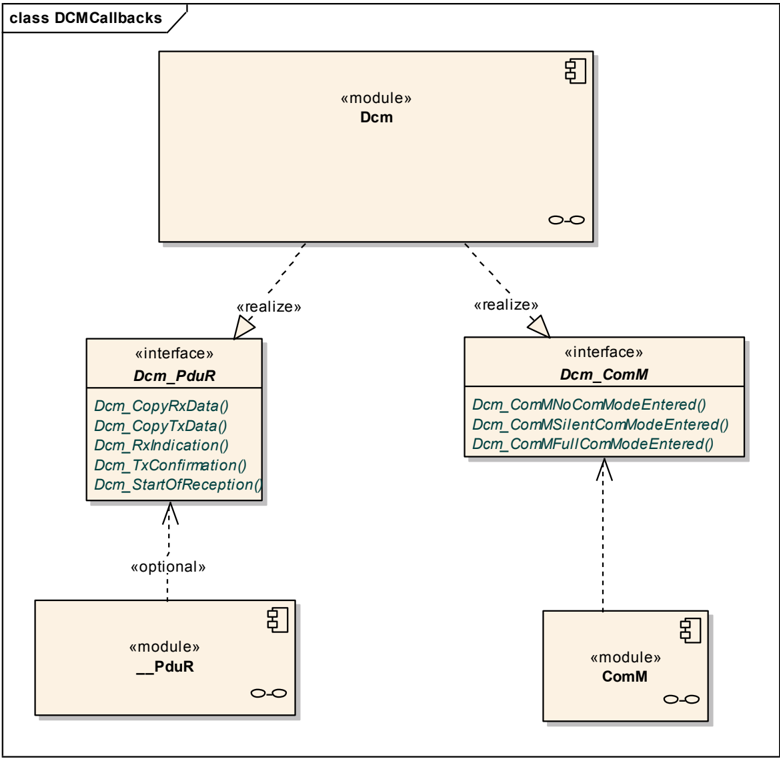

#### 7.4.1. Dcm_StartOfReception

**说明**: 在开始接收一个 N-SDU 时调用该函数。该 N-SDU 可能被分割为多个 N-PDU（带一个或多个后续 CF 的 FF），也可能由单个 N-PDU（SF）组成。如果服务成功并返回 BUFREQ_OK，则该服务提供当前可用的最大缓冲区大小。该函数可能在中断上下文中被调用。服务 ID 0x46。本服务为同步调用，可重入。参数 id（in）：I-PDU 的标识。参数 info（in）：指向 PduInfoType 结构的指针，该结构包含传输协议 I-PDU 接收的首帧或单帧的载荷数据（不含协议信息）与载荷长度，以及与该 PDU 相关的元数据。如果既无首帧/单帧数据也无元数据可用，则该参数设置为 NULL_PTR。参数 TpSduLength（in）：待接收的 N-SDU 总长度。无 inout 参数。参数 bufferSizePtr（out）：接收模块中可用的接收缓冲区。该参数将用于计算传输协议模块中的块大小（BS）。返回值：**BUFREQ_OK**：连接已被接受，bufferSizePtr 指示可用的接收缓冲区，继续接收；如果没有所请求大小的缓冲区可用，则应通过 bufferSizePtr 指示接收缓冲区大小为 0；**BUFREQ_E_NOT_OK**：连接已被拒绝，接收中止，bufferSizePtr 保持不变；**BUFREQ_E_OVFL**：无法提供所需长度的缓冲区，接收中止，bufferSizePtr 保持不变。可通过**Dcm.h**获得。

```C
BufReq_ReturnType Dcm_StartOfReception ( PduIdType id, const PduInfoType* info, PduLengthType TpSduLength, PduLengthType* bufferSizePtr )
```

通过函数 Dcm_StartOfReception，接收者（例如 **DCM**）也会被隐式告知首帧接收或单帧接收。如果函数 Dcm_StartOfReception 返回不等于 BUFREQ_OK 的返回值，则输出参数的值未作规定，调用者不应求值。

#### 7.4.2. Dcm_CopyRxData

**说明**: 调用该函数以向上层提供某个 I-PDU 段（N-PDU）的已接收数据。每次调用该函数都会提供 I-PDU 数据的下一部分。剩余缓冲区的大小写入 bufferSizePtr 所指示的位置。该函数可能在中断上下文中被调用。服务 ID 0x44。本服务为同步调用，可重入。参数 id（in）：所接收 I-PDU 的标识。参数 info（in）：提供源缓冲区（SduDataPtr）与待复制的字节数（SduLength）。SduLength 为 0 可用于查询上层模块中当前可用的缓冲区数量，此时 SduDataPtr 可以为 NULL_PTR。无 inout 参数。参数 bufferSizePtr（out）：数据复制之后可用的接收缓冲区。返回值：**BUFREQ_OK**：数据复制成功；**BUFREQ_E_NOT_OK**：由于发生错误，数据未被复制。可通过**Dcm.h**获得。

```C
BufReq_ReturnType Dcm_CopyRxData ( PduIdType id, const PduInfoType* info, PduLengthType* bufferSizePtr )
```

#### 7.4.3. Dcm_TpRxIndication

**说明**: 在通过 TP API 接收到一个 I-PDU 之后调用，结果指示该传输是否成功。该函数可能在中断上下文中被调用。服务 ID 0x45。本服务为同步调用，可重入。参数 id（in）：所接收 I-PDU 的标识；result（in）：接收的结果。无 inout 参数，无 out 参数，无返回值。可通过**Dcm.h**获得。

```C
void Dcm_TpRxIndication ( PduIdType id, Std_ReturnType result )
```

#### 7.4.4. Dcm_CopyTxData

**说明**: 调用该函数以获取某个 I-PDU 段（N-PDU）的发送数据。每次调用该函数都会提供 I-PDU 数据的下一部分，除非 retry-&gt;TpDataState 为 TP_DATARETRY；此时该函数从错误恢复所需的偏移开始重新复制数据。该函数可能在中断上下文中被调用。服务 ID 0x43。本服务为同步调用，可重入。参数 id（in）：所发送 I-PDU 的标识。参数 info（in）：提供目标缓冲区（SduDataPtr）与待复制的字节数（SduLength）。如果没有足够的发送数据可用，上层模块不复制任何数据并返回 BUFREQ_E_BUSY，下层模块可以重试该调用。SduLength 为 0 可用于指示 retry 参数中的状态变化，或查询上层模块中当前可用的数据量，此时 SduDataPtr 可以为 NULL_PTR。参数 retry（in）：该参数用于确认已发送的数据，或在传输出现问题后重传数据。如果 retry 参数为 NULL_PTR，则表明数据被复制后可立即从缓冲区中移除。否则 retry 参数必须指向有效的 RetryInfoType 元素。如果 TpDataState 指示 TP_CONFPENDING，则先前复制的数据必须保留在 TP 缓冲区中，以便进行错误恢复。TP_DATACONF 表示在本次调用之前复制的所有数据均已确认，可从 TP 缓冲区中移除；本次 API 调用所复制的数据不包含在内，将在之后被确认。TP_DATARETRY 表示本次 API 调用应复制先前已复制的数据，以便从错误中恢复，此时 TxTpDataCnt 指定从当前数据复制位置起的字节偏移。无 inout 参数。参数 availableDataPtr（out）：指示上层模块 Tx 缓冲区中剩余可用的字节数。支持动态载荷长度的 TP 模块（例如 FrIsoTp）可使用 availableDataPtr 确定后续 CF 的大小。返回值：**BUFREQ_OK**：数据已按要求完整复制到发送缓冲区；**BUFREQ_E_BUSY**：由于所需的发送数据量不可用，请求无法完成，下层模块可以稍后重试该调用，未复制任何数据；**BUFREQ_E_NOT_OK**：数据未被复制，请求失败。可通过**Dcm.h**获得。

```C
BufReq_ReturnType Dcm_CopyTxData ( PduIdType id, const PduInfoType* info, const RetryInfoType* retry, PduLengthType* availableDataPtr )
```

#### 7.4.5. Dcm_TpTxConfirmation

**说明**: 在 I-PDU 已在其网络上发送之后调用该函数，结果指示该传输是否成功。该函数可能在中断上下文中被调用。服务 ID 0x48。本服务为同步调用，可重入。参数 id（in）：所发送 I-PDU 的标识；result（in）：该 I-PDU 的传输结果。无 inout 参数，无 out 参数，无返回值。可通过**Dcm.h**获得。

```C
void Dcm_TpTxConfirmation ( PduIdType id, Std_ReturnType result )
```

#### 7.4.6. Dcm_TxConfirmation

**说明**: 下层通信接口模块确认某个 PDU 已发送，或确认某个 PDU 发送失败。该函数可能在中断上下文中被调用。服务 ID 0x40。本服务为同步调用，对不同 PduId 可重入，对相同 PduId 不可重入。参数 TxPduId（in）：已发送 PDU 的 ID；result（in）：**E_OK**：该 PDU 已发送；**E_NOT_OK**：该 PDU 发送失败。无 inout 参数，无 out 参数，无返回值。可通过**Dcm.h**获得。

```C
void Dcm_TxConfirmation ( PduIdType TxPduId, Std_ReturnType result )
```

#### 7.4.7. Dcm_ComM_NoComModeEntered

**说明**: 该调用向 **Dcm** 模块通知 **ComM** 模式已变更为 COMM_NO_COMMUNICATION。服务 ID 0x21。本服务为同步调用，可重入。参数 NetworkId（in）：该模式变更所涉及网络的标识符。无 inout 参数，无 out 参数，无返回值。可通过**Dcm_ComM.h**获得。

```C
void Dcm_ComM_NoComModeEntered ( uint8 NetworkId )
```

#### 7.4.8. Dcm_ComM_SilentComModeEntered

**说明**: 该调用向 **Dcm** 模块通知 **ComM** 模式已变更为 COMM_SILENT_COMMUNICATION。服务 ID 0x22。本服务为同步调用，可重入。参数 NetworkId（in）：该模式变更所涉及网络的标识符。无 inout 参数，无 out 参数，无返回值。可通过**Dcm_ComM.h**获得。

```C
void Dcm_ComM_SilentComModeEntered ( uint8 NetworkId )
```

#### 7.4.9. Dcm_ComM_FullComModeEntered

**说明**: 该调用向 **Dcm** 模块通知 **ComM** 模式已变更为 COMM_FULL_COMMUNICATION。服务 ID 0x23。本服务为同步调用，可重入。参数 NetworkId（in）：该模式变更所涉及网络的标识符。无 inout 参数，无 out 参数，无返回值。可通过**Dcm_ComM.h**获得。

```C
void Dcm_ComM_FullComModeEntered ( uint8 NetworkId )
```

#### 7.4.10. Dcm_CsmAsyncJobFinished

**说明**: 可在 **Csm** 完成一次异步作业处理时由 **Csm** 调用。集成方将在 **Csm** ECUC 配置中把该名称配置为异步作业的回调函数。只提供一个这样的回调，**Dcm** 通过求值 job 参数来识别已完成的作业。API 可用性：仅当 {ecuc(Dcm/[DcmDsp](#925-dcmdsp)/[DcmDspAuthentication](#9253-dcmdspauthentication)/[DcmDspAuthenticationConnection](#9255-dcmdspauthenticationconnection)} != null) 时该 API 才可用。本服务为同步调用，可重入。参数 jobId（in）：**Csm** 提供的 JobId，指示已完成的作业；result（in）：异步作业的返回值。无 inout 参数，无 out 参数，无返回值。

```C
void Dcm_CsmAsyncJobFinished ( uint32 jobId, Crypto_ResultType result )
```

#### 7.4.11. Dcm_KeyMAsyncCertificateVerifyFinished

**说明**: 可在 **KeyM** 完成一次异步证书校验时由 **KeyM** 调用。集成方将在 **KeyM** ECUC 配置中把该名称配置为异步作业的回调函数。只提供一个这样的回调，**Dcm** 通过求值 certId 参数来识别已完成校验的证书。API 可用性：仅当 {ecuc(Dcm/[DcmDsp](#925-dcmdsp)/[DcmDspAuthentication](#9253-dcmdspauthentication)/[DcmDspAuthenticationConnection](#9255-dcmdspauthenticationconnection)} != null) 时该 API 才可用。本服务为同步调用，可重入。参数 CertID（in）：已完成校验的证书标识符；Result（in）：异步作业的返回值。无 inout 参数，无 out 参数。返回值：**E_OK**：始终返回该值。

```C
Std_ReturnType Dcm_KeyMAsyncCertificateVerifyFinished ( KeyM_CertificateIdType CertID, KeyM_CertificateStatusType Result )
```

### 7.5. Callout 定义

**Callout** 是在 **ECU** 集成期间必须添加到 **Dcm** 中的代码片段。大多数 **Callout** 的内容是手写代码；对于某些 **Callout**，**Dcm** 配置工具应生成一个默认实现，由集成方手工编辑。从概念上说，这些 **Callout** 属于 **ECU** 固件。

由于 **Callout** 不是 **Dcm** 的服务，因此它们没有被分配服务 ID。

**注意：** **AUTOSAR** 架构不提供使用物理地址访问 **ECU** 存储器的可能性。该访问通过标识存储块的 BlockId 来实现。

据此，**Dcm** 无法完全支持请求物理存储器访问的 ISO 14229-1 [\[1\]](#ref-1) 服务。因此，**Dcm** 定义了 **Callout** 来实现这类存储器访问。该 **Callout** 的实现可以简单地通过定义 BlockId 与物理存储器地址之间的映射来实现。

#### 7.5.1. Dcm_ReadMemory

**说明**: **Dcm_ReadMemory** **Callout** 用于从 **UDS** 请求消息中读取由参数 memoryAddress 与 memorySize 标识的存储器数据。该服务是 **UDS** 服务 ReadMemoryByAddress 与 RequestUpload 实现所需要的。服务 ID 0x26。本服务为异步调用，不可重入。参数 OpStatus（in）：**DCM_INITIAL**、**DCM_PENDING**、**DCM_CANCEL**、**DCM_FORCE_RCRRP_OK**；MemoryIdentifier（in）：存储块的标识符（例如在需要区分存储区域时使用），**注意：** 若不使用该参数，则应将其设置为 0；MemoryAddress（in）：从中获取数据的服务器存储器起始地址；MemorySize（in）：MemoryData 中的字节数。无 inout 参数。参数 MemoryData（out）：读取的数据（指向 **DCM** 中的诊断缓冲区）；ErrorCode（out）：若操作 Dcm_ReadMemory 返回 DCM_READ_FAILED，则 **Dcm** 模块应发送一个负响应，其 NRC 码等于参数 ErrorCode 的值。返回值：**DCM_READ_OK**：读取成功；**DCM_READ_FAILED**：读取未成功；**DCM_READ_PENDING**：读取尚未结束；**DCM_READ_FORCE_RCRRP**：读取处于挂起状态，立即开始发送响应挂起。可通过**Dcm_Externals.h**获得。

```C
Dcm_ReturnReadMemoryType Dcm_ReadMemory ( Dcm_OpStatusType OpStatus, uint8 MemoryIdentifier, uint32 MemoryAddress, uint32 MemorySize, uint8* MemoryData, Dcm_NegativeResponseCodeType* ErrorCode )
```

#### 7.5.2. Dcm_WriteMemory

**说明**: **Dcm_WriteMemory** **Callout** 用于写入由参数 memoryAddress 与 memorySize 标识的存储器数据。该服务是 **UDS** 服务 WriteMemoryByAddress 与 RequestDownload 实现所需要的。服务 ID 0x27。本服务为异步调用，不可重入。参数 OpStatus（in）：**DCM_INITIAL**、**DCM_PENDING**、**DCM_CANCEL**、**DCM_FORCE_RCRRP_OK**；MemoryIdentifier（in）：存储块的标识符（例如由 WriteDataByIdentifier 服务使用），**注意：** 若不使用该参数，则应将其设置为 0；MemoryAddress（in）：数据将被复制到的服务器存储器起始地址，**注意：** 若不使用该参数（例如数据被压缩时），则应将其设置为 0；MemorySize（in）：MemoryData 中的字节数；MemoryData（in）：待写入的数据（指向 **DCM** 中的诊断缓冲区）。无 inout 参数。参数 ErrorCode（out）：若操作 Dcm_WriteMemory 返回 DCM_WRITE_FAILED，则 **Dcm** 模块应发送一个负响应，其 NRC 码等于参数 ErrorCode 的值。返回值：**DCM_WRITE_OK**：写入成功；**DCM_WRITE_FAILED**：写入未成功；**DCM_WRITE_PENDING**：写入尚未结束；**DCM_WRITE_FORCE_RCRRP**：写入处于挂起状态，立即开始发送响应挂起。可通过**Dcm_Externals.h**获得。

```C
Dcm_ReturnWriteMemoryType Dcm_WriteMemory ( Dcm_OpStatusType OpStatus, uint8 MemoryIdentifier, uint32 MemoryAddress, uint32 MemorySize, const uint8* MemoryData, Dcm_NegativeResponseCodeType* ErrorCode )
```

**注意：** **Callout** 的实现应关注以下几点：

- 在 **NVRAM** 中写入数据时，注意与镜像 **RAM** 中的数据保持一致。
- 在存储器中写入数据时，注意不会有 **SW-C** 覆盖该数据。也许应通知该 **SW-C** 此次写入。

#### 7.5.3. Dcm_SetProgConditions

**说明**: **Dcm_SetProgConditions** **Callout** 允许集成方在跳转到 **Bootloader** / 因 ECUReset 请求而跳转之前存储相关信息。上下文参数在 [Dcm_ProgConditionsType](#727-dcm_progconditionstype) 中定义。服务 ID 0x61。本服务为异步调用，不可重入。参数 OpStatus（in）：**DCM_INITIAL**、**DCM_PENDING**、**DCM_CANCEL**、**DCM_FORCE_RCRRP_OK**；ProgConditions（in）：请求跳转到 **Bootloader** 时所依据的条件。无 inout 参数，无 out 参数。返回值：**E_OK**：条件已被正确设置；**E_NOT_OK**：条件无法被设置；**DCM_E_PENDING**：条件设置正在进行中，需要再次调用该 API 以结束设置；**DCM_E_FORCE_RCRRP**：应用请求发送响应挂起（NRC 0x78）。可通过**Dcm_Externals.h**获得。

```C
Std_ReturnType Dcm_SetProgConditions ( Dcm_OpStatusType OpStatus, const Dcm_ProgConditionsType* ProgConditions )
```

**注意：** 若除 ProgConditionsType 结构之外，[SecurityAccess](#781-securityaccess) 尝试计数器还需要在应用与 **Bootloader** 之间共享，则可通过 API [Xxx_GetSecurityAttemptCounter](#7813-xxx_getsecurityattemptcounter) 获取当前值（参见§6.6.4）。

#### 7.5.4. Dcm_GetProgConditions

**说明**: **Dcm_GetProgConditions** **Callout** 在 **Dcm** 初始化时被调用，用于确定是否必须发送响应（$50 或 $51）。上下文参数在 [Dcm_ProgConditionsType](#727-dcm_progconditionstype) 中定义。服务 ID 0x62。本服务为同步调用，不可重入。无 in 参数。参数 ProgConditions（out）：请求从 **Bootloader** 跳转时所依据的条件。返回值 [Dcm_EcuStartModeType](#726-dcm_ecustartmodetype) 无定义。可通过**Dcm_Externals.h**获得。

```C
Dcm_EcuStartModeType Dcm_GetProgConditions ( Dcm_ProgConditionsType* ProgConditions )
```

#### 7.5.5. Dcm_ProcessRequestAddFile

**说明**: **Callout** 函数。当 **DCM** 以等于 0x01（AddFile）的 modeOfOperation 启动 RequestFileTransfer 过程时，应调用该函数。服务 ID 0x72。本服务为异步调用，不可重入。参数 OpStatus（in）：**DCM_INITIAL**：所有 in 参数有效；**DCM_PENDING**：所有 in 参数被设置为 0x00；**DCM_CANCEL**：所有 in 参数被设置为 0x00；**DCM_FORCE_RCRRP_OK**：所有 in 参数被设置为 0x00；filePathAndNameLength（in）：定义参数 filePathAndName 的字节长度；filePathAndName（in）：定义服务器的文件系统位置，依据参数 modeOfOperation 的不同，待添加、删除、替换或读取的文件位于该位置；此外该参数在文件路径中包含了待添加、删除、替换或读取的文件的文件名；dataFormatIdentifier（in）：该数据参数为一个单字节值，每个半字节单独编码，高半字节规定“压缩方法”（compressionMethod），低半字节规定“加密方法”（encryptingMethod），值 0x00 表示既不使用压缩方法也不使用加密方法，0x00 以外的值由整车制造商规定；fileSizeUncompressed（in）：定义待下载的未压缩文件的字节大小；fileSizeCompressed（in）：定义待下载的压缩文件的字节大小。无 inout 参数。参数 maxNumberOfBlockLength（out）：每个 TransferData 请求中所包含的最大字节数，不含 SID 与 blockSequenceCounter；ErrorCode（out）：若操作 Dcm_ProcessRequestAddFile 返回 E_NOT_OK，则 **DCM** 模块应发送一个负响应，其 NRC 码等于参数 ErrorCode 的值。返回值：**E_OK**：请求成功；**E_NOT_OK**：请求未成功；**DCM_E_PENDING**：请求尚未结束；**DCM_E_FORCE_RCRRP**：应用请求发送响应挂起（NRC 0x78）。可通过**Dcm_Externals.h**获得。

```C
Std_ReturnType Dcm_ProcessRequestAddFile ( Dcm_OpStatusType OpStatus, uint16 filePathAndNameLength, const uint8* filePathAndName, uint8 dataFormatIdentifier, uint64 fileSizeUncompressed, uint64 fileSizeCompressed, uint64* maxNumberOfBlockLength, Dcm_NegativeResponseCodeType* ErrorCode )
```

#### 7.5.6. Dcm_ProcessRequestDeleteFile

**说明**: **Callout** 函数。当 **DCM** 以等于 0x02（DeleteFile）的 modeOfOperation 启动 RequestFileTransfer 过程时，应调用该函数。服务 ID 0x73。本服务为异步调用，不可重入。参数 OpStatus（in）：**DCM_INITIAL**：所有 in 参数有效；**DCM_PENDING**、**DCM_CANCEL**、**DCM_FORCE_RCRRP_OK**：所有 in 参数被设置为 0x00；filePathAndNameLength（in）：定义参数 filePathAndName 的字节长度；filePathAndName（in）：定义服务器的文件系统位置，依据参数 modeOfOperation 的不同，待添加、删除、替换或读取的文件位于该位置；此外该参数在文件路径中包含了待添加、删除、替换或读取的文件的文件名。无 inout 参数。参数 ErrorCode（out）：若操作 Dcm_ProcessRequestDeleteFile 返回 E_NOT_OK，则 **DCM** 模块应发送一个负响应，其 NRC 码等于参数 ErrorCode 的值。返回值：**E_OK**：请求成功；**E_NOT_OK**：请求未成功；**DCM_E_PENDING**：请求尚未结束；**DCM_E_FORCE_RCRRP**：应用请求发送响应挂起（NRC 0x78）。可通过**Dcm_Externals.h**获得。

```C
Std_ReturnType Dcm_ProcessRequestDeleteFile ( Dcm_OpStatusType OpStatus, uint16 filePathAndNameLength, const uint8* filePathAndName, Dcm_NegativeResponseCodeType* ErrorCode )
```

#### 7.5.7. Dcm_ProcessRequestReplaceFile

**说明**: **Callout** 函数。当 **DCM** 以等于 0x03（ReplaceFile）的 modeOfOperation 启动 RequestFileTransfer 过程时，应调用该函数。服务 ID 0x74。本服务为异步调用，不可重入。参数 OpStatus（in）：**DCM_INITIAL**：所有 in 参数有效；**DCM_PENDING**、**DCM_CANCEL**、**DCM_FORCE_RCRRP_OK**：所有 in 参数被设置为 0x00；filePathAndNameLength（in）：定义参数 filePathAndName 的字节长度；filePathAndName（in）：定义服务器的文件系统位置，依据参数 modeOfOperation 的不同，待添加、删除、替换或读取的文件位于该位置；此外该参数在文件路径中包含了待添加、删除、替换或读取的文件的文件名；dataFormatIdentifier（in）：该数据参数为一个单字节值，每个半字节单独编码，高半字节规定“压缩方法”，低半字节规定“加密方法”，值 0x00 表示既不使用压缩方法也不使用加密方法，0x00 以外的值由整车制造商规定；fileSizeUncompressed（in）：定义待下载的未压缩文件的字节大小；fileSizeCompressed（in）：定义待下载的压缩文件的字节大小。无 inout 参数。参数 maxNumberOfBlockLength（out）：每个 TransferData 请求中所包含的最大字节数，不含 SID 与 blockSequenceCounter；ErrorCode（out）：若操作 Dcm_ProcessRequestReplaceFile 返回 E_NOT_OK，则 **DCM** 模块应发送一个负响应，其 NRC 码等于参数 ErrorCode 的值。返回值：**E_OK**：请求成功；**E_NOT_OK**：请求未成功；**DCM_E_PENDING**：请求尚未结束；**DCM_E_FORCE_RCRRP**：应用请求发送响应挂起（NRC 0x78）。可通过**Dcm_Externals.h**获得。

```C
Std_ReturnType Dcm_ProcessRequestReplaceFile ( Dcm_OpStatusType OpStatus, uint16 filePathAndNameLength, const uint8* filePathAndName, uint8 dataFormatIdentifier, uint64 fileSizeUncompressed, uint64 fileSizeCompressed, uint64* maxNumberOfBlockLength, Dcm_NegativeResponseCodeType* ErrorCode )
```

#### 7.5.8. Dcm_ProcessRequestReadFile

**说明**: **Callout** 函数。当 **DCM** 以等于 0x04（ReadFile）的 modeOfOperation 启动 RequestFileTransfer 过程时，应调用该函数。服务 ID 0x75。本服务为异步调用，不可重入。参数 OpStatus（in）：**DCM_INITIAL**：所有 in 参数有效；**DCM_PENDING**、**DCM_CANCEL**、**DCM_FORCE_RCRRP_OK**：所有 in 参数被设置为 0x00；filePathAndNameLength（in）：定义参数 filePathAndName 的字节长度；filePathAndName（in）：定义服务器的文件系统位置，依据参数 modeOfOperation 的不同，待添加、删除、替换或读取的文件位于该位置；此外该参数在文件路径中包含了待添加、删除、替换或读取的文件的文件名；dataFormatIdentifier（in）：该数据参数为一个单字节值，每个半字节单独编码，高半字节规定“压缩方法”，低半字节规定“加密方法”，值 0x00 表示既不使用压缩方法也不使用加密方法，0x00 以外的值由整车制造商规定。无 inout 参数。参数 fileSizeUncompressed（out）：定义待上传的未压缩文件的字节大小；fileSizeCompressed（out）：定义待上传的压缩文件的字节大小；maxNumberOfBlockLength（out）：每个 TransferData 响应中所包含的最大字节数，不含 SID 与 blockSequenceCounter；ErrorCode（out）：若操作 Dcm_ProcessRequestReadFile 返回 E_NOT_OK，则 **DCM** 模块应发送一个负响应，其 NRC 码等于参数 ErrorCode 的值。返回值：**E_OK**：请求成功；**E_NOT_OK**：请求未成功；**DCM_E_PENDING**：请求尚未结束；**DCM_E_FORCE_RCRRP**：应用请求发送响应挂起（NRC 0x78）。可通过**Dcm_Externals.h**获得。

```C
Std_ReturnType Dcm_ProcessRequestReadFile ( Dcm_OpStatusType OpStatus, uint16 filePathAndNameLength, const uint8* filePathAndName, uint8 dataFormatIdentifier, uint64 fileSizeUncompressed, uint64 fileSizeCompressed, uint64* maxNumberOfBlockLength, Dcm_NegativeResponseCodeType* ErrorCode )
```

#### 7.5.9. Dcm_ProcessRequestReadDir

**说明**: **Callout** 函数。当 **DCM** 以等于 0x05（ReadDir）的 modeOfOperation 启动 RequestFileTransfer 过程时，应调用该函数。服务 ID 0x76。本服务为异步调用，不可重入。参数 OpStatus（in）：**DCM_INITIAL**：所有 in 参数有效；**DCM_PENDING**、**DCM_CANCEL**、**DCM_FORCE_RCRRP_OK**：所有 in 参数被设置为 0x00；filePathAndNameLength（in）：定义参数 filePathAndName 的字节长度；filePathAndName（in）：定义服务器的文件系统位置，依据参数 modeOfOperation 的不同，待添加、删除、替换或读取的文件位于该位置；此外该参数在文件路径中包含了待添加、删除、替换或读取的文件的文件名。无 inout 参数。参数 dirInfoLength（out）：定义待上传的目录信息的字节大小；maxNumberOfBlockLength（out）：每个 TransferData 请求中所包含的最大字节数，不含 SID 与 blockSequenceCounter；ErrorCode（out）：若操作 Dcm_ProcessRequestReadDir 返回 E_NOT_OK，则 **DCM** 模块应发送一个负响应，其 NRC 码等于参数 ErrorCode 的值。返回值：**E_OK**：请求成功；**E_NOT_OK**：请求未成功；**DCM_E_PENDING**：请求尚未结束；**DCM_E_FORCE_RCRRP**：应用请求发送响应挂起（NRC 0x78）。可通过**Dcm_Externals.h**获得。

```C
Std_ReturnType Dcm_ProcessRequestReadDir ( Dcm_OpStatusType OpStatus, uint16 filePathAndNameLength, const uint8* filePathAndName, uint64* dirInfoLength, uint64* maxNumberOfBlockLength, Dcm_NegativeResponseCodeType* ErrorCode )
```

#### 7.5.10. Dcm_WriteFile

**说明**: **Callout** 函数。当存在由 0x01（AddFile）或 0x03（ReplaceFile）启动的、正在进行的 RequestFileTransfer 过程，并通过 **UDS** 服务 TransferData 接收到数据时，**DCM** 应调用该函数。本服务为异步调用，不可重入。参数 OpStatus（in）：**DCM_INITIAL**：所有 in 参数有效；**DCM_PENDING**、**DCM_CANCEL**、**DCM_FORCE_RCRRP_OK**：所有 in 参数被设置为 0x00；DataLength（in）：定义参数 Data 的字节长度，该值不会超过、但可能小于 Dcm_ProcessRequestFileTransfer 中返回的 maxNumberOfBlockLength 的值；Data（in）：指向待写入数据的指针。无 inout 参数。参数 ErrorCode（out）：若操作 Dcm_WriteFile 返回 E_NOT_OK，则 **DCM** 模块应发送一个负响应，其 NRC 码等于参数 ErrorCode 的值。返回值：**E_OK**：请求成功；**E_NOT_OK**：请求未成功；**DCM_E_PENDING**：请求尚未结束；**DCM_E_FORCE_RCRRP**：应用请求发送响应挂起（NRC 0x78）。可通过**Dcm_Externals.h**获得。

```C
Std_ReturnType Dcm_WriteFile ( Dcm_OpStatusType OpStatus, uint64 DataLength, uint8* Data, Dcm_NegativeResponseCodeType* ErrorCode )
```

#### 7.5.11. Dcm_ReadFileOrDir

**说明**: **Callout** 函数。当存在由 0x04（ReadFile）或 0x05（ReadDir）启动的、正在进行的 RequestFileTransfer 过程，并且需要将数据作为 **UDS** 服务 TransferData 的响应发送时，**DCM** 应调用该函数。服务 ID 0x78。本服务为异步调用，不可重入。参数 OpStatus（in）：**DCM_INITIAL**：所有 in 参数有效；**DCM_PENDING**、**DCM_CANCEL**、**DCM_FORCE_RCRRP_OK**：所有 in 参数被设置为 0x00；Data（in）：指向待写入数据的指针。参数 DataLength（inout）：作为 in 时，该参数定义要使用的最大块长度，即 RequestFileTransfer 响应中发送给测试仪的 maxNumberOfBlockLength 的值；作为 out 时，该参数定义参数 Data 的实际字节长度，该值不应超过、但可能小于作为 in 参数提供的值。参数 ErrorCode（out）：若操作 Dcm_ReadFileOrDir 返回 E_NOT_OK，则 **DCM** 模块应发送一个负响应，其 NRC 码等于参数 ErrorCode 的值。返回值：**E_OK**：请求成功；**E_NOT_OK**：请求未成功；**DCM_E_PENDING**：请求尚未结束；**DCM_E_FORCE_RCRRP**：应用请求发送响应挂起（NRC 0x78）。可通过**Dcm_Externals.h**获得。

```C
Std_ReturnType Dcm_ReadFileOrDir ( Dcm_OpStatusType OpStatus, uint64* DataLength, uint8* Data, Dcm_NegativeResponseCodeType* ErrorCode )
```

#### 7.5.12. UploadDownloadServices

从 **DCM** 的角度看，这些操作具有以下函数签名。

##### 7.5.12.1. Dcm_ProcessRequestDownload

**说明**: **Callout** 函数。**DCM** 应调用该 **Callout** 函数以启动一个下载过程。该服务是 **UDS** 服务 RequestDownload 实现所需要的。服务 ID 0x30。本服务为异步调用，不可重入。参数 OpStatus（in）：**DCM_INITIAL**、**DCM_PENDING**、**DCM_CANCEL**；DataFormatIdentifier（in）：位 7-4 为压缩方法（0x0：未压缩；0x1..F：整车制造商特定），位 3-0 为加密方法（0x0：未加密；0x1..F：整车制造商特定）；MemoryIdentifier（in）：存储块的标识符，若不使用该参数则应设置为 0；MemoryAddress（in）：数据将被写入的服务器存储器起始地址；MemorySize（in）：以字节为单位的未压缩存储器大小。参数 BlockLength（inout）：单次 [Dcm_WriteMemory](#752-dcm_writememory) 的最大字节数。参数 ErrorCode（out）：若操作 Dcm_ProcessRequestDownload 返回 E_NOT_OK，则 **DCM** 模块应发送一个负响应，其 NRC 码等于参数 ErrorCode 的值。返回值：**E_OK**：请求成功；**E_NOT_OK**：请求未成功；**DCM_E_PENDING**：请求尚未结束。可通过**Dcm_Externals.h**获得。

```C
Std_ReturnType Dcm_ProcessRequestDownload ( Dcm_OpStatusType OpStatus, uint8 DataFormatIdentifier, uint8 MemoryIdentifier, uint32 MemoryAddress, uint32 MemorySize, uint32* BlockLength, Dcm_NegativeResponseCodeType* ErrorCode )
```

##### 7.5.12.2. Dcm_ProcessRequestTransferExit

**说明**: **Callout** 函数。**DCM** 应调用该 **Callout** 函数以终止一个下载或上传过程。该 **Callout** 是 **UDS** 服务 RequestTransferExit 实现所需要的。服务 ID 0x32。本服务为异步调用，不可重入。参数 OpStatus（in）：**DCM_INITIAL**、**DCM_PENDING**、**DCM_CANCEL**；transferRequestParameterRecord（in）：指向整车制造商特定的 transferRequestParameterRecord 的指针；transferRequestParameterRecordSize（in）：ParameterRecord 的字节长度。参数 transferResponseParameterRecordSize（inout）：函数被调用时，该参数包含可写入缓冲区的最大数据字节数；函数在 transferResponseParameterRecord 中返回实际写入的数据字节数。参数 transferResponseParameterRecord（out）：指向整车制造商特定的 transferResponseParameterRecord 的指针；ErrorCode（out）：见下文。返回值：**E_OK**：传输成功；**E_NOT_OK**：传输未成功，或响应缓冲区过小；**DCM_E_PENDING**：传输尚未结束。可通过**Dcm_Externals.h**获得。

```C
Std_ReturnType Dcm_ProcessRequestTransferExit ( Dcm_OpStatusType OpStatus, const uint8* transferRequestParameterRecord, uint32 transferRequestParameterRecordSize, const uint8* transferResponseParameterRecord, uint32* transferResponseParameterRecordSize, Dcm_NegativeResponseCodeType* ErrorCode )
```

##### 7.5.12.3. Dcm_ProcessRequestUpload

**说明**: **Callout** 函数。**DCM** 应调用该 **Callout** 函数以启动一个上传过程。该服务是 **UDS** 服务 RequestUpload 实现所需要的。服务 ID 0x31。本服务为异步调用，不可重入。参数 OpStatus（in）：**DCM_INITIAL**、**DCM_PENDING**、**DCM_CANCEL**、**DCM_FORCE_RCRRP_OK**；DataFormatIdentifier（in）：位 7-4 为压缩方法（0x0：未压缩；0x1..F：整车制造商特定），位 3-0 为加密方法（0x0：未加密；0x1..F：整车制造商特定）；MemoryIdentifier（in）：存储块的标识符，若不使用该参数则应设置为 0；MemoryAddress（in）：数据将被复制的服务器存储器起始地址；MemorySize（in）：以字节为单位的未压缩存储器大小。参数 BlockLength（inout）：单次 [Dcm_ReadMemory](#751-dcm_readmemory) 的最大字节数。参数 ErrorCode（out）：若操作 Dcm_ProcessRequestUpload 返回 E_NOT_OK，则 **DCM** 模块应发送一个负响应，其 NRC 码等于参数 ErrorCode 的值。返回值：**E_OK**：请求成功；**E_NOT_OK**：请求未成功；**DCM_E_PENDING**：请求尚未结束。可通过**Dcm_Externals.h**获得。

```C
Std_ReturnType Dcm_ProcessRequestUpload ( Dcm_OpStatusType OpStatus, uint8 DataFormatIdentifier, uint8 MemoryIdentifier, uint32 MemoryAddress, uint32 MemorySize, uint32* BlockLength, Dcm_NegativeResponseCodeType* ErrorCode )
```

##### 7.5.12.4. Dcm_ProcessTransferDataRead

**说明**: **ProcessTransferDataRead** **Callout** 用于从 **UDS** 请求消息中请求由参数 memoryAddress 与 memorySize 标识的存储器数据。该服务是 **UDS** 服务 ReadMemoryByAddress、RequestUpload、ReadDataByIdentifier（在由存储器地址定义动态 **DID** 的情况下）与 TransferData 实现所需要的。服务 ID 0x26。本服务为异步调用，不可重入。参数 OpStatus（in）：**DCM_INITIAL**、**DCM_PENDING**、**DCM_CANCEL**、**DCM_FORCE_RCRRP_OK**；MemoryIdentifier（in）：存储块的标识符（例如在需要区分存储区域时使用），**注意：** 若不使用该参数，则应将其设置为 0；MemoryAddress（in）：从中获取数据的服务器存储器起始地址；MemorySize（in）：MemoryData 中的字节数。无 inout 参数。参数 MemoryData（out）：读取的数据（指向 **DCM** 中的诊断缓冲区）；ErrorCode（out）：若操作 [Dcm_ReadMemory](#751-dcm_readmemory) 返回 DCM_READ_FAILED，则 **Dcm** 模块应发送一个负响应，其 NRC 码等于参数 ErrorCode 的值。返回值：**DCM_READ_OK**：读取成功；**DCM_READ_FAILED**：读取未成功；**DCM_READ_PENDING**：读取尚未结束；**DCM_READ_FORCE_RCRRP**：读取处于挂起状态，立即开始发送响应挂起。可通过**Dcm_Externals.h**获得。

```C
Dcm_ReturnReadMemoryType Dcm_ProcessTransferDataRead ( Dcm_OpStatusType OpStatus, uint8 MemoryIdentifier, uint32 MemoryAddress, uint32 MemorySize, Dcm_RequestDataArrayType MemoryData, Dcm_NegativeResponseCodeType* ErrorCode )
```

##### 7.5.12.5. Dcm_ProcessTransferDataWrite

**说明**: **ProcessTransferDataWrite** **Callout** 用于写入由参数 memoryAddress 与 memorySize 标识的存储器数据。该服务是 **UDS** 服务 WriteMemoryByAddress、RequestDownload 与 TransferData 实现所需要的。服务 ID 0x27。本服务为异步调用，不可重入。参数 OpStatus（in）：**DCM_INITIAL**、**DCM_PENDING**、**DCM_CANCEL**、**DCM_FORCE_RCRRP_OK**；MemoryIdentifier（in）：存储块的标识符（例如由 WriteDataByIdentifier 服务使用），**注意：** 若不使用该参数，则应将其设置为 0；MemoryAddress（in）：数据将被复制到的服务器存储器起始地址，**注意：** 若不使用该参数（例如数据被压缩时），则应将其设置为 0；MemorySize（in）：MemoryData 中的字节数；MemoryData（in）：待写入的数据（指向 **DCM** 中的诊断缓冲区）。无 inout 参数。参数 ErrorCode（out）：若操作 [Dcm_WriteMemory](#752-dcm_writememory) 返回 DCM_WRITE_FAILED，则 **Dcm** 模块应发送一个负响应，其 NRC 码等于参数 ErrorCode 的值。返回值：**DCM_WRITE_OK**：写入成功；**DCM_WRITE_FAILED**：写入未成功；**DCM_WRITE_PENDING**：写入尚未结束；**DCM_WRITE_FORCE_RCRRP**：写入处于挂起状态，立即开始发送响应挂起。可通过**Dcm_Externals.h**获得。

```C
Dcm_ReturnWriteMemoryType Dcm_ProcessTransferDataWrite ( Dcm_OpStatusType OpStatus, uint8 MemoryIdentifier, uint32 MemoryAddress, uint32 MemorySize, const Dcm_RequestDataArrayType MemoryData, Dcm_NegativeResponseCodeType* ErrorCode )
```

### 7.6. 调度函数

这些函数由基础软件调度器直接调用。以下函数应没有返回值、没有参数。所有函数应不可重入。

#### 7.6.1. Dcm_MainFunction

**说明**: 该服务用于处理主循环的任务。服务 ID 0x25。本服务为同步调用，不可重入。无参数，无返回值。可通过**SchM_Dcm.h**获得。

```C
void Dcm_MainFunction ( void )
```

### 7.7. 预期接口

本章列出从其他模块需要的所有接口。

#### 7.7.1. 强制接口

本节定义为实现模块核心功能所需的所有接口。

表7.31：**Dcm** 模块中强制接口的定义（**Definition of mandatory interfaces in module Dcm**）

| 功能接口 | 头文件 | 描述 |
|---|---|---|
| ComM_DCM_ActiveDiagnostic | ComM_Dcm.h | 由 **DCM** 指示活动诊断。 |
| ComM_DCM_InactiveDiagnostic | ComM_Dcm.h | 由 **DCM** 指示非活动诊断。 |
| PduR_DcmTransmit | PduR_Dcm.h | 请求发送一个 PDU。 |

#### 7.7.2. 可选接口

本节定义为实现模块可选功能所需的所有接口。

表7.32：**Dcm** 模块中可选接口的定义（**Definition of optional interfaces in module Dcm**）

| 功能接口 | 头文件 | 描述 |
|---|---|---|
| BndM_GetBlockPtr_&lt;Block Id.Shortname&gt; | BndM_Externals.h | - |
| BndM_WriteBlock_&lt;Block Id.Shortname&gt; | BndM_Externals.h | 将数据持久化到闪存中，以便之后可通过 BndM_GetBlockPtr API 直接访问。写入需要一段时间，并在成功回调 xxx_BndMWriteBlockFinish 之后结束。 |
| BndM_WriteCancel | BndM.h | 取消写入。 |
| BndM_WriteFinalize | BndM.h | 触发写入阶段的结束。异步处理结束时将触发回调 xxx_BndMWriteFinalizeFinish，并包含该操作的结果。 |
| BndM_WriteStart | BndM.h | 触发写入阶段的开始。异步处理结束时将触发回调 xxx_BndMWriteStartFinish，并包含该操作的结果。 |
| BswM_Dcm_ApplicationUpdated | BswM_Dcm.h | **DCM** 调用该函数以报告应用已更新。 |
| BswM_Dcm_CommunicationMode_CurrentState | BswM_Dcm.h | **DCM** 调用该函数以向 **BswM** 通知通信模式的当前状态。 |
| Dem_ClearDTC | Dem.h | 清除单个 **DTC** 以及 **DTC** 组。 |
| Dem_DcmGetAvailableOBDMIDs | Dem_Dcm.h | 在收到服务 $06 请求时，向 **DCM** 报告所请求的“可用性 OBDMID”的值。测试仪据此显示维修人员可选择的受支持测试。该 API 仅在 OBD 相关的 **ECU** 中需要。API 可用性：仅当 {ecuc(Dem/DemGeneral.DemOBDSupport)} != DEM_OBD_NO_OBD_SUPPORT 时该 API 才可用。 |
| Dem_DcmGetDTCOfOBDFreezeFrame | Dem_Dcm.h | 按冻结帧记录号获取 **DTC**。该 API 仅在 OBD 相关的 **ECU** 中需要。API 可用性：仅当 {ecuc(Dem/DemGeneral.DemOBDSupport)} != DEM_OBD_NO_OBD_SUPPORT 时该 API 才可用。 |
| Dem_DcmGetDTRData | Dem_Dcm.h | 报告 **DTR** 数据以及 TID 值、UaSID、带上下限的测试结果。该 API 仅在 OBD 相关的 **ECU** 中需要。API 可用性：仅当 {ecuc(Dem/DemGeneral.DemOBDSupport)} != DEM_OBD_NO_OBD_SUPPORT 时该 API 才可用。 |
| Dem_DcmGetNumTIDsOfOBDMID | Dem_Dcm.h | 获取每个（功能）OBDMID 的 TID 数量。**DCM** 可用其在循环中从 0…numberOfTIDs-1 迭代请求 OBD/TID 结果数据。该 API 仅在 OBD 相关的 **ECU** 中需要。API 可用性：仅当 {ecuc(Dem/DemGeneral.DemOBDSupport)} != DEM_OBD_NO_OBD_SUPPORT 时该 API 才可用。 |
| Dem_DcmReadDataOfOBDFreezeFrame | Dem_Dcm.h | 按 PID 与索引获取为服务 $02 输出所选的最重要冻结帧的数据元素。该函数将数据存储在所提供的 DestBuffer 中。该 API 仅在 OBD 相关的 **ECU** 中需要。API 可用性：仅当 {ecuc(Dem/DemGeneral.DemOBDSupport)} != DEM_OBD_NO_OBD_SUPPORT 时该 API 才可用。 |
| Dem_DisableDTCRecordUpdate | Dem.h | 禁用某个特定 **DTC** 的事件存储器更新（同时仅能禁用一个）。 |
| Dem_DisableDTCSetting | Dem.h | 为分配给所寻址客户端 DemEventMemorySet 的所有 **DTC** 禁用 **DTC** 设置。 |
| Dem_EnableDTCRecordUpdate | Dem.h | 启用此前由 Dem_DisableDTCRecordUpdate() 禁用的 **DTC** 的事件存储器更新。**注意：** 由于对 Dem_EnableDTCRecordUpdate 的调用是禁用/启用 **DTC** 序列中的最后一个动作，调用者并不关心返回值。因此即使该 **DTC** 被异步启用，也应返回 E_OK。 |
| Dem_EnableDTCSetting | Dem.h | （重新）为分配给所寻址客户端 DemEventMemorySet 的所有 **DTC** 启用 **DTC** 设置。 |
| Dem_GetDTCByOccurrenceTime | Dem.h | 按发生时间获取 **DTC**。由于来源始终为 DEM_DTC_ORIGIN_PRIMARY_MEMORY，因此没有针对 **DTC** 来源的显式参数。 |
| Dem_GetDTCSeverityAvailabilityMask | Dem.h | 获取 **DTC** 严重性可用性掩码。 |
| Dem_GetDTCStatusAvailabilityMask | Dem.h | 获取所选故障存储器的 **DTC** 状态可用性掩码。 |
| Dem_GetFunctionalUnitOfDTC | Dem.h | 获取所请求 **DTC** 的功能单元。 |
| Dem_GetNextExtendedDataRecord | Dem.h | 获取由 Dem_SelectExtendedDataRecord 所选 **DTC** 的扩展数据记录。该函数将数据存储在所提供的 DestBuffer 中。 |
| Dem_GetNextFilteredDTC | Dem.h | 获取满足过滤条件的下一个已过滤 **DTC**。对于 **UDS** 服务，该接口具有异步行为，因为需要处理大量 **DTC**。 |
| Dem_GetNextFilteredDTCAndFDC | Dem.h | 获取满足过滤条件的下一个已过滤 **DTC** 及其关联的故障检测计数器（**FDC**）。该接口具有异步行为，因为需要处理大量 **DTC**，并且 **FDC** 也可能从 **SW-C** 异步获得。 |
| Dem_GetNextFilteredDTCAndSeverity | Dem.h | 获取满足过滤条件的下一个已过滤 **DTC** 及其关联的严重性。该接口具有异步行为，因为需要处理大量 **DTC**。 |
| Dem_GetNextFilteredRecord | Dem.h | 获取事件存储器中存储的下一个冻结帧记录号及其关联的 **DTC**。该接口具有异步行为，因为可能需要访问 **NvRAM**。 |
| Dem_GetNextFreezeFrameData | Dem.h | 获取由 Dem_SelectFreezeFrameData 所选 **DTC** 的冻结帧数据。该函数将数据存储在所提供的 DestBuffer 中。 |
| Dem_GetNumberOfFilteredDTC | Dem.h | 获取已过滤 **DTC** 的数量。 |
| Dem_GetNumberOfFreezeFrameRecords | Dem.h | 该函数返回主事件存储器中当前存储的所有冻结帧记录的数量。 |
| Dem_GetSeverityOfDTC | Dem.h | 获取所请求 **DTC** 的严重性。对于大型配置与 **DTC** 标定，该接口的行为可以是异步的（将 **DTC** 搜索拆分为多个片段）。 |
| Dem_GetSizeOfExtendedDataRecordSelection | Dem.h | 获取由调用 Dem_SelectExtendedDataRecord 所选 **DTC** 的扩展数据记录的大小。 |
| Dem_GetSizeOfFreezeFrameSelection | Dem.h | 获取由调用 Dem_SelectFreezeFrameData 所选 **DTC** 的冻结帧数据的大小。 |
| Dem_GetStatusOfDTC | Dem.h | 获取某个 **DTC** 的状态。对于大型配置与 **DTC** 标定，该接口的行为可以是异步的（将 **DTC** 搜索拆分为多个片段）。OBD 事件抑制的 **DTC** 应被报告为 Dem_WRONG_DTC。 |
| Dem_GetTranslationType | Dem.h | 获取 **ECU** 所支持的 **DTC** 格式。所支持的格式通过 DemTypeOfDTCSupported 配置。 |
| Dem_SetDTCFilter | Dem.h | 设置 **DTC** 过滤器。服务器应在参数 DTCStatusMask 与服务器中的当前 **UDS** 状态之间执行按位逻辑与运算。除 DTCStatusAvailabilityMask 之外，服务器应返回所有按位与运算结果非零的 **DTC**［即 (statusOfDTC &amp; DTCStatusMask) != 0］。服务器应仅处理其支持的 **DTC** 状态位。该计算应忽略 OBD 事件抑制。若服务器中没有 **DTC** 匹配客户端请求中规定的掩码条件，则在肯定响应消息中 DTCStatusAvailabilityMask 字节之后不应提供任何 **DTC** 或状态信息（((statusOfDTC &amp; DTCStatusMask) != 0) &amp;&amp; ((severity &amp; DTCSeverityMask) != 0)) == TRUE）。 |
| Dem_SetFreezeFrameRecordFilter | Dem.h | 设置冻结帧记录过滤器。 |
| Det_ReportError | Det.h | 用于报告开发错误的服务。 |
| IdsM_SetSecurityEvent | IdsM.h | 该 API 是向 **IdsM** 报告安全事件的应用接口。 |
| IdsM_SetSecurityEventWithContextData | IdsM.h | 该 API 是向 **IdsM** 报告带上下文数据的安全事件的应用接口。 |
| IoHwAb_Dcm_&lt;EcuSignalName&gt; | IoHwAb_Dcm.h | 该函数向 **DCM** 模块提供对某个 **ECU** 信号的控制访问（&lt;EcuSignalname&gt; 为 **ECU** 信号的符号名）。该函数可以锁定与解锁 **ECU** 信号。锁定会将 **ECU** 信号“冻结”为当前值、所配置的默认值或参数 signal 给定的值。 |
| IoHwAb_Dcm_Read&lt;EcuSignalName&gt; | IoHwAb_Dcm.h | 该函数向 **DCM** 模块提供对某个 **ECU** 信号的读取访问（&lt;EcuSignalname&gt; 为 **ECU** 信号的符号名）。 |
| NvM_ReadBlock | NvM.h | 将 NV 块的数据复制到其对应 RAM 块的服务。 |
| NvM_SetRamBlockStatus | NvM.h | 用于设置永久 RAM 块的 RAM 块状态，或设置 **NVRAM** 块的显式同步状态的服务。 |
| NvM_WriteBlock | NvM.h | 将 RAM 块的数据复制到其对应 NV 块的服务。 |
| PduR_DcmCancelReceive | PduR_Dcm.h | 请求取消下层传输协议模块中正在进行的 PDU 接收。 |
| PduR_DcmCancelTransmit | PduR_Dcm.h | 请求取消下层通信模块中正在进行的 PDU 发送。 |
| SchM_ActMainFunction_Dcm | &lt;none&gt; | 调用 SchM_ActMainFunction 函数以触发相应主处理函数的激活。 |

仅当配置了 OBD 服务 $02 时才需要 Dem_DcmReadDataOfOBDFreezeFrame（参见配置参数 DcmDsdSidTabServiceId）。

### 7.8. 可配置接口

本节定义由 **Dcm** 配置确定 **Dcm** 实际所用函数的接口。根据配置的不同，这些函数的实现可以由其他 **BSW** 模块（通常为 **DEM**）提供，也可以由软件组件（通过 **RTE**）提供。

#### 7.8.1. SecurityAccess

从 **DCM** 的角度看，该操作具有以下函数签名。

##### 7.8.1.1. Xxx_GetSeed

若存在 DcmDspSecurityADRSize，则使用以下定义。

**说明**: 向应用请求异步提供种子值。服务 ID 0x44。本服务为异步调用，不可重入。参数 SecurityAccessDataRecord（in）：该数据记录包含用于计算种子值的附加数据，该参数的大小为 DcmDspSecurityADRSize，至少为“1”；OpStatus（in）：当前操作的状态。无 inout 参数。参数 Seed（out）：用于提供种子值的指针；ErrorCode（out）：若操作 Xxx_GetSeed 返回 E_NOT_OK，则 **DCM** 模块应发送一个负响应，其 NRC 码等于参数 ErrorCode 的值。返回值：**E_OK**：请求成功；**E_NOT_OK**：请求未成功；**DCM_E_PENDING**：请求尚未结束，需要进一步调用以结束。可通过**Dcm_Externals.h**获得。

```C
Std_ReturnType Xxx_GetSeed ( const uint8* SecurityAccessDataRecord, Dcm_OpStatusType OpStatus, uint8* Seed, Dcm_NegativeResponseCodeType* ErrorCode )
```

若不存在 DcmDspSecurityADRSize，则使用以下定义。

**说明**: 向应用请求异步提供种子值。服务 ID 0x45。本服务为异步调用，不可重入。参数 OpStatus（in）：当前操作的状态。无 inout 参数。参数 Seed（out）：用于提供种子值的指针；ErrorCode（out）：若操作 Xxx_GetSeed 返回 E_NOT_OK，则 **DCM** 模块应发送一个负响应，其 NRC 码等于参数 ErrorCode 的值。返回值：**E_OK**：请求成功；**E_NOT_OK**：请求未成功；**DCM_E_PENDING**：请求尚未结束，需要进一步调用以结束。可通过**Dcm_Externals.h**获得。

```C
Std_ReturnType Xxx_GetSeed ( Dcm_OpStatusType OpStatus, uint8* Seed, Dcm_NegativeResponseCodeType* ErrorCode )
```

##### 7.8.1.2. Xxx_CompareKey

**说明**: 向应用请求异步比较密钥（DcmDspSecurityUsePort = USE_ASYNCH_CLIENT_SERVER）。服务 ID 0x47。本服务为异步调用，不可重入。参数 Key（in）：待比较的密钥；OpStatus（in）：当前操作的状态。无 inout 参数。参数 ErrorCode（out）：若返回 E_NOT_OK 则待发送的 NRC。返回值：**E_OK**：请求成功；**E_NOT_OK**：请求未成功；**DCM_E_PENDING**：请求尚未结束，需要进一步调用以结束；**DCM_E_COMPARE_KEY_FAILED**：密钥不匹配。可通过**Dcm_Externals.h**获得。

```C
Std_ReturnType Xxx_CompareKey ( const uint8* Key, Dcm_OpStatusType OpStatus, Dcm_NegativeResponseCodeType* ErrorCode )
```

##### 7.8.1.3. Xxx_GetSecurityAttemptCounter

**说明**: 从应用读取特定安全等级的尝试计数器。服务 ID 0x59。本服务为异步调用，不可重入。参数 OpStatus（in）：**DCM_INITIAL**、**DCM_PENDING**、**DCM_CANCEL**。无 inout 参数。参数 AttemptCounter（out）：该安全等级的尝试计数器。返回值：**E_OK**：请求成功；**E_NOT_OK**：请求未成功；**DCM_E_PENDING**：请求尚未结束，需要进一步调用以结束。可通过**Dcm_Externals.h**获得。

```C
Std_ReturnType Xxx_GetSecurityAttemptCounter ( Dcm_OpStatusType OpStatus, uint8* AttemptCounter )
```

**注意：** 若 [SecurityAccess](#781-securityaccess) 尝试计数器需要在应用与 **Bootloader** 之间共享，则应用需在调用 API Xxx_GetSecurityAttemptCounter 时考虑这一点（参见§6.6.4）。此外，这对安全延时定时器也有影响，需要一并考虑。

##### 7.8.1.4. Xxx_SetSecurityAttemptCounter

**说明**: 在应用中设置特定安全等级的尝试计数器。服务 ID 0x5a。本服务为异步调用，不可重入。参数 OpStatus（in）：**DCM_INITIAL**、**DCM_PENDING**、**DCM_CANCEL**；AttemptCounter（in）：该安全等级的尝试计数器。无 inout 参数，无 out 参数。返回值：**E_OK**：请求成功；**E_NOT_OK**：请求未成功；**DCM_E_PENDING**：请求尚未结束，需要进一步调用以结束。可通过**Dcm_Externals.h**获得。

```C
Std_ReturnType Xxx_SetSecurityAttemptCounter ( Dcm_OpStatusType OpStatus, uint8 AttemptCounter )
```

#### 7.8.2. DataServices

从 **DCM** 的角度看，这些操作具有以下函数签名。

**注意：** OpStatus 参数仅存在于异步操作中（若 DcmDspDataUsePort 设置为 USE_DATA_ASYNCH_CLIENT_SERVER、USE_DATA_ASYNCH_CLIENT_SERVER_ERROR、USE_DATA_ASYNCH_FNC、USE_DATA_ASYNCH_FNC_ERROR 或 USE_DATA_ASYNCH_FNC_PROXY）。在同步操作中（DcmDspDataUsePort 设置为 USE_DATA_SYNCH_CLIENT_SERVER、USE_DATA_SYNCH_FNC 或 USE_DATA_SYNCH_FNC_PROXY），不存在 OpStatus 参数。

##### 7.8.2.1. Xxx_ReadData

若 DcmDspDataUsePort 设置为 USE_DATA_SYNCH_CLIENT_SERVER 或 USE_DATA_SYNCH_FNC，则使用以下定义。

**说明**: 若 DcmDspDataUsePort 设置为 USE_DATA_SYNCH_CLIENT_SERVER，该函数向应用请求某个 **DID**/**PID** 的数据值。服务 ID 0x34。本服务为同步调用，不可重入。无 in 参数，无 inout 参数。参数 Data（out）：所请求数据应被复制到的缓冲区。返回值：**E_OK**：始终返回该值。可通过**Dcm_Externals.h**获得。

```C
Std_ReturnType Xxx_ReadData ( uint8* Data )
```

若 DcmDspDataUsePort 设置为 USE_DATA_ASYNCH_CLIENT_SERVER 或 USE_DATA_ASYNCH_FNC，则使用以下定义。

**说明**: 若 DcmDspDataUsePort 设置为 USE_DATA_ASYNCH_CLIENT_SERVER，该函数向应用请求某个 **DID**/**PID** 的数据值。服务 ID 0x3b。本服务为异步调用，不可重入。参数 OpStatus（in）：当前操作的状态。无 inout 参数。参数 Data（out）：所请求数据应被复制到的缓冲区。返回值：**E_OK**：请求成功；**DCM_E_PENDING**：请求尚未结束，需要进一步调用以结束。可通过**Dcm_Externals.h**获得。

```C
Std_ReturnType Xxx_ReadData ( Dcm_OpStatusType OpStatus, uint8* Data )
```

若 DcmDspDataUsePort 设置为 USE_DATA_ASYNCH_CLIENT_SERVER_ERROR 或 USE_DATA_ASYNCH_FNC_ERROR，则使用以下定义。

**说明**: 若 DcmDspDataUsePort 设置为 USE_DATA_ASYNCH_CLIENT_SERVER，该函数向应用请求某个 **DID**/**PID** 的数据值。服务 ID 0x58。本服务为异步调用，不可重入。参数 OpStatus（in）：当前操作的状态。无 inout 参数。参数 Data（out）：所请求数据应被复制到的缓冲区；ErrorCode（out）：若操作 Xxx_ReadData 返回 E_NOT_OK，则 **Dcm** 模块应发送一个负响应，其 NRC 码等于参数 ErrorCode 的值。返回值：**E_OK**：请求成功；**DCM_E_PENDING**：请求尚未结束，需要进一步调用以结束。可通过**Dcm_Externals.h**获得。

```C
Std_ReturnType Xxx_ReadData ( Dcm_OpStatusType OpStatus, uint8* Data, Dcm_NegativeResponseCodeType* ErrorCode )
```

若 DcmDspDataUsePort 设置为 USE_DATA_SYNCH_FNC_PROXY，则使用以下定义。

**说明**: 若 DcmDspDataUsePort 设置为 USE_DATA_SYNCH_FNC_PROXY，该函数向应用请求某个 **DID**/**PID** 的数据值。服务 ID 0x68。本服务为同步调用，不可重入。参数 DataLength（in）：待读取数据的字节长度。无 inout 参数。参数 Data（out）：所请求数据应被复制到的缓冲区；ErrorCode（out）：若操作 Xxx_ReadData 返回 E_NOT_OK，则 **Dcm** 模块应发送一个负响应，其 NRC 码等于参数 ErrorCode 的值。返回值：**E_OK**：请求成功；**E_NOT_OK**：请求未成功。可通过**Dcm_Externals.h**获得。（该定义仍为草稿状态。）

```C
Std_ReturnType Xxx_ReadData ( uint8* Data, uint16 DataLength, Dcm_NegativeResponseCodeType* ErrorCode )
```

若 DcmDspDataUsePort 设置为 USE_DATA_ASYNCH_FNC_PROXY，则使用以下定义。

**说明**: 若 DcmDspDataUsePort 设置为 USE_DATA_ASYNCH_FNC_PROXY，该函数向应用请求某个 **DID**/**PID** 的数据值。服务 ID 0x69。本服务为同步调用，不可重入。参数 OpStatus（in）：当前操作的状态；DataLength（in）：待读取数据的字节长度。无 inout 参数。参数 Data（out）：所请求数据应被复制到的缓冲区；ErrorCode（out）：若操作 Xxx_ReadData 返回 E_NOT_OK，则 **Dcm** 模块应发送一个负响应，其 NRC 码等于参数 ErrorCode 的值。返回值：**E_OK**：请求成功；**E_NOT_OK**：请求未成功。可通过**Dcm_Externals.h**获得。（该定义仍为草稿状态。）

```C
Std_ReturnType Xxx_ReadData ( Dcm_OpStatusType OpStatus, uint8* Data, uint16 DataLength, Dcm_NegativeResponseCodeType* ErrorCode )
```

##### 7.8.2.2. Xxx_WriteData

若 DcmDspDataType 未设置为 UINT8_DYN，则使用以下定义。

**说明**: 该函数请求应用写入某个 **DID** 的数据值。服务 ID 0x51。本服务为同步调用，不可重入。参数 Data（in）：包含待写入数据的缓冲区。无 inout 参数。参数 ErrorCode（out）：若操作 Xxx_WriteData 返回 E_NOT_OK，则 **DCM** 模块应发送一个负响应，其 NRC 码等于参数 ErrorCode 的值。返回值：**E_OK**：请求成功；**E_NOT_OK**：请求未成功。可通过**Dcm_Externals.h**获得。

```C
Std_ReturnType Xxx_WriteData ( const uint8* Data, Dcm_NegativeResponseCodeType* ErrorCode )
```

若 DcmDspDataType 设置为 UINT8_DYN，则使用以下定义。

**说明**: 该函数请求应用写入某个 **DID** 的数据值。服务 ID 0x52。本服务为同步调用，不可重入。参数 Data（in）：包含待写入数据的缓冲区；DataLength（in）：待写入数据的字节长度。无 inout 参数。参数 ErrorCode（out）：若操作 Xxx_WriteData 返回 E_NOT_OK，则 **DCM** 模块应发送一个负响应，其 NRC 码等于参数 ErrorCode 的值。返回值：**E_OK**：请求成功；**E_NOT_OK**：请求未成功。可通过**Dcm_Externals.h**获得。

```C
Std_ReturnType Xxx_WriteData ( const uint8* Data, uint16 DataLength, Dcm_NegativeResponseCodeType* ErrorCode )
```

若 DcmDspDataUsePort 设置为 USE_DATA_ASYNCH_CLIENT_SERVER、USE_DATA_ASYNCH_FNC、USE_DATA_ASYNCH_CLIENT_SERVER_ERROR 或 USE_DATA_ASYNCH_FNC_ERROR，则使用以下定义。

若 DcmDspDataType 未设置为 UINT8_DYN，则使用以下定义。

**说明**: 该函数请求应用写入某个 **DID** 的数据值。服务 ID 0x35。本服务为异步调用，不可重入。参数 Data（in）：包含待写入数据的缓冲区；OpStatus（in）：当前操作的状态。无 inout 参数。参数 ErrorCode（out）：若操作 Xxx_WriteData 返回 E_NOT_OK，则 **DCM** 模块应发送一个负响应，其 NRC 码等于参数 ErrorCode 的值。返回值：**E_OK**：请求成功；**E_NOT_OK**：请求未成功；**DCM_E_PENDING**：请求尚未结束，需要进一步调用以结束。可通过**Dcm_Externals.h**获得。

```C
Std_ReturnType Xxx_WriteData ( const uint8* Data, Dcm_OpStatusType OpStatus, Dcm_NegativeResponseCodeType* ErrorCode )
```

若 DcmDspDataType 设置为 UINT8_DYN，则使用以下定义。

**说明**: 该函数请求应用写入某个 **DID** 的数据值。服务 ID 0x3e。本服务为异步调用，不可重入。参数 Data（in）：包含待写入数据的缓冲区；DataLength（in）：待写入数据的字节长度；OpStatus（in）：当前操作的状态。无 inout 参数。参数 ErrorCode（out）：若操作 Xxx_WriteData 返回 E_NOT_OK，则 **DCM** 模块应发送一个负响应，其 NRC 码等于参数 ErrorCode 的值。返回值：**E_OK**：请求成功；**E_NOT_OK**：请求未成功；**DCM_E_PENDING**：请求尚未结束，需要进一步调用以结束。可通过**Dcm_Externals.h**获得。

```C
Std_ReturnType Xxx_WriteData ( const uint8* Data, uint16 DataLength, Dcm_OpStatusType OpStatus, Dcm_NegativeResponseCodeType* ErrorCode )
```

若 DcmDspDataUsePort 设置为 USE_DATA_SYNCH_FNC_PROXY，则使用以下定义。

**说明**: 若 DcmDspDataUsePort 设置为 USE_DATA_SYNCH_FNC_PROXY，该函数请求应用写入某个 **DID** 的数据值。服务 ID 0x70。本服务为同步调用，不可重入。参数 Data（in）：包含待写入数据的缓冲区；DataLength（in）：待写入数据的字节长度。无 inout 参数。参数 ErrorCode（out）：若操作 Xxx_WriteData 返回 E_NOT_OK，则 **DCM** 模块应发送一个负响应，其 NRC 码等于参数 ErrorCode 的值。返回值：**E_OK**：请求成功；**E_NOT_OK**：请求未成功。可通过**Dcm_Externals.h**获得。（该定义仍为草稿状态。）

```C
Std_ReturnType Xxx_WriteData ( const uint8* Data, uint16 DataLength, Dcm_NegativeResponseCodeType* ErrorCode )
```

若 DcmDspDataUsePort 设置为 USE_DATA_ASYNCH_FNC_PROXY，则使用以下定义。

**说明**: 若 DcmDspDataUsePort 设置为 USE_DATA_ASYNCH_FNC_PROXY，该函数请求应用写入某个 **DID** 的数据值。服务 ID 0x71。本服务为异步调用，不可重入。参数 Data（in）：包含待写入数据的缓冲区；DataLength（in）：待写入数据的字节长度；OpStatus（in）：当前操作的状态。无 inout 参数。参数 ErrorCode（out）：若操作 Xxx_WriteData 返回 E_NOT_OK，则 **DCM** 模块应发送一个负响应，其 NRC 码等于参数 ErrorCode 的值。返回值：**E_OK**：请求成功；**E_NOT_OK**：请求未成功；**DCM_E_PENDING**：请求尚未结束，需要进一步调用以结束。可通过**Dcm_Externals.h**获得。（该定义仍为草稿状态。）

```C
Std_ReturnType Xxx_WriteData ( const uint8* Data, uint16 DataLength, Dcm_OpStatusType OpStatus, Dcm_NegativeResponseCodeType* ErrorCode )
```

##### 7.8.2.3. Xxx_ReadDataLength

若 DcmDspDataUsePort 设置为 USE_DATA_SYNCH_CLIENT_SERVER、USE_DATA_SYNCH_FNC 或 USE_DATA_SYNCH_FNC_PROXY，则使用以下定义。

**说明**: 该函数请求应用返回某个 Data 的字节长度。服务 ID 0x36。本服务为同步调用，不可重入。无 in 参数，无 inout 参数。参数 DataLength（out）：待读取数据的字节长度。返回值：**E_OK**：始终返回该值。可通过**Dcm_Externals.h**获得。

```C
Std_ReturnType Xxx_ReadDataLength ( uint16* DataLength )
```

请注意，该函数定义将被新定义取代并最终废止。新定义如下（仍为草稿状态）。

**说明**: 该函数请求应用返回某个 Data 的字节长度。服务 ID 0x36。本服务为同步调用，不可重入。无 in 参数，无 inout 参数。参数 DataLength（out）：待读取数据的字节长度。返回值：**E_OK**：请求成功；**E_NOT_OK**：请求未成功。可通过**Dcm_Externals.h**获得。

```C
Std_ReturnType Xxx_ReadDataLength ( uint16* DataLength )
```

若 DcmDspDataUsePort 设置为 USE_DATA_ASYNCH_CLIENT_SERVER、USE_DATA_ASYNCH_CLIENT_SERVER_ERROR、USE_DATA_ASYNCH_FNC、USE_DATA_ASYNCH_FNC_ERROR 或 USE_DATA_ASYNCH_FNC_PROXY，则使用以下定义。

**说明**: 该函数请求应用返回某个 Data 的字节长度。服务 ID 0x4c。本服务为异步调用，不可重入。参数 OpStatus（in）：当前操作的状态。无 inout 参数。参数 DataLength（out）：待读取数据的字节长度。返回值：**E_OK**：始终返回该值；**DCM_E_PENDING**：请求尚未结束，需要进一步调用以结束。可通过**Dcm_Externals.h**获得。

```C
Std_ReturnType Xxx_ReadDataLength ( Dcm_OpStatusType OpStatus, uint16* DataLength )
```

请注意，该函数定义将被新定义取代并最终废止。新定义如下（仍为草稿状态）。

**说明**: 该函数请求应用返回某个 Data 的字节长度。服务 ID 0x4c。本服务为异步调用，不可重入。参数 OpStatus（in）：当前操作的状态。无 inout 参数。参数 DataLength（out）：待读取数据的字节长度。返回值：**E_OK**：始终返回该值；**E_NOT_OK**：请求未成功；**DCM_E_PENDING**：请求尚未结束，需要进一步调用以结束。可通过**Dcm_Externals.h**获得。

```C
Std_ReturnType Xxx_ReadDataLength ( Dcm_OpStatusType OpStatus, uint16* DataLength )
```

##### 7.8.2.4. Xxx_ConditionCheckRead

若 DcmDspDataUsePort 设置为 USE_DATA_SYNCH_CLIENT_SERVER、USE_DATA_SYNCH_FNC 或 USE_DATA_SYNCH_FNC_PROXY，则使用以下定义。

**说明**: 该函数向应用询问读取该 Data 的条件是否满足。服务 ID 0x49。本服务为同步调用，不可重入。无 in 参数，无 inout 参数。参数 ErrorCode（out）：若操作 Xxx_ConditionCheckRead 返回 E_NOT_OK，则 **DCM** 模块应发送一个负响应，其 NRC 码等于参数 ErrorCode 的值。返回值：**E_OK**：请求成功；**E_NOT_OK**：请求未成功。可通过**Dcm_Externals.h**获得。

```C
Std_ReturnType Xxx_ConditionCheckRead ( Dcm_NegativeResponseCodeType* ErrorCode )
```

若 DcmDspDataUsePort 设置为 USE_DATA_ASYNCH_CLIENT_SERVER、USE_DATA_ASYNCH_FNC、USE_DATA_ASYNCH_CLIENT_SERVER_ERROR、USE_DATA_ASYNCH_FNC_ERROR 或 USE_DATA_ASYNCH_FNC_PROXY，则使用以下定义。

**说明**: 该函数向应用询问读取该 Data 的条件是否满足。服务 ID 0x37。本服务为异步调用，不可重入。参数 OpStatus（in）：当前操作的状态。无 inout 参数。参数 ErrorCode（out）：若操作 Xxx_ConditionCheckRead 返回 E_NOT_OK，则 **DCM** 模块应发送一个负响应，其 NRC 码等于参数 ErrorCode 的值。返回值：**E_OK**：请求成功；**E_NOT_OK**：请求未成功；**DCM_E_PENDING**：请求尚未结束，需要进一步调用以结束。可通过**Dcm_Externals.h**获得。

```C
Std_ReturnType Xxx_ConditionCheckRead ( Dcm_OpStatusType OpStatus, Dcm_NegativeResponseCodeType* ErrorCode )
```

##### 7.8.2.5. Xxx_GetScalingInformation

该函数向应用请求某个 Data 的定标信息（scalingByte 与 scalingByteExtension）。

若 DcmDspDataUsePort 设置为 USE_DATA_SYNCH_CLIENT_SERVER 或 USE_DATA_SYNCH_FNC，则使用以下定义。

**说明**: 该函数向应用请求某个 Data 的定标信息。服务 ID 0x4b。本服务为同步调用，不可重入。无 in 参数，无 inout 参数。参数 ScalingInfo（out）：定标信息（scalingByte 与 scalingByteExtension）；ErrorCode（out）：若操作 Xxx_GetScalingInformation 返回 E_NOT_OK，则 **DCM** 模块应发送一个负响应，其 NRC 码等于参数 ErrorCode 的值。返回值：**E_OK**：请求成功；**E_NOT_OK**：请求未成功。可通过**Dcm_Externals.h**获得。

```C
Std_ReturnType Xxx_GetScalingInformation ( uint8* ScalingInfo, Dcm_NegativeResponseCodeType* ErrorCode )
```

若 DcmDspDataUsePort 设置为 USE_DATA_ASYNCH_CLIENT_SERVER、USE_DATA_ASYNCH_FNC、USE_DATA_ASYNCH_CLIENT_SERVER_ERROR 或 USE_DATA_ASYNCH_FNC_ERROR，则使用以下定义。

**说明**: 该函数向应用请求某个 Data 的定标信息。服务 ID 0x38。本服务为异步调用，不可重入。参数 OpStatus（in）：当前操作的状态。无 inout 参数。参数 ScalingInfo（out）：定标信息（scalingByte 与 scalingByteExtension）；ErrorCode（out）：若操作 Xxx_GetScalingInformation 返回 E_NOT_OK，则 **DCM** 模块应发送一个负响应，其 NRC 码等于参数 ErrorCode 的值。返回值：**E_OK**：请求成功；**E_NOT_OK**：请求未成功；**DCM_E_PENDING**：请求尚未结束，需要进一步调用以结束。可通过**Dcm_Externals.h**获得。

```C
Std_ReturnType Xxx_GetScalingInformation ( Dcm_OpStatusType OpStatus, uint8* ScalingInfo, Dcm_NegativeResponseCodeType* ErrorCode )
```

若 DcmDspDataUsePort 设置为 USE_DATA_SYNCH_FNC_PROXY，则使用以下定义。

**说明**: 该函数向应用请求某个 Data 的定标信息。服务 ID 0x72。本服务为同步调用，不可重入。参数 ScalingInfoLength（in）：待读取定标信息的字节长度。无 inout 参数。参数 ScalingInfo（out）：定标信息（scalingByte 与 scalingByteExtension）；ErrorCode（out）：若操作 Xxx_GetScalingInformation 返回 E_NOT_OK，则 **DCM** 模块应发送一个负响应，其 NRC 码等于参数 ErrorCode 的值。返回值：**E_OK**：请求成功；**E_NOT_OK**：请求未成功。可通过**Dcm_Externals.h**获得。仅当 DcmDspDataUsePort 等于 USE_DATA_SYNCH_FNC_PROXY 且 DcmDspDataScalingInfoSize 非空时该定义适用。（仍为草稿状态。）

```C
Std_ReturnType Xxx_GetScalingInformation ( uint8* ScalingInfo, uint8 ScalingInfoLength, Dcm_NegativeResponseCodeType* ErrorCode )
```

若 DcmDspDataUsePort 设置为 USE_DATA_ASYNCH_FNC_PROXY，则使用以下定义。

**说明**: 该函数向应用请求某个 Data 的定标信息。服务 ID 0x73。本服务为异步调用，不可重入。参数 OpStatus（in）：当前操作的状态；ScalingInfoLength（in）：待读取定标信息的字节长度。无 inout 参数。参数 ScalingInfo（out）：定标信息（scalingByte 与 scalingByteExtension）；ErrorCode（out）：若操作 Xxx_GetScalingInformation 返回 E_NOT_OK，则 **DCM** 模块应发送一个负响应，其 NRC 码等于参数 ErrorCode 的值。返回值：**E_OK**：请求成功；**E_NOT_OK**：请求未成功；**DCM_E_PENDING**：请求尚未结束，需要进一步调用以结束。可通过**Dcm_Externals.h**获得。仅当 DcmDspDataUsePort 等于 USE_DATA_ASYNCH_FNC_PROXY 且 DcmDspDataScalingInfoSize 非空时该定义适用。（仍为草稿状态。）

```C
Std_ReturnType Xxx_GetScalingInformation ( Dcm_OpStatusType OpStatus, uint8* ScalingInfo, uint8 ScalingInfoLength, Dcm_NegativeResponseCodeType* ErrorCode )
```

##### 7.8.2.6. Xxx_ReturnControlToECU

若 DcmDspDataUsePort 设置为 USE_DATA_SYNCH_CLIENT_SERVER、USE_DATA_SYNCH_FNC、USE_DATA_ASYNCH_CLIENT_SERVER、USE_DATA_ASYNCH_FNC、USE_DATA_ASYNCH_CLIENT_SERVER_ERROR 或 USE_DATA_ASYNCH_FNC_ERROR，则使用以下定义。

**说明**: 该函数请求应用将某个 IOControl 的控制权交还给 **ECU**。服务 ID 0x4f。本服务为同步调用，不可重入。参数 controlMask（in）：类型为 Dcm_ControlMask_{DID}Type，当 DcmDspDidControlMask 等于 DCM_CONTROLMASK_EXTERNAL 且 DcmDspDidControlMaskSize 小于等于 0x04 时使用该形式；或类型为 uint8*，当 DcmDspDataUsePort 等于 USE_DATA_SYNCH_CLIENT_SERVER、USE_DATA_ASYNCH_CLIENT_SERVER 或 USE_DATA_ASYNCH_CLIENT_SERVER_ERROR，且 DcmDspDidControlMask 等于 DCM_CONTROLMASK_EXTERNAL、DcmDspDidControlMaskSize 大于等于 0x05 时使用该形式。无 inout 参数。参数 ErrorCode（out）：若操作 Xxx_ReturnControlToECU 返回 E_NOT_OK，则 **DCM** 模块应发送一个负响应，其 NRC 码等于参数 ErrorCode 的值。返回值：**E_OK**：请求成功；**E_NOT_OK**：请求未成功。可通过**Dcm_Externals.h**获得。仅当配置了 FreezeCurrentState、ResetToDefault 或 ShortTermAdjustment 之一时该定义适用。

```C
Std_ReturnType Xxx_ReturnControlToECU ( [Dcm_ControlMask_{DID}Type controlMask], [uint8* controlMask], Dcm_NegativeResponseCodeType* ErrorCode )
```

**注意：** 方括号 [] 表示参数为可选项。

若 DcmDspDataUsePort 设置为 USE_DATA_SYNCH_FNC_PROXY 或 USE_DATA_ASYNCH_FNC_PROXY，则使用以下定义。

**说明**: 该函数请求应用将某个 IOControl 的控制权交还给 **ECU**。服务 ID 0x74。本服务为同步调用，不可重入。参数 controlMask（in）：控制使能掩码；controlMaskLength（in）：控制使能掩码的字节长度。无 inout 参数。参数 ErrorCode（out）：若操作 Xxx_ReturnControlToECU 返回 E_NOT_OK，则 **DCM** 模块应发送一个负响应，其 NRC 码等于参数 ErrorCode 的值。返回值：**E_OK**：请求成功；**E_NOT_OK**：请求未成功。可通过**Dcm_Externals.h**获得。（仍为草稿状态。）

```C
Std_ReturnType Xxx_ReturnControlToECU ( uint8* controlMask, uint8 controlMaskLength, Dcm_NegativeResponseCodeType* ErrorCode )
```

##### 7.8.2.7. Xxx_ResetToDefault

若 DcmDspDataUsePort 设置为 USE_DATA_SYNCH_CLIENT_SERVER 或 USE_DATA_SYNCH_FNC，则使用以下定义。

**说明**: 该函数请求应用将某个 IOControl 复位为默认值。服务 ID 0x4d。本服务为同步调用，不可重入。参数 controlMask（in）：类型为 Dcm_ControlMask_{DID}Type，当 DcmDspDidControlMask 等于 DCM_CONTROLMASK_EXTERNAL 且 DcmDspDidControlMaskSize 小于等于 0x04 时使用该形式；或类型为 uint8*，当 DcmDspDataUsePort 等于 USE_DATA_SYNCH_CLIENT_SERVER，且 DcmDspDidControlMask 等于 DCM_CONTROLMASK_EXTERNAL、DcmDspDidControlMaskSize 大于等于 0x05 时使用该形式。无 inout 参数。参数 ErrorCode（out）：若操作 Xxx_ResetToDefault 返回 E_NOT_OK，则 **DCM** 模块应发送一个负响应，其 NRC 码等于参数 ErrorCode 的值。返回值：**E_OK**：请求成功；**E_NOT_OK**：请求未成功。可通过**Dcm_Externals.h**获得。仅当 DcmDspDidResetToDefault 为 TRUE 时该定义适用。

```C
Std_ReturnType Xxx_ResetToDefault ( [Dcm_ControlMask_{DID}Type controlMask], [uint8* controlMask], Dcm_NegativeResponseCodeType* ErrorCode )
```

**注意：** 方括号 [] 表示参数为可选项。

若 DcmDspDataUsePort 设置为 USE_DATA_SYNCH_FNC_PROXY，则使用以下定义。

**说明**: 该函数请求应用将某个 IOControl 复位为默认值。服务 ID 0x75。本服务为同步调用，不可重入。参数 controlMask（in）：控制使能掩码；controlMaskLength（in）：控制使能掩码的字节长度。无 inout 参数。参数 ErrorCode（out）：若操作 Xxx_ResetToDefault 返回 E_NOT_OK，则 **DCM** 模块应发送一个负响应，其 NRC 码等于参数 ErrorCode 的值。返回值：**E_OK**：请求成功；**E_NOT_OK**：请求未成功。可通过**Dcm_Externals.h**获得。仅当 DcmDspDidResetToDefault 为 TRUE 时该定义适用。（仍为草稿状态。）

```C
Std_ReturnType Xxx_ResetToDefault ( uint8* controlMask, uint8 controlMaskLength, Dcm_NegativeResponseCodeType* ErrorCode )
```

若 DcmDspDataUsePort 设置为 USE_DATA_ASYNCH_CLIENT_SERVER、USE_DATA_ASYNCH_FNC、USE_DATA_ASYNCH_CLIENT_SERVER_ERROR 或 USE_DATA_ASYNCH_FNC_ERROR，则使用以下定义。

**说明**: 该函数请求应用将某个 IOControl 复位为默认值。服务 ID 0x3c。本服务为异步调用，不可重入。参数 OpStatus（in）：当前操作的状态；controlMask（in）：类型为 Dcm_ControlMask_{DID}Type，当 DcmDspDidControlMask 等于 DCM_CONTROLMASK_EXTERNAL 且 DcmDspDidControlMaskSize 小于等于 0x04 时使用该形式；或类型为 uint8*，当 DcmDspDataUsePort 等于 USE_DATA_ASYNCH_CLIENT_SERVER 或 USE_DATA_ASYNCH_CLIENT_SERVER_ERROR，且 DcmDspDidControlMask 等于 DCM_CONTROLMASK_EXTERNAL、DcmDspDidControlMaskSize 大于等于 0x05 时使用该形式。无 inout 参数。参数 ErrorCode（out）：若操作 Xxx_ResetToDefault 返回 E_NOT_OK，则 **DCM** 模块应发送一个负响应，其 NRC 码等于参数 ErrorCode 的值。返回值：**E_OK**：请求成功；**E_NOT_OK**：请求未成功；**DCM_E_PENDING**：请求尚未结束，需要进一步调用以结束。可通过**Dcm_Externals.h**获得。仅当 DcmDspDidResetToDefault 为 TRUE 时该定义适用。

```C
Std_ReturnType Xxx_ResetToDefault ( Dcm_OpStatusType OpStatus, [Dcm_ControlMask_{DID}Type controlMask], [uint8* controlMask], Dcm_NegativeResponseCodeType* ErrorCode )
```

**注意：** 方括号 [] 表示参数为可选项。

若 DcmDspDataUsePort 设置为 USE_DATA_ASYNCH_FNC_PROXY，则使用以下定义。

**说明**: 该函数请求应用将某个 IOControl 复位为默认值。服务 ID 0x76。本服务为异步调用，不可重入。参数 OpStatus（in）：当前操作的状态；controlMask（in）：控制使能掩码；controlMaskLength（in）：控制使能掩码的字节长度。无 inout 参数。参数 ErrorCode（out）：若操作 Xxx_ResetToDefault 返回 E_NOT_OK，则 **DCM** 模块应发送一个负响应，其 NRC 码等于参数 ErrorCode 的值。返回值：**E_OK**：请求成功；**E_NOT_OK**：请求未成功；**DCM_E_PENDING**：请求尚未结束，需要进一步调用以结束。可通过**Dcm_Externals.h**获得。仅当 DcmDspDidResetToDefault 为 TRUE 时该定义适用。（仍为草稿状态。）

```C
Std_ReturnType Xxx_ResetToDefault ( Dcm_OpStatusType OpStatus, uint8* controlMask, uint8 controlMaskLength, Dcm_NegativeResponseCodeType* ErrorCode )
```

##### 7.8.2.8. Xxx_FreezeCurrentState

###### 同步接口

若 DcmDspDataUsePort 设置为 USE_DATA_SYNCH_CLIENT_SERVER 或 USE_DATA_SYNCH_FNC，则使用以下定义。

**说明**: 该函数请求应用冻结某个 IOControl 的当前状态。服务 ID 0x4a。本服务为同步调用，不可重入。参数 controlMask（in）：类型为 Dcm_ControlMask_{DID}Type，当 DcmDspDidControlMask 等于 DCM_CONTROLMASK_EXTERNAL 且 DcmDspDidControlMaskSize 小于等于 0x04 时使用该形式；或类型为 uint8*，当 DcmDspDataUsePort 等于 USE_DATA_SYNCH_CLIENT_SERVER，且 DcmDspDidControlMask 等于 DCM_CONTROLMASK_EXTERNAL、DcmDspDidControlMaskSize 大于等于 0x05 时使用该形式。无 inout 参数。参数 ErrorCode（out）：若操作 Xxx_FreezeCurrentState 返回 E_NOT_OK，则 **DCM** 模块应发送一个负响应，其 NRC 码等于参数 ErrorCode 的值。返回值：**E_OK**：请求成功；**E_NOT_OK**：请求未成功。可通过**Dcm_Externals.h**获得。仅当 DcmDspDidFreezeCurrentState 为 TRUE 时该定义适用。

```C
Std_ReturnType Xxx_FreezeCurrentState ( [Dcm_ControlMask_{DID}Type controlMask], [uint8* controlMask], Dcm_NegativeResponseCodeType* ErrorCode )
```

**注意：** 方括号 [] 表示参数为可选项。

若 DcmDspDataUsePort 设置为 USE_DATA_SYNCH_FNC_PROXY，则使用以下定义。

**说明**: 该函数请求应用冻结某个 IOControl 的当前状态。服务 ID 0x77。本服务为同步调用，不可重入。参数 controlMask（in）：控制使能掩码；controlMaskLength（in）：控制使能掩码的字节长度。无 inout 参数。参数 ErrorCode（out）：若操作 Xxx_FreezeCurrentState 返回 E_NOT_OK，则 **DCM** 模块应发送一个负响应，其 NRC 码等于参数 ErrorCode 的值。返回值：**E_OK**：请求成功；**E_NOT_OK**：请求未成功。可通过**Dcm_Externals.h**获得。仅当 DcmDspDidFreezeCurrentState 为 TRUE 时该定义适用。（仍为草稿状态。）

```C
Std_ReturnType Xxx_FreezeCurrentState ( uint8* controlMask, uint8 controlMaskLength, Dcm_NegativeResponseCodeType* ErrorCode )
```

###### 异步接口

若 DcmDspDataUsePort 设置为 USE_DATA_ASYNCH_CLIENT_SERVER、USE_DATA_ASYNCH_FNC、USE_DATA_ASYNCH_CLIENT_SERVER_ERROR 或 USE_DATA_ASYNCH_FNC_ERROR，则使用以下定义。

**说明**: 该函数请求应用冻结某个 IOControl 的当前状态。服务 ID 0x84。本服务为异步调用，不可重入。参数 OpStatus（in）：当前操作的状态；controlMask（in）：类型为 Dcm_ControlMask_{DID}Type，当 DcmDspDidControlMask 等于 DCM_CONTROLMASK_EXTERNAL 且 DcmDspDidControlMaskSize 小于等于 0x04 时使用该形式；或类型为 uint8*，当 DcmDspDataUsePort 等于 USE_DATA_ASYNCH_CLIENT_SERVER 或 USE_DATA_ASYNCH_CLIENT_SERVER_ERROR，且 DcmDspDidControlMask 等于 DCM_CONTROLMASK_EXTERNAL、DcmDspDidControlMaskSize 大于等于 0x05 时使用该形式。无 inout 参数。参数 ErrorCode（out）：若操作 Xxx_FreezeCurrentState 返回 E_NOT_OK，则 **DCM** 模块应发送一个负响应，其 NRC 码等于参数 ErrorCode 的值。返回值：**E_OK**：请求成功；**E_NOT_OK**：请求未成功；**DCM_E_PENDING**：请求尚未结束，需要进一步调用以结束。可通过**Dcm_Externals.h**获得。仅当 DcmDspDidFreezeCurrentState 为 TRUE 时该定义适用。

```C
Std_ReturnType Xxx_FreezeCurrentState ( Dcm_OpStatusType OpStatus, [Dcm_ControlMask_{DID}Type controlMask], [uint8* controlMask], Dcm_NegativeResponseCodeType* ErrorCode )
```

若 DcmDspDataUsePort 设置为 USE_DATA_ASYNCH_FNC_PROXY，则使用以下定义。

**说明**: 该函数请求应用冻结某个 IOControl 的当前状态。服务 ID 0x78。本服务为异步调用，不可重入。参数 OpStatus（in）：当前操作的状态；controlMask（in）：控制使能掩码；controlMaskLength（in）：控制使能掩码的字节长度。无 inout 参数。参数 ErrorCode（out）：若操作 Xxx_FreezeCurrentState 返回 E_NOT_OK，则 **DCM** 模块应发送一个负响应，其 NRC 码等于参数 ErrorCode 的值。返回值：**E_OK**：请求成功；**E_NOT_OK**：请求未成功；**DCM_E_PENDING**：请求尚未结束，需要进一步调用以结束。可通过**Dcm_Externals.h**获得。仅当 DcmDspDidFreezeCurrentState 为 TRUE 时该定义适用。（仍为草稿状态。）

```C
Std_ReturnType Xxx_FreezeCurrentState ( Dcm_OpStatusType OpStatus, uint8* controlMask, uint8 controlMaskLength, Dcm_NegativeResponseCodeType* ErrorCode )
```

##### 7.8.2.9. Xxx_ShortTermAdjustment

###### 同步接口

若 DcmDspDataUsePort 设置为 USE_DATA_SYNCH_CLIENT_SERVER 或 USE_DATA_SYNCH_FNC，则使用以下定义。

**说明**: 该函数请求应用调整 IO 信号。服务 ID 0x50。本服务为同步调用，不可重入。参数 ControlStateInfo（in）：InputOutputControlByIdentifier 诊断请求的 ControlOptionRecord 参数中所包含的 ControlState 信息；DataLength（in）：待写入数据的字节长度，仅当 DcmDspDataType 等于 UINT8_DYN 时存在；controlMask（in）：类型为 Dcm_ControlMask_{DID}Type，当 DcmDspDidControlMask 等于 DCM_CONTROLMASK_EXTERNAL 且 DcmDspDidControlMaskSize 小于等于 0x04 时使用该形式；或类型为 uint8*，当 DcmDspDataUsePort 等于 USE_DATA_SYNCH_CLIENT_SERVER，且 DcmDspDidControlMask 等于 DCM_CONTROLMASK_EXTERNAL、DcmDspDidControlMaskSize 大于等于 0x05 时使用该形式。无 inout 参数。参数 ErrorCode（out）：若操作 Xxx_ShortTermAdjustment 返回 E_NOT_OK，则 **DCM** 模块应发送一个负响应，其 NRC 码等于参数 ErrorCode 的值。返回值：**E_OK**：请求成功；**E_NOT_OK**：请求未成功。可通过**Dcm_Externals.h**获得。仅当 DcmDspDidShortTermAdjustment 为 TRUE 时该定义适用。

```C
Std_ReturnType Xxx_ShortTermAdjustment ( const uint8* ControlStateInfo, [uint16 DataLength], [Dcm_ControlMask_{DID}Type controlMask], [uint8* controlMask], Dcm_NegativeResponseCodeType* ErrorCode )
```

**注意：** 方括号 [] 表示参数为可选项。

若 DcmDspDataUsePort 设置为 USE_DATA_SYNCH_FNC_PROXY，则使用以下定义。

**说明**: 该函数请求应用调整 IO 信号。服务 ID 0x79。本服务为同步调用，不可重入。参数 ControlStateInfo（in）：InputOutputControlByIdentifier 诊断请求的 ControlOptionRecord 参数中所包含的 ControlState 信息；DataLength（in）：ControlState 信息的字节长度；controlMask（in）：控制使能掩码；controlMaskLength（in）：控制使能掩码的字节长度。无 inout 参数。参数 ErrorCode（out）：若操作 Xxx_ShortTermAdjustment 返回 E_NOT_OK，则 **DCM** 模块应发送一个负响应，其 NRC 码等于参数 ErrorCode 的值。返回值：**E_OK**：请求成功；**E_NOT_OK**：请求未成功。可通过**Dcm_Externals.h**获得。仅当 DcmDspDidShortTermAdjustment 为 TRUE 时该定义适用。（仍为草稿状态。）

```C
Std_ReturnType Xxx_ShortTermAdjustment ( const uint8* ControlStateInfo, uint16 DataLength, uint8* controlMask, uint8 controlMaskLength, Dcm_NegativeResponseCodeType* ErrorCode )
```

###### 异步接口

若 DcmDspDataUsePort 设置为 USE_DATA_ASYNCH_CLIENT_SERVER、USE_DATA_ASYNCH_FNC、USE_DATA_ASYNCH_CLIENT_SERVER_ERROR 或 USE_DATA_ASYNCH_FNC_ERROR，则使用以下定义。

**说明**: 该函数请求应用调整 IO 信号。服务 ID 0x55。本服务为异步调用，不可重入。参数 ControlStateInfo（in）：InputOutputControlByIdentifier 诊断请求的 ControlOptionRecord 参数中所包含的 ControlState 信息；DataLength（in）：待写入数据的字节长度，仅当 DcmDspDataType 等于 UINT8_DYN 时存在；OpStatus（in）：当前操作的状态；controlMask（in）：类型为 Dcm_ControlMask_{DID}Type，当 DcmDspDidControlMask 等于 DCM_CONTROLMASK_EXTERNAL 且 DcmDspDidControlMaskSize 小于等于 0x04 时使用该形式；或类型为 uint8*，当 DcmDspDataUsePort 等于 USE_DATA_ASYNCH_CLIENT_SERVER 或 USE_DATA_ASYNCH_CLIENT_SERVER_ERROR，且 DcmDspDidControlMask 等于 DCM_CONTROLMASK_EXTERNAL、DcmDspDidControlMaskSize 大于等于 0x05 时使用该形式。无 inout 参数。参数 ErrorCode（out）：在失败（E_NOT_OK）情况下负响应中待发送的 NRC。返回值：**E_OK**：请求成功；**E_NOT_OK**：请求未成功；**DCM_E_PENDING**：请求尚未结束，需要进一步调用以结束。可通过**Dcm_Externals.h**获得。仅当 DcmDspDidShortTermAdjustment 为 TRUE 时该定义适用。

```C
Std_ReturnType Xxx_ShortTermAdjustment ( const uint8* ControlStateInfo, [uint16 DataLength], Dcm_OpStatusType OpStatus, [Dcm_ControlMask_{DID}Type controlMask], [uint8* controlMask], Dcm_NegativeResponseCodeType* ErrorCode )
```

若 DcmDspDataUsePort 设置为 USE_DATA_ASYNCH_FNC_PROXY，则使用以下定义。

**说明**: 该函数请求应用调整 IO 信号。服务 ID 0x83。本服务为同步调用，不可重入。参数 ControlStateInfo（in）：InputOutputControlByIdentifier 诊断请求的 ControlOptionRecord 参数中所包含的 ControlState 信息；DataLength（in）：ControlState 信息的字节长度；OpStatus（in）：当前操作的状态；controlMask（in）：控制使能掩码；controlMaskLength（in）：控制使能掩码的字节长度。无 inout 参数。参数 ErrorCode（out）：若操作 Xxx_ShortTermAdjustment 返回 E_NOT_OK，则 **DCM** 模块应发送一个负响应，其 NRC 码等于参数 ErrorCode 的值。返回值：**E_OK**：请求成功；**E_NOT_OK**：请求未成功；**DCM_E_PENDING**：请求尚未结束，需要进一步调用以结束。可通过**Dcm_Externals.h**获得。仅当 DcmDspDidShortTermAdjustment 为 TRUE 时该定义适用。（仍为草稿状态。）

```C
Std_ReturnType Xxx_ShortTermAdjustment ( const uint8* ControlStateInfo, uint16 DataLength, Dcm_OpStatusType OpStatus, uint8* controlMask, uint8 controlMaskLength, Dcm_NegativeResponseCodeType* ErrorCode )
```

#### 7.8.3. DataServices_DIDRange

从 **DCM** 的角度看，这些操作具有以下函数签名。

**注意：** OpStatus 参数应仅用于异步操作（若 DcmDspDataUsePort 设置为 USE_DATA_ASYNCH_CLIENT_SERVER、USE_DATA_ASYNCH_FNC、USE_DATA_ASYNCH_CLIENT_SERVER_ERROR 或 USE_DATA_ASYNCH_FNC_ERROR）。在同步操作中（DcmDspDataUsePort 设置为 USE_DATA_SYNCH_CLIENT_SERVER 或 USE_DATA_SYNCH_FNC），不应使用 OpStatus 参数。

##### 7.8.3.1. Xxx_IsDidAvailable

**说明**: 该函数询问某个特定 **DID** 是否在该范围内可用。服务 ID 0x53。本服务为异步调用，不可重入。参数 DID（in）：**DID** 值；OpStatus（in）：当前操作的状态。无 inout 参数。参数 supported（out）：指示该 **DID** 是否在该范围内可用；返回 DCM_DID_SUPPORTED 表示该范围内受支持，返回 DCM_DID_NOT_SUPPORTED 表示该范围内不受支持。返回值：**E_OK**：当 **DID** 最终可用时返回该值；**DCM_E_PENDING**：请求尚未结束，需要进一步调用以结束。可通过**Dcm_Externals.h**获得。

```C
Std_ReturnType Xxx_IsDidAvailable ( uint16 DID, Dcm_OpStatusType OpStatus, Dcm_DidSupportedType* supported )
```

##### 7.8.3.2. Xxx_ReadDidData

**说明**: 该函数向应用请求某个 **DID** 的数据值。服务 ID 0x40。本服务为异步调用，不可重入。参数 DID（in）：Data ID 值；OpStatus（in）：当前操作的状态。无 inout 参数。参数 Data（out）：所请求数据应被复制到的缓冲区；DataLength（out）：待读取数据的长度；ErrorCode（out）：若操作 Xxx_ReadDidData 返回 E_NOT_OK，则 **DCM** 模块应发送一个负响应，其 NRC 码等于参数 ErrorCode 的值。返回值：**E_OK**：请求成功；**E_NOT_OK**：请求未成功；**DCM_E_PENDING**：请求尚未结束，需要进一步调用以结束。可通过**Dcm_Externals.h**获得。

```C
Std_ReturnType Xxx_ReadDidData ( uint16 DID, uint8* Data, Dcm_OpStatusType OpStatus, uint16 DataLength, Dcm_NegativeResponseCodeType* ErrorCode )
```

##### 7.8.3.3. Xxx_WriteDidData

**说明**: 该函数请求应用写入某个 **DID** 的数据值。服务 ID 0x41。本服务为异步调用，不可重入。参数 DID（in）：Data ID 值；Data（in）：包含待写入数据的缓冲区；OpStatus（in）：当前操作的状态；DataLength（in）：待写入数据的长度。无 inout 参数。参数 ErrorCode（out）：若操作 Xxx_WriteDidData 返回 E_NOT_OK，则 **DCM** 模块应发送一个负响应，其 NRC 码等于参数 ErrorCode 的值。返回值：**E_OK**：请求成功；**E_NOT_OK**：请求未成功；**DCM_E_PENDING**：请求尚未结束，需要进一步调用以结束。可通过**Dcm_Externals.h**获得。

```C
Std_ReturnType Xxx_WriteDidData ( uint16 DID, const uint8* Data, Dcm_OpStatusType OpStatus, uint16 DataLength, Dcm_NegativeResponseCodeType* ErrorCode )
```

##### 7.8.3.4. Xxx_ReadDidRangeDataLength

Xxx_ReadDidRangeDataLength 请求应用返回某个 **DID** 范围的数据长度。该接口用于 **UDS** 服务 ReadDataByIdentifier。

**说明**: 该函数请求应用返回某个 **DID** 范围的数据长度。服务 ID 0x5e。本服务为异步调用，不可重入。参数 DID（in）：Data ID 值；OpStatus（in）：当前操作的状态。无 inout 参数。参数 DataLength（out）：待写入/读取数据的长度。返回值：**E_OK**：请求成功；**E_NOT_OK**：请求未成功；**DCM_E_PENDING**：请求尚未结束，需要进一步调用以结束。可通过**Dcm_Externals.h**获得。

```C
Std_ReturnType Xxx_ReadDidRangeDataLength ( uint16 DID, Dcm_OpStatusType OpStatus, uint16* DataLength )
```

#### 7.8.4. InfoTypesServices

##### 7.8.4.1. Xxx_GetInfotypeValueData

**说明**: 该函数提供与所请求 InfoType 相关的数据。服务 ID 0x60。本服务为异步调用，不可重入。参数 OpStatus（in）：当前操作的状态。参数 DataValueBufferSize（inout）：函数被调用时，该参数包含可写入缓冲区的最大数据字节数；被调用方在 DataValueBuffer 中填入已写入的数据字节数。参数 DataValueBuffer（out）：包含 InfoType 信息的缓冲区。返回值：**E_OK**：请求成功；**E_NOT_OK**：请求未成功；**DCM_E_PENDING**：请求尚未结束，需要进一步调用以结束。可通过**Dcm_Externals.h**获得。

```C
Std_ReturnType Xxx_GetInfotypeValueData ( Dcm_OpStatusType OpStatus, uint8* DataValueBuffer, uint8* DataValueBufferSize )
```

#### 7.8.5. RoutineServices

以下各小节中提到的操作只是一般示例，因为 in 与 out 参数的数量可从 0 变化到任意数量。因此无法列出操作原型的所有变体。

##### 7.8.5.1. Xxx_Start 操作

若 DcmDspRoutineFncSignature 设置为 ROUTINE_FNC_NORMAL，则使用以下定义。

**说明**: 该函数请求应用开始执行某个例程。服务 ID 0x5b。本服务为异步调用，不可重入。参数 dataIn_1 … dataIn_n（in）：例程控制请求中提供的定长输入数据；dataInVar（in）：例程控制请求中提供的变长输入数据；OpStatus（in）：当前操作的状态。参数 currentDataLength（inout）：若使用变长例程输入数据，该参数包含 dataInVar 数组的字节长度；若使用变长例程输出数据，该参数包含 dataOutVar 参数的字节长度。参数 dataOut_1 … dataOut_n（out）：例程控制响应中待提供的定长输出数据；dataOutVar（out）：例程控制响应中待提供的变长输出数据；ErrorCode（out）：若操作 Xxx_Start 返回 E_NOT_OK，则 **Dcm** 模块应发送一个负响应，其 NRC 码等于参数 ErrorCode 的值。返回值：**E_OK**：请求成功；**E_NOT_OK**：请求未成功；**DCM_E_PENDING**：请求尚未结束，需要进一步调用以结束；**DCM_E_FORCE_RCRRP**：应用请求发送响应挂起（NRC 0x78）。可通过**Dcm_Externals.h**获得。

```C
Std_ReturnType Xxx_Start ( [DcmDspRoutineSignalType dataIn_1, ... DcmDspRoutineSignalType dataIn_n], [const uint8* dataInVar], Dcm_OpStatusType OpStatus, [DcmDspRoutineSignalType dataOut_1, ... DcmDspRoutineSignalType dataOut_n], [uint8* dataOutVar], [uint16* currentDataLength], Dcm_NegativeResponseCodeType* ErrorCode )
```

**注意：** 方括号 [] 表示参数为可选项。

若 DcmDspRoutineFncSignature 设置为 ROUTINE_FNC_PROXY，则使用以下定义。

**说明**: 该函数请求应用开始执行某个例程。服务 ID 0x80。本服务为异步调用，不可重入。参数 OpStatus（in）：当前操作的状态。参数 dataInOut（inout）：例程控制请求/响应中的输入与输出数据；currentDataLength（inout）：该参数包含 dataInOut 数组的字节长度，包含定长数据与变长数据。参数 ErrorCode（out）：若操作 Xxx_Start 返回 E_NOT_OK，则 **Dcm** 模块应发送一个负响应，其 NRC 码等于参数 ErrorCode 的值。返回值：**E_OK**：请求成功；**E_NOT_OK**：请求未成功；**DCM_E_PENDING**：请求尚未结束，需要进一步调用以结束；**DCM_E_FORCE_RCRRP**：应用请求发送响应挂起（NRC 0x78）。可通过**Dcm_Externals.h**获得。（仍为草稿状态。）

```C
Std_ReturnType Xxx_Start ( Dcm_OpStatusType OpStatus, uint8* dataInOut, uint16* currentDataLength, Dcm_NegativeResponseCodeType* ErrorCode )
```

##### 7.8.5.2. Xxx_StartConfirmation 操作

若 DcmDspRoutineFncSignature 设置为 ROUTINE_FNC_NORMAL 或 ROUTINE_FNC_PROXY，则使用以下定义。

**说明**: 该函数指示对 StartRoutine 请求的响应已发送。本服务为同步调用，不可重入。参数 ConfirmationStatus（in）：StartRoutine 请求的确认状态。无 inout 参数，无 out 参数。返回值：**E_OK**：请求成功；**E_NOT_OK**：请求未成功。可通过**Dcm_Externals.h**获得。

```C
Std_ReturnType Xxx_StartConfirmation ( Dcm_ConfirmationStatusType ConfirmationStatus )
```

**注意：** 方括号 [] 表示参数为可选项。

##### 7.8.5.3. Xxx_Stop 操作

若 DcmDspRoutineFncSignature 设置为 ROUTINE_FNC_NORMAL，则使用以下定义。

**说明**: 该函数请求应用停止执行某个例程。服务 ID 0x5c。本服务为异步调用，不可重入。参数 dataIn_1 … dataIn_n（in）：例程控制请求中提供的定长输入数据；dataInVar（in）：例程控制请求中提供的变长输入数据。参数 currentDataLength（inout）：若使用变长例程输入数据，该参数包含 dataInVar 数组的字节长度；若使用变长例程输出数据，该参数包含 dataOutVar 参数的字节长度。参数 dataOut_1 … dataOut_n（out）：例程控制响应中待提供的定长输出数据；dataOutVar（out）：例程控制响应中待提供的变长输出数据；ErrorCode（out）：若操作 Xxx_Stop 返回 E_NOT_OK，则 **Dcm** 模块应发送一个负响应，其 NRC 码等于参数 ErrorCode 的值。返回值：**E_OK**：请求成功；**E_NOT_OK**：请求未成功；**DCM_E_PENDING**：请求尚未结束，需要进一步调用以结束；**DCM_E_FORCE_RCRRP**：应用请求发送响应挂起（NRC 0x78）。可通过**Dcm_Externals.h**获得。

```C
Std_ReturnType Xxx_Stop ( [DcmDspRoutineSignalType dataIn_1, ... DcmDspRoutineSignalType dataIn_n], [const uint8* dataInVar], [DcmDspRoutineSignalType dataOut_1, ... DcmDspRoutineSignalType dataOut_n], [uint8* dataOutVar], [uint16* currentDataLength], Dcm_NegativeResponseCodeType* ErrorCode )
```

**注意：** 方括号 [] 表示参数为可选项。

若 DcmDspRoutineFncSignature 设置为 ROUTINE_FNC_PROXY，则使用以下定义。

**说明**: 该函数请求应用停止执行某个例程。服务 ID 0x81。本服务为异步调用，不可重入。参数 OpStatus（in）：当前操作的状态。参数 dataInOut（inout）：例程控制请求/响应中的输入与输出数据；currentDataLength（inout）：该参数包含 dataInOut 数组的字节长度，包含定长数据与变长数据。参数 ErrorCode（out）：若操作 Xxx_Stop 返回 E_NOT_OK，则 **Dcm** 模块应发送一个负响应，其 NRC 码等于参数 ErrorCode 的值。返回值：**E_OK**：请求成功；**E_NOT_OK**：请求未成功；**DCM_E_PENDING**：请求尚未结束，需要进一步调用以结束；**DCM_E_FORCE_RCRRP**：应用请求发送响应挂起（NRC 0x78）。可通过**Dcm_Externals.h**获得。（仍为草稿状态。）

```C
Std_ReturnType Xxx_Stop ( Dcm_OpStatusType OpStatus, uint8* dataInOut, uint16* currentDataLength, Dcm_NegativeResponseCodeType* ErrorCode )
```

##### 7.8.5.4. Xxx_StopConfirmation 操作

若 DcmDspRoutineFncSignature 设置为 ROUTINE_FNC_NORMAL 或 ROUTINE_FNC_PROXY，则使用以下定义。

**说明**: 该函数指示对 StopRoutine 请求的响应已发送。服务 ID 0x69。本服务为同步调用，不可重入。参数 ConfirmationStatus（in）：StopRoutine 请求的确认状态。无 inout 参数，无 out 参数。返回值：**E_OK**：请求成功；**E_NOT_OK**：请求未成功。可通过**Dcm_Externals.h**获得。

```C
Std_ReturnType Xxx_StopConfirmation ( Dcm_ConfirmationStatusType ConfirmationStatus )
```

**注意：** 方括号 [] 表示参数为可选项。

##### 7.8.5.5. Xxx_RequestResults 操作

若 DcmDspRoutineFncSignature 设置为 ROUTINE_FNC_NORMAL，则使用以下定义。

**说明**: 该函数向应用请求某个例程执行的结果。服务 ID 0x71。本服务为异步调用，不可重入。参数 OpStatus（in）：当前操作的状态；dataIn_1 … dataIn_n（in）：例程控制请求中提供的定长输入数据；dataInVar（in）：例程控制请求中提供的变长输入数据。参数 variableDataLength（inout）：dataOutVar 参数的字节长度。参数 dataOut_1 … dataOut_n（out）：例程控制响应中待提供的定长输出数据；dataOutVar（out）：例程控制响应中待提供的变长输出数据；ErrorCode（out）：若操作 Xxx_RequestResults 返回 E_NOT_OK，则 **Dcm** 模块应发送一个负响应，其 NRC 码等于参数 ErrorCode 的值。返回值：**E_OK**：请求成功；**E_NOT_OK**：请求未成功；**DCM_E_PENDING**：请求尚未结束，需要进一步调用以结束；**DCM_E_FORCE_RCRRP**：应用请求发送响应挂起（NRC 0x78）。可通过**Dcm_Externals.h**获得。

```C
Std_ReturnType Xxx_RequestResults ( Dcm_OpStatusType OpStatus, [DcmDspRoutineSignalType* dataIn_1, ... DcmDspRoutineSignalType* dataIn_n], [const uint8* dataInVar], [DcmDspRoutineSignalType* dataOut_1, ... DcmDspRoutineSignalType* dataOut_n], [uint8* dataOutVar], [uint16* variableDataLength], Dcm_NegativeResponseCodeType* ErrorCode )
```

**注意：** 方括号 [] 表示参数为可选项。

若 DcmDspRoutineFncSignature 设置为 ROUTINE_FNC_PROXY，则使用以下定义。

**说明**: 该函数向应用请求某个例程执行的结果。服务 ID 0x82。本服务为异步调用，不可重入。参数 OpStatus（in）：当前操作的状态。参数 dataInOut（inout）：例程控制请求/响应中的输入与输出数据；若使用变长例程输入数据，该参数包含 dataInVar 数组的字节长度，若使用变长例程输出数据，该参数包含 dataOutVar 参数的字节长度；currentDataLength（inout）：该参数包含 dataInOut 数组的字节长度，包含定长数据与变长数据。参数 ErrorCode（out）：若操作 Xxx_RequestResults 返回 E_NOT_OK，则 **Dcm** 模块应发送一个负响应，其 NRC 码等于参数 ErrorCode 的值。返回值：**E_OK**：请求成功；**E_NOT_OK**：请求未成功；**DCM_E_PENDING**：请求尚未结束，需要进一步调用以结束；**DCM_E_FORCE_RCRRP**：应用请求发送响应挂起（NRC 0x78）。可通过**Dcm_Externals.h**获得。（仍为草稿状态。）

```C
Std_ReturnType Xxx_RequestResults ( Dcm_OpStatusType OpStatus, uint8* dataInOut, uint16* currentDataLength, Dcm_NegativeResponseCodeType* ErrorCode )
```

##### 7.8.5.6. Xxx_RequestResultsConfirmation 操作

若 DcmDspRoutineFncSignature 设置为 ROUTINE_FNC_NORMAL 或 ROUTINE_FNC_PROXY，则使用以下定义。

**说明**: 该函数指示对 RequestRoutineResults 请求的响应已发送。服务 ID 0x70。本服务为同步调用，不可重入。参数 ConfirmationStatus（in）：RequestRoutineResults 请求的确认状态。无 inout 参数，无 out 参数。返回值：**E_OK**：请求成功；**E_NOT_OK**：请求未成功。可通过**Dcm_Externals.h**获得。

```C
Std_ReturnType Xxx_RequestResultsConfirmation ( Dcm_ConfirmationStatusType ConfirmationStatus )
```

**注意：** 方括号 [] 表示参数为可选项。

#### 7.8.6. RequestControlServices

从 **DCM** 的角度看，该操作具有以下函数签名。

##### 7.8.6.1. Xxx_RequestControl 回调（Callout）

**说明**: 调用一个 **TID** 特定的函数，该函数以所配置的字节数作为输入，并返回固定数量的字节作为输出。该函数通常用于实现 OBD 服务 $08。服务 ID 0x63。本服务为同步调用，不可重入。无 in 参数。参数 OutBuffer（inout）：**RequestControl** 函数可存放其结果的输出缓冲区；InBuffer（inout）：包含 OBD 服务 0x08 请求数据的输入缓冲区。无 out 参数。返回值：**E_OK**：请求成功；**E_NOT_OK**：请求未成功。可通过**Dcm_Externals.h**获得。

```C
Std_ReturnType Xxx_RequestControl ( uint8* OutBuffer, const uint8* InBuffer )
```

#### 7.8.7. CallbackDCMRequestServices

从 **DCM** 的角度看，这些操作具有以下函数签名。

##### 7.8.7.1. Xxx_StartProtocol

**说明**: 该函数允许应用检查环境条件并启用/禁用对该协议的进一步处理。服务 ID 0x67。本服务为同步调用，不可重入。参数 ProtocolType（in）：待启动协议的类型；TesterSourceAddress（in）：测试仪的源地址；ConnectionId（in）：唯一的连接标识符。无 inout 参数，无 out 参数。返回值：**E_OK**：请求成功；**E_NOT_OK**：请求未成功；**E_PROTOCOL_NOT_ALLOWED**：协议不被允许。可通过**Dcm_Externals.h**获得。

```C
Std_ReturnType Xxx_StartProtocol ( Dcm_ProtocolType ProtocolType, uint16 TesterSourceAddress, uint16 ConnectionId )
```

##### 7.8.7.2. Xxx_StopProtocol

**说明**: 该函数向应用通知协议已停止。服务 ID 0x64。本服务为同步调用，不可重入。参数 ProtocolType（in）：待停止协议的类型；TesterSourceAddress（in）：测试仪的源地址；ConnectionId（in）：唯一的连接标识符。无 inout 参数，无 out 参数。返回值：**E_OK**：请求成功；**E_NOT_OK**：请求未成功。可通过**Dcm_Externals.h**获得。

```C
Std_ReturnType Xxx_StopProtocol ( Dcm_ProtocolType ProtocolType, uint16 TesterSourceAddress, uint16 ConnectionId )
```

#### 7.8.8. ServiceRequestNotification

从 **DCM** 的角度看，这些操作具有以下函数签名。

##### 7.8.8.1. Xxx_Indication

**说明**: 该函数向应用指示某个服务即将被执行，并允许应用拒绝执行该服务请求。服务 ID 0x65。本服务为同步调用，不可重入。参数 SID（in）：服务标识；RequestData（in）：除服务 ID 之外的完整请求数据（诊断缓冲区）；DataSize（in）：RequestData 参数中的有效字节数；ReqType（in）：请求的寻址类型（0 = 物理请求，1 = 功能请求）；ConnectionId（in）：唯一的连接标识符；ProtocolType（in）：待指示协议的类型；TesterSourceAddress（in）：测试仪的源地址。无 inout 参数。参数 ErrorCode（out）：若操作 Xxx_Indication 返回 E_NOT_OK，则 **Dcm** 模块应发送一个负响应，其 NRC 码等于参数 ErrorCode 的值。返回值：**E_OK**：请求成功；**E_NOT_OK**：请求未成功；**E_REQUEST_NOT_ACCEPTED**：请求未被接受。可通过**Dcm_Externals.h**获得。

```C
Std_ReturnType Xxx_Indication ( uint8 SID, const uint8* RequestData, uint32 DataSize, uint8 ReqType, uint16 ConnectionId, Dcm_NegativeResponseCodeType* ErrorCode, Dcm_ProtocolType ProtocolType, uint16 TesterSourceAddress )
```

##### 7.8.8.2. Xxx_Confirmation

**说明**: 该函数向应用确认某个诊断服务已成功发送或发送出错。服务 ID 0x66。本服务为同步调用，不可重入。参数 SID（in）：服务标识符的值；ReqType（in）：请求的寻址类型（0 = 物理请求，1 = 功能请求）；ConnectionId（in）：唯一的连接标识符；ConfirmationStatus（in）：诊断服务成功发送或发送出错的确认；ProtocolType（in）：**Dcm** 协议的类型；TesterSourceAddress（in）：测试仪的源地址。无 inout 参数，无 out 参数。返回值：**E_OK**：请求成功；**E_NOT_OK**：请求未成功。可通过**Dcm_Externals.h**获得。

```C
Std_ReturnType Xxx_Confirmation ( uint8 SID, uint8 ReqType, uint16 ConnectionId, Dcm_ConfirmationStatusType ConfirmationStatus, Dcm_ProtocolType ProtocolType, uint16 TesterSourceAddress )
```

#### 7.8.9. ClearDTCCheckFnc

从 **Dcm** 的角度看，该操作具有以下函数签名。

##### 7.8.9.1. Xxx_ClearDTCCheckFnc

**说明**: 用于条件检查的 **Callout** 函数，对请求清除的 groupOfDTC 执行制造商/供应商特定的检查。服务 ID 0x5f。本服务为同步调用，不可重入。参数 GoDTC（in）：所请求的 groupOfDTC。无 inout 参数。参数 ErrorCode（out）：若操作 Xxx_ClearDTCCheckFnc 返回 E_NOT_OK，则 **DCM** 模块应发送一个负响应，其 NRC 码等于参数 ErrorCode 的值。返回值：**E_OK**：应用允许清除所请求的 groupOfDTC；**E_NOT_OK**：应用不允许清除所请求的 groupOfDTC，**Dcm** 应发送一个负响应，其 NRC 为 ErrorCode 中返回的值。可通过**Dcm_Externals.h**获得。

```C
Std_ReturnType Xxx_ClearDTCCheckFnc ( uint32 GoDTC, Dcm_NegativeResponseCodeType* ErrorCode )
```

### 7.9. Dcm 作为服务组件

#### 7.9.1. 实现数据类型

##### 7.9.1.1. Dcm_OpStatusType

实现数据类型 Dcm_OpStatusType 的定义：

| 属性 | 值 |
| --- | --- |
| 名称 | Dcm_OpStatusType |
| 类别 | Type |
| 派生自 | **uint8** |
| 取值 | `DCM_INITIAL`（0x00）：指示对该操作的首次调用 |
| 取值 | `DCM_PENDING`（0x01）：指示在上一次调用该操作时已返回 pending |
| 取值 | `DCM_CANCEL`（0x02）：指示 **DCM** 请求取消挂起的操作 |
| 取值 | `DCM_FORCE_RCRRP_OK`（0x03）：确认一次响应挂起（response pending）的发送 |
| 说明 | - |
| 变体 | - |
| 可通过…获得 | Rte_Dcm_Type.h |

##### 7.9.1.2. Dcm_ConfirmationStatusType

实现数据类型 Dcm_ConfirmationStatusType 的定义：

| 属性 | 值 |
| --- | --- |
| 名称 | Dcm_ConfirmationStatusType |
| 类别 | Type |
| 派生自 | **uint8** |
| 取值 | `DCM_RES_POS_OK`（0x00） |
| 取值 | `DCM_RES_POS_NOT_OK`（0x01） |
| 取值 | `DCM_RES_NEG_OK`（0x02） |
| 取值 | `DCM_RES_NEG_NOT_OK`（0x03） |
| 说明 | - |
| 变体 | - |
| 可通过…获得 | Rte_Dcm_Type.h |

##### 7.9.1.3. Dcm_SecLevelType

实现数据类型 Dcm_SecLevelType 的定义：

| 属性 | 值 |
| --- | --- |
| 名称 | Dcm_SecLevelType |
| 类别 | Type |
| 派生自 | **uint8** |
| 取值 | `DCM_SEC_LEV_LOCKED`（0x00） |
| 取值 | 取决于配置（0x01…0x3F） |
| 取值 | 由文档保留（0x40…0xFF） |
| 说明 | 安全级别（Security Level）的类型定义。 |
| 变体 | - |
| 可通过…获得 | Rte_Dcm_Type.h |

##### 7.9.1.4. Dcm_SesCtrlType

实现数据类型 Dcm_SesCtrlType 的定义：

| 属性 | 值 |
| --- | --- |
| 名称 | Dcm_SesCtrlType |
| 类别 | Type |
| 派生自 | **uint8** |
| 取值 | `DCM_DEFAULT_SESSION`（0x01） |
| 取值 | `DCM_PROGRAMMING_SESSION`（0x02） |
| 取值 | `DCM_EXTENDED_DIAGNOSTIC_SESSION`（0x03） |
| 取值 | `DCM_SAFETY_SYSTEM_DIAGNOSTIC_SESSION`（0x04） |
| 取值 | 取决于配置（0x40…0x7E）：根据 DiagnosticSessionControl 请求的 diagnosticSessionType 参数 |
| 说明 | 会话类型定义。0、127 以及大于 127 的所有值由 ISO 保留。 |
| 变体 | - |
| 可通过…获得 | Rte_Dcm_Type.h |

##### 7.9.1.5. Dcm_ProtocolType

实现数据类型 Dcm_ProtocolType 的定义：

| 属性 | 值 |
| --- | --- |
| 名称 | Dcm_ProtocolType |
| 类别 | Type |
| 派生自 | **uint8** |
| 取值 | `DCM_OBD_ON_CAN`（0x00）：CAN 上的 OBD（ISO 15765-4；ISO 15031-5） |
| 取值 | `DCM_OBD_ON_FLEXRAY`（0x01）：FlexRay 上的 OBD（制造商特定；ISO 15031-5） |
| 取值 | `DCM_OBD_ON_IP`（0x02）：IP 上的 OBD（制造商特定；ISO 15031-5） |
| 取值 | `DCM_UDS_ON_CAN`（0x03）：CAN 上的 UDS（ISO 15765-3；ISO 14229-1） |
| 取值 | `DCM_UDS_ON_FLEXRAY`（0x04）：FlexRay 上的 UDS（制造商特定；ISO 14229-1） |
| 取值 | `DCM_UDS_ON_IP`（0x05）：IP 上的 UDS（制造商特定；ISO 14229-1） |
| 取值 | `DCM_ROE_ON_CAN`（0x06）：CAN 上的 Response On Event |
| 取值 | `DCM_ROE_ON_FLEXRAY`（0x07）：FlexRay 上的 Response On Event |
| 取值 | `DCM_ROE_ON_IP`（0x08）：IP 上的 Response On Event |
| 取值 | `DCM_PERIODICTRANS_ON_CAN`（0x09）：CAN 上的周期发送 |
| 取值 | `DCM_PERIODICTRANS_ON_FLEXRAY`（0x0A）：FlexRay 上的周期发送 |
| 取值 | `DCM_PERIODICTRANS_ON_IP`（0x0B）：IP 上的周期发送 |
| 取值 | `DCM_NO_ACTIVE_PROTOCOL`（0x0C）：尚未启动任何协议 |
| 取值 | `DCM_UDS_ON_LIN`（0x0D）：LIN 上的 UDS（ISO 14229-1；ISO 14229-7） |
| 取值 | 0x0E…0xEF：保留供后续 AUTOSAR 实现使用 |
| 取值 | `DCM_SUPPLIER_1`（0xF0）：保留供软件供应商特定使用 |
| 取值 | `DCM_SUPPLIER_2`（0xF1）：保留供软件供应商特定使用 |
| 取值 | `DCM_SUPPLIER_3`（0xF2）：保留供软件供应商特定使用 |
| 取值 | `DCM_SUPPLIER_4`（0xF3）：保留供软件供应商特定使用 |
| 取值 | `DCM_SUPPLIER_5`（0xF4）：保留供软件供应商特定使用 |
| 取值 | `DCM_SUPPLIER_6`（0xF5）：保留供软件供应商特定使用 |
| 取值 | `DCM_SUPPLIER_7`（0xF6）：保留供软件供应商特定使用 |
| 取值 | `DCM_SUPPLIER_8`（0xF7）：保留供软件供应商特定使用 |
| 取值 | `DCM_SUPPLIER_9`（0xF8）：保留供软件供应商特定使用 |
| 取值 | `DCM_SUPPLIER_10`（0xF9）：保留供软件供应商特定使用 |
| 取值 | `DCM_SUPPLIER_11`（0xFA）：保留供软件供应商特定使用 |
| 取值 | `DCM_SUPPLIER_12`（0xFB）：保留供软件供应商特定使用 |
| 取值 | `DCM_SUPPLIER_13`（0xFC）：保留供软件供应商特定使用 |
| 取值 | `DCM_SUPPLIER_14`（0xFD）：保留供软件供应商特定使用 |
| 取值 | `DCM_SUPPLIER_15`（0xFE）：保留供软件供应商特定使用 |
| 说明 | 协议类型定义。 |
| 变体 | - |
| 可通过…获得 | Rte_Dcm_Type.h |

##### 7.9.1.6. Dcm_NegativeResponseCodeType

实现数据类型 Dcm_NegativeResponseCodeType 的定义：

| 属性 | 值 |
| --- | --- |
| 名称 | Dcm_NegativeResponseCodeType |
| 类别 | Type |
| 派生自 | **uint8** |
| 取值 | `DCM_POS_RESP`（0x00，PR） |
| 取值 | 0x01…0x0F：由 ISO 14229 保留（ISOSAERESRVD） |
| 取值 | `DCM_E_GENERALREJECT`（0x10，GR） |
| 取值 | `DCM_E_SERVICENOTSUPPORTED`（0x11，SNS） |
| 取值 | `DCM_E_SUBFUNCTIONNOTSUPPORTED`（0x12，SFNS） |
| 取值 | `DCM_E_INCORRECTMESSAGELENGTHORINVALIDFORMAT`（0x13，IMLOIF） |
| 取值 | `DCM_E_RESPONSETOOLONG`（0x14，RTL） |
| 取值 | 0x15…0x20：由 ISO 14229 保留（ISOSAERESRVD） |
| 取值 | `DCM_E_BUSYREPEATREQUEST`（0x21，BRR） |
| 取值 | `DCM_E_CONDITIONSNOTCORRECT`（0x22，CNC） |
| 取值 | 0x23：由 ISO 14229 保留（ISOSAERESRVD） |
| 取值 | `DCM_E_REQUESTSEQUENCEERROR`（0x24，RSE） |
| 取值 | `DCM_E_NORESPONSEFROMSUBNETCOMPONENT`（0x25，NRFSC） |
| 取值 | `DCM_E_FAILUREPREVENTSEXECUTIONOFREQUESTEDACTION`（0x26，FPEORA） |
| 取值 | 0x27…0x30：由 ISO 14229 保留（ISOSAERESRVD） |
| 取值 | `DCM_E_REQUESTOUTOFRANGE`（0x31，ROOR） |
| 取值 | 0x32：由 ISO 14229 保留（ISOSAERESRVD） |
| 取值 | `DCM_E_SECURITYACCESSDENIED`（0x33，SAD） |
| 取值 | 0x34：由 ISO 14229 保留（ISOSAERESRVD） |
| 取值 | `DCM_E_INVALIDKEY`（0x35，IK） |
| 取值 | `DCM_E_EXCEEDNUMBEROFATTEMPTS`（0x36，ENOA） |
| 取值 | `DCM_E_REQUIREDTIMEDELAYNOTEXPIRED`（0x37，RTDNE） |
| 取值 | 0x38…0x4F：由 ISO 15764 保留（RBEDLSD） |
| 取值 | 0x50…0x6F：由 ISO 14229 保留（ISOSAERESRVD） |
| 取值 | `DCM_E_UPLOADDOWNLOADNOTACCEPTED`（0x70，UDNA） |
| 取值 | `DCM_E_TRANSFERDATASUSPENDED`（0x71，TDS） |
| 取值 | `DCM_E_GENERALPROGRAMMINGFAILURE`（0x72，GPF） |
| 取值 | `DCM_E_WRONGBLOCKSEQUENCECOUNTER`（0x73，WBSC） |
| 取值 | 0x74…0x77：由 ISO 14229 保留（ISOSAERESRVD） |
| 取值 | 0x79…0x7D：由 ISO 14229 保留（ISOSAERESRVD） |
| 取值 | `DCM_E_SUBFUNCTIONNOTSUPPORTEDINACTIVESESSION`（0x7E，SFNSIAS） |
| 取值 | `DCM_E_SERVICENOTSUPPORTEDINACTIVESESSION`（0x7F，SNSIAS） |
| 取值 | 0x80：由 ISO 14229 保留（ISOSAERESRVD） |
| 取值 | `DCM_E_RPMTOOHIGH`（0x81，RPMTH） |
| 取值 | `DCM_E_RPMTOOLOW`（0x82，RPMTL） |
| 取值 | `DCM_E_ENGINEISRUNNING`（0x83，EIR） |
| 取值 | `DCM_E_ENGINEISNOTRUNNING`（0x84，EINR） |
| 取值 | `DCM_E_ENGINERUNTIMETOOLOW`（0x85，ERTTL） |
| 取值 | `DCM_E_TEMPERATURETOOHIGH`（0x86，TEMPTH） |
| 取值 | `DCM_E_TEMPERATURETOOLOW`（0x87，TEMPTL） |
| 取值 | `DCM_E_VEHICLESPEEDTOOHIGH`（0x88，VSTH） |
| 取值 | `DCM_E_VEHICLESPEEDTOOLOW`（0x89，VSTL） |
| 取值 | `DCM_E_THROTTLEPEDALTOOHIGH`（0x8A，TPTH） |
| 取值 | `DCM_E_THROTTLEPEDALTOOLOW`（0x8B，TPTL） |
| 取值 | `DCM_E_TRANSMISSIONRANGENOTINNEUTRAL`（0x8C，TRNIN） |
| 取值 | `DCM_E_TRANSMISSIONRANGENOTINGEAR`（0x8D，TRNIG） |
| 取值 | 0x8E：由 ISO 14229 保留（ISOSAERESRVD） |
| 取值 | `DCM_E_BRAKESWITCHNOTCLOSED`（0x8F，BSNC） |
| 取值 | `DCM_E_SHIFTERLEVERNOTINPARK`（0x90，SLNIP） |
| 取值 | `DCM_E_TORQUECONVERTERCLUTCHLOCKED`（0x91，TCCL） |
| 取值 | `DCM_E_VOLTAGETOOHIGH`（0x92，VTH） |
| 取值 | `DCM_E_VOLTAGETOOLOW`（0x93，VTL） |
| 取值 | 0x94…0xEF：由 ISO 14229 保留（RFSCNC） |
| 取值 | `DCM_E_VMSCNC_0`（0xF0，VMSCNC） |
| 取值 | `DCM_E_VMSCNC_1`（0xF1，VMSCNC1） |
| 取值 | `DCM_E_VMSCNC_2`（0xF2，VMSCNC2） |
| 取值 | `DCM_E_VMSCNC_3`（0xF3，VMSCNC3） |
| 取值 | `DCM_E_VMSCNC_4`（0xF4，VMSCNC4） |
| 取值 | `DCM_E_VMSCNC_5`（0xF5，VMSCNC5） |
| 取值 | `DCM_E_VMSCNC_6`（0xF6，VMSCNC6） |
| 取值 | `DCM_E_VMSCNC_7`（0xF7，VMSCNC7） |
| 取值 | `DCM_E_VMSCNC_8`（0xF8，VMSCNC8） |
| 取值 | `DCM_E_VMSCNC_9`（0xF9，VMSCNC9） |
| 取值 | `DCM_E_VMSCNC_A`（0xFA，VMSCNCA） |
| 取值 | `DCM_E_VMSCNC_B`（0xFB，VMSCNCB） |
| 取值 | `DCM_E_VMSCNC_C`（0xFC，VMSCNCC） |
| 取值 | `DCM_E_VMSCNC_D`（0xFD，VMSCNCD） |
| 取值 | `DCM_E_VMSCNC_E`（0xFE，VMSCNCE） |
| 取值 | 0xFF：由 ISO 14229 保留（ISOSAERESRVD） |
| 说明 | 本可用负响应码表给出 AUTOSAR 软件组件在函数调用后允许返回的响应码。特定服务 ID 所允许的 NRC 请参见 ISO 14229-1（UDS）与 ISO 15031-5（OBD/CARB）中对相应服务的规范（参见第 4.2.4 节“响应码参数定义”表 12）。 |
| 变体 | - |
| 可通过…获得 | Rte_Dcm_Type.h |

##### 7.9.1.7. Dcm_DataElement_{Data}Type

实现数据类型 Dcm_DataElement_{Data}Type 的定义：

| 属性 | 值 |
| --- | --- |
| 名称 | Dcm_DataElement_{Data}Type |
| 类别 | Type |
| 派生自 | Dcm_DataElement_{Data}_ArrayType（变体：DcmDspDataType 或 DcmDspPidDataType 为 ([S&#124;U]INT[8&#124;16&#124;32]&#124;FLOAT)_N） |
| 派生自 | Dcm_DataElement_{Data}_PrimitiveType（变体：DcmDspDataType 或 DcmDspPidDataType 为 (BOOLEAN&#124;[S&#124;U]INT[8&#124;16&#124;32]&#124;FLOAT)） |
| 派生自 | Dcm_DataElement_{Data}_StructuredType（变体：[DcmDspDidSignal](#92584-dcmdspdidsignal) 至少包含一个 DcmDspDidSignalCompositeRef） |
| 说明 | S/R 与 C/S 数据元素的通用说明。 |
| 变体 | DcmDspDidUsePort == USE_DATA_ELEMENT_SPECIFIC_INTERFACES，且 DcmDspDataUsePort 或 DcmDspPidDataUsePort 为 USE_DATA_SENDER_RECEIVER、USE_DATA_SENDER_RECEIVER_AS_SERVICE、USE_DATA_SYNCH_CLIENT_SERVER、USE_DATA_ASYNCH_CLIENT_SERVER 或 USE_DATA_ASYNCH_CLIENT_SERVER_ERROR；Data = [DcmDspData](#925101-dcmdspdata) 或 [DcmDspPidData](#925153-dcmdsppiddata) 的 SHORT-NAME |
| 可通过…获得 | Rte_Dcm_Type.h |

##### 7.9.1.8. Dcm_DataElement_{Data}_StructuredType

实现数据类型 Dcm_DataElement_{Data}_StructuredType 的定义：

| 属性 | 值 |
| --- | --- |
| 名称 | Dcm_DataElement_{Data}_StructuredType |
| 类别 | Structure |
| 元素 | structureMember |
| 元素 | 类型：Dcm_DataElement_{Data}Type |
| 元素 | 注释：- |
| 说明 | - |
| 变体 | [DcmDspDidSignal](#92584-dcmdspdidsignal).DcmDspDidSignalCompositeRef.[DcmDspDidSignalCompositePool](#92585-dcmdspdidsignalcompositepool) |
| 可通过…获得 | Rte_Dcm_Type.h |

##### 7.9.1.9. Dcm_DataElement_{Data}_ArrayType

实现数据类型 Dcm_DataElement_{Data}_ArrayType 的定义：

| 属性 | 值 |
| --- | --- |
| 名称 | Dcm_DataElement_{Data}_ArrayType |
| 类别 | Array |
| 元素类型 | float32（变体：DcmDspDataType 或 DcmDspPidDataType 为 FLOAT_N） |
| 元素类型 | sint16（变体：DcmDspDataType 或 DcmDspPidDataType 为 SINT16_N） |
| 元素类型 | sint32（变体：DcmDspDataType 或 DcmDspPidDataType 为 SINT32_N） |
| 元素类型 | sint8（变体：DcmDspDataType 或 DcmDspPidDataType 为 SINT8_N） |
| 元素类型 | uint16（变体：DcmDspDataType 或 DcmDspPidDataType 为 UINT16_N） |
| 元素类型 | uint32（变体：DcmDspDataType 或 DcmDspPidDataType 为 UINT32_N） |
| 元素类型 | uint8（变体：DcmDspDataType 或 DcmDspPidDataType 为 UINT8_N） |
| 大小 | - |
| 说明 | - |
| 变体 | DcmDspDataType 或 DcmDspPidDataType 为 ([S&#124;U]INT[8&#124;16&#124;32]&#124;FLOAT)_N，且 DcmDspDidUsePort == USE_DATA_ELEMENT_SPECIFIC_INTERFACES，且 DcmDspDataUsePort 或 DcmDspPidDataUsePort 为 USE_DATA_SENDER_RECEIVER、USE_DATA_SENDER_RECEIVER_AS_SERVICE、USE_DATA_SYNCH_CLIENT_SERVER、USE_DATA_ASYNCH_CLIENT_SERVER 或 USE_DATA_ASYNCH_CLIENT_SERVER_ERROR；Data = [DcmDspData](#925101-dcmdspdata) 或 [DcmDspPidData](#925153-dcmdsppiddata) 的 SHORT-NAME |
| 可通过…获得 | Rte_Dcm_Type.h |

##### 7.9.1.10. Dcm_DataElement_{Data}_PrimitiveType

实现数据类型 Dcm_DataElement_{Data}_PrimitiveType 的定义：

| 属性 | 值 |
| --- | --- |
| 名称 | Dcm_DataElement_{Data}_PrimitiveType |
| 类别 | Type |
| 派生自 | boolean（变体：DcmDspDataType 或 DcmDspPidDataType 为 BOOLEAN） |
| 派生自 | float32（变体：DcmDspDataType 或 DcmDspPidDataType 为 FLOAT） |
| 派生自 | sint16（变体：DcmDspDataType 或 DcmDspPidDataType 为 SINT16） |
| 派生自 | sint32（变体：DcmDspDataType 或 DcmDspPidDataType 为 SINT32） |
| 派生自 | sint8（变体：DcmDspDataType 或 DcmDspPidDataType 为 SINT8） |
| 派生自 | uint16（变体：DcmDspDataType 或 DcmDspPidDataType 为 UINT16） |
| 派生自 | uint32（变体：DcmDspDataType 或 DcmDspPidDataType 为 UINT32） |
| 派生自 | uint8（变体：DcmDspDataType 或 DcmDspPidDataType 为 UINT8） |
| 说明 | - |
| 变体 | DcmDspDataType 或 DcmDspPidDataType 为 (BOOLEAN&#124;[S&#124;U]INT[8&#124;16&#124;32]&#124;FLOAT)，且 DcmDspDidUsePort == USE_DATA_ELEMENT_SPECIFIC_INTERFACES，且 DcmDspDataUsePort 或 DcmDspPidDataUsePort 为 USE_DATA_SENDER_RECEIVER、USE_DATA_SENDER_RECEIVER_AS_SERVICE、USE_DATA_SYNCH_CLIENT_SERVER、USE_DATA_ASYNCH_CLIENT_SERVER 或 USE_DATA_ASYNCH_CLIENT_SERVER_ERROR；Data = [DcmDspData](#925101-dcmdspdata) 或 [DcmDspPidData](#925153-dcmdsppiddata) 的 SHORT-NAME |
| 可通过…获得 | Rte_Dcm_Type.h |

##### 7.9.1.11. Dcm_DataArrayTypeUint8_{Data}Type

实现数据类型 Dcm_DataArrayTypeUint8_{Data}Type 的定义：

| 属性 | 值 |
| --- | --- |
| 名称 | Dcm_DataArrayTypeUint8_{Data}Type |
| 类别 | Array |
| 元素类型 | uint8 |
| 大小 | DcmDspDataByteSize 或 DcmDspPidDataByteSize 个元素 |
| 说明 | - |
| 变体 | DcmDspDidUsePort == USE_DATA_ELEMENT_SPECIFIC_INTERFACES，且 DcmDspDataType 为 UINT8_N 或 UINT8_DYN，或 DcmDspPidDataType 为 UINT8_N；Data = [DcmDspData](#925101-dcmdspdata) 或 [DcmDspPidData](#925153-dcmdsppiddata) 的 SHORT-NAME |
| 可通过…获得 | Rte_Dcm_Type.h |

##### 7.9.1.12. {DID}_Struct_DataType

该数据类型的建模方式与其他数据类型不同。{DID}_Struct_DataType 数据类型仅以文字形式描述。在本规范编写之时，尚无手段借助现有 AUTOSAR 工具将该数据类型像其他数据类型那样以表格形式可视化。AUTOSAR 仍然允许对此类数据类型进行建模，只是无法在此处将其以表格形式呈现。

实现数据类型 {DID}_Struct_DataType 的定义：

| 属性 | 值 |
| --- | --- |
| 名称 | {DID}_Struct_DataType |
| 类别 | Structure |
| 说明 | 该结构数据类型的元素由 **Dcm** DspDid 的全部 DcmDspDataElement 组合而成。示例：一个包含 3 个数据元素 uint32 data1、sint8 data2 与 sint16 data3 的 DID，其结构定义为 struct { uint32 data1, sint8 data2, sint16 data3 }。 |
| 变体 | DcmDspDidUsePort 为 USE_ATOMIC_SENDER_RECEIVER_INTERFACE、USE_ATOMIC_SENDER_RECEIVER_INTERFACE_AS_SERVICE 或 USE_ATOMIC_NV_DATA_INTERFACE；DID = [DcmDspDid](#92581-dcmdspdid) 的 SHORT-NAME |
| 可通过…获得 | Rte_Dcm_Type.h |

##### 7.9.1.13. Dcm_RangeArray_{Range}Type

实现数据类型 Dcm_RangeArray_{Range}Type 的定义：

| 属性 | 值 |
| --- | --- |
| 名称 | Dcm_RangeArray_{Range}Type |
| 类别 | Array |
| 元素类型 | uint8 |
| 大小 | DcmDspDidRangeMaxDataLength 个元素 |
| 说明 | - |
| 变体 | DcmDspDidRangeUsePort；Range = [DcmDspDidRange](#92587-dcmdspdidrange) 的 SHORT-NAME |
| 可通过…获得 | Rte_Dcm_Type.h |

##### 7.9.1.14. Dcm_InfoTypeServicesArray_{VehInfoData}Type

实现数据类型 Dcm_InfoTypeServicesArray_{VehInfoData}Type 的定义：

| 属性 | 值 |
| --- | --- |
| 名称 | Dcm_InfoTypeServicesArray_{VehInfoData}Type |
| 类别 | Array |
| 元素类型 | uint8 |
| 大小 | DcmDspVehInfoDataSize 个元素 |
| 说明 | - |
| 变体 | DcmDspVehInfoDataUsePort == TRUE；VehInfoData = [DcmDspVehInfoData](#92522-dcmdspvehinfodata) 的 SHORT-NAME |
| 可通过…获得 | Rte_Dcm_Type.h |

##### 7.9.1.15. Dcm_RequestControlServicesInArray_{Tid}Type

实现数据类型 Dcm_RequestControlServicesInArray_{Tid}Type 的定义：

| 属性 | 值 |
| --- | --- |
| 名称 | Dcm_RequestControlServicesInArray_{Tid}Type |
| 类别 | Array |
| 元素类型 | uint8 |
| 大小 | DcmDspRequestControlInBufferSize 个元素 |
| 说明 | - |
| 变体 | Tid = [DcmDspRequestControl](#92516-dcmdsprequestcontrol) 的 SHORT-NAME |
| 可通过…获得 | Rte_Dcm_Type.h |

##### 7.9.1.16. Dcm_RequestControlServicesOutArray_{Tid}Type

实现数据类型 Dcm_RequestControlServicesOutArray_{Tid}Type 的定义：

| 属性 | 值 |
| --- | --- |
| 名称 | Dcm_RequestControlServicesOutArray_{Tid}Type |
| 类别 | Array |
| 元素类型 | uint8 |
| 大小 | DcmDspRequestControlOutBufferSize 个元素 |
| 说明 | - |
| 变体 | Tid = [DcmDspRequestControl](#92516-dcmdsprequestcontrol) 的 SHORT-NAME |
| 可通过…获得 | Rte_Dcm_Type.h |

##### 7.9.1.17. Dcm_ScalingInfoArray_{Data}Type

实现数据类型 Dcm_ScalingInfoArray_{Data}Type 的定义：

| 属性 | 值 |
| --- | --- |
| 名称 | Dcm_ScalingInfoArray_{Data}Type |
| 类别 | Array |
| 元素类型 | uint8 |
| 大小 | DcmDspDataScalingInfoSize 个元素 |
| 说明 | - |
| 变体 | DcmDspDataUsePort 为 USE_DATA_ASYNCH_CLIENT_SERVER、USE_DATA_SYNCH_CLIENT_SERVER 或 USE_DATA_ASYNCH_CLIENT_SERVER_ERROR，且 DcmDspDataInfoRef.DcmDspDataScalingInfoSize != NULL；Data = [DcmDspData](#925101-dcmdspdata) 的 SHORT-NAME |
| 可通过…获得 | Rte_Dcm_Type.h |

##### 7.9.1.18. Dcm_RequestDataOut_{Routine}_{Signal}PrimitivType

实现数据类型 Dcm_RequestDataOut_{Routine}_{Signal}PrimitivType 的定义：

| 属性 | 值 |
| --- | --- |
| 名称 | Dcm_RequestDataOut_{Routine}_{Signal}PrimitivType |
| 类别 | Type |
| 派生自 | float32（变体：[DcmDspRequestRoutineResultsOutSignal](#925197-dcmdsprequestroutineresultsoutsignal).DcmDspRoutineSignalType == FLOAT） |
| 派生自 | sint16（变体：== SINT16） |
| 派生自 | sint32（变体：== SINT32） |
| 派生自 | sint8（变体：== SINT8） |
| 派生自 | uint16（变体：== UINT16） |
| 派生自 | uint32（变体：== UINT32） |
| 派生自 | uint8（变体：== UINT8） |
| 说明 | - |
| 变体 | [DcmDspRequestRoutineResultsOutSignal](#925197-dcmdsprequestroutineresultsoutsignal).DcmDspRoutineSignalType 为 [U&#124;S]INT[8&#124;16&#124;32]&#124;FLOAT，且 DcmDspRoutineUsePort == TRUE；Signal = [DcmDspRequestRoutineResultsOutSignal](#925197-dcmdsprequestroutineresultsoutsignal) 的 SHORT-NAME；Routine = [DcmDspRoutine](#925191-dcmdsproutine) 的 SHORT-NAME |
| 可通过…获得 | Rte_Dcm_Type.h |

##### 7.9.1.19. Dcm_RequestDataIn_{Routine}_{Signal}PrimitiveType

实现数据类型 Dcm_RequestDataIn_{Routine}_{Signal}PrimitiveType 的定义：

| 属性 | 值 |
| --- | --- |
| 名称 | Dcm_RequestDataIn_{Routine}_{Signal}PrimitiveType |
| 类别 | Type |
| 派生自 | float32（变体：[DcmDspRequestRoutineResultsInSignal](#925194-dcmdsprequestroutineresultsinsignal).DcmDspRoutineSignalType == FLOAT） |
| 派生自 | sint16（变体：== SINT16） |
| 派生自 | sint32（变体：== SINT32） |
| 派生自 | sint8（变体：== SINT8） |
| 派生自 | uint16（变体：== UINT16） |
| 派生自 | uint32（变体：== UINT32） |
| 派生自 | uint8（变体：== UINT8） |
| 说明 | - |
| 变体 | [DcmDspRequestRoutineResultsInSignal](#925194-dcmdsprequestroutineresultsinsignal).DcmDspRoutineSignalType 为 [U&#124;S]INT[8&#124;16&#124;32]&#124;FLOAT，且 DcmDspRoutineUsePort == TRUE；Signal = [DcmDspRequestRoutineResultsInSignal](#925194-dcmdsprequestroutineresultsinsignal) 的 SHORT-NAME；Routine = [DcmDspRoutine](#925191-dcmdsproutine) 的 SHORT-NAME |
| 可通过…获得 | Rte_Dcm_Type.h |

##### 7.9.1.20. Dcm_RequestDataOut_{Routine}_{Signal}Type

实现数据类型 Dcm_RequestDataOut_{Routine}_{Signal}Type 的定义：

| 属性 | 值 |
| --- | --- |
| 名称 | Dcm_RequestDataOut_{Routine}_{Signal}Type |
| 类别 | Type |
| 派生自 | Dcm_RequestDataOut_{Routine}_{Signal}PrimitivType（变体：[DcmDspRequestRoutineResultsOutSignal](#925197-dcmdsprequestroutineresultsoutsignal).DcmDspRoutineSignalType 为 ([U&#124;S]INT[8&#124;16&#124;32]&#124;FLOAT)） |
| 派生自 | Dcm_RequestDataOut_{Routine}_{Signal}ArrayType（变体：DcmDspRoutineSignalType 为 ([U&#124;S]INT[8&#124;16&#124;32]&#124;FLOAT)_N） |
| 派生自 | Dcm_RequestDataOut_{Routine}_{Signal}StructuredType（变体：[DcmDspRequestRoutineResultsOutSignal](#925197-dcmdsprequestroutineresultsoutsignal) 至少包含一个 DcmDspRequestRoutineResultsOutSignalCompositeSignalRef） |
| 说明 | - |
| 变体 | DcmDspRoutineUsePort == TRUE；Signal = [DcmDspRequestRoutineResultsOutSignal](#925197-dcmdsprequestroutineresultsoutsignal) 的 SHORT-NAME；Routine = [DcmDspRoutine](#925191-dcmdsproutine) 的 SHORT-NAME |
| 可通过…获得 | Rte_Dcm_Type.h |

##### 7.9.1.21. Dcm_RequestDataOut_{Routine}_{Signal}StructuredType

实现数据类型 Dcm_RequestDataOut_{Routine}_{Signal}StructuredType 的定义：

| 属性 | 值 |
| --- | --- |
| 名称 | Dcm_RequestDataOut_{Routine}_{Signal}StructuredType |
| 类别 | Structure |
| 元素 | structureMember |
| 元素 | 类型：Dcm_RequestDataOut_{Routine}_{Signal}Type |
| 元素 | 注释：- |
| 说明 | - |
| 变体 | [DcmDspRoutine](#925191-dcmdsproutine).[DcmDspRequestRoutineResults](#925192-dcmdsprequestroutineresults).[DcmDspRequestRoutineResultsOut](#925196-dcmdsprequestroutineresultsout).[DcmDspRequestRoutineResultsOutSignalCompositePool](#925198-dcmdsprequestroutineresultsoutsignalcompositepool) |
| 可通过…获得 | Rte_Dcm_Type.h |

##### 7.9.1.22. Dcm_RequestDataIn_{Routine}_{Signal}Type

实现数据类型 Dcm_RequestDataIn_{Routine}_{Signal}Type 的定义：

| 属性 | 值 |
| --- | --- |
| 名称 | Dcm_RequestDataIn_{Routine}_{Signal}Type |
| 类别 | Type |
| 派生自 | Dcm_RequestDataIn_{Routine}_{Signal}PrimitiveType（变体：[DcmDspRequestRoutineResultsInSignal](#925194-dcmdsprequestroutineresultsinsignal).DcmDspRoutineSignalType 为 ([U&#124;S]INT[8&#124;16&#124;32]&#124;FLOAT)） |
| 派生自 | Dcm_RequestDataIn_{Routine}_{Signal}ArrayType（变体：DcmDspRoutineSignalType 为 ([U&#124;S]INT[8&#124;16&#124;32]&#124;FLOAT)_N） |
| 派生自 | Dcm_RequestDataIn_{Routine}_{Signal}StructuredType（变体：[DcmDspRequestRoutineResultsInSignal](#925194-dcmdsprequestroutineresultsinsignal) 至少包含一个 DcmDspRequestRoutineResultsInSignalCompositeSignalRef） |
| 说明 | - |
| 变体 | DcmDspRoutineUsePort == TRUE；Signal = [DcmDspRequestRoutineResultsInSignal](#925194-dcmdsprequestroutineresultsinsignal) 的 SHORT-NAME；Routine = [DcmDspRoutine](#925191-dcmdsproutine) 的 SHORT-NAME |
| 可通过…获得 | Rte_Dcm_Type.h |

##### 7.9.1.23. Dcm_RequestDataIn_{Routine}_{Signal}StructuredType

实现数据类型 Dcm_RequestDataIn_{Routine}_{Signal}StructuredType 的定义：

| 属性 | 值 |
| --- | --- |
| 名称 | Dcm_RequestDataIn_{Routine}_{Signal}StructuredType |
| 类别 | Structure |
| 元素 | structureMember |
| 元素 | 类型：Dcm_RequestDataIn_{Routine}_{Signal}Type |
| 元素 | 注释：- |
| 说明 | - |
| 变体 | [DcmDspRoutine](#925191-dcmdsproutine).[DcmDspRequestRoutineResults](#925192-dcmdsprequestroutineresults).[DcmDspRequestRoutineResultsIn](#925193-dcmdsprequestroutineresultsin).[DcmDspRequestRoutineResultsInSignalCompositePool](#925195-dcmdsprequestroutineresultsinsignalcompositepool) |
| 可通过…获得 | Rte_Dcm_Type.h |

##### 7.9.1.24. Dcm_RequestDataOut_{Routine}_{Signal}ArrayType

实现数据类型 Dcm_RequestDataOut_{Routine}_{Signal}ArrayType 的定义：

| 属性 | 值 |
| --- | --- |
| 名称 | Dcm_RequestDataOut_{Routine}_{Signal}ArrayType |
| 类别 | Array |
| 元素类型 | float32（变体：[DcmDspRequestRoutineResultsOutSignal](#925197-dcmdsprequestroutineresultsoutsignal).DcmDspRoutineSignalType == FLOAT_N） |
| 元素类型 | sint16（变体：== SINT16_N） |
| 元素类型 | sint32（变体：== SINT32_N） |
| 元素类型 | sint8（变体：== SINT8_N） |
| 元素类型 | uint16（变体：== UINT16_N） |
| 元素类型 | uint32（变体：== UINT32_N） |
| 元素类型 | uint8（变体：== UINT8_N） |
| 大小 | DcmDspRoutineParameterSize 个元素 |
| 说明 | - |
| 变体 | [DcmDspRequestRoutineResultsOutSignal](#925197-dcmdsprequestroutineresultsoutsignal).DcmDspRoutineSignalType 为 ([U&#124;S]INT[8&#124;16&#124;32]&#124;FLOAT)_N，且 DcmDspRoutineUsePort == TRUE；Signal = [DcmDspRequestRoutineResultsOutSignal](#925197-dcmdsprequestroutineresultsoutsignal) 的 SHORT-NAME；Routine = [DcmDspRoutine](#925191-dcmdsproutine) 的 SHORT-NAME |
| 可通过…获得 | Rte_Dcm_Type.h |

##### 7.9.1.25. Dcm_RequestDataIn_{Routine}_{Signal}ArrayType

实现数据类型 Dcm_RequestDataIn_{Routine}_{Signal}ArrayType 的定义：

| 属性 | 值 |
| --- | --- |
| 名称 | Dcm_RequestDataIn_{Routine}_{Signal}ArrayType |
| 类别 | Array |
| 元素类型 | float32（变体：[DcmDspRequestRoutineResultsInSignal](#925194-dcmdsprequestroutineresultsinsignal).DcmDspRoutineSignalType == FLOAT_N） |
| 元素类型 | sint16（变体：== SINT16_N） |
| 元素类型 | sint32（变体：== SINT32_N） |
| 元素类型 | sint8（变体：== SINT8_N） |
| 元素类型 | uint16（变体：== UINT16_N） |
| 元素类型 | uint32（变体：== UINT32_N） |
| 元素类型 | uint8（变体：== UINT8_N） |
| 大小 | DcmDspRoutineParameterSize 个元素 |
| 说明 | - |
| 变体 | [DcmDspRequestRoutineResultsInSignal](#925194-dcmdsprequestroutineresultsinsignal).DcmDspRoutineSignalType 为 ([U&#124;S]INT[8&#124;16&#124;32]&#124;FLOAT)_N，且 DcmDspRoutineUsePort == TRUE；Signal = [DcmDspRequestRoutineResultsInSignal](#925194-dcmdsprequestroutineresultsinsignal) 的 SHORT-NAME；Routine = [DcmDspRoutine](#925191-dcmdsproutine) 的 SHORT-NAME |
| 可通过…获得 | Rte_Dcm_Type.h |

##### 7.9.1.26. Dcm_RequestFlexibleOutArrayData_{Routine}_{Signal}Type

实现数据类型 Dcm_RequestFlexibleOutArrayData_{Routine}_{Signal}Type 的定义：

| 属性 | 值 |
| --- | --- |
| 名称 | Dcm_RequestFlexibleOutArrayData_{Routine}_{Signal}Type |
| 类别 | Array |
| 元素类型 | uint8 |
| 大小 | [DcmDspRequestRoutineResultsOutSignal](#925197-dcmdsprequestroutineresultsoutsignal).DcmDspRoutineParameterSize 个元素 |
| 说明 | - |
| 变体 | [DcmDspRequestRoutineResultsOutSignal](#925197-dcmdsprequestroutineresultsoutsignal).DcmDspRoutineSignalType == VARIABLE_LENGTH，且 DcmDspRoutineUsePort == TRUE；Signal = [DcmDspRequestRoutineResultsOutSignal](#925197-dcmdsprequestroutineresultsoutsignal) 的 SHORT-NAME；Routine = [DcmDspRoutine](#925191-dcmdsproutine) 的 SHORT-NAME |
| 可通过…获得 | Rte_Dcm_Type.h |

##### 7.9.1.27. Dcm_RequestFlexibleInArrayData_{Routine}_{Signal}Type

实现数据类型 Dcm_RequestFlexibleInArrayData_{Routine}_{Signal}Type 的定义：

| 属性 | 值 |
| --- | --- |
| 名称 | Dcm_RequestFlexibleInArrayData_{Routine}_{Signal}Type |
| 类别 | Array |
| 元素类型 | uint8 |
| 大小 | [DcmDspRequestRoutineResultsInSignal](#925194-dcmdsprequestroutineresultsinsignal).DcmDspRoutineParameterSize 个元素 |
| 说明 | - |
| 变体 | [DcmDspRequestRoutineResultsInSignal](#925194-dcmdsprequestroutineresultsinsignal).DcmDspRoutineSignalType == VARIABLE_LENGTH，且 DcmDspRoutineUsePort == TRUE；Signal = [DcmDspRequestRoutineResultsInSignal](#925194-dcmdsprequestroutineresultsinsignal) 的 SHORT-NAME；Routine = [DcmDspRoutine](#925191-dcmdsproutine) 的 SHORT-NAME |
| 可通过…获得 | Rte_Dcm_Type.h |

##### 7.9.1.28. Dcm_StartDataIn_{Routine}_{Signal}PrimitivType

实现数据类型 Dcm_StartDataIn_{Routine}_{Signal}PrimitivType 的定义：

| 属性 | 值 |
| --- | --- |
| 名称 | Dcm_StartDataIn_{Routine}_{Signal}PrimitivType |
| 类别 | Type |
| 派生自 | float32（变体：[DcmDspStartRoutineInSignal](#9251911-dcmdspstartroutineinsignal).DcmDspRoutineSignalType == FLOAT） |
| 派生自 | sint16（变体：== SINT16） |
| 派生自 | sint32（变体：== SINT32） |
| 派生自 | sint8（变体：== SINT8） |
| 派生自 | uint16（变体：== UINT16） |
| 派生自 | uint32（变体：== UINT32） |
| 派生自 | uint8（变体：== UINT8） |
| 说明 | - |
| 变体 | [DcmDspStartRoutineInSignal](#9251911-dcmdspstartroutineinsignal).DcmDspRoutineSignalType 为 [U&#124;S]INT[8&#124;16&#124;32]&#124;FLOAT，且 DcmDspRoutineUsePort == TRUE；Signal = [DcmDspStartRoutineInSignal](#9251911-dcmdspstartroutineinsignal) 的 SHORT-NAME；Routine = [DcmDspRoutine](#925191-dcmdsproutine) 的 SHORT-NAME |
| 可通过…获得 | Rte_Dcm_Type.h |

##### 7.9.1.29. Dcm_StartDataIn_{Routine}_{Signal}Type

实现数据类型 Dcm_StartDataIn_{Routine}_{Signal}Type 的定义：

| 属性 | 值 |
| --- | --- |
| 名称 | Dcm_StartDataIn_{Routine}_{Signal}Type |
| 类别 | Type |
| 派生自 | Dcm_StartDataIn_{Routine}_{Signal}PrimitivType（变体：[DcmDspStartRoutineInSignal](#9251911-dcmdspstartroutineinsignal).DcmDspRoutineSignalType 为 ([U&#124;S]INT[8&#124;16&#124;32]&#124;FLOAT)） |
| 派生自 | Dcm_StartDataIn_{Routine}_{Signal}ArrayType（变体：DcmDspRoutineSignalType 为 ([U&#124;S]INT[8&#124;16&#124;32]&#124;FLOAT)_N） |
| 派生自 | Dcm_StartDataIn_{Routine}_{Signal}StructuredType（变体：[DcmDspStartRoutineInSignal](#9251911-dcmdspstartroutineinsignal) 至少包含一个 DcmDspStartRoutineInSignalCompositeSignalRef） |
| 说明 | - |
| 变体 | DcmDspRoutineUsePort == TRUE；Signal = [DcmDspStartRoutineInSignal](#9251911-dcmdspstartroutineinsignal) 的 SHORT-NAME；Routine = [DcmDspRoutine](#925191-dcmdsproutine) 的 SHORT-NAME |
| 可通过…获得 | Rte_Dcm_Type.h |

##### 7.9.1.30. Dcm_StartDataIn_{Routine}_{Signal}StructuredType

实现数据类型 Dcm_StartDataIn_{Routine}_{Signal}StructuredType 的定义：

| 属性 | 值 |
| --- | --- |
| 名称 | Dcm_StartDataIn_{Routine}_{Signal}StructuredType |
| 类别 | Structure |
| 元素 | structureMember |
| 元素 | 类型：Dcm_StartDataIn_{Routine}_{Signal}Type |
| 元素 | 注释：- |
| 说明 | - |
| 变体 | [DcmDspRoutine](#925191-dcmdsproutine).[DcmDspStartRoutine](#925199-dcmdspstartroutine).[DcmDspStartRoutineIn](#9251910-dcmdspstartroutinein).[DcmDspStartRoutineInSignalCompositePool](#9251912-dcmdspstartroutineinsignalcompositepool) |
| 可通过…获得 | Rte_Dcm_Type.h |

##### 7.9.1.31. Dcm_StartDataIn_{Routine}_{Signal}ArrayType

实现数据类型 Dcm_StartDataIn_{Routine}_{Signal}ArrayType 的定义：

| 属性 | 值 |
| --- | --- |
| 名称 | Dcm_StartDataIn_{Routine}_{Signal}ArrayType |
| 类别 | Array |
| 元素类型 | float32（变体：[DcmDspStartRoutineInSignal](#9251911-dcmdspstartroutineinsignal).DcmDspRoutineSignalType == FLOAT_N） |
| 元素类型 | sint16（变体：== SINT16_N） |
| 元素类型 | sint32（变体：== SINT32_N） |
| 元素类型 | sint8（变体：== SINT8_N） |
| 元素类型 | uint16（变体：== UINT16_N） |
| 元素类型 | uint32（变体：== UINT32_N） |
| 元素类型 | uint8（变体：== UINT8_N） |
| 大小 | [DcmDspStartRoutineInSignal](#9251911-dcmdspstartroutineinsignal).DcmDspRoutineParameterSize 个元素 |
| 说明 | - |
| 变体 | [DcmDspStartRoutineInSignal](#9251911-dcmdspstartroutineinsignal).DcmDspRoutineSignalType 为 ([U&#124;S]INT[8&#124;16&#124;32]&#124;FLOAT)_N，且 DcmDspRoutineUsePort == TRUE；Signal = [DcmDspStartRoutineInSignal](#9251911-dcmdspstartroutineinsignal) 的 SHORT-NAME；Routine = [DcmDspRoutine](#925191-dcmdsproutine) 的 SHORT-NAME |
| 可通过…获得 | Rte_Dcm_Type.h |

##### 7.9.1.32. Dcm_StartDataOut_{Routine}_{Signal}PrimitivType

实现数据类型 Dcm_StartDataOut_{Routine}_{Signal}PrimitivType 的定义：

| 属性 | 值 |
| --- | --- |
| 名称 | Dcm_StartDataOut_{Routine}_{Signal}PrimitivType |
| 类别 | Type |
| 派生自 | float32（变体：[DcmDspStartRoutineOutSignal](#9251914-dcmdspstartroutineoutsignal).DcmDspRoutineSignalType == FLOAT） |
| 派生自 | sint16（变体：== SINT16） |
| 派生自 | sint32（变体：== SINT32） |
| 派生自 | sint8（变体：== SINT8） |
| 派生自 | uint16（变体：== UINT16） |
| 派生自 | uint32（变体：== UINT32） |
| 派生自 | uint8（变体：== UINT8） |
| 说明 | - |
| 变体 | [DcmDspStartRoutineOutSignal](#9251914-dcmdspstartroutineoutsignal).DcmDspRoutineSignalType 为 [U&#124;S]INT[8&#124;16&#124;32]&#124;FLOAT，且 DcmDspRoutineUsePort == TRUE；Signal = [DcmDspStartRoutineOutSignal](#9251914-dcmdspstartroutineoutsignal) 的 SHORT-NAME；Routine = [DcmDspRoutine](#925191-dcmdsproutine) 的 SHORT-NAME |
| 可通过…获得 | Rte_Dcm_Type.h |

##### 7.9.1.33. Dcm_StartDataOut_{Routine}_{Signal}Type

实现数据类型 Dcm_StartDataOut_{Routine}_{Signal}Type 的定义：

| 属性 | 值 |
| --- | --- |
| 名称 | Dcm_StartDataOut_{Routine}_{Signal}Type |
| 类别 | Type |
| 派生自 | Dcm_StartDataOut_{Routine}_{Signal}PrimitivType（变体：[DcmDspStartRoutineOutSignal](#9251914-dcmdspstartroutineoutsignal).DcmDspRoutineSignalType 为 ([U&#124;S]INT[8&#124;16&#124;32]&#124;FLOAT)） |
| 派生自 | Dcm_StartDataOut_{Routine}_{Signal}ArrayType（变体：DcmDspRoutineSignalType 为 ([U&#124;S]INT[8&#124;16&#124;32]&#124;FLOAT)_N） |
| 派生自 | Dcm_StartDataOut_{Routine}_{Signal}StructuredType（变体：[DcmDspStartRoutineOutSignal](#9251914-dcmdspstartroutineoutsignal) 至少包含一个 DcmDspStartRoutineOutSignalCompositeSignalRef） |
| 说明 | - |
| 变体 | DcmDspRoutineUsePort == TRUE；Signal = [DcmDspStartRoutineOutSignal](#9251914-dcmdspstartroutineoutsignal) 的 SHORT-NAME；Routine = [DcmDspRoutine](#925191-dcmdsproutine) 的 SHORT-NAME |
| 可通过…获得 | Rte_Dcm_Type.h |

##### 7.9.1.34. Dcm_StartDataOut_{Routine}_{Signal}StructuredType

实现数据类型 Dcm_StartDataOut_{Routine}_{Signal}StructuredType 的定义：

| 属性 | 值 |
| --- | --- |
| 名称 | Dcm_StartDataOut_{Routine}_{Signal}StructuredType |
| 类别 | Structure |
| 元素 | structureMember |
| 元素 | 类型：Dcm_StartDataOut_{Routine}_{Signal}Type |
| 元素 | 注释：- |
| 说明 | - |
| 变体 | [DcmDspRoutine](#925191-dcmdsproutine).[DcmDspStartRoutine](#925199-dcmdspstartroutine).[DcmDspStartRoutineOut](#9251913-dcmdspstartroutineout).[DcmDspStartRoutineOutSignalCompositePool](#9251917-dcmdspstartroutineoutsignalcompositepool) |
| 可通过…获得 | Rte_Dcm_Type.h |

##### 7.9.1.35. Dcm_StartDataOut_{Routine}_{Signal}ArrayType

实现数据类型 Dcm_StartDataOut_{Routine}_{Signal}ArrayType 的定义：

| 属性 | 值 |
| --- | --- |
| 名称 | Dcm_StartDataOut_{Routine}_{Signal}ArrayType |
| 类别 | Array |
| 元素类型 | float32（变体：[DcmDspStartRoutineOutSignal](#9251914-dcmdspstartroutineoutsignal).DcmDspRoutineSignalType == FLOAT_N） |
| 元素类型 | sint16（变体：== SINT16_N） |
| 元素类型 | sint32（变体：== SINT32_N） |
| 元素类型 | sint8（变体：== SINT8_N） |
| 元素类型 | uint16（变体：== UINT16_N） |
| 元素类型 | uint32（变体：== UINT32_N） |
| 元素类型 | uint8（变体：== UINT8_N） |
| 大小 | [DcmDspStartRoutineOutSignal](#9251914-dcmdspstartroutineoutsignal).DcmDspRoutineParameterSize 个元素 |
| 说明 | - |
| 变体 | [DcmDspStartRoutineOutSignal](#9251914-dcmdspstartroutineoutsignal).DcmDspRoutineSignalType 为 ([U&#124;S]INT[8&#124;16&#124;32]&#124;FLOAT)_N，且 DcmDspRoutineUsePort == TRUE；Signal = [DcmDspStartRoutineOutSignal](#9251914-dcmdspstartroutineoutsignal) 的 SHORT-NAME；Routine = [DcmDspRoutine](#925191-dcmdsproutine) 的 SHORT-NAME |
| 可通过…获得 | Rte_Dcm_Type.h |

##### 7.9.1.36. Dcm_StartFlexibleInArrayData_{Routine}_{Signal}Type

实现数据类型 Dcm_StartFlexibleInArrayData_{Routine}_{Signal}Type 的定义：

| 属性 | 值 |
| --- | --- |
| 名称 | Dcm_StartFlexibleInArrayData_{Routine}_{Signal}Type |
| 类别 | Array |
| 元素类型 | uint8 |
| 大小 | [DcmDspStartRoutineInSignal](#9251911-dcmdspstartroutineinsignal).DcmDspRoutineParameterSize 个元素 |
| 说明 | - |
| 变体 | [DcmDspStartRoutineInSignal](#9251911-dcmdspstartroutineinsignal).DcmDspRoutineSignalType == VARIABLE_LENGTH，且 DcmDspRoutineUsePort == TRUE；Signal = [DcmDspStartRoutineInSignal](#9251911-dcmdspstartroutineinsignal) 的 SHORT-NAME；Routine = [DcmDspRoutine](#925191-dcmdsproutine) 的 SHORT-NAME |
| 可通过…获得 | Rte_Dcm_Type.h |

##### 7.9.1.37. Dcm_StartFlexibleOutArrayData_{Routine}_{Signal}Type

实现数据类型 Dcm_StartFlexibleOutArrayData_{Routine}_{Signal}Type 的定义：

| 属性 | 值 |
| --- | --- |
| 名称 | Dcm_StartFlexibleOutArrayData_{Routine}_{Signal}Type |
| 类别 | Array |
| 元素类型 | uint8 |
| 大小 | [DcmDspStartRoutineOutSignal](#9251914-dcmdspstartroutineoutsignal).DcmDspRoutineParameterSize 个元素 |
| 说明 | - |
| 变体 | [DcmDspStartRoutineOutSignal](#9251914-dcmdspstartroutineoutsignal).DcmDspRoutineSignalType == VARIABLE_LENGTH，且 DcmDspRoutineUsePort == TRUE；Signal = [DcmDspStartRoutineOutSignal](#9251914-dcmdspstartroutineoutsignal) 的 SHORT-NAME；Routine = [DcmDspRoutine](#925191-dcmdsproutine) 的 SHORT-NAME |
| 可通过…获得 | Rte_Dcm_Type.h |

##### 7.9.1.38. Dcm_StopDataIn_{Routine}_{Signal}PrimitivType

实现数据类型 Dcm_StopDataIn_{Routine}_{Signal}PrimitivType 的定义：

| 属性 | 值 |
| --- | --- |
| 名称 | Dcm_StopDataIn_{Routine}_{Signal}PrimitivType |
| 类别 | Type |
| 派生自 | float32（变体：[DcmDspStopRoutineInSignal](#9251918-dcmdspstoproutineinsignal).DcmDspRoutineSignalType == FLOAT） |
| 派生自 | sint16（变体：== SINT16） |
| 派生自 | sint32（变体：== SINT32） |
| 派生自 | sint8（变体：== SINT8） |
| 派生自 | uint16（变体：== UINT16） |
| 派生自 | uint32（变体：== UINT32） |
| 派生自 | uint8（变体：== UINT8） |
| 说明 | - |
| 变体 | [DcmDspStopRoutineInSignal](#9251918-dcmdspstoproutineinsignal).DcmDspRoutineSignalType 为 ([U&#124;S]INT[8&#124;16&#124;32]&#124;FLOAT)，且 DcmDspRoutineUsePort == TRUE；Signal = [DcmDspStopRoutineInSignal](#9251918-dcmdspstoproutineinsignal) 的 SHORT-NAME；Routine = [DcmDspRoutine](#925191-dcmdsproutine) 的 SHORT-NAME |
| 可通过…获得 | Rte_Dcm_Type.h |

##### 7.9.1.39. Dcm_StopDataIn_{Routine}_{Signal}Type

实现数据类型 Dcm_StopDataIn_{Routine}_{Signal}Type 的定义：

| 属性 | 值 |
| --- | --- |
| 名称 | Dcm_StopDataIn_{Routine}_{Signal}Type |
| 类别 | Type |
| 派生自 | Dcm_StopDataIn_{Routine}_{Signal}PrimitivType（变体：[DcmDspStopRoutineInSignal](#9251918-dcmdspstoproutineinsignal).DcmDspRoutineSignalType 为 ([U&#124;S]INT[8&#124;16&#124;32]&#124;FLOAT)） |
| 派生自 | Dcm_StopDataIn_{Routine}_{Signal}ArrayType（变体：DcmDspRoutineSignalType 为 ([U&#124;S]INT[8&#124;16&#124;32]&#124;FLOAT)_N） |
| 派生自 | Dcm_StopDataIn_{Routine}_{Signal}StructuredType（变体：[DcmDspStopRoutineInSignal](#9251918-dcmdspstoproutineinsignal) 至少包含一个 DcmDspStopRoutineInSignalCompositeSignalRef） |
| 说明 | - |
| 变体 | DcmDspRoutineUsePort == TRUE；Signal = [DcmDspStopRoutineInSignal](#9251918-dcmdspstoproutineinsignal) 的 SHORT-NAME；Routine = [DcmDspRoutine](#925191-dcmdsproutine) 的 SHORT-NAME |
| 可通过…获得 | Rte_Dcm_Type.h |

##### 7.9.1.40. Dcm_StopDataIn_{Routine}_{Signal}StructuredType

实现数据类型 Dcm_StopDataIn_{Routine}_{Signal}StructuredType 的定义：

| 属性 | 值 |
| --- | --- |
| 名称 | Dcm_StopDataIn_{Routine}_{Signal}StructuredType |
| 类别 | Structure |
| 元素 | structureMember |
| 元素 | 类型：Dcm_StopDataIn_{Routine}_{Signal}Type |
| 元素 | 注释：- |
| 说明 | - |
| 变体 | [DcmDspRoutine](#925191-dcmdsproutine).[DcmDspStopRoutine](#9251915-dcmdspstoproutine).[DcmDspStopRoutineIn](#9251916-dcmdspstoproutinein).[DcmDspStopRoutineInSignalCompositePool](#9251919-dcmdspstoproutineinsignalcompositepool) |
| 可通过…获得 | Rte_Dcm_Type.h |

##### 7.9.1.41. Dcm_StopDataIn_{Routine}_{Signal}ArrayType

实现数据类型 Dcm_StopDataIn_{Routine}_{Signal}ArrayType 的定义：

| 属性 | 值 |
| --- | --- |
| 名称 | Dcm_StopDataIn_{Routine}_{Signal}ArrayType |
| 类别 | Array |
| 元素类型 | float32（变体：[DcmDspStopRoutineInSignal](#9251918-dcmdspstoproutineinsignal).DcmDspRoutineSignalType == FLOAT_N） |
| 元素类型 | sint16（变体：== SINT16_N） |
| 元素类型 | sint32（变体：== SINT32_N） |
| 元素类型 | sint8（变体：== SINT8_N） |
| 元素类型 | uint16（变体：== UINT16_N） |
| 元素类型 | uint32（变体：== UINT32_N） |
| 元素类型 | uint8（变体：== UINT8_N） |
| 大小 | [DcmDspStopRoutineInSignal](#9251918-dcmdspstoproutineinsignal).DcmDspRoutineParameterSize 个元素 |
| 说明 | - |
| 变体 | [DcmDspStopRoutineInSignal](#9251918-dcmdspstoproutineinsignal).DcmDspRoutineSignalType 为 ([U&#124;S]INT[8&#124;16&#124;32]&#124;FLOAT)_N，且 DcmDspRoutineUsePort == TRUE；Signal = [DcmDspStopRoutineInSignal](#9251918-dcmdspstoproutineinsignal) 的 SHORT-NAME；Routine = [DcmDspRoutine](#925191-dcmdsproutine) 的 SHORT-NAME |
| 可通过…获得 | Rte_Dcm_Type.h |

##### 7.9.1.42. Dcm_StopDataOut_{Routine}_{Signal}PrimitivType

实现数据类型 Dcm_StopDataOut_{Routine}_{Signal}PrimitivType 的定义：

| 属性 | 值 |
| --- | --- |
| 名称 | Dcm_StopDataOut_{Routine}_{Signal}PrimitivType |
| 类别 | Type |
| 派生自 | float32（变体：[DcmDspStopRoutineOutSignal](#9251921-dcmdspstoproutineoutsignal).DcmDspRoutineSignalType == FLOAT） |
| 派生自 | sint16（变体：== SINT16） |
| 派生自 | sint32（变体：== SINT32） |
| 派生自 | sint8（变体：== SINT8） |
| 派生自 | uint16（变体：== UINT16） |
| 派生自 | uint32（变体：== UINT32） |
| 派生自 | uint8（变体：== UINT8） |
| 说明 | - |
| 变体 | [DcmDspStopRoutineOutSignal](#9251921-dcmdspstoproutineoutsignal).DcmDspRoutineSignalType 为 [U&#124;S]INT[8&#124;16&#124;32]&#124;FLOAT，且 DcmDspRoutineUsePort == TRUE；Signal = [DcmDspStopRoutineOutSignal](#9251921-dcmdspstoproutineoutsignal) 的 SHORT-NAME；Routine = [DcmDspRoutine](#925191-dcmdsproutine) 的 SHORT-NAME |
| 可通过…获得 | Rte_Dcm_Type.h |

##### 7.9.1.43. Dcm_StopDataOut_{Routine}_{Signal}Type

实现数据类型 Dcm_StopDataOut_{Routine}_{Signal}Type 的定义：

| 属性 | 值 |
| --- | --- |
| 名称 | Dcm_StopDataOut_{Routine}_{Signal}Type |
| 类别 | Type |
| 派生自 | Dcm_StopDataOut_{Routine}_{Signal}PrimitivType（变体：[DcmDspStopRoutineOutSignal](#9251921-dcmdspstoproutineoutsignal).DcmDspRoutineSignalType 为 ([U&#124;S]INT[8&#124;16&#124;32]&#124;FLOAT)） |
| 派生自 | Dcm_StopDataOut_{Routine}_{Signal}ArrayType（变体：DcmDspRoutineSignalType 为 ([U&#124;S]INT[8&#124;16&#124;32]&#124;FLOAT)_N） |
| 派生自 | Dcm_StopDataOut_{Routine}_{Signal}StructuredType（变体：[DcmDspStopRoutineOutSignal](#9251921-dcmdspstoproutineoutsignal) 至少包含一个 DcmDspStopRoutineOutSignalCompositeSignalRef） |
| 说明 | - |
| 变体 | DcmDspRoutineUsePort == TRUE；Signal = [DcmDspStopRoutineOutSignal](#9251921-dcmdspstoproutineoutsignal) 的 SHORT-NAME；Routine = [DcmDspRoutine](#925191-dcmdsproutine) 的 SHORT-NAME |
| 可通过…获得 | Rte_Dcm_Type.h |

##### 7.9.1.44. Dcm_StopDataOut_{Routine}_{Signal}StructuredType

实现数据类型 Dcm_StopDataOut_{Routine}_{Signal}StructuredType 的定义：

| 属性 | 值 |
| --- | --- |
| 名称 | Dcm_StopDataOut_{Routine}_{Signal}StructuredType |
| 类别 | Structure |
| 元素 | structureMember |
| 元素 | 类型：Dcm_StopDataOut_{Routine}_{Signal}Type |
| 元素 | 注释：- |
| 说明 | - |
| 变体 | [DcmDspRoutine](#925191-dcmdsproutine).[DcmDspStopRoutine](#9251915-dcmdspstoproutine).[DcmDspStopRoutineOut](#9251920-dcmdspstoproutineout).[DcmDspStopRoutineOutSignalCompositePool](#9251922-dcmdspstoproutineoutsignalcompositepool) |
| 可通过…获得 | Rte_Dcm_Type.h |

##### 7.9.1.45. Dcm_StopDataOut_{Routine}_{Signal}ArrayType

实现数据类型 Dcm_StopDataOut_{Routine}_{Signal}ArrayType 的定义：

| 属性 | 值 |
| --- | --- |
| 名称 | Dcm_StopDataOut_{Routine}_{Signal}ArrayType |
| 类别 | Array |
| 元素类型 | float32（变体：[DcmDspStopRoutineOutSignal](#9251921-dcmdspstoproutineoutsignal).DcmDspRoutineSignalType == FLOAT_N） |
| 元素类型 | sint16（变体：== SINT16_N） |
| 元素类型 | sint32（变体：== SINT32_N） |
| 元素类型 | sint8（变体：== SINT8_N） |
| 元素类型 | uint16（变体：== UINT16_N） |
| 元素类型 | uint32（变体：== UINT32_N） |
| 元素类型 | uint8（变体：== UINT8_N） |
| 大小 | [DcmDspStopRoutineOutSignal](#9251921-dcmdspstoproutineoutsignal).DcmDspRoutineParameterSize 个元素 |
| 说明 | - |
| 变体 | [DcmDspStopRoutineOutSignal](#9251921-dcmdspstoproutineoutsignal).DcmDspRoutineSignalType 为 ([U&#124;S]INT[8&#124;16&#124;32]&#124;FLOAT)_N，且 DcmDspRoutineUsePort == TRUE；Signal = [DcmDspStopRoutineOutSignal](#9251921-dcmdspstoproutineoutsignal) 的 SHORT-NAME；Routine = [DcmDspRoutine](#925191-dcmdsproutine) 的 SHORT-NAME |
| 可通过…获得 | Rte_Dcm_Type.h |

##### 7.9.1.46. Dcm_StopFlexibleInArrayData_{Routine}_{Signal}Type

实现数据类型 Dcm_StopFlexibleInArrayData_{Routine}_{Signal}Type 的定义：

| 属性 | 值 |
| --- | --- |
| 名称 | Dcm_StopFlexibleInArrayData_{Routine}_{Signal}Type |
| 类别 | Array |
| 元素类型 | uint8 |
| 大小 | [DcmDspStopRoutineInSignal](#9251918-dcmdspstoproutineinsignal).DcmDspRoutineParameterSize 个元素 |
| 说明 | - |
| 变体 | [DcmDspStopRoutineInSignal](#9251918-dcmdspstoproutineinsignal).DcmDspRoutineSignalType == VARIABLE_LENGTH，且 DcmDspRoutineUsePort == TRUE；Signal = [DcmDspStopRoutineInSignal](#9251918-dcmdspstoproutineinsignal) 的 SHORT-NAME；Routine = [DcmDspRoutine](#925191-dcmdsproutine) 的 SHORT-NAME |
| 可通过…获得 | Rte_Dcm_Type.h |

##### 7.9.1.47. Dcm_StopFlexibleOutArrayData_{Routine}_{Signal}Type

实现数据类型 Dcm_StopFlexibleOutArrayData_{Routine}_{Signal}Type 的定义：

| 属性 | 值 |
| --- | --- |
| 名称 | Dcm_StopFlexibleOutArrayData_{Routine}_{Signal}Type |
| 类别 | Array |
| 元素类型 | uint8 |
| 大小 | [DcmDspStopRoutineOutSignal](#9251921-dcmdspstoproutineoutsignal).DcmDspRoutineParameterSize 个元素 |
| 说明 | - |
| 变体 | [DcmDspStopRoutineOutSignal](#9251921-dcmdspstoproutineoutsignal).DcmDspRoutineSignalType == VARIABLE_LENGTH，且 DcmDspRoutineUsePort == TRUE；Signal = [DcmDspStopRoutineOutSignal](#9251921-dcmdspstoproutineoutsignal) 的 SHORT-NAME；Routine = [DcmDspRoutine](#925191-dcmdsproutine) 的 SHORT-NAME |
| 可通过…获得 | Rte_Dcm_Type.h |

##### 7.9.1.48. Dcm_KeyArray_{SecurityLevel}Type

实现数据类型 Dcm_KeyArray_{SecurityLevel}Type 的定义：

| 属性 | 值 |
| --- | --- |
| 名称 | Dcm_KeyArray_{SecurityLevel}Type |
| 类别 | Array |
| 元素类型 | uint8 |
| 大小 | DcmDspSecurityKeySize 个元素 |
| 说明 | - |
| 变体 | DcmDspSecurityUsePort == USE_ASYNCH_CLIENT_SERVER；SecurityLevel = [DcmDspSecurityRow](#925202-dcmdspsecurityrow) 的 SHORT-NAME |
| 可通过…获得 | Rte_Dcm_Type.h |

##### 7.9.1.49. Dcm_SeedArray_{SecurityLevel}Type

实现数据类型 Dcm_SeedArray_{SecurityLevel}Type 的定义：

| 属性 | 值 |
| --- | --- |
| 名称 | Dcm_SeedArray_{SecurityLevel}Type |
| 类别 | Array |
| 元素类型 | uint8 |
| 大小 | DcmDspSecuritySeedSize 个元素 |
| 说明 | - |
| 变体 | DcmDspSecurityUsePort == USE_ASYNCH_CLIENT_SERVER；SecurityLevel = [DcmDspSecurityRow](#925202-dcmdspsecurityrow) 的 SHORT-NAME |
| 可通过…获得 | Rte_Dcm_Type.h |

##### 7.9.1.50. Dcm_SecurityAccessDataRecordArray_{SecurityLevel}Type

实现数据类型 Dcm_SecurityAccessDataRecordArray_{SecurityLevel}Type 的定义：

| 属性 | 值 |
| --- | --- |
| 名称 | Dcm_SecurityAccessDataRecordArray_{SecurityLevel}Type |
| 类别 | Array |
| 元素类型 | uint8 |
| 大小 | DcmDspSecurityADRSize 个元素 |
| 说明 | - |
| 变体 | DcmDspSecurityUsePort == USE_ASYNCH_CLIENT_SERVER，且 DcmDspSecurityADRSize != NULL；SecurityLevel = [DcmDspSecurityRow](#925202-dcmdspsecurityrow) 的 SHORT-NAME |
| 可通过…获得 | Rte_Dcm_Type.h |

##### 7.9.1.51. Dcm_RequestDataArrayType

实现数据类型 Dcm_RequestDataArrayType 的定义：

| 属性 | 值 |
| --- | --- |
| 名称 | Dcm_RequestDataArrayType |
| 类别 | Array |
| 元素类型 | uint8 |
| 大小 | (MAX(DcmDslProtocolRxBufferID 所引用 [DcmDslBuffer](#9242-dcmdslbuffer) 的 DcmDslBufferSize) - 1) 个元素 |
| 说明 | - |
| 变体 | - |
| 可通过…获得 | Rte_Dcm_Type.h |

##### 7.9.1.52. Dcm_ControlMask_{DID}Type

实现数据类型 Dcm_ControlMask_{DID}Type 的定义：

| 属性 | 值 |
| --- | --- |
| 名称 | Dcm_ControlMask_{DID}Type |
| 类别 | Type |
| 派生自 | Dcm_ControlMask_{Data}ArrayType（变体：DcmDspDidControlMaskSize >= 0x05，且 DcmDspDataUsePort 为 USE_DATA_SYNCH_CLIENT_SERVER、USE_DATA_ASYNCH_CLIENT_SERVER 或 USE_DATA_ASYNCH_CLIENT_SERVER_ERROR） |
| 派生自 | Dcm_ControlMask_{Data}_PrimitiveType（变体：DcmDspDidControlMaskSize <= 0x04） |
| 说明 | - |
| 变体 | DcmDspDataUsePort 为 USE_DATA_SYNCH_CLIENT_SERVER、USE_DATA_ASYNCH_CLIENT_SERVER 或 USE_DATA_ASYNCH_CLIENT_SERVER_ERROR，且 DcmDspDidControlMask == DCM_CONTROLMASK_EXTERNAL，且 [DcmDspDidControlEnableMask](#92512-dcmdspdidcontrolenablemask) == NULL；DID = [DcmDspDid](#92581-dcmdspdid) 的 SHORT-NAME |
| 可通过…获得 | Rte_Dcm_Type.h |

##### 7.9.1.53. Dcm_InputOutputControlParameterType

实现数据类型 Dcm_InputOutputControlParameterType 的定义：

| 属性 | 值 |
| --- | --- |
| 名称 | Dcm_InputOutputControlParameterType |
| 类别 | Type |
| 派生自 | **uint8** |
| 取值 | `DCM_RETURN_CONTROL_TO_ECU`（0x00）：returnControlToECU |
| 取值 | `DCM_RESET_TO_DEFAULT`（0x01）：resetToDefault |
| 取值 | `DCM_FREEZE_CURRENT_STATE`（0x02）：freezeCurrentState |
| 取值 | `DCM_SHORT_TERM_ADJUSTMENT`（0x03）：shortTermAdjustment |
| 取值 | `DCM_IDLE`（0xff）：空闲状态，没有正在处理的请求（初始值） |
| 说明 | - |
| 变体 | - |
| 可通过…获得 | Rte_Dcm_Type.h |

##### 7.9.1.54. Dcm_IOOperationRequest_{DID}Type

实现数据类型 Dcm_IOOperationRequest_{DID}Type 的定义：

| 属性 | 值 |
| --- | --- |
| 名称 | Dcm_IOOperationRequest_{DID}Type |
| 类别 | Structure |
| 元素 | inputOutputControlParameter |
| 元素 | 类型：[Dcm_InputOutputControlParameterType](#79153-dcm_inputoutputcontrolparametertype) |
| 元素 | 注释：- |
| 元素 | controlEnableMask |
| 元素 | 类型：Dcm_Cemr_{DID}Type |
| 元素 | 注释：- |
| 说明 | - |
| 变体 | DcmDspDidUsePort 为 USE_ATOMIC_SENDER_RECEIVER_INTERFACE 或 USE_ATOMIC_SENDER_RECEIVER_INTERFACE_AS_SERVICE，且 DcmDspDidInfoRef->[DcmDspDidInfo](#92582-dcmdspdidinfo)/[DcmDspDidControl](#92511-dcmdspdidcontrol) != NULL；DID = [DcmDspDid](#92581-dcmdspdid) 的 SHORT-NAME |
| 可通过…获得 | Rte_Dcm_Type.h |

##### 7.9.1.55. Dcm_IOOperationResponseType

实现数据类型 Dcm_IOOperationResponseType 的定义：

| 属性 | 值 |
| --- | --- |
| 名称 | Dcm_IOOperationResponseType |
| 类别 | Type |
| 派生自 | **uint8** |
| 取值 | `DCM_POSITIVE_RESPONSE`（0x00）：肯定响应（类似于 **E_OK**） |
| 取值 | `DCM_GENERAL_REJECT`（0x10）：NRC generalReject |
| 取值 | `DCM_BUSY_REPEAT_REQUEST`（0x21）：NRC busyRepeatRequest |
| 取值 | `DCM_CONDITIONS_NOT_CORRECT`（0x22）：NRC conditionsNotCorrect |
| 取值 | `DCM_FAILURE_PREVENTS_EXECUTION`（0x26）：NRC FailurePreventsExecutionOfRequestedAction |
| 取值 | `DCM_REQUEST_OUT_OF_RANGE`（0x31）：NRC requestOutOfRange |
| 取值 | `DCM_RESPONSE_PENDING`（0x78）：ResponsePending（类似于 **E_PENDING**） |
| 说明 | - |
| 变体 | - |
| 可通过…获得 | Rte_Dcm_Type.h |

##### 7.9.1.56. Dcm_DidSupportedType

实现数据类型 Dcm_DidSupportedType 的定义：

| 属性 | 值 |
| --- | --- |
| 名称 | Dcm_DidSupportedType |
| 类别 | Type |
| 派生自 | **uint8** |
| 取值 | `DCM_DID_SUPPORTED`（0x00） |
| 取值 | `DCM_DID_NOT_SUPPORTED`（0x01） |
| 说明 | - |
| 变体 | - |
| 可通过…获得 | Rte_Dcm_Type.h |

##### 7.9.1.57. Dcm_FileAndDirNameType

实现数据类型 Dcm_FileAndDirNameType 的定义：

| 属性 | 值 |
| --- | --- |
| 名称 | Dcm_FileAndDirNameType |
| 类别 | Array |
| 元素类型 | uint8 |
| 大小 | DcmRequestFileTransferMaxFileAndDirName 个元素 |
| 说明 | - |
| 变体 | DcmRequestFileTransferUsePort == TRUE |
| 可通过…获得 | Rte_Dcm_Type.h |

##### 7.9.1.58. Dcm_ResponseDataArrayType

实现数据类型 Dcm_ResponseDataArrayType 的定义：

| 属性 | 值 |
| --- | --- |
| 名称 | Dcm_ResponseDataArrayType |
| 类别 | Array |
| 元素类型 | uint8 |
| 大小 | (MAX(DcmDslProtocolTxBufferRef 所引用 [DcmDslBuffer](#9242-dcmdslbuffer) 的 DcmDslBufferSize) - 1) 个元素 |
| 说明 | - |
| 变体 | DcmRequestFileTransferUsePort == TRUE |
| 可通过…获得 | Rte_Dcm_Type.h |

##### 7.9.1.59. Dcm_AuthenticationRoleType

实现数据类型 Dcm_AuthenticationRoleType 的定义：

| 属性 | 值 |
| --- | --- |
| 名称 | Dcm_AuthenticationRoleType |
| 类别 | Array |
| 元素类型 | uint8 |
| 大小 | DcmDspAuthenticationRoleSize 个元素 |
| 说明 | - |
| 变体 | - |
| 可通过…获得 | Rte_Dcm_Type.h |

##### 7.9.1.60. Dcm_ControlMask_{Data}ArrayType

实现数据类型 Dcm_ControlMask_{Data}ArrayType 的定义：

| 属性 | 值 |
| --- | --- |
| 名称 | Dcm_ControlMask_{Data}ArrayType |
| 类别 | Array |
| 元素类型 | uint8 |
| 大小 | DcmDspDidControlMaskSize 个元素 |
| 说明 | 当前 [DcmDspData](#925101-dcmdspdata) 由该 DcmDspDID 引用。 |
| 变体 | DcmDspDidControlMaskSize >= 0x05，且 DcmDspDataUsePort 为 USE_DATA_SYNCH_CLIENT_SERVER、USE_DATA_ASYNCH_CLIENT_SERVER 或 USE_DATA_ASYNCH_CLIENT_SERVER_ERROR；Data = [DcmDspData](#925101-dcmdspdata) 的 SHORT-NAME |
| 可通过…获得 | Rte_Dcm_Type.h |

##### 7.9.1.61. Dcm_ControlMask_{Data}_PrimitiveType

实现数据类型 Dcm_ControlMask_{Data}_PrimitiveType 的定义：

| 属性 | 值 |
| --- | --- |
| 名称 | Dcm_ControlMask_{Data}_PrimitiveType |
| 类别 | Type |
| 派生自 | **uint16**（变体：DcmDspDidControlMaskSize == 0x02） |
| 派生自 | **uint32**（变体：DcmDspDidControlMaskSize == 0x03 或 == 0x04） |
| 派生自 | **uint8**（变体：DcmDspDidControlMaskSize == 0x01） |
| 说明 | 当前 [DcmDspData](#925101-dcmdspdata) 由该 DcmDspDID 引用。 |
| 变体 | DcmDspDataUsePort 为 USE_DATA_SYNCH_CLIENT_SERVER、USE_DATA_ASYNCH_CLIENT_SERVER 或 USE_DATA_ASYNCH_CLIENT_SERVER_ERROR，且 DcmDspDidControlMask == DCM_CONTROLMASK_EXTERNAL，且 [DcmDspDidControlEnableMask](#92512-dcmdspdidcontrolenablemask) == NULL，且 DcmDspDidControlMaskSize <= 0x04；Data = [DcmDspData](#925101-dcmdspdata) 的 SHORT-NAME |
| 可通过…获得 | Rte_Dcm_Type.h |

##### 7.9.1.62. Dcm_Cemr_{DID}Type

实现数据类型 Dcm_Cemr_{DID}Type 的定义：

| 属性 | 值 |
| --- | --- |
| 名称 | Dcm_Cemr_{DID}Type |
| 类别 | Bitfield |
| 派生自 | Dcm_ControlMask_{DID}Type |
| 元素 | 可变位（variable bit） |
| 元素 | 类别：bit |
| 元素 | 名称：[DcmDspDidControlEnableMask](#92512-dcmdspdidcontrolenablemask) 的 SHORT-NAME |
| 元素 | 掩码：2^((DcmDspDidControlMaskSize * 8 - 1) - DcmDspDidControlMaskBitPosition) |
| 元素 | 说明：控制使能掩码记录中数据元素的位掩码。 |
| 说明 | - |
| 变体 | [DcmDspDidControlEnableMask](#92512-dcmdspdidcontrolenablemask) != NULL；DID = [DcmDspDid](#92581-dcmdspdid) 的 SHORT-NAME |
| 可通过…获得 | Rte_Dcm_Type.h |

Dcm_Cemr_Type 数据类型定义了一个位域文本表，为控制使能掩码记录中的每个有效位提供一个掩码条目。DcmDspDidControlMaskBitPosition 中的值 0 表示控制使能掩码最高有效字节中的最高有效位，因此它映射到控制使能掩码第一个字节的位 7（0x80）。在双字节 **CEMR** 中，位位置 0 映射到 0x8000，位位置 1 映射到 0x4000，依此类推。尽管这种表示方式不太常见，但它有助于在 **CEMR** 大小发生变化时保持各位的稳定。各位的定义直接由 [DcmDspDidControlEnableMask](#92512-dcmdspdidcontrolenablemask) 确定。

#### 7.9.2. 发送者-接收者接口

若使用 **SenderReceiver** 接口（DcmDspDataUsePort 设置为 USE_DATA_SENDER_RECEIVER 或 USE_DATA_SENDER_RECEIVER_AS_SERVICE），则按 **SW-C** 模板的概念，接口定义如下。

##### 7.9.2.1. DataServices_{DID}

发送者-接收者接口 DataServices_{DID} 的定义：

| 属性 | 值 |
| --- | --- |
| 名称 | DataServices_{DID} |
| 注释 | - |
| 是否为服务 | 当 DcmDspDidUsePort == USE_ATOMIC_SENDER_RECEIVER_INTERFACE_AS_SERVICE 时为 true |
| 变体 | DcmDspDidUsePort 为 USE_ATOMIC_SENDER_RECEIVER_INTERFACE 或 USE_ATOMIC_SENDER_RECEIVER_INTERFACE_AS_SERVICE；DID = [DcmDspDid](#92581-dcmdspdid) 的 SHORT-NAME |
| 数据元素 | data |
| 数据元素 | 类型：{DID}_Struct_DataType |
| 数据元素 | 变体：DID = [DcmDspDid](#92581-dcmdspdid) 的 SHORT-NAME |

##### 7.9.2.2. DataServices_{Data}

发送者-接收者接口 DataServices_{Data} 的定义：

| 属性 | 值 |
| --- | --- |
| 名称 | DataServices_{Data} |
| 注释 | - |
| 是否为服务 | DcmDspDataUsePort == USE_DATA_SENDER_RECEIVER_AS_SERVICE，或 DcmDspPidDataUsePort == USE_DATA_SENDER_RECEIVER_AS_SERVICE |
| 变体 | (DcmDspDidUsePort == USE_DATA_ELEMENT_SPECIFIC_INTERFACES，且 DcmDspDataUsePort 为 USE_DATA_SENDER_RECEIVER 或 USE_DATA_SENDER_RECEIVER_AS_SERVICE) 或 DcmDspPidDataUsePort 为 USE_DATA_SENDER_RECEIVER 或 USE_DATA_SENDER_RECEIVER_AS_SERVICE；Data = [DcmDspData](#925101-dcmdspdata) 或 [DcmDspPidData](#925153-dcmdsppiddata) 的 SHORT-NAME |
| 数据元素 | data |
| 数据元素 | 类型：Dcm_DataElement_{Data}Type |
| 数据元素 | 变体：Data = [DcmDspData](#925101-dcmdspdata) 或 [DcmDspPidData](#925153-dcmdsppiddata) 的 SHORT-NAME |

##### 7.9.2.3. IOControlRequest_{DID}

发送者-接收者接口 IOControlRequest_{DID} 的定义：

| 属性 | 值 |
| --- | --- |
| 名称 | IOControlRequest_{DID} |
| 注释 | 注意：仅当 IOOperationRequest 设置为 shortTermAdjustment 时 controlState 才有效。**DCM** 提供一个字节流，该字节流可通过转换器（transformer）转换为复杂类型。 |
| 是否为服务 | true |
| 变体 | DcmDspDidUsePort 为 USE_ATOMIC_SENDER_RECEIVER_INTERFACE 或 USE_ATOMIC_SENDER_RECEIVER_INTERFACE_AS_SERVICE，且 DcmDspDidInfoRef->[DcmDspDidInfo](#92582-dcmdspdidinfo)/[DcmDspDidControl](#92511-dcmdspdidcontrol) != NULL，且 DcmDspDidControlMask == DCM_CONTROLMASK_EXTERNAL；DID = [DcmDspDid](#92581-dcmdspdid) 的 SHORT-NAME |
| 数据元素 | underControl |
| 数据元素 | 类型：Dcm_Cemr_{DID}Type |
| 数据元素 | 变体：- |
| 数据元素 | IOOperationRequest |
| 数据元素 | 类型：Dcm_IOOperationRequest_{DID}Type |
| 数据元素 | 变体：DID = [DcmDspDid](#92581-dcmdspdid) 的 SHORT-NAME |
| 数据元素 | controlState |
| 数据元素 | 类型：{DID}_Struct_DataType |
| 数据元素 | 变体：[DcmDspDidControl](#92511-dcmdspdidcontrol)/DcmDspDidShortTermAdjustment == True；DID = [DcmDspDid](#92581-dcmdspdid) 的 SHORT-NAME |

##### 7.9.2.4. IOControlResponse_{DID}

发送者-接收者接口 IOControlResponse_{DID} 的定义：

| 属性 | 值 |
| --- | --- |
| 名称 | IOControlResponse_{DID} |
| 注释 | - |
| 是否为服务 | true |
| 变体 | DcmDspDidUsePort 为 USE_ATOMIC_SENDER_RECEIVER_INTERFACE 或 USE_ATOMIC_SENDER_RECEIVER_INTERFACE_AS_SERVICE，且 DcmDspDidInfoRef->[DcmDspDidInfo](#92582-dcmdspdidinfo)/[DcmDspDidControl](#92511-dcmdspdidcontrol) != NULL；DID = [DcmDspDid](#92581-dcmdspdid) 的 SHORT-NAME |
| 数据元素 | IOOperationResponse |
| 数据元素 | 类型：[Dcm_IOOperationResponseType](#79155-dcm_iooperationresponsetype) |
| 数据元素 | 变体：- |

#### 7.9.3. 客户端-服务器接口

##### 7.9.3.1. SecurityAccess_{SecurityLevel}

提供 UDS 服务 [SecurityAccess](#781-securityaccess) 所需的函数（参见 §[6.10](#610-安全编码) 中与 [SecurityAccess](#781-securityaccess) 相关的规定）。

若使用 **ClientServer** 接口（DcmDspSecurityUsePort 设置为 USE_ASYNCH_CLIENT_SERVER），则按 **SW-C** 模板的概念，接口定义如下。

客户端-服务器接口 SecurityAccess_{SecurityLevel} 的定义：

| 属性 | 值 |
| --- | --- |
| 名称 | SecurityAccess_{SecurityLevel} |
| 注释 | - |
| IsService | true |
| 变体 | DcmDspSecurityUsePort == USE_ASYNCH_CLIENT_SERVER；SecurityLevel = [DcmDspSecurityRow](#925202-dcmdspsecurityrow) 的 SHORT-NAME |
| 可能的错误 | 0：E_OK，操作成功<br>1：E_NOT_OK，操作失败<br>10：DCM_E_PENDING，请求尚未结束，需要进一步调用才能结束<br>11：DCM_E_COMPARE_KEY_FAILED，密钥不匹配 |

**操作** CompareKey

| 属性 | 值 |
| --- | --- |
| 注释 | - |
| 映射到的 API | [Xxx_CompareKey](#7812-xxx_comparekey) |
| 变体 | - |
| 参数 Key | 类型 Dcm_KeyArray_{SecurityLevel}Type，方向 IN，说明：需要比较的密钥（变体：SecurityLevel = [DcmDspSecurityRow](#925202-dcmdspsecurityrow) 的 SHORT-NAME） |
| 参数 OpStatus | 类型 [Dcm_OpStatusType](#7911-dcm_opstatustype)，方向 IN，说明：- |
| 参数 ErrorCode | 类型 [Dcm_NegativeResponseCodeType](#7916-dcm_negativeresponsecodetype)，方向 OUT，说明：返回错误码 |
| 可能的错误 | E_OK、E_NOT_OK、DCM_E_PENDING |

**操作** GetSecurityAttemptCounter

| 属性 | 值 |
| --- | --- |
| 注释 | 从应用中恢复尝试计数器 |
| 映射到的 API | [Xxx_GetSecurityAttemptCounter](#7813-xxx_getsecurityattemptcounter) |
| 变体 | DcmDspSecurityAttemptCounterEnabled == TRUE |
| 参数 OpStatus | 类型 [Dcm_OpStatusType](#7911-dcm_opstatustype)，方向 IN，说明：- |
| 参数 AttemptCounter | 类型 uint8，方向 OUT，说明：- |
| 可能的错误 | E_OK、E_NOT_OK |

**操作** GetSeed

| 属性 | 值 |
| --- | --- |
| 注释 | - |
| 映射到的 API | [Xxx_GetSeed](#7811-xxx_getseed) |
| 变体 | DcmDspSecurityADRSize == NULL |
| 参数 OpStatus | 类型 [Dcm_OpStatusType](#7911-dcm_opstatustype)，方向 IN，说明：- |
| 参数 Seed | 类型 Dcm_SeedArray_{SecurityLevel}Type，方向 OUT，说明：用于提供种子值的指针（变体：SecurityLevel = [DcmDspSecurityRow](#925202-dcmdspsecurityrow) 的 SHORT-NAME） |
| 参数 ErrorCode | 类型 [Dcm_NegativeResponseCodeType](#7916-dcm_negativeresponsecodetype)，方向 OUT，说明：- |
| 可能的错误 | E_OK、E_NOT_OK |

**操作** GetSeed

| 属性 | 值 |
| --- | --- |
| 注释 | - |
| 映射到的 API | [Xxx_GetSeed](#7811-xxx_getseed) |
| 变体 | DcmDspSecurityADRSize != NULL |
| 参数 SecurityAccessDataRecord | 类型 Dcm_SecurityAccessDataRecordArray_{SecurityLevel}Type，方向 IN，说明：-（变体：SecurityLevel = [DcmDspSecurityRow](#925202-dcmdspsecurityrow) 的 SHORT-NAME） |
| 参数 OpStatus | 类型 [Dcm_OpStatusType](#7911-dcm_opstatustype)，方向 IN，说明：- |
| 参数 Seed | 类型 Dcm_SeedArray_{SecurityLevel}Type，方向 OUT，说明：用于提供种子值的指针（变体：SecurityLevel = [DcmDspSecurityRow](#925202-dcmdspsecurityrow) 的 SHORT-NAME） |
| 参数 ErrorCode | 类型 [Dcm_NegativeResponseCodeType](#7916-dcm_negativeresponsecodetype)，方向 OUT，说明：- |
| 可能的错误 | E_OK、E_NOT_OK、DCM_E_PENDING |

**操作** SetSecurityAttemptCounter

| 属性 | 值 |
| --- | --- |
| 注释 | 将尝试计数器存储到应用中 |
| 映射到的 API | [Xxx_SetSecurityAttemptCounter](#7814-xxx_setsecurityattemptcounter) |
| 变体 | DcmDspSecurityAttemptCounterEnabled == TRUE |
| 参数 OpStatus | 类型 [Dcm_OpStatusType](#7911-dcm_opstatustype)，方向 IN，说明：- |
| 参数 AttemptCounter | 类型 uint8，方向 IN，说明：- |
| 可能的错误 | E_OK、E_NOT_OK |

##### 7.9.3.2. DataServices_{Data}

若使用 **ClientServer** 接口（DcmDspDataUsePort 设置为 USE_DATA_SYNCH_CLIENT_SERVER、USE_DATA_ASYNCH_CLIENT_SERVER 或 USE_DATA_ASYNCH_CLIENT_SERVER_ERROR），则接口定义如下。

客户端-服务器接口 DataServices_{Data} 的定义：

| 属性 | 值 |
| --- | --- |
| 名称 | DataServices_{Data} |
| 注释 | - |
| IsService | true |
| 变体 | DcmDspDidUsePort == USE_DATA_ELEMENT_SPECIFIC_INTERFACES，或 DcmDspDataUsePort 为 USE_DATA_SYNCH_CLIENT_SERVER、USE_DATA_ASYNCH_CLIENT_SERVER 或 USE_DATA_ASYNCH_CLIENT_SERVER_ERROR，或 DcmDspPidDataUsePort == USE_DATA_SYNCH_CLIENT_SERVER；Data = [DcmDspData](#925101-dcmdspdata) 或 [DcmDspPidData](#925153-dcmdsppiddata) 的 SHORT-NAME |
| 可能的错误 | 0：E_OK，操作成功<br>1：E_NOT_OK，操作失败<br>10：DCM_E_PENDING，请求尚未结束，需要进一步调用才能结束 |

**操作** ConditionCheckRead

若 DcmDspDataUsePort 为 USE_DATA_ASYNCH_CLIENT_SERVER 或 USE_DATA_ASYNCH_CLIENT_SERVER_ERROR，[DcmDspDidRead](#92583-dcmdspdidread) != NULL，且 DcmDspDataConditionCheckReadFncUsed == TRUE，则使用以下定义。

| 属性 | 值 |
| --- | --- |
| 注释 | - |
| 映射到的 API | [Xxx_ConditionCheckRead](#7824-xxx_conditioncheckread) |
| 变体 | 异步接口 |
| 参数 OpStatus | 类型 [Dcm_OpStatusType](#7911-dcm_opstatustype)，方向 IN，说明：- |
| 参数 ErrorCode | 类型 [Dcm_NegativeResponseCodeType](#7916-dcm_negativeresponsecodetype)，方向 OUT，说明：- |
| 可能的错误 | E_OK、E_NOT_OK |

若 DcmDspDataUsePort == USE_DATA_SYNCH_CLIENT_SERVER，[DcmDspDidRead](#92583-dcmdspdidread) != NULL，且 DcmDspDataConditionCheckReadFncUsed == TRUE，则使用以下定义。

| 属性 | 值 |
| --- | --- |
| 注释 | - |
| 映射到的 API | [Xxx_ConditionCheckRead](#7824-xxx_conditioncheckread) |
| 变体 | 同步接口 |
| 参数 ErrorCode | 类型 [Dcm_NegativeResponseCodeType](#7916-dcm_negativeresponsecodetype)，方向 OUT，说明：- |
| 可能的错误 | E_OK、E_NOT_OK |

**操作** FreezeCurrentState

若 DcmDspDataUsePort 为 USE_DATA_ASYNCH_CLIENT_SERVER 或 USE_DATA_ASYNCH_CLIENT_SERVER_ERROR，DcmDspDidFreezeCurrentState == TRUE，且 DcmDspDidControlMask != DCM_CONTROLMASK_EXTERNAL，则使用以下定义。

| 属性 | 值 |
| --- | --- |
| 注释 | - |
| 映射到的 API | [Xxx_FreezeCurrentState](#7828-xxx_freezecurrentstate) |
| 变体 | 异步接口；非外部控制掩码 |
| 参数 OpStatus | 类型 [Dcm_OpStatusType](#7911-dcm_opstatustype)，方向 IN，说明：- |
| 参数 ErrorCode | 类型 [Dcm_NegativeResponseCodeType](#7916-dcm_negativeresponsecodetype)，方向 OUT，说明：- |
| 可能的错误 | E_OK、E_NOT_OK |

若 DcmDspDataUsePort 为 USE_DATA_ASYNCH_CLIENT_SERVER 或 USE_DATA_ASYNCH_CLIENT_SERVER_ERROR，DcmDspDidFreezeCurrentState == TRUE，DcmDspDidControlMask == DCM_CONTROLMASK_EXTERNAL，且 DcmDspDidControlMaskSize <= 0x04，则使用以下定义。

| 属性 | 值 |
| --- | --- |
| 注释 | - |
| 映射到的 API | [Xxx_FreezeCurrentState](#7828-xxx_freezecurrentstate) |
| 变体 | 异步接口；外部控制掩码大小不超过 0x04 |
| 参数 OpStatus | 类型 [Dcm_OpStatusType](#7911-dcm_opstatustype)，方向 IN，说明：- |
| 参数 controlMask | 类型 Dcm_ControlMask_{DID}Type，方向 IN，说明：-（变体：Data = [DcmDspData](#925101-dcmdspdata) 的 SHORT-NAME） |
| 参数 ErrorCode | 类型 [Dcm_NegativeResponseCodeType](#7916-dcm_negativeresponsecodetype)，方向 OUT，说明：- |
| 可能的错误 | E_OK、E_NOT_OK、DCM_E_PENDING |

若 DcmDspDataUsePort 为 USE_DATA_ASYNCH_CLIENT_SERVER 或 USE_DATA_ASYNCH_CLIENT_SERVER_ERROR，DcmDspDidFreezeCurrentState == TRUE，DcmDspDidControlMask == DCM_CONTROLMASK_EXTERNAL，且 DcmDspDidControlMaskSize >= 0x05，则使用以下定义。

| 属性 | 值 |
| --- | --- |
| 注释 | - |
| 映射到的 API | [Xxx_FreezeCurrentState](#7828-xxx_freezecurrentstate) |
| 变体 | 异步接口；外部控制掩码大小至少为 0x05 |
| 参数 OpStatus | 类型 [Dcm_OpStatusType](#7911-dcm_opstatustype)，方向 IN，说明：- |
| 参数 controlMask | 类型 Dcm_ControlMask_{DID}Type，方向 IN，说明：-（变体：Data = [DcmDspData](#925101-dcmdspdata) 的 SHORT-NAME） |
| 参数 ErrorCode | 类型 [Dcm_NegativeResponseCodeType](#7916-dcm_negativeresponsecodetype)，方向 OUT，说明：- |
| 可能的错误 | E_OK、E_NOT_OK |

若 DcmDspDataUsePort == USE_DATA_SYNCH_CLIENT_SERVER，DcmDspDidFreezeCurrentState == TRUE，且 DcmDspDidControlMask != DCM_CONTROLMASK_EXTERNAL，则使用以下定义。

| 属性 | 值 |
| --- | --- |
| 注释 | - |
| 映射到的 API | [Xxx_FreezeCurrentState](#7828-xxx_freezecurrentstate) |
| 变体 | 同步接口；非外部控制掩码 |
| 参数 ErrorCode | 类型 [Dcm_NegativeResponseCodeType](#7916-dcm_negativeresponsecodetype)，方向 OUT，说明：- |
| 可能的错误 | E_OK、E_NOT_OK |

若 DcmDspDataUsePort == USE_DATA_SYNCH_CLIENT_SERVER，DcmDspDidFreezeCurrentState == TRUE，DcmDspDidControlMask == DCM_CONTROLMASK_EXTERNAL，且 DcmDspDidControlMaskSize <= 0x04，则使用以下定义。

| 属性 | 值 |
| --- | --- |
| 注释 | - |
| 映射到的 API | [Xxx_FreezeCurrentState](#7828-xxx_freezecurrentstate) |
| 变体 | 同步接口；外部控制掩码大小不超过 0x04 |
| 参数 controlMask | 类型 Dcm_ControlMask_{DID}Type，方向 IN，说明：-（变体：Data = [DcmDspData](#925101-dcmdspdata) 的 SHORT-NAME） |
| 参数 ErrorCode | 类型 [Dcm_NegativeResponseCodeType](#7916-dcm_negativeresponsecodetype)，方向 OUT，说明：- |
| 可能的错误 | E_OK、E_NOT_OK |

若 DcmDspDataUsePort == USE_DATA_SYNCH_CLIENT_SERVER，DcmDspDidFreezeCurrentState == TRUE，DcmDspDidControlMask == DCM_CONTROLMASK_EXTERNAL，且 DcmDspDidControlMaskSize >= 0x05，则使用以下定义。

| 属性 | 值 |
| --- | --- |
| 注释 | - |
| 映射到的 API | [Xxx_FreezeCurrentState](#7828-xxx_freezecurrentstate) |
| 变体 | 同步接口；外部控制掩码大小至少为 0x05 |
| 参数 controlMask | 类型 Dcm_ControlMask_{DID}Type，方向 IN，说明：-（变体：Data = [DcmDspData](#925101-dcmdspdata) 的 SHORT-NAME） |
| 参数 ErrorCode | 类型 [Dcm_NegativeResponseCodeType](#7916-dcm_negativeresponsecodetype)，方向 OUT，说明：- |
| 可能的错误 | E_OK、E_NOT_OK |

**操作** GetScalingInformation

若 DcmDspDataUsePort 为 USE_DATA_ASYNCH_CLIENT_SERVER 或 USE_DATA_ASYNCH_CLIENT_SERVER_ERROR，且 DcmDspDataScalingInfoSize != NULL，则使用以下定义。

| 属性 | 值 |
| --- | --- |
| 注释 | - |
| 映射到的 API | [Xxx_GetScalingInformation](#7825-xxx_getscalinginformation) |
| 变体 | 异步接口 |
| 参数 OpStatus | 类型 [Dcm_OpStatusType](#7911-dcm_opstatustype)，方向 IN，说明：- |
| 参数 ScalingInfo | 类型 Dcm_ScalingInfoArray_{Data}Type，方向 OUT，说明：-（变体：Data = [DcmDspData](#925101-dcmdspdata) 的 SHORT-NAME） |
| 参数 ErrorCode | 类型 [Dcm_NegativeResponseCodeType](#7916-dcm_negativeresponsecodetype)，方向 OUT，说明：- |
| 可能的错误 | E_OK、E_NOT_OK、DCM_E_PENDING |

若 DcmDspDataUsePort == USE_DATA_SYNCH_CLIENT_SERVER，且 DcmDspDataScalingInfoSize != NULL，则使用以下定义。

| 属性 | 值 |
| --- | --- |
| 注释 | - |
| 映射到的 API | [Xxx_GetScalingInformation](#7825-xxx_getscalinginformation) |
| 变体 | 同步接口 |
| 参数 ScalingInfo | 类型 Dcm_ScalingInfoArray_{Data}Type，方向 OUT，说明：-（变体：Data = [DcmDspData](#925101-dcmdspdata) 的 SHORT-NAME） |
| 参数 ErrorCode | 类型 [Dcm_NegativeResponseCodeType](#7916-dcm_negativeresponsecodetype)，方向 OUT，说明：- |
| 可能的错误 | E_OK、E_NOT_OK |

**操作** ReadData

**注意：** 服务端不得返回 E_NOT_OK，但仍必须始终向 Dcm/Dem 提供有效的数据值（例如错误情况下的默认值/替代值）。尽管如此，操作签名仍包含 E_NOT_OK，以确保服务端 runnable 与 RTE 调用 API 之间的兼容性，因为在某些情况下（例如服务端分区已停止），RTE 可能返回负的 Std_Return 值。

若 DcmDspDataUsePort == USE_DATA_ASYNCH_CLIENT_SERVER，且 [DcmDspDidRead](#92583-dcmdspdidread) != NULL，则使用以下定义。

| 属性 | 值 |
| --- | --- |
| 注释 | 服务端不得返回 E_NOT_OK，但仍必须向 Dcm/Dem 提供有效的数据值；此签名包含 E_NOT_OK 是为兼容 RTE 调用 API。 |
| 映射到的 API | [Xxx_ReadData](#7821-xxx_readdata) |
| 变体 | 异步接口 |
| 参数 OpStatus | 类型 [Dcm_OpStatusType](#7911-dcm_opstatustype)，方向 IN，说明：- |
| 参数 Data | 类型 Dcm_DataElement_{Data}Type，方向 OUT，说明：-（变体：Data = [DcmDspData](#925101-dcmdspdata) 或 [DcmDspPidData](#925153-dcmdsppiddata) 的 SHORT-NAME） |
| 可能的错误 | E_OK、E_NOT_OK、DCM_E_PENDING |

若 DcmDspDataUsePort == USE_DATA_ASYNCH_CLIENT_SERVER_ERROR，且 [DcmDspDidRead](#92583-dcmdspdidread) != NULL，则使用以下定义。

| 属性 | 值 |
| --- | --- |
| 注释 | 服务端不得返回 E_NOT_OK，但仍必须向 Dcm/Dem 提供有效的数据值；此签名包含 E_NOT_OK 是为兼容 RTE 调用 API。 |
| 映射到的 API | [Xxx_ReadData](#7821-xxx_readdata) |
| 变体 | 异步接口（错误返回接口） |
| 参数 OpStatus | 类型 [Dcm_OpStatusType](#7911-dcm_opstatustype)，方向 IN，说明：- |
| 参数 Data | 类型 Dcm_DataElement_{Data}Type，方向 OUT，说明：-（变体：Data = [DcmDspData](#925101-dcmdspdata) 或 [DcmDspPidData](#925153-dcmdsppiddata) 的 SHORT-NAME） |
| 参数 ErrorCode | 类型 [Dcm_NegativeResponseCodeType](#7916-dcm_negativeresponsecodetype)，方向 OUT，说明：- |
| 可能的错误 | E_OK、E_NOT_OK、DCM_E_PENDING |

若 DcmDspDataUsePort == USE_DATA_SYNCH_CLIENT_SERVER，且 [DcmDspDidRead](#92583-dcmdspdidread) != NULL 或 DcmDspPidDataUsePort == USE_DATA_SYNCH_CLIENT_SERVER，则使用以下定义。

| 属性 | 值 |
| --- | --- |
| 注释 | 服务端不得返回 E_NOT_OK，但仍必须向 Dcm/Dem 提供有效的数据值；此签名包含 E_NOT_OK 是为兼容 RTE 调用 API。 |
| 映射到的 API | [Xxx_ReadData](#7821-xxx_readdata) |
| 变体 | 同步接口 |
| 参数 Data | 类型 Dcm_DataElement_{Data}Type，方向 OUT，说明：-（变体：Data = [DcmDspData](#925101-dcmdspdata) 或 [DcmDspPidData](#925153-dcmdsppiddata) 的 SHORT-NAME） |
| 可能的错误 | E_OK、E_NOT_OK |

**操作** ReadDataLength

若 DcmDspDataUsePort 为 USE_DATA_ASYNCH_CLIENT_SERVER 或 USE_DATA_ASYNCH_CLIENT_SERVER_ERROR，[DcmDspDidRead](#92583-dcmdspdidread) != NULL，且 DcmDspDataType == UINT8_DYN，则使用以下定义。

| 属性 | 值 |
| --- | --- |
| 注释 | - |
| 映射到的 API | [Xxx_ReadDataLength](#7823-xxx_readdatalength) |
| 变体 | 异步接口 |
| 参数 OpStatus | 类型 [Dcm_OpStatusType](#7911-dcm_opstatustype)，方向 IN，说明：- |
| 参数 DataLength | 类型 uint16，方向 OUT，说明：- |
| 可能的错误 | E_OK、E_NOT_OK |

若 DcmDspDataUsePort == USE_DATA_SYNCH_CLIENT_SERVER，[DcmDspDidRead](#92583-dcmdspdidread) != NULL，且 DcmDspDataType == UINT8_DYN，则使用以下定义。

| 属性 | 值 |
| --- | --- |
| 注释 | - |
| 映射到的 API | [Xxx_ReadDataLength](#7823-xxx_readdatalength) |
| 变体 | 同步接口 |
| 参数 DataLength | 类型 uint16，方向 OUT，说明：- |
| 可能的错误 | E_OK、E_NOT_OK |

**操作** ResetToDefault

若 DcmDspDataUsePort 为 USE_DATA_ASYNCH_CLIENT_SERVER 或 USE_DATA_ASYNCH_CLIENT_SERVER_ERROR，DcmDspDidResetToDefault == TRUE，且 DcmDspDidControlMask != DCM_CONTROLMASK_EXTERNAL，则使用以下定义。

| 属性 | 值 |
| --- | --- |
| 注释 | - |
| 映射到的 API | [Xxx_ResetToDefault](#7827-xxx_resettodefault) |
| 变体 | 异步接口；非外部控制掩码 |
| 参数 OpStatus | 类型 [Dcm_OpStatusType](#7911-dcm_opstatustype)，方向 IN，说明：- |
| 参数 ErrorCode | 类型 [Dcm_NegativeResponseCodeType](#7916-dcm_negativeresponsecodetype)，方向 OUT，说明：- |
| 可能的错误 | E_OK、E_NOT_OK |

若 DcmDspDataUsePort 为 USE_DATA_ASYNCH_CLIENT_SERVER 或 USE_DATA_ASYNCH_CLIENT_SERVER_ERROR，DcmDspDidResetToDefault == TRUE，DcmDspDidControlMask == DCM_CONTROLMASK_EXTERNAL，且 DcmDspDidControlMaskSize <= 0x04，则使用以下定义。

| 属性 | 值 |
| --- | --- |
| 注释 | - |
| 映射到的 API | [Xxx_ResetToDefault](#7827-xxx_resettodefault) |
| 变体 | 异步接口；外部控制掩码大小不超过 0x04 |
| 参数 OpStatus | 类型 [Dcm_OpStatusType](#7911-dcm_opstatustype)，方向 IN，说明：- |
| 参数 controlMask | 类型 Dcm_ControlMask_{DID}Type，方向 IN，说明：-（变体：Data = [DcmDspData](#925101-dcmdspdata) 的 SHORT-NAME） |
| 参数 ErrorCode | 类型 [Dcm_NegativeResponseCodeType](#7916-dcm_negativeresponsecodetype)，方向 OUT，说明：- |
| 可能的错误 | E_OK、E_NOT_OK、DCM_E_PENDING |

若 DcmDspDataUsePort 为 USE_DATA_ASYNCH_CLIENT_SERVER 或 USE_DATA_ASYNCH_CLIENT_SERVER_ERROR，DcmDspDidResetToDefault == TRUE，DcmDspDidControlMask == DCM_CONTROLMASK_EXTERNAL，且 DcmDspDidControlMaskSize >= 0x05，则使用以下定义。

| 属性 | 值 |
| --- | --- |
| 注释 | - |
| 映射到的 API | [Xxx_ResetToDefault](#7827-xxx_resettodefault) |
| 变体 | 异步接口；外部控制掩码大小至少为 0x05 |
| 参数 OpStatus | 类型 [Dcm_OpStatusType](#7911-dcm_opstatustype)，方向 IN，说明：- |
| 参数 controlMask | 类型 Dcm_ControlMask_{DID}Type，方向 IN，说明：-（变体：Data = [DcmDspData](#925101-dcmdspdata) 的 SHORT-NAME） |
| 参数 ErrorCode | 类型 [Dcm_NegativeResponseCodeType](#7916-dcm_negativeresponsecodetype)，方向 OUT，说明：- |
| 可能的错误 | E_OK、E_NOT_OK、DCM_E_PENDING |

若 DcmDspDataUsePort == USE_DATA_SYNCH_CLIENT_SERVER，DcmDspDidResetToDefault == TRUE，且 DcmDspDidControlMask != DCM_CONTROLMASK_EXTERNAL，则使用以下定义。

| 属性 | 值 |
| --- | --- |
| 注释 | - |
| 映射到的 API | [Xxx_ResetToDefault](#7827-xxx_resettodefault) |
| 变体 | 同步接口；非外部控制掩码 |
| 参数 ErrorCode | 类型 [Dcm_NegativeResponseCodeType](#7916-dcm_negativeresponsecodetype)，方向 OUT，说明：- |
| 可能的错误 | E_OK、E_NOT_OK |

若 DcmDspDataUsePort == USE_DATA_SYNCH_CLIENT_SERVER，DcmDspDidResetToDefault == TRUE，DcmDspDidControlMask == DCM_CONTROLMASK_EXTERNAL，且 DcmDspDidControlMaskSize <= 0x04，则使用以下定义。

| 属性 | 值 |
| --- | --- |
| 注释 | - |
| 映射到的 API | [Xxx_ResetToDefault](#7827-xxx_resettodefault) |
| 变体 | 同步接口；外部控制掩码大小不超过 0x04 |
| 参数 controlMask | 类型 Dcm_ControlMask_{DID}Type，方向 IN，说明：-（变体：Data = [DcmDspData](#925101-dcmdspdata) 的 SHORT-NAME） |
| 参数 ErrorCode | 类型 [Dcm_NegativeResponseCodeType](#7916-dcm_negativeresponsecodetype)，方向 OUT，说明：- |
| 可能的错误 | E_OK、E_NOT_OK |

若 DcmDspDataUsePort == USE_DATA_SYNCH_CLIENT_SERVER，DcmDspDidResetToDefault == TRUE，DcmDspDidControlMask == DCM_CONTROLMASK_EXTERNAL，且 DcmDspDidControlMaskSize >= 0x05，则使用以下定义。

| 属性 | 值 |
| --- | --- |
| 注释 | - |
| 映射到的 API | [Xxx_ResetToDefault](#7827-xxx_resettodefault) |
| 变体 | 同步接口；外部控制掩码大小至少为 0x05 |
| 参数 controlMask | 类型 Dcm_ControlMask_{DID}Type，方向 IN，说明：-（变体：Data = [DcmDspData](#925101-dcmdspdata) 的 SHORT-NAME） |
| 参数 ErrorCode | 类型 [Dcm_NegativeResponseCodeType](#7916-dcm_negativeresponsecodetype)，方向 OUT，说明：- |
| 可能的错误 | E_OK、E_NOT_OK |

**操作** ReturnControlToECU

若 DcmDspDataUsePort 为 USE_DATA_SYNCH_CLIENT_SERVER、USE_DATA_ASYNCH_CLIENT_SERVER 或 USE_DATA_ASYNCH_CLIENT_SERVER_ERROR，配置了 FreezeCurrentState、ResetToDefault 或 ShortTermAdjustment 中的至少一项，且 DcmDspDidControlMask != DCM_CONTROLMASK_EXTERNAL，则使用以下定义。

| 属性 | 值 |
| --- | --- |
| 注释 | - |
| 映射到的 API | [Xxx_ReturnControlToECU](#7826-xxx_returncontroltoecu) |
| 变体 | 非外部控制掩码 |
| 参数 ErrorCode | 类型 [Dcm_NegativeResponseCodeType](#7916-dcm_negativeresponsecodetype)，方向 OUT，说明：- |
| 可能的错误 | E_OK、E_NOT_OK |

若配置了 FreezeCurrentState、ResetToDefault 或 ShortTermAdjustment 中的至少一项，DcmDspDidControlMask == DCM_CONTROLMASK_EXTERNAL，且 DcmDspDidControlMaskSize <= 0x04，则使用以下定义。

| 属性 | 值 |
| --- | --- |
| 注释 | - |
| 映射到的 API | [Xxx_ReturnControlToECU](#7826-xxx_returncontroltoecu) |
| 变体 | 外部控制掩码大小不超过 0x04 |
| 参数 controlMask | 类型 Dcm_ControlMask_{DID}Type，方向 IN，说明：-（变体：Data = [DcmDspData](#925101-dcmdspdata) 的 SHORT-NAME） |
| 参数 ErrorCode | 类型 [Dcm_NegativeResponseCodeType](#7916-dcm_negativeresponsecodetype)，方向 OUT，说明：- |
| 可能的错误 | E_OK、E_NOT_OK |

若配置了 FreezeCurrentState、ResetToDefault 或 ShortTermAdjustment 中的至少一项，DcmDspDidControlMask == DCM_CONTROLMASK_EXTERNAL，且 DcmDspDidControlMaskSize >= 0x05，则使用以下定义。

| 属性 | 值 |
| --- | --- |
| 注释 | - |
| 映射到的 API | [Xxx_ReturnControlToECU](#7826-xxx_returncontroltoecu) |
| 变体 | 外部控制掩码大小至少为 0x05 |
| 参数 controlMask | 类型 Dcm_ControlMask_{DID}Type，方向 IN，说明：-（变体：Data = [DcmDspData](#925101-dcmdspdata) 的 SHORT-NAME） |
| 参数 ErrorCode | 类型 [Dcm_NegativeResponseCodeType](#7916-dcm_negativeresponsecodetype)，方向 OUT，说明：- |
| 可能的错误 | E_OK、E_NOT_OK |

**操作** ShortTermAdjustment

若 DcmDspDataUsePort 为 USE_DATA_ASYNCH_CLIENT_SERVER 或 USE_DATA_ASYNCH_CLIENT_SERVER_ERROR，DcmDspDidShortTermAdjustment == TRUE，DcmDspDataType != UINT8_DYN，且 DcmDspDidControlMask != DCM_CONTROLMASK_EXTERNAL，则使用以下定义。

| 属性 | 值 |
| --- | --- |
| 注释 | - |
| 映射到的 API | [Xxx_ShortTermAdjustment](#7829-xxx_shorttermadjustment) |
| 变体 | 异步接口；定长数据；非外部控制掩码 |
| 参数 ControlStateInfo | 类型 Dcm_DataArrayTypeUint8_{Data}Type，方向 IN，说明：-（变体：Data = [DcmDspData](#925101-dcmdspdata) 的 SHORT-NAME） |
| 参数 OpStatus | 类型 [Dcm_OpStatusType](#7911-dcm_opstatustype)，方向 IN，说明：- |
| 参数 ErrorCode | 类型 [Dcm_NegativeResponseCodeType](#7916-dcm_negativeresponsecodetype)，方向 OUT，说明：- |
| 可能的错误 | E_OK、E_NOT_OK |

若上述条件中的 DcmDspDidControlMask == DCM_CONTROLMASK_EXTERNAL，且 DcmDspDidControlMaskSize <= 0x04，则使用以下定义。

| 属性 | 值 |
| --- | --- |
| 注释 | - |
| 映射到的 API | [Xxx_ShortTermAdjustment](#7829-xxx_shorttermadjustment) |
| 变体 | 异步接口；定长数据；外部控制掩码大小不超过 0x04 |
| 参数 ControlStateInfo | 类型 Dcm_DataArrayTypeUint8_{Data}Type，方向 IN，说明：-（变体：Data = [DcmDspData](#925101-dcmdspdata) 的 SHORT-NAME） |
| 参数 OpStatus | 类型 [Dcm_OpStatusType](#7911-dcm_opstatustype)，方向 IN，说明：- |
| 参数 controlMask | 类型 Dcm_ControlMask_{DID}Type，方向 IN，说明：-（变体：Data = [DcmDspData](#925101-dcmdspdata) 的 SHORT-NAME） |
| 参数 ErrorCode | 类型 [Dcm_NegativeResponseCodeType](#7916-dcm_negativeresponsecodetype)，方向 OUT，说明：- |
| 可能的错误 | E_OK、E_NOT_OK |

若上述条件中的 DcmDspDidControlMask == DCM_CONTROLMASK_EXTERNAL，且 DcmDspDidControlMaskSize >= 0x05，则使用以下定义。

| 属性 | 值 |
| --- | --- |
| 注释 | - |
| 映射到的 API | [Xxx_ShortTermAdjustment](#7829-xxx_shorttermadjustment) |
| 变体 | 异步接口；定长数据；外部控制掩码大小至少为 0x05 |
| 参数 ControlStateInfo | 类型 Dcm_DataArrayTypeUint8_{Data}Type，方向 IN，说明：-（变体：Data = [DcmDspData](#925101-dcmdspdata) 的 SHORT-NAME） |
| 参数 OpStatus | 类型 [Dcm_OpStatusType](#7911-dcm_opstatustype)，方向 IN，说明：- |
| 参数 controlMask | 类型 Dcm_ControlMask_{DID}Type，方向 IN，说明：-（变体：Data = [DcmDspData](#925101-dcmdspdata) 的 SHORT-NAME） |
| 参数 ErrorCode | 类型 [Dcm_NegativeResponseCodeType](#7916-dcm_negativeresponsecodetype)，方向 OUT，说明：- |
| 可能的错误 | E_OK、E_NOT_OK、DCM_E_PENDING |

若 DcmDspDataUsePort 为 USE_DATA_ASYNCH_CLIENT_SERVER 或 USE_DATA_ASYNCH_CLIENT_SERVER_ERROR，DcmDspDidShortTermAdjustment == TRUE，DcmDspDataType == UINT8_DYN，且 DcmDspDidControlMask != DCM_CONTROLMASK_EXTERNAL，则使用以下定义。

| 属性 | 值 |
| --- | --- |
| 注释 | - |
| 映射到的 API | [Xxx_ShortTermAdjustment](#7829-xxx_shorttermadjustment) |
| 变体 | 异步接口；可变长数据；非外部控制掩码 |
| 参数 ControlStateInfo | 类型 Dcm_DataArrayTypeUint8_{Data}Type，方向 IN，说明：-（变体：Data = [DcmDspData](#925101-dcmdspdata) 的 SHORT-NAME） |
| 参数 DataLength | 类型 uint16，方向 IN，说明：- |
| 参数 OpStatus | 类型 [Dcm_OpStatusType](#7911-dcm_opstatustype)，方向 IN，说明：- |
| 参数 ErrorCode | 类型 [Dcm_NegativeResponseCodeType](#7916-dcm_negativeresponsecodetype)，方向 OUT，说明：- |
| 可能的错误 | E_OK、E_NOT_OK |

若上述条件中的 DcmDspDidControlMask == DCM_CONTROLMASK_EXTERNAL，且 DcmDspDidControlMaskSize <= 0x04，则使用以下定义。

| 属性 | 值 |
| --- | --- |
| 注释 | - |
| 映射到的 API | [Xxx_ShortTermAdjustment](#7829-xxx_shorttermadjustment) |
| 变体 | 异步接口；可变长数据；外部控制掩码大小不超过 0x04 |
| 参数 ControlStateInfo | 类型 Dcm_DataArrayTypeUint8_{Data}Type，方向 IN，说明：-（变体：Data = [DcmDspData](#925101-dcmdspdata) 的 SHORT-NAME） |
| 参数 DataLength | 类型 uint16，方向 IN，说明：- |
| 参数 OpStatus | 类型 [Dcm_OpStatusType](#7911-dcm_opstatustype)，方向 IN，说明：- |
| 参数 controlMask | 类型 Dcm_ControlMask_{DID}Type，方向 IN，说明：-（变体：Data = [DcmDspData](#925101-dcmdspdata) 的 SHORT-NAME） |
| 参数 ErrorCode | 类型 [Dcm_NegativeResponseCodeType](#7916-dcm_negativeresponsecodetype)，方向 OUT，说明：- |
| 可能的错误 | E_OK、E_NOT_OK |

若上述条件中的 DcmDspDidControlMask == DCM_CONTROLMASK_EXTERNAL，且 DcmDspDidControlMaskSize >= 0x05，则使用以下定义。

| 属性 | 值 |
| --- | --- |
| 注释 | - |
| 映射到的 API | [Xxx_ShortTermAdjustment](#7829-xxx_shorttermadjustment) |
| 变体 | 异步接口；可变长数据；外部控制掩码大小至少为 0x05 |
| 参数 ControlStateInfo | 类型 Dcm_DataArrayTypeUint8_{Data}Type，方向 IN，说明：-（变体：Data = [DcmDspData](#925101-dcmdspdata) 的 SHORT-NAME） |
| 参数 DataLength | 类型 uint16，方向 IN，说明：- |
| 参数 OpStatus | 类型 [Dcm_OpStatusType](#7911-dcm_opstatustype)，方向 IN，说明：- |
| 参数 controlMask | 类型 Dcm_ControlMask_{DID}Type，方向 IN，说明：-（变体：Data = [DcmDspData](#925101-dcmdspdata) 的 SHORT-NAME） |
| 参数 ErrorCode | 类型 [Dcm_NegativeResponseCodeType](#7916-dcm_negativeresponsecodetype)，方向 OUT，说明：- |
| 可能的错误 | E_OK、E_NOT_OK |

若 DcmDspDataUsePort == USE_DATA_SYNCH_CLIENT_SERVER，DcmDspDidShortTermAdjustment == TRUE，DcmDspDataType != UINT8_DYN，且 DcmDspDidControlMask != DCM_CONTROLMASK_EXTERNAL，则使用以下定义。

| 属性 | 值 |
| --- | --- |
| 注释 | - |
| 映射到的 API | [Xxx_ShortTermAdjustment](#7829-xxx_shorttermadjustment) |
| 变体 | 同步接口；定长数据；非外部控制掩码 |
| 参数 ControlStateInfo | 类型 Dcm_DataArrayTypeUint8_{Data}Type，方向 IN，说明：-（变体：Data = [DcmDspData](#925101-dcmdspdata) 的 SHORT-NAME） |
| 参数 ErrorCode | 类型 [Dcm_NegativeResponseCodeType](#7916-dcm_negativeresponsecodetype)，方向 OUT，说明：- |
| 可能的错误 | E_OK、E_NOT_OK |

若 DcmDspDataUsePort == USE_DATA_SYNCH_CLIENT_SERVER，DcmDspDidShortTermAdjustment == TRUE，DcmDspDataType != UINT8_DYN，DcmDspDidControlMask == DCM_CONTROLMASK_EXTERNAL，且 DcmDspDidControlMaskSize <= 0x04，则使用以下定义。

| 属性 | 值 |
| --- | --- |
| 注释 | - |
| 映射到的 API | [Xxx_ShortTermAdjustment](#7829-xxx_shorttermadjustment) |
| 变体 | 同步接口；定长数据；外部控制掩码大小不超过 0x04 |
| 参数 ControlStateInfo | 类型 Dcm_DataArrayTypeUint8_{Data}Type，方向 IN，说明：-（变体：Data = [DcmDspData](#925101-dcmdspdata) 的 SHORT-NAME） |
| 参数 controlMask | 类型 Dcm_ControlMask_{DID}Type，方向 IN，说明：-（变体：Data = [DcmDspData](#925101-dcmdspdata) 的 SHORT-NAME） |
| 参数 ErrorCode | 类型 [Dcm_NegativeResponseCodeType](#7916-dcm_negativeresponsecodetype)，方向 OUT，说明：- |
| 可能的错误 | E_OK、E_NOT_OK |

若 DcmDspDataUsePort == USE_DATA_SYNCH_CLIENT_SERVER，DcmDspDidShortTermAdjustment == TRUE，DcmDspDataType == UINT8_DYN，且 DcmDspDidControlMask != DCM_CONTROLMASK_EXTERNAL，则使用以下定义。

| 属性 | 值 |
| --- | --- |
| 注释 | - |
| 映射到的 API | [Xxx_ShortTermAdjustment](#7829-xxx_shorttermadjustment) |
| 变体 | 同步接口；可变长数据；非外部控制掩码 |
| 参数 ControlStateInfo | 类型 Dcm_DataArrayTypeUint8_{Data}Type，方向 IN，说明：-（变体：Data = [DcmDspData](#925101-dcmdspdata) 的 SHORT-NAME） |
| 参数 DataLength | 类型 uint16，方向 IN，说明：- |
| 参数 ErrorCode | 类型 [Dcm_NegativeResponseCodeType](#7916-dcm_negativeresponsecodetype)，方向 OUT，说明：- |
| 可能的错误 | E_OK、E_NOT_OK |

若 DcmDspDataUsePort == USE_DATA_SYNCH_CLIENT_SERVER，DcmDspDidShortTermAdjustment == TRUE，DcmDspDataType == UINT8_DYN，DcmDspDidControlMask == DCM_CONTROLMASK_EXTERNAL，且 DcmDspDidControlMaskSize <= 0x04，则使用以下定义。

| 属性 | 值 |
| --- | --- |
| 注释 | - |
| 映射到的 API | [Xxx_ShortTermAdjustment](#7829-xxx_shorttermadjustment) |
| 变体 | 同步接口；可变长数据；外部控制掩码大小不超过 0x04 |
| 参数 ControlStateInfo | 类型 Dcm_DataArrayTypeUint8_{Data}Type，方向 IN，说明：-（变体：Data = [DcmDspData](#925101-dcmdspdata) 的 SHORT-NAME） |
| 参数 DataLength | 类型 uint16，方向 IN，说明：- |
| 参数 controlMask | 类型 Dcm_ControlMask_{DID}Type，方向 IN，说明：-（变体：Data = [DcmDspData](#925101-dcmdspdata) 的 SHORT-NAME） |
| 参数 ErrorCode | 类型 [Dcm_NegativeResponseCodeType](#7916-dcm_negativeresponsecodetype)，方向 OUT，说明：- |
| 可能的错误 | E_OK、E_NOT_OK |

若 DcmDspDataUsePort == USE_DATA_SYNCH_CLIENT_SERVER，DcmDspDidShortTermAdjustment == TRUE，DcmDspDataType == UINT8_DYN，DcmDspDidControlMask == DCM_CONTROLMASK_EXTERNAL，且 DcmDspDidControlMaskSize >= 0x05，则使用以下定义。

| 属性 | 值 |
| --- | --- |
| 注释 | - |
| 映射到的 API | [Xxx_ShortTermAdjustment](#7829-xxx_shorttermadjustment) |
| 变体 | 同步接口；可变长数据；外部控制掩码大小至少为 0x05 |
| 参数 ControlStateInfo | 类型 Dcm_DataArrayTypeUint8_{Data}Type，方向 IN，说明：-（变体：Data = [DcmDspData](#925101-dcmdspdata) 的 SHORT-NAME） |
| 参数 DataLength | 类型 uint16，方向 IN，说明：- |
| 参数 controlMask | 类型 Dcm_ControlMask_{DID}Type，方向 IN，说明：-（变体：Data = [DcmDspData](#925101-dcmdspdata) 的 SHORT-NAME） |
| 参数 ErrorCode | 类型 [Dcm_NegativeResponseCodeType](#7916-dcm_negativeresponsecodetype)，方向 OUT，说明：- |
| 可能的错误 | E_OK、E_NOT_OK |

**操作** WriteData

若 DcmDspDataUsePort 为 USE_DATA_ASYNCH_CLIENT_SERVER 或 USE_DATA_ASYNCH_CLIENT_SERVER_ERROR，[DcmDspDidWrite](#92588-dcmdspdidwrite) != NULL，且 DcmDspDataType != UINT8_DYN，则使用以下定义。

| 属性 | 值 |
| --- | --- |
| 注释 | - |
| 映射到的 API | [Xxx_WriteData](#7822-xxx_writedata) |
| 变体 | 异步接口；定长数据 |
| 参数 Data | 类型 Dcm_DataElement_{Data}Type，方向 IN，说明：-（变体：Data = [DcmDspData](#925101-dcmdspdata) 的 SHORT-NAME） |
| 参数 OpStatus | 类型 [Dcm_OpStatusType](#7911-dcm_opstatustype)，方向 IN，说明：- |
| 参数 ErrorCode | 类型 [Dcm_NegativeResponseCodeType](#7916-dcm_negativeresponsecodetype)，方向 OUT，说明：- |
| 可能的错误 | E_OK、E_NOT_OK |

若上述条件中的 DcmDspDataType == UINT8_DYN，则使用以下定义。

| 属性 | 值 |
| --- | --- |
| 注释 | - |
| 映射到的 API | [Xxx_WriteData](#7822-xxx_writedata) |
| 变体 | 异步接口；可变长数据 |
| 参数 Data | 类型 Dcm_DataElement_{Data}Type，方向 IN，说明：-（变体：Data = [DcmDspData](#925101-dcmdspdata) 的 SHORT-NAME） |
| 参数 DataLength | 类型 uint16，方向 IN，说明：- |
| 参数 OpStatus | 类型 [Dcm_OpStatusType](#7911-dcm_opstatustype)，方向 IN，说明：- |
| 参数 ErrorCode | 类型 [Dcm_NegativeResponseCodeType](#7916-dcm_negativeresponsecodetype)，方向 OUT，说明：- |
| 可能的错误 | E_OK、E_NOT_OK |

若 DcmDspDataUsePort == USE_DATA_SYNCH_CLIENT_SERVER，[DcmDspDidWrite](#92588-dcmdspdidwrite) != NULL，且 DcmDspDataType != UINT8_DYN，则使用以下定义。

| 属性 | 值 |
| --- | --- |
| 注释 | - |
| 映射到的 API | [Xxx_WriteData](#7822-xxx_writedata) |
| 变体 | 同步接口；定长数据 |
| 参数 Data | 类型 Dcm_DataElement_{Data}Type，方向 IN，说明：-（变体：Data = [DcmDspData](#925101-dcmdspdata) 的 SHORT-NAME） |
| 参数 ErrorCode | 类型 [Dcm_NegativeResponseCodeType](#7916-dcm_negativeresponsecodetype)，方向 OUT，说明：- |
| 可能的错误 | E_OK、E_NOT_OK |

若上述条件中的 DcmDspDataType == UINT8_DYN，则使用以下定义。

| 属性 | 值 |
| --- | --- |
| 注释 | - |
| 映射到的 API | [Xxx_WriteData](#7822-xxx_writedata) |
| 变体 | 同步接口；可变长数据 |
| 参数 Data | 类型 Dcm_DataElement_{Data}Type，方向 IN，说明：-（变体：Data = [DcmDspData](#925101-dcmdspdata) 的 SHORT-NAME） |
| 参数 DataLength | 类型 uint16，方向 IN，说明：- |
| 参数 ErrorCode | 类型 [Dcm_NegativeResponseCodeType](#7916-dcm_negativeresponsecodetype)，方向 OUT，说明：- |
| 可能的错误 | E_OK、E_NOT_OK |

每个 DID/PID 的每个 Data 均生成一个 DataServices 接口，其可包含以下操作。

**ReadData**：ReadData 请求应用提供某个 DID/PID 的数据值。当数据元素配置为使用 C/S 接口时，对于每个具有读取访问权限的 DID/PID 数据，都定义一个 ReadData 接口。如果数据长度可变，则 ReadDataLength 操作应提供该 Data 当前有效的数据长度。本接口用于 UDS 服务 ReadDataByIdentifier、ReadDataByPeriodicIdentifier（0x2A）以及 InputOutputControlByIdentifier（0x2F）。ReadData 接口可根据配置参数 DcmDspDataUsePort 定义为同步或异步。ReadData 接口的同步机制与相应的 **DEM** 接口兼容，使提供方可以对 **Dcm** 和 **DEM** 使用同一接口。

**WriteData**：WriteData 请求应用写入某个 DID 的数据值。Data 专用类型为 uint8 数组，表示该 Data 的固定长度或最大可能长度。对于每个具有写入访问权限的 DID 数据，都定义一个 WriteData 接口。本接口用于 UDS 服务 WriteDataByIdentifier（0x2E）。

**ReadDataLength**：ReadDataLength 请求应用返回某个 Data 的数据长度。对于每个具有可变数据长度的 DID 数据，都定义一个 ReadDataLength 接口。本接口用于 UDS 服务 ReadDataByIdentifier 和 ReadDataByPeriodicIdentifier（0x2A）。

**ConditionCheckRead**：ConditionCheckRead 请求应用检查读取该 Data 的条件（系统状态等）是否正确。在请求每个 DID 的数据之前，会先对所有请求的 DID 调用此操作。对于每个具有读取访问权限的 DID 数据，都定义一个 ConditionCheckRead 接口。

**GetScalingInformation**：请求应用提供某个 Data 的定标信息（参见 §[6.6.2.7](#6627-服务-0x24-readscalingdatabyidentifier) 中 ReadScalingDataByIdentifier 服务的处理规定）。

**ReturnControlToECU**：请求应用将某个 I/O 控制的控制权交还给 **ECU**（参见 §[6.6.2.14](#66214-服务-0x2f-inputoutputcontrolbyidentifier) 中 InputOutputControlByIdentifier 服务的处理规定）。

**ResetToDefault**：请求应用将某个 I/O 控制复位为默认值（参见 §[6.6.2.14](#66214-服务-0x2f-inputoutputcontrolbyidentifier) 中 InputOutputControlByIdentifier 服务的处理规定）。

**FreezeCurrentState**：请求应用冻结某个 I/O 控制的当前状态（参见 §[6.6.2.14](#66214-服务-0x2f-inputoutputcontrolbyidentifier) 中 InputOutputControlByIdentifier 服务的处理规定）。

**ShortTermAdjustment**：请求应用调整 I/O 信号（参见 §[6.6.2.14](#66214-服务-0x2f-inputoutputcontrolbyidentifier) 中 InputOutputControlByIdentifier 服务的处理规定）。

##### 7.9.3.3. DataServices_DIDRange_{Range}

以下接口定义了获取 DID 范围所需的操作。按 **SW-C** 模板的概念，接口定义如下。

客户端-服务器接口 DataServices_DIDRange_{Range} 的定义：

| 属性 | 值 |
| --- | --- |
| 名称 | DataServices_DIDRange_{Range} |
| 注释 | - |
| IsService | true |
| 变体 | DcmDspDidRangeUsePort == TRUE；Range = [DcmDspDidRange](#92587-dcmdspdidrange) 的 SHORT-NAME |
| 可能的错误 | 0：E_OK，操作成功<br>1：E_NOT_OK，操作失败<br>10：DCM_E_PENDING，请求尚未结束，需要进一步调用才能结束 |

**操作** IsDidAvailable

若 DcmDspDidRangeHasGaps == TRUE，则使用以下定义。

| 属性 | 值 |
| --- | --- |
| 注释 | - |
| 映射到的 API | [Xxx_IsDidAvailable](#7831-xxx_isdidavailable) |
| 变体 | - |
| 参数 DID | 类型 uint16，方向 IN，说明：- |
| 参数 OpStatus | 类型 [Dcm_OpStatusType](#7911-dcm_opstatustype)，方向 IN，说明：- |
| 参数 supported | 类型 [Dcm_DidSupportedType](#79156-dcm_didsupportedtype)，方向 OUT，说明：- |
| 可能的错误 | E_OK、DCM_E_PENDING |

**操作** ReadDidData

若 DcmDspDidRangeInfoRef->[DcmDspDidRead](#92583-dcmdspdidread) != NULL，则使用以下定义。

| 属性 | 值 |
| --- | --- |
| 注释 | - |
| 映射到的 API | [Xxx_ReadDidData](#7832-xxx_readdiddata) |
| 变体 | - |
| 参数 DID | 类型 uint16，方向 IN，说明：- |
| 参数 Data | 类型 Dcm_RangeArray_{Range}Type，方向 OUT，说明：-（变体：Range = [DcmDspDidRange](#92587-dcmdspdidrange) 的 SHORT-NAME） |
| 参数 OpStatus | 类型 [Dcm_OpStatusType](#7911-dcm_opstatustype)，方向 IN，说明：- |
| 参数 DataLength | 类型 uint16，方向 OUT，说明：- |
| 参数 ErrorCode | 类型 [Dcm_NegativeResponseCodeType](#7916-dcm_negativeresponsecodetype)，方向 OUT，说明：- |
| 可能的错误 | E_OK、E_NOT_OK |

**操作** ReadDidRangeDataLength

若 DcmDspDidRangeInfoRef->[DcmDspDidRead](#92583-dcmdspdidread) != NULL，则使用以下定义。

| 属性 | 值 |
| --- | --- |
| 注释 | - |
| 映射到的 API | [Xxx_ReadDidRangeDataLength](#7834-xxx_readdidrangedatalength) |
| 变体 | - |
| 参数 DID | 类型 uint16，方向 IN，说明：- |
| 参数 OpStatus | 类型 [Dcm_OpStatusType](#7911-dcm_opstatustype)，方向 IN，说明：- |
| 参数 DataLength | 类型 uint16，方向 OUT，说明：- |
| 可能的错误 | E_OK、E_NOT_OK |

**操作** WriteDidData

若 DcmDspDidRangeInfoRef->[DcmDspDidWrite](#92588-dcmdspdidwrite) != NULL，则使用以下定义。

| 属性 | 值 |
| --- | --- |
| 注释 | - |
| 映射到的 API | [Xxx_WriteDidData](#7833-xxx_writediddata) |
| 变体 | - |
| 参数 DID | 类型 uint16，方向 IN，说明：- |
| 参数 Data | 类型 Dcm_RangeArray_{Range}Type，方向 IN，说明：-（变体：Range = [DcmDspDidRange](#92587-dcmdspdidrange) 的 SHORT-NAME） |
| 参数 OpStatus | 类型 [Dcm_OpStatusType](#7911-dcm_opstatustype)，方向 IN，说明：- |
| 参数 DataLength | 类型 uint16，方向 IN，说明：- |
| 参数 ErrorCode | 类型 [Dcm_NegativeResponseCodeType](#7916-dcm_negativeresponsecodetype)，方向 OUT，说明：- |
| 可能的错误 | E_OK、E_NOT_OK、DCM_E_PENDING |

##### 7.9.3.4. InfotypeServices_{VehInfoData}

以下接口定义了从一个或多个 **SW-C** 获取数据所需的操作，以提供 OBD 服务 $09（参见 §6.6.3.9）。按 **SW-C** 模板的概念，接口定义如下。

客户端-服务器接口 InfotypeServices_{VehInfoData} 的定义：

| 属性 | 值 |
| --- | --- |
| 名称 | InfotypeServices_{VehInfoData} |
| 注释 | - |
| IsService | true |
| 变体 | DcmDspVehInfoDataUsePort == TRUE；VehInfoData = [DcmDspVehInfoData](#92522-dcmdspvehinfodata) 的 SHORT-NAME |
| 可能的错误 | 0：E_OK，操作成功<br>1：E_NOT_OK，操作失败<br>10：DCM_E_PENDING，请求尚未结束，需要进一步调用才能结束 |

**操作** GetInfotypeValueData

| 属性 | 值 |
| --- | --- |
| 注释 | - |
| 映射到的 API | [Xxx_GetInfotypeValueData](#7841-xxx_getinfotypevaluedata) |
| 变体 | - |
| 参数 OpStatus | 类型 [Dcm_OpStatusType](#7911-dcm_opstatustype)，方向 IN，说明：- |
| 参数 DataValueBuffer | 类型 Dcm_InfoTypeServicesArray_{VehInfoData}Type，方向 OUT，说明：-（变体：VehInfoData = [DcmDspVehInfoData](#92522-dcmdspvehinfodata) 的 SHORT-NAME） |
| 参数 DataValueBufferSize | 类型 uint8，方向 INOUT，说明：函数被调用时，该参数包含可写入缓冲区的最大数据字节数；函数返回时，该参数包含实际写入 DataValueBuffer 的数据字节数 |
| 可能的错误 | E_OK、E_NOT_OK、DCM_E_PENDING |

##### 7.9.3.5. RoutineServices_{RoutineName}

以下接口定义了 UDS RoutineControl（0x31）服务所需的操作（参见 §6.6.2.15）。按 **SW-C** 模板的概念，接口定义如下。

客户端-服务器接口 RoutineServices_{RoutineName} 的定义：

| 属性 | 值 |
| --- | --- |
| 名称 | RoutineServices_{RoutineName} |
| 注释 | - |
| IsService | true |
| 变体 | DcmDspRoutineUsePort == TRUE；RoutineName = [DcmDspRoutine](#925191-dcmdsproutine) 的 SHORT-NAME |
| 可能的错误 | 0：E_OK，操作成功<br>1：E_NOT_OK，操作失败<br>10：DCM_E_PENDING，请求尚未结束，需要进一步调用才能结束<br>12：DCM_E_FORCE_RCRRP，应用请求发送一个响应挂起响应（NRC 0x78） |

**操作** RequestResults

若 [DcmDspRequestRoutineResultsOutSignal](#925197-dcmdsprequestroutineresultsoutsignal).DcmDspRoutineSignalType != VARIABLE_LENGTH，且 [DcmDspRequestRoutineResultsInSignal](#925194-dcmdsprequestroutineresultsinsignal).DcmDspRoutineSignalType != VARIABLE_LENGTH，则使用以下定义。

| 属性 | 值 |
| --- | --- |
| 注释 | - |
| 映射到的 API | Xxx_RequestResults |
| 变体 | 输入信号与输出信号均非 VARIABLE_LENGTH |
| 参数 DataIn_{Signal} | 类型 Dcm_RequestDataIn_{Routine}_{Signal}Type，方向 IN，说明：-（变体：Signal = [DcmDspRequestRoutineResultsInSignal](#925194-dcmdsprequestroutineresultsinsignal) 的 SHORT-NAME；Routine = [DcmDspRoutine](#925191-dcmdsproutine) 的 SHORT-NAME） |
| 参数 OpStatus | 类型 [Dcm_OpStatusType](#7911-dcm_opstatustype)，方向 IN，说明：- |
| 参数 DataOut_{Signal} | 类型 Dcm_RequestDataOut_{Routine}_{Signal}Type，方向 OUT，说明：-（变体：Signal = [DcmDspRequestRoutineResultsOutSignal](#925197-dcmdsprequestroutineresultsoutsignal) 的 SHORT-NAME；Routine = [DcmDspRoutine](#925191-dcmdsproutine) 的 SHORT-NAME） |
| 参数 ErrorCode | 类型 [Dcm_NegativeResponseCodeType](#7916-dcm_negativeresponsecodetype)，方向 OUT，说明：- |
| 可能的错误 | E_OK、E_NOT_OK |

若 [DcmDspRequestRoutineResultsOutSignal](#925197-dcmdsprequestroutineresultsoutsignal).DcmDspRoutineSignalType == VARIABLE_LENGTH，且 [DcmDspRequestRoutineResultsInSignal](#925194-dcmdsprequestroutineresultsinsignal).DcmDspRoutineSignalType != VARIABLE_LENGTH，则使用以下定义。

| 属性 | 值 |
| --- | --- |
| 注释 | - |
| 映射到的 API | Xxx_RequestResults |
| 变体 | 输出信号为 VARIABLE_LENGTH，输入信号非 VARIABLE_LENGTH |
| 参数 DataIn_{Signal} | 类型 Dcm_RequestDataIn_{Routine}_{Signal}Type，方向 IN，说明：-（变体：Signal = [DcmDspRequestRoutineResultsInSignal](#925194-dcmdsprequestroutineresultsinsignal) 的 SHORT-NAME；Routine = [DcmDspRoutine](#925191-dcmdsproutine) 的 SHORT-NAME） |
| 参数 OpStatus | 类型 [Dcm_OpStatusType](#7911-dcm_opstatustype)，方向 IN，说明：- |
| 参数 DataOut_{Signal} | 类型 Dcm_RequestDataOut_{Routine}_{Signal}Type（当输出信号非 VARIABLE_LENGTH）或 Dcm_RequestFlexibleOutArrayData_{Routine}_{Signal}Type（当输出信号为 VARIABLE_LENGTH），方向 OUT，说明：-（Signal = [DcmDspRequestRoutineResultsOutSignal](#925197-dcmdsprequestroutineresultsoutsignal) 的 SHORT-NAME；Routine = [DcmDspRoutine](#925191-dcmdsproutine) 的 SHORT-NAME） |
| 参数 currentDataLength | 类型 uint16，方向 OUT，说明：- |
| 参数 ErrorCode | 类型 [Dcm_NegativeResponseCodeType](#7916-dcm_negativeresponsecodetype)，方向 OUT，说明：- |
| 可能的错误 | - |

若 [DcmDspRequestRoutineResultsOutSignal](#925197-dcmdsprequestroutineresultsoutsignal).DcmDspRoutineSignalType != VARIABLE_LENGTH，且 [DcmDspRequestRoutineResultsInSignal](#925194-dcmdsprequestroutineresultsinsignal).DcmDspRoutineSignalType == VARIABLE_LENGTH，则使用以下定义。

| 属性 | 值 |
| --- | --- |
| 注释 | - |
| 映射到的 API | Xxx_RequestResults |
| 变体 | 输出信号非 VARIABLE_LENGTH，输入信号为 VARIABLE_LENGTH |
| 参数 DataIn_{Signal} | 类型 Dcm_RequestDataIn_{Routine}_{Signal}Type 和 Dcm_RequestFlexibleInArrayData_{Routine}_{Signal}Type，方向 IN，说明：-（Signal = [DcmDspRequestRoutineResultsInSignal](#925194-dcmdsprequestroutineresultsinsignal) 的 SHORT-NAME；Routine = [DcmDspRoutine](#925191-dcmdsproutine) 的 SHORT-NAME） |
| 参数 OpStatus | 类型 [Dcm_OpStatusType](#7911-dcm_opstatustype)，方向 IN，说明：- |
| 参数 DataOut_{Signal} | 类型 Dcm_RequestDataOut_{Routine}_{Signal}Type，方向 OUT，说明：-（变体：Signal = [DcmDspRequestRoutineResultsOutSignal](#925197-dcmdsprequestroutineresultsoutsignal) 的 SHORT-NAME；Routine = [DcmDspRoutine](#925191-dcmdsproutine) 的 SHORT-NAME） |
| 参数 ErrorCode | 类型 [Dcm_NegativeResponseCodeType](#7916-dcm_negativeresponsecodetype)，方向 OUT，说明：- |
| 可能的错误 | - |

若 [DcmDspRequestRoutineResultsOutSignal](#925197-dcmdsprequestroutineresultsoutsignal).DcmDspRoutineSignalType == VARIABLE_LENGTH，且 [DcmDspRequestRoutineResultsInSignal](#925194-dcmdsprequestroutineresultsinsignal).DcmDspRoutineSignalType == VARIABLE_LENGTH，则使用以下定义。

| 属性 | 值 |
| --- | --- |
| 注释 | - |
| 映射到的 API | Xxx_RequestResults |
| 变体 | 输入信号与输出信号均为 VARIABLE_LENGTH |
| 参数 DataIn_{Signal} | 类型 Dcm_RequestDataIn_{Routine}_{Signal}Type 和 Dcm_StartFlexibleInArrayData_{Routine}_{Signal}Type，方向 IN，说明：-（Signal = [DcmDspRequestRoutineResultsInSignal](#925194-dcmdsprequestroutineresultsinsignal) 的 SHORT-NAME；Routine = [DcmDspRoutine](#925191-dcmdsproutine) 的 SHORT-NAME） |
| 参数 OpStatus | 类型 [Dcm_OpStatusType](#7911-dcm_opstatustype)，方向 IN，说明：- |
| 参数 DataOut_{Signal} | 类型 Dcm_RequestDataOut_{Routine}_{Signal}Type 和 Dcm_RequestFlexibleOutArrayData_{Routine}_{Signal}Type，方向 OUT，说明：-（Signal = [DcmDspRequestRoutineResultsOutSignal](#925197-dcmdsprequestroutineresultsoutsignal) 的 SHORT-NAME；Routine = [DcmDspRoutine](#925191-dcmdsproutine) 的 SHORT-NAME） |
| 参数 currentDataLength | 类型 uint16，方向 OUT，说明：- |
| 参数 ErrorCode | 类型 [Dcm_NegativeResponseCodeType](#7916-dcm_negativeresponsecodetype)，方向 OUT，说明：- |
| 可能的错误 | E_OK、E_NOT_OK |

**操作** RequestResultsConfirmation

该操作指示对 RequestResultsRoutine 请求的响应已发送。

| 属性 | 值 |
| --- | --- |
| 注释 | - |
| 映射到的 API | Xxx_RequestResultsConfirmation |
| 变体 | DcmDspRequestRoutineResultsConfirmationEnabled == TRUE |
| 参数 ConfirmationStatus | 类型 [Dcm_ConfirmationStatusType](#7912-dcm_confirmationstatustype)，方向 IN，说明：RequestResultsRoutine 请求的确认状态 |
| 可能的错误 | E_OK、E_NOT_OK |

**操作** Start

若 [DcmDspStartRoutineInSignal](#9251911-dcmdspstartroutineinsignal).DcmDspRoutineSignalType != VARIABLE_LENGTH，且 [DcmDspStartRoutineOutSignal](#9251914-dcmdspstartroutineoutsignal).DcmDspRoutineSignalType != VARIABLE_LENGTH，则使用以下定义。

| 属性 | 值 |
| --- | --- |
| 注释 | - |
| 映射到的 API | Xxx_Start |
| 变体 | 输入信号与输出信号均非 VARIABLE_LENGTH |
| 参数 DataIn_{Signal} | 类型 Dcm_StartDataIn_{Routine}_{Signal}Type，方向 IN，说明：-（变体：Signal = [DcmDspStartRoutineInSignal](#9251911-dcmdspstartroutineinsignal) 的 SHORT-NAME；Routine = [DcmDspRoutine](#925191-dcmdsproutine) 的 SHORT-NAME） |
| 参数 OpStatus | 类型 [Dcm_OpStatusType](#7911-dcm_opstatustype)，方向 IN，说明：- |
| 参数 DataOut_{Signal} | 类型 Dcm_StartDataOut_{Routine}_{Signal}Type，方向 OUT，说明：-（变体：Signal = [DcmDspStartRoutineOutSignal](#9251914-dcmdspstartroutineoutsignal) 的 SHORT-NAME；Routine = [DcmDspRoutine](#925191-dcmdsproutine) 的 SHORT-NAME） |
| 参数 ErrorCode | 类型 [Dcm_NegativeResponseCodeType](#7916-dcm_negativeresponsecodetype)，方向 OUT，说明：- |
| 可能的错误 | E_OK、E_NOT_OK、DCM_E_PENDING、DCM_E_FORCE_RCRRP |

若 [DcmDspStartRoutineInSignal](#9251911-dcmdspstartroutineinsignal).DcmDspRoutineSignalType != VARIABLE_LENGTH，且 [DcmDspStartRoutineOutSignal](#9251914-dcmdspstartroutineoutsignal).DcmDspRoutineSignalType == VARIABLE_LENGTH，则使用以下定义。

| 属性 | 值 |
| --- | --- |
| 注释 | - |
| 映射到的 API | Xxx_Start |
| 变体 | 输入信号非 VARIABLE_LENGTH，输出信号为 VARIABLE_LENGTH |
| 参数 DataIn_{Signal} | 类型 Dcm_StartDataIn_{Routine}_{Signal}Type，方向 IN，说明：-（变体：Signal = [DcmDspStartRoutineInSignal](#9251911-dcmdspstartroutineinsignal) 的 SHORT-NAME；Routine = [DcmDspRoutine](#925191-dcmdsproutine) 的 SHORT-NAME） |
| 参数 OpStatus | 类型 [Dcm_OpStatusType](#7911-dcm_opstatustype)，方向 IN，说明：- |
| 参数 DataOut_{Signal} | 类型 Dcm_StartDataOut_{Routine}_{Signal}Type（当输出信号非 VARIABLE_LENGTH）或 Dcm_StartFlexibleOutArrayData_{Routine}_{Signal}Type（当输出信号为 VARIABLE_LENGTH），方向 OUT，说明：-（Signal = [DcmDspStartRoutineOutSignal](#9251914-dcmdspstartroutineoutsignal) 的 SHORT-NAME；Routine = [DcmDspRoutine](#925191-dcmdsproutine) 的 SHORT-NAME） |
| 参数 currentDataLength | 类型 uint16，方向 OUT，说明：- |
| 参数 ErrorCode | 类型 [Dcm_NegativeResponseCodeType](#7916-dcm_negativeresponsecodetype)，方向 OUT，说明：- |
| 可能的错误 | E_OK、E_NOT_OK、DCM_E_PENDING、DCM_E_FORCE_RCRRP |

若 [DcmDspStartRoutineInSignal](#9251911-dcmdspstartroutineinsignal).DcmDspRoutineSignalType == VARIABLE_LENGTH，且 [DcmDspStartRoutineOutSignal](#9251914-dcmdspstartroutineoutsignal).DcmDspRoutineSignalType != VARIABLE_LENGTH，则使用以下定义。

| 属性 | 值 |
| --- | --- |
| 注释 | - |
| 映射到的 API | Xxx_Start |
| 变体 | 输入信号为 VARIABLE_LENGTH，输出信号非 VARIABLE_LENGTH |
| 参数 DataIn_{Signal} | 类型 Dcm_StartDataIn_{Routine}_{Signal}Type 和 Dcm_StartFlexibleInArrayData_{Routine}_{Signal}Type，方向 IN，说明：-（Signal = [DcmDspStartRoutineInSignal](#9251911-dcmdspstartroutineinsignal) 的 SHORT-NAME；Routine = [DcmDspRoutine](#925191-dcmdsproutine) 的 SHORT-NAME） |
| 参数 OpStatus | 类型 [Dcm_OpStatusType](#7911-dcm_opstatustype)，方向 IN，说明：- |
| 参数 DataOut_{Signal} | 类型 Dcm_StartDataOut_{Routine}_{Signal}Type，方向 OUT，说明：-（变体：Signal = [DcmDspStartRoutineOutSignal](#9251914-dcmdspstartroutineoutsignal) 的 SHORT-NAME；Routine = [DcmDspRoutine](#925191-dcmdsproutine) 的 SHORT-NAME） |
| 参数 currentDataLength | 类型 uint16，方向 IN，说明：- |
| 参数 ErrorCode | 类型 [Dcm_NegativeResponseCodeType](#7916-dcm_negativeresponsecodetype)，方向 OUT，说明：- |
| 可能的错误 | E_OK、E_NOT_OK、DCM_E_PENDING、DCM_E_FORCE_RCRRP |

若 [DcmDspStartRoutineInSignal](#9251911-dcmdspstartroutineinsignal).DcmDspRoutineSignalType == VARIABLE_LENGTH，且 [DcmDspStartRoutineOutSignal](#9251914-dcmdspstartroutineoutsignal).DcmDspRoutineSignalType == VARIABLE_LENGTH，则使用以下定义。

| 属性 | 值 |
| --- | --- |
| 注释 | - |
| 映射到的 API | Xxx_Start |
| 变体 | 输入信号与输出信号均为 VARIABLE_LENGTH |
| 参数 DataIn_{Signal} | 类型 Dcm_StartDataIn_{Routine}_{Signal}Type 和 Dcm_StartFlexibleInArrayData_{Routine}_{Signal}Type，方向 IN，说明：-（Signal = [DcmDspStartRoutineInSignal](#9251911-dcmdspstartroutineinsignal) 的 SHORT-NAME；Routine = [DcmDspRoutine](#925191-dcmdsproutine) 的 SHORT-NAME） |
| 参数 OpStatus | 类型 [Dcm_OpStatusType](#7911-dcm_opstatustype)，方向 IN，说明：- |
| 参数 DataOut_{Signal} | 类型 Dcm_StartDataOut_{Routine}_{Signal}Type 和 Dcm_StartFlexibleOutArrayData_{Routine}_{Signal}Type，方向 OUT，说明：-（Signal = [DcmDspStartRoutineOutSignal](#9251914-dcmdspstartroutineoutsignal) 的 SHORT-NAME；Routine = [DcmDspRoutine](#925191-dcmdsproutine) 的 SHORT-NAME） |
| 参数 currentDataLength | 类型 uint16，方向 INOUT，说明：- |
| 参数 ErrorCode | 类型 [Dcm_NegativeResponseCodeType](#7916-dcm_negativeresponsecodetype)，方向 OUT，说明：- |
| 可能的错误 | E_OK、E_NOT_OK |

**操作** StartConfirmation

若 DcmDspStartRoutineConfirmationEnabled == TRUE，则使用以下定义。该操作指示对 StartRoutine 请求的响应已发送。

| 属性 | 值 |
| --- | --- |
| 注释 | 该操作指示对 StartRoutine 请求的响应已发送。 |
| 映射到的 API | Xxx_StartConfirmation |
| 变体 | DcmDspStartRoutineConfirmationEnabled == TRUE |
| 参数 ConfirmationStatus | 类型 [Dcm_ConfirmationStatusType](#7912-dcm_confirmationstatustype)，方向 IN，说明：StartRoutine 请求的确认状态 |
| 可能的错误 | E_OK、E_NOT_OK |

**操作** Stop

若 [DcmDspStopRoutineInSignal](#9251918-dcmdspstoproutineinsignal).DcmDspRoutineSignalType != VARIABLE_LENGTH，且 [DcmDspStopRoutineOutSignal](#9251921-dcmdspstoproutineoutsignal).DcmDspRoutineSignalType != VARIABLE_LENGTH，则使用以下定义。

| 属性 | 值 |
| --- | --- |
| 注释 | - |
| 映射到的 API | Xxx_Stop |
| 变体 | 输入信号与输出信号均非 VARIABLE_LENGTH |
| 参数 DataIn_{Signal} | 类型 Dcm_StopDataIn_{Routine}_{Signal}Type，方向 IN，说明：-（变体：Signal = [DcmDspStopRoutineInSignal](#9251918-dcmdspstoproutineinsignal) 的 SHORT-NAME；Routine = [DcmDspRoutine](#925191-dcmdsproutine) 的 SHORT-NAME） |
| 参数 OpStatus | 类型 [Dcm_OpStatusType](#7911-dcm_opstatustype)，方向 IN，说明：- |
| 参数 DataOut_{Signal} | 类型 Dcm_StopDataOut_{Routine}_{Signal}Type，方向 OUT，说明：-（变体：Signal = [DcmDspStopRoutineOutSignal](#9251921-dcmdspstoproutineoutsignal) 的 SHORT-NAME；Routine = [DcmDspRoutine](#925191-dcmdsproutine) 的 SHORT-NAME） |
| 参数 ErrorCode | 类型 [Dcm_NegativeResponseCodeType](#7916-dcm_negativeresponsecodetype)，方向 OUT，说明：- |
| 可能的错误 | E_OK、E_NOT_OK、DCM_E_PENDING |

若 [DcmDspStopRoutineInSignal](#9251918-dcmdspstoproutineinsignal).DcmDspRoutineSignalType != VARIABLE_LENGTH，且 [DcmDspStopRoutineOutSignal](#9251921-dcmdspstoproutineoutsignal).DcmDspRoutineSignalType == VARIABLE_LENGTH，则使用以下定义。

| 属性 | 值 |
| --- | --- |
| 注释 | - |
| 映射到的 API | Xxx_Stop |
| 变体 | 输入信号非 VARIABLE_LENGTH，输出信号为 VARIABLE_LENGTH |
| 参数 DataIn_{Signal} | 类型 Dcm_StopDataIn_{Routine}_{Signal}Type，方向 IN，说明：-（变体：Signal = [DcmDspStopRoutineInSignal](#9251918-dcmdspstoproutineinsignal) 的 SHORT-NAME；Routine = [DcmDspRoutine](#925191-dcmdsproutine) 的 SHORT-NAME） |
| 参数 OpStatus | 类型 [Dcm_OpStatusType](#7911-dcm_opstatustype)，方向 IN，说明：- |
| 参数 DataOut_{Signal} | 类型 Dcm_StopDataOut_{Routine}_{Signal}Type 和 Dcm_StopFlexibleOutArrayData_{Routine}_{Signal}Type，方向 OUT，说明：-（Signal = [DcmDspStopRoutineOutSignal](#9251921-dcmdspstoproutineoutsignal) 的 SHORT-NAME；Routine = [DcmDspRoutine](#925191-dcmdsproutine) 的 SHORT-NAME） |
| 参数 currentDataLength | 类型 uint16，方向 OUT，说明：- |
| 参数 ErrorCode | 类型 [Dcm_NegativeResponseCodeType](#7916-dcm_negativeresponsecodetype)，方向 OUT，说明：- |
| 可能的错误 | E_OK、E_NOT_OK、DCM_E_PENDING |

若 [DcmDspStopRoutineInSignal](#9251918-dcmdspstoproutineinsignal).DcmDspRoutineSignalType == VARIABLE_LENGTH，且 [DcmDspStopRoutineOutSignal](#9251921-dcmdspstoproutineoutsignal).DcmDspRoutineSignalType != VARIABLE_LENGTH，则使用以下定义。

| 属性 | 值 |
| --- | --- |
| 注释 | - |
| 映射到的 API | Xxx_Stop |
| 变体 | 输入信号为 VARIABLE_LENGTH，输出信号非 VARIABLE_LENGTH |
| 参数 DataIn_{Signal} | 类型 Dcm_StopDataIn_{Routine}_{Signal}Type 和 Dcm_StopFlexibleInArrayData_{Routine}_{Signal}Type，方向 IN，说明：-（Signal = [DcmDspStopRoutineInSignal](#9251918-dcmdspstoproutineinsignal) 的 SHORT-NAME；Routine = [DcmDspRoutine](#925191-dcmdsproutine) 的 SHORT-NAME） |
| 参数 OpStatus | 类型 [Dcm_OpStatusType](#7911-dcm_opstatustype)，方向 IN，说明：- |
| 参数 DataOut_{Signal} | 类型 Dcm_StopDataOut_{Routine}_{Signal}Type，方向 OUT，说明：-（变体：Signal = [DcmDspStopRoutineOutSignal](#9251921-dcmdspstoproutineoutsignal) 的 SHORT-NAME；Routine = [DcmDspRoutine](#925191-dcmdsproutine) 的 SHORT-NAME） |
| 参数 currentDataLength | 类型 uint16，方向 IN，说明：- |
| 参数 ErrorCode | 类型 [Dcm_NegativeResponseCodeType](#7916-dcm_negativeresponsecodetype)，方向 OUT，说明：- |
| 可能的错误 | E_OK、E_NOT_OK、DCM_E_PENDING |

若 [DcmDspStopRoutineInSignal](#9251918-dcmdspstoproutineinsignal).DcmDspRoutineSignalType == VARIABLE_LENGTH，且 [DcmDspStopRoutineOutSignal](#9251921-dcmdspstoproutineoutsignal).DcmDspRoutineSignalType == VARIABLE_LENGTH，则使用以下定义。

| 属性 | 值 |
| --- | --- |
| 注释 | - |
| 映射到的 API | Xxx_Stop |
| 变体 | 输入信号与输出信号均为 VARIABLE_LENGTH |
| 参数 DataIn_{Signal} | 类型 Dcm_StopDataIn_{Routine}_{Signal}Type 和 Dcm_StopFlexibleInArrayData_{Routine}_{Signal}Type，方向 IN，说明：-（Signal = [DcmDspStopRoutineInSignal](#9251918-dcmdspstoproutineinsignal) 的 SHORT-NAME；Routine = [DcmDspRoutine](#925191-dcmdsproutine) 的 SHORT-NAME） |
| 参数 OpStatus | 类型 [Dcm_OpStatusType](#7911-dcm_opstatustype)，方向 IN，说明：- |
| 参数 DataOut_{Signal} | 类型 Dcm_StopDataOut_{Routine}_{Signal}Type 和 Dcm_StopFlexibleOutArrayData_{Routine}_{Signal}Type，方向 OUT，说明：-（Signal = [DcmDspStopRoutineOutSignal](#9251921-dcmdspstoproutineoutsignal) 的 SHORT-NAME；Routine = [DcmDspRoutine](#925191-dcmdsproutine) 的 SHORT-NAME） |
| 参数 currentDataLength | 类型 uint16，方向 INOUT，说明：- |
| 参数 ErrorCode | 类型 [Dcm_NegativeResponseCodeType](#7916-dcm_negativeresponsecodetype)，方向 OUT，说明：- |
| 可能的错误 | E_OK、E_NOT_OK、DCM_E_PENDING、DCM_E_FORCE_RCRRP |

**操作** StopConfirmation

若 DcmDspStopRoutineConfirmationEnabled == TRUE，则使用以下定义。该操作指示对 StopRoutine 请求的响应已发送。

| 属性 | 值 |
| --- | --- |
| 注释 | 该操作指示对 StopRoutine 请求的响应已发送。 |
| 映射到的 API | Xxx_StopConfirmation |
| 变体 | DcmDspStopRoutineConfirmationEnabled == TRUE |
| 参数 ConfirmationStatus | 类型 [Dcm_ConfirmationStatusType](#7912-dcm_confirmationstatustype)，方向 IN，说明：StopRoutine 请求的确认状态 |
| 可能的错误 | E_OK、E_NOT_OK |

从 **Dcm** 的角度看，这些操作具有以下函数签名。

##### 7.9.3.6. RequestControlServices_{Tid}

以下接口使 **Dcm** 能够提供 OBD 服务 $08（参见 §6.6.3.8）。按 **SW-C** 模板的概念，接口定义如下。

客户端-服务器接口 RequestControlServices_{Tid} 的定义：

| 属性 | 值 |
| --- | --- |
| 名称 | RequestControlServices_{Tid} |
| 注释 | - |
| IsService | true |
| 变体 | Tid = [DcmDspRequestControl](#92516-dcmdsprequestcontrol) 的 SHORT-NAME |
| 可能的错误 | 0：E_OK，操作成功<br>1：E_NOT_OK，操作失败 |

**操作** RequestControl

| 属性 | 值 |
| --- | --- |
| 注释 | - |
| 映射到的 API | Xxx_RequestControl |
| 变体 | - |
| 参数 OutBuffer | 类型 Dcm_RequestControlServicesOutArray_{Tid}Type，方向 OUT，说明：-（变体：Tid = [DcmDspRequestControl](#92516-dcmdsprequestcontrol) 的 SHORT-NAME） |
| 参数 InBuffer | 类型 Dcm_RequestControlServicesInArray_{Tid}Type，方向 IN，说明：-（变体：Tid = [DcmDspRequestControl](#92516-dcmdsprequestcontrol) 的 SHORT-NAME） |
| 可能的错误 | E_OK、E_NOT_OK |

##### 7.9.3.7. CallbackDCMRequestServices

以下接口提供协议通信状态信息，并允许应用禁止某个协议（参见 §[7.8.7](#787-callbackdcmrequestservices) 中 [Xxx_StartProtocol](#7871-xxx_startprotocol) 和 [Xxx_StopProtocol](#7872-xxx_stopprotocol) 接口的定义）。按 **SW-C** 模板的概念，接口定义如下。

客户端-服务器接口 [CallbackDCMRequestServices](#787-callbackdcmrequestservices) 的定义：

| 属性 | 值 |
| --- | --- |
| 名称 | [CallbackDCMRequestServices](#787-callbackdcmrequestservices) |
| 注释 | - |
| IsService | true |
| 变体 | - |
| 可能的错误 | 0：E_OK，操作成功<br>1：E_NOT_OK，操作失败<br>5：E_PROTOCOL_NOT_ALLOWED，应用中的条件不允许继续处理协议 |

**操作** StartProtocol

| 属性 | 值 |
| --- | --- |
| 注释 | - |
| 映射到的 API | [Xxx_StartProtocol](#7871-xxx_startprotocol) |
| 变体 | - |
| 参数 ProtocolType | 类型 [Dcm_ProtocolType](#7915-dcm_protocoltype)，方向 IN，说明：- |
| 参数 TesterSourceAddress | 类型 uint16，方向 IN，说明：- |
| 参数 ConnectionId | 类型 uint16，方向 IN，说明：- |
| 可能的错误 | E_OK、E_NOT_OK、E_PROTOCOL_NOT_ALLOWED |

**操作** StopProtocol

| 属性 | 值 |
| --- | --- |
| 注释 | - |
| 映射到的 API | [Xxx_StopProtocol](#7872-xxx_stopprotocol) |
| 变体 | - |
| 参数 ProtocolType | 类型 [Dcm_ProtocolType](#7915-dcm_protocoltype)，方向 IN，说明：- |
| 参数 TesterSourceAddress | 类型 uint16，方向 IN，说明：- |
| 参数 ConnectionId | 类型 uint16，方向 IN，说明：- |
| 可能的错误 | E_OK、E_NOT_OK |

##### 7.9.3.8. ServiceRequestNotification

以下接口向应用指示某个服务即将执行，并允许应用拒绝执行该服务请求（参见 §[7.8.8](#788-servicerequestnotification) 中 [Xxx_Indication](#7881-xxx_indication) 和 [Xxx_Confirmation](#7882-xxx_confirmation) 接口的定义）。按 **SW-C** 模板的概念，接口定义如下。

客户端-服务器接口 [ServiceRequestNotification](#788-servicerequestnotification) 的定义：

| 属性 | 值 |
| --- | --- |
| 名称 | [ServiceRequestNotification](#788-servicerequestnotification) |
| 注释 | - |
| IsService | true |
| 变体 | [DcmDsdServiceRequestManufacturerNotification](#9233-dcmdsdservicerequestmanufacturernotification) != NULL 或 [DcmDsdServiceRequestSupplierNotification](#9234-dcmdsdservicerequestsuppliernotification) != NULL |
| 可能的错误 | 0：E_OK，操作成功<br>1：E_NOT_OK，操作失败<br>8：E_REQUEST_NOT_ACCEPTED，不发送响应 |

**操作** Confirmation

| 属性 | 值 |
| --- | --- |
| 注释 | - |
| 映射到的 API | [Xxx_Confirmation](#7882-xxx_confirmation) |
| 变体 | - |
| 参数 SID | 类型 uint8，方向 IN，说明：服务标识符的值 |
| 参数 ReqType | 类型 uint8，方向 IN，说明：请求的寻址类型（0 = 物理请求，1 = 功能请求） |
| 参数 ConnectionId | 类型 uint16，方向 IN，说明：唯一的连接标识符 |
| 参数 ConfirmationStatus | 类型 [Dcm_ConfirmationStatusType](#7912-dcm_confirmationstatustype)，方向 IN，说明：诊断服务成功发送或发送出错的确认 |
| 参数 ProtocolType | 类型 [Dcm_ProtocolType](#7915-dcm_protocoltype)，方向 IN，说明：- |
| 参数 TesterSourceAddress | 类型 uint16，方向 IN，说明：- |
| 可能的错误 | E_OK、E_NOT_OK |

**操作** Indication

| 属性 | 值 |
| --- | --- |
| 注释 | - |
| 映射到的 API | [Xxx_Indication](#7881-xxx_indication) |
| 变体 | - |
| 参数 SID | 类型 uint8，方向 IN，说明：服务标识符的值 |
| 参数 RequestData | 类型 [Dcm_RequestDataArrayType](#79151-dcm_requestdataarraytype)，方向 IN，说明：除服务 ID 外的完整请求数据（诊断缓冲区） |
| 参数 DataSize | 类型 uint32，方向 IN，说明：RequestData 参数中的有效字节数 |
| 参数 ReqType | 类型 uint8，方向 IN，说明：请求的寻址类型（0 = 物理请求，1 = 功能请求） |
| 参数 ConnectionId | 类型 uint16，方向 IN，说明：唯一的连接标识符 |
| 参数 ErrorCode | 类型 [Dcm_NegativeResponseCodeType](#7916-dcm_negativeresponsecodetype)，方向 OUT，说明：- |
| 参数 ProtocolType | 类型 [Dcm_ProtocolType](#7915-dcm_protocoltype)，方向 IN，说明：- |
| 参数 TesterSourceAddress | 类型 uint16，方向 IN，说明：- |
| 可能的错误 | E_OK、E_NOT_OK、E_REQUEST_NOT_ACCEPTED |

##### 7.9.3.9. UploadDownloadServices

客户端-服务器接口 [UploadDownloadServices](#7512-uploaddownloadservices) 的定义：

| 属性 | 值 |
| --- | --- |
| 名称 | [UploadDownloadServices](#7512-uploaddownloadservices) |
| 注释 | - |
| IsService | true |
| 变体 | DcmDspMemoryTransferUsePort == TRUE，或 DcmRequestFileTransferUsePort == TRUE |
| 可能的错误 | 0：E_OK，操作成功<br>1：E_NOT_OK，操作失败<br>10：DCM_E_PENDING，请求尚未结束，需要进一步调用才能结束<br>12：DCM_E_FORCE_RCRRP，应用请求发送一个响应挂起响应（NRC 0x78） |

**操作** ProcessRequestAddFile

Callout 函数。**DCM** 应调用此函数启动 RequestFileTransfer 流程，其 modeOfOperation 为 0x01（AddFile）。

| 属性 | 值 |
| --- | --- |
| 注释 | Callout 函数；启动 modeOfOperation 为 0x01（AddFile）的 RequestFileTransfer 流程。 |
| 映射到的 API | [Dcm_ProcessRequestAddFile](#755-dcm_processrequestaddfile) |
| 变体 | DcmRequestFileTransferUsePort == TRUE |
| 参数 OpStatus | 类型 [Dcm_OpStatusType](#7911-dcm_opstatustype)，方向 IN，说明：DCM_INITIAL 时所有 IN 参数均有效；DCM_PENDING、DCM_CANCEL 或 DCM_FORCE_RCRRP_OK 时，所有 IN 参数均设置为 0x00。 |
| 参数 filePathAndNameLength | 类型 uint16，方向 IN，说明：filePathAndName 参数的字节长度。 |
| 参数 filePathAndName | 类型 const [Dcm_FileAndDirNameType](#79157-dcm_fileanddirnametype)，方向 IN，说明：服务器上将添加、删除、替换或读取的文件系统位置；此参数还包含作为路径一部分的文件名，具体操作取决于 modeOfOperation 参数。 |
| 参数 dataFormatIdentifier | 类型 uint8，方向 IN，说明：此数据参数为一个字节，两个半字节分别编码。高半字节指定 compressionMethod，低半字节指定 encryptingMethod。0x00 表示不使用压缩方法或加密方法；除 0x00 外的值均为车辆制造商特定。 |
| 参数 fileSizeUncompressed | 类型 uint64，方向 IN，说明：待下载文件的未压缩大小（字节）。 |
| 参数 fileSizeCompressed | 类型 uint64，方向 IN，说明：待下载文件的压缩大小（字节）。 |
| 参数 maxNumberOfBlockLength | 类型 uint64，方向 OUT，说明：每个 TransferData 请求中包含的最大字节数，不包括 SID 和 blockSequenceCounter。 |
| 参数 ErrorCode | 类型 [Dcm_NegativeResponseCodeType](#7916-dcm_negativeresponsecodetype)，方向 OUT，说明：若 [Dcm_ProcessRequestAddFile](#755-dcm_processrequestaddfile) 返回 E_NOT_OK，**DCM** 应发送负响应，其 NRC 等于 ErrorCode 参数的值。 |
| 可能的错误 | E_OK、E_NOT_OK、DCM_E_PENDING |

**操作** ProcessRequestDeleteFile

Callout 函数。**DCM** 应调用此函数启动 RequestFileTransfer 流程，其 modeOfOperation 为 0x02（DeleteFile）。

| 属性 | 值 |
| --- | --- |
| 注释 | Callout 函数；启动 modeOfOperation 为 0x02（DeleteFile）的 RequestFileTransfer 流程。 |
| 映射到的 API | [Dcm_ProcessRequestDeleteFile](#756-dcm_processrequestdeletefile) |
| 变体 | DcmRequestFileTransferUsePort == TRUE |
| 参数 OpStatus | 类型 [Dcm_OpStatusType](#7911-dcm_opstatustype)，方向 IN，说明：DCM_INITIAL 时所有 IN 参数均有效；DCM_PENDING、DCM_CANCEL 或 DCM_FORCE_RCRRP_OK 时，所有 IN 参数均设置为 0x00。 |
| 参数 filePathAndNameLength | 类型 uint16，方向 IN，说明：filePathAndName 参数的字节长度。 |
| 参数 filePathAndName | 类型 const [Dcm_FileAndDirNameType](#79157-dcm_fileanddirnametype)，方向 IN，说明：服务器上将添加、删除、替换或读取的文件系统位置；此参数还包含作为路径一部分的文件名，具体操作取决于 modeOfOperation 参数。 |
| 参数 ErrorCode | 类型 [Dcm_NegativeResponseCodeType](#7916-dcm_negativeresponsecodetype)，方向 OUT，说明：若 [Dcm_ProcessRequestDeleteFile](#756-dcm_processrequestdeletefile) 返回 E_NOT_OK，**DCM** 应发送负响应，其 NRC 等于 ErrorCode 参数的值。 |
| 可能的错误 | E_OK、E_NOT_OK、DCM_E_PENDING |

**操作** ProcessRequestDownload

Callout 函数。**DCM** 应调用此函数启动下载流程。该服务用于实现 UDS RequestDownload 服务。

| 属性 | 值 |
| --- | --- |
| 注释 | 启动下载流程所需的 Callout 函数，用于实现 UDS RequestDownload 服务。 |
| 映射到的 API | [Dcm_ProcessRequestDownload](#75121-dcm_processrequestdownload) |
| 变体 | DcmDspMemoryTransferUsePort == TRUE |
| 参数 OpStatus | 类型 [Dcm_OpStatusType](#7911-dcm_opstatustype)，方向 IN，说明：状态包括 DCM_INITIAL、DCM_PENDING 和 DCM_CANCEL。 |
| 参数 DataFormatIdentifier | 类型 uint8，方向 IN，说明：位 7–4 为压缩方法（0x0：未压缩；0x1…0xF：车辆制造商特定）；位 3–0 为加密方法（0x0：未加密；0x1…0xF：车辆制造商特定）。 |
| 参数 MemoryIdentifier | 类型 uint8，方向 IN，说明：内存块标识符；若不使用该参数，则应设置为 0。 |
| 参数 MemoryAddress | 类型 uint32，方向 IN，说明：服务器内存中要写入数据的起始地址。 |
| 参数 MemorySize | 类型 uint32，方向 IN，说明：未压缩内存大小（字节）。 |
| 参数 BlockLength | 类型 uint32，方向 INOUT，说明：一次 [Dcm_WriteMemory](#752-dcm_writememory) 操作的最大字节数。 |
| 参数 ErrorCode | 类型 [Dcm_NegativeResponseCodeType](#7916-dcm_negativeresponsecodetype)，方向 OUT，说明：若 [Dcm_ProcessRequestDownload](#75121-dcm_processrequestdownload) 返回 E_NOT_OK，**DCM** 应发送负响应，其 NRC 等于 ErrorCode 参数的值。 |
| 可能的错误 | E_OK、E_NOT_OK |

**操作** ProcessRequestReadDir

Callout 函数。**DCM** 应调用此函数启动 RequestFileTransfer 流程，其 modeOfOperation 为 0x05（ReadDir）。

| 属性 | 值 |
| --- | --- |
| 注释 | Callout 函数；启动 modeOfOperation 为 0x05（ReadDir）的 RequestFileTransfer 流程。 |
| 映射到的 API | [Dcm_ProcessRequestReadDir](#759-dcm_processrequestreaddir) |
| 变体 | DcmRequestFileTransferUsePort == TRUE |
| 参数 OpStatus | 类型 [Dcm_OpStatusType](#7911-dcm_opstatustype)，方向 IN，说明：DCM_INITIAL 时所有 IN 参数均有效；DCM_PENDING、DCM_CANCEL 或 DCM_FORCE_RCRRP_OK 时，所有 IN 参数均设置为 0x00。 |
| 参数 filePathAndNameLength | 类型 uint16，方向 IN，说明：filePathAndName 参数的字节长度。 |
| 参数 filePathAndName | 类型 const [Dcm_FileAndDirNameType](#79157-dcm_fileanddirnametype)，方向 IN，说明：服务器上将添加、删除、替换或读取的文件系统位置；此参数还包含作为路径一部分的文件名，具体操作取决于 modeOfOperation 参数。 |
| 参数 dirInfoLength | 类型 uint64，方向 OUT，说明：待上传的目录信息大小（字节）。 |
| 参数 maxNumberOfBlockLength | 类型 uint64，方向 OUT，说明：每个 TransferData 请求中包含的最大字节数，不包括 SID 和 blockSequenceCounter。 |
| 参数 ErrorCode | 类型 [Dcm_NegativeResponseCodeType](#7916-dcm_negativeresponsecodetype)，方向 OUT，说明：若 [Dcm_ProcessRequestReadDir](#759-dcm_processrequestreaddir) 返回 E_NOT_OK，**DCM** 应发送负响应，其 NRC 等于 ErrorCode 参数的值。 |
| 可能的错误 | E_OK、E_NOT_OK、DCM_E_PENDING |

**操作** ProcessRequestReadFile

Callout 函数。**DCM** 应调用此函数启动 RequestFileTransfer 流程，其 modeOfOperation 为 0x04（ReadFile）。

| 属性 | 值 |
| --- | --- |
| 注释 | Callout 函数；启动 modeOfOperation 为 0x04（ReadFile）的 RequestFileTransfer 流程。 |
| 映射到的 API | [Dcm_ProcessRequestReadFile](#758-dcm_processrequestreadfile) |
| 变体 | DcmRequestFileTransferUsePort == TRUE |
| 参数 OpStatus | 类型 [Dcm_OpStatusType](#7911-dcm_opstatustype)，方向 IN，说明：DCM_INITIAL 时所有 IN 参数均有效；DCM_PENDING、DCM_CANCEL 或 DCM_FORCE_RCRRP_OK 时，所有 IN 参数均设置为 0x00。 |
| 参数 filePathAndNameLength | 类型 uint16，方向 IN，说明：filePathAndName 参数的字节长度。 |
| 参数 filePathAndName | 类型 const [Dcm_FileAndDirNameType](#79157-dcm_fileanddirnametype)，方向 IN，说明：服务器上将添加、删除、替换或读取的文件系统位置；此参数还包含作为路径一部分的文件名，具体操作取决于 modeOfOperation 参数。 |
| 参数 dataFormatIdentifier | 类型 uint8，方向 IN，说明：此数据参数为一个字节，两个半字节分别编码。高半字节指定 compressionMethod，低半字节指定 encryptingMethod。0x00 表示不使用压缩方法或加密方法；除 0x00 外的值均为车辆制造商特定。 |
| 参数 fileSizeUncompressed | 类型 uint64，方向 OUT，说明：待上传文件的未压缩大小（字节）。 |
| 参数 fileSizeCompressed | 类型 uint64，方向 OUT，说明：待上传文件的压缩大小（字节）。 |
| 参数 maxNumberOfBlockLength | 类型 uint64，方向 OUT，说明：每个 TransferData 响应中包含的最大字节数，不包括 SID 和 blockSequenceCounter。 |
| 参数 ErrorCode | 类型 [Dcm_NegativeResponseCodeType](#7916-dcm_negativeresponsecodetype)，方向 OUT，说明：若 [Dcm_ProcessRequestReadFile](#758-dcm_processrequestreadfile) 返回 E_NOT_OK，**DCM** 应发送负响应，其 NRC 等于 ErrorCode 参数的值。 |
| 可能的错误 | E_OK、E_NOT_OK、DCM_E_PENDING、DCM_E_FORCE_RCRRP |

**操作** ProcessRequestReplaceFile

Callout 函数。**DCM** 应调用此函数启动 RequestFileTransfer 流程，其 modeOfOperation 为 0x03（ReplaceFile）。

| 属性 | 值 |
| --- | --- |
| 注释 | Callout 函数；启动 modeOfOperation 为 0x03（ReplaceFile）的 RequestFileTransfer 流程。 |
| 映射到的 API | [Dcm_ProcessRequestReplaceFile](#757-dcm_processrequestreplacefile) |
| 变体 | DcmRequestFileTransferUsePort == TRUE |
| 参数 OpStatus | 类型 [Dcm_OpStatusType](#7911-dcm_opstatustype)，方向 IN，说明：DCM_INITIAL 时所有 IN 参数均有效；DCM_PENDING、DCM_CANCEL 或 DCM_FORCE_RCRRP_OK 时，所有 IN 参数均设置为 0x00。 |
| 参数 filePathAndNameLength | 类型 uint16，方向 IN，说明：filePathAndName 参数的字节长度。 |
| 参数 filePathAndName | 类型 const [Dcm_FileAndDirNameType](#79157-dcm_fileanddirnametype)，方向 IN，说明：服务器上将添加、删除、替换或读取的文件系统位置；此参数还包含作为路径一部分的文件名，具体操作取决于 modeOfOperation 参数。 |
| 参数 dataFormatIdentifier | 类型 uint8，方向 IN，说明：此数据参数为一个字节，两个半字节分别编码。高半字节指定 compressionMethod，低半字节指定 encryptingMethod。0x00 表示不使用压缩方法或加密方法；除 0x00 外的值均为车辆制造商特定。 |
| 参数 fileSizeUncompressed | 类型 uint64，方向 IN，说明：待下载文件的未压缩大小（字节）。 |
| 参数 fileSizeCompressed | 类型 uint64，方向 IN，说明：待下载文件的压缩大小（字节）。 |
| 参数 maxNumberOfBlockLength | 类型 uint64，方向 OUT，说明：每个 TransferData 请求中包含的最大字节数，不包括 SID 和 blockSequenceCounter。 |
| 参数 ErrorCode | 类型 [Dcm_NegativeResponseCodeType](#7916-dcm_negativeresponsecodetype)，方向 OUT，说明：若 [Dcm_ProcessRequestReplaceFile](#757-dcm_processrequestreplacefile) 返回 E_NOT_OK，**DCM** 应发送负响应，其 NRC 等于 ErrorCode 参数的值。 |
| 可能的错误 | E_OK、E_NOT_OK |

**操作** ProcessRequestTransferExit

Callout 函数。**DCM** 应调用此 Callout 函数终止下载或上传流程。此 Callout 用于实现 UDS RequestTransferExit 服务。

| 属性 | 值 |
| --- | --- |
| 注释 | 终止下载或上传流程所需的 Callout 函数，用于实现 UDS RequestTransferExit 服务。 |
| 映射到的 API | [Dcm_ProcessRequestTransferExit](#75122-dcm_processrequesttransferexit) |
| 变体 | - |
| 参数 OpStatus | 类型 [Dcm_OpStatusType](#7911-dcm_opstatustype)，方向 IN，说明：DCM_INITIAL、DCM_PENDING、DCM_CANCEL |
| 参数 transferRequestParameterRecord | 类型 [Dcm_RequestDataArrayType](#79151-dcm_requestdataarraytype)，方向 IN，说明：车辆制造商特定的 transferRequestParameterRecord |
| 参数 transferRequestParameterRecordSize | 类型 uint32，方向 IN，说明：transferRequestParameterRecord 的字节长度 |
| 参数 transferResponseParameterRecord | 类型 [Dcm_RequestDataArrayType](#79151-dcm_requestdataarraytype)，方向 OUT，说明：车辆制造商特定的 transferResponseParameterRecord |
| 参数 transferResponseParameterRecordSize | 类型 uint32，方向 INOUT，说明：调用时，此参数包含可写入缓冲区的最大数据字节数；函数返回时，此参数包含实际写入 transferResponseParameterRecord 的数据字节数 |
| 参数 ErrorCode | 类型 [Dcm_NegativeResponseCodeType](#7916-dcm_negativeresponsecodetype)，方向 OUT，说明：参见下文 |
| 可能的错误 | E_OK、E_NOT_OK |

**操作** ProcessRequestUpload

Callout 函数。**DCM** 应调用此 Callout 函数启动上传流程。该服务用于实现 UDS RequestUpload 服务。

| 属性 | 值 |
| --- | --- |
| 注释 | 启动上传流程所需的 Callout 函数，用于实现 UDS RequestUpload 服务。 |
| 映射到的 API | [Dcm_ProcessRequestUpload](#75123-dcm_processrequestupload) |
| 变体 | DcmDspMemoryTransferUsePort == TRUE |
| 参数 OpStatus | 类型 [Dcm_OpStatusType](#7911-dcm_opstatustype)，方向 IN，说明：DCM_INITIAL、DCM_PENDING、DCM_CANCEL、DCM_FORCE_RCRRP_OK |
| 参数 DataFormatIdentifier | 类型 uint8，方向 IN，说明：位 7–4 为压缩方法（0x0：未压缩；0x1…0xF：车辆制造商特定）；位 3–0 为加密方法（0x0：未加密；0x1…0xF：车辆制造商特定） |
| 参数 MemoryIdentifier | 类型 uint8，方向 IN，说明：内存块标识符；若不使用该参数，则应设置为 0 |
| 参数 MemoryAddress | 类型 uint32，方向 IN，说明：从中复制数据的服务器内存起始地址 |
| 参数 MemorySize | 类型 uint32，方向 IN，说明：未压缩内存大小（字节） |
| 参数 BlockLength | 类型 uint32，方向 INOUT，说明：一次 [Dcm_ReadMemory](#751-dcm_readmemory) 操作的最大字节数 |
| 参数 ErrorCode | 类型 [Dcm_NegativeResponseCodeType](#7916-dcm_negativeresponsecodetype)，方向 OUT，说明：若 [Dcm_ProcessRequestUpload](#75123-dcm_processrequestupload) 返回 E_NOT_OK，**DCM** 应发送负响应，其 NRC 等于 ErrorCode 参数的值 |
| 可能的错误 | E_OK、E_NOT_OK |

**操作** ProcessTransferDataRead

ProcessTransferDataRead Callout 用于请求从 UDS 请求消息的参数 memoryAddress 和 memorySize 所标识的内存数据。该服务用于实现 UDS ReadMemoryByAddress、RequestUpload、ReadDataByIdentifier（在由内存地址定义动态 DID 的情况下）和 TransferData 服务。

| 属性 | 值 |
| --- | --- |
| 注释 | 请求由 UDS 请求消息的 memoryAddress 和 memorySize 参数标识的内存数据。 |
| 映射到的 API | [Dcm_ProcessTransferDataRead](#75124-dcm_processtransferdataread) |
| 变体 | - |
| 参数 OpStatus | 类型 [Dcm_OpStatusType](#7911-dcm_opstatustype)，方向 IN，说明：DCM_INITIAL、DCM_PENDING、DCM_CANCEL、DCM_FORCE_RCRRP_OK |
| 参数 MemoryIdentifier | 类型 uint8，方向 IN，说明：内存块标识符（例如在需要区分内存区域时使用）；若不使用该参数，则应设置为 0 |
| 参数 MemoryAddress | 类型 uint32，方向 IN，说明：读取数据的服务器内存起始地址 |
| 参数 MemorySize | 类型 uint32，方向 IN，说明：MemoryData 中的字节数 |
| 参数 MemoryData | 类型 [Dcm_RequestDataArrayType](#79151-dcm_requestdataarraytype)，方向 OUT，说明：读取的数据（指向 **DCM** 中的诊断缓冲区） |
| 参数 ErrorCode | 类型 [Dcm_NegativeResponseCodeType](#7916-dcm_negativeresponsecodetype)，方向 OUT，说明：若 [Dcm_ReadMemory](#751-dcm_readmemory) 返回 DCM_READ_FAILED，则 **Dcm** 模块应发送负响应，其 NRC 等于 ErrorCode 参数的值 |
| 可能的错误 | E_OK、E_NOT_OK、DCM_E_PENDING、DCM_E_FORCE_RCRRP |

**操作** ProcessTransferDataWrite

ProcessTransferDataWrite Callout 用于写入由 memoryAddress 和 memorySize 参数标识的内存数据。该服务用于实现 UDS WriteMemoryByAddress、RequestDownload 和 TransferData 服务。

| 属性 | 值 |
| --- | --- |
| 注释 | 写入由 memoryAddress 和 memorySize 参数标识的内存数据。 |
| 映射到的 API | [Dcm_ProcessTransferDataWrite](#75125-dcm_processtransferdatawrite) |
| 变体 | - |
| 参数 OpStatus | 类型 [Dcm_OpStatusType](#7911-dcm_opstatustype)，方向 IN，说明：DCM_INITIAL、DCM_PENDING、DCM_CANCEL、DCM_FORCE_RCRRP_OK |
| 参数 MemoryIdentifier | 类型 uint8，方向 IN，说明：内存块标识符（例如 WriteDataByIdentifier 服务使用）；若不使用该参数，则应设置为 0 |
| 参数 MemoryAddress | 类型 uint32，方向 IN，说明：写入数据的服务器内存起始地址；若不使用该参数（例如数据已压缩），则应设置为 0 |
| 参数 MemorySize | 类型 uint32，方向 IN，说明：MemoryData 中的字节数 |
| 参数 MemoryData | 类型 [Dcm_RequestDataArrayType](#79151-dcm_requestdataarraytype)，方向 IN，说明：待写入的数据（指向 **DCM** 中的诊断缓冲区） |
| 参数 ErrorCode | 类型 [Dcm_NegativeResponseCodeType](#7916-dcm_negativeresponsecodetype)，方向 OUT，说明：若 [Dcm_WriteMemory](#752-dcm_writememory) 返回 DCM_WRITE_FAILED，则 **Dcm** 模块应发送负响应，其 NRC 等于 ErrorCode 参数的值 |
| 可能的错误 | E_OK、E_NOT_OK、DCM_E_PENDING、DCM_E_FORCE_RCRRP |

**操作** ReadFileOrDir

Callout 函数。若某个 RequestFileTransfer 流程正在运行，且该流程由 0x04（ReadFile）或 0x05（ReadDir）启动，则 **DCM** 应在 UDS TransferData 服务的响应中需要发送数据时调用此函数。

| 属性 | 值 |
| --- | --- |
| 注释 | 在由 0x04（ReadFile）或 0x05（ReadDir）启动的 RequestFileTransfer 流程中，为 UDS TransferData 响应提供数据。 |
| 映射到的 API | [Dcm_ReadFileOrDir](#7511-dcm_readfileordir) |
| 变体 | DcmRequestFileTransferUsePort == TRUE |
| 参数 OpStatus | 类型 [Dcm_OpStatusType](#7911-dcm_opstatustype)，方向 IN，说明：DCM_INITIAL 时所有 IN 参数均有效；DCM_PENDING、DCM_CANCEL 或 DCM_FORCE_RCRRP_OK 时，所有 IN 参数均设置为 0x00。 |
| 参数 DataLength | 类型 uint64，方向 INOUT，说明：作为输入时，定义所用的最大块长度，即在 RequestFileTransfer 响应中发送给客户端的 maxNumberOfBlockLength；作为输出时，定义 Data 参数的实际字节长度。该值不得超过输入值，但可以小于输入值。 |
| 参数 Data | 类型 [Dcm_ResponseDataArrayType](#79158-dcm_responsedataarraytype)，方向 IN，说明：指向待写入的数据。 |
| 参数 ErrorCode | 类型 [Dcm_NegativeResponseCodeType](#7916-dcm_negativeresponsecodetype)，方向 OUT，说明：若 [Dcm_ReadFileOrDir](#7511-dcm_readfileordir) 返回 E_NOT_OK，**DCM** 应发送负响应，其 NRC 等于 ErrorCode 参数的值。 |
| 可能的错误 | E_OK、E_NOT_OK |

**操作** WriteFile

Callout 函数。若某个 RequestFileTransfer 流程正在运行，且该流程由 0x01（AddFile）或 0x03（ReplaceFile）启动，则 **DCM** 应在通过 UDS TransferData 服务接收数据时调用此函数。

| 属性 | 值 |
| --- | --- |
| 注释 | 在由 0x01（AddFile）或 0x03（ReplaceFile）启动的 RequestFileTransfer 流程中，为 UDS TransferData 接收数据。 |
| 映射到的 API | [Dcm_WriteFile](#7510-dcm_writefile) |
| 变体 | DcmRequestFileTransferUsePort == TRUE |
| 参数 OpStatus | 类型 [Dcm_OpStatusType](#7911-dcm_opstatustype)，方向 IN，说明：DCM_INITIAL 时所有 IN 参数均有效；DCM_PENDING、DCM_CANCEL 或 DCM_FORCE_RCRRP_OK 时，所有 IN 参数均设置为 0x00。 |
| 参数 DataLength | 类型 uint64，方向 IN，说明：Data 参数的字节长度。该值不会超过、但可能小于 Dcm_ProcessRequestFileTransfer 返回的 maxNumberOfBlockLength。 |
| 参数 Data | 类型 [Dcm_RequestDataArrayType](#79151-dcm_requestdataarraytype)，方向 IN，说明：指向待写入的数据。 |
| 参数 ErrorCode | 类型 [Dcm_NegativeResponseCodeType](#7916-dcm_negativeresponsecodetype)，方向 OUT，说明：若 [Dcm_WriteFile](#7510-dcm_writefile) 返回 E_NOT_OK，**DCM** 应发送负响应，其 NRC 等于 ErrorCode 参数的值。 |
| 可能的错误 | E_OK、E_NOT_OK、DCM_E_PENDING、DCM_E_FORCE_RCRRP |

##### 7.9.3.10. DCMServices

客户端-服务器接口 DCMServices 的定义：

| 属性 | 值 |
| --- | --- |
| 名称 | DCMServices |
| 注释 | - |
| IsService | true |
| 变体 | - |
| 可能的错误 | 0：操作成功<br>1：E_NOT_OK，操作失败 |

**操作** GetSecurityLevel

| 属性 | 值 |
| --- | --- |
| 注释 | - |
| 映射到的 API | [Dcm_GetSecurityLevel](#7322-dcm_getsecuritylevel) |
| 变体 | - |
| 参数 SecLevel | 类型 [Dcm_SecLevelType](#7913-dcm_secleveltype)，方向 OUT，说明：- |
| 可能的错误 | E_OK、E_NOT_OK |

**操作** GetSesCtrlType

| 属性 | 值 |
| --- | --- |
| 注释 | - |
| 映射到的 API | [Dcm_GetSesCtrlType](#7323-dcm_getsesctrltype) |
| 变体 | - |
| 参数 SesCtrlType | 类型 [Dcm_SesCtrlType](#7914-dcm_sesctrltype)，方向 OUT，说明：- |
| 可能的错误 | E_OK、E_NOT_OK |

**操作** ResetToDefaultSession

| 属性 | 值 |
| --- | --- |
| 注释 | - |
| 映射到的 API | [Dcm_ResetToDefaultSession](#7324-dcm_resettodefaultsession) |
| 变体 | - |
| 可能的错误 | E_OK、E_NOT_OK |

**操作** SetActiveDiagnostic

| 属性 | 值 |
| --- | --- |
| 注释 | 用于激活或停用对 ComM_DCM_ActiveDiagnostic() 函数的调用。 |
| 映射到的 API | [Dcm_SetActiveDiagnostic](#7325-dcm_setactivediagnostic) |
| 变体 | - |
| 参数 active | 类型 boolean，方向 IN，说明：false 时 **Dcm** 不调用 ComM_DCM_ActiveDiagnostic()；true 时 **Dcm** 调用该函数。 |
| 可能的错误 | E_OK |

##### 7.9.3.11. 认证（Authentication）

客户端-服务器接口 Authentication 的定义：

| 属性 | 值 |
| --- | --- |
| 名称 | Authentication |
| 注释 | - |
| IsService | true |
| 变体 | - |
| 可能的错误 | 0：E_OK，操作成功 |

**操作** SetDeauthenticatedRole

该操作为该连接设置未认证状态下使用的新角色。该角色持续有效，直到该连接切换到已认证状态或 **ECU** 复位。

| 属性 | 值 |
| --- | --- |
| 注释 | 设置分配给该连接的新未认证角色。该角色持续有效，直到该连接切换到已认证状态或 **ECU** 复位。 |
| 映射到的 API | [Dcm_SetDeauthenticatedRole](#7321-dcm_setdeauthenticatedrole) |
| 变体 | - |
| 参数 deauthenticatedRole | 类型 [Dcm_AuthenticationRoleType](#79159-dcm_authenticationroletype)，方向 IN，说明：分配给该连接的新未认证角色 |
| 可能的错误 | E_OK |

#### 7.9.4. NvData 接口

##### 7.9.4.1. DataServices_{DID}

发送者-接收者接口 DataServices_{DID} 的定义：

| 属性 | 值 |
| --- | --- |
| 名称 | DataServices_{DID} |
| 注释 | - |
| IsService | false |
| 变体 | DcmDspDidUsePort == USE_ATOMIC_NV_DATA_INTERFACE；DID = [DcmDspDid](#92581-dcmdspdid) 的 SHORT-NAME |
| 数据元素 | data |
| 数据元素 | 类型：{DID}_Struct_DataType |
| 数据元素 | 变体：DID = [DcmDspDid](#92581-dcmdspdid) 的 SHORT-NAME |

#### 7.9.5. 端口

本节采用 Software-Component Template 的概念，对应的 AUTOSAR 服务端口作形式化定义。以下定义可完全根据 **Dcm** 配置生成，配置决定了实际存在的端口及其名称。

端口名称的前缀是固定的，例如 DataServices_。此前缀之后的名称对应于 **ECU** 配置中相关容器的名称，可在配置时自由指定。例如，若某个 [DcmDspData](#925101-dcmdspdata) 容器名为 Speed，则端口名为 DataServices_Speed。

以下示例展示了由 **Dcm** 配置决定的端口及其提供/需要方向：

```text
ServiceSwComponentType Dcm {
  // the presence and name of this port is configuration-independent
  ProvidePort DCMServices DCMServices;

  // see configuration parameter DcmDspSecurityRow
  RequirePort SecurityAccess_{SecurityLevel} SecurityAccess_{SecurityLevel};
  ...

  // see configuration parameter DcmDspData
  RequirePort DataServices_{Data} DataServices_{Data};
  ProvidePort DataServices_{Data} DataServices_{Data};
  // Only if the data can be written and DcmDspDataUsePort is set to
  // USE_DATA_SENDER_RECEIVER or to USE_DATA_SENDER_RECEIVER_AS_SERVICE
  ...

  // see configuration parameter DcmDspVehInfoData
  RequirePort InfotypeServices_{VehInfoData} InfotypeServices_{VehInfoData};
  ...

  // see configuration parameter DcmDspRoutine
  RequirePort RoutineServices_{RoutineName} RoutineServices_{RoutineName};
  ...

  // see configuration parameter DcmDspRequestControl
  RequirePort RequestControlServices_{Tid} RequestControlServices_{Tid};
  ...

  // see configuration parameter DcmDslCallbackDCMRequestService
  RequirePort CallbackDCMRequestServices_{Name}
      CallbackDCMRequestServices_{Name};
  ...

  // see configuration parameter DcmDsdServiceRequestManufacturerNotification
  RequirePort ServiceRequestNotification
      ServiceRequestManufacturerNotification_{Name};
  ...

  // see configuration parameter DcmDsdServiceRequestSupplierNotification
  RequirePort ServiceRequestNotification
      ServiceRequestSupplierNotification_{Name};
  ...
}
```

```text
// Note: When service 0x19 subfunction 0x14 is used (call to
// Dem_GetNextFilteredDTCAndFDC), the following is defined:
// Non-DEM-internal calculated fault detection counters are typically
// requested from SW-Cs through the RTE. To indicate an equivalent call tree
// for these runnables, a work-around is used: The Dcm main function
// specifies a trigger to the DEM interface GeneralEvtInfo (operation
// GetFaultDetectionCounter), which triggers the according behavior (refer to
// RunnableEntity GetFaultDetectionCounter, chapter "Service Interface
// DiagnosticInfo & General" in DEM SWS).
RequirePort Dem/CallbackGetFaultDetectCounter CBFaultDetectCtrDummy
    (The client-server interface can be used from the DEM.)

RunnableEntity MainFunction
  symbol Dcm_MainFunction
  canbeInvokedConcurrently = FALSE
  SSCP = port CBFaultDetectCtrDummy, GetFaultDetectionCounter

Connector from CBFaultDetectCtrDummy to Dem/GeneralEvtInfo
```

##### 7.9.5.1. Dcm_CallbackDCMRequestServices_{Name}

端口 Dcm_CallbackDCMRequestServices_{Name} 的定义：

| 属性 | 值 |
| --- | --- |
| 名称 | CallbackDCMRequestServices_{Name} |
| 类别 | RequiredPort |
| 接口 | [CallbackDCMRequestServices](#787-callbackdcmrequestservices) |
| 描述 | - |
| 变体 | Name = [DcmDslCallbackDCMRequestService](#9243-dcmdslcallbackdcmrequestservice) 的 SHORT-NAME |

##### 7.9.5.2. DataServices_DIDRange_{Range}

端口 DataServices_DIDRange_{Range} 的定义：

| 属性 | 值 |
| --- | --- |
| 名称 | DataServices_DIDRange_{Range} |
| 类别 | RequiredPort |
| 接口 | DataServices_DIDRange_{Range} |
| 描述 | - |
| 变体 | DcmDspDidRangeUsePort == TRUE；Range = [DcmDspDidRange](#92587-dcmdspdidrange) 的 SHORT-NAME |

##### 7.9.5.3. DataServices_{DID}

端口 DataServices_{DID} 的提供端口定义：

| 属性 | 值 |
| --- | --- |
| 名称 | DataServices_{DID} |
| 类别 | ProvidedPort |
| 接口 | DataServices_{DID} |
| 描述 | - |
| 变体 | DcmDspDidUsePort 为 USE_ATOMIC_SENDER_RECEIVER_INTERFACE、USE_ATOMIC_SENDER_RECEIVER_INTERFACE_AS_SERVICE 或 USE_ATOMIC_NV_DATA_INTERFACE，且 [DcmDspDidWrite](#92588-dcmdspdidwrite) != NULL，且（[DcmDspDidRead](#92583-dcmdspdidread) == NULL 或 [DcmDspDidControl](#92511-dcmdspdidcontrol) != NULL）；DID = [DcmDspDid](#92581-dcmdspdid) 的 SHORT-NAME |

端口 DataServices_{DID} 的提供/需要端口定义：

| 属性 | 值 |
| --- | --- |
| 名称 | DataServices_{DID} |
| 类别 | ProvidedPort 与 RequiredPort |
| 接口 | DataServices_{DID} |
| 描述 | - |
| 变体 | DcmDspDidUsePort 为 USE_ATOMIC_SENDER_RECEIVER_INTERFACE、USE_ATOMIC_SENDER_RECEIVER_INTERFACE_AS_SERVICE 或 USE_ATOMIC_NV_DATA_INTERFACE，且 [DcmDspDidWrite](#92588-dcmdspdidwrite) != NULL，且 [DcmDspDidRead](#92583-dcmdspdidread) != NULL；DID = [DcmDspDid](#92581-dcmdspdid) 的 SHORT-NAME |

端口 DataServices_{DID} 的需要端口定义：

| 属性 | 值 |
| --- | --- |
| 名称 | DataServices_{DID} |
| 类别 | RequiredPort |
| 接口 | DataServices_{DID} |
| 描述 | - |
| 变体 | DcmDspDidUsePort 为 USE_ATOMIC_SENDER_RECEIVER_INTERFACE、USE_ATOMIC_SENDER_RECEIVER_INTERFACE_AS_SERVICE 或 USE_ATOMIC_NV_DATA_INTERFACE，且 [DcmDspDidWrite](#92588-dcmdspdidwrite) == NULL，且（[DcmDspDidRead](#92583-dcmdspdidread) != NULL 或 [DcmDspDidControl](#92511-dcmdspdidcontrol) != NULL）；DID = [DcmDspDid](#92581-dcmdspdid) 的 SHORT-NAME |

##### 7.9.5.4. DataServices_{Data}

端口 DataServices_{Data} 的需要端口定义：

| 属性 | 值 |
| --- | --- |
| 名称 | DataServices_{Data} |
| 类别 | RequiredPort |
| 接口 | DataServices_{Data} |
| 描述 | - |
| 变体 | DcmDspPidDataUsePort 为 USE_DATA_SYNCH_CLIENT_SERVER、USE_DATA_SENDER_RECEIVER 或 USE_DATA_SENDER_RECEIVER_AS_SERVICE；Data = [DcmDspData](#925101-dcmdspdata) 或 [DcmDspPidData](#925153-dcmdsppiddata) 的 SHORT-NAME |

端口 DataServices_{Data} 的需要端口定义：

| 属性 | 值 |
| --- | --- |
| 名称 | DataServices_{Data} |
| 类别 | RequiredPort |
| 接口 | DataServices_{Data} |
| 描述 | - |
| 变体 | DcmDspDidUsePort == USE_DATA_ELEMENT_SPECIFIC_INTERFACES，且 DcmDspDataUsePort 为 USE_DATA_SENDER_RECEIVER 或 USE_DATA_SENDER_RECEIVER_AS_SERVICE，且 [DcmDspDidWrite](#92588-dcmdspdidwrite) == NULL，且 [DcmDspDidRead](#92583-dcmdspdidread) != NULL；Data = [DcmDspData](#925101-dcmdspdata) 的 SHORT-NAME |

端口 DataServices_{Data} 的提供端口定义：

| 属性 | 值 |
| --- | --- |
| 名称 | DataServices_{Data} |
| 类别 | ProvidedPort |
| 接口 | DataServices_{Data} |
| 描述 | - |
| 变体 | DcmDspDidUsePort == USE_DATA_ELEMENT_SPECIFIC_INTERFACES，且 DcmDspDataUsePort 为 USE_DATA_SENDER_RECEIVER 或 USE_DATA_SENDER_RECEIVER_AS_SERVICE，且 [DcmDspDidWrite](#92588-dcmdspdidwrite) != NULL，且 [DcmDspDidRead](#92583-dcmdspdidread) == NULL；Data = [DcmDspData](#925101-dcmdspdata) 的 SHORT-NAME |

端口 DataServices_{Data} 的提供/需要端口定义：

| 属性 | 值 |
| --- | --- |
| 名称 | DataServices_{Data} |
| 类别 | ProvidedPort 与 RequiredPort |
| 接口 | DataServices_{Data} |
| 描述 | - |
| 变体 | DcmDspDidUsePort == USE_DATA_ELEMENT_SPECIFIC_INTERFACES，且 DcmDspDataUsePort 为 USE_DATA_SENDER_RECEIVER 或 USE_DATA_SENDER_RECEIVER_AS_SERVICE，且 [DcmDspDidWrite](#92588-dcmdspdidwrite) != NULL，且 [DcmDspDidRead](#92583-dcmdspdidread) != NULL；Data = [DcmDspData](#925101-dcmdspdata) 的 SHORT-NAME |

##### 7.9.5.5. IOControlRequest_{DID}

端口 IOControlRequest_{DID} 的定义：

| 属性 | 值 |
| --- | --- |
| 名称 | IOControlRequest_{DID} |
| 类别 | ProvidedPort 与 RequiredPort |
| 接口 | IOControlRequest_{DID} |
| 描述 | - |
| 变体 | DcmDspDidUsePort 为 USE_ATOMIC_SENDER_RECEIVER_INTERFACE 或 USE_ATOMIC_SENDER_RECEIVER_INTERFACE_AS_SERVICE，且 [DcmDspDidControl](#92511-dcmdspdidcontrol) != NULL；DID = [DcmDspDid](#92581-dcmdspdid) 的 SHORT-NAME |

##### 7.9.5.6. IOControlResponse_{DID}

端口 IOControlResponse_{DID} 的定义：

| 属性 | 值 |
| --- | --- |
| 名称 | IOControlResponse_{DID} |
| 类别 | RequiredPort |
| 接口 | IOControlResponse_{DID} |
| 描述 | - |
| 变体 | DcmDspDidUsePort 为 USE_ATOMIC_SENDER_RECEIVER_INTERFACE 或 USE_ATOMIC_SENDER_RECEIVER_INTERFACE_AS_SERVICE，且 [DcmDspDidControl](#92511-dcmdspdidcontrol) != NULL；DID = [DcmDspDid](#92581-dcmdspdid) 的 SHORT-NAME |

##### 7.9.5.7. DCMServices

端口 [DCMServices](#79310-dcmservices) 的定义：

| 属性 | 值 |
| --- | --- |
| 名称 | [DCMServices](#79310-dcmservices) |
| 类别 | ProvidedPort |
| 接口 | [DCMServices](#79310-dcmservices) |
| 描述 | - |
| 变体 | - |

##### 7.9.5.8. InfotypeServices_{VehInfoData}

端口 InfotypeServices_{VehInfoData} 的定义：

| 属性 | 值 |
| --- | --- |
| 名称 | InfotypeServices_{VehInfoData} |
| 类别 | RequiredPort |
| 接口 | InfotypeServices_{VehInfoData} |
| 描述 | - |
| 变体 | DcmDspVehInfoDataUsePort == TRUE；VehInfoData = [DcmDspVehInfoData](#92522-dcmdspvehinfodata) 的 SHORT-NAME |

##### 7.9.5.9. RequestControlServices_{Tid}

端口 RequestControlServices_{Tid} 的定义：

| 属性 | 值 |
| --- | --- |
| 名称 | RequestControlServices_{Tid} |
| 类别 | RequiredPort |
| 接口 | RequestControlServices_{Tid} |
| 描述 | - |
| 变体 | Tid = [DcmDspRequestControl](#92516-dcmdsprequestcontrol) 的 SHORT-NAME |

##### 7.9.5.10. ServiceRequestManufacturerNotification_{Name}

端口 ServiceRequestManufacturerNotification_{Name} 的定义：

| 属性 | 值 |
| --- | --- |
| 名称 | ServiceRequestManufacturerNotification_{Name} |
| 类别 | RequiredPort |
| 接口 | [ServiceRequestNotification](#788-servicerequestnotification) |
| 描述 | - |
| 变体 | [DcmDsdServiceRequestManufacturerNotification](#9233-dcmdsdservicerequestmanufacturernotification) != NULL；Name = [DcmDsdServiceRequestManufacturerNotification](#9233-dcmdsdservicerequestmanufacturernotification) 的 SHORT-NAME |

##### 7.9.5.11. ServiceRequestSupplierNotification_{Name}

端口 ServiceRequestSupplierNotification_{Name} 的定义：

| 属性 | 值 |
| --- | --- |
| 名称 | ServiceRequestSupplierNotification_{Name} |
| 类别 | RequiredPort |
| 接口 | [ServiceRequestNotification](#788-servicerequestnotification) |
| 描述 | - |
| 变体 | [DcmDsdServiceRequestSupplierNotification](#9234-dcmdsdservicerequestsuppliernotification) != NULL；Name = [DcmDsdServiceRequestSupplierNotification](#9234-dcmdsdservicerequestsuppliernotification) 的 SHORT-NAME |

##### 7.9.5.12. RoutineServices_{RoutineName}

端口 RoutineServices_{RoutineName} 的定义：

| 属性 | 值 |
| --- | --- |
| 名称 | RoutineServices_{RoutineName} |
| 类别 | RequiredPort |
| 接口 | RoutineServices_{RoutineName} |
| 描述 | - |
| 变体 | DcmDspRoutineUsePort == TRUE；RoutineName = [DcmDspRoutine](#925191-dcmdsproutine) 的 SHORT-NAME |

##### 7.9.5.13. SecurityAccess_{SecurityLevel}

端口 SecurityAccess_{SecurityLevel} 的定义：

| 属性 | 值 |
| --- | --- |
| 名称 | SecurityAccess_{SecurityLevel} |
| 类别 | RequiredPort |
| 接口 | SecurityAccess_{SecurityLevel} |
| 描述 | - |
| 变体 | DcmDspSecurityUsePort == USE_ASYNCH_CLIENT_SERVER；SecurityLevel = [DcmDspSecurityRow](#925202-dcmdspsecurityrow) 的 SHORT-NAME |

##### 7.9.5.14. Dcm_DiagnosticSessionControlModeSwitchInterface

端口 DiagnosticSessionControlModeSwitchInterface 的定义：

| 属性 | 值 |
| --- | --- |
| 名称 | DiagnosticSessionControlModeSwitchInterface |
| 类别 | ProvidedPort |
| 接口 | Dcm_DiagnosticSessionControlModeSwitchInterface |
| 描述 | 一种 ModeSwitchInterface PPortPrototype，用于向 SW-C 通知当前诊断会话。 |
| 变体 | - |

##### 7.9.5.15. Dcm_EcuResetModeSwitchInterface

端口 EcuResetModeSwitchInterface 的定义：

| 属性 | 值 |
| --- | --- |
| 名称 | EcuResetModeSwitchInterface |
| 类别 | ProvidedPort |
| 接口 | Dcm_EcuResetModeSwitchInterface |
| 描述 | 一种 ModeSwitchInterface PPortPrototype，用于向 SW-C 通知即将发生的 ECU 复位及其类型。 |
| 变体 | - |

##### 7.9.5.16. Dcm_ModeRapidPowerShutDownModeSwitchInterface

端口 ModeRapidPowerShutDownModeSwitchInterface 的定义：

| 属性 | 值 |
| --- | --- |
| 名称 | ModeRapidPowerShutDownModeSwitchInterface |
| 类别 | ProvidedPort |
| 接口 | Dcm_ModeRapidPowerShutDownModeSwitchInterface |
| 描述 | 一种 ModeSwitchInterface PPortPrototype，用于向 SW-C 通知快速电源关闭模式。 |
| 变体 | - |

##### 7.9.5.17. Dcm_CommunicationControlModeSwitchInterface_{ComMChannelName}

端口 CommunicationControlModeSwitchInterface_{ComMChannelName} 的定义：

| 属性 | 值 |
| --- | --- |
| 名称 | CommunicationControlModeSwitchInterface_{ComMChannelName} |
| 类别 | ProvidedPort |
| 接口 | CommunicationControlModeSwitchInterface_{ComMChannelName} |
| 描述 | 一种 ModeSwitchInterface PPortPrototype，用于向 SW-C 通知指定 ComM 通道的通信控制状态。 |
| 变体 | ComMChannelName = DcmDspAllComMChannelRef 或 DcmDspSpecificComMChannelRef 所引用 ComMChannel 的 SHORT-NAME |

##### 7.9.5.18. Dcm_ControlDTCSettingModeSwitchInterface

端口 ControlDTCSettingModeSwitchInterface 的定义：

| 属性 | 值 |
| --- | --- |
| 名称 | ControlDTCSettingModeSwitchInterface |
| 类别 | ProvidedPort |
| 接口 | Dcm_ControlDTCSettingModeSwitchInterface |
| 描述 | 一种 ModeSwitchInterface PPortPrototype，用于向 SW-C 通知 DTC 设置模式。 |
| 变体 | - |

##### 7.9.5.19. Dcm_SecurityAccessModeSwitchInterface

端口 SecurityAccessModeSwitchInterface 的定义：

| 属性 | 值 |
| --- | --- |
| 名称 | SecurityAccessModeSwitchInterface |
| 类别 | ProvidedPort |
| 接口 | Dcm_SecurityAccessModeSwitchInterface |
| 描述 | 一种 ModeSwitchInterface PPortPrototype，用于向 SW-C 通知当前安全级别。 |
| 变体 | - |

##### 7.9.5.20. Dcm_UploadDownloadServices

端口 [UploadDownloadServices](#7512-uploaddownloadservices) 的定义：

| 属性 | 值 |
| --- | --- |
| 名称 | [UploadDownloadServices](#7512-uploaddownloadservices) |
| 类别 | RequiredPort |
| 接口 | [UploadDownloadServices](#7512-uploaddownloadservices) |
| 描述 | - |
| 变体 | DcmDspMemoryTransferUsePort == TRUE，或 DcmRequestFileTransferUsePort == TRUE |

##### 7.9.5.21. Dcm_Authentication_{Connection}

端口 Authentication_{Connection} 的定义：

| 属性 | 值 |
| --- | --- |
| 名称 | Authentication_{Connection} |
| 类别 | RequiredPort |
| 接口 | [Authentication](#79311-认证authentication) |
| 描述 | - |
| 端口定义参数 | 类型：uint16 |
| 端口定义参数 | 值：[DcmDslMainConnection](#9248-dcmdslmainconnection).DcmDslProtocolRxConnectionId |
| 变体 | Connection = [DcmDslMainConnection](#9248-dcmdslmainconnection) 的 Short-Name |

##### 7.9.5.22. Dcm_AuthenticationStateMSI

端口 AuthenticationStateModeSwitchInterface_{Connection} 的定义：

| 属性 | 值 |
| --- | --- |
| 名称 | AuthenticationStateModeSwitchInterface_{Connection} |
| 类别 | ProvidedPort |
| 接口 | Dcm_AuthenticationStateModeSwitchInterface_{Connection} |
| 描述 | - |
| 变体 | Connection = [DcmDslMainConnection](#9248-dcmdslmainconnection) 的 Short-Name |

#### 7.9.6. 模式声明组

##### 7.9.6.1. DcmDiagnosticSessionControl

模式声明组 DcmDiagnosticSessionControl 的定义：

| 属性 | 值 |
| --- | --- |
| 名称 | DcmDiagnosticSessionControl |
| 类别 | ModeDeclarationGroup |
| Category | EXPLICIT_ORDER |
| 初始模式 | DCM_DEFAULT_SESSION |
| 转换时的值 | 255 |
| 模式 | `DCM_DEFAULT_SESSION`：0 |
| 模式 | `DCM_PROGRAMMING_SESSION`：1 |
| 模式 | `DCM_EXTENDED_DIAGNOSTIC_SESSION`：2 |
| 模式 | `DCM_SAFETY_SYSTEM_DIAGNOSTIC_SESSION`：3 |
| 说明 | 表示不同诊断会话的 ModeDeclarationGroup。 |

**注意：** 其中的标准化模式声明是 AUTOSAR 标准化接口的一部分；符号名称前缀由配置规范定义。

##### 7.9.6.2. DcmEcuReset

模式声明组 DcmEcuReset 的定义：

| 属性 | 值 |
| --- | --- |
| 名称 | DcmEcuReset |
| 类别 | ModeDeclarationGroup |
| Category | EXPLICIT_ORDER |
| 初始模式 | DCM_NONE |
| 转换时的值 | 255 |
| 模式 | `DCM_NONE`：0 |
| 模式 | `DCM_HARD`：1 |
| 模式 | `DCM_KEYONOFF`：2 |
| 模式 | `DCM_SOFT`：3 |
| 模式 | `DCM_JUMPTOBOOTLOADER`：4 |
| 模式 | `DCM_JUMPTOSYSSUPPLIERBOOTLOADER`：5 |
| 模式 | `DCM_EXECUTE`：6 |
| 说明 | 表示不同 **ECU** 复位类型的 ModeDeclarationGroup。 |

##### 7.9.6.3. DcmModeRapidPowerShutDown

模式声明组 DcmModeRapidPowerShutDown 的定义：

| 属性 | 值 |
| --- | --- |
| 名称 | DcmModeRapidPowerShutDown |
| 类别 | ModeDeclarationGroup |
| Category | EXPLICIT_ORDER |
| 初始模式 | DCM_ENABLE_RAPIDPOWERSHUTDOWN |
| 转换时的值 | 255 |
| 模式 | `DCM_ENABLE_RAPIDPOWERSHUTDOWN`：0 |
| 模式 | `DCM_DISABLE_RAPIDPOWERSHUTDOWN`：1 |
| 说明 | 表示启用/禁用状态的 ModeDeclarationGroup。 |

##### 7.9.6.4. DcmCommunicationControl

模式声明组 DcmCommunicationControl 的定义：

| 属性 | 值 |
| --- | --- |
| 名称 | DcmCommunicationControl |
| 类别 | ModeDeclarationGroup |
| Category | EXPLICIT_ORDER |
| 初始模式 | DCM_ENABLE_RX_TX_NORM_NM |
| 转换时的值 | 255 |
| 模式 | `DCM_ENABLE_RX_TX_NORM`：0 |
| 模式 | `DCM_ENABLE_RX_DISABLE_TX_NORM`：1 |
| 模式 | `DCM_DISABLE_RX_ENABLE_TX_NORM`：2 |
| 模式 | `DCM_DISABLE_RX_TX_NORMAL`：3 |
| 模式 | `DCM_ENABLE_RX_TX_NM`：4 |
| 模式 | `DCM_ENABLE_RX_DISABLE_TX_NM`：5 |
| 模式 | `DCM_DISABLE_RX_ENABLE_TX_NM`：6 |
| 模式 | `DCM_DISABLE_RX_TX_NM`：7 |
| 模式 | `DCM_ENABLE_RX_TX_NORM_NM`：8 |
| 模式 | `DCM_ENABLE_RX_DISABLE_TX_NORM_NM`：9 |
| 模式 | `DCM_DISABLE_RX_ENABLE_TX_NORM_NM`：10 |
| 模式 | `DCM_DISABLE_RX_TX_NORM_NM`：11 |
| 说明 | 表示不同通信模式的 ModeDeclarationGroup。 |

##### 7.9.6.5. DcmControlDTCSetting

模式声明组 DcmControlDTCSetting 的定义：

| 属性 | 值 |
| --- | --- |
| 名称 | DcmControlDTCSetting |
| 类别 | ModeDeclarationGroup |
| Category | EXPLICIT_ORDER |
| 初始模式 | DCM_ENABLEDTCSETTING |
| 转换时的值 | 255 |
| 模式 | `DCM_ENABLEDTCSETTING`：0 |
| 模式 | `DCM_DISABLEDTCSETTING`：1 |
| 说明 | 表示启用/禁用状态的 ModeDeclarationGroup。 |

##### 7.9.6.6. DcmSecurityAccess

模式声明组 DcmSecurityAccess 的定义：

| 属性 | 值 |
| --- | --- |
| 名称 | DcmSecurityAccess |
| 类别 | ModeDeclarationGroup |
| Category | EXPLICIT_ORDER |
| 初始模式 | DCM_SEC_LEV_LOCKED |
| 转换时的值 | 255 |
| 模式 | `DCM_SEC_LEV_LOCKED`：0 |
| 说明 | 表示不同诊断安全级别的 ModeDeclarationGroup。后续模式将添加为 [DcmDspSecurityRow](#925202-dcmdspsecurityrow) 的 SHORT-NAME。 |

##### 7.9.6.7. DcmAuthenticationState

模式声明组 DcmAuthenticationState_{Connection} 的定义：

| 属性 | 值 |
| --- | --- |
| 名称 | DcmAuthenticationState_{Connection} |
| 类别 | ModeDeclarationGroup |
| Category | EXPLICIT_ORDER |
| 初始模式 | DCM_DEAUTHENTICATED |
| 转换时的值 | 255 |
| 模式 | `DCM_DEAUTHENTICATED`：0 |
| 模式 | `DCM_AUTHENTICATED`：1 |
| 说明 | 表示诊断连接认证状态。 |

#### 7.9.7. 模式切换接口

##### 7.9.7.1. Dcm_DiagnosticSessionControlModeSwitchInterface

ModeSwitchInterface [Dcm_DiagnosticSessionControlModeSwitchInterface](#79514-dcm_diagnosticsessioncontrolmodeswitchinterface) 的定义：

| 属性 | 值 |
| --- | --- |
| 名称 | [Dcm_DiagnosticSessionControlModeSwitchInterface](#79514-dcm_diagnosticsessioncontrolmodeswitchinterface) |
| 注释 | 希望获知当前诊断会话的 SW-C 需要 ModeSwitchInterface [Dcm_DiagnosticSessionControlModeSwitchInterface](#79514-dcm_diagnosticsessioncontrolmodeswitchinterface)。 |
| IsService | true |
| 变体 | [DcmDspSessionRow](#925204-dcmdspsessionrow) 的 SHORT-NAME |
| ModeGroup | diagnosticSession；[DcmDiagnosticSessionControl](#7961-dcmdiagnosticsessioncontrol) |

##### 7.9.7.2. Dcm_EcuResetModeSwitchInterface

ModeSwitchInterface [Dcm_EcuResetModeSwitchInterface](#79515-dcm_ecuresetmodeswitchinterface) 的定义：

| 属性 | 值 |
| --- | --- |
| 名称 | [Dcm_EcuResetModeSwitchInterface](#79515-dcm_ecuresetmodeswitchinterface) |
| 注释 | 希望获知即将发生的 ECU 复位的 SW-C 需要 ModeSwitchInterface [Dcm_EcuResetModeSwitchInterface](#79515-dcm_ecuresetmodeswitchinterface)。 |
| IsService | true |
| 变体 | - |
| ModeGroup | ecuReset；[DcmEcuReset](#7962-dcmecureset) |

##### 7.9.7.3. Dcm_ModeRapidPowerShutDownModeSwitchInterface

ModeSwitchInterface [Dcm_ModeRapidPowerShutDownModeSwitchInterface](#79516-dcm_moderapidpowershutdownmodeswitchinterface) 的定义：

| 属性 | 值 |
| --- | --- |
| 名称 | [Dcm_ModeRapidPowerShutDownModeSwitchInterface](#79516-dcm_moderapidpowershutdownmodeswitchinterface) |
| 注释 | 希望获知快速电源关闭模式的 SW-C 需要 ModeSwitchInterface [Dcm_ModeRapidPowerShutDownModeSwitchInterface](#79516-dcm_moderapidpowershutdownmodeswitchinterface)。 |
| IsService | true |
| 变体 | - |
| ModeGroup | modeRapidPowerShutDown；[DcmModeRapidPowerShutDown](#7963-dcmmoderapidpowershutdown) |

##### 7.9.7.4. Dcm_CommunicationControlModeSwitchInterface

ModeSwitchInterface CommunicationControlModeSwitchInterface_{ComMChannelName} 的定义：

| 属性 | 值 |
| --- | --- |
| 名称 | CommunicationControlModeSwitchInterface_{ComMChannelName} |
| 注释 | 希望获知 ComM 通道通信控制状态的 SW-C 需要 ModeSwitchInterface Dcm_CommunicationControlModeSwitchInterface。 |
| IsService | true |
| 变体 | ComMChannelName = DcmDspAllComMChannelRef 或 DcmDspSpecificComMChannelRef 所引用 ComMChannel 的 SHORT-NAME |
| ModeGroup | communicationControl；[DcmCommunicationControl](#7964-dcmcommunicationcontrol) |

##### 7.9.7.5. Dcm_ControlDTCSettingModeSwitchInterface

ModeSwitchInterface [Dcm_ControlDTCSettingModeSwitchInterface](#79518-dcm_controldtcsettingmodeswitchinterface) 的定义：

| 属性 | 值 |
| --- | --- |
| 名称 | [Dcm_ControlDTCSettingModeSwitchInterface](#79518-dcm_controldtcsettingmodeswitchinterface) |
| 注释 | 希望获知 DTC 设置模式的 SW-C 需要 ModeSwitchInterface [Dcm_ControlDTCSettingModeSwitchInterface](#79518-dcm_controldtcsettingmodeswitchinterface)。 |
| IsService | true |
| 变体 | - |
| ModeGroup | controlDTCSetting；[DcmControlDTCSetting](#7965-dcmcontroldtcsetting) |

##### 7.9.7.6. Dcm_SecurityAccessModeSwitchInterface

ModeSwitchInterface [Dcm_SecurityAccessModeSwitchInterface](#79519-dcm_securityaccessmodeswitchinterface) 的定义：

| 属性 | 值 |
| --- | --- |
| 名称 | [Dcm_SecurityAccessModeSwitchInterface](#79519-dcm_securityaccessmodeswitchinterface) |
| 注释 | 希望获知当前安全级别的 SW-C 需要 ModeSwitchInterface [Dcm_SecurityAccessModeSwitchInterface](#79519-dcm_securityaccessmodeswitchinterface)。 |
| IsService | true |
| 变体 | [DcmDspSecurityRow](#925202-dcmdspsecurityrow) 的 SHORT-NAME |
| ModeGroup | securityAccess；[DcmSecurityAccess](#7966-dcmsecurityaccess) |

##### 7.9.7.7. Dcm_AuthenticationStateModeSwitchInterface

ModeSwitchInterface Dcm_AuthenticationStateModeSwitchInterface_{Connection} 的定义：

| 属性 | 值 |
| --- | --- |
| 名称 | Dcm_AuthenticationStateModeSwitchInterface_{Connection} |
| 注释 | - |
| IsService | true |
| 变体 | Connection = [DcmDslMainConnection](#9248-dcmdslmainconnection) 的 Short-Name |
| ModeGroup | authenticationState；[DcmAuthenticationState](#7967-dcmauthenticationstate) |

### 7.10. 外部诊断服务处理

本章仅适用于由外部处理的诊断服务。

#### 7.10.1. &lt;Module&gt;_&lt;DiagnosticService&gt;

可配置接口 &lt;Module&gt;_&lt;DiagnosticService&gt; 的定义：

| 属性 | 值 |
| --- | --- |
| 服务名称 | &lt;Module&gt;_&lt;DiagnosticService&gt; |
| 服务 ID（十六进制） | 0x32 |
| 同步/异步 | 异步 |
| 可重入性 | 可重入 |
| 参数（in）OpStatus | DCM_INITIAL、DCM_PENDING、DCM_CANCEL、DCM_FORCE_RCRRP_OK、DCM_POS_RESPONSE_SENT、DCM_POS_RESPONSE_FAILED、DCM_NEG_RESPONSE_SENT、DCM_NEG_RESPONSE_FAILED |
| 参数（inout）pMsgContext | 一个诊断协议标识符的消息相关信息。pMsgContext 中的指针应指向 SID 之后。 |
| 参数（out）ErrorCode | 若操作 &lt;Module&gt;_&lt;DiagnosticService&gt; 返回 E_NOT_OK，**Dcm** 模块应发送负响应，其 NRC 等于 ErrorCode 参数的值。 |
| 返回值 | **E_OK**：请求成功；**E_NOT_OK**：请求未成功；**DCM_E_PENDING**：请求尚未结束；**DCM_E_FORCE_RCRRP**：应用请求发送响应挂起响应（NRC 0x78）。 |
| 说明 | Callout 函数。相关 DcmDslProtocolRxPduId 上收到有效消息且 SID 层验证完成后，**Dcm** 应立即调用此函数。多个诊断协议可通过使用不同参数来支持；该函数应编程为可重入。调用者负责 pMsgContext 参数的生命周期。Callout 名称由参数 DcmDsdSidTabFnc 定义。 |
| 可通过…获得 | Dcm_Externals.h |

```C
Std_ReturnType <Module>_<DiagnosticService> ( Dcm_ExtendedOpStatusType OpStatus, Dcm_MsgContextType* pMsgContext, Dcm_NegativeResponseCodeType* ErrorCode )
```

#### 7.10.2. &lt;Module&gt;_&lt;DiagnosticService&gt;_&lt;SubService&gt;

可配置接口 &lt;Module&gt;_&lt;DiagnosticService&gt;_&lt;SubService&gt; 的定义：

| 属性 | 值 |
| --- | --- |
| 服务名称 | &lt;Module&gt;_&lt;DiagnosticService&gt;_&lt;SubService&gt; |
| 服务 ID（十六进制） | 0x33 |
| 同步/异步 | 异步 |
| 可重入性 | 可重入 |
| 参数（in）OpStatus | DCM_INITIAL、DCM_PENDING、DCM_CANCEL、DCM_FORCE_RCRRP_OK、DCM_POS_RESPONSE_SENT、DCM_POS_RESPONSE_FAILED、DCM_NEG_RESPONSE_SENT、DCM_NEG_RESPONSE_FAILED |
| 参数（inout）pMsgContext | 一个诊断协议标识符的消息相关信息。pMsgContext 中的指针应指向 SID 之后。 |
| 参数（out）ErrorCode | 若操作 &lt;Module&gt;_&lt;DiagnosticService&gt;_&lt;SubService&gt; 返回 E_NOT_OK，**Dcm** 模块应发送负响应，其 NRC 等于 ErrorCode 参数的值。 |
| 返回值 | **E_OK**：请求成功；**E_NOT_OK**：请求未成功；**DCM_E_PENDING**：请求尚未结束；**DCM_E_FORCE_RCRRP**：应用请求发送响应挂起响应（NRC 0x78）。 |
| 说明 | Callout 函数。如果为收到的子服务配置了 DcmDsdSubServiceFnc，则 **Dcm** 应在子服务请求到达时立即调用此函数。多个诊断协议可通过使用不同参数来支持；该函数应编程为可重入。调用者负责 pMsgContext 参数的生命周期。Callout 名称由参数 DcmDsdSubServiceFnc 定义。 |
| 可通过…获得 | Dcm_Externals.h |

```C
Std_ReturnType <Module>_<DiagnosticService>_<SubService> ( Dcm_ExtendedOpStatusType OpStatus, Dcm_MsgContextType* pMsgContext, Dcm_NegativeResponseCodeType* ErrorCode )
```

### 7.11. 内部接口（非规范性）

以下接口在 **Dcm** SWS 中用于帮助理解 **Dcm** 模块的行为。实现不要求使用这些接口。

#### 7.11.1. DslInternal_SetSecurityLevel

```C
void DslInternal_SetSecurityLevel(Dcm_SecLevelType SecurityLevel)
```

此函数在 **Dcm** 模块中设置新的安全级别值。关于该参数的定义，参见 §[7.9.3.10](#79310-dcmservices) 中的 [Dcm_GetSecurityLevel](#7322-dcm_getsecuritylevel) 操作。

#### 7.11.2. DslInternal_SetSesCtrlType

```C
void DslInternal_SetSesCtrlType(Dcm_SesCtrlType SesCtrlType)
```

此函数在 **Dcm** 模块中设置新的会话控制类型值。关于该参数的定义，参见 §[7.9.3.10](#79310-dcmservices) 中的 [Dcm_GetSesCtrlType](#7323-dcm_getsesctrltype) 操作。

#### 7.11.3. DspInternal_DcmConfirmation

```C
void DspInternal_DcmConfirmation(Dcm_IdContextType idContext, uint16 ConnectionId, Dcm_ConfirmationStatusType status)
```

此函数确认诊断服务已成功发送或发送出错。这是执行任何应用状态转换的合适时机。

如果诊断服务的响应被抑制，也会调用此 API。

#### 7.11.4. DslInternal_ResponseOnOneEvent

```C
Dcm_StatusType DslInternal_ResponseOnOneEvent(const Dcm_MsgType MsgPtr, Dcm_MsgLenType MsgLen, uint16 ConnectionId)
```

此 API 执行 **DCM** 内部请求的单个事件处理。

#### 7.11.5. DslInternal_ResponseOnOneDataByPeriodicId

```C
Dcm_StatusType DslInternal_ResponseOnOneDataByPeriodicId(uint8 PeriodicId)
```

此 API 执行 **DCM** 内部请求的单个周期 ID 事件处理。调用此函数的频率取决于原始 ReadDataByPeriodicID 请求中给出的速率（参数 transmissionMode）。

#### 7.11.6. DsdInternal_StartPagedProcessing

```C
void DsdInternal_StartPagedProcessing(const Dcm_MsgContextType* pMsgContext)
```

借助此 API，DSP 子模块将完整响应长度提供给 **Dcm** 模块，并启动分页缓冲区处理。此 API 不会启动传输。

#### 7.11.7. DspInternal_CancelPagedBufferProcessing

```C
void DspInternal_CancelPagedBufferProcessing()
```

**Dcm** 通知 DSP：分页缓冲区处理因错误而取消。收到此调用后，DSP 不得继续进行分页缓冲区处理。

#### 7.11.8. DsdInternal_ProcessPage

```C
void DsdInternal_ProcessPage(Dcm_MsgLenType FilledPageLen)
```

DSP 请求传输已填充的页面。

## 8. 时序图

### 8.1. 概述

为便于说明，以下时序图不表示 **Dcm** 与 **PduR** 模块之间的完整通信机制，以保持图示简洁。在调用 `[Dcm_TpRxIndication](#743-dcm_tprxindication)` 之前，**PduR** 模块会通过调用 `[Dcm_StartOfReception](#741-dcm_startofreception)` 和 `[Dcm_CopyRxData](#742-dcm_copyrxdata)` 向 **Dcm** 请求缓冲区；以下时序图未展示此交互。在 **Dcm** 模块向 **PduR** 模块发出 `PduR_DcmTransmit()` 请求之后，与 `[Dcm_CopyTxData](#744-dcm_copytxdata)` 服务的数据交换也未在以下时序图中展示。首次诊断请求必须调用 `[Xxx_StartProtocol](#7871-xxx_startprotocol)()`。

### 8.2. 诊断会话层（DSL）

#### 8.2.1. 启动协议

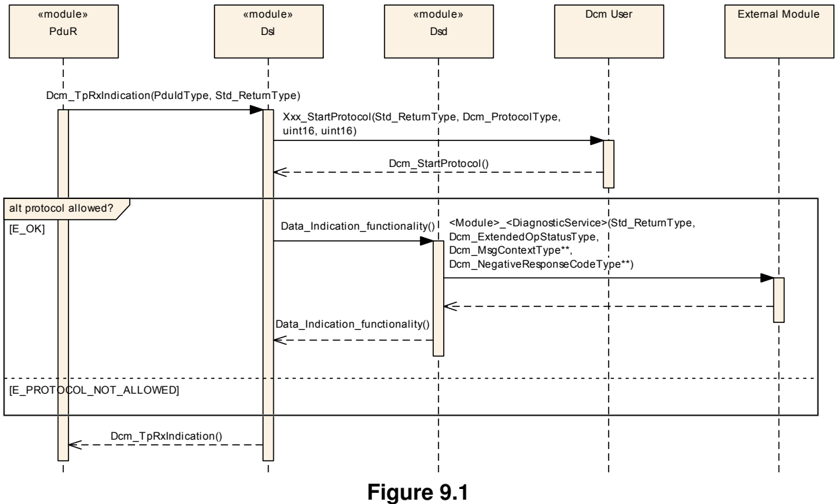

#### 8.2.2. 处理忙状态

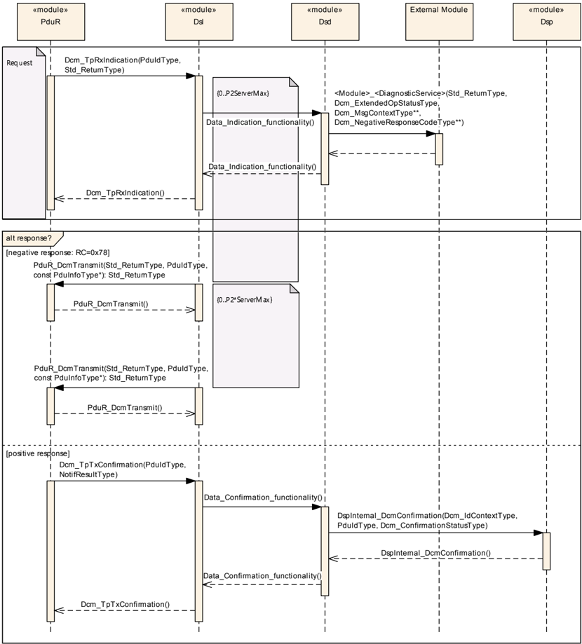

DSL 子模块内部计算向测试仪响应的时间。如果处理请求的外部模块未能在 P2ServerMax 和/或 P2*ServerMax 时限内完成请求（对于常规响应处理，需通过 `<Module>_<DiagnosticService>()` 或 `<Module>_<DiagnosticService>_<SubService>()` API 调用返回 **E_OK** 或 **E_NOT_OK**；对于分页缓冲处理，则需调用 `[DsdInternal_ProcessPage](#7118-dsdinternal_processpage)()`），DSL 子模块会独立发送负响应（requestCorectlyReceived-ResponsePending）。

#### 8.2.3. 超时发生时更新诊断会话控制

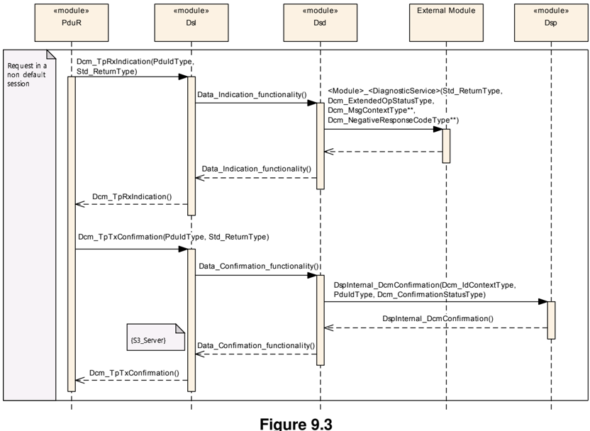

如果处于非默认会话时发生 S3server 超时，DSL 子模块会将会话控制值复位为默认值。每次收到 **PduR** 模块的数据确认时，都会启动 S3server 超时计时器。

#### 8.2.4. 处理单个 ReadDataByPeriodicIdentifier 响应

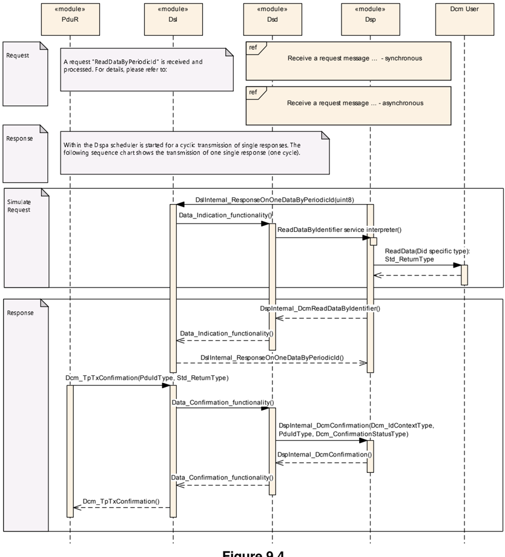

当发生周期标识符事件（即给定时间段结束）时，DSP 子模块请求采样并发送周期标识符数据。DSP 子模块通过调用 DSL 子模块提供的 `ResponseOnOneDataByPeriodicId()` 函数，启动发送一个周期标识符。

在此函数中，DSL 子模块为给定的 PeriodicId 模拟一个 `ReadDataByIdentifier` 请求。DataIdentifier 的高字节应按参考文档[\[19\]](#ref-19)所述设置为 0xF2，低字节设置为 PeriodicId 的值。

为获取 DID 值，会调用该 DID 对应 Data 的 ReadData 接口。在收到当前传输的确认之前，**Dcm** 模块无法从 DSP 子模块接收同一周期标识符的另一个事件请求。

#### 8.2.5. 处理单个事件触发的 ResponseOnEvent 响应

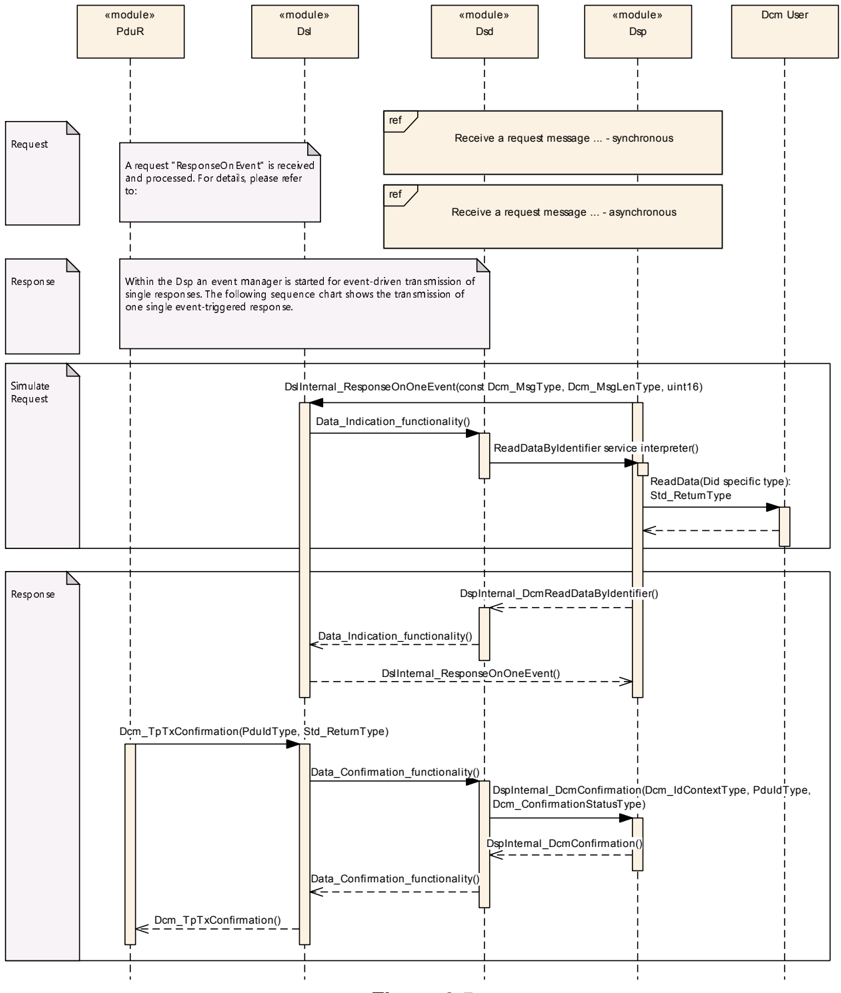

此时序图展示了 **ResponseOnEvent** 服务的一个示例：针对 onDTCStatusChange 设置并启动 **ResponseOnEvent**。事件发生变化时会通知 **Dcm**，进而触发 serviceToRespondTo。

#### 8.2.6. 处理并发请求

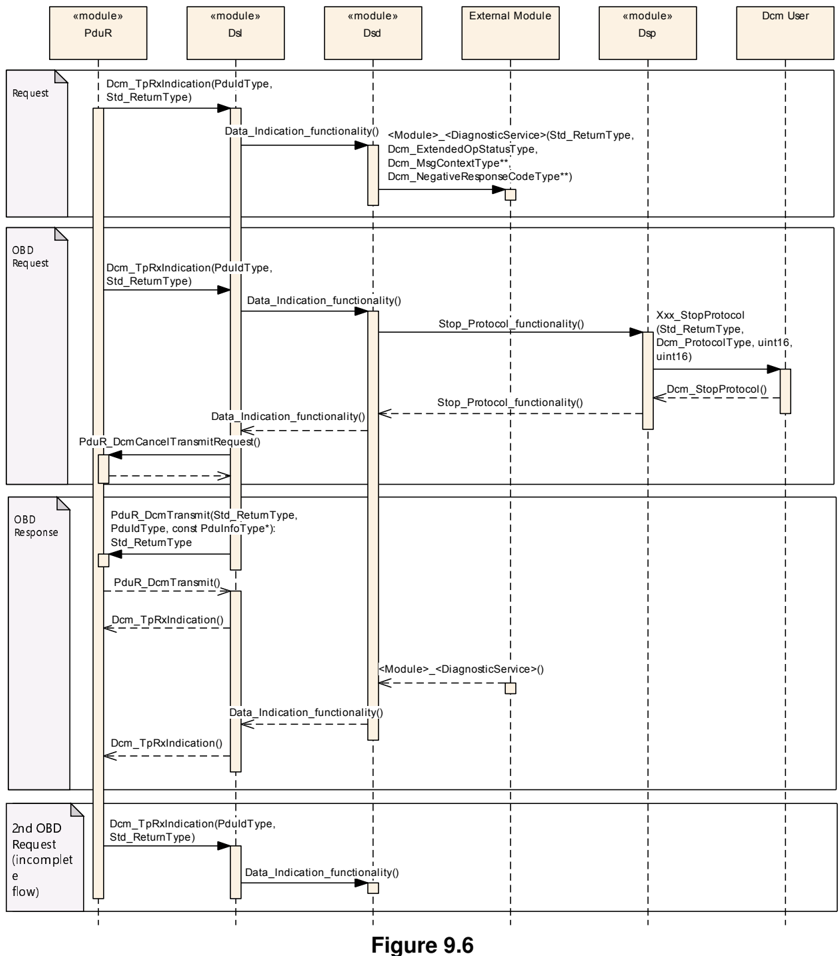

当处理普通诊断请求（例如增强型诊断协议、客户诊断协议）的同时收到 OBD 请求时，正在运行的诊断请求会被抢占。这是因为配置的 OBD 协议优先级较高（参见配置参数 DcmDslProtocolPriority）。

收到第一个 OBD 请求时会执行以下处理：

- 通知应用协议已停止（调用 `[Xxx_StopProtocol](#7872-xxx_stopprotocol)()`），并使应用复位到稳定状态（例如切换数字 I/O）。
- 请求下层取消同一 N-PDU 上正在进行的传输（调用 `PduR_DcmCancelTransmitRequest()`）。
- 如果 **Dcm** 无法足够快地从非 OBD 协议切换到 OBD 协议，DSL 子模块会向 OBD 测试仪发送负响应 BusyRepeatRequest（NRC 0x21）。系统设计人员负责确保满足法规规定的时序要求。

只要处理请求的外部模块尚未完成处理（即尚未通过 `<Module>_<DiagnosticService>()` / `<Module>_<DiagnosticService>_<SubService>()` API 调用返回 **E_OK** 或 **E_NOT_OK**），且未发生超时，DSL 子模块就会发送 BusyRepeatRequest 负响应。

当外部模块返回 **E_OK** 或 **E_NOT_OK** 时，DSL 子模块不会发送旧请求的响应，也不会向第一个测试仪发送负响应以通知其诊断请求已被抢占。

如果外部模块始终未通过 `<Module>_<DiagnosticService>()` / `<Module>_<DiagnosticService>_<SubService>()` API 调用返回 **E_OK** 或 **E_NOT_OK**，DSL 子模块会发生超时，并直接切换到处理抢占它的协议。

#### 8.2.7. 与 ComManager 的接口

##### 8.2.7.1. 默认会话处理

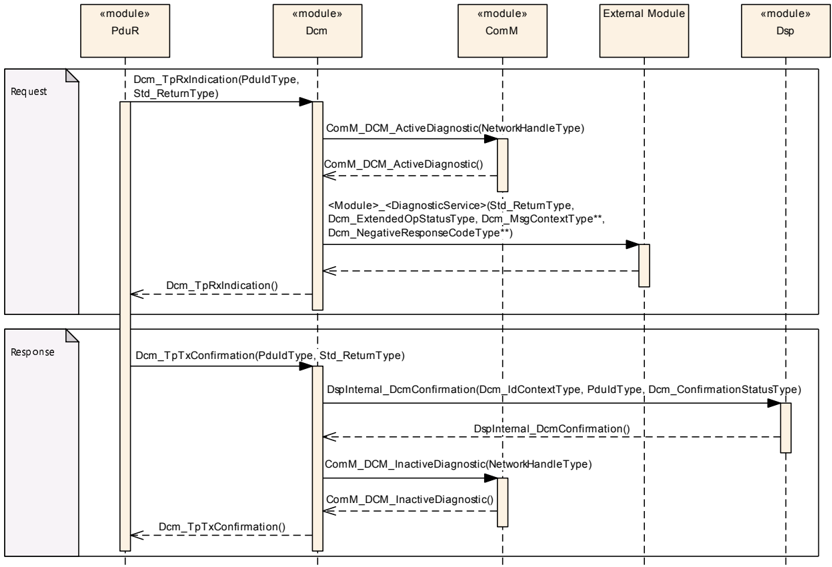

##### 8.2.7.2. 非默认会话处理

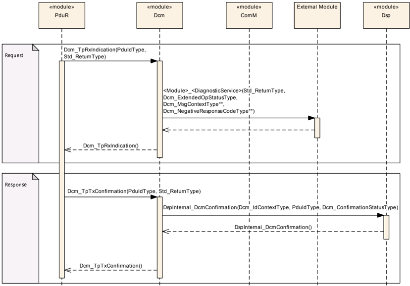

##### 8.2.7.3. 会话转换

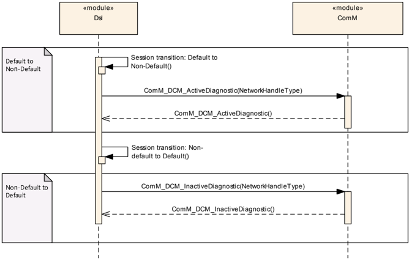

##### 8.2.7.4. 通信状态

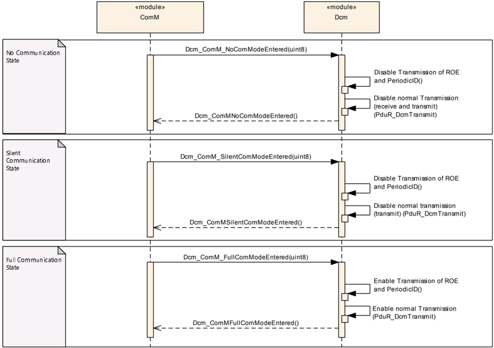

**DSD 接收请求消息并发送正响应消息——同步传输**

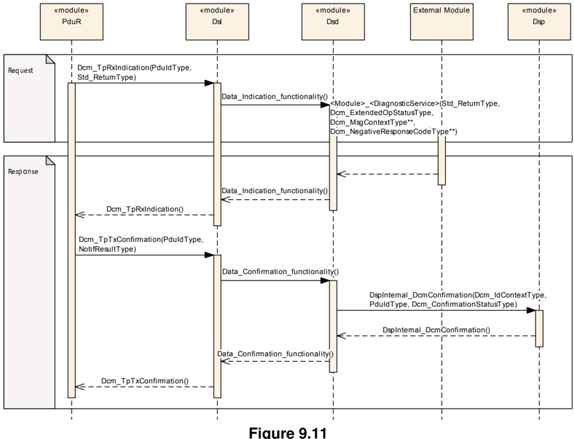

**接收请求消息并发送正响应消息——异步传输**

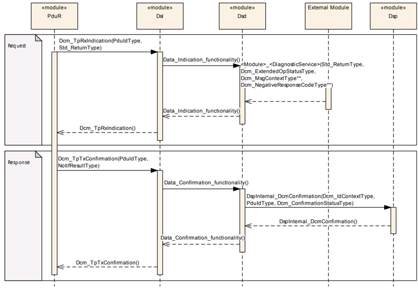

**接收请求消息并抑制正响应**

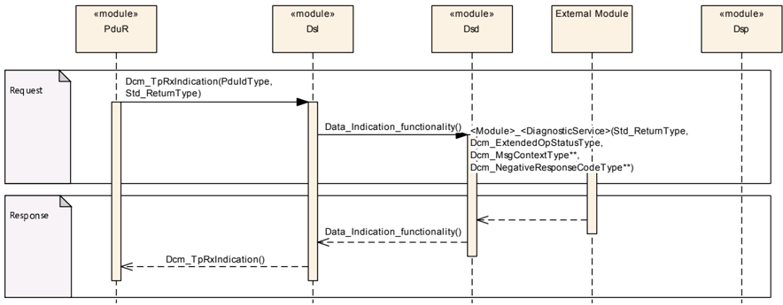

#### 8.2.8. 接收请求消息并发送负响应消息

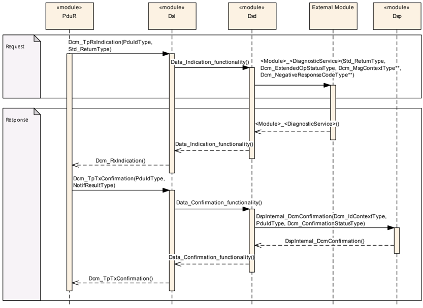

#### 8.2.9. 使用分页缓冲处理服务请求

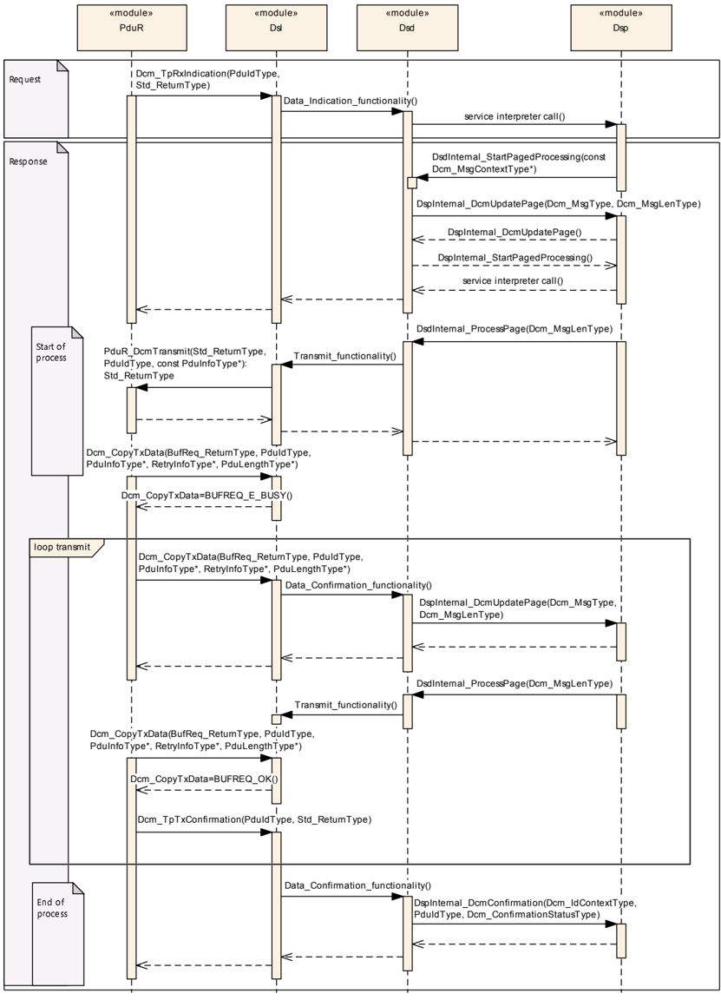

应用侧未发生错误时，将执行以下流程：

**处理开始：**

- 4) `[DsdInternal_StartPagedProcessing](#7116-dsdinternal_startpagedprocessing)()`：DSP 子模块通过此 API 将完整响应长度提供给 **Dcm** 模块，并启动分页缓冲处理。此 API 不会启动传输。
- 5) `UpdatePage()`：**Dcm** 模块请求待传输的数据。
- 6) `[DsdInternal_ProcessPage](#7118-dsdinternal_processpage)()`：DSP 子模块通过此 API 请求传输当前页面。
- 8) `PduR_DcmTransmit()`：**Dcm** 模块请求下层开始传输。
- 9) `[Dcm_CopyTxData](#744-dcm_copytxdata)`：缓冲区被填充后，**Dcm** 模块应返回 `BUFREQ_OK`（10）。

**循环开始：**

11) `[Dcm_CopyTxData](#744-dcm_copytxdata)`：**PduR** 模块请求缓冲区，但 DSP 子模块尚未填充缓冲区。

12 + 13) `UpdatePage`：**Dcm** 模块请求 DSP 子模块填充下一页。

- 14) **Dcm** 模块返回 `BUFREQ_E_BUSY`，指示 DSP 子模块需要填充缓冲区。
- 15) `[DsdInternal_ProcessPage](#7118-dsdinternal_processpage)()`：DSP 子模块通过此 API 请求传输当前页面。

17) 在下一次调用 `[Dcm_CopyTxData](#744-dcm_copytxdata)` 时，缓冲区已填充，**Dcm** 模块应返回 `BUFREQ_OK`（18）。

循环：只要仍有数据可发送，就重复执行流程 10 至 18。

**循环结束：**

n-2 → n) `[Dcm_TpTxConfirmation](#745-dcm_tptxconfirmation)`：所有数据发送完毕后，**PduR** 模块通过确认指示发送完成，并将该确认传递给 DSP 子模块。

仅分页缓冲传输需要使用 API 4、5 和 6。

**分页缓冲超时处理：**

当 DSP 子模块启动分页缓冲处理后，如果无法继续填充响应数据（例如访问 EEPROM 设备时发生问题），**Dcm** 模块将按下述方式处理。例如，在向 DSP 子模块提供分页缓冲区（13：`UpdatePage()`）后，从下层传输层收到负 Tx 确认时，**Dcm** 模块会执行以下错误处理：

- **Dcm** 模块停止继续处理分页缓冲区（项目 15）。
- **Dcm** 模块请求 DSP 子模块停止继续处理分页缓冲区（14：`[DspInternal_CancelPagedBufferProcessing](#7117-dspinternal_cancelpagedbufferprocessing)()`）。

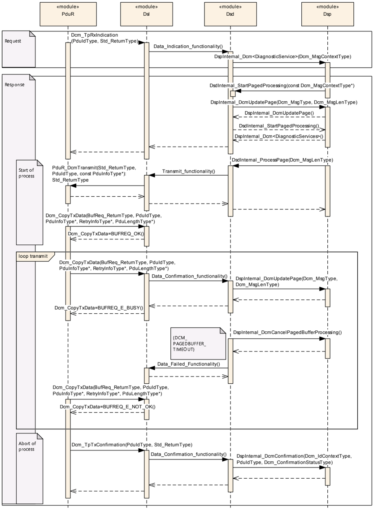

#### 8.2.10. 接收期间处理数据复制

请参见 PduR SWS 中的图 9“CanTp I-PDU reception”（参考文档[\[14\]](#ref-14)）。

#### 8.2.11. 发送期间处理数据复制

请参见 PduR SWS 中的图 14“CanTp I-PDU transmission”（参考文档[\[14\]](#ref-14)）。

### 8.3. 诊断服务处理（DSP）

#### 8.3.1. DSP 与 DEM 的接口（服务 0x19、0x14、0x85）

请参见 SWS Dem 第 [9](#9-配置规范) 节（参考文档[\[20\]](#ref-20)）。

#### 8.3.2. 特殊服务接口

##### 8.3.2.1. 处理 Diagnostic Session Control

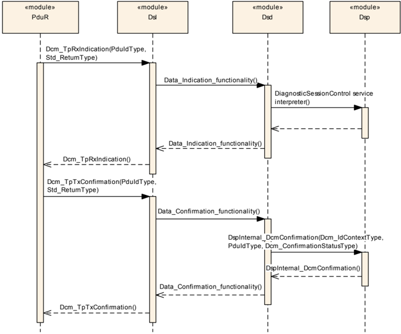

以上时序图展示了处理来自测试仪的 Diagnostic Session Control 请求。请注意，新的诊断会话和时序参数仅在服务器正响应的传输确认之后才生效。

##### 8.3.2.2. 处理 Tester Present

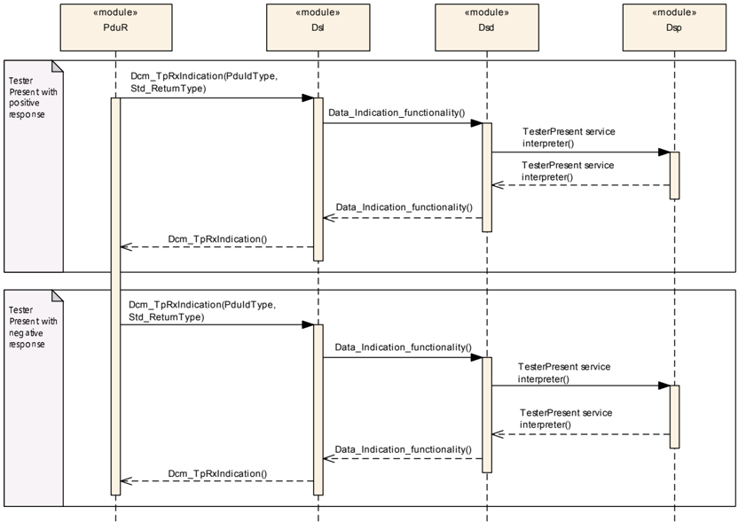

以上时序图展示了对 TesterPresent 命令的处理，但不包括使用子功能 0x80 进行功能寻址的命令。这些 TesterPresent 命令由 DSL 子模块解释（更多详情参见 §[6.4.4.3](#6443-并发-testerpresent保活逻辑) 并发 TesterPresent“保活逻辑”）。

其他 TesterPresent 命令均按以下方式处理：收到 TesterPresent 命令后，DSD 子模块调用 DSP 子模块的 `TesterPresent()` 函数。该时序图还展示了发生错误并发送负响应的情况。

##### 8.3.2.3. 处理 Security Access

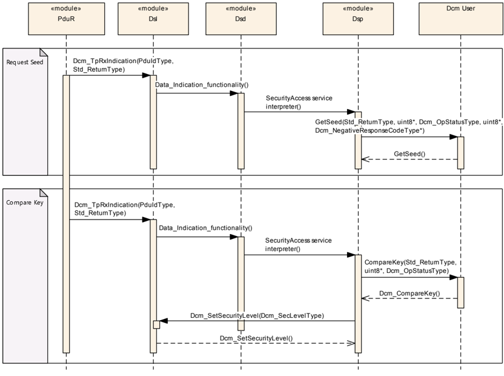

为执行安全访问，DSD 子模块必须调用 DSP 子模块，以从应用获取种子值。如果未检测到错误，则在正响应中发送种子值。

第二步中，DSP 子模块获取测试仪计算出的密钥，并请求应用将此密钥与内部计算的密钥进行比较。如果没有发生错误，则在 DSL 子模块中设置新的访问类型并发送正响应。

##### 8.3.2.4. 处理 ResponseOnEvent OnDtcChange

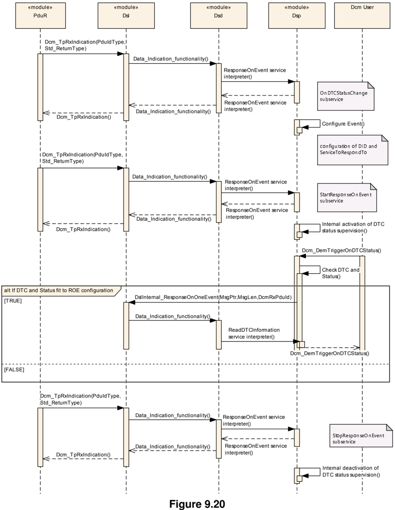

以上时序图展示了 ResponseOnEvent 服务子服务 OnDtcChange 的处理。

通过 ResponseOnEvent 服务配置并激活事件后，**Dcm** 会在每次调用 `[Dcm_DemTriggerOnDTCStatus](#7313-dcm_demtriggerondtcstatus)` 接口时检查已配置 DTC 的状态，以判断是否应触发事件。无论 ResponseOnEvent 是否激活或停用，只要 DTC 状态发生变化，**DEM** 都会调用此接口。

##### 8.3.2.5. 处理 ResponseOnEvent OnChangeOfDataIdentifier

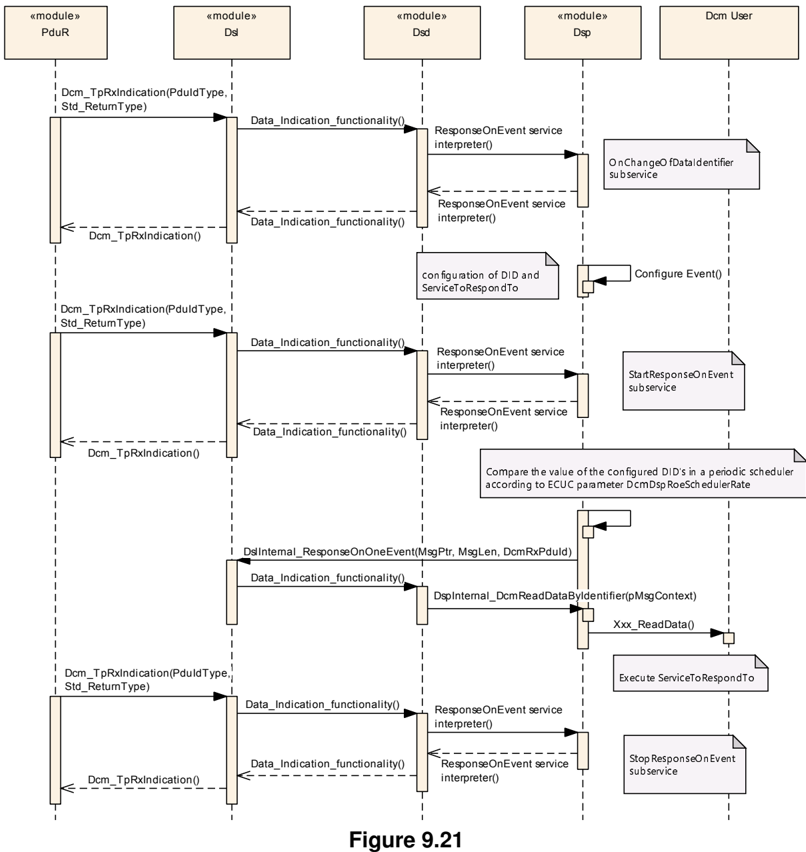

以上时序图展示了 ResponseOnEvent 服务子服务 OnChangeOfDataIdentifier 的处理。通过 ResponseOnEvent 服务配置并激活事件后，**Dcm** 会在每次 ResponseOnEventSchedulerRate 周期结束时比较所有已配置 DID 的值；满足条件时触发事件。事件发生后，**Dcm** 将执行 serviceToRespondToRecord 中配置的服务。

##### 8.3.2.6. 处理跳转到 Bootloader

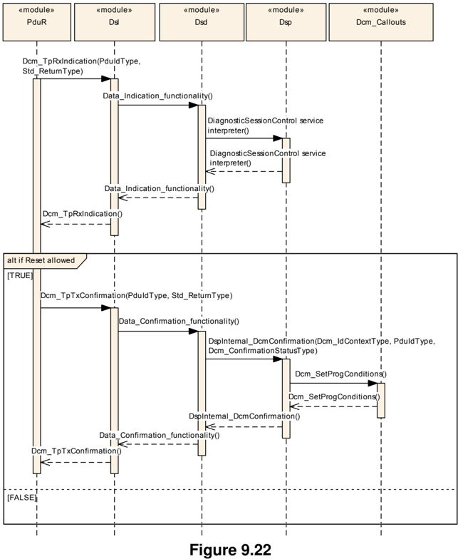

以上时序图展示了收到 DiagnosticSessionControl 时跳转到 Bootloader 的处理。收到 DiagnosticSessionControl 后，**Dcm** 会检查所请求的会话是否配置为触发 Bootloader 跳转。如果是，则 **Dcm** 启动跳转到 Bootloader 流程：

- 发送 NRC 0x78（ResponsePending）。
- 确认 NRC 0x78 已发送后，**Dcm** 调用 Callout `DcmSetProgConditions`，以存储 Bootloader 所需的全部信息。

##### 8.3.2.7. 处理 IOControlRequest

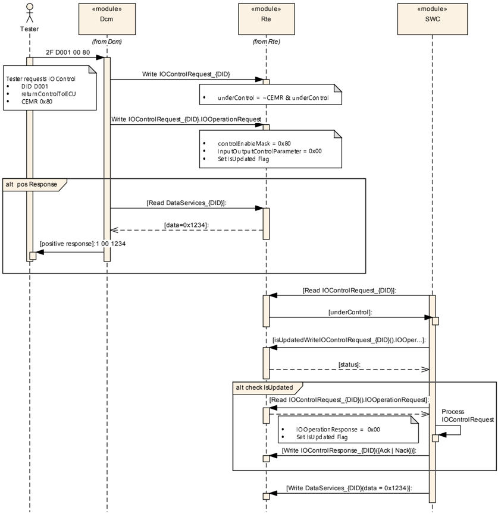

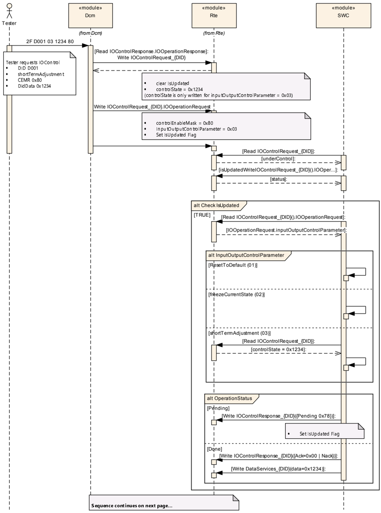

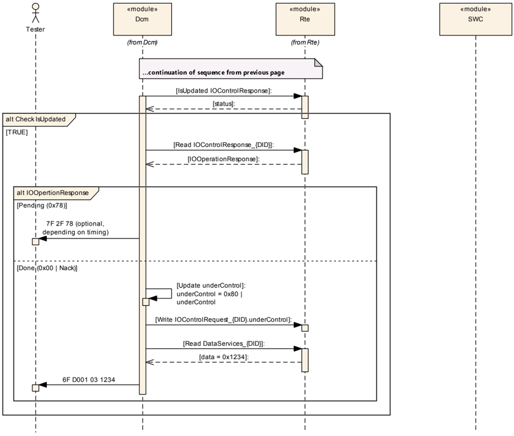

## 9. 配置规范

本章总体定义配置参数及其在容器中的分组。为帮助阅读本规范，9.1 节介绍基础知识，并规定配置参数说明所采用的表格模板。为确保可理解性，本规范保留 9.1 节。

9.2 节规定 &lt;MODULE_ABBREVIATION&gt; 模块的结构（容器）及参数。9.4 节规定该模块的发布信息。

### 9.1. 如何阅读本章

详细说明请参见 SWS BSWGeneral 第 10.1 节“配置规范简介”（参考文档[\[7\]](#ref-7)）。

### 9.2. 容器与配置参数

以下章节汇总全部配置参数。参数的详细含义见第 6 章和第 7 章。

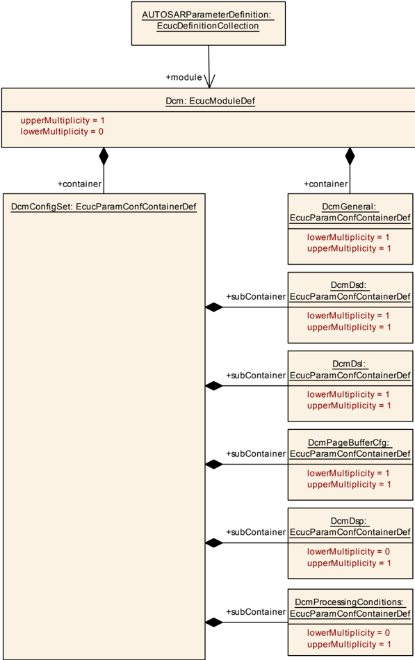

#### 9.2.1. Dcm

| 属性 | 值 |
| --- | --- |
| 模块名称 | Dcm |
| 描述 | Dcm（Diagnostic Communications Manager）模块的配置。 |
| 支持后构建变体 | true |
| 支持的配置变体 | VARIANT-LINK-TIME、VARIANT-POST-BUILD、VARIANT-PRE-COMPILE |

| 容器名称 | 多重性 | 作用域/依赖 |
| --- | --- | --- |
| DcmConfigSet | 1 | 此容器包含 DCM 模块的配置参数及子容器，支持多个配置集。 |
| DcmGeneral | 1 | 包含适用于整个 Dcm 模块的通用配置参数。 |

#### 9.2.2. DcmConfigSet

| 属性 | 值 |
| --- | --- |
| 容器名称 | DcmConfigSet |
| 父容器 | Dcm |
| 描述 | 此容器包含 DCM 模块的配置参数及子容器，支持多个配置集。 |
| 配置参数 | 配置参数 |

| 容器名称 | 多重性 | 作用域/依赖 |
| --- | --- | --- |
| DcmDsd | 1 | 这些参数用于配置诊断服务分发器子模块。 |
| DcmDsl | 1 | 这些参数用于配置诊断会话层子模块。 |
| DcmDsp | 0..1 | 这些参数适用于诊断服务处理。每个 Dcm 始终有一组此类参数。请注意，尽管多重性为 0..1，仍可认为任何有效的 DCM 配置中都存在此容器。 |
| DcmPageBufferCfg | 1 | 此容器包含分页缓冲处理的配置参数。 |
| DcmProcessingConditions | 0..1 | 此容器包含 Dcm 模式仲裁功能的配置。 |

##### 9.2.2.1. DcmPageBufferCfg

| 属性 | 值 |
| --- | --- |
| 容器名称 | DcmPageBufferCfg |
| 父容器 | DcmConfigSet |
| 描述 | 此容器包含分页缓冲处理的配置参数。 |
| 配置参数 | 配置参数 |

参数 DcmPagedBufferEnabled 的定义：

| 属性 | 值 |
| --- | --- |
| 参数名称 | DcmPagedBufferEnabled |
| 父容器 | DcmPageBufferCfg |
| 描述 | 启用或禁用分页缓冲机制。**true**：启用分页缓冲处理；**false**：禁用分页缓冲处理。 |
| 多重性 | 1 |
| 类型 | EcucBooleanParamDef |
| 默认值 | - |
| Post-Build 变体值 | false |
| 值配置类 | Pre-compile time：X（All Variants）；Link time：-；Post-build time：- |
| 作用域/依赖 | scope: ECU |


无包含的容器。

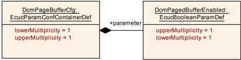

##### 9.2.2.2. DcmProcessingConditions

| 属性 | 值 |
| --- | --- |
| 容器名称 | DcmProcessingConditions |
| 父容器 | DcmConfigSet |
| 描述 | 此容器包含 Dcm 模式仲裁功能的配置。 |
| 配置参数 | 配置参数 |

| 容器名称 | 多重性 | 作用域/依赖 |
| --- | --- | --- |
| DcmModeCondition | 1..* | 此容器配置模式条件或环境条件，可作为 DcmModeRules 的参数。每个 DcmModeCondition 应且只能包含一个 DcmSwcModeRef、DcmBswModeRef 或 DcmSwcSRDataElementRef。请注意，Dcm 也充当模式管理器。因此，DcmSwcModeRef 或 DcmBswModeRef 可以引用 Dcm 自身提供的 ModeDeclarationGroupPrototype，也可以引用其他 BSW 模块或软件组件提供的 ModeDeclarationGroupPrototype。配置 DcmSwcModeRef 或 DcmBswModeRef 时，DcmConditionType 仅适用 DCM_EQUALS 或 DCM_EQUALS_NOT；配置 DcmSwcSRDataElementRef 时，DcmConditionType 的所有取值均可用。 |


| 容器名称 | 多重性 | 作用域/依赖 |
| --- | --- | --- |
| DcmModeRule | 1..* | 此容器配置一个模式规则，该规则表示以 DcmModeCondition 或其他 DcmModeRule 为参数的逻辑表达式。所有参数均使用 DcmLogicalOperator 定义的运算符处理，例如：Argument_A AND Argument_B AND Argument_C。 |

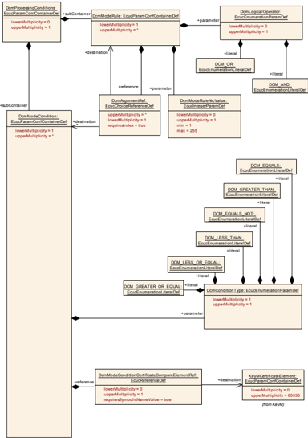

#### 9.2.3. DcmDsd

##### 9.2.3.1. DcmDsd

| 属性 | 值 |
| --- | --- |
| 容器名称 | DcmDsd |
| 父容器 | DcmConfigSet |
| 描述 | 这些参数用于配置诊断服务分发器子模块。 |
| 配置参数 | 配置参数 |

| 容器名称 | 多重性 | 作用域/依赖 |
| --- | --- | --- |
| DcmDsdServiceRequestManufacturerNotification | 0..* | 此容器名称用于定义 **Dcm** 访问 ServiceRequestNotification 接口所用 R-Port 的名称。R-Port 命名为 ServiceRequestManufacturerNotification_{Name}，其中 {Name} 为 DcmDsdServiceRequestManufacturerNotification 容器名称。下限多重性为 0：如果不存在此容器，则 Indication API 不可用。 |

| 容器名称 | 多重性 | 作用域/依赖 |
| --- | --- | --- |
| DcmDsdServiceRequestSupplierNotification | 0..* | 此容器名称用于定义 **Dcm** 访问 ServiceRequestNotification 接口所用 R-Port 的名称。R-Port 命名为 ServiceRequestSupplierNotification_&lt;SWC&gt;，其中 &lt;SWC&gt; 为 DcmDsdServiceRequestSupplierNotification 容器名称。下限多重性为 0：如果不存在 DcmDsdRequestSupplierNotification 容器，则 Indication API 不可用。 |
| DcmDsdServiceTable | 1..256 | 此容器包含服务标识符表的配置参数。注意：允许向与 UDS 协议关联的 DcmDsdServiceTable 添加 OBD 服务，但不允许向与 OBD 协议关联的 DcmDsdServiceTable 添加 UDS 服务。 |

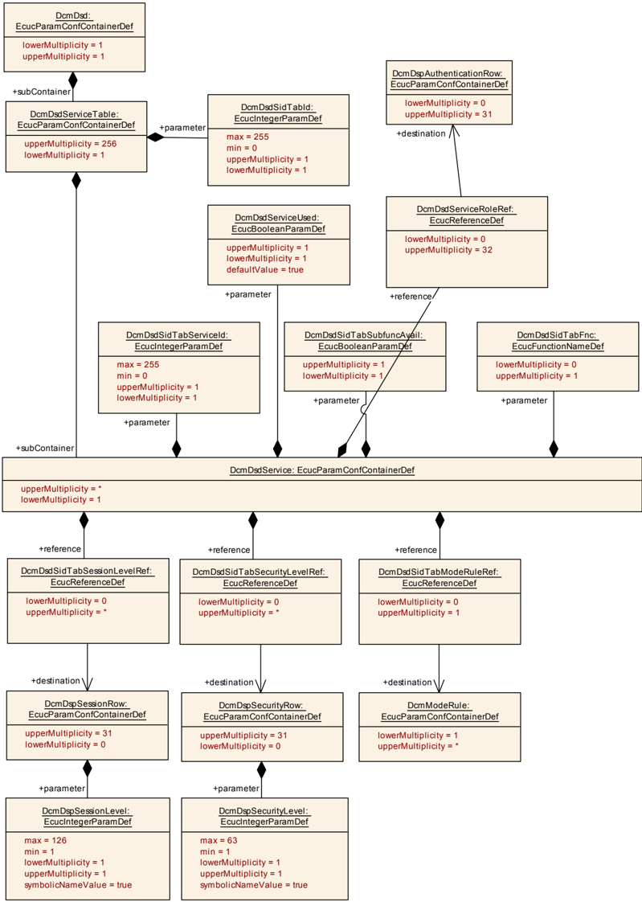

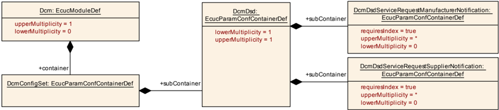

##### 9.2.3.2. DcmDsdService

| 属性 | 值 |
| --- | --- |
| 容器名称 | DcmDsdService |
| 父容器 | DcmDsdServiceTable |
| 描述 | 此容器包含服务的 DSD 配置参数。 |
| 配置参数 | 配置参数 |

参数 DcmDsdServiceUsed 的定义：

| 属性 | 值 |
| --- | --- |
| 参数名称 | DcmDsdServiceUsed |
| 父容器 | DcmDsdService |
| 描述 | 用于激活或停用某项服务，可用于多用途 ECU。**true**：服务可用；**false**：服务不可用。 |
| 多重性 | 1 |
| 类型 | EcucBooleanParamDef |
| 默认值 | true |
| Post-Build 变体值 | true |
| 值配置类 | Pre-compile time：X（VARIANT-PRE-COMPILE）；Link time：X（VARIANT-LINK-TIME）；Post-build time：X（VARIANT-POST-BUILD） |
| 作用域/依赖 | scope: local |

参数 DcmDsdSidTabFnc 的定义：

| 属性 | 值 |
| --- | --- |
| 参数名称 | DcmDsdSidTabFnc |
| 父容器 | DcmDsdService |
| 描述 | 该服务对应的 ECU 供应商特定组件的回调函数。该函数的原型如 &lt;Module&gt;_&lt;DiagnosticService&gt; 接口所述。如果未配置此参数，则由 **Dcm** 内部处理该服务。 |
| 多重性 | 0..1 |
| 类型 | EcucFunctionNameDef |
| 默认值 | - |
| 正则表达式 | - |
| Post-Build 变体多重性 | false |
| Post-Build 变体值 | false |
| 多重性配置类 | Pre-compile time：X（VARIANT-PRE-COMPILE、VARIANT-POST-BUILD）；Link time：X（VARIANT-LINK-TIME）；Post-build time：- |
| 值配置类 | Pre-compile time：X（VARIANT-PRE-COMPILE、VARIANT-POST-BUILD）；Link time：X（VARIANT-LINK-TIME）；Post-build time：- |
| 作用域/依赖 | scope: ECU |

参数 DcmDsdSidTabServiceId 的定义：

| 属性 | 值 |
| --- | --- |
| 参数名称 | DcmDsdSidTabServiceId |
| 父容器 | DcmDsdService |
| 描述 | 服务标识符。可能的服务标识符由 **ISO** 14229-1 和 **ISO** 15031-5 定义。 |
| 多重性 | 1 |
| 类型 | EcucIntegerParamDef |
| 范围 | 0…255 |
| 默认值 | - |
| Post-Build 变体值 | false |
| 值配置类 | Pre-compile time：X（VARIANT-PRE-COMPILE、VARIANT-POST-BUILD）；Link time：X（VARIANT-LINK-TIME）；Post-build time：- |
| 作用域/依赖 | scope: ECU |

参数 DcmDsdSidTabSubfuncAvail 的定义：

| 属性 | 值 |
| --- | --- |
| 参数名称 | DcmDsdSidTabSubfuncAvail |
| 父容器 | DcmDsdService |
| 描述 | 指示该服务是否具有子功能。此参数用于处理 ISO 14229-1 中定义的 suppressPosRspMsgIndicationBit，可据此配置。* **true**：服务具有子功能，suppressPosRspMsgIndicationBit 可用。* **false**：服务没有子功能，suppressPosRspMsgIndicationBit 不可用。 |
| 多重性 | 1 |
| 类型 | EcucBooleanParamDef |
| 默认值 | - |
| Post-Build 变体值 | false |
| 值配置类 | Pre-compile time：X（VARIANT-PRE-COMPILE、VARIANT-POST-BUILD）；Link time：X（VARIANT-LINK-TIME）；Post-build time：- |
| 作用域/依赖 | scope: ECU |

参数 DcmDsdServiceRoleRef 的定义：

| 属性 | 值 |
| --- | --- |
| 参数名称 | DcmDsdServiceRoleRef |
| 父容器 | DcmDsdService |
| 描述 | 对 DcmDspAuthenticationRow 的引用，该行定义了允许执行该服务的角色。 |
| 多重性 | 0..32 |
| 类型 | 对 DcmDspAuthenticationRow 的引用 |
| Post-Build 变体多重性 | false |
| Post-Build 变体值 | false |
| 值配置类 | Pre-compile time：X（All Variants）；Link time：-；Post-build time：- |
| 作用域/依赖 | scope: ECU |

参数 DcmDsdSidTabModeRuleRef 的定义：

| 属性 | 值 |
| --- | --- |
| 参数名称 | DcmDsdSidTabModeRuleRef |
| 父容器 | DcmDsdService |
| 描述 | 对控制服务执行的 DcmModeRule 的引用。如果未配置引用，则不执行模式规则检查。 |
| 多重性 | 0..1 |
| 类型 | 对 DcmModeRule 的引用 |
| Post-Build 变体多重性 | false |
| Post-Build 变体值 | false |
| 多重性配置类 | Pre-compile time：X（VARIANT-PRE-COMPILE、VARIANT-POST-BUILD）；Link time：X（VARIANT-LINK-TIME）；Post-build time：- |
| 值配置类 | Pre-compile time：X（VARIANT-PRE-COMPILE、VARIANT-POST-BUILD）；Link time：X（VARIANT-LINK-TIME）；Post-build time：- |
| 作用域/依赖 | scope: ECU |

参数 DcmDsdSidTabSecurityLevelRef 的定义：

| 属性 | 值 |
| --- | --- |
| 参数名称 | DcmDsdSidTabSecurityLevelRef |
| 父容器 | DcmDsdService |
| 描述 | 对允许执行该服务的安全级别的引用。一个服务可配置多个引用。参见 **ISO** 14229-1、**ISO** 15031-5 以及 §6.5.4.3.3“服务安全访问级别的验证”。如果未配置引用，则不执行服务安全验证。 |
| 多重性 | 0..* |
| 类型 | 对 DcmDspSecurityRow 的引用 |
| Post-Build 变体多重性 | false |
| Post-Build 变体值 | false |
| 多重性配置类 | Pre-compile time：X（VARIANT-PRE-COMPILE、VARIANT-POST-BUILD）；Link time：X（VARIANT-LINK-TIME）；Post-build time：- |
| 值配置类 | Pre-compile time：X（VARIANT-PRE-COMPILE、VARIANT-POST-BUILD）；Link time：X（VARIANT-LINK-TIME）；Post-build time：- |
| 作用域/依赖 | scope: ECU |

参数 DcmDsdSidTabSessionLevelRef 的定义：

| 属性 | 值 |
| --- | --- |
| 参数名称 | DcmDsdSidTabSessionLevelRef |
| 父容器 | DcmDsdService |
| 描述 | 对允许执行该服务的会话级别的引用。一个服务可配置多个引用。参见 **ISO** 14229-1、**ISO** 15031-5 以及 §6.5.4.3.2“诊断会话的验证”。如果未配置引用，则不执行诊断会话验证。 |
| 多重性 | 0..* |
| 类型 | 对 DcmDspSessionRow 的引用 |
| Post-Build 变体多重性 | false |
| Post-Build 变体值 | false |
| 多重性配置类 | Pre-compile time：X（VARIANT-PRE-COMPILE、VARIANT-POST-BUILD）；Link time：X（VARIANT-LINK-TIME）；Post-build time：- |
| 值配置类 | Pre-compile time：X（VARIANT-PRE-COMPILE、VARIANT-POST-BUILD）；Link time：X（VARIANT-LINK-TIME）；Post-build time：- |
| 作用域/依赖 | scope: ECU |

| 容器名称 | 多重性 | 作用域/依赖 |
| --- | --- | --- |
| DcmDsdSubService | 0..* | 此容器包含服务子服务的 DSD 配置参数。只有配置了 DcmDsdSidTabSubfuncAvail == TRUE 的服务才可以包含子服务。 |

##### 9.2.3.3. DcmDsdServiceRequestManufacturerNotification

| 属性 | 值 |
| --- | --- |
| 容器名称 | DcmDsdServiceRequestManufacturerNotification |
| 父容器 | DcmDsd |
| 描述 | 此容器名称用于定义 **Dcm** 访问 ServiceRequestNotification 接口所用 R-Port 的名称。R-Port 命名为 ServiceRequestManufacturerNotification_{Name}，其中 {Name} 为 DcmDsdServiceRequestManufacturerNotification 容器名称。下限多重性为 0：如果不存在此容器，则 Indication API 不可用。属性：requiresIndex=true。 |
| 配置参数 | 配置参数 |

无包含的容器。

##### 9.2.3.4. DcmDsdServiceRequestSupplierNotification

| 属性 | 值 |
| --- | --- |
| 容器名称 | DcmDsdServiceRequestSupplierNotification |
| 父容器 | DcmDsd |
| 描述 | 此容器名称用于定义 **Dcm** 访问 ServiceRequestNotification 接口所用 R-Port 的名称。R-Port 命名为 ServiceRequestSupplierNotification_&lt;SWC&gt;，其中 &lt;SWC&gt; 为 DcmDsdServiceRequestSupplierNotification 容器名称。下限多重性为 0：如果不存在 DcmDsdRequestSupplierNotification 容器，则 Indication API 不可用。属性：requiresIndex=true。 |
| 配置参数 | 配置参数 |

无包含的容器。

##### 9.2.3.5. DcmDsdServiceTable

| 属性 | 值 |
| --- | --- |
| 容器名称 | DcmDsdServiceTable |
| 父容器 | DcmDsd |
| 描述 | 此容器包含服务标识符表的配置参数。注意：允许向与 UDS 协议关联的 DcmDsdServiceTable 添加 OBD 服务，但不允许向与 OBD 协议关联的 DcmDsdServiceTable 添加 UDS 服务。 |
| 配置参数 | 配置参数 |

参数 DcmDsdSidTabId 的定义：

| 属性 | 值 |
| --- | --- |
| 参数名称 | DcmDsdSidTabId |
| 父容器 | DcmDsdServiceTable |
| 描述 | 当使用多个服务表时，可使用唯一的 DcmDsdSidTabId 对它们进行标识。 |
| 多重性 | 1 |
| 类型 | EcucIntegerParamDef |
| 范围 | 0…255 |
| 默认值 | - |
| Post-Build 变体值 | false |
| 值配置类 | Pre-compile time：X（VARIANT-PRE-COMPILE、VARIANT-POST-BUILD）；Link time：X（VARIANT-LINK-TIME）；Post-build time：- |
| 作用域/依赖 | scope: ECU |

| 容器名称 | 多重性 | 作用域/依赖 |
| --- | --- | --- |
| DcmDsdService | 1..* | 此容器包含服务的 DSD 配置参数。 |

注意：Dcm 与 DSP 的内部交互由具体实现决定，因此不显式配置。

##### 9.2.3.6. DcmDsdSubService

| 属性 | 值 |
| --- | --- |
| 容器名称 | DcmDsdSubService |
| 父容器 | DcmDsdService |
| 描述 | 此容器包含服务子服务的 DSD 配置参数。只有配置了 DcmDsdSidTabSubfuncAvail == TRUE 的服务才可以包含子服务。 |
| 配置参数 | 配置参数 |

参数 DcmDsdSubServiceFnc 的定义：

| 属性 | 值 |
| --- | --- |
| 参数名称 | DcmDsdSubServiceFnc |
| 父容器 | DcmDsdSubService |
| 描述 | 特定子服务对应的 ECU 供应商特定组件回调函数。函数原型如 &lt;Module&gt;_&lt;DiagnosticService&gt;_&lt;SubService&gt; 接口所述。如果未配置此参数，则由 **Dcm** 内部处理该子服务。 |
| 多重性 | 0..1 |
| 类型 | EcucFunctionNameDef |
| 默认值 | - |
| 正则表达式 | - |
| Post-Build 变体多重性 | false |
| Post-Build 变体值 | false |
| 多重性配置类 | Pre-compile time：X（VARIANT-PRE-COMPILE、VARIANT-POST-BUILD）；Link time：X（VARIANT-LINK-TIME）；Post-build time：- |
| 值配置类 | Pre-compile time：X（VARIANT-PRE-COMPILE、VARIANT-POST-BUILD）；Link time：X（VARIANT-LINK-TIME）；Post-build time：- |
| 作用域/依赖 | scope: local |

参数 DcmDsdSubServiceId 的定义：

| 属性 | 值 |
| --- | --- |
| 参数名称 | DcmDsdSubServiceId |
| 父容器 | DcmDsdSubService |
| 描述 | 子服务标识符。 |
| 多重性 | 1 |
| 类型 | EcucIntegerParamDef |
| 范围 | 0…127 |
| 默认值 | - |
| Post-Build 变体值 | false |
| 值配置类 | Pre-compile time：X（VARIANT-PRE-COMPILE、VARIANT-POST-BUILD）；Link time：X（VARIANT-LINK-TIME）；Post-build time：- |
| 作用域/依赖 | scope: ECU |

参数 DcmDsdSubServiceUsed 的定义：

| 属性 | 值 |
| --- | --- |
| 参数名称 | DcmDsdSubServiceUsed |
| 父容器 | DcmDsdSubService |
| 描述 | 用于激活或停用某个子服务，可用于多用途 ECU。* **true**：子服务可用。* **false**：子服务不可用。 |
| 多重性 | 1 |
| 类型 | EcucBooleanParamDef |
| 默认值 | true |
| Post-Build 变体值 | true |
| 值配置类 | Pre-compile time：X（VARIANT-PRE-COMPILE）；Link time：X（VARIANT-LINK-TIME）；Post-build time：X（VARIANT-POST-BUILD） |
| 作用域/依赖 | scope: local |

参数 DcmDsdSubServiceModeRuleRef 的定义：

| 属性 | 值 |
| --- | --- |
| 参数名称 | DcmDsdSubServiceModeRuleRef |
| 父容器 | DcmDsdSubService |
| 描述 | 对控制子服务执行的 DcmDspModeRule 的引用。如果未配置引用，则不执行模式规则检查。 |
| 多重性 | 0..1 |
| 类型 | 对 DcmModeRule 的引用 |
| Post-Build 变体多重性 | false |
| Post-Build 变体值 | false |
| 多重性配置类 | Pre-compile time：X（VARIANT-PRE-COMPILE、VARIANT-POST-BUILD）；Link time：X（VARIANT-LINK-TIME）；Post-build time：- |
| 值配置类 | Pre-compile time：X（VARIANT-PRE-COMPILE、VARIANT-POST-BUILD）；Link time：X（VARIANT-LINK-TIME）；Post-build time：- |
| 作用域/依赖 | scope: ECU |

参数 DcmDsdSubServiceRoleRef 的定义：

| 属性 | 值 |
| --- | --- |
| 参数名称 | DcmDsdSubServiceRoleRef |
| 父容器 | DcmDsdSubService |
| 描述 | 对 DcmDspAuthenticationRow 的引用，该行定义了允许执行此子服务的角色。 |
| 多重性 | 0..32 |
| 类型 | 对 DcmDspAuthenticationRow 的引用 |
| Post-Build 变体多重性 | false |
| Post-Build 变体值 | false |
| 值配置类 | Pre-compile time：X（All Variants）；Link time：-；Post-build time：- |
| 作用域/依赖 | scope: ECU |

参数 DcmDsdSubServiceSecurityLevelRef 的定义：

| 属性 | 值 |
| --- | --- |
| 参数名称 | DcmDsdSubServiceSecurityLevelRef |
| 父容器 | DcmDsdSubService |
| 描述 | 对允许执行该子服务的安全级别的引用。一个子服务可配置多个引用。参见 **ISO** 14229-1、**ISO** 15031-5 以及 §6.5.4.3.3“服务安全访问级别的验证”。如果未配置引用，则不执行子服务安全验证。 |
| 多重性 | 0..* |
| 类型 | 对 DcmDspSecurityRow 的引用 |
| Post-Build 变体多重性 | false |
| Post-Build 变体值 | false |
| 多重性配置类 | Pre-compile time：X（VARIANT-PRE-COMPILE、VARIANT-POST-BUILD）；Link time：X（VARIANT-LINK-TIME）；Post-build time：- |
| 值配置类 | Pre-compile time：X（VARIANT-PRE-COMPILE、VARIANT-POST-BUILD）；Link time：X（VARIANT-LINK-TIME）；Post-build time：- |
| 作用域/依赖 | scope: ECU |

参数 DcmDsdSubServiceSessionLevelRef 的定义：

| 属性 | 值 |
| --- | --- |
| 参数名称 | DcmDsdSubServiceSessionLevelRef |
| 父容器 | DcmDsdSubService |
| 描述 | 对允许执行该子服务的会话级别的引用。一个子服务可配置多个引用。参见 **ISO** 14229-1、**ISO** 15031-5 以及 §6.5.4.3.2“诊断会话的验证”。如果未配置引用，则不执行诊断会话验证。 |
| 多重性 | 0..* |
| 类型 | 对 DcmDspSessionRow 的引用 |
| Post-Build 变体多重性 | false |
| Post-Build 变体值 | false |
| 多重性配置类 | Pre-compile time：X（VARIANT-PRE-COMPILE、VARIANT-POST-BUILD）；Link time：X（VARIANT-LINK-TIME）；Post-build time：- |
| 值配置类 | Pre-compile time：X（VARIANT-PRE-COMPILE、VARIANT-POST-BUILD）；Link time：X（VARIANT-LINK-TIME）；Post-build time：- |
| 作用域/依赖 | scope: ECU |

无包含的容器。

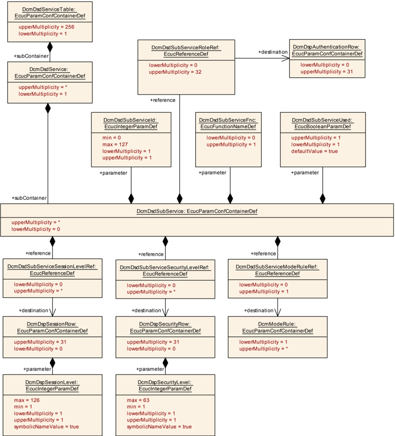


#### 9.2.4. DcmDsl

##### 9.2.4.1. DcmDsl

| 属性 | 值 |
| --- | --- |
| 容器名称 | DcmDsl |
| 父容器 | DcmConfigSet |
| 描述 | 这些参数用于配置诊断会话层子模块。 |
| 配置参数 | 配置参数 |

| 容器名称 | 多重性 | 作用域/依赖 |
| --- | --- | --- |
| DcmDslBuffer | 1..256 | 此容器包含诊断缓冲区的配置。 |
| DcmDslCallbackDCMRequestService | 0..* | 每个 DcmDslCallbackDCMRequestService 容器定义一个带有 CallbackDCMRequestServices 接口的 R-Port，**Dcm** 使用该接口向应用软件请求协议切换许可。R-Port 命名为 CallbackDCMRequestServices_&lt;SWC&gt;，其中 &lt;SWC&gt; 为该容器的名称。 |
| DcmDslDiagResp | 1 | 此容器包含 **Dcm** 的自动 requestCorrectlyReceivedResponsePending 响应管理配置。 |
| DcmDslProtocol | 1 | 此容器包含 **Dcm** 中使用的诊断协议配置。 |

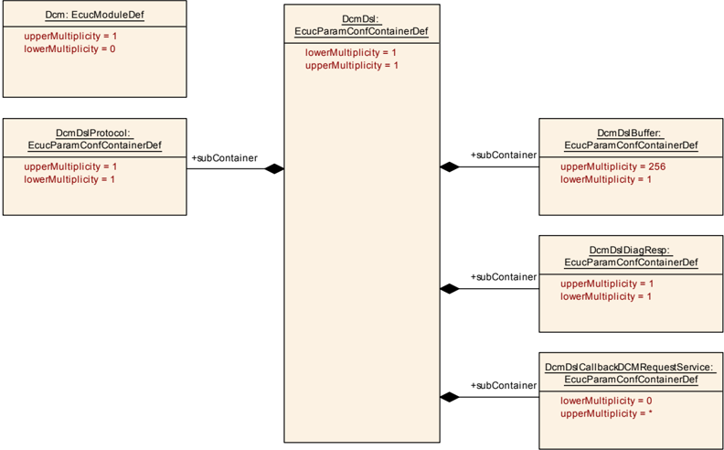

##### 9.2.4.2. DcmDslBuffer

| 属性 | 值 |
| --- | --- |
| 容器名称 | DcmDslBuffer |
| 父容器 | DcmDsl |
| 描述 | 此容器包含诊断缓冲区的配置。 |
| 配置参数 | 配置参数 |

参数 DcmDslBufferSize 的定义：

| 属性 | 值 |
| --- | --- |
| 参数名称 | DcmDslBufferSize |
| 父容器 | DcmDslBuffer |
| 描述 | 诊断缓冲区的大小，单位为字节。对于线性缓冲区，其大小应至少能够容纳最长的诊断消息（请求或响应）。 |
| 多重性 | 1 |
| 类型 | EcucIntegerParamDef |
| 范围 | 8…4294967294 |
| 默认值 | - |
| Post-Build 变体值 | false |
| 值配置类 | Pre-compile time：X（All Variants）；Link time：-；Post-build time：- |
| 作用域/依赖 | scope: ECU |

无包含的容器。

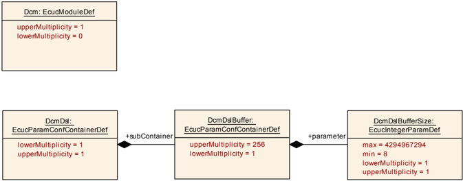

##### 9.2.4.3. DcmDslCallbackDCMRequestService

| 属性 | 值 |
| --- | --- |
| 容器名称 | DcmDslCallbackDCMRequestService |
| 父容器 | DcmDsl |
| 描述 | 每个 DcmDslCallbackDCMRequestService 容器定义一个带有 CallbackDCMRequestServices 接口的 R-Port，**Dcm** 使用该接口向应用软件请求协议切换许可。R-Port 命名为 CallbackDCMRequestServices_&lt;SWC&gt;，其中 &lt;SWC&gt; 为该容器的名称。 |
| 配置参数 | 配置参数 |

无包含的容器。

##### 9.2.4.4. DcmDslDiagResp

| 属性 | 值 |
| --- | --- |
| 容器名称 | DcmDslDiagResp |
| 父容器 | DcmDsl |
| 描述 | 此容器包含 **Dcm** 的自动 requestCorrectlyReceived ResponsePending 响应管理配置。 |
| 配置参数 | 配置参数 |

参数 DcmDslDiagRespMaxNumRespPend 的定义：

| 属性 | 值 |
| --- | --- |
| 参数名称 | DcmDslDiagRespMaxNumRespPend |
| 父容器 | DcmDslDiagResp |
| 描述 | 对每个请求允许发送的、响应码为 0x78（requestCorrectlyReceivedResponsePending）的负响应的最大数量。如果 **Dcm** 达到此上限，则自动发送 0x10（generalReject）最终响应，并取消服务处理。值 0x00 表示不发送 NRC 0x78 响应。 |
| 多重性 | 0..1 |
| 类型 | EcucIntegerParamDef |
| 范围 | 0…255 |
| 默认值 | - |
| Post-Build 变体值 | false |
| 值配置类 | Pre-compile time：X（VARIANT-PRE-COMPILE、VARIANT-POST-BUILD）；Link time：X（VARIANT-LINK-TIME）；Post-build time：- |
| 作用域/依赖 | scope: ECU |

参数 DcmDslDiagRespOnSecondDeclinedRequest 的定义：

| 属性 | 值 |
| --- | --- |
| 参数名称 | DcmDslDiagRespOnSecondDeclinedRequest |
| 父容器 | DcmDslDiagResp |
| 描述 | 定义第二个请求（ClientB）无法处理时（例如优先级评估导致无法处理）的反应。* **true**：无法处理第二个请求（ClientB）时，应以 NRC 0x21 BusyRepeatRequest 响应。* **false**：无法处理第二个请求（ClientB）时，不作响应。 |
| 多重性 | 1 |
| 类型 | EcucBooleanParamDef |
| 默认值 | - |
| Post-Build 变体值 | false |
| 值配置类 | Pre-compile time：X（VARIANT-PRE-COMPILE、VARIANT-POST-BUILD）；Link time：X（VARIANT-LINK-TIME）；Post-build time：- |
| 作用域/依赖 | scope: ECU |

无包含的容器。


##### 9.2.4.5. DcmDslProtocol

| 属性 | 值 |
| --- | --- |
| 容器名称 | DcmDslProtocol |
| 父容器 | DcmDsl |
| 描述 | 此容器包含 **Dcm** 中使用的诊断协议配置。 |
| 配置参数 | 配置参数 |

| 容器名称 | 多重性 | 作用域/依赖 |
| --- | --- | --- |
| DcmDslProtocolRow | 1..* | 此容器包含 **Dcm** 中某个特定诊断协议的配置。 |

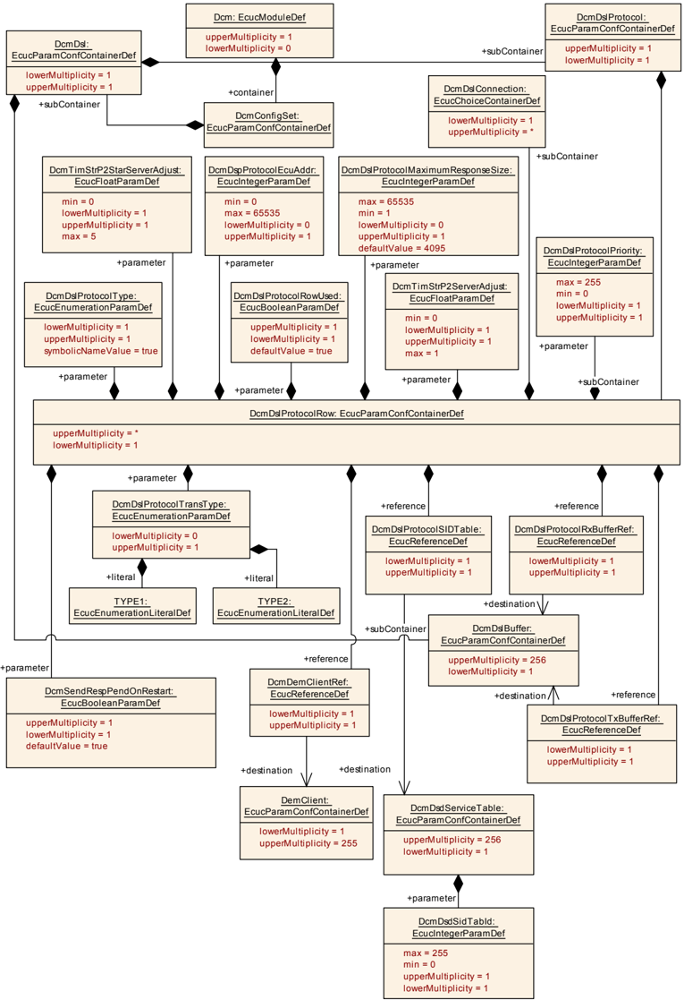

##### 9.2.4.6. DcmDslProtocolRow

| 属性 | 值 |
| --- | --- |
| 容器名称 | DcmDslProtocolRow |
| 父容器 | DcmDslProtocol |
| 描述 | 此容器包含 **Dcm** 中某个特定诊断协议的配置。 |
| 配置参数 | 配置参数 |

参数 DcmDslProtocolMaximumResponseSize 的定义：

| 属性 | 值 |
| --- | --- |
| 参数名称 | DcmDslProtocolMaximumResponseSize |
| 父容器 | DcmDslProtocolRow |
| 描述 | 当 DcmPagedBufferEnabled == TRUE 时，此必需参数定义响应消息的最大长度。 |
| 多重性 | 0..1 |
| 类型 | EcucIntegerParamDef |
| 范围 | 1…65535 |
| 默认值 | 4095 |
| Post-Build 变体多重性 | false |
| Post-Build 变体值 | false |
| 多重性配置类 | Pre-compile time：X；Link time：-；Post-build time：- |
| 值配置类 | Pre-compile time：X；Link time：-；Post-build time：- |
| 作用域/依赖 | scope: ECU |

参数 DcmDslProtocolPriority 的定义：

| 属性 | 值 |
| --- | --- |
| 参数名称 | DcmDslProtocolPriority |
| 父容器 | DcmDslProtocolRow |
| 描述 | 协议抢占时使用的协议优先级。高优先级协议可以抢占低优先级协议。数值越小，协议优先级越高：0 表示最高优先级，255 表示最低优先级。 |
| 多重性 | 1 |
| 类型 | EcucIntegerParamDef |
| 范围 | 0…255 |
| 默认值 | - |
| Post-Build 变体值 | false |
| 值配置类 | Pre-compile time：X（VARIANT-PRE-COMPILE、VARIANT-POST-BUILD）；Link time：X（VARIANT-LINK-TIME）；Post-build time：- |
| 作用域/依赖 | scope: ECU |

参数 DcmDslProtocolRowUsed 的定义：

| 属性 | 值 |
| --- | --- |
| 参数名称 | DcmDslProtocolRowUsed |
| 父容器 | DcmDslProtocolRow |
| 描述 | 用于激活或停用某个协议，可用于多用途 ECU。* **true**：协议可用。* **false**：协议不可用。 |
| 多重性 | 1 |
| 类型 | EcucBooleanParamDef |
| 默认值 | true |
| Post-Build 变体值 | true |
| 值配置类 | Pre-compile time：X（VARIANT-PRE-COMPILE）；Link time：X（VARIANT-LINK-TIME）；Post-build time：X（VARIANT-POST-BUILD） |
| 作用域/依赖 | scope: local |

参数 DcmDslProtocolTransType 的定义：

| 属性 | 值 |
| --- | --- |
| 参数名称 | DcmDslProtocolTransType |
| 父容器 | DcmDslProtocolRow |
| 描述 | 仅当协议类型为 DCM_ROE_ON_xxx 时使用此参数。此参数选择协议的传输类型。 |
| 多重性 | 0..1 |
| 类型 | EcucEnumerationParamDef |
| 取值 TYPE1 | 在已用于常规诊断响应的 DcmTxPduId 上发送消息。输出消息必须与优先级更高的“常规输出消息”同步。 |
| 取值 TYPE2 | 在单独的 DcmTxPduId 上发送消息。 |
| Post-Build 变体多重性 | false |
| Post-Build 变体值 | false |
| 值配置类 | Pre-compile time：X（VARIANT-PRE-COMPILE、VARIANT-POST-BUILD）；Link time：X（VARIANT-LINK-TIME）；Post-build time：- |
| 作用域/依赖 | scope: ECU |

参数 DcmDslProtocolType 的定义：

| 属性 | 值 |
| --- | --- |
| 参数名称 | DcmDslProtocolType |
| 父容器 | DcmDslProtocolRow |
| 描述 | 所配置的 DCM DSL 协议类型。实现类型：Dcm_ProtocolType。 |
| 多重性 | 1 |
| 类型 | EcucEnumerationParamDef（为此参数生成符号名称） |
| 取值 `DCM_OBD_ON_CAN` | OBD on CAN（ISO 15765-4；ISO 15031-5） |
| 取值 `DCM_OBD_ON_FLEXRAY` | - |
| 取值 `DCM_OBD_ON_IP` | - |
| 取值 `DCM_PERIODICTRANS_ON_CAN` | - |
| 取值 `DCM_PERIODICTRANS_ON_FLEXRAY` | - |
| 取值 `DCM_PERIODICTRANS_ON_IP` | - |
| 取值 `DCM_ROE_ON_CAN` | - |
| 取值 `DCM_ROE_ON_FLEXRAY` | - |
| 取值 `DCM_ROE_ON_IP` | - |
| 取值 `DCM_SUPPLIER_1` | 保留供软件供应商特定使用 |
| 取值 `DCM_SUPPLIER_10` | 保留供软件供应商特定使用 |
| 取值 `DCM_SUPPLIER_11` | 保留供软件供应商特定使用 |
| 取值 `DCM_SUPPLIER_12` | 保留供软件供应商特定使用 |
| 取值 `DCM_SUPPLIER_13` | 保留供软件供应商特定使用 |
| 取值 `DCM_SUPPLIER_14` | 保留供软件供应商特定使用 |
| 取值 `DCM_SUPPLIER_15` | 保留供软件供应商特定使用 |
| 取值 `DCM_SUPPLIER_2` | 保留供软件供应商特定使用 |
| 取值 `DCM_SUPPLIER_3` | 保留供软件供应商特定使用 |
| 取值 `DCM_SUPPLIER_4` | 保留供软件供应商特定使用 |
| 取值 `DCM_SUPPLIER_5` | 保留供软件供应商特定使用 |
| 取值 `DCM_SUPPLIER_6` | 保留供软件供应商特定使用 |
| 取值 `DCM_SUPPLIER_7` | 保留供软件供应商特定使用 |
| 取值 `DCM_SUPPLIER_8` | 保留供软件供应商特定使用 |
| 取值 `DCM_SUPPLIER_9` | 保留供软件供应商特定使用 |
| 取值 `DCM_UDS_ON_CAN` | CAN 上的 UDS（ISO 15765-3；ISO 14229-1） |
| 取值 `DCM_UDS_ON_FLEXRAY` | FlexRay 上的 UDS（制造商特定；ISO 14229-1） |
| 取值 `DCM_UDS_ON_IP` | - |
| 取值 `DCM_UDS_ON_LIN` | - |
| Post-Build 变体值 | false |
| 值配置类 | Pre-compile time：X（All Variants）；Link time：-；Post-build time：- |
| 作用域/依赖 | scope: ECU |

参数 DcmDspProtocolEcuAddr 的定义：

| 属性 | 值 |
| --- | --- |
| 参数名称 | DcmDspProtocolEcuAddr |
| 父容器 | DcmDslProtocolRow |
| 描述 | 用于诊断通信的 ECU 源地址。通用连接需要此参数。 |
| 多重性 | 0..1 |
| 类型 | EcucIntegerParamDef |
| 范围 | 0…65535 |
| 默认值 | - |
| Post-Build 变体值 | false |
| 值配置类 | Pre-compile time：X（All Variants）；Link time：-；Post-build time：- |
| 作用域/依赖 | scope: ECU |

参数 DcmSendRespPendOnRestart 的定义：

| 属性 | 值 |
| --- | --- |
| 参数名称 | DcmSendRespPendOnRestart |
| 父容器 | DcmDslProtocolRow |
| 描述 | 如果设置为 **true**，在跳转到 Bootloader 或执行 ECU 复位之前，**Dcm** 会发送 NRC 0x78；如果设置为 **false**，则在此情况下不发送 0x78。 |
| 多重性 | 1 |
| 类型 | EcucBooleanParamDef |
| 默认值 | true |
| Post-Build 变体值 | false |
| 值配置类 | Pre-compile time：X（VARIANT-PRE-COMPILE、VARIANT-POST-BUILD）；Link time：X（VARIANT-LINK-TIME）；Post-build time：- |
| 作用域/依赖 | scope: local |

参数 DcmTimStrP2ServerAdjust 的定义：

| 属性 | 值 |
| --- | --- |
| 参数名称 | DcmTimStrP2ServerAdjust |
| 父容器 | DcmDslProtocolRow |
| 描述 | 调整当前 DcmDspSessionP2ServerMax，以确保诊断响应在 P2 到期前可在总线上发送。此参数主要表示从 **DCM** 启动传输到消息实际发送到总线之间、取决于软件架构的通信延迟。参数值以秒为单位，并且必须为 DcmTaskTime 的整数倍。 |
| 多重性 | 1 |
| 类型 | EcucFloatParamDef |
| 范围 | [0 .. 1] |
| 默认值 | - |
| Post-Build 变体值 | false |
| 值配置类 | Pre-compile time：X（VARIANT-PRE-COMPILE、VARIANT-POST-BUILD）；Link time：X（VARIANT-LINK-TIME）；Post-build time：- |
| 作用域/依赖 | scope: ECU |

参数 DcmTimStrP2StarServerAdjust 的定义：

| 属性 | 值 |
| --- | --- |
| 参数名称 | DcmTimStrP2StarServerAdjust |
| 父容器 | DcmDslProtocolRow |
| 描述 | 调整当前 DcmDspSessionP2StarServerMax，以确保诊断响应在 P2* 到期前可在总线上发送。此参数主要表示从 **DCM** 启动传输到消息实际发送到总线之间、取决于软件架构的通信延迟。参数值以秒为单位，并且必须为 DcmTaskTime 的整数倍。 |
| 多重性 | 1 |
| 类型 | EcucFloatParamDef |
| 范围 | [0 .. 5] |
| 默认值 | - |
| Post-Build 变体值 | false |
| 值配置类 | Pre-compile time：X（VARIANT-PRE-COMPILE、VARIANT-POST-BUILD）；Link time：X（VARIANT-LINK-TIME）；Post-build time：- |
| 作用域/依赖 | scope: ECU |

参数 DcmDemClientRef 的定义：

| 属性 | 值 |
| --- | --- |
| 参数名称 | DcmDemClientRef |
| 父容器 | DcmDslProtocolRow |
| 描述 | 对 Dem 配置中的 DemClient 的引用。Dem 使用此引用区分不同的客户端调用。 |
| 多重性 | 1 |
| 类型 | 对 DemClient 的引用 |
| Post-Build 变体多重性 | false |
| Post-Build 变体值 | false |
| 多重性配置类 | Pre-compile time：X；Link time：-；Post-build time：- |
| 值配置类 | Pre-compile time：X；Link time：-；Post-build time：- |
| 作用域/依赖 | scope: ECU |

参数 DcmDslProtocolRxBufferRef 的定义：

| 属性 | 值 |
| --- | --- |
| 参数名称 | DcmDslProtocolRxBufferRef |
| 父容器 | DcmDslProtocolRow |
| 描述 | 对已配置诊断缓冲区的引用，该缓冲区用于此协议的诊断请求接收。 |
| 多重性 | 1 |
| 类型 | 对 DcmDslBuffer 的引用 |
| Post-Build 变体值 | false |
| 值配置类 | Pre-compile time：X（VARIANT-PRE-COMPILE、VARIANT-POST-BUILD）；Link time：X（VARIANT-LINK-TIME）；Post-build time：- |
| 作用域/依赖 | scope: ECU |

参数 DcmDslProtocolSIDTable 的定义：

| 属性 | 值 |
| --- | --- |
| 参数名称 | DcmDslProtocolSIDTable |
| 父容器 | DcmDslProtocolRow |
| 描述 | 对服务表的引用，该表用于此协议的诊断请求处理。 |
| 多重性 | 1 |
| 类型 | 对 DcmDsdServiceTable 的引用 |
| Post-Build 变体值 | false |
| 值配置类 | Pre-compile time：X（VARIANT-PRE-COMPILE、VARIANT-POST-BUILD）；Link time：X（VARIANT-LINK-TIME）；Post-build time：- |
| 作用域/依赖 | scope: ECU |

参数 DcmDslProtocolTxBufferRef 的定义：

| 属性 | 值 |
| --- | --- |
| 参数名称 | DcmDslProtocolTxBufferRef |
| 父容器 | DcmDslProtocolRow |
| 描述 | 对已配置诊断缓冲区的引用，该缓冲区用于此协议的诊断响应传输。 |
| 多重性 | 1 |
| 类型 | 对 DcmDslBuffer 的引用 |
| Post-Build 变体值 | false |
| 值配置类 | Pre-compile time：X（VARIANT-PRE-COMPILE、VARIANT-POST-BUILD）；Link time：X（VARIANT-LINK-TIME）；Post-build time：- |
| 作用域/依赖 | scope: ECU |

| 容器名称 | 多重性 | 作用域/依赖 |
| --- | --- | --- |
| DcmDslConnection | 1..* | 此容器包含特定协议的通信通道配置。请注意，一个协议可以与多个测试仪通信，因此可为一个协议配置多个连接。 |

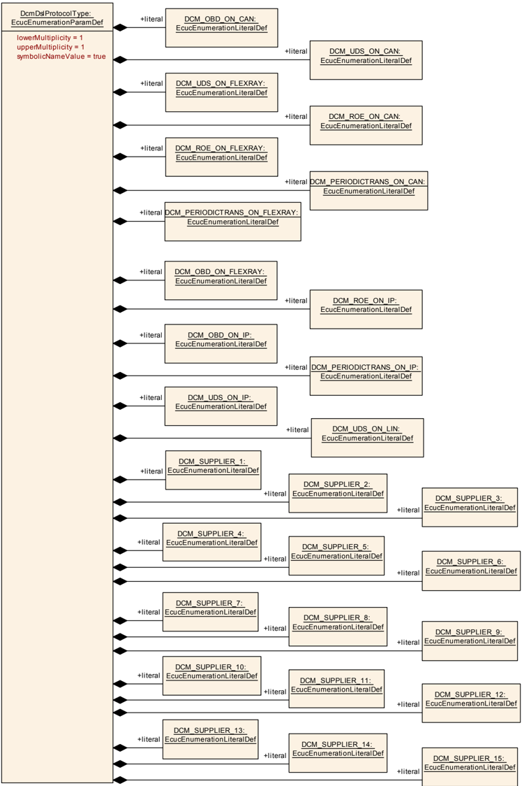


##### 9.2.4.7. DcmDslConnection

| 属性 | 值 |
| --- | --- |
| 选择容器名称 | DcmDslConnection |
| 父容器 | DcmDslProtocolRow |
| 描述 | 此容器包含特定协议的通信通道配置。请注意，一个协议可以与多个测试仪通信，因此可为一个协议配置多个连接。 |

| 容器名称 | 多重性 | 作用域/依赖 |
| --- | --- | --- |
| DcmDslMainConnection | 0..1 | 此容器包含诊断协议主连接的配置。此外，如果协议类型或协议传输类型需要，也可包含对 ROE 和周期连接的引用。 |
| DcmDslPeriodicTransmission | 0..1 | 此容器包含周期传输连接的配置。 |

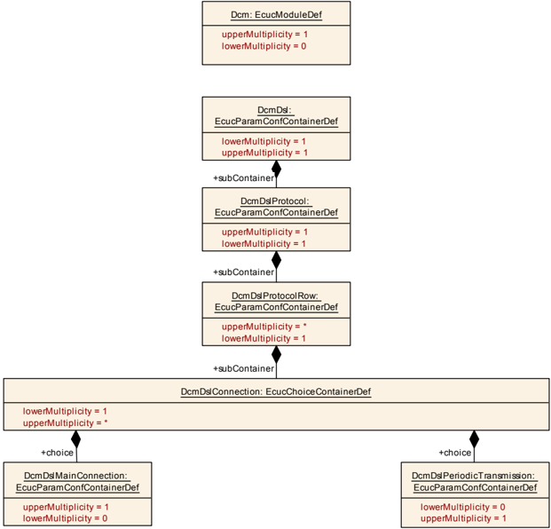

##### 9.2.4.8. DcmDslMainConnection

| 属性 | 值 |
| --- | --- |
| 容器名称 | DcmDslMainConnection |
| 父容器 | DcmDslConnection |
| 描述 | 此容器包含诊断协议主连接的配置。此外，如果协议类型或协议传输类型需要，也可包含对 ROE 和周期连接的引用。 |
| 配置参数 | 配置参数 |

参数 DcmDslProtocolRxConnectionId 的定义：

| 属性 | 值 |
| --- | --- |
| 参数名称 | DcmDslProtocolRxConnectionId |
| 父容器 | DcmDslMainConnection |
| 描述 | 用于诊断通信的测试仪唯一标识符。 |
| 多重性 | 1 |
| 类型 | EcucIntegerParamDef（为此参数生成符号名称） |
| 范围 | 0…65535 |
| 默认值 | - |
| Post-Build 变体多重性 | false |
| Post-Build 变体值 | false |
| 多重性配置类 | Pre-compile time：X（All Variants）；Link time：-；Post-build time：- |
| 值配置类 | Pre-compile time：X（VARIANT-PRE-COMPILE、VARIANT-POST-BUILD）；Link time：X（VARIANT-LINK-TIME）；Post-build time：- |
| 作用域/依赖 | scope: ECU |

参数 DcmDslProtocolRxTesterSourceAddr 的定义：

| 属性 | 值 |
| --- | --- |
| 参数名称 | DcmDslProtocolRxTesterSourceAddr |
| 父容器 | DcmDslMainConnection |
| 描述 | 测试仪源地址用于唯一标识客户端，例如在跳转到 Bootloader 的接口中使用。通用连接（Dcm PDU 的 MetaDataLength >= 1）不需要此参数。 |
| 多重性 | 0..1 |
| 类型 | EcucIntegerParamDef |
| 范围 | 0…65535 |
| 默认值 | - |
| Post-Build 变体多重性 | false |
| Post-Build 变体值 | false |
| 多重性配置类 | Pre-compile time：X（All Variants）；Link time：-；Post-build time：- |
| 值配置类 | Pre-compile time：X（VARIANT-PRE-COMPILE、VARIANT-POST-BUILD）；Link time：X（VARIANT-LINK-TIME）；Post-build time：- |
| 作用域/依赖 | scope: ECU |

参数 DcmDslPeriodicTransmissionConRef 的定义：

| 属性 | 值 |
| --- | --- |
| 参数名称 | DcmDslPeriodicTransmissionConRef |
| 父容器 | DcmDslMainConnection |
| 描述 | 对周期传输连接的引用，该连接用于处理周期传输事件。 |
| 多重性 | 0..1 |
| 类型 | 对 DcmDslPeriodicTransmission 的引用 |
| Post-Build 变体多重性 | false |
| Post-Build 变体值 | false |
| 多重性配置类 | Pre-compile time：X（All Variants）；Link time：-；Post-build time：- |
| 值配置类 | Pre-compile time：X（VARIANT-PRE-COMPILE、VARIANT-POST-BUILD）；Link time：X（VARIANT-LINK-TIME）；Post-build time：- |
| 作用域/依赖 | scope: ECU |

参数 DcmDslProtocolComMChannelRef 的定义：

| 属性 | 值 |
| --- | --- |
| 参数名称 | DcmDslProtocolComMChannelRef |
| 父容器 | DcmDslMainConnection |
| 描述 | 对 ComMChannel 的引用；DcmDslProtocolRxPdu 在该通道上接收，DcmDslProtocolTxPdu 在该通道上发送。 |
| 多重性 | 1 |
| 类型 | 对 ComMChannel 的符号名称引用 |
| Post-Build 变体值 | false |
| 值配置类 | Pre-compile time：X（VARIANT-PRE-COMPILE、VARIANT-POST-BUILD）；Link time：X（VARIANT-LINK-TIME）；Post-build time：- |
| 作用域/依赖 | scope: ECU |

| 容器名称 | 多重性 | 作用域/依赖 |
| --- | --- | --- |
| DcmDslProtocolRx | 1..* | 此容器包含诊断连接接收通道的配置参数。该接收通道引用的 PDU 可以使用 SOURCE_ADDRESS_16 和 TARGET_ADDRESS_16 类型的元数据项。 |
| DcmDslProtocolTx | 0..1 | 此容器包含诊断连接发送通道的配置参数。该发送通道引用的 PDU 可以生成 TARGET_ADDRESS_16 和 SOURCE_ADDRESS_16 类型的元数据项。 |

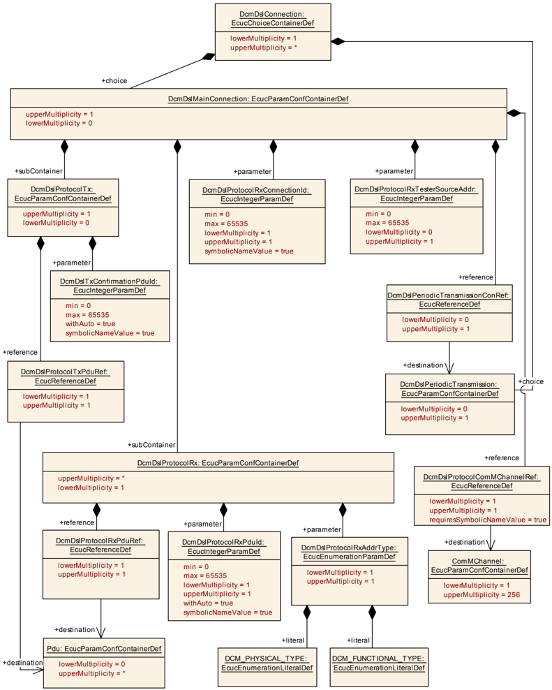

##### 9.2.4.9. DcmDslProtocolRx

| 属性 | 值 |
| --- | --- |
| 容器名称 | DcmDslProtocolRx |
| 父容器 | DcmDslMainConnection |
| 描述 | 此容器包含诊断连接接收通道的配置参数。该接收通道引用的 PDU 可以使用 SOURCE_ADDRESS_16 和 TARGET_ADDRESS_16 类型的元数据项。 |
| 配置参数 | 配置参数 |

参数 DcmDslProtocolRxAddrType 的定义：

| 属性 | 值 |
| --- | --- |
| 参数名称 | DcmDslProtocolRxAddrType |
| 父容器 | DcmDslProtocolRx |
| 描述 | 选择接收通道的寻址类型。物理寻址用于 1:1 通信，功能寻址用于 1:N 通信。详情参见 ISO 14229-1。 |
| 多重性 | 1 |
| 类型 | EcucEnumerationParamDef |
| 取值 `DCM_FUNCTIONAL_TYPE` | 功能寻址：1 对 n 通信 |
| 取值 `DCM_PHYSICAL_TYPE` | 物理寻址：使用物理寻址进行 1 对 1 通信 |
| Post-Build 变体值 | false |
| 值配置类 | Pre-compile time：X（VARIANT-PRE-COMPILE、VARIANT-POST-BUILD）；Link time：X（VARIANT-LINK-TIME）；Post-build time：- |
| 作用域/依赖 | scope: ECU |

参数 DcmDslProtocolRxPduId 的定义：

| 属性 | 值 |
| --- | --- |
| 参数名称 | DcmDslProtocolRxPduId |
| 父容器 | DcmDslProtocolRx |
| 描述 | 用于此接收通道的 PDU 标识符。 |
| 多重性 | 1 |
| 类型 | EcucIntegerParamDef（为此参数生成符号名称） |
| 范围 | 0…65535 |
| 默认值 | - |
| Post-Build 变体值 | false |
| 值配置类 | Pre-compile time：X（All Variants）；Link time：-；Post-build time：- |
| 作用域/依赖 | scope: ECU |

参数 DcmDslProtocolRxPduRef 的定义：

| 属性 | 值 |
| --- | --- |
| 参数名称 | DcmDslProtocolRxPduRef |
| 父容器 | DcmDslProtocolRx |
| 描述 | 对 EcuC 中 PDU 的引用，该 PDU 用于此接收通道。 |
| 多重性 | 1 |
| 类型 | 对 Pdu 的引用 |
| Post-Build 变体值 | false |
| 值配置类 | Pre-compile time：X（VARIANT-PRE-COMPILE、VARIANT-POST-BUILD）；Link time：X（VARIANT-LINK-TIME）；Post-build time：- |
| 作用域/依赖 | scope: ECU |

无包含的容器。

##### 9.2.4.10. DcmDslProtocolTx

| 属性 | 值 |
| --- | --- |
| 容器名称 | DcmDslProtocolTx |
| 父容器 | DcmDslMainConnection |
| 描述 | 此容器包含诊断连接发送通道的配置参数。该发送通道引用的 PDU 可以生成 TARGET_ADDRESS_16 和 SOURCE_ADDRESS_16 类型的元数据项。 |
| 配置参数 | 配置参数 |

参数 DcmDslTxConfirmationPduId 的定义：

| 属性 | 值 |
| --- | --- |
| 参数名称 | DcmDslTxConfirmationPduId |
| 父容器 | DcmDslProtocolTx |
| 描述 | 下层模块用于确认此通道响应传输的 PDU 标识符。 |
| 多重性 | 1 |
| 类型 | EcucIntegerParamDef（为此参数生成符号名称） |
| 范围 | 0…65535 |
| 默认值 | - |
| Post-Build 变体值 | false |
| 值配置类 | Pre-compile time：X（All Variants）；Link time：-；Post-build time：- |
| 作用域/依赖 | scope: ECU |

参数 DcmDslProtocolTxPduRef 的定义：

| 属性 | 值 |
| --- | --- |
| 参数名称 | DcmDslProtocolTxPduRef |
| 父容器 | DcmDslProtocolTx |
| 描述 | 对 EcuC 中 PDU 的引用，该 PDU 用于此发送通道。 |
| 多重性 | 1 |
| 类型 | 对 Pdu 的引用 |
| Post-Build 变体值 | false |
| 值配置类 | Pre-compile time：X（VARIANT-PRE-COMPILE、VARIANT-POST-BUILD）；Link time：X（VARIANT-LINK-TIME）；Post-build time：- |
| 作用域/依赖 | scope: ECU |

无包含的容器。

##### 9.2.4.11. DcmDslPeriodicTransmission

| 属性 | 值 |
| --- | --- |
| 容器名称 | DcmDslPeriodicTransmission |
| 父容器 | DcmDslConnection |
| 描述 | 此容器包含周期传输连接的配置。 |
| 配置参数 | 配置参数 |

| 容器名称 | 多重性 | 作用域/依赖 |
| --- | --- | --- |
| DcmDslPeriodicConnection | 0..255 | 此容器包含周期传输连接的发送通道配置。该发送通道引用的 PDU 可以生成 TARGET_ADDRESS_16 和 SOURCE_ADDRESS_16 类型的元数据项。 |

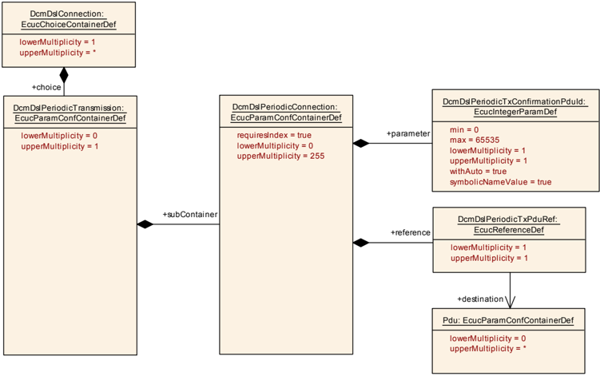

##### 9.2.4.12. DcmDslPeriodicConnection

| 属性 | 值 |
| --- | --- |
| 容器名称 | DcmDslPeriodicConnection |
| 父容器 | DcmDslPeriodicTransmission |
| 描述 | 此容器包含周期传输连接的发送通道配置。该发送通道引用的 PDU 可以生成 TARGET_ADDRESS_16 和 SOURCE_ADDRESS_16 类型的元数据项。属性：requiresIndex=true。 |
| 配置参数 | 配置参数 |

参数 DcmDslPeriodicTxConfirmationPduId 的定义：

| 属性 | 值 |
| --- | --- |
| 参数名称 | DcmDslPeriodicTxConfirmationPduId |
| 父容器 | DcmDslPeriodicConnection |
| 描述 | 下层模块用于确认此通道响应传输的 PDU 标识符。 |
| 多重性 | 1 |
| 类型 | EcucIntegerParamDef（为此参数生成符号名称） |
| 范围 | 0…65535 |
| 默认值 | - |
| Post-Build 变体值 | false |
| 值配置类 | Pre-compile time：X（All Variants）；Link time：-；Post-build time：- |
| 作用域/依赖 | scope: ECU |

参数 DcmDslPeriodicTxPduRef 的定义：

| 属性 | 值 |
| --- | --- |
| 参数名称 | DcmDslPeriodicTxPduRef |
| 父容器 | DcmDslPeriodicConnection |
| 描述 | 对 EcuC 中 PDU 的引用，该 PDU 用于此周期发送通道。 |
| 多重性 | 1 |
| 类型 | 对 Pdu 的引用 |
| Post-Build 变体值 | false |
| 值配置类 | Pre-compile time：X（VARIANT-PRE-COMPILE、VARIANT-POST-BUILD）；Link time：X（VARIANT-LINK-TIME）；Post-build time：- |
| 作用域/依赖 | scope: ECU |

无包含的容器。

#### 9.2.5. DcmDsp

| 属性 | 值 |
| --- | --- |
| 容器名称 | DcmDsp |
| 父容器 | DcmConfigSet |
| 描述 | 这些参数适用于诊断服务处理。每个 Dcm 始终有一组此类参数。请注意，尽管多重性为 0..1，仍可认为任何有效的 DCM 配置中都存在此容器。 |
| 配置参数 | 配置参数 |

参数 DcmDspDataDefaultEndianness 的定义：

| 属性 | 值 |
| --- | --- |
| 参数名称 | DcmDspDataDefaultEndianness |
| 父容器 | DcmDsp |
| 描述 | 如果 DID、RID 或 PID 的相应数据未定义字节序，则此参数定义其默认字节序。 |
| 多重性 | 1 |
| 类型 | EcucEnumerationParamDef |
| 取值 `BIG_ENDIAN` | 最高有效字节存储在最低地址。 |
| 取值 `LITTLE_ENDIAN` | 最高有效字节存储在最高地址。 |
| 取值 `OPAQUE` | 不透明数据字节序。 |
| Post-Build 变体值 | false |
| 值配置类 | Pre-compile time：X（VARIANT-PRE-COMPILE、VARIANT-POST-BUILD）；Link time：X（VARIANT-LINK-TIME）；Post-build time：- |
| 作用域/依赖 | scope: local |

参数 DcmDspDDDIDcheckPerSourceDID 的定义：

| 属性 | 值 |
| --- | --- |
| 参数名称 | DcmDspDDDIDcheckPerSourceDID |
| 父容器 | DcmDsp |
| 描述 | 定义在 ReadDataByIdentifier（0x22）请求访问范围 0xF200 至 0xF3FF 内的 DID 时，是否逐个源 DID 检查会话、安全级别和模式依赖。* **true**：**Dcm** 模块逐个源 DID 执行上述检查。* **false**：**Dcm** 模块不逐个源 DID 执行上述检查。 |
| 多重性 | 0..1 |
| 类型 | EcucBooleanParamDef |
| 默认值 | - |
| Post-Build 变体多重性 | false |
| Post-Build 变体值 | false |
| 多重性配置类 | Pre-compile time：X（VARIANT-PRE-COMPILE、VARIANT-POST-BUILD）；Link time：X（VARIANT-LINK-TIME）；Post-build time：- |
| 值配置类 | Pre-compile time：X（VARIANT-PRE-COMPILE、VARIANT-POST-BUILD）；Link time：X（VARIANT-LINK-TIME）；Post-build time：- |
| 作用域/依赖 | scope: local |

参数 DcmDspEnableObdMirror 的定义：

| 属性 | 值 |
| --- | --- |
| 参数名称 | DcmDspEnableObdMirror |
| 父容器 | DcmDsp |
| 描述 | 定义是否在收到 UDS ReadDataByIdentifier（0x22）服务时，使 OBD 范围（F400–F4FF）内的 DID 和 OBD InfoType 范围（F800–F8FF）内的 DID 返回 OBD 所定义的 DID 值；也定义在收到 UDS RoutineControl（0x31）服务时，是否按 OBD 的规定处理 OBD 范围（E000–E0FF）内的 RID。* **true**：启用 OBD 镜像行为。* **false**：不启用 OBD 镜像行为。 |
| 多重性 | 1 |
| 类型 | EcucBooleanParamDef |
| 默认值 | false |
| Post-Build 变体值 | false |
| 值配置类 | Pre-compile time：X（VARIANT-PRE-COMPILE、VARIANT-POST-BUILD）；Link time：X（VARIANT-LINK-TIME）；Post-build time：- |
| 作用域/依赖 | scope: ECU |

参数 DcmDspMaxDidToRead 的定义：

| 属性 | 值 |
| --- | --- |
| 参数名称 | DcmDspMaxDidToRead |
| 父容器 | DcmDsp |
| 描述 | 指示单个 ReadDataByIdentifier 请求中允许的最大 DID 数量。 |
| 多重性 | 0..1 |
| 类型 | EcucIntegerParamDef |
| 范围 | 1…65535 |
| 默认值 | - |
| Post-Build 变体多重性 | false |
| Post-Build 变体值 | false |
| 多重性配置类 | Pre-compile time：X（VARIANT-PRE-COMPILE、VARIANT-POST-BUILD）；Link time：X（VARIANT-LINK-TIME）；Post-build time：- |
| 值配置类 | Pre-compile time：X（VARIANT-PRE-COMPILE、VARIANT-POST-BUILD）；Link time：X（VARIANT-LINK-TIME）；Post-build time：- |
| 作用域/依赖 | scope: ECU |

参数 DcmDspMaxPeriodicDidToRead 的定义：

| 属性 | 值 |
| --- | --- |
| 参数名称 | DcmDspMaxPeriodicDidToRead |
| 父容器 | DcmDsp |
| 描述 | 指示单个 ReadDataByPeriodicIdentifier 请求中允许读取的最大周期 DID 数量。 |
| 多重性 | 0..1 |
| 类型 | EcucIntegerParamDef |
| 范围 | 1…65535 |
| 默认值 | - |
| Post-Build 变体多重性 | false |
| Post-Build 变体值 | false |
| 多重性配置类 | Pre-compile time：X（VARIANT-PRE-COMPILE、VARIANT-POST-BUILD）；Link time：X（VARIANT-LINK-TIME）；Post-build time：- |
| 值配置类 | Pre-compile time：X（VARIANT-PRE-COMPILE、VARIANT-POST-BUILD）；Link time：X（VARIANT-LINK-TIME）；Post-build time：- |
| 作用域/依赖 | scope: local |

参数 DcmDspPowerDownTime 的定义：

| 属性 | 值 |
| --- | --- |
| 参数名称 | DcmDspPowerDownTime |
| 父容器 | DcmDsp |
| 描述 | 此参数向客户端指示服务器在待机序列的电源关闭阶段至少保持的时间。分辨率为每计数 1 秒。有效值：00–FE（十六进制）表示 0–254 秒的 powerDownTime；FF（十六进制）表示失败或时间不可用。该值应由集成方根据 ECU 能力定义。配置 EcuReset 服务的 enableRapidPowerShutDown 子服务时，必须提供此参数。 |
| 多重性 | 0..1 |
| 类型 | EcucIntegerParamDef |
| 范围 | 0…255 |
| 默认值 | - |
| Post-Build 变体多重性 | false |
| Post-Build 变体值 | false |
| 多重性配置类 | Pre-compile time：X（VARIANT-PRE-COMPILE、VARIANT-POST-BUILD）；Link time：X（VARIANT-LINK-TIME）；Post-build time：- |
| 值配置类 | Pre-compile time：X（VARIANT-PRE-COMPILE、VARIANT-POST-BUILD）；Link time：X（VARIANT-LINK-TIME）；Post-build time：- |
| 作用域/依赖 | scope: ECU |

| 容器名称 | 多重性 | 作用域/依赖 |
| --- | --- | --- |
| DcmDspAuthentication | 0..1 | 此容器包含 UDS Authentication（0x29）服务的配置。 |
| DcmDspClearDTC | 0..1 | 此容器包含 Clear DTC 服务的配置。 |
| DcmDspComControl | 0..1 | 提供 CommunicationControl 机制的配置。 |
| DcmDspCommonAuthorization | 0..* | 此容器包含多个服务/子服务通用的授权配置参数。 |
| DcmDspControlDTCSetting | 0..1 | 提供 ControlDTCSetting 机制的配置。 |
| DcmDspData | 0..* | 此容器包含属于 DID 的某个 Data 的配置参数。 |
| DcmDspDataInfo | 0..* | 此容器包含某个 Data 的配置参数。 |
| DcmDspDid | 0..* | 此容器包含 DID 的配置参数。 |
| DcmDspDidInfo | 0..* | 此容器包含 DID 信息的配置参数。 |
| DcmDspDidRange | 0..* | 此容器定义 DID 范围。 |
| DcmDspEcuReset | 0..1 | 此容器包含 DcmDspEcuReset 服务的配置。 |
| DcmDspMemory | 0..1 | 此容器包含内存访问的配置。 |
| DcmDspMemoryTransfer | 0..1 | 此容器包含内存传输的配置。 |
| DcmDspPeriodicTransmission | 0..1 | 此容器包含周期传输调度器的配置参数。 |
| DcmDspPid | 0..* | 此容器定义 DCM 中 PID 的可用性。 |
| DcmDspReadDTCInformation | 0..1 | 提供 UDS ReadDTCInformation 服务处理的进一步配置。 |
| DcmDspRequestControl | 0..* | 此容器包含“请求控制车载系统、测试或部件”服务（服务 $08）的配置参数。DCM 将通过需要 RequestControlServices_{Tid} PortInterface 的 R-Port 请求控制。R-Port 命名为 RequestControlServices_{Tid}，其中 {Tid} 为 DcmDspRequestControl 容器的名称。 |
| DcmDspRequestFileTransfer | 0..1 | 此容器包含 RequestFileTransfer 的配置；仅当配置了 RequestFileTransfer 时才存在。 |
| DcmDspRoe | 0..1 | 提供 ResponseOnEvent 机制的配置。 |
| DcmDspRoutine | 0..* | 此容器包含例程的配置参数。 |
| DcmDspSecurity | 1 | 此容器包含安全级别配置的 DSP 参数（每个安全级别一组）；该容器包含 DcmDspSecurityRow。 |
| DcmDspSession | 1 | 父容器，其中包含用于配置特定会话的各行。 |
| DcmDspVehInfo | 0..* | 此容器包含单个 VehicleInfoType（服务 $09）的配置参数。 |

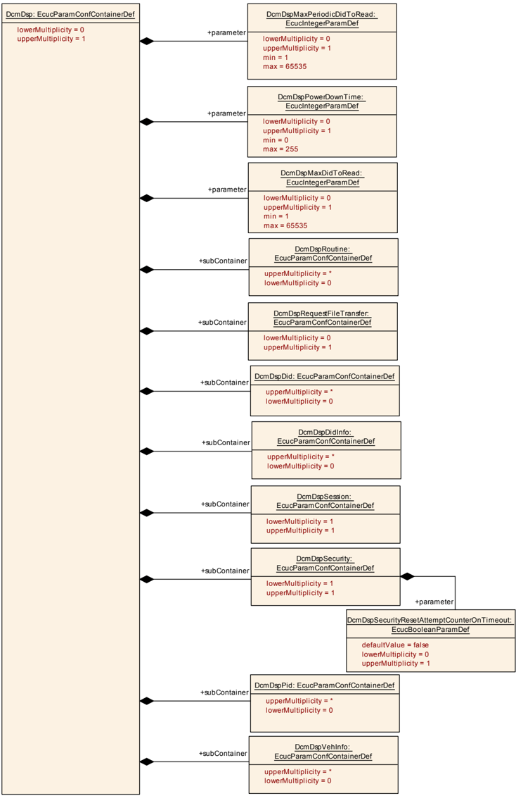

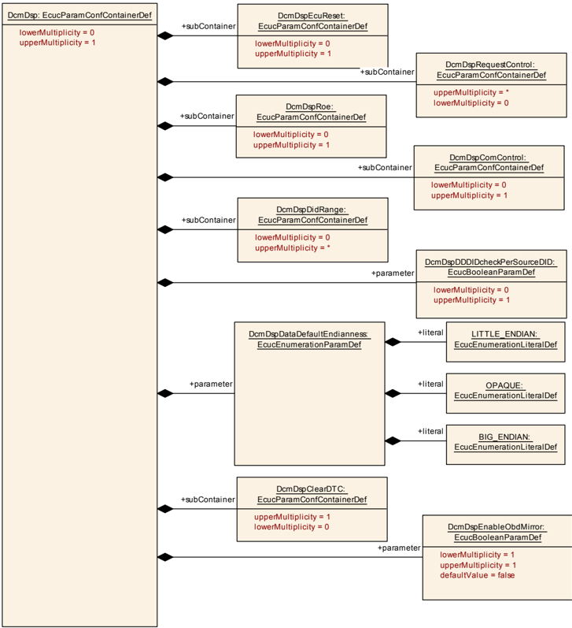

##### 9.2.5.1. DcmDspReadDTCInformation

| 属性 | 值 |
| --- | --- |
| 容器名称 | DcmDspReadDTCInformation |
| 父容器 | DcmDsp |
| 描述 | 为 UDS ReadDTCInformation 服务处理提供进一步配置。 |
| 配置参数 | 配置参数 |

参数 DcmDspReadDTCInformationSupportedObdUdsDtcSeparation 的定义：

| 属性 | 值 |
| --- | --- |
| 参数名称 | DcmDspReadDTCInformationSupportedObdUdsDtcSeparation |
| 父容器 | DcmDspReadDTCInformation |
| 描述 | **true**：启用 OBD/UDS DTC 分离。未配置此参数或将其设置为 **false** 时，禁用 OBD/UDS DTC 分离。 |
| 多重性 | 0..1 |
| 类型 | EcucBooleanParamDef |
| 默认值 | false |
| Post-Build 变体多重性 | false |
| Post-Build 变体值 | false |
| 值配置类 | Pre-compile time：X（VARIANT-PRE-COMPILE、VARIANT-POST-BUILD）；Link time：X（VARIANT-LINK-TIME）；Post-build time：- |
| 作用域/依赖 | scope: ECU |

| 容器名称 | 多重性 | 作用域/依赖 |
| --- | --- | --- |
| DcmDspReadDTCInformationUserDefinedFaultMemory | 0..255 | 此容器包含 DcmDspReadDTCInformation 中用户自定义故障内存的配置。 |

##### 9.2.5.2. DcmDspReadDTCInformationUserDefinedFaultMemory

| 属性 | 值 |
| --- | --- |
| 容器名称 | DcmDspReadDTCInformationUserDefinedFaultMemory |
| 父容器 | DcmDspReadDTCInformation |
| 描述 | 此容器包含 DcmDspReadDTCInformation 中用户自定义故障内存的配置。 |
| 配置参数 | 配置参数 |

参数 DcmDspReadDTCInformationUserDefinedFaultMemoryId 的定义：

| 属性 | 值 |
| --- | --- |
| 参数名称 | DcmDspReadDTCInformationUserDefinedFaultMemoryId |
| 父容器 | DcmDspReadDTCInformationUserDefinedFaultMemory |
| 描述 | 外部测试仪用于标识用户自定义事件内存的标识符。 |
| 多重性 | 1 |
| 类型 | EcucIntegerParamDef |
| 范围 | 0…255 |
| 默认值 | - |
| Post-Build 变体多重性 | false |
| Post-Build 变体值 | false |
| 值配置类 | Pre-compile time：X（All Variants）；Link time：-；Post-build time：- |
| 作用域/依赖 | scope: ECU |

参数 DcmDspReadDTCInformationUserDefinedFaultMemoryRoleRef 的定义：

| 属性 | 值 |
| --- | --- |
| 参数名称 | DcmDspReadDTCInformationUserDefinedFaultMemoryRoleRef |
| 父容器 | DcmDspReadDTCInformationUserDefinedFaultMemory |
| 描述 | 对 DcmDspAuthenticationRow 的引用，该行定义了可访问此用户自定义内存的角色。 |
| 多重性 | 0..32 |
| 类型 | 对 DcmDspAuthenticationRow 的引用 |
| Post-Build 变体多重性 | true |
| Post-Build 变体值 | true |
| 多重性配置类 | Pre-compile time：X（VARIANT-PRE-COMPILE）；Link time：X（VARIANT-LINK-TIME）；Post-build time：X（VARIANT-POST-BUILD） |
| 值配置类 | Pre-compile time：X（VARIANT-PRE-COMPILE）；Link time：X（VARIANT-LINK-TIME）；Post-build time：X（VARIANT-POST-BUILD） |
| 作用域/依赖 | scope: ECU |

无包含的容器。

##### 9.2.5.3. DcmDspAuthentication

| 属性 | 值 |
| --- | --- |
| 容器名称 | DcmDspAuthentication |
| 父容器 | DcmDsp |
| 描述 | 此容器包含 UDS Authentication（0x29）服务的配置。 |
| 配置参数 | 配置参数 |

参数 DcmDspAuthenticationDefaultSessionTimeOut 的定义：

| 属性 | 值 |
| --- | --- |
| 参数名称 | DcmDspAuthenticationDefaultSessionTimeOut |
| 父容器 | DcmDspAuthentication |
| 描述 | 在没有活动通信的情况下，定义 **Dcm** 转换到未认证状态前经过的秒数。 |
| 多重性 | 0..1 |
| 类型 | EcucFloatParamDef |
| 范围 | [0 .. INF[ |
| 默认值 | - |
| Post-Build 变体多重性 | false |
| Post-Build 变体值 | false |
| 多重性配置类 | Pre-compile time：X；Link time：-；Post-build time：- |
| 值配置类 | Pre-compile time：X；Link time：-；Post-build time：- |
| 作用域/依赖 | scope: ECU |

参数 DcmDspAuthenticationGeneralNRC 的定义：

| 属性 | 值 |
| --- | --- |
| 参数名称 | DcmDspAuthenticationGeneralNRC |
| 父容器 | DcmDspAuthentication |
| 描述 | 当证书或其内容无效时，定义用于替换所有 ISO 14229-1 定义的 NRC 的 NRC。 |
| 多重性 | 0..1 |
| 类型 | EcucIntegerParamDef |
| 范围 | 0…255 |
| 默认值 | - |
| Post-Build 变体多重性 | false |
| Post-Build 变体值 | false |
| 值配置类 | Pre-compile time：X（All Variants）；Link time：-；Post-build time：- |
| 作用域/依赖 | scope: ECU |

参数 DcmDspAuthenticationRoleSize 的定义：

| 属性 | 值 |
| --- | --- |
| 参数名称 | DcmDspAuthenticationRoleSize |
| 父容器 | DcmDspAuthentication |
| 描述 | 定义证书中角色元素的字节大小。 |
| 多重性 | 1 |
| 类型 | EcucIntegerParamDef |
| 范围 | 1…4 |
| 默认值 | - |
| Post-Build 变体多重性 | false |
| Post-Build 变体值 | false |
| 值配置类 | Pre-compile time：X（All Variants）；Link time：-；Post-build time：- |
| 作用域/依赖 | scope: ECU |

参数 DcmDspAuthenticationWhiteListDIDMaxSize 的定义：

| 属性 | 值 |
| --- | --- |
| 参数名称 | DcmDspAuthenticationWhiteListDIDMaxSize |
| 父容器 | DcmDspAuthentication |
| 描述 | 定义证书中白名单元素的最大字节大小。 |
| 多重性 | 0..1 |
| 类型 | EcucIntegerParamDef |
| 范围 | 1…255 |
| 默认值 | - |
| Post-Build 变体多重性 | false |
| Post-Build 变体值 | false |
| 值配置类 | Pre-compile time：X（All Variants）；Link time：-；Post-build time：- |
| 作用域/依赖 | scope: ECU |

参数 DcmDspAuthenticationWhiteListMemorySelectionMaxSize 的定义：

| 属性 | 值 |
| --- | --- |
| 参数名称 | DcmDspAuthenticationWhiteListMemorySelectionMaxSize |
| 父容器 | DcmDspAuthentication |
| 描述 | 定义证书中白名单元素的最大字节大小。 |
| 多重性 | 0..1 |
| 类型 | EcucIntegerParamDef |
| 范围 | 1…255 |
| 默认值 | - |
| Post-Build 变体多重性 | false |
| Post-Build 变体值 | false |
| 值配置类 | Pre-compile time：X（All Variants）；Link time：-；Post-build time：- |
| 作用域/依赖 | scope: ECU |

参数 DcmDspAuthenticationWhiteListRIDMaxSize 的定义：

| 属性 | 值 |
| --- | --- |
| 参数名称 | DcmDspAuthenticationWhiteListRIDMaxSize |
| 父容器 | DcmDspAuthentication |
| 描述 | 定义证书中白名单元素的最大字节大小。 |
| 多重性 | 0..1 |
| 类型 | EcucIntegerParamDef |
| 范围 | 1…255 |
| 默认值 | - |
| Post-Build 变体多重性 | false |
| Post-Build 变体值 | false |
| 值配置类 | Pre-compile time：X（All Variants）；Link time：-；Post-build time：- |
| 作用域/依赖 | scope: ECU |

参数 DcmDspAuthenticationWhiteListServicesMaxSize 的定义：

| 属性 | 值 |
| --- | --- |
| 参数名称 | DcmDspAuthenticationWhiteListServicesMaxSize |
| 父容器 | DcmDspAuthentication |
| 描述 | 定义证书中白名单元素的最大字节大小。 |
| 多重性 | 0..1 |
| 类型 | EcucIntegerParamDef |
| 范围 | 1…255 |
| 默认值 | - |
| Post-Build 变体多重性 | false |
| Post-Build 变体值 | false |
| 值配置类 | Pre-compile time：X（All Variants）；Link time：-；Post-build time：- |
| 作用域/依赖 | scope: ECU |

参数 DcmDspAuthenticationDeauthenticatedRoleRef 的定义：

| 属性 | 值 |
| --- | --- |
| 参数名称 | DcmDspAuthenticationDeauthenticatedRoleRef |
| 父容器 | DcmDspAuthentication |
| 描述 | 对 DcmDspAuthenticationRow 的引用，该行定义用作未认证角色的角色。 |
| 多重性 | 1..32 |
| 类型 | 对 DcmDspAuthenticationRow 的引用 |
| Post-Build 变体多重性 | false |
| Post-Build 变体值 | false |
| 值配置类 | Pre-compile time：X（All Variants）；Link time：-；Post-build time：- |
| 作用域/依赖 | scope: ECU |

参数 DcmDspAuthenticationGeneralNRCModeRuleRef 的定义：

| 属性 | 值 |
| --- | --- |
| 参数名称 | DcmDspAuthenticationGeneralNRCModeRuleRef |
| 父容器 | DcmDspAuthentication |
| 描述 | 定义在证书或其内容无效导致失败时，是否对所有此类失败发送通用 NRC 的模式规则。 |
| 多重性 | 0..1 |
| 类型 | 对 DcmModeRule 的引用 |
| Post-Build 变体多重性 | false |
| Post-Build 变体值 | false |
| 多重性配置类 | Pre-compile time：All Variants；Link time：-；Post-build time：- |
| 值配置类 | Pre-compile time：All Variants；Link time：-；Post-build time：- |
| 作用域/依赖 | scope: ECU |

参数 DcmDspAuthenticationPersistStateModeRuleRef 的定义：

| 属性 | 值 |
| --- | --- |
| 参数名称 | DcmDspAuthenticationPersistStateModeRuleRef |
| 父容器 | DcmDspAuthentication |
| 描述 | 引用一个模式规则，用于定义是否将认证状态持久化到非易失性存储器。 |
| 多重性 | 0..1 |
| 类型 | 对 DcmModeRule 的引用 |
| Post-Build 变体多重性 | false |
| Post-Build 变体值 | false |
| 多重性配置类 | Pre-compile time：X；Link time：-；Post-build time：- |
| 值配置类 | Pre-compile time：X；Link time：-；Post-build time：- |
| 作用域/依赖 | scope: ECU |

| 容器名称 | 多重性 | 作用域/依赖 |
| --- | --- | --- |
| DcmDspAuthenticationConnection | 0..* | 此容器包含 DSL 连接所用的认证配置。 |
| DcmDspAuthenticationRow | 0..31 | 此容器定义单个角色。每个角色对应认证角色位域中的一位。 |
| DcmDspAuthenticationTransmitCertificate | 0..* | 此容器包含 transmitCertificate 子功能的认证配置。 |

###### 9.2.5.3.1. DcmDspAuthenticationTransmitCertificate

| 属性 | 值 |
| --- | --- |
| 容器名称 | DcmDspAuthenticationTransmitCertificate |
| 父容器 | DcmDspAuthentication |
| 描述 | 此容器包含 transmitCertificate 子功能的认证配置。 |
| Post-Build 变体多重性 | false |
| 配置参数 | 配置参数 |

参数 DcmDspAuthenticationTransmitCertificateEvaluationId 的定义：

| 属性 | 值 |
| --- | --- |
| 参数名称 | DcmDspAuthenticationTransmitCertificateEvaluationId |
| 父容器 | DcmDspAuthenticationTransmitCertificate |
| 描述 | 证书评估标识符。 |
| 多重性 | 1 |
| 类型 | EcucIntegerParamDef |
| 范围 | 0…65535 |
| 默认值 | - |
| Post-Build 变体多重性 | false |
| Post-Build 变体值 | false |
| 值配置类 | Pre-compile time：X（All Variants）；Link time：-；Post-build time：- |
| 作用域/依赖 | scope: ECU |

参数 DcmDspAuthenticationTransmitCertificateFunction 的定义：

| 属性 | 值 |
| --- | --- |
| 参数名称 | DcmDspAuthenticationTransmitCertificateFunction |
| 父容器 | DcmDspAuthenticationTransmitCertificate |
| 描述 | 为此证书提供固定语义，从而在 **Dcm** 中触发预定义操作。 |
| 多重性 | 0..1 |
| 类型 | EcucEnumerationParamDef |
| 取值 `SECURE_CODING` | 使用此证书写入经过认证的数据。 |
| Post-Build 变体多重性 | false |
| 多重性配置类 | Pre-compile time：X（All Variants）；Link time：-；Post-build time：- |
| 作用域/依赖 | scope: ECU |

参数 DcmDspAuthenticationTransmitCertificateRef 的定义：

| 属性 | 值 |
| --- | --- |
| 参数名称 | DcmDspAuthenticationTransmitCertificateRef |
| 父容器 | DcmDspAuthenticationTransmitCertificate |
| 描述 | 对用于处理证书的 KeyMCertificate 的引用。 |
| 多重性 | 1 |
| 类型 | 对 KeyMCertificate 的符号名称引用 |
| Post-Build 变体多重性 | false |
| Post-Build 变体值 | false |
| 多重性配置类 | Pre-compile time：All Variants；Link time：-；Post-build time：- |
| 值配置类 | Pre-compile time：All Variants；Link time：-；Post-build time：- |
| 作用域/依赖 | scope: ECU |

无包含的容器。

##### 9.2.5.4. DcmDspAuthenticationRow

| 属性 | 值 |
| --- | --- |
| 容器名称 | DcmDspAuthenticationRow |
| 父容器 | DcmDspAuthentication |
| 描述 | 此容器定义单个角色。每个角色对应认证角色位域中的一位。 |
| 配置参数 | 配置参数 |

参数 DcmDspAuthenticationRoleBitPosition 的定义：

| 属性 | 值 |
| --- | --- |
| 参数名称 | DcmDspAuthenticationRoleBitPosition |
| 父容器 | DcmDspAuthenticationRow |
| 描述 | 定义在认证位域中表示该角色的位编号。位掩码与逻辑位计算对齐：2^(DcmDspAuthenticationRoleBitPosition)。 |
| 多重性 | 1 |
| 类型 | EcucIntegerParamDef |
| 范围 | 0…31 |
| 默认值 | - |
| 作用域/依赖 | - |

无包含的容器。

##### 9.2.5.5. DcmDspAuthenticationConnection

| 属性 | 值 |
| --- | --- |
| 容器名称 | DcmDspAuthenticationConnection |
| 父容器 | DcmDspAuthentication |
| 描述 | 此容器包含 DSL 连接所用的认证配置。 |
| 配置参数 | 配置参数 |

参数 DcmDspAuthenticationEcuChallengeLength 的定义：

| 属性 | 值 |
| --- | --- |
| 参数名称 | DcmDspAuthenticationEcuChallengeLength |
| 父容器 | DcmDspAuthenticationConnection |
| 描述 | ECU 挑战值的字节长度。 |
| 多重性 | 1 |
| 类型 | EcucIntegerParamDef |
| 范围 | 1…65535 |
| 默认值 | - |
| Post-Build 变体值 | false |
| 值配置类 | Pre-compile time：X（All Variants）；Link time：-；Post-build time：- |
| 作用域/依赖 | - |

参数 DcmDspAuthenticationCertificatePublicKeyStoreJobRef 的定义：

| 属性 | 值 |
| --- | --- |
| 参数名称 | DcmDspAuthenticationCertificatePublicKeyStoreJobRef |
| 父容器 | DcmDspAuthenticationConnection |
| 描述 | 对用于将公钥存储到 Csm 中的 CsmJob 的引用。 |
| 多重性 | 1 |
| 类型 | 对 CsmJob 的符号名称引用 |
| Post-Build 变体多重性 | false |
| Post-Build 变体值 | false |
| 多重性配置类 | Pre-compile time：X；Link time：-；Post-build time：- |
| 值配置类 | Pre-compile time：X；Link time：-；Post-build time：- |
| 作用域/依赖 | scope: ECU |

参数 DcmDspAuthenticationClientChallengeSignJobRef 的定义：

| 属性 | 值 |
| --- | --- |
| 参数名称 | DcmDspAuthenticationClientChallengeSignJobRef |
| 父容器 | DcmDspAuthenticationConnection |
| 描述 | 对用于对客户端挑战值签名的作业的引用。 |
| 多重性 | 1 |
| 类型 | 符号名称引用 |
| Post-Build 变体多重性 | false |
| Post-Build 变体值 | false |
| 多重性配置类 | Pre-compile time：X（All Variants）；Link time：-；Post-build time：- |
| 值配置类 | Pre-compile time：X（All Variants）；Link time：-；Post-build time：- |
| 作用域/依赖 | scope: ECU |

参数 DcmDspAuthenticationConnectionCertificateRef 的定义：

| 属性 | 值 |
| --- | --- |
| 参数名称 | DcmDspAuthenticationConnectionCertificateRef |
| 父容器 | DcmDspAuthenticationConnection |
| 描述 | 对用于在 KeyM 中存储证书的 KeyMCertificate 的引用。 |
| 多重性 | 1 |
| 类型 | 对 KeyMCertificate 的符号名称引用 |
| Post-Build 变体多重性 | false |
| Post-Build 变体值 | false |
| 多重性配置类 | Pre-compile time：All Variants；Link time：-；Post-build time：- |
| 值配置类 | Pre-compile time：All Variants；Link time：-；Post-build time：- |
| 作用域/依赖 | scope: ECU |

参数 DcmDspAuthenticationConnectionMainConnectionRef 的定义：

| 属性 | 值 |
| --- | --- |
| 参数名称 | DcmDspAuthenticationConnectionMainConnectionRef |
| 父容器 | DcmDspAuthenticationConnection |
| 描述 | 对使用此认证配置的 DSL 诊断连接的引用。 |
| 多重性 | 1 |
| 类型 | 对 DcmDslMainConnection 的引用 |
| Post-Build 变体多重性 | false |
| Post-Build 变体值 | false |
| 多重性配置类 | Pre-compile time：All Variants；Link time：-；Post-build time：- |
| 值配置类 | Pre-compile time：All Variants；Link time：-；Post-build time：- |
| 作用域/依赖 | scope: ECU |

参数 DcmDspAuthenticationECUCertificateKeyElementRef 的定义：

| 属性 | 值 |
| --- | --- |
| 参数名称 | DcmDspAuthenticationECUCertificateKeyElementRef |
| 父容器 | DcmDspAuthenticationConnection |
| 描述 | 对用于双向认证中服务器证书的 CryptoKeyElement 的引用。 |
| 多重性 | 0..1 |
| 类型 | 对 CryptoKeyElement 的符号名称引用 |
| Post-Build 变体多重性 | false |
| Post-Build 变体值 | false |
| 多重性配置类 | Pre-compile time：X（All Variants）；Link time：-；Post-build time：- |
| 值配置类 | Pre-compile time：X（All Variants）；Link time：-；Post-build time：- |
| 作用域/依赖 | scope: ECU |

参数 DcmDspAuthenticationECUCertificateRef 的定义：

| 属性 | 值 |
| --- | --- |
| 参数名称 | DcmDspAuthenticationECUCertificateRef |
| 父容器 | DcmDspAuthenticationConnection |
| 描述 | 对包含双向认证服务器证书的 KeyMCertificate 的引用。 |
| 多重性 | 0..1 |
| 类型 | 对 CsmKey 的符号名称引用 |
| Post-Build 变体多重性 | false |
| Post-Build 变体值 | false |
| 多重性配置类 | Pre-compile time：All Variants；Link time：-；Post-build time：- |
| 值配置类 | Pre-compile time：All Variants；Link time：-；Post-build time：- |
| 作用域/依赖 | scope: ECU |

参数 DcmDspAuthenticationPublicKeyElementRef 的定义：

| 属性 | 值 |
| --- | --- |
| 参数名称 | DcmDspAuthenticationPublicKeyElementRef |
| 父容器 | DcmDspAuthenticationConnection |
| 描述 | 对证书中包含公钥的证书数据元素的引用。 |
| 多重性 | 1 |
| 类型 | 对 KeyMCertificateElement 的符号名称引用 |
| Post-Build 变体多重性 | false |
| Post-Build 变体值 | false |
| 多重性配置类 | Pre-compile time：All Variants；Link time：-；Post-build time：- |
| 值配置类 | Pre-compile time：All Variants；Link time：-；Post-build time：- |
| 作用域/依赖 | scope: ECU |

参数 DcmDspAuthenticationRandomJobRef 的定义：

| 属性 | 值 |
| --- | --- |
| 参数名称 | DcmDspAuthenticationRandomJobRef |
| 父容器 | DcmDspAuthenticationConnection |
| 描述 | 对用于解析认证证书的证书解析作业的引用。 |
| 多重性 | 1 |
| 类型 | 对 CsmJob 的符号名称引用 |
| Post-Build 变体多重性 | false |
| Post-Build 变体值 | false |
| 多重性配置类 | Pre-compile time：X（All Variants）；Link time：-；Post-build time：- |
| 值配置类 | Pre-compile time：X（All Variants）；Link time：-；Post-build time：- |
| 作用域/依赖 | scope: ECU |

参数 DcmDspAuthenticationRoleElementRef 的定义：

| 属性 | 值 |
| --- | --- |
| 参数名称 | DcmDspAuthenticationRoleElementRef |
| 父容器 | DcmDspAuthenticationConnection |
| 描述 | 对证书中包含角色的证书数据元素的引用。 |
| 多重性 | 1 |
| 类型 | 对 KeyMCertificateElement 的符号名称引用 |
| Post-Build 变体多重性 | false |
| Post-Build 变体值 | false |
| 多重性配置类 | Pre-compile time：X（All Variants）；Link time：-；Post-build time：- |
| 值配置类 | Pre-compile time：X（All Variants）；Link time：-；Post-build time：- |
| 作用域/依赖 | scope: ECU |

参数 DcmDspAuthenticationVerifyProofOfOwnerShipClientJobRef 的定义：

| 属性 | 值 |
| --- | --- |
| 参数名称 | DcmDspAuthenticationVerifyProofOfOwnerShipClientJobRef |
| 父容器 | DcmDspAuthenticationConnection |
| 描述 | 对用于在 Csm 中验证客户端所有权证明的 CsmJob 的引用。 |
| 多重性 | 1 |
| 类型 | 对 CsmJob 的符号名称引用 |
| Post-Build 变体多重性 | false |
| Post-Build 变体值 | false |
| 多重性配置类 | Pre-compile time：X（All Variants）；Link time：-；Post-build time：- |
| 值配置类 | Pre-compile time：X（All Variants）；Link time：-；Post-build time：- |
| 作用域/依赖 | scope: ECU |

参数 DcmDspAuthenticationWhiteListDIDElementRef 的定义：

| 属性 | 值 |
| --- | --- |
| 参数名称 | DcmDspAuthenticationWhiteListDIDElementRef |
| 父容器 | DcmDspAuthenticationConnection |
| 描述 | 对证书中包含数据标识符白名单的证书数据元素的引用。 |
| 多重性 | 0..1 |
| 类型 | 对 KeyMCertificateElement 的符号名称引用 |
| Post-Build 变体多重性 | false |
| Post-Build 变体值 | false |
| 多重性配置类 | Pre-compile time：All Variants；Link time：-；Post-build time：- |
| 值配置类 | Pre-compile time：All Variants；Link time：-；Post-build time：- |
| 作用域/依赖 | scope: ECU |

参数 DcmDspAuthenticationWhiteListMemorySelectionElementRef 的定义：

| 属性 | 值 |
| --- | --- |
| 参数名称 | DcmDspAuthenticationWhiteListMemorySelectionElementRef |
| 父容器 | DcmDspAuthenticationConnection |
| 描述 | 对证书中包含用户自定义内存选择白名单的证书数据元素的引用。 |
| 多重性 | 0..1 |
| 类型 | 对 KeyMCertificateElement 的符号名称引用 |
| Post-Build 变体多重性 | false |
| Post-Build 变体值 | false |
| 多重性配置类 | Pre-compile time：X；Link time：-；Post-build time：- |
| 值配置类 | Pre-compile time：X；Link time：-；Post-build time：- |
| 作用域/依赖 | scope: ECU |

参数 DcmDspAuthenticationWhiteListRIDElementRef 的定义：

| 属性 | 值 |
| --- | --- |
| 参数名称 | DcmDspAuthenticationWhiteListRIDElementRef |
| 父容器 | DcmDspAuthenticationConnection |
| 描述 | 对证书中包含例程标识符白名单的证书数据元素的引用。 |
| 多重性 | 0..1 |
| 类型 | 对 KeyMCertificateElement 的符号名称引用 |
| Post-Build 变体多重性 | false |
| Post-Build 变体值 | false |
| 多重性配置类 | Pre-compile time：X（All Variants）；Link time：-；Post-build time：- |
| 值配置类 | Pre-compile time：X（All Variants）；Link time：-；Post-build time：- |
| 作用域/依赖 | scope: ECU |

参数 DcmDspAuthenticationWhiteListServicesElementRef 的定义：

| 属性 | 值 |
| --- | --- |
| 参数名称 | DcmDspAuthenticationWhiteListServicesElementRef |
| 父容器 | DcmDspAuthenticationConnection |
| 描述 | 对证书中包含白名单的证书数据元素的引用。 |
| 多重性 | 1 |
| 类型 | 对 KeyMCertificateElement 的符号名称引用 |
| Post-Build 变体多重性 | false |
| Post-Build 变体值 | false |
| 多重性配置类 | Pre-compile time：All Variants；Link time：-；Post-build time：- |
| 值配置类 | Pre-compile time：All Variants；Link time：-；Post-build time：- |
| 作用域/依赖 | scope: ECU |

无包含的容器。

##### 9.2.5.6. 通信控制

###### 9.2.5.6.1. DcmDspComControl

| 属性 | 值 |
| --- | --- |
| 容器名称 | DcmDspComControl |
| 父容器 | DcmDsp |
| 描述 | 提供 CommunicationControl 机制的配置。 |
| 配置参数 | 配置参数 |

| 容器名称 | 多重性 | 作用域/依赖 |
| --- | --- | --- |
| DcmDspComControlAllChannel | 0..* | 在寻址所有网络时需要控制的 ComM 通道集合。 |
| DcmDspComControlSetting | 0..1 | 提供通信控制的配置。 |
| DcmDspComControlSpecificChannel | 0..* | 为待控制的 ComM 通道分配子网编号。 |
| DcmDspComControlSubNode | 0..65535 | 此容器提供节点标识号及用于寻址子网的 ComM 通道信息。 |

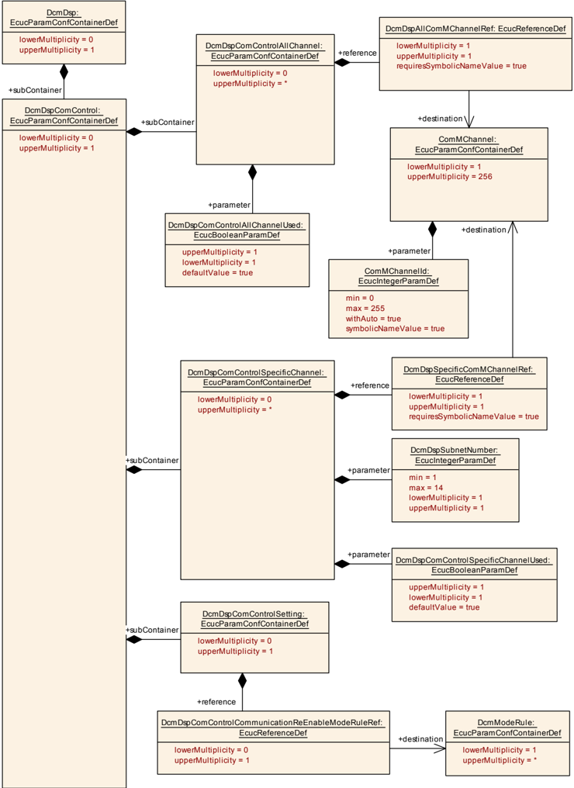

###### 9.2.5.6.2. DcmDspComControlAllChannel

| 属性 | 值 |
| --- | --- |
| 容器名称 | DcmDspComControlAllChannel |
| 父容器 | DcmDspComControl |
| 描述 | 在寻址所有网络时需要控制的 ComM 通道集合。 |
| 配置参数 | 配置参数 |

参数 DcmDspComControlAllChannelUsed 的定义：

| 属性 | 值 |
| --- | --- |
| 参数名称 | DcmDspComControlAllChannelUsed |
| 父容器 | DcmDspComControlAllChannel |
| 描述 | 对多用途 ECU，允许激活或停用待控制的 ComM 通道集合。* **true**：使用该 ComM 通道集合。* **false**：不使用该 ComM 通道集合。 |
| 多重性 | 1 |
| 类型 | EcucBooleanParamDef |
| 默认值 | true |
| Post-Build 变体值 | true |
| 值配置类 | Pre-compile time：X（VARIANT-PRE-COMPILE）；Link time：X（VARIANT-LINK-TIME）；Post-build time：X（VARIANT-POST-BUILD） |
| 作用域/依赖 | scope: local |

参数 DcmDspAllComMChannelRef 的定义：

| 属性 | 值 |
| --- | --- |
| 参数名称 | DcmDspAllComMChannelRef |
| 父容器 | DcmDspComControlAllChannel |
| 描述 | 对 ComM 通道的引用。 |
| 多重性 | 1 |
| 类型 | 对 ComMChannel 的符号名称引用 |
| Post-Build 变体值 | true |
| 值配置类 | Pre-compile time：X（VARIANT-PRE-COMPILE）；Link time：X（VARIANT-LINK-TIME）；Post-build time：X（VARIANT-POST-BUILD） |
| 作用域/依赖 | scope: ECU |

无包含的容器。

###### 9.2.5.6.3. DcmDspComControlSetting

| 属性 | 值 |
| --- | --- |
| 容器名称 | DcmDspComControlSetting |
| 父容器 | DcmDspComControl |
| 描述 | 提供通信控制的配置。 |
| 配置参数 | 配置参数 |

参数 DcmDspComControlCommunicationReEnableModeRuleRef 的定义：

| 属性 | 值 |
| --- | --- |
| 参数名称 | DcmDspComControlCommunicationReEnableModeRuleRef |
| 父容器 | DcmDspComControlSetting |
| 描述 | 对控制 **Dcm** 重新启用通信的 DcmModeRule 模式规则的引用（参见 §6.6.2.9 CommunicationControl 服务的处理规定）。 |
| 多重性 | 0..1 |
| 类型 | 对 DcmModeRule 的引用 |
| Post-Build 变体多重性 | false |
| Post-Build 变体值 | false |
| 多重性配置类 | Pre-compile time：X（VARIANT-PRE-COMPILE、VARIANT-POST-BUILD）；Link time：X（VARIANT-LINK-TIME）；Post-build time：- |
| 值配置类 | Pre-compile time：X（VARIANT-PRE-COMPILE、VARIANT-POST-BUILD）；Link time：X（VARIANT-LINK-TIME）；Post-build time：- |
| 作用域/依赖 | scope: ECU |

无包含的容器。

###### 9.2.5.6.4. DcmDspComControlSpecificChannel

| 属性 | 值 |
| --- | --- |
| 容器名称 | DcmDspComControlSpecificChannel |
| 父容器 | DcmDspComControl |
| 描述 | 为将要控制的 ComM 通道分配子网编号。 |
| 配置参数 | 配置参数 |

参数 DcmDspComControlSpecificChannelUsed 的定义：

| 属性 | 值 |
| --- | --- |
| 参数名称 | DcmDspComControlSpecificChannelUsed |
| 父容器 | DcmDspComControlSpecificChannel |
| 描述 | 对多用途 ECU，允许激活或停用分配给待控制 ComM 通道的子网。* **true**：使用该子网。* **false**：不使用该子网。 |
| 多重性 | 1 |
| 类型 | EcucBooleanParamDef |
| 默认值 | true |
| Post-Build 变体值 | true |
| 值配置类 | Pre-compile time：X（VARIANT-PRE-COMPILE）；Link time：X（VARIANT-LINK-TIME）；Post-build time：X（VARIANT-POST-BUILD） |
| 作用域/依赖 | scope: local |

参数 DcmDspSubnetNumber 的定义：

| 属性 | 值 |
| --- | --- |
| 参数名称 | DcmDspSubnetNumber |
| 父容器 | DcmDspComControlSpecificChannel |
| 描述 | 控制特定 ComMChannel 的子网编号。 |
| 多重性 | 1 |
| 类型 | EcucIntegerParamDef |
| 范围 | 1…14 |
| 默认值 | - |
| Post-Build 变体值 | false |
| 值配置类 | Pre-compile time：X（All Variants）；Link time：-；Post-build time：- |
| 作用域/依赖 | scope: ECU |

参数 DcmDspSpecificComMChannelRef 的定义：

| 属性 | 值 |
| --- | --- |
| 参数名称 | DcmDspSpecificComMChannelRef |
| 父容器 | DcmDspComControlSpecificChannel |
| 描述 | 对 ComM 通道的引用。 |
| 多重性 | 1 |
| 类型 | 对 ComMChannel 的符号名称引用 |
| Post-Build 变体值 | true |
| 值配置类 | Pre-compile time：X（VARIANT-PRE-COMPILE）；Link time：X（VARIANT-LINK-TIME）；Post-build time：X（VARIANT-POST-BUILD） |
| 作用域/依赖 | scope: ECU |

无包含的容器。

###### 9.2.5.6.5. DcmDspComControlSubNode

| 属性 | 值 |
| --- | --- |
| 容器名称 | DcmDspComControlSubNode |
| 父容器 | DcmDspComControl |
| 描述 | 此容器提供节点标识号及用于寻址子网的 ComM 通道信息。 |
| 配置参数 | 配置参数 |

参数 DcmDspComControlSubNodeId 的定义：

| 属性 | 值 |
| --- | --- |
| 参数名称 | DcmDspComControlSubNodeId |
| 父容器 | DcmDspComControlSubNode |
| 描述 | CommunicationControl（0x28）请求中寻址的节点标识号。 |
| 多重性 | 1 |
| 类型 | EcucIntegerParamDef |
| 范围 | 1…65535 |
| 默认值 | - |
| Post-Build 变体值 | false |
| 值配置类 | Pre-compile time：X（VARIANT-PRE-COMPILE、VARIANT-POST-BUILD）；Link time：X（VARIANT-LINK-TIME）；Post-build time：- |
| 作用域/依赖 | scope: ECU |

参数 DcmDspComControlSubNodeUsed 的定义：

| 属性 | 值 |
| --- | --- |
| 参数名称 | DcmDspComControlSubNodeUsed |
| 父容器 | DcmDspComControlSubNode |
| 描述 | 此参数确定节点控制功能是否可用。 |
| 多重性 | 1 |
| 类型 | EcucBooleanParamDef |
| 默认值 | true |
| Post-Build 变体值 | true |
| 值配置类 | Pre-compile time：X（VARIANT-PRE-COMPILE）；Link time：X（VARIANT-LINK-TIME）；Post-build time：X（VARIANT-POST-BUILD） |
| 作用域/依赖 | scope: local |

参数 DcmDspComControlSubNodeComMChannelRef 的定义：

| 属性 | 值 |
| --- | --- |
| 参数名称 | DcmDspComControlSubNodeComMChannelRef |
| 父容器 | DcmDspComControlSubNode |
| 描述 | 引用此节点连接到的 ComM 通道。 |
| 多重性 | 1 |
| 类型 | 对 ComMChannel 的符号名称引用 |
| Post-Build 变体值 | true |
| 值配置类 | Pre-compile time：X（VARIANT-PRE-COMPILE）；Link time：X（VARIANT-LINK-TIME）；Post-build time：X（VARIANT-POST-BUILD） |
| 作用域/依赖 | scope: ECU |

无包含的容器。

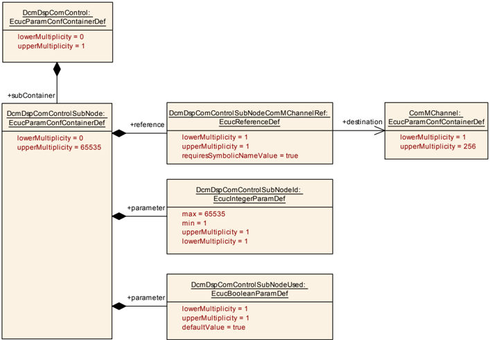

##### 9.2.5.7. DcmDspCommonAuthorization

| 属性 | 值 |
| --- | --- |
| 容器名称 | DcmDspCommonAuthorization |
| 父容器 | DcmDsp |
| 描述 | 此容器包含对多个服务/子服务通用的授权配置参数。 |
| 配置参数 | 配置参数 |

参数 DcmDspCommonAuthorizationModeRuleRef 的定义：

| 属性 | 值 |
| --- | --- |
| 参数名称 | DcmDspCommonAuthorizationModeRuleRef |
| 父容器 | DcmDspCommonAuthorization |
| 描述 | 对控制此服务/子服务的 DcmModeRule 模式规则的引用。如果未配置引用，则不执行模式规则检查。 |
| 多重性 | 0..1 |
| 类型 | 对 DcmModeRule 的引用 |
| Post-Build 变体多重性 | false |
| Post-Build 变体值 | false |
| 多重性配置类 | Pre-compile time：X（VARIANT-PRE-COMPILE、VARIANT-POST-BUILD）；Link time：X（VARIANT-LINK-TIME）；Post-build time：- |
| 值配置类 | Pre-compile time：X（VARIANT-PRE-COMPILE、VARIANT-POST-BUILD）；Link time：X（VARIANT-LINK-TIME）；Post-build time：- |
| 作用域/依赖 | scope: ECU |

参数 DcmDspCommonAuthorizationSecurityLevelRef 的定义：

| 属性 | 值 |
| --- | --- |
| 参数名称 | DcmDspCommonAuthorizationSecurityLevelRef |
| 父容器 | DcmDspCommonAuthorization |
| 描述 | 对 DcmDspSecurityRow 安全级别的引用，这些安全级别允许控制此服务/子服务。如果未配置引用，则不执行安全级别检查。 |
| 多重性 | 0..* |
| 类型 | 对 DcmDspSecurityRow 的引用 |
| Post-Build 变体多重性 | false |
| Post-Build 变体值 | false |
| 多重性配置类 | Pre-compile time：X（VARIANT-PRE-COMPILE、VARIANT-POST-BUILD）；Link time：X（VARIANT-LINK-TIME）；Post-build time：- |
| 值配置类 | Pre-compile time：X（VARIANT-PRE-COMPILE、VARIANT-POST-BUILD）；Link time：X（VARIANT-LINK-TIME）；Post-build time：- |
| 作用域/依赖 | scope: ECU |

参数 DcmDspCommonAuthorizationSessionRef 的定义：

| 属性 | 值 |
| --- | --- |
| 参数名称 | DcmDspCommonAuthorizationSessionRef |
| 父容器 | DcmDspCommonAuthorization |
| 描述 | 对 DcmDspSessionRow 会话的引用，这些会话允许控制此服务/子服务。如果未配置引用，则不执行会话级别检查。 |
| 多重性 | 0..* |
| 类型 | 对 DcmDspSessionRow 的引用 |
| Post-Build 变体多重性 | false |
| Post-Build 变体值 | false |
| 多重性配置类 | Pre-compile time：X（VARIANT-PRE-COMPILE、VARIANT-POST-BUILD）；Link time：X（VARIANT-LINK-TIME）；Post-build time：- |
| 值配置类 | Pre-compile time：X（VARIANT-PRE-COMPILE、VARIANT-POST-BUILD）；Link time：X（VARIANT-LINK-TIME）；Post-build time：- |
| 作用域/依赖 | scope: ECU |

无包含的容器。

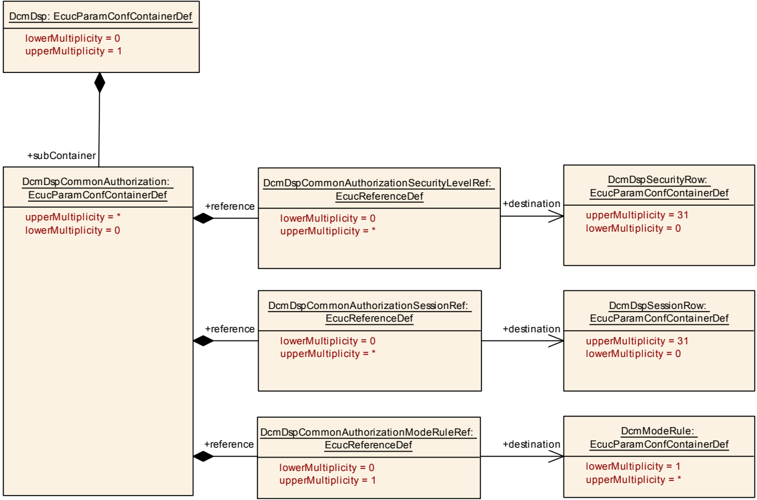

##### 9.2.5.8. DIDs

###### 9.2.5.8.1. DcmDspDid

| 属性 | 值 |
| --- | --- |
| 容器名称 | DcmDspDid |
| 父容器 | DcmDsp |
| 描述 | 此容器包含 DID 的配置参数。 |
| 配置参数 | 配置参数 |

参数 DcmDspDidIdentifier 的定义：

| 属性 | 值 |
| --- | --- |
| 参数名称 | DcmDspDidIdentifier |
| 父容器 | DcmDspDid |
| 描述 | DID 的 2 字节标识符。在每个 DcmConfigSet 中，所有 DcmDspDidIdentifier 值必须唯一。 |
| 多重性 | 1 |
| 类型 | EcucIntegerParamDef |
| 范围 | 0…65535 |
| 默认值 | - |
| Post-Build 变体值 | false |
| 值配置类 | Pre-compile time：X（VARIANT-PRE-COMPILE、VARIANT-POST-BUILD）；Link time：X（VARIANT-LINK-TIME）；Post-build time：- |
| 作用域/依赖 | scope: ECU |

参数 DcmDspDidSize 的定义：

| 属性 | 值 |
| --- | --- |
| 参数名称 | DcmDspDidSize |
| 父容器 | DcmDspDid |
| 描述 | DID 的长度，单位为字节。 |
| 多重性 | 0..1 |
| 类型 | EcucIntegerParamDef |
| 范围 | 0…65535 |
| 默认值 | - |
| Post-Build 变体值 | false |
| 多重性配置类 | Pre-compile time：X（VARIANT-PRE-COMPILE、VARIANT-POST-BUILD）；Link time：X（VARIANT-LINK-TIME）；Post-build time：- |
| 值配置类 | Pre-compile time：X（VARIANT-PRE-COMPILE、VARIANT-POST-BUILD）；Link time：X（VARIANT-LINK-TIME）；Post-build time：- |
| 作用域/依赖 | scope: ECU |

参数 DcmDspDidUsed 的定义：

| 属性 | 值 |
| --- | --- |
| 参数名称 | DcmDspDidUsed |
| 父容器 | DcmDspDid |
| 描述 | 允许为多用途 ECU 激活或停用 DID。**true**：DID 可用；**false**：DID 不可用。 |
| 多重性 | 1 |
| 类型 | EcucBooleanParamDef |
| 默认值 | - |
| Post-Build 变体值 | true |
| 值配置类 | Pre-compile time：X（VARIANT-PRE-COMPILE）；Link time：X（VARIANT-LINK-TIME）；Post-build time：X（VARIANT-POST-BUILD） |
| 作用域/依赖 | scope: ECU |

参数 DcmDspDidUsePort 的定义：

| 属性 | 值 |
| --- | --- |
| 参数名称 | DcmDspDidUsePort |
| 父容器 | DcmDspDid |
| 描述 | 选择 DID 数据元素的应用接口类型：对所有数据元素执行单个操作，或为每个数据元素分别执行操作。 |
| 多重性 | 1 |
| 类型 | EcucEnumerationParamDef |
| 取值 `USE_ATOMIC_BNDM` | DID 应从/写入 BndM。 |
| 取值 `USE_ATOMIC_NV_DATA_INTERFACE` | 使用一个带 NvData 端口的发送者-接收者接口访问此 DID 的所有数据元素。 |
| 取值 `USE_ATOMIC_SENDER_RECEIVER_INTERFACE` | 使用一个发送者-接收者接口访问此 DID 的所有数据元素。该接口类型为 IsService=false。 |
| 取值 `USE_ATOMIC_SENDER_RECEIVER_INTERFACE_AS_SERVICE` | 使用一个发送者-接收者接口访问此 DID 的所有数据元素。该接口类型为 IsService=true。 |
| 取值 `USE_DATA_ELEMENT_SPECIFIC_INTERFACES` | 使用 DcmDspDataUsePort 定义的特定数据元素接口采集此 DID 的数据元素。 |
| 默认值 | USE_DATA_ELEMENT_SPECIFIC_INTERFACES |
| Post-Build 变体值 | false |
| 值配置类 | Pre-compile time：X（All Variants）；Link time：-；Post-build time：- |
| 作用域/依赖 | - |

参数 DcmDspDidBndMBlockIdRef 的定义：

| 属性 | 值 |
| --- | --- |
| 参数名称 | DcmDspDidBndMBlockIdRef |
| 父容器 | DcmDspDid |
| 描述 | 将此 DID 关联到一个 BndM blockId。 |
| 多重性 | 0..1 |
| 类型 | 对 BndMBlockDescriptor 的符号名称引用 |
| Post-Build 变体多重性 | false |
| Post-Build 变体值 | false |
| 多重性配置类 | Pre-compile time：X；Link time：-；Post-build time：- |
| 值配置类 | Pre-compile time：X；Link time：-；Post-build time：- |
| 作用域/依赖 | scope: ECU；依赖：DcmDspDidUsePort == USE_ATOMIC_BNDM |

参数 DcmDspDidInfoRef 的定义：

| 属性 | 值 |
| --- | --- |
| 参数名称 | DcmDspDidInfoRef |
| 父容器 | DcmDspDid |
| 描述 | 对包含此 DID 信息的 DcmDspDidInfo 的引用。 |
| 多重性 | 1 |
| 类型 | 对 DcmDspDidInfo 的引用 |
| Post-Build 变体值 | false |
| 值配置类 | Pre-compile time：X（VARIANT-PRE-COMPILE、VARIANT-POST-BUILD）；Link time：X（VARIANT-LINK-TIME）；Post-build time：- |
| 作用域/依赖 | scope: ECU |

参数 DcmDspDidRef 的定义：

| 属性 | 值 |
| --- | --- |
| 参数名称 | DcmDspDidRef |
| 父容器 | DcmDspDid |
| 描述 | 当此 DID 引用一个或多个其他 DID 的属性时，对 DcmDspDid 的引用。属性：requiresIndex=true。 |
| 多重性 | 0..* |
| 类型 | 对 DcmDspDid 的引用 |
| Post-Build 变体多重性 | false |
| Post-Build 变体值 | false |
| 多重性配置类 | Pre-compile time：X（VARIANT-PRE-COMPILE、VARIANT-POST-BUILD）；Link time：X（VARIANT-LINK-TIME）；Post-build time：- |
| 值配置类 | Pre-compile time：X（VARIANT-PRE-COMPILE、VARIANT-POST-BUILD）；Link time：X（VARIANT-LINK-TIME）；Post-build time：- |
| 作用域/依赖 | scope: ECU |

| 容器名称 | 多重性 | 作用域/依赖 |
| --- | --- | --- |
| DcmDspDidSignal | 0..* | 此容器定义对一个 DcmDspData 容器的引用，以及该数据在此 DID 中相关的位置。 |
| DcmDspDidSignalCompositePool | 0..* | 定义此根信号所包含的全部信号集合。 |
| DcmDspDidSupportInfo | 0..1 | 此容器定义支持信息，用于声明 DID 中数据字节的可用性。 |

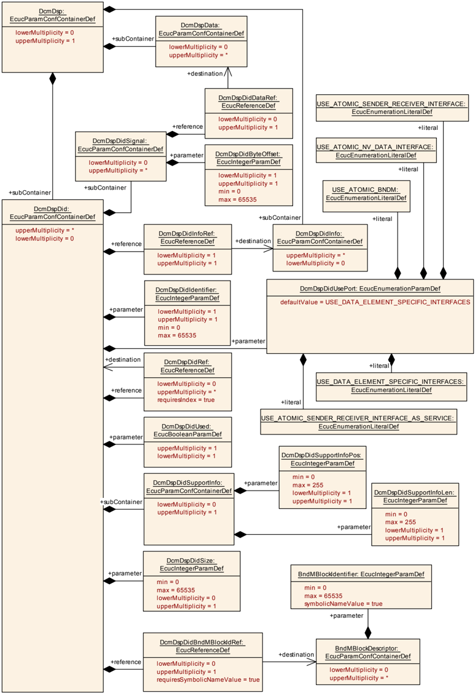

###### 9.2.5.8.2. DcmDspDidInfo

| 属性 | 值 |
| --- | --- |
| 容器名称 | DcmDspDidInfo |
| 父容器 | DcmDsp |
| 描述 | 此容器包含 DID 信息的配置参数。 |
| 配置参数 | 配置参数 |

参数 DcmDspDDDIDMaxElements 的定义：

| 属性 | 值 |
| --- | --- |
| 参数名称 | DcmDspDDDIDMaxElements |
| 父容器 | DcmDspDidInfo |
| 描述 | DDDID 的源元素最大数量。 |
| 多重性 | 0..1 |
| 类型 | EcucIntegerParamDef |
| 范围 | 1…255 |
| 默认值 | - |
| Post-Build 变体多重性 | false |
| Post-Build 变体值 | false |
| 多重性配置类 | Pre-compile time：X（VARIANT-PRE-COMPILE、VARIANT-POST-BUILD）；Link time：X（VARIANT-LINK-TIME）；Post-build time：- |
| 值配置类 | Pre-compile time：X（VARIANT-PRE-COMPILE、VARIANT-POST-BUILD）；Link time：X（VARIANT-LINK-TIME）；Post-build time：- |
| 作用域/依赖 | scope: local |

参数 DcmDspDidDynamicallyDefined 的定义：

| 属性 | 值 |
| --- | --- |
| 参数名称 | DcmDspDidDynamicallyDefined |
| 父容器 | DcmDspDidInfo |
| 描述 | 指示此 DID 是否可以动态定义。**true**：DID 可以动态定义；**false**：DID 不可以动态定义。 |
| 多重性 | 1 |
| 类型 | EcucBooleanParamDef |
| 默认值 | - |
| Post-Build 变体值 | false |
| 值配置类 | Pre-compile time：X（VARIANT-PRE-COMPILE、VARIANT-POST-BUILD）；Link time：X（VARIANT-LINK-TIME）；Post-build time：- |
| 作用域/依赖 | scope: ECU |

| 容器名称 | 多重性 | 作用域/依赖 |
| --- | --- | --- |
| DcmDspDidControl | 0..1 | 此容器包含 DID 控制的配置参数。 |
| DcmDspDidRead | 0..1 | 此容器包含 DID 读取的配置参数。 |
| DcmDspDidWrite | 0..1 | 此容器包含 DID 写入的配置参数。 |

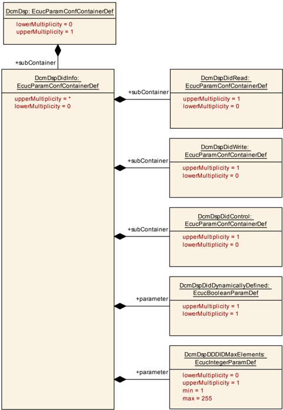

###### 9.2.5.8.3. DcmDspDidRead

| 属性 | 值 |
| --- | --- |
| 容器名称 | DcmDspDidRead |
| 父容器 | DcmDspDidInfo |
| 描述 | 此容器包含 DID 读取的配置参数。 |
| 配置参数 | 配置参数 |

参数 DcmDspDidReadModeRuleRef 的定义：

| 属性 | 值 |
| --- | --- |
| 参数名称 | DcmDspDidReadModeRuleRef |
| 父容器 | DcmDspDidRead |
| 描述 | 对控制此 DID 读取操作的 DcmModeRule 模式规则的引用。如果未配置引用，则不执行模式规则检查。 |
| 多重性 | 0..1 |
| 类型 | 对 DcmModeRule 的引用 |
| Post-Build 变体多重性 | false |
| Post-Build 变体值 | false |
| 多重性配置类 | Pre-compile time：X（VARIANT-PRE-COMPILE、VARIANT-POST-BUILD）；Link time：X（VARIANT-LINK-TIME）；Post-build time：- |
| 值配置类 | Pre-compile time：X（VARIANT-PRE-COMPILE、VARIANT-POST-BUILD）；Link time：X（VARIANT-LINK-TIME）；Post-build time：- |
| 作用域/依赖 | scope: ECU |

参数 DcmDspDidReadRoleRef 的定义：

| 属性 | 值 |
| --- | --- |
| 参数名称 | DcmDspDidReadRoleRef |
| 父容器 | DcmDspDidRead |
| 描述 | 对 DcmDspAuthenticationRow 的引用，该行定义了允许读取此 DID 的角色。 |
| 多重性 | 0..32 |
| 类型 | 对 DcmDspAuthenticationRow 的引用 |
| Post-Build 变体多重性 | false |
| Post-Build 变体值 | false |
| 值配置类 | Pre-compile time：X（All Variants）；Link time：-；Post-build time：- |
| 作用域/依赖 | scope: ECU |

参数 DcmDspDidReadSecurityLevelRef 的定义：

| 属性 | 值 |
| --- | --- |
| 参数名称 | DcmDspDidReadSecurityLevelRef |
| 父容器 | DcmDspDidRead |
| 描述 | 对 DcmDspSecurityRow 的引用。引用的安全级别允许读取此 DID。如果未配置引用，则不执行安全级别检查。 |
| 多重性 | 0..* |
| 类型 | 对 DcmDspSecurityRow 的引用 |
| Post-Build 变体多重性 | false |
| Post-Build 变体值 | false |
| 多重性配置类 | Pre-compile time：X（VARIANT-PRE-COMPILE、VARIANT-POST-BUILD）；Link time：X（VARIANT-LINK-TIME）；Post-build time：- |
| 值配置类 | Pre-compile time：X（VARIANT-PRE-COMPILE、VARIANT-POST-BUILD）；Link time：X（VARIANT-LINK-TIME）；Post-build time：- |
| 作用域/依赖 | scope: ECU |

参数 DcmDspDidReadSessionRef 的定义：

| 属性 | 值 |
| --- | --- |
| 参数名称 | DcmDspDidReadSessionRef |
| 父容器 | DcmDspDidRead |
| 描述 | 对 DcmDspSessionRow 的引用。引用的会话允许读取此 DID。如果未配置引用，则不执行会话级别检查。 |
| 多重性 | 0..* |
| 类型 | 对 DcmDspSessionRow 的引用 |
| Post-Build 变体多重性 | false |
| Post-Build 变体值 | false |
| 多重性配置类 | Pre-compile time：X（VARIANT-PRE-COMPILE、VARIANT-POST-BUILD）；Link time：X（VARIANT-LINK-TIME）；Post-build time：- |
| 值配置类 | Pre-compile time：X（VARIANT-PRE-COMPILE、VARIANT-POST-BUILD）；Link time：X（VARIANT-LINK-TIME）；Post-build time：- |
| 作用域/依赖 | scope: ECU |

无包含的容器。

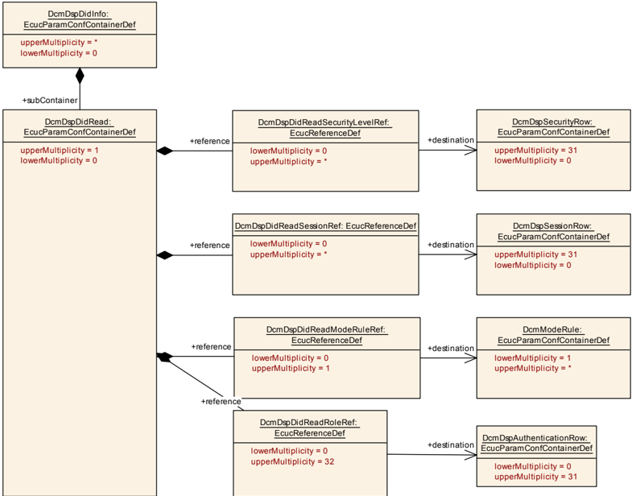

###### 9.2.5.8.4. DcmDspDidSignal

| 属性 | 值 |
| --- | --- |
| 容器名称 | DcmDspDidSignal |
| 父容器 | DcmDspDid、DcmDspDidSignalCompositePool |
| 描述 | 此容器定义对一个 DcmDspData 容器的引用，以及该数据在此 DID 中相关的位置。 |
| 配置参数 | 配置参数 |

参数 DcmDspDataByteSize 的定义：

| 属性 | 值 |
| --- | --- |
| 参数名称 | DcmDspDataByteSize |
| 父容器 | DcmDspDidSignal |
| 描述 | 定义数组长度（字节数），或可变数据长度时的最大数组长度。 |
| 多重性 | 0..1 |
| 类型 | EcucIntegerParamDef |
| 范围 | 0…65535 |
| 默认值 | - |
| Post-Build 变体多重性 | false |
| Post-Build 变体值 | false |
| 多重性配置类 | Pre-compile time：X（VARIANT-PRE-COMPILE、VARIANT-POST-BUILD）；Link time：X（VARIANT-LINK-TIME）；Post-build time：- |
| 值配置类 | Pre-compile time：X（VARIANT-PRE-COMPILE、VARIANT-POST-BUILD）；Link time：X（VARIANT-LINK-TIME）；Post-build time：- |
| 作用域/依赖 | scope: ECU |

参数 DcmDspDidByteOffset 的定义：

| 属性 | 值 |
| --- | --- |
| 参数名称 | DcmDspDidByteOffset |
| 父容器 | DcmDspDidSignal |
| 描述 | 定义 DcmDspDidDataRef 所引用的 DcmDspData 容器中数据在 DID 内的绝对字节偏移量。 |
| 多重性 | 1 |
| 类型 | EcucIntegerParamDef |
| 范围 | 0…65535 |
| 默认值 | - |
| Post-Build 变体值 | false |
| 值配置类 | Pre-compile time：X（VARIANT-PRE-COMPILE、VARIANT-POST-BUILD）；Link time：X（VARIANT-LINK-TIME）；Post-build time：- |
| 作用域/依赖 | scope: ECU |

参数 DcmDspDidDataRef 的定义：

| 属性 | 值 |
| --- | --- |
| 参数名称 | DcmDspDidDataRef |
| 父容器 | DcmDspDidSignal |
| 描述 | 对与此 DID 相关的一个 DcmDspData 容器的引用。 |
| 多重性 | 0..1 |
| 类型 | 对 DcmDspData 的引用 |
| Post-Build 变体值 | false |
| 值配置类 | Pre-compile time：X（VARIANT-PRE-COMPILE、VARIANT-POST-BUILD）；Link time：X（VARIANT-LINK-TIME）；Post-build time：- |
| 作用域/依赖 | scope: ECU |

参数 DcmDspDidSignalCompositeRef 的定义：

| 属性 | 值 |
| --- | --- |
| 参数名称 | DcmDspDidSignalCompositeRef |
| 父容器 | DcmDspDidSignal |
| 描述 | 对所包含信号的引用。 |
| 多重性 | 0..* |
| 类型 | 对 DcmDspDidSignalCompositePool 的引用 |
| Post-Build 变体多重性 | false |
| Post-Build 变体值 | false |
| 多重性配置类 | Pre-compile time：X；Link time：-；Post-build time：- |
| 值配置类 | Pre-compile time：X；Link time：-；Post-build time：- |
| 作用域/依赖 | scope: ECU |

无包含的容器。

###### 9.2.5.8.5. DcmDspDidSignalCompositePool

| 属性 | 值 |
| --- | --- |
| 容器名称 | DcmDspDidSignalCompositePool |
| 父容器 | DcmDspDid |
| 描述 | 定义此根信号所包含的全部信号集合。 |
| Post-Build 变体多重性 | false |
| 多重性配置类 | Pre-compile time：X（All Variants）；Link time：-；Post-build time：- |
| 配置参数 | 配置参数 |

| 容器名称 | 多重性 | 作用域/依赖 |
| --- | --- | --- |
| DcmDspDidSignal | 0..* | 此容器定义对一个 DcmDspData 容器的引用，以及该数据在此 DID 中相关的位置。 |

###### 9.2.5.8.6. DcmDspDidSupportInfo

| 属性 | 值 |
| --- | --- |
| 容器名称 | DcmDspDidSupportInfo |
| 父容器 | DcmDspDid |
| 描述 | 此容器定义支持信息，用于声明 DID 中数据字节的可用性。 |
| 配置参数 | 配置参数 |

参数 DcmDspDidSupportInfoLen 的定义：

| 属性 | 值 |
| --- | --- |
| 参数名称 | DcmDspDidSupportInfoLen |
| 父容器 | DcmDspDidSupportInfo |
| 描述 | 支持信息的长度，单位为字节。 |
| 多重性 | 1 |
| 类型 | EcucIntegerParamDef |
| 范围 | 0…255 |
| 默认值 | - |
| Post-Build 变体值 | false |
| 值配置类 | Pre-compile time：X（VARIANT-PRE-COMPILE、VARIANT-POST-BUILD）；Link time：X（VARIANT-LINK-TIME）；Post-build time：- |
| 作用域/依赖 | scope: ECU |

参数 DcmDspDidSupportInfoPos 的定义：

| 属性 | 值 |
| --- | --- |
| 参数名称 | DcmDspDidSupportInfoPos |
| 父容器 | DcmDspDidSupportInfo |
| 描述 | 支持信息的位置，单位为字节。 |
| 多重性 | 1 |
| 类型 | EcucIntegerParamDef |
| 范围 | 0…255 |
| 默认值 | - |
| Post-Build 变体值 | false |
| 值配置类 | Pre-compile time：X（VARIANT-PRE-COMPILE、VARIANT-POST-BUILD）；Link time：X（VARIANT-LINK-TIME）；Post-build time：- |
| 作用域/依赖 | scope: ECU |

无包含的容器。

###### 9.2.5.8.7. DcmDspDidRange

| 属性 | 值 |
| --- | --- |
| 容器名称 | DcmDspDidRange |
| 父容器 | DcmDsp |
| 描述 | 此容器定义 DID 范围。 |
| 配置参数 | 配置参数 |

参数 DcmDspDidRangeHasGaps 的定义：

| 属性 | 值 |
| --- | --- |
| 参数名称 | DcmDspDidRangeHasGaps |
| 父容器 | DcmDspDidRange |
| 描述 | 用于指示 DID 范围中是否存在间隙（参数为 **true**）或不存在间隙（参数为 **false**）。 |
| 多重性 | 1 |
| 类型 | EcucBooleanParamDef |
| 默认值 | - |
| Post-Build 变体值 | false |
| 值配置类 | Pre-compile time：X（VARIANT-PRE-COMPILE、VARIANT-POST-BUILD）；Link time：X（VARIANT-LINK-TIME）；Post-build time：- |
| 作用域/依赖 | scope: ECU |

参数 DcmDspDidRangeIdentifierLowerLimit 的定义：

| 属性 | 值 |
| --- | --- |
| 参数名称 | DcmDspDidRangeIdentifierLowerLimit |
| 父容器 | DcmDspDidRange |
| 描述 | DID 范围下限。 |
| 多重性 | 1 |
| 类型 | EcucIntegerParamDef |
| 范围 | 0…65535 |
| 默认值 | - |
| Post-Build 变体值 | false |
| 值配置类 | Pre-compile time：X（VARIANT-PRE-COMPILE、VARIANT-POST-BUILD）；Link time：X（VARIANT-LINK-TIME）；Post-build time：- |
| 作用域/依赖 | scope: ECU |

参数 DcmDspDidRangeIdentifierUpperLimit 的定义：

| 属性 | 值 |
| --- | --- |
| 参数名称 | DcmDspDidRangeIdentifierUpperLimit |
| 父容器 | DcmDspDidRange |
| 描述 | DID 范围上限。 |
| 多重性 | 1 |
| 类型 | EcucIntegerParamDef |
| 范围 | 0…65535 |
| 默认值 | - |
| Post-Build 变体值 | false |
| 值配置类 | Pre-compile time：X（VARIANT-PRE-COMPILE、VARIANT-POST-BUILD）；Link time：X（VARIANT-LINK-TIME）；Post-build time：- |
| 作用域/依赖 | scope: ECU |

参数 DcmDspDidRangeIsDidAvailableFnc 的定义：

| 属性 | 值 |
| --- | --- |
| 参数名称 | DcmDspDidRangeIsDidAvailableFnc |
| 父容器 | DcmDspDidRange |
| 描述 | 请求应用判断某个 DID 是否在此范围内可用的函数名称。仅当 DcmDspDidRangeUsePort 设置为 false 时适用。此参数与 `Xxx_IsDidAvailable` 接口相关。 |
| 多重性 | 0..1 |
| 类型 | EcucFunctionNameDef |
| 默认值 | - |
| 正则表达式 | - |
| Post-Build 变体多重性 | false |
| Post-Build 变体值 | false |
| 多重性配置类 | Pre-compile time：X；Link time：-；Post-build time：- |
| 值配置类 | Pre-compile time：X；Link time：-；Post-build time：- |
| 作用域/依赖 | scope: ECU |

参数 DcmDspDidRangeMaxDataLength 的定义：

| 属性 | 值 |
| --- | --- |
| 参数名称 | DcmDspDidRangeMaxDataLength |
| 父容器 | DcmDspDidRange |
| 描述 | 最大数据长度，单位为字节。 |
| 多重性 | 1 |
| 类型 | EcucIntegerParamDef |
| 范围 | 0…65535 |
| 默认值 | - |
| Post-Build 变体值 | false |
| 值配置类 | Pre-compile time：X（VARIANT-PRE-COMPILE、VARIANT-POST-BUILD）；Link time：X（VARIANT-LINK-TIME）；Post-build time：- |
| 作用域/依赖 | scope: ECU |

参数 DcmDspDidRangeReadDataLengthFnc 的定义：

| 属性 | 值 |
| --- | --- |
| 参数名称 | DcmDspDidRangeReadDataLengthFnc |
| 父容器 | DcmDspDidRange |
| 描述 | 请求应用提供范围 DID 数据长度的函数名称。仅当 DcmDspDidRangeUsePort 设置为 false 时适用。此参数与 `Xxx_ReadDidRangeDataLength` 接口相关。 |
| 多重性 | 0..1 |
| 类型 | EcucFunctionNameDef |
| 默认值 | - |
| 正则表达式 | - |
| Post-Build 变体多重性 | false |
| Post-Build 变体值 | false |
| 多重性配置类 | Pre-compile time：X（All Variants）；Link time：-；Post-build time：- |
| 值配置类 | Pre-compile time：X（All Variants）；Link time：-；Post-build time：- |
| 作用域/依赖 | scope: ECU |

参数 DcmDspDidRangeReadDidFnc 的定义：

| 属性 | 值 |
| --- | --- |
| 参数名称 | DcmDspDidRangeReadDidFnc |
| 父容器 | DcmDspDidRange |
| 描述 | 请求应用提供 DID 范围数据值的函数名称（读取数据函数）。仅当 DcmDspDidRangeUsePort 设置为 false 时适用。此参数与 `Xxx_ReadDidData` 接口相关。 |
| 多重性 | 0..1 |
| 类型 | EcucFunctionNameDef |
| 默认值 | - |
| 正则表达式 | - |
| Post-Build 变体多重性 | false |
| Post-Build 变体值 | false |
| 多重性配置类 | Pre-compile time：X；Link time：-；Post-build time：- |
| 值配置类 | Pre-compile time：X；Link time：-；Post-build time：- |
| 作用域/依赖 | scope: ECU |

参数 DcmDspDidRangeUsePort 的定义：

| 属性 | 值 |
| --- | --- |
| 参数名称 | DcmDspDidRangeUsePort |
| 父容器 | DcmDspDidRange |
| 描述 | 将此参数设置为 **true** 时，**Dcm** 将通过需要 DataServices_DIDRange PortInterface 的 R-Port 访问数据。在这种情况下，将忽略 DcmDspDidRangeIsDidAvailableFnc、DcmDspDidRangeReadDidFnc 和 DcmDspDidRangeWriteDidFnc，并使用 RTE API。将此参数设置为 **false** 时，**Dcm** 调用 DcmDspDidRangeIsDidAvailableFnc、DcmDspDidRangeReadDidFnc 和 DcmDspDidRangeWriteDidFnc 中定义的函数。 |
| 多重性 | 1 |
| 类型 | EcucBooleanParamDef |
| 默认值 | - |
| Post-Build 变体值 | false |
| 值配置类 | Pre-compile time：X（All Variants）；Link time：-；Post-build time：- |
| 作用域/依赖 | scope: ECU |

参数 DcmDspDidRangeWriteDidFnc 的定义：

| 属性 | 值 |
| --- | --- |
| 参数名称 | DcmDspDidRangeWriteDidFnc |
| 父容器 | DcmDspDidRange |
| 描述 | 请求应用写入 DID 范围数据值的函数名称（写入数据函数）。仅当 DcmDspDidRangeUsePort 设置为 false 时适用。此参数与 `Xxx_WriteDidData` 接口相关。 |
| 多重性 | 0..1 |
| 类型 | EcucFunctionNameDef |
| 默认值 | - |
| 正则表达式 | - |
| Post-Build 变体多重性 | false |
| Post-Build 变体值 | false |
| 多重性配置类 | Pre-compile time：X；Link time：-；Post-build time：- |
| 值配置类 | Pre-compile time：X；Link time：-；Post-build time：- |
| 作用域/依赖 | scope: ECU |

参数 DcmDspDidRangeInfoRef 的定义：

| 属性 | 值 |
| --- | --- |
| 参数名称 | DcmDspDidRangeInfoRef |
| 父容器 | DcmDspDidRange |
| 描述 | 对包含此 DID 范围信息的 DcmDspDidInfo 的引用。 |
| 多重性 | 1 |
| 类型 | 对 DcmDspDidInfo 的引用 |
| Post-Build 变体值 | false |
| 值配置类 | Pre-compile time：X（VARIANT-PRE-COMPILE、VARIANT-POST-BUILD）；Link time：X（VARIANT-LINK-TIME）；Post-build time：- |
| 作用域/依赖 | scope: ECU |

无包含的容器。

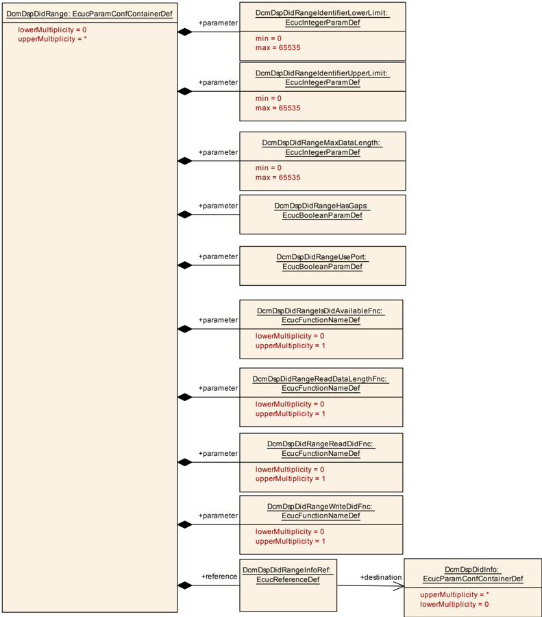

###### 9.2.5.8.8. DcmDspDidWrite

| 属性 | 值 |
| --- | --- |
| 容器名称 | DcmDspDidWrite |
| 父容器 | DcmDspDidInfo |
| 描述 | 此容器包含 DID 写入的配置参数。 |
| 配置参数 | 配置参数 |

参数 DcmDspDidWriteModeRuleRef 的定义：

| 属性 | 值 |
| --- | --- |
| 参数名称 | DcmDspDidWriteModeRuleRef |
| 父容器 | DcmDspDidWrite |
| 描述 | 对控制此 DID 写入操作的 DcmModeRule 模式规则的引用。如果未配置引用，则不执行模式规则检查。 |
| 多重性 | 0..1 |
| 类型 | 对 DcmModeRule 的引用 |
| Post-Build 变体多重性 | false |
| Post-Build 变体值 | false |
| 多重性配置类 | Pre-compile time：X（VARIANT-PRE-COMPILE、VARIANT-POST-BUILD）；Link time：X（VARIANT-LINK-TIME）；Post-build time：- |
| 值配置类 | Pre-compile time：X（VARIANT-PRE-COMPILE、VARIANT-POST-BUILD）；Link time：X（VARIANT-LINK-TIME）；Post-build time：- |
| 作用域/依赖 | scope: ECU |

参数 DcmDspDidWriteRoleRef 的定义：

| 属性 | 值 |
| --- | --- |
| 参数名称 | DcmDspDidWriteRoleRef |
| 父容器 | DcmDspDidWrite |
| 描述 | 对 DcmDspAuthenticationRow 的引用，该行定义了允许写入此 DID 的角色。 |
| 多重性 | 0..32 |
| 类型 | 对 DcmDspAuthenticationRow 的引用 |
| Post-Build 变体多重性 | false |
| Post-Build 变体值 | false |
| 值配置类 | Pre-compile time：X（All Variants）；Link time：-；Post-build time：- |
| 作用域/依赖 | scope: ECU |

参数 DcmDspDidWriteSecurityLevelRef 的定义：

| 属性 | 值 |
| --- | --- |
| 参数名称 | DcmDspDidWriteSecurityLevelRef |
| 父容器 | DcmDspDidWrite |
| 描述 | 对 DcmDspSecurityRow 的引用。引用的安全级别允许写入此 DID。如果未配置引用，则不执行安全级别检查。 |
| 多重性 | 0..* |
| 类型 | 对 DcmDspSecurityRow 的引用 |
| Post-Build 变体多重性 | false |
| Post-Build 变体值 | false |
| 多重性配置类 | Pre-compile time：X（VARIANT-PRE-COMPILE、VARIANT-POST-BUILD）；Link time：X（VARIANT-LINK-TIME）；Post-build time：- |
| 值配置类 | Pre-compile time：X（VARIANT-PRE-COMPILE、VARIANT-POST-BUILD）；Link time：X（VARIANT-LINK-TIME）；Post-build time：- |
| 作用域/依赖 | scope: ECU |

参数 DcmDspDidWriteSessionRef 的定义：

| 属性 | 值 |
| --- | --- |
| 参数名称 | DcmDspDidWriteSessionRef |
| 父容器 | DcmDspDidWrite |
| 描述 | 对 DcmDspSessionRow 的引用。引用的会话允许写入此 DID。如果未配置引用，则不执行会话级别检查。 |
| 多重性 | 0..* |
| 类型 | 对 DcmDspSessionRow 的引用 |
| Post-Build 变体多重性 | false |
| Post-Build 变体值 | false |
| 多重性配置类 | Pre-compile time：X（VARIANT-PRE-COMPILE、VARIANT-POST-BUILD）；Link time：X（VARIANT-LINK-TIME）；Post-build time：- |
| 值配置类 | Pre-compile time：X（VARIANT-PRE-COMPILE、VARIANT-POST-BUILD）；Link time：X（VARIANT-LINK-TIME）；Post-build time：- |
| 作用域/依赖 | scope: ECU |

无包含的容器。

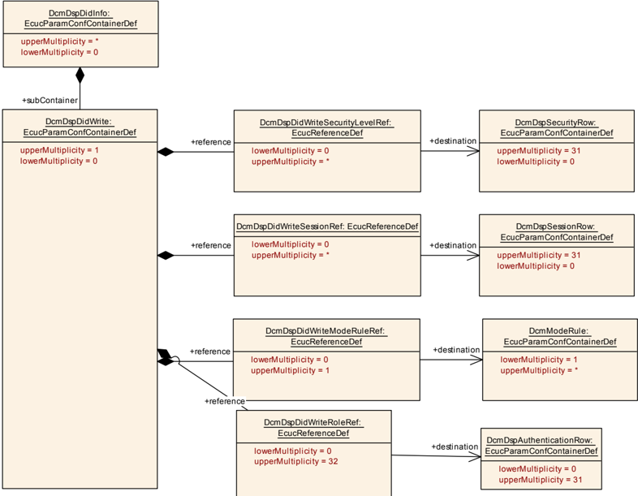

##### 9.2.5.9. DcmDspControlDTCSetting

| 属性 | 值 |
| --- | --- |
| 容器名称 | DcmDspControlDTCSetting |
| 父容器 | DcmDsp |
| 描述 | 提供 ControlDTCSetting 机制的配置。 |
| 配置参数 | 配置参数 |

参数 DcmSupportDTCSettingControlOptionRecord 的定义：

| 属性 | 值 |
| --- | --- |
| 参数名称 | DcmSupportDTCSettingControlOptionRecord |
| 父容器 | DcmDspControlDTCSetting |
| 描述 | 此配置开关定义请求消息中是否通常支持 DTCSettingControlOptionRecord。 |
| 多重性 | 0..1 |
| 类型 | EcucBooleanParamDef |
| 默认值 | false |
| Post-Build 变体多重性 | false |
| Post-Build 变体值 | false |
| 多重性配置类 | Pre-compile time：X（All Variants）；Link time：-；Post-build time：- |
| 值配置类 | Pre-compile time：X（All Variants）；Link time：-；Post-build time：- |
| 作用域/依赖 | scope: ECU |

参数 DcmDspControlDTCSettingReEnableModeRuleRef 的定义：

| 属性 | 值 |
| --- | --- |
| 参数名称 | DcmDspControlDTCSettingReEnableModeRuleRef |
| 父容器 | DcmDspControlDTCSetting |
| 描述 | 对控制 **Dcm** 重新启用 ControlDTCSetting 的 DcmModeRule 模式规则的引用。当引用的模式规则不再满足时，**Dcm** 模块应执行 ControlDTCSetting.Off（调用 `Dem_EnableDTCSetting()`）。 |
| 多重性 | 0..1 |
| 类型 | 对 DcmModeRule 的引用 |
| Post-Build 变体多重性 | false |
| Post-Build 变体值 | false |
| 多重性配置类 | Pre-compile time：X（VARIANT-PRE-COMPILE、VARIANT-POST-BUILD）；Link time：X（VARIANT-LINK-TIME）；Post-build time：- |
| 值配置类 | Pre-compile time：X（VARIANT-PRE-COMPILE、VARIANT-POST-BUILD）；Link time：X（VARIANT-LINK-TIME）；Post-build time：- |
| 作用域/依赖 | scope: ECU |

无包含的容器。

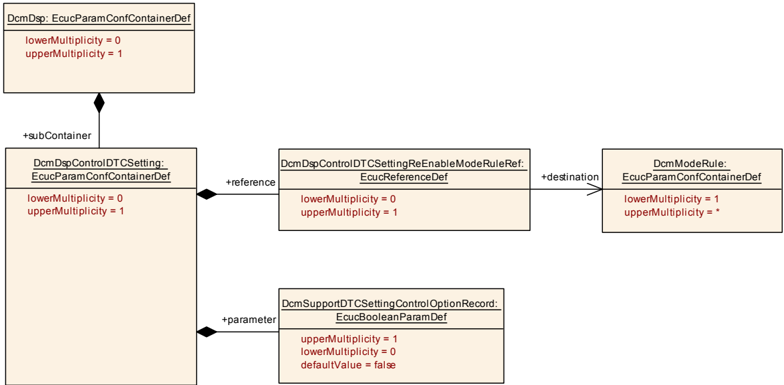

##### 9.2.5.10. 数据元素

###### 9.2.5.10.1. DcmDspData

| 属性 | 值 |
| --- | --- |
| 容器名称 | DcmDspData |
| 父容器 | DcmDsp |
| 描述 | 此容器包含属于 DID 的某个 Data 的配置参数。 |
| 配置参数 | 配置参数 |

参数 DcmDspDataByteSize 的定义：

| 属性 | 值 |
| --- | --- |
| 参数名称 | DcmDspDataByteSize |
| 父容器 | DcmDspData |
| 描述 | 定义数组长度（字节数），或可变数据长度时的最大数组长度。 |
| 多重性 | 0..1 |
| 类型 | EcucIntegerParamDef |
| 范围 | 0…65535 |
| 默认值 | - |
| Post-Build 变体多重性 | false |
| Post-Build 变体值 | false |
| 多重性配置类 | Pre-compile time：X（VARIANT-PRE-COMPILE、VARIANT-POST-BUILD）；Link time：X（VARIANT-LINK-TIME）；Post-build time：- |
| 值配置类 | Pre-compile time：X（VARIANT-PRE-COMPILE、VARIANT-POST-BUILD）；Link time：X（VARIANT-LINK-TIME）；Post-build time：- |
| 作用域/依赖 | scope: ECU |

参数 DcmDspDataConditionCheckReadFnc 的定义：

| 属性 | 值 |
| --- | --- |
| 参数名称 | DcmDspDataConditionCheckReadFnc |
| 父容器 | DcmDspData |
| 描述 | 用于请求应用程序判断读取 DID 的条件（例如系统状态）是否满足的函数名称（ConditionCheckRead 函数）。其多重性应与参数 DcmDspDataReadFnc 相同。此参数与 `Xxx_ConditionCheckRead` 接口相关。 |
| 多重性 | 0..1 |
| 类型 | EcucFunctionNameDef |
| 默认值 | - |
| 正则表达式 | - |
| Post-Build 变体多重性 | false |
| Post-Build 变体值 | false |
| 多重性配置类 | Pre-compile time：X（All Variants）；Link time：-；Post-build time：- |
| 值配置类 | Pre-compile time：X（All Variants）；Link time：-；Post-build time：- |
| 作用域/依赖 | scope: ECU |

参数 DcmDspDataConditionCheckReadFncUsed 的定义：

| 属性 | 值 |
| --- | --- |
| 参数名称 | DcmDspDataConditionCheckReadFncUsed |
| 父容器 | DcmDspData |
| 描述 | 此参数用于确定条件检查函数是否可用。 |
| 多重性 | 0..1 |
| 类型 | EcucBooleanParamDef |
| 默认值 | - |
| Post-Build 变体多重性 | false |
| Post-Build 变体值 | false |
| 多重性配置类 | Pre-compile time：X；Link time：-；Post-build time：- |
| 值配置类 | Pre-compile time：X；Link time：-；Post-build time：- |
| 作用域/依赖 | scope: local |

参数 DcmDspDataEcuSignal 的定义：

| 属性 | 值 |
| --- | --- |
| 参数名称 | DcmDspDataEcuSignal |
| 父容器 | DcmDspData |
| 描述 | 用于控制 **Dcm** 访问特定 ECU 信号的函数名称（`IoHwAb_Dcm_<symbolic name of ECU signal>` 函数）。 |
| 多重性 | 0..1 |
| 类型 | EcucFunctionNameDef |
| 默认值 | - |
| 正则表达式 | - |
| Post-Build 变体多重性 | false |
| Post-Build 变体值 | false |
| 多重性配置类 | Pre-compile time：X；Link time：-；Post-build time：- |
| 值配置类 | Pre-compile time：X；Link time：-；Post-build time：- |
| 作用域/依赖 | scope: ECU |

参数 DcmDspDataEndianness 的定义：

| 属性 | 值 |
| --- | --- |
| 参数名称 | DcmDspDataEndianness |
| 父容器 | DcmDspData |
| 描述 | 定义诊断请求或响应消息中属于 DID 的数据的字节序。 |
| 多重性 | 0..1 |
| 类型 | EcucEnumerationParamDef |
| 取值 `BIG_ENDIAN` | 最高有效字节应存储在最低地址。 |
| 取值 `LITTLE_ENDIAN` | 最高有效字节应存储在最高地址。 |
| 取值 `OPAQUE` | 不透明数据字节序。 |
| Post-Build 变体多重性 | false |
| Post-Build 变体值 | false |
| 多重性配置类 | Pre-compile time：X（VARIANT-PRE-COMPILE、VARIANT-POST-BUILD）；Link time：X（VARIANT-LINK-TIME）；Post-build time：- |
| 值配置类 | Pre-compile time：X（VARIANT-PRE-COMPILE、VARIANT-POST-BUILD）；Link time：X（VARIANT-LINK-TIME）；Post-build time：- |
| 作用域/依赖 | scope: local |

参数 DcmDspDataFreezeCurrentStateFnc 的定义：

| 属性 | 值 |
| --- | --- |
| 参数名称 | DcmDspDataFreezeCurrentStateFnc |
| 父容器 | DcmDspData |
| 描述 | 请求应用程序冻结 IOControl 当前状态的函数名称（FreezeCurrentState 函数）。此参数与 `Xxx_FreezeCurrentState` 接口相关。 |
| 多重性 | 0..1 |
| 类型 | EcucFunctionNameDef |
| 默认值 | - |
| 正则表达式 | - |
| Post-Build 变体多重性 | false |
| Post-Build 变体值 | false |
| 多重性配置类 | Pre-compile time：X；Link time：-；Post-build time：- |
| 值配置类 | Pre-compile time：X；Link time：-；Post-build time：- |
| 作用域/依赖 | scope: ECU |

参数 DcmDspDataGetScalingInfoFnc 的定义：

| 属性 | 值 |
| --- | --- |
| 参数名称 | DcmDspDataGetScalingInfoFnc |
| 父容器 | DcmDspData |
| 描述 | 请求应用程序提供 DID 缩放信息的函数名称（GetScalingInformation 函数）。此参数与 `Xxxx_GetScalingInformation` 接口相关。 |
| 多重性 | 0..1 |
| 类型 | EcucFunctionNameDef |
| 默认值 | - |
| 正则表达式 | - |
| Post-Build 变体多重性 | false |
| Post-Build 变体值 | false |
| 多重性配置类 | Pre-compile time：X（All Variants）；Link time：-；Post-build time：- |
| 值配置类 | Pre-compile time：X（All Variants）；Link time：-；Post-build time：- |
| 作用域/依赖 | scope: ECU |

参数 DcmDspDataReadDataLengthFnc 的定义：

| 属性 | 值 |
| --- | --- |
| 参数名称 | DcmDspDataReadDataLengthFnc |
| 父容器 | DcmDspData |
| 描述 | 请求应用程序提供 DID 数据长度的函数名称（ReadDataLength 函数）。此参数与 `Xxx_ReadDataLength` 接口相关。 |
| 多重性 | 0..1 |
| 类型 | EcucFunctionNameDef |
| 默认值 | - |
| 正则表达式 | - |
| Post-Build 变体多重性 | false |
| Post-Build 变体值 | false |
| 多重性配置类 | Pre-compile time：X；Link time：-；Post-build time：- |
| 值配置类 | Pre-compile time：X；Link time：-；Post-build time：- |
| 作用域/依赖 | scope: ECU |

参数 DcmDspDataReadEcuSignal 的定义：

| 属性 | 值 |
| --- | --- |
| 参数名称 | DcmDspDataReadEcuSignal |
| 父容器 | DcmDspData |
| 描述 | **Dcm** 读取特定 ECU 信号所用的函数名称（`IoHwAb_Dcm_Read<EcuSignalName>` 函数）。仅当 DcmDspDataUsePort == USE_ECU_SIGNAL 时适用。 |
| 多重性 | 0..1 |
| 类型 | EcucFunctionNameDef |
| 默认值 | - |
| 正则表达式 | - |
| Post-Build 变体多重性 | false |
| Post-Build 变体值 | false |
| 多重性配置类 | Pre-compile time：X（All Variants）；Link time：-；Post-build time：- |
| 值配置类 | Pre-compile time：X（All Variants）；Link time：-；Post-build time：- |
| 作用域/依赖 | scope: ECU |

参数 DcmDspDataReadFnc 的定义：

| 属性 | 值 |
| --- | --- |
| 参数名称 | DcmDspDataReadFnc |
| 父容器 | DcmDspData |
| 描述 | 请求应用程序提供 DID 数据值的函数名称（ReadData 函数）。此参数与 `Xxx_ReadData` 接口相关。 |
| 多重性 | 0..1 |
| 类型 | EcucFunctionNameDef |
| 默认值 | - |
| 正则表达式 | - |
| Post-Build 变体多重性 | false |
| Post-Build 变体值 | false |
| 多重性配置类 | Pre-compile time：X；Link time：-；Post-build time：- |
| 值配置类 | Pre-compile time：X；Link time：-；Post-build time：- |
| 作用域/依赖 | scope: local |

参数 DcmDspDataResetToDefaultFnc 的定义：

| 属性 | 值 |
| --- | --- |
| 参数名称 | DcmDspDataResetToDefaultFnc |
| 父容器 | DcmDspData |
| 描述 | 请求应用程序将 IOControl 重置为默认值的函数名称（ResetToDefault 函数）。此参数与 `Xxx_ResetToDefault` 接口相关。 |
| 多重性 | 0..1 |
| 类型 | EcucFunctionNameDef |
| 默认值 | - |
| 正则表达式 | - |
| Post-Build 变体多重性 | false |
| Post-Build 变体值 | false |
| 多重性配置类 | Pre-compile time：X；Link time：-；Post-build time：- |
| 值配置类 | Pre-compile time：X；Link time：-；Post-build time：- |
| 作用域/依赖 | scope: ECU |

参数 DcmDspDataReturnControlToEcuFnc 的定义：

| 属性 | 值 |
| --- | --- |
| 参数名称 | DcmDspDataReturnControlToEcuFnc |
| 父容器 | DcmDspData |
| 描述 | 请求应用程序将 IOControl 控制权交还给 ECU 的函数名称（ReturnControlToECU 函数）。此参数与 `Xxx_ReturnControlToECU` 接口相关。 |
| 多重性 | 0..1 |
| 类型 | EcucFunctionNameDef |
| 默认值 | - |
| 正则表达式 | - |
| Post-Build 变体多重性 | false |
| Post-Build 变体值 | false |
| 多重性配置类 | Pre-compile time：X（All Variants）；Link time：-；Post-build time：- |
| 值配置类 | Pre-compile time：X（All Variants）；Link time：-；Post-build time：- |
| 作用域/依赖 | scope: ECU |

参数 DcmDspDataShortTermAdjustmentFnc 的定义：

| 属性 | 值 |
| --- | --- |
| 参数名称 | DcmDspDataShortTermAdjustmentFnc |
| 父容器 | DcmDspData |
| 描述 | 请求应用程序调整 IO 信号的函数名称（ShortTermAdjustment 函数）。此参数与 `Xxx_ShortTermAdjustment` 接口相关。 |
| 多重性 | 0..1 |
| 类型 | EcucFunctionNameDef |
| 默认值 | - |
| 正则表达式 | - |
| Post-Build 变体多重性 | false |
| Post-Build 变体值 | false |
| 多重性配置类 | Pre-compile time：X；Link time：-；Post-build time：- |
| 值配置类 | Pre-compile time：X；Link time：-；Post-build time：- |
| 作用域/依赖 | scope: ECU |

参数 DcmDspDataType 的定义：

| 属性 | 值 |
| --- | --- |
| 参数名称 | DcmDspDataType |
| 父容器 | DcmDspData |
| 描述 | 提供属于 DID 的数据的实现数据类型。 |
| 多重性 | 1 |
| 类型 | EcucEnumerationParamDef |
| 取值 `BOOLEAN` | 数据类型为布尔型。 |
| 取值 `FLOAT` | 数据类型为浮点型。 |
| 取值 `FLOAT_N` | 数据类型为浮点数组。 |
| 取值 `SINT16` | 数据类型为 sint16。 |
| 取值 `SINT16_N` | 数据类型为 sint16 数组。 |
| 取值 `SINT32` | 数据类型为 sint32。 |
| 取值 `SINT32_N` | 数据类型为 sint32 数组。 |
| 取值 `SINT8` | 数据类型为 sint8。 |
| 取值 `SINT8_N` | 数据类型为 sint8 数组。 |
| 取值 `UINT16` | 数据类型为 uint16。 |
| 取值 `UINT16_N` | 数据类型为 uint16 数组。 |
| 取值 `UINT32` | 数据类型为 uint32。 |
| 取值 `UINT32_N` | 数据类型为 uint32 数组。 |
| 取值 `UINT8` | 数据类型为 uint8。 |
| 取值 `UINT8_DYN` | 数据类型为动态长度的 uint8 数组。 |
| 取值 `UINT8_N` | 数据类型为 uint8 数组。 |
| Post-Build 变体值 | false |
| 值配置类 | Pre-compile time：X（VARIANT-PRE-COMPILE、VARIANT-POST-BUILD）；Link time：X（VARIANT-LINK-TIME）；Post-build time：- |
| 作用域/依赖 | scope: ECU |

参数 DcmDspDataUsePort 的定义：

| 属性 | 值 |
| --- | --- |
| 参数名称 | DcmDspDataUsePort |
| 父容器 | DcmDspData |
| 描述 | 定义访问数据时应使用的接口。 |
| 多重性 | 1 |
| 类型 | EcucEnumerationParamDef |
| 取值 `USE_DATA_ASYNCH_CLIENT_SERVER` | **Dcm** 通过要求异步 Client-Server 接口 DataServices_{Data} 的 R-Port 访问数据。R-Port 命名为 DataServices_{Data}，其中 {Data} 是 DcmDspData 容器的名称。 |
| 取值 `USE_DATA_ASYNCH_CLIENT_SERVER_ERROR` | **Dcm** 通过要求异步 Client-Server 接口 DataServices_{Data} 的 R-Port 访问数据。操作期间允许返回 ErrorCode 参数，以便应用程序触发负响应。R-Port 命名为 DataServices_{Data}，其中 {Data} 是 DcmDspData 容器的名称。 |
| 取值 `USE_DATA_ASYNCH_FNC` | **Dcm** 使用 DcmDspData 容器中 EcucFunctionNameDef 类型参数定义的函数访问数据，但不包括 DcmDspDataReadDataLengthFnc。允许返回 DCM_E_PENDING。函数原型中包含作为 IN 参数的 OpStatus。 |
| 取值 `USE_DATA_ASYNCH_FNC_ERROR` | **Dcm** 使用 DcmDspData 容器中 EcucFunctionNameDef 类型参数定义的函数访问数据，但不包括 DcmDspDataReadDataLengthFnc。允许返回 DCM_E_PENDING。函数原型中包含作为 IN 参数的 OpStatus。操作期间还允许返回 ErrorCode 参数，以便应用程序触发负响应。 |
| 取值 `USE_DATA_ASYNCH_FNC_PROXY` | **Dcm** 使用 DcmDspData 容器中 EcucFunctionNameDef 类型参数定义的函数访问数据（带有 DataLength 和 ErrorCode 参数）。允许返回 DCM_E_PENDING。函数原型中包含作为 IN 参数的 OpStatus。 |
| 取值 `USE_DATA_SENDER_RECEIVER` | **Dcm** 通过要求 IsService=false 的 Sender-Receiver 接口 DataServices_{Data} 的端口访问数据。端口命名为 DataServices_{Data}，其中 {Data} 是 DcmDspData 容器的名称。 |
| 取值 `USE_DATA_SENDER_RECEIVER_AS_SERVICE` | **Dcm** 通过要求 IsService=true 的服务端口 Sender-Receiver 接口 DataServices_{Data} 访问数据。端口命名为 DataServices_{Data}，其中 {Data} 是 DcmDspData 容器的名称。 |
| 取值 `USE_DATA_SYNCH_CLIENT_SERVER` | **Dcm** 通过要求同步 Client-Server 接口 DataServices_{Data} 的 R-Port 访问数据。R-Port 命名为 DataServices_{Data}，其中 {Data} 是 DcmDspData 容器的名称。 |
| 取值 `USE_DATA_SYNCH_FNC` | **Dcm** 使用 DcmDspData 容器中 EcucFunctionNameDef 类型参数定义的函数访问数据，但不包括 DcmDspDataReadDataLengthFnc。不允许返回 DCM_E_PENDING，函数原型中也不包含 OpStatus 参数。 |
| 取值 `USE_DATA_SYNCH_FNC_PROXY` | **Dcm** 使用 DcmDspData 容器中 EcucFunctionNameDef 类型参数定义的函数访问数据（带有 DataLength 和 ErrorCode 参数）。不允许返回 DCM_E_PENDING，函数原型中也不包含 OpStatus 参数。 |
| 取值 `USE_ECU_SIGNAL` | **Dcm** 直接访问 IoHwAb 来访问数据。 |
| Post-Build 变体值 | false |
| 值配置类 | Pre-compile time：X（All Variants）；Link time：-；Post-build time：- |
| 作用域/依赖 | scope: ECU |

参数 DcmDspDataWriteFnc 的定义：

| 属性 | 值 |
| --- | --- |
| 参数名称 | DcmDspDataWriteFnc |
| 父容器 | DcmDspData |
| 描述 | 请求应用程序写入 DID 数据值的函数名称（WriteData 函数）。此参数与 `Xxx_WriteData` 接口相关。 |
| 多重性 | 0..1 |
| 类型 | EcucFunctionNameDef |
| 默认值 | - |
| 正则表达式 | - |
| Post-Build 变体多重性 | false |
| Post-Build 变体值 | false |
| 多重性配置类 | Pre-compile time：X；Link time：-；Post-build time：- |
| 值配置类 | Pre-compile time：X；Link time：-；Post-build time：- |
| 作用域/依赖 | scope: ECU |

参数 DcmDspOdxDataDescription 的定义：

| 属性 | 值 |
| --- | --- |
| 参数名称 | DcmDspOdxDataDescription |
| 父容器 | DcmDspData |
| 描述 | 定义 ODX 文档的补充说明。 |
| 多重性 | 0..1 |
| 类型 | EcucAddInfoParamDef |
| 默认值 | - |
| Post-Build 变体多重性 | false |
| Post-Build 变体值 | false |
| 多重性配置类 | Pre-compile time：All Variants；Link time：-；Post-build time：- |
| 值配置类 | Pre-compile time：All Variants；Link time：-；Post-build time：- |
| 作用域/依赖 | scope: local |

参数 DcmDspDataInfoRef 的定义：

| 属性 | 值 |
| --- | --- |
| 参数名称 | DcmDspDataInfoRef |
| 父容器 | DcmDspData |
| 描述 | 对一个 DcmDspDataInfo 的引用。 |
| 多重性 | 0..1 |
| 类型 | 对 DcmDspDataInfo 的引用 |
| Post-Build 变体值 | false |
| 值配置类 | Pre-compile time：X（All Variants）；Link time：-；Post-build time：- |
| 作用域/依赖 | scope: ECU |

| 容器名称 | 多重性 | 作用域/依赖 |
| --- | --- | --- |
| DcmDspDiagnosisScaling | 0..1 | 此容器包含替代诊断表示的配置参数，可据此计算诊断表示与 ECU 内部表示之间的双向缩放。 |
| DcmDspDidDataSupportInfo | 0..1 | 此容器定义支持信息。 |
| DcmDspExternalSRDataElementClass | 0..1 | 此容器定义提供端口中待读取的数据源，或所需端口中待写入的数据目标。此容器必须包含以下引用之一：DcmSubElementInDataElementInstance、DcmDataElementInstance 或 DcmSubElementInImplDataElementInstance。 |


###### 9.2.5.10.2. DcmDspDiagnosisScaling

| 属性 | 值 |
| --- | --- |
| 选择容器名称 | DcmDspDiagnosisScaling |
| 父容器 | DcmDspData、DcmDspPidService01 |
| 描述 | 此容器包含替代诊断表示的配置参数。由此可以计算诊断表示与 ECU 内部表示之间的双向缩放。 |

| 容器名称 | 多重性 | 作用域/依赖 |
| --- | --- | --- |
| DcmDspAlternativeDataInterface | 0..1 | 此容器通过 DataInterface 中的 VariableDataPrototype 定义替代诊断表示的配置参数。此外，还可以定义 PortInterfaceMapping 的引用，以提供软件组件（DcmDspExternalSRDataElementClass）所用 DataInterface 中 VariableDataPrototype 与 DcmDataElement 定义的目标诊断表示之间的映射规则。 |
| DcmDspAlternativeDataType | 0..1 | 此容器通过 ApplicationDataType 定义替代诊断表示的配置参数。此外，对于 CompuMethod 类别为 TEXTTABLE 和 SCALE_LINEAR_AND_TEXTTABLE 的 ApplicationDataType，可以定义文本表映射。 |
| DcmDspAlternativeDiagnosticDataElement | 0..1 | 此容器通过 Diagnostic Extract 定义替代诊断表示的配置参数。 |

###### 9.2.5.10.3. DcmDspArgumentScaling

| 属性 | 值 |
| --- | --- |
| 选择容器名称 | DcmDspArgumentScaling |
| 父容器 | DcmDspRequestRoutineResultsInSignal、DcmDspRequestRoutineResultsOutSignal、DcmDspStartRoutineInSignal、DcmDspStartRoutineOutSignal、DcmDspStopRoutineInSignal、DcmDspStopRoutineOutSignal |
| 描述 | 此容器包含替代诊断表示的参数配置。由此可以计算诊断表示与 ECU 内部表示之间的双向缩放。 |

| 容器名称 | 多重性 | 作用域/依赖 |
| --- | --- | --- |
| DcmDspAlternativeArgumentData | 0..1 | 此容器通过 ArgumentDataPrototype 定义替代诊断表示的配置参数。 |
| DcmDspAlternativeDataType | 0..1 | 此容器通过 ApplicationDataType 定义替代诊断表示的配置参数。此外，对于 CompuMethod 类别为 TEXTTABLE 和 SCALE_LINEAR_AND_TEXTTABLE 的 ApplicationDataType，可以定义文本表映射。 |
| DcmDspAlternativeDiagnosticDataElement | 0..1 | 此容器通过 Diagnostic Extract 定义替代诊断表示的配置参数。 |


###### 9.2.5.10.4. DcmDspAlternativeArgumentData

| 属性 | 值 |
| --- | --- |
| 容器名称 | DcmDspAlternativeArgumentData |
| 父容器 | DcmDspArgumentScaling |
| 描述 | 此容器通过 ArgumentDataPrototype 定义替代诊断表示的配置参数。 |
| 配置参数 | 配置参数 |

参数 DcmDataElement 的定义：

| 属性 | 值 |
| --- | --- |
| 参数名称 | DcmDataElement |
| 父容器 | DcmDspAlternativeArgumentData |
| 描述 | 对通过 ArgumentDataPrototype 定义的数据的替代诊断表示。所引用 ArgumentDataPrototype 的数据类型的 CompuMethod 将应用于 **Dcm** 所用接口中 ArgumentDataPrototype 的数据类型。 |
| 多重性 | 1 |
| 类型 | 对 ARGUMENT-DATA-PROTOTYPE 的外部引用 |
| Post-Build 变体值 | false |
| 值配置类 | Pre-compile time：X（All Variants）；Link time：-；Post-build time：- |
| 作用域/依赖 | - |

无包含的容器。

###### 9.2.5.10.5. DcmDspTextTableMapping

| 属性 | 值 |
| --- | --- |
| 容器名称 | DcmDspTextTableMapping |
| 父容器 | DcmDspAlternativeDataType |
| 描述 | DcmDspTextTableMapping 用于将 **Dcm** 上下文中定义的文本表值与 DataType 所引用的 CompuMethod 上下文中定义的文本表值关联，以创建 Sender-Receiver 接口中的 dataElement。由此可以创建 TextTableMapping 的基本版本（仅当 dataElement 已存在时才能应用）。换言之，当 Dcm ServiceComponent 上 PortPrototype 的 Sender-Receiver 接口尚不存在，因而无法应用 TextTableMapping 时，DcmDspTextTableMapping 提供了类似机制。 |
| 配置参数 | 配置参数 |

参数 DcmDspDiagnosisRepresentationDataValue 的定义：

| 属性 | 值 |
| --- | --- |
| 参数名称 | DcmDspDiagnosisRepresentationDataValue |
| 父容器 | DcmDspTextTableMapping |
| 描述 | 诊断表示中的数据值。 |
| 多重性 | 1 |
| 类型 | EcucIntegerParamDef |
| 范围 | 0…18446744073709551615 |
| 默认值 | - |
| Post-Build 变体值 | false |
| 值配置类 | Pre-compile time：X（All Variants）；Link time：-；Post-build time：- |
| 作用域/依赖 | scope: ECU |

参数 DcmDspInternalDataValue 的定义：

| 属性 | 值 |
| --- | --- |
| 参数名称 | DcmDspInternalDataValue |
| 父容器 | DcmDspTextTableMapping |
| 描述 | ECU 内部数据值。 |
| 多重性 | 1 |
| 类型 | EcucIntegerParamDef |
| 范围 | 0…18446744073709551615 |
| 默认值 | - |
| Post-Build 变体值 | false |
| 值配置类 | Pre-compile time：X（All Variants）；Link time：-；Post-build time：- |
| 作用域/依赖 | scope: ECU |

无包含的容器。

###### 9.2.5.10.6. DcmDspAlternativeDataInterface

| 属性 | 值 |
| --- | --- |
| 容器名称 | DcmDspAlternativeDataInterface |
| 父容器 | DcmDspDiagnosisScaling |
| 描述 | 此容器通过 DataInterface 中的 VariableDataPrototype 定义替代诊断表示的配置参数。此外，还可以定义 PortInterfaceMapping 的引用，以提供软件组件（DcmDspExternalSRDataElementClass）所用 DataInterface 中 VariableDataPrototype 与 DcmDataElement 定义的目标诊断表示之间的映射规则。 |
| 配置参数 | 配置参数 |

参数 DcmDataElement 的定义：

| 属性 | 值 |
| --- | --- |
| 参数名称 | DcmDataElement |
| 父容器 | DcmDspAlternativeDataInterface |
| 描述 | 通过 DataInterface 中的 VariableDataPrototype 定义的数据的替代诊断表示。所引用 VariableDataPrototype 的数据类型的 CompuMethod 将应用于 **Dcm** 所用接口中 VariableDataPrototype 的数据类型。 |
| 多重性 | 0..1 |
| 类型 | 对 VARIABLE-DATA-PROTOTYPE 的外部引用 |
| Post-Build 变体值 | false |
| 值配置类 | Pre-compile time：X（All Variants）；Link time：-；Post-build time：- |
| 作用域/依赖 | - |

参数 DcmNestedDataElement 的定义：

| 属性 | 值 |
| --- | --- |
| 参数名称 | DcmNestedDataElement |
| 父容器 | DcmDspAlternativeDataInterface |
| 描述 | 通过 DataInterface 中的 VariableDataPrototype 定义的数据的替代诊断表示。所引用 VariableDataPrototype 的数据类型的 CompuMethod 将应用于 **Dcm** 所用接口中 VariableDataPrototype 的数据类型。 |
| 多重性 | 0..1 |
| 类型 | 对 DATA-PROTOTYPE 的实例引用；上下文：VARIABLE-DATA-PROTOTYPE DATA-PROTOTYPE |
| Post-Build 变体多重性 | false |
| Post-Build 变体值 | false |
| 多重性配置类 | Pre-compile time：X；Link time：-；Post-build time：- |
| 值配置类 | Pre-compile time：X；Link time：-；Post-build time：- |
| 作用域/依赖 | - |

参数 DcmPortInterfaceMapping 的定义：

| 属性 | 值 |
| --- | --- |
| 参数名称 | DcmPortInterfaceMapping |
| 父容器 | DcmDspAlternativeDataInterface |
| 描述 | 对定义映射规则的 PortInterfaceMapping 的可选引用。该 PortInterfaceMapping 用于获取 DataPrototypeMapping，以描述 DcmDataElement 所引用数据原型与 DcmDspExternalSRDataElementClass 所引用数据原型之间的转换。 |
| 多重性 | 0..1 |
| 类型 | 对 PORT-INTERFACE-MAPPING 的外部引用 |
| Post-Build 变体多重性 | false |
| Post-Build 变体值 | false |
| 多重性配置类 | Pre-compile time：X；Link time：-；Post-build time：- |
| 值配置类 | Pre-compile time：X；Link time：-；Post-build time：- |
| 作用域/依赖 | - |

无包含的容器。

###### 9.2.5.10.7. DcmDspAlternativeDataType

| 属性 | 值 |
| --- | --- |
| 容器名称 | DcmDspAlternativeDataType |
| 父容器 | DcmDspArgumentScaling、DcmDspDiagnosisScaling |
| 描述 | 此容器通过 ApplicationDataType 定义替代诊断表示的配置参数。此外，对于 CompuMethod 类别为 TEXTTABLE 和 SCALE_LINEAR_AND_TEXTTABLE 的 ApplicationDataType，可以定义文本表映射。 |
| 配置参数 | 配置参数 |

参数 DcmApplicationDataType 的定义：

| 属性 | 值 |
| --- | --- |
| 参数名称 | DcmApplicationDataType |
| 父容器 | DcmDspAlternativeDataType |
| 描述 | 通过类别为 VALUE、BOOLEAN 或 ARRAY 的 ApplicationDataType 定义数据的替代诊断表示。对于类别为 VALUE 或 BOOLEAN 的引用 ApplicationDataType，其 CompuMethod 将应用于 **Dcm** 所用接口中 VariableDataPrototype 的数据类型。 |
| 多重性 | 1 |
| 类型 | 对 APPLICATION-DATA-TYPE 的外部引用 |
| Post-Build 变体值 | false |
| 值配置类 | Pre-compile time：X（All Variants）；Link time：-；Post-build time：- |
| 作用域/依赖 | scope: local |

| 容器名称 | 多重性 | 作用域/依赖 |
| --- | --- | --- |
| DcmDspTextTableMapping | 0..* | DcmDspTextTableMapping 用于将 **Dcm** 上下文中定义的文本表值与 DataType 所引用的 CompuMethod 上下文中定义的文本表值关联，以创建 Sender-Receiver 接口中的 dataElement。由此可以创建 TextTableMapping 的基本版本（仅当 dataElement 已存在时才能应用）。换言之，当 Dcm ServiceComponent 上 PortPrototype 的 Sender-Receiver 接口尚不存在，因而无法应用 TextTableMapping 时，DcmDspTextTableMapping 提供了类似机制。 |

###### 9.2.5.10.8. DcmDspAlternativeDiagnosticDataElement

| 属性 | 值 |
| --- | --- |
| 容器名称 | DcmDspAlternativeDiagnosticDataElement |
| 父容器 | DcmDspArgumentScaling、DcmDspDiagnosisScaling |
| 描述 | 此容器通过 Diagnostic Extract 定义替代诊断表示的配置参数。 |
| 配置参数 | 配置参数 |

参数 DcmDspDiagnosticDataElementRef 的定义：

| 属性 | 值 |
| --- | --- |
| 参数名称 | DcmDspDiagnosticDataElementRef |
| 父容器 | DcmDspAlternativeDiagnosticDataElement |
| 描述 | 通过 Diagnostic Extract 中的 DiagnosticDataElement 定义的数据的替代诊断表示。此 EcucForeignReference 可访问所有 SwDataDefProps，特别是 BaseType、CompuMethod 和 DataConstr。应用于被引用 DiagnosticDataElement 的 CompuMethod 和 DataConstr 将应用于 **Dcm** 所用接口中 VariableDataPrototype 的数据类型。映射的 ImplementationDataType 必须与指定的 BaseType 匹配。 |
| 多重性 | 1 |
| 类型 | 对 DIAGNOSTIC-DATA-ELEMENT 的外部引用 |
| Post-Build 变体值 | false |
| 值配置类 | Pre-compile time：X（All Variants）；Link time：-；Post-build time：- |
| 作用域/依赖 | scope: local |

无包含的容器。

###### 9.2.5.10.9. DcmDataElementInstance

| 属性 | 值 |
| --- | --- |
| 容器名称 | DcmDataElementInstance |
| 父容器 | DcmDspExternalSRDataElementClass、DcmDspPidService01ExternalSRDataElementClass |
| 描述 | 对端口中基本数据的实例引用，其中数据元素以 ApplicationPrimitiveDataType 或 ImplementationDataType 类型化。 |
| 配置参数 | 配置参数 |

参数 DcmDataElementInstanceRef 的定义：

| 属性 | 值 |
| --- | --- |
| 参数名称 | DcmDataElementInstanceRef |
| 父容器 | DcmDataElementInstance |
| 描述 | 对应读取或写入的基本数据或数组数据的实例引用。支持 Sender-Receiver 接口和 NvData 接口中的 VariableDataPrototype，以及 Parameter 接口中的 ParameterDataPrototype（只读）。当 AutosarDataPrototype 的类型为类别 VALUE 或 BOOLEAN 的 ApplicationPrimitiveDataType、ApplicationArrayDataType，或类别 VALUE、ARRAY、TYPE_REFERENCE（且其最终类型为 VALUE 或 ARRAY）的 ImplementationDataType 时，此引用适用。 |
| 多重性 | 1 |
| 类型 | AUTOSAR-DATA-PROTOTYPE 实例引用；上下文：ROOT-SW-COMPOSITION-PROTOTYPE SW-COMPONENT-PROTOTYPE PORT-PROTOTYPE |
| Post-Build 变体值 | false |
| 值配置类 | Pre-compile time：X（All Variants）；Link time：-；Post-build time：- |
| 作用域/依赖 | - |

无包含的容器。

###### 9.2.5.10.10. DcmDspExternalSRDataElementClass

| 属性 | 值 |
| --- | --- |
| 选择容器名称 | DcmDspExternalSRDataElementClass |
| 父容器 | DcmDspData |
| 描述 | 此容器定义提供端口中待读取的数据源，或所需端口中待写入的数据目标。此容器必须包含以下引用之一：DcmSubElementInDataElementInstance、DcmDataElementInstance 或 DcmSubElementInImplDataElementInstance。 |

| 容器名称 | 多重性 | 作用域/依赖 |
| --- | --- | --- |
| DcmDataElementInstance | 0..1 | 对端口中基本数据的实例引用，其中数据元素以 ApplicationPrimitiveDataType 或 ImplementationDataType 类型化。 |
| DcmSubElementInDataElementInstance | 0..1 | 对端口中复合数据的基本子元素（任意层级）的实例引用，其中数据元素以 ApplicationCompositeDataType 类型化。 |
| DcmSubElementInImplDataElementInstance | 0..1 | 对端口中复合数据的基本子元素（任意层级）的实例引用，其中数据元素以 ImplementationDataType 类型化。 |


###### 9.2.5.10.11. DcmDspPidService01ExternalSRDataElementClass

| 属性 | 值 |
| --- | --- |
| 选择容器名称 | DcmDspPidService01ExternalSRDataElementClass |
| 父容器 | DcmDspPidService01 |
| 描述 | 此容器定义提供端口中待读取的数据源，或所需端口中待写入的数据目标。此容器必须包含以下引用之一：DcmSubElementInDataElementInstance、DcmDataElementInstance 或 DcmSubElementInImplDataElementInstance。 |

| 容器名称 | 多重性 | 作用域/依赖 |
| --- | --- | --- |
| DcmDataElementInstance | 0..1 | 对端口中基本数据的实例引用，其中数据元素以 ApplicationPrimitiveDataType 或 ImplementationDataType 类型化。 |
| DcmSubElementInDataElementInstance | 0..1 | 对端口中复合数据的基本子元素（任意层级）的实例引用，其中数据元素以 ApplicationCompositeDataType 类型化。 |
| DcmSubElementInImplDataElementInstance | 0..1 | 对端口中复合数据的基本子元素（任意层级）的实例引用，其中数据元素以 ImplementationDataType 类型化。 |

###### 9.2.5.10.12. DcmSubElementInDataElementInstance

| 属性 | 值 |
| --- | --- |
| 容器名称 | DcmSubElementInDataElementInstance |
| 父容器 | DcmDspExternalSRDataElementClass、DcmDspPidService01ExternalSRDataElementClass |
| 描述 | 对端口中复合数据的基本子元素（任意层级）的实例引用，其中数据元素以 ApplicationCompositeDataType 类型化。 |
| 配置参数 | 配置参数 |

参数 DcmSubElementInDataElementInstanceRef 的定义：

| 属性 | 值 |
| --- | --- |
| 参数名称 | DcmSubElementInDataElementInstanceRef |
| 父容器 | DcmSubElementInDataElementInstance |
| 描述 | 对端口中待读取的复合数据基本子元素（任意层级）的实例引用。支持 Sender-Receiver 接口和 NvData 接口中的 VariableDataPrototype，以及 Parameter 接口中的 ParameterDataPrototype（只读）。当 AutosarDataPrototype 的类型为 ApplicationCompositeDataType 时，此引用适用。 |
| 多重性 | 1 |
| 类型 | APPLICATION-COMPOSITE-ELEMENT-DATA-PROTOTYPE 实例引用；上下文：ROOT-SW-COMPOSITION-PROTOTYPE SW-COMPONENT-PROTOTYPE PORT-PROTOTYPE AUTOSAR-DATA-PROTOTYPE APPLICATION-COMPOSITE-ELEMENT-DATA-PROTOTYPE* |
| Post-Build 变体值 | false |
| 值配置类 | Pre-compile time：X（All Variants）；Link time：-；Post-build time：- |
| 作用域/依赖 | - |

无包含的容器。

###### 9.2.5.10.13. DcmSubElementInImplDataElementInstance

| 属性 | 值 |
| --- | --- |
| 容器名称 | DcmSubElementInImplDataElementInstance |
| 父容器 | DcmDspExternalSRDataElementClass、DcmDspPidService01ExternalSRDataElementClass |
| 描述 | 对端口中复合数据的基本子元素（任意层级）的实例引用，其中数据元素以 ImplementationDataType 类型化。 |
| 配置参数 | 配置参数 |

参数 DcmSubElementInImplDataElementInstanceRef 的定义：

| 属性 | 值 |
| --- | --- |
| 参数名称 | DcmSubElementInImplDataElementInstanceRef |
| 父容器 | DcmSubElementInImplDataElementInstance |
| 描述 | 对端口中待读取的复合数据基本子元素（任意层级）的实例引用。支持 Sender-Receiver 接口和 NvData 接口中的 VariableDataPrototype，以及 Parameter 接口中的 ParameterDataPrototype（只读）。当 AutosarDataPrototype 的类型为类别 STRUCTURE 或 ARRAY 的 ImplementationDataType 时，此引用适用。对于 ARRAY，必须设置目标引用中的 index 属性以选择单个……（源 Markdown 转换在此处截断。） |
| 多重性 | 1 |
| 类型 | IMPLEMENTATION-DATA-TYPE-ELEMENT 实例引用；上下文：ROOT-SW-COMPOSITION-PROTOTYPE SW-COMPONENT-PROTOTYPE PORT-PROTOTYPE AUTOSAR-DATA-PROTOTYPE IMPLEMENTATION-DATA-TYPE-ELEMENT* |
| Post-Build 变体值 | false |
| 值配置类 | Pre-compile time：X（All Variants）；Link time：-；Post-build time：- |
| 作用域/依赖 | - |

无包含的容器。

###### 9.2.5.10.14. DcmDspDidDataSupportInfo

| 属性 | 值 |
| --- | --- |
| 容器名称 | DcmDspDidDataSupportInfo |
| 父容器 | DcmDspData |
| 描述 | 此容器定义支持信息。 |
| 配置参数 | 配置参数 |

参数 DcmDspDidDataSupportInfoBit 的定义：

| 属性 | 值 |
| --- | --- |
| 参数名称 | DcmDspDidDataSupportInfoBit |
| 父容器 | DcmDspDidDataSupportInfo |
| 描述 | SupportInfo 的引用位。 |
| 多重性 | 1 |
| 类型 | EcucIntegerParamDef |
| 范围 | 0…255 |
| 默认值 | - |
| Post-Build 变体值 | false |
| 值配置类 | Pre-compile time：X（VARIANT-PRE-COMPILE、VARIANT-POST-BUILD）；Link time：X（VARIANT-LINK-TIME）；Post-build time：- |
| 作用域/依赖 | scope: ECU |

参数 DcmDspDidDataSupportInfoRef 的定义：

| 属性 | 值 |
| --- | --- |
| 参数名称 | DcmDspDidDataSupportInfoRef |
| 父容器 | DcmDspDidDataSupportInfo |
| 描述 | 对 DcmDspDidSupportInfo 的引用。 |
| 多重性 | 1 |
| 类型 | 对 DcmDspDidSupportInfo 的引用 |
| Post-Build 变体多重性 | false |
| Post-Build 变体值 | false |
| 多重性配置类 | Pre-compile time：X（VARIANT-PRE-COMPILE、VARIANT-POST-BUILD）；Link time：X（VARIANT-LINK-TIME）；Post-build time：- |
| 值配置类 | Pre-compile time：X（VARIANT-PRE-COMPILE、VARIANT-POST-BUILD）；Link time：X（VARIANT-LINK-TIME）；Post-build time：- |
| 作用域/依赖 | scope: ECU |

无包含的容器。

###### 9.2.5.10.15. DcmDspDataInfo

| 属性 | 值 |
| --- | --- |
| 容器名称 | DcmDspDataInfo |
| 父容器 | DcmDsp |
| 描述 | 此容器包含单个 Data 的配置参数。 |
| 配置参数 | 配置参数 |

参数 DcmDspDataScalingInfoSize 的定义：

| 属性 | 值 |
| --- | --- |
| 参数名称 | DcmDspDataScalingInfoSize |
| 父容器 | DcmDspDataInfo |
| 描述 | 如果此 Data 提供缩放信息服务，则此参数指定缩放信息的字节数。 |
| 多重性 | 0..1 |
| 类型 | EcucIntegerParamDef |
| 范围 | 0…4294967295 |
| 默认值 | - |
| Post-Build 变体多重性 | false |
| Post-Build 变体值 | false |
| 多重性配置类 | Pre-compile time：X（VARIANT-PRE-COMPILE、VARIANT-POST-BUILD）；Link time：X（VARIANT-LINK-TIME）；Post-build time：- |
| 值配置类 | Pre-compile time：X（VARIANT-PRE-COMPILE、VARIANT-POST-BUILD）；Link time：X（VARIANT-LINK-TIME）；Post-build time：- |
| 作用域/依赖 | scope: ECU |

无包含的容器。


##### 9.2.5.11. DcmDspDidControl

| 属性 | 值 |
| --- | --- |
| 容器名称 | DcmDspDidControl |
| 父容器 | DcmDspDidInfo |
| 描述 | 此容器包含 DID 控制的配置参数。 |
| 配置参数 | 配置参数 |

参数 DcmDspDidControlMask 的定义：

| 属性 | 值 |
| --- | --- |
| 参数名称 | DcmDspDidControlMask |
| 父容器 | DcmDspDidControl |
| 描述 | 指示 SW-C 服务接口中是否存在 controlEnableMask，并定义 **Dcm** 对服务请求的处理方式。 |
| 多重性 | 1 |
| 类型 | EcucEnumerationParamDef |
| 取值 `DCM_CONTROLMASK_EXTERNAL` | controlEnableMask 记录应在各接口中转发，并由外部处理。 |
| 取值 `DCM_CONTROLMASK_INTERNAL` | controlEnableMask 记录由内部处理，**Dcm** 仅控制所包含的信号。 |
| 取值 `DCM_CONTROLMASK_NO` | 不处理 controlEnableMask。 |
| 默认值 | DCM_CONTROLMASK_INTERNAL |
| Post-Build 变体值 | false |
| 值配置类 | Pre-compile time：X（All Variants）；Link time：-；Post-build time：- |
| 作用域/依赖 | scope: ECU |

参数 DcmDspDidControlMaskSize 的定义：

| 属性 | 值 |
| --- | --- |
| 参数名称 | DcmDspDidControlMaskSize |
| 父容器 | DcmDspDidControl |
| 描述 | 定义 controlEnableMaskRecord 的大小，单位为字节。 |
| 多重性 | 0..1 |
| 类型 | EcucIntegerParamDef |
| 范围 | 1…4294967294 |
| 默认值 | - |
| Post-Build 变体值 | false |
| 值配置类 | Pre-compile time：X（All Variants）；Link time：-；Post-build time：- |
| 作用域/依赖 | scope: ECU |

参数 DcmDspDidFreezeCurrentState 的定义：

| 属性 | 值 |
| --- | --- |
| 参数名称 | DcmDspDidFreezeCurrentState |
| 父容器 | DcmDspDidControl |
| 描述 | 指示是否存在 FreezeCurrentState。 |
| 多重性 | 1 |
| 类型 | EcucBooleanParamDef |
| 默认值 | - |
| Post-Build 变体值 | false |
| 值配置类 | Pre-compile time：X（All Variants）；Link time：-；Post-build time：- |
| 作用域/依赖 | scope: ECU |

参数 DcmDspDidResetToDefault 的定义：

| 属性 | 值 |
| --- | --- |
| 参数名称 | DcmDspDidResetToDefault |
| 父容器 | DcmDspDidControl |
| 描述 | 指示是否存在 ResetToDefault。 |
| 多重性 | 1 |
| 类型 | EcucBooleanParamDef |
| 默认值 | - |
| Post-Build 变体值 | false |
| 值配置类 | Pre-compile time：X（All Variants）；Link time：-；Post-build time：- |
| 作用域/依赖 | scope: ECU |

参数 DcmDspDidShortTermAdjustment 的定义：

| 属性 | 值 |
| --- | --- |
| 参数名称 | DcmDspDidShortTermAdjustment |
| 父容器 | DcmDspDidControl |
| 描述 | 指示是否存在 ShortTermAdjustment。 |
| 多重性 | 1 |
| 类型 | EcucBooleanParamDef |
| 默认值 | - |
| Post-Build 变体值 | false |
| 值配置类 | Pre-compile time：X（All Variants）；Link time：-；Post-build time：- |
| 作用域/依赖 | scope: ECU |

参数 DcmDspDidControlModeRuleRef 的定义：

| 属性 | 值 |
| --- | --- |
| 参数名称 | DcmDspDidControlModeRuleRef |
| 父容器 | DcmDspDidControl |
| 描述 | 对控制此 DID 的 DcmModeRule 模式规则的引用。如果未配置引用，则不执行模式规则检查。 |
| 多重性 | 0..1 |
| 类型 | 对 DcmModeRule 的引用 |
| Post-Build 变体多重性 | false |
| Post-Build 变体值 | false |
| 多重性配置类 | Pre-compile time：X（VARIANT-PRE-COMPILE、VARIANT-POST-BUILD）；Link time：X（VARIANT-LINK-TIME）；Post-build time：- |
| 值配置类 | Pre-compile time：X（VARIANT-PRE-COMPILE、VARIANT-POST-BUILD）；Link time：X（VARIANT-LINK-TIME）；Post-build time：- |
| 作用域/依赖 | scope: ECU |

参数 DcmDspDidControlRoleRef 的定义：

| 属性 | 值 |
| --- | --- |
| 参数名称 | DcmDspDidControlRoleRef |
| 父容器 | DcmDspDidControl |
| 描述 | 对 DcmDspAuthenticationRow 的引用，该行定义了允许控制此 IO 的角色。 |
| 多重性 | 0..32 |
| 类型 | 对 DcmDspAuthenticationRow 的引用 |
| Post-Build 变体多重性 | false |
| Post-Build 变体值 | false |
| 值配置类 | Pre-compile time：X（All Variants）；Link time：-；Post-build time：- |
| 作用域/依赖 | scope: ECU |

参数 DcmDspDidControlSecurityLevelRef 的定义：

| 属性 | 值 |
| --- | --- |
| 参数名称 | DcmDspDidControlSecurityLevelRef |
| 父容器 | DcmDspDidControl |
| 描述 | 对 DcmDspSecurityRow 安全级别的引用，这些安全级别允许控制此 DID。如果未配置引用，则不执行安全级别检查。 |
| 多重性 | 0..* |
| 类型 | 对 DcmDspSecurityRow 的引用 |
| Post-Build 变体多重性 | false |
| Post-Build 变体值 | false |
| 多重性配置类 | Pre-compile time：X（VARIANT-PRE-COMPILE、VARIANT-POST-BUILD）；Link time：X（VARIANT-LINK-TIME）；Post-build time：- |
| 值配置类 | Pre-compile time：X（VARIANT-PRE-COMPILE、VARIANT-POST-BUILD）；Link time：X（VARIANT-LINK-TIME）；Post-build time：- |
| 作用域/依赖 | scope: ECU |

参数 DcmDspDidControlSessionRef 的定义：

| 属性 | 值 |
| --- | --- |
| 参数名称 | DcmDspDidControlSessionRef |
| 父容器 | DcmDspDidControl |
| 描述 | 对 DcmDspSessionRow 会话的引用，这些会话允许控制此 DID。如果未配置引用，则不执行会话级别检查。 |
| 多重性 | 0..* |
| 类型 | 对 DcmDspSessionRow 的引用 |
| Post-Build 变体多重性 | false |
| Post-Build 变体值 | false |
| 多重性配置类 | Pre-compile time：X（VARIANT-PRE-COMPILE、VARIANT-POST-BUILD）；Link time：X（VARIANT-LINK-TIME）；Post-build time：- |
| 值配置类 | Pre-compile time：X（VARIANT-PRE-COMPILE、VARIANT-POST-BUILD）；Link time：X（VARIANT-LINK-TIME）；Post-build time：- |
| 作用域/依赖 | scope: ECU |

| 容器名称 | 多重性 | 作用域/依赖 |
| --- | --- | --- |
| DcmDspDidControlEnableMask | 0..32 | 此容器的短名称值定义 controlMask 的符号。 |


###### 9.2.5.12. DcmDspDidControlEnableMask

| 属性 | 值 |
| --- | --- |
| 容器名称 | DcmDspDidControlEnableMask |
| 父容器 | DcmDspDidControl |
| 描述 | 此容器的短名称值定义 controlMask 的符号。 |
| 配置参数 | 配置参数 |

参数 DcmDspDidControlMaskBitPosition 的定义：

| 属性 | 值 |
| --- | --- |
| 参数名称 | DcmDspDidControlMaskBitPosition |
| 父容器 | DcmDspDidControlEnableMask |
| 描述 | 定义 controlMask 中控制位的位置。计数顺序从最高有效位（MSB）到最低有效位。值 0 表示 controlEnableMask 的最高有效位，也表示第一个 controlState 参数。其位字节序与 UDS 中的 controlMask 相同。可用位的数量由 DcmDspDidControlMaskSize 给出。 |
| 多重性 | 1 |
| 类型 | EcucIntegerParamDef |
| 范围 | 0…31 |
| 默认值 | - |
| Post-Build 变体多重性 | false |
| Post-Build 变体值 | false |
| 值配置类 | Pre-compile time：X（All Variants）；Link time：-；Post-build time：- |
| 作用域/依赖 | scope: ECU |

无包含的容器。


##### 9.2.5.13. ECU 复位

###### 9.2.5.13.1. DcmDspEcuReset

| 属性 | 值 |
| --- | --- |
| 容器名称 | DcmDspEcuReset |
| 父容器 | DcmDsp |
| 描述 | 此容器包含 DcmDspEcuReset 服务的配置。 |
| 配置参数 | 配置参数 |

| 容器名称 | 多重性 | 作用域/依赖 |
| --- | --- | --- |
| DcmDspEcuResetRow | 1..* | 此容器包含每个 DcmDspEcuReset 子服务的配置。 |


###### 9.2.5.13.2. DcmDspEcuResetRow

| 属性 | 值 |
| --- | --- |
| 容器名称 | DcmDspEcuResetRow |
| 父容器 | DcmDspEcuReset |
| 描述 | 此容器包含每个 DcmDspEcuReset 子服务的配置。 |
| 配置参数 | 配置参数 |

参数 DcmDspEcuResetId 的定义：

| 属性 | 值 |
| --- | --- |
| 参数名称 | DcmDspEcuResetId |
| 父容器 | DcmDspEcuResetRow |
| 描述 | 定义子功能 ID。 |
| 多重性 | 1 |
| 类型 | EcucIntegerParamDef |
| 范围 | 0…127 |
| 默认值 | - |
| Post-Build 变体多重性 | false |
| Post-Build 变体值 | false |
| 多重性配置类 | Pre-compile time：X（VARIANT-PRE-COMPILE、VARIANT-POST-BUILD）；Link time：X（VARIANT-LINK-TIME）；Post-build time：- |
| 值配置类 | Pre-compile time：X（VARIANT-PRE-COMPILE、VARIANT-POST-BUILD）；Link time：X（VARIANT-LINK-TIME）；Post-build time：- |
| 作用域/依赖 | scope: ECU |

参数 DcmResponseToEcuReset 的定义：

| 属性 | 值 |
| --- | --- |
| 参数名称 | DcmResponseToEcuReset |
| 父容器 | DcmDspEcuResetRow |
| 描述 | 定义 EcuReset 服务响应是在复位之前还是之后发送。 |
| 多重性 | 1 |
| 类型 | EcucEnumerationParamDef |
| 取值 `AFTER_RESET` | EcuReset 服务响应应在复位之后发送。 |
| 取值 `BEFORE_RESET` | EcuReset 服务响应应在复位之前发送。 |
| Post-Build 变体值 | false |
| 值配置类 | Pre-compile time：X（VARIANT-PRE-COMPILE）；Link time：-；Post-build time：- |
| 作用域/依赖 | scope: ECU |

无包含的容器。

##### 9.2.5.14. 内存

###### 9.2.5.14.1. DcmDspMemory

| 属性 | 值 |
| --- | --- |
| 容器名称 | DcmDspMemory |
| 父容器 | DcmDsp |
| 描述 | 此容器包含内存访问的配置。 |
| 配置参数 | 配置参数 |

| 容器名称 | 多重性 | 作用域/依赖 |
| --- | --- | --- |
| DcmDspAddressAndLengthFormatIdentifier | 0..1 | 此容器包含内存访问所支持的 AddressAndLengthFormatIdentifier 配置。 |
| DcmDspMemoryIdInfo | 1..* | 提供用于选择目标存储设备的存储器标识符值。此容器包含通过 ReadMemoryByAddress、WriteMemoryByAddress 和 DynamicallyDefineDataIdentifier 诊断服务请求的内存访问配置。 |

###### 9.2.5.14.2. DcmDspMemoryTransfer

| 属性 | 值 |
| --- | --- |
| 容器名称 | DcmDspMemoryTransfer |
| 父容器 | DcmDsp |
| 描述 | 此容器包含内存传输的配置。 |
| 配置参数 | 配置参数 |

参数 DcmDspMemoryTransferUsePort 的定义：

| 属性 | 值 |
| --- | --- |
| 参数名称 | DcmDspMemoryTransferUsePort |
| 父容器 | DcmDspMemoryTransfer |
| 描述 | 此参数为 **true** 时，**Dcm** 使用需要 Upload Download PortInterface 的端口；为 **false** 时，**Dcm** 使用相应的 C API callout。 |
| 多重性 | 1 |
| 类型 | EcucBooleanParamDef |
| 默认值 | false |
| Post-Build 变体值 | false |
| 值配置类 | Pre-compile time：X（All Variants）；Link time：-；Post-build time：- |
| 作用域/依赖 | scope: ECU |

| 容器名称 | 多重性 | 作用域/依赖 |
| --- | --- | --- |
| DcmDspAddressAndLengthFormatIdentifier | 0..1 | 此容器包含内存访问所支持的 AddressAndLengthFormatIdentifier 配置。 |
| DcmDspMemoryTransferIdInfo | 1..* | 提供用于选择目标存储设备的存储器标识符值。此容器包含通过 RequestDownload、RequestUpload、TransferData 和 RequestTransferExit 诊断服务请求的内存访问配置。 |

###### 9.2.5.14.3. DcmDspAddressAndLengthFormatIdentifier

| 属性 | 值 |
| --- | --- |
| 容器名称 | DcmDspAddressAndLengthFormatIdentifier |
| 父容器 | DcmDspMemory、DcmDspMemoryTransfer |
| 描述 | 此容器包含内存访问所支持的 AddressAndLengthFormatIdentifier 配置。 |
| 配置参数 | 配置参数 |

参数 DcmDspSupportedAddressAndLengthFormatIdentifier 的定义：

| 属性 | 值 |
| --- | --- |
| 参数名称 | DcmDspSupportedAddressAndLengthFormatIdentifier |
| 父容器 | DcmDspAddressAndLengthFormatIdentifier |
| 描述 | 此参数定义请求消息所支持的 AddressAndLengthFormatIdentifier。 |
| 多重性 | 1..* |
| 类型 | EcucIntegerParamDef |
| 范围 | 0…255 |
| 默认值 | - |
| Post-Build 变体多重性 | false |
| Post-Build 变体值 | false |
| 多重性配置类 | Pre-compile time：X（VARIANT-PRE-COMPILE、VARIANT-POST-BUILD）；Link time：X（VARIANT-LINK-TIME）；Post-build time：- |
| 值配置类 | Pre-compile time：X（VARIANT-PRE-COMPILE、VARIANT-POST-BUILD）；Link time：X（VARIANT-LINK-TIME）；Post-build time：- |
| 作用域/依赖 | scope: ECU |

无包含的容器。


###### 9.2.5.14.4. DcmDspMemoryIdInfo

| 属性 | 值 |
| --- | --- |
| 容器名称 | DcmDspMemoryIdInfo |
| 父容器 | DcmDspMemory |
| 描述 | 提供用于选择目标存储设备的存储器标识符值。此容器包含通过 ReadMemoryByAddress、WriteMemoryByAddress 和 DynamicallyDefineDataIdentifier 诊断服务请求的内存访问配置。 |
| 配置参数 | 配置参数 |

参数 DcmDspMemoryIdValue 的定义：

| 属性 | 值 |
| --- | --- |
| 参数名称 | DcmDspMemoryIdValue |
| 父容器 | DcmDspMemoryIdInfo |
| 描述 | 所用存储设备标识符的值。每个 DcmDspMemoryIdInfo 应有唯一 ID。根据 ISO 14229-1，MemoryIdValue 从请求消息（RMBA、WMBA、RD、RU、DDDI）中请求参数 memoryAddress 的最高有效字节获取。 |
| 多重性 | 0..1 |
| 类型 | EcucIntegerParamDef |
| 范围 | 0…255 |
| 默认值 | - |
| Post-Build 变体多重性 | false |
| Post-Build 变体值 | false |
| 多重性配置类 | Pre-compile time：X（VARIANT-PRE-COMPILE、VARIANT-POST-BUILD）；Link time：X（VARIANT-LINK-TIME）；Post-build time：- |
| 值配置类 | Pre-compile time：X（VARIANT-PRE-COMPILE、VARIANT-POST-BUILD）；Link time：X（VARIANT-LINK-TIME）；Post-build time：- |
| 作用域/依赖 | scope: ECU |

| 容器名称 | 多重性 | 作用域/依赖 |
| --- | --- | --- |
| DcmDspReadMemoryRangeByLabelInfo | 0..* | 提供允许通过标签读取的内存范围（低地址和高地址配置为字符串）。 |
| DcmDspReadMemoryRangeInfo | 0..* | 提供允许读取的内存地址范围。 |
| DcmDspWriteMemoryRangeByLabelInfo | 0..* | 提供允许通过标签写入的内存范围（低地址和高地址配置为字符串）。 |
| DcmDspWriteMemoryRangeInfo | 0..* | 提供允许写入的内存地址范围。 |


###### 9.2.5.14.5. DcmDspMemoryTransferIdInfo

| 属性 | 值 |
| --- | --- |
| 容器名称 | DcmDspMemoryTransferIdInfo |
| 父容器 | DcmDspMemoryTransfer |
| 描述 | 提供用于选择目标存储设备的存储器标识符值。此容器包含通过 RequestDownload、RequestUpload、TransferData 和 RequestTransferExit 诊断服务请求的内存访问配置。 |
| 配置参数 | 配置参数 |

参数 DcmDspMemoryIdValue 的定义：

| 属性 | 值 |
| --- | --- |
| 参数名称 | DcmDspMemoryIdValue |
| 父容器 | DcmDspMemoryTransferIdInfo |
| 描述 | 所用存储设备标识符的值。每个 DcmDspMemoryIdInfo 应有唯一 ID。根据 ISO 14229-1，MemoryIdValue 从请求消息（RMBA、WMBA、RD、RU、DDDI）中请求参数 memoryAddress 的最高有效字节获取。 |
| 多重性 | 0..1 |
| 类型 | EcucIntegerParamDef |
| 范围 | 0…255 |
| 默认值 | - |
| Post-Build 变体多重性 | false |
| Post-Build 变体值 | false |
| 多重性配置类 | Pre-compile time：X（VARIANT-PRE-COMPILE、VARIANT-POST-BUILD）；Link time：X（VARIANT-LINK-TIME）；Post-build time：- |
| 值配置类 | Pre-compile time：X（VARIANT-PRE-COMPILE、VARIANT-POST-BUILD）；Link time：X（VARIANT-LINK-TIME）；Post-build time：- |
| 作用域/依赖 | scope: ECU |

无包含的容器。

###### 9.2.5.14.6. DcmDspReadMemoryRangeByLabelInfo

| 属性 | 值 |
| --- | --- |
| 容器名称 | DcmDspReadMemoryRangeByLabelInfo |
| 父容器 | DcmDspMemoryIdInfo |
| 描述 | 提供允许通过标签读取的内存范围（低地址和高地址配置为字符串）。 |
| 配置参数 | 配置参数 |

参数 DcmDspReadMemoryRangeByLabelHigh 的定义：

| 属性 | 值 |
| --- | --- |
| 参数名称 | DcmDspReadMemoryRangeByLabelHigh |
| 父容器 | DcmDspReadMemoryRangeByLabelInfo |
| 描述 | 允许读取的范围的高内存地址标签（字符串）。 |
| 多重性 | 1 |
| 类型 | EcucStringParamDef |
| 默认值 | - |
| 正则表达式 | `[a-zA-Z0-9_]([a-zA-Z0-9\._])*` |
| Post-Build 变体值 | false |
| 值配置类 | Pre-compile time：X（All Variants）；Link time：-；Post-build time：- |
| 作用域/依赖 | scope: local |

参数 DcmDspReadMemoryRangeByLabelLow 的定义：

| 属性 | 值 |
| --- | --- |
| 参数名称 | DcmDspReadMemoryRangeByLabelLow |
| 父容器 | DcmDspReadMemoryRangeByLabelInfo |
| 描述 | 允许读取的范围的低内存地址标签（字符串）。 |
| 多重性 | 1 |
| 类型 | EcucStringParamDef |
| 默认值 | - |
| 正则表达式 | `[a-zA-Z0-9_]([a-zA-Z0-9\._])*` |
| Post-Build 变体值 | false |
| 值配置类 | Pre-compile time：X（All Variants）；Link time：-；Post-build time：- |
| 作用域/依赖 | scope: local |

参数 DcmDspReadMemoryRangeModeRuleRef 的定义：

| 属性 | 值 |
| --- | --- |
| 参数名称 | DcmDspReadMemoryRangeModeRuleRef |
| 父容器 | DcmDspReadMemoryRangeByLabelInfo |
| 描述 | 对控制此内存地址读取访问的 DcmModeRule 模式规则的引用。如果未配置引用，则不执行模式规则检查。 |
| 多重性 | 0..1 |
| 类型 | 对 DcmModeRule 的引用 |
| Post-Build 变体多重性 | false |
| Post-Build 变体值 | false |
| 多重性配置类 | Pre-compile time：X（VARIANT-PRE-COMPILE、VARIANT-POST-BUILD）；Link time：X（VARIANT-LINK-TIME）；Post-build time：- |
| 值配置类 | Pre-compile time：X（VARIANT-PRE-COMPILE、VARIANT-POST-BUILD）；Link time：X（VARIANT-LINK-TIME）；Post-build time：- |
| 作用域/依赖 | scope: ECU |

参数 DcmDspReadMemoryRangeSecurityLevelRef 的定义：

| 属性 | 值 |
| --- | --- |
| 参数名称 | DcmDspReadMemoryRangeSecurityLevelRef |
| 父容器 | DcmDspReadMemoryRangeByLabelInfo |
| 描述 | 对读取此内存地址所需安全访问级别的引用。如果未配置引用，则不执行安全级别检查。 |
| 多重性 | 0..* |
| 类型 | 对 DcmDspSecurityRow 的引用 |
| Post-Build 变体多重性 | false |
| Post-Build 变体值 | false |
| 多重性配置类 | Pre-compile time：X（VARIANT-PRE-COMPILE、VARIANT-POST-BUILD）；Link time：X（VARIANT-LINK-TIME）；Post-build time：- |
| 值配置类 | Pre-compile time：X（VARIANT-PRE-COMPILE、VARIANT-POST-BUILD）；Link time：X（VARIANT-LINK-TIME）；Post-build time：- |
| 作用域/依赖 | scope: ECU |

参数 DcmDspReadMemoryRangeSessionLevelRef 的定义：

| 属性 | 值 |
| --- | --- |
| 参数名称 | DcmDspReadMemoryRangeSessionLevelRef |
| 父容器 | DcmDspReadMemoryRangeByLabelInfo |
| 描述 | 对访问此内存地址范围所需会话级别的引用。如果未配置引用，则不执行会话级别检查。 |
| 多重性 | 0..* |
| 类型 | 对 DcmDspSessionRow 的引用 |
| Post-Build 变体多重性 | false |
| Post-Build 变体值 | false |
| 多重性配置类 | Pre-compile time：X（VARIANT-PRE-COMPILE、VARIANT-POST-BUILD）；Link time：X（VARIANT-LINK-TIME）；Post-build time：- |
| 值配置类 | Pre-compile time：X（VARIANT-PRE-COMPILE、VARIANT-POST-BUILD）；Link time：X（VARIANT-LINK-TIME）；Post-build time：- |
| 作用域/依赖 | scope: ECU |

无包含的容器。

###### 9.2.5.14.7. DcmDspReadMemoryRangeInfo

| 属性 | 值 |
| --- | --- |
| 容器名称 | DcmDspReadMemoryRangeInfo |
| 父容器 | DcmDspMemoryIdInfo |
| 描述 | 提供允许读取的内存地址范围。 |
| 配置参数 | 配置参数 |

参数 DcmDspReadMemoryRangeHigh 的定义：

| 属性 | 值 |
| --- | --- |
| 参数名称 | DcmDspReadMemoryRangeHigh |
| 父容器 | DcmDspReadMemoryRangeInfo |
| 描述 | 允许读取的范围的高内存地址。 |
| 多重性 | 1 |
| 类型 | EcucIntegerParamDef |
| 范围 | 0…4294967294 |
| 默认值 | - |
| Post-Build 变体值 | false |
| 值配置类 | Pre-compile time：X（VARIANT-PRE-COMPILE、VARIANT-POST-BUILD）；Link time：X（VARIANT-LINK-TIME）；Post-build time：- |
| 作用域/依赖 | scope: ECU |

参数 DcmDspReadMemoryRangeLow 的定义：

| 属性 | 值 |
| --- | --- |
| 参数名称 | DcmDspReadMemoryRangeLow |
| 父容器 | DcmDspReadMemoryRangeInfo |
| 描述 | 允许读取的范围的低内存地址。 |
| 多重性 | 1 |
| 类型 | EcucIntegerParamDef |
| 范围 | 0…4294967294 |
| 默认值 | - |
| Post-Build 变体值 | false |
| 值配置类 | Pre-compile time：X（VARIANT-PRE-COMPILE、VARIANT-POST-BUILD）；Link time：X（VARIANT-LINK-TIME）；Post-build time：- |
| 作用域/依赖 | scope: ECU |

参数 DcmDspReadMemoryRangeModeRuleRef 的定义：

| 属性 | 值 |
| --- | --- |
| 参数名称 | DcmDspReadMemoryRangeModeRuleRef |
| 父容器 | DcmDspReadMemoryRangeInfo |
| 描述 | 对控制此内存地址读取访问的 DcmModeRule 模式规则的引用。如果未配置引用，则不执行模式规则检查。 |
| 多重性 | 0..1 |
| 类型 | 对 DcmModeRule 的引用 |
| Post-Build 变体多重性 | false |
| Post-Build 变体值 | false |
| 多重性配置类 | Pre-compile time：X（VARIANT-PRE-COMPILE、VARIANT-POST-BUILD）；Link time：X（VARIANT-LINK-TIME）；Post-build time：- |
| 值配置类 | Pre-compile time：X（VARIANT-PRE-COMPILE、VARIANT-POST-BUILD）；Link time：X（VARIANT-LINK-TIME）；Post-build time：- |
| 作用域/依赖 | scope: ECU |

参数 DcmDspReadMemoryRangeSecurityLevelRef 的定义：

| 属性 | 值 |
| --- | --- |
| 参数名称 | DcmDspReadMemoryRangeSecurityLevelRef |
| 父容器 | DcmDspReadMemoryRangeInfo |
| 描述 | 对读取此内存地址所需安全访问级别的引用。如果未配置引用，则不执行安全级别检查。 |
| 多重性 | 0..* |
| 类型 | 对 DcmDspSecurityRow 的引用 |
| Post-Build 变体多重性 | false |
| Post-Build 变体值 | false |
| 多重性配置类 | Pre-compile time：X（VARIANT-PRE-COMPILE、VARIANT-POST-BUILD）；Link time：X（VARIANT-LINK-TIME）；Post-build time：- |
| 值配置类 | Pre-compile time：X（VARIANT-PRE-COMPILE、VARIANT-POST-BUILD）；Link time：X（VARIANT-LINK-TIME）；Post-build time：- |
| 作用域/依赖 | scope: ECU |

参数 DcmDspReadMemoryRangeSessionLevelRef 的定义：

| 属性 | 值 |
| --- | --- |
| 参数名称 | DcmDspReadMemoryRangeSessionLevelRef |
| 父容器 | DcmDspReadMemoryRangeInfo |
| 描述 | 对访问此内存地址范围所需会话级别的引用。如果未配置引用，则不执行会话级别检查。 |
| 多重性 | 0..* |
| 类型 | 对 DcmDspSessionRow 的引用 |
| Post-Build 变体多重性 | false |
| Post-Build 变体值 | false |
| 多重性配置类 | Pre-compile time：X（VARIANT-PRE-COMPILE、VARIANT-POST-BUILD）；Link time：X（VARIANT-LINK-TIME）；Post-build time：- |
| 值配置类 | Pre-compile time：X（VARIANT-PRE-COMPILE、VARIANT-POST-BUILD）；Link time：X（VARIANT-LINK-TIME）；Post-build time：- |
| 作用域/依赖 | scope: ECU |

无包含的容器。

###### 9.2.5.14.8. DcmDspWriteMemoryRangeByLabelInfo

| 属性 | 值 |
| --- | --- |
| 容器名称 | DcmDspWriteMemoryRangeByLabelInfo |
| 父容器 | DcmDspMemoryIdInfo |
| 描述 | 提供允许通过标签写入的内存范围（低地址和高地址配置为字符串）。 |
| 配置参数 | 配置参数 |

参数 DcmDspWriteMemoryRangeByLabelHigh 的定义：

| 属性 | 值 |
| --- | --- |
| 参数名称 | DcmDspWriteMemoryRangeByLabelHigh |
| 父容器 | DcmDspWriteMemoryRangeByLabelInfo |
| 描述 | 允许写入的范围的高内存地址标签（字符串）。 |
| 多重性 | 1 |
| 类型 | EcucStringParamDef |
| 默认值 | - |
| 正则表达式 | `[a-zA-Z0-9_]([a-zA-Z0-9\._])*` |
| Post-Build 变体值 | false |
| 值配置类 | Pre-compile time：X（All Variants）；Link time：-；Post-build time：- |
| 作用域/依赖 | scope: local |

参数 DcmDspWriteMemoryRangeByLabelLow 的定义：

| 属性 | 值 |
| --- | --- |
| 参数名称 | DcmDspWriteMemoryRangeByLabelLow |
| 父容器 | DcmDspWriteMemoryRangeByLabelInfo |
| 描述 | 允许写入的范围的低内存地址标签（字符串）。 |
| 多重性 | 1 |
| 类型 | EcucStringParamDef |
| 默认值 | - |
| 正则表达式 | `[a-zA-Z0-9_]([a-zA-Z0-9\._])*` |
| Post-Build 变体值 | false |
| 值配置类 | Pre-compile time：X（All Variants）；Link time：-；Post-build time：- |
| 作用域/依赖 | scope: local |

参数 DcmDspWriteMemoryRangeModeRuleRef 的定义：

| 属性 | 值 |
| --- | --- |
| 参数名称 | DcmDspWriteMemoryRangeModeRuleRef |
| 父容器 | DcmDspWriteMemoryRangeByLabelInfo |
| 描述 | 对控制此内存地址写入访问的 DcmModeRule 模式规则的引用。如果未配置引用，则不执行模式规则检查。 |
| 多重性 | 0..1 |
| 类型 | 对 DcmModeRule 的引用 |
| Post-Build 变体多重性 | false |
| Post-Build 变体值 | false |
| 多重性配置类 | Pre-compile time：X（VARIANT-PRE-COMPILE、VARIANT-POST-BUILD）；Link time：X（VARIANT-LINK-TIME）；Post-build time：- |
| 值配置类 | Pre-compile time：X（VARIANT-PRE-COMPILE、VARIANT-POST-BUILD）；Link time：X（VARIANT-LINK-TIME）；Post-build time：- |
| 作用域/依赖 | scope: ECU |

参数 DcmDspWriteMemoryRangeSecurityLevelRef 的定义：

| 属性 | 值 |
| --- | --- |
| 参数名称 | DcmDspWriteMemoryRangeSecurityLevelRef |
| 父容器 | DcmDspWriteMemoryRangeByLabelInfo |
| 描述 | 对写入此内存地址所需安全访问级别的引用。如果未配置引用，则不执行安全级别检查。 |
| 多重性 | 0..* |
| 类型 | 对 DcmDspSecurityRow 的引用 |
| Post-Build 变体多重性 | false |
| Post-Build 变体值 | false |
| 多重性配置类 | Pre-compile time：X（VARIANT-PRE-COMPILE、VARIANT-POST-BUILD）；Link time：X（VARIANT-LINK-TIME）；Post-build time：- |
| 值配置类 | Pre-compile time：X（VARIANT-PRE-COMPILE、VARIANT-POST-BUILD）；Link time：X（VARIANT-LINK-TIME）；Post-build time：- |
| 作用域/依赖 | scope: ECU |

参数 DcmDspWriteMemoryRangeSessionLevelRef 的定义：

| 属性 | 值 |
| --- | --- |
| 参数名称 | DcmDspWriteMemoryRangeSessionLevelRef |
| 父容器 | DcmDspWriteMemoryRangeByLabelInfo |
| 描述 | 对访问此内存地址范围所需会话级别的引用。如果未配置引用，则不执行会话级别检查。 |
| 多重性 | 0..* |
| 类型 | 对 DcmDspSessionRow 的引用 |
| Post-Build 变体多重性 | false |
| Post-Build 变体值 | false |
| 多重性配置类 | Pre-compile time：X（VARIANT-PRE-COMPILE、VARIANT-POST-BUILD）；Link time：X（VARIANT-LINK-TIME）；Post-build time：- |
| 值配置类 | Pre-compile time：X（VARIANT-PRE-COMPILE、VARIANT-POST-BUILD）；Link time：X（VARIANT-LINK-TIME）；Post-build time：- |
| 作用域/依赖 | scope: ECU |

无包含的容器。


###### 9.2.5.14.9. DcmDspWriteMemoryRangeInfo

| 属性 | 值 |
| --- | --- |
| 容器名称 | DcmDspWriteMemoryRangeInfo |
| 父容器 | DcmDspMemoryIdInfo |
| 描述 | 提供允许写入的内存地址范围。 |
| 配置参数 | 配置参数 |

参数 DcmDspWriteMemoryRangeHigh 的定义：

| 属性 | 值 |
| --- | --- |
| 参数名称 | DcmDspWriteMemoryRangeHigh |
| 父容器 | DcmDspWriteMemoryRangeInfo |
| 描述 | 允许写入的范围的高内存地址。 |
| 多重性 | 1 |
| 类型 | EcucIntegerParamDef |
| 范围 | 0…4294967294 |
| 默认值 | - |
| Post-Build 变体值 | false |
| 值配置类 | Pre-compile time：X（VARIANT-PRE-COMPILE、VARIANT-POST-BUILD）；Link time：X（VARIANT-LINK-TIME）；Post-build time：- |
| 作用域/依赖 | scope: ECU |

参数 DcmDspWriteMemoryRangeLow 的定义：

| 属性 | 值 |
| --- | --- |
| 参数名称 | DcmDspWriteMemoryRangeLow |
| 父容器 | DcmDspWriteMemoryRangeInfo |
| 描述 | 允许写入的范围的低内存地址。 |
| 多重性 | 1 |
| 类型 | EcucIntegerParamDef |
| 范围 | 0…4294967294 |
| 默认值 | - |
| Post-Build 变体值 | false |
| 值配置类 | Pre-compile time：X（VARIANT-PRE-COMPILE、VARIANT-POST-BUILD）；Link time：X（VARIANT-LINK-TIME）；Post-build time：- |
| 作用域/依赖 | scope: ECU |

参数 DcmDspWriteMemoryRangeModeRuleRef 的定义：

| 属性 | 值 |
| --- | --- |
| 参数名称 | DcmDspWriteMemoryRangeModeRuleRef |
| 父容器 | DcmDspWriteMemoryRangeInfo |
| 描述 | 对控制此内存地址写入访问的 DcmModeRule 模式规则的引用。如果未配置引用，则不执行模式规则检查。 |
| 多重性 | 0..1 |
| 类型 | 对 DcmModeRule 的引用 |
| Post-Build 变体多重性 | false |
| Post-Build 变体值 | false |
| 多重性配置类 | Pre-compile time：X（VARIANT-PRE-COMPILE、VARIANT-POST-BUILD）；Link time：X（VARIANT-LINK-TIME）；Post-build time：- |
| 值配置类 | Pre-compile time：X（VARIANT-PRE-COMPILE、VARIANT-POST-BUILD）；Link time：X（VARIANT-LINK-TIME）；Post-build time：- |
| 作用域/依赖 | scope: ECU |

参数 DcmDspWriteMemoryRangeSecurityLevelRef 的定义：

| 属性 | 值 |
| --- | --- |
| 参数名称 | DcmDspWriteMemoryRangeSecurityLevelRef |
| 父容器 | DcmDspWriteMemoryRangeInfo |
| 描述 | 对写入此内存地址所需安全访问级别的引用。如果未配置引用，则不执行安全级别检查。 |
| 多重性 | 0..* |
| 类型 | 对 DcmDspSecurityRow 的引用 |
| Post-Build 变体多重性 | false |
| Post-Build 变体值 | false |
| 多重性配置类 | Pre-compile time：X（VARIANT-PRE-COMPILE、VARIANT-POST-BUILD）；Link time：X（VARIANT-LINK-TIME）；Post-build time：- |
| 值配置类 | Pre-compile time：X（VARIANT-PRE-COMPILE、VARIANT-POST-BUILD）；Link time：X（VARIANT-LINK-TIME）；Post-build time：- |
| 作用域/依赖 | scope: ECU |

参数 DcmDspWriteMemoryRangeSessionLevelRef 的定义：

| 属性 | 值 |
| --- | --- |
| 参数名称 | DcmDspWriteMemoryRangeSessionLevelRef |
| 父容器 | DcmDspWriteMemoryRangeInfo |
| 描述 | 对访问此内存地址范围所需会话级别的引用。如果未配置引用，则不执行会话级别检查。 |
| 多重性 | 0..* |
| 类型 | 对 DcmDspSessionRow 的引用 |
| Post-Build 变体多重性 | false |
| Post-Build 变体值 | false |
| 多重性配置类 | Pre-compile time：X（VARIANT-PRE-COMPILE、VARIANT-POST-BUILD）；Link time：X（VARIANT-LINK-TIME）；Post-build time：- |
| 值配置类 | Pre-compile time：X（VARIANT-PRE-COMPILE、VARIANT-POST-BUILD）；Link time：X（VARIANT-LINK-TIME）；Post-build time：- |
| 作用域/依赖 | scope: ECU |

无包含的容器。


##### 9.2.5.15. PIDs

###### 9.2.5.15.1. DcmDspPid

| 属性 | 值 |
| --- | --- |
| 容器名称 | DcmDspPid |
| 父容器 | DcmDsp |
| 描述 | 此容器定义 PID 对 **Dcm** 的可用性。 |
| 配置参数 | 配置参数 |

参数 DcmDspPidIdentifier 的定义：

| 属性 | 值 |
| --- | --- |
| 参数名称 | DcmDspPidIdentifier |
| 父容器 | DcmDspPid |
| 描述 | PID 的 1 字节标识符。在每个 DcmConfigSet 中，所有 DcmDspPidIdentifier 值必须唯一。 |
| 多重性 | 1 |
| 类型 | EcucIntegerParamDef |
| 范围 | 0…255 |
| 默认值 | - |
| Post-Build 变体值 | false |
| 值配置类 | Pre-compile time：X（VARIANT-PRE-COMPILE、VARIANT-POST-BUILD）；Link time：X（VARIANT-LINK-TIME）；Post-build time：- |
| 作用域/依赖 | scope: ECU |

参数 DcmDspPidService 的定义：

| 属性 | 值 |
| --- | --- |
| 参数名称 | DcmDspPidService |
| 父容器 | DcmDspPid |
| 描述 | 指示 PID 是否用于服务 $01 和/或 $02。 |
| 多重性 | 1 |
| 类型 | EcucEnumerationParamDef |
| 取值 `DCM_SERVICE_01` | PID 仅用于服务 $01。 |
| 取值 `DCM_SERVICE_01_02` | PID 同时用于服务 $01 和 $02。仅允许 PID 配置包含按字节组织的数据元素。 |
| 取值 `DCM_SERVICE_02` | PID 仅用于服务 $02。仅允许 PID 配置包含按字节组织的数据元素。 |
| Post-Build 变体值 | false |
| 值配置类 | Pre-compile time：X（VARIANT-PRE-COMPILE、VARIANT-POST-BUILD）；Link time：X（VARIANT-LINK-TIME）；Post-build time：- |
| 作用域/依赖 | scope: ECU |

参数 DcmDspPidSize 的定义：

| 属性 | 值 |
| --- | --- |
| 参数名称 | DcmDspPidSize |
| 父容器 | DcmDspPid |
| 描述 | PID 的长度，单位为字节。 |
| 多重性 | 1 |
| 类型 | EcucIntegerParamDef |
| 范围 | 0…255 |
| 默认值 | - |
| Post-Build 变体值 | false |
| 值配置类 | Pre-compile time：X（VARIANT-PRE-COMPILE、VARIANT-POST-BUILD）；Link time：X（VARIANT-LINK-TIME）；Post-build time：- |
| 作用域/依赖 | scope: ECU |

参数 DcmDspPidUsed 的定义：

| 属性 | 值 |
| --- | --- |
| 参数名称 | DcmDspPidUsed |
| 父容器 | DcmDspPid |
| 描述 | 允许为多用途 ECU 激活或停用 PID。**true**：PID 可用；**false**：PID 不可用。 |
| 多重性 | 1 |
| 类型 | EcucBooleanParamDef |
| 默认值 | - |
| Post-Build 变体值 | true |
| 值配置类 | Pre-compile time：X（VARIANT-PRE-COMPILE）；Link time：X（VARIANT-LINK-TIME）；Post-build time：X（VARIANT-POST-BUILD） |
| 作用域/依赖 | scope: ECU |

| 容器名称 | 多重性 | 作用域/依赖 |
| --- | --- | --- |
| DcmDspPidData | 1..* | 此容器定义 PID 中某个信号的参数。 |
| DcmDspPidSupportInfo | 0..* | 此容器定义支持信息（通常为字节 A），用于声明所谓分组 PID（例如 PID $68）中数据字节的可用性。 |


###### 9.2.5.15.2. DcmDspPidSupportInfo

| 属性 | 值 |
| --- | --- |
| 容器名称 | DcmDspPidSupportInfo |
| 父容器 | DcmDspPid |
| 描述 | 此容器定义支持信息（通常为字节 A），用于声明所谓分组 PID（例如 PID $68）中数据字节的可用性。 |
| 配置参数 | 配置参数 |

参数 DcmDspPidSupportInfoLen 的定义：

| 属性 | 值 |
| --- | --- |
| 参数名称 | DcmDspPidSupportInfoLen |
| 父容器 | DcmDspPidSupportInfo |
| 描述 | 支持信息的长度，单位为字节。 |
| 多重性 | 1 |
| 类型 | EcucIntegerParamDef |
| 范围 | 0…255 |
| 默认值 | - |
| Post-Build 变体值 | false |
| 值配置类 | Pre-compile time：X（VARIANT-PRE-COMPILE、VARIANT-POST-BUILD）；Link time：X（VARIANT-LINK-TIME）；Post-build time：- |
| 作用域/依赖 | scope: ECU |

参数 DcmDspPidSupportInfoPos 的定义：

| 属性 | 值 |
| --- | --- |
| 参数名称 | DcmDspPidSupportInfoPos |
| 父容器 | DcmDspPidSupportInfo |
| 描述 | 支持信息的位置，单位为字节。 |
| 多重性 | 1 |
| 类型 | EcucIntegerParamDef |
| 范围 | 0…255 |
| 默认值 | - |
| Post-Build 变体值 | false |
| 值配置类 | Pre-compile time：X（VARIANT-PRE-COMPILE、VARIANT-POST-BUILD）；Link time：X（VARIANT-LINK-TIME）；Post-build time：- |
| 作用域/依赖 | scope: ECU |

无包含的容器。

###### 9.2.5.15.3. DcmDspPidData

| 属性 | 值 |
| --- | --- |
| 容器名称 | DcmDspPidData |
| 父容器 | DcmDspPid |
| 描述 | 此容器定义 PID 中某个信号的参数。 |
| 配置参数 | 配置参数 |

参数 DcmDspPidByteOffset 的定义：

| 属性 | 值 |
| --- | --- |
| 参数名称 | DcmDspPidByteOffset |
| 父容器 | DcmDspPidData |
| 描述 | 对于分组 PID，此参数定义 PID 结构中支持信息所在位置的字节偏移量。 |
| 多重性 | 1 |
| 类型 | EcucIntegerParamDef |
| 范围 | 0…255 |
| 默认值 | - |
| Post-Build 变体值 | false |
| 值配置类 | Pre-compile time：X（VARIANT-PRE-COMPILE、VARIANT-POST-BUILD）；Link time：X（VARIANT-LINK-TIME）；Post-build time：- |
| 作用域/依赖 | scope: ECU |

参数 DcmDspPidDataByteSize 的定义：

| 属性 | 值 |
| --- | --- |
| 参数名称 | DcmDspPidDataByteSize |
| 父容器 | DcmDspPidData |
| 描述 | 定义数组长度（字节数），或可变数据长度时的最大数组长度。 |
| 多重性 | 0..1 |
| 类型 | EcucIntegerParamDef |
| 范围 | 0…255 |
| 默认值 | - |
| Post-Build 变体多重性 | false |
| Post-Build 变体值 | false |
| 多重性配置类 | Pre-compile time：X（VARIANT-PRE-COMPILE、VARIANT-POST-BUILD）；Link time：X（VARIANT-LINK-TIME）；Post-build time：- |
| 值配置类 | Pre-compile time：X（VARIANT-PRE-COMPILE、VARIANT-POST-BUILD）；Link time：X（VARIANT-LINK-TIME）；Post-build time：- |
| 作用域/依赖 | scope: ECU |

| 容器名称 | 多重性 | 作用域/依赖 |
| --- | --- | --- |
| DcmDspPidDataSupportInfo | 0..1 | 此容器定义支持信息。 |
| DcmDspPidService01 | 0..1 | 包含 PID 服务 $01 的专用配置参数。仅当 DcmDspPidService 设置为 DCM_SERVICE_01 或 DCM_SERVICE_01_02 时存在此容器。 |
| DcmDspPidService02 | 0..1 | 包含 PID 服务 $02 的专用配置参数。仅当 DcmDspPidService 设置为 DCM_SERVICE_02 或 DCM_SERVICE_01_02 时存在此容器。 |

###### 9.2.5.15.4. DcmDspPidService01

| 属性 | 值 |
| --- | --- |
| 容器名称 | DcmDspPidService01 |
| 父容器 | DcmDspPidData |
| 描述 | 包含 PID 服务 $01 的专用配置参数。仅当 DcmDspPidService 设置为 DCM_SERVICE_01 或 DCM_SERVICE_01_02 时存在此容器。 |
| 配置参数 | 配置参数 |

参数 DcmDspPidDataEndianness 的定义：

| 属性 | 值 |
| --- | --- |
| 参数名称 | DcmDspPidDataEndianness |
| 父容器 | DcmDspPidService01 |
| 描述 | 定义诊断响应消息中属于 PID 的数据的字节序。如果未定义 DcmDspPidDataEndianness，则使用 DcmDspDataDefaultEndianness 的值。 |
| 多重性 | 0..1 |
| 类型 | EcucEnumerationParamDef |
| 取值 `BIG_ENDIAN` | 最高有效字节应存储在最低地址。 |
| 取值 `LITTLE_ENDIAN` | 最高有效字节应存储在最高地址。 |
| 取值 `OPAQUE` | 不透明数据字节序。 |
| Post-Build 变体多重性 | false |
| Post-Build 变体值 | false |
| 多重性配置类 | Pre-compile time：X（All Variants）；Link time：-；Post-build time：- |
| 值配置类 | Pre-compile time：X（All Variants）；Link time：-；Post-build time：- |
| 作用域/依赖 | scope: ECU |

参数 DcmDspPidDataReadFnc 的定义：

| 属性 | 值 |
| --- | --- |
| 参数名称 | DcmDspPidDataReadFnc |
| 父容器 | DcmDspPidService01 |
| 描述 | 读取 PID 数据值的函数名称。仅当 DcmDspPidDataUsePort == USE_DATA_SYNCH_FNC 时适用。此参数与 `Xxx_ReadData` 接口相关。 |
| 多重性 | 0..1 |
| 类型 | EcucFunctionNameDef |
| 默认值 | - |
| 正则表达式 | - |
| Post-Build 变体多重性 | false |
| Post-Build 变体值 | false |
| 多重性配置类 | Pre-compile time：X（All Variants）；Link time：-；Post-build time：- |
| 值配置类 | Pre-compile time：X（All Variants）；Link time：-；Post-build time：- |
| 作用域/依赖 | scope: ECU |

参数 DcmDspPidDataType 的定义：

| 属性 | 值 |
| --- | --- |
| 参数名称 | DcmDspPidDataType |
| 父容器 | DcmDspPidService01 |
| 描述 | 提供属于 PID 的数据的实现数据类型。 |
| 多重性 | 1 |
| 类型 | EcucEnumerationParamDef |
| 取值 `BOOLEAN` | 数据类型为布尔型。 |
| 取值 `SINT16` | 数据类型为 sint16。 |
| 取值 `SINT16_N` | 数据类型为 sint16 数组。 |
| 取值 `SINT32` | 数据类型为 sint32。 |
| 取值 `SINT32_N` | 数据类型为 sint32 数组。 |
| 取值 `SINT8` | 数据类型为 sint8。 |
| 取值 `SINT8_N` | 数据类型为 sint8 数组。 |
| 取值 `UINT16` | 数据类型为 uint16。 |
| 取值 `UINT16_N` | 数据类型为 uint16 数组。 |
| 取值 `UINT32` | 数据类型为 uint32。 |
| 取值 `UINT32_N` | 数据类型为 uint32 数组。 |
| 取值 `UINT8` | 数据类型为 uint8。 |
| 取值 `UINT8_N` | 数据类型为 uint8 数组。 |
| Post-Build 变体多重性 | false |
| Post-Build 变体值 | false |
| 多重性配置类 | Pre-compile time：X（VARIANT-PRE-COMPILE、VARIANT-POST-BUILD）；Link time：X（VARIANT-LINK-TIME）；Post-build time：- |
| 值配置类 | Pre-compile time：X（VARIANT-PRE-COMPILE、VARIANT-POST-BUILD）；Link time：X（VARIANT-LINK-TIME）；Post-build time：- |
| 作用域/依赖 | scope: ECU |

参数 DcmDspPidDataUsePort 的定义：

| 属性 | 值 |
| --- | --- |
| 参数名称 | DcmDspPidDataUsePort |
| 父容器 | DcmDspPidService01 |
| 描述 | 设置为 USE_DATA_SYNCH_FNC 时，**Dcm** 使用 DcmDspPidDataReadFnc 定义的函数获取 PID 数据值。设置为 USE_DATA_SYNCH_CLIENT_SERVER 时，**Dcm** 使用需要 DataServices_{Data} 接口的 R-Port。设置为 USE_DATA_SENDER_RECEIVER 或 USE_DATA_SENDER_RECEIVER_AS_SERVICE 时，**Dcm** 使用需要 Sender-Receiver 接口的 R-Port。R-Port 命名为 DataServices_{Data}，其中 {Data} 是 DcmDspPidData 容器的名称。 |
| 多重性 | 1 |
| 类型 | EcucEnumerationParamDef |
| 取值 `USE_DATA_SENDER_RECEIVER` | - |
| 取值 `USE_DATA_SENDER_RECEIVER_AS_SERVICE` | - |
| 取值 `USE_DATA_SYNCH_CLIENT_SERVER` | - |
| 取值 `USE_DATA_SYNCH_FNC` | - |
| Post-Build 变体值 | false |
| 值配置类 | Pre-compile time：X（All Variants）；Link time：-；Post-build time：- |
| 作用域/依赖 | scope: ECU |

| 容器名称 | 多重性 | 作用域/依赖 |
| --- | --- | --- |
| DcmDspDiagnosisScaling | 0..1 | 此容器包含替代诊断表示的配置参数，可据此计算诊断表示与 ECU 内部表示之间的双向缩放。 |
| DcmDspPidService01ExternalSRDataElementClass | 0..1 | 此容器定义提供端口中待读取的数据源，或所需端口中待写入的数据目标。此容器必须包含以下引用之一：DcmSubElementInDataElementInstance、DcmDataElementInstance 或 DcmSubElementInImplDataElementInstance。 |

###### 9.2.5.15.5. DcmDspPidService02

| 属性 | 值 |
| --- | --- |
| 容器名称 | DcmDspPidService02 |
| 父容器 | DcmDspPidData |
| 描述 | 包含 PID 服务 $02 的专用配置参数。仅当 DcmDspPidService 设置为 DCM_SERVICE_02 或 DCM_SERVICE_01_02 时存在此容器。 |
| 配置参数 | 配置参数 |

参数 DcmDspPidDataDemRef 的定义：

| 属性 | 值 |
| --- | --- |
| 参数名称 | DcmDspPidDataDemRef |
| 父容器 | DcmDspPidService02 |
| 描述 | 对 DEM 配置中 DemPidDataElement 的引用。此引用用于关联 DCM PID 与 DEM PID 配置（Mode $02）。 |
| 多重性 | 0..1 |
| 类型 | 对 DemPidDataElement 的引用 |
| Post-Build 变体多重性 | false |
| Post-Build 变体值 | false |
| 多重性配置类 | Pre-compile time：X（VARIANT-PRE-COMPILE、VARIANT-POST-BUILD）；Link time：X（VARIANT-LINK-TIME）；Post-build time：- |
| 值配置类 | Pre-compile time：X（VARIANT-PRE-COMPILE、VARIANT-POST-BUILD）；Link time：X（VARIANT-LINK-TIME）；Post-build time：- |
| 作用域/依赖 | scope: ECU |

无包含的容器。

###### 9.2.5.15.6. DcmDspPidDataSupportInfo

| 属性 | 值 |
| --- | --- |
| 容器名称 | DcmDspPidDataSupportInfo |
| 父容器 | DcmDspPidData |
| 描述 | 此容器定义支持信息。 |
| 配置参数 | 配置参数 |

参数 DcmDspPidDataSupportInfoBit 的定义：

| 属性 | 值 |
| --- | --- |
| 参数名称 | DcmDspPidDataSupportInfoBit |
| 父容器 | DcmDspPidDataSupportInfo |
| 描述 | SupportInfo 的引用位。 |
| 多重性 | 1 |
| 类型 | EcucIntegerParamDef |
| 范围 | 0…255 |
| 默认值 | - |
| Post-Build 变体值 | false |
| 值配置类 | Pre-compile time：X（VARIANT-PRE-COMPILE、VARIANT-POST-BUILD）；Link time：X（VARIANT-LINK-TIME）；Post-build time：- |
| 作用域/依赖 | scope: ECU |

参数 DcmDspPidDataSupportInfoRef 的定义：

| 属性 | 值 |
| --- | --- |
| 参数名称 | DcmDspPidDataSupportInfoRef |
| 父容器 | DcmDspPidDataSupportInfo |
| 描述 | 对 DcmDspPidSupportInfo 的引用。 |
| 多重性 | 1 |
| 类型 | 对 DcmDspPidSupportInfo 的引用 |
| Post-Build 变体值 | false |
| 值配置类 | Pre-compile time：X（VARIANT-PRE-COMPILE、VARIANT-POST-BUILD）；Link time：X（VARIANT-LINK-TIME）；Post-build time：- |
| 作用域/依赖 | scope: ECU |

无包含的容器。

##### 9.2.5.16. DcmDspRequestControl

| 属性 | 值 |
| --- | --- |
| 容器名称 | DcmDspRequestControl |
| 父容器 | DcmDsp |
| 描述 | 此容器包含“请求控制车载系统、测试或部件”服务（服务 $08）的配置参数。**Dcm** 将通过需要 RequestControlServices_{Tid} PortInterface 的 R-Port 请求控制。R-Port 命名为 RequestControlServices_{Tid}，其中 {Tid} 是 DcmDspRequestControl 容器的名称。 |
| 配置参数 | 配置参数 |

参数 DcmDspRequestControlInBufferSize 的定义：

| 属性 | 值 |
| --- | --- |
| 参数名称 | DcmDspRequestControlInBufferSize |
| 父容器 | DcmDspRequestControl |
| 描述 | OBD 服务 $08 的 RequestControlServices_{Tid} 接口输入缓冲区应提供的字节数。 |
| 多重性 | 1 |
| 类型 | EcucIntegerParamDef |
| 范围 | 0…255 |
| 默认值 | - |
| Post-Build 变体值 | false |
| 值配置类 | Pre-compile time：X（VARIANT-PRE-COMPILE、VARIANT-POST-BUILD）；Link time：X（VARIANT-LINK-TIME）；Post-build time：- |
| 作用域/依赖 | scope: ECU |

参数 DcmDspRequestControlInfoByte 的定义：

| 属性 | 值 |
| --- | --- |
| 参数名称 | DcmDspRequestControlInfoByte |
| 父容器 | DcmDspRequestControl |
| 描述 | 针对记录标识符 0xE000 至 0xE1FF 向测试仪报告的制造商特定值（WWH-OBD 用例）。 |
| 多重性 | 0..1 |
| 类型 | EcucIntegerParamDef |
| 范围 | 0…255 |
| 默认值 | - |
| Post-Build 变体值 | false |
| 值配置类 | Pre-compile time：X（VARIANT-PRE-COMPILE、VARIANT-POST-BUILD）；Link time：X（VARIANT-LINK-TIME）；Post-build time：- |
| 作用域/依赖 | scope: ECU |

参数 DcmDspRequestControlOutBufferSize 的定义：

| 属性 | 值 |
| --- | --- |
| 参数名称 | DcmDspRequestControlOutBufferSize |
| 父容器 | DcmDspRequestControl |
| 描述 | OBD 服务 $08 的 RequestControlServices_{Tid} 接口输出缓冲区应提供的字节数。 |
| 多重性 | 1 |
| 类型 | EcucIntegerParamDef |
| 范围 | 0…255 |
| 默认值 | - |
| Post-Build 变体值 | false |
| 值配置类 | Pre-compile time：X（VARIANT-PRE-COMPILE、VARIANT-POST-BUILD）；Link time：X（VARIANT-LINK-TIME）；Post-build time：- |
| 作用域/依赖 | scope: ECU |

参数 DcmDspRequestControlTestId 的定义：

| 属性 | 值 |
| --- | --- |
| 参数名称 | DcmDspRequestControlTestId |
| 父容器 | DcmDspRequestControl |
| 描述 | 服务 $08 的测试 ID。 |
| 多重性 | 1 |
| 类型 | EcucIntegerParamDef |
| 范围 | 0…255 |
| 默认值 | - |
| Post-Build 变体值 | false |
| 值配置类 | Pre-compile time：X（VARIANT-PRE-COMPILE、VARIANT-POST-BUILD）；Link time：X（VARIANT-LINK-TIME）；Post-build time：- |
| 作用域/依赖 | scope: ECU |

无包含的容器。


##### 9.2.5.17. DcmDspRequestFileTransfer

| 属性 | 值 |
| --- | --- |
| 容器名称 | DcmDspRequestFileTransfer |
| 父容器 | DcmDsp |
| 描述 | 此容器包含 RequestFileTransfer 的配置。仅当配置了 RequestFileTransfer 时才存在此容器。 |
| 配置参数 | 配置参数 |

参数 DcmRequestFileTransferFileSizeOrDirInfoParameterLength 的定义：

| 属性 | 值 |
| --- | --- |
| 参数名称 | DcmRequestFileTransferFileSizeOrDirInfoParameterLength |
| 父容器 | DcmDspRequestFileTransfer |
| 描述 | 定义 RequestFileTransfer 响应中 fileSizeOrDirInfoParameterLength、fileSizeUncompressedOrDirInfoLength 和 fileSizeCompressed 的长度（字节数）。 |
| 多重性 | 1 |
| 类型 | EcucIntegerParamDef |
| 范围 | 1…4 |
| 默认值 | 4 |
| Post-Build 变体值 | false |
| 值配置类 | Pre-compile time：X（All Variants）；Link time：-；Post-build time：- |
| 作用域/依赖 | scope: ECU |

参数 DcmRequestFileTransferLengthFormatIdentifier 的定义：

| 属性 | 值 |
| --- | --- |
| 参数名称 | DcmRequestFileTransferLengthFormatIdentifier |
| 父容器 | DcmDspRequestFileTransfer |
| 描述 | 定义 RequestFileTransfer 响应中 maxNumberOfBlockLength 参数的长度（字节数）。 |
| 多重性 | 1 |
| 类型 | EcucIntegerParamDef |
| 范围 | 1…4 |
| 默认值 | 4 |
| Post-Build 变体值 | false |
| 值配置类 | Pre-compile time：X（All Variants）；Link time：-；Post-build time：- |
| 作用域/依赖 | scope: ECU |

参数 DcmRequestFileTransferMaxFileAndDirName 的定义：

| 属性 | 值 |
| --- | --- |
| 参数名称 | DcmRequestFileTransferMaxFileAndDirName |
| 父容器 | DcmDspRequestFileTransfer |
| 描述 | 定义使用 RTE 接口进行 RequestFileTransfer 时，FileAndDirName 参数允许的最大长度。 |
| 多重性 | 0..1 |
| 类型 | EcucIntegerParamDef |
| 范围 | 1…65535 |
| 默认值 | 1 |
| Post-Build 变体值 | false |
| 值配置类 | Pre-compile time：X（All Variants）；Link time：-；Post-build time：- |
| 作用域/依赖 | scope: ECU |

参数 DcmRequestFileTransferUsePort 的定义：

| 属性 | 值 |
| --- | --- |
| 参数名称 | DcmRequestFileTransferUsePort |
| 父容器 | DcmDspRequestFileTransfer |
| 描述 | 定义 RequestFileTransfer 处理时使用 C/S 调用还是 C 函数调用。 |
| 多重性 | 1 |
| 类型 | EcucBooleanParamDef |
| 默认值 | false |
| Post-Build 变体值 | false |
| 值配置类 | Pre-compile time：X（All Variants）；Link time：-；Post-build time：- |
| 作用域/依赖 | scope: ECU |

无包含的容器。


##### 9.2.5.18. 事件响应

###### 9.2.5.18.1. DcmDspRoe

| 属性 | 值 |
| --- | --- |
| 容器名称 | DcmDspRoe |
| 父容器 | DcmDsp |
| 描述 | 提供 ResponseOnEvent 机制的配置。 |
| 配置参数 | 配置参数 |

参数 DcmDspRoeMaxNumberOfStoredDTCStatusChangedEvents 的定义：

| 属性 | 值 |
| --- | --- |
| 参数名称 | DcmDspRoeMaxNumberOfStoredDTCStatusChangedEvents |
| 父容器 | DcmDspRoe |
| 描述 | 在一个 DcmDspRoe SchedulerRate 周期内可存储的已更改 DTC 事件最大数量。 |
| 多重性 | 0..1 |
| 类型 | EcucIntegerParamDef |
| 范围 | 0…255 |
| 默认值 | - |
| Post-Build 变体多重性 | false |
| Post-Build 变体值 | false |
| 多重性配置类 | Pre-compile time：X；Link time：-；Post-build time：- |
| 值配置类 | Pre-compile time：X；Link time：-；Post-build time：- |
| 作用域/依赖 | scope: local |

参数 DcmDspRoeMaxNumChangeOfDataIdentfierEvents 的定义：

| 属性 | 值 |
| --- | --- |
| 参数名称 | DcmDspRoeMaxNumChangeOfDataIdentfierEvents |
| 父容器 | DcmDspRoe |
| 描述 | 可同时配置为子功能 onChangeOfDataIdentifier 的事件最大数量。 |
| 多重性 | 0..1 |
| 类型 | EcucIntegerParamDef |
| 范围 | 0…255 |
| 默认值 | - |
| Post-Build 变体多重性 | false |
| Post-Build 变体值 | false |
| 多重性配置类 | Pre-compile time：X；Link time：-；Post-build time：- |
| 值配置类 | Pre-compile time：X；Link time：-；Post-build time：- |
| 作用域/依赖 | scope: local |

参数 DcmDspRoeMaxNumComparisionOfValueEvents 的定义：

| 属性 | 值 |
| --- | --- |
| 参数名称 | DcmDspRoeMaxNumComparisionOfValueEvents |
| 父容器 | DcmDspRoe |
| 描述 | 可同时配置为子功能 onComparisionOfValues 的事件最大数量。 |
| 多重性 | 0..1 |
| 类型 | EcucIntegerParamDef |
| 范围 | 0…255 |
| 默认值 | - |
| Post-Build 变体多重性 | false |
| Post-Build 变体值 | false |
| 多重性配置类 | Pre-compile time：X；Link time：-；Post-build time：- |
| 值配置类 | Pre-compile time：X；Link time：-；Post-build time：- |
| 作用域/依赖 | scope: local |

参数 DcmDspRoeMaxSupportedDIDLength 的定义：

| 属性 | 值 |
| --- | --- |
| 参数名称 | DcmDspRoeMaxSupportedDIDLength |
| 父容器 | DcmDspRoe |
| 描述 | onComparisionOfValues 或 onChangeOfDataIdentifier 所用 DID 允许的最大响应长度，单位为字节。 |
| 多重性 | 0..1 |
| 类型 | EcucIntegerParamDef |
| 范围 | 0…4294967295 |
| 默认值 | - |
| Post-Build 变体多重性 | false |
| Post-Build 变体值 | false |
| 多重性配置类 | Pre-compile time：X；Link time：-；Post-build time：- |
| 值配置类 | Pre-compile time：X；Link time：-；Post-build time：- |
| 作用域/依赖 | scope: local |

参数 DcmDspRoeSchedulerRate 的定义：

| 属性 | 值 |
| --- | --- |
| 参数名称 | DcmDspRoeSchedulerRate |
| 父容器 | DcmDspRoe |
| 描述 | RoE 调度器的调用周期。参数值以秒为单位，且必须为 DcmTaskTime 的整数倍。 |
| 多重性 | 1 |
| 类型 | EcucFloatParamDef |
| 范围 | [-INF .. INF] |
| 默认值 | - |
| Post-Build 变体值 | false |
| 值配置类 | Pre-compile time：X（All Variants）；Link time：-；Post-build time：- |
| 作用域/依赖 | scope: local |

参数 DcmDspRoeStoreEventSupport 的定义：

| 属性 | 值 |
| --- | --- |
| 参数名称 | DcmDspRoeStoreEventSupport |
| 父容器 | DcmDspRoe |
| 描述 | 配置是否支持 ResponseOnEvent storageState。设置为 **true** 时支持使用 storageState 位；设置为 **false** 时不支持使用该位。 |
| 多重性 | 1 |
| 类型 | EcucBooleanParamDef |
| 默认值 | true |
| Post-Build 变体值 | false |
| 值配置类 | Pre-compile time：X（All Variants）；Link time：-；Post-build time：- |
| 作用域/依赖 | scope: local |

无包含的容器。


##### 9.2.5.19. 例程


###### 9.2.5.19.1. DcmDspRoutine

| 属性 | 值 |
| --- | --- |
| 容器名称 | DcmDspRoutine |
| 父容器 | DcmDsp |
| 描述 | 此容器包含例程的配置参数。 |
| 配置参数 | 配置参数 |

参数 DcmDspRoutineFncSignature 的定义：

| 属性 | 值 |
| --- | --- |
| 参数名称 | DcmDspRoutineFncSignature |
| 父容器 | DcmDspRoutine |
| 描述 | 设置为 ROUTINE_FNC_NORMAL 时，例程控制函数 DcmDspStartRoutineFnc、DcmDspStopRoutineFnc 或 DcmDspRequestResultsRoutineFnc 使用适用于软件集群本地用户的函数签名，每个信号分别提供参数。设置为 ROUTINE_FNC_PROXY 时，这些函数使用固定数量的参数，通过公共缓冲区传递所有信号及 DataLength。 |
| 多重性 | 1 |
| 类型 | EcucEnumerationParamDef |
| 取值 `ROUTINE_FNC_NORMAL` | 对软件集群内部接口使用常规参数集的函数调用。 |
| 取值 `ROUTINE_FNC_PROXY` | 用于 Dcm 低层代理的通用参数集函数调用。 |
| 默认值 | ROUTINE_FNC_NORMAL |
| Post-Build 变体值 | false |
| 值配置类 | Pre-compile time：X（All Variants）；Link time：-；Post-build time：- |
| 作用域/依赖 | scope: ECU |

参数 DcmDspRoutineIdentifier 的定义：

| 属性 | 值 |
| --- | --- |
| 参数名称 | DcmDspRoutineIdentifier |
| 父容器 | DcmDspRoutine |
| 描述 | RID 的 2 字节标识符。在每个 DcmConfigSet 中，所有 DcmDspRoutineIdentifier 值必须唯一。 |
| 多重性 | 1 |
| 类型 | EcucIntegerParamDef |
| 范围 | 0…65535 |
| 默认值 | - |
| Post-Build 变体值 | false |
| 值配置类 | Pre-compile time：X（VARIANT-PRE-COMPILE、VARIANT-POST-BUILD）；Link time：X（VARIANT-LINK-TIME）；Post-build time：- |
| 作用域/依赖 | scope: ECU |

参数 DcmDspRoutineInfoByte 的定义：

| 属性 | 值 |
| --- | --- |
| 参数名称 | DcmDspRoutineInfoByte |
| 父容器 | DcmDspRoutine |
| 描述 | 针对记录标识符 0xE000 至 0xE1FF 向测试仪报告的制造商特定值（OBD 用例）。 |
| 多重性 | 0..1 |
| 类型 | EcucIntegerParamDef |
| 范围 | 0…255 |
| 默认值 | - |
| Post-Build 变体值 | false |
| 值配置类 | Pre-compile time：X（VARIANT-PRE-COMPILE、VARIANT-POST-BUILD）；Link time：X（VARIANT-LINK-TIME）；Post-build time：- |
| 作用域/依赖 | scope: ECU |

参数 DcmDspRoutineUsed 的定义：

| 属性 | 值 |
| --- | --- |
| 参数名称 | DcmDspRoutineUsed |
| 父容器 | DcmDspRoutine |
| 描述 | 允许为多用途 ECU 激活或停用例程。**true**：例程可用；**false**：例程不可用。 |
| 多重性 | 1 |
| 类型 | EcucBooleanParamDef |
| 默认值 | - |
| Post-Build 变体值 | true |
| 值配置类 | Pre-compile time：X（VARIANT-PRE-COMPILE）；Link time：X（VARIANT-LINK-TIME）；Post-build time：X（VARIANT-POST-BUILD） |
| 作用域/依赖 | scope: ECU |

参数 DcmDspRoutineUsePort 的定义：

| 属性 | 值 |
| --- | --- |
| 参数名称 | DcmDspRoutineUsePort |
| 父容器 | DcmDspRoutine |
| 描述 | 此参数为 **true** 时，**Dcm** 使用需要 RoutineServices_{RoutineName} PortInterface 的端口。R-Port 命名为 RoutineServices_{RoutineName}，其中 {RoutineName} 是 DcmDspRoutine 容器的名称；此时不得配置 DcmDspStartRoutineFnc、DcmDspStopRoutineFnc 或 DcmDspRequestResultsRoutineFnc 函数名称。此参数为 **false** 时，**Dcm** 需要在上述参数中找到要使用的函数名称。 |
| 多重性 | 1 |
| 类型 | EcucBooleanParamDef |
| 默认值 | - |
| Post-Build 变体多重性 | false |
| Post-Build 变体值 | false |
| 多重性配置类 | Pre-compile time：X（All Variants）；Link time：-；Post-build time：- |
| 值配置类 | Pre-compile time：X（All Variants）；Link time：-；Post-build time：- |
| 作用域/依赖 | scope: ECU |

| 容器名称 | 多重性 | 作用域/依赖 |
| --- | --- | --- |
| DcmDspRequestRoutineResults | 0..1 | 提供 RoutineControl 服务 RequestResult 子服务的配置。此容器存在表示 RoutineControl 中支持 RequestRoutineResults。 |
| DcmDspStartRoutine | 0..1 | 提供 RoutineControl 服务 Start 子服务的配置。 |
| DcmDspStopRoutine | 0..1 | 提供 RoutineControl 服务 Stop 子服务的配置。此容器存在表示支持 RoutineControl 中的 StopRoutine。 |

###### 9.2.5.19.2. DcmDspRequestRoutineResults

| 属性 | 值 |
| --- | --- |
| 容器名称 | DcmDspRequestRoutineResults |
| 父容器 | DcmDspRoutine |
| 描述 | 提供 RoutineControl 服务 RequestResult 子服务的配置。此容器存在表示支持 RoutineControl 中的 RequestRoutineResults。 |
| 配置参数 | 配置参数 |

参数 DcmDspRequestRoutineResultsConfirmationEnabled 的定义：

| 属性 | 值 |
| --- | --- |
| 参数名称 | DcmDspRequestRoutineResultsConfirmationEnabled |
| 父容器 | DcmDspRequestRoutineResults |
| 描述 | 允许启用或禁用确认函数，以指示 RequestRoutineResults 请求的响应已传输。 |
| 多重性 | 0..1 |
| 类型 | EcucBooleanParamDef |
| 默认值 | false |
| Post-Build 变体多重性 | false |
| Post-Build 变体值 | false |
| 多重性配置类 | Pre-compile time：X；Link time：-；Post-build time：- |
| 值配置类 | Pre-compile time：X；Link time：-；Post-build time：- |
| 作用域/依赖 | scope: ECU |

参数 DcmDspRequestRoutineResultsConfirmationFnc 的定义：

| 属性 | 值 |
| --- | --- |
| 参数名称 | DcmDspRequestRoutineResultsConfirmationFnc |
| 父容器 | DcmDspRequestRoutineResults |
| 描述 | 如果发起方（BSW 模块）需要传输确认，则调用此 C 函数。 |
| 多重性 | 0..1 |
| 类型 | EcucFunctionNameDef |
| 默认值 | - |
| 正则表达式 | - |
| Post-Build 变体多重性 | false |
| Post-Build 变体值 | false |
| 多重性配置类 | Pre-compile time：X；Link time：-；Post-build time：- |
| 值配置类 | Pre-compile time：X；Link time：-；Post-build time：- |
| 作用域/依赖 | scope: ECU |

参数 DcmDspRequestRoutineResultsFnc 的定义：

| 属性 | 值 |
| --- | --- |
| 参数名称 | DcmDspRequestRoutineResultsFnc |
| 父容器 | DcmDspRequestRoutineResults |
| 描述 | 请求应用程序提供例程结果的函数名称（Routine_RequestResults 函数）。此参数与 `Xxx_RequestResults` 接口相关。 |
| 多重性 | 0..1 |
| 类型 | EcucFunctionNameDef |
| 默认值 | - |
| 正则表达式 | - |
| Post-Build 变体多重性 | false |
| Post-Build 变体值 | false |
| 多重性配置类 | Pre-compile time：X；Link time：-；Post-build time：- |
| 值配置类 | Pre-compile time：X；Link time：-；Post-build time：- |
| 作用域/依赖 | scope: ECU |

参数 DcmDspRoutineInterfaceArgumentIntegrity 的定义：

| 属性 | 值 |
| --- | --- |
| 参数名称 | DcmDspRoutineInterfaceArgumentIntegrity |
| 父容器 | DcmDspRequestRoutineResults |
| 描述 | 定义为此例程创建的 C/S 接口中 ClientServerOperation.diagArgIntegrity 的值。 |
| 多重性 | 0..1 |
| 类型 | EcucBooleanParamDef |
| 默认值 | false |
| Post-Build 变体多重性 | false |
| Post-Build 变体值 | false |
| 多重性配置类 | Pre-compile time：X（All Variants）；Link time：-；Post-build time：- |
| 值配置类 | Pre-compile time：X（All Variants）；Link time：-；Post-build time：- |
| 作用域/依赖 | scope: ECU |

参数 DcmDspRequestRoutineResultsCommonAuthorizationRef 的定义：

| 属性 | 值 |
| --- | --- |
| 参数名称 | DcmDspRequestRoutineResultsCommonAuthorizationRef |
| 父容器 | DcmDspRequestRoutineResults |
| 描述 | 对 DcmDspCommonAuthorization 通用授权配置的引用。如果未配置引用，则获取例程结果时不检查该配置中定义的授权条件。 |
| 多重性 | 0..1 |
| 类型 | 对 DcmDspCommonAuthorization 的引用 |
| Post-Build 变体多重性 | false |
| Post-Build 变体值 | false |
| 多重性配置类 | Pre-compile time：X（VARIANT-PRE-COMPILE、VARIANT-POST-BUILD）；Link time：X（VARIANT-LINK-TIME）；Post-build time：- |
| 值配置类 | Pre-compile time：X（VARIANT-PRE-COMPILE、VARIANT-POST-BUILD）；Link time：X（VARIANT-LINK-TIME）；Post-build time：- |
| 作用域/依赖 | scope: ECU |

参数 DcmDspRequestRoutineResultsRoleRef 的定义：

| 属性 | 值 |
| --- | --- |
| 参数名称 | DcmDspRequestRoutineResultsRoleRef |
| 父容器 | DcmDspRequestRoutineResults |
| 描述 | 对 DcmDspAuthenticationRow 的引用，该行定义了允许读取此例程结果的角色。 |
| 多重性 | 0..32 |
| 类型 | 对 DcmDspAuthenticationRow 的引用 |
| Post-Build 变体多重性 | false |
| Post-Build 变体值 | false |
| 值配置类 | Pre-compile time：X（All Variants）；Link time：-；Post-build time：- |
| 作用域/依赖 | scope: ECU |

| 容器名称 | 多重性 | 作用域/依赖 |
| --- | --- | --- |
| DcmDspRequestRoutineResultsIn | 0..1 | 提供 RoutineControl 服务 RequestResult 子服务输入参数的说明。 |
| DcmDspRequestRoutineResultsOut | 0..1 | 提供 RoutineControl 服务 RequestResult 子服务输出参数的说明。 |


###### 9.2.5.19.3. DcmDspRequestRoutineResultsIn

| 属性 | 值 |
| --- | --- |
| 容器名称 | DcmDspRequestRoutineResultsIn |
| 父容器 | DcmDspRequestRoutineResults |
| 描述 | 提供 RoutineControl 服务 RequestResult 子服务输入参数的说明。 |
| 配置参数 | 配置参数 |

| 容器名称 | 多重性 | 作用域/依赖 |
| --- | --- | --- |
| DcmDspRequestRoutineResultsInSignal | 1..* | 提供 RoutineControl 服务中例程信号的说明。此列表中子容器的 index 属性定义的顺序，表示 XXX_RequestResult 函数调用中 dataIn_n 元素的顺序。 |
| DcmDspRequestRoutineResultsInSignalCompositePool | 0..* | 定义此根信号所包含的全部信号集合。 |

###### 9.2.5.19.4. DcmDspRequestRoutineResultsInSignal

| 属性 | 值 |
| --- | --- |
| 容器名称 | DcmDspRequestRoutineResultsInSignal |
| 父容器 | DcmDspRequestRoutineResultsIn、DcmDspRequestRoutineResultsInSignalCompositePool |
| 描述 | 提供 RoutineControl 服务中例程信号的说明。此列表中子容器的 index 属性定义的顺序，表示 XXX_RequestResult 函数调用中 dataIn_n 元素的顺序。属性：requiresIndex=true。 |
| 配置参数 | 配置参数 |

参数 DcmDspRoutineParameterSize 的定义：

| 属性 | 值 |
| --- | --- |
| 参数名称 | DcmDspRoutineParameterSize |
| 父容器 | DcmDspRequestRoutineResultsInSignal |
| 描述 | 提供 RoutineControl 参数的大小，单位为字节。 |
| 多重性 | 0..1 |
| 类型 | EcucIntegerParamDef |
| 范围 | 0…65535 |
| 默认值 | - |
| Post-Build 变体多重性 | false |
| Post-Build 变体值 | false |
| 多重性配置类 | Pre-compile time：X（VARIANT-PRE-COMPILE、VARIANT-POST-BUILD）；Link time：X（VARIANT-LINK-TIME）；Post-build time：- |
| 值配置类 | Pre-compile time：X（VARIANT-PRE-COMPILE、VARIANT-POST-BUILD）；Link time：X（VARIANT-LINK-TIME）；Post-build time：- |
| 作用域/依赖 | scope: ECU |

参数 DcmDspRoutineSignalEndianness 的定义：

| 属性 | 值 |
| --- | --- |
| 参数名称 | DcmDspRoutineSignalEndianness |
| 父容器 | DcmDspRequestRoutineResultsInSignal |
| 描述 | 定义 RequestResult 子功能的 Routine In Signal 数据的字节序。 |
| 多重性 | 0..1 |
| 类型 | EcucEnumerationParamDef |
| 取值 `BIG_ENDIAN` | 最高有效字节应存储在最低地址。 |
| 取值 `LITTLE_ENDIAN` | 最高有效字节应存储在最高地址。 |
| 取值 `OPAQUE` | 不透明数据字节序。 |
| Post-Build 变体多重性 | false |
| Post-Build 变体值 | false |
| 多重性配置类 | Pre-compile time：X（VARIANT-PRE-COMPILE、VARIANT-POST-BUILD）；Link time：X（VARIANT-LINK-TIME）；Post-build time：- |
| 值配置类 | Pre-compile time：X（VARIANT-PRE-COMPILE、VARIANT-POST-BUILD）；Link time：X（VARIANT-LINK-TIME）；Post-build time：- |
| 作用域/依赖 | scope: ECU |

参数 DcmDspRoutineSignalPos 的定义：

| 属性 | 值 |
| --- | --- |
| 参数名称 | DcmDspRoutineSignalPos |
| 父容器 | DcmDspRequestRoutineResultsInSignal |
| 描述 | 提供信号在 RoutineControl 请求/响应中的位置，位置以位为单位定义。 |
| 多重性 | 1 |
| 类型 | EcucIntegerParamDef |
| 范围 | 0…65535 |
| 默认值 | - |
| Post-Build 变体值 | false |
| 值配置类 | Pre-compile time：X（VARIANT-PRE-COMPILE、VARIANT-POST-BUILD）；Link time：X（VARIANT-LINK-TIME）；Post-build time：- |
| 作用域/依赖 | scope: ECU |

参数 DcmDspRoutineSignalType 的定义：

| 属性 | 值 |
| --- | --- |
| 参数名称 | DcmDspRoutineSignalType |
| 父容器 | DcmDspRequestRoutineResultsInSignal |
| 描述 | 提供 RoutineControl 请求/响应中信号的类型。 |
| 多重性 | 0..1 |
| 类型 | EcucEnumerationParamDef |
| 取值 `BOOLEAN` | 信号类型为布尔型。 |
| 取值 `FLOAT` | 数据类型为浮点型。 |
| 取值 `FLOAT_N` | 数据类型为浮点数组。 |
| 取值 `SINT16` | 信号类型为 sint16。 |
| 取值 `SINT16_N` | 信号类型为 sint16 数组。 |
| 取值 `SINT32` | 信号类型为 sint32。 |
| 取值 `SINT32_N` | 信号类型为 sint32 数组。 |
| 取值 `SINT8` | 信号类型为 sint8。 |
| 取值 `SINT8_N` | 信号类型为 sint8 数组。 |
| 取值 `UINT16` | 信号类型为 uint16。 |
| 取值 `UINT16_N` | 信号类型为 uint16 数组。 |
| 取值 `UINT32` | 信号类型为 uint32。 |
| 取值 `UINT32_N` | 信号类型为 uint32 数组。 |
| 取值 `UINT8` | 信号类型为 uint8。 |
| 取值 `UINT8_N` | 信号类型为 uint8 数组。 |
| 取值 `VARIABLE_LENGTH` | 信号类型为 uint8[DcmDspRoutineParameterSize]。仅当该信号是最后一个信号且 DcmDspRoutineSignalType 设置为 VARIABLE_ 时有效（源 Markdown 转换在此处截断）。 |
| Post-Build 变体值 | false |
| 值配置类 | Pre-compile time：X（VARIANT-PRE-COMPILE、VARIANT-POST-BUILD）；Link time：X（VARIANT-LINK-TIME）；Post-build time：- |
| 作用域/依赖 | scope: ECU |

参数 DcmDspRequestRoutineResultsInSignalCompositeSignalRef 的定义：

| 属性 | 值 |
| --- | --- |
| 参数名称 | DcmDspRequestRoutineResultsInSignalCompositeSignalRef |
| 父容器 | DcmDspRequestRoutineResultsInSignal |
| 描述 | 对所包含信号的引用。 |
| 多重性 | 0..* |
| 类型 | 对 DcmDspRequestRoutineResultsInSignalCompositePool 的引用 |
| Post-Build 变体多重性 | false |
| Post-Build 变体值 | false |
| 多重性配置类 | Pre-compile time：X；Link time：-；Post-build time：- |
| 值配置类 | Pre-compile time：X；Link time：-；Post-build time：- |
| 作用域/依赖 | scope: ECU |

| 容器名称 | 多重性 | 作用域/依赖 |
| --- | --- | --- |
| DcmDspArgumentScaling | 0..1 | 此容器包含例程参数的替代诊断表示配置，可据此计算诊断表示与 ECU 内部表示之间的双向缩放。 |

###### 9.2.5.19.5. DcmDspRequestRoutineResultsInSignalCompositePool

| 属性 | 值 |
| --- | --- |
| 容器名称 | DcmDspRequestRoutineResultsInSignalCompositePool |
| 父容器 | DcmDspRequestRoutineResultsIn |
| 描述 | 定义此根信号所包含的全部信号集合。 |
| Post-Build 变体多重性 | false |
| 多重性配置类 | Pre-compile time：X（All Variants）；Link time：-；Post-build time：- |
| 配置参数 | 配置参数 |

| 容器名称 | 多重性 | 作用域/依赖 |
| --- | --- | --- |
| DcmDspRequestRoutineResultsInSignal | 1..* | 提供 RoutineControl 服务中例程信号的说明。此列表中子容器的 index 属性定义的顺序，表示 XXX_RequestResult 函数调用中 dataIn_n 元素的顺序。 |

###### 9.2.5.19.6. DcmDspRequestRoutineResultsOut

| 属性 | 值 |
| --- | --- |
| 容器名称 | DcmDspRequestRoutineResultsOut |
| 父容器 | DcmDspRequestRoutineResults |
| 描述 | 提供 RoutineControl 服务 RequestResult 子服务输出参数的说明。 |
| 配置参数 | 配置参数 |

| 容器名称 | 多重性 | 作用域/依赖 |
| --- | --- | --- |
| DcmDspRequestRoutineResultsOutSignal | 1..* | 提供 RoutineControl 服务中例程信号的说明。此列表中子容器的 index 属性定义的顺序，表示 XXX_RequestResult 函数调用中 dataOutN 元素的顺序。 |
| DcmDspRequestRoutineResultsOutSignalCompositePool | 0..* | 定义此根信号所包含的全部信号集合。 |

###### 9.2.5.19.7. DcmDspRequestRoutineResultsOutSignal

| 属性 | 值 |
| --- | --- |
| 容器名称 | DcmDspRequestRoutineResultsOutSignal |
| 父容器 | DcmDspRequestRoutineResultsOut、DcmDspRequestRoutineResultsOutSignalCompositePool |
| 描述 | 提供 RoutineControl 服务中例程信号的说明。此列表中子容器的 index 属性定义的顺序，表示 XXX_RequestResult 函数调用中 dataOutN 元素的顺序。属性：requiresIndex=true。 |
| 配置参数 | 配置参数 |

参数 DcmDspRoutineParameterSize 的定义：

| 属性 | 值 |
| --- | --- |
| 参数名称 | DcmDspRoutineParameterSize |
| 父容器 | DcmDspRequestRoutineResultsOutSignal |
| 描述 | 提供 RoutineControl 参数的大小，单位为字节。 |
| 多重性 | 0..1 |
| 类型 | EcucIntegerParamDef |
| 范围 | 0…65535 |
| 默认值 | - |
| Post-Build 变体多重性 | false |
| Post-Build 变体值 | false |
| 多重性配置类 | Pre-compile time：X（VARIANT-PRE-COMPILE、VARIANT-POST-BUILD）；Link time：X（VARIANT-LINK-TIME）；Post-build time：- |
| 值配置类 | Pre-compile time：X（VARIANT-PRE-COMPILE、VARIANT-POST-BUILD）；Link time：X（VARIANT-LINK-TIME）；Post-build time：- |
| 作用域/依赖 | scope: ECU |

参数 DcmDspRoutineSignalEndianness 的定义：

| 属性 | 值 |
| --- | --- |
| 参数名称 | DcmDspRoutineSignalEndianness |
| 父容器 | DcmDspRequestRoutineResultsOutSignal |
| 描述 | 定义 RequestResult 子功能的 Routine Out Signal 数据的字节序。 |
| 多重性 | 0..1 |
| 类型 | EcucEnumerationParamDef |
| 取值 `BIG_ENDIAN` | 最高有效字节应存储在最低地址。 |
| 取值 `LITTLE_ENDIAN` | 最高有效字节应存储在最高地址。 |
| 取值 `OPAQUE` | 不透明数据字节序。 |
| Post-Build 变体多重性 | false |
| Post-Build 变体值 | false |
| 多重性配置类 | Pre-compile time：X（VARIANT-PRE-COMPILE、VARIANT-POST-BUILD）；Link time：X（VARIANT-LINK-TIME）；Post-build time：- |
| 值配置类 | Pre-compile time：X（VARIANT-PRE-COMPILE、VARIANT-POST-BUILD）；Link time：X（VARIANT-LINK-TIME）；Post-build time：- |
| 作用域/依赖 | scope: ECU |

参数 DcmDspRoutineSignalPos 的定义：

| 属性 | 值 |
| --- | --- |
| 参数名称 | DcmDspRoutineSignalPos |
| 父容器 | DcmDspRequestRoutineResultsOutSignal |
| 描述 | 提供信号在 RoutineControl 请求/响应中的位置，位置以位为单位定义。 |
| 多重性 | 1 |
| 类型 | EcucIntegerParamDef |
| 范围 | 0…65535 |
| 默认值 | - |
| Post-Build 变体值 | false |
| 值配置类 | Pre-compile time：X（VARIANT-PRE-COMPILE、VARIANT-POST-BUILD）；Link time：X（VARIANT-LINK-TIME）；Post-build time：- |
| 作用域/依赖 | scope: ECU |

参数 DcmDspRoutineSignalType 的定义：

| 属性 | 值 |
| --- | --- |
| 参数名称 | DcmDspRoutineSignalType |
| 父容器 | DcmDspRequestRoutineResultsOutSignal |
| 描述 | 提供 RoutineControl 请求/响应中信号的类型。 |
| 多重性 | 0..1 |
| 类型 | EcucEnumerationParamDef |
| 取值 `BOOLEAN` | 信号类型为布尔型。 |
| 取值 `FLOAT` | 数据类型为浮点型。 |
| 取值 `FLOAT_N` | 数据类型为浮点数组。 |
| 取值 `SINT16` | 信号类型为 sint16。 |
| 取值 `SINT16_N` | 信号类型为 sint16 数组。 |
| 取值 `SINT32` | 信号类型为 sint32。 |
| 取值 `SINT32_N` | 信号类型为 sint32 数组。 |
| 取值 `SINT8` | 信号类型为 sint8。 |
| 取值 `SINT8_N` | 信号类型为 sint8 数组。 |
| 取值 `UINT16` | 信号类型为 uint16。 |
| 取值 `UINT16_N` | 信号类型为 uint16 数组。 |
| 取值 `UINT32` | 信号类型为 uint32。 |
| 取值 `UINT32_N` | 信号类型为 uint32 数组。 |
| 取值 `UINT8` | 信号类型为 uint8。 |
| 取值 `UINT8_N` | 信号类型为 uint8 数组。 |
| 取值 `VARIABLE_LENGTH` | 信号类型为 uint8[DcmDspRoutineParameterSize]。仅当该信号是最后一个信号且 DcmDspRoutineSignalType 设置为 VARIABLE_LENGTH 时有效。 |
| Post-Build 变体值 | false |
| 值配置类 | Pre-compile time：X（VARIANT-PRE-COMPILE、VARIANT-POST-BUILD）；Link time：X（VARIANT-LINK-TIME）；Post-build time：- |
| 作用域/依赖 | scope: ECU |

参数 DcmDspRequestRoutineResultsOutSignalCompositeSignalRef 的定义：

| 属性 | 值 |
| --- | --- |
| 参数名称 | DcmDspRequestRoutineResultsOutSignalCompositeSignalRef |
| 父容器 | DcmDspRequestRoutineResultsOutSignal |
| 描述 | 对所包含信号的引用。 |
| 多重性 | 0..* |
| 类型 | 对 DcmDspRequestRoutineResultsOutSignalCompositePool 的引用 |
| Post-Build 变体多重性 | false |
| Post-Build 变体值 | false |
| 多重性配置类 | Pre-compile time：X（All Variants）；Link time：-；Post-build time：- |
| 值配置类 | Pre-compile time：X（All Variants）；Link time：-；Post-build time：- |
| 作用域/依赖 | scope: ECU |

| 容器名称 | 多重性 | 作用域/依赖 |
| --- | --- | --- |
| DcmDspArgumentScaling | 0..1 | 此容器包含例程参数的替代诊断表示配置，可据此计算诊断表示与 ECU 内部表示之间的双向缩放。 |

###### 9.2.5.19.8. DcmDspRequestRoutineResultsOutSignalCompositePool

| 属性 | 值 |
| --- | --- |
| 容器名称 | DcmDspRequestRoutineResultsOutSignalCompositePool |
| 父容器 | DcmDspRequestRoutineResultsOut |
| 描述 | 定义此根信号所包含的全部信号集合。 |
| Post-Build 变体多重性 | false |
| 多重性配置类 | Pre-compile time：X（All Variants）；Link time：-；Post-build time：- |
| 配置参数 | 配置参数 |

| 容器名称 | 多重性 | 作用域/依赖 |
| --- | --- | --- |
| DcmDspRequestRoutineResultsOutSignal | 1..* | 提供 RoutineControl 服务中例程信号的说明。此列表中子容器的 index 属性定义的顺序，表示 XXX_RequestResult 函数调用中 dataOutN 元素的顺序。 |

###### 9.2.5.19.9. DcmDspStartRoutine

| 属性 | 值 |
| --- | --- |
| 容器名称 | DcmDspStartRoutine |
| 父容器 | DcmDspRoutine |
| 描述 | 提供 RoutineControl 服务 Start 子服务的配置。 |
| 配置参数 | 配置参数 |

参数 DcmDspRoutineInterfaceArgumentIntegrity 的定义：

| 属性 | 值 |
| --- | --- |
| 参数名称 | DcmDspRoutineInterfaceArgumentIntegrity |
| 父容器 | DcmDspStartRoutine |
| 描述 | 定义为此例程创建的 C/S 接口中 ClientServerOperation.diagArgIntegrity 的值。 |
| 多重性 | 0..1 |
| 类型 | EcucBooleanParamDef |
| 默认值 | false |
| Post-Build 变体多重性 | false |
| Post-Build 变体值 | false |
| 多重性配置类 | Pre-compile time：X；Link time：-；Post-build time：- |
| 值配置类 | Pre-compile time：X；Link time：-；Post-build time：- |
| 作用域/依赖 | scope: ECU |

参数 DcmDspStartRoutineConfirmationEnabled 的定义：

| 属性 | 值 |
| --- | --- |
| 参数名称 | DcmDspStartRoutineConfirmationEnabled |
| 父容器 | DcmDspStartRoutine |
| 描述 | 允许启用或禁用确认函数，以指示 StartRoutine 请求的响应已传输。 |
| 多重性 | 0..1 |
| 类型 | EcucBooleanParamDef |
| 默认值 | false |
| Post-Build 变体多重性 | false |
| Post-Build 变体值 | false |
| 多重性配置类 | Pre-compile time：X（All Variants）；Link time：-；Post-build time：- |
| 值配置类 | Pre-compile time：X（All Variants）；Link time：-；Post-build time：- |
| 作用域/依赖 | scope: ECU |

参数 DcmDspStartRoutineConfirmationFnc 的定义：

| 属性 | 值 |
| --- | --- |
| 参数名称 | DcmDspStartRoutineConfirmationFnc |
| 父容器 | DcmDspStartRoutine |
| 描述 | 如果发起方（BSW 模块）需要传输确认，则调用此 C 函数。 |
| 多重性 | 0..1 |
| 类型 | EcucFunctionNameDef |
| 默认值 | - |
| 正则表达式 | - |
| Post-Build 变体多重性 | false |
| Post-Build 变体值 | false |
| 多重性配置类 | Pre-compile time：X；Link time：-；Post-build time：- |
| 值配置类 | Pre-compile time：X；Link time：-；Post-build time：- |
| 作用域/依赖 | scope: ECU |

参数 DcmDspStartRoutineFnc 的定义：

| 属性 | 值 |
| --- | --- |
| 参数名称 | DcmDspStartRoutineFnc |
| 父容器 | DcmDspStartRoutine |
| 描述 | 请求应用程序启动例程的函数名称（Routine_Start 函数）。此参数与 `Xxx_Start` 接口相关。 |
| 多重性 | 0..1 |
| 类型 | EcucFunctionNameDef |
| 默认值 | - |
| 正则表达式 | - |
| Post-Build 变体多重性 | false |
| Post-Build 变体值 | false |
| 多重性配置类 | Pre-compile time：X；Link time：-；Post-build time：- |
| 值配置类 | Pre-compile time：X；Link time：-；Post-build time：- |
| 作用域/依赖 | scope: ECU |

参数 DcmDspStartRoutineCommonAuthorizationRef 的定义：

| 属性 | 值 |
| --- | --- |
| 参数名称 | DcmDspStartRoutineCommonAuthorizationRef |
| 父容器 | DcmDspStartRoutine |
| 描述 | 对 DcmDspCommonAuthorization 通用授权配置的引用。如果未配置引用，则启动例程时不检查该配置中定义的授权条件。 |
| 多重性 | 0..1 |
| 类型 | 对 DcmDspCommonAuthorization 的引用 |
| Post-Build 变体多重性 | false |
| Post-Build 变体值 | false |
| 多重性配置类 | Pre-compile time：X（VARIANT-PRE-COMPILE、VARIANT-POST-BUILD）；Link time：X（VARIANT-LINK-TIME）；Post-build time：- |
| 值配置类 | Pre-compile time：X（VARIANT-PRE-COMPILE、VARIANT-POST-BUILD）；Link time：X（VARIANT-LINK-TIME）；Post-build time：- |
| 作用域/依赖 | scope: ECU |

参数 DcmDspStartRoutineRoleRef 的定义：

| 属性 | 值 |
| --- | --- |
| 参数名称 | DcmDspStartRoutineRoleRef |
| 父容器 | DcmDspStartRoutine |
| 描述 | 对 DcmDspAuthenticationRow 的引用，该行定义了允许启动此例程的角色。 |
| 多重性 | 0..32 |
| 类型 | 对 DcmDspAuthenticationRow 的引用 |
| Post-Build 变体多重性 | false |
| Post-Build 变体值 | false |
| 值配置类 | Pre-compile time：X（All Variants）；Link time：-；Post-build time：- |
| 作用域/依赖 | scope: ECU |

| 容器名称 | 多重性 | 作用域/依赖 |
| --- | --- | --- |
| DcmDspStartRoutineIn | 0..1 | 提供 RoutineControl 服务 Start 子服务输入参数的说明。 |
| DcmDspStartRoutineOut | 0..1 | 提供 RoutineControl 服务 Start 子服务输出参数的说明。 |


###### 9.2.5.19.10. DcmDspStartRoutineIn

| 属性 | 值 |
| --- | --- |
| 容器名称 | DcmDspStartRoutineIn |
| 父容器 | DcmDspStartRoutine |
| 描述 | 提供 RoutineControl 服务 Start 子服务输入参数的说明。 |
| 配置参数 | 配置参数 |

| 容器名称 | 多重性 | 作用域/依赖 |
| --- | --- | --- |
| DcmDspStartRoutineInSignal | 1..* | 提供 RoutineControl 服务中例程信号的说明。此列表中子容器的 index 属性定义的顺序，表示 XXX_Start 函数调用中 dataInN 元素的顺序。 |
| DcmDspStartRoutineInSignalCompositePool | 0..* | 定义此根信号所包含的全部信号集合。 |


###### 9.2.5.19.11. DcmDspStartRoutineInSignal

| 属性 | 值 |
| --- | --- |
| 容器名称 | DcmDspStartRoutineInSignal |
| 父容器 | DcmDspStartRoutineIn、DcmDspStartRoutineInSignalCompositePool |
| 描述 | 提供 RoutineControl 服务中例程信号的说明。此列表中子容器的 index 属性定义的顺序，表示 XXX_Start 函数调用中 dataInN 元素的顺序。属性：requiresIndex=true。 |
| 配置参数 | 配置参数 |

参数 DcmDspRoutineParameterSize 的定义：

| 属性 | 值 |
| --- | --- |
| 参数名称 | DcmDspRoutineParameterSize |
| 父容器 | DcmDspStartRoutineInSignal |
| 描述 | 提供 RoutineControl 参数的大小，单位为字节。 |
| 多重性 | 0..1 |
| 类型 | EcucIntegerParamDef |
| 范围 | 0…65535 |
| 默认值 | - |
| Post-Build 变体多重性 | false |
| Post-Build 变体值 | false |
| 多重性配置类 | Pre-compile time：X（VARIANT-PRE-COMPILE、VARIANT-POST-BUILD）；Link time：X（VARIANT-LINK-TIME）；Post-build time：- |
| 值配置类 | Pre-compile time：X（VARIANT-PRE-COMPILE、VARIANT-POST-BUILD）；Link time：X（VARIANT-LINK-TIME）；Post-build time：- |
| 作用域/依赖 | scope: ECU |

参数 DcmDspRoutineSignalEndianness 的定义：

| 属性 | 值 |
| --- | --- |
| 参数名称 | DcmDspRoutineSignalEndianness |
| 父容器 | DcmDspStartRoutineInSignal |
| 描述 | 定义 Start 子功能的 Routine In Signal 数据的字节序。 |
| 多重性 | 0..1 |
| 类型 | EcucEnumerationParamDef |
| 取值 `BIG_ENDIAN` | 最高有效字节应存储在最低地址。 |
| 取值 `LITTLE_ENDIAN` | 最高有效字节应存储在最高地址。 |
| 取值 `OPAQUE` | 不透明数据字节序。 |
| Post-Build 变体多重性 | false |
| Post-Build 变体值 | false |
| 多重性配置类 | Pre-compile time：X（VARIANT-PRE-COMPILE、VARIANT-POST-BUILD）；Link time：X（VARIANT-LINK-TIME）；Post-build time：- |
| 值配置类 | Pre-compile time：X（VARIANT-PRE-COMPILE、VARIANT-POST-BUILD）；Link time：X（VARIANT-LINK-TIME）；Post-build time：- |
| 作用域/依赖 | scope: ECU |

参数 DcmDspRoutineSignalPos 的定义：

| 属性 | 值 |
| --- | --- |
| 参数名称 | DcmDspRoutineSignalPos |
| 父容器 | DcmDspStartRoutineInSignal |
| 描述 | 提供信号在 RoutineControl 请求/响应中的位置，位置以位为单位定义。 |
| 多重性 | 1 |
| 类型 | EcucIntegerParamDef |
| 范围 | 0…65535 |
| 默认值 | - |
| Post-Build 变体值 | false |
| 值配置类 | Pre-compile time：X（VARIANT-PRE-COMPILE、VARIANT-POST-BUILD）；Link time：X（VARIANT-LINK-TIME）；Post-build time：- |
| 作用域/依赖 | scope: ECU |

参数 DcmDspRoutineSignalType 的定义：

| 属性 | 值 |
| --- | --- |
| 参数名称 | DcmDspRoutineSignalType |
| 父容器 | DcmDspStartRoutineInSignal |
| 描述 | 提供 RoutineControl 请求/响应中信号的类型。 |
| 多重性 | 0..1 |
| 类型 | EcucEnumerationParamDef |
| 取值 `BOOLEAN` | 信号类型为布尔型。 |
| 取值 `FLOAT` | 数据类型为浮点型。 |
| 取值 `FLOAT_N` | 数据类型为浮点数组。 |
| 取值 `SINT16` | 信号类型为 sint16。 |
| 取值 `SINT16_N` | 信号类型为 sint16 数组。 |
| 取值 `SINT32` | 信号类型为 sint32。 |
| 取值 `SINT32_N` | 信号类型为 sint32 数组。 |
| 取值 `SINT8` | 信号类型为 sint8。 |
| 取值 `SINT8_N` | 信号类型为 sint8 数组。 |
| 取值 `UINT16` | 信号类型为 uint16。 |
| 取值 `UINT16_N` | 信号类型为 uint16 数组。 |
| 取值 `UINT32` | 信号类型为 uint32。 |
| 取值 `UINT32_N` | 信号类型为 uint32 数组。 |
| 取值 `UINT8` | 信号类型为 uint8。 |
| 取值 `UINT8_N` | 信号类型为 uint8 数组。 |
| 取值 `VARIABLE_LENGTH` | 信号类型为 uint8[DcmDspRoutineParameterSize]。仅当该信号是最后一个信号且 DcmDspRoutineSignalType 设置为 VARIABLE_LENGTH 时有效。 |
| Post-Build 变体值 | false |
| 值配置类 | Pre-compile time：X（VARIANT-PRE-COMPILE、VARIANT-POST-BUILD）；Link time：X（VARIANT-LINK-TIME）；Post-build time：- |
| 作用域/依赖 | scope: ECU |

参数 DcmDspStartRoutineInSignalCompositeSignalRef 的定义：

| 属性 | 值 |
| --- | --- |
| 参数名称 | DcmDspStartRoutineInSignalCompositeSignalRef |
| 父容器 | DcmDspStartRoutineInSignal |
| 描述 | 对所包含信号的引用。 |
| 多重性 | 0..* |
| 类型 | 对 DcmDspStartRoutineInSignalCompositePool 的引用 |
| Post-Build 变体多重性 | false |
| Post-Build 变体值 | false |
| 多重性配置类 | Pre-compile time：X（All Variants）；Link time：-；Post-build time：- |
| 值配置类 | Pre-compile time：X（All Variants）；Link time：-；Post-build time：- |
| 作用域/依赖 | scope: ECU |

| 容器名称 | 多重性 | 作用域/依赖 |
| --- | --- | --- |
| DcmDspArgumentScaling | 0..1 | 此容器包含例程参数的替代诊断表示配置，可据此计算诊断表示与 ECU 内部表示之间的双向缩放。 |

###### 9.2.5.19.12. DcmDspStartRoutineInSignalCompositePool

| 属性 | 值 |
| --- | --- |
| 容器名称 | DcmDspStartRoutineInSignalCompositePool |
| 父容器 | DcmDspStartRoutineIn |
| 描述 | 定义此根信号所包含的全部信号集合。 |
| Post-Build 变体多重性 | false |
| 多重性配置类 | Pre-compile time：X（All Variants）；Link time：-；Post-build time：- |
| 配置参数 | 配置参数 |

| 容器名称 | 多重性 | 作用域/依赖 |
| --- | --- | --- |
| DcmDspStartRoutineInSignal | 1..* | 提供 RoutineControl 服务中例程信号的说明。此列表中子容器的 index 属性定义的顺序，表示 XXX_Start 函数调用中 dataInN 元素的顺序。 |

###### 9.2.5.19.13. DcmDspStartRoutineOut

| 属性 | 值 |
| --- | --- |
| 容器名称 | DcmDspStartRoutineOut |
| 父容器 | DcmDspStartRoutine |
| 描述 | 提供 RoutineControl 服务 Start 子服务输出参数的说明。 |
| 配置参数 | 配置参数 |

| 容器名称 | 多重性 | 作用域/依赖 |
| --- | --- | --- |
| DcmDspStartRoutineOutSignal | 1..* | 提供 RoutineControl 服务中例程信号的说明。此列表中子容器的 index 属性定义的顺序，表示 XXX_Start 函数调用中 dataOutN 元素的顺序。 |
| DcmDspStartRoutineOutSignalCompositePool | 0..* | 定义此根信号所包含的全部信号集合。 |


###### 9.2.5.19.14. DcmDspStartRoutineOutSignal

| 属性 | 值 |
| --- | --- |
| 容器名称 | DcmDspStartRoutineOutSignal |
| 父容器 | DcmDspStartRoutineOut、DcmDspStartRoutineOutSignalCompositePool |
| 描述 | 提供 RoutineControl 服务中例程信号的说明。此列表中子容器的 index 属性定义的顺序，表示 XXX_Start 函数调用中 dataOutN 元素的顺序。属性：requiresIndex=true。 |
| 配置参数 | 配置参数 |

参数 DcmDspRoutineParameterSize 的定义：

| 属性 | 值 |
| --- | --- |
| 参数名称 | DcmDspRoutineParameterSize |
| 父容器 | DcmDspStartRoutineOutSignal |
| 描述 | 提供 RoutineControl 参数的大小，单位为字节。 |
| 多重性 | 0..1 |
| 类型 | EcucIntegerParamDef |
| 范围 | 0…65535 |
| 默认值 | - |
| Post-Build 变体多重性 | false |
| Post-Build 变体值 | false |
| 多重性配置类 | Pre-compile time：X（VARIANT-PRE-COMPILE、VARIANT-POST-BUILD）；Link time：X（VARIANT-LINK-TIME）；Post-build time：- |
| 值配置类 | Pre-compile time：X（VARIANT-PRE-COMPILE、VARIANT-POST-BUILD）；Link time：X（VARIANT-LINK-TIME）；Post-build time：- |
| 作用域/依赖 | scope: ECU |

参数 DcmDspRoutineSignalEndianness 的定义：

| 属性 | 值 |
| --- | --- |
| 参数名称 | DcmDspRoutineSignalEndianness |
| 父容器 | DcmDspStartRoutineOutSignal |
| 描述 | 定义 Start 子功能的 Routine Out Signal 数据的字节序。 |
| 多重性 | 0..1 |
| 类型 | EcucEnumerationParamDef |
| 取值 `BIG_ENDIAN` | 最高有效字节应存储在最低地址。 |
| 取值 `LITTLE_ENDIAN` | 最高有效字节应存储在最高地址。 |
| 取值 `OPAQUE` | 不透明数据字节序。 |
| Post-Build 变体多重性 | false |
| Post-Build 变体值 | false |
| 多重性配置类 | Pre-compile time：X（VARIANT-PRE-COMPILE、VARIANT-POST-BUILD）；Link time：X（VARIANT-LINK-TIME）；Post-build time：- |
| 值配置类 | Pre-compile time：X（VARIANT-PRE-COMPILE、VARIANT-POST-BUILD）；Link time：X（VARIANT-LINK-TIME）；Post-build time：- |
| 作用域/依赖 | scope: ECU |

参数 DcmDspRoutineSignalPos 的定义：

| 属性 | 值 |
| --- | --- |
| 参数名称 | DcmDspRoutineSignalPos |
| 父容器 | DcmDspStartRoutineOutSignal |
| 描述 | 提供信号在 RoutineControl 请求/响应中的位置，位置以位为单位定义。 |
| 多重性 | 0..1 |
| 类型 | EcucIntegerParamDef |
| 范围 | 0…65535 |
| 默认值 | - |
| Post-Build 变体多重性 | false |
| Post-Build 变体值 | false |
| 多重性配置类 | Pre-compile time：X（VARIANT-PRE-COMPILE、VARIANT-POST-BUILD）；Link time：X（VARIANT-LINK-TIME）；Post-build time：- |
| 值配置类 | Pre-compile time：X（VARIANT-PRE-COMPILE、VARIANT-POST-BUILD）；Link time：X（VARIANT-LINK-TIME）；Post-build time：- |
| 作用域/依赖 | scope: ECU |

参数 DcmDspRoutineSignalType 的定义：

| 属性 | 值 |
| --- | --- |
| 参数名称 | DcmDspRoutineSignalType |
| 父容器 | DcmDspStartRoutineOutSignal |
| 描述 | 提供 RoutineControl 请求/响应中信号的类型。 |
| 多重性 | 0..1 |
| 类型 | EcucEnumerationParamDef |
| 取值 `BOOLEAN` | 信号类型为布尔型。 |
| 取值 `FLOAT` | 数据类型为浮点型。 |
| 取值 `FLOAT_N` | 数据类型为浮点数组。 |
| 取值 `SINT16` | 信号类型为 sint16。 |
| 取值 `SINT16_N` | 信号类型为 sint16 数组。 |
| 取值 `SINT32` | 信号类型为 sint32。 |
| 取值 `SINT32_N` | 信号类型为 sint32 数组。 |
| 取值 `SINT8` | 信号类型为 sint8。 |
| 取值 `SINT8_N` | 信号类型为 sint8 数组。 |
| 取值 `UINT16` | 信号类型为 uint16。 |
| 取值 `UINT16_N` | 信号类型为 uint16 数组。 |
| 取值 `UINT32` | 信号类型为 uint32。 |
| 取值 `UINT32_N` | 信号类型为 uint32 数组。 |
| 取值 `UINT8` | 信号类型为 uint8。 |
| 取值 `UINT8_N` | 信号类型为 uint8 数组。 |
| 取值 `VARIABLE_LENGTH` | 信号类型为 uint8[DcmDspRoutineParameterSize]。仅当该信号是最后一个信号且 DcmDspRoutineSignalType 设置为 VARIABLE_LENGTH 时有效。 |
| Post-Build 变体值 | false |
| 值配置类 | Pre-compile time：X（VARIANT-PRE-COMPILE、VARIANT-POST-BUILD）；Link time：X（VARIANT-LINK-TIME）；Post-build time：- |
| 作用域/依赖 | scope: ECU |

参数 DcmDspStartRoutineOutSignalCompositeSignalRef 的定义：

| 属性 | 值 |
| --- | --- |
| 参数名称 | DcmDspStartRoutineOutSignalCompositeSignalRef |
| 父容器 | DcmDspStartRoutineOutSignal |
| 描述 | 对所包含信号的引用。 |
| 多重性 | 0..* |
| 类型 | 对 DcmDspStartRoutineOutSignalCompositePool 的引用 |
| Post-Build 变体多重性 | false |
| Post-Build 变体值 | false |
| 多重性配置类 | Pre-compile time：X；Link time：-；Post-build time：- |
| 值配置类 | Pre-compile time：X；Link time：-；Post-build time：- |
| 作用域/依赖 | scope: ECU |

| 容器名称 | 多重性 | 作用域/依赖 |
| --- | --- | --- |
| DcmDspArgumentScaling | 0..1 | 此容器包含例程参数的替代诊断表示配置，可据此计算诊断表示与 ECU 内部表示之间的双向缩放。 |

###### 9.2.5.19.15. DcmDspStopRoutine

| 属性 | 值 |
| --- | --- |
| 容器名称 | DcmDspStopRoutine |
| 父容器 | DcmDspRoutine |
| 描述 | 提供 RoutineControl 服务 Stop 子服务的配置。此容器存在表示支持 RoutineControl 中的 StopRoutine。 |
| 配置参数 | 配置参数 |

参数 DcmDspRoutineInterfaceArgumentIntegrity 的定义：

| 属性 | 值 |
| --- | --- |
| 参数名称 | DcmDspRoutineInterfaceArgumentIntegrity |
| 父容器 | DcmDspStopRoutine |
| 描述 | 定义为此例程创建的 C/S 接口中 ClientServerOperation.diagArgIntegrity 的值。 |
| 多重性 | 0..1 |
| 类型 | EcucBooleanParamDef |
| 默认值 | false |
| Post-Build 变体多重性 | false |
| Post-Build 变体值 | false |
| 多重性配置类 | Pre-compile time：X（All Variants）；Link time：-；Post-build time：- |
| 值配置类 | Pre-compile time：X（All Variants）；Link time：-；Post-build time：- |
| 作用域/依赖 | scope: ECU |

参数 DcmDspStopRoutineConfirmationEnabled 的定义：

| 属性 | 值 |
| --- | --- |
| 参数名称 | DcmDspStopRoutineConfirmationEnabled |
| 父容器 | DcmDspStopRoutine |
| 描述 | 允许启用或禁用确认函数，以指示 StopRoutine 请求的响应已传输。 |
| 多重性 | 0..1 |
| 类型 | EcucBooleanParamDef |
| 默认值 | false |
| Post-Build 变体多重性 | false |
| Post-Build 变体值 | false |
| 多重性配置类 | Pre-compile time：X；Link time：-；Post-build time：- |
| 值配置类 | Pre-compile time：X；Link time：-；Post-build time：- |
| 作用域/依赖 | scope: ECU |

参数 DcmDspStopRoutineConfirmationFnc 的定义：

| 属性 | 值 |
| --- | --- |
| 参数名称 | DcmDspStopRoutineConfirmationFnc |
| 父容器 | DcmDspStopRoutine |
| 描述 | 如果发起方（BSW 模块）需要传输确认，则调用此 C 函数。 |
| 多重性 | 0..1 |
| 类型 | EcucFunctionNameDef |
| 默认值 | - |
| 正则表达式 | - |
| Post-Build 变体多重性 | false |
| Post-Build 变体值 | false |
| 多重性配置类 | Pre-compile time：X（All Variants）；Link time：-；Post-build time：- |
| 值配置类 | Pre-compile time：X（All Variants）；Link time：-；Post-build time：- |
| 作用域/依赖 | scope: ECU |

参数 DcmDspStopRoutineFnc 的定义：

| 属性 | 值 |
| --- | --- |
| 参数名称 | DcmDspStopRoutineFnc |
| 父容器 | DcmDspStopRoutine |
| 描述 | 请求应用程序停止例程的函数名称（Routine_Stop 函数）。此参数与 `Xxx_Stop` 接口相关。 |
| 多重性 | 0..1 |
| 类型 | EcucFunctionNameDef |
| 默认值 | - |
| 正则表达式 | - |
| Post-Build 变体多重性 | false |
| Post-Build 变体值 | false |
| 多重性配置类 | Pre-compile time：X；Link time：-；Post-build time：- |
| 值配置类 | Pre-compile time：X；Link time：-；Post-build time：- |
| 作用域/依赖 | scope: ECU |

参数 DcmDspStopRoutineCommonAuthorizationRef 的定义：

| 属性 | 值 |
| --- | --- |
| 参数名称 | DcmDspStopRoutineCommonAuthorizationRef |
| 父容器 | DcmDspStopRoutine |
| 描述 | 对 DcmDspCommonAuthorization 通用授权配置的引用。如果未配置引用，则停止例程时不检查该配置中定义的授权条件。 |
| 多重性 | 0..1 |
| 类型 | 对 DcmDspCommonAuthorization 的引用 |
| Post-Build 变体多重性 | false |
| Post-Build 变体值 | false |
| 多重性配置类 | Pre-compile time：X（VARIANT-PRE-COMPILE、VARIANT-POST-BUILD）；Link time：X（VARIANT-LINK-TIME）；Post-build time：- |
| 值配置类 | Pre-compile time：X（VARIANT-PRE-COMPILE、VARIANT-POST-BUILD）；Link time：X（VARIANT-LINK-TIME）；Post-build time：- |
| 作用域/依赖 | scope: ECU |

参数 DcmDspStopRoutineRoleRef 的定义：

| 属性 | 值 |
| --- | --- |
| 参数名称 | DcmDspStopRoutineRoleRef |
| 父容器 | DcmDspStopRoutine |
| 描述 | 对 DcmDspAuthenticationRow 的引用，该行定义了允许停止此例程的角色。 |
| 多重性 | 0..32 |
| 类型 | 对 DcmDspAuthenticationRow 的引用 |
| Post-Build 变体多重性 | false |
| Post-Build 变体值 | false |
| 值配置类 | Pre-compile time：X（All Variants）；Link time：-；Post-build time：- |
| 作用域/依赖 | scope: ECU |

| 容器名称 | 多重性 | 作用域/依赖 |
| --- | --- | --- |
| DcmDspStopRoutineIn | 0..1 | 提供 RoutineControl 服务 Stop 子服务输入参数的说明。 |
| DcmDspStopRoutineOut | 0..1 | 提供 RoutineControl 服务 Stop 子服务输出参数的说明。 |


###### 9.2.5.19.16. DcmDspStopRoutineIn

| 属性 | 值 |
| --- | --- |
| 容器名称 | DcmDspStopRoutineIn |
| 父容器 | DcmDspStopRoutine |
| 描述 | 提供 RoutineControl 服务 Stop 子服务输入参数的说明。 |
| 配置参数 | 配置参数 |

| 容器名称 | 多重性 | 作用域/依赖 |
| --- | --- | --- |
| DcmDspStopRoutineInSignal | 1..* | 提供 RoutineControl 服务中例程信号的说明。此列表中子容器的 index 属性定义的顺序，表示 XXX_Stop 函数调用中 dataInN 元素的顺序。 |
| DcmDspStopRoutineInSignalCompositePool | 0..* | 定义此根信号所包含的全部信号集合。 |


###### 9.2.5.19.17. DcmDspStartRoutineOutSignalCompositePool

| 属性 | 值 |
| --- | --- |
| 容器名称 | DcmDspStartRoutineOutSignalCompositePool |
| 父容器 | DcmDspStartRoutineOut |
| 描述 | 定义此根信号所包含的全部信号集合。 |
| Post-Build 变体多重性 | false |
| 多重性配置类 | Pre-compile time：X（All Variants）；Link time：-；Post-build time：- |
| 配置参数 | 配置参数 |

| 容器名称 | 多重性 | 作用域/依赖 |
| --- | --- | --- |
| DcmDspStartRoutineOutSignal | 1..* | 提供 RoutineControl 服务中例程信号的说明。此列表中子容器的 index 属性定义的顺序，表示 XXX_Start 函数调用中 dataOutN 元素的顺序。 |

###### 9.2.5.19.18. DcmDspStopRoutineInSignal

| 属性 | 值 |
| --- | --- |
| 容器名称 | DcmDspStopRoutineInSignal |
| 父容器 | DcmDspStopRoutineIn、DcmDspStopRoutineInSignalCompositePool |
| 描述 | 提供 RoutineControl 服务中例程信号的说明。此列表中子容器的 index 属性定义的顺序，表示 XXX_Stop 函数调用中 dataInN 元素的顺序。属性：requiresIndex=true。 |
| 配置参数 | 配置参数 |

参数 DcmDspRoutineParameterSize 的定义：

| 属性 | 值 |
| --- | --- |
| 参数名称 | DcmDspRoutineParameterSize |
| 父容器 | DcmDspStopRoutineInSignal |
| 描述 | 提供 RoutineControl 参数的大小，单位为字节。 |
| 多重性 | 0..1 |
| 类型 | EcucIntegerParamDef |
| 范围 | 0…65535 |
| 默认值 | - |
| Post-Build 变体多重性 | false |
| Post-Build 变体值 | false |
| 多重性配置类 | Pre-compile time：X（VARIANT-PRE-COMPILE、VARIANT-POST-BUILD）；Link time：X（VARIANT-LINK-TIME）；Post-build time：- |
| 值配置类 | Pre-compile time：X（VARIANT-PRE-COMPILE、VARIANT-POST-BUILD）；Link time：X（VARIANT-LINK-TIME）；Post-build time：- |
| 作用域/依赖 | scope: ECU |

参数 DcmDspRoutineSignalEndianness 的定义：

| 属性 | 值 |
| --- | --- |
| 参数名称 | DcmDspRoutineSignalEndianness |
| 父容器 | DcmDspStopRoutineInSignal |
| 描述 | 定义 Stop 子功能的 Routine In Signal 数据的字节序。 |
| 多重性 | 0..1 |
| 类型 | EcucEnumerationParamDef |
| 取值 `BIG_ENDIAN` | 最高有效字节应存储在最低地址。 |
| 取值 `LITTLE_ENDIAN` | 最高有效字节应存储在最高地址。 |
| 取值 `OPAQUE` | 不透明数据字节序。 |
| Post-Build 变体多重性 | false |
| Post-Build 变体值 | false |
| 多重性配置类 | Pre-compile time：X（VARIANT-PRE-COMPILE、VARIANT-POST-BUILD）；Link time：X（VARIANT-LINK-TIME）；Post-build time：- |
| 值配置类 | Pre-compile time：X（VARIANT-PRE-COMPILE、VARIANT-POST-BUILD）；Link time：X（VARIANT-LINK-TIME）；Post-build time：- |
| 作用域/依赖 | scope: ECU |

参数 DcmDspRoutineSignalPos 的定义：

| 属性 | 值 |
| --- | --- |
| 参数名称 | DcmDspRoutineSignalPos |
| 父容器 | DcmDspStopRoutineInSignal |
| 描述 | 提供信号在 RoutineControl 请求/响应中的位置，位置以位为单位定义。 |
| 多重性 | 1 |
| 类型 | EcucIntegerParamDef |
| 范围 | 0…65535 |
| 默认值 | - |
| Post-Build 变体值 | false |
| 值配置类 | Pre-compile time：X（VARIANT-PRE-COMPILE、VARIANT-POST-BUILD）；Link time：X（VARIANT-LINK-TIME）；Post-build time：- |
| 作用域/依赖 | scope: ECU |

参数 DcmDspRoutineSignalType 的定义：

| 属性 | 值 |
| --- | --- |
| 参数名称 | DcmDspRoutineSignalType |
| 父容器 | DcmDspStopRoutineInSignal |
| 描述 | 提供 RoutineControl 请求/响应中信号的类型。 |
| 多重性 | 0..1 |
| 类型 | EcucEnumerationParamDef |
| 取值 `BOOLEAN` | 信号类型为布尔型。 |
| 取值 `FLOAT` | 数据类型为浮点型。 |
| 取值 `FLOAT_N` | 数据类型为浮点数组。 |
| 取值 `SINT16` | 信号类型为 sint16。 |
| 取值 `SINT16_N` | 信号类型为 sint16 数组。 |
| 取值 `SINT32` | 信号类型为 sint32。 |
| 取值 `SINT32_N` | 信号类型为 sint32 数组。 |
| 取值 `SINT8` | 信号类型为 sint8。 |
| 取值 `SINT8_N` | 信号类型为 sint8 数组。 |
| 取值 `UINT16` | 信号类型为 uint16。 |
| 取值 `UINT16_N` | 信号类型为 uint16 数组。 |
| 取值 `UINT32` | 信号类型为 uint32。 |
| 取值 `UINT32_N` | 信号类型为 uint32 数组。 |
| 取值 `UINT8` | 信号类型为 uint8。 |
| 取值 `UINT8_N` | 信号类型为 uint8 数组。 |
| 取值 `VARIABLE_LENGTH` | 信号类型为 uint8[DcmDspRoutineParameterSize]。仅当该信号是最后一个信号且 DcmDspRoutineSignalType 设置为 VARIABLE_LENGTH 时有效。 |
| Post-Build 变体值 | false |
| 值配置类 | Pre-compile time：X（VARIANT-PRE-COMPILE、VARIANT-POST-BUILD）；Link time：X（VARIANT-LINK-TIME）；Post-build time：- |
| 作用域/依赖 | scope: ECU |

参数 DcmDspStopRoutineInSignalCompositeSignalRef 的定义：

| 属性 | 值 |
| --- | --- |
| 参数名称 | DcmDspStopRoutineInSignalCompositeSignalRef |
| 父容器 | DcmDspStopRoutineInSignal |
| 描述 | 对所包含信号的引用。 |
| 多重性 | 0..* |
| 类型 | 对 DcmDspStopRoutineInSignalCompositePool 的引用 |
| Post-Build 变体多重性 | false |
| Post-Build 变体值 | false |
| 多重性配置类 | Pre-compile time：X；Link time：-；Post-build time：- |
| 值配置类 | Pre-compile time：X；Link time：-；Post-build time：- |
| 作用域/依赖 | scope: ECU |

| 容器名称 | 多重性 | 作用域/依赖 |
| --- | --- | --- |
| DcmDspArgumentScaling | 0..1 | 此容器包含例程参数的替代诊断表示配置，可据此计算诊断表示与 ECU 内部表示之间的双向缩放。 |

###### 9.2.5.19.19. DcmDspStopRoutineInSignalCompositePool

| 属性 | 值 |
| --- | --- |
| 容器名称 | DcmDspStopRoutineInSignalCompositePool |
| 父容器 | DcmDspStopRoutineIn |
| 描述 | 定义此根信号所包含的全部信号集合。 |
| Post-Build 变体多重性 | false |
| 多重性配置类 | Pre-compile time：X（All Variants）；Link time：-；Post-build time：- |
| 配置参数 | 配置参数 |

| 容器名称 | 多重性 | 作用域/依赖 |
| --- | --- | --- |
| DcmDspStopRoutineInSignal | 1..* | 提供 RoutineControl 服务中例程信号的说明。此列表中子容器的 index 属性定义的顺序，表示 XXX_Stop 函数调用中 dataInN 元素的顺序。 |

###### 9.2.5.19.20. DcmDspStopRoutineOut

| 属性 | 值 |
| --- | --- |
| 容器名称 | DcmDspStopRoutineOut |
| 父容器 | DcmDspStopRoutine |
| 描述 | 提供 RoutineControl 服务 Stop 子服务输出参数的说明。 |
| 配置参数 | 配置参数 |

| 容器名称 | 多重性 | 作用域/依赖 |
| --- | --- | --- |
| DcmDspStopRoutineOutSignal | 1..* | 提供 RoutineControl 服务中例程信号的说明。此列表中子容器的 index 属性定义的顺序，表示 XXX_Stop 函数调用中 dataOutN 元素的顺序。 |
| DcmDspStopRoutineOutSignalCompositePool | 0..* | 定义此根信号所包含的全部信号集合。 |


###### 9.2.5.19.21. DcmDspStopRoutineOutSignal

| 属性 | 值 |
| --- | --- |
| 容器名称 | DcmDspStopRoutineOutSignal |
| 父容器 | DcmDspStopRoutineOut、DcmDspStopRoutineOutSignalCompositePool |
| 描述 | 提供 RoutineControl 服务中例程信号的说明。此列表中子容器的 index 属性定义的顺序，表示 XXX_Stop 函数调用中 dataOutN 元素的顺序。属性：requiresIndex=true。 |
| 配置参数 | 配置参数 |

参数 DcmDspRoutineParameterSize 的定义：

| 属性 | 值 |
| --- | --- |
| 参数名称 | DcmDspRoutineParameterSize |
| 父容器 | DcmDspStopRoutineOutSignal |
| 描述 | 提供 RoutineControl 参数的大小，单位为字节。 |
| 多重性 | 0..1 |
| 类型 | EcucIntegerParamDef |
| 范围 | 0…65535 |
| 默认值 | - |
| Post-Build 变体多重性 | false |
| Post-Build 变体值 | false |
| 多重性配置类 | Pre-compile time：X（VARIANT-PRE-COMPILE、VARIANT-POST-BUILD）；Link time：X（VARIANT-LINK-TIME）；Post-build time：- |
| 值配置类 | Pre-compile time：X（VARIANT-PRE-COMPILE、VARIANT-POST-BUILD）；Link time：X（VARIANT-LINK-TIME）；Post-build time：- |
| 作用域/依赖 | scope: ECU |

参数 DcmDspRoutineSignalEndianness 的定义：

| 属性 | 值 |
| --- | --- |
| 参数名称 | DcmDspRoutineSignalEndianness |
| 父容器 | DcmDspStopRoutineOutSignal |
| 描述 | 定义 Stop 子功能的 Routine Out Signal 数据的字节序。 |
| 多重性 | 0..1 |
| 类型 | EcucEnumerationParamDef |
| 取值 `BIG_ENDIAN` | 最高有效字节应存储在最低地址。 |
| 取值 `LITTLE_ENDIAN` | 最高有效字节应存储在最高地址。 |
| 取值 `OPAQUE` | 不透明数据字节序。 |
| Post-Build 变体多重性 | false |
| Post-Build 变体值 | false |
| 多重性配置类 | Pre-compile time：X（VARIANT-PRE-COMPILE、VARIANT-POST-BUILD）；Link time：X（VARIANT-LINK-TIME）；Post-build time：- |
| 值配置类 | Pre-compile time：X（VARIANT-PRE-COMPILE、VARIANT-POST-BUILD）；Link time：X（VARIANT-LINK-TIME）；Post-build time：- |
| 作用域/依赖 | scope: ECU |

参数 DcmDspRoutineSignalPos 的定义：

| 属性 | 值 |
| --- | --- |
| 参数名称 | DcmDspRoutineSignalPos |
| 父容器 | DcmDspStopRoutineOutSignal |
| 描述 | 提供信号在 RoutineControl 请求/响应中的位置，位置以位为单位定义。 |
| 多重性 | 1 |
| 类型 | EcucIntegerParamDef |
| 范围 | 0…65535 |
| 默认值 | - |
| Post-Build 变体值 | false |
| 值配置类 | Pre-compile time：X（VARIANT-PRE-COMPILE、VARIANT-POST-BUILD）；Link time：X（VARIANT-LINK-TIME）；Post-build time：- |
| 作用域/依赖 | scope: ECU |

参数 DcmDspRoutineSignalType 的定义：

| 属性 | 值 |
| --- | --- |
| 参数名称 | DcmDspRoutineSignalType |
| 父容器 | DcmDspStopRoutineOutSignal |
| 描述 | 提供 RoutineControl 请求/响应中信号的类型。 |
| 多重性 | 0..1 |
| 类型 | EcucEnumerationParamDef |
| 取值 `BOOLEAN` | 信号类型为布尔型。 |
| 取值 `FLOAT` | 数据类型为浮点型。 |
| 取值 `FLOAT_N` | 数据类型为浮点数组。 |
| 取值 `SINT16` | 信号类型为 sint16。 |
| 取值 `SINT16_N` | 信号类型为 sint16 数组。 |
| 取值 `SINT32` | 信号类型为 sint32。 |
| 取值 `SINT32_N` | 信号类型为 sint32 数组。 |
| 取值 `SINT8` | 信号类型为 sint8。 |
| 取值 `SINT8_N` | 信号类型为 sint8 数组。 |
| 取值 `UINT16` | 信号类型为 uint16。 |
| 取值 `UINT16_N` | 信号类型为 uint16 数组。 |
| 取值 `UINT32` | 信号类型为 uint32。 |
| 取值 `UINT32_N` | 信号类型为 uint32 数组。 |
| 取值 `UINT8` | 信号类型为 uint8。 |
| 取值 `UINT8_N` | 信号类型为 uint8 数组。 |
| 取值 `VARIABLE_LENGTH` | 信号类型为 uint8[DcmDspRoutineParameterSize]。仅当该信号是最后一个信号且 DcmDspRoutineSignalType 设置为 VARIABLE_LENGTH 时有效。 |
| Post-Build 变体值 | false |
| 值配置类 | Pre-compile time：X（VARIANT-PRE-COMPILE、VARIANT-POST-BUILD）；Link time：X（VARIANT-LINK-TIME）；Post-build time：- |
| 作用域/依赖 | scope: ECU |

参数 DcmDspStopRoutineOutSignalCompositeSignalRef 的定义：

| 属性 | 值 |
| --- | --- |
| 参数名称 | DcmDspStopRoutineOutSignalCompositeSignalRef |
| 父容器 | DcmDspStopRoutineOutSignal |
| 描述 | 对所包含信号的引用。 |
| 多重性 | 0..* |
| 类型 | 对 DcmDspStopRoutineOutSignalCompositePool 的引用 |
| Post-Build 变体多重性 | false |
| Post-Build 变体值 | false |
| 多重性配置类 | Pre-compile time：X（All Variants）；Link time：-；Post-build time：- |
| 值配置类 | Pre-compile time：X（All Variants）；Link time：-；Post-build time：- |
| 作用域/依赖 | scope: ECU |

| 容器名称 | 多重性 | 作用域/依赖 |
| --- | --- | --- |
| DcmDspArgumentScaling | 0..1 | 此容器包含例程参数的替代诊断表示配置，可据此计算诊断表示与 ECU 内部表示之间的双向缩放。 |

###### 9.2.5.19.22. DcmDspStopRoutineOutSignalCompositePool

| 属性 | 值 |
| --- | --- |
| 容器名称 | DcmDspStopRoutineOutSignalCompositePool |
| 父容器 | DcmDspStopRoutineOut |
| 描述 | 定义此根信号所包含的全部信号集合。 |
| Post-Build 变体多重性 | false |
| 多重性配置类 | Pre-compile time：X（All Variants）；Link time：-；Post-build time：- |
| 配置参数 | 配置参数 |

| 容器名称 | 多重性 | 作用域/依赖 |
| --- | --- | --- |
| DcmDspStopRoutineOutSignal | 1..* | 提供 RoutineControl 服务中例程信号的说明。此列表中子容器的 index 属性定义的顺序，表示 XXX_Stop 函数调用中 dataOutN 元素的顺序。 |

##### 9.2.5.20. 会话、安全和模式

###### 9.2.5.20.1. DcmDspSecurity

| 属性 | 值 |
| --- | --- |
| 容器名称 | DcmDspSecurity |
| 父容器 | DcmDsp |
| 描述 | 此容器包含安全级别配置（每个安全级别一组）的 DSP 参数，并包含 DcmDspSecurityRow。 |
| 配置参数 | 配置参数 |

参数 DcmDspSecurityMaxAttemptCounterReadoutTime 的定义：

| 属性 | 值 |
| --- | --- |
| 参数名称 | DcmDspSecurityMaxAttemptCounterReadoutTime |
| 父容器 | DcmDspSecurity |
| 描述 | 从启动开始（从首次调用 Dcm_MainFunction() 起计时），允许应用程序提供所有 AttemptCounter 值的时间，单位为秒。此值必须是 DcmTaskTime 的整数倍。最小值应等于 DcmTaskTime。 |
| 多重性 | 1 |
| 类型 | EcucFloatParamDef |
| 范围 | ]0 .. 65535[ |
| 默认值 | - |
| Post-Build 变体值 | false |
| 值配置类 | Pre-compile time：X（VARIANT-PRE-COMPILE、VARIANT-POST-BUILD）；Link time：X（VARIANT-LINK-TIME）；Post-build time：- |
| 作用域/依赖 | scope: local |

参数 DcmDspSecurityResetAttemptCounterOnTimeout 的定义：

| 属性 | 值 |
| --- | --- |
| 参数名称 | DcmDspSecurityResetAttemptCounterOnTimeout |
| 父容器 | DcmDspSecurity |
| 描述 | 此配置参数控制延迟计时器到期时 SecurityAccess AttemptCounter 的复位行为。**false**：延迟计时器到期时不复位 SecurityAccess AttemptCounter；**true**：延迟计时器到期时复位 SecurityAccess AttemptCounter。 |
| 多重性 | 0..1 |
| 类型 | EcucBooleanParamDef |
| 默认值 | false |
| Post-Build 变体多重性 | false |
| Post-Build 变体值 | false |
| 多重性配置类 | Pre-compile time：X（VARIANT-PRE-COMPILE、VARIANT-POST-BUILD）；Link time：X（VARIANT-LINK-TIME）；Post-build time：- |
| 值配置类 | Pre-compile time：X（VARIANT-PRE-COMPILE、VARIANT-POST-BUILD）；Link time：X（VARIANT-LINK-TIME）；Post-build time：- |
| 作用域/依赖 | scope: local |

| 容器名称 | 多重性 | 作用域/依赖 |
| --- | --- | --- |
| DcmDspSecurityRow | 0..31 | 定义安全级别配置中的单个行。此容器名称用于定义 **Dcm** 访问 SecurityAccess_{SecurityLevel} 接口所用 R-Port 的名称。R-Port 命名为 SecurityAccess_{SecurityLevel}，其中 {SecurityLevel} 为 DcmDspSecurityRow 容器名称。如果未配置引用，则不执行安全级别检查。 |


###### 9.2.5.20.2. DcmDspSecurityRow

| 属性 | 值 |
| --- | --- |
| 容器名称 | DcmDspSecurityRow |
| 父容器 | DcmDspSecurity |
| 描述 | 定义安全级别配置中的单个行。此容器名称用于定义 **Dcm** 访问 SecurityAccess_{SecurityLevel} 接口所用 R-Port 的名称。R-Port 命名为 SecurityAccess_{SecurityLevel}，其中 {SecurityLevel} 为 DcmDspSecurityRow 容器名称。如果未配置引用，则不执行安全级别检查。 |
| 配置参数 | 配置参数 |

参数 DcmDspSecurityADRSize 的定义：

| 属性 | 值 |
| --- | --- |
| 参数名称 | DcmDspSecurityADRSize |
| 父容器 | DcmDspSecurityRow |
| 描述 | GetSeed 中使用的 AccessDataRecord 大小，单位为字节。 |
| 多重性 | 0..1 |
| 类型 | EcucIntegerParamDef |
| 范围 | 1…4294967295 |
| 默认值 | - |
| Post-Build 变体多重性 | false |
| Post-Build 变体值 | false |
| 多重性配置类 | Pre-compile time：X（VARIANT-PRE-COMPILE、VARIANT-POST-BUILD）；Link time：X（VARIANT-LINK-TIME）；Post-build time：- |
| 值配置类 | Pre-compile time：X（VARIANT-PRE-COMPILE、VARIANT-POST-BUILD）；Link time：X（VARIANT-LINK-TIME）；Post-build time：- |
| 作用域/依赖 | scope: local |

参数 DcmDspSecurityAttemptCounterEnabled 的定义：

| 属性 | 值 |
| --- | --- |
| 参数名称 | DcmDspSecurityAttemptCounterEnabled |
| 父容器 | DcmDspSecurityRow |
| 描述 | 控制是否向应用程序提供用于设置/获取 AttemptCounter 值的 API。启用时，每当安全尝试计数器值发生变化，都会将其传递给应用程序，以便将值存储在非易失性 RAM 中并在 ECU 启动时恢复。 |
| 多重性 | 1 |
| 类型 | EcucBooleanParamDef |
| 默认值 | - |
| Post-Build 变体值 | false |
| 值配置类 | Pre-compile time：X（VARIANT-PRE-COMPILE、VARIANT-POST-BUILD）；Link time：X（VARIANT-LINK-TIME）；Post-build time：- |
| 作用域/依赖 | scope: ECU |

参数 DcmDspSecurityCompareKeyFnc 的定义：

| 属性 | 值 |
| --- | --- |
| 参数名称 | DcmDspSecurityCompareKeyFnc |
| 父容器 | DcmDspSecurityRow |
| 描述 | 请求密钥比较结果的函数名称。仅当 DcmDspSecurityUsePort == USE_ASYNCH_FNC 时适用。此参数与 `Xxx_CompareKey` 接口相关。 |
| 多重性 | 0..1 |
| 类型 | EcucFunctionNameDef |
| 默认值 | - |
| 正则表达式 | - |
| Post-Build 变体多重性 | false |
| Post-Build 变体值 | false |
| 多重性配置类 | Pre-compile time：X（VARIANT-PRE-COMPILE、VARIANT-POST-BUILD）；Link time：X（VARIANT-LINK-TIME）；Post-build time：- |
| 值配置类 | Pre-compile time：X（VARIANT-PRE-COMPILE、VARIANT-POST-BUILD）；Link time：X（VARIANT-LINK-TIME）；Post-build time：- |
| 作用域/依赖 | scope: local |

参数 DcmDspSecurityDelayTime 的定义：

| 属性 | 值 |
| --- | --- |
| 参数名称 | DcmDspSecurityDelayTime |
| 父容器 | DcmDspSecurityRow |
| 描述 | 安全访问失败后的延迟时间，单位为秒。在 DcmDspSecurityNumAttDelay 次安全访问失败后启动。最小值：不允许负值。 |
| 多重性 | 1 |
| 类型 | EcucFloatParamDef |
| 范围 | [0 .. 65535] |
| 默认值 | - |
| Post-Build 变体值 | false |
| 值配置类 | Pre-compile time：X（VARIANT-PRE-COMPILE、VARIANT-POST-BUILD）；Link time：X（VARIANT-LINK-TIME）；Post-build time：- |
| 作用域/依赖 | scope: local |

参数 DcmDspSecurityDelayTimeOnBoot 的定义：

| 属性 | 值 |
| --- | --- |
| 参数名称 | DcmDspSecurityDelayTimeOnBoot |
| 父容器 | DcmDspSecurityRow |
| 描述 | ECU 上电时延迟计时器的值，单位为秒。此延迟表示 ECU 启动上电后 **Dcm** 不接受安全访问的时间。最小值：不允许负值。 |
| 多重性 | 1 |
| 类型 | EcucFloatParamDef |
| 范围 | [0 .. 65535] |
| 默认值 | - |
| Post-Build 变体值 | false |
| 值配置类 | Pre-compile time：X（VARIANT-PRE-COMPILE、VARIANT-POST-BUILD）；Link time：X（VARIANT-LINK-TIME）；Post-build time：- |
| 作用域/依赖 | scope: local |

参数 DcmDspSecurityGetAttemptCounterFnc 的定义：

| 属性 | 值 |
| --- | --- |
| 参数名称 | DcmDspSecurityGetAttemptCounterFnc |
| 父容器 | DcmDspSecurityRow |
| 描述 | 请求 AttemptCounter 值的函数名称。此参数与 `Xxx_GetSecurityAttemptCounter` 接口相关。 |
| 多重性 | 0..1 |
| 类型 | EcucFunctionNameDef |
| 默认值 | - |
| 正则表达式 | - |
| Post-Build 变体多重性 | false |
| Post-Build 变体值 | false |
| 多重性配置类 | Pre-compile time：X（VARIANT-PRE-COMPILE、VARIANT-POST-BUILD）；Link time：X（VARIANT-LINK-TIME）；Post-build time：- |
| 值配置类 | Pre-compile time：X（VARIANT-PRE-COMPILE、VARIANT-POST-BUILD）；Link time：X（VARIANT-LINK-TIME）；Post-build time：- |
| 作用域/依赖 | scope: local |

参数 DcmDspSecurityGetSeedFnc 的定义：

| 属性 | 值 |
| --- | --- |
| 参数名称 | DcmDspSecurityGetSeedFnc |
| 父容器 | DcmDspSecurityRow |
| 描述 | 请求种子值所用的 Callout 函数名称。此参数与 `Xxx_GetSeed` 接口相关。 |
| 多重性 | 0..1 |
| 类型 | EcucFunctionNameDef |
| 默认值 | - |
| 正则表达式 | - |
| Post-Build 变体多重性 | false |
| Post-Build 变体值 | false |
| 多重性配置类 | Pre-compile time：X（VARIANT-PRE-COMPILE、VARIANT-POST-BUILD）；Link time：X（VARIANT-LINK-TIME）；Post-build time：- |
| 值配置类 | Pre-compile time：X（VARIANT-PRE-COMPILE、VARIANT-POST-BUILD）；Link time：X（VARIANT-LINK-TIME）；Post-build time：- |
| 作用域/依赖 | scope: local |

参数 DcmDspSecurityKeySize 的定义：

| 属性 | 值 |
| --- | --- |
| 参数名称 | DcmDspSecurityKeySize |
| 父容器 | DcmDspSecurityRow |
| 描述 | 安全密钥的大小，单位为字节。 |
| 多重性 | 1 |
| 类型 | EcucIntegerParamDef |
| 范围 | 1…4294967295 |
| 默认值 | - |
| Post-Build 变体值 | false |
| 值配置类 | Pre-compile time：X（VARIANT-PRE-COMPILE、VARIANT-POST-BUILD）；Link time：X（VARIANT-LINK-TIME）；Post-build time：- |
| 作用域/依赖 | scope: local |

参数 DcmDspSecurityLevel 的定义：

| 属性 | 值 |
| --- | --- |
| 参数名称 | DcmDspSecurityLevel |
| 父容器 | DcmDspSecurityRow |
| 描述 | 安全级别的值。不得显式配置锁定状态。可配置值为 1、2、3…63，具体取决于配置。根据测试仪请求的 SecurityAccessType 参数计算 SecurityLevel 的公式为：`SecurityLevel = (SecurityAccessType(requestSeed) + 1) / 2`。实现类型：Dcm_SecLevelType。 |
| 多重性 | 1 |
| 类型 | EcucIntegerParamDef（为此参数生成符号名称） |
| 范围 | 1…63 |
| 默认值 | - |
| Post-Build 变体值 | false |
| 值配置类 | Pre-compile time：X（All Variants）；Link time：-；Post-build time：- |
| 作用域/依赖 | scope: local |

参数 DcmDspSecurityNumAttDelay 的定义：

| 属性 | 值 |
| --- | --- |
| 参数名称 | DcmDspSecurityNumAttDelay |
| 父容器 | DcmDspSecurityRow |
| 描述 | 启动延迟时间前允许的安全访问失败次数。 |
| 多重性 | 0..1 |
| 类型 | EcucIntegerParamDef |
| 范围 | 1…255 |
| 默认值 | - |
| Post-Build 变体值 | false |
| 值配置类 | Pre-compile time：X（VARIANT-PRE-COMPILE、VARIANT-POST-BUILD）；Link time：X（VARIANT-LINK-TIME）；Post-build time：- |
| 作用域/依赖 | scope: local |

参数 DcmDspSecuritySeedSize 的定义：

| 属性 | 值 |
| --- | --- |
| 参数名称 | DcmDspSecuritySeedSize |
| 父容器 | DcmDspSecurityRow |
| 描述 | 安全种子的大小，单位为字节。 |
| 多重性 | 1 |
| 类型 | EcucIntegerParamDef |
| 范围 | 1…4294967295 |
| 默认值 | - |
| Post-Build 变体值 | false |
| 值配置类 | Pre-compile time：X（VARIANT-PRE-COMPILE、VARIANT-POST-BUILD）；Link time：X（VARIANT-LINK-TIME）；Post-build time：- |
| 作用域/依赖 | scope: local |

参数 DcmDspSecuritySetAttemptCounterFnc 的定义：

| 属性 | 值 |
| --- | --- |
| 参数名称 | DcmDspSecuritySetAttemptCounterFnc |
| 父容器 | DcmDspSecurityRow |
| 描述 | 设置 AttemptCounter 值的函数名称。此参数与 `Xxx_SetSecurityAttemptCounter` 接口相关。 |
| 多重性 | 0..1 |
| 类型 | EcucFunctionNameDef |
| 默认值 | - |
| 正则表达式 | - |
| Post-Build 变体多重性 | false |
| Post-Build 变体值 | false |
| 多重性配置类 | Pre-compile time：X（VARIANT-PRE-COMPILE、VARIANT-POST-BUILD）；Link time：X（VARIANT-LINK-TIME）；Post-build time：- |
| 值配置类 | Pre-compile time：X（VARIANT-PRE-COMPILE、VARIANT-POST-BUILD）；Link time：X（VARIANT-LINK-TIME）；Post-build time：- |
| 作用域/依赖 | scope: local |

参数 DcmDspSecurityUsePort 的定义：

| 属性 | 值 |
| --- | --- |
| 参数名称 | DcmDspSecurityUsePort |
| 父容器 | DcmDspSecurityRow |
| 描述 | 定义安全访问使用的接口类型。 |
| 多重性 | 1 |
| 类型 | EcucEnumerationParamDef |
| 取值 `USE_ASYNCH_CLIENT_SERVER` | **Dcm** 使用需要异步 Client-Server 接口 SecurityAccess_{SecurityLevel} 的 R-Port。R-Port 说明见 DcmDspSecurityRow 的描述。 |
| 取值 `USE_ASYNCH_FNC` | **Dcm** 使用 DcmDspSecurityGetSeedFnc、DcmDspSecurityCompareKeyFnc 以及 DcmDspSecurityAttemptCounterEnabled 启用时定义的 DcmDspSecurityGetAttemptCounterFnc 和 DcmDspSecuritySetAttemptCounterFnc 访问数据。允许返回 DCM_E_PENDING，且函数原型中包含作为 IN 参数的 OpStatus。 |
| Post-Build 变体值 | false |
| 值配置类 | Pre-compile time：X（All Variants）；Link time：-；Post-build time：- |
| 作用域/依赖 | scope: local |

无包含的容器。

###### 9.2.5.20.3. DcmDspSession

| 属性 | 值 |
| --- | --- |
| 容器名称 | DcmDspSession |
| 父容器 | DcmDsp |
| 描述 | 父容器，其中包含用于配置特定会话的各行。 |
| 配置参数 | 配置参数 |

| 容器名称 | 多重性 | 作用域/依赖 |
| --- | --- | --- |
| DcmDspSessionRow | 0..31 | 此容器包含配置单个会话所需的全部参数。 |


###### 9.2.5.20.4. DcmDspSessionRow

| 属性 | 值 |
| --- | --- |
| 容器名称 | DcmDspSessionRow |
| 父容器 | DcmDspSession |
| 描述 | 此容器包含配置单个会话所需的全部参数。 |
| 配置参数 | 配置参数 |

参数 DcmDspSessionForBoot 的定义：

| 属性 | 值 |
| --- | --- |
| 参数名称 | DcmDspSessionForBoot |
| 父容器 | DcmDspSessionRow |
| 描述 | 定义此诊断会话是否允许跳转到 Bootloader，以及最终响应由哪个单元发送。如果此诊断会话不允许跳转到 Bootloader，应选择 DCM_NO_BOOT。 |
| 多重性 | 1 |
| 类型 | EcucEnumerationParamDef |
| 取值 `DCM_NO_BOOT` | 此诊断会话不允许跳转到 Bootloader。 |
| 取值 `DCM_OEM_BOOT` | 此诊断会话允许跳转到 OEM Bootloader，最终响应由 Bootloader 发送。 |
| 取值 `DCM_OEM_BOOT_RESPAPP` | 此诊断会话允许跳转到 OEM Bootloader，最终响应由应用程序发送。 |
| 取值 `DCM_SYS_BOOT` | 此诊断会话允许跳转到系统供应商 Bootloader，最终响应由 Bootloader 发送。 |
| 取值 `DCM_SYS_BOOT_RESPAPP` | 此诊断会话允许跳转到系统供应商 Bootloader，最终响应由应用程序发送。 |
| 默认值 | DCM_NO_BOOT |
| Post-Build 变体值 | false |
| 值配置类 | Pre-compile time：X（VARIANT-PRE-COMPILE、VARIANT-POST-BUILD）；Link time：X（VARIANT-LINK-TIME）；Post-build time：- |
| 作用域/依赖 | scope: local |

参数 DcmDspSessionLevel 的定义：

| 属性 | 值 |
| --- | --- |
| 参数名称 | DcmDspSessionLevel |
| 父容器 | DcmDspSessionRow |
| 描述 | DiagnosticSession 的 subFunction 值。根据 ISO，0、127 以及所有大于 127 的值均保留。 |
| 多重性 | 1 |
| 类型 | EcucIntegerParamDef（为此参数生成符号名称） |
| 范围 | 1…126 |
| 默认值 | - |
| Post-Build 变体值 | false |
| 值配置类 | Pre-compile time：X（All Variants）；Link time：-；Post-build time：- |
| 作用域/依赖 | scope: local |

参数 DcmDspSessionP2ServerMax 的定义：

| 属性 | 值 |
| --- | --- |
| 参数名称 | DcmDspSessionP2ServerMax |
| 父容器 | DcmDspSessionRow |
| 描述 | 此会话的 P2ServerMax 值，单位为秒。AUTOSAR 配置规范使用 SI 单位，因此此参数定义为以秒为单位的浮点值。**Dcm** 配置工具必须将此浮点值转换为 DCM 软件实现所用的格式。此值会在 Session Control 服务响应中报告给测试仪。 |
| 多重性 | 1 |
| 类型 | EcucFloatParamDef |
| 范围 | [0 .. 1] |
| 默认值 | - |
| Post-Build 变体值 | false |
| 值配置类 | Pre-compile time：X（VARIANT-PRE-COMPILE、VARIANT-POST-BUILD）；Link time：X（VARIANT-LINK-TIME）；Post-build time：- |
| 作用域/依赖 | scope: local |

参数 DcmDspSessionP2StarServerMax 的定义：

| 属性 | 值 |
| --- | --- |
| 参数名称 | DcmDspSessionP2StarServerMax |
| 父容器 | DcmDspSessionRow |
| 描述 | 此会话的 P2*ServerMax 值，单位为秒。AUTOSAR 配置规范使用 SI 单位，因此此参数定义为以秒为单位的浮点值。**Dcm** 配置工具必须将此浮点值转换为 DCM 软件实现所用的格式。此值会在 Session Control 服务响应中报告给测试仪。 |
| 多重性 | 1 |
| 类型 | EcucFloatParamDef |
| 范围 | [0 .. 100] |
| 默认值 | - |
| Post-Build 变体值 | false |
| 值配置类 | Pre-compile time：X（VARIANT-PRE-COMPILE、VARIANT-POST-BUILD）；Link time：X（VARIANT-LINK-TIME）；Post-build time：- |
| 作用域/依赖 | scope: local |

无包含的容器。

###### 9.2.5.20.5. DcmModeCondition

| 属性 | 值 |
| --- | --- |
| 容器名称 | DcmModeCondition |
| 父容器 | DcmProcessingConditions |
| 描述 | 此容器包含模式条件或环境条件的配置，可作为 DcmModeRule 的参数。每个 DcmModeCondition 应且只能包含一个 DcmSwcModeRef、DcmBswModeRef 或 DcmSwcSRDataElementRef。请注意，**Dcm** 也充当模式管理器，因此 DcmSwcModeRef 或 DcmBswModeRef 可以引用 **Dcm** 自身提供的 ModeDeclarationGroupPrototype，也可以引用其他 BSW 模块或软件组件提供的 ModeDeclarationGroupPrototype。配置 DcmSwcModeRef 或 DcmBswModeRef 时，DcmConditionType 仅适用 DCM_EQUALS 或 DCM_EQUALS_NOT；配置 DcmSwcSRDataElementRef 时，DcmConditionType 的所有取值均可用。 |
| 配置参数 | 配置参数 |

参数 DcmConditionType 的定义：

| 属性 | 值 |
| --- | --- |
| 参数名称 | DcmConditionType |
| 父容器 | DcmModeCondition |
| 描述 | 此参数指定评估模式条件时所用的比较类型。 |
| 多重性 | 1 |
| 类型 | EcucEnumerationParamDef |
| 取值 `DCM_EQUALS` | - |
| 取值 `DCM_EQUALS_NOT` | - |
| 取值 `DCM_GREATER_OR_EQUAL` | - |
| 取值 `DCM_GREATER_THAN` | - |
| 取值 `DCM_LESS_OR_EQUAL` | - |
| 取值 `DCM_LESS_THAN` | - |
| Post-Build 变体值 | false |
| 值配置类 | Pre-compile time：X（All Variants）；Link time：-；Post-build time：- |
| 作用域/依赖 | scope: local |

参数 DcmBswModeRef 的定义：

| 属性 | 值 |
| --- | --- |
| 参数名称 | DcmBswModeRef |
| 父容器 | DcmModeCondition |
| 描述 | 此参数引用供此条件使用的基本软件模块所提供的 ModeDeclarationGroupPrototype 中的模式。请注意，此类 ModeDeclarationGroupPrototype 由 Basic Software Module Description 以 providedModeGroup 角色拥有。 |
| 多重性 | 0..1 |
| 类型 | MODE-DECLARATION 实例引用；上下文：MODE-DECLARATION-GROUP-PROTOTYPE |
| Post-Build 变体多重性 | false |
| Post-Build 变体值 | false |
| 多重性配置类 | Pre-compile time：X；Link time：-；Post-build time：- |
| 值配置类 | Pre-compile time：X；Link time：-；Post-build time：- |
| 作用域/依赖 | scope: local |

参数 DcmModeConditionCertificateCompareElementRef 的定义：

| 属性 | 值 |
| --- | --- |
| 参数名称 | DcmModeConditionCertificateCompareElementRef |
| 父容器 | DcmModeCondition |
| 描述 | 对用于比较的证书数据元素的引用。 |
| 多重性 | 0..1 |
| 类型 | 对 KeyMCertificateElement 的符号名称引用 |
| Post-Build 变体多重性 | false |
| Post-Build 变体值 | false |
| 多重性配置类 | Pre-compile time：X（All Variants）；Link time：-；Post-build time：- |
| 值配置类 | Pre-compile time：X（All Variants）；Link time：-；Post-build time：- |
| 作用域/依赖 | scope: ECU |

参数 DcmSwcModeRef 的定义：

| 属性 | 值 |
| --- | --- |
| 参数名称 | DcmSwcModeRef |
| 父容器 | DcmModeCondition |
| 描述 | 此参数引用此条件使用的软件组件特定模式请求端口中的模式。 |
| 多重性 | 0..1 |
| 类型 | MODE-DECLARATION 实例引用；上下文：ROOT-SW-COMPOSITION-PROTOTYPE SW-COMPONENT-PROTOTYPE P-PORT-PROTOTYPE MODE-DECLARATION-GROUP-PROTOTYPE |
| Post-Build 变体多重性 | false |
| Post-Build 变体值 | false |
| 多重性配置类 | Pre-compile time：X；Link time：-；Post-build time：- |
| 值配置类 | Pre-compile time：X；Link time：-；Post-build time：- |
| 作用域/依赖 | scope: local |

参数 DcmSwcSRDataElementRef 的定义：

| 属性 | 值 |
| --- | --- |
| 参数名称 | DcmSwcSRDataElementRef |
| 父容器 | DcmModeCondition |
| 描述 | 对环境条件的引用。可以引用发送者-接收者接口的 Receiver-Port，以读取物理值并将其与 DcmSwcDataElementValue 定义的配置值进行比较（相等、大于、小于等）。 |
| 多重性 | 0..1 |
| 类型 | 对以下选项之一的选择引用：DcmDspExternalSRDataElementClass、DcmDspPidService01ExternalSRDataElementClass |
| Post-Build 变体多重性 | false |
| Post-Build 变体值 | false |
| 多重性配置类 | Pre-compile time：X；Link time：-；Post-build time：- |
| 值配置类 | Pre-compile time：X；Link time：-；Post-build time：- |
| 作用域/依赖 | scope: local |

| 容器名称 | 多重性 | 作用域/依赖 |
| --- | --- | --- |
| DcmSwcDataElementValue | 1 | 此容器包含比较值的配置。 |

###### 9.2.5.20.6. DcmSwcDataElementValue

| 属性 | 值 |
| --- | --- |
| 选择容器名称 | DcmSwcDataElementValue |
| 父容器 | DcmModeCondition |
| 描述 | 此容器包含比较值的配置。 |

| 容器名称 | 多重性 | 作用域/依赖 |
| --- | --- | --- |
| DcmSwcDataElementArray | 0..1 | 此容器包含数组比较值的配置。 |
| DcmSwcDataElementPrimitive | 0..1 | 此容器包含基本类型比较值的配置。 |

###### 9.2.5.20.7. DcmSwcDataElementPrimitive

| 属性 | 值 |
| --- | --- |
| 容器名称 | DcmSwcDataElementPrimitive |
| 父容器 | DcmSwcDataElementValue |
| 描述 | 此容器包含基本类型比较值的配置。 |
| 配置参数 | 配置参数 |

参数 DcmSwcDataElementPrimitiveValue 的定义：

| 属性 | 值 |
| --- | --- |
| 参数名称 | DcmSwcDataElementPrimitiveValue |
| 父容器 | DcmSwcDataElementPrimitive |
| 描述 | 基本类型比较值。 |
| 多重性 | 1 |
| 类型 | EcucIntegerParamDef |
| 范围 | 0…18446744073709551615 |
| 默认值 | - |
| Post-Build 变体值 | false |
| 值配置类 | Pre-compile time：X（All Variants）；Link time：-；Post-build time：- |
| 作用域/依赖 | - |

无包含的容器。

###### 9.2.5.20.8. DcmSwcDataElementArray

| 属性 | 值 |
| --- | --- |
| 容器名称 | DcmSwcDataElementArray |
| 父容器 | DcmSwcDataElementValue |
| 描述 | 此容器包含数组比较值的配置。 |
| 配置参数 | 配置参数 |

| 容器名称 | 多重性 | 作用域/依赖 |
| --- | --- | --- |
| DcmSwcDataElementArrayElement | 0..* | 此容器包含数组元素比较值的配置。 |

###### 9.2.5.20.9. DcmSwcDataElementArrayElement

| 属性 | 值 |
| --- | --- |
| 容器名称 | DcmSwcDataElementArrayElement |
| 父容器 | DcmSwcDataElementArray |
| 描述 | 此容器包含数组元素比较值的配置。 |
| 配置参数 | 配置参数 |

参数 DcmSwcDataElementArrayElementIndex 的定义：

| 属性 | 值 |
| --- | --- |
| 参数名称 | DcmSwcDataElementArrayElementIndex |
| 父容器 | DcmSwcDataElementArrayElement |
| 描述 | 比较值数组中元素的索引。 |
| 多重性 | 1 |
| 类型 | EcucIntegerParamDef |
| 范围 | 0…18446744073709551615 |
| 默认值 | - |
| Post-Build 变体值 | false |
| 值配置类 | Pre-compile time：X（All Variants）；Link time：-；Post-build time：- |
| 作用域/依赖 | - |

参数 DcmSwcDataElementArrayElementValue 的定义：

| 属性 | 值 |
| --- | --- |
| 参数名称 | DcmSwcDataElementArrayElementValue |
| 父容器 | DcmSwcDataElementArrayElement |
| 描述 | 数组元素比较值。 |
| 多重性 | 1 |
| 类型 | EcucIntegerParamDef |
| 范围 | 0…18446744073709551615 |
| 默认值 | - |
| Post-Build 变体值 | false |
| 值配置类 | Pre-compile time：X（All Variants）；Link time：-；Post-build time：- |
| 作用域/依赖 | - |

无包含的容器。

###### 9.2.5.20.10. DcmModeRule

| 属性 | 值 |
| --- | --- |
| 容器名称 | DcmModeRule |
| 父容器 | DcmProcessingConditions |
| 描述 | 此容器包含模式规则的配置。模式规则表示以 DcmModeCondition 或其他 DcmModeRule 为参数的逻辑表达式。所有参数均使用 DcmLogicalOperator 定义的运算符处理，例如：Argument_A AND Argument_B AND Argument_C。 |
| 配置参数 | 配置参数 |

参数 DcmLogicalOperator 的定义：

| 属性 | 值 |
| --- | --- |
| 参数名称 | DcmLogicalOperator |
| 父容器 | DcmModeRule |
| 描述 | 此参数指定逻辑表达式中使用的逻辑运算符。如果表达式仅由单个条件组成，则不得使用此参数。 |
| 多重性 | 0..1 |
| 类型 | EcucEnumerationParamDef |
| 取值 `DCM_AND` | - |
| 取值 `DCM_OR` | - |
| Post-Build 变体多重性 | false |
| Post-Build 变体值 | false |
| 多重性配置类 | Pre-compile time：X（All Variants）；Link time：-；Post-build time：- |
| 值配置类 | Pre-compile time：X（All Variants）；Link time：-；Post-build time：- |
| 作用域/依赖 | scope: local |

参数 DcmModeRuleNrcValue 的定义：

| 属性 | 值 |
| --- | --- |
| 参数名称 | DcmModeRuleNrcValue |
| 父容器 | DcmModeRule |
| 描述 | 定义模式规则条件不满足时要发送的 NRC（可选）。 |
| 多重性 | 0..1 |
| 类型 | EcucIntegerParamDef |
| 范围 | 1…255 |
| 默认值 | - |
| Post-Build 变体多重性 | false |
| Post-Build 变体值 | false |
| 多重性配置类 | Pre-compile time：X（VARIANT-PRE-COMPILE）；Link time：X（VARIANT-LINK-TIME）；Post-build time：- |
| 值配置类 | Pre-compile time：X（VARIANT-PRE-COMPILE）；Link time：X（VARIANT-LINK-TIME）；Post-build time：- |
| 作用域/依赖 | scope: ECU |

参数 DcmArgumentRef 的定义：

| 属性 | 值 |
| --- | --- |
| 参数名称 | DcmArgumentRef |
| 父容器 | DcmModeRule |
| 描述 | 对子表达式的选择引用，该子表达式可以是模式条件或另一模式规则。属性：requiresIndex=true。 |
| 多重性 | 1..* |
| 类型 | 对 DcmModeCondition 或 DcmModeRule 的选择引用 |
| Post-Build 变体多重性 | false |
| Post-Build 变体值 | false |
| 多重性配置类 | Pre-compile time：X；Link time：-；Post-build time：- |
| 值配置类 | Pre-compile time：X；Link time：-；Post-build time：- |
| 作用域/依赖 | scope: local |

无包含的容器。


##### 9.2.5.21. DcmDspVehInfo

| 属性 | 值 |
| --- | --- |
| 容器名称 | DcmDspVehInfo |
| 父容器 | DcmDsp |
| 描述 | 此容器包含服务 $09 中单个 VehicleInfoType 的配置参数。 |
| 配置参数 | 配置参数 |

参数 DcmDspVehInfoInfoType 的定义：

| 属性 | 值 |
| --- | --- |
| 参数名称 | DcmDspVehInfoInfoType |
| 父容器 | DcmDspVehInfo |
| 描述 | InfoType 的值。在每个 DcmConfigSet 中，所有 DcmDspVehInfoInfoType 值必须唯一。 |
| 多重性 | 1 |
| 类型 | EcucIntegerParamDef |
| 范围 | 0…255 |
| 默认值 | - |
| Post-Build 变体值 | false |
| 值配置类 | Pre-compile time：X（VARIANT-PRE-COMPILE、VARIANT-POST-BUILD）；Link time：X（VARIANT-LINK-TIME）；Post-build time：- |
| 作用域/依赖 | scope: ECU |

参数 DcmDspVehInfoNODIProvResp 的定义：

| 属性 | 值 |
| --- | --- |
| 参数名称 | DcmDspVehInfoNODIProvResp |
| 父容器 | DcmDspVehInfo |
| 描述 | 指示由 **Dcm** 还是 InfoType 数据提供方负责填写数据项数量（NODI）。如果由提供方负责，则只允许一个 DcmDspVehInfoData 容器。**true**：提供方负责提供数据项数量参数；**false** 或未配置：**Dcm** 负责提供数据项数量参数。 |
| 多重性 | 0..1 |
| 类型 | EcucBooleanParamDef |
| 默认值 | false |
| Post-Build 变体值 | false |
| 值配置类 | Pre-compile time：X（All Variants）；Link time：-；Post-build time：- |
| 作用域/依赖 | scope: local |

| 容器名称 | 多重性 | 作用域/依赖 |
| --- | --- | --- |
| DcmDspVehInfoData | 1..* | InfoType 的数据项；其 ShortName 是端口接口名称的后缀。 |


###### 9.2.5.22. DcmDspVehInfoData

| 属性 | 值 |
| --- | --- |
| 容器名称 | DcmDspVehInfoData |
| 父容器 | DcmDspVehInfo |
| 描述 | InfoType 的数据项；其 ShortName 是端口接口名称的后缀。 |
| 配置参数 | 配置参数 |

参数 DcmDspVehInfoDataOrder 的定义：

| 属性 | 值 |
| --- | --- |
| 参数名称 | DcmDspVehInfoDataOrder |
| 父容器 | DcmDspVehInfoData |
| 描述 | 定义 InfoType 中数据项的顺序。取值为 0…255：第一个数据项的顺序号为 0，下一个为 1，依此类推。每个 InfoType 中配置的顺序号必须唯一。 |
| 多重性 | 1 |
| 类型 | EcucIntegerParamDef |
| 范围 | 0…255 |
| 默认值 | - |
| Post-Build 变体值 | false |
| 值配置类 | Pre-compile time：X（All Variants）；Link time：-；Post-build time：- |
| 作用域/依赖 | scope: ECU |

参数 DcmDspVehInfoDataReadFnc 的定义：

| 属性 | 值 |
| --- | --- |
| 参数名称 | DcmDspVehInfoDataReadFnc |
| 父容器 | DcmDspVehInfoData |
| 描述 | 读取 InfoType 数据项的 Callout 函数名称。仅当 DcmDspVehInfoDataUsePort 设置为 false 时需要。 |
| 多重性 | 0..1 |
| 类型 | EcucFunctionNameDef |
| 默认值 | - |
| 正则表达式 | - |
| Post-Build 变体多重性 | false |
| Post-Build 变体值 | false |
| 多重性配置类 | Pre-compile time：X；Link time：-；Post-build time：- |
| 值配置类 | Pre-compile time：X；Link time：-；Post-build time：- |
| 作用域/依赖 | scope: ECU |

参数 DcmDspVehInfoDataSize 的定义：

| 属性 | 值 |
| --- | --- |
| 参数名称 | DcmDspVehInfoDataSize |
| 父容器 | DcmDspVehInfoData |
| 描述 | InfoType 数据项的大小，单位为字节。 |
| 多重性 | 1 |
| 类型 | EcucIntegerParamDef |
| 范围 | 0…255 |
| 默认值 | - |
| Post-Build 变体值 | false |
| 值配置类 | Pre-compile time：X（All Variants）；Link time：-；Post-build time：- |
| 作用域/依赖 | scope: ECU |

参数 DcmDspVehInfoDataUsePort 的定义：

| 属性 | 值 |
| --- | --- |
| 参数名称 | DcmDspVehInfoDataUsePort |
| 父容器 | DcmDspVehInfoData |
| 描述 | 此参数为 **true** 时，**Dcm** 通过需要 InfotypeServices_{VehInfoData} PortInterface 的 R-Port 访问数据。R-Port 命名为 InfotypeServices_{VehInfoData}，其中 {VehInfoData} 是 DcmDspVehInfoData 容器的名称；此时忽略 DcmDspVehInfoDataReadFnc，并使用 RTE API。此参数为 **false** 时，**Dcm** 调用 DcmDspVehInfoDataReadFnc 中定义的函数。 |
| 多重性 | 1 |
| 类型 | EcucBooleanParamDef |
| 默认值 | - |
| Post-Build 变体值 | false |
| 值配置类 | Pre-compile time：X（All Variants）；Link time：-；Post-build time：- |
| 作用域/依赖 | scope: ECU |

无包含的容器。

##### 9.2.5.23. DcmDspPeriodicTransmission

| 属性 | 值 |
| --- | --- |
| 容器名称 | DcmDspPeriodicTransmission |
| 父容器 | DcmDsp |
| 描述 | 此容器包含周期传输调度器的配置参数。 |
| 配置参数 | 配置参数 |

参数 DcmDspMaxPeriodicDidScheduler 的定义：

| 属性 | 值 |
| --- | --- |
| 参数名称 | DcmDspMaxPeriodicDidScheduler |
| 父容器 | DcmDspPeriodicTransmission |
| 描述 | 定义可同时调度的周期数据标识符的最大数量。 |
| 多重性 | 1 |
| 类型 | EcucIntegerParamDef |
| 范围 | 1…255 |
| 默认值 | - |
| Post-Build 变体值 | false |
| 值配置类 | Pre-compile time：X（VARIANT-PRE-COMPILE、VARIANT-POST-BUILD）；Link time：X（VARIANT-LINK-TIME）；Post-build time：- |
| 作用域/依赖 | scope: local |

参数 DcmDspPeriodicTransmissionFastRate 的定义：

| 属性 | 值 |
| --- | --- |
| 参数名称 | DcmDspPeriodicTransmissionFastRate |
| 父容器 | DcmDspPeriodicTransmission |
| 描述 | 当 ReadDataByPeriodicID 请求中的 transmissionMode 参数等于 0x03（“sendAtFastRate”）时，定义所请求周期数据标识符的传输速率。此参数以秒为单位，必须配置为 DcmTaskTime 的整数倍。最小值：不允许负值或零。 |
| 多重性 | 0..1 |
| 类型 | EcucFloatParamDef |
| 范围 | [1E-4 .. 1] |
| 默认值 | - |
| Post-Build 变体多重性 | false |
| Post-Build 变体值 | false |
| 多重性配置类 | Pre-compile time：X（All Variants）；Link time：-；Post-build time：- |
| 值配置类 | Pre-compile time：X（VARIANT-PRE-COMPILE、VARIANT-POST-BUILD）；Link time：X（VARIANT-LINK-TIME）；Post-build time：- |
| 作用域/依赖 | scope: local |

参数 DcmDspPeriodicTransmissionMaxPeriodicFastTransmissions 的定义：

| 属性 | 值 |
| --- | --- |
| 参数名称 | DcmDspPeriodicTransmissionMaxPeriodicFastTransmissions |
| 父容器 | DcmDspPeriodicTransmission |
| 描述 | 定义用于快速传输的周期连接最大数量。 |
| 多重性 | 0..1 |
| 类型 | EcucIntegerParamDef |
| 范围 | 0…255 |
| 默认值 | - |
| Post-Build 变体多重性 | false |
| Post-Build 变体值 | false |
| 值配置类 | Pre-compile time：X（All Variants）；Link time：-；Post-build time：- |
| 作用域/依赖 | scope: local |

参数 DcmDspPeriodicTransmissionMaxPeriodicMediumTransmissions 的定义：

| 属性 | 值 |
| --- | --- |
| 参数名称 | DcmDspPeriodicTransmissionMaxPeriodicMediumTransmissions |
| 父容器 | DcmDspPeriodicTransmission |
| 描述 | 定义用于中速传输的周期连接最大数量。 |
| 多重性 | 0..1 |
| 类型 | EcucIntegerParamDef |
| 范围 | 0…255 |
| 默认值 | - |
| Post-Build 变体多重性 | false |
| Post-Build 变体值 | false |
| 值配置类 | Pre-compile time：X（All Variants）；Link time：-；Post-build time：- |
| 作用域/依赖 | scope: local |

参数 DcmDspPeriodicTransmissionMaxPeriodicSlowTransmissions 的定义：

| 属性 | 值 |
| --- | --- |
| 参数名称 | DcmDspPeriodicTransmissionMaxPeriodicSlowTransmissions |
| 父容器 | DcmDspPeriodicTransmission |
| 描述 | 定义用于慢速传输的周期连接最大数量。 |
| 多重性 | 0..1 |
| 类型 | EcucIntegerParamDef |
| 范围 | 0…255 |
| 默认值 | - |
| Post-Build 变体多重性 | false |
| Post-Build 变体值 | false |
| 值配置类 | Pre-compile time：X（All Variants）；Link time：-；Post-build time：- |
| 作用域/依赖 | scope: local |

参数 DcmDspPeriodicTransmissionMediumRate 的定义：

| 属性 | 值 |
| --- | --- |
| 参数名称 | DcmDspPeriodicTransmissionMediumRate |
| 父容器 | DcmDspPeriodicTransmission |
| 描述 | 当 ReadDataByPeriodicID 请求中的 transmissionMode 参数等于 0x02（“sendAtMediumRate”）时，定义所请求周期数据标识符的传输速率。此参数以秒为单位，必须配置为 DcmTaskTime 的整数倍。最小值：不允许负值或零。 |
| 多重性 | 0..1 |
| 类型 | EcucFloatParamDef |
| 范围 | [1E-4 .. 1] |
| 默认值 | - |
| Post-Build 变体多重性 | false |
| Post-Build 变体值 | false |
| 多重性配置类 | Pre-compile time：X（All Variants）；Link time：-；Post-build time：- |
| 值配置类 | Pre-compile time：X（VARIANT-PRE-COMPILE、VARIANT-POST-BUILD）；Link time：X（VARIANT-LINK-TIME）；Post-build time：- |
| 作用域/依赖 | scope: local |

参数 DcmDspPeriodicTransmissionSchedulerType 的定义：

| 属性 | 值 |
| --- | --- |
| 参数名称 | DcmDspPeriodicTransmissionSchedulerType |
| 父容器 | DcmDspPeriodicTransmission |
| 描述 | 定义 ReadDataByPeriodicIdentifier 使用的调度器类型，依据 ISO 14229-1:2018。 |
| 多重性 | 1 |
| 类型 | EcucEnumerationParamDef |
| 取值 `SCHEDULER_TYPE1` | 选择 ISO 14229-1:2018 定义的调度器类型 1。 |
| 取值 `SCHEDULER_TYPE2` | 选择 ISO 14229-1:2018 定义的调度器类型 2。 |
| 默认值 | SCHEDULER_TYPE1 |
| Post-Build 变体值 | false |
| 值配置类 | Pre-compile time：X（All Variants）；Link time：-；Post-build time：- |
| 作用域/依赖 | scope: local |

参数 DcmDspPeriodicTransmissionSlowRate 的定义：

| 属性 | 值 |
| --- | --- |
| 参数名称 | DcmDspPeriodicTransmissionSlowRate |
| 父容器 | DcmDspPeriodicTransmission |
| 描述 | 当 ReadDataByPeriodicID 请求中的 transmissionMode 参数等于 0x01（“sendAtSlowRate”）时，定义所请求周期数据标识符的传输速率。此参数以秒为单位，必须配置为 DcmTaskTime 的整数倍。最小值：不允许负值或零。 |
| 多重性 | 0..1 |
| 类型 | EcucFloatParamDef |
| 范围 | [1E-4 .. 1] |
| 默认值 | - |
| Post-Build 变体多重性 | false |
| Post-Build 变体值 | false |
| 多重性配置类 | Pre-compile time：X（All Variants）；Link time：-；Post-build time：- |
| 值配置类 | Pre-compile time：X（VARIANT-PRE-COMPILE、VARIANT-POST-BUILD）；Link time：X（VARIANT-LINK-TIME）；Post-build time：- |
| 作用域/依赖 | scope: local |

无包含的容器。


##### 9.2.5.24. DcmDspClearDTC

| 属性 | 值 |
| --- | --- |
| 容器名称 | DcmDspClearDTC |
| 父容器 | DcmDsp |
| 描述 | 此容器包含 Clear DTC 服务的配置。 |
| 配置参数 | 配置参数 |

参数 DcmDspClearDTCCheckFnc 的定义：

| 属性 | 值 |
| --- | --- |
| 参数名称 | DcmDspClearDTCCheckFnc |
| 父容器 | DcmDspClearDTC |
| 描述 | 用于执行条件检查的回调函数名称，可针对请求清除的 groupOfDTC 执行制造商/供应商特定检查。此参数与 `Xxx_ClearDTCCheckFnc` 接口相关。 |
| 多重性 | 0..1 |
| 类型 | EcucFunctionNameDef |
| 默认值 | - |
| 正则表达式 | - |
| Post-Build 变体多重性 | false |
| Post-Build 变体值 | false |
| 多重性配置类 | Pre-compile time：X；Link time：-；Post-build time：- |
| 值配置类 | Pre-compile time：X；Link time：-；Post-build time：- |
| 作用域/依赖 | scope: ECU |

参数 DcmDspClearDTCModeRuleRef 的定义：

| 属性 | 值 |
| --- | --- |
| 参数名称 | DcmDspClearDTCModeRuleRef |
| 父容器 | DcmDspClearDTC |
| 描述 | 对控制 DTC 清除操作的 DcmModeRule 模式规则的引用。如果未配置引用，则不执行模式规则检查。 |
| 多重性 | 0..1 |
| 类型 | 对 DcmModeRule 的引用 |
| Post-Build 变体多重性 | false |
| Post-Build 变体值 | false |
| 多重性配置类 | Pre-compile time：X（VARIANT-PRE-COMPILE、VARIANT-POST-BUILD）；Link time：X（VARIANT-LINK-TIME）；Post-build time：- |
| 值配置类 | Pre-compile time：X（VARIANT-PRE-COMPILE、VARIANT-POST-BUILD）；Link time：X（VARIANT-LINK-TIME）；Post-build time：- |
| 作用域/依赖 | scope: ECU |

无包含的容器。


#### 9.2.6. DcmGeneral

| 属性 | 值 |
| --- | --- |
| 容器名称 | DcmGeneral |
| 父容器 | Dcm |
| 描述 | 包含适用于整个 Dcm 模块的通用配置参数。 |
| 配置参数 | 配置参数 |

参数 DcmDDDIDStorage 的定义：

| 属性 | 值 |
| --- | --- |
| 参数名称 | DcmDDDIDStorage |
| 父容器 | DcmGeneral |
| 描述 | 此配置开关定义是否将 DDDID 定义存储在非易失性存储器中。**true**：DDDID 以非易失方式存储；**false**：DDDID 仅以易失方式维护。 |
| 多重性 | 0..1 |
| 类型 | EcucBooleanParamDef |
| 默认值 | false |
| Post-Build 变体多重性 | false |
| Post-Build 变体值 | false |
| 多重性配置类 | Pre-compile time：X；Link time：-；Post-build time：- |
| 值配置类 | Pre-compile time：X；Link time：-；Post-build time：- |
| 作用域/依赖 | scope: local |

参数 DcmDevErrorDetect 的定义：

| 属性 | 值 |
| --- | --- |
| 参数名称 | DcmDevErrorDetect |
| 父容器 | DcmGeneral |
| 描述 | 开启或关闭开发错误检测与通知。**true**：启用检测和通知；**false**：禁用检测和通知。 |
| 多重性 | 1 |
| 类型 | EcucBooleanParamDef |
| 默认值 | false |
| Post-Build 变体值 | false |
| 值配置类 | Pre-compile time：X（All Variants）；Link time：-；Post-build time：- |
| 作用域/依赖 | scope: local |

参数 DcmEnableSecurityEventReporting 的定义：

| 属性 | 值 |
| --- | --- |
| 参数名称 | DcmEnableSecurityEventReporting |
| 父容器 | DcmGeneral |
| 描述 | 开启或关闭向 **IdsM** 报告安全事件。**true**：启用报告；**false**：禁用报告。 |
| 多重性 | 1 |
| 类型 | EcucBooleanParamDef |
| 默认值 | false |
| Post-Build 变体值 | false |
| 值配置类 | Pre-compile time：X（All Variants）；Link time：-；Post-build time：- |
| 作用域/依赖 | scope: ECU |

参数 DcmHeaderFileInclusion 的定义：

| 属性 | 值 |
| --- | --- |
| 参数名称 | DcmHeaderFileInclusion |
| 父容器 | DcmGeneral |
| 描述 | 要由 Dcm 模块包含、且含有所用 C 回调声明的头文件名称。 |
| 多重性 | 0..* |
| 类型 | EcucStringParamDef |
| 默认值 | - |
| 正则表达式 | `[a-zA-Z0-9_]([a-zA-Z0-9\._])*` |
| Post-Build 变体多重性 | false |
| Post-Build 变体值 | false |
| 多重性配置类 | Pre-compile time：X；Link time：-；Post-build time：- |
| 值配置类 | Pre-compile time：X；Link time：-；Post-build time：- |
| 作用域/依赖 | scope: ECU |

参数 DcmRespondAllRequest 的定义：

| 属性 | 值 |
| --- | --- |
| 参数名称 | DcmRespondAllRequest |
| 父容器 | DcmGeneral |
| 描述 | 设置为 **false** 时，如果诊断请求中的服务 ID 位于 0x40 至 0x7F 或 0xC0 至 0xFF 范围内（响应 ID），**Dcm** 不会响应该请求。 |
| 多重性 | 1 |
| 类型 | EcucBooleanParamDef |
| 默认值 | - |
| Post-Build 变体值 | false |
| 值配置类 | Pre-compile time：X（All Variants）；Link time：-；Post-build time：- |
| 作用域/依赖 | scope: ECU |

参数 DcmS3ServerTimeoutOverwrite 的定义：

| 属性 | 值 |
| --- | --- |
| 参数名称 | DcmS3ServerTimeoutOverwrite |
| 父容器 | DcmGeneral |
| 描述 | 在未收到诊断请求消息时，服务器保持非默认诊断会话活动的时间。此参数覆盖 ISO 14229-2 中建议的 5 秒 S3server 超时值。参数值以秒为单位。 |
| 多重性 | 0..1 |
| 类型 | EcucFloatParamDef |
| 范围 | [5 .. INF[ |
| 默认值 | - |
| Post-Build 变体多重性 | false |
| Post-Build 变体值 | false |
| 多重性配置类 | Pre-compile time：X（All Variants）；Link time：-；Post-build time：- |
| 值配置类 | Pre-compile time：X（All Variants）；Link time：-；Post-build time：- |
| 作用域/依赖 | scope: ECU |

参数 DcmTaskTime 的定义：

| 属性 | 值 |
| --- | --- |
| 参数名称 | DcmTaskTime |
| 父容器 | DcmGeneral |
| 描述 | 用于配置周期任务的时间。此配置值必须与 RTE 模块中的值相同。AUTOSAR 配置规范使用 SI 单位，因此此参数定义为以秒为单位的浮点值。Dcm 配置工具必须将此浮点值转换为 DCM 软件实现所用的格式。最小值：不允许负值或零。每个配置必须且只能指定一个 TaskTime。 |
| 多重性 | 1 |
| 类型 | EcucFloatParamDef |
| 范围 | ]0 .. INF[ |
| 默认值 | - |
| Post-Build 变体值 | false |
| 值配置类 | Pre-compile time：X（VARIANT-PRE-COMPILE、VARIANT-POST-BUILD）；Link time：X（VARIANT-LINK-TIME）；Post-build time：- |
| 作用域/依赖 | scope: local |

参数 DcmVersionInfoApi 的定义：

| 属性 | 值 |
| --- | --- |
| 参数名称 | DcmVersionInfoApi |
| 父容器 | DcmGeneral |
| 描述 | 用于启用或禁用功能版本信息输出的预处理器开关。 |
| 多重性 | 1 |
| 类型 | EcucBooleanParamDef |
| 默认值 | false |
| Post-Build 变体值 | false |
| 值配置类 | Pre-compile time：X（All Variants）；Link time：-；Post-build time：- |
| 作用域/依赖 | scope: local |

参数 DcmVinRef 的定义：

| 属性 | 值 |
| --- | --- |
| 参数名称 | DcmVinRef |
| 父容器 | DcmGeneral |
| 描述 | 对包含 VIN 信息的 DID 的引用。Dcm_GetVin 函数需要此参数。 |
| 多重性 | 0..1 |
| 类型 | 对 DcmDspDid 的引用 |
| Post-Build 变体多重性 | false |
| Post-Build 变体值 | false |
| 多重性配置类 | Pre-compile time：X；Link time：-；Post-build time：- |
| 值配置类 | Pre-compile time：X；Link time：-；Post-build time：- |
| 作用域/依赖 | scope: local |

| 容器名称 | 多重性 | 作用域/依赖 |
| --- | --- | --- |
| DcmSecureCoding | 0..1 | 包含安全编码过程所用诊断元素的引用。 |
| DcmSecurityEventRefs | 0..1 | 此容器包含对 IdsMEvent 元素的引用，这些元素代表 **Dcm** 模块应报告给 **IdsM** 的安全事件；仅当发生相应安全事件且 DcmEnableSecurityEventReporting 设置为 true 时报告。此容器中的标准安全事件可扩展为供应商特定的安全事件。 |


##### 9.2.6.1. DcmSecurityEventRefs

| 属性 | 值 |
| --- | --- |
| 容器名称 | DcmSecurityEventRefs |
| 父容器 | DcmGeneral |
| 描述 | 此容器包含安全事件的 IdsMEvent 引用。当发生相应安全事件且 DcmEnableSecurityEventReporting 设置为 true 时，**Dcm** 应向 **IdsM** 报告这些事件。此容器中的标准安全事件可扩展为供应商特定的安全事件。 |
| Post-Build 变体多重性 | false |
| 多重性配置类 | Pre-compile time：X（All Variants）；Link time：-；Post-build time：- |
| 配置参数 | 配置参数 |

参数 SEV_UDS_AUTHENTICATION_SUCCESSFUL 的定义：

| 属性 | 值 |
| --- | --- |
| 参数名称 | SEV_UDS_AUTHENTICATION_SUCCESSFUL |
| 父容器 | DcmSecurityEventRefs |
| 描述 | 通过 Authentication（$29）成功完成认证。 |
| 多重性 | 0..1 |
| 类型 | 对 IdsMEvent 的符号名称引用 |
| Post-Build 变体多重性 | false |
| Post-Build 变体值 | false |
| 多重性配置类 | Pre-compile time：X；Link time：-；Post-build time：- |
| 值配置类 | Pre-compile time：X；Link time：-；Post-build time：- |
| 作用域/依赖 | scope: local |

参数 SEV_UDS_CERTIFICATE_FAILURE 的定义：

| 属性 | 值 |
| --- | --- |
| 参数名称 | SEV_UDS_CERTIFICATE_FAILURE |
| 父容器 | DcmSecurityEventRefs |
| 描述 | 测试仪尝试使用无效证书进行认证。 |
| 多重性 | 0..1 |
| 类型 | 对 IdsMEvent 的符号名称引用 |
| Post-Build 变体多重性 | false |
| Post-Build 变体值 | false |
| 多重性配置类 | Pre-compile time：X（All Variants）；Link time：-；Post-build time：- |
| 值配置类 | Pre-compile time：X（All Variants）；Link time：-；Post-build time：- |
| 作用域/依赖 | scope: local |

参数 SEV_UDS_CLEAR_DTC_SUCCESSFUL 的定义：

| 属性 | 值 |
| --- | --- |
| 参数名称 | SEV_UDS_CLEAR_DTC_SUCCESSFUL |
| 父容器 | DcmSecurityEventRefs |
| 描述 | 已通过 SID 0x14 ClearDTCInformation 清除 DTC 信息。 |
| 多重性 | 0..1 |
| 类型 | 对 IdsMEvent 的符号名称引用 |
| Post-Build 变体多重性 | false |
| Post-Build 变体值 | false |
| 多重性配置类 | Pre-compile time：All Variants；Link time：-；Post-build time：- |
| 值配置类 | Pre-compile time：All Variants；Link time：-；Post-build time：- |
| 作用域/依赖 | scope: local |

参数 SEV_UDS_COMMUNICATION_CONTROL_SWITCHED_OFF 的定义：

| 属性 | 值 |
| --- | --- |
| 参数名称 | SEV_UDS_COMMUNICATION_CONTROL_SWITCHED_OFF |
| 父容器 | DcmSecurityEventRefs |
| 描述 | ECU 通信已通过 CommunicationControl 服务关闭。 |
| 多重性 | 0..1 |
| 类型 | 对 IdsMEvent 的符号名称引用 |
| Post-Build 变体多重性 | false |
| Post-Build 变体值 | false |
| 多重性配置类 | Pre-compile time：X；Link time：-；Post-build time：- |
| 值配置类 | Pre-compile time：X；Link time：-；Post-build time：- |
| 作用域/依赖 | scope: local |

参数 SEV_UDS_DTC_SETTING_SWITCHED_OFF 的定义：

| 属性 | 值 |
| --- | --- |
| 参数名称 | SEV_UDS_DTC_SETTING_SWITCHED_OFF |
| 父容器 | DcmSecurityEventRefs |
| 描述 | 已通过服务 0x85（ControlDTCSetting）关闭 DTC 设置。 |
| 多重性 | 0..1 |
| 类型 | 对 IdsMEvent 的符号名称引用 |
| Post-Build 变体多重性 | false |
| Post-Build 变体值 | false |
| 多重性配置类 | Pre-compile time：X（All Variants）；Link time：-；Post-build time：- |
| 值配置类 | Pre-compile time：X（All Variants）；Link time：-；Post-build time：- |
| 作用域/依赖 | scope: local |

参数 SEV_UDS_ECU_RESET 的定义：

| 属性 | 值 |
| --- | --- |
| 参数名称 | SEV_UDS_ECU_RESET |
| 父容器 | DcmSecurityEventRefs |
| 描述 | ECU 已由 SID 0x11 ResetECU 复位。 |
| 多重性 | 0..1 |
| 类型 | 对 IdsMEvent 的符号名称引用 |
| Post-Build 变体多重性 | false |
| Post-Build 变体值 | false |
| 多重性配置类 | Pre-compile time：X；Link time：-；Post-build time：- |
| 值配置类 | Pre-compile time：X；Link time：-；Post-build time：- |
| 作用域/依赖 | scope: local |

参数 SEV_UDS_ECU_UNLOCK_SUCCESSFUL 的定义：

| 属性 | 值 |
| --- | --- |
| 参数名称 | SEV_UDS_ECU_UNLOCK_SUCCESSFUL |
| 父容器 | DcmSecurityEventRefs |
| 描述 | ECU 已成功解锁（通过 Security Access $27），按安全级别报告。 |
| 多重性 | 0..1 |
| 类型 | 对 IdsMEvent 的符号名称引用 |
| Post-Build 变体多重性 | false |
| Post-Build 变体值 | false |
| 多重性配置类 | Pre-compile time：All Variants；Link time：-；Post-build time：- |
| 值配置类 | Pre-compile time：All Variants；Link time：-；Post-build time：- |
| 作用域/依赖 | scope: local |

参数 SEV_UDS_INCORRECT_MESSAGE_LENGTH_OR_FORMAT 的定义：

| 属性 | 值 |
| --- | --- |
| 参数名称 | SEV_UDS_INCORRECT_MESSAGE_LENGTH_OR_FORMAT |
| 父容器 | DcmSecurityEventRefs |
| 描述 | 收到的请求消息长度与指定长度不匹配，或参数格式与该服务规定的格式不同。已返回 NRC 0x13（incorrectMessageLengthOrInvalidFormat）。 |
| 多重性 | 0..1 |
| 类型 | 对 IdsMEvent 的符号名称引用 |
| Post-Build 变体多重性 | false |
| Post-Build 变体值 | false |
| 多重性配置类 | Pre-compile time：X（All Variants）；Link time：-；Post-build time：- |
| 值配置类 | Pre-compile time：X（All Variants）；Link time：-；Post-build time：- |
| 作用域/依赖 | scope: local |

参数 SEV_UDS_NUMBER_OF_FAILED_AUTHENTICATION_ATTEMPTS_EXCEEDED 的定义：

| 属性 | 值 |
| --- | --- |
| 参数名称 | SEV_UDS_NUMBER_OF_FAILED_AUTHENTICATION_ATTEMPTS_EXCEEDED |
| 父容器 | DcmSecurityEventRefs |
| 描述 | 认证失败次数（OEM 特定）。 |
| 多重性 | 0..1 |
| 类型 | 对 IdsMEvent 的符号名称引用 |
| Post-Build 变体多重性 | false |
| Post-Build 变体值 | false |
| 多重性配置类 | Pre-compile time：X；Link time：-；Post-build time：- |
| 值配置类 | Pre-compile time：X；Link time：-；Post-build time：- |
| 作用域/依赖 | scope: local |

参数 SEV_UDS_REQUEST_DOWNLOAD 的定义：

| 属性 | 值 |
| --- | --- |
| 参数名称 | SEV_UDS_REQUEST_DOWNLOAD |
| 父容器 | DcmSecurityEventRefs |
| 描述 | 已通过 SID 0x34 请求诊断数据下载序列。 |
| 多重性 | 0..1 |
| 类型 | 对 IdsMEvent 的符号名称引用 |
| Post-Build 变体多重性 | false |
| Post-Build 变体值 | false |
| 多重性配置类 | Pre-compile time：X（All Variants）；Link time：-；Post-build time：- |
| 值配置类 | Pre-compile time：X（All Variants）；Link time：-；Post-build time：- |
| 作用域/依赖 | scope: local |

参数 SEV_UDS_REQUEST_OUT_OF_RANGE 的定义：

| 属性 | 值 |
| --- | --- |
| 参数名称 | SEV_UDS_REQUEST_OUT_OF_RANGE |
| 父容器 | DcmSecurityEventRefs |
| 描述 | 收到的诊断请求包含超出允许范围的参数。已返回 NRC 0x31（requestOutOfRange）。 |
| 多重性 | 0..1 |
| 类型 | 对 IdsMEvent 的符号名称引用 |
| Post-Build 变体多重性 | false |
| Post-Build 变体值 | false |
| 多重性配置类 | Pre-compile time：X；Link time：-；Post-build time：- |
| 值配置类 | Pre-compile time：X；Link time：-；Post-build time：- |
| 作用域/依赖 | scope: local |

参数 SEV_UDS_REQUEST_SEQUENCE_ERROR 的定义：

| 属性 | 值 |
| --- | --- |
| 参数名称 | SEV_UDS_REQUEST_SEQUENCE_ERROR |
| 父容器 | DcmSecurityEventRefs |
| 描述 | 诊断服务以错误的顺序接收。已返回 NRC 0x24（requestSequenceError）。 |
| 多重性 | 0..1 |
| 类型 | 对 IdsMEvent 的符号名称引用 |
| Post-Build 变体多重性 | false |
| Post-Build 变体值 | false |
| 多重性配置类 | Pre-compile time：X；Link time：-；Post-build time：- |
| 值配置类 | Pre-compile time：X；Link time：-；Post-build time：- |
| 作用域/依赖 | scope: local |

参数 SEV_UDS_REQUESTED_ACTIONS_REQUIRES_AUTHENTICATION 的定义：

| 属性 | 值 |
| --- | --- |
| 参数名称 | SEV_UDS_REQUESTED_ACTIONS_REQUIRES_AUTHENTICATION |
| 父容器 | DcmSecurityEventRefs |
| 描述 | 收到诊断请求时，尚未满足执行该服务所需的认证要求。已返回 NRC 0x34（authenticationRequired）。 |
| 多重性 | 0..1 |
| 类型 | 对 IdsMEvent 的符号名称引用 |
| Post-Build 变体多重性 | false |
| Post-Build 变体值 | false |
| 多重性配置类 | Pre-compile time：X（All Variants）；Link time：-；Post-build time：- |
| 值配置类 | Pre-compile time：X（All Variants）；Link time：-；Post-build time：- |
| 作用域/依赖 | scope: local |

参数 SEV_UDS_SECURITY_ACCESS_DENIED 的定义：

| 属性 | 值 |
| --- | --- |
| 参数名称 | SEV_UDS_SECURITY_ACCESS_DENIED |
| 父容器 | DcmSecurityEventRefs |
| 描述 | 测试仪发送了不满足服务器安全级别要求的诊断请求。已返回 NRC 0x33（securityAccessDenied）。 |
| 多重性 | 0..1 |
| 类型 | 对 IdsMEvent 的符号名称引用 |
| Post-Build 变体多重性 | false |
| Post-Build 变体值 | false |
| 多重性配置类 | Pre-compile time：X；Link time：-；Post-build time：- |
| 值配置类 | Pre-compile time：X；Link time：-；Post-build time：- |
| 作用域/依赖 | scope: local |

参数 SEV_UDS_SECURITY_ACCESS_INVALID_KEY 的定义：

| 属性 | 值 |
| --- | --- |
| 参数名称 | SEV_UDS_SECURITY_ACCESS_INVALID_KEY |
| 父容器 | DcmSecurityEventRefs |
| 描述 | Security Access 失败，因为测试仪向服务器发送了无效密钥。已返回 NRC 0x35（invalidKey）。 |
| 多重性 | 0..1 |
| 类型 | 对 IdsMEvent 的符号名称引用 |
| Post-Build 变体多重性 | false |
| Post-Build 变体值 | false |
| 多重性配置类 | Pre-compile time：X；Link time：-；Post-build time：- |
| 值配置类 | Pre-compile time：X；Link time：-；Post-build time：- |
| 作用域/依赖 | scope: local |

参数 SEV_UDS_SECURITY_ACCESS_NUMBER_OF_ATTEMPTS_EXCEEDED 的定义：

| 属性 | 值 |
| --- | --- |
| 参数名称 | SEV_UDS_SECURITY_ACCESS_NUMBER_OF_ATTEMPTS_EXCEEDED |
| 父容器 | DcmSecurityEventRefs |
| 描述 | Security Access 失败，且无效尝试次数已超限。已返回 NRC 0x36（exceedNumberOfAttempts）。 |
| 多重性 | 0..1 |
| 类型 | 对 IdsMEvent 的符号名称引用 |
| Post-Build 变体多重性 | false |
| Post-Build 变体值 | false |
| 多重性配置类 | Pre-compile time：X；Link time：-；Post-build time：- |
| 值配置类 | Pre-compile time：X；Link time：-；Post-build time：- |
| 作用域/依赖 | scope: local |

参数 SEV_UDS_SECURITY_ACCESS_REQUIRED_TIME_DELAY_NOT_EXPIRED 的定义：

| 属性 | 值 |
| --- | --- |
| 参数名称 | SEV_UDS_SECURITY_ACCESS_REQUIRED_TIME_DELAY_NOT_EXPIRED |
| 父容器 | DcmSecurityEventRefs |
| 描述 | 在延迟时间到期之前再次尝试解锁 ECU。已发送 NRC 0x37（requiredTimeDelayNotExpired）。 |
| 多重性 | 0..1 |
| 类型 | 对 IdsMEvent 的符号名称引用 |
| Post-Build 变体多重性 | false |
| Post-Build 变体值 | false |
| 多重性配置类 | Pre-compile time：X；Link time：-；Post-build time：- |
| 值配置类 | Pre-compile time：X；Link time：-；Post-build time：- |
| 作用域/依赖 | scope: local |

参数 SEV_UDS_SERVICE_NOT_SUPPORTED 的定义：

| 属性 | 值 |
| --- | --- |
| 参数名称 | SEV_UDS_SERVICE_NOT_SUPPORTED |
| 父容器 | DcmSecurityEventRefs |
| 描述 | 请求了不支持的诊断服务，或当前活动会话中不支持的诊断服务。已返回 NRC 0x11（serviceNotSupported）或 NRC 0x7F（serviceNotSupportedInActiveSession）。 |
| 多重性 | 0..1 |
| 类型 | 对 IdsMEvent 的符号名称引用 |
| Post-Build 变体多重性 | false |
| Post-Build 变体值 | false |
| 多重性配置类 | Pre-compile time：X（All Variants）；Link time：-；Post-build time：- |
| 值配置类 | Pre-compile time：X（All Variants）；Link time：-；Post-build time：- |
| 作用域/依赖 | scope: local |

参数 SEV_UDS_SUBFUNCTION_NOT_SUPPORTED 的定义：

| 属性 | 值 |
| --- | --- |
| 参数名称 | SEV_UDS_SUBFUNCTION_NOT_SUPPORTED |
| 父容器 | DcmSecurityEventRefs |
| 描述 | 请求的诊断服务子功能不受该服务支持。 |
| 多重性 | 0..1 |
| 类型 | 对 IdsMEvent 的符号名称引用 |
| Post-Build 变体多重性 | false |
| Post-Build 变体值 | false |
| 多重性配置类 | Pre-compile time：X；Link time：-；Post-build time：- |
| 值配置类 | Pre-compile time：X；Link time：-；Post-build time：- |
| 作用域/依赖 | scope: local |

参数 SEV_UDS_WRITE_DATA 的定义：

| 属性 | 值 |
| --- | --- |
| 参数名称 | SEV_UDS_WRITE_DATA |
| 父容器 | DcmSecurityEventRefs |
| 描述 | 已通过 SID 0x2E 写入诊断数据标识符。 |
| 多重性 | 0..1 |
| 类型 | 对 IdsMEvent 的符号名称引用 |
| Post-Build 变体多重性 | false |
| Post-Build 变体值 | false |
| 多重性配置类 | Pre-compile time：All Variants；Link time：-；Post-build time：- |
| 值配置类 | Pre-compile time：All Variants；Link time：-；Post-build time：- |
| 作用域/依赖 | scope: local |

参数 SEV_UDS_WRITE_INVALID_DATA 的定义：

| 属性 | 值 |
| --- | --- |
| 参数名称 | SEV_UDS_WRITE_INVALID_DATA |
| 父容器 | DcmSecurityEventRefs |
| 描述 | 测试仪使用 WriteDataByIdentifier 服务写入无效数据。 |
| 多重性 | 0..1 |
| 类型 | 对 IdsMEvent 的符号名称引用 |
| Post-Build 变体多重性 | false |
| Post-Build 变体值 | false |
| 多重性配置类 | Pre-compile time：X；Link time：-；Post-build time：- |
| 值配置类 | Pre-compile time：X；Link time：-；Post-build time：- |
| 作用域/依赖 | scope: local |

无包含的容器。


##### 9.2.6.2. DcmSecureCoding

| 属性 | 值 |
| --- | --- |
| 容器名称 | DcmSecureCoding |
| 父容器 | DcmGeneral |
| 描述 | 包含安全编码过程所用诊断元素的引用。 |
| Post-Build 变体多重性 | false |
| 多重性配置类 | Pre-compile time：X（All Variants）；Link time：-；Post-build time：- |
| 配置参数 | 配置参数 |

参数 DcmSecureCodingDataBufferSize 的定义：

| 属性 | 值 |
| --- | --- |
| 参数名称 | DcmSecureCodingDataBufferSize |
| 父容器 | DcmSecureCoding |
| 描述 | 提供安全编码序列期间用于存储数据的 Dcm 内部缓冲区大小。 |
| 多重性 | 1 |
| 类型 | EcucIntegerParamDef |
| 范围 | 0…4294967295 |
| 默认值 | - |
| Post-Build 变体值 | false |
| 值配置类 | Pre-compile time：X（All Variants）；Link time：-；Post-build time：- |
| 作用域/依赖 | scope: ECU |

参数 DcmSecureCodingAuthenticationJobRef 的定义：

| 属性 | 值 |
| --- | --- |
| 参数名称 | DcmSecureCodingAuthenticationJobRef |
| 父容器 | DcmSecureCoding |
| 描述 | 对用于在 Csm 中验证安全编码数据认证的 CsmJob 的引用。 |
| 多重性 | 1 |
| 类型 | 对 CsmJob 的符号名称引用 |
| Post-Build 变体值 | false |
| 值配置类 | Pre-compile time：X（All Variants）；Link time：-；Post-build time：- |
| 作用域/依赖 | scope: local |

参数 DcmSecureCodingDataIdentifier 的定义：

| 属性 | 值 |
| --- | --- |
| 参数名称 | DcmSecureCodingDataIdentifier |
| 父容器 | DcmSecureCoding |
| 描述 | 对需要通过安全编码过程写入的可写数据标识符的引用。 |
| 多重性 | 1..* |
| 类型 | 对 DcmDspDid 的引用 |
| Post-Build 变体多重性 | false |
| Post-Build 变体值 | false |
| 多重性配置类 | Pre-compile time：X；Link time：-；Post-build time：- |
| 值配置类 | Pre-compile time：X；Link time：-；Post-build time：- |
| 作用域/依赖 | scope: local |

参数 DcmSecureCodingValidationRoutine 的定义：

| 属性 | 值 |
| --- | --- |
| 参数名称 | DcmSecureCodingValidationRoutine |
| 父容器 | DcmSecureCoding |
| 描述 | 对触发安全编码验证和数据更新过程的例程控制的引用。 |
| 多重性 | 1 |
| 类型 | 对 DcmDspRoutine 的引用 |
| Post-Build 变体值 | false |
| 值配置类 | Pre-compile time：X（All Variants）；Link time：-；Post-build time：- |
| 作用域/依赖 | scope: local |

无包含的容器。

### 9.3. 协议配置示例


以上示例展示了 OBD 和 UDS（用于客户增强型诊断）用例下的协议配置。假设 UDS 通信同时具有功能寻址和物理寻址请求。因此，功能寻址接收和物理寻址接收分别使用不同的 DcmPduRxId。

关于缓冲区配置，建议为功能寻址请求使用独立缓冲区，以支持功能寻址 TesterPresent 命令的保活逻辑。

也建议为 OBD 命令使用独立接收缓冲区，以支持协议切换功能。两个协议可以共用发送缓冲区。请注意，DcmDslProtocolRx 有以下两种配置：

- 功能寻址
- 物理寻址

物理寻址与 DcmDslMainConnection 的依赖关系应为 1:1（或 1:0）；也就是说，DcmDslProtocolRxPduRef 与 DCM_PROTOCOL_RX_ADDR_TYP = physical 组合时，在每个模块中只能存在一次。功能寻址与 DcmDslMainConnection 的依赖关系应为 1:n；也就是说，DcmDslProtocolRxPduRef 与 DCM_PROTOCOL_RX_ADDR_TYP = functional 组合时，在每个模块中可以存在多次。DcmDslProtocolTx 在每个模块中只能存在一次。

### 9.4. 发布信息

详细说明请参见 SWS BSWGeneral 第 10.3 节“发布信息”（参考文档[\[7\]](#ref-7)）。
