## 1. 简介和功能概述

本文描述了**AUTOSAR**基础软件模块**Dcm**（诊断通信管理器）的功能、API 和配置。

**Dcm**模块为诊断服务提供了一个公共**API**。**Dcm**模块所提供的功能是为了**ECU**在开发、制造或服务期间，供外部诊断仪（**Tester**）所使用的。
​

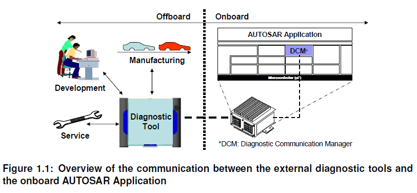

**Dcm**模块确保诊断数据流和管理诊断状态，特别是诊断会话和安全状态的管理。此外**Dcm**模块会检查诊断服务请求是否被支持，以及服务是否可以在当前会话的状态被执行。**Dcm**模块提供表1中的**OSI-Layer 5 ~ 7**。

表1.1：诊断协议与 OSI 层（**Diagnostic protocols and OSI-Layers**）

| OSI-层 | 协议 | | | | |
|---|---|---|---|---|---|
| 7 | UDS-Protocol - ISO14229-1 [1] | | | | Legislated OBD - ISO15031-5 [2] |
| 6 | - | - | - | - | - |
| 5 | ISO15765-3 | - | - | - | ISO 15765-4 |
| 4 | ISO15765-2 | - | - | - | - |
| 3 | ISO15765-2 | - | - | - | ISO 15765-4 |
| 2 | CAN- Protocol | LIN-Protocol | FlexRay | MOST | ISO 15765-4 |
| 1 | CAN- Protocol | LIN-Protocol | FlexRay | MOST | ISO 15765-4 |
​
在**OSI**的第7层，**Dcm**模块提供广泛的**ISO14229-1**[1]的服务，此外**Dcm**模块也提供了在文件**SAE J1979**[3]和**ISO 15031-5**[2]中定义的**OBD**服务机制的$01 - $0A的支持。通过这些服务，**AUTOSAR** **OBD**功能能够满足全球所有轻量级的OBD法规（如：加州 **OBD II**、**EOBD**、日本**OBD**等)。

在**OSI**的第5层，**Dcm**模块处理以下规范的网络独立部分:

* **ISO15765-3**[4]: 统一诊断业务实现（**UDS on CAN**）。
* **ISO15765-4**[5]: 排放相关系统的需求。第五章“会话层”
  
在**AUTOSAR**体系结构中，诊断通信管理器位于通信服务(服务层)。
​
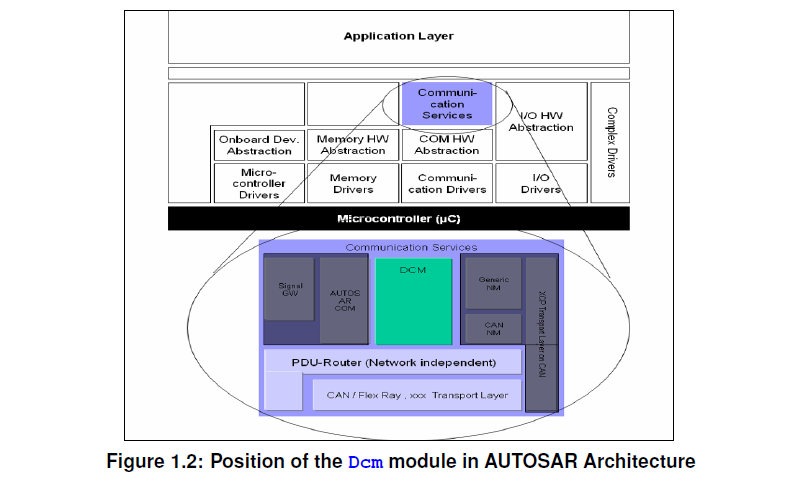

**Dcm**模块是与网络独立的。所有网络特定的功能（如：**CAN**、**LIN**、**FlexRay**或**MOST**等网络的特定功能）都是在**Dcm**模块之外处理的。**PduR**（**PDU Router**）模块为**Dcm**模块提供了独立的网络接口。**Dcm**模块只会收到**PduR**模块发来的诊断消息。Dcm模块处理并在内部检查诊断消息。作为处理请求的诊断服务的一部分，**Dcm**将与其他**BSW**模块或**SW-C**通过**RTE**进行交互，以获取请求的数据或执行请求的命令。通常**Dcm**将收集到的信息集合起来，并通过**PduR**模块发送一条回复消息。

## 2. 缩略语

下面的词汇表列出了与 &lt;MODULE_NAME&gt; 模块相关、未包含在 [6, AUTOSAR 术语表] 中的缩略语和缩写。

**地址和长度格式标识符（AddressAndLengthFormat Identifier）**
> 定义了请求消息中用于**memoryAddress**和**memorySize**参数的字节数。

**应用层（Application Layer）**
> 应用层位于**RTE**之上。在应用层中放置**AUTOSAR**的软件组件。

**原子发送者/接收者接口（Atomic Sender/Receiver interface）**
> 原子发送者/接收者接口可用于将 **DID** 数据元素分组为一个记录数据元素原型。所有数据元素都可以通过单个读取或写入操作进行读取或写入。

**通道（Channel）**
> 可以进行数据传输的链路。如果存在多个通道，通常会为通道分配某种类型的 ID。

**Concurrent TesterPresent**（并发 TesterPresent）
> 一个设置了 suppressPosRspMsgIndicationBit（3E 80）的 **UDS** 服务 **TesterPresent**，通过功能寻址接收。它也被称为保活（keep-alive）逻辑。

**诊断通道（Diagnostic Channel）**
> 诊断工具与 **ECU** 之间可以进行数据传输的链路。示例：一个 **ECU** 通过 **CAN** 连接，且该诊断通道被分配了一个 **CAN-ID**。连接到其他总线系统（如 **MOST**、**FlexRay**、**LIN** 等）的诊断通道同样是可能的。

**外部诊断工具（External Diagnostic Tool）**
> 一种并非永久连接到车辆通信网络的设备。外部诊断工具可以出于多种目的连接到车辆，例如：开发、制造、服务（在修理厂）。外部诊断工具的示例有：诊断仪（diagnostic tester）、OBD 扫描工具（OBD scan tool）。外部诊断工具由维修人员连接，以从车辆“内部”收集信息。

**冻结帧（Freeze Frame）**
> 特定时刻的车辆/系统运行条件集合。

**功能寻址（Functional Addressing）**
> 一种诊断通信模型，其中特定通信网络的一组或所有节点从一个发送节点接收消息（1-n 通信）。该模型也被称为“广播”（broadcast）或“多播”（multicast）。OBD 通信始终以功能寻址模式进行。

**内部诊断工具（Internal Diagnostic Tool）**
> 一种连接到车辆通信网络的设备/**ECU**。内部诊断工具可用于：高级事件跟踪、高级分析、服务。内部诊断工具的行为可以与外部诊断工具相同。“内部诊断工具”的概念并不意味着它作为 **AUTOSAR** 软件组件包含在每个 **ECU** 中。

**物理寻址（Physical Addressing）**
> 一种诊断通信模型，其中特定通信网络的一个节点从一个发送节点接收消息（1-1 通信）。该模型也被称为“单播”（unicast）。

**UDS 服务（UDS Service）**
> 这是指 **ISO14229-1** [1] 中定义的 **UDS** 服务。

**OBD 扫描工具（OBD Scan tool）**
> 参见外部诊断工具（**External Diagnostic Tool**）的定义。

**OBD 服务（OBD Service）**
> 这是指 **ISO15031-5** [2] 中定义的 **OBD** 服务。

**OBD UDS DTC 分离（OBD UDS DTC separation）**
> 该特性将针对基于 **SAE J1979-2** 的 **UDS** 通信报告与非 **J1979-2** **UDS** 通信不同的 3 字节 **DTC** 编号。

**周期传输速率（periodic transmission rate）**
> 定义周期数据标识符传输的两次调用之间时间间隔的值。该值是配置特定的，快速、中速和慢速周期数据传输分别有单独的值。配置的值始终是 **Dcm** 主函数时间的整数倍。

**API**
> 应用编程接口（**Application Programming Interface**）

**CAN**
> 控制器局域网（**Controller Area Network**）

**CEMR**
> 控制使能掩码记录（**ControlEnableMaskRecord**）

**Dcm**
> 诊断通信管理器（**Diagnostic Communication Manager**）

**Dem**
> 诊断事件管理器（**Diagnostic Event Manager**）

**Det**
> 默认错误跟踪器（**Default Error Tracer**）

**DID**
> 数据标识符（**Data Identifier**）

**DSD**
> 诊断服务分发器（**Diagnostic Service Dispatcher**，**Dcm** 模块的子模块）

**DSL**
> 诊断会话层（**Diagnostic Session Layer**，**Dcm** 模块的子模块）

**DSP**
> 诊断服务处理（**Diagnostic Service Processing**，**Dcm** 模块的子模块）

**DTC**
> 诊断故障码（**Diagnostic Trouble Codes**）

**ID**
> 标识符（**Identifier**）

**LIN**
> 局部互联网络（**Local Interconnect Network**）

**MCU**
> 微控制器单元（**Micro-Controller Unit**）

**MOST**
> 面向媒体的系统传输（**Media Orientated System Transport**）

**NRC**
> 负响应码（**Negative Response Code**）

**OBD**
> 车载诊断（**On-Board Diagnosis**）

**OSI**
> 开放系统互连（**Open Systems Interconnection**）

**PDID**
> 周期数据标识符（**Periodic Data Identifier**，在 **ReadDataByPeriodicIndentifer** 请求后由 **Dcm** 周期性发送）

**PDU**
> 协议数据单元（**Protocol Data Unit**）

**PID**
> 参数标识符（**Parameter Identifier**）

**RCRRP**
> 响应正确接收——响应挂起（**Response correctly received - response pending**）

**RID**
> 例程标识符（**Routine Identifier**）

**ROE**
> 事件响应（**ResponseOnEvent**）

**RTE**
> 运行时环境（**Runtime Environment**）

**SAP**
> 服务访问点（**Service Access Point**）

**SDU**
> 服务数据单元（**Service Data Unit**）

**SID**
> 服务标识符（**Service Identifier**）

**SW-C**
> 软件组件（**Software-Component**）

**TP**
> 传输协议（**Transport Protocol**）

**UDS**
> 统一诊断服务（**Unified Diagnostic Services**）

**Xxx\_**
> **API** 提供者的占位符（**Placeholder for an API provider**）

**SPRMIB**
> 抑制正响应消息指示位（**suppressPosRspMsgIndicationBit**）

### 2.1. 排版约定

本文档使用以下排版约定：

- 参见配置参数 myConfigurationParameter：这是对一个配置参数的引用，可在第 9 章中找到。
- myFunction()：这是模块提供或要求的函数，其定义见第 7 章。

## 3. 相关文档

### 3.1. 输入文件和相关标准与规范

- [1] Unified diagnostic services (UDS) - Part 1: Application layer (Release 2013-03) https://www.iso.org
- [2] Road vehicles - Communication between vehicle and external equipment for emission-related diagnostic - Part 5: Emission-related diagnostic services. https://www.iso.org
- [3] SAE J1979
- [4] Diagnostics on controller area network (CAN) - Part 3: Implementation of unified diagnostic services (UDS on CAN) (Release 2004 10-06)
- [5] Diagnostics on controller area network (CAN) - Part 4: Requirements for emission-related systems (Release 2005 01-04)
- [6] Glossary AUTOSAR_FO_TR_Glossary
- [7] General Specification of Basic Software Modules AUTOSAR_CP_SWS_BSWGeneral
- [8] Unified diagnostic services (UDS) - Part 1: Application layer (Release 2020-02) https://www.iso.org
- [9] Requirements on Diagnostics AUTOSAR_FO_RS_Diagnostics
- [10] Requirements on Intrusion Detection System AUTOSAR_FO_RS_IntrusionDetectionSystem
- [11] General Requirements on Basic Software Modules AUTOSAR_CP_SRS_BSWGeneral
- [12] ISO 17356-3: Road vehicles - Open interface for embedded automotive applications - Part 3: OSEK/VDX Operating System (OS)
- [13] Unified diagnostic services (UDS) - Part 2: Session layer services (Release 2021-10) https://www.iso.org
- [14] Specification of PDU Router AUTOSAR_CP_SWS_PDURouter
- [15] Road vehicles - Diagnostics on Controller Area Networks (CAN) - Part 2: Network layer services
- [16] Road vehicles - Communication between vehicle and external equipment for emission-related diagnostic - Part 6: Diagnostic trouble code definitions
- [17] Specification of Crypto Service Manager AUTOSAR_CP_SWS_CryptoServiceManager
- [18] Specification of Key Manager AUTOSAR_CP_SWS_KeyManager
- [19] Specification of I/O Hardware Abstraction AUTOSAR_CP_SWS_IOHardwareAbstraction
- [20] Specification of Diagnostic Event Manager AUTOSAR_CP_SWS_DiagnosticEventManager

### 3.2. 相关规范

**AUTOSAR** 提供的基础软件模块通用规范 [7, SWS BSW General] 同样适用于诊断通信管理器。因此，SWS BSW General 规范应被视为诊断通信管理器的附加且必需的规范。

## 4. 约束和假设

### 4.1. 限制

使用 **Dcm** 模块时适用以下限制：

- **Dcm** 模块不提供任何诊断多通道能力。这意味着测试仪针对不同独立功能发出的并行请求无法由单个 **Dcm** 模块处理。此外，当前实现的概念未考虑位于一个 **ECU** 中的多个 **Dcm** 模块实例。由于立法者要求 **ISO 15031-5** [2] 的排放相关服务请求应先于任何增强型诊断请求处理，**Dcm** 模块提供了基于协议优先级的协议切换机制。
- **CAN** 和 **LIN** 的 **ISO** 标准不支持 **UDS** 服务 **AccessTimingParameter**（0x83）。**FlexRay** 也未计划支持该服务。因此没有对该服务的支持计划。
- 当前版本不支持服务 **ResponseOnEvent** 的子功能 **onComparisionOfValues**。
- 当前版本不支持服务 **ResponseOnEvent** 的子功能 **onTimerInterrupt**。
- 当前版本不支持 **UDS** 服务 **SecuredDataTransmission**（0x84）。
- **Dcm** SWS 不涵盖任何 **SAE J1939** 相关的诊断需求。
- 由于 **DEM** 的限制，诊断服务 $19 05 仅限于 **OBD** 立法冻结帧。
- 不支持对请求和响应中没有 **InputOutputControlParameter** 的 **IOControl** 服务的管理。
- **IOControl** 请求和响应中 **controlState** 参数的长度必须具有相同的大小（由于只有一个配置参数 **DcmDspDataByteSize**）。
- 在 **RDBI**、**WDBI** 或 **IOCBI** 服务中使用的 **DID** 具有相同的布局。
- **ControlDTCSetting** 请求中的用户可选参数 **DTCSettingControlOptionRecord** 仅在它对应于 groupOfAllDTCs（0xFFFFFF）值时受支持。在其他情况下，必须在供应商特定的实现中进行管理。
- 仅支持 **ControlDTCSetting** 的子功能 0x01 和 0x02。
- **SWS** 未涵盖 **DCM/DEM** &lt;-&gt; **SW-C** 交互期间 **RTE** 报告的基础设施错误（infrastructure errors）的处理，如果实现者需要，可能必须将其考虑在内。
- **Dcm** 不支持用于 **ROE** 的 **DLT**。
- **ROE** 的 **ServiceToRespondTo** 不支持分页缓冲（PageBuffering）。
- **ROE** 仅支持表 2 中列出的子功能。
- **DID** 范围特性不能应用于服务 **DynamicallyDefineDataIdentifier**、**ReadDataByPeriodicIdentifier** 和 **InputOutputControlById**。
- **AUTOSAR Dcm** 并非打算在引导加载程序（bootloader）中使用。
- **FlexRay** 上无法进行周期传输（PeriodicTransmission），因为 **ISO 14229-4** 要求报头信息（地址信息（源地址和目标地址）和 FPL（帧有效载荷长度））。这些信息无法用 IF 接口的既定概念填充。
- 当前 **AUTOSAR** 版本未标准化 **Dcm** 模块与 **NvBlockSoftwareComponentType** 之间 **ECU** 内通信的转换器（transformer）规范。对于这种场景，可以使用由复杂驱动（complex driver）实现的自定义转换器。为详细说明这一点，责任相关方（通常是 **OEM**）需要在单独的文档中从行为角度指定该自定义转换器（这可能包括字节顺序或对齐方式的定义）。如果需要在模型中定义转换器特定的属性，可以使用 **UserDefinedTransformationDescription** 和 **UserDefinedTransformationISignalProps** 中的特殊数据组来完成。对于此场景的配置，**Dcm** 模块和 **NvBlockSoftwareComponentType** 的受影响 **SenderReceiverInterface** 应存在一个 **DataPrototypeMapping**，它在角色 **firstToSecondDataTransformation** 中引用一个 **DataTransformation**。该 **DataTransformation** 应在角色 **transformerChain** 中引用恰好一个 **transformerClass** 属性设置为 "serializer" 的 **TransformationTechnology**，并可以在角色 **transformationDescription** 中组合一个 **UserDefinedTransformationDescription**。
- 在某些情况下，**Dcm** 模块能够并行处理诊断请求。这种可能性明确限于 **OBD** 与 **UDS** 协议处理并行。不支持任何其他协议组合的并行处理。特别是不支持并行处理两个或更多 **UDS** 协议请求、或 **WWH-OBD** 与 **UDS** 协议的用例。
- 对于 **UDS** 服务 0x29，**Dcm** 仅支持 **PKI** 的子功能。不支持通过挑战-响应（challenge response）方式进行的身份验证。
- 对于 **UDS** 服务 0x29，不支持通过 **Diffie-Hellman** 密钥交换的安全诊断通信。
- 对于 **UDS** 服务 0x29，**Dcm** 不支持 **NRC** “Certificate verification failed - Invalid Content”。
- **Dcm** 仅支持 **ISO 14229-1:2020** [8] 中选定的功能子集。除非明确说明，**Dcm** 遵循 **ISO 14229-1:2013** [1]。
- **AUTOSAR PduR** 架构允许使用流式协议。由于诊断协议不使用流式协议，**Dcm** 也不支持流式协议，因此不支持 **TpSduLength** 等于零的 **Dcm_StartOfReception**。
- **Dcm** 对 **UDS** 服务 0x36 的 **NRC** 顺序有所不同。**ISO14229-1** [1] 为该服务定义的 **NRC** 顺序将需要更多的 **API**，这会使整体服务处理更加复杂。详情见第 6.6.2.21 章。

### 4.2. 汽车域的适用性

**Dcm** 模块可用于所有汽车域。

### 4.3. 排放相关环境（OBD）的适用性

本 **Dcm** SWS 旨在满足立法者给出的排放相关要求。但是，排放相关系统的供应商负责满足 **OBD** 要求。某些要求无法由 **Dcm** 模块本身满足，而需要在整个 **ECU** 或系统层面加以考虑。示例：在系统内集成 **Dcm** 模块期间，必须满足时序要求（50ms 响应时间）。

对于 **WWH-OBD**，当前仅支持 **FunctionalGroupIdentifier** 0x33。

## 5. 与其他模块的依赖关系

**AUTOSAR** 诊断通信管理器（**DCM**）与以下基础软件模块和 **SW-C** 存在接口和依赖关系：

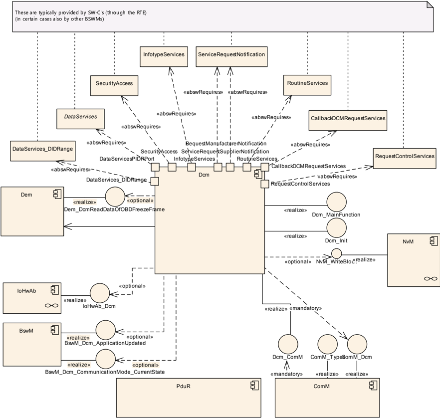

- 诊断事件管理器（**DEM**）：**DEM** 模块提供检索与故障内存相关的所有信息的功能，使 **Dcm** 模块能够通过从故障内存读取数据来响应诊断仪的请求。
- 协议数据单元路由器（**PduR** 模块）：**PduR** 模块提供发送和接收诊断数据的功能。**Dcm** 模块的正常运行假定 **PduR** 接口支持诊断应用层与底层传输层之间为服务访问点（**SAP**）定义的所有服务原语（参见 **ISO14229-1** [1] 第 5 章“应用层服务”）。
- 通信管理器（**ComM**）：**ComM** 模块提供使 **Dcm** 模块能够针对诊断通信指示“活动”（active）和“非活动”（inactive）状态的功能。**Dcm** 模块提供处理通信需求“**Full-**/ **Silent-**/ **No-Communication**”的功能。此外，**Dcm** 模块还提供在 **ComM** 模块请求时启用和禁用诊断通信的功能。
- **SW-C** 和 **RTE**：**Dcm** 模块能够分析接收到的诊断请求数据流，并处理与诊断通信相关的所有功能，如协议处理和时序。基于对请求数据流的分析，**Dcm** 模块组装响应数据流，并将例程或 **IO-Control** 的执行委托给 **SW-C**。如果某些数据元素或功能状态无法由 **Dcm** 模块自身提供，**Dcm** 会通过端口接口（port-interface）从 **SW-C**、或通过直接函数调用从其他 **BSW** 模块请求数据或功能状态。
- **BswM**：如果 **Dcm** 的初始化是从引导加载程序跳转的结果，则 **Dcm** 通知 **BswM** 应用程序已被更新。**Dcm** 还向 **BswM** 指示通信模式的变化。
- 加密服务管理器（**Csm**）：加密服务模块提供广泛的加密算法。**Csm** 用于身份验证计算。
- 密钥管理器（**KeyM**）：密钥管理器模块提供证书处理支持以及用于实现基于证书的认证诊断的 **API**。

## 6. 功能规格

### 6.1. 安全事件

如果为 **Dcm** 模块启用了安全事件报告（DcmEnableSecurityEventReporting = true），则应通过 **AUTOSAR_SWS_BSWGeneral** 中定义的接口将相应的安全事件报告给 **IdsM**。

#### 6.1.1. Dcm 的安全事件

| 名称 | 描述 | ID |
|---|---|---|
| SEV_UDS_WRITE_INVALID_DATA | 诊断仪通过服务 **WriteDataByIdentifier** 写入无效数据。 | 23 |
| SEV_UDS_SECURITY_ACCESS_DENIED | 诊断仪发送的诊断请求未满足服务器对该服务的安全级别要求。返回了 **NRC** 0x33（securityAccessDenied）。 | 24 |
| SEV_UDS_COMMUNICATION_CONTROL_SWITCHED_OFF | **ECU** 通信被服务 **CommunicationControl** 关闭。 | 25 |
| SEV_UDS_SERVICE_NOT_SUPPORTED | 请求了不受支持或在当前活动会话中不受支持的诊断服务。返回了 **NRC** 0x11（serviceNotSupported）或 **NRC** 0x7F（serviceNotSupportedInActiveSession）。 | 26 |
| SEV_UDS_SUBFUNCTION_NOT_SUPPORTED | 请求的诊断服务的某个子功能不受支持。 | 27 |
| SEV_UDS_INCORRECT_MESSAGE_LENGTH_OR_FORMAT | 接收到的请求消息与规定的长度不匹配，或参数的格式与该服务规定的格式不同。返回了 **NRC** 0x13（incorrectMessageLengthOrInvalidFormat）。 | 28 |
| SEV_UDS_REQUEST_SEQUENCE_ERROR | 以错误的顺序接收到诊断服务。返回了 **NRC** 0x24（requestSequenceError）。 | 29 |
| SEV_UDS_REQUEST_OUT_OF_RANGE | 接收到一个参数超出允许范围的诊断请求。返回了 **NRC** 0x31（requestOutOfRange）。 | 30 |
| SEV_UDS_REQUESTED_ACTIONS_REQUIRES_AUTHENTICATION | 在未获得执行该服务所需身份验证的情况下接收到诊断请求。返回了 **NRC** 0x34（authenticationRequired）。 | 31 |
| SEV_UDS_SECURITY_ACCESS_NUMBER_OF_ATTEMPTS_EXCEEDED | **Security Access** 失败，且无效尝试次数已超限。返回了 **NRC** 0x36（exceedNumberOfAttempts）。 | 32 |
| SEV_UDS_SECURITY_ACCESS_INVALID_KEY | **Security Access** 失败，因为诊断仪向服务器发送了无效的密钥。返回了 **NRC** 0x35（invalidKey）。 | 33 |
| SEV_UDS_SECURITY_ACCESS_REQUIRED_TIME_DELAY_NOT_EXPIRED | 在延迟时间到期之前再次尝试解锁 **ECU**。发送了 **NRC** 0x37（requiredTimeDelayNotExpired）。 | 34 |
| SEV_UDS_NUMBER_OF_FAILED_AUTHENTICATION_ATTEMPTS_EXCEEDED | 身份验证失败次数超限 —— **OEM** 特定。 | 35 |
| SEV_UDS_CERTIFICATE_FAILURE | 诊断仪尝试使用无效证书进行身份验证。 | 36 |
| SEV_UDS_ECU_UNLOCK_SUCCESSFUL | 成功解锁 **ECU**（通过 **Security Access** $27），按级别计。 | 37 |
| SEV_UDS_AUTHENTICATION_SUCCESSFUL | 成功完成身份验证（通过 **Authentication** $29）。 | 38 |
| SEV_UDS_CLEAR_DTC_SUCCESSFUL | **DTC** 信息已通过 **SID** 0x14 **ClearDTCInformation** 清除。 | 39 |
| SEV_UDS_ECU_RESET | **ECU** 已被 **SID** 0x11 **ResetECU** 复位。 | 40 |
| SEV_UDS_WRITE_DATA | 诊断数据标识符已通过 **SID** 0x2E 写入。 | 41 |
| SEV_UDS_REQUEST_DOWNLOAD | 通过 **SID** 0x34 请求了诊断数据下载序列。 | 42 |
| SEV_UDS_DTC_SETTING_SWITCHED_OFF | 通过服务 0x85（**ControlDTCSetting**）关闭了 **DTC** 设置。 | 43 |

### 6.2. 错误分类

本节描述 **Dcm** 模块在生命周期中可能发生的几类错误的处理方式。

诊断通信错误在 **ISO** 协议中通过 **NRC** 直接处理。

错误值应在所有错误类型中唯一。**Dcm** 应仅使用本章给出的值。

《基础软件模块通用规范》（**General Specification of Basic Software Modules**）的“错误处理（Error Handling）”一节详细描述了基础软件的错误处理。其中最重要的是，它构成了一个由五种错误类型组成的分类方案，这些错误类型可能发生在 **BSW** 模块中。

基于这一基础，下节将在相应的小节中对特定错误进行规定。

#### 6.2.1. 开发错误

以下描述的错误和异常应由 **Dcm** 模块根据其构建版本（开发/生产模式）可检测。

##### 6.2.1.1. Dcm 模块开发错误的定义

| 错误类型 | 相关错误代码 | 错误值 |
|---|---|---|
| 调用 **Dcm** 时输入参数值无效，或 **Dcm** 调用了某个函数且该函数返回无效的出参或返回值。 | DCM_E_INVALID_VALUE | 0x02 |
| 接口返回值超出范围 | DCM_E_INTERFACE_RETURN_VALUE | 0x02 |
| 内部：**Dcm** 未初始化 | DCM_E_UNINIT | 0x05 |
| **Dcm API** 函数输入参数无效 | DCM_E_PARAM | 0x06 |
| 以 **NULL** 指针作为参数调用 **Dcm API** 服务 | DCM_E_PARAM_POINTER | 0x07 |
| **Dcm** 初始化失败 | DCM_E_INIT_FAILED | 0x08 |
| 存储 **ProgConditions** 失败 | DCM_E_SET_PROG_CONDITIONS_FAIL | 0x09 |

#### 6.2.2. 运行时错误

以下描述的错误和异常应由 **Dcm** 模块根据其构建版本（开发/生产模式）可检测。

**Dcm** 模块运行时错误的定义：

| 错误类型 | 相关错误代码 | 错误值 |
|---|---|---|
| 接口：与另一个模块交互期间发生超时（例如达到最大响应挂起（response pending）次数） | DCM_E_INTERFACE_TIMEOUT | 0x01 |
| 接口：与另一个模块（应用、**Dem**、**PduR** 等）交互期间，**Dcm** 提供的缓冲区边界检查失败 | DCM_E_INTERFACE_BUFFER_OVERFLOW | 0x03 |

#### 6.2.3. 瞬时故障

没有瞬时故障。

#### 6.2.4. 生产错误

没有生产错误。

#### 6.2.5. 扩展生产错误

没有扩展生产错误。

### 6.3. 通用设计元素

#### 6.3.1. Dcm 模块内的子模块

为了定义 **Dcm** 模块的功能，**Dcm** SWS 将 **Dcm** 模块建模为由以下子模块组成：

- 诊断会话层（**DSL**）子模块：**DSL** 子模块确保与诊断请求和响应相关的数据流，监督并保证诊断协议时序，并管理诊断状态（特别是诊断会话和安全状态）。
- 诊断服务分发器（**DSD**）子模块：**DSD** 子模块处理诊断数据流。该子模块：
  - 通过网络接收新的诊断请求，并将其转发给数据处理器。
  - 在数据处理器（例如 **DSP** 子模块）触发时，通过网络发送诊断响应。
- 诊断服务处理（**DSP**）子模块：**DSP** 子模块处理实际的诊断服务（相应地为子服务）请求。

下一张图给出 **Dcm** 模块内 **DSP**、**DSD** 和 **DSL** 子模块之间接口的概览。

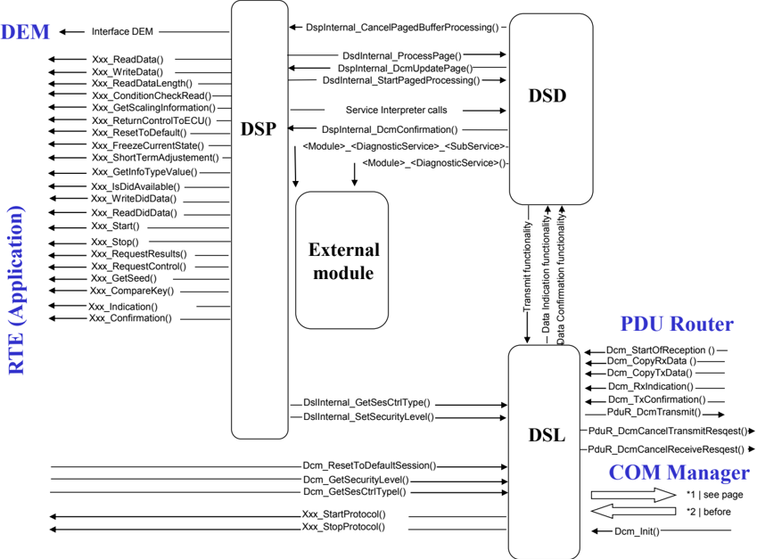

**注意：** 这些子模块及其之间接口的实现不是强制的。引入它们只是为了提高规范的可读性。

#### 6.3.2. 负响应码（NRC）

定义 **UDS** 服务和 **OBD** 服务的标准定义了负响应码（**NRC**）。**Dcm** SWS 在 **Dcm** 与其他 **BSW** 模块及 **SW-C** 之间的接口中使用这些 **NRC**。这些 **NRC** 在数据类型 **Dcm_NegativeResponseCodeType** 中定义。

发送的 **NRC** 的顺序应符合 **ISO14229-1** [1] 中描述的顺序。

#### 6.3.3. 非易失信息

**Dcm** 的若干特性需要初始化非易失信息。**AUTOSAR** 未描述如何访问该信息，也未描述当 **Dcm** 初始化时该信息是否已经可用。因此，非易失信息的访问是实现特定的，必须在集成期间予以保证。

**Dcm** 应检查 **NvM** 是否被正确读出。如果非易失信息无法被正确读出，**Dcm** 应启动默认反应。默认反应在使用该非易失数据的章节中描述。

如果 **Dcm** 取消一个带有 **NvM** 访问的服务，它应调用 NvM_CancelJobs()。

该服务的取消或者是因为达到了 **RCRRP NRC** 的最大次数，或者是因为协议抢占。

#### 6.3.4. 类型

**Dcm** 应将非整数数据类型（例如 uint8[n]）当作匹配大小的整数数据类型来处理；或者在 DcmDspDataEndianness 配置为 OPAQUE 的情况下，将其内容不作解释地保留。

**Dcm** 模块应将不透明（opaque）数据解释为 uint8[n]，并始终将其映射到一个 n 字节大小的信号。对于不透明数据的字节序，DcmDspDataEndianness 必须配置为 OPAQUE。

**Dcm** 应将 [12] 中定义的字节序转换扩展到有符号数据类型。

在 [12]（第 2.4 章）中，字节序转换是针对无符号数据类型定义的。相关的配置可在配置 **DcmDspData** 中找到。

##### 6.3.4.1. 原子类型概览

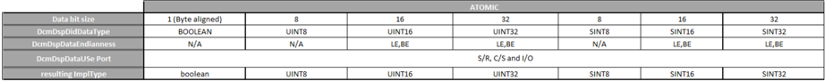

##### 6.3.4.2. 数据数组类型概览

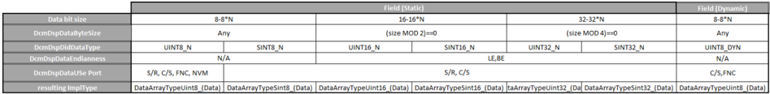

##### 6.3.4.3. 嵌套数据类型概览

用于 **DID** 和诊断例程（Diagnostic Routine）的数据类型可以以嵌套方式定义。一个 **DID** 或例程参数（Routine Argument）可以由多个元素组成，例如一个数组，其中每个数组元素是一个结构体，而该结构体又由多个以基本类型、数组或更深层结构体类型化的数据元素组成。

在配置中，这通过一个专用的模式来表示：

- 根数据元素定义一个嵌套元素池（例如 **DcmDspDid** 中的 DcmDspDidSignalCompositePool）。
- 根数据元素有一个锚对象（例如 DcmDspDidSignal），该锚对象可以表示基本数据或数组数据，在这种情况下没有定义对池元素的引用（例如 DcmDspDidSignalCompositeRef）。
- 如果锚对象表示一个结构体，则它定义一个或多个对池元素的引用（例如 DcmDspDidSignalCompositeRef）。这定义了被引用的池元素构成该结构体的内容。

池元素本身可以是一个嵌套定义。这允许结构化元素的任意嵌套。

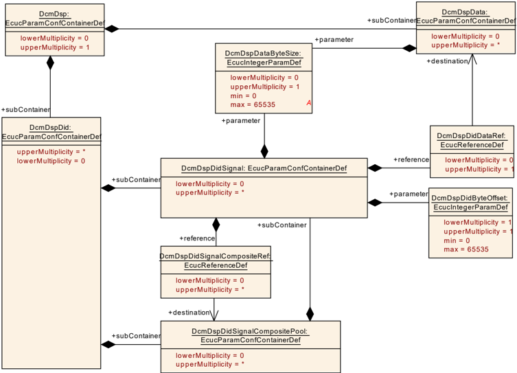

如果一个 DcmDspDidSignal 包含至少一个 DcmDspDidSignalCompositeRef，则该 DcmDspDidSignal 应只定义以下参数：

- DcmDspDidByteOffset
- DcmDspDataByteSize

具体而言，这意味着 DcmDspDidSignal 不应定义任何 DcmDspDidDataRef，因为那会给出基本数据类型或数组数据类型的具体数据类型信息。如果 DcmDspDidSignal 包含一个 DcmDspDidSignalCompositeRef，则该 DcmDspDidSignal 是一个嵌套数据类型。

嵌套数据类型占用从 DcmDspDidByteOffset 位置开始的连续若干字节（DcmDspDataByteSize）。

嵌套数据类型范围内定义的所有数据类型都应放置在 DcmDspDataByteSize 和 DcmDspDidByteOffset 定义的区域内。

嵌套数据元素的 DcmDspDidByteOffset 值应给出相对于 **DID** 的绝对起始位置（而不是相对于相应的组合结构体）。

每个 DcmDspDidSignalCompositePool 只应被一个 DcmDspDidSignalCompositeRef 引用至多一次。每个 DcmDspDidSignalCompositePool 元素被明确定义为位于 **DID** 中的一个专用位置，并且在 **DcmDspDid** 的定义中只能出现一次。

DcmDspDidSignalCompositeRef 只应引用与 DcmDspDidSignalCompositeRef 的所有者定义在同一个 **DcmDspDid** 范围内的 DcmDspDidSignalCompositePool 元素。

上述规范是基于 **DcmDspDid** 定义的。嵌套数据类型定义的相同模式也已应用于配置的其他部分。下面的列表给出上文使用的配置项与用于嵌套数据类型定义的其他配置项之间的对应关系。

数据类型的嵌套不仅适用于 **DcmDspDid**，也支持以下定义：

- DcmDspDid 对应于
  - DcmDspStartRoutineIn
  - DcmDspStartRoutineOut
  - DcmDspStopRoutineIn
  - DcmDspStopRoutineOut
  - DcmDspRequestRoutineResultsIn
  - DcmDspRequestRoutineResultsOut
- DcmDspDidSignal 对应于
  - DcmDspStartRoutineInSignal
  - DcmDspStartRoutineOutSignal
  - DcmDspStopRoutineInSignal
  - DcmDspStopRoutineOutSignal
  - DcmDspRequestRoutineResultsInSignal
  - DcmDspRequestRoutineResultsOutSignal
- DcmDspDidSignalCompositePool 对应于
  - DcmDspStartRoutineInSignalCompositePool
  - DcmDspStartRoutineOutSignalCompositePool
  - DcmDspStopRoutineInSignalCompositePool
  - DcmDspStopRoutineOutSignalCompositePool
  - DcmDspRequestRoutineResultsInSignalCompositePool
  - DcmDspRequestRoutineResultsOutSignalCompositePool
- DcmDspDidSignalCompositeRef 对应于
  - DcmDspStartRoutineInSignalCompositeSignalRef
  - DcmDspStartRoutineOutSignalCompositeSignalRef
  - DcmDspStopRoutineInSignalCompositeSignalRef
  - DcmDspStopRoutineOutSignalCompositeSignalRef
  - DcmDspRequestRoutineResultsInSignalCompositeSignalRef
  - DcmDspRequestRoutineResultsOutSignalCompositeSignalRef

图 7.5 中的示例嵌套数据类型定义为 A，它由定义为基本类型的 X 和 Y 组成。

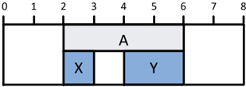

A 从 **DcmDspStartRoutineIn** 的位置 2 开始，大小为 4 字节。嵌套的叶子元素 X 和 Y 定义在结构体 A 的范围之内且不重叠。在这个例子中，X 和 Y 之间甚至留下了一个间隙。

图 7.6 给出了图 7.5 中嵌套数据类型的示例配置。

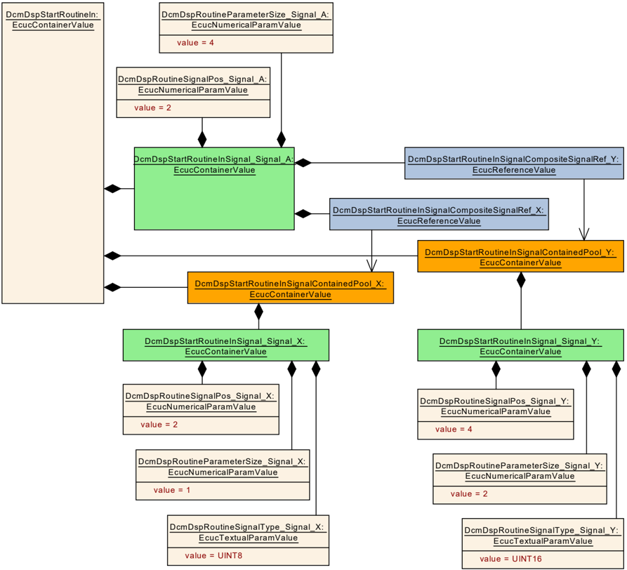

容器 DcmDspStartRoutineIn 包含根元素 DcmDspStartRoutineInSignal_Signal_A 以及两个池元素 DcmDspStartRoutineInSignalContainedPool_X 和 DcmDspStartRoutineInSignalContainedPool_Y 的定义。

根元素 DcmDspStartRoutineInSignal_Signal_A 将其绝对起始位置定义为 2（DcmDspRoutineSignalPos_Signal_A），将其以字节计的大小定义为 4（DcmDspRoutineParameterSize_Signal_A）。根元素 DcmDspStartRoutineInSignal_Signal_A 还通过引用 DcmDspStartRoutineInSignalContainedPool_X 和 DcmDspStartRoutineInSignalContainedPool_Y 定义了有两个嵌套元素属于该根元素。这些引用指向定义在同一个 **DcmDspStartRoutineIn** 范围内的池元素。

被引用的池元素分别定义了它们各自的绝对位置（DcmDspRoutineSignalPos_Signal_X）、大小（DcmDspRoutineParameterSize_Signal_X）和基本类型（DcmDspRoutineSignalType_Signal_X）。

##### 6.3.4.4. 数据类型约束

**大小参数的存在性（Existence of size parameter）**：如果 DcmDspDataType 设置为 UINT8_N、SINT8_N、UINT16_N、SINT16_N、UINT32_N、SINT32_N 或 UINT8_DYN，则应存在 DcmDspDataByteSize。

**注意：** 基本数据类型不需要 DcmDspDataByteSize。

**16 位数组大小参数的限制（Restrictions on size parameter for 16 Bit arrays）**：如果 DcmDspDataByteSize 的值大于 2 且 DcmDspDataType 为 UINT16_N 或 SINT16_N，则 DcmDspDataByteSize 应为 2 的倍数。

**32 位数组大小参数的限制（Restrictions on size parameter for 32 Bit arrays）**：如果 DcmDspDataByteSize 的值大于 4 且 DcmDspDataType 为 UINT32_N 或 SINT32_N，则 DcmDspDataByteSize 应为 4 的倍数。

**DcmDspRoutineParameterSize 参数用法的定义（Define the usage of DcmDspRoutineParameterSize parameter）**：只有当 DcmDspRoutineSignalType 设置为 SINT8_N、SINT16_N、SINT32_N、UINT8_N、UINT16_N、UINT32_N 或 VARIABLE_LENGTH 时，才需要 DcmDspRoutineParameterSize。

**RID 中只有最后的参数可以有可变长度（Only last parameters in RID may have a variable length）**：设置为 VARIABLE_LENGTH 的 DcmDspRoutineSignalType 仅对最后一个信号有效。

**大小参数的存在性（Existence of size parameter）**：如果 DcmDspPidDataType 设置为 UINT8_N、SINT8_N、UINT16_N、SINT16_N、UINT32_N 或 SINT32_N，则应存在 DcmDspPidDataByteSize。

**注意：** 基本数据类型不需要 DcmDspPidDataByteSize。

**16 位数组大小参数的限制（Restrictions on size parameter for 16 Bit arrays）**：如果 DcmDspPidDataByteSize 的值大于 2 且 DcmDspPIDDataType 为 UINT16_N 或 SINT16_N，则 DcmDspPidDataByteSize 应为 2 的倍数。

**32 位数组大小参数的限制（Restrictions on size parameter for 32 Bit arrays）**：如果 DcmDspPidDataByteSize 的值大于 4 且 DcmDspPIDDataType 为 UINT32_N 或 SINT32_N，则 DcmDspPidDataByteSize 应为 4 的倍数。

对于 1 到 8 之间的位长，应使用 **UINT8** 作为（实现）数据类型。

**S/R 通信、NvRam 访问或 ECU 信号访问情况下可变数据长度的使用（Usage of variable data length in case of S/R communication, NvRam access or ECU signal access）**：当 DcmDspDataUsePort 设置为 USE_DATA_SENDER_RECEIVER、USE_DATA_SENDER_RECEIVER_AS_SERVICE 或 USE_ECU_SIGNAL 时，不允许使用可变数据长度。

**注意：** DcmDspData 的 SHORT-NAME 和 DcmDspPidData 的 SHORT-NAME 应各不相同。可变数据长度只有在使用 **UINT8** 数组且 DcmDspDataType 设置为 UINT8_DYN 时才可能。

##### 6.3.4.5. Dcm_OpStatusType

对于使用 **Dcm_OpStatusType** 的操作，**Dcm** 应按如下方式工作：

在第一次调用使用 **Dcm_OpStatusType** 的操作时，**Dcm** 以 OpStatus = DCM_INITIAL 调用该操作。

如果使用 **Dcm_OpStatusType** 的操作返回值 DCM_E_FORCE_RCRRP，则 **Dcm** 应发起 RCR-RP 的发送请求（**NRC** 0x78 发送），并且在 RCR-RP 被发送之前，**Dcm** 不应再次调用该操作。

在前述操作的上下文中发送的 RCR-RP 的发送确认之后，**Dcm** 从 Dcm_MainFunction（由于调用上下文的原因）以 OpStatus = DCM_FORCE_RCRRP_OK 再次调用该操作。

如果使用 **Dcm_OpStatusType** 的操作返回值 DCM_E_PENDING，则只要返回 DCM_E_PENDING，**Dcm** 就在每次 Dcm_MainFunction 调用时以 OpStatus = DCM_PENDING 调用该操作。

##### 6.3.4.6. Dcm_Cemr_{DID}Type

为便于在 **SWC** 中使用，**Dcm** 为带 **IO** 控制的 **DID** 中使用的每个数据元素生成一个符号名称，用于按照 **Dcm_Cemr_{DID}Type** 访问 **CEMR** 位。**SWC** 只能使用位域文本表生成的符号值来屏蔽某个位。这有助于避免混淆，因为网络上的第一个 **RID** 位控制 **DID** 的第一个参数，但该位在 **MSB** 中是最有效位。如果 **RID** 的大小发生变化，该符号名称也会有所帮助。在这种情况下，位掩码也会改变，但符号值始终会更新。

### 6.4. 诊断会话层（DSL）

#### 6.4.1. 简介

**DSL** 子模块的所有功能领域应符合 **ISO14229-1** [1]、**ISO14229-2** [13] 以及 **ISO15765-3** [4] 中与网络无关的部分的规定。

**DSL** 子模块中不存在与网络相关的功能领域。在配置中，某些参数可以依赖于网络进行设置。

#### 6.4.2. 用例

**DSL** 子模块提供以下功能：

- 会话处理（**ISO14229-1** [1] 和 **ISO 15765-3** [4] 的要求）
- 应用层时序处理（**ISO14229-1** [1] 和 **ISO 15765-3** [4] 的要求）
- 特定的响应行为（**ISO14229-1** [1] 和 **ISO 15765-3** [4] 的要求）
- 每个诊断连接的认证状态处理（**ISO 14229-1:2018** 的要求）
  - 提供每个连接的认证状态
  - 管理认证状态转换

#### 6.4.3. 与其他模块的交互

**DSL** 与其他模块有以下交互：

- **PduR** 模块
  - **PduR** 模块提供传入诊断请求的数据。
  - **DSL** 子模块触发诊断响应的输出。
- **DSD** 子模块
  - **DSL** 子模块将传入请求通知 **DSD** 子模块并提供数据。
  - **DSD** 子模块触发诊断响应的输出。
- **SW-C** / **DSP** 子模块。**DSL** 子模块提供对安全和会话状态的访问。
- **ComM** 模块
  - **DSL** 子模块保证 **ComM** 模块要求的通信行为。

#### 6.4.4. 功能描述

##### 6.4.4.1. 概述

**DSL** 子模块提供以下功能：

**请求处理（Request Handling）**

- 将来自 **PduR** 模块的请求转发给 **DSD** 子模块。
- 并发 **TesterPresent**（“保活逻辑”）。

**响应处理（Response Handling）**

- 将来自 **DSD** 子模块的响应转发给 **PduR** 模块。
- 保证对诊断仪的响应时序。
- 支持周期传输。
- 支持 **ResponseOnEvent**（**ROE**）传输。
- 支持分段响应。
- 支持由应用程序触发的 **ResponsePending** 响应。

**安全级别处理（Security Level Handling）**

- 管理安全级别。

**会话状态处理（Session State Handling）**

- 管理会话状态。
- 跟踪活动的非默认会话。
- 允许修改时序参数。

**诊断协议处理（Diagnostic Protocol Handling）**

- 处理不同的诊断协议。
- 管理资源。

**通信模式处理（Communication Mode Handling）**

- 处理通信需求（**Full-** / **Silent-** / **No Communication**）。
- 指示诊断的活动/非活动状态。
- 启用/禁用所有类型的诊断传输。

##### 6.4.4.2. 将来自 PduR 模块的请求转发给 DSD 子模块

每当在分配给 **Dcm** 模块的 DcmDslProtocolRxPduId 上开始接收新的诊断请求内容时，**PduR** 模块就会通知 **Dcm** 模块。这是通过调用 Dcm_StartOfReception 完成的，该调用将待接收的数据大小通知 **Dcm** 模块并提供首帧或单帧的数据，并允许 **Dcm** 在数据大小超出其缓冲区大小或请求的服务不可用时拒绝接收。随后对 Dcm_CopyRxData 的调用请求 **Dcm** 模块将数据从提供的缓冲区复制到 **Dcm** 缓冲区。如果诊断请求的接收已完成（当 Dcm_StartOfReception 成功时），**PduR** 模块将调用 Dcm_TpRxIndication 向 **Dcm** 模块给出接收指示。**Dcm** 应能够使用通用连接（generic connection），其中寻址信息由 Dcm_StartOfReception 通过 DcmRxPdu 的 MetaData 提供给 **Dcm**。该寻址信息必须被存储并用于响应以及识别来自同一诊断仪的请求。更多细节参见第 6.4.4.5 节“通用连接处理”。

只有在以参数 Result = E_OK 调用 Dcm_TpRxIndication 之后，**DSL** 子模块才应将接收到的数据转发给 **DSD** 子模块。

一旦接收到请求消息（在以参数 Result = E_OK 调用 Dcm_TpRxIndication 之后，直到为关联的 TxDcmPduId 调用 Dcm_TpTxConfirmation 为止），**DSL** 子模块应阻塞对应的 DcmPduId。在该请求的处理期间，在相应的响应消息被发送且 DcmPduId 被再次释放之前，不能接收同一 DcmDslConnection 的任何其他请求（例如，增强会话可能被 **OBD** 会话结束）（并发 **TesterPresent** 请求除外）。

有关这些 **API**（原型、输入/输出参数）的更多描述，可参见 **PduR** 模块 [14] 的接口描述。

不同的诊断通信应用允许使用不同的 DcmPduId。例如：

- **OBD** DcmDslProtocolRxPduId：用于接收 **OBD** 请求，
- **OBD** DcmTxPduId：用于发送 **OBD** 响应，
- **UDS** 物理 DcmDslProtocolRxPduId：用于接收 **UDS** 物理寻址请求，
- **UDS** 功能 DcmDslProtocolRxPduId：用于接收 **UDS** 功能寻址请求，
- **UDS** DcmTxPduId：用于发送 **UDS** 响应。

地址类型（物理寻址/功能寻址）按 DcmDslProtocolRxPduId 配置。之所以可以按 DcmDslProtocolRxPduId 配置，是因为功能寻址接收和物理寻址接收总是会有不同的 DcmDslProtocolRxPduId 值，而与传输层的寻址格式（扩展寻址、正常寻址）无关。

###### 6.4.4.2.1. Dcm_StartOfReception

如果请求的大小大于 **DCM** 中可用的缓冲区，函数 Dcm_StartOfReception 应返回 BUFREQ_E_OVFL。

当 **API** Dcm_StartOfReception 以等于 0 的 TpSduLength 被调用时，应返回值 BUFREQ_E_NOT_OK。

**根据 ISO 14229-2 的消息接收（Message reception according to ISO 14229-2）**：**Dcm** 应根据 **ISO14229-2** [13] 的会话层服务接收并处理诊断消息。

**T_DataSOM.ind 的映射（Mapping of T_DataSOM.ind）**：**Dcm** 应将对 Dcm_StartOfReception 的调用映射到 **ISO14229-2** [13] 的 T_DataSOM.ind。

**T_Data.ind 的映射（Mapping of T_Data.ind）**：**Dcm** 应将对 Dcm_TpRxIndication 的调用映射到 **ISO14229-2** [13] 的 T_Data.ind。

**多客户端处理（Multi client handling）**：**Dcm** 应根据 **ISO14229-1** [1] 附录 J 处理来自多个客户端的请求。

**ISO14229-1** [1] 的“图 J.2 —— 多客户端处理流程（Figure J.2 - Multiple client handling flow）”给出了并行客户端请求处理的全面概览。一个重要方面是对附加协议资源的支持。**Dcm** 遵循该流程图，并为每个配置的 DcmDslProtocolRow 提供协议资源。在默认会话中，这允许 **Dcm** 并行处理请求。

**协议资源可用性（Protocol resource availability）**：**Dcm** 应为每个配置了独立 DcmDslBuffer 的 DcmDslProtocolRow 分配附加的协议资源。

配置参数 DcmDslDiagRespOnSecondDeclinedRequest 定义了 **ISO14229-1** [1]“图 J.2 —— 多客户端处理流程”中判定框“是否支持 **NRC** 0x21 处理？”的行为。

**以 NRC 0x21 拒绝第二个请求（Decline a second request with NRC 0x21）**：如果 **Dcm** 根据 **ISO14229-1** [1] 附录 J 拒绝接收到的第二个请求，且 DcmDslDiagRespOnSecondDeclinedRequest 设置为 TRUE，则 **Dcm** 应返回 **NRC** 0x21 作为对被拒绝的第二个请求的响应。

**忽略第二个请求（Ignoring a second request）**：如果 **Dcm** 根据 **ISO14229-1** [1] 附录 J 拒绝接收到的第二个请求，且 DcmDslDiagRespOnSecondDeclinedRequest 设置为 FALSE，则 **Dcm** 应忽略该新请求。

**ISO14229-1** [1] 附录 J 缺少对以下情况的服务器行为的定义：当服务器仍在处理某连接上的请求时，又从同一连接接收到第二个诊断请求。**Dcm** 通过不接受更多诊断请求进行处理来填补这一空缺。在这种情况下，不发送任何响应，甚至不发送 **NRC** 0x21。

**同一连接上的多个请求（Multiple requests on the same connection）**：如果 **Dcm** 接收到另一个待处理的诊断请求，而 **Dcm** 仍在处理同一连接上一个正在进行的请求，则 **Dcm** 应拒绝新接收到的请求。

###### 6.4.4.2.2. Dcm_CopyRxData

如果 Dcm_StartOfReception 返回 BUFREQ_OK，随后对 Dcm_CopyRxData 的调用应将数据从 info 参数中提供的缓冲区复制到 **Dcm** 缓冲区，并在本次调用完成后用 **Dcm** 接收缓冲区中剩余的空闲空间更新 bufferSizePtr 参数。

当 **API** Dcm_CopyRxData 以 info 中等于 0 的 SduLength 被调用时，应返回值 BUFREQ_OK，且 bufferSizePtr 应填充 **Rx** 缓冲区的剩余大小。

**注意：** **Rx** 缓冲区的大小基于缓冲区长度，该长度在 **API** Dcm_StartOfReception 的参数 RxBufferSizePtr 中返回。

在开始复制接收到的数据之后，**Dcm** 模块在通过服务 Dcm_TpRxIndication 被通知接收成功完成或未成功终止之前，不应访问接收缓冲区。

**注意：** 只有当 Dcm_StartOfReception 成功时才预期调用 Dcm_TpRxIndication。

###### 6.4.4.2.3. Dcm_TpRxIndication

如果以不同于 E_OK 的参数 Result 调用 Dcm_TpRxIndication，则 **Dcm** 模块不应评估分配给该 **I-PDU** 的缓冲区（在参数 DcmRxPduId 中引用）。

**基本原理：** 在这种情况下，缓冲区的哪一部分包含有效数据是未定义的。

##### 6.4.4.3. 并发 TesterPresent（“保活逻辑”）

并发 **TesterPresent** 由 **ISO14229-1** [1] 定义，也被称为“旁路逻辑（bypass logic）”或“保活逻辑（keep alive logic）”。其目的是保持非默认会话活动，并复位 **ISO14229-2** [13] 定义的 **S3** 定时器。并发 **TesterPresent** 仅通过功能寻址接收，并且独立于物理请求上的任何活动和服务处理进行处理。

**并发 TesterPresent 支持（Concurrent tester present support）**：**Dcm** 应根据 **ISO14229-1** [1] 处理并发 **TesterPresent**。

除 **ISO14229-1** [1] 之外，**Dcm** 将对收到的并发 **TesterPresent** 消息的处理限制在请求进入非默认会话的连接上。这避免了未请求该非默认会话的诊断仪影响另一个诊断仪的协议和时序行为。

**来自不同连接的并发 TesterPresent（Concurrent tester present from different connections）**：**Dcm** 应只处理在请求 **Dcm** 进入非默认会话的同一 DcmDslConnection 上接收到的并发 **TesterPresent** 消息。

###### 6.4.4.3.1. Dcm_CopyTxData

如果复制的数据小于服务 PduR_DcmTransmit() 中请求传输的长度，则在当前复制的数据已被传输后，**Dcm** 模块将被服务 Dcm_CopyTxData 请求提供更多数据。

如果函数 Dcm_CopyTxData 被调用且 **Dcm** 模块成功将数据复制到 info 参数提供的缓冲区中，则该函数应返回 BUFREQ_OK。

Dcm_CopyTxData 的注意事项：

- 函数 Dcm_CopyTxData 的参数 availableDataPtr 的值不应超过仍待发送的字节数。
- 如果本服务返回 BUFREQ_E_NOT_OK，则通过调用服务 PduR_DcmTransmit() 发出的传输请求仍未结束。需要一个最终确认（通过调用服务 Dcm_TpTxConfirmation 指示错误）来结束本服务，并能够开始另一次传输（调用 PduR_DcmTransmit()）。因此，是否确认传输中止取决于传输协议层。

###### 6.4.4.3.2. Dcm_TpTxConfirmation

如果函数 Dcm_TpTxConfirmation 被调用，则 **Dcm** 模块应解锁发送缓冲区。

如果函数 Dcm_TpTxConfirmation 被调用，则 **Dcm** 模块应停止错误处理（分页缓冲超时、P2ServerMax/P2*ServerMax 超时）。

对于通过 **FlexRay** 的传输，必须考虑以下限制：由于 **FlexRay** 规范并不强制要求存在发送中断，因此该确认的确切含义（即“传入 **FlexRay** 控制器的发送缓冲区”还是“发送到 **FlexRay** 网络”）取决于 **FlexRay** 通信控制器的能力和 **FlexRay** 接口的配置。

##### 6.4.4.4. 将来自 DSD 子模块的响应转发给 PduR 模块

**DSD** 子模块应请求 **DSL** 子模块发送响应。

当 DcmDslMainConnection 的诊断响应就绪时，**DSL** 子模块应通过使用相应的 DcmDslProtocolTxPduRef 参数作为 PduId 调用 PduR_DcmTransmit()，触发向 **PduR** 模块发送诊断响应。

在周期传输（PeriodicTransmission）的情况下，**Dcm** 应在对 PduR_DcmTransmit() 的调用中提供完整的有效载荷数据，并且不预期对 Dcm_CopyTxData 的调用。

在周期传输的情况下，**Dcm** 将通过 Dcm_TxConfirmation 被调用以指示传输结果。

响应使用 DcmTxPduId 发送，该 **ID** 在 **Dcm** 模块配置中与 DcmDslProtocolRxPduId（即请求被接收时所用的 **ID**）相关联（参见配置参数 DcmDslProtocolTx）。在 PduR_DcmTransmit() 中，只有长度信息以及（对于通用连接的）寻址信息被交给 **PduR** 模块。在 **Dcm** 模块成功调用 PduR_DcmTransmit() 之后，**PduR** 模块将调用 Dcm_CopyTxData 请求 **Dcm** 模块提供待传输的数据，并在完整的 **PDU** 成功传输或发生错误后调用 Dcm_TpTxConfirmation。有关通用连接内地址信息处理的更多细节，参见第 6.4.4.5 节“通用连接处理”。

如果 **DSL** 子模块在完整的 **Dcm PDU** 已成功传输或发生错误后，通过调用 Dcm_TpTxConfirmation 接收到确认，则 **DSL** 子模块应将该确认转发给 **DSD** 子模块。

在传输失败（PduR_DcmTransmit() 请求失败）或错误确认（带错误的 Dcm_TpTxConfirmation）的情况下，**DSD** 子模块不应重复诊断响应的传输。

**注意：** 只有当 PduR_DcmTransmit 成功时才预期调用 Dcm_TpTxConfirmation。

如果 DcmDslProtocolTx 的多重性（Multiplicity）设置为“0”，则 **Dcm** 应处理接收到的诊断请求而不发送响应。

有关这些 **API**（原型、输入/输出参数）的更多描述，可参见 **PduR** 模块 [14] 的接口描述。

##### 6.4.4.5. 通用连接处理

**Dcm** 应能够处理以带有 SOURCE_ADDRESS_16 和 TARGET_ADDRESS_16 类型 MetaDataItem 的 DcmPdu 标识的通用连接。这些连接在运行时携带实际的诊断仪地址。支持通过 **IP** 的诊断、**FlexRay** 诊断以及按照 **ISO15765-2** [15] 使用正常固定寻址或混合 29 位寻址格式的 **CAN** 诊断的通用连接。根据 **CAN ID** 的实际布局，通用连接也可用于扩展、正常及混合 11 位寻址格式。**Dcm** 不感知 **CanTp** 使用的实际寻址格式。多个连接可以引用相同的 DcmPdus。

**通用连接应保持一致（Generic connections shall be consistent）**：这意味着一个 DcmDslConnection 的所有被引用 **PDU**（DcmDslProtocolRxPduRef、DcmDslProtocolTxPduRef、DcmDslPeriodicTxPduRef）的 MetaDataItem 和 PduLength 应完全相同。

必须存储通过通用连接接收到的诊断请求的源地址。它通过 Dcm_StartOfReception 提供的 MetaDataItem SOURCE_ADDRESS_16 提供。

**通用连接传输的目标地址（Target address for generic connection transmission）**：如果 **Dcm** 即将针对通用连接请求发送响应、事件响应（response on event）或周期消息，则 **Dcm** 应在 PduR_DcmTransmit() 中将 MetaDataPtr 中的 TARGET_ADDRESS_16 设置为存储的源地址的值。

通过通用连接接收到的诊断请求的源地址应在参数 TesterSourceAddress 中提供给应用程序。

通过通用连接接收到的诊断请求的目标地址可以在通过 Dcm_StartOfReception() 接收到的 MetaDataItem TARGET_ADDRESS_16 中提供。在这种情况下，**Dcm** 应忽略目标地址不等于所配置 **ECU** 地址 DcmDspProtocolEcuAddr 的物理请求。

通过通用连接传输的响应的源地址可从配置参数 DcmDspProtocolEcuAddr 读取。如果该地址在发送 **PDU** 中配置，则应在 MetaDataItem SOURCE_ADDRESS_16 中将其提供给 PduR_DcmTransmit()。

**注意：** 如果同一 DcmDslProtocolRow 的某些被传输的诊断消息需要不同的源地址，则可以从 **PDU** 中省略 MetaDataItem SOURCE_ADDRESS_16，并将地址配置在较低层。对于物理请求同样如此，此时可以从 **PDU** 中省略 TARGET_ADDRESS_16。

##### 6.4.4.6. 通过发送忙响应保证对诊断仪的时序

如果应用程序（或 **DSP** 子模块）能够执行被请求的诊断任务，但需要额外的时间来完成任务并准备响应，则 **DSL** 子模块应在到达响应时间（DcmDspSessionP2ServerMax - DcmTimStrP2ServerAdjust 或 DcmDspSessionP2StarServerMax - DcmTimStrP2StarServerAdjust）时发送带有 **NRC** 0x78（**Response pending**）的负响应。

**基本原理：** **DSL** 子模块保证对诊断仪的响应时序。

**DSL** 子模块应从单独的缓冲区发送上述要求的负响应。

**基本原理：** 这样做是为了避免覆盖正在进行的请求处理，例如应用程序已经在诊断缓冲区中准备了响应内容。可以通过配置参数 DcmDslDiagRespMaxNumRespPend 限制针对一个诊断请求发送的带有 **NRC** 0x78（**response pending**）的负响应的数量，以避免在应用程序死锁时无休止地发送 **NRC** 0x78。

带有 **NRC** 0x78 的负响应的最大次数可以使用可选的配置参数 DcmDslDiagRespMaxNumRespPend 进行配置。如果未配置该参数，则带有 **NRC** 0x78 的负响应的默认次数为无限。

##### 6.4.4.7. 支持周期传输

**UDS** 服务 **ReadDataByPeriodicIdentifier**（0x2A）允许诊断仪请求由一个或多个 periodicDataIdentifier 标识的、来自 **ECU** 的数据记录值的周期传输。

**Dcm** 模块应使用单独的协议和可配置大小的单独缓冲区发送周期传输的响应。

配置参数 DcmDslPeriodicTransmissionConRef 允许将用于接收周期传输请求/发送周期传输响应的协议与用于传输周期传输消息的协议相关联。注意，多个 DcmTxPduId 可以被分配给周期传输协议。**Dcm** 模块遵循以下通信模式相关的限制：

周期传输通信只应在完全通信模式（**Full Communication Mode**）下进行。

周期传输事件可能发生在非完全通信模式下。因此存在以下要求：

**Dcm** 模块应丢弃完全通信模式之外的周期传输事件，且不应将其排队等待传输。

周期传输事件不应激活完全通信模式。

##### 6.4.4.8. 支持分段响应（分页缓冲）

如果启用（DcmPagedBufferEnabled = TRUE），**Dcm** 模块应提供一种机制来发送大于所配置和分配的诊断缓冲区的响应。

**DcmDslProtocolMaximumResponseSize 的依赖关系（Dependency for DcmDslProtocolMaximumResponseSize）**：只有当 DcmPagedBufferEnabled 设置为 TRUE 时，才应存在 DcmDslProtocolMaximumResponseSize。

如果 DcmPagedBufferEnabled == TRUE 且为某个请求生成的响应长于 DcmDslProtocolMaximumResponseSize，则 **Dcm** 应以 **NRC** 0x14（DCM_E_RESPONSETOOLONG）响应。

如果 DcmPagedBufferEnabled == FALSE 且为某个请求生成的响应长于 **Dcm_MsgContextType** 结构体元素 resMaxDataLen，则 **Dcm** 应以 **NRC** 0x14（DCM_E_RESPONSETOOLONG）响应。

通过分页缓冲处理，**ECU** 不必被迫提供一个与最大响应长度一样大的缓冲区。请注意：

- 分页缓冲处理仅用于发送 —— 不支持接收。
- 分页缓冲处理不提供给应用程序使用（仅 **DCM** 内部使用）。

##### 6.4.4.9. 支持由应用程序触发的 ResponsePending 响应

在某些情况下，例如例程执行时，应用程序需要请求立即发送 **NRC** 0x78（**Response pending**），该响应应立即发送，而不是在即将到达响应时间（P2ServerMax 或 P2*ServerMax）时才发送。

当 **Dcm** 模块调用某个操作并得到错误状态 DCM_E_FORCE_RCRRP 时，**DSL** 子模块将触发发送带有 **NRC** 0x78（**Response pending**）的负响应。该响应需要从单独的缓冲区发送，以避免覆盖正在进行的请求处理。

##### 6.4.4.10. 管理安全级别

**DSL** 子模块应保存当前活动安全级别的级别。

为了访问该级别，**DSL** 子模块提供以下接口：

- 获取当前活动安全级别：Dcm_GetSecurityLevel
- 设置新的安全级别：DslInternal_SetSecurityLevel()

在 **Dcm** 初始化期间，安全级别被设置为值 0x00（DCM_SEC_LEV_LOCKED）。

在以下条件之一发生时，**DSL** 应将安全级别复位为值 0x00（即安全已启用）：

- 执行了从默认会话（defaultSession）以外的任何诊断会话到另一个非默认会话（包括当前活动的诊断会话）的转换，或
- 执行了从默认会话以外的任何诊断会话到默认会话的转换（DslInternal_SetSecurityLevel()）（由 **UDS** 服务 **DiagnosticSessionControl**（0x10）或 **S3Server** 超时发起）。

同一时间只能有一个安全级别处于活动状态。

在每次安全级别变更时，**Dcm** 应使用新的安全级别更新 **ModeDeclarationGroup** DcmSecurityAccess。

**对 DcmDspSecurityAttemptCounterEnabled 的依赖（Dependency on DcmDspSecurityAttemptCounterEnabled）**：如果未配置 DcmDspSecurityNumAttDelay，则同一 DcmDspSecurityRow 上的 DcmDspSecurityAttemptCounterEnabled 应设置为 FALSE。

DcmDspSecurityResetAttemptCounterOnTimeout 只有在 DcmDspSecurityRow 的 DcmDspSecurityAttemptCounterEnabled 设置为 TRUE 时才应存在。

###### 6.4.4.10.1. 初始化序列

初始化时，对于 DcmDspSecurityAttemptCounterEnabled 配置参数设置为 TRUE 的每个 DcmDspSecurityRow 条目，应调用相应的 Xxx_GetSecurityAttemptCounter，以获取这些 DcmDspSecurityRow 条目各自的 AttemptCounter 值。

如果 Xxx_GetSecurityAttemptCounter 返回 E_NOT_OK，则尝试计数器应设置为相应 SecurityLevel 中 DcmDspSecurityNumAttDelay 配置的值。

如果任何 Xxx_GetSecurityAttemptCounter 操作返回 DCM_E_PENDING 值，**Dcm** 应中断调用 Xxx_GetSecurityAttemptCounter()，以便在下一个 Dcm_MainFunction() 周期内恢复这一调用链。

**注意：** 当这些值存储在某些特定的非易失存储器中时，可能会出现这种情况。

**DcmDspSecurityGetAttemptCounterFnc 的依赖关系（Dependency for DcmDspSecurityGetAttemptCounterFnc）**：只有当 DcmDspSecurityUsePort 设置为 USE_ASYNCH_FNC 且 DcmDspSecurityAttemptCounterEnabled 设置为 TRUE 时，才应存在 DcmDspSecurityGetAttemptCounterFnc。

如果已到达 Dcm_MainFunction() 首次调用后由 DcmDspSecurityMaxAttemptCounterReadoutTime 配置的延迟，且尚未调用所有的 Xxx_GetSecurityAttemptCounter（即某个操作在上一个 Dcm_MainFunction() 周期中返回了 DCM_E_PENDING 状态），则应通过以 OpStatus 设置为 DCM_CANCEL 的调用取消该挂起的操作。

在这种情况下，其余安全级别的 AttemptCounter（尚未通过对其 Xxx_GetSecurityAttemptCounter 的调用获取的）应以相应 SecurityLevel 中 DcmDspSecurityNumAttDelay 配置的值进行初始化。

在并非所有 Xxx_GetSecurityAttemptCounter 操作都已返回最终状态且操作链尚未被取消期间，对任何 **SecurityAccess**（0x27）的 requestSeed 子功能请求应返回 conditionsNotCorrect（0x22）**NRC**。

一旦所有 AttemptCounter 值已被成功或不成功地获取（所有 Xxx_GetSecurityAttemptCounter() 操作都已执行并返回了最终的、非 PENDING 的错误值，或操作链已被取消），如果恢复的 AttemptCounter 值中至少有一个大于或等于为其对应 DcmDspSecurityRow 配置的 DcmDspSecurityNumAttDelay，则 **Dcm** 应启动 **SecurityDelayTimer**，其取值为相应 DcmDspSecurityRow 的 DcmDspSecurityDelayTimeOnBoot / DcmDspSecurityDelayTime 中的较高值。

配置为 0 的定时器（DcmDspSecurityDelayTime、DcmDspSecurityMaxAttemptCounterReadoutTime）应被视为在启动时立即超时，即不具有延迟效果。

**DcmDspSecurityMaxAttemptCounterReadoutTime 的依赖关系（Dependency for DcmDspSecurityMaxAttemptCounterReadoutTime）**：DcmDspSecurityMaxAttemptCounterReadoutTime 应为 DcmTaskTime 的倍数且至少等于 DcmTaskTime。

###### 6.4.4.10.2. AttemptCounter 更新

成功的 sendKey 子功能请求应复位该安全级别特定的 AttemptCounter。

如果 DcmDspSecurityResetAttemptCounterOnTimeout 设置为 TRUE 且 **SecurityDelayTimer** 到期，则 **Dcm** 应复位该安全级别特定的 AttemptCounter。

当 **Dcm** 已更改尝试计数器时，**Dcm** 应调用 Xxx_SetSecurityAttemptCounter()（在相应 DcmDspSecurityRow 的配置参数 DcmDspSecurityAttemptCounterEnabled 设置为 TRUE 的情况下），以将计数器的变更通知应用程序。

**DcmDspSecuritySetAttemptCounterFnc 的依赖关系（Dependency for DcmDspSecuritySetAttemptCounterFnc）**：只有当 DcmDspSecurityUsePort 设置为 USE_ASYNCH_FNC 且 DcmDspSecurityAttemptCounterEnabled 设置为 TRUE 时，才应存在 DcmDspSecuritySetAttemptCounterFnc。

##### 6.4.4.11. 管理会话状态

**DSL** 子模块应保存当前活动会话的状态。

为了访问该变量，**DSL** 子模块提供以下接口：

- 获取当前活动会话：Dcm_GetSesCtrlType
- 设置新会话：DslInternal_SetSesCtrlType()

在 **Dcm** 初始化期间，会话状态被设置为值 0x01（“**DefaultSession**”）。

对 Dcm_ResetToDefaultSession 的调用允许应用程序将当前会话复位为默认会话，并通过调用 SchM_Switch_&lt;bsnp&gt;_DcmDiagnosticSessionControl(RTE_MODE_DcmDiagnosticSessionControl_DCM_DEFAULT_SESSION) 触发 **ModeDeclarationGroupPrototype** DcmDiagnosticSessionControl 的模式切换。

示例：超过车速限制时自动终止扩展诊断会话。

##### 6.4.4.12. 管理认证状态

**Dcm** 提供认证诊断的手段。**DSL** 子模块为每个诊断连接提供一个认证状态。它在启动时初始化该状态，并负责在连接空闲一段时间后回退到未认证状态。

**每个连接的认证状态（Authentication state per connection）**：**Dcm** 应为每个配置的 DcmDslConnection 提供一个认证状态。

**每个认证状态的模式声明组（Mode declaration group per authentication state）**：**Dcm** 应通过 **ModeDeclarationGroupPrototype** DcmAuthentication_&lt;ConnectionName&gt; 提供每个认证状态的状态。

**Dcm** 维护一个认证状态，并将该状态镜像到模式声明组 DcmAuthentication_&lt;ConnectionName&gt;。该模式声明组只应由 **Dcm** 更改，但更改此状态的应用程序不会影响 **Dcm** 的认证状态。

**认证状态（Authentication states）**：**Dcm** 应为每个连接支持以下两种认证状态：

- deauthenticated（未认证）
- authenticated（已认证）

启动时，**Dcm** 处于未认证状态或恢复持久化的状态。只有在客户端成功执行认证序列之后，才能转换到已认证状态。在某些用例中（例如在生产中），会频繁执行上电/断电序列。为了在断电后保持已达到的认证状态，有一个专用的模式规则请求 **Dcm** 持久化已认证状态。

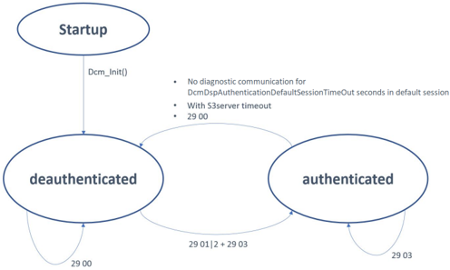

**认证状态的初始化（Initialization of authentication state）**：如果未配置 DcmDspAuthenticationPersistStateModeRuleRef，或 DcmDspAuthenticationPersistStateModeRuleRef 引用的模式规则被评估为 false，则 **Dcm** 应在 Dcm_Init 中将所有认证状态初始化为未认证状态。

**持久化认证状态的初始化（Initialization of persisted authentication states）**：如果 DcmDspAuthenticationPersistStateModeRuleRef 引用的模式规则被评估为 true，则 **Dcm** 应在每个连接上初始化持久化的认证状态（包括角色和白名单）。

已认证状态之间的转换由 **DSL** 和 **DSP** 子模块共同控制。**DSL** 子模块负责将已认证状态回退到未认证状态。**DSP** 子模块负责处理由客户端通过诊断服务触发的转换变更。

图 7.7：无持久化状态时的已认证状态转换（**Authenticated state transitions without persistent states**）

**空闲连接时回退到未认证会话（Fallback to deauthenticated session on idle connection）**：对于已配置的连接，如果满足以下条件，**Dcm** 应执行从已认证状态到未认证状态的转换：

- 在该连接上发送最后一个诊断响应时 **Dcm** 处于默认会话，且
- 已配置 DcmDspAuthenticationDefaultSessionTimeOut，并且在该连接上最后一次 Dcm_TpTxConfirmation 之后的 DcmDspAuthenticationDefaultSessionTimeOut 秒内未在该连接上接收到有效的诊断请求。

**S3Server 超时时回退到未认证会话（Fallback to deauthenticated session on S3server timeout）**：如果 **Dcm** 处于非默认会话且发生 **S3Server** 超时，则 **Dcm** 应在处于非默认会话的那个连接所分配的认证状态上执行从已认证状态到未认证状态的转换。

**清除持久化的认证状态（Clearing persisted authentication state）**：如果一个连接的认证状态发生到未认证状态的转换，则 **Dcm** 应清除该连接上所有持久化的认证信息。

**回退到未认证状态的反应（Reaction of fallback into deauthenticated state）**：在从已认证状态转换到未认证状态时，**Dcm** 应丢弃当前角色和白名单，并使用 DcmDspAuthenticationDeauthenticatedRoleRef 中配置的未认证角色。

在某些用例中，希望由应用程序设置角色，而不是使用可能需要耗时的证书解析的诊断服务。**Dcm** 提供 **API** Dcm_SetDeauthenticatedRole 来覆盖所配置的未认证角色。被覆盖的角色仅在未认证状态下有效，不会被持久化，并且会被服务 0x29 通过证书提供的角色覆盖。

**由 SWC 设置的默认认证角色（Default authentication role set from SWC）**：如果一个连接处于未认证状态且 **API** Dcm_SetDeauthenticatedRole 被调用，则 **Dcm** 应将所提供的 deauthenticatedRole 用作该连接未认证状态的新角色。

**仅在未认证状态下由 SWC 设置未认证角色（Setting deauthenticated role by SWC only in deauthenticated state）**：只有当连接处于未认证状态时，**Dcm** 才应处理对 Dcm_SetDeauthenticatedRole 的调用。

##### 6.4.4.13. 非默认会话

**S3Server 会话定时器支持（S3Server session timer support）**：**Dcm** 应支持 **S3Server**，并根据 **ISO14229-2** [13] 启动和停止该定时器。

**会话与连接（Sessions and connections）**：**Dcm** 应根据 **ISO14229-2** [13] 启动或停止 **S3Server**，但只针对在请求非默认会话的 DcmDslConnection 上的客户端。

**S3Server 到期后切换到默认会话（Change to default session upon S3Server elapses）**：如果 **S3Server** 到期，**Dcm** 应切换到默认会话。

##### 6.4.4.14. 允许修改时序参数

**Dcm** 模块应按照 **ISO14229-2** [13] 处理以下协议时序参数：P2ServerMin、P2ServerMax、P2*ServerMin、P2*ServerMax、S3Server。

P2min / P2*min 应设置为规定的值：P2min = 0ms，P2*min = 0ms。

**默认 S3 超时值（Default S3 timeout value）**：如果参数 DcmS3ServerTimeoutOverwrite 未配置，**Dcm** 应取 5000ms 作为 **S3Server** 超时值。

**被覆盖的 S3 超时值（Overwritten S3 timeout value）**：如果参数 DcmS3ServerTimeoutOverwrite 已配置，**Dcm** 应取所配置的值作为 **S3Server** 超时值。

这些协议时序参数影响会话层时序（对传输层时序没有影响）。其中一些时序参数可以在协议活动期间通过以下方式修改：

- **UDS** 服务 **DiagnosticSessionControl**（0x10）
- **UDS** 服务 **AccessTimingParameter**（0x83）

**DSL** 子模块提供以下修改时序参数的功能：

- 提供活动时序参数，
- 设置新的时序参数。只有在响应发送完成之后，才允许激活新的时序值。

###### 6.4.4.14.1. 不同的服务表

对于不同的协议，有效的诊断服务集合不同（例如增强诊断的 **UDS** 命令、**OBD** 协议的 **OBD** mode 服务）。可以创建不同的服务表并将它们链接到诊断协议。

在每次协议初始化时，**DSL** 子模块都会设置指向相应服务表的链接（参见配置参数 DcmDslProtocolSIDTable）。

**DSD** 子模块使用该链接进一步处理诊断请求。

###### 6.4.4.14.2. 协议优先级

配置参数 DcmDslProtocolPriority 使得可以为每个协议赋予其自己的相对优先级。可能的用例：存在一些 **ECU**，它们与车载内部诊断仪（运行增强诊断）和车外 **OBD-II**/**WWH-OBD** 诊断仪通信。**OBD-II**/**WWH-OBD** 通信必须比增强诊断具有更高的优先级。

具有更高优先级的协议允许抢占已经在运行的协议。

诊断协议的区分是可能的，因为协议配置中引用了不同的 DcmDslProtocolRxPduId 值（按协议配置，参见配置参数 DcmDslProtocolRxPduRef）。

###### 6.4.4.14.3. 协议抢占

**被抢占协议的回调通知（Callback notification for preempted protocols）**：如果一个正在运行的诊断请求被更高优先级的请求抢占，**DSL** 子模块应在被抢占的协议上调用所有已配置的 Xxx_StopProtocol() 函数。

Xxx_StopProtocol 函数通过配置参数 DcmDslCallbackDCMRequestService 配置。协议抢占不能由具有更高优先级协议的并发 **TesterPresent** 激活。

如果一个协议被抢占且该协议有一个正在进行的挂起响应传输，则 **Dcm** 应为该传输调用 PduR_DcmCancelTransmit()，参数如下：PduId —— 待取消的 **Pdu** 的 id。

当 PduR_DcmCancelTransmit() 返回 E_NOT_OK 时，**Dcm** 模块应停止当前协议。

如果一个正在运行的诊断请求被更高优先级的请求抢占，**Dcm** 应以 Dcm_OpStatus 设置为 DCM_CANCEL 取消被抢占协议上的所有外部挂起操作。

如果对 **Dem** 的一个操作正在挂起，而新请求也需要与 **Dem** 交互，则 **Dcm** 应接受该新请求，并使用来自新请求的参数调用相应的 **Dem API**。

如果 **Dcm** 正在抢占一个具有挂起接收的协议，则 **Dcm** 模块应以 PduR_DcmCancelReceive() 取消该接收。

当 PduR_DcmCancelReceive() 返回 E_NOT_OK 时，**Dcm** 应停止当前协议。

低优先级或同优先级请求可以抢占一个更高优先级协议，前提是该更高优先级协议处于默认会话且没有活动请求处于执行阶段。在这种情况下，**DSL** 子模块应调用所有已配置的 Xxx_StopProtocol() 函数（参见配置参数 DcmDslCallbackDCMRequestService）。

应可以处理具有相同优先级的协议。

如果诊断请求由于更高优先级的协议而无法被处理，且 DcmDslDiagRespOnSecondDeclinedRequest 设置为 True，则 **Dcm** 应为未被处理的请求发送 **NRC** 0x21（**BusyRepeatRequest**）。

如果诊断请求由于更高优先级的协议而无法被处理，且 DcmDslDiagRespOnSecondDeclinedRequest 设置为 False，则 **Dcm** 应忽略该请求。在这种情况下，完全不生成任何响应消息。

在具有不同 **PduID** 的多个客户端请求同一协议的情况下，由于同一协议的所有连接具有相同的优先级，第二个请求（使用不同的 RxPduId）将不会被处理。如果配置参数 DcmDslDiagRespOnSecondDeclinedRequest 为 TRUE，则应为第二个请求发出带有 **NRC** 0x21（**BusyRepeatRequest**）的负响应。如果配置参数为 FALSE，则不发出响应。

**注意：**

- 每个 DcmDslProtocol 可以配置多个 **RxPduID**。
- 这些 **RxPduID** 可以通过 **PduR** 配置连接到不同的诊断仪。
- 这意味着可以为同一协议配置多个诊断仪。
- 这代表了一种非 **UDS** 扩展/用例。为了获得符合 **UDS** 的流程，每个诊断仪应有一个 DcmDslProtocol 实例。

在诊断并行请求的情况下，如果并行请求的优先级与活动请求相同或更低，则不应调用 **ComM API**（ComM_DCM_ActiveDiagnostic、ComM_DCM_InactiveDiagnostic）。

###### 6.4.4.14.4. 并行诊断协议处理

多个诊断仪是当今车辆的常见场景。为了将并发诊断仪请求之间的干扰降到最低，**Dcm** 支持并行诊断服务处理。该行为符合 **ISO 14229-1** 附录 J 的推荐实践。存在某些限制：在非默认会话中，只允许来自一个诊断仪的诊断通信。在默认会话以及 **OBD-II** 通信中，可以并行处理诊断请求。对于装备了所谓“**OBD** dongle”或电子记录设备的车辆，并行的 **OBD** 和 **UDS** 通信尤为重要。这些设备由车辆车主安装，并通过标准化的 **OBD** 服务进行诊断通信。此类设备的存在应尽可能少地干扰车辆内部的 **UDS** 通信。因此，只要可能，**Dcm** 就支持并行处理。

**默认会话中并行请求的处理（Processing of parallel requests in default session）**：如果 **Dcm** 接收到一个请求，且当前没有更高优先级的协议处于非默认会话，则 **Dcm** 应接受该新传入的请求并处理它。

**非默认会话中不进行并行处理（No parallel processing in non-default session）**：如果 **Dcm** 接收到一个请求，且有另一个更高优先级的协议当前处于非默认会话，则 **Dcm** 应拒绝新接收到的请求。

某些 **Dcm** 接口提供对不同诊断服务的访问，例如例程控制（**RoutineControl**，0x31）的 **Start**、**Stop** 和 **Request Result** 子功能的 **RoutineService** 接口，或读/写操作的 **DataServices** 接口。在这些接口上，任何时刻只应有一个客户端访问数据。

**同一接口上并行处理的延迟（Delay parallel processing on the same interface）**：如果 **Dcm** 接收到一个请求，且对该请求的服务处理需要调用当前正在处理另一个请求的同一接口，则 **Dcm** 应延迟对该接口的调用，直到该接口上正在运行的操作完成。

如果 **Dcm** 因上述要求而延迟服务处理，则适用带 **P2** 和 **NRC** 0x78 的标准时序行为。从外部视角看，对应用程序的延迟调用看起来就像应用程序本身花费了更多执行时间。

**Dcm** 应在运行中的 **UDS** 请求之外并行处理传入的 **OBD-II** 请求。在这种情况下，跳过协议优先级检查，且不执行协议抢占。

通过容器 DcmDslProtocolRow，**Dcm** 配置支持多个协议。每个协议都有一个配置的 DcmDemClientRef，定义与 **Dem** 交互的 **Dem** 客户端。该客户端 **ID** 使 **Dem** 能够区分 **Dcm** 为处理某个请求而对同一函数或函数集的并发调用。

在处理从给定协议接收到的诊断请求时，**Dcm** 应确定被处理协议的 DcmDslProtocolRow 的 DcmDemClientRef。**Dcm** 应在所有以 ClientId 为参数的 **Dem API** 调用中使用该值。

**对同一接口多次调用的串行化（Serialization of multiple calls to the same interface）**：在并行诊断服务处理期间，**Dcm** 应在内部对同一端口接口或 C 函数的所有异步 C/S 接口或 C 函数调用进行串行化，并向可重入的调用者返回 pending。

如果 **Dcm** 在比当前处理的请求所在协议更高优先级的协议上接收到一个请求，且当前正在处理非默认会话中的诊断服务，则 **Dcm** 应取消正在运行的诊断请求，转换到默认会话并处理新接收到的请求。

集成商会为 **OBD** 协议分配最高优先级以满足立法规定的响应和时序要求。因此，所有“更高优先级协议”的定义都适用于使用 **OBD** 的用例。

如果 **Dcm** 在默认会话中处理来自高优先级协议的请求，且 **Dcm** 正在接收一个请求转换到非默认会话的诊断请求，则 **Dcm** 应延迟该会话变更请求，直到高优先级协议的服务按照上述要求完成，然后转换到所请求的非默认会话。

**仅限一个 OBD 协议的限制（Limitation to one single OBD protocol）**：**Dcm** 应只支持一个 DcmDslProtocolRow 的 DcmDslProtocolType 配置为 DCM_OBD_ON_&lt;XYZ&gt;。

**OBD 协议应具有最高优先级（OBD protocol shall have highest priority）**：**Dcm** 应支持一个 DcmDslProtocolType 设置为 DCM_OBD_ON_&lt;XYZ&gt; 的 DcmDslProtocolRow 作为最高优先级。

###### 6.4.4.14.5. 协议启动的检测

随着诊断协议的第一个请求，**DSL** 子模块应调用所有已配置的 Xxx_StartProtocol() 函数（参见配置参数 DcmDslCallbackDCMRequestService）。

在该函数内部，应用程序可以检查环境条件并启用/禁用协议的后续处理。

在所有 Xxx_StartProtocol() 函数返回 E_OK（意味着所有组件都允许协议启动）之后，默认时序参数从默认会话配置中加载（参见配置参数 DcmDspSessionRow）。

**接口与模式之间命名的一致性（Harmonize the naming between interfaces and modes）**：DcmDspSessionRow 的短名称应与 Dcm_SesCtrlType 的名称以及 DcmDiagnosticSessionControl 的模式声明的名称相匹配。所有短名称都必须带有“DCM_”前缀。

**为 ISO 标准化诊断会话提供标准化名称（Provide standardized names for ISO standardized diagnostic sessions）**：DcmDspSessionLevel 的以下值（代表 **ISO** 定义的诊断会话）应用于 DcmDspSessionRow 的短名称：

1 DCM_DEFAULT_SESSION　2 DCM_PROGRAMMING_SESSION　3 DCM_EXTENDED_DIAGNOSTIC_SESSION　4 DCM_SAFETY_SYSTEM_DIAGNOSTIC_SESSION

在所有 Xxx_StartProtocol() 函数返回 E_OK（意味着所有组件都允许协议启动）之后，设置服务表（参见配置参数 DcmDslProtocolSIDTable）。

在所有 Xxx_StartProtocol() 函数返回 E_OK（意味着所有组件都允许协议启动）之后，安全状态被复位。

在所有 Xxx_StartProtocol() 函数返回 E_OK（意味着所有组件都允许协议启动）之后，会话状态被复位为默认会话。此外，**Dcm** 模块应通过调用 SchM_Switch_&lt;bsnp&gt;_DcmDiagnosticSessionControl(RTE_MODE_DcmDiagnosticSessionControl_DEFAULT_SESSION) 触发 **ModeDeclarationGroupPrototype** DcmDiagnosticSessionControl 的模式切换。

**注意：** &lt;bsnp&gt; 是 **BSW** 调度器名称前缀（**BSW Scheduler Name Prefix**）。

如果 Xxx_StartProtocol() 未返回 E_OK，则 **Dcm** 应返回 **NRC** 0x22。

###### 6.4.4.14.6. 协议停止

协议停止只在协议抢占的情况下出现（参见第 6.4.4.14.3 节“协议抢占”）。

当接收到与 **DSL** 子模块给出的响应相关联的 Dcm_TpTxConfirmation 时，**Dcm** 不应停止当前协议（不调用 Xxx_StopProtocol）。

**注意：** 一个协议（例如 **OBD**）将保持活动，直到复位或其他协议抢占。

如果 Xxx_StopProtocol() 未返回 E_OK，则 **Dcm** 应返回 **NRC** 0x22。

##### 6.4.4.15. 资源管理

由于资源有限，以下几点应作为设计提示加以考虑：

- 允许在 **Dcm** 模块中只使用并分配一个诊断缓冲区。该缓冲区随后用于处理诊断请求和响应。
- **NRC** 0x78（**Response pending**）响应的输出使用单独的缓冲区完成。
- 分页缓冲处理（见第 6.4.4.8 节）。

##### 6.4.4.16. 通信模式处理

通信模式处理是 **Dcm** 与 **ComM** 之间的接口。**ComM** 将通道的当前通信状态通知 **Dcm**。**Dcm** 就活动的诊断（active Diagnostic）呼叫 **ComM**，以防止 **ECU** 关机/休眠。

状态 **ActiveDiagnostic** 显示诊断请求是否应保持 **ECU** 唤醒（ActiveDiagnostic == 'DCM_COMM_ACTIVE'），或者诊断请求是否不应阻止 **ECU** 关机/休眠（ActiveDiagnostic == 'DCM_COMM_NOT_ACTIVE'）。应用程序可以根据系统条件更改 **ActiveDiagnostic** 状态。

应用程序将通过调用 Xxx_SetActiveDiagnostic() 将 **ActiveDiagnostic** 状态通知 **Dcm**。

在 Dcm_Init 之后，**Dcm** 应将 **ActiveDiagnostic** 设置为 'DCM_COMM_ACTIVE'。

如果 Xxx_SetActiveDiagnostic() 以 'false' 被调用，**Dcm** 将 **ActiveDiagnostic** 设置为 'DCM_COMM_NOT_ACTIVE'。

如果 Xxx_SetActiveDiagnostic() 以 'true' 被调用，**Dcm** 将 **ActiveDiagnostic** 设置为 'DCM_COMM_ACTIVE'。

**Dcm** 应等待来自 **ComM** 的完全通信模式指示（对 Dcm_ComM_FullComModeEntered 的调用），然后才发起诊断应答的传输。等待时间自接收到请求的时刻起不应长于 P2ServerMax。

如果 **Dcm** 因上述要求而未能确认响应挂起传输（DCM_E_FORCE_RCRRP），则 **Dcm** 应触发 **Det** 错误 DCM_E_FORCE_RCRRP_IN_SILENT_COMM。

**注意：** 在接收侧，静默通信模式可能导致分段传输情况下请求的丢失。

###### 6.4.4.16.1. 无通信

**ComM** 模块将通过调用 Dcm_ComM_NoComModeEntered 向 **Dcm** 模块指示无通信模式（**No Communication Mode**）。作为响应，**Dcm** 将立即禁用所有传输（细节参见 Dcm_ComM_NoComModeEntered 的定义）。

Dcm_ComM_NoComModeEntered 应禁用所有类型的通信传输（接收和发送）。这意味着消息接收和消息传输都应关闭。

Dcm_ComM_NoComModeEntered 应禁用 **ResponseOnEvent** 传输。

Dcm_ComM_NoComModeEntered 应禁用周期 **ID** 传输（**ReadDataByPeriodicIdentifier**）。

Dcm_ComM_NoComModeEntered 应禁用正常传输。

在 Dcm_ComM_NoComModeEntered 被调用之后，**Dcm** 模块不应再调用函数 PduR_DcmTransmit()。

如果 Dcm_ComM_NoComModeEntered 以一个 **Dcm** 中未引用的 **ComM** 通道的 NetworkId 被调用（参见配置参数 DcmDslProtocolComMChannelRef），则 **Dcm** 应直接返回而不执行任何进一步的操作。

###### 6.4.4.16.2. 静默通信

**ComM** 模块将通过调用 Dcm_ComM_SilentComModeEntered 向 **Dcm** 模块指示静默通信模式（**Silent Communication Mode**）。作为响应，**Dcm** 将立即禁用所有传输（细节参见 Dcm_ComM_SilentComModeEntered 的定义）。

Dcm_ComM_SilentComModeEntered 应禁用所有传输。这意味着消息传输应关闭。

Dcm_ComM_SilentComModeEntered 应禁用 **ResponseOnEvent** 传输。

Dcm_ComM_SilentComModeEntered 应禁用周期 **ID** 传输（**ReadDataByPeriodicIdentifier**）。

Dcm_ComM_SilentComModeEntered 应禁用正常传输。

如果 Dcm_ComM_SilentComModeEntered 以一个 **Dcm** 中未引用的 **ComM** 通道的 NetworkId 被调用（参见配置参数 DcmDslProtocolComMChannelRef），则 **Dcm** 应直接返回而不执行任何进一步的操作。

###### 6.4.4.16.3. 完全通信

**ComM** 模块将通过调用 Dcm_ComM_FullComModeEntered 向 **Dcm** 模块指示完全通信模式（**Full Communication Mode**）。作为响应，**Dcm** 将启用所有传输（细节参见 Dcm_ComM_FullComModeEntered 的定义）。

Dcm_ComM_FullComModeEntered 应启用所有类型的通信。这意味着消息接收和消息传输都应开启。

Dcm_ComM_FullComModeEntered 应启用 **ResponseOnEvent** 传输。

Dcm_ComM_FullComModeEntered 应启用周期 **ID** 传输（**ReadDataByPeriodicIdentifier**）。

Dcm_ComM_FullComModeEntered 应启用正常传输。

在 Dcm_ComM_FullComModeEntered 被调用之后，**Dcm** 应不受限制地处理函数 DslInternal_ResponseOnOneDataByPeriodicId() 或 DslInternal_ResponseOnOneEvent()。

如果 Dcm_ComM_FullComModeEntered 以一个 **Dcm** 中未引用的 **ComM** 通道的 NetworkId 被调用（参见配置参数 DcmDslProtocolComMChannelRef），则 **Dcm** 应直接返回而不执行任何进一步的操作。

###### 6.4.4.16.4. 诊断激活状态

**Dcm** 就所有网络的内部诊断状态通知 **ComM** 模块。网络上的诊断状态有两种。在“活动（active）”诊断状态下，**Dcm** 正在处理来自该网络的一个或多个诊断请求，或 **Dcm** 处于非默认会话。在“非活动（inactive）”诊断状态下，**Dcm** 处于默认会话且未在该网络上处理诊断请求。

当网络上没有正在进行的通信时，**Dcm** 会将诊断激活状态设置为“非活动”。当网络上存在诊断通信时，**Dcm** 将诊断状态设置为“活动”。在任何非默认会话中，诊断状态保持“活动”状态。通信状态也可以由 **API** Xxx_SetActiveDiagnostic 控制。

如果在某个网络上接收到诊断请求，或诊断会话被更改为任何非默认会话，则 **Dcm** 应在该网络上进入“活动”诊断状态。

当当前的诊断请求处理完成、**Dcm** 未在处理该网络上另一个协议的诊断请求、且 **Dcm** 处于默认会话时，**Dcm** 应在该网络上进入“非活动”诊断状态。

如果发生 **S3Server** 超时且 **Dcm** 转换到默认会话，则 **Dcm** 应在所有网络上进入“非活动”诊断状态。

如果 **ActiveDiagnostic** 为 'DCM_COMM_ACTIVE' 且 **Dcm** 正在转换到某个诊断协议的“活动”诊断状态，则 **Dcm** 应对每个请求调用 ComM_DCM_ActiveDiagnostic(NetworkId)（NetworkId 与接收到的 **Pdu** 关联，参见 DcmDslProtocolComMChannelRef），以通知 **ComM** 模块需要保持在完全通信模式。

在诊断状态转换为“非活动”时，**Dcm** 应通过调用 ComM_DCM_InactiveDiagnostic(NetworkId)（NetworkId 与接收到的 **Pdu** 关联，参见 DcmDslProtocolComMChannelRef）将该网络上非活动的诊断状态通知 **ComM** 模块。

上述“诊断请求已完成”的定义如下：

- **Dcm** 已发送了不同于 **NRC** 0x78 的正响应或负响应，并通过与 **DSL** 子模块给出的响应相关联的 Dcm_TpTxConfirmation 接收到确认。
- **Dcm** 已处理了 **SPRMIB**=true 的服务，且正响应被抑制。
- 在功能寻址的情况下，**Dcm** 已处理该服务，且负响应被抑制。

### 6.5. 诊断服务分发器（DSD）

#### 6.5.1. 简介

**DSD** 子模块负责检查传入诊断请求的有效性（诊断会话/**Security Access** 级别/应用权限的验证），并跟踪服务请求执行的进度。

**DSD** 子模块应只处理有效的请求，并应拒绝无效的请求。

#### 6.5.2. 用例

以下用例是相关的，将在后面详细描述：

- 接收请求消息并发送正响应消息
- 接收请求消息并抑制正响应
- 接收请求消息并抑制负响应
- 接收请求消息并发送负响应消息
- 在没有对应请求的情况下发送正响应消息
- 分段响应

##### 6.5.2.1. 接收请求消息并发送正响应消息

这是正常通信的标准用例（“乒乓”）。服务器接收诊断请求消息。**DSD** 子模块确保请求消息的有效性。在该用例中，请求是有效的，响应将为正响应。请求将被转发给 **DSP** 子模块中相应的数据处理器。当数据处理器完成数据处理的所有操作后，它触发 **DSD** 子模块对响应消息的传输。

如果数据处理器作为请求指示函数的一部分立即处理该服务，数据处理器可以在该指示函数内部触发传输（“同步”）。如果处理需要较长时间（例如等待 **EEPROM** 驱动），数据处理器会推迟部分处理（“异步”）。响应挂起（response pending）机制由 **DSL** 子模块覆盖。数据处理器显式触发传输，但是在数据处理器的上下文内。

一旦接收到请求消息，**DSL** 子模块就会阻塞对应的 DcmPduId。在该请求的处理期间，在相应的响应消息被发送且 DcmPduId 被再次释放之前，不能接收同一协议类型的任何其他请求（例如，增强会话可能被 **OBD** 会话结束）。

##### 6.5.2.2. 接收请求消息并抑制正响应

这是前一个用例的子用例。在 **UDS** 协议中，可以通过在请求消息中设置一个特殊的位来抑制正响应。这种特殊的抑制处理完全在 **DSD** 子模块内执行。

##### 6.5.2.3. 接收请求消息并抑制负响应

在功能寻址的情况下，**DSD** 子模块应抑制 **NRC** 0x11、0x12、0x31、0x7E 和 0x7F 的负响应。

##### 6.5.2.4. 接收请求消息并发送负响应消息

请求消息被拒绝且需要发送负响应的原因有很多。如果诊断请求无效，或者请求不能在当前会话中执行，**DSD** 子模块将拒绝处理，并返回一个负响应。

但是，拒绝执行格式良好的请求消息的原因也很多，例如 **ECU** 或系统状态不允许执行。在这种情况下，**DSP** 子模块将触发一个负响应，其中包括一个提供该请求被拒绝原因的附加信息的 **NRC**。

在请求由多个参数组成的情况下（例如带有多个待读标识符的 **UDS** 服务 **ReadDataByIdentifier**（0x22）请求），每个参数被单独处理。这些参数中的每一个都可能返回错误。如果至少有一个参数被成功处理，这种请求返回正响应。

**DSD** 子模块应按照 **ISO14229-1** [1] 给定的顺序检查接收到的诊断请求。如果其中一项计算失败，**Dcm** 应停止 **NRC** 检查序列的执行，然后停止或不启动对收到的诊断请求的执行，最后发送该计算失败对应的 **NRC**。

##### 6.5.2.5. 在没有对应请求的情况下发送正响应消息

在 **UDS** 协议中有两个服务，它们针对仅一个请求发送多个响应。通常，其中一个服务用于启用（和禁用）另一个服务的事件触发或时间触发传输，后者由 **ECU** 在没有对应请求的情况下发送（参见 **ISO14229-1** [1]）。这些服务是：

- **UDS** 服务 **ReadDataByPeriodicIdentifier**（0x2A）。该服务允许客户端请求由一个或多个 periodicDataIdentifier 标识的、来自服务器的数据记录值的周期传输。

  Type 2 = 在单独的 DcmTxPduId 上的 **UUDT** 消息。

- **ResponseOnEvent**（0x86）。该服务请求服务器在指定事件发生时开始或停止响应的传输。

  Type 1 = 在已用于正常诊断响应的 DcmTxPduId 上的 **USDT** 消息，Type 2 = 在单独的 DcmTxPduId 上的 **USDT** 消息。

对于 Type 1，发出的消息必须与具有更高优先级的“正常发出消息”同步。

这一处理主要由 **DSL** 子模块控制。但是，**DSD** 子模块也提供了在没有对应请求的情况下生成响应的可能性。

##### 6.5.2.6. 分段响应（分页缓冲）

在诊断协议中，一些服务允许交换大量数据，例如 **UDS** 服务 **ReadDTCInformation**（0x19）和 **UDS** 服务 **TransferData**（0x36）。

在传统方法中，**ECU** 内部缓冲区必须足够大，以容纳要交换的最长数据消息（最坏情况），并且在传输开始之前填满整个缓冲区。

**ECU** 中的 **RAM** 存储器通常是关键资源，尤其是在较小的微控制器中。在更节省存储器的方法中，缓冲区只被部分填充、部分传输，然后再次部分填充——依此类推。这种分页机制只需要显著减少的存储器量，但要求缓冲区重新填充具有明确定义的反应时间。

用户可以决定在诊断中使用“线性缓冲区（linear buffer）”还是分页缓冲（paged-buffer）。

#### 6.5.3. DSD 与其他模块的交互

**DSL** 子模块在接收到诊断消息时调用 **DSD** 子模块，后者执行以下操作：

- 将请求的处理委托给 **DSP** 子模块或 **Dcm** 之外的外部模块
- 跟踪请求的处理（在 &lt;Module&gt;_&lt;DiagnosticService&gt;() 和 &lt;Module&gt;_&lt;DiagnosticService&gt;_&lt;SubService&gt;() **API** 调用或“服务解释器调用（Service Interpreter calls）”上返回状态）
- 将应用程序的响应传输给 **DSL** 子模块（传输功能）

##### 6.5.3.1. DSD 与 DSL 主功能的交互

表7.1：DSD 子模块与 DSL 子模块之间的交互（**Interaction between the DSD submodule and the DSL submodule**）

| 方向 | 说明 |
|---|---|
| 双向 | 交换诊断消息（接收/发送）。 |
| DSD 子模块到 DSL 子模块 | 获取最新的诊断会话和最新的安全级别。 |
| DSL 子模块到 DSD 子模块 | 诊断消息传输的确认。 |

##### 6.5.3.2. DSD 与 DSP 的交互

表7.2：DSD 与 DSP 的交互（**Interaction of the DSD with the DSP**）

| 方向 | 说明 |
|---|---|
| DSD 子模块到 DSP 子模块 | 委派请求的处理；诊断消息传输的确认。 |
| DSP 子模块到 DSD 子模块 | 通知处理已结束。 |

#### 6.5.4. DSD 的功能描述

##### 6.5.4.1. 支持检查诊断服务标识符并适配诊断消息

当识别出新的诊断消息时，**DSL** 子模块应触发 **DSD** 子模块。**DSD** 子模块将通过分析接收到的诊断消息中包含的诊断服务标识符来开始处理。

如果已配置（配置参数 DcmRespondAllRequest = FALSE），且 **Dcm** 模块接收到一个包含处于 0x40 到 0x7F 或 0xC0 到 0xFF 范围内的服务 **ID** 的诊断请求，则 **Dcm** 不应响应该请求。

该范围对应于诊断响应标识符。

**DSD** 子模块应分析（传入的）诊断消息以获取诊断服务标识符（基于诊断消息的第一个字节），并应使用新接收到的诊断服务标识符检查受支持的服务。

在此检查期间，**DSD** 子模块应在“服务标识符表（Service Identifier Table）”中搜索新接收到的诊断服务标识符。

出于性能原因，可能需要以“查找表（lookup table）”功能完成支持检查。在这个“服务标识符表”中，预定义了 **ECU** 的所有受支持的服务 **ID**。

**DSL** 子模块应提供当前的“服务标识符表”。

**基本原理：** “服务标识符表”和关于受支持服务的信息将从配置生成。可以配置多于一个的服务标识符表以供选择。同一时间只能有一个服务标识符表处于活动状态。

在检查时，**DSD** 子模块应在活动的“服务标识符表”中扫描新接收到的诊断服务标识符。如果该服务标识符受支持且配置参数 DcmDsdSidTabFnc 不为空，则 **DSD** 子模块应调用所配置的服务接口（&lt;Module&gt;_&lt;DiagnosticService&gt;）。如果配置参数为空，则 **Dcm** 应调用内部实现的服务接口。

当诊断服务标识符未包含在“服务标识符表”中时，它是不受支持的。

如果新接收到的诊断服务标识符不受支持，则 **DSD** 子模块应向 **DSL** 子模块发送带有 **NRC** 0x11（**Service not supported**）的负响应。

**DSD** 子模块应存储新接收到的诊断服务标识符以供后续使用。

例如：**WriteDataByIdentifier**（用于写入 **VIN** 号）：

1. **DSL** 子模块接收到一个新的诊断消息。（诊断消息 **WriteDataByIdentifier** = 0x2E, 0xF1, 0x90, 0x57, 0x30, 0x4C, 0x30, 0x30, 0x30, 0x30, 0x34, 0x33, 0x4D, 0x42, 0x35, 0x34, 0x31, 0x33, 0x32, 0x36）
2. **DSL** 子模块通过“数据指示（Data Indication）”功能向 **DSD** 子模块指示一个新的诊断消息。诊断消息被存储在诊断消息缓冲区中（buffer = 0x2E,0xF1,0x90,...）。
3. **DSD** 子模块使用确定的服务标识符（缓冲区第一个字节 0x2E）对传入的诊断消息执行受支持服务的检查。
4. 传入的诊断消息被存储在 **Dcm** 变量 **Dcm_MsgContextType** 中。

在 DcmDsdServiceTable 中配置的 DcmDsdSidTabServiceId 的服务标识符 **Id** 应是唯一的。

对于 &lt;Module&gt;_&lt;DiagnosticService&gt; 的第一次调用，opStatus 应设置为 DCM_INITIAL。

当 &lt;Module&gt;_&lt;DiagnosticService&gt;() 返回 DCM_E_PENDING 时，**Dcm** 不应接受（相同或更低优先级的）进一步请求。**Dcm** 内部超时处理（基于 **RCR-RP** 限制）可能导致外部诊断服务处理被取消。

在取消的情况下，**API** &lt;Module&gt;_&lt;DiagnosticService&gt; 会再次被调用，参数 opStatus 设置为 DCM_CANCEL。

##### 6.5.4.2. "suppressPosRspMsgIndicationBit" 的处理

“suppressPosRspMsgIndicationBit”是子功能参数结构的一部分（位 7，基于诊断消息的第二个字节，参见 **ISO14229-1** [1] 第 6.5 节：服务器响应实现规则）。

如果“suppressPosRspMsgIndicationBit”为 TRUE，则 **DSD** 子模块不应发送正响应消息。

**DSD** 子模块应从诊断消息中移除“suppressPosRspMsgIndicationBit”（通过屏蔽该位）。

**Dcm** 模块应通过参数 **Dcm_MsgContextType** 在各层之间传输正响应抑制处于活动状态的信息。

在 responsePending 的情况下，**Dcm** 模块应清除“suppressPosRspMsgIndicationBit”。

**基本原理：** 在所述情况下，最终响应（负/正）是必需的。

**Dcm** 模块只应在为新接收到的服务标识符设置了配置参数 DcmDsdSidTabSubfuncAvail 时，才执行“suppressPosRspMsgIndicationBit”处理。

**注意：** “suppressPosRspMsgIndicationBit”处理需要独立于请求中的处理顺序加以考虑（例如 **RoutineControl** 服务）。

**基本原理：** 只有当服务具有子功能时，“suppressPosRspMsgIndicationBit”才可用。

##### 6.5.4.3. 验证功能

在执行接收到的诊断服务之前，**DSD** 执行一组验证。只有当所有验证都成功通过时，**DSD** 才会接受一个服务。

**服务执行前的 DSD 验证（DSD verifications prior of service execution）**：只有当以下验证按以下顺序通过时，**Dcm** 才应接受一个诊断请求：

1. 制造商权限的验证（调用制造商接口指示操作）
2. **SID** 的验证
3. 当前认证状态下服务访问控制的验证
4. 诊断会话的验证
5. 服务 **Security Access** 级别的验证
6. 供应商权限的验证（调用供应商接口指示操作）
7. 服务 **ID** 的模式规则验证。

如果 **DSD** 生成一个 **NRC**，则 **Dcm** 应只调用 Xxx_Confirmation。

这意味着 **Dcm** 不会调用 DspInternal_DcmConfirmation()。

###### 6.5.4.3.1. 诊断服务访问权限的验证

**UDS** 服务 **Authentication**（0x29）用于更改诊断连接的认证状态并提供访问权限。根据所达到的角色和提供的白名单，诊断仪在该连接上可以使用一组动态的诊断服务。**DSD** 子模块在服务 **ID**（**SID**）和子功能（**SF**）级别验证服务是否可以执行。

**仅对 UDS 服务进行认证（Authentication on UDS services only）**：**Dcm** 应只对 **UDS** 服务进行认证验证。**UDS** 服务的服务 **ID** 在 0x10 到 0xFF 范围内。

**OBD** 服务被明确排除在认证检查之外。根据立法，**OBD** 服务必须始终可用，与活动的认证状态无关。如果使用 **WWH-OBD**，系统工程师必须确保这些服务始终可访问。

**验证访问权限（Verifying access rights）**：只有当容器 DcmDspAuthentication 已配置时，**Dcm** 才应验证并检查诊断服务的已配置访问权限。

如果未配置 DcmDspAuthentication，**Dcm** 将处理所有诊断服务，就像当前连接被授予执行当前处理的服务的权限一样。诊断服务访问权限的检查在服务结构的不同级别进行。诊断服务访问权限的使用提供了根据当前角色和认证状态允许或拒绝诊断服务的手段。有些服务应始终允许执行，例如用于设置当前诊断仪访问权限的服务 0x29（**Authentication**）。该服务和其他 **OEM** 或供应商特定的服务应独立于认证状态被授予访问权限。为实现这一点，**Dcm** 使用一个在所有未认证状态下使用的默认角色。在该状态下，所有基于角色的验证都与已认证状态一样进行。活动角色由配置提供。

**未认证状态下服务的访问权限（Access rights for services in deauthenticated state）**：如果当前连接处于未认证状态，**Dcm** 应使用 DcmDspAuthenticationDeauthenticatedRoleRef 配置的角色作为所有基于角色访问验证检查的当前角色。

**允许服务执行的定义（Definition of allowed service execution）**：如果角色验证成功或该服务被白名单允许，**Dcm** 应允许服务执行。

**诊断服务执行权限验证（Diagnostic service execution rights verification）**：**Dcm** 应检查在当前认证检查中是否允许执行服务。**Dcm** 应按以下给定顺序执行以下检查。如果某项检查授予了对服务的访问权限，则跳过其余检查：

1. 服务 **ID** 级别的检查
2. 服务 **ID** 和子功能级别的检查
3. 带有一个或多个 **DID** 的服务的检查
4. 动态定义 **DID** 的检查
5. 服务 0x31 按子功能的检查
6. 服务 0x19 参数 **MemorySelection** 的检查

**UDS 服务请求的服务 ID 认证检查（Service ID authentication check for UDS service requests）**：在处理诊断服务时，如果满足以下条件之一，**Dcm** 应授予对该诊断服务的访问权限：

1. 已通过 DcmDsdServiceRoleRef 为该服务配置了服务角色，且相应的验证成功；或
2. 该连接上的活动白名单中有一个与该服务匹配的 **SID**（1 字节元素）条目。

**UDS 服务请求的带子功能服务认证检查（Service with sub-function authentication check for UDS service requests）**：在处理带子功能的诊断服务时，如果满足以下条件之一，**Dcm** 应授予对该诊断服务的访问权限：

1. 已通过 DcmDsdSubServiceRoleRef 为该服务和子功能配置了子服务角色，且相应的验证成功；或
2. 该连接上的活动白名单中有一个与该服务和子功能匹配的带子功能的 **SID**（2 字节元素）条目。

**3 字节和 4 字节的白名单验证（White list verification for services with 3 and 4 bytes）**：对于服务的 3 字节和 4 字节白名单条目，**Dcm** 应在已配置白名单服务元素的全长上进行验证。如果接收到的请求的前几个字节与整个白名单条目匹配，则该服务被授予访问权限。

在 **Dsd** 内验证第 3 和第 4 字节超出了典型 **Dsd** 操作的范围。它提供了扩展白名单服务验证能力的手段，并为适配遗留认证解决方案提供了手段。

**无访问权限服务的响应行为（Response behavior of services without access rights）**：如果服务执行验证由于该项检查失败而失败，则 **Dcm** 应发送 **NRC** 0x34 authenticationRequired 并停止服务处理。

###### 6.5.4.3.2. 诊断会话的验证

**UDS** 服务 **DiagnosticSessionControl**（0x10）用于在 **ECU** 中启用不同的诊断会话（例如默认会话、扩展会话）。诊断会话在 **ECU** 中启用一组特定的诊断服务和/或功能。它还启用适用于所启动会话的、依赖于协议的时序参数数据集。

在接收到服务请求时，**DSD** 模块将通过 Dcm_GetSesCtrlType 获取当前诊断会话，并验证所请求的服务（不是 **UDS** 服务 **DiagnosticSessionControl**（0x10）本身）和子服务是否允许在当前诊断会话中执行。

注意，**UDS** 服务 **DiagnosticSessionControl**（0x10）本身的处理不属于 **DSD** 子模块。

如果新接收到的诊断服务在当前诊断会话中不被允许（根据配置参数 DcmDsdSidTabSessionLevelRef），则 **DSD** 子模块应向 **DSL** 子模块发送带有 **NRC** 0x7F（**serviceNotSupportedInActiveSession**）的负响应。

如果新接收到的诊断服务在当前诊断会话中被允许，但请求的子服务在当前诊断会话中不被允许（根据配置参数 DcmDsdSubServiceSessionLevelRef），则 **DSD** 子模块应向 **DSL** 子模块发送带有 **NRC** 0x7E（**subFunctionNotSupportedInActiveSession**）的负响应。

###### 6.5.4.3.3. 服务 Security Access 级别的验证

**Security Access** 级别处理的目的是提供访问因安全、排放或安全（safety）原因而限制访问的数据和/或诊断服务的可能性。**DSD** 子模块应使用 **UDS** 服务 **SecurityAccess**（0x27）执行该处理。**DSD** 子模块将通过使用 **DSL** 函数 Dcm_GetSecurityLevel 询问当前安全级别，来验证所请求的服务（不是 **UDS** 服务 **SecurityAccess**（0x27）本身）是否允许在当前 **Security** 级别中执行。

安全级别的管理不属于 **DSD** 子模块。

**注意：** 对于某些用例（例如 **UDS** 服务 **ReadDataByIdentifier**（0x22），其中某些 **DataIdentifier** 可能是受安全保护的），应用程序也有必要调用函数 Dcm_GetSecurityLevel。

如果新接收到的诊断服务在当前 **Security** 级别中不被允许（根据配置参数 DcmDsdSidTabSecurityLevelRef），则 **DSD** 子模块应向 **DSL** 子模块发送带有 **NRC** 0x33（**Security access denied**）的负响应。

如果新接收到的诊断服务在当前 **Security** 级别中被允许，但请求的子服务在当前 **Security** 级别中不被允许（根据配置参数 DcmDsdSubServiceSecurityLevelRef），则 **DSD** 子模块应向 **DSL** 子模块发送带有 **NRC** 0x33（**Security access denied**）的负响应。

###### 6.5.4.3.4. 服务模式依赖的验证

如果新接收到的诊断服务在当前模式条件下不被允许（根据配置参数 DcmDsdSidTabModeRuleRef），则 **DSD** 子模块应向 **DSL** 子模块发送被引用 DcmModeRule 计算出的负响应。

如果新接收到的诊断服务在当前模式条件下被允许，但请求的子服务在当前模式条件下不被允许（根据配置参数 DcmDsdSubServiceModeRuleRef），则 **DSD** 子模块应向 **DSL** 子模块发送被引用 DcmModeRule 计算出的负响应。

##### 6.5.4.4. 检查格式和子功能支持

**DSD** 子模块在执行所请求的命令之前检查特定子功能是否受支持。

**通用子功能受支持 NRC 检查（General sub-function supported NRC check）**：如果对于所处理的服务不存在带有该服务 DcmDsdSubServiceId 的已配置 DcmDsdSubService，则 **DSD** 应发送负响应 **NRC** 0x12（**sub-functionNotSupported**）。对于 **UDS** 服务 0x31（**RoutineControl**），不应进行该 **NRC** 检查。

**DSD** 子模块将在执行所请求的命令之前检查最小消息长度。

如果请求的长度小于请求的最小长度，**DSD** 子模块应触发带有 **NRC** 0x13（**Incorrect message length or invalid format**）的负响应。

如果为某个 DcmDsdService 配置了 DcmDsdSubService，则 **Dcm** 应支持在 DcmDsdSubServiceId 中配置的子功能，**SPRMIB** 设置为 0 或 1。

###### 6.5.4.4.1. 制造商应用环境/权限的验证

该功能的目的是：在接收到诊断请求之后，立即请求制造商应用（**Manufacturer Application**）检查权限/环境。

例如在后运行（after-run）**ECU** 状态下，可能不允许处理 **OBD** 请求。

如果容器 DcmDsdServiceRequestManufacturerNotification 存在，**DSD** 子模块应在所有已配置的 **ServiceRequestIndication** 端口上调用操作 Xxx_Indication（参见配置参数 DcmDsdServiceRequestManufacturerNotification）。

如果按上述要求调用的至少一个 Xxx_Indication 函数返回 E_REQUEST_NOT_ACCEPTED，则 **DSD** 子模块不应给出任何响应。

在这种情况下，**DSD** 应只调用 Xxx_Confirmation 而不调用 DspInternal_DcmConfirmation。

如果按上述要求调用的至少一个 Xxx_Indication 函数返回了 E_NOT_OK 且没有函数返回 E_REQUEST_NOT_ACCEPTED，则 **DSD** 子模块应使用来自 **ErrorCode** 参数的 **NRC** 触发负响应。

如果按上述要求调用了多于一个的 Xxx_Indication 函数，它们中有多于一个返回了 E_NOT_OK 且没有函数返回 E_REQUEST_NOT_ACCEPTED，则 **DSD** 子模块应使用第一个返回 E_NOT_OK 的 Xxx_Indication 的 **ErrorCode** 参数触发负响应。

###### 6.5.4.4.2. 供应商应用环境/权限的验证

该功能的目的是：在处理诊断消息之前，请求供应商应用（**Supplier Application**）检查权限/环境。

例如在后运行 **ECU** 状态下，可能不允许处理 **OBD** 请求。

如果容器 DcmDsdServiceRequestSupplierNotification 存在，**DSD** 子模块应在所有已配置的 **ServiceRequestIndication** 端口上调用操作 Xxx_Indication（参见配置参数 DcmDsdServiceRequestSupplierNotification）。

如果按上述要求调用的至少一个 Xxx_Indication 函数返回 E_REQUEST_NOT_ACCEPTED，则 **DSD** 子模块不应给出任何响应。

如果按上述要求调用的至少一个 Xxx_Indication 函数返回了 E_NOT_OK 且没有函数返回 E_REQUEST_NOT_ACCEPTED，则 **DSD** 子模块应使用来自 **ErrorCode** 参数的 **NRC** 触发负响应。

如果按上述要求调用了多于一个的 Xxx_Indication 函数，它们中有多于一个返回了 E_NOT_OK 且没有函数返回 E_REQUEST_NOT_ACCEPTED，则 **DSD** 子模块应使用第一个返回 E_NOT_OK 的 Xxx_Indication 的 **ErrorCode** 参数触发负响应。

##### 6.5.4.5. 将诊断消息分发给 DSP 子模块

**DSD** 子模块应为新接收到的诊断服务标识符搜索 **DSP** 子模块的可执行功能，并应调用相应的 **DSP** 服务解释器。

##### 6.5.4.6. 组装正响应或负响应

当 **DSP** 子模块完成了所请求诊断服务的执行时，**DSD** 子模块应组装响应。

**DSP** 服务解释器的执行可以有以下结果：

- 正结果，或
- 负结果。

可以组装以下可能的响应：

- 正响应，
- 负响应，或
- 无响应（在响应被抑制的情况下）。

###### 6.5.4.6.1. 正响应

**DSD** 子模块应在参数“**Dcm_MsgContextType**”中加入响应服务标识符和（由应用程序返回的）响应数据流。

因此，**DSD** 子模块应将 **Dcm_MsgContextType** 转移到一个（响应）缓冲区中，并应在缓冲区的第一个字节处加入服务标识符。

**DSD** 子模块应在下一个执行步骤中执行“发起传输（Initiate transmission）”功能。

###### 6.5.4.6.2. 负响应

**DSP** 子模块可以向 **DSD** 子模块触发发送带有特定 **NRC** 的负响应。有关所执行服务 **ID** 允许的 **NRC**，请参见 **ISO14229-1** [1] 中该服务的规范（见第 4.2.4 节“响应码参数定义（Response code parameter definition）”表 12）和 **ISO15031-5** [2]。**DSP** 和应用程序必须注意正确使用所执行服务 **ID** 的 **NRC**。

**DSD** 子模块应处理应用程序支持的所有 **NRC** 以及在 **Dcm_NegativeResponseCodeType** 中定义的 **NRC**。

###### 6.5.4.6.3. 响应的抑制

如果在“suppressPosRspMsgIndicationBit 的处理”功能中指示了“suppressPosRspMsgIndicationBit”（存储在变量 **Dcm_MsgContextType**（元素：Dcm_MsgAddInfo）中），则 **DSD** 子模块应激活对正响应的抑制。

在执行结果为负且功能寻址处于活动状态的情况下，**DSD** 子模块应激活对以下负响应的抑制：

- **NRC** 0x11（**Service not supported**），
- **NRC** 0x12（**SubFunction not supported**），
- **NRC** 0x31（**Request out of range**），
- **NRC** 0x7E（**Subfunction not supported in active session**），
- **NRC** 0x7F（**Service not supported in active session**）

##### 6.5.4.7. 发起传输

**DSD** 子模块应将诊断（响应）消息（正响应或负响应）转发给 **DSL** 子模块。

**DSL** 子模块应通过执行 **DSL** 传输功能，将诊断（响应）消息（正响应或负响应）进一步转发给 **PduR** 模块。

**DSL** 子模块在转发数据后将收到来自 **PduR** 模块的确认。

**DSL** 子模块应把从 **PduR** 模块收到的确认转发给 **DSD** 子模块。

**DSD** 子模块应通过内部函数 DspInternal_DcmConfirmation() 将确认转发给 **DSP** 子模块。

在不发送任何诊断（响应）消息的情况下（响应被抑制），**DSL** 子模块不应传输任何响应。

在这种情况下，**DSL** 子模块不会向 **DSD** 子模块发送数据确认，但 **DSD** 子模块仍会调用内部函数 DspInternal_DcmConfirmation()。

在该请求已被 **Dcm** 完全处理的情况下，**DSD** 子模块应通过调用 DspInternal_DcmConfirmation() 来完成诊断服务分发器的一条诊断消息的处理。

**基本原理：** **DSP** 子模块正在等待 DspInternal_DcmConfirmation() 功能的执行。因此必须发送它，即使没有提供数据确认。

总而言之，这意味着在以下任何情况下：

- 正响应，
- 负响应，
- 被抑制的正响应，以及
- 被抑制的负响应

**DSD** 子模块都会通过调用 DspInternal_DcmConfirmation() 来结束（参见第 7.10.3 节 DspInternal_DcmConfirmation）。

**DSD** 子模块应在使用 **ServiceRequestNotification** 接口的所有端口上调用操作 Xxx_Confirmation()（参见配置参数 DcmDsdServiceRequestManufacturerNotification 和 DcmDsdServiceRequestSupplierNotification）。

对 Xxx_Confirmation() 的调用应在调用 DspInternal_DcmConfirmation() 之后立即进行。

如果操作 Indication() 返回值 E_REQUEST_NOT_ACCEPTED，则 **Dcm** 模块不应发送任何诊断响应，并应结束当前诊断请求的管理。

如果操作 Indication() 返回值 E_NOT_OK，则 **Dcm** 模块应发送一个 **NRC** 值等于 **ErrorCode** 参数值的负响应。
### 6.6. 诊断服务处理（DSP）

#### 6.6.1. 概述

当从 **DSD** 子模块接收到要求 **DSP** 子模块处理诊断服务请求的函数调用时，**DSP** 总是执行以下基本处理步骤：

- 分析接收到的请求消息，
- 检查格式以及所寻址的子功能是否受支持，
- 在 **DEM**、**SW-C** 或其他 **BSW** 模块上获取数据或执行所需的函数调用，
- 组装响应。

以下小节是一些通用说明。

##### 6.6.1.1. 检查格式和子功能支持

**DSP** 子模块将在执行所请求的命令之前检查适当的消息长度和结构。

当请求消息的分析导致格式或长度失败时，**DSP** 子模块应触发带有 **NRC** 0x13（**Incorrect message length or invalid format**）的负响应。

**注意：** 格式检查执行的细致程度取决于实现，并取决于诊断数据描述在编译时提供的详细程度。

##### 6.6.1.2. 组装响应

**DSP** 子模块应组装响应消息（不包括响应服务标识符）并确定响应消息的长度。

如果使用了分页缓冲机制，**DSP** 子模块应在任何数据被传递给 **DSD** 子模块或 **DSL** 子模块之前确定总体响应长度。

提出该要求的原因是基于 **ISO15765-2** [15] 的 **CAN** 分段诊断数据传输：它要求在相应数据传输的第一帧 **CAN** 帧中提供完整数据流的总体长度（关于分页缓冲机制的细节请参见第 6.4.4.8 节）。

##### 6.6.1.3. 负响应码处理

除非规定了另一个特定的 **NRC**，当为执行服务而进行的 **API** 调用未返回 OK 时，**DSP** 子模块应触发带有 **NRC** 0x10（**generalReject**）的负响应。

**Dcm_NegativeResponseCodeType 负响应的可接受范围（Accepted range of Dcm_NegativeResponseCodeType for negative responses）**：如果 **Dcm** 通过任何带有出参 **Dcm_NegativeResponseCodeType** ErrorCode 的 **API** 调用外部应用程序，则在返回值为 E_NOT_OK 的情况下，**Dcm** 应只接受 0x01-0xFF 范围内的值。

**应用程序返回意外返回码时的行为（Behavior on application returning unexpected return code）**：如果 **Dcm** 调用带有出参 **Dcm_NegativeResponseCodeType** ErrorCode 的 **API**，且应用程序将该参数设置为 DCM_POS_RESP 而返回 E_NOT_OK，则 **Dcm** 应报告运行时错误 DCM_E_INVALID_VALUE。

当请求消息的分析导致其他不受支持的消息参数时，**DSP** 子模块应触发带有 **NRC** 0x31（**Request out of range**）的负响应。

##### 6.6.1.4. 诊断模式声明组

**Dcm** 应作为以下诊断模式的管理者（mode manager）：

1. DcmDiagnosticSessionControl（服务 0x10）
2. DcmEcuReset（部分服务 0x11）
3. DcmSecurityAccess（服务 0x27）
4. DcmModeRapidPowerShutDown（部分服务 0x11）
5. DcmCommunicationControl_&lt;ComMChannelId 的符号名称&gt;（服务 0x28）
6. DcmControlDTCSetting（服务 0x85）
7. DcmResponseOnEvent_&lt;RoeEventID&gt;（服务 0x86）
8. DcmAuthenticationState_&lt;DcmDslMainConnection 的符号名称&gt;

**注意：** **RTE**/**SchM** 会为这些名称加上“MODE_”前缀，因此这些名称不包含 **MODE** 关键字。

**Dcm** 应基于以下 **ModeDeclarationGroup** 定义 **ModeDeclarationGroupPrototype** DcmSecurityAccess 作为提供的模式组（provided-ModeGroup）：

```
ModeDeclarationGroup DcmSecurityAccess {
  {
    DCM_SEC_LEV_LOCKED
    DCM_SEC_LEV_1
    ...
    DCM_SEC_LEV_63
  }
  initialMode = DCM_SEC_LEV_LOCKED
};
```

```
ModeSwitchInterface SchM_Switch_<bsnp>_DcmSecurityAccess {
  isService = true;
  SecLevel currentMode;
};
```

**Dcm** 应基于 **ModeDeclarationGroup** DcmDiagnosticSessionControl 定义 **ModeDeclarationGroupPrototype** DcmDiagnosticSessionControl 作为其基础软件模块实例中的 provided-ModeGroup。

**Dcm** 应基于 **ModeDeclarationGroup** DcmEcuReset 定义 **ModeDeclarationGroupPrototype** DcmEcuReset 作为其基础软件模块实例中的 provided-ModeGroup。

**Dcm** 应基于 **ModeDeclarationGroup** DcmModeRapidPowerShutDown 定义 **ModeDeclarationGroupPrototype** DcmModeRapidPowerShutDown 作为其基础软件模块实例中的 provided-ModeGroup。

对于 **CommunicationControl** 服务中涉及的每个网络，**Dcm** 应基于 **ModeDeclarationGroup** DcmCommunicationControl 定义一个单独的 **ModeDeclarationGroupPrototype** DcmCommunicationControl_&lt;ComMChannelId 的符号名称&gt; 作为其基础软件模块实例中的 provided-ModeGroup。

**Dcm** 应基于 **ModeDeclarationGroup** DcmControlDTCSetting 定义 **ModeDeclarationGroupPrototype** DcmControlDTCSetting 作为其基础软件模块实例中的 provided-ModeGroup。

对于每个 RoeEvent，**Dcm** 应基于 **ModeDeclarationGroup** DcmResponseOnEvent 定义一个单独的 **ModeDeclarationGroupPrototype** DcmResponseOnEvent_&lt;RoeEventId 的符号名称&gt; 作为其基础软件模块实例中的 provided-ModeGroup。

**Dcm** 为每个 RoeEvent 提供一个状态机。**SWC** 需要某个 RoeEvent 的状态来激活事件报告或向某个 **Did** 报告 **ROE** 状态。因此，**Dcm** 为每个 RoeEvent 的每个状态提供一个 **ModeDeclarationGroupPrototype**，将该状态机的当前状态作为模式报告。

**ModeDeclarationGroupPrototype** 应表示该 RoeEvent 的 **ROE** 状态机的当前状态。

##### 6.6.1.5. 依赖环境条件的执行

诊断服务的执行或证书的接受可以受模式条件（mode condition）限制。这使 **Dcm** 能够将环境检查形式化。对于诊断服务处理，可以为 **Dcm** 配置进一步的检查（参见第 6.5.4.3.4 节）。这类似于会话和安全检查。被引用的模式规则会对多个模式声明组的若干模式声明进行仲裁，请求可以在其中被处理；否则将响应一个可配置的 **NRC**。同样的模式规则检查可以应用于证书验证。证书可以限于某些车辆属性，例如 **VIN** 或某个版本号。只有当所有条件都有效时，**Dcm** 才接受该证书。

**DcmModeRule** 应评估所有被引用的 DcmModeCondition 和/或嵌套的 DcmModeRule：当 DcmLogicalOperator 设置为 DCM_AND 时通过逻辑与评估，当 DcmLogicalOperator 设置为 DCM_OR 时通过逻辑或评估。如果只引用了单个 DcmModeCondition 或 DcmModeRule，则不应存在（因此也不使用）DcmLogicalOperator。

DcmModeCondition 应具有 DcmBswModeRef、DcmSwcModeRef 或 DcmSwcSRDataElementRef 之一作为外部引用。

DcmModeCondition 的 DcmSwcModeRef 和 DcmBswModeRef 应进行评估：当 DcmConditionType 设置为 DCM_EQUALS 时，被引用的模式声明是否被置位；当 DcmConditionType 设置为 DCM_EQUALS_NOT 时，被引用的模式声明是否未被置位。

**模式条件评估（Mode condition evaluation）**：对于每个模式条件，**Dcm** 应将一个比较值与一个 S/R 数据元素进行比较。比较值由 DcmSwcSRDataElementValueRef 或 DcmModeConditionConnectionCertificateCompareElementRef 提供，S/R 元素由 DcmSwcSRDataElementRef 提供。如果 S/R 数据元素的值为：

- 等于比较值（当 DcmConditionType 设置为 DCM_EQUALS 时），
- 不等于比较值（当 DcmConditionType 设置为 DCM_EQUALS_NOT 时），
- 大于比较值（当 DcmConditionType 设置为 DCM_GREATER_THAN 时），
- 大于或等于比较值（当 DcmConditionType 设置为 DCM_GREATER_OR_EQUAL 时），
- 小于比较值（当 DcmConditionType 设置为 DCM_LESS_THAN 时），
- 小于或等于比较值（当 DcmConditionType 设置为 DCM_LESS_OR_EQUAL 时），

则模式条件评估为 true。

值 DCM_GREATER_THAN、DCM_GREATER_OR_EQUAL、DCM_LESS_OR_EQUAL 和 DCM_LESS_THAN 不应与模式引用（DcmBswModeRef 或 DcmSwcModeRef）一起使用。

**注意：** 被引用的 **ModeDeclarationGroupPrototype** 的当前模式可以通过 **API** SchM_Mode（在 DcmBswModeRef 的情况下）或 **API** Rte_Mode（在 DcmSwcModeRef 的情况下）读取。

如果在一个 DcmModeRule 中引用了多个 DcmModeCondition，则应按 DcmArgumentRef 的 EcucReferenceValue 的索引属性顺序进行评估。

**注意：** 这隐含了 **NRC** 的优先级。

如果 DcmModeRule 未被 DcmDspAuthenticationConnection 引用，则当该模式规则被评估为 false 时，**Dcm** 应使用可选参数 DcmModeRuleNrcValue 作为 **NegativeResponseCode**。

DcmDspAuthenticationConnection 的模式规则不属于 **NRC** 评估的一部分。

如果一个嵌套的 DcmModeRule 也包含 DcmModeRuleNrcValue 参数，则应优先使用该 **NRC** 而不是更高层级的 **NRC**。

当 DcmLogicalOperator 设置为 DCM_AND 时，应使用第一个带有显式配置 **NRC**（DcmModeRuleNrcValue）的失败 DcmModeRule 来定义响应消息的 **NRC**。

当 DcmLogicalOperator 设置为 DCM_OR 时，应使用最后一个带有显式配置 **NRC**（DcmModeRuleNrcValue）的失败 DcmModeRule 来定义响应消息的 **NRC**。

**注意：** **AND** 和 **OR** 逻辑运算的差异是为了允许优化的实现。

如果完整评估的结果没有特定的 **NRC**，则应使用 **NRC** 0x22（**ConditionsNotCorrect**）。

**Dcm** 应为 DcmModeCondition 的每个 DcmSwcModeRef 的常用 **ModeDeclarationGroupPrototype** 创建一个引用该 **ModeDeclarationGroupPrototype** 的所需模式切换端口。当 **ModeDeclarationGroupPrototype** 短名称唯一时，该端口原型（port prototype）的命名模式应为 DcmModeUser_&lt;ModeDeclarationGroupPrototype&gt;；否则命名模式为实现特定，但必须带有必需的前缀“DcmModeUser_”。

**注意：** **ModeDeclarationGroupPrototype** 不一定是唯一的，因此需要该例外以避免 **Dcm Service SWC** 中的名称冲突。

使用模式相关请求执行的示例：

**一般假设：**

1. DcmModeRule1 由 DcmModeCondition1、DcmModeRule2 和 DcmModeRule3 组成
2. DcmModeRule1 定义了 **NRC** 0x22
3. DcmModeRule2 和 DcmModeRule3 没有任何子规则
4. DcmModeRule2 定义了 **NRC** 0x72
5. DcmModeRule3 未定义 **NRC** 值

**示例 1：**

- DcmModeRule1 使用 **OR** 组合（DcmModeCondition1 OR DcmModeRule2 OR DcmModeRule3）
  - DcmModeCondition1 失败 → 返回 **NRC** 0x22
  - DcmModeRule2 失败 → 返回 **NRC** 0x72
  - DcmModeRule3 失败 → 返回 **NRC** 0x22
  - DcmModeCondition1、DcmModeRule2 和 DcmModeRule3 都失败 → 返回 **NRC** 0x72
  - DcmModeCondition1 和 DcmModeRule3 失败 → 返回 **NRC** 0x22

**示例 2：**

- DcmModeRule1 使用 **AND** 组合（DcmModeCondition1 AND DcmModeRule2 AND DcmModeRule3）
  - DcmModeCondition1 失败 → 返回 **NRC** 0x22
  - DcmModeRule2 失败 → 返回 **NRC** 0x72
  - DcmModeRule3 失败 → 返回 **NRC** 0x22
  - DcmModeCondition1、DcmModeRule2 和 DcmModeRule3 都失败 → 返回 **NRC** 0x22

##### 6.6.1.6. 发送者/接收者通信

如果存在 DcmDspDiagnosisScaling，**Dcm** 应从 DcmDspDiagnosisScaling 容器导出 **CompuMethod**，并将其添加到各自的端口接口中的 **DataType**，用于 DataServices_Data 的 S/R 端口。

##### 6.6.1.7. 将 SwDataDefProps 属性从 DEXT 文件传递给 Dcm Service SW-C

用例：将 **CompuMethod**、**DataConstr** 和 **Units** 等 **SwDataDefProps** 细节传递给 **Dcm Service SW-C**，并使其在那里按 **DID DataElement** / 按 **RoutineControl** 信号可用。有两种可选的工作流。

##### 6.6.1.7.1. DcmDspDiagnosticDataElementRef 工作流

图7.8：DcmDspDiagnosticDataElementRef 工作流（**DcmDspDiagnosticDataElementRef Workflow**）

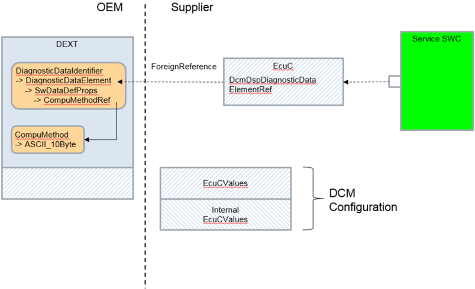

DcmDspDiagnosticDataElementRef 工作流的特性是在生成的 **EcuC** 值中使用 EcucForeignReference。在导入 **DEXT** 信息时，会生成一个专用的 **EcuC** 参数，该参数持有一个名为 DcmDspDiagnosticDataElementRef 的 EcucForeignReference，指向 **DEXT** 文件中的一个 **DiagnosticDataElement**。该 EcucForeignReference 使我们可以访问相应 **DiagnosticDataElement** 的所有 **SwDataDefProps**（**BaseType**、**CompuMethod**、**DataConstr** 等）。容器 DcmDspAlternativeDiagnosticDataElement 聚合了该 EcucForeignReference。在生成相应 **Service SWC** 的处理步骤中，所有需要的内容将基于该 EcucForeignReference 直接从 **DEXT** 复制到 **Service SW-C**。在该工作流中，生成 **Service SW-C** 时需要 **DEXT** 文件存在。

DcmDspAlternativeDataType 处 DcmDspTextTableMapping 的聚合只有在 DcmDspAlternativeDataType.DcmApplicationDataType 所引用 **DataType** 的 **CompuMethod** 类别设置为 TEXTTABLE 或 SCALE_LINEAR_AND_TEXTTABLE 时才有效。

##### 6.6.1.7.2. DcmDspAlternativeDataType.DcmApplicationDataType 工作流

图7.9：DcmDspAlternativeDataType.DcmApplicationDataType 工作流（**DcmDspAlternativeDataType.DcmApplicationDataType Workflow**）

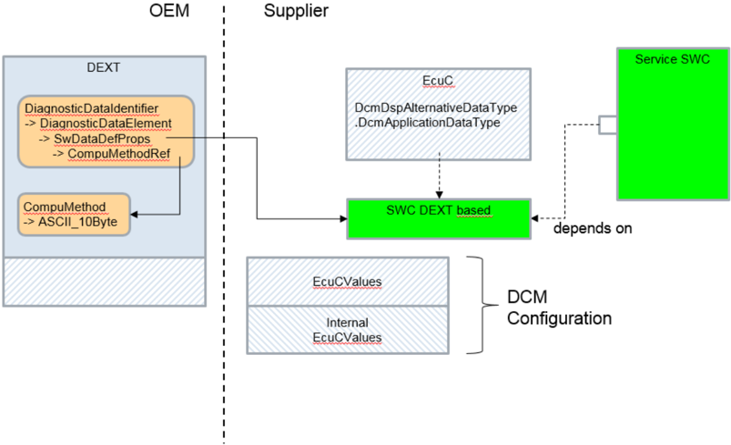

DcmDspAlternativeDataType.DcmApplicationDataType 工作流的特性是：在导入 **DEXT** 信息时，除了 **EcuC** 值之外，还会生成一个 **SW-C** 片段。在该 **SW-C** 片段中，所有需要的 **SwDataDefProps** 都直接从 **DEXT** 文件复制。在生成的 **EcuC** 值中，**EcuC** 参数 DcmDspAlternativeDataType.DcmApplicationDataType 指向该 **SW-C** 片段，从而可以访问所有 **SwDataDefProps**（**BaseType**、**CompuMethod**、**DataConstr** 等）。在生成相应 **Service SW-C** 的处理步骤中，所有需要的内容将基于 DcmDspAlternativeDataType.DcmApplicationDataType 到该 **SW-C** 片段的引用被包含进来。在该工作流中，生成 **Service SW-C** 时不需要 **DEXT** 文件存在。

##### 6.6.1.8. 异步调用行为

如果某个 **Dem** 函数返回 DEM_PENDING，则只要返回 DEM_PENDING，**Dcm** 应在稍后的时间点再次调用该函数。

如果针对某个请求的诊断任务（见第 6.4.4.6 节）的负响应次数达到配置参数 DcmDslDiagRespMaxNumRespPend 定义的值，则 **Dcm** 模块应停止处理活动的诊断请求，通过将活动端口接口的 **OpStatus** 参数设置为 DCM_CANCEL 来通知应用程序或 **BSW**（如果该诊断任务隐含对 **SW-C** 接口或 **BSW** 接口的调用），报告运行时错误 DCM_E_INTERFACE_TIMEOUT，并应发送带有 **NRC** 0x10（**General reject**）的负响应。

如果上一次 **Dcm_SetProgConditions** **API** 的返回状态为 E_PENDING，则应在下一个 **Dcm** 主函数周期中再次调用该 **API**。

返回 DCM_E_PENDING 应进行重新触发（例如在下一个 **MainFunction** 周期中）。

以等于 DCM_CANCEL 的 **OpStatus** 调用的接口，其返回值应被忽略。
