## 1. 简介和功能概述

诊断事件管理器 (**Dem**) 服务组件，主要负责处理和存储诊断事件（错误）以及与其相关数据。此外 **Dem** 还需向 **Dcm** 提供故障信息，（例如：从事件内存中读取所有存储的 **DTC**）。**Dem** 也需提供与应用层和其他 **BSW** 模块的接口。

**Dem** 规范文档的基本目标是为汽车制造商和组件供应商定义《诊断故障内存》（**diagnostic fault memory**）通用方法的能力。

本规范定义了 AUTOSAR 基本软件模块诊断事件管理器 (Dem) 的功能、**API** 和配置。部分内部行为是制造商特定的，并在**限制**一章中进行了详细描述。

## 2. 缩略语

以下术语表包含与 **Dem** 模块相关、且未包含在 [4] AUTOSAR 词汇表中的首字母缩略词和缩写。

### 2.1. 首字母缩略词（Acronyms）

**激活模式 1（Activation Mode 1）**
> 无故障（**Absence of malfunction**）——**MIL** 应闪烁一次。

**激活模式 2（Activation Mode 2）**
> "on-demand-MI"——如果 **OBD** 系统根据判别式显示策略（**discriminatory display strategy**）要求 on-demand-MI，则 **MIL** 应闪烁两次。

**激活模式 3（Activation Mode 3）**
> "short-MI"——如果 **OBD** 系统根据判别式显示策略要求 short-MI，则 **MIL** 应闪烁三次。

**激活模式 4（Activation Mode 4）**
> "continuous-MI"——如果 **OBD** 系统根据判别式显示策略要求 continuous-MI，则 **MIL** 应持续点亮（"continuous-MI"）。

**老化（Aging）**
> 在定义数目的运行周期之后，从事件内存中淘汰/删除不再失败的事件/**DTC**。

**老化计数器（Aging Counter）**
> "Aging Counter"、"Aging Cycle Counter" 或 "DTC Aging Counter" 指定用于执行老化的计数器。它统计直到事件/**DTC** 从事件内存中移除为止的运行周期数。

**Class B1 计数器（Class B1 counter）**
> **Class B1** 故障被确认（**Confirmed**）且处于 **TestFailed** 期间所运行的发动机小时数。

**组合 DTC（Combined DTC）**
> 普通 **DTC**，但被多个监视器报告的多个事件所引用（例如 **ECU** 缺陷，由不同的硬件缺陷组成）。

**Continuous-MI 计数器（Continuous-MI counter）**
> continuous-MI 被要求点亮期间发动机运行的小时数。

**累计 Continuous-MI 计数器（Cumulative Continuous-MI counter）**
> 在其寿命期内 **MI** 被持续要求点亮所累计运行的发动机小时数。

**去抖动计数器（Debounce counter）**
> 用于基于计数器的去抖动算法的内部计数器。

**DemComponent / 受监控组件（Monitored Component）**
> 受监控组件是系统的一部分，由一个或多个监控检查其是否正常运行。（参见第 6.5 节）

**Dem 内部数据值（Dem-internal data value）**
> 某些数据值（例如发生计数器）由 **Dem** 模块在内部自行计算。

**分母（Denominator）**
> 特定监视器 m 的分母（Denominatorm）是一个计数器，表示车辆行驶事件的次数，并考虑特定于该监视器的条件。

**从属/辅助 ECU（Dependent / Secondary ECUs）**
> 从属/辅助 **ECU**（dep. / sec.）始终与主 **ECU**（**Master** 或 **Primary**）相关联。

**有向无环图（Directed acyclic graph）**
> 无循环依赖的依赖关系图。

**置换（Displacement）**
> 用需要存储的更重要的事件内存条目替换最不重要的事件内存条目。

**DTC 组（DTC group）**
> 唯一标识一组 **DTC**。DTC 组被映射到有效 **DTC** 的取值范围内。通过提供一个 DTC 组，即表示对该组中的所有 **DTC** 请求某一操作。DTC 组的定义由 ISO 14229-1 给出，并且是 **OEM**/供应商特定的。

**DtcGroupAllDtcs**
> 所有已配置 **DTC** 的分组（表示为 0xFFFFFF）。

**事件组合（Event combination）**
> 事件组合是一种将多个事件合并为一个特定组合 **DTC** 的方法。它用于将不同的监视结果适配为一个明确的、可在维修站评估的故障。

**事件去抖动（Event debouncing）**
> 去抖动是一种特定的机制（例如基于计数器的），用于评估诊断事件是否合格。它在潜在的信号去抖动之上工作，可以在 **SW-C** 内部或 **Dem** 内部完成。

**事件确认（Event confirmation）**
> 在通过故障确认计数器评估出多个周期或时间内重复检测到合格事件的情况下，诊断事件被确认。因此，也会置位 **UDS** 状态位 3（**ConfirmedDTC**）。

**事件内存（Event memory）**
> 事件内存（例如主内存，**Primary memory**）由多个事件内存条目组成。

**事件内存条目（Event memory entry）**
> 事件内存条目是用于一个事件及其事件相关数据的单个存储容器。事件内存条目被动态地分配给特定事件。

**事件内存溢出指示（Event memory overflow indication）**
> 事件内存溢出指示用于指示该特定事件内存已满且下一个待存储的事件发生。

**事件鉴定（Event qualification）**
> 在置位通过（**passed**）或失败（**failed**）结果时（由 **Dem** 内部或另一个 **BSW** 模块或 **SW-C** 报告），诊断事件即合格。

**事件相关数据（Event related data）**
> 事件相关数据是与事件一起存储在事件内存中的附加数据，例如传感器值或时间戳/里程。ISO 定义了两种类型的事件相关数据：冻结帧（快照记录，**snapshot records**）和扩展数据（**extended data**）。

**事件状态字节（Event status byte）**
> 基于**事件**层级的、按 ISO 14229-1 定义的状态字节。

**扩展数据记录（Extended data record）**
> 扩展数据记录是存储与故障相关的特定信息的记录。

**失败计数器（Failure counter）**
> 失败计数器表示 ISO 14229-1 中的 **Trip Counter**。Trip Counter 统计发生故障的运行周期（驾驶循环）数。如果计数器达到阈值（例如 2 个驾驶循环），confirmed 位从 0 变为 1。

**故障检测计数器（Fault Detection Counter）**
> ISO 和 **FDC** API 中使用的 **sint8** 值。

**冻结帧（Freeze frame）**
> 冻结帧定义为一条数据记录（**DID**/**PID**）。冻结帧与 ISO 14229-1 中的 **SnapShotRecords** 相同。

**通用分母（General Denominator）**
> 通用分母是一个计数器，表示车辆运行的次数，并考虑一般性条件。

**恢复（Healing）**
> 在一段时间/多个运行周期内对报告的通过结果进行处理，包括关闭警告指示器。

**实际使用性能比（In-Use performance ratio）**
> **OBD** 系统中特定监视器 m 的实际使用性能比（**IUPR**）为：IUPRm = Numeratorm / Denominatorm

**主 ECU（Master ECU）**
> 作为主 **ECU**，**Master ECU** 在其事件内存中存储"自己的"以及相关的从属/辅助 **ECU** "报告的错误"。此外，**Master** 必须履行特殊的 **Master** 任务，如 **MIL Master** 或提供"通用分子"信息。

**监视器（Monitor）**
> 诊断监视器是确定组件是否正常运行的例程实体。也可以使用术语"诊断功能"（**diagnostic function**）。

**分子（Numerator）**
> 特定监视器 m 的分子（Numeratorm）是一个计数器，表示车辆运行的次数，使得该特定监视器检测故障所需的所有监控条件都已得到满足。

**NvM is marked for NvM_WriteAll**
> **Dem** 已调用 NvM_SetRamBlockStatus() 将相应的 **NvM** 块设置为待由 NvM_WriteAll() 写入。

**运行周期（Operating cycle）**
> "运行周期"（**operation cycle**）是事件鉴定以及 **Dem** 调度（例如点火钥匙 off-on 循环、驾驶循环等）的基础。

**OBD**
> 车载诊断（**On-Board Diagnostics**），**OBD** 是指车辆自诊断和报告能力的通用术语。OBD 系统使车辆所有者或维修技术人员能够访问各种车辆子系统的健康状态信息。

**OBD ECU（OBD ECUs）**
> "一辆车中可以有 3 种不同类型的 OBD ECU：• **Master ECU**（每车一个）• **Primary ECU**（每车多个）• **Dependent / Secondary ECU**（每车多个）"

**OBD UDS DTC 分离（OBD UDS DTC separation）**
> 该功能针对基于 SAE J1979-2 的 **UDS** 通信所报告的 3 字节 **DTC** 编号，与针对非 J1979-2 UDS 通信所报告的不同。

**P-Code**
> 动力总成代码（**Power train code**）。

**PFC 循环（PFC cycle）**
> 永久故障代码（**Permanent fault code**）——驾驶循环（**OBD** 术语）。

**来自 NvM 的肯定回调（Positive Callback from NvM）**
> 如果需要在 Dem_Init 和 Dem_Shutdown 之间存储数据，**Dem** 模块应使用 **NVRAM** 管理器的 API NvM_WriteBlock 和 NvM_GetErrorStatus。此外，API NvM_GetErrorStatus 应等待写入块成功完成的肯定响应。

**PossibleErrors**
> PossibleErrors 表示元模型中定义的 **ApplicationErrors**。

**主 ECU（Primary ECU）**
> **Primary ECU** 在其事件内存中存储"自己的"以及相关的从属/辅助 **ECU** 的"报告的错误"。

**RBM 循环（RBM cycle）**
> **OBD** 术语：通用分子/基于比率的监控（**Rate-based monitoring**）——驾驶循环。

**就绪（Readiness）**
> 就绪 refers 指 **UDS** 状态字节的 **TestNotCompletedSinceLastClear**（位 4）和 **TestNotCompleteThisOperationCycle**（位 6）两个已测试位。

**已触发至 NvM（Triggered to NvM）**
> 如果需要在 Dem_Init 和 Dem_Shutdown 之间触发数据存储，**Dem** 模块应使用 **NVRAM** 管理器的 API NvM_WriteBlock。此外，如果请求已被接受，**Dem** 模块应等待 NvM_WriteBlock 的肯定响应。

**UDS 状态位 0（UDS status bit 0）**
> **UDS** 状态字节的 **testFailed** 位。表示最近执行的测试的结果。

**UDS 状态位 1（UDS status bit 1）**
> **UDS** 状态字节的 **testFailedThisOperationCycle** 位。表示诊断测试在当前运行周期内是否曾报告 **testFailed** 结果。

**UDS 状态位 2（UDS status bit 2）**
> **UDS** 状态字节的 **pendingDTC** 位。表示诊断测试在当前或上一个已完成的运行周期内是否曾报告 **testFailed** 结果。

**UDS 状态位 3（UDS status bit 3）**
> **UDS** 状态字节的 **confirmedDTC** 位。表示故障被检测到的次数是否足以使该 **DTC** 需要存储在长期内存中。

**UDS 状态位 4（UDS status bit 4）**
> **UDS** 状态字节的 **testNotCompletedSinceLastClear** 位。表示自上次调用 ClearDiagnosticInformation 以来 **DTC** 测试是否曾运行并完成。

**UDS 状态位 5（UDS status bit 5）**
> **UDS** 状态字节的 **testFailedSinceLastClear** 位。表示自上次调用 ClearDiagnosticInformation 以来 **DTC** 测试是否曾以失败结果完成。

**UDS 状态位 6（UDS status bit 6）**
> **UDS** 状态字节的 **testNotCompletedThisOperationCycle** 位。表示 **DTC** 测试在当前运行周期内是否曾运行并完成。

**UDS 状态位 7（UDS status bit 7）**
> **UDS** 状态字节的 **warningIndicatorRequested** 位。报告与特定 **DTC** 关联的任何警告指示器的状态。

**UDS 状态字节（UDS status byte）**
> 基于 **DTC** 层级的、按 ISO 14229-1 定义的状态字节。

### 2.2. 缩写（Abbreviations）

**API**
> 应用编程接口（**Application Programming Interface**）。

**BSW**
> 基础软件（**Basic Software**）。

**CDD**
> 复杂设备驱动（**Complex Device Driver**）。

**CRC**
> 循环冗余校验（**Cyclic Redundancy Check**）。

**Dcm**
> 诊断通信管理器（**Diagnostic Communication Manager**）。

**Dem**
> 诊断事件管理器（**Diagnostic Event Manager**）。

**Det**
> 默认错误跟踪器（**Default Error Tracer**）。

**DID**
> 数据标识符（**Data Identifier**）。

**DTC**
> 诊断故障代码（**Diagnostic Trouble Code**）。

**DTR**
> 诊断测试结果（**Diagnostic Test Result**）。

**DYC**
> **OBD** 术语：驾驶循环（**Driving Cycle**）。

**ECU**
> 电子控制单元（**Electronic Control Unit**）。

**EcuM**
> 电子控制单元管理器（**Electronic Control Unit Manager**）。

**FDC**
> 故障检测计数器（**Fault Detection Counter**）。

**Fim**
> 功能抑制管理器（**Function Inhibition Manager**）。

**FMI**
> 故障模式指示器（**Failure Mode Indicator**，SAE J1939）。

**FTB**
> 故障类型字节（**Failure Type Byte**）。

**HW**
> 硬件（**Hardware**）。

**ID**
> 标识/标识符（**Identification/Identifier**）。

**ISO**
> 国际标准化组织（**International Standardization Organization**）。

**IUMPR**
> 实际使用监控性能比（**In Use Monitoring Performance Ratio**，**OBD** 术语）。

**J1939Dcm**
> SAE J1939 诊断通信管理器（**SAEJ1939 Diagnostic Communication Manager**）。

**MIL**
> 故障指示灯（**Malfunction Indicator Light**，SAE J1979）或故障指示灯（**Malfunction Indicator Lamp**，SAE J1939）。

**NVRAM**
> 非易失性 RAM（**Non volatile RAM**）。

**OBD**
> 车载诊断（**On-Board-Diagnostics**）。

**OC**
> 发生计数（**Occurrence Count**，SAE J1939）。

**OEM**
> 原始设备制造商（汽车制造商）（**Original Equipment Manufacturer**）。

**OS**
> 操作系统（**Operating System**）。

**PID**
> 参数标识（**Parameter Identification**，SAE J1587 或 SAE J1979）。

**PTO**
> 动力输出（**Power Take Off**）。

**RAM**
> 随机存取存储器（**Random Access Memory**）。

**ROM**
> 只读存储器（**Read-only Memory**）。

**RTE**
> 运行时环境（**Runtime Environment**）。

**SPN**
> 疑似参数编号（**Suspect Parameter Number**，SAE J1939）。

**SSCP**
> 同步服务器调用点（**synchronous server call point**）。

**SW**
> 软件（**Software**）。

**SW-C**
> 软件组件（**Software Component**）。

**UDS**
> 统一诊断服务（**Unified Diagnostic Services**）。

**VOBD**
> 车载诊断（**Vehicle On-Board-Diagnostic**）。

**WUC**
> **OBD** 术语：暖机循环（**Warm up cycle**）。

**WIR**
> 警告指示器请求（**Warning Indicator Request**）。

**WWH-OBD**
> 全球统一车载诊断（**World Wide Harmonized On-Board-Diagnostic**）。

## 3. 相关文档

### 3.1. 输入文件和相关标准与规范

- [1] Unified diagnostic services (UDS) - Part 1: Specification and requirements (Release 2006-12) https://www.iso.org
- [2] Unified diagnostic services (UDS) - Part 1: Application layer (Release 2013-03) https://www.iso.org
- [3] Road vehicles - Implementation of World-Wide Harmonized On-Board Diagnostics (WWH-OBD) communication requirements - Part 1: General information and use case definition https://www.iso.org
- [4] Glossary AUTOSAR_FO_TR_Glossary
- [5] Specification of NVRAM Manager AUTOSAR_CP_SWS_NVRAMManager
- [6] General Specification of Basic Software Modules AUTOSAR_CP_SWS_BSWGeneral
- [7] Specification of a Diagnostic Communication Manager for SAE J1939 AUTOSAR_CP_SWS_SAEJ1939DiagnosticCommunicationManager
- [8] Requirements on Function Inhibition Manager AUTOSAR_CP_SRS_FunctionInhibitionManager
- [9] Specification of Diagnostic Communication Manager AUTOSAR_CP_SWS_DiagnosticCommunicationManager
- [10] Requirements on Diagnostics AUTOSAR_FO_RS_Diagnostics
- [11] General Requirements on Basic Software Modules AUTOSAR_CP_SRS_BSWGeneral
- [12] Road vehicles - Communication between vehicle and external equipment for emission-related diagnostic - Part 5: Emission-related diagnostic services. https://www.iso.org
- [13] SAE J2012-DA Digital
- [14] SAE J1939-73 Application Layer - Diagnostics
- [15] Road vehicles - Interchange of digital information on electrical connections between towing and towed vehicles - Part 4: Diagnostic communication https://www.iso.org
- [16] Unified diagnostic services (UDS) - Part 1: Application layer (Release 2020-02) https://www.iso.org
- [17] ISO 17356-3: Road vehicles - Open interface for embedded automotive applications - Part 3: OSEK/VDX Operating System (OS)
- [18] SAE J1979
- [19] SAE J1979-DA Digital Annex of E/E Diagnostic Test Modes
- [20] Title 13, California Code Regulations, Section 1971.1, On-Board Diagnostic System Requirements for 2013 and Subsequent Model-Year Heavy-Duty Engines (HD OBD)
- [21] Title 13, California Code Regulations, Section 1968.2, Malfunction and Diagnostic System Requirements for 2004 and Subsequent Model-Year Passenger Cars, Light-Duty Trucks, and Medium-Duty Vehicles and Engines (OBD II) (Biennial Review MY08-11) [http://www.arb.ca.gov/regact/obdii06/19682clean.pdf](http://www.arb.ca.gov/regact/obdii06/19682clean.pdf)
- [22] Road vehicles - Implementation of World-Wide Harmonized On-Board Diagnostics (WWH-OBD) communication requirements - Part 3: Common message dictionary https://www.iso.org
- [23] Software Component Template AUTOSAR_CP_TPS_SoftwareComponentTemplate
- [24] Diagnostic Extract Template AUTOSAR_CP_TPS_DiagnosticExtractTemplate

### 3.2. 相关规范

AUTOSAR 提供的基础软件模块通用规范 [6, SWS BSW General] 同样适用于诊断事件管理器。

因此，SWS BSW General 规范应被视为诊断事件管理器的附加且必需的规范。

## 4. 约束和假设

Dem 中定义的一些同步 **API** 调用可能需要可变的时间才能完成。因此，在系统配置中必须考虑这一可变时间。

每个 **ECU** 只能有一个 **Dem** 模块可用。

**Dem** 可以拥有多个不同的事件内存分区。**DTC** 到相应分区的映射通过参数 **DTC Origin** 完成。特定 **ECU** 的 **Dem** 只能由位于同一 **ECU** 内的软件组件访问。

### 4.1. 限制

必须针对整个 **ECU** 考虑时序约束。如果对 **Dem** 的响应速度有明确要求、且高于 **Dem** 基本循环时间，则必须实施本 AUTOSAR 文档未规定的特殊措施。在具有大量事件的 **ECU** 中尤其如此。

与**事件**和 **DTC** 状态变化相关的回调在极少数情况下不是确定性的，因此不应用于安全相关的用例。考虑 ISO 14229-1 中的一般性声明：不建议将 **DTC** 状态与失效安全策略（**failsafe strategies**）相关联。

**SWS** 中缺少对 **Dem** 与 **SW-C** 交互期间由 **RTE** 报告的基础设施错误（**infrastructure errors**）的处理，如果实现者需要，可能必须将其考虑在内。

**Dem** 能够支持额外的事件内存（永久内存和用户自定义内存），但具体的事件内存处理未作详细定义。

本规范未定义 **Dem** 与特定排放相关 **SW-C** 之间交互的一些细节，因为它们依赖于 **SW-C** 的实现。以下功能未定义：

- **故障指示灯（MIL）**的激活（MIL 处理器与 **Dem** 的交互、**MIL** 灯泡检查、就绪闪烁、催化器损坏失火时的闪烁等）
- 失火故障处理（跨所有气缸的去抖动、单个/多个失火故障的过滤）
- 对失火和燃油系统故障的特定恢复（**healing**）类似条件的支持

**注意：**对于 **OBD2**，要求失火和燃油系统故障只能在与检测时类似的条件下进行恢复（从而离开 Service $07）。这种"类似性"源自故障检测时存在的发动机转速、发动机负荷和温度条件范围所构成的"窗口"。

对于类似条件的处理，假定失火检测/燃油系统诊断的 **SW-C** 模块自行执行必要的计算。也就是说，这不在 **Dem** 内部全局解决。

但是，基于相应的失火检测/燃油系统诊断的特定接口要求，这可能导致 **Dem** 的扩展。任何进一步的实现都需要根据具体的诊断和 **Dem** 实现，针对特定的发动机控制单元项目进行定义。

DTCStoredDataRecordNumber（绝对冻结帧记录寻址功能）仅限于 0x00（**OBD** 冻结帧，参见第 6.11.2.4 节）。

由记录号标识的特定扩展数据记录的结构在每个 **ECU** 内是唯一的。

由于架构设计，**Dcm** 可以在处理"读取诊断数据"服务期间锁定事件内存更新（参见第 6.7.2.2 节）。

本规范涵盖 SAE J1939 相关诊断需求的一个子集（参见 [7, SWS J1939 Dcm] 中的表 1：支持的 DMx 报文）。**SPN** 转换方法仅限于版本 4（**CM** = 0）。

AUTOSAR 仅支持 ID 为 0x10 到 0xFF 的用户自定义内存（如 AUTOSAR 向 ISO 14229-1 提议的那样）。

指示器（**Indicator**）仅在 **DemEventMemorySet** 局部有效。**Dem** 不支持在多个 **DemEventMemorySet** 上使用指示器的配置。

### 4.2. 汽车域的适用性

**Dem** 的设计旨在同时满足有 **OBD** 需求和无 **OBD** 需求的 **ECU** 的设计要求。当前的直接适用域为车身（**body**）、底盘（**chassis**）和动力总成（**powertrain**）**ECU**。但是，没有理由不能使用 **Dem** 来实现其他汽车域（例如信息娱乐，**infotainment**）的 **ECU**。

## 5. 对其他模块的依赖

AUTOSAR 诊断事件管理器（**Dem**）与以下基础软件模块和软件组件存在接口和依赖关系：

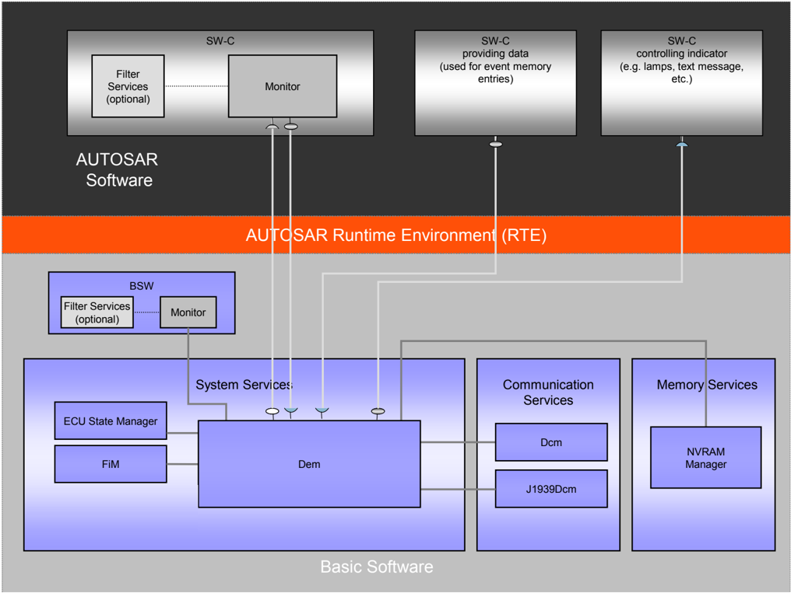

- 功能抑制管理器（**FiM**）（参见 [8, SWS FiM]）代表对事件进行评估并将其分配给软件组件所需动作（例如抑制特定的"监视器"）。当监视器状态发生变化时，**Dem** 会通知并更新功能抑制管理器（**FiM**），以便根据已分配的依赖关系停止或释放功能实体。
- 诊断通信管理器（**Dcm**）（参见 [9, SWS Dcm]) 负责 **UDS** 和 SAE J1979 通信路径以及诊断服务的执行，进而处理来自外部诊断仪或车载测试系统的诊断请求。它转发来自外部诊断扫描工具的请求，并负责组装响应报文（**DTC**、状态信息等），随后这些报文将被传输到外部诊断扫描工具。
- J1939 的诊断通信管理器（**J1939Dcm**）（参见 [7, SWS J1939 Dcm]）负责 SAE J1939-73 诊断通信协议。
- 软件组件（**SW-C**）和基础软件（**BSW**）模块可以访问 **Dem** 以更新和/或获取当前的监视器状态和 **UDS** 状态信息。SW-C 和 **BSW** 模块可以从 **Dem** 获取数据，例如用于打开或关闭指示灯。监视器是 **SW-C** / **BSW** 模块的子组件。
- 数据提供者 **SW-C** 和/或 **BSW** 模块将提供 **Dem** 所需的数据（即事件相关数据），例如用于创建事件内存条目。
- **NVRAM** 管理器（**NvM**）（参见 [5]）提供将数据块存储到 **NVRAM** 的机制。**NVRAM** 块（最大大小由配置决定）被分配给 **Dem**，并由 **Dem** 使用以实现 **UDS** 状态信息和相关数据（例如跨上电复位）的永久存储。
- **ECU** 状态管理器（**EcuM**）负责包括 **Dem** 在内的基础软件组件的基本初始化和去初始化。
- **RTE** 为 **BSW** 实现调度机制，例如为 **ECU** 中使用的每个 **BSW** 模块分配优先级和内存保护。

### 5.1. 文件结构

#### 5.1.1. 代码文件结构

详情请参阅 SWS_BSWGeneral [6] 中第 5.1.6 章"代码文件结构"（**Code File Structure**）（子章节"链接时配置源文件"（**Link time configuration source**）和"后构建时配置源文件"（**Post-build time configuration source**））。

#### 5.1.2. 头文件结构

符号名称（参见 TPS_ECUC_02108）会为包含标识符参数的配置容器生成，例如**事件** Id 符号、运行周期、指示器、使能/存储条件等。

注意，SW-C **事件** Id 也会被发布，尤其是供可能访问特定 **SW-C** 事件状态的复杂设备驱动使用。**SW-C** 使用不同的端口来区分不同的事件。

### 5.2. 集成提示

由于存在跨模块通信，建议将 **Dem** 和 **J1939Dcm** 映射到同一个 Task，以便 **RTE** 配置正确的调用上下文。也可能存在其他 **BSW** 供应商特定的解决方案，允许更灵活的映射（例如通过在 **BSW** 内部行为中描述这种跨模块通信，或通过类似于 **Dcm** 与 **Dem** 交互的机制）。

## 6. 功能规格

诊断事件管理器（**Dem**）处理并存储由软件组件（**SW-C**）和基础软件（**BSW**）模块中的诊断监视器检测到的事件。存储的事件信息可通过接口提供给其他 **BSW** 模块或 **SW-C**。

DemGeneral 包含配置的全局部分，DemConfigSet 包含配置的多配置部分。

### 6.1. 启动行为

函数 Dem_PreInit 由 **ECU** 状态管理器在 **ECU** 启动阶段、**NVRAM** 管理器初始化之前调用。**BSW** 模块可以通过 Dem_SetEventStatus 开始报告相关事件（参见第 6.8 节）。

函数 Dem_Init（另参见第 6.11.5 节）在 **ECU** 启动阶段、**NVRAM** 管理器完成 **NVRAM** 数据恢复之后调用。包含监视器的软件组件在其之后初始化。函数 Dem_Init 还用于在调用 Dem_Shutdown 之后重新初始化 **Dem** 模块。

Dem_Init 的注意事项：在 **Dem** 模块的环境调用函数 Dem_Init 之前，**Dem** 模块不可用。

### 6.2. 监视器的重新初始化

应用中监视器的主初始化通过 Rte_Start 完成。事件特定部分的监视器初始化可以由 **Dem** 触发。

详情另请参见第 6.7.3 节。

函数参数 **InitMonitorReason** 指示初始化的原因/触发。

**注意：** **Dem** 模块不评估该回调函数的返回值（例如非 E_OK 的情况）。

**注意：**配置容器 DemCallbackInitMForE 用于为每个事件指定相关的端口或 C 回调。

下图给出两个示例：

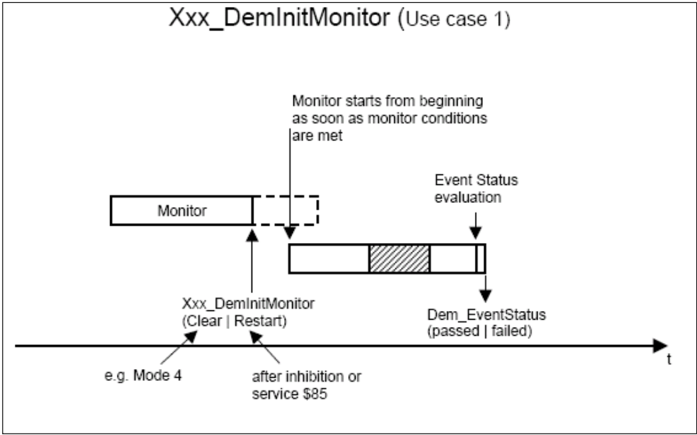

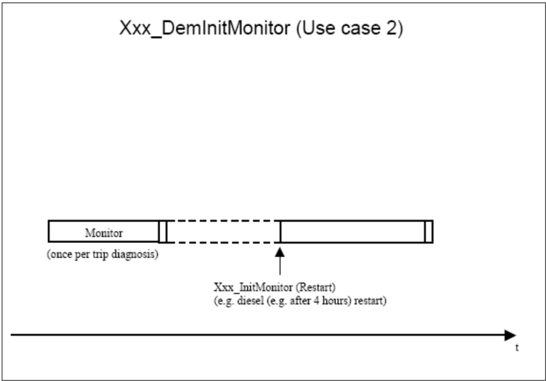

**Dem** 也可以触发任何函数（可能与监视器相关）的初始化。

**注意：** **Dem** 模块不评估该回调函数的返回值（例如非 E_OK 的情况）。

示例：在清除 **Dem** 模块时（按 Service $04/ISO 15031-5 请求），可以初始化某些适配值。

### 6.3. 诊断事件定义

"诊断事件"（**Diagnostic Event**）定义了 **Dem** 模块可以处理的原子单元。"诊断事件"的状态表示一个监视器的结果（参见第 6.3.5 节）。**Dem** 通过 **RTE** 从 **SW-C** 或其他 **BSW** 模块接收监视器的结果。

**Dem** 模块使用 **EventId** 来管理系统的"诊断事件"状态，并针对各个测试结果执行所需的操作，例如存储冻结帧。

**Dem** 模块应为每个诊断事件表示一个 **EventId** 及其相关的 **EventName**。

所有监视器和 **BSW** 模块都将 **EventId** 用作符号化的 **EventName**。**Dem** 配置工具将符号名称替换为编号。

**Dem** 的设计不打算处理多个监视器共享单个 **EventId** 的情况。

**Dem** 模块使用内部监视器状态来存储已报告事件的状态。向 **Dcm** 报告的是 **UDS** 状态。

**Dem** 模块支持多个事件特定的配置参数，如下图所示。详细描述请参见第 9 章配置规范。

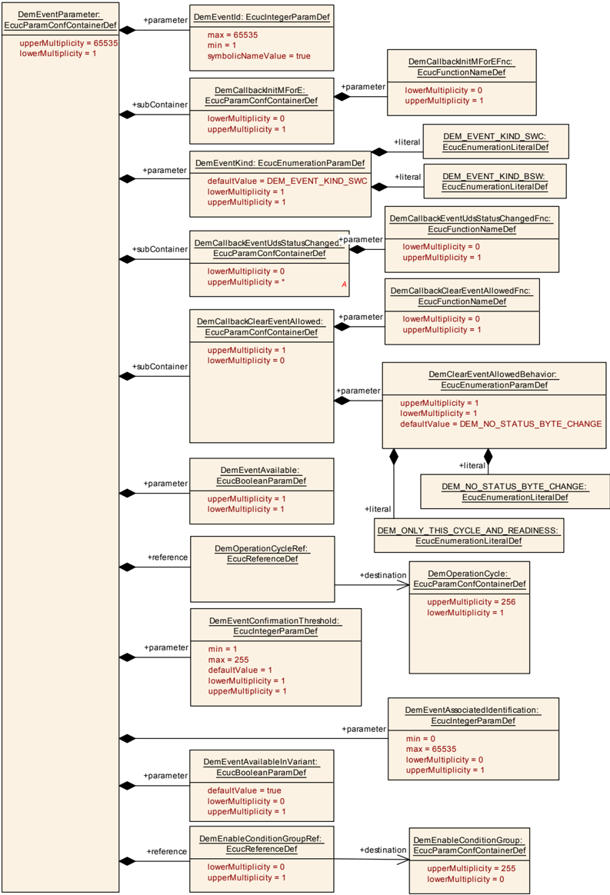

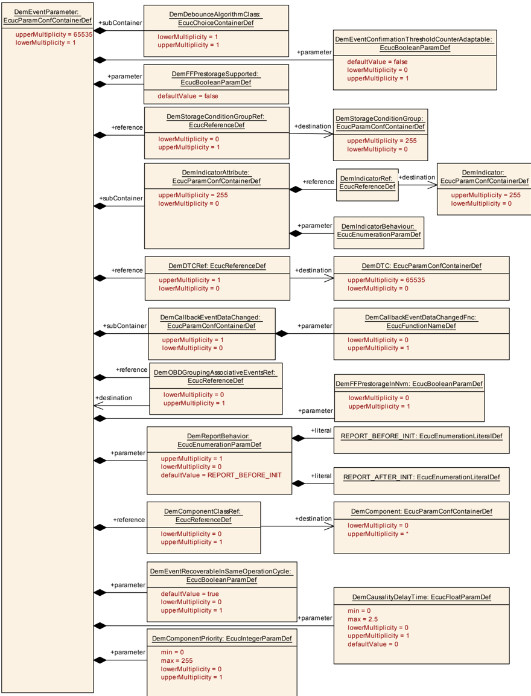

#### 6.3.1. 事件优先级

**事件优先级**（**Event priority**）定义为基于重要程度的事件排序。它用于在已存储事件数超过内存条目最大数（事件内存已满）时，确定哪些故障条目可以从事件内存中移除。

每个受支持的**事件**都应被分配一个优先级（参见 DemDTCAttributes 中的参数 DemDTCPriority）。

优先级值 1 应为最高优先级。更大的优先级值表示更低的重要性。

#### 6.3.2. 事件发生

**Dem** 模块应为每个事件内存条目提供一个发生计数器（**occurrence counter**）。

如果相关**事件**已被登记到相应的事件内存中，**Dem** 模块应将该发生计数器初始化为值 1。

如果配置参数 DemOccurrenceCounterProcessing（参见 DemPrimaryMemory 或 DemUserDefinedMemory）设置为 `DEM_PROCESS_OCCCTR_TF`，则每当 **UDS** 状态位 0（**TestFailed**）发生从 0 到 1 的跳变时，如果相关**事件**已存储在事件内存中，**Dem** 模块应将该发生计数器加一。

如果配置参数 DemOccurrenceCounterProcessing（参见 DemPrimaryMemory 或 DemUserDefinedMemory）设置为 `DEM_PROCESS_OCCCTR_CDTC`，则每当 **UDS** 状态位 0 发生从 0 到 1 的跳变时，如果相关**事件**已存储在事件内存中且 **UDS** 状态位 3 等于 1，**Dem** 模块应将该发生计数器加一。

如果事件特定的发生计数器已达到其最大值（255，参见第 6.7.1.2 节），**Dem** 模块不应再递增该事件的发生计数器。

#### 6.3.3. 事件种类

有两种不同类型的事件：

- **BSW** 相关事件（通过 **C API** Dem_SetEventStatus 报告）
- **SW-C** 相关事件（通过 **RTE** 操作 SetEventStatus 报告）

该种类可按**事件**进行配置（参见 DemEventParameter 中的 DemEventKind）。

这是必要的，因为 **BSW** 事件可能在 **Dem** 完全初始化之前报告，因而需要缓冲（参见第 6.8 节）。

#### 6.3.4. 事件目的地

配置参数 DemMemoryDestinationRef（参见 DemDTCAttributes）定义**事件**及其相关数据的专用存储位置（参见第 6.7.7 节）。

"永久事件内存"（**permanent event memory**）分配是从相关的 **DTC** 种类（参见第 6.4.1 节）隐式派生的。排放相关事件被自动分配到永久事件内存，因为将**事件**存储为"永久 **DTC**"是从其当前状态动态派生的（处理方式在第 6.9.5.8 节中描述）。在此上下文中，术语"永久"（**permanent**）表示排放相关事件的一个属性，并不仅指通过 **NvM** 进行的持久存储——无论哪种事件内存类型，都会进行持久存储。

不同内存类型的定义和使用是 **OEM** 特定的。

对于 **Dcm**-**Dem** 接口，参数 **DTCOrigin** 用于区分不同的内存区域。其意图是允许对不同的内存区域（主内存、用户自定义内存和永久内存）执行特定操作。

**DemMemoryDestinationRef 的限制**：**DTC** 只能通过 DemMemoryDestinationRef 引用同一 **DemEventMemorySet** 的事件内存。不支持 **DTC** 通过 DemMemoryDestinationRef 引用不同 **DemEventMemorySet** 的事件内存的场景。

#### 6.3.5. 诊断监视器的定义

诊断监视器是确定组件是否正常运行的例程实体。该监控功能为监控路径（**monitoring path**）标识特定的故障类型（例如对地短路、开路负载等）。监控路径表示被监控的物理系统或电路（例如传感器输入）。每个监控路径恰好关联一个诊断事件。

如果监视器自行去抖，则只有在合格结果（通过或失败）可用之后才会调用报告 API。至少在结果发生变化时必须进行报告。但是，通常监视器始终调用 **Dem** 在计算上更高效，因此应优先采用。因此，如何处理未变化结果的报告是 **Dem** 的实现特定行为。

如果监视器使用 **Dem** 内部的去抖动机制（参见第 6.7.3 节），则每当执行带功能检查的代码时都会调用报告 API。

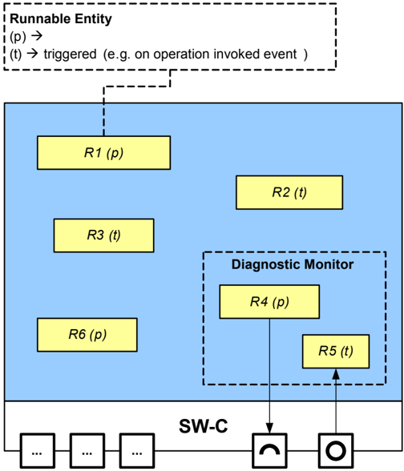

#### 6.3.6. 事件依赖关系

分配的 **DemComponent** 内的事件优先级以及 **DemComponent** 之间的依赖关系，用于对错误报告到故障内存的存储进行过滤。

每当一个**事件**报告 **FAILED** 时，如果同一 **DemComponent** 处已有任何其他具有更高优先级的**事件**处于 **FAILED**，则该事件应被视为**连续故障**（**CONSECUTIVE FAULT**）。

每当一个**事件**报告 **FAILED** 时，如果任何父 **DemComponent** 处于 **FAILED**，则该事件应被视为**连续故障**。

**Dem** 应允许忽略 **DemComponent** 的事件优先级（DemComponentIgnoresPriority）。在这种情况下，仅当任何父组件处于 **FAILED** 时，该事件才应被视为**连续故障**（应忽略同一组件处其他事件的 **FAILED** 状态）。

如果报告的故障不被视为连续故障，则应将其视为**因果故障**（**CAUSAL FAULT**）。因果故障应正常处理。

如果报告的故障不被视为连续故障且已配置 DemCausalityDelayTime，则应将其视为**初步因果故障**（**PRELIMINARY-CAUSAL FAULT**）。从事件报告发生的时间点起，直到 DemCausalityDelayTime 经过为止，该事件可以被重新考虑为连续故障。如果在此期间报告了另一个在同一 **DemComponent** 或任何父 **DemComponent** 处具有更高优先级的故障，则该事件应被重新考虑为连续故障。时间经过后，该故障不再被重新考虑。

被视为连续故障的故障不应存储到故障内存中。（处理方式应类似于存储条件未满足的情况。）

被视为连续故障报告的 DEM_EVENT_STATUS_FDC_THRESHOLD_REACHED 报告（例如通过接口调用或在去抖动算法中达到配置阈值时）不应存储到故障内存中。处理方式应类似于存储条件未满足的情况。

**注意：**DEM_EVENT_STATUS_FDC_THRESHOLD_REACHED 的其他报告不会被视为连续的。

**Dem** 应提供接口 Dem_GetComponentFailed，用于查询 **DemComponent** 的 **FAILED** 状态。

如果启用了 DemTriggerFiMReports（参见 DemGeneral），**Dem** 应在每次 **DemComponent** 失败状态变化时调用函数 DemTriggerOnComponentStatus 通知 **FiM** 模块 [8]。

如果组件状态发生变化且配置了 DemComponentFailedCallbackFnc 或 DemComponentFailedCallbackUsePort 设置为 TRUE，则 **Dem** 应触发回调 DemTriggerOnComponentStatus。

**注意**：只有当未配置 DemComponentFailedCallbackFnc 时，才允许将 DemComponentFailedCallbackUsePort 设置为 TRUE。

#### 6.3.7. 组件可用性

**Dem** 应支持 **DemComponent** 的可用性。不可用的组件应被视为系统中不包含该组件（例如 Dem_GetComponentFailed 将返回 E_NOT_OK）。

应提供接口 Dem_SetComponentAvailable 来设置组件的可用状态。

将某个 **DemComponent** 设置为不可用时，所有分配给它的**事件**也应被设置为不可用。

启动后，所有 **DemComponent** 都应为可用状态。

如果通过 Dem_SetComponentAvailable 将某个 **DemComponent** 设置为"不可用"，则 **Dem** 应将所有依赖组件（子组件）视为已被设置为"不可用"。

如果通过 Dem_SetComponentAvailable 将某个 **DemComponent** 设置为"不可用"，则 **Dem** 应将所有分配的事件设置为"不可用"，包括所有子节点的事件。事件的行为类似于将每个事件单独设置为"不可用"（例如设置事件状态）。

如果通过 Dem_SetComponentAvailable 将某个 **DemComponent** 设置为"不可用"，且分配给它的任何单独**事件**（参见第 6.3.7 节）已经失败，则该单独事件将保持为"可用"。Dem_SetComponentAvailable 仍应返回 E_OK。

如果通过 Dem_SetComponentAvailable 将某个 **DemComponent** 设置为"可用"，则所有分配的事件也被设置为"可用"，包括所有子节点的事件（如果这些节点尚未被设置为"不可用"）。单个事件的行为类似于将它们单独设置为"可用"（例如触发 InitMonitorForEvent）。

如果为将事件设置为"可用"而调用函数 Dem_SetEventAvailable，且其相关节点当前为"不可用"，则该函数应返回 E_NOT_OK。

如果使用 Dem_SetEventAvailable 将事件设置为可用，而其组件处于"不可用"状态，则 Dem_SetEventAvailable 应返回 E_NOT_OK。

### 6.4. 诊断故障代码定义

"诊断故障代码"（**Diagnostic trouble code**）定义了映射到 **Dem** 模块"诊断事件"的唯一标识符（显示给诊断测试仪）。**Dem** 向 **Dcm** 模块提供"诊断故障代码"的状态（参见第 6.11.2 节）。

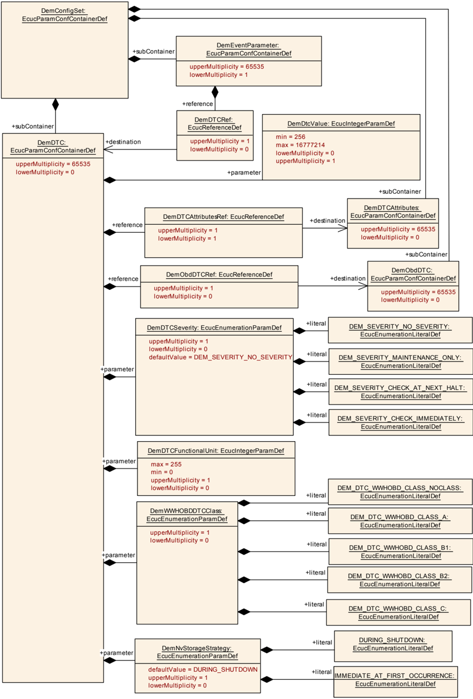

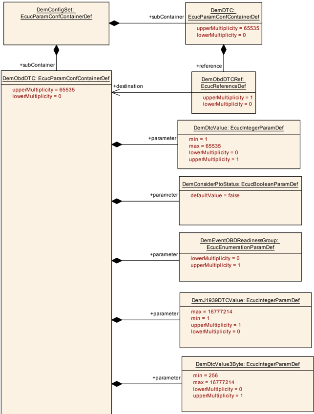

#### 6.4.1. DTC 种类

#### 6.4.2. DTC 格式

**Dem** 模块应支持 **DemDTC** 的 **DTC** 格式，包括：

- ISO 14229-1
- SAE J2012 OBD DTC（即 2 字节 DTC）
- SAE J1939-73
- ISO 11992-4
- SAE J2012 WWH-OBD DTC（即 3 字节 DTC）

配置参数 DemTypeOfDTCSupported 用于指定 `SWS_Dem_00013` 所定义的 **ECU** 受支持的 **DTC** 格式之一（参见 Dem_GetTranslationType）。这是确定要为 ISO 14229-1 服务"读取 DTC 信息"（**Read DTC Information**, 0x19）报告的 **DTC** 格式值所必需的。

**Dem** 模块应基于单独的配置参数支持 **UDS**、**OBD** 和 **J1939** 不同的 **DTC** 编号（参见 DemConfigSet 中的参数 DemDTC 和 DemObdDTC）。

对于 **DTC**，受支持的 **DTC** 格式（**UDS**、**OBD**、**OBD3Byte** 和 **J1939**）可以有多种组合。**Dem** 内部处理两种 **OBD** 格式之一，并与 **UDS** 和 **J1939 DTC** 组合使用。

一些制造商不希望完全转向支持 **UDS** 的 SAE J1979-2，而只会按 J1979-2 定义的有限 **UDS** 子集支持 J1979-2 功能，因此增加了 **OBD UDS DTC 分离**（**OBD UDS DTC separation**）功能。

**Dem** 应将所有 3 字节 **DTC** 值报告为 **uint32**，其中 byte 0 = 低字节，byte 1 = 中字节，byte 2 = 高字节，byte 3 未使用。对于 2 字节 **OBD DTC** 格式，仅使用两个字节（高字节、低字节）。**Dem** 服务应将这些 **DTC** 报告为 **uint32**，其中 byte 1 = 低字节，byte 2 = 高字节，byte 3 未使用，byte 0 = 0x00。

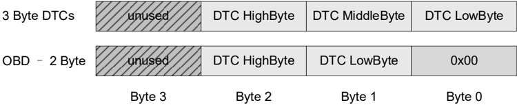

**注意：** **Dem** 期望按照 J1939 标准配置 **J1939DTC** 的 **SPN** 和 **FMI** 值。**Dem** 不会进行任何编码/转码。详情请参见 [14] 中第 5.7.1.11 节"SPN 转换方法"（**SPN Conversion Method**）。

**Dem** 应将 **DTC** 值报告为 **uint32**，其中 byte 0 = 低字节，byte 1 = 中字节，byte 2 = 高字节，byte 3 未使用。对于 **WWH-OBD DTC** 格式，仅使用三个字节（高字节、中字节和低字节）。**Dem** 服务应将这些 **DTC** 报告为 **uint32**，其中 byte 1 = 低字节，byte 2 = 高字节，byte 0 用作 **FTB**（依据 SAE J2012-DA）。

**DemDtcValue 的依赖关系**：仅当 DemOBDSupport 设置为 `DEM_OBD_MASTER_ECU` 或 `DEM_OBD_PRIMARY_ECU` 时，才应存在 **OBD DTC** 的 DemDtcValue。

**将 OBD DTC 限制在主故障内存**：仅当 **DTC** 具有指向 DemPrimaryMemory 的 DemMemoryDestinationRef 时，**DemDTC** 才应具有已配置的 DemObdDTCRef。

函数 Dem_GetDTCOfEvent 应获取由 **Dem** 配置映射到 **EventId** 的 **DTC**。

**3 字节 OBD DTC 仅用于 OBD UDS DTC 分离的配置**：仅当 DemSupportedObdUdsDtcSeparation 设置为 TRUE 且 DemOBDSupport 设置为 `DEM_OBD_MASTER_ECU` 或 `DEM_OBD_PRIMARY_ECU` 时，才应配置 3 字节 **OBD DTC** 的 DemDtcValue3Byte。

**不带 DTC 分离的 2 字节 OBD DTC 配置**：仅当未配置 DemSupportedObdUdsDtcSeparation 或其设置为 FALSE 时，才应配置 2 字节 **OBD DTC** 的 DemDtcValue。

#### 6.4.3. DTC 组

除了单个 **DTC** 值之外，还可以配置 **DTC 组**（参见 DemGroupOfDTC），如 ISO 14229-1 附录 D.1 所定义。每个 DTC 组都分配有自己的 DTC 组值（该值必须与任何其他 DTC 值和 DTC 组值不同）。当请求对 DTC 组执行操作时（例如 ClearDTC 和禁用/启用 DTC），通过 **DTC** 值选择 **DTCGroup**。

**DemGroupOfDTC** 应表示 **DTC** 组边界的值。**注意：**具有全局边界 0x000100 和 0xfffe00 的组不需要配置，因为组 **ALL** 是自动定义的。

介于所请求组的 dtc-code 与下一个更高 dtcgroup-code 之间的所有 **DTC** 应被视为属于该组。

**注意：**DTC 组与诊断服务 ClearDiagnosticInformation（0x14，参见 **Dem_ClearDTC**）相关。

**Dem** 应支持在 Dem_SelectDTC 的参数 **DTC** 中预定义的 **DTC** 组 **GroupOfAllDTCs**（0xFFFFFF）。

如果支持 **WWH-OBD** 或 J1979-2，**Dem** 应支持在 Dem_SelectDTC 的参数 **DTC** 中为 **WWH-OBD** 和 J1979-2 预定义的、与排放相关的 **DTC** 组（0xFFFF33）。

注意，DTC 组"所有 DTC"不会在 DemGroupOfDTC 中配置，因为它必须始终由 **Dem** 模块提供。考虑到 0xFFFFFF 是表示"所有 DTC 组"的不可配置值，为组"X"配置的每个 **DTC** 的 id 应位于开区间 (ID_of_group_X, ID_of_next_configured_group) 内，例如：

| powertrain DTC 组 -> 0x3FFF00 | DTC1 -> 0x3FFF04 DTC2 -> 0x3FFF06 … DTCn -> 0x3FFF0E |
| --- | --- |
| body DTC 组 -> 0x7FFF0F | … body DTC 组中的 DTC … |

作为对上述 DTC 组方法的配置约束：如果配置了一个或多个 DTC 组，则无法配置不属于任何组的独立 **DTC**。

#### 6.4.4. DTC 严重度

**DTC 严重度**用于按照 ISO 14229-1 附录 D.3"DTC 严重度与等级定义"提供特定**事件**重要程度的信息。DemDTCSeverity 仅适用于 **UDS DTC**。

如果调用了 API Dem_GetSeverityOfDTC 或 Dem_GetNextFilteredDTCAndSeverity，且所选 **DTC** 在 DemDTCSeverity 中配置了严重度值，则 **Dem** 应将 DemDTCSeverity 中配置的值设置为 **DTCSeverity**。

如果调用了 API Dem_GetSeverityOfDTC 或 Dem_GetNextFilteredDTCAndSeverity，且所选 **DTC** 未在 DemDTCSeverity 中配置严重度值，则 **Dem** 应将 `DEM_SEVERITY_NO_SEVERITY` 设置为 **DTCSeverity**。

#### 6.4.5. 功能单元

如果调用了 API Dem_GetFunctionalUnitOfDTC，且所选 **DTC** 在 DemDTCFunctionalUnit 中配置了功能单元值，则 **Dem** 应将 DemDTCFunctionalUnit 中配置的值设置到出参 **DTCFunctionalUnit** 中。

如果调用了 API Dem_GetFunctionalUnitOfDTC，且所选 **DTC** 未在 DemDTCFunctionalUnit 中配置功能单元，则 **Dem** 应在出参 **DTCFunctionalUnit** 中设置值 0x00。

#### 6.4.6. DTC 重要性

**DTC** 有两种不同的重要性级别：

- **fault**：归类与组件/**ECU** 自身相关的故障（例如需要维修措施）
- **occurrence**：归类指示有关系统行为不足的附加信息的问题（例如与 **ECU** 无法控制的状态相关）

该重要性级别可按**事件**配置（参见 DemDTCAttributes 中的 DemDTCSignificance），并且可以映射为一个数据元素（参见 `DEM_SIGNIFICANCE`）。

#### 6.4.7. 抑制 DTC 输出

本章描述在运行期间通过 **API** 调用对**事件**/**DTC** 的动态抑制。被抑制的 **DTC** 的行为是：对测试仪不可见，但诊断监视器可以继续对其进行处理。

一个示例用例：由 **SW-C** 在运行期间决定在某个市场隐藏某个 **DTC**。

配置参数 DemSuppressionSupport（参见 DemGeneral）控制 **DTC** 抑制功能的可用性。

如果某个 **DTC** 的所有相关**事件**都不可用，则 **Dem** 应抑制该 **DTC**。

详情参见第 6.4.8 节。

如果 **DTC** 与**事件**之间存在一对一的关系，则当相关**事件**不可用时该 **DTC** 被抑制。如果该 **DTC** 是**组合 DTC**，则当所有组合事件都不可用时该 **DTC** 被抑制。

关于输出和查询函数，被抑制的 **DTC** 应被视为未在系统中配置。

**被抑制 DTC 的 DTC 查询函数的行为**：如果针对某个被抑制的、单独选择的 **DTC** 调用以下任一 API：

- Dem_GetStatusOfDTC
- Dem_GetSeverityOfDTC
- Dem_GetFunctionalUnitOfDTC
- Dem_ClearDTC

则 **Dem** 应返回 `DEM_WRONG_DTC`。

被抑制的 **DTC** 对以下 **Dcm** 查询函数不可见；因此以下函数应将该 **DTC** 视为过滤器不匹配：

- Dem_DcmGetDTCOfOBDFreezeFrame
- Dem_DcmReadDataOfOBDFreezeFrame
- Dem_DcmGetInfoTypeValue08
- Dem_DcmGetInfoTypeValue0B
- Dem_DcmReadDataOfPID01
- Dem_GetDTCByOccurrenceTime
- Dem_GetNextFilteredDTC
- Dem_GetNextFilteredDTCAndFDC
- Dem_GetNextFilteredDTCAndSeverity
- Dem_GetNextFilteredRecord
- Dem_J1939DcmFirstDTCwithLampStatus
- Dem_J1939DcmGetNextDTCwithLampStatus
- Dem_J1939DcmGetNextFreezeFrame
- Dem_J1939DcmSetDTCFilter
- Dem_J1939DcmGetNumberOfFilteredDTC
- Dem_J1939DcmGetNextFilteredDTC
- Dem_J1939DcmSetRatioFilter
- Dem_J1939DcmGetNextFilteredRatio
- Dem_J1939DcmReadDiagnosticReadiness1
- Dem_J1939DcmReadDiagnosticReadiness2
- Dem_J1939DcmReadDiagnosticReadiness3
- Dem_SelectFreezeFrameData
- Dem_SetDTCFilter
- Dem_SelectExtendedDataRecord
- Dem_SetDTCFilterByExtendedDataRecordNumber
- Dem_SetDTCFilterByReadinessGroup

**注意：**这意味着该 **DTC** 的（对外）报告（例如 **DTC** 编号、**UDS** 状态、**DTC** 扩展数据记录、**DTC** 统计数据、**IUMPR** 等）被抑制。

**DTC** 抑制不应停止相应 **DTC** 的事件处理。

**注意：**这意味着例如**事件鉴定**、环境数据的更新和功能降级仍在 **Dem** 内部处理。

**注意：**如果 **DTC**/冻结帧不应存储到故障内存中，则应另外使用存储条件。

**Dem_GetDTCSuppression 的功能**：如果调用了 Dem_GetDTCSuppression，**Dem** 应在出参 **SuppressionStatus** 中返回 **DTC** 抑制状态。值 TRUE 表示该 **DTC** 曾通过以 SuppressionStatus = TRUE 调用 Dem_SetDTCSuppression 而被抑制；值 FALSE 表示该 **DTC** 当前未被抑制。

如果调用了 Dem_SetDTCSuppression，**Dem** 应将所选 **DTC** 的抑制状态设置为参数 **SuppressionStatus** 的值。

**DTC** 不被处理因而对诊断不可见的原因有多种，而抑制状态本身只能通过 Dem_SetDTCSuppression 改变。Dem_GetDTCSuppression 仅评估该抑制状态。

#### 6.4.8. 事件的可用性（可见性与计算）

本章描述一种将**事件**标记为不可用的方法，而不将它们从实际配置中移除。不可用的事件被视为未包含在 **Dem** 配置中。

一个示例用例：某个控制单元及其软件支持控制多种硬件。硬件型式的某些部分可能可用或不可用，但仍然应用相同的控制单元和软件。

1. 每个硬件型式生成一个标定集。应用工程师建立后构建（**post-build**）配置，以确保软件针对硬件正确运行。对于某个硬件型式中不包含的部分，这意味着相关**事件**需要被关闭、被抑制。这些事件应表现为完全中性：永不置位其 **LastFailed**、不引发跛行回家（**limp-home**）模式、对维修站服务不可见。
   =&gt; ECUC 参数 DemEventAvailableInVariant 设置为 TRUE（启用）或 FALSE（禁用）
2. 一个标定覆盖多个硬件型式。在生产期间，甚至在运行期间（维修站）更换硬件时，会向控制单元写入一些编码位，或接收到某些网络报文，以根据硬件的变化更改软件的行为。与情形 1 相同，某些**事件**需要被抑制。
   =&gt; ECUC 参数 DemEventAvailableInVariant 设置为 TRUE（启用）
   =&gt; ECUC 参数 DemEventAvailable 定义**事件**的初始可用性
   =&gt; 接口 Dem_SetEventAvailable 用于在运行期间更改由 DemEventAvailable 定义的可用性

**通过配置启用/禁用事件**：配置参数 DemEventAvailableInVariant 应作为将**事件**视为启用或禁用的主控。如果配置参数 DemEventAvailableInVariant 设置为 FALSE，**Dem** 应将该**事件**视为未配置为 DemEventParameter。如果 DemEventAvailableInVariant 未设置或设置为 TRUE，**Dem** 应视其他来源的情况考虑启用该**事件**。

**注意：**DemEventAvailableInVariant 允许禁用软件发布中包含但不需要的**事件**；甚至会阻止相关 **SW-C** 通过 Dem_SetEventAvailable 使其变为可用。

**处理事件的可用性**：在以下情况时，**Dem** 应将**事件**视为不可用：

- DemEventAvailableInVariant == FALSE，或
- DemEventAvailable == FALSE，或
- DemEventAvailable 已被 Dem_SetEventAvailable（FALSE）改写，或
- DemComponentClassRef 引用的组件不可用

**Dem** 应提供运行期间的功能，将事件视为未配置为 DemEventParameter。配置参数 DemAvailabilitySupport 用于启用 Dem_SetEventAvailable() 提供的功能。

不可用的事件不应参与 Service $01 PID $41 的计算。

引用不可用事件的 **IUMPR** 比率既不应计算也不应报告。

**Dem** 不应在 VARIANT-POST-BUILD 中提供函数 Dem_SetEventAvailable。理由：在 VARIANT-POST-BUILD 中，初始值在 Dem_Init（post-build 初始化时间）之前无效。

如果事件被设置为不可用，则相应**事件**应被视为未在系统中配置（例如 Dem_SetEventStatus 和 Dem_GetEventUdsStatus 应返回 E_NOT_OK）。受影响的 API 如下：

- Dem_SetEventStatus
- Dem_GetEventUdsStatus
- Dem_ResetEventDebounceStatus
- Dem_ResetEventStatus
- Dem_PrestoreFreezeFrame
- Dem_ClearPrestoredFreezeFrame
- Dem_GetDebouncingOfEvent
- Dem_GetDTCOfEvent
- Dem_GetFaultDetectionCounter
- Dem_GetEventFreezeFrameDataEx
- Dem_GetEventExtendedDataRecordEx
- Dem_ClearDTC
- Dem_DcmGetDTRData
- Dem_RepIUMPRFaultDetect
- Dem_RepIUMPRDenRelease
- Dem_SetWIRStatus
- Dem_SetEventStatusWithMonitorData
- Dem_GetMonitorStatus
- Dem_SetEventConfirmationThresholdCounter
- Dem_SetEventDisabled
- Dem_ResetMonitorStatus

**注意：**事件的可用性还可能影响 **DTC** 的抑制（参见第 6.4.7 节）。

当以 AvailableStatus = FALSE 调用 API Dem_SetEventAvailable 时，如果出现以下情况，**Dem** 应返回 E_NOT_OK：

- 该**事件**已存在事件内存条目，或
- 该**事件**的任何事件状态位"testFailed"、"pending"、"confirmed"或"warningIndicatorRequested"已置位

**Dem_SetEventAvailable 的异步行为**：**Dem** 应异步处理 Dem_SetEventAvailable 调用。这意味着最终结果在稍后的时间点才可用。

"稍后的时间点"是实现特定的，可能是下一个主函数，且在 Dem_SetEventAvailable 返回之后。

如果以 AvailableStatus == 'false' 调用 Dem_SetEventAvailable，**Dem** 应将该**事件**的 **UDS** 状态设置为 0x00。

**注意：**如果 **UDS** 状态发生变化，将调用相应的回调，以向用户正确提供状态变化的信息。

如果以 AvailableStatus == 'true' 调用 Dem_SetEventAvailable，**Dem** 应将该**事件**的 **UDS** 状态设置为 0x50。

**对已禁用事件相关调用的反应**：如果**事件**配置为 DemEventAvailableInVariant 设置为 FALSE，且以 AvailableStatus = TRUE 对该 **EventId** 调用 API Dem_SetEventAvailable，则 API Dem_SetEventAvailable 应返回 E_NOT_OK。

如果调用函数 Dem_SetEventAvailable 将事件设置为"可用"，**Dem** 应使用 **DEM_INIT_MONITOR_REENABLED** 作为 **InitMonitorReason** 触发事件初始化。

如果以有效的 **EventId** 调用 Dem_GetEventAvailable，则应将出参 **AvailableStatus** 设置为该**事件**的可用性并返回 E_OK。

可用性由配置参数 DemEventAvailable（可通过 Dem_SetEventAvailable 修改）和 DemEventAvailableCnf（"Dem 应将事件视为不可用……"）共同决定。

### 6.5. 受监控组件的定义

受监控组件是系统中与正常运行检查相关的部分。组件的故障需要被报告并记录。为此，通常定义一个或多个监控并将其分配给该组件。

此外，这类组件的状态也很重要，用于影响系统行为（组件状态可用于 **Fim**）和错误记录（对连续故障条目的过滤）。

**Dem** 允许将受监控组件显式定义为 **DemComponent**，定义事件与组件之间的关系，并最终定义组件之间的关系。

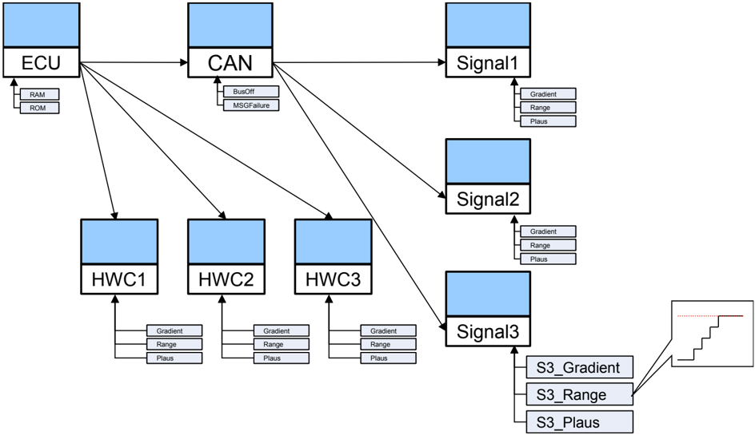

#### 6.5.1. 组件与依赖关系的定义

**Dem** 应将受监控组件表示为 **DemComponent**，并带有唯一标识符，用于在接口中标识该组件。

每个 **DemComponent** 应具有布尔状态 **FAILED**，表示该组件是否存在错误。

**Dem** 应允许定义 **DemComponent** 之间的关系。这些关系是有向的，即一个组件依赖于另一个组件（DemImmediateChildComponentRef）。任何具有有向关系（包括跨多个组件）的组件都被视为父组件（**parent component**）。

示例：a -&gt; b -&gt; c -&gt; d，a 和 b 是 c 的父组件；c 和 d 依赖于 b。

**DemComponent** 的依赖关系仅支持有向无环图结构。

**Dem** 应允许将事件分配给 **DemComponent**。

事件可以分配给恰好一个 **DemComponent**，对该组件的监控正在测试错误条件。多个事件可以分配给同一个组件。

**Dem** 应允许按优先级对分配给 **DemComponent** 的事件排序。优先级按**事件**通过 DemComponentPriority 定义。

在为某个**事件**报告错误（**DEM_MONITOR_STATUS_TF**）时，所分配的 **DemComponent** 应在该事件报告的上下文中被设置为 **FAILED**。

将某个 **DemComponent** 设置为 **FAILED** 时，所有依赖组件也应被设置为 **FAILED**。

当所有已分配事件均为 **NOT FAILED**（**DEM_MONITOR_STATUS_TF**）且所有父组件均为 **NOT FAILED** 时，**DemComponent** 应被设置为 **NOT FAILED**。

### 6.6. 运行周期管理

**Dem** 模块提供定义不同运行周期的可能性（参见 ISO 14229-1）。

运行周期的示例包括：

- 点火 on/off 循环
- 上电/下电循环
- **OBD** 驾驶循环
- 发动机暖机循环
- 运行有效/无效循环
- 累计运行时间

各种**运行周期**是计算周期相关状态信息（例如 **testCompleteThisOperationCycle**）的基础。此外，运行周期也是某些功能（例如故障的确认和故障的老化）的基础。通过 Dem_RestartOperationCycle 重启或切换到下一个运行周期，作为这些功能计算的触发。

**运行周期重启**：只有在 Dem_PreInit 之后才允许调用函数 Dem_RestartOperationCycle。如果在 Dem_Init 之前重启了某个运行周期，重启的处理应在 Dem_Init 之后进行。

**运行周期重启**：**Dem** 只应在上一次重启被完全处理之后才重启**运行周期**。换言之，即不存在运行周期重启队列。

**Dem** 允许使用 DemLeadingCycleRef 参数定义**从属运行周期**（**dependent operation cycle**）。只要设置了该参数，该运行周期就被视为从属运行周期。只要未设置该参数，该运行周期就被视为"普通"运行周期。

如果传递给 Dem_SetCycleQualified 的**运行周期**完全未配置，则应报告 **Det** 错误 `DEM_E_WRONG_CONFIGURATION`。

**Dem** 应跨电源周期存储**从属运行周期**的鉴定状态。

**运行周期重启**：每当请求通过 Dem_RestartOperationCycle 重启某个**运行周期**时，所有依赖于所选运行周期的**运行周期**也应被重启，但前提是它们已被鉴定。

**注意：**设置一个从属运行周期为已鉴定不会启动该运行周期，即使前导运行周期此前已经启动。

**运行周期重启**：重启一个**从属运行周期**时，其运行周期鉴定状态应被复位。

API Dem_GetCycleQualified 应在出参 **isQualified** 中提供所请求**运行周期**的鉴定状态。

如果传递给 Dem_GetCycleQualified 的**运行周期**完全未配置，则应报告 **Det** 错误 `DEM_E_WRONG_CONFIGURATION`。

如果 DemOBDDelayedDCYConfirmedAndMIL 设置为 TRUE，则链接到 **OBD** 驾驶循环（DemOBDDrivingCycleRef）的事件的行为应发生改变：

如果该**运行周期**未鉴定，则处理状态报告，但更新确认状态除外。当 **OBD** 驾驶周期被设置为已鉴定的那一刻，**Dem** 应执行必要的计算，以使在"未鉴定"阶段收集的事件达到已确认状态。

**OBD** 立法要求对运行周期进行特定的实现。对于排放相关的 **ECU**，必须相应地实现。

#### 6.6.1. 运行周期计数器

**运行周期计数器的初始化**：如果为某个**事件**创建了新的事件内存条目，则运行周期计数器"距上次失败的周期数"、"距首次失败的周期数"和"失败周期数"应初始化为零。

**运行周期计数器的大小**：每个运行周期计数器的大小应为一个字节。

**运行周期计数器的溢出处理**：如果对某个运行周期计数器的任何计数操作会导致其从 0xFF 回绕，则应将其保持在 0xFF。

##### 6.6.1.1. 距上次失败的周期数

计数器"距上次失败的周期数"（**Cycles since last failed**）表示自 **DTC** 故障检测计数器上次达到最大值 +127 以来（自 **DTC** 信息上次被清除以来）的运行周期数。应包括所有运行周期，包括测试未完成的周期。

如果计数器"距上次失败的周期数"被映射到扩展数据记录（DemInternalDataElement 设置为 `DEM_CYCLES_SINCE_LAST_FAILED`），则它应可用于每条"事件相关数据"记录。

如果计数器"距上次失败的周期数"已存储在事件内存中，则当内部去抖计数器达到 DemDebounceCounterFailedThreshold 时，应将其复位为零。

如果计数器"距上次失败的周期数"已存储在事件内存中，则应在所引用的**运行周期**（参见 DemOperationCycleRef）结束时将其递增。

##### 6.6.1.2. 距首次失败的周期数

计数器"距首次失败的周期数"（**Cycles since first failed**）表示自 **DTC** 故障检测计数器首次达到最大值 +127 以来（自 **DTC** 信息上次被清除以来）的运行周期数。应包括所有运行周期，包括测试未完成的周期。

如果计数器"距首次失败的周期数"被映射到扩展数据记录（DemInternalDataElement 设置为 `DEM_CYCLES_SINCE_FIRST_FAILED`），则它应可用于每条"事件相关数据"记录。

如果计数器"距首次失败的周期数"已存储在事件内存中，则应在所引用的**运行周期**（参见 DemOperationCycleRef）结束时将其递增。

##### 6.6.1.3. 失败周期数

计数器"失败周期数"（**Failed cycles**）表示 **DTC** 故障检测计数器达到最大值 +127 期间的运行周期数（自 **DTC** 信息上次被清除以来）。

如果计数器"失败周期数"被映射到扩展数据记录（DemInternalDataElement 设置为 `DEM_FAILED_CYCLES`），则它应可用于每条"事件相关数据"记录。

如果计数器"失败周期数"已存储在事件内存中，则应在所引用的**运行周期**（参见 DemOperationCycleRef）结束时、且 **UDS** 状态位 1 置位为 1 的情况下将其递增。

### 6.7. 事件内存的说明

"事件内存"（**event memory**）定义为位于专用内存块中的一组事件记录。事件记录至少包含 **UDS** 状态和事件相关数据。

**Dem** 模块应支持主事件内存（**primary event memory**）。

如果已配置（参见第 6.7.7.1 节），**Dem** 模块应支持额外的事件内存（用户自定义内存、永久内存）。

通过容器 **DemEventMemorySet** 配置后，**Dem** 支持多个相互独立的事件内存。每一个以 **DemClient** 为参数的 **API** 调用，应仅适用于为该客户端配置的事件内存（主内存或用户自定义内存）。

为了从 **DemDTCOriginType** 计算用户自定义内存 ID，当获取的值处于 [0x0100, 0x01FF] 范围内时，**Dem** 应从该值中减去 0x0100。

不同事件内存的大小在 **Dem** 配置中可配置。

**Dem** 应提供配置参数，用于将故障内存大小适配到可用的 **ECU** 内存空间（参见配置参数 DemMaxNumberEventEntryPrimary 或 DemMaxNumberEventEntryUserDefined）。

**单一事件内存内唯一的 DTC 值**：在引用同一事件内存的所有 **DTC** 中，DemDtcValue 应当唯一。

**单一事件内存内唯一的扩展数据记录值**：从一个事件内存的 **DTC** 所引用的所有 DemExtendedDataRecordClass 容器，应具有互不相同的 DemExtendedDataRecordNumber。

**单一事件内存内唯一的快照记录值**：从一个事件内存的 **DTC** 所引用的所有 DemFreezeFrameRecordClass 容器，应具有互不相同的 DemFreezeFrameRecordNumber。

对于非易失性存储，**Dem** 应使用 **NVRAM** 管理器。

详情参见第 6.11.5 节。

下图给出一个逻辑 **Dem** 事件内存布局的示例。

如果存在内存大小的限制，则必须提供事件内存的溢出指示（**overflow indication**）和一种置换策略（参见第 6.7.2 节）。

#### 6.7.1. 事件状态管理

"事件状态管理"（**Event Status Management**）是 **Dem** 记录并保留事件、事件状态及相关数据的能力。

**Dem** 模块应提供报告事件状态的能力，允许诊断监视器将其内部诊断测试的结果告知 **Dem**（参见 Dem_SetEventStatus）。

API Dem_SetEventStatusWithMonitorData 应具有与 Dem_SetEventStatus 相同的功能，唯一区别是它提供额外的参数，其数据将存储为事件相关数据。

位于应用中的监视器应在新的测试结果可用时尽快调用该函数（Dem_SetEventStatus）来报告事件状态。这一操作独立于 **Dem** 模块的当前状态进行（参见图 7.14）。

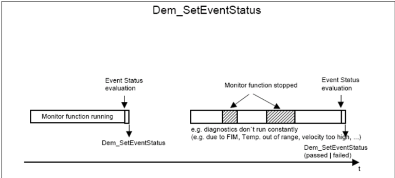

**Dem** 模块应提供在不报告通过结果的情况下复位事件失败状态的能力（参见 Dem_ResetEventStatus）。

**注意：**Dem_ResetEventStatus 并不表示一次事件状态报告（不同于 Dem_SetEventStatus 所做的）。调用之后，监视器状态既不合格也未测试。

监视器将使用函数 Dem_ResetEventStatus 来停用跛行回家（**limp home**）并切换回正常运行。此时监视器通常尚未进行 OK 测试，因此无法使用带 tested 和 passed 的 Dem_SetEventStatus。

**Dem_ResetEventStatus 的行为**：函数 Dem_ResetEventStatus 应将事件状态位 0（**TestFailed**）置为 0，并在已配置的情况下将 **Dem** 内部去抖动算法复位为初始值。**Dem** 应在稍后的时间点异步执行此操作。

"稍后的时间点"意味着确切时刻是实现特定的。它可能是下一个主函数，且在 Dem_ResetEventStatus 返回之后。状态变化回调的可能调用也会被异步触发。

**注意：**函数 Dem_ResetEventStatus 不改变监视器状态和 **UDS** 状态位 6，也不清除预存储的冻结帧。

如果该**事件**在当前运行周期已被测试（**UDS** 状态位 6 置为 0——译注：原文如此，应为置为 1），函数 Dem_ResetEventStatus 应返回 E_NOT_OK。

**Dem_ResetMonitorStatus 的行为**：函数 Dem_ResetMonitorStatus 应将监视器状态位 0（**TestFailed**）置为 0，并在已配置的情况下将 **Dem** 内部去抖动算法复位为初始值。

**注意：**函数 Dem_ResetMonitorStatus 不改变 **UDS** 状态字节，也不清除预存储的冻结帧。

如果本次运行周期已对该监控进行过测试（监视器状态字节位 1 置为 0——译注：原文如此），函数 Dem_ResetMonitorStatus 应返回 E_NOT_OK。

如果调用了 API Dem_GetEventUdsStatus，**Dem** 应提供特定事件的当前事件状态字节。

**注意：**函数 Dem_GetEventUdsStatus 供 **SW-C** 或其他 **BSW** 模块（例如 **FiM**）在事件层级使用。**Dcm** 则在 **DTC** 层级使用函数 Dem_GetStatusOfDTC。

**Dem** 应提供函数 Dem_GetDebouncingOfEvent()，用于报告事件的去抖动状态。出参 **DebouncingState** 返回包含中间状态在内的去抖动状态。其中一个 **OBD** 特定位应在测试完成、去抖动达到其极限且使能条件和存储条件均满足时，支持 **DTR** 更新触发。

**Dem** 支持按事件进行配置，以禁止在同一运行周期内复位事件。

如果配置参数 DemEventRecoverableInSameOperationCycle 设置为 FALSE，当事件状态字节的 **TestFailedThisOperationCycle** 标志置为 1 时，对 **PASSED** 的报告（直接通过 Dem_SetEventStatus 或经去抖动后间接产生）将被忽略。

**注意：**去抖动的执行独立于 DemEventRecoverableInSameOperationCycle 的取值。无论 DemEventRecoverableInSameOperationCycle 如何设置，**FDC** 都可以达到 -128。

**Dem** 应独立于配置参数 DemEventRecoverableInSameOperationCycle 的设置执行所配置的去抖动。即：若 DemEventRecoverableInSameOperationCycle 设置为 FALSE 且该事件的监视器报告 **PREPASSED**，**Dem** 仍应处理去抖动（例如递减计数器）。

如果配置了 DemMultiEventTriggering，并且以下任一 API：

- Dem_SetEventStatus
- Dem_ResetEventStatus
- Dem_PrestoreFreezeFrame
- Dem_ClearPrestoredFreezeFrame
- Dem_ResetEventDebounceStatus

以被某个 DemMultiEventTriggering 的 DemMultiEventTriggeringMasterEventRef 所引用的 **EventId** 被调用，则对于该 DemMultiEventTriggering 的每个 DemMultiEventTriggeringSlaveEventRef，**Dem** 应以完全相同的参数触发相同的 **API** 调用，仅将 **EventId** 参数替换为 DemMultiEventTriggeringSlaveEventRef 所引用的事件。

**Dem** 不应支持以被容器 DemMultiEventTriggering 中任何 DemMultiEventTriggeringSlaveEventRef 或 DemStorageConditionReplacementEventRef 引用的 **EventId** 调用：

- Dem_SetEventStatus
- Dem_ResetEventStatus
- Dem_PrestoreFreezeFrame
- Dem_ClearPrestoredFreezeFrame
- Dem_ResetEventDebounceStatus

这些事件专用于内部触发。在这种情况下调用上述任何 **API** 时，**Dem** 的行为是未定义的。

##### 6.7.1.1. 状态位支持

对于每个诊断事件，**Dem** 模块默认应实现 ISO 14229-1 中定义的全部 **UDS** 状态位的现行集合。

**注意：**在本规范中，事件的 ISO 14229-1 **UDS** 状态字节由 **Dem** 数据类型 Dem_UdsStatusByteType 表示（定义见第 8.6.1.21 节）。如果不需要支持特定的 **UDS** 状态位（另参见第 6.7.1.1 节），此类优化或限制可以由供应商自行实现。

如果调用了 API Dem_GetEventUdsStatus，且参数 **EventId** 的事件存在并可用，则 **Dem** 应将该 **UDS** 状态字节复制到出参 **UdsStatusByte** 中并返回 E_OK。

详情参见第 6.4.8 节。

如果调用了 API Dem_GetEventUdsStatus，且参数 **EventId** 的事件不可用，则 **Dem** 应返回 E_NOT_OK。

详情参见第 6.4.8 节。

##### 6.7.1.2. 监视器状态和 UDS 状态更新

状态位处理是 **Dem** 功能的核心部分。**SWC** 或 **BSW** 模块频繁地通过 API Dem_SetEventStatus 报告监视结果。这些函数的调用将触发 **Dem** 的状态位处理。

**Dem** 应为每个事件提供一个监视器状态，用于存储当前的监视器状态信息。监视器状态包含 Dem_MonitorStatusType 中定义的信息。

**Dem** 应在调用 Dem_SetEventStatus 函数的上下文内同步地执行基于计数器的事件去抖动。

在调用 Dem_SetEventStatus 并完成去抖动后，**Dem** 应以与 **UDS** 状态相同的方式处理监视器状态：

- 位 0（**TestFailed**）
- 位 1（**TestNotCompleteThisOperationCycle**）

监视器状态字节的处理应在调用 Dem_SetEventStatus 函数的上下文内同步完成。

如果配置了参数 DemGeneralCallbackMonitorStatusChangedFnc，**Dem** 应以 &lt;Module&gt;_DemTriggerOnMonitorStatus 的签名调用该已配置的 C 函数。

在处理监视器状态时，每当监视器状态发生变化，**Dem** 应调用监视器状态变化回调函数：

- &lt;Module&gt;_DemTriggerOnMonitorStatus

在处理以 DemEventKind = `DEM_EVENT_KIND_SWC` 报告的事件的监视器状态时，每当监视器状态发生变化且该事件配置了 C/S 接口，**Dem** 应调用监视器状态变化 C/S 接口 **CallbackMonitorStatusChange**。

**DemGeneralCallbackMonitorStatusChangedFnc 的依赖关系**：仅当 DemGeneralInterfaceSupport 设置为 TRUE 时，才应存在 DemGeneralCallbackMonitorStatusChangedFnc。

限制：通过 **RTE** 使用 **monitorStatusChange** 仅限于 **SWC** 监控。所有基础软件监控无法通过 **RTE** 使用该回调覆盖。要在 **SW-C** 中获得所有监控的完整状态变化（**statusChange**）信息，应使用 **eventStatusChange** 回调。

通过 **RTE** 的 **CallbackMonitorStatusChange** 和 **GeneralCallbackMonitorStatusChanged** 进一步限于那些仅在已知上下文中改变其状态的监控。例如，如果监视器状态由 **CDD** 改变（例如通过 C 函数调用 Dem_SetEventAvailable），则不得使用经 **RTE** 的监视器状态变化回调。

理由：AUTOSAR **RTE** 要求从 **BSW** 经 **RTE** 到 **SW-C** 的调用在已知的调用上下文中进行。对于同步的监视器状态变化回调，这仅对从 **SW-C** 报告的事件可行。对于从 **BSW** 模块报告的事件，无法向 **RTE** 提供调用上下文。因此，**Dem** 仅为从 **SW-C** 报告的事件提供 C/S 接口 **CallbackMonitorStatusChange**。对于从 **BSW** 模块报告的事件，不提供此类 C/S 接口。此外，接口 **GeneralCallbackMonitorStatusChanged** 也不作为 C/S 经 **RTE** 提供，因为该回调只能对从 **SW-C** 报告的事件调用，而不能对从 **BSW** 模块报告的事件调用——这显然会引起混淆。

如果需要在 **SW-C** 中对监视器状态变化回调做出通用同步反应，可以在 **CDD** 的范围内使用 &lt;Module&gt;_DemGeneralTriggerOnMonitorStatus 或 &lt;Module&gt;_DemTriggerOnMonitorStatus 来处理该同步反应。

**监视器状态变化回调仅限于从 SW-C 报告的事件使用**：如果 Dem_SetEventAvailable 由 **Cdd** 或 **BSW** 模块调用，则相应的监视器状态变化回调只能作为 C 函数使用，而不能通过 **RTE** 接口使用。

在处理清除 **DTC** 命令时（例如通过 Dem_ClearDTC），**Dem** 应将被清除 **DTC** 所分配的监视器状态设置为 0x02。

**Dem** 应异步地处理 **UDS** 状态。这意味着它在调用 Dem_SetEventStatus 函数的上下文之外进行计算。

如果调用了 API Dem_SetEventStatus，**Dem** 已按照第 6.7.1.2 节同步处理了所报告的监视器状态，而相应的 **UDS** 状态无法被处理，则 **Dem** 应报告运行时错误 `DEM_E_UDS_STATUS_PROCESSING_FAILED`。

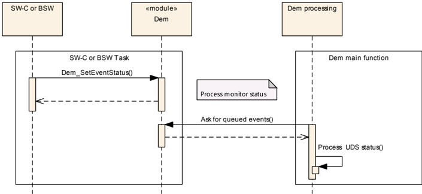

**注意：**关于事件内存管理的详细描述请参见第 6.7.2 节。

如果调用了 API Dem_GetMonitorStatus，**Dem** 应将当前监视器状态复制到出参 **MonitorStatus** 中并返回 E_OK。

监视器状态应在 Dem_Init 内初始化。若监视器状态尚未初始化，任何对 Dem_GetMonitorStatus 的调用应返回 E_NOT_OK。

##### 6.7.1.3. 状态位跳变

本节描述 **UDS** 状态字节各个状态位的行为（参见 ISO 14229-1"UDS 状态字节——位跳变"）。

在对特定 **DTC** 施加清除命令后，**Dem** 模块应将 **UDS** 状态字节设置为 0x50（就绪位 4 和 6 置 1，其余全部置 0）。

详情参见第 6.7.2.2 节。

**注意：**清除命令施加后的 **UDS** 状态字节的值同时也表示该字节的交付状态（初始状态）。

**Dem** 模块应实现 **UDS** 状态位 0 的状态位跳变。

详情参见图 7.16。

**Dem** 模块应支持配置参数 DemStatusBitStorageTestFailed（参见 DemGeneral），用于确定 **UDS** 状态位 0 的信息以易失性还是非易失性方式存储。

如果配置参数 DemStatusBitStorageTestFailed 设置为 False，**Dem** 模块不应跨电源周期保留 **UDS** 状态位 0 的信息（易失性）。

**TestFailed 状态位存储的配置**：对于 **WWH-OBD ECU**，DemStatusBitStorageTestFailed 应设置为 True。

如果配置参数 DemStatusBitStorageTestFailed 设置为 True，**Dem** 模块应跨电源周期保留 **UDS** 状态位 0 的信息（非易失性）。

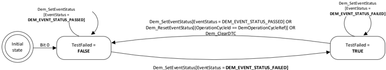

**Dem** 模块应实现 **UDS** 状态位 1 的状态位跳变。

详情参见图 7.17。

**注意：**事件状态位 1（**TestFailedThisOperationCycle**）存储在非易失性内存中。

**Dem** 模块应实现 **UDS** 状态位 2 的状态位跳变。

详情参见图 7.18。

**UDS** 状态位 2 的信息需要非易失性存储。

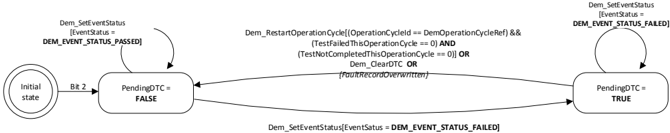

**Dem** 模块应实现 **UDS** 状态位 3 的状态位跳变。

详情参见图 7.19。

**注意：**事件状态位 3（**ConfirmedDTC**）的信息是非易失性的（但它也可以基于相应的事件内存条目计算得出）。

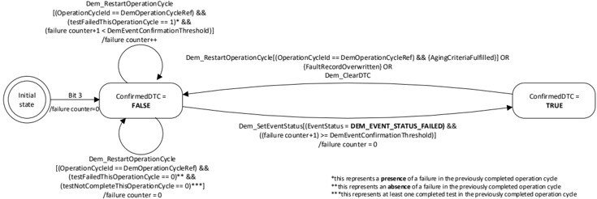

当 DemOBDDelayedDCYConfirmedAndMIL 设置为 false 时，该图适用。若 DemOBDDelayedDCYConfirmedAndMIL 设置为 true，confirmed 位向 1 的跳变还进一步取决于运行周期的鉴定状态（参见第 6.6 节）。

**注意：**"AgingCriteriaFulfilled" 条件在第 6.7.8 节中规定。"FaultRecordOverwritten" 条件在第 6.7.2.4 节中规定。

参数 DemEventConfirmationThreshold 控制自故障首次发生起、置位 confirmedDTC 位所在的运行周期。故障发生时 confirmedDTC 位总会被置为 1，但完成置位的运行周期取决于用例。

该值与 **OEM** 及法规对 confirmedDTC 位从 0 到 1 的置位要求相关。下表 7.1 给出了最常见的用例及所需取值：

表7.1：解决典型需求的 DemEventConfirmationThreshold 常用值（**Common values for DemEventConfirmationThreshold to solve typical requirements**）

| DemEventConfirmationThreshold | 用例 |
| --- | --- |
| 1 | confirmedDTC 位在 testFailed 位首次从 0 变为 1 时即从 0 置为 1。该行为也称为"立即确认"（**immediate confirmation**）或"零行程"（**zero trip**）。此设置主要用于非 OBD 的 **UDS DTC**。 |
| 2 | confirmedDTC 位在故障首次被报告后的下一个运行周期内从 0 置为 1。此设置用于满足美国的法规性 **OBD** 要求。 |
| 3 | confirmedDTC 位在故障首次被报告后的第二个运行周期内从 0 置为 1。此设置用于满足欧洲的法规性 **OBD** 要求。 |

除表 7.1 所列值之外，DemEventConfirmationThreshold 的其他 **OEM** 特定取值也是可能的。

参数 DemEventConfirmationThreshold 是 AUTOSAR **Dem** 特有的阈值，它比 ISO 142291:2020 图 D.4 中使用的"行程计数器"（**trip counter**）大 1。

**Dem** 模块应实现 **UDS** 状态位 4 的状态位跳变。

详情参见图 7.20。

**注意：**事件状态位 4（**TestNotCompletedSinceLastClear**）的信息是非易失性的。

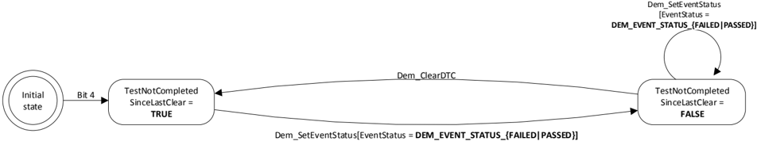

**Dem** 模块应实现 **UDS** 状态位 5 的状态位跳变。

详情参见图 7.21。

**注意：*****UDS*** 状态位 5（**TestFailedSinceLastClear**）的信息是非易失性的。

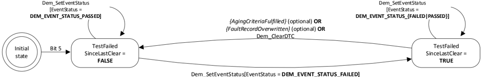

**注意：**"AgingCriteriaFulfilled" 条件（第 6.7.8 节规定）和"FaultRecordOverwritten" 条件（第 6.7.2.4 节规定）的相关性取决于配置参数 DemStatusBitHandlingTestFailedSinceLastClear（参见 DemGeneral）。

**Dem** 模块应实现 **UDS** 状态位 6 的状态位跳变。

详情参见图 7.22。

**注意：**事件状态位 6（**TestNotCompleteThisOperationCycle**）存储在非易失性内存中。

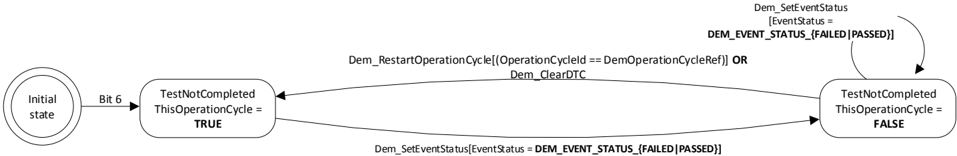

**Dem** 模块应实现 **UDS** 状态位 7（**WarningIndicatorRequested**）的状态位跳变。

详情参见图 7.23。

**注意：***UDS*** 状态位 7（**WarningIndicatorRequested**）的信息可以是易失性的（因为它基于所分配警告指示器的状态计算得出）。

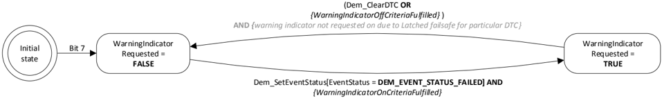

**注意：**"WarningIndicatorOffCriteriaFulfilled" 和 "WarningIndicatorOnCriteriaFulfilled" 条件在第 6.7.9 节中规定。

**注意：**ISO 14229-1 另外规定了"因特定 DTC 的失效安全闭锁而不请求点亮警告指示器"这一条件。这必须由监视器来保证。

##### 6.7.1.4. 有效/被动状态

如果一个事件被鉴定为失败（**failed**），它变为有效（**active**）。如果事件被鉴定为通过（**passed**），它变为被动（**passive**）。该状态可以从事件状态字节推导得出。

由于 **UDS** 状态位 0 的持久存储能力是可配置的（参见配置参数 DemStatusBitStorageTestFailed），有效/被动的含义也受到影响：

- 如果 **TestFailed** 位以非易失性方式存储，"事件有效"等同于 **TestFailed** = 1，"事件被动"等同于 **TestFailed** = 0。
- 如果 **TestFailed** 位仅以易失性方式存储，则还需要本电源周期内事件是否已被测试/报告的附加信息。只要该信息不存在，有效/被动状态就是未定义的。

**注意：**也存在所有监视器都在启动阶段运行的 **ECU**。在这种情况下，将有效/被动状态直接映射到 **TestFailed** 位也是足够的。

##### 6.7.1.5. 状态位变化的通知

**Dem** 模块可以将事件或 **DTC** 的状态变化通知给监视器和/或其他组件。

**注意：**对于异步事件处理，**Dem** 模块将在每次事件/**DTC** 鉴定时触发相应的通知函数两次。

**Dem** 模块应在每次 **UDS** 状态变化时触发事件特定的回调函数 **EventUdsStatusChanged**。

**注意：*****Dem*** 模块不评估该回调函数的返回值（例如非 E_OK 的情况）。

**注意：**配置容器 DemCallbackEventUdsStatusChanged（位于 DemEventParameter 中）用于为每个事件指定一个或多个端口/C 回调。

**注意：**用于 **FiM** 的相应回调函数在第 6.10 节中规定。

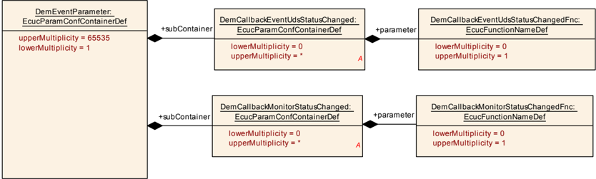

**Dem** 模块应在每次 **DemDTC** 状态变化时触发在 DemCallbackDTCStatusChanged 中配置的回调函数。

**Dem** 模块应在每次 **DemObdDTC** 状态变化时，针对 2 字节或 3 字节 **OBD DTC** 触发在 DemCallbackOBDDTCStatusChanged 中配置的回调函数。

**Dem** 模块应在每次 **J1939 DTC** 状态变化时触发在 DemCallbackJ1939DTCStatusChanged 中配置的回调函数。

**注意：*****Dem*** 模块不评估该回调函数的返回值（例如非 E_OK 的情况）。

**注意：**只有在**事件组合**（参见第 6.7.5 节）的情况下，EventUdsStatusChanged 的结果才可能与 DTCStatusChanged 的结果不同。

**注意：**配置容器 DemCallbackDTCStatusChanged、DemCallbackOBDDTCStatusChanged 和 DemCallbackJ1939DTCStatusChanged 用于为 **Dem** 模块全局指定一个或多个端口/C 回调。

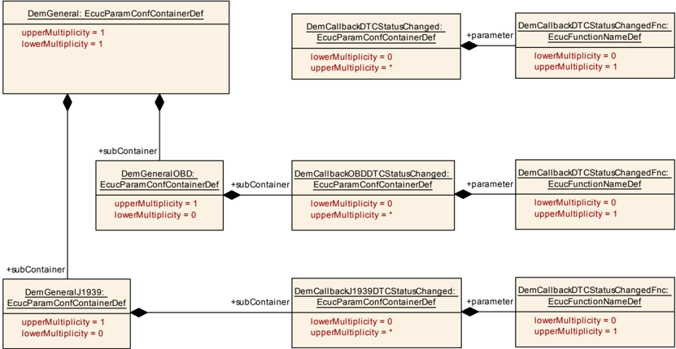

#### 6.7.2. 事件内存管理

事件内存管理定义为在 **Dem** 模块中添加、更新和移除事件内存条目的过程。**Dem** 模块判断事件内存条目是新的，还是当前已存在于事件内存中。

**注意：**本节的需求不规定软件实现，而是描述 **ECU** 面对测试工具请求时的行为。

**Dem** 模块应支持配置参数 DemMemoryDestinationRef，为单个 **DTC** 定义目标内存。

在使用 **Dem** 接口时，**DemDTCOriginType** 通过评估可能的 DemMemoryDestinationRef 来选择目标内存。

用户自定义内存应具有与主内存相同的行为（事件保留、事件优先级、老化、置换）。

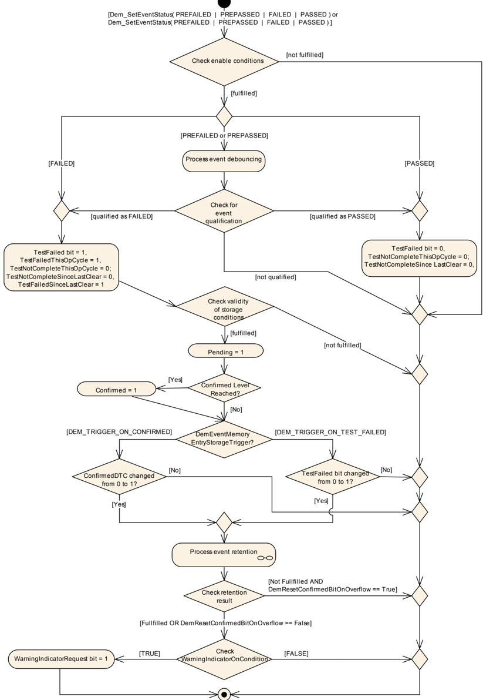

##### 6.7.2.1. 事件保留

事件保留（**Event retention**）定义 **Dem** 模块记录和处理事件（**DTC**）、**UDS** 状态信息和事件相关数据（例如冻结帧、扩展数据）的能力。

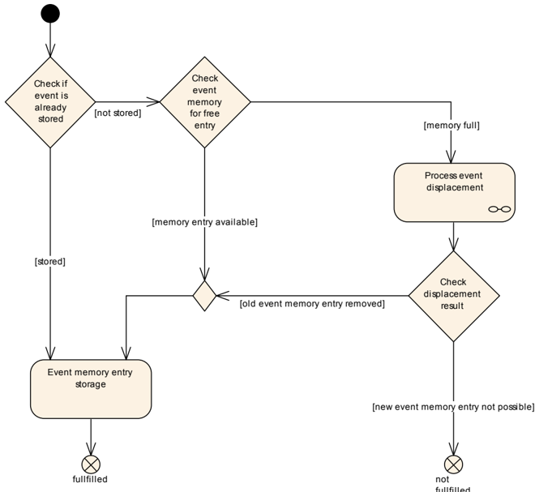

市场上存在多种关于何时分配事件内存条目的策略。因此，**Dem** 模块具有配置分配事件内存条目的主触发器（**primary trigger**）的能力。除主触发器之外，还可能存在次级触发器（参见 DemFreezeFrameRecordTrigger），主要用于更新事件内存条目的内容（例如获得最新的冻结帧更新）。

如果满足以下条件，**Dem** 模块应尝试在其配置的事件内存中分配一个事件内存条目（参见 DemMemoryDestinationRef）：

1. 事件被鉴定为失败（**UDS** 状态位 0 从 0 变为 1），且
2. 配置参数 DemEventMemoryEntryStorageTrigger 设置为 `DEM_TRIGGER_ON_TEST_FAILED` 或 `DEM_TRIGGER_ON_FDC_THRESHOLD`（参见 DemPrimaryMemory 或 DemUserDefinedMemory），且
3. 不存在事件内存条目。

详情参见图 7.27。

如果满足以下条件，**Dem** 模块应尝试在其配置的事件内存中分配一个事件内存条目（参见 DemMemoryDestinationRef）：

1. 事件进入 pending（**UDS** 状态位 2 从 0 变为 1），且
2. 配置参数 DemEventMemoryEntryStorageTrigger 设置为 `DEM_TRIGGER_ON_TEST_FAILED` 或 `DEM_TRIGGER_ON_FDC_THRESHOLD`（参见 DemPrimaryMemory 或 DemUserDefinedMemory），且
3. 不存在事件内存条目。

详情参见图 7.27。

如果满足以下条件，**Dem** 模块应尝试在其配置的事件内存中分配一个事件内存条目（参见 DemMemoryDestinationRef）：

1. 事件处于 pending（**UDS** 状态位 2 置为 1）且被重新鉴定为失败（**UDS** 状态位 0 从 0 变为 1），且
2. 配置参数 DemEventMemoryEntryStorageTrigger 设置为 `DEM_TRIGGER_ON_TEST_FAILED` 或 `DEM_TRIGGER_ON_FDC_THRESHOLD`（参见 DemPrimaryMemory 或 DemUserDefinedMemory），且
3. 不存在事件内存条目。

详情参见图 7.27。

如果满足以下条件，**Dem** 模块应尝试在其配置的事件内存中分配一个事件内存条目（参见 DemMemoryDestinationRef）：

1. 事件被确认（**UDS** 状态位 3 从 0 变为 1），且
2. 配置参数 DemEventMemoryEntryStorageTrigger 设置为 `DEM_TRIGGER_ON_CONFIRMED` 或 `DEM_TRIGGER_ON_TEST_FAILED` 或 `DEM_TRIGGER_ON_FDC_THRESHOLD`（参见 DemPrimaryMemory 或 DemUserDefinedMemory），且
3. 不存在事件内存条目。

详情参见图 7.27。

如果满足以下条件，**Dem** 模块应尝试在其配置的事件内存中分配一个事件内存条目（参见 DemMemoryDestinationRef）：

1. 事件被确认（**UDS** 状态位 3 置为 1）且被重新鉴定为失败（**UDS** 状态位 0 从 0 变为 1），且
2. 配置参数 DemEventMemoryEntryStorageTrigger 设置为 `DEM_TRIGGER_ON_CONFIRMED` 或 `DEM_TRIGGER_ON_TEST_FAILED` 或 `DEM_TRIGGER_ON_FDC_THRESHOLD`（参见 DemPrimaryMemory 或 DemUserDefinedMemory），且
3. 不存在事件内存条目，且
4. DemResetConfirmedBitOnOverflow 设置为 false。

详情参见图 7.27。

如果满足以下条件，**Dem** 模块应尝试在其配置的事件内存中分配一个事件内存条目（参见 DemMemoryDestinationRef）：

1. 事件使用 **Dem** 内部去抖动（基于计数器或基于时间），且
2. **Dem** 内部去抖动计数器被递增并达到 DemCounterBasedFdcThresholdStorageValue 或 DemTimeBasedFdcThresholdStorageValue，且
3. 配置参数 DemEventMemoryEntryStorageTrigger 设置为 `DEM_TRIGGER_ON_FDC_THRESHOLD`（参见 DemPrimaryMemory 或 DemUserDefinedMemory），且
4. 不存在事件内存条目。

详情参见图 7.27。

**注意：**在事件内存条目已存在的情况下，可能存在更新事件内存条目内容的其他触发器（参见第 6.7.7 节"事件相关数据"）。

**DemTimeBasedFdcThresholdStorageValue 的依赖关系**：仅当 DemFreezeFrameRecordTrigger 设置为 `DEM_TRIGGER_ON_FDC_THRESHOLD`，或 DemExtendedDataRecordTrigger 设置为 `DEM_TRIGGER_ON_FDC_THRESHOLD`，或 DemEventMemoryEntryStorageTrigger 设置为 `DEM_TRIGGER_ON_FDC_THRESHOLD`（参见 DemPrimaryMemory 或 DemUserDefinedMemory）时，才应存在 DemTimeBasedFdcThresholdStorageValue。

##### 6.7.2.2. 清除事件内存条目

**Dem** 模块的事件内存条目可以通过各种诊断服务按 **DTC** 清除（例如服务 0x14 ClearDiagnosticInformation 或服务 $04 Clear/Reset emission-related diagnostic information）。因此，**Dem** 为不同的使用者提供独立的 API：

- Dem_ClearDTC
- Dem_J1939DcmClearDTC（用于向 **J1939Dcm** [7] 提供 J1939 清除，参见第 6.10.2 节）。

如果 **Dem** 模块被请求清除诊断信息，且所选 **DTC** 设置为 DTC 组"all DTCs"，所选 **DTCOrigin** 设置为 `DEM_DTC_ORIGIN_PRIMARY_MEMORY` 或 `DEM_DTC_ORIGIN_USERDEFINED_MEMORY_<NAME>`，则 **Dem** 应复位所有事件和 **DTC** 状态字节，并清除分配给所请求 **DTCOrigin** 的事件相关数据。

仅当清除操作所选的 **DTCOrigin** 是主内存或用户自定义事件内存时，**Dem** 才应调用回调 DemClearEventAllowed。

清除过程可以由不同的客户端启动。只要这些接口之一启动了清除过程，**Dem** 内部的清除机制即被锁定，直到清除请求完成且结果返回给请求者。

如果 DemClearDtcNotificationTime 配置为 START，**Dem** 应将清除 **DTC** 操作的开始通知应用。如果配置了 DemClearDtcNotificationFnc，**Dem** 应调用该配置的函数，否则应调用 R-Port **ClearDtcNotification**。

如果 DemClearDtcNotificationTime 配置为 FINISH，**Dem** 应将清除 **DTC** 操作的结束通知应用。**Dem** 应考虑配置参数 DemClearDTCBehavior，它定义了诊断信息的清除过程（包括清除完成）。如果配置了 DemClearDtcNotificationFnc，**Dem** 应调用该配置的函数，否则应调用 R-Port **ClearDtcNotification**。

如果多个客户端并行请求 Dem_ClearDTC，**Dem** 应在内部处理这些不同的请求。

如果清除 **DTC** 过程已由一个客户端启动且仍在进行中，此时另一个客户端调用 Dem_ClearDTC，**Dem** 应返回 `DEM_PENDING`。

如果配置参数 DemClearDTCLimitation 设置为 `DEM_ONLY_CLEAR_ALL_DTCS`，而调用 API Dem_ClearDTC 时选择了不同于 `DEM_DTC_GROUP_ALL_DTCS` 的 **DTC** 组，则 **Dem** 应返回 `DEM_WRONG_DTC`。

如果 **Dem** 模块被请求清除诊断信息，且配置参数 DemClearDTCBehavior 设置为 `DEM_CLRRESP_VOLATILE`，则 **Dem** 模块应在易失性内存清除完成后返回 E_OK。

如果 **Dem** 模块被请求清除诊断信息，且配置参数 DemClearDTCBehavior 设置为 `DEM_CLRRESP_NONVOLATILE_TRIGGER`，则 **Dem** 模块应在易失性内存清除完成且非易失性内存的清除被触发后返回 E_OK。

如果 **Dem** 模块被请求清除诊断信息，且配置参数 DemClearDTCBehavior 设置为 `DEM_CLRRESP_NONVOLATILE_FINISH`，则 **Dem** 模块应在易失性内存和非易失性内存均清除完成后返回 E_OK。

**注意：***Dem*** 实现负责持久数据的一致性。（参见 SWS_NvM_00698：在 **NvM** 处理作业期间，传递给 NvM_WriteBlock 的 RAM 缓冲区内容不得更改。）如何保证数据一致性（**UDS** 状态字节、冻结帧数据及所有其他相关信息）是实现特定的（取决于所实现的 **NvM** 策略）。可选方案包括但不限于：附加的 RAM 镜像，以及在 RAM 区域可再次修改之前将变更排队。

**注意：**如果 **Dcm** 模块收到 API Dem_ClearDTC 的返回类型 `DEM_CLEAR_OK`，**Dcm** 模块发送肯定响应（参见 [9]）。

如果 **Dem** 模块被请求清除诊断信息，配置参数 DemClearDTCBehavior 设置为 `DEM_CLRRESP_NONVOLATILE_FINISH`，且非易失性内存的清除失败，则 **Dem** 模块应返回 `DEM_CLEAR_MEMORY_ERROR`。

**清除 DTC 操作失败的定义**：如果 **Dem** 模块被请求清除诊断信息，**Dem** 应返回 `DEM_CLEAR_FAILED`：

- 在清除单个 **DTC** 的情况下，如果分配给该 **DTC** 事件的至少一个 DemClearEventAllowed 回调返回 FALSE。
- 在清除 **DTC** 组或所有 **DTC** 的情况下，各个 **DTC** 应按"清除单个 DTC"所述的方式清除。如果所有单个 **DTC** 的清除均返回 `DEM_CLEAR_FAILED`，则结果返回值应为 `DEM_CLEAR_FAILED`。

如果 DemTriggerMonitorInitBeforeClearOk 设置为 TRUE，则在事件初始化被触发（调用回调函数 InitMonitorForEvent）之前，Dem_ClearDTC 不应返回 E_OK。如果 DemTriggerMonitorInitBeforeClearOk 设置为 FALSE，`DEM_CLEAR_OK` 不考虑事件初始化（InitMonitorForEvent）。

该功能适用于某些特殊事件，它们在特定状态下绝不能从事件内存中清除，例如 **ECU** 的特殊运行模式（如装配模式、运输模式或刷写模式）或 **Dcm** 会话（可通过 API Dcm_GetSesCtrType 确定）。

是否应通过该回调函数向 **SW-C** / **BSW** 模块询问事件删除许可，可按事件配置（参见 DemCallbackClearEventAllowed）。每个事件可分配一个回调（代表一个特定条件）。如果多个条件同时适用，它们需要被单独汇总到一个回调中。

**Dem** 模块应在清除每个事件之前，为其已配置的每个事件调用回调 DemClearEventAllowed。

如果 **DTC** 未配置为使用**事件组合**，且回调 DemClearEventAllowed 的出参 **Allowed** 返回 'false' 且返回值等于 E_OK，则 **Dem** 不应清除相应的事件内存条目和 **Dem** 内部数据值。

如果 **DTC** 配置为使用**事件组合**，且只有一个 DemClearEventAllowed 回调的出参 **Allowed** 设置为 FALSE 并返回 E_OK，则 **Dem** 不应清除事件状态、相应的事件内存条目和 **Dem** 内部数据值。

如果回调 DemClearEventAllowed 的出参 **Allowed** 返回 'false' 且配置参数 DemClearEventAllowedBehavior 设置为 `DEM_NO_STATUS_BYTE_CHANGE`，则相关 **UDS** 状态字节不应被修改。

如果回调 DemClearEventAllowed 的出参 **Allowed** 返回 'false' 且配置参数 DemClearEventAllowedBehavior 设置为 `DEM_ONLY_THIS_CYCLE_AND_READINESS`，则相关 **UDS** 状态位 1（**TestFailedThisOperationCycle**）、4（**TestNotCompletedSinceLastClear**）、5（**TestFailedSinceLastClear**）和 6（**TestNotCompletedThisOperationCycle**）应被复位。

如果一个事件按照第 6.7.2.2 节被部分清除，则相关联的功能应按该事件完全未被清除来处理。这意味着回调函数 InitMonitorForEvent 不会被调用，且 **FDC** 在此情况下保持不变。

如果回调 DemClearEventAllowed 的返回值等于 E_NOT_OK，则该返回值不应被改变，且允许删除事件。

**Dem** 支持未分配给任何事件内存的事件。这种情况出现在可选参数 DemDTCRef 未在 DemEventParameter 中配置时。事件在其被分配的事件内存被清除时被清除。若不存在已分配的事件内存，这些事件将永远不会被清除。针对这种情况，**Dem** 提供配置参数 DemClearEventsWithoutDTCEventMemoryRef。

如果 DemClearEventsWithoutDTCEventMemoryRef 所引用的事件内存通过任何 Dem_ClearDTC API 被清除，**Dem** 还应清除所有未分配给任何事件内存的事件。

**注意：**事件置换（主要由事件优先级控制）和老化不受该回调影响。

##### 6.7.2.3. 事件内存溢出指示

对于每个事件内存，如果该事件内存已满且发生了在其中存储额外事件的尝试，**Dem** 模块应给出指示。

该溢出指示可用于触发 **Dem** 模块的其他内部行为（例如置换策略）。此外，它还可用于维修站的额外故障分析。

**Dem** 模块应提供 API Dem_GetEventMemoryOverflow，用于访问相应事件内存的事件内存溢出指示状态。

**注意：**该 API 可用于供应商特定的诊断服务或其他供应商特定的处理，并提供给 **SW-C** 以及复杂设备驱动。

**Dem** 模块应提供 API Dem_GetNumberOfEventMemoryEntries，返回当前存储在事件内存中的事件内存条目数量。

**注意：**对于所报告的数量，所有事件都被考虑，与故障确认无关。

如果该内存的所有 **DTC** 都通过 Dem_ClearDTC 删除，则相应事件内存的事件内存溢出指示应被复位。

**注意：**在老化和删除单个 **DTC** 的情况下，事件内存的溢出指示不会复位，以将该状态信息保留到 **ECU** 收到针对该特定事件内存的显式清除命令为止。**ECU** 自身在正常运行期间不应改变该状态信息（因为它在维修站使用）。

##### 6.7.2.4. 事件置换

事件置换（**Event displacement**）是指用需要存储的新事件内存条目替换最不重要的、已存在的事件内存条目。置换期间，最不重要的条目会丢失。

如果事件保留试图分配一个新的事件内存条目但没有空闲的事件内存条目可用，**Dem** 模块应按照第 6.7.2.4 节检查已分配的事件内存条目，确定可被新事件内存条目置换的条目。

**注意：**如果事件内存大小配置为覆盖所有可能的事件，则不会发生置换。

**Dem** 模块提供配置参数 DemEventDisplacementStrategy（参见 DemPrimaryMemory 或 DemUserDefinedMemory），定义现有事件内存条目是否可以被置换。

如果事件置换被禁用（DemPrimaryMemory 或 DemUserDefinedMemory 中的 DemEventDisplacementStrategy 选择 `DEM_DISPLACEMENT_NONE`），则当事件内存已满时，**Dem** 模块不应置换现有的事件内存条目。

如果事件置换被启用（DemPrimaryMemory 或 DemUserDefinedMemory 中的 DemEventDisplacementStrategy 选择 `DEM_DISPLACEMENT_FULL` 或 `DEM_DISPLACEMENT_PRIO_OCC`），**Dem** 模块应按以下不同置换标准的组合执行以下序列：

1. 优先级（参见第 6.3.1 节）
2. 有效/被动状态（可配置，仅适用于 DemPrimaryMemory 或 DemUserDefinedMemory 中的 `DEM_DISPLACEMENT_FULL`）（参见第 6.7.1.4 节）
3. 发生次数（**Occurrence**）

**注意：**优先级需要满足：燃油系统/失火高于其余项（US/EU5），Class A 先于 B1、B2、C（Euro VI）。

如果置换策略为 `DEM_DISPLACEMENT_FULL` 或 `DEM_DISPLACEMENT_PRIO_OCC`（参见 DemPrimaryMemory 或 DemUserDefinedMemory），**Dem** 模块应以高优先级事件置换低优先级事件。

如果置换策略为 `DEM_DISPLACEMENT_FULL`（参见 DemPrimaryMemory 或 DemUserDefinedMemory），**Dem** 模块应优先置换被动事件。

详情参见第 6.7.1.4 节。

如果置换策略为 `DEM_DISPLACEMENT_FULL` 或 `DEM_DISPLACEMENT_PRIO_OCC`（参见 DemPrimaryMemory 或 DemUserDefinedMemory），**Dem** 模块应按时间顺序优先置换较早存储的事件，而非较晚存储的事件。

如果未找到可置换的事件内存条目，**Dem** 模块应放弃该存储请求。

如果报告了一个事件，且存在相同优先级的事件内存条目、且现有事件在当前运行周期未被测试（**TestNotCompletedThisOperationCycle** 位 == 1），则 **Dem** 应用报告的事件置换现有事件。

在置换期间，如果报告了一个事件、存在相同优先级的事件内存条目、且现有事件在当前运行周期已被测试（**TestNotCompletedThisOperationCycle** 位 == 0），则 **Dem** 不应用报告的事件置换现有事件。

如果配置参数 DemOBDEventDisplacement 设置为 TRUE，则满足以下条件的所有排放相关事件在置换机制期间不予考虑，且不得从故障内存中被置换：
事件 old 为排放相关
且
（事件 old 触发 **MIL** 指示器
或（事件 old 持有法规要求的冻结帧且具有相同或更高优先级）
或 事件 old 的 Pending-DTC == 1）

如果配置参数 DemOBDEventDisplacement 设置为 FALSE，则不对排放相关事件应用任何特殊置换规则。在这种情况下，排放相关事件与其他事件一样被置换。

如果找到了用于置换的事件内存条目，**Dem** 模块应将该事件内存条目从事件内存中移除。

**注意：**被移除的事件内存条目应随后用于待处理的存储触发。

**置换时 confirmedDTC 位的可配置复位**：如果一个事件内存条目在置换期间被移除，且配置参数 DemResetConfirmedBitOnOverflow 设置为 TRUE，**Dem** 模块应将 **UDS DTC** 状态位 3 复位为 0。

**置换时 pendingDTC 位的可配置复位**：如果一个事件内存条目在置换期间被移除，且配置参数 DemResetPendingBitOnOverflow 设置为 TRUE，**Dem** 模块应将 **UDS DTC** 状态位 2 复位为 0。

如果一个事件内存条目在置换期间被移除，且 DemStatusBitHandlingTestFailedSinceLastClear 设置为 `DEM_STATUS_BIT_AGING_AND_DISPLACEMENT` 且 DemResetConfirmedBitOnOverflow 设置为 true，则 **UDS** 状态位 5 应被复位为 0。

##### 6.7.2.5. 事件内存条目的报告顺序

如果满足以下条件，**Dem** 模块应按事件存储的时间顺序报告 **DTC**（参见 API Dem_GetNextFilteredDTC）：

- **DTCStatus** 参数设置了 'pending DTC' 或 'confirmed DTC' 位或同时设置了两者
- **DTCStatus** 参数的所有其他位均设置为 false
- DemResetConfirmedBitOnOverflow 设置为 true

**注意：**时间顺序仅用于报告目的，并不意味着显式的内存结构——那是实现特定的。

**注意：**在未确认或 pending 的情况下，报告顺序可能因客户特定属性（算法用于对 **DTC** 记录排序）而变化。如果进一步的 **UDS** 状态掩码参数需要时间顺序，可能需要额外的资源。

如果一个"已存储事件"被重新鉴定为失败（**UDS** 状态位 0 从 0 变为 1）且存在相应的事件内存条目，**Dem** 模块应通过将该事件设置为最新的事件内存条目来更新事件存储的时间顺序。

如果 **Dem** 模块被请求按时间顺序报告，则最新的事件内存条目应最先被报告。

如果一个新事件被存储到事件内存中，**Dem** 应通过将该新事件设置为最新的事件内存条目来更新时间顺序。

**注意：**如果在同一时间点存储了多个事件内存条目，这些条目的时间报告顺序是未定义的。哪个条目先被报告或置换取决于实现。

#### 6.7.3. 诊断事件的去抖动

一般而言，**ECU** 可以实现多种类型的去抖动以改善信号质量。本节描述 **Dem** 模块应如何实现用于故障成熟（诊断事件去抖动）的基本算法。

如果 **Dem** 模块被配置为对特定事件实现去抖动算法，则应在 **Dem** 内部执行以下去抖动算法之一。否则，由 **SW-C** 或 **BSW** 中实现的相应监视器在诊断事件去抖动完成后报告特定事件的状态。关于 **Dem** 与 **SW-C** 或 **BSW** 的交互，请参见 API InitMonitorForEvent（参见第 6.2 节）。

如果要求在一定时间内获得通过或失败状态，则由诊断监视器负责。

**Dem** 模块应通过使用配置容器 DemDebounceAlgorithmClass 来支持去抖动算法的事件特定配置。

**注意：**这意味着可以为每个单独的事件指定特定的算法。

##### 6.7.3.1. 基于计数器的去抖动算法

**Dem** 模块应提供配置参数 DemDebounceCounterBasedSupport（参见 DemGeneral），用于启用或禁用 **Dem** 内部基于计数器的去抖动。

如果配置容器 DemDebounceAlgorithmClass 设置为 DemDebounceCounterBased，**Dem** 模块应为每个单独的事件提供一个内部去抖动计数器，用于鉴定所报告的事件。

对于较大的去抖动范围，内部去抖动计数器的最大范围定义为 **sint16**。这并不意味着任何显式的实现。

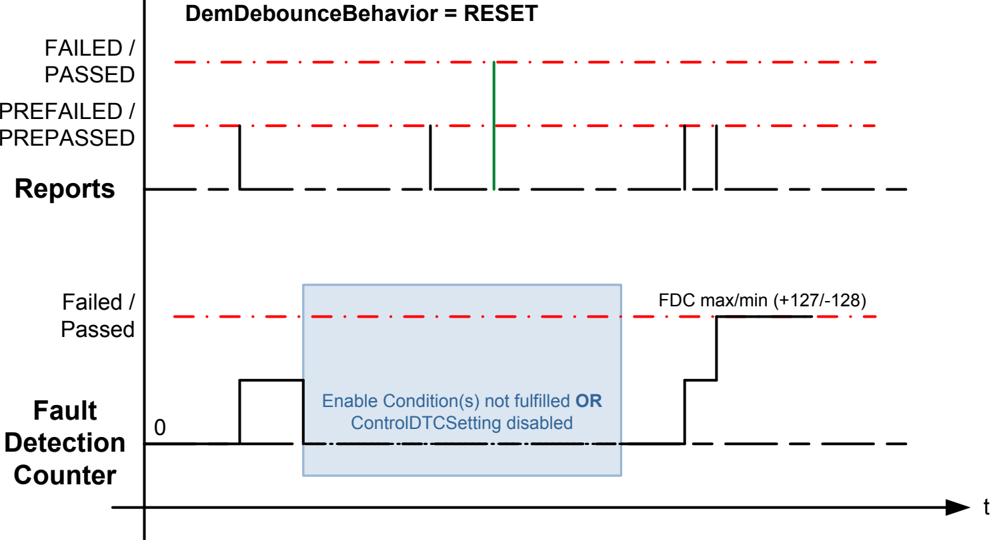

**Dem** 模块应基于内部去抖动计数器的值和范围计算故障检测计数器（按 **UDS** 为 -128 … +127），将内部计数器的值线性映射到外部值。

**Dem** 模块应提供配置参数 DemDebounceCounterFailedThreshold，用于定义指示失败状态（有效）的事件特定极限。

**Dem** 模块应提供配置参数 DemDebounceCounterPassedThreshold，用于定义指示通过状态（被动）的事件特定极限。

当监视器报告 `DEM_EVENT_STATUS_PREFAILED` 时，**Dem** 模块应按配置的步长（参见 DemDebounceCounterIncrementStepSize）递增内部去抖动计数器。如果递增后去抖动计数器的值大于阈值 DemDebounceCounterFailedThreshold，**Dem** 应将去抖动计数器的值设置为等于该阈值。

当监视器报告 `DEM_EVENT_STATUS_PREPASSED` 时，**Dem** 模块应按配置的步长（参见 DemDebounceCounterDecrementStepSize）递减内部去抖动计数器。如果递减后去抖动计数器的值低于阈值 DemDebounceCounterPassedThreshold，**Dem** 应将去抖动计数器的值设置为等于该阈值。

如果监视器报告 `DEM_EVENT_STATUS_FAILED`，**Dem** 模块应将内部去抖动计数器的值设置为其配置的作为失败判据的阈值。

如果监视器报告 `DEM_EVENT_STATUS_PASSED`，**Dem** 模块应将内部去抖动计数器的值设置为其配置的作为通过判据的阈值。

**Dem** 模块应提供配置参数 DemDebounceCounterJumpDown，用于启用跳降（**jump-down**）行为。

如果启用了跳降行为，**Dem** 模块应提供配置参数 DemDebounceCounterJumpDownValue，定义新的内部去抖动计数器初始值。在当前去抖动计数器值大于 DemDebounceCounterJumpDownValue 时，每次报告 prepassed 值，都应先将去抖动计数器复位到 DemDebounceCounterJumpDownValue，然后再执行 pre-passed 去抖动事件。

**注意：**这只会在计数方向从递增变为递减时发生。

**Dem** 模块应提供配置参数 DemDebounceCounterJumpUp，用于启用跳升（**jump-up**）行为。

如果启用了跳升行为，**Dem** 模块应提供配置参数 DemDebounceCounterJumpUpValue，定义新的内部去抖动计数器初始值。在当前去抖动计数器值小于 DemDebounceCounterJumpUpValue 时，每次报告 prefailed 值，都应先将去抖动计数器复位到 DemDebounceCounterJumpUpValue，然后再执行 pre-failed 去抖动事件。

**注意：**这只会在计数方向从递减变为递增时发生。

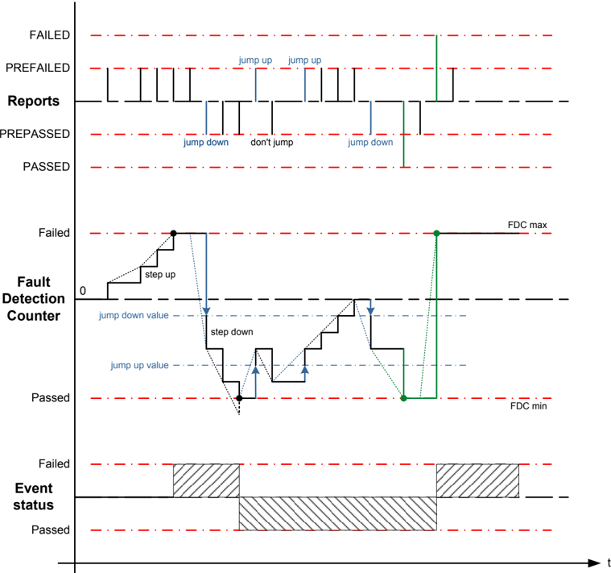

**注意：**在图 7.29 中，故障检测计数器的值线性映射到内部去抖动计数器的值。

API Dem_ResetEventDebounceStatus 的动作 `DEM_DEBOUNCE_STATUS_FREEZE` 与基于计数器的去抖动无关。Dem_ResetEventDebounceStatus 的动作 `DEM_DEBOUNCE_STATUS_RESET` 由第 6.7.3.4 节覆盖。

DemDebounceBehavior 的 `DEM_DEBOUNCE_STATUS_FREEZE` 在第 6.7.6 节中说明。DemDebounceBehavior 的 `DEM_DEBOUNCE_RESET` 由第 6.7.3.4 节覆盖。如图 7.30 所示。

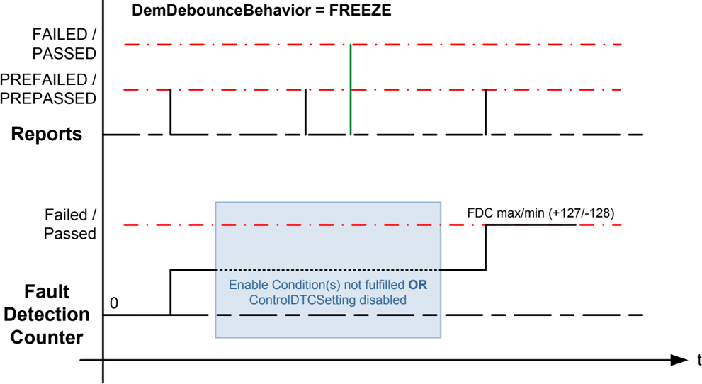

如果配置参数 DemDebounceCounterStorage 设置为 True，**Dem** 模块应将内部去抖动计数器的当前值非易失性地存储（参见第 6.11.5 节）。

**注意：**DemDebounceCounterStorage 不支持基于时间的去抖动。

如果配置参数 DemDebounceCounterStorage 设置为 True，**Dem** 模块应在每次启动时（最迟在 Dem_Init 中）恢复内部去抖动计数器的当前值。

**注意：**使用内部去抖动计数器非易失性存储的 **BSW** 事件不能在 Dem_Init 之前报告，因为该值需要先被恢复。

如果启用了开发错误检测，且对于 DemDebounceCounterStorage 设置为 True 的事件，在 Dem_Init 之前或 Dem_Shutdown 之后调用了 Dem_SetEventStatus 或 Dem_ResetEventDebounceStatus，则 **Dem** 模块应设置错误代码 `DEM_E_WRONG_CONDITION`。

**DemCounterBasedFdcThresholdStorageValue 的依赖关系**：仅当 DemFreezeFrameRecordTrigger 设置为 `DEM_TRIGGER_ON_FDC_THRESHOLD`，或 DemExtendedDataRecordTrigger 设置为 `DEM_TRIGGER_ON_FDC_THRESHOLD`，或 DemEventMemoryEntryStorageTrigger 设置为 `DEM_TRIGGER_ON_FDC_THRESHOLD` 时，才应存在配置参数 DemCounterBasedFdcThresholdStorageValue。

**DemDebounceCounterJumpDownValue 的依赖关系**：仅当 DemDebounceCounterJumpDown 设置为 TRUE 时，才应存在 DemDebounceCounterJumpDownValue。

**DemDebounceCounterJumpUpValue 的依赖关系**：仅当 DemDebounceCounterJumpUp 设置为 TRUE 时，才应存在 DemDebounceCounterJumpUpValue。

##### 6.7.3.2. 基于时间的去抖动算法

**Dem** 模块应提供配置参数 DemDebounceTimeBasedSupport（参见 DemGeneral），用于启用或禁用 **Dem** 内部基于时间的去抖动。

如果配置容器 DemDebounceAlgorithmClass 设置为 DemDebounceTimeBased，**Dem** 模块应为每个单独的事件提供一个内部去抖动计时器，用于鉴定所报告的事件。

对于较长的去抖动周期，内部去抖动计时器的最大范围定义为 **sint16**。这并不意味着任何显式的实现。

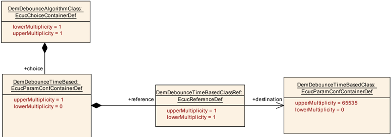

**Dem** 模块应基于内部去抖动计时器的值和范围计算故障检测计数器（按 **UDS** 为 -128 … +127），将内部计时器的值线性映射到外部值。

详情参见图 7.32。

当监视器报告 `DEM_EVENT_STATUS_PREFAILED` 时，**Dem** 模块应启动内部去抖动计时器，以将所报告的事件鉴定为失败。

如果特定事件的内部去抖动计时器已作为 pre-failed 被触发、或该事件已被鉴定为失败，而监视器又连续报告 `DEM_EVENT_STATUS_PREFAILED`，则 **Dem** 模块不应重启内部去抖动计时器。

**注意：*****Dem*** 模块提供配置参数 DemDebounceTimeFailedThreshold，用于定义指示失败状态（有效）的事件特定延迟。

如果监视器报告 `DEM_EVENT_STATUS_FAILED`，**Dem** 模块应将内部去抖动计时器的值设置为其配置的作为失败判据的阈值（参见 DemDebounceTimeFailedThreshold）。

当监视器报告 `DEM_EVENT_STATUS_PREPASSED` 时，**Dem** 模块应启动内部去抖动计时器，以将所报告的事件鉴定为通过。

如果特定事件的内部去抖动计时器已作为 pre-passed 被触发、或该事件已被鉴定为通过，而监视器又连续报告 `DEM_EVENT_STATUS_PREPASSED`，则 **Dem** 模块不应重启内部去抖动计时器。

**Dem** 模块应提供配置参数 DemDebounceTimePassedThreshold，用于定义指示通过状态（非有效）的事件特定延迟。

如果监视器报告 `DEM_EVENT_STATUS_PASSED`，**Dem** 模块应将内部去抖动计时器的值设置为其配置的作为通过判据的阈值（参见 DemDebounceTimePassedThreshold）。

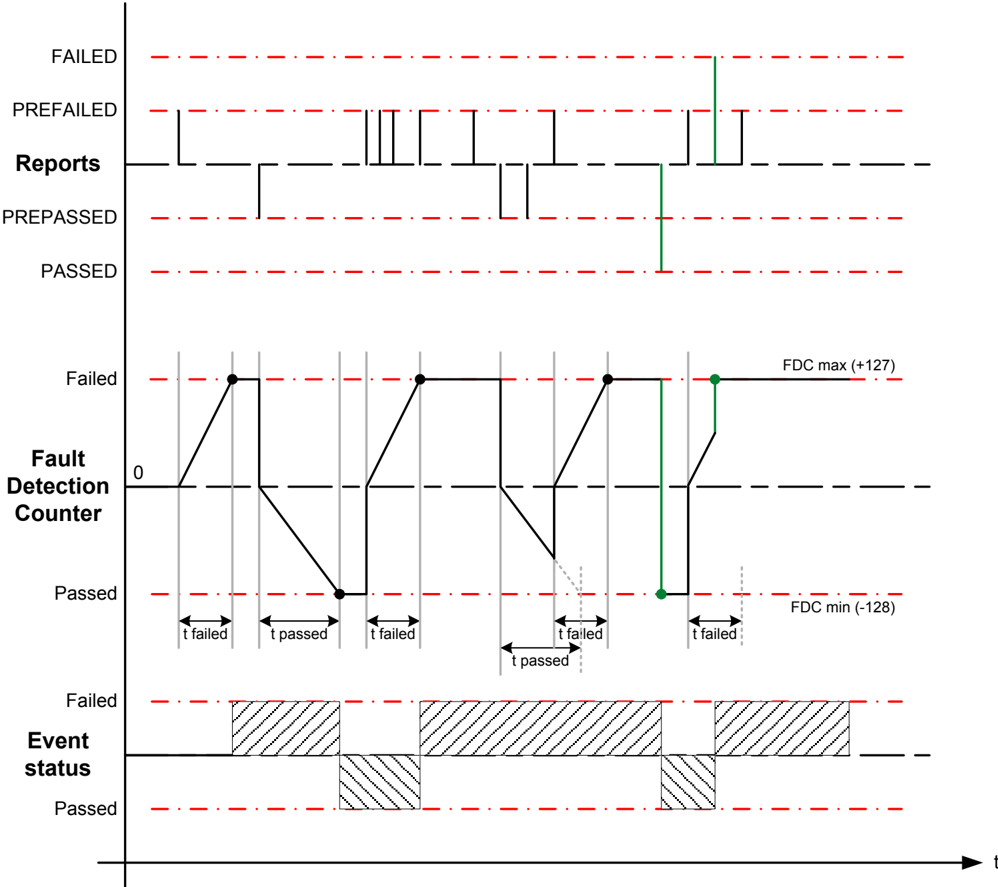

如果以 `DEM_DEBOUNCE_STATUS_FREEZE` 调用 API Dem_ResetEventDebounceStatus，则应冻结相关的内部去抖动计时器。

API Dem_ResetEventDebounceStatus 的动作 `DEM_DEBOUNCE_STATUS_RESET` 由第 6.7.3.4 节覆盖。

如果配置参数 DemDebounceBehavior 设置为 `DEM_DEBOUNCE_STATUS_FREEZE`，当相关事件的至少一个使能条件被设置为未满足时，**Dem** 模块应冻结内部去抖动计时器。

如果配置参数 DemDebounceBehavior 设置为 `DEM_DEBOUNCE_STATUS_FREEZE`，当相关事件的 ControlDTCSetting 被设置为禁用时，**Dem** 模块应冻结内部去抖动计时器。

如果一个内部去抖动计时器被冻结，且为该事件报告了新的（有效的）（去抖动）结果，**Dem** 模块应（从当前值起）继续运行内部去抖动计时器。

DemDebounceBehavior 的 `DEM_DEBOUNCE_RESET` 由第 6.7.3.4 节覆盖。

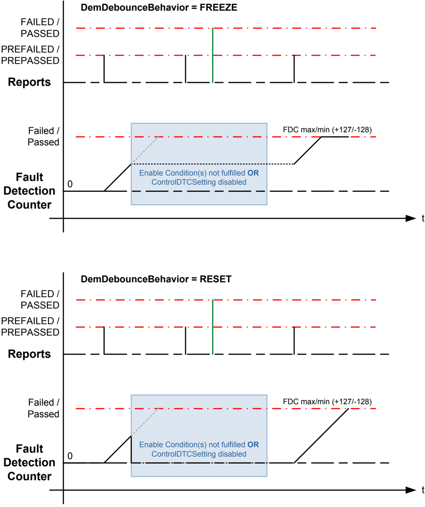

##### 6.7.3.3. 监视器内部去抖动算法

如果配置容器 DemDebounceAlgorithmClass 设置为 DemDebounceMonitorInternal，**Dem** 模块不应为每个单独的事件使用 **Dem** 内部去抖动机制来鉴定所报告的事件。

**注意：**对于监视器内部去抖动，监视器不允许报告事件状态 `DEM_EVENT_STATUS_PREFAILED` 和 `DEM_EVENT_STATUS_PREPASSED`。

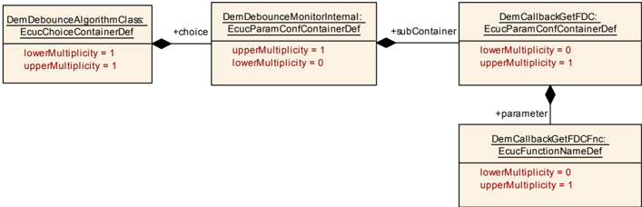

##### 6.7.3.4. 去抖动算法的初始化和复位条件

如果配置了 **Dem** 内部去抖动，**Dem** 模块应在 Dem_PreInit 被调用后复位 **Dem** 内部去抖动算法。

在收到清除事件内存的命令后，若事件去抖动由 **Dem** 内部处理，则 **Dem** 内部去抖动算法应被复位。

详情参见第 6.7.2.2 节。

如果以 `DEM_DEBOUNCE_STATUS_RESET` 调用 API Dem_ResetEventDebounceStatus，则应复位并冻结相关的故障检测计数器，直到再次报告该事件的状态。

如果配置了 **Dem** 内部去抖动，**Dem** 模块应在新的运行周期开始时复位 **Dem** 内部去抖动算法。

详情参见第 6.6 节。

**注意：**复位去抖动算法还会使故障检测计数器的值变为 0（零）。

如果配置参数 DemDebounceBehavior 设置为 `DEM_DEBOUNCE_RESET`，且函数 Dem_SetEnableCondition 将该事件的一个已配置使能条件设置为未满足，则应复位相关的故障检测计数器。

详情参见第 6.7.6 节。

如果配置参数 DemDebounceBehavior 设置为 `DEM_DEBOUNCE_RESET`，函数 Dem_DisableDTCSetting 应复位相关的故障检测计数器。

详情参见第 6.11.2.6 节。

##### 6.7.3.5. 故障检测计数器的获取

事件特定的故障检测计数器应可通过 API Dem_GetFaultDetectionCounter 访问。

故障检测计数器可以：

1. 位于 **Dem** 内部——如果配置了 **Dem** 内部去抖动（参见第 6.7.3.1 节和第 6.7.3.2 节）。
2. 位于监视器内部——如果去抖动由监视器执行（参见第 6.7.3.3 节）。

如果去抖动由 **SW-C** 执行（非 **Dem** 内部处理），**Dem** 模块应使用 DemCallbackGetFDC 容器中定义的方法，为所请求的事件获取故障检测计数器的当前值。

**注意：**配置容器 DemCallbackGetFDC（位于 DemDebounceMonitorInternal 中）用于为每个事件指定相关的端口或 C 回调。

如果使用监视器内部去抖动，且配置了容器 DemCallbackGetFDC、且配置的回调函数返回非 E_OK，则该返回值也应由 API Dem_GetFaultDetectionCounter 返回。

**注意：**为复位在监视器中实现的故障检测计数器，**Dem** 模块使用回调函数 InitMonitorForEvent（参见第 6.2 节）。

如果使用监视器内部去抖动且未为给定事件配置容器 DemCallbackGetFDC，则 API Dem_GetFaultDetectionCounter 应返回 `DEM_E_NO_FDC_AVAILABLE`。

##### 6.7.3.6. 故障检测计数器的报告

**当前运行周期内 DTC 故障检测计数器达到的最大值。**

如果当前运行周期内的最大 **FDC** 被映射到扩展数据记录（DemInternalDataElement 设置为 `DEM_MAX_FDC_DURING_CURRENT_CYCLE`），则它应可用于所有引用 **UDS DTC** 的事件。

如果第 6.7.3.6 节中的 **UDS DTC** 被多个事件引用，或为**组合 DTC**，则应使用具有最高最大 **FDC** 值的事件来报告。

当前运行周期内的最大 **FDC** 应随每次运行周期重启（参见 DemOperationCycleRef）复位为零。

如果当前故障检测计数器的值大于当前运行周期内最大 **FDC** 的当前值，则应更新当前运行周期内的最大 **FDC**。

**自上次清除 DTC 信息以来 DTC 故障检测计数器达到的最大值。**

如果自上次清除以来的最大 **FDC** 被映射到扩展数据记录（DemInternalDataElement 设置为 `DEM_MAX_FDC_SINCE_LAST_CLEAR`），则它应可用于所有引用 **UDS DTC** 的事件。

如果该 **UDS DTC** 被多个事件引用，或为**组合 DTC**，则应使用具有最高最大 **FDC** 值的事件来报告。

自上次清除以来的最大 **FDC** 应随每次影响该特定事件的清除 **DTC** 命令复位为零。

如果当前故障检测计数器的值大于自上次清除以来最大 **FDC** 的当前值，则应更新自上次清除以来的最大 **FDC**。

#### 6.7.4. 故障确认

在报告故障并进入 pending 状态之后，**Dem** 内部开始故障确认过程（参见图 7.26"通用诊断事件存储处理"）。

该故障确认过程产生已确认状态。为此，规定了相应的计数器阈值和计数器类型。

**Dem** 模块应为每个事件提供配置参数 DemEventConfirmationThreshold，定义在事件变为"已确认"（即进入已确认状态）之前"已测试且失败"周期的最大数目。

配置参数 DemOperationCycleRef（参见 DemEventParameter）应用于按照 ISO 14229-1 计算行程计数器。

详情参见图 7.19。

恢复确认过程（在第 6.7.8 节中描述）处理报告的 OK/通过结果，其结果是停用特定的警告指示器。为此，规定了相应的计数器阈值和计数器类型。

**注意：**如果事件的故障确认被禁用，其 **UDS** 状态位 3 在鉴定为失败期间被置位。

**Dem** 应支持在 Dem_PreInit 之后调用 Dem_SetEventConfirmationThresholdCounter。

调用 API Dem_SetEventConfirmationThresholdCounter 应设置新的故障确认阈值。

**注意：**新的故障确认阈值将覆盖由 DemEventConfirmationThreshold 给出的默认值。

如果调用了 Dem_SetEventConfirmationThresholdCounter，且相应事件已存储在事件内存中，且新的失败阈值小于等于当前失败计数器，则该事件将被确认。这意味着事件相关数据也将按照其定义的触发器被更新。

如果调用了 Dem_SetEventConfirmationThresholdCounter，且相应事件已存储在事件内存中且已被确认，则即使新阈值大于失败计数器，事件内存条目和确认状态也将保持。同样，在新的错误状态报告之后，确认状态仍将保持。

配置了 DemMILIndicatorRef 的 DemIndicatorAttribute，应使用 DemEventConfirmationThreshold（而非 DemIndicatorFailureCycleCounterThreshold）来计算指示器点亮判据（**WarningIndicatorOnCriteriaFulfilled**）。

##### 6.7.4.1. 用于 OBD 目的的事件关联分组方法

**Dem** 模块应为每个事件提供配置参数 DemOBDGroupingAssociativeEventsRef，用于将一个代表性事件引用到一组关联事件。

**注意：**一个事件只允许被引用到一个关联事件组。被引用的事件必须引用其自身。

对于一组事件内每次故障的报告，**Dem** 应使周期计数器向 **MIL** 点亮推进——或通过处理一个公共周期计数器，或通过统计所报告事件的相应计数器（引用"最接近 MIL 点亮"的计数值的事件）。

每个事件的恢复/老化应单独执行。

#### 6.7.5. 事件组合

**事件组合**定义 **Dem** 模块将多个事件合并为一个 **DTC** 的能力。它用于将不同的监视结果适配为一个明确的、可在维修站评估的故障。实现组合 **DTC** 的核心部分是其状态信息的计算。组合 **DTC** 的状态字节是所有关联事件按位逻辑运算的结果。

支持以下**事件组合**类型：

1. 存储时组合（**Combination on storage**）：配置参数 DemEventCombinationSupport 设置为 `DEM_EVCOMB_ONSTORAGE`。组合 **DTC** 存储并更新在一个单一的事件内存条目中。
2. 检索时组合（**Combination on retrieval**）：配置参数 DemEventCombinationSupport 设置为 `DEM_EVCOMB_ONRETRIEVAL`。每个事件存储在独立的事件内存位置。
3. 禁用：配置参数 DemEventCombinationSupport 设置为 `DEM_EVCOMB_DISABLED`，不使用事件组合。

在 DemEventCombinationSupport 设置为 `DEM_EVCOMB_ONRETRIEVAL` 或 `DEM_EVCOMB_ONSTORAGE` 的情况下，通过从每个事件引用到同一 **DTC** 来定义多个事件到一个 **DTC** 的组合。

**注意：**对于 **OBD**，也可以通过 DemObdDTCRef 多次分配相同的 **DTC** 编号。但与 **UDS** 和 **J1939 DTC** 不同的是，**OBD DTC** 会多次报告给 **Dcm**。

基于事件相关数据的配置，**Dem** 模块允许两种不同的事件组合类型（将事件相关数据分配给组合事件/**DTC** 或分配给子事件）。

**注意：**事件组合的主要用例是将多个事件（由 **EventId** 表示）映射到仅一个 **DTC** 编号。如果使用"存储时组合"，**Dem** 模块仅使用一个事件内存条目及其相关数据，服务于组合到该 **DTC** 的所有事件。如果使用"检索时组合"，每个事件存储在独立的事件内存位置，并拥有自己的一套事件相关数据。

**Dem** 模块在处理组合 **DTC** 时会考虑其相关的事件内存条目。

表 7.2 给出了一个包含组合 **DTC** 的 **Dem** 配置表示例。多个事件映射到同一 **DTC**。DTC[1] 表示存储时组合。DTC[2] 给出了检索时组合的示例。冻结帧数据为每个事件单独存储。

表7.2：包含组合 DTC 的 Dem 配置表示例（**Example of a Dem configuration table including combined DTCs**）

| 唯一 EventId | 监视器状态 | UDS 状态 | 分配的 DTC | 冻结帧 |
| --- | --- | --- | --- | --- |
| Event[1] | S1 | S1\|S2\|S3 | DTC[1] | FF[28] |
| Event[2] | S2 | S1\|S2\|S3 | DTC[1] | FF[28] |
| Event[3] | S3 | S1\|S2\|S3 | DTC[1] | FF[28] |
| Event[4] | S4 | S4\|S5\|S6 | DTC[2] | FF[74] |
| Event[5] | S5 | S4\|S5\|S6 | DTC[2] | FF[77] |
| Event[6] | S6 | S4\|S5\|S6 | DTC[2] | FF[75] |
| Event[7] | S7 | S7 | DTC[3] | FF[89] |
| Event[8] | S8 | S8 | DTC[4] | FF[67] |
| … | … | … | … | … |

**Dem** 模块应按照表 7.3 实现 **UDS** 状态字节的状态位计算。

表7.3：UDS 状态字节的计算（**Calculation of UDS status byte**）

| UDS 状态位 | UDS 状态位说明 | 组合 UDS 状态信息的逻辑等式（第 1 部分） | 组合 UDS 状态信息的逻辑等式（第 2 部分） | 组合 UDS 状态信息的逻辑等式（第 3 部分） |
| --- | --- | --- | --- | --- |
| 0 | TestFailed | CbDTC Bit 0 = Event[1] Bit 0 | Event[2] Bit 0 \| … | \|Event[n] Bit 0 |
| 1 | TestFailedThisOperationCycle | CbDTC Bit 1 = Event[1] Bit 1 | Event[2] Bit 1 \| … | \|Event[n] Bit 1 |
| 2 | PendingDTC | CbDTC Bit 2 = Event[1] Bit 2 | Event[2] Bit 2 \| … | \|Event[n] Bit 2 |
| 3 | ConfirmedDTC | CbDTC Bit 3 = Event[1] Bit 3 | Event[2] Bit 3 \| … | \|Event[n] Bit 3 |
| 4 | TestNotCompletedSinceLastClear | CbDTC Bit 4 = ( Event[1] Bit 4 | Event[2] Bit 4 \| … | \|Event[n] Bit 4 ) & ! CbDTC Bit 5 |
| 5 | TestFailedSinceLastClear | CbDTC Bit 5 = Event[1] Bit 5 | Event[2] Bit 5 \| … | \|Event[n] Bit 5 |
| 6 | TestNotCompletedThisOperationCycle | CbDTC Bit 6 = ( Event[1] Bit 6 | Event[2] Bit 6 \| … | \|Event[n] Bit 6 ) & ! CbDTC Bit 1 |
| 7 | WarningIndicatorRequested | CbDTC Bit 7 = Event[1] Bit 7 | Event[2] Bit 7 \| … | \|Event[n] Bit 7 |

在上表中使用了以下逻辑运算符：

- ! = 逻辑非（**NOT**）
- \| = 逻辑按位或运算（**OR**）
- & = 逻辑按位与运算（**AND**）

如果 **Dem** 模块被请求清除一个组合 **DTC**（参见 Dem_ClearDTC），**Dem** 模块应清除所有相关事件（参见第 6.7.2.2 节）。

如果 **Dem** 模块被请求报告组合 **DTC** 的状态（例如参见 Dem_GetStatusOfDTC 或 Dem_GetNextFilteredDTC），则状态字节的计算应按照第 6.7.5 节执行。

每次事件的状态被更新时，都应计算组合 **DTC** 状态。如果组合 **DTC** 状态发生了变化，则应调用相关的回调（参见第 6.7.1.5 节）。

组合 **DTC** 的故障检测计数器应为各子事件的故障检测计数器值中的最大值。

**注意：**组合的故障检测计数器值是 Dem_GetNextFilteredDTCAndFDC（**UDS** Service 0x19 14）所必需的。

在事件组合被禁用的情况下，不允许从多个事件引用到同一 **dtc**。

##### 6.7.5.1. 存储时组合

以下各节描述配置为存储时组合时 **Dem** 模块的行为。

如果 **Dem** 模块被请求支持存储时组合，则组合 **DTC** 的 **DTC** 状态位跳变（参见第 6.7.5 节）应用作分配事件内存条目以及收集或更新其相关数据（冻结帧或扩展数据记录）的触发源。

如果一个组合 **DTC**（存储时组合）被老化，**Dem** 模块应移除该事件内存条目，并按照第 6.7.8 节复位所有子事件的状态字节。

如果一个组合 **DTC**（存储时组合）被置换，**Dem** 模块应移除该事件内存条目，并按照第 6.7.2.4 节复位所有子事件的状态字节。

##### 6.7.5.2. 检索时组合

以下各节描述检索时组合的行为。

如果 **Dem** 模块被请求支持检索时组合，则每个事件的状态位跳变应触发相关数据（冻结帧/扩展数据）的收集、更新和存储。

如果 **Dem** 模块被请求报告组合 **DTC**（检索时组合）的数据，**Dem** 模块应返回所有已分配事件的事件相关数据。

组合 **DTC**（检索时组合）中每个事件的老化应根据第 6.7.8 节单独处理。

对于检索时组合，组合 **DTC** 中每个事件的置换算法应单独处理（参见第 6.7.2.4 节）。

#### 6.7.6. 诊断事件的使能条件和存储条件

在某些情况下，事件保留取决于操作系统层级可用的参数。这些参数被组合成组，并在接受事件报告或事件被鉴定之前定义一定数量的检查（例如正确的电压范围）。这些检查由软件组件完成。**Dem** 模块提供在事件处理期间考虑所报告结果（某个特定条件是否满足）的能力。条件有两种不同类型：使能条件（**enable conditions**）和存储条件（**storage conditions**）。

如何使用这些条件（例如抑制后续故障）以及尤其是条件到事件的分配矩阵取决于 **OEM**。

使能条件定义为分配给特定条件的一组参数。只要该条件未满足，事件报告（参见 Dem_SetEventStatus）即无效，因此不会被接受。它对 Dem_ResetEventDebounceStatus、Dem_ResetEventStatus 和 Dem_ClearDTC 没有影响。功能抑制使用了类似的功能。与基于事件的 **FiM** 互斥矩阵不同，使能条件基于系统参数（例如点火状态、本地电压）。

存储条件定义为分配给特定条件的一组参数。只要该条件未满足，**Dem** 模块就不会将事件存储到事件内存。

以下需求介绍使能条件的处理。

**注意：****Dem** 模块支持使能条件，并提供 API Dem_SetEnableCondition 以接收特定使能条件的当前状态（条件满足与否）。

**注意：****Dem** 模块支持可分配给特定事件的使能条件。

**注意：**引入使能条件组是为了改进 **Dem** 模块的配置方法。如果大量事件始终依赖相同的使能条件，那么选择一个已定义的使能条件组，比为每个事件分配多个使能条件更省力。

如果 **Dem** 模块被请求支持使能条件，**Dem** 模块应在诊断监视器报告事件（通过/失败或 pre-passed/pre-failed，参见 Dem_SetEventStatus）之后检查所分配的使能条件。

如果一个使能条件未满足，则对于分配给该条件的那些事件，**Dem** 应忽略所有 Dem_SetEventStatus 调用（不改变事件状态字节）。

**注意：**在 **Dem** 内部去抖动的情况下，相关的故障检测计数器将被冻结或复位（参见图 7.30 和图 7.33）。

如果某个事件的所有事件特定使能条件都满足，则从这一时刻起，**Dem** 应接受 **SW-C** 和 **BSW** 模块通过 Dem_SetEventStatus 针对分配给这些条件的事件所做的所有状态报告。

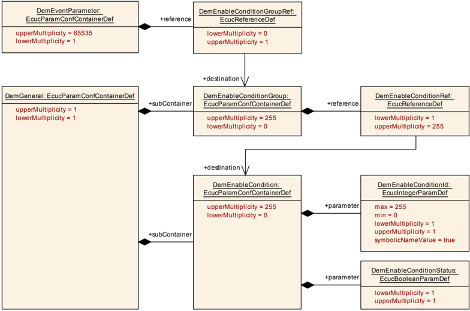

以下需求介绍存储条件的处理。

**注意：****Dem** 模块支持存储条件，并提供 API Dem_SetStorageCondition 以接收特定存储条件的当前状态（条件满足与否）。

**注意：****Dem** 模块支持可分配给特定事件的存储条件。

**注意：**引入存储条件组是为了改进 **Dem** 模块的配置方法。如果大量事件始终依赖相同的存储条件，那么选择一个已定义的存储条件组，比为每个事件分配多个存储条件更省力。

如果使用了存储条件并将其分配给某个事件，**Dem** 应在事件被鉴定为 **PASSED** 或 **FAILED** 之后评估所分配的存储条件，并且仅在存储条件满足时才处理 DemFreezeFrameRecordTrigger、DemExtendedDataRecordTrigger 和 DemEventMemoryEntryStorageTrigger。

**注意：****Dem** 模块支持存储条件，并在事件报告 `DEM_EVENT_STATUS_FDC_THRESHOLD_REACHED`（例如通过接口调用或在去抖动算法中达到配置阈值）之后检查所分配的存储条件。

**注意：**如果一个存储条件未满足且不存在相应的事件内存条目，**Dem** 模块不会将所报告的事件写入事件内存。

**注意：**如果一个存储条件未满足且存在相应的事件内存条目，**Dem** 模块不会更新所报告事件的事件内存。

如果分配给事件的至少一个存储条件未满足，**Dem** 应跳过将相应事件状态字节和 **UDS** 状态字节中的以下位从 0 置为 1 的计算：

- 位 2（**PendingDTC**）和
- 位 3（**ConfirmedDTC**）。

如果某个事件的所有事件特定存储条件都满足，**Dem** 模块应允许存储所报告的事件。

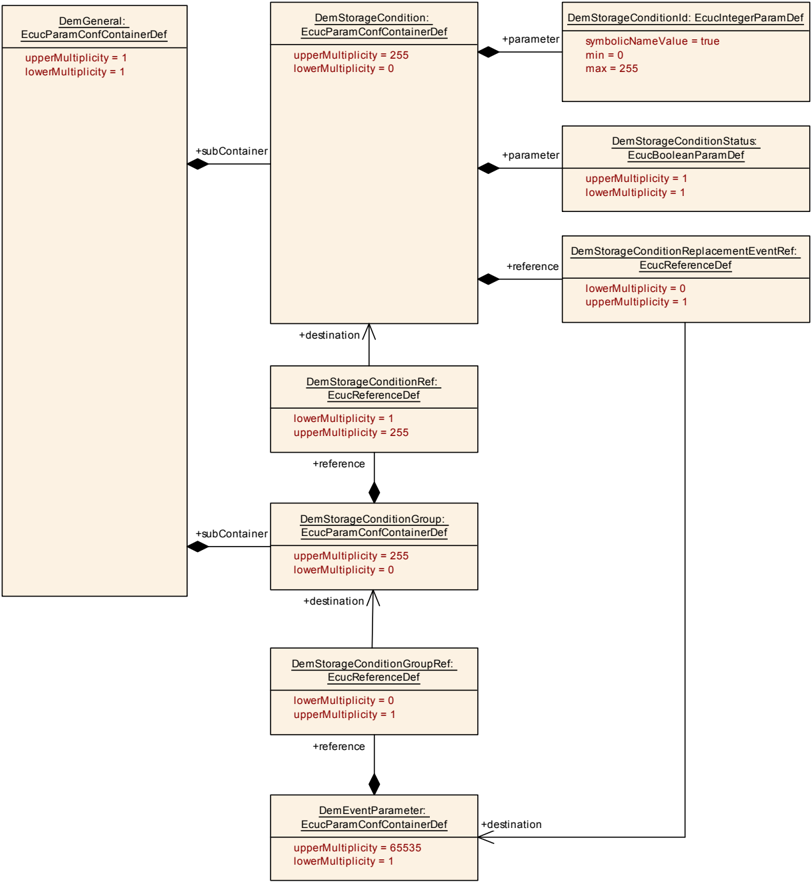

对于每个存储条件，可以定义一个替换事件（参见 DemStorageConditionReplacementEventRef）。该替换事件将用作替代的故障信息。

如果一个事件被报告为 **FAILED**，存在通过 DemStorageConditionReplacementEventRef 引用该事件的存储条件，且该存储条件为 FALSE，则替换事件应被设置为 **FAILED**。

**注意：**只要存储条件未满足且没有分配给该存储条件的事件报告 **FAILED**，替换事件就不应被置位。

**注意：**替换事件与其他任何事件一样具有 EventStatus（**Dem_UdsStatusByteType**）。

**注意：**被过滤事件（被存储条件过滤）的状态/行为不受替换事件的影响。被存储条件过滤的故障，无论该存储条件是否配置了替换事件，其行为完全相同。

当存储条件被满足（在启用存储条件时）时，替换事件应被复位（状态 **PASSED**）。

**替换事件**：

- 不应映射到存储条件（DemStorageConditionGroupRef）
- 不应配置为使用去抖动（DemDebounceAlgorithmClass）
- 不应具有 InitMForE 回调 / clearEventAllowed（DemCallbackInitMForE/DemCallbackClearEventAllowed）
- 不应配置使能条件（DemEnableConditionGroupRef）
- 应配置为 `DEM_EVENT_KIND_BSW`

#### 6.7.7. 事件相关数据

"事件相关数据"是在事件发生时存储的附加数据，例如传感器值或时间戳/里程。ISO 14229-1 定义了两种不同类型的事件相关数据：快照数据（冻结帧）和扩展数据。所存储事件相关数据的数量或集合具有很强的 **OEM**/故障特定性，因此是可配置的。这些数据由 **SW-C** 或其他 **BSW** 模块提供。

每个事件内存条目应支持存储已配置的"事件相关数据"（冻结帧数据（**DTCSnapshot**）或 **DTCExtendedData**）的能力。

详情参见第 6.7.7.4 节。

**注意：**Confirmed **UDS** 状态的存在并不一定意味着"事件相关数据"也可用。

**Dem** 模块不负责事件相关数据的有效性。事件相关数据的时间一致性取决于数据源和存储时间。

**Dem** 模块提供一个配置表，用于将事件相关数据（冻结帧和扩展数据）与特定的 **DTC** 编号等组合（参见第 6.7.7.4 节）。

**注意：**这并不规定特定的实现（例如查找表、矩阵等）。它只涉及已配置数据之间的链接。一个事件由其 **EventId**、**DTC** 值、已配置的冻结帧和扩展数据记录等来刻画。

##### 6.7.7.1. 冻结帧数据的存储

**Dem** 模块应支持事件特定的冻结帧存储。

一般而言，冻结帧配置有两种选项：(1) 非排放相关的冻结帧针对一个特定事件进行配置。冻结帧记录可以通过（计算的或配置的）相对编号来寻址，因此记录号对于一个事件是唯一的（而非全局）。(2) 排放相关的冻结帧针对特定 **ECU** 全局配置（**OBD** 法规要求仅一个冻结帧类）。冻结帧记录可以通过值 0x00 按事件寻址。

**Dem** 模块应支持在按配置分配的每个冻结帧记录中存储一个或多个 **DID**（参见 DemFreezeFrameClass）。

**注意：**冻结帧表示为 **DID** 列表（参见 DemDidClass）或 **PID** 列表（参见 DemPidClass）。

**注意：**出于实现原因，**Dem** 通常需要为最大冻结帧大小乘以冻结帧数量预留内存。

如果 DemTypeOfFreezeFrameRecordNumeration 设置为 `DEM_FF_RECNUM_CALCULATED`（参见 DemPrimaryMemory 或 DemUserDefinedMemory），**Dem** 应为该 **DTC** 存储 DemMaxNumberFreezeFrameRecords 数量的冻结帧。

如果 DemTypeOfFreezeFrameRecordNumeration 设置为 `DEM_FF_RECNUM_CALCULATED`，参数 DemFreezeFrameRecordTrigger 应设置为 `DEM_TRIGGER_ON_TEST_FAILED`。

如果 **Dem** 模块使用计算得到的记录号，**Dem** 模块应基于时间顺序为该事件特定的冻结帧记录从 1 开始连续编号。

如果 DemTypeOfFreezeFrameRecordNumeration 设置为 `DEM_FF_RECNUM_CONFIGURED`（参见 DemPrimaryMemory 或 DemUserDefinedMemory），**Dem** 应为每个事件内存条目存储该 **DTC** 的所有已配置冻结帧记录。

如果冻结帧使用专用的、已配置的记录号（参见 DemFreezeFrameRecNumClassRef）且存在事件内存条目，**Dem** 模块应在配置的触发器（参见 DemFreezeFrameRecordTrigger）上捕获冻结帧并将其存储到事件内存条目中。

如果存储触发器未能分配事件内存条目（由于事件保留），期间可能（由于老化）出现合适的内存条目。因此冻结帧触发器应再次尝试分配事件内存条目。

如果冻结帧使用专用的、已配置的记录号（参见 DemFreezeFrameRecNumClassRef）且不存在事件内存条目，**Dem** 模块应首先按照第 6.7.2.1 节尝试分配一个事件内存条目，然后应用该节关于捕获的要求。

如果 DemFreezeFrameRecordTrigger 设置为 `DEM_TRIGGER_ON_FDC_THRESHOLD`，则每当达到配置的 **FDC** 阈值（参见 DemCounterBasedFdcThresholdStorageValue 或 DemTimeBasedFdcThresholdStorageValue）（通过正向递增）时，都应捕获冻结帧，但每个运行周期至多一次。

如果 DemFreezeFrameRecordTrigger 设置为 `DEM_TRIGGER_ON_FDC_THRESHOLD` 且事件报告 `DEM_EVENT_STATUS_FDC_THRESHOLD_REACHED`（监视器内部去抖的事件），则应捕获冻结帧，但每个运行周期至多一次。

如果 DemFreezeFrameRecordTrigger 设置为 `DEM_TRIGGER_ON_TEST_FAILED`，则每当 **UDS** 状态位 0 被置位（从 0 变为 1）时，都应捕获冻结帧。

如果 DemFreezeFrameRecordTrigger 设置为 `DEM_TRIGGER_ON_PENDING`，则每当 **UDS** 状态位 2 被置位（从 0 变为 1）时，都应捕获冻结帧。

如果 DemFreezeFrameRecordTrigger 设置为 `DEM_TRIGGER_ON_CONFIRMED`，则每当 Confirmed **UDS** 状态位 3 被置位（从 0 变为 1）时，都应捕获冻结帧。

如果 DemFreezeFrameRecordTrigger 设置为 `DEM_TRIGGER_ON_TEST_FAILED_THIS_OPERATION_CYCLE`，则每当 **UDS** 状态位 1（**TFTOC**）发生从 0 到 1 的跳变时，都应捕获冻结帧。

**冻结帧的连续触发条件**：如果 DemFreezeFrameRecordTrigger 设置为 `DEM_TRIGGER_ON_EVERY_TEST_FAILED`，则每当事件被报告为 **FAILED**，或在可选的去抖动之后检测到合格的 **FAILED**，**Dem** 都应捕获冻结帧。

如果冻结帧使用专用的、已配置的记录号（参见 DemFreezeFrameRecNumClass）且 DemFreezeFrameRecordUpdate 设置为 `DEM_UPDATE_RECORD_NO`，则仅当该冻结帧当前未存储在此事件内存条目中时才存储该冻结帧。

如果冻结帧使用专用的、已配置的记录号（参见 DemFreezeFrameRecNumClass）且 DemFreezeFrameRecordUpdate 设置为 `DEM_UPDATE_RECORD_YES`，则冻结帧应随每个触发器（参见 DemFreezeFrameRecordTrigger）更新。

**冻结帧数据的异步捕获**：**Dem** 应最迟在 Dem_MainFunction 的下一个周期捕获事件特定的冻结帧数据。

**扩展数据的异步捕获**：**Dem** 应最迟在 Dem_MainFunction 的下一个周期捕获事件特定的扩展数据。

**DemPTOSupport 的依赖关系**：仅当 DemOBDSupport 设置为 `DEM_OBD_MASTER_ECU` 或 `DEM_OBD_PRIMARY_ECU` 时，才应存在 DemPTOSupport。

**DemAgingCycleCounterThresholdForTFSLC 的依赖关系**：仅当 DemStatusBitHandlingTestFailedSinceLastClear 设置为 `DEM_STATUS_BIT_AGING_AND_DISPLACEMENT` 时，才应存在 DemAgingCycleCounterThresholdForTFSLC。

**DemMaxNumberFreezeFrameRecords 的依赖关系**：仅当 DemTypeOfFreezeFrameRecordNumeration 设置为 `DEM_FF_RECNUM_CALCULATED` 时，才应存在 DemMaxNumberFreezeFrameRecords。

**DemAgingCycleRef 的依赖关系**：仅当配置了 DemAgingCycleCounterThreshold 时，才应存在 DemAgingCycleRef。

**DemFreezeFrameRecNumClassRef 的依赖关系**：仅当该 **DTC** 引用的故障内存的 DemTypeOfFreezeFrameRecordNumeration 设置为 `DEM_FF_RECNUM_CONFIGURED`（参见 DemPrimaryMemory 或 DemUserDefinedMemory）时，才应存在 DemFreezeFrameRecNumClassRef。

**DemReportBehavior 的依赖关系**：仅当 DemEventKind 设置为 `DEM_EVENT_KIND_SWC` 时，才应存在 DemReportBehavior。

**DemOBDGroupingAssociativeEventsRef 的依赖关系**：仅当 DemOBDSupport 设置为 `DEM_OBD_MASTER_ECU` 或 `DEM_OBD_PRIMARY_ECU` 时，才应存在 DemOBDGroupingAssociativeEventsRef。

**DemOBDCentralizedPID21Handling 的依赖关系**：仅当 DemOBDSupport 设置为 `DEM_OBD_MASTER_ECU` 或 `DEM_OBD_PRIMARY_ECU` 时，才应存在 DemOBDCentralizedPID21Handling。

**DemOBDCentralizedPID31Handling 的依赖关系**：仅当 DemOBDSupport 设置为 `DEM_OBD_MASTER_ECU` 或 `DEM_OBD_PRIMARY_ECU` 时，才应存在 DemOBDCentralizedPID31Handling。

**DemOBDCompliancy 的依赖关系**：仅当 DemOBDSupport 设置为 `DEM_OBD_MASTER_ECU` 或 `DEM_OBD_PRIMARY_ECU` 时，才应存在 DemOBDCompliancy。

**DemOBDEngineType 的依赖关系**：仅当 DemOBDSupport 设置为 `DEM_OBD_MASTER_ECU` 或 `DEM_OBD_PRIMARY_ECU` 时，才应存在 DemOBDEngineType。

**DemOBDEventDisplacement 的依赖关系**：仅当 DemOBDSupport 设置为 `DEM_OBD_MASTER_ECU` 或 `DEM_OBD_PRIMARY_ECU` 时，才应存在 DemOBDEventDisplacement。

**DemOBDInputAcceleratorPedalInformation 的依赖关系**：仅当 DemOBDSupport 设置为 `DEM_OBD_MASTER_ECU` 或 `DEM_OBD_PRIMARY_ECU` 时，才应存在 DemOBDInputAcceleratorPedalInformation。

**DemOBDInputAmbientPressure 的依赖关系**：仅当 DemOBDSupport 设置为 `DEM_OBD_MASTER_ECU` 或 `DEM_OBD_PRIMARY_ECU` 时，才应存在 DemOBDInputAmbientPressure。

**DemOBDInputAmbientTemperature 的依赖关系**：仅当 DemOBDSupport 设置为 `DEM_OBD_MASTER_ECU` 或 `DEM_OBD_PRIMARY_ECU` 时，才应存在 DemOBDInputAmbientTemperature。

**DemOBDInputDistanceInformation 的依赖关系**：仅当 DemOBDSupport 设置为 `DEM_OBD_MASTER_ECU` 或 `DEM_OBD_PRIMARY_ECU` 时，才应存在 DemOBDInputDistanceInformation。

**DemOBDInputEngineSpeed 的依赖关系**：仅当 DemOBDSupport 设置为 `DEM_OBD_MASTER_ECU` 或 `DEM_OBD_PRIMARY_ECU` 时，才应存在 DemOBDInputEngineSpeed。

**DemOBDInputEngineTemperature 的依赖关系**：仅当 DemOBDSupport 设置为 `DEM_OBD_MASTER_ECU` 或 `DEM_OBD_PRIMARY_ECU` 时，才应存在 DemOBDInputEngineTemperature。

**DemOBDInputProgrammingEvent 的依赖关系**：仅当 DemOBDSupport 设置为 `DEM_OBD_MASTER_ECU` 或 `DEM_OBD_PRIMARY_ECU` 时，才应存在 DemOBDInputProgrammingEvent。

**DemOBDInputVehicleSpeed 的依赖关系**：仅当 DemOBDSupport 设置为 `DEM_OBD_MASTER_ECU` 或 `DEM_OBD_PRIMARY_ECU` 时，才应存在 DemOBDInputVehicleSpeed。

**DemConsiderPtoStatus 的依赖关系**：仅当 DemOBDSupport 设置为 `DEM_OBD_MASTER_ECU` 或 `DEM_OBD_PRIMARY_ECU` 时，才应存在 DemConsiderPtoStatus。

快照记录数据通常在报告事件状态时异步捕获。在某些情况下，捕获的数据需要与所报告的事件状态对齐。为此，Dem_SetEventStatusWithMonitorData 提供了添加 2 个监视器数据的可能性。monitorData0 可以选择性地传递给 DataServicesCS 的 ReadData 操作，以便应用将数据捕获调用与已发起的 Dem_SetEventStatusWithMonitorData 函数调用对齐。

**使用监视器数据捕获事件相关数据**：如果 ReadData 操作被配置为提供 monitorData0，**Dem** 应将来自 Dem_SetEventStatusWithMonitorData 的 monitorData0 添加到 ReadData 操作参数 monitorData0 中。

**缺少监视器数据的处理**：如果数据捕获是从不含监视器数据的 **API** 调用中触发的，**Dem** 应使用值 0 作为 monitorData。

**Dem** 模块应使用 C 回调 DemRead 或接口 DataServices_{Data} 的 ReadData 操作，来收集相应冻结帧的所有已配置数据元素。

如果 **SW-C** 或 **BSW** 模块无法提供所请求的数据（ReadDataElement 返回非 E_OK），**Dem** 应以填充值 0xFF 填充缺失的数据，向 **Det** 报告运行时错误 `DEM_E_NODATAAVAILABLE`，并继续其正常运行。

如果 **Dem** 模块使用计算得到的记录号，且为特定事件配置了多个冻结帧记录，且该事件在事件内存中被更新，且该事件所有可用的冻结帧记录槽位均被占用，则 **Dem** 模块应更新最新的记录。

**注意：**第一个冻结帧记录槽位始终表示第一次发生。

##### 6.7.7.2. 冻结帧数据的预存储

冻结帧的预存储可用于具有高度易变的冻结帧数据的事件。在特定事件出现的首次指示时——即使该事件尚未去抖或鉴定——即捕获冻结帧数据（例如因为在运行故障监控阶段事件相关数据快速变化）。预存储冻结帧功能由监视器使用。

**Dem** 模块应提供配置参数 DemFFPrestorageSupported（参见 DemEventParameter），用于按事件启用或禁用冻结帧的预存储处理。

**注意：**如果 DemMaxNumberPrestoredFF 设置为 0，则不能为任何 **DTC** 启用 DemFFPrestorageSupported。

如果任何事件被配置为使用冻结帧预存储（参见 DemFFPrestorageSupported），**Dem** 模块应提供 API Dem_PrestoreFreezeFrame 和 Dem_ClearPrestoredFreezeFrame。否则不提供它们。

**Dem** 模块应提供 API Dem_PrestoreFreezeFrame，用于捕获事件特定冻结帧的预存储数据，而不考虑 **UDS** 状态位的变化。

**注意：**如果预存储冻结帧的请求（Dem_PrestoreFreezeFrame）被报告事件状态（Dem_SetEventStatus）或对同一 **EventId** 调用 Dem_ClearPrestoredFreezeFrame 所中断，则详细行为是实现特定的。被请求预存储的冻结帧可能被立即使用，或被存储并与下一个即将到来的事件报告一起使用，反之亦然。

如果没有可用内存（参见 DemMaxNumberPrestoredFF），API Dem_PrestoreFreezeFrame 应返回 E_NOT_OK。

如果预存储冻结帧可用，**Dem** 模块应在事件相关数据被捕获的时间点使用预存储冻结帧的数据而非当前数据（参见第 6.7.7.1 节）。

预存储冻结帧在存储到事件内存或被丢弃之后应被释放。

**注意：**如果事件保留成功，则认为预存储冻结帧已被存储。如果事件保留失败，则预存储冻结帧被丢弃。

如果没有预存储冻结帧可用，**Dem** 模块应按照"冻结帧数据的存储"（参见第 6.7.7.1 节）行事。

详情参见第 6.7.7.1 节。

**注意：**使用预存储冻结帧时捕获的数据，可能与使用 **UDS** 状态位跳变作为触发器收集的数据不同。

**注意：**为确保对已合格事件的已存储冻结帧不产生反应，应使用一个额外的冻结帧缓冲区。由于硬件使用的限制，可能的条目数量可能受限。因此，可能需要一种替换策略。

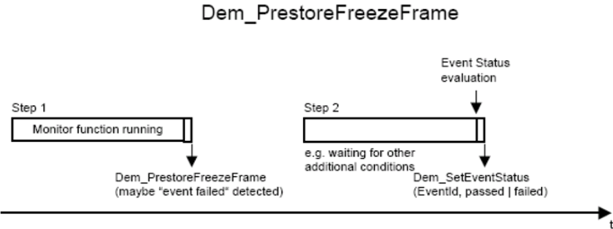

一些事件在控制单元的一个运行周期内检测到故障，但仅在下一个运行周期才确定允许存储该故障的条件。此类事件的冻结帧显示旧运行周期的值。为此，**Dem** 支持预存储冻结帧数据的非易失性存储。为避免过度存储，可以通过配置 DemFFPrestorageInNvm 按事件单独启用/禁用存储。

**预存储数据的非易失性存储**：如果 DemFFPrestorageInNvm 设置为 TRUE，**Dem** 应将该事件的预存储冻结帧数据存储在 **NvM** 中。

**将预存储数据存储到非易失性内存的时间点**：如果 **Dem** 被配置为将预存储冻结帧数据存储到非易失性内存，**Dem** 应存储该数据一次，且最迟在 Dem_Shutdown 期间。

**从非易失性内存检索预存储数据的时间点**：如果 **Dem** 被配置为将预存储冻结帧数据存储到非易失性内存，**Dem** 应在 Dem_Init 返回之前恢复预存储数据。

**非易失性存储的预存储数据的一致性**：如果 **Dem** 正在恢复预存储数据，则仅当该数据与当前配置一致时才应恢复。如果在重新编程或标定之后数据布局发生了变化，**Dem** 应跳过预存储数据。

**Dem** 模块应提供 API Dem_ClearPrestoredFreezeFrame，用于释放特定事件的预存储冻结帧。

如果一个事件被鉴定为通过（**UDS** 状态位 0 从 1 变为 0），**Dem** 模块应释放该特定事件的预存储冻结帧。

##### 6.7.7.3. 扩展数据的存储

扩展数据记录包含与特定事件相关联的、未包含在冻结帧中的附加信息（扩展数据，例如频率计数器、老化计数器等）。根据基于 **DID** 或 **PID** 的冻结帧数据配置，扩展数据按其记录号划分为扩展数据记录。

如果存在事件内存条目，**Dem** 模块应在配置的触发器（参见 DemExtendedDataRecordTrigger）上捕获 ExtendedDataRecord 并将其存储到事件内存条目中。

如果存储触发器未能分配事件内存条目（由于事件保留），期间可能（由于老化）出现合适的内存条目。因此扩展数据记录触发器应再次尝试分配事件内存条目。

如果不存在事件内存条目，**Dem** 模块应首先按照第 6.7.2.1 节尝试分配一个事件内存条目，然后应用该节关于捕获的要求。

如果 DemExtendedDataRecordTrigger 设置为 `DEM_TRIGGER_ON_FDC_THRESHOLD`，则每当达到配置的 **FDC** 阈值（参见 DemCounterBasedFdcThresholdStorageValue 或 DemTimeBasedFdcThresholdStorageValue）（通过正向递增）时，都应捕获 ExtendedDataRecord，但每个运行周期至多一次。

如果 DemExtendedDataRecordTrigger 设置为 `DEM_TRIGGER_ON_FDC_THRESHOLD` 且事件报告 `DEM_EVENT_STATUS_FDC_THRESHOLD_REACHED`（监视器内部去抖的事件），则应捕获 ExtendedDataRecord，但每个运行周期至多一次。

如果 DemExtendedDataRecordTrigger 设置为 `DEM_TRIGGER_ON_TEST_FAILED`，则每当 **UDS** 状态位 0 被置位（从 0 变为 1）时，都应捕获 ExtendedDataRecord。

如果 DemExtendedDataRecordTrigger 设置为 `DEM_TRIGGER_ON_PENDING`，则每当 **UDS** 状态位 2 被置位（从 0 变为 1）时，都应捕获 ExtendedDataRecord。

如果 DemExtendedDataRecordTrigger 设置为 `DEM_TRIGGER_ON_CONFIRMED`，则每当 **UDS** 状态位 3 被置位（从 0 变为 1）时，都应捕获 ExtendedDataRecord。

如果 DemExtendedDataRecordTrigger 设置为 `DEM_TRIGGER_ON_PASSED`，则应随着 **TestFailed** **UDS** 状态位 0 被复位（从 1 变为 0）而捕获 ExtendedDataRecord。如果不存在条目，在通过报告时不应创建新条目。

DemExtendedDataRecordTrigger 需要配置。除了像发生计数器这样的内部数据元素之外，DemExtendedDataRecordTrigger 应始终被配置。

如果配置参数 DemExtendedDataRecordUpdate 设置为 `DEM_UPDATE_RECORD_NO`，则仅当该 ExtendedDataRecord 当前未存储在此事件内存条目中时才存储它。

如果配置参数 DemExtendedDataRecordUpdate 设置为 `DEM_UPDATE_RECORD_YES`，则 ExtendedDataRecord 应随每个触发器（参见 DemExtendedDataRecordTrigger）更新。

**Dem** 模块应使用 C 回调 ReadDataElement 或接口 DataServicesCS 的 ReadData 操作，来收集相应扩展数据记录中所有非内部数据元素类型（参见 DemInternalDataElementClass）的已配置数据元素。

如果一个事件被存储或更新到事件内存中，**Dem** 模块应将收集到的扩展数据存储到事件内存条目中。

**作为扩展数据记录的 DTC 优先级配置**：如果 DemInternalDataElement 设置为 `DEM_DTC_PRIORITY`，**Dem** 应将该内部数据元素的值设置为该 **DTC** 由 DemDTCPriority 分配的 **DTC** 优先级。该内部数据元素的长度为一个字节。

**主故障内存的扩展数据记录值**：从分配给主内存的 **DTC** 所引用的 DemExtendedDataRecordClass 容器，其 DemExtendedDataRecordNumber 应处于 0x01–0xEF 范围内。

**用户自定义事件内存的扩展数据记录值**：从分配给用户自定义内存的 **DTC** 所引用的 DemExtendedDataRecordClass 容器，其 DemExtendedDataRecordNumber 应处于 0x01–0xFE 范围内。

该约束背后的理念是支持基于 ISO 14229-1:2020 DAMD1 的用户自定义内存定义。

##### 6.7.7.4. 事件相关数据的配置

本节描述事件相关数据的配置以及 **SW-C**/**BSW** 模块对事件相关数据的访问。

**注意：**配置模型遵循灵活的配置过程，但不隐含任何显式的实现。

诊断事件的事件相关数据包含零个或一组扩展数据记录（参见 DemExtendedDataClass），以及零个或一组冻结帧记录（参见 DemFreezeFrameClass）及其计算或配置的记录号。因此使用了一种类概念（参见图 7.38）。

扩展数据记录、**DID** 或 **PID** 可以包含一个或多个数据元素（参见 DemDataElementClass）。

**注意：****Dem** 模块不支持异步 **DID** 以及长度可变的 **DID**，因此不应将它们连接到 **Dem**。

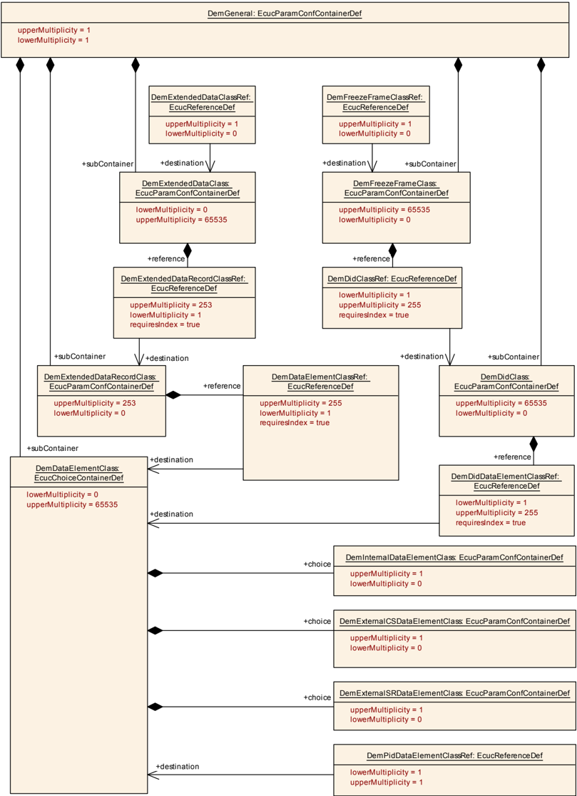

数据元素由 **SW-C** 或 **BSW** 模块提供，或在 **Dem** 内部计算。

对于每个外部数据元素，基于配置 DemExternalCSDataElementClass 和 DemExternalSRDataElementClass 生成相应的需求端口（参见服务接口 DataServices_&lt;Data&gt;）或 C 回调（参见 ReadDataElement）。对于每个内部数据元素，映射相应的 **Dem** 内部值。

**注意：**这些数据元素通常在诊断数据模板（**Diagnostic Data Template**）中规定。

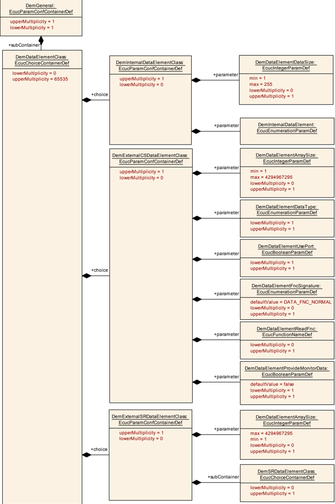

仅当同一容器中的 DemDataElementDataType 设置为 `UINT8_N`、`SINT8_N`、`UINT16_N`、`SINT16_N`、`UINT32_N`、`SINT32_N`、`FLOAT_N` 时，容器 DemExternalCSDataElementClass 中才应存在大小参数 DemDataElementArraySize。

**注意：**对于基本数据类型，容器 DemExternalCSDataElementClass 中的 DemDataElementArraySize 不是必需的。

**16 位数组大小参数的限制**：如果值大于 2 且 DemDataElementDataType 为 `UINT16_N` 或 `SINT16_N`，则 DemDataElementArraySize 应为 2 的倍数。

**32 位数组大小参数的限制**：如果值大于 4 且 DemDataElementDataType 为 `UINT32_N`、`SINT32_N` 或 `FLOAT_N`，则 DemDataElementArraySize 应为 4 的倍数。

仅当同一容器中的 DemDataElementDataType 设置为 `UINT8_N`、`SINT8_N`、`UINT16_N`、`SINT16_N`、`UINT32_N`、`SINT32_N`、`FLOAT_N` 时，容器 DemExternalSRDataElementClass 中才应存在大小参数 DemDataElementArraySize。

**注意：**对于基本数据类型，容器 DemExternalSRDataElementClass 中的 DemDataElementArraySize 不是必需的。

**16 位数组大小参数的限制**：如果值大于 2 且 DemDataElementDataType 为 `UINT16_N` 或 `SINT16_N`，则 DemDataElementArraySize 应为 2 的倍数。

**32 位数组大小参数的限制**：如果值大于 4 且 DemDataElementDataType 为 `UINT32_N` 或 `SINT32_N`，则 DemDataElementArraySize 应为 4 的倍数。

**Dem** 模块应提供将 **Dem** 内部数据值（例如老化计数器、发生计数器）映射到扩展数据记录中包含的特定数据元素（参见 DemDataElementClass 中的 DemInternalDataElement）的能力。

**注意：**如果 **Dem** 内部数据元素（通过配置）映射到例如扩展数据记录，则该信息可以简单地通过 **UDS** 服务 ReadDTCInformation - 子服务 reportDTCExtendedDataRecordByDTCNumber (0x19, 06) 请求。

内部数据元素（参见 DemInternalDataElementClass）不应被存储，而应使用当前值代替。

**注意：**进一步客户特定的 **Dem** 内部数据元素可以具有不同的语义（例如 **Dem** 内部数据元素可以冻结一个值或提供当前值）。

**内部数据元素仅用于扩展数据记录**：仅当 DemInternalDataElementClass 仅被 DemExtendedDataRecordClass 中的 DemDataElementClassRef 引用时，才允许将其用于 DemDataElementClass。

如果配置参数 DemInternalDataElement 设置为 `DEM_OCCCTR`，则发生计数器的 **Dem** 内部值应映射到相应的数据元素。

详情参见第 6.3.2 节。

如果配置参数 DemInternalDataElement 设置为 `DEM_AGINGCTR_UPCNT` 或 `DEM_AGINGCTR_DOWNCNT`，则老化计数器的 **Dem** 内部值应映射到相应的数据元素（基于第 6.7.8 节）。

详情参见第 6.6.1 节。

如果配置了 DemAgingCycleCounterThreshold，则数据元素 `DEM_AGINGCTR_UPCNT` 的值应基于从 0 到 DemAgingCycleCounterThreshold 的递增机制（参见 ISO 14229-1 附录 D）。

如果配置了 DemAgingCycleCounterThreshold，则数据元素 `DEM_AGINGCTR_DOWNCNT` 的值应基于从 DemAgingCycleCounterThreshold 到 0 的递减机制（参见 ISO 14229-1 附录 D）。

如果未配置 DemAgingCycleCounterThreshold，内部数据元素 `DEM_AGINGCTR_DOWNCNT` 的值应为 '255'。

如果未配置 DemAgingCycleCounterThreshold，内部数据元素 `DEM_AGINGCTR_UPCNT` 的值应为 '0'。

如果配置参数 DemInternalDataElement 设置为 `DEM_AGINGCTR_UPCNT_FIRST_ACTIVE`，其值的计算方式与 `DEM_AGINGCTR_UPCNT` 类似。区别在于：当当前老化计数器的值为 0 且事件状态位 **TestFailedThisOperationCycle** 和 **TestNotCompletedThisOperationCycle** 均设置为 False 时，读取 **Dem** 内部老化计数器时将报告值 1。

如果配置参数 DemInternalDataElement 设置为 `DEM_OVFLIND`，则溢出指示的 **Dem** 内部值应以布尔形式（0 = False，1 = True）映射到相应的数据元素。

详情参见第 6.7.2.3 节。

如果配置参数 DemInternalDataElement 设置为 `DEM_SIGNIFICANCE`，则 **DTC** 重要性的（静态）**Dem** 内部值应映射到相应的数据元素，0 = **OCCURRENCE**，1 = **FAULT**。

详情参见第 6.4.6 节。

如果配置参数 DemInternalDataElement 设置为 `DEM_CURRENT_FDC`，则当前故障检测计数器的 **Dem** 内部值应按以下值转换映射到相应的数据元素：
[0..127]-&gt;[0x00..0x7F] 和 [-1..-128]-&gt;[0xFF..0x80]。

详情参见第 6.7.3.3 节和第 6.7.3.4 节。

如果配置参数 DemInternalDataElement 设置为 `DEM_MAX_FDC_SINCE_LAST_CLEAR`，则自上次清除以来最大故障检测计数器的 **Dem** 内部值应映射到相应的数据元素。

详情参见第 6.7.3.6 节。

如果配置参数 DemInternalDataElement 设置为 `DEM_MAX_FDC_DURING_CURRENT_CYCLE`，则当前运行周期内最大故障检测计数器的 **Dem** 内部值应映射到相应的数据元素。

详情参见第 6.7.3.6 节。

如果配置参数 DemInternalDataElement 设置为 `DEM_CYCLES_SINCE_LAST_FAILED`，则距上次失败的运行周期计数器的 **Dem** 内部值应映射到相应的数据元素。

详情参见第 6.6.1.1 节。

如果配置参数 DemInternalDataElement 设置为 `DEM_CYCLES_SINCE_FIRST_FAILED`，则距首次失败的运行周期计数器的 **Dem** 内部值应映射到相应的数据元素。

详情参见第 6.6.1.2 节。

如果配置参数 DemInternalDataElement 设置为 `DEM_FAILED_CYCLES`，则失败运行周期计数器的 **Dem** 内部值应映射到相应的数据元素。

详情参见第 6.6.1.3 节。

如果特定配置需要 **Dem** 内部计算的特定数据值，**Dem** 模块可以扩展更多特定的 **Dem** 内部数据元素。

**静态事件关联标识符到内部数据元素的映射**：如果 DemInternalDataElement 设置为 `DEM_EVENT_ASSOCIATED_IDENTIFICATION`，**Dem** 应使用 DemEventAssociatedIdentification 中的静态配置值作为该内部数据元素的值。

**IUMPR 比率到内部数据元素的映射**：如果 DemInternalDataElement 设置为 `DEM_IUMPR`，**Dem** 应使用 SAE J1979-2 格式的、分配给该 **DTC** 的 **IUMPR** 值作为该内部数据元素的值。

**使用 DEM_IUMPR 的前提条件**：如果内部数据元素使用 `DEM_IUMPR`，则相应事件应被 DemDiagnosticEventRef 引用。

**DTR 值到内部数据元素的映射**：如果 DemInternalDataElement 设置为 `DEM_DTR`，**Dem** 应使用 SAE J1979-2 格式的、分配给该 **DTC** 的 **DTR** 值作为该内部数据元素的值。

**使用 DEM_DTR 的前提条件**：如果内部数据元素使用 `DEM_DTR`，则相应事件应被 DemDtrEventRef 引用。

**监视器活动数据到内部数据元素的映射**：如果 DemInternalDataElement 设置为 `DEM_MONITOR_ACTIVITY_DATA`，**Dem** 应支持按 **DTC** 提供 SAE J1979-2 规定的监视器活动数据，并将其映射为该内部数据元素的值。

**事件所需的 DEM_EVENT_ASSOCIATED_IDENTIFICATION**：如果一个 DemEvent 所引用的 DemDTC 本身需要包含 DemInternalDataElement = `DEM_EVENT_ASSOCIATED_IDENTIFICATION` 的快照记录或扩展数据记录，则应为该事件配置 DemEventAssociatedIdentification。

如果 **Dem** 模块实现了客户特定的 **Dem** 内部数据元素，则配置参数 DemInternalDataElement 应扩展相应的枚举值。

**注意：**未配置为数据元素的任何 **Dem** 内部数据值的计算可以放弃（如果其他内部行为处理不需要它）。

如果配置参数 DemInternalDataElement 设置为 `DEM_CURRENT_FDC`，则故障检测计数器应映射到相应的数据元素。

详情参见第 6.7.3 节。

**内部数据中 monitorData0 的使用**：如果 DemInternalDataElement 设置为 `DEM_MONITOR_DATA_0`，**Dem** 应使用调用 Dem_SetEventStatusWithMonitorData 时所提供的 monitorData0 参数值的 32 位值作为内部数据值。

**内部数据中 monitorData1 的使用**：如果 DemInternalDataElement 设置为 `DEM_MONITOR_DATA_1`，**Dem** 应使用调用 Dem_SetEventStatusWithMonitorData 时所提供的 monitorData1 参数值的 32 位值作为内部数据值。

**Dem** 应将非整数数据类型 uint8[n] 视为匹配大小的整数数据类型，或在 DemDataElementEndianness 配置为 OPAQUE 时不解释其内容。

**Dem** 应将不透明数据（**opaque data**）解释为 uint8[n]，并始终将其映射到 n 字节大小的信号。

**注意：**对于不透明数据的字节序，转换必须配置为 OPAQUE。

**Dem** 应将 [17] 第 2.4 章定义的字节序转换扩展到有符号数据类型。

**注意：**[17] 第 2.4 章定义了无符号数据类型的字节序转换。

为将有符号和无符号整数 AUTOSAR 数据类型序列化到冻结帧/扩展记录中，应考虑 DemDataElementEndianness 中配置的目标字节序。如果不存在 DemDataElementEndianness，则改用 DemDataElementDefaultEndianness。

##### 6.7.7.5. 数据变化的通知

**Dem** 模块应将事件内存中事件相关数据的更新通知给其他 **SW-C** / **BSW** 模块（参见第 7.4.3.8 节）。

每当新建一个事件内存条目或更新现有条目时，都会发生事件相关数据的更新。

**注意：****Dem** 不评估该回调函数的返回值（例如非 E_OK 的情况）。

**注意：**配置容器 DemCallbackEventDataChanged（位于 DemEventParameter 中）用于为每个事件指定相关的端口或 C 回调。

如果事件内存条目的"事件相关数据"（扩展数据或冻结帧数据）被添加或更新，且通过 DemCallbackEventDataChanged 配置了数据变化通知，则 **Dem** 应触发这些已配置的事件特定通知以及通用通知 **GeneralCallbackEventDataChanged**。

**注意：**在以下情况下，**Dem** 不触发数据变化回调：

- 删除
- 置换（参见第 6.7.2.4 节）
- 老化（参见第 6.7.8 节）

函数 Dem_GetEventExtendedDataRecordEx 和 Dem_GetEventFreezeFrameDataEx 应只考虑主内存和用户自定义内存。

**注意：**事件的来源可以从 **EventId**（DemMemoryDestinationRef）推导得出。

函数 Dem_GetEventFreezeFrameDataEx 应在所请求的冻结帧记录（由参数 **RecordNumber** 定义，RecordNumber 等于 0xFF 除外）中报告所请求诊断事件（**EventId**）的 **DID**（由参数 **DataId** 定义）的数据。如果 RecordNumber 等于 0xFF 且参数 DemTypeOfFreezeFrameRecordNumeration 设置为 `DEM_FF_RECNUM_CALCULATED`（参见 DemPrimaryMemory 或 DemUserDefinedMemory），则应使用最新的记录，否则应返回 E_NOT_OK。

函数 Dem_GetEventFreezeFrameDataEx 在以 RecordNumber 0x00 调用时应返回 **WWH-OBD** 冻结帧。如果不支持 **WWH-OBD**，该函数应改为返回 `DEM_NO_SUCH_ELEMENT`（参见 DemOBDSupport）。

函数 Dem_GetEventFreezeFrameDataEx 的目标缓冲区（**DestBuffer**）中的数据格式为原始十六进制值，不包含记录号或 **DataId** 等头信息。缓冲区大小等于所有相应数据元素的配置设置。

函数 Dem_GetEventExtendedDataRecordEx 应报告所请求诊断事件的扩展数据记录的数据。

函数 Dem_GetEventExtendedDataRecordEx 的目标缓冲区（**DestBuffer**）中的数据格式为原始十六进制值，不包含记录号等头信息。

**注意：****Dcm** 使用函数 Dem_GetNextExtendedDataRecord 代替函数 Dem_GetEventExtendedDataRecordEx。

如果在 GeneralCallbackEventDataChanged 或 CallbackEventDataChanged 的上下文中调用接口 Dem_GetEventFreezeFrameDataEx 和 Dem_GetEventExtendedDataRecordEx，则应能检索到触发事件的数据（不允许返回值 E_NOT_OK）。

在所请求的冻结帧数据当前不可访问的情况下（例如在从应用异步抢占式数据检索期间），Dem_GetEventFreezeFrameDataEx 应返回 E_NOT_OK。

在所请求的数据当前不可访问的情况下（例如在从应用异步抢占式数据检索期间），Dem_GetEventExtendedDataRecordEx 应返回 E_NOT_OK。

#### 6.7.8. 诊断事件的老化

**Dem** 模块提供在一段时间（运行周期）内故障条件未满足时将特定事件从事件内存中移除的能力。该过程称为"老化"（**aging**）或"遗忘"（**unlearning**）。

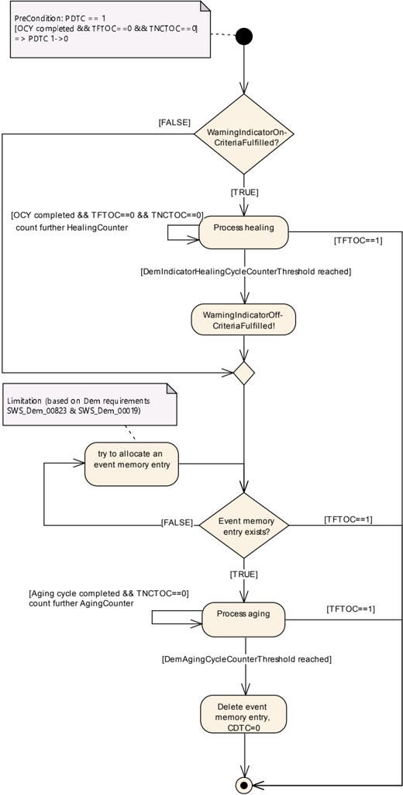

老化过程（老化计数器的计数）在恢复（**healing**）完成时开始（**WarningIndicatorRequested** 位 == 0）。

详情参见图 7.40。

**Dem** 模块应至少为每个事件内存条目支持一个老化计数器。

如果为该事件配置了 DemAgingCycleCounterThreshold，老化计数器应基于所引用的老化/运行周期计算。

**Dem** 模块应能够覆盖每个单独事件内存条目的老化计数器当前值，以支持输出。

**注意：**为了进行深入的故障分析，可以将老化计数器的当前值映射到扩展数据记录的特定数据元素（参见第 6.7.7.3 节"扩展数据的存储"）。

DemAgingCycleCounterThreshold 或 DemAgingCycleCounterThresholdForTFSLC（取决于哪个值更高）定义了已完成老化周期的数目，在其之后事件内存条目应从事件内存中删除（老化）。

**注意：**已完成老化周期的定义参见第 6.7.8 节。

如果配置参数 DemResetConfirmedBitOnOverflow 设置为 false，且某个事件已置位 **UDS** 状态位 3、被鉴定为通过、且未存储在事件内存条目中，则 **Dem** 模块应尝试分配一个事件内存条目以获得老化计数器。

**注意：**如果无法分配事件内存条目，则老化延迟进行，直到事件内存条目变为可用（通过第 6.7.2.1 节或第 6.7.2.4 节）。

如果配置参数 DemResetConfirmedBitOnOverflow 设置为 false 且发生了事件内存条目老化，**Dem** 模块应检查是否存在 **UDS** 状态位 3 置为 1 且 **UDS** 状态位 0 置为 0 的其他事件。如果找到这样的事件，**Dem** 应分配一个事件内存位置以获得老化计数器。

**注意：**选择哪个事件的优先级是实现特定的。

当事件老化计数器达到阈值 DemAgingCycleCounterThreshold 时，**UDS** 状态位 3 应被置为 0。

**注意：**相应事件内存条目的老化不会修改其他所有 **UDS** 状态位。

**Dem** 模块应将已遗忘事件的再次发生按新事件处理，因为它们之前已通过老化从事件内存中删除。

仅当相关事件存储在事件内存中且被鉴定为通过时，**Dem** 模块才应允许处理（继续计数）老化计数器的值。

**注意：**老化独立于 **UDS** 状态位 3，因此独立于故障确认（参见第 6.7.4 节）。

当事件老化计数器达到阈值 DemAgingCycleCounterThresholdForTFSLC 时，如果 DemStatusBitHandlingTestFailedSinceLastClear 设置为 `DEM_STATUS_BIT_AGING_AND_DISPLACEMENT`，**UDS** 状态位 5（**TestFailedSinceLastClear**）应被置为 0。
如果未配置参数 DemAgingCycleCounterThresholdForTFSLC，则 TestFailedSinceLastClear 不会被老化。

在事件老化时，**Dem** 应从事件内存中移除该事件相关的快照数据（冻结帧）和扩展数据记录。

在没有内存位置可用或被某个单独事件占用的情况下，该事件的 **UDS** 状态位 TestFailedSinceLastClear 不会被老化。

**Dem** 模块应提供配置参数 DemAgingCycleRef（参见 DemDTCAttributes），定义事件特定的运行/老化周期，其状态变化触发老化计数器值的处理（继续计数）。

**注意：**运行周期的处理参见第 6.6 节。

如果配置参数 DemAgingRequiresTestedCycle 设置为 False，**Dem** 模块应在相应的老化周期结束/重启时处理（继续计数）老化计数器的值。

**注意：**即使相应的老化周期内没有新的测试结果可用，也会处理老化计数器。

如果配置参数 DemAgingRequiresTestedCycle 设置为 True，**Dem** 模块应在相应的老化周期结束/重启且 **UDS** 状态位 6 置为零时，处理（继续计数）老化周期计数器的值。

如果配置参数 DemAgingRequiresNotFailedCycle 设置为 true，老化计数器应只在无测试失败报告的运行周期内处理。

如果配置参数 DemAgingRequiresNotFailedCycle 设置为 false，老化计数器的行为不受影响。

#### 6.7.9. 诊断事件的恢复

**Dem** 模块提供对存储在事件内存中的事件按事件激活和停用指示器的能力。停用的过程定义为诊断事件的恢复（**healing**）（参见图 7.40）。

**Dem** 应仅对使用当前运行周期 DemOperationCycleRef 的通过事件执行恢复。

##### 6.7.9.1. 警告指示器处理

**Dem** 内警告指示器处理的详细配置如图 7.41 所示。

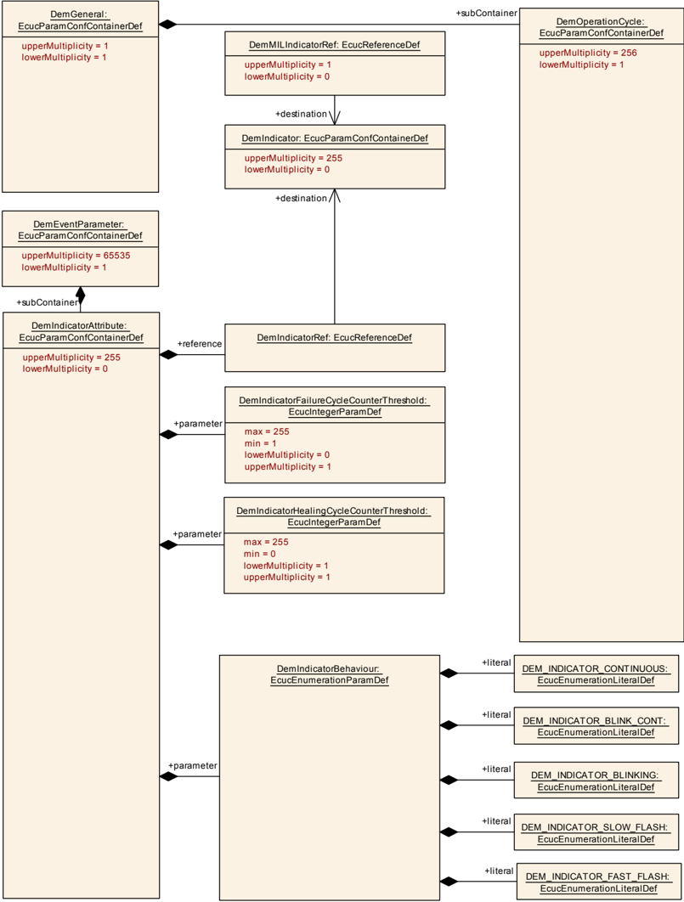

**Dem** 模块支持事件特定的计数器来激活和停用指示器。这些计数器基于已配置的失败周期和恢复周期计算（例如在故障确认时点亮 **MIL**，并在随后经过三个 **OBD** 驾驶循环的恢复之后熄灭 **MIL**）。

**注意：**在 **Dem** 模块的集成过程中，不同的指示器和行为（例如指示灯、文本消息或图标）可以分配给一个事件。

如果为一个特定事件配置了多个指示器，**Dem** 模块应使用分配给该事件的所有组合警告指示器的逻辑或运算来计算 **UDS** 状态位 7（**WarningIndicator**）。

如果至少一个相应的事件指示器失败计数器达到了其经过测试且失败的 **DemOperationCycles** 的 DemIndicatorFailureCycleCounterThreshold，则条件 **WarningIndicatorOnCriteriaFulfilled** 应视为满足。

如果配置了任何指示器（通过 DemIndicatorAttribute），**Dem** 模块应在一个运行周期结束时将 **UDS** 状态位 7（**WarningIndicatorRequested**）置为 0，如果满足以下条件：

- 至少一个 DemIndicatorHealingCycleCounterThreshold 大于 0
- 所有对"经过测试且通过的恢复 **DemOperationCycles**"进行计数的相应指示器恢复周期计数器均已达到其 DemIndicatorHealingCycleCounterThreshold
- 未通过调用 API Dem_SetWIRStatus 使能 **WIR** 位

如果配置了指示器（通过 DemIndicatorAttribute），**Dem** 模块应在事件被报告/鉴定为 **PASSED** 时将 **UDS** 状态位 7（**WarningIndicatorRequested**）置为 0，如果满足以下条件：

- 所有 DemIndicatorHealingCycleCounterThreshold 均等于 0
- 未通过调用 API Dem_SetWIRStatus 使能 **WIR** 位

##### 6.7.9.2. 用户控制的 WarningIndicatorRequested 位

在某些情况下（例如在应用中控制失效安全反应），**Dem** 中相应事件的 **WIR** 位应由一个专门的"失效安全 SW-C"（**failsafe SW-C**）置位/复位。

失效安全 SW-C 必须确保 **WIR** 位的正确状态（例如符合 ISO 14229-1 或制造商特定要求）。为此，失效安全 SW-C 可以使用现有的 **Dem** 机制获取 **Dem** 中事件状态变化的信息（例如回调 **EventUdsStatusChanged**）。

失效安全 SW-C 应向 **Dem** 报告所需的 **WIR** 状态（通过 Dem_SetWIRStatus），并必须确保 **Dem** 中事件的当前 **WIR** 状态与应用中的当前失效安全状态相匹配：

- 失效安全运行中：**WIR** 位应置为 "1"
- 失效安全未运行：**WIR** 位应置为 "0"

失效安全 SW-C 必须在每次失效安全状态变化后报告该状态。

每次调用 Dem_SetWIRStatus 都会更新相应事件的 **WIR** 位（参见参数 **EventId**）。

由于 **ECU** 关机时不存储 StatusOfDTC 位 7（**WIR** 位），失效安全 SWC 必须确保在 Dem_Init 之后事件的 **WIR** 位与当前失效安全状态相符。

**Dem** 应提供一个函数，用于根据例如失效安全状态控制（置位/复位）已配置事件（在 **Dem** 中）的 **WarningIndicatorRequested** 位。

事件的 **WIR** 位的置位可以通过 Dem_SetWIRStatus 或 **Dem** 内部 **WIR** 位处理来控制（或运算）。

**注意：**同时并行使用 Dem_SetWIRStatus 和 **Dem** 内部 **WIR** 位处理是需要的，例如在 **OBD** 系统中，**WIR** 位需要根据法规（**Dem** 内部）激活，同时同一事件控制系统反应。因此 **WIR** 位需要保持有效，直到系统反应被停用（Dem_SetWIRStatus）。

如果以参数 **WIRStatus** = TRUE 调用 Dem_SetWIRStatus，则相应事件的 **WIR** 位应置为 "1"。

如果以 **WIRStatus** = FALSE 调用 Dem_SetWIRStatus 且没有已引用的 **Dem** 指示器被置位，则相应事件的 **WIR** 位应置为 "0"。

在 ControlDTCSetting 禁用期间，不应通过 Dem_SetWIRStatus 更改事件的 **WIR** 位，且该函数应返回 E_NOT_OK。

**注意：**如果失效安全应用无法置位 **WIR** 位（Dem_SetWIRStatus 返回 E_NOT_OK），失效安全应用需要监视事件的总体状态，并自行协调 Dem_SetWIRStatus 的重试，例如通过使用带参数 **DEM_INIT_MONITOR_REENABLED** 的回调函数 InitMonitorForEvent。

**Dem_SetWIRStatus 的异步行为**：**Dem** 应异步处理 Dem_SetWIRStatus 调用。这意味着最终结果在稍后的时间点才可用。
"稍后的时间点"是实现特定的，可能是下一个主函数，且在 Dem_SetWIRStatus 返回之后。

##### 6.7.9.3. 警告指示灯（MIL）的处理

对于 **OBD** 相关的 **ECU**，**Dem** 模块应提供配置参数 DemMILIndicatorRef，以指示所配置的指示器控制 **MIL** 的激活和停用。

如果为控制 **OBD** 相关 **ECU** 的 **MIL** 配置了指示器，**Dem** 模块应使用该事件已配置的事件失败周期计数器（参见第 6.7.4 节）来定义所存储事件激活相应指示器之前"经过测试且失败"周期的最大数目。

**注意：**对于 **OBD** 系统，**MIL**（**Malfunction Indicator Lamp**）的激活与进入已确认状态相关联。因此，事件特定的故障确认计数器（参见配置参数 DemEventConfirmationThreshold 和 DemOperationCycleRef）必须与指示器失败周期计数器保持一致。

**注意：**离开 pending 状态和 **MIL** 的停用由指示器恢复周期计数器的配置控制。

如果 **MIL** 已停用且事件已确认，则 **MIL** 应再次按照指示器失败周期计数器达到其阈值而被重新激活。

对于 **OBD** 相关的事件，指示器周期应基于 **OBD** 法规定义的周期。

**DemMILIndicatorRef 的依赖关系**：仅当 DemOBDSupport 设置为 `DEM_OBD_MASTER_ECU` 或 `DEM_OBD_PRIMARY_ECU` 时，才应存在 DemMILIndicatorRef。

##### 6.7.9.4. 警告指示器状态的通知与设置

**Dem** 模块应提供 API Dem_GetIndicatorStatus，使软件组件能够获取计算得到的指示器状态信息。

如果一个指示器同时以多种模式被激活，API Dem_GetIndicatorStatus 应按以下优先级返回状态：

- `DEM_INDICATOR_BLINK_CONT`（最高优先级）
- `DEM_INDICATOR_BLINKING`
- `DEM_INDICATOR_FAST_FLASH`
- `DEM_INDICATOR_SLOW_FLASH`
- `DEM_INDICATOR_CONTINUOUS`
- `DEM_INDICATOR_SHORT`
- `DEM_INDICATOR_ON_DEMAND`
- `DEM_INDICATOR_OFF`（最低优先级）

**注意：**本节返回的指示器状态类型是多个事件触发该状态时最自然的指示器状态顺序。在编写本规范时，这既符合已知的法规要求，也符合 **OEM** 的要求。AUTOSAR 明确允许按照本节更改指示器状态的顺序，以满足制造商特定的指示器状态以及未来的法规要求。

### 6.8. BSW 错误处理

除应用软件组件外，基础软件（**BSW**）也可以检测错误（例如硬件驱动故障），尤其是在启动期间（详情参见文档 [11]）。对于这些错误（与应用特定事件相比数量很少），存在一些额外的方面：

- 错误可能在启动期间、**Dem** 完全初始化之前被检测到
- 错误可能在启动期间报告，信息需要被缓冲直到 **Dem** 完全可用
- 错误可能在启动和关机之间报告，信息需要被缓冲并由 **Dem** 主函数处理（**RTE** 相关的调用树要求）
- 事件内存中的条目可以具有不同的配置（例如不为维修站强调冻结帧数据）

Dem_SetEventStatus 由 **BSW** 模块用于从 **Dem** 模块预初始化的时刻起报告错误。在 Dem_Init 中，排队的事件被处理。在正常运行期间（完全初始化之后），API Dem_SetEventStatus 的排队机制是必要的，用于在 **Dem** 模块的主函数中处理所报告的故障。

Dem_SetEventStatus 可由 **BSW** 模块用于从 **Dem** 模块预初始化的时刻起报告错误。在 Dem_Init 中，排队的事件被处理。

在 Dem_PreInit 之后，**Dem** 应支持通过以 **EventStatus** 设置为 `DEM_EVENT_STATUS_PREPASSED` 或 `DEM_EVENT_STATUS_PREFAILED` 调用 API Dem_SetEventStatus 来进行去抖动。

**Fim** 可以以触发（**trigger**）或轮询（**polling**）模式运行。对于初始化序列而言该模式并不重要，**Dem** 始终初始化 **Fim**。

**Dem** 内部去抖动（计数器和计时器）应通过调用 Dem_PreInit 初始化。

**Dem** 模块应提供一种缓冲机制，对在 Dem_Init 之前通过 Dem_SetEventStatus 报告为合格的 Passed 或 Failed（或达到鉴定/去抖动）的事件进行排队。`DEM_EVENT_STATUS_FDC_THRESHOLD_REACHED` 的报告不应排队。

函数 Dem_SetEventStatus 在 **Dem** 未初始化期间使用的队列大小可通过配置参数 DemBswErrorBufferSize 配置。

**Dem** 应根据在 Dem_Init 之前可以报告的事件数量确定队列大小，即那些 DemReportBehavior 未定义或 DemReportBehavior = `REPORT_BEFORE_INIT` 的事件。如果配置了 DemBswErrorBufferSize，它将覆盖所计算的队列大小。

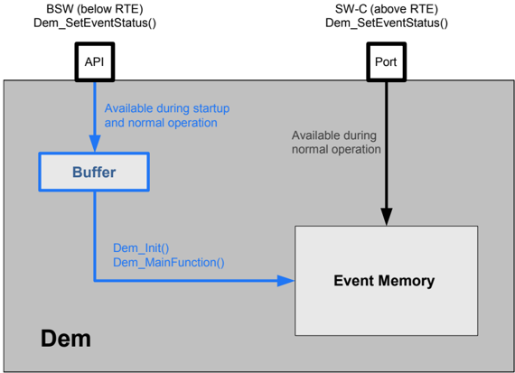

在 Dem_PreInit 之后、Dem_Init 之前通过 Dem_SetEventStatus 报告的所有事件不应触发任何监视器状态变化回调。

### 6.9. OBD 特定功能

#### 6.9.1. 一般概述和限制

下面介绍 AUTOSAR 中 **OBD** 处理的规范。这里"**OBD**"针对不同目标市场指汽车 **OBD**。出于软件共享和分布式开发的原因以及发布打包和责任的考虑，**OBD** 相关的信息/数据结构需要通过标准化的 AUTOSAR 接口报告。

车辆中可以有 3 种不同的 **OBD ECU**：

- **Master ECU**（每车一个），在 **WWH-OBD** [3] 中称为 **VOBD**
- **Primary ECU**（每车多个）
- **从属/辅助 ECU（Dependent / Secondary ECU）**（每车多个）

从基础软件的角度看，从属/辅助 **ECU** 不需要任何特定的 **OBD** 功能。从属/辅助 **ECU** 始终与 **Master** 或 **Primary ECU** 相关联。在从属/辅助 **ECU** 中，**OBD** 相关信息不会存储在基础软件中（例如 **OBD** 事件将通过总线系统转发给相应的 **Master** 或 **Primary ECU**）。在从属/辅助 **ECU** 中，这些"报告的错误"和其他 **OBD** 功能可能由一个软件组件处理。

下表概述了 **Master ECU**、**Primary ECU** 或从属/辅助 **ECU** 必须支持哪些 **OBD** 功能：

表7.4：不同 OBD ECU 中的 OBD 功能概述（**Overview about OBD functionality in different OBD ECUs**）

| 功能 | Master ECU | Primary ECU | 从属/辅助 ECU |
| --- | --- | --- | --- |
| OBD 事件内存 | 自己的以及从属/辅助 ECU 的"报告的错误" | 自己的以及从属/辅助 ECU 的"报告的错误" | 无 |
| MIL Master | 是 | 否 | 否 |
| 按车辆的就绪状态（PID $90） | 是 | 否 | 否 |
| 按 ECU 的就绪状态（PID $91） | 是 | 是 | 否 |
| 车辆 OBD 计数器（PID $93） | 是 | 否 | 否 |
| 通用信息的计算与提供（DYC、General Nominator、PFC cycle 等） | 是 | 否 | 否 |
| 通用信息的接收与执行（DYC、General Nominator、PFC cycle 等） | （是） | 是 | 否 |
| Continuous-MI 计数器 | 是 | 否 | 否 |
| 累计 Continuous-MI 计数器 | 是 | 否 | 否 |
| 标定标识（CAL-ID） | 不在 BSW 内 | 不在 BSW 内 | 不在 BSW 内 |
| 标定校验号（CVN） | 不在 BSW 内 | 不在 BSW 内 | 不在 BSW 内 |

以下 **OBD** 需求仅对 **Master** 和 **Primary ECU** 有效。必要时，**OBD** 需求会区分 **Master** 需求和 **Primary** 需求。**Master** 和 **Primary ECU** 应具有与软件组件相同的接口。为了构建一个精简高效的 **Master ECU**，并不强制使用这些接口。

**Dem** 与特定 **SW-C** 之间交互的一些细节可能保持开放，因为它们依赖于 **Dem** 和 **SW-C** 的实现。以下功能未定义：

- **故障指示灯（MIL）**的激活（**Dem** 到 MIL 处理器的接口、MIL 灯泡检查、就绪闪烁、催化器损坏失火时的闪烁、Continuous-MI、Short-MI、On-demand MI 等）
- 失火故障处理（公共去抖动、单个/多个失火故障的过滤）

但是，本 **Dem** SWS 并不规定在 **Dem** 模块内如何实现 **OBD** 合规性的实现细节（例如关于状态处理）。此外，**Dem** SWS 也不规定 **SW-C** 为实现 **OBD** 合规性所需的诊断算法的实现细节（如何检测故障、何时触发 **IUMPR** 分子的递增等）。

在以下章节中描述 **OBD** 相关的功能和接口。需要注意，独立于标准 AUTOSAR 机制（例如经 **RTE** 的通信），响应码和时序约束需要满足 **OBD** 要求（参见 [12] 和 [18]）。

配置参数 DemOBDEventMemorySetRef 应用于引用唯一一个包含 **OBD** 相关信息的 DemEventMemorySet。**Dem** 的所有 **OBD** 操作应仅在该 DemEventMemorySet 上执行。

在应用标准机制（如 Std_ReturnType）的同时，**Dem** 模块应只返回能确保 **OBD** 合规行为的返回值（就允许的响应码和时序约束而言）。

**通用信息数据的计算与提供**：

**Master ECU** 应计算并通过总线系统向 **Primary ECU** 提供以下通用信息数据：

- **OBD** 驾驶循环信息（**DYC**）
- 通用分子/基于比率的监控——驾驶循环（**RBM cycle**）
- 暖机循环（**WUC**）
- 点火循环
- 已鉴定的 **OBD** 驾驶循环
- 永久故障代码——驾驶循环（**PFC cycle**）

**OBD 驾驶循环信息（DYC）**：**Master ECU** 将通过总线系统提供驾驶循环信息（**DYC**）。**Primary ECU** 不应在内部计算驾驶循环信息（**DYC**）。

**通用分子/基于比率的监控——驾驶循环（RBM cycle）**：包含在 **IUMPR** 周期标志中。

**暖机循环（WUC）**：暖机循环（**WUC**）是法定规定的循环，由 **Master ECU** 计算。**Master ECU** 将通过总线系统提供暖机循环信息（**WUC**）。

**点火循环**：点火循环描述从"端子 15 接通"状态到"端子 15 断开"之间的循环，如果在"端子 15 接通"之后至少 2 秒内满足了发动机启动条件，则包括电子控制单元的关机/后运行阶段。**Master ECU** 将通过总线系统提供点火循环信息。

**已鉴定的 OBD 驾驶循环**：已鉴定的 **OBD** 驾驶循环是法定规定的循环，其定义如下：对于内燃机（非混合动力）：驾驶循环以"点火接通"开始，若其间发动机达到首次启动条件至少 2 秒（±1 秒），则以下一次"点火接通"结束。非由驾驶员或 **ECU** 引起的发动机停机不会结束驾驶循环。
对于混合动力和具有停机策略的发动机，驾驶循环定义为从"点火接通"到该驾驶循环被鉴定之后的下一次"点火接通"之间的时间。
如果一个驾驶循环已鉴定，则每次"点火断开 &gt; 点火接通——事件"都会导致新驾驶循环的开始。该新驾驶循环应被鉴定。当发动机转速超过发动机启动条件所需最低转速至少 2 秒（±1 秒），或满足行驶条件至少 2 秒（±1 秒）时，驾驶循环被鉴定。

**永久故障代码——驾驶循环（PFC cycle）**：（参见第 6.9.5.8 节）

**注意：标定标识（CAL-ID）和标定校验号（CVN）**：标定标识（**CAL-ID**）和标定校验号（**CVN**）的计算不是基础软件的任务，不在 **Dem** 内处理。

#### 6.9.2. Dem 提供的 PID

以下 **PID** 的数据布局应符合 SAE J1979DA：

- PID $01 自 DTC 清除以来的监视器状态（4 字节）
- PID $02 导致所需冻结帧存储的一个 DTC（2 字节）
- PID $1C 车辆或发动机认证所依据的 OBD 要求（1 字节）
- PID $21 MIL 激活期间行驶的里程（2 字节）
- PID $30 自 DTC 清除以来的暖机次数（WUC）（1 字节）
- PID $31 自 DTC 清除以来行驶的里程（2 字节）
- PID $41 本驾驶循环的监视器状态（4 字节）
- PID $4D MIL 激活期间发动机运行时间（2 字节）
- PID $4E 自 DTC 清除以来发动机运行时间（2 字节）
- PID $91 ECU OBD 系统信息（5 字节）
- PID $F501 I/M 就绪数据

**注意：**PID $90 和 $93 在 **VOBD** 的应用中计算。**Primary ECU** 仅提供检索相关数据的接口。

**DemPidClass 容器的依赖关系**：仅当 DemOBDSupport 设置为 `DEM_OBD_MASTER_ECU` 或 `DEM_OBD_PRIMARY_ECU` 时，才应存在容器 DemPidClass 及其聚合的子容器。

**Dem** 模块应计算并提供已确认故障的数量（PID $01，字节 A）。

对于 **WWH-OBD**，PID $01 不应提供已确认故障的数量。

**Dem** 模块应计算并提供 **ECU MIL** 状态（PID $01，字节 A）。

对于 **WWH-OBD**，PID $01 不应提供 **ECU MIL** 状态。

函数 Dem_DcmReadDataOfPID1C 应根据相应的标准返回合适的值"车辆或发动机认证所依据的 OBD 要求"，例如 OBD、OBDII、JOBD 等。要返回的值 PID1Cvalue 在配置参数 DemOBDCompliancy 中定义。

**PID 0xF501 数据的支持**：**Dem** 应计算 PID 0xF501 的数据，并通过 Dem_DcmReadDataOfPIDF501 的参数 **PIDF501value** 提供该数据。

**注意：**PID $02 仅为服务 $02 所需，因此不需要接口（如 Dem_DcmReadDataOfPID02）。而是使用 API Dem_DcmGetDTCOfOBDFreezeFrame（参见第 6.11.2.4 节）。

##### 6.9.2.1. 集中式 PID $21 / $31 / $4D / $4E 处理

**Master ECU** 的 **Dem** 应全车范围地计算 PID $31 / $4D / $4E 的信息。

**Primary ECU** 不允许计算 PID $31 / $4D / $4E 的信息。

**注意：**因此 **Master ECU** 的软件组件将使用 API Dem_DcmReadDataOfPID&lt;NN&gt;（其中 NN 为 31 / 4D / 4E）读取信息，并通过总线系统向 **Primary ECU** 提供 PID $31 / $4D / $4E 的里程/时间信息。

在 **Primary ECU** 的软件组件通过总线系统接收到 PID $31 / $4D / $4E 的信息后，该软件组件将通过调用 **Primary ECU** 的 **Dem** 的 API Dem_SetDataOfPID&lt;NN&gt;（其中 NN 为 31 / 4D / 4E）来设置 PID $31 / $4D / $4E。

只有 **Master ECU** 允许向诊断仪报告 PID $31 / $4D / $4E 的信息。

**Primary ECU** 不允许向诊断仪报告 PID $31 / $4D / $4E 的信息。

在 **Primary ECU** 的软件组件通过总线系统接收到 PID $21 的信息后，该软件组件将通过调用 **Primary ECU** 的 **Dem** 的 API Dem_SetDataOfPID21 来设置 PID $21。

**Dem** 模块应使用 **PID** $0D 来计算 PID $21 和 PID $31。

详情参见第 6.11.7 节。

**Dem** 交付件应提供指向 **Dcm** 的函数调用接口，相应的 ServiceNeed 需要向 **Dcm** 声明支持这些 **PID**。

如果支持 **PID** $1E（辅助输入状态），则 **PTO**（动力输出，**Power Take Off**）相关的事件状态处理应在 **Dem** 模块内实现（参见 [20]）。

**Dem** 模块应提供接口 Dem_SetPtoStatus，允许实现 **PTO** 功能的 **SWC** 通知 **Dem** 模块 **PTO** 是激活还是未激活（参见第 7 章）。

**Dem** 模块应支持配置参数 DemConsiderPtoStatus，指示某个事件受 **Dem** 的 **PTO** 处理影响。

**Dem** 模块提供配置开关 DemPTOSupport，用于启用或禁用 **PID** $1E 的使用。

**PID** $01 和 $41 的计算采用一种特殊配置：

**Dem** 模块应为 **OBD** 系统支持配置参数 DemEventOBDReadinessGroup，用于将单个事件分配到一个特定的就绪组。

根据 SAE J1979，"空调组件"（**AirCondition Component**）组不再受支持。但是它仍包含在 ISO 15031-5 中。这些组区分火花点火发动机（**spark**）和压燃点火发动机（**compr.**）。但是，需要按事件配置其监视器贡献给哪个就绪组（如果有的话）。

**PID $21 处理**

PID $21 或者仅由 **OBD Master ECU** 报告，或者由所有 **OBD ECU** 报告一个同步的值（集中式 **PID** 处理）。

如果配置开关 DemOBDCentralizedPID21Handling 被启用：

**OBD Master ECU** 的软件组件可以通过接口 **GetDataOfPID21** 从 **Dem** 模块获取当前 PID $21 值，以便将该值分发到车辆中的所有其他 **Primary ECU**。

接收到 PID $21 信息的 **OBD Primary ECU** 的软件组件可以通过接口 **SetDataOfPID21** 将该信息转发给 **Dem** 模块，以与 **OBD Master ECU** 同步该值。

在调用 Dem_SetDataOfPID21 时，应更新内部 PID $21 值。

**注意：**AUTOSAR 规定 **OBD Primary ECU** 不自行计算 PID $21 值。

**OBD Master ECU** 应自行计算 PID $21 值（考虑第 6.11.7 节）。

在调用 Dem_GetDataOfPID21 时，应返回内部计算的 PID $21 值。

**注意：**AUTOSAR 规定 **OBD Primary ECU** 不自行计算 PID $21 值。

在调用 Dem_DcmReadDataOfPID21 时，**Dem** 应返回 PID $21 的当前值。

如果在 Dem_SetDataOfPID21 之前调用了 Dem_DcmReadDataOfPID21，**Dem** 应返回 0xFFFF 作为 PID $21 值。

#### 6.9.3. 就绪状态

**Dem** 模块应为 PID $01 计算就绪状态（如果一个 DemEventOBDReadinessGroup 的所有事件自上次清除以来均报告为 OK 已测试，或该事件已导致 MIL 点亮）。被抑制的事件应在该计算中被忽略。

详情参见第 6.4.8 节。

**注意：**DemEventOBDReadinessGroup 具有法规背景，并基于车型年（**MY**）和市场进行特殊计算。

**DemEventOBDReadinessGroup 的依赖关系**：仅当 DemOBDSupport 设置为 `DEM_OBD_MASTER_ECU` 时，才应存在 DemEventOBDReadinessGroup。

**Dem** 模块应为 PID $41 计算当前驾驶循环的就绪组完成状态（如果一组中的所有事件在当前驾驶循环中均被测试）。**OBD** 事件抑制应在该计算中被忽略。

详情参见第 6.4.8 节。

**注意：**为计算组就绪状态，**Dem** 模块考虑分配给特定就绪组的所有事件。

**Dem** 模块应计算就绪组禁用状态（如果监视器为组中的任何事件报告了禁用状态）。**OBD** 事件抑制应在该计算中被忽略。

详情参见第 6.4.8 节。

**Dem** 模块应提供事件的禁用功能（参见 Dem_SetEventDisabled）。**OBD** 事件抑制应在该计算中被忽略。

详情参见第 6.4.8 节。

为了允许监视器报告事件在驾驶循环中无法被计算（由于物理原因而中止），**Dem** 应提供 API Dem_SetEventDisabled。

**注意：**对于 PID $41 的计算，如果测试在本驾驶循环结束前无法再进行，监视器必须将其事件报告为禁用。

**注意：**SetEventDisabled 将事件报告为当前驾驶循环内"无法完成"。它不会将该事件变为第 6.4.8 节所述的事件抑制。

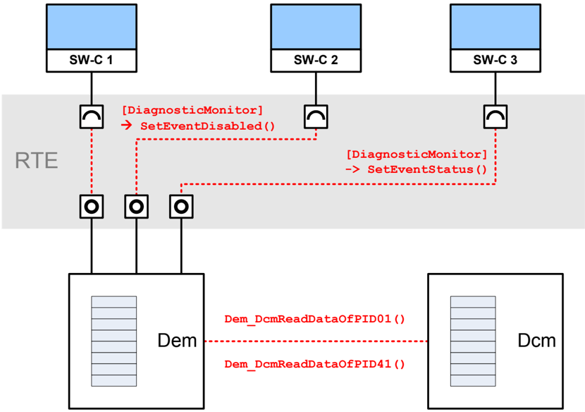

#### 6.9.4. 实际使用监视器性能比（IUMPR）支持

实际使用监视器性能比（**IUMPR**）表示 **OBD** 系统对特定组件进行监控的频率，与车辆运行量的比值。它定义为可能发现故障的次数（= 分子）除以车辆运行条件得到满足的次数（= 分母），如相应 **OBD** 法规所定义。

**IUMPR** 将在 **ECU** 内使用以下公式计算：实际使用监视器性能比 = NUMERATOR / DENOMINATOR

引用被抑制事件的比率不应被计算。

分子应在 **ECU**（**Master** 和 **Primary**）内计算。

**Master ECU** 的 **Dem** 应计算 **IUMPR** 周期标志。

**Dem** 应提供 API Dem_GetIUMPRDenCondition，使软件组件能够获取通用分母的状态信息。

**Master ECU**（软件组件）将通过总线系统提供 **IUMPR** 周期标志（包含在通用分母信号中）。

在 **Master** 和可选的 **Primary OBD ECU** 中，**Dem** 应根据分母 `DEM_IUMPR_GENERAL_OBDCOND`（如果可用）递增 **ECU** 全局内部通用分母。根据系统定义，全局通用分母（因此还有 `DEM_IUMPR_GENERAL_OBDCOND`）在某些甚至所有 **Primary ECU** 中可能不需要。在这种情况下，`DEM_IUMPR_GENERAL_OBDCOND` 永远不会被设置，通用分母停留在 0（并且 **Dcm** 中 InfoType $08 / $0B 的报告被禁用）。

如果 DemIUMPRDenGroup 配置为 `DEM_IUMPR_DEN_NONE`，**Dem** 应根据 `DEM_IUMPR_GENERAL_INDIVIDUAL_DENOMINATOR` 递增该比率的分母，每个驾驶循环至多一次。

如果 DemIUMPRDenGroup 配置为 `DEM_IUMPR_DEN_500MILL`，**Dem** 应根据 `DEM_IUMPR_DEN_COND_500MI_CMPL` 递增该比率的分母，每个驾驶循环至多一次。

如果 DemIUMPRDenGroup 配置为 `DEM_IUMPR_DEN_COLDSTART`，**Dem** 应根据 `DEM_IUMPR_DEN_COND_COLDSTART_CMPL` 递增该比率的分母，每个驾驶循环至多一次。

如果 DemIUMPRDenGroup 配置为 `DEM_IUMPR_DEN_EVAP`，**Dem** 应根据 `DEM_IUMPR_DEN_COND_EVAP_CMPL` 递增该比率的分母，每个驾驶循环至多一次。

如果 DemIUMPRDenGroup 配置为 `DEM_IUMPR_DEN_PHYS_API`，**Dem** 应根据 `DEM_IUMPR_GENERAL_INDIVIDUAL_DENOMINATOR` 递增该比率的分母，每个驾驶循环至多一次，并且仅对调用了 Release 操作的循环考虑监视器特定条件。

如果 DemIUMPRDenGroup 配置为 `DEM_IUMPR_DEN_CSERS`，**Dem** 应根据 `DEM_IUMPR_DEN_COND_CSERS` 递增该比率的分母，每个驾驶循环至多一次。

如果 DemIUMPRDenGroup 配置为 `DEM_IUMPR_DEN_CSERS_API`，**Dem** 应根据 `DEM_IUMPR_DEN_COND_CSERS` 递增该比率的分母，每个驾驶循环至多一次，并且仅对调用了 Release 操作的循环考虑监视器特定条件。

如果 DemIUMPRDenGroup 配置为 `DEM_IUMPR_DEN_EVAPPURGEFLOW`，**Dem** 应根据 `DEM_IUMPR_DEN_COND_EVAPPURGEFLOW_CMPL` 递增该比率的分母，每个驾驶循环至多一次。

**Dem** 应提供 API Dem_SetIUMPRDenCondition，用于由软件组件告知 **IUMPR** 周期标志的状态。

**注意：***Master*** 的 **IUMPR** 周期标志/通用分母信号超时将导致 **Primary ECU** 中 COM 栈内的事件内存条目（信号超时）。

有关实际使用监视器性能比（**IUMPR**）的更多细节，请参见法规文档。

**InfoType $08 / InfoType $0B 的区分**：收集的 **IUMPR** 数据需要在服务 $09 请求时提供。对于汽油发动机，使用 Info Type $08；对于柴油发动机，使用 Info Type $0B（参见 [12] 和 [18]）。

为了支持如上所述的服务 $09 中的数据请求，**Dem** 应向 **Dcm** 提供 API Dem_DcmGetInfoTypeValue08 或 Dem_DcmGetInfoTypeValue0B。

如果 DemOBDEngineType 设置为 `DEM_IGNITION_SPARK`，**Dem** 模块应为 InfoType $08 的 **IUMPR** 数据提供 API Dem_DcmGetInfoTypeValue08。

**注意：***Dcm*** 将使用服务 Dem_DcmGetInfoTypeValue08，按照用于服务 $09 输出的 InfoType $08 数据格式请求 **IUMPR** 数据。

如果 DemOBDEngineType 设置为 `DEM_IGNITION_COMPRESSION`，**Dem** 模块应为 Info Type $0B 的 **IUMPR** 数据提供 API Dem_DcmGetInfoTypeValue0B。

**注意：**API Dem_DcmGetInfoTypeValue0B 将由 **Dcm** 使用，按照用于服务 $09 输出的 InfoType $0B 数据格式请求 **IUMPR** 数据。

**OBD** 系统的类型通过使用配置开关 DemOBDSupport（参见 DemGeneral）定义。

**实际使用监视器性能比（IUMPR）组或组件**

相关的实际使用监视器性能比（**IUMPR**）数据记录基于 **FID** 和事件分配在 **Dem** 中。**IUMPR** 数据分别针对不同的组或组件记录。

通常，一个或多个事件用于这些组件的监控，例如氧传感器。因此，为了记录 **OBD** 系统的实际使用性能，需要记录所有 **IUMPR** 组的所有相关事件的测试性能。为此，需要由 **Dem** 配置某些数据结构。

然而，为了在监视器因另一个事件的发生而停止运行时停止分子和分母的递增，需要列出所有可能影响特定 **IUMPR** 相关事件计算的事件。该信息已经体现在一个 **FID** 中（参见 **FiM** SWS），它代表用于计算例如特定事件的功能。**FID** 在某些事件发生时被抑制，因此这种关系也可用于停止 **IUMPR** 记录。

这导致了一个待记录事件与一个主 **FID**（以及可选的多个次级 **FID**）的组合，后者代表停止 **IUMPR** 事件计算的所有事件。为了将事件分类成组，**IUMPR 组**也是该组合的一部分。

对于每个 **EventId** / **FID** / **IUMPR** 组组合的数据结构配置，引入了一个新的数据对象，即 **RatioId**（参见 DemRatioId）。容器 DemRatio 包含 **EventId**、主 **FID**、次级 **FID**、**IUMPR** 组以及一个配置 'APIuse' 与 'observer' 的接口选项，接口选项将在下面更详细地说明。

同样为了端口配置的目的，向 **SW-C** 提供了一个 ObdRatioServiceNeeds。如果 **SW-C** 与 **IUMPR** 相关，则填写该 ServiceNeed。

如果监视器是"对称的"（**symmetric**），即测试完成时即使当前系统中没有故障也可能发现故障，则仅通过观察所分配事件的 **TESTED** 状态即可递增分子。

仅对于配置为 'observer' 选项的监视器，**Dem** 模块应在所分配事件被测试/鉴定（通过或失败）时递增相应监视器的分子。

如果诊断是非对称的（**asymmetric**），检测故障比检测 OK 状态需要更多工作，则监视器需要调用一个 **API** 来报告可能已发现故障，因为这可能需要在监视器内进行一些仿真，因此不能纯粹从 **TESTED** 状态推导。

**Dem** 模块应提供 API Dem_RepIUMPRFaultDetect，供非对称监视器报告可能已发现故障。

**注意：**根据 **IUMPR** 法规中"检测故障的所有条件均已满足"的规定，监视器应使用该服务报告即使当前完全没有故障也可能发现故障。

**Dem** 应以每个 **OBD** 驾驶循环至多一次的频率递增该比率独立的 **IUMPR** 分子。

**Dem** 模块应提供配置参数 DemRatioKind，按 **RatioId** 指示分子是基于 **TESTED** 状态还是 **API** 调用计算的。

**附加分母条件**

对于某些特定监视器（例如次级空气系统、综合组件），为分母定义了附加条件：只有满足特定的温度或活动条件时，其分母才会递增。然后，监视器需要在一个驾驶循环内满足附加条件时解锁（**Release**）分母。

在检测到阻止这些附加分母条件进一步计算的故障时，分子也需要被冻结。因此，需要在适用时分配特定的分母条件。在报告某个特定分母条件的计算被抑制时，受影响的比率被设置为冻结。

为了在 **Dem** 内处理常用的分母条件，引入了更多的接口和配置项。

**Dem** 模块应提供配置参数 DemIUMPRDenGroup，为每个 **RatioId** 提供若干可应用于分母的条件。

**IUMPR 分母的释放**：如果 DemOBDSupport 未设置为 `DEM_OBD_NO_OBD_SUPPORT`，且 DemIUMPRDenGroup 配置为 `DEM_IUMPR_DEN_PHYS_API` 或 `DEM_IUMPR_DEN_CSERS_API`，则 **Dem** 模块应在特殊条件下提供用于释放分母的 API（参见 Dem_RepIUMPRDenRelease）。

**Dem** 应向 **IUMPR** 相关的 **SW-C** 提供 API Dem_RepIUMPRDenRelease，以控制特定于相应 **RatioId** 的分母。

**注意：**该服务应由监视器用于报告特定监视器（由 **FID** 和 **EventId** 表示）的分母因物理原因而被释放。

在具有多个 **OBD** 相关甚至 **IUMPR** 相关 **ECU** 的系统中，附加分母条件的状态信息需要被通信以同步计数器的行为。为此，引入了一个附加接口来读取和报告各个分母条件的状态。

**Dem** 应提供 API Dem_GetIUMPRDenCondition 以读取特定条件的状态。

**Dem** 应提供 API Dem_SetIUMPRDenCondition 以设置特定条件的状态（主要在从属 **ECU** 中）。

**注意：**为传递所接收的通用分母状态，**Primary ECU** 应使用为 **SWC** 提供的现有 API。

法规要求：如果某个监视器被另一个服务 $07 可见的故障抑制，则应停止对该监视器的 **IUMPR** 跟踪。

只要链接到 DemFunctionIdRef 所引用的 **FID** 之一的任何事件（通过 FunctionInhibitionConfiguration 或通过 SummaryEvents）处于 **PENDING** 状态，或任何与该事件有因果关系的其他事件（根据组件依赖结构，参见 DemDiagnosticEventRef 所引用的 DemComponentClassRef）处于 **PENDING** 状态，就应阻塞该 **IUMPR** 比率。

只要一个事件具有 **Pending** 状态，**Dem** 模块就应停止增加分子和分母。

基于相关的 **FID**（**FiM** 访问）和 **RatioId**，**Dem** 模块可以确定必须停止哪个分子和分母。

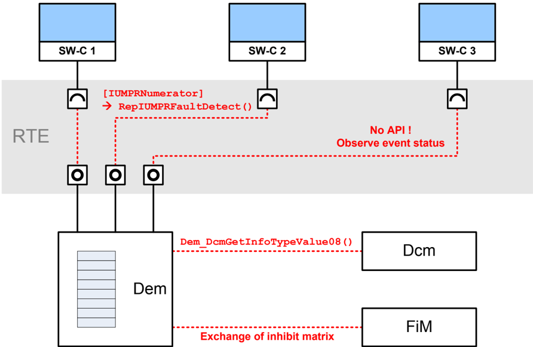

**监视器活动分母的支持**：**Dem** 应计算 ITID "监视器活动分母"（**Monitor Activity Denominator**）的数据，并通过 API Dem_DcmGetInfoTypeValue79 的参数 **DataValueBuffer** 提供它。

#### 6.9.5. 轻型车 OBD（OBD2）

本 **Dem** SWS 与 **Dcm** 一起提供标准化的 AUTOSAR 接口，以支持 SAE J1979 中定义的 **OBD** 服务 $01–$0A。借助这些服务，AUTOSAR **OBD** 功能应能够满足全球所有轻型车 **OBD** 法规（加州 OBDII、EOBD、日本 OBD 以及所有其他）。

**DemRatio 容器的依赖关系**：仅当 DemOBDSupport 设置为 `DEM_OBD_MASTER_ECU` 时，容器 DemRatio 才可用。

##### 6.9.5.1. Service $01 - 读取当前动力系统诊断数据

通过 Service $01 可以读取任何 **PID**（**PID** $02 除外）的当前值。对于 **Dem** 计算的每个 **PID**，提供一个专用的 **API** 函数 Dem_DcmReadDataOfPID&lt;NN&gt;，如第 6.9.2 节所述。

##### 6.9.5.2. Service $02 - 读取动力系统冻结帧数据

为了检索故障条目的相关数据，**Dem** 需要访问通过 **PID** 寻址的当前数据。为此，基于配置项分配一个客户端（=Dcm/Dem）/服务器（=SW-C）接口。

**Dem** 模块应仅支持法规要求的冻结帧（记录号 0）。这将是分配给该冻结帧的单一 **PID** 列表（参见 DemPidClass）。

这意味着通用诊断仪对记录号 1 及以上的请求将被忽略。

故障条目进入内存时，这些 **PID**/**DID** 的值通过 **RTE** 经客户端-服务器接口请求。

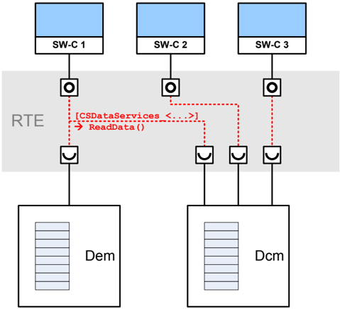

**Dem** 模块应提供对最重要冻结帧（为服务 $02 的输出而选择的、导致 MIL 点亮的事件的 **OBD** 冻结帧）的 **PID** 数据元素的访问，供 **Dcm** 模块使用（参见 Dem_DcmReadDataOfOBDFreezeFrame）。

**注意：****Dem** 只处理并存储服务 $02 的原始数据。任何 **PID** 头信息和填充字节由 **Dcm** 添加。**Dcm** 配置定义了各个 **PID** 布局，它还定义了所包含数据元素的顺序。每个数据元素引用其在 **Dem** 配置中的链接元素（参见图 7.46）。

**PID** 的各个数据元素由 **Dcm** 通过索引选择。

Dem_DcmReadDataOfOBDFreezeFrame 的索引值（参见 **API** 参数 **DataElementIndexOfPID**）应从零开始连续分配。它们的顺序应从 **Dcm** 的 **PID** 布局中数据元素（参见所引用 DcmDspPidData 容器的 DcmDspPidDataPos）的位置推导。

**注意：**该索引不显式配置（以避免实现中例如映射表的资源开销）。

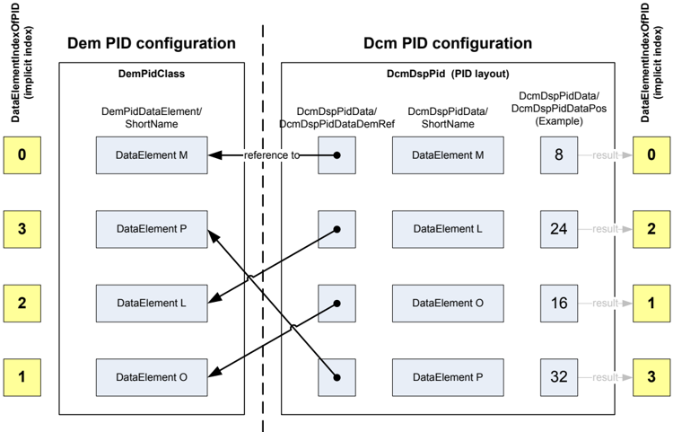

函数 Dem_DcmGetDTCOfOBDFreezeFrame 应返回与为服务 $02 输出而选择的最重要的冻结帧相关联的 **DTC**（PID $02）。

##### 6.9.5.3. Service $03 - 读取排放相关动力系统诊断故障代码

该诊断服务提供 **UDS** 状态位 3 当前已置位的 **OBD DTC**。因此 **Dcm** 将使用第 7.3.4.1 节中描述的接口。

##### 6.9.5.4. Service $04 - 清除/复位排放相关诊断信息

**清除排放相关 DTC**：在 **Master**、**Primary** 和从属/辅助 **ECU** 中执行服务 $04 应清除主内存中的所有排放相关诊断信息。

在 **Master**、**Primary** 和从属/辅助 **ECU** 中执行服务 $04 应包括主事件内存中的非排放相关诊断信息。

##### 6.9.5.5. Service $06 - 支持集中式 DTR 处理

通过 Service $06，外部测试工具可以请求排放相关 **ECU** 返回支持的 **OBDMID**（"OBD 监视器标识符"）和/或与 **OBDMID** 关联的标准化诊断测试结果。

**OBD** 相关标准（参见 ISO 15031-5 和 SAE J1979）为获取车辆内支持的 **OBDMID** 列表这一特殊目的保留了某些 **OBDMID**。这些 **OBDMID** 称为"可用性 OBDMID"（**availability OBDMIDs**），编号为 $00、$20、$40、$60、$80、$A0、$C0 和 $E0。

与早期 AUTOSAR 版本相比，**Dem** 另外提供了报告按特定标识符处理的最新测试结果的接口（为此引入了 **DTR**——"诊断测试结果"）。

在 Service $06 中，响应（除支持信息外）由测试结果、下限和上限组成的三元组，表示已执行且合格的监控检查的最新结果。为了指代特定组件和特定认证的测试，响应还包含 **OBDMID** 和 **TID**（"测试标识符"）。对于数据的外部表示，一个所谓的单位与标度 ID（**Unit and Scaling ID**，**UaSID**）随响应一起传给测试仪。从 **OBD** 法规的角度来看，要求 Service $06 和 Service $07 中的数据一致。在这种场景下，如果测试结果小于下限或大于上限，则测试失败。伴随这种对阈值的违背，必须报告相应的事件，反之亦然。注意，这种一致性严格来说只在首次检测到故障时成立，因为 Service $07 的恢复需要整整一个无故障检测的周期，而 Service $06 的内容只表示最新的测试结果。

为了支持这一致性要求，**Dem** 提供了一个特定的接口按 **DTR** 报告结果，而事件在配置层级与一个 **DTR** 相关联以供引用。

注意，事件充当主控，其状态中的附加效果（例如使能/存储条件）会被纳入。给定特定的 **DTR** 更新类型（通过配置），**UDS** 状态（Tested、Failed、去抖动状态等）决定所报告的 **DTR** 结果是被进一步处理还是被抑制/忽略。

**Dem** 为 **SWC** 提供一个转换服务，以支持在 **ECU** 内部分辨率内报告测试结果和阈值。到目标格式（由 [17, 19] 标准化：uint16，按 UaSID 的公式）的转换（包括舍入效应的修正）在 **Dem** 内完成。为此，配置包含一个类似于 **RTE** 用于描述物理数据的转换公式（但更简单），其中仅支持线性映射。注意该转换不遵循 UaSId。**DTR** 的 Service Need 提供对物理单位的引用（参见 SWC 模板章节"物理单位"）和一个线性转换（参见 SWC 模板章节"计算方法"），其 CompuRationalCoeffs 最多具有两个分子系数和一个分母系数，以及期望的 UaSId。在配置过程中，该信息被处理成单个线性转换，然后存储在 **Dem** 的 ECUC 中。

通过这种中央数据处理，可以支持 Service $07 / $06 的数据一致性方面以及在故障清除时的复位。

**Dem** 应提供数据结构和功能，以持久地接收、存储和报告 Service $06 测试结果。

**DemDtrId** 由 **Dem** 在 **BSW** 配置步骤中分配。

**注意：****Dem** 引用一个 **BSW** 配置 DemDtr，它将：

- 一个 DemDtrId 关联到一个 **EventId**
- 监视器是否将提供最小限值、最大限值或两者的数据的指示
- **OBDMID**
- **TID**
- **UaSID**
- DemDtrUpdateKind
- 类似于 **SW-C** 描述（第 5.5 章）的线性转换系数

为确保数据一致性，一个 **EventId** 最多只能被一个 **DTR** 引用。

**Dem** 应使用 DemDtrUpdateKind 来评估和处理所报告的 **DTR** 值：

- `DEM_DTR_UPDATE_ALWAYS`：不考虑事件的状态（默认，且在未配置 DemDtrEventRef 时使用）。
- `DEM_DTR_UPDATE_STEADY`：仅当事件的 **Dem** 内 pre-去抖"卡"在 FAIL 或 PASS 极限，且最新结果与去抖动方向一致时。

**Dem** 应仅支持线性映射，即仅支持系数 b、c 和 f 的值。

**注意：**ASAM 公式系数：(ax² + bx + c) / (dx² + ex + f)，支持 b、c 和 f。

**Dem** 应在接口 **DTRCentralReport** 内提供 API Dem_SetDTR，为 **SWC** 提供其测试结果的报告机制。参数应为 **DemDtrId**、测试值、最小和最大限值，以及一个指示监视器提供有效最小限值、最大限值或两者、或应将所报告值复位为零的状态。

如果 DemDtrEventRef 引用了一个 DemEventParameter，**Dem** 应仅在所引用事件的所有使能/存储条件都满足时处理所报告的 **DTR** 值，与 DemDtrUpdateKind 无关。如果所引用事件的任何使能/存储条件未满足，则 **Dem** 应忽略所报告的 **DTR** 值。

**注意：**以 `DEM_DTR_UPDATE_STEADY` 为例：如果一个事件从初始化状态达到了 TESTED 状态但未检测到 FAILED，则处于限值内的所接收 **DTR** 值会被处理（=转换并存储）。如果测试结果违背了其关联限值（参见控制值）且事件确实处于 TESTED 和 FAILED，该 **DTR** 报告同样会被处理。但如果测试结果违背了其关联限值（参见控制值）而事件处于 TESTED 和 PASSED，则忽略该 **DTR** 报告，假定 **EventId** 也是有充分理由未被更新的（参见使能/存储条件）。

在 **DTR** 报告中应用该验证检查，可确保 Service $06 和 $07 的数据一致性。

**Dem** 应支持将 **ECU** 内部分辨率按照已配置和标准化的 **UaSID** 转换为标准化的外部 uint16 大小和分辨率。为此，每个 **DTR** 配置一个转换公式。假定 **API** 调用传递的参数包含内部大小和分辨率的值。为此 **Dem** 提供 **sint32** 作为参数，以覆盖 uint16 以及 **sint16**（甚至 **sint32**）的内部数据类型。

**Dem** 应确保测试结果相对于阈值的有效性。如果传递给 Dem_SetDTR 的参数 **TestResult** 处于 **UpperLimit** 和 **LowerLimit** 给出的阈值之内/之外，则 Dem_DcmGetDTRData 的 Testvalue 也应处于 Upplimvalue 和 Lowlimvalue 之内/之外。如果舍入效应导致了含义的意外改变，则应将阈值相应地移动一个增量以恢复结果。

**计算可用的 OBD MID 值**：如果以 0x00、0x20、0x40、0x60、0x80、0xA0、0xC0 或 0xE0 的"可用性 Obdmid"值调用了 Dem_DcmGetAvailableOBDMIDs，且 **Dem** 已配置 DemDtrMid，则 **Dem** 应计算并在出参 **Obdmidvalue** 中提供"支持的 OBDMID"信息并返回 E_OK。所计算的 Obdmids 参数符合 ISO 15031-5，为请求范围内（从 Obdmid+1 开始）每个受支持的 Obdmid 置一个位，并且如果后续范围配置了 Obdmid，则 Obdmidvalue 的最后一位置位。

**无效 Obdmid 值的行为**：如果以不同于 0x00、0x20、0x40、0x60、0x80、0xA0、0xC0 或 0xE0 的无效 Obdmid 值调用了 Dem_DcmGetAvailableOBDMIDs，**Dem** 应报告 **Det** 开发错误 `DEM_E_INVALID_OBDMID`。

应 **Dcm** 的请求，**Dem** 应使用 API Dem_DcmGetNumTIDsOfOBDMID 以每个所请求 **OBDMID** 的 **TID** 数量响应。**Dcm** 可以使用该值按 **OBDMID** / **TID** 索引迭代请求 **DTR** 数据，其中 **TID** 索引从 0 循环到 TID 数量减一。

应 **Dcm** 的请求，**Dem** 应使用 API Dem_DcmGetDTRData 以每个所请求 **OBDMID** / **TID** 索引响应该 **OBDMID** / **TID** 索引可用的数据。**Dcm** 可以使用该值从 0 到 TID 数量减一按 **OBDMID** / **TID** 索引迭代请求 **DTR** 数据。

**Dem** 应使用每个 **DTR** 对事件的引用来复位 **DTR** 数据，只要该事件受到故障清除命令的影响。

如果没有为 **DTR** 分配事件，**Dem** 应在 **Dcm** 发出 Service $04 清除命令时复位 **DTR** 数据，即以如下参数调用 Dem_ClearDTC：
DTC = `DEM_DTC_GROUP_ALL_DTCS`，DTCFormat = `DEM_DTC_FORMAT_OBD`，DTCOrigin = `DEM_DTC_ORIGIN_PRIMARY_MEMORY`。

**DemDtr 容器的依赖关系**：仅当 DemOBDSupport 设置为 `DEM_OBD_MASTER_ECU` 或 `DEM_OBD_PRIMARY_ECU` 时，容器 DemDtr 才可用。

一个 **DTR** 可以通过 DemDtrEventRef 引用一个事件。被引用的事件可能按照第 6.4.8 节不可用。在这种情况下，**Dem** 将该 **DTR** 视为不受支持，既不计算 **DTR** 也不报告其结果。

**为不可用事件设置 DTR 结果**：如果为一个 **DTR** 调用 Dem_SetDTR，而该 **DTR** 通过 DemDtrEventRef 引用的事件本身配置为 DemEventAvailable 为 FALSE，**Dem** 应返回 E_NOT_OK 且不计算该 **DTR**。

**为不可用事件报告 DTR**：如果为一个 **DTR** 调用 Dem_DcmGetDTRData，而该 **DTR** 通过 DemDtrEventRef 引用的事件本身配置为 DemEventAvailable 为 FALSE，**Dem** 应返回 E_NOT_OK。在这种情况下，Dem_DcmGetDTRData 的所有出参均未定义。

##### 6.9.5.6. Service $07 - 读取当前或上一个已完成驾驶循环中检测到的排放相关诊断故障代码

该诊断服务提供 **DTC** 状态位 2（**PendingDTC**）当前已置位的 **OBD DTC**。因此 **Dcm** 将使用第 7.3.4.1 节中描述的接口。

##### 6.9.5.7. 读取具有永久状态的排放相关诊断故障代码

**OBD** 法规要求将 **DTC** 存储在一个永久内存中，该内存不会因 ClearDTC 命令或断电而清除。进入永久内存的 **DTC** 在特殊条件下被移除。这些特殊条件由 **OBD** 法规定义。

一个 **OBD** 相关的 **DTC** 在进入永久故障内存时点亮 **MIL**，并在 **MIL** 停用时被移除。

**存储永久 DTC**：**Dem** 应按照 [21] 所定义的法规，在 **DTCOrigin** `DEM_DTC_ORIGIN_PERMANENT_MEMORY` 内存储永久 **DTC**。

**OBD** 相关 **DTC** 的详情参见第 6.4.1 节。

**报告已存储的永久 DTC**：通过 Dem_SetDTCFilter 设置 **DTC** 过滤器且 **DTCOrigin** = `DEM_DTC_ORIGIN_PERMANENT_MEMORY` 时，**Dem** 应在 Dem_GetNextFilteredDTC 中报告已存储的永久 **DTC**。

**PFC 循环**

**SWC** 可以使用 **Dem** 获取 **PFC** 循环的状态。DemOBDPFCCycleRef 定义了用于 **PFC** 循环的周期，其状态可由应用通过 Dem_GetCycleQualified 轮询。**SWC** 可以在 **MIL Master ECU** 上使用该信息，通过车辆网络将其作为"最小行程条件已满足"转发给 **Primary ECU**。

在 **Primary ECU** 中，**SWC** 可以使用接口 Dem_GetCycleQualified 获知当前 **OBD** 驾驶循环已满足 **PFC** 循环的判据。

##### 6.9.5.8. MIL 处理

通常，"**MIL Master 功能**"位于 **OBD master ECU** 中。只有 **MIL master** 功能才允许向仪表盘发送 **MIL** 请求。

因此，在 **Primary ECU** 中可以使用函数 Dem_GetIndicatorStatus 轮询 **MIL** 指示器状态，并将该信息发送给"**MIL Master 功能**"（例如位于 **master ECU** 中）。

#### 6.9.6. WWH-OBD

##### 6.9.6.1. DTC WWHOBD 等级

**Dem** 应为每个 **DTC** 提供一个等级值（用于刻画故障对 **OBD** 系统监控能力的影响），符合 ISO 14229-1 附录 D.3"DTCSeverityMask 和 DTC 等级信息位定义"（参见 Dem_GetSeverityOfDTC 和 Dem_GetNextFilteredDTCAndSeverity），且仅当至少为一个 **DTC** 配置时提供。

**DTC** 等级仅适用于 ISO 14229-1 的 **DTC**。它可以按 **DTC** 可选配置（参见 DemWWHOBDDTCClass）。

**WWH-OBD DTC** 的优先级应符合表 7.5。

表7.5：WWH-OBD DTC 优先级（**WWH-OBD DTC priority**）

| WWH-OBD DTC 等级 | 优先级 |
| --- | --- |
| A | &gt; B1 DTC |
| B1 | &gt; B2 DTC |
| B2 | &gt; C DTC |
| C | &gt; 无 OBD DTC |

**注意：**ISO 27145-3 使用严重度级别定义了以下 **DTC** 等级：No Class、Class A、Class B1、Class B2 和 Class C。

##### 6.9.6.2. Continuous-MI 计数器

计数器 Continuous-MI 计数器表示 **MIL** 被持续要求点亮期间的发动机小时数。

如果激活模式 4 变为激活，该计数器应复位为 0。

在该事件被检测到且 Continuous-MI 被要求点亮的每个发动机运行小时内，该计数器应递增。

当 Continuous-MI 不再被要求点亮时，该计数器应保持其值。

如果 Continuous-MI 在三个运行序列内再次被要求点亮，该计数器应继续递增。

如果 Continuous-MI 在超过三个运行序列之后再次被要求点亮，该计数器应复位为零并开始递增其值。

如果在超过 40 个暖机循环或超过 200 发动机运行小时之后 Continuous-MI 未被要求点亮、或收到 ClearDTC 请求，该计数器应复位为零。

该计数器应报告为两字节值。如果任何计数操作会导致计数器从 0x00FF 回绕，则计数值应保持在 0x00FF。

该计数器应非易失性存储。

##### 6.9.6.3. 累计 Continuous-MI 计数器（Master ECU）

计数器累计 Continuous-MI 计数器表示在其寿命期内 **MIL** 被持续要求点亮的发动机小时数。该计数器应仅在 **VOBD** 中实现。

在该事件被检测到且 Continuous-MI 被要求点亮的每个发动机运行小时内，该计数器应递增。

当 Continuous-MI 不再被要求点亮时，该计数器应保持其值。

该计数器永不复位。

该计数器应报告为两字节值。如果任何计数操作会导致计数器从 0x00FF 回绕，则计数值应保持在 0x00FF。

该计数器应非易失性存储。

##### 6.9.6.4. Class B1 计数器

Class B1 计数器表示 **Class B1** 故障被确认（**Confirmed**）且处于 **TestFailed** 期间的发动机小时数。该计数器可以实现为全局的（每个 **ECU** 一个计数器）或局部的（每个 B1 事件一个计数器）。**Dem** 模块仅支持全局 **B1** 计数器。

在至少一个 **Class B1** 事件被检测为 **Confirmed** 且 **TestFailed** 的每个 1 小时发动机运行小时内，**B1** 计数器应递增。

当没有 **Class B1** 事件再被检测为 **Confirmed** 且 **TestFailed** 时、或在 ClearDTC 请求之后，**B1** 计数器应锁定其值。

如果一个 **Class B1** 事件再次被检测为 **Confirmed** 且 **TestFailed**，**B1** 计数器继续其递增。

在连续三个运行序列中没有检测到 **Class B1** 事件后，**B1** 计数器应复位为零。

如果 **B1** 计数器超过 200 发动机运行小时且没有检测到 **Class B1** 事件，该计数器应被设置为 190。

**B1** 计数器应报告为两字节值。如果任何计数操作会导致计数器从 0x00FF 回绕，则计数值应锁定在 0x00FF。

**B1** 计数器应非易失性存储。

##### 6.9.6.5. 激活模式

**激活模式升级**

如果 **B1** 计数器超过 200 发动机运行小时，激活模式 4 应为激活。

如果至少一个 **Class A** 事件被确认（**Confirmed**）且 **TestFailed**，激活模式 4 应为激活。

**激活模式降级/恢复**

如果激活模式 4 为激活且不再存在任何激活模式 4 相关条件，则应激活激活模式 3。

如果激活模式 4 已降级为激活模式 3，且某个激活模式 4 相关事件被确认，则当达到 EventFailureCycleCounterThreshold 的配置值时，激活模式 4 应重新激活。

如果激活模式 3 为激活且不再存在激活模式 3 和激活模式 4 相关条件，则应设置激活模式 1。

如果一个 **Class C** 事件被确认且 **TestFailed**，且激活模式 3 或激活模式 4 均未激活，则激活模式 2 应被设置为激活。

函数 Dem_GetIndicatorStatus 应返回由 DemMILIndicatorRef 引用的那些事件的当前"指示器状态"（参见表 7.6）。激活模式的条件在表 7.6 中定义。

表7.6：条件到激活模式的映射（**Mapping of conditions to the activation mode**）

| 条件 | 激活模式 | 指示器状态 |
| --- | --- | --- |
| 无 WWH-OBD 事件激活 | 1 | DEM_INDICATOR_OFF |
| Class C 事件激活 | 2 | DEM_INDICATOR_ON_DEMAND |
| Class B 事件激活且 B1 计数器 &lt; 200h | 3 | DEM_INDICATOR_SHORT |
| Class A 事件激活或 B1 计数器 &gt;= 200h | 4 | DEM_INDICATOR_CONTINUOUS |

##### 6.9.6.6. 冻结帧 0x00

冻结帧应提供故障检测时刻车辆的运行条件。

法规要求的冻结帧 0x00 应在 **UDS** 状态位 2 从 0 到 1 的跳变时存储（通过 DemFreezeFrameRecordTrigger 设置为 `DEM_TRIGGER_ON_PENDING`）。

冻结帧 0x00 在 **UDS** 状态位 3 从 0 到 1 的跳变时更新的更新行为，可以使用 DemFreezeFrameRecordUpdate 配置。

与 **Class A** 故障关联的冻结帧信息的存储/报告应优先于 **Class B1** 故障，**Class B1** 优先于 **Class B2**，**Class C** 同理。

首次检测到的故障应优先于最近的故障，除非最近的故障具有更高的等级。

如果该事件因老化从故障内存中移除，冻结帧 0x00 应被擦除。

法规要求的冻结帧 0x00 的配置方式与非排放相关冻结帧类似。

详情参见第 6.7.7.1 节。

##### 6.9.6.7. 扩展数据记录 0x90

由于 **Dem** 仅支持单一 **B1** 计数器，不支持扩展数据记录 0x90。

##### 6.9.6.8. 老化

除了事件老化（参见第 6.7.8 节）之外，在满足老化条件的情况下，事件还应在 200 小时发动机运行之后被老化。

详情参见第 6.7.8 节。

一个 **OBD** 相关的 **DTC** 应具有 40 的老化计数器阈值。

一个 **OBD** 相关的 **DTC** 应以暖机循环作为老化周期。

##### 6.9.6.9. Service $19 42 - 按掩码记录读取 WWH-OBD DTC

该诊断服务返回与给定的 **DTC** 状态掩码和 **DTC** 严重度掩码相匹配的 **OBD** 相关 **DTC**。

接口 Dem_GetDTCSeverityAvailabilityMask 应向 **DCM** 提供 DtcSeverityAvailabilityMask。

**注意：**DTCSeverityAvailabilityMask 可以从已配置的 **DTC** 严重度和 **WWH-OBD DTC** 等级推导得出。

##### 6.9.6.10. Service $14 FFFF33 - 清除排放相关 DTC

除了清除事件内存条目（参见第 6.7.2.2 节）之外，**Dem** 应清除/复位以下值：

- 激活模式
- 就绪状态（PID $01、PID $41 和 PID $90）
- Continuous-MI 计数器
- 最高 ECU B1 计数器
- B1 计数器
- 法规要求的冻结帧

详情参见第 6.7.2.2 节。

Service $14 FFFF33 应清除所有 **DTC**（**WWH-OBD DTC** 和 **UDS DTC**）。

#### 6.9.7. OBDonUDS

**法规要求冻结帧的支持**：**Dem** 应支持 SAE J1979-2 规定的法规要求冻结帧。

**法规要求冻结帧的数据内容**：如果配置了一个分配给主故障内存的 **DTC** 且其引用 DemFreezeFrameRecordNumber 为 0x00 和 0xF0，**Dem** 应基于通过 DemUDSOBDFreezeFrameClassRef 配置的数据采样法规要求的冻结帧。

如果在特定配置型式中配置了 DemPidClass，则不应配置 DemUDSOBDFreezeFrameClassRef。

### 6.10. J1939 特定功能

**Dem** 模块能够支持 J1939 网络。在这些网络上，它使用 J1939 特定的 **DTC**。

如果存在配置容器 DemGeneralJ1939（参见 DemGeneral），则应提供 **J1939** 支持。

**注意：*****Dem*** 的设计用于区分"仅服务 DTC"和"所有其他 DTC"，将 **DTC** 分配到特定的事件内存。为了使 **J1939Dcm** API 正常工作，"仅服务 DTC"需要分配到用户自定义内存。所有其他 **DTC** 需要分配到主内存。

#### 6.10.1. 读取 DTC

函数 Dem_J1939DcmSetDTCFilter 应设置用于后续调用 Dem_J1939DcmGetNumberOfFilteredDTC 和 Dem_J1939DcmGetNextFilteredDTC 的过滤器掩码属性，并将内部计数器复位到第一个事件。

通过 Dem_J1939DcmSetDTCFilter 设置的过滤器掩码属性将一直使用，直到下一次调用 Dem_J1939DcmSetDTCFilter 或 **Dem** 初始化。

函数 Dem_J1939DcmSetDTCFilter 应返回 **J1939** 指示灯的当前组合状态。匹配的过滤判据在表 7.7 中定义。

表7.7：Dem 模块可检测的错误类型（**Types of errors which can be detected by the Dem module**）

| SetFilter 参数 | UDS 状态过滤器 | 进一步过滤判据 | DM 表示（AllDTCs） | DM 表示（EmissionDTCs） |
| --- | --- | --- | --- | --- |
| DEM_J1939DTC_ACTIVE | (ConfirmedDTC == 1 且 TestFailed == 1) 或 MIL_ON | n/a | DM01 | DM12 |
| DEM_J1939DTC_PREVIOUSLY_ACTIVE | ConfirmedDTC == 1 且 TestFailed == 0 且 MIL_OFF | n/a | DM02 | DM23 |
| DEM_J1939DTC_PENDING | PendingDTC == 1 | n/a | DM27 | DM06 |
| DEM_J1939DTC_PERMANENT | n/a | 存在永久内存条目 | n/a | DM28 |
| DEM_J1939DTC_CURRENTLY_ACTIVE | TestFailed == 1 | n/a | DM35 | n/a |

每次读取 **DTC** 都会返回以下指示灯的组合灯状态：

- a) 故障指示灯（**Malfunction Indicator Lamp**）
- b) 红色停车灯（**Red Stop Lamp**）
- c) 琥珀色警告灯（**Amber Warning Lamp**）
- d) 保护灯（**Protect Lamp**）

##### 6.10.1.1. 组合故障指示灯状态

在由 DemMILIndicatorRef 引用的指示器的 IndicatorStatus 为 `DEM_INDICATOR_OFF` 的情况下，组合"故障指示灯"应设置为"Lamp Off"。所有其他非 `DEM_INDICATOR_OFF` 的 IndicatorStatus 状态都应将组合故障指示灯设置为"Lamp On"。

在由 DemMILIndicatorRef 引用的指示器的 IndicatorStatus 为 `DEM_INDICATOR_OFF` 或 `DEM_INDICATOR_CONTINUOUS` 的情况下，组合"闪烁故障指示灯"应设置为"Unavailable / Do Not Flash"（0x03）。

在由 DemMILIndicatorRef 引用的指示器的 IndicatorStatus 为 `DEM_INDICATOR_SLOW_FLASH` 的情况下，组合"闪烁故障指示灯"应设置为"Slow Flash"（0x00）。

在由 DemMILIndicatorRef 引用的指示器的 IndicatorStatus 为 `DEM_INDICATOR_FAST_FLASH` 的情况下，组合"闪烁故障指示灯"应设置为"Fast Flash"（0x01）。

##### 6.10.1.2. 组合红色停车灯状态

在由 DemRedStopLampIndicatorRef 引用的指示器的 IndicatorStatus 为 `DEM_INDICATOR_OFF` 的情况下，组合"红色停车灯"应设置为"Lamp Off"。所有其他非 `DEM_INDICATOR_OFF` 的 IndicatorStatus 状态都应将组合红色停车灯设置为"Lamp On"。

在由 DemRedStopLampIndicatorRef 引用的指示器的 IndicatorStatus 为 `DEM_INDICATOR_OFF` 或 `DEM_INDICATOR_CONTINUOUS` 的情况下，组合"闪烁红色停车灯"应设置为"Unavailable / Do Not Flash"（0x03）。

在由 DemRedStopLampIndicatorRef 引用的指示器的 IndicatorStatus 为 `DEM_INDICATOR_SLOW_FLASH` 的情况下，组合"闪烁红色停车灯"应设置为"Slow Flash"（0x00）。

在由 DemRedStopLampIndicatorRef 引用的指示器的 IndicatorStatus 为 `DEM_INDICATOR_FAST_FLASH` 的情况下，组合"闪烁红色停车灯"应设置为"Fast Flash"（0x01）。

##### 6.10.1.3. 组合琥珀色警告灯状态

在由 DemAmberWarningLampIndicatorRef 引用的指示器的 IndicatorStatus 为 `DEM_INDICATOR_OFF` 的情况下，组合"琥珀色警告灯"应设置为"Lamp Off"。所有其他非 `DEM_INDICATOR_OFF` 的 IndicatorStatus 状态都应将组合琥珀色警告灯设置为"Lamp On"。

在由 DemAmberWarningLampIndicatorRef 引用的指示器的 IndicatorStatus 为 `DEM_INDICATOR_OFF` 或 `DEM_INDICATOR_CONTINUOUS` 的情况下，组合"闪烁琥珀色警告灯"应设置为"Unavailable / Do Not Flash"（0x03）。

在由 DemAmberWarningLampIndicatorRef 引用的指示器的 IndicatorStatus 为 `DEM_INDICATOR_SLOW_FLASH` 的情况下，组合"闪烁琥珀色警告灯"应设置为"Slow Flash"（0x00）。

在由 DemAmberWarningLampIndicatorRef 引用的指示器的 IndicatorStatus 为 `DEM_INDICATOR_FAST_FLASH` 的情况下，组合"闪烁琥珀色警告灯"应设置为"Fast Flash"（0x01）。

##### 6.10.1.4. 组合保护灯状态

在由 DemProtectLampIndicatorRef 引用的指示器的 IndicatorStatus 为 `DEM_INDICATOR_OFF` 的情况下，组合"保护灯"应设置为"Lamp Off"。所有其他非 `DEM_INDICATOR_OFF` 的 IndicatorStatus 状态都应将组合保护灯设置为"Lamp On"。

在由 DemProtectLampIndicatorRef 引用的指示器的 IndicatorStatus 为 `DEM_INDICATOR_OFF` 或 `DEM_INDICATOR_CONTINUOUS` 的情况下，组合"闪烁保护灯"应设置为"Unavailable / Do Not Flash"（0x03）。

在由 DemProtectLampIndicatorRef 引用的指示器的 IndicatorStatus 为 `DEM_INDICATOR_SLOW_FLASH` 的情况下，组合"闪烁保护灯"应设置为"Slow Flash"（0x00）。

在由 DemProtectLampIndicatorRef 引用的指示器的 IndicatorStatus 为 `DEM_INDICATOR_FAST_FLASH` 的情况下，组合"闪烁保护灯"应设置为"Fast Flash"（0x01）。

##### 6.10.1.5. DTC 数据获取

函数 Dem_J1939DcmGetNumberOfFilteredDTC 应针对所请求 ClientId 的相应主事件内存，返回与 Dem_J1939DcmSetDTCFilter 函数调用定义的表 7.7 过滤判据相匹配的 **J1939 DTC** 数量。

- 如果该函数已计算出匹配 **DTC** 的总数，返回值应为 E_OK。
- 如果由于内部实现或限制需要中断搜索，返回值可以设置为 `DEM_PENDING`。在这种情况下出参无需有效。下一次调用 Dem_J1939DcmGetNumberOfFilteredDTC 应从中断的元素之后继续。

每次调用函数 Dem_J1939DcmGetNextFilteredDTC 都应搜索下一个具有 **J1939DTC** 分配且与 Dem_J1939DcmSetDTCFilter 函数调用所提供节点的表 7.7 过滤判据相匹配的事件。如果没有更多事件匹配过滤判据，函数返回值应为 `DEM_NO_SUCH_ELEMENT`。在这种情况下出参无需有效。

如果函数 Dem_J1939DcmGetNextFilteredDTC 找到了匹配过滤判据的事件，它应返回相应的 **J1939DTC**（详情参见 DemDTCAttributes）和相应的发生计数器。返回值应为 E_OK。如果由于内部实现或限制需要中断搜索，返回值可以设置为 `DEM_PENDING`。在这种情况下出参无需有效。下一次调用 Dem_J1939DcmGetNextFilteredDTC 应从中断的元素之后继续。如果发生计数器高于 +126（0x7E），返回值应设置为 +126（0x7E）。

#### 6.10.2. 清除 DTC

关于清除过程锁定的定义，参见第 6.7.2.2 节。

**Dem** 模块应向 **J1939Dcm** [7] 提供 Dem_J1939DcmClearDTC，用于从事件内存中删除所有活动或之前活动的 **DTC**。这也应触发按照第 6.2 节对相关 **SW-C** / **BSW** 模块的初始化。

当请求 SAE J1939-73 的诊断报文 DM03 和 DM11 之一时，必须清除所有活动（DM11）或之前活动（DM03）的 **DTC**，以及冻结帧等附加信息。

函数 Dem_J1939DcmClearDTC 应清除与指定 **DTC** 相关的所有事件的状态，以及这些事件的所有关联事件内存条目。

**注意：**由于第 6.7.2.2 节，可能存在例外情况。

#### 6.10.3. DM31

DM31 提供每个单独 **DTC** 适用的指示灯及其状态，因此 **DTC** 特定的灯状态需要由函数 Dem_J1939DcmFirstDTCwithLampStatus 返回。

每次调用 Dem_J1939DcmFirstDTCwithLampStatus 都应将内部计数器设置为第一个具有为该特定 **ClientId** 分配的 **J1939DTC** 的事件。

每次调用 Dem_J1939DcmGetNextDTCwithLampStatus 都应在（由函数 Dem_J1939DcmFirstDTCwithLampStatus 设置的）事件内存中搜索下一个具有 **J1939DTC** 分配的事件。如果没有更多具有 **J1939DTC** 分配的事件可用，函数返回值应为 `DEM_NO_SUCH_ELEMENT`。在这种情况下出参无需有效。

如果 Dem_J1939DcmGetNextDTCwithLampStatus 找到了匹配过滤判据的事件，它应返回 **J1939DTC** 特定的灯状态（详情参见以下各节）、相应的 **J1939DTC**（详情参见 DemDTCAttributes）和相应的发生计数器。返回值应为 E_OK。如果由于内部实现或限制需要中断搜索，返回值可以设置为 `DEM_PENDING`。在这种情况下出参无需有效。下一次调用 Dem_J1939DcmGetNextDTCwithLampStatus 应从中断的元素之后继续。如果发生计数器高于 +126（0x7F），返回值应设置为 +126（0x7F）。

##### 6.10.3.1. 故障指示灯

在函数 Dem_J1939DcmGetNextDTCwithLampStatus 中返回的 **DTC** 特定"故障指示灯"应设置为"Lamp On"——如果相应事件已分配了由 DemMILIndicatorRef 引用的指示器且 **UDS** 状态位 7（**WarningIndicator**）处于活动（置为 1）；否则应设置为"Lamp Off"。

**DTC** 特定的"闪烁故障指示灯"应设置为"Unavailable / Do Not Flash"（0x03）——如果相应事件已设置"Lamp On"且由 DemMILIndicatorRef 引用的指示器的 DemIndicatorBehaviour 设置为 `DEM_INDICATOR_CONTINUOUS`。

**DTC** 特定的"闪烁故障指示灯"应设置为"Slow Flash"（0x00）——如果相应事件已设置"Lamp On"且由 DemMILIndicatorRef 引用的指示器的 DemIndicatorBehaviour 设置为 `DEM_INDICATOR_SLOW_FLASH`。

**DTC** 特定的"闪烁故障指示灯"应设置为"Fast Flash"（0x01）——如果相应事件已设置"Lamp On"且由 DemMILIndicatorRef 引用的指示器的 DemIndicatorBehaviour 设置为 `DEM_INDICATOR_FAST_FLASH`。

##### 6.10.3.2. 红色停车灯

在函数 Dem_J1939DcmGetNextDTCwithLampStatus 中返回的 **DTC** 特定"红色停车灯"应设置为"Lamp On"——如果相应事件已分配了由 DemRedStopIndicatorRef 引用的指示器且 **UDS** 状态位 7（**WarningIndicator**）处于活动（置为 1）；否则应设置为"Lamp Off"。

**DTC** 特定的"闪烁红色停车灯"应设置为"Unavailable / Do Not Flash"（0x03）——如果相应事件已设置"Lamp On"且由 DemRedStopIndicatorRef 引用的指示器的 DemIndicatorBehaviour 设置为 `DEM_INDICATOR_CONTINUOUS`。

**DTC** 特定的"闪烁红色停车灯"应设置为"Slow Flash"（0x00）——如果相应事件已设置"Lamp On"且由 DemRedStopIndicatorRef 引用的指示器的 DemIndicatorBehaviour 设置为 `DEM_INDICATOR_SLOW_FLASH`。

**DTC** 特定的"闪烁红色停车灯"应设置为"Fast Flash"（0x01）——如果相应事件已设置"Lamp On"且由 DemRedStopIndicatorRef 引用的指示器的 DemIndicatorBehaviour 设置为 `DEM_INDICATOR_FAST_FLASH`。

##### 6.10.3.3. 琥珀色警告灯

在函数 Dem_J1939DcmGetNextDTCwithLampStatus 中返回的 **DTC** 特定"琥珀色警告灯"应设置为"Lamp On"——如果相应事件已分配了由 DemAmberWarningIndicatorRef 引用的指示器且 **UDS** 状态位 7（**WarningIndicator**）处于活动（置为 1）；否则应设置为"Lamp Off"。

**DTC** 特定的"闪烁琥珀色警告灯"应设置为"Unavailable / Do Not Flash"（0x03）——如果相应事件已设置"Lamp On"且由 DemAmberWarningIndicatorRef 引用的指示器的 DemIndicatorBehaviour 设置为 `DEM_INDICATOR_CONTINUOUS`。

**DTC** 特定的"闪烁琥珀色警告灯"应设置为"Slow Flash"（0x00）——如果相应事件已设置"Lamp On"且由 DemAmberWarningIndicatorRef 引用的指示器的 DemIndicatorBehaviour 设置为 `DEM_INDICATOR_SLOW_FLASH`。

**DTC** 特定的"闪烁琥珀色警告灯"应设置为"Fast Flash"（0x01）——如果相应事件已设置"Lamp On"且由 DemAmberWarningIndicatorRef 引用的指示器的 DemIndicatorBehaviour 设置为 `DEM_INDICATOR_FAST_FLASH`。

##### 6.10.3.4. 保护灯

在函数 Dem_J1939DcmGetNextDTCwithLampStatus 中返回的 **DTC** 特定"保护灯"应设置为"Lamp On"——如果相应事件已分配了由 DemProtectLampIndicatorRef 引用的指示器且 **UDS** 状态位 7（**WarningIndicator**）处于活动（置为 1）；否则应设置为"Lamp Off"。

**DTC** 特定的"闪烁保护灯"应设置为"Unavailable / Do Not Flash"（0x03）——如果相应事件已设置"Lamp On"且由 DemProtectLampIndicatorRef 引用的指示器的 DemIndicatorBehaviour 设置为 `DEM_INDICATOR_CONTINUOUS`。

**DTC** 特定的"闪烁保护灯"应设置为"Slow Flash"（0x00）——如果相应事件已设置"Lamp On"且由 DemProtectLampIndicatorRef 引用的指示器的 DemIndicatorBehaviour 设置为 `DEM_INDICATOR_SLOW_FLASH`。

**DTC** 特定的"闪烁保护灯"应设置为"Fast Flash"（0x01）——如果相应事件已设置"Lamp On"且由 DemProtectLampIndicatorRef 引用的指示器的 DemIndicatorBehaviour 设置为 `DEM_INDICATOR_FAST_FLASH`。

##### 6.10.3.5. J1939 灯状态

如果配置参数 DemInternalDataElement 设置为 `DEM_J1939LAMP_STATUS`，则 Dem_J1939DcmLampStatusType 类型的灯状态应映射到相应的数据元素。

详情参见第 6.10.3 节。

`DEM_J1939LAMP_STATUS` 的 DemInternalDataElement 应包含事件被 **Dem** 内部处理之前的灯状态。

#### 6.10.4. 冻结帧

函数 Dem_J1939DcmSetFreezeFrameFilter 应设置用于后续调用 Dem_J1939DcmGetNextFreezeFrame 的过滤器掩码属性，并将内部计数器复位到第一个冻结帧。过滤器掩码属性将一直使用，直到下一次调用 Dem_J1939DcmSetFreezeFrameFilter 或 **Dem** 初始化。匹配的过滤判据是 `DEM_J1939DCM_FREEZEFRAME`（过滤 DemJ1939FreezeFrameClassRef 中的数据）或 `DEM_J1939DCM_EXPANDED_FREEZEFRAME`（过滤 DemJ1939ExpandedFreezeFrameClassRef 中的数据）。

每次函数调用 Dem_J1939DcmGetNextFreezeFrame 都应按照 Dem_J1939DcmSetFreezeFrameFilter 的过滤判据（FreezeFrameKind 和 ClientId）步进到特定事件内存的下一个（扩展）冻结帧。如果没有更多（扩展）冻结帧匹配过滤判据，函数应返回 `DEM_NO_SUCH_ELEMENT`。在这种情况下出参无需有效。

在不支持的 FreezeFrameKind 情况下，函数 Dem_J1939DcmGetNextFreezeFrame 应触发 **Det** 错误 `DEM_E_WRONG_CONDITION`。有效值为 `DEM_J1939DCM_FREEZEFRAME` 和 `DEM_J1939DCM_EXPANDED_FREEZEFRAME`。

如果第 6.10.4 节的搜索由于内部实现或限制需要中断，返回值可以设置为 `DEM_PENDING`。在这种情况下出参无需有效。下一次调用 Dem_J1939DcmGetNextFreezeFrame 应从中断的元素之后继续。

如果 DestBuffer 参数中的缓冲区不足以容纳（扩展）冻结帧，函数 Dem_J1939DcmGetNextFreezeFrame 应返回 `DEM_BUFFER_TOO_SMALL`。

函数 Dem_J1939DcmGetNextFreezeFrame 应将（扩展）冻结帧数据复制到参数 **DestBuffer** 提供的缓冲区中（对于扩展冻结帧不含任何 **SPN** 信息）。

函数 Dem_J1939DcmGetNextFreezeFrame 应将参数 **J1939DTC** 设置为相应的 **J1939DTC** 值（详情参见 DemDTCAttributes）。

函数 Dem_J1939DcmGetNextFreezeFrame 应将参数 **OccurenceCounter** 设置为相应的发生计数器值。

如果发生计数器高于 +126（0x7E），函数 Dem_J1939DcmGetNextFreezeFrame 应将参数 **OccurenceCounter** 设置为 +126（0x7E）。

##### 6.10.4.1. ExpandedFreezeFrame 中的 SPN

每次调用 Dem_J1939DcmGetNextSPNInFreezeFrame 都应步进到该 DemEventMemory 的 ExpandedFreezeFrame 的下一个 **SPN**。如果 ExpandedFreezeFrame 定义中没有更多 **SPN** 可用，函数返回值应为 `DEM_NO_SUCH_ELEMENT`。在这种情况下出参无需有效。

如果第 6.10.4.1 节的搜索由于内部实现或限制需要中断，返回值可以设置为 `DEM_PENDING`。在这种情况下出参无需有效。下一次调用 Dem_J1939DcmGetNextSPNInFreezeFrame 应从中断的元素之后继续。

在不支持的 FreezeFrameKind 情况下，函数 Dem_J1939DcmGetNextSPNInFreezeFrame 应触发 **Det** 错误 `DEM_E_WRONG_CONDITION`。有效值为 Dem_SPNsInExpandedFreezeFrame。

如果调用了 Dem_J1939DcmGetNextSPNInFreezeFrame 且找到了 ExpandedFreezeFrame 的进一步 **SPN**，**Dem** 应将 **SPN** 编号复制到 **SPNSupported** 中并返回 E_OK。

#### 6.10.5. 诊断就绪

**Dem** 模块需要在内部为"诊断就绪 1"（DM05）、"诊断就绪 2"（DM21）和"诊断就绪 3"（DM26）计算（非）连续监控系统（**(Non-)Continuously Monitored Systems**）的支持和状态。

**J1939** 事件应使用配置参数 DemEventOBDReadinessGroup（参见 DemObdDTC）将单个事件分配到连续或非连续监控系统。

Dem_J1939DcmReadDiagnosticReadiness1 报告与 DM05 相关的诊断就绪诊断信息。

调用 Dem_J1939DcmReadDiagnosticReadiness1 应报告基于 J1939-73 DM05 定义的响应报文：

- "活动故障代码"（**Active Trouble Codes**）应报告活动 **DTC** 的数量，与 Dem_J1939DcmSetDTCFilter (Dem_Active, `DEM_DTC_KIND_ALL_DTCS`) 过滤的 **DTC** 数量相同。
- "之前活动的诊断故障代码"（**Previously Active Diagnostic Trouble Codes**）应报告之前活动 **DTC** 的数量，与 Dem_J1939DcmSetDTCFilter (Dem_PreviouslyActive, `DEM_DTC_KIND_ALL_DTCS`) 过滤的 **DTC** 数量相同。
- "OBD 合规性"（**OBD Compliance**）应基于配置参数 DemOBDCompliancy（位于 DemGeneralOBD 中）。对于非 OBD **ECU**，应报告值五（5）。
- （非）连续监控系统的支持和状态应按照 SAE J1939-73 第 5.7.5.4 至 5.7.5.6 节报告。计算应基于引用相应配置参数 DemEventOBDReadinessGroup 的事件。如果没有任何事件参数引用，支持位应置为零（0）。如果所有已分配事件参数的 TestNotCompletedSinceLastClear 状态位均置为零（0），"监控状态"位应置为"测试完成"（0）；否则"监控状态"位应置为"测试未完成"（1）。

Dem_J1939DcmReadDiagnosticReadiness2 报告与第二个 PGN（承载诊断就绪信息，见 DM21，另见 DM05）相关的诊断信息。

调用 Dem_J1939DcmReadDiagnosticReadiness2 应报告基于 J1939-73 DM21 定义的响应报文：

- "MIL 激活期间行驶的里程"应与 PID 0x21 相同，但最大值为 64255（所有高于 64255 的值均应报告为 64255）。
- "自诊断故障代码清除以来行驶的里程"应与 PID 0x31 相同，但最大值为 64255（所有高于 64255 的值均应报告为 64255）。
- "MIL 激活期间发动机运行的分钟数"应与 PID 0x4D 相同，但最大值为 64255（所有高于 64255 的值均应报告为 64255）。
- "自诊断故障代码清除以来的时间"应与 PID 0x4E 相同，但最大值为 64255（所有高于 64255 的值均应报告为 64255）。

Dem_J1939DcmReadDiagnosticReadiness3 报告当前驾驶循环中 **OBD** 系统监视器 pending 状态的诊断信息（按 DM26，另见 DM05 和 DM21）。

调用 Dem_J1939DcmReadDiagnosticReadiness3 应报告基于 J1939-73 DM26 定义的响应报文：

- "发动机启动以来的时间"应通过 DemOBDTimeSinceEngineStart（位于 DemGeneralOBD 中）检索。
- "自 DTC 清除以来的暖机次数"应与 PID 0x30 相同，但最大值为 250（所有高于 250 的值均应报告为 250）。
- （非）连续监控系统的启用/完成状态应按照 SAE J1939-73 第 5.7.26.3 至 5.7.26.5 节报告。计算应基于引用相应配置参数 DemEventOBDReadinessGroup 的事件。如果没有任何事件参数引用，应指示禁用且完成。否则，禁用状态应基于就绪组禁用状态（参见第 6.9.3 节），如果所有已分配事件参数的 TestNotCompletedSinceThisOperationCycle 状态位均置为零（0），完成状态应置为"监控完成"（0）；否则状态位应置为"监控未完成"（1）。

#### 6.10.6. 监视器性能比

对于 **J1939**，实际使用监视器性能比（**IUMPR**）要求仅对每个受支持的适用系统监视器进行报告。

函数 Dem_J1939DcmSetRatioFilter 应将内部计数器复位到第一个定义了 DemRatioId 的有效 **SPN**，用于后续调用 Dem_J1939DcmGetNextFilteredRatio。此外，它应返回 SAE J1939-73 第 5.7.20.1 章规定的"点火循环计数器"，以及 SAE J1939-73 第 5.7.20.2 章规定的"遇到的 OBD 监控条件"（**CARB** 将其定义为通用分母）。

**读取 J1939 的 IUMPR 数据**：每次调用函数 Dem_J1939DcmGetNextFilteredRatio，**Dem** 模块都应返回与 Dem_J1939DcmSetRatioFilter 函数调用定义的过滤判据相匹配的下一个有效 **SPN** 及其关联的分子和分母（参见第 6.9.4 节）。

如果调用了 Dem_J1939DcmGetNextFilteredRatio 且没有更多 **SPN** 可用，**Dem** 应返回 `DEM_NO_SUCH_ELEMENT`。

### 6.11. 与其他软件模块的交互

#### 6.11.1. 与软件组件（SW-C）的交互

在 AUTOSAR **ECU** 架构中，诊断事件管理器实现了一个 AUTOSAR 服务。这意味着 **Dem** 模块不仅与其他 **BSW** 模块通信，还通过 **RTE** 与 **SWC** 通信（参见图 5.1）。

从 **BSW** "C 模块" **Dem** 的视角来看，该服务与其上经 **RTE** 的 AUTOSAR 软件组件之间存在三种依赖关系：

- 应用通过（实现为 C 函数的）**API** 访问 **Dem**（通过访问 **Dem** 服务组件）。
- 应用可选地在所请求异步活动的结果出来时被通知（由 **Dem** 通过直接/间接 **RTE API**）。
- **SWC** 的初始化函数由 **Dem** 调用。

这些依赖关系必须用 AUTOSAR 元模型来描述，它们既会贡献到应用组件的 SWC Description，也会贡献到 **Dem** 服务的 Service Component Description。

**Dem** 服务的服务组件描述将定义 **RTE** 以下的端口。每个使用 **Dem** 服务的 **SWC** 必须在其自己的 SWC 描述中包含相应的端口，这些端口由相同（或兼容）的接口定义类型，并且必须连接到 **Dem** 的端口，以便生成 **RTE**。这些 **Dem** 端口中使用的 Id 通过端口定义的参数（**port-defined arguments**）进行抽象。

**Dem** 服务组件的名称应为 'Dem'。

到 **SWC** 的回调不使用端口定义参数的机制。相反，**Dem** 的配置机制必须确保回调被投递到配置的端口，并通过 **RTE**（直接或间接）**API** 调用调用该端口上的正确操作。例如，**EventId** 不得作为操作的第一个参数传递，因为监视器（以及其他 **SW-C**）不会显式处理 **EventId**。

与此相反，有一些特殊的 **SWC** 需要统一处理事件状态/数据变化。这些 **SWC** 由 **Dem** 通知，**Dem** 此时也向应用提供 **EventId**，以便能够从 **Dem** 请求相应的数据。因此，提供了通用接口（参见 GeneralCallbackEventUdsStatusChanged、GeneralDiagnosticInfo 和 CallbackEventUdsStatusChanged），它们只能按如下方式使用：**SWC** 不得以任何方式解释（**Dem** 给出的）**EventId**，同时 **SWC** 用于请求事件特定数据的 **EventId** 值必须始终由 **Dem** 提供。这里 **SWC** 只允许对 **EventId** 使用透传（**handthrough**）机制。

在当前的 AUTOSAR 版本中，**RTE** 会分析被触发 runnable 的完整调用树。因此，**Dem API** 中引入了一些限制，以避免 **BSW** 模块发起的、依赖经 **RTE** 回调到 **SWC** 的函数调用。

#### 6.11.2. 与诊断客户端的交互

**Dem** 模块向诊断客户端提供接口。诊断客户端是与处理诊断请求相关的 **BSW** 模块。最常见的诊断客户端是 **Dcm**。还有一些其他用例，其中诊断客户端是通过 **RTE** 接口与 **Dem** 交互的 **SW-C**。诊断客户端访问 **Dem** 模块以委托与事件内存相关的诊断服务。

关于 **Dcm** 与 **Dem** 之间接口使用的详细描述，请查阅 **Dcm** SWS 文档 [9, SWS Dcm]。其中尤其描述了冻结帧数据的处理。

如果 **Dcm** 请求了不可用的事件内存 / **DTC** origin，**Dem** 模块具有相应返回值的函数应返回 `DEM_<...>_WRONG_DTCORIGIN`。

如果 **Dcm** 请求了一个完全不可用的 **DTC**、或一个可用但具有与所请求不同的事件内存 / **DTC** origin 的 **DTC**，**Dem** 模块具有相应返回值的函数应返回 `DEM_<...>_WRONG_DTC`。

如果 **DTC** 的状态发生变化，**Dem** 应调用已配置的 DemCallbackDTCStatusChanged 函数。

**ClientID** 还用于过滤特定内容（例如 **UDS** 实例、**J1939** 节点、**OBD** 等）。

##### 6.11.2.1. 并行事件内存访问

有多个客户端可以请求访问故障内存。为了允许客户端并行访问，**Dem** 使用客户端 ID（**client ID**）的概念。客户端 ID 配置在容器 DemClient 中。每个请求访问 **Dem** 故障内存的客户端都有一个分配的唯一客户端 ID。这些客户端的示例包括：

- 并行的 **OBD** 和 **UDS** 通信，其中每个协议由一个独立的 **Dcm** 客户端处理
- 虚拟 **ECU** 中的多个 **Dcm** 实例，各 **Dcm** 实例相互独立
- 作为 **OBD** 系统中辅助 **ECU** 代理的 **SWC** 或复杂设备驱动
- 由不同客户端清除 **DTC**

**Dem** 支持在各种 **API** 中以参数 **ClientId** 的形式使用客户端 ID，用于：

- 访问故障内存信息
- 读取事件相关数据
- 清除 **DTC** 和故障内存
- 控制故障内存行为

**Dem** 应确保具有不同客户端 ID 的客户端可以并行调用所有以 **ClientId** 为参数的 **API**。一个客户端的 **API** 调用应独立于具有不同 ID 的客户端对同一 **API** 的调用进行处理。

例如，如果一个客户端设置了过滤器以迭代扩展数据记录，另一个客户端可以设置不同的过滤器并迭代扩展数据记录。

**Dem** 应在所有以 **ClientId** 为参数的 **API** 中只接受与任何已配置 DemClientId 匹配的 ClientId 值。如果传入了未配置的 ClientId 值，**Dem** 应报告 **Det** 错误 `DEM_E_WRONG_CONFIGURATION`。

**注意：**客户端是处理诊断请求或用于支持分布式诊断环境（例如在主 **ECU** 上处理来自辅助 **ECU** 的事件）的 **BSW**/**SW-C** 模块或 **CDD**。客户端 ID 概念的设计明确不是为了向任意 **BSW** 模块提供对故障内存的访问，尤其是在模块的目的不同于处理诊断请求时。该设计聚焦于用于 **OBD** 和 **UDS** 处理的 **Dcm**，以及用于分布式 **OBD** 系统的远程事件通信模块。

对于 DemClientUsesRte 参数设置为 TRUE 的每个 DemClient，**Dem** 将提供 C/S 接口 **ClearDTC** 和 **EvMemOverflowIndication**。

##### 6.11.2.2. 访问诊断故障内存

**Dem** 提供一系列用于控制和访问事件内存及其行为或配置与状态的 **API**。这些 **API** 中很多遵循"选择并请求"（**select and request**）机制。客户端首先选择一个 **DTC** 或一组 **DTC**，然后调用作用于当前选择的 **API**。选择是客户端本地的，并保持到做出新的选择为止。

如果调用了 API Dem_SelectDTC，**Dem** 应将所选 **DTC** 或 **DTC** 组（按所请求的 **DTCOrigin** 和 **DTCFormat**）用作以下 **API** 调用的目标：

- Dem_ClearDTC
- Dem_DisableDTCRecordUpdate
- Dem_GetDTCSelectionResultForClearDTC
- Dem_GetDTCSelectionResult
- Dem_GetFunctionalUnitOfDTC
- Dem_GetSeverityOfDTC
- Dem_GetStatusOfDTC
- Dem_SelectFreezeFrameData
- Dem_SelectExtendedDataRecord
- Dem_SetDTCSuppression
- Dem_GetDTCSuppression

**一个客户端在上一个操作完成之前调用 Dem_SelectDTC 的行为**：如果某个客户端调用了 Dem_SelectDTC，而同一客户端再次调用 Dem_SelectDTC，且 **Dem** 目前仍在根据第 6.11.2.2 节处理上一个基于 Dem_SelectDTC 的操作，则 **Dem** 应返回 `DEM_BUSY`。

**一个客户端在上一个操作仍在运行时启动新操作的行为**：如果某个客户端调用了第 6.11.2.2 节所列的任何 Dem_SelectDTC 相关 **API**，而该同一客户端已经启动了另一个第 6.11.2.2 节所列的 Dem_SelectDTC 相关操作且该不同的操作尚未完成，则 **Dem** 应返回 `DEM_BUSY`。

**Dem_Select 依赖操作的生命周期**：无论客户端是否向 **Dem** 请求了 E_OK 结果，**Dem** 都应将基于 Dem_SelectDTC 的操作（按第 6.11.2.2 节）视为独立完成。

客户端在上一个操作仍在运行时调用 Dem_SelectDTC，表明客户端不再对运行中操作的结果感兴趣。结果可以被丢弃，新的选择可以在 **Dem** 就绪后处理。

为了寻址所有 **DTC**，**Dem** 应提供符号 `DEM_DTC_GROUP_ALL_DTCS`，它选择所有已配置的 **DTC**（表示为 0xFFFFFF）。

API Dem_SelectDTC 触发分配给该 ClientId 的事件内存上的 **Dem** 内部 **DTC** 选择过程。选择结果应反映在 Dem_SelectDTC 调用之后的 **API** 调用的返回值中，参见第 6.11.2.2 节。

**注意：**调用 Dem_SelectDTC 之后相关 **API** 的行为在第 6.11.2.2 节中描述。

**注意：**Dem_SelectDTC 在内部选择一个 **DTC** 或 **DTC** 组。如果客户端只对选择结果感兴趣而无后续动作，可以使用 API Dem_GetDTCSelectionResult。该 **API** 的一个用例是 **UDS** 服务 0x14 ClearDTC 的 NRC 处理。**Dcm** 在选择和删除 **DTC** 之间需要执行进一步的 NRC 相关验证。

**3 字节 OBD DTC 的选择**：如果以 DTCFormat 等于 `DEM_DTC_FORMAT_OBD_3BYTE` 调用 Dem_SelectDTC，**Dem** 应仅基于由 DemDtcValue3Byte 定义的 3 字节 **OBD** 格式选择 **DTC**。

**在 DTC 或格式未定义时的 API 行为**：如果需要按第 6.11.2.2 节执行 Dem_SelectDTC 的任何 **API** 在 Dem_SelectDTC 选择无效时被调用，则 **Dem** 应返回 `DEM_WRONG_DTC`。在以下情况下选择无效：所提供的 **DTC** 未指定相应 **DTCFormat** 中的有效 **DTC** 或 GroupOfDTCs；或者之前没有调用过 Dem_SelectDTC。

**未选择 DTC 时的 API 行为**：如果需要按第 6.11.2.2 节执行 Dem_SelectDTC 的任何 **API** 在该客户端未预先调用 Dem_SelectDTC 的情况下被调用，**Dem** 应报告 **Det** `DEM_E_WRONG_CONDITION`。

**在 DTCOrigin 未定义时的 API 行为**：如果需要 Dem_SelectDTC（参见第 6.11.2.2 节）的任何 **API** 在一个不存在的已选 **DTCOrigin** 上被调用，则该 **API** 应返回 `DEM_WRONG_DTCORIGIN`。

**在不支持的 OBD 3 字节 DTC 上的 API 行为**：如果未配置 DemSupportedObdUdsDtcSeparation 或其设置为 FALSE，且任何以 **DTC** 格式为参数的 **Dem API** 以 DTCFormat 设置为 `DEM_DTC_FORMAT_OBD_3BYTE` 被调用，**Dem** 应报告 **Det** `DEM_E_PARAM_DATA`。

如果 Dem_SelectDTC 的选择成功且 **DTC** 或 **DTC** 组已准备好进一步处理，API Dem_GetDTCSelectionResult 应返回 E_OK。

**注意：**在 Dem_SelectDTC 之后调用 Dem_GetDTCSelectionResult 是可选的。依赖于 Dem_SelectDTC 的 **API** 在有无 Dem_GetDTCSelectionResult 调用的情况下行为相同。

如果调用了 API Dem_GetDTCSelectionResult 且来自 Dem_SelectDTC 的 **DTC** 或 **DTC** 组无效，**Dem** 应返回 `DEM_WRONG_DTC`。

如果调用了 API Dem_GetDTCSelectionResult 且提供给 Dem_SelectDTC 的 Origin 无效，**Dem** 应返回 `DEM_WRONG_DTCORIGIN`。

**Dem_GetDTCSelectionResultForClearDTC 功能的定义**：API Dem_GetDTCSelectionResultForClearDTC 的行为应与 Dem_GetDTCSelectionResult 完全相同，唯一区别是：在选择了单个 **DTC** 且该客户端的 DemClearDTCLimitation 设置为 `DEM_ONLY_CLEAR_ALL_DTCS` 的情况下返回 `DEM_WRONG_DTC`。

##### 6.11.2.3. 访问 DTC 和状态信息

以下章节定义应用于访问 **DTC** 数量、匹配特定过滤判据的 **DTC** 及其关联状态信息的 **API**。

API Dem_GetTranslationType 应返回在 DemTypeOfDTCSupported 中配置的 DemEventMemorySet 的转换格式。

函数 Dem_GetDTCStatusAvailabilityMask 应将出参 **DTCStatusMask** 设置为为所分配客户端 ID 在 DemEventMemorySet 的 DemDtcStatusAvailabilityMask 中配置的值。

如果以不同于 `DEM_DTC_ORIGIN_PRIMARY_MEMORY` 或 `DEM_DTC_ORIGIN_USERDEFINED_MEMORY_<Name>` 的 **DTCOrigin** 调用函数 Dem_GetDTCStatusAvailabilityMask，**Dem** 应报告开发错误 `DEM_E_PARAM_DATA`。

**Dem** 模块应能够按照 ISO 14229-1 返回 **DTC** 严重度可用性掩码（参见 Dem_GetDTCSeverityAvailabilityMask）。

函数 Dem_GetDTCSeverityAvailabilityMask 应按照 ISO 14229-1 从每个受支持 **DTC** 的严重度配置计算出 **DTC** 严重度可用性掩码。

**Dem** 模块应使用 **DTC** 状态可用性掩码（通过执行按位与运算）屏蔽提供给 **Dcm** 的所有 **DTC** 状态字节（**API** 参数 **DTCStatus**）。

函数 Dem_GetStatusOfDTC 应将所选 **DTC** 的状态复制到参数 **DTCStatus** 中。**DTCStatus** 格式符合 ISO 14229-1。

如果在一个所选 **DTC** 上调用 API Dem_GetStatusOfDTC，而该 **DTC** 在所选格式中不存在，或所选 **DTC** 是 **DTC** 组、或未选择任何 **DTC**，**Dem** 应返回 `DEM_WRONG_DTC`。

如果在一个不存在的所选 **DTCOrigin** 上调用 API Dem_GetStatusOfDTC，**Dem** 应返回 `DEM_WRONG_DTCORIGIN`。

如果在一个没有分配 **DTC** 状态的所选 **DTC** 上调用 API Dem_GetStatusOfDTC，**Dem** 应返回 `DEM_NO_SUCH_ELEMENT`。

函数 Dem_SetDTCFilter 应为具有相同客户端 ID 的客户端设置过滤判据，用于后续调用：

- Dem_GetNumberOfFilteredDTC
- Dem_GetNextFilteredDTC
- Dem_GetNextFilteredDTCAndFDC
- Dem_GetNextFilteredDTCAndSeverity

**注意：**可以为不同的 ClientID 并行设置 **DTC** 过滤器（参见第 6.11.2.1 节）而互不干扰。这样多个客户端可以并行访问故障内存数据。

图 7.47 展示了两个客户端（例如用于 **OBD** 的 **Dcm** 和用于 **UDS** 的 **Dcm**）并行读取过滤后 **DTC** 数量的情况。

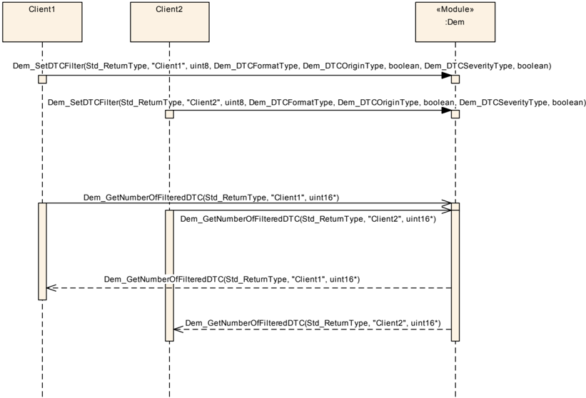

**为就绪组过滤器选择 OBD 3 字节 DTC**：如果以 DTCFormat 等于 `DEM_DTC_FORMAT_OBD_3BYTE` 调用 Dem_SetDTCFilterByReadinessGroup 且 DemSupportedObdUdsDtcSeparation 设置为 True，**Dem** 应使用通过 DemDtcValue3Byte 配置的 **DTC** 作为过滤目标。

**为就绪组过滤器选择 UDS DTC**：如果以 DTCFormat 等于 `DEM_DTC_FORMAT_UDS` 调用 Dem_SetDTCFilterByReadinessGroup 且 DemSupportedObdUdsDtcSeparation 设置为 FALSE，**Dem** 应使用通过 DemDtcValue 配置的 3 字节 **UDS DTC** 作为过滤目标。

**为就绪组过滤器选择不支持的 DTC 格式**：如果以 DTCFormat 等于 `DEM_DTC_FORMAT_UDS` 调用 Dem_SetDTCFilterByReadinessGroup 且 DemSupportedObdUdsDtcSeparation 设置为 TRUE，**Dem** 应报告 **Det** `DEM_E_PARAM_DATA`。

**用扩展数据记录选择 OBD 3 字节 DTC**：如果以 DTCFormat 等于 `DEM_DTC_FORMAT_OBD_3BYTE` 调用 Dem_SetDTCFilterByExtendedDataRecordNumber 且 DemSupportedObdUdsDtcSeparation 设置为 True，**Dem** 应使用通过 DemDtcValue3Byte 配置的 **DTC** 作为过滤目标。

**用扩展数据记录选择 UDS DTC**：如果以 DTCFormat 等于 `DEM_DTC_FORMAT_UDS` 调用 Dem_SetDTCFilterByExtendedDataRecordNumber，**Dem** 应使用通过 DemDtcValue 配置的 3 字节 **UDS DTC** 作为过滤目标。

**Dem_SetDTCFilterByExtendedDataRecordNumber 的功能**：函数 Dem_SetDTCFilterByExtendedDataRecordNumber 应基于参数 **ExtendedDataRecordNumber**，为具有相同客户端 ID 的客户端在 **DTC** 上为受支持的 ExtendedDataRecords 设置 **DTC** 过滤判据，用于后续调用：

- Dem_GetNumberOfFilteredDTC
- Dem_GetNextFilteredDTC

如果 **DTC** 引用的扩展数据记录的 DemExtendedDataRecordNumber 等于该扩展数据记录的编号，则认为该 **DTC** 支持该扩展数据记录。

第 9.11 节中的时序图描述了针对 **UDS** 服务处理的 Dem_SetDTCFilterByExtendedDataRecordNumber 与 Dem_GetNextFilteredDTC 的交互。

**Dem_SetDTCFilterByReadinessGroup 的功能**：函数 Dem_SetDTCFilterByReadinessGroup 应为具有相同客户端 ID 的客户端设置一个 **DTC** 过滤判据，针对分配到给定 **DTC** 就绪组的 **DTC**，用于后续调用：

- Dem_GetNumberOfFilteredDTC
- Dem_GetNextFilteredDTC

**过滤判据的生命周期**：通过以下方式设置的 **DTC** 过滤判据：

- Dem_SetDTCFilter
- Dem_SetDTCFilterByExtendedDataRecordNumber
- Dem_SetDTCFilterByReadinessGroup

在同一个客户端下一次调用这些 **API** 之一或 **Dem** 初始化之前应保持有效。

本章定义 **DTC** 上的过滤器以及基于过滤器的数据检索。**DTC** 过滤器由以下 **API** 之一设置：

- Dem_SetDTCFilter
- Dem_SetDTCFilterByExtendedDataRecordNumber
- Dem_SetDTCFilterByReadinessGroup

术语"**DTC 过滤器**"在需求中和本章中使用，表示客户端已通过调用这些 **API** 之一设置了 **DTC** 过滤器。

**未设置 DTC 过滤器时的 API 行为**：如果依赖已设置 **DTC** 过滤器的任何 **API** 在该客户端未设置 **DTC** 过滤器的情况下被调用，**Dem** 应报告 **Det** `DEM_E_WRONG_CONDITION`。

如果任何依赖已设置 **DTC** 过滤器的 **API** 在设置 **DTC** 过滤器的调用未返回 E_OK 的情况下被调用，**Dem** 应在此后续函数调用上返回 E_NOT_OK。

**DTC** 过滤器设置 **API** 的调用：

- Dem_SetDTCFilter
- Dem_SetDTCFilterByExtendedDataRecordNumber
- Dem_SetDTCFilterByReadinessGroup

应将所请求的过滤器设置到分配给该调用 ClientID 的事件内存集上。

**复位过滤器/数据检索序列**：每次调用 **DTC** 过滤器设置 **API**：

- Dem_SetDTCFilter
- Dem_SetDTCFilterByExtendedDataRecordNumber
- Dem_SetDTCFilterByReadinessGroup

都应导致该客户端的序列复位。

函数 Dem_SetDTCFilter 应忽略在 **DTCStatusMask** 中检索到的、不受支持的位。

Dem_SetDTCFilter 的参数 **DTCFormat** 用于决定特定的协议特性，例如 **OBD** 对 **UDS** 对 **J1939**。**DTCOrigin** 只引用故障内存位置。

如果以配置不支持的 **DTCFormat** 参数值调用函数 Dem_SetDTCFilter（例如传入了 DTCFormat = `DEM_DTC_FORMAT_OBD` 但按配置不支持 **OBD**），应报告 **Det** 错误 `DEM_E_WRONG_CONFIGURATION`。

如果以配置不支持的 **DTCOrigin** 参数值调用函数 Dem_SetDTCFilter，应报告 **Det** 错误 `DEM_E_WRONG_CONFIGURATION`。

**匹配 DTC 过滤判据的 DTC 数量**：如果调用了 Dem_GetNumberOfFilteredDTC，**Dem** 应在出参 **NumberOfFilteredDTC** 中提供与某个 **DTC** 过滤器调用定义的过滤判据相匹配的 **DTC** 数量。

每次调用函数 Dem_GetNextFilteredDTC，**Dem** 模块都应返回下一个匹配已设置 **DTC** 过滤器的 **DTC** 及其关联状态。

客户端可以连续调用 Dem_GetNextFilteredDTC 以接收所有匹配过滤判据的 **DTC**。当函数返回值为 `DEM_NO_SUCH_ELEMENT` 时，表示没有更多匹配过滤判据的 **DTC** 可用，客户端已检索到所有过滤后的数据。

当 DTCFormat = `DEM_DTC_FORMAT_OBD`（表示排放相关服务）时，API Dem_GetNextFilteredDTC 不应返回值 `DEM_PENDING`。

理由：API Dem_GetNextFilteredDTC 用于 **UDS** 服务 0x19 以及 **OBD** 服务 $03/$07/$0A（参见第 6.9.5 节）。**UDS** 服务 0x19 允许向测试仪响应 NRC 0x78（响应挂起，**response pending**），而 **OBD** 服务不允许。

每次调用函数 Dem_GetNextFilteredDTCAndFDC，**Dem** 模块都应返回下一个匹配 Dem_SetDTCFilter 函数调用所定义过滤判据的 **DTC** 及其关联的故障检测计数器（**FDC**，参见第 6.7.3.5 节）。

如果回调函数 Dem_GetFaultDetectionCounter 对被 Dem_GetNextFilteredDTCAndFDC 过滤的某个 **DTC** 返回非 E_OK 或未配置，则该 **FDC** 值应作为 0 返回。

**Dcm** 连续调用函数 Dem_GetNextFilteredDTCAndFDC 直到函数返回值为 `DEM_NO_SUCH_ELEMENT`，以接收所有匹配过滤判据的 **DTC**。

**注意：**非 **Dem** 内部计算的故障检测计数器通常经 **RTE** 从 **SWC** 请求。为了为这些 runnable 指示一个等效的调用树，使用了一种变通方法：**Dcm** 主函数向 **Dem** 接口 **GeneralEvtInfo**（操作 GetFaultDetectionCounter）指定一个触发器，该触发器触发相应的 runnable（参见 RunnableEntity Dem_GetFaultDetectionCounter）。

每次调用函数 Dem_GetNextFilteredDTCAndSeverity，**Dem** 模块都应返回下一个匹配 Dem_SetDTCFilter 函数调用所定义过滤判据的 **DTC** 及其关联的故障严重度。

**Dcm** 连续调用函数 Dem_GetNextFilteredDTCAndSeverity 直到函数返回值为 `DEM_NO_SUCH_ELEMENT`，以接收所有匹配过滤判据的 **DTC**。

关于函数 Dem_GetSeverityOfDTC 和 Dem_GetFunctionalUnitOfDTC 的信息，参见第 6.4 节。

函数 Dem_SetFreezeFrameRecordFilter 应设置静态过滤判据属性"当前存储在事件内存中的所有冻结帧记录"，用于后续调用 Dem_GetNextFilteredRecord 和 Dem_GetNumberOfFreezeFrameRecords。该过滤器始终属于主内存。

Dem_SetFreezeFrameRecordFilter 的过滤判据属性将一直使用，直到下一次调用 Dem_SetFreezeFrameRecordFilter 或 **Dem** 初始化。每次调用 Dem_SetFreezeFrameRecordFilter 都应导致冻结帧迭代序列的复位。

Dem_GetNumberOfFreezeFrameRecords 应检索主内存中匹配当前过滤器的冻结帧记录数量。

**未设置 DTC 过滤器时的 API 行为**：如果需要 Dem_SetFreezeFrameRecordFilter 的任何 **API** 在该客户端未预先调用 Dem_SetFreezeFrameRecordFilter 的情况下被调用，**Dem** 应报告 **Det** `DEM_E_WRONG_CONDITION`。

每次调用函数 Dem_GetNextFilteredRecord，**Dem** 模块都应返回下一个匹配 Dem_SetFreezeFrameRecordFilter 函数调用所定义过滤判据的 **DTC** 及其关联的相对寻址冻结帧记录号。

客户端连续调用函数 Dem_GetNextFilteredRecord 直到函数返回值为 `DEM_NO_SUCH_ELEMENT`，以接收所有匹配过滤判据的记录。

函数 Dem_GetDTCByOccurrenceTime 应提供按照 **API** 参数 **DTCRequest** 获取一个存储在所寻址 DemEventMemorySet 的主事件内存中的 **DTC** 的能力。

如果没有 **DTC** 匹配参数 **DTCRequest** 中所请求的发生时间，API Dem_GetDTCByOccurrenceTime 应返回 `DEM_NO_SUCH_ELEMENT`。

##### 6.11.2.4. 访问事件相关数据

本节定义用于访问随 **DTC** 存储在 **Dem** 事件内存中的事件相关数据（参见第 6.7.7.1 节和第 6.7.7.3 节）的 **API**（经由诊断）。此外，还提供对冻结帧中存储的 **WWH-OBD** 相关 **PID** 的访问。冻结帧处理的细节见 ISO 14229-1 和 ISO 27145-3。

**PID 到 DID 的映射示例**：PID $04 -&gt; DID 0xF404

**注意：**返回的数据包括 ISO 14229-1 为服务 0x19 0x05 的响应报文定义的 DTCSnapshotRecordNumberOfIdentifiers（**DID** 数量）。

如果调用了 API Dem_SelectFreezeFrameData，**Dem** 应将 Dem_SelectDTC 所选的 **DTC** 和 **RecordNumber** 用作以下 **API** 调用的目标：

- Dem_GetNextFreezeFrameData
- Dem_GetSizeOfFreezeFrameSelection

API Dem_SelectFreezeFrameData 触发分配给该 ClientId 的事件内存上的 **Dem** 内部冻结帧选择过程。**Dem** 应在 Dem_SelectFreezeFrameData 调用之后的 **API** 调用的返回值中提供选择过程的结果，参见第 6.11.2.4 节。

如果需要 Dem_SelectFreezeFrameData（参见第 6.11.2.4 节）的任何 **API** 在未预先调用 Dem_SelectFreezeFrameData 的情况下被调用，**Dem** 应报告 **Det** 错误 `DEM_E_WRONG_CONDITION`。

函数 Dem_GetNextFreezeFrameData 应将由 API Dem_SelectFreezeFrameData 为指定 ClientId 选择的冻结帧记录中的特定数据标识符（**DID**）复制到 **DestBuffer** 参数提供的目标缓冲区。**Dem** 应以完整的记录及 **Buffer** 格式传输这些数据。

**Buffer** 格式参见图 7.48。

如果 API Dem_SelectFreezeFrameData 选择的 **RecordNumber** 设置为 0x00，Dem_GetNextFreezeFrameData 应提供事件/**DTC** 特定的 **OBD** 等效冻结帧记录。

**注意：**仅当 **Dem** 模块支持 **OBD**（参见 DemOBDSupport）时，才支持通过 Dem_SelectFreezeFrameData 和 Dem_GetNextFreezeFrameData 检索记录 0x00。

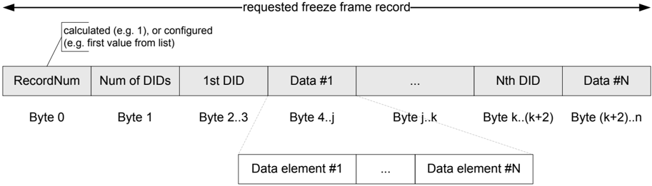

**注意：**返回的数据包括 ISO 14229-1 为服务 0x19 0x04 的响应报文定义的 DTCSnapshotRecordNumber（**RecordNum**）和 DTCSnapshotRecordNumberOfIdentifiers（**DID** 数量）。与 **Dcm** 的 **PID** 结构处理不同，**DID** 结构在 **Dem** 模块内处理。因此，**Dem** 已经按照响应布局返回完整的冻结帧记录。这带来一个优化的 **Dem**/**Dcm** 接口。

如果选择了单个 **DTC** 且以一个有效的但未存储的 **RecordNumber** 调用了 API Dem_SelectFreezeFrameData，Dem_GetNextFreezeFrameData 应返回 E_OK 且 BufSize 为 0（空缓冲区）。

函数 Dem_GetSizeOfFreezeFrameSelection 应返回由 Dem_SelectFreezeFrameData 为指定 ClientId 所请求的冻结帧记录的大小，它表示用户数据字节的数目，包括任何冻结帧头信息（按照第 6.11.2.4 节定义的格式）。

**注意：**如果请求的记录号为 0xFF，**Dem** 按第 6.11.2.4 节考虑所有已存储冻结帧记录的大小。

**未配置快照记录的请求大小**：如果调用了 Dem_GetSizeOfFreezeFrameSelection 且所选冻结帧记录号未配置，**Dem** 应返回 `DEM_NO_SUCH_ELEMENT`。

**仅对单个 DTC 选择冻结帧数据**：如果调用了函数 Dem_SelectFreezeFrameData，而由 Dem_SelectDTC 选择的 **DTC** 不是单个 **DTC** 而是 **DTC** 组，**Dem** 应返回 `DEM_WRONG_DTC`。

**仅对单个 DTC 选择扩展数据记录**：如果调用了函数 Dem_SelectExtendedDataRecord，而由 Dem_SelectDTC 选择的 **DTC** 不是单个 **DTC** 而是 **DTC** 组，**Dem** 应返回 `DEM_WRONG_DTC`。

如果调用了 API Dem_SelectExtendedDataRecord，**Dem** 应将 Dem_SelectDTC 所选的 **DTC** 和 **ExtendedDataNumber** 用作以下 **API** 调用的目标：

- Dem_GetNextExtendedDataRecord
- Dem_GetSizeOfExtendedDataRecordSelection

API Dem_SelectExtendedDataRecord 触发分配给该 ClientId 的事件内存上的 **Dem** 内部扩展数据记录选择过程。**Dem** 应在 Dem_SelectExtendedDataRecord 调用之后的 **API** 调用的返回值中提供选择过程的结果，参见第 6.11.2.4 节。

如果需要 Dem_SelectExtendedDataRecord（参见第 6.11.2.4 节）的任何 **API** 在未预先调用 Dem_SelectExtendedDataRecord 的情况下被调用，**Dem** 应报告 **Det** 错误 `DEM_E_WRONG_CONDITION`。

API Dem_GetNextExtendedDataRecord 应将由 Dem_SelectExtendedDataRecord **API** 为指定 ClientId 所请求的扩展数据记录的完整数据复制到目标缓冲区（**DestBuffer**）。该函数应以完整的记录及 **Buffer** 格式传输这些数据。扩展数据记录号作为复制数据的第一个字节放置。

**Buffer** 格式参见图 7.49。

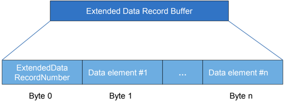

如果以有效的 **DTC** 和一个有效的但未存储的扩展数据记录号调用了 API Dem_SelectExtendedDataRecord，该 **API** 应返回 E_OK，且 Dem_GetNextExtendedDataRecord 应返回 BufSize 为 0（空缓冲区）。

函数 Dem_GetSizeOfExtendedDataRecordSelection 应返回由 Dem_SelectExtendedDataRecord 选择的所请求扩展数据记录的大小，它表示存储在扩展数据记录中的用户数据字节的数目，包括任何扩展数据记录头信息（即扩展数据记录号，不同于第 6.11.2.4 节定义的格式）。

ISO 14229-1 定义了 **DTCExtendedDataRecordNumber** 通配符 0xFE 和 0xFF，用于通过单个 **UDS** 请求请求多个扩展数据记录。**Dem** 始终支持这些扩展数据记录，无需显式配置。

**DTCExtendedDataRecordNumber 0xFE 的支持**：只要支持 0x90–0x9F 范围内的至少一个扩展数据记录（即使用了法规要求的排放 **OBD**），**Dem** 就应始终支持主故障内存的 **DTCExtendedDataRecordNumber** 0xFE，并返回存储在 0x90 到 0x9F 范围内的所有法规要求排放 **OBD** 扩展数据记录。

**主故障内存中 DTCExtendedDataRecordNumber 0xFF 的支持**：**Dem** 应始终支持主故障内存的 **DTCExtendedDataRecordNumber** 0xFF，并返回存储在 0x01 到 0xEF 范围内的所有扩展数据记录。

**用户自定义故障内存中 DTCExtendedDataRecordNumber 0xFF 的支持**：**Dem** 应始终支持用户自定义故障内存的 **DTCExtendedDataRecordNumber** 0xFF，并返回存储在 0x01 到 0xFE 范围内的所有扩展数据记录。

如果要通过后续 **API** 调用访问特定 **DTC** 的冻结帧或扩展数据，**Dcm** 会使用函数 Dem_DisableDTCRecordUpdate。这样做是为了确保在该 **DTC** 的数据被 **Dcm** 通过多个 **API** 调用访问期间不被更改。

函数 Dem_DisableDTCRecordUpdate 应保护所选 **DTCOrigin** 内所选 **DTC** 的事件相关数据不被更新或删除，以允许以下后续 **API** 调用的一致读取：

- Dem_SelectFreezeFrameData、Dem_GetSizeOfFreezeFrameSelection 和 Dem_GetNextFreezeFrameData
- Dem_SelectExtendedDataRecord、Dem_GetSizeOfExtendedDataRecordSelection 和 Dem_GetNextExtendedDataRecord

只要空间可用，新事件和其他事件及其关联的冻结帧和扩展数据记录仍可以添加到事件内存并在其中更改。

**注意：**事件相关数据可能仍在后台更新（例如 **Dem** 内部数据元素）。

**注意：**函数 Dem_DisableDTCRecordUpdate 不影响 **UDS** 状态信息的更新。

函数 Dem_EnableDTCRecordUpdate 应释放当前被函数 Dem_DisableDTCRecordUpdate 保护的已禁用 **DTC**，使数据可以再次更新。

函数 Dem_EnableDTCRecordUpdate 是函数 Dem_DisableDTCRecordUpdate 的对应操作。

在特定 **DTC** 的冻结帧和扩展数据被函数 Dem_DisableDTCRecordUpdate 保护之后、且后续 **API** 调用的访问结束后，**Dcm** 调用函数 Dem_EnableDTCRecordUpdate。

如果启用了开发错误检测，且在同一客户端锁定另一个 **DTC** 时调用了函数 Dem_DisableDTCRecordUpdate，**Dem** 模块应报告 **Det** `DEM_E_WRONG_CONDITION`。

##### 6.11.2.5. 清除诊断信息

**Dem** 向 **Dcm** 和其他诊断客户端提供清除 **DTC** 的功能。通用的 **DTC** 清除过程在第 6.7.2.2 节中描述。

##### 6.11.2.6. 控制 DTC 设置

**受 Dem_DisableDTCSetting 和 Dem_EnableDTCSetting 影响的 DTC**：对 API Dem_DisableDTCSetting 和 Dem_EnableDTCSetting 的调用影响分配给该调用 clientId 所引用 DemEventMemorySet 的所有事件和 **UDS** 状态字节。未被该 DemEventMemorySet 引用的 **DTC** 不受影响。

如果调用了函数 Dem_DisableDTCSetting，**Dem** 应禁用相应事件的存储和 **UDS** 状态字节更新。

函数 Dem_DisableDTCSetting 用于系统中人为引起的故障情形，例如在网络中对一个 **ECU** 进行刷写重编程（**flash reprogramming**）期间。在这种情况下，所有 **ECU** 都通过诊断请求（由 **Dcm** 使用 Dem_DisableDTCSetting / Dem_EnableDTCSetting 转发）被命令忽略 **DTC** 报告，因为被刷写的 **ECU** 不再参与正常通信。

**注意：**如果网络中的其他某个 **ECU** 需要此时缺失的某个信号，则不能将 **ECU** 的失效安全反应分配给 **UDS** 状态字节更新，因为在 **DTC** 设置禁用期间这些更新也被抑制。

如果调用了函数 Dem_EnableDTCSetting，**Dem** 应启用相应事件的存储和 **UDS** 状态字节。

当 **DTC** 设置被禁用时，**Dem** 应忽略来自 API Dem_SetEventStatus 的针对相关事件的所有状态报告（不改变 **UDS** 状态字节）。

**注意：**这类似于使能条件的处理（参见第 6.7.6 节）。它对 Dem_ResetEventDebounceStatus、Dem_ResetEventStatus 和 Dem_ClearDTC 没有影响。在 **Dem** 内部去抖动的情况下，相关的故障检测计数器将被冻结或复位（参见图 7.30 和图 7.33）。

##### 6.11.2.7. 异步 Dcm 操作

**Dem**/**Dcm** 接口的大多数 **API** 依赖 **NVRAM** 数据。因此，这些 **API** 的异步处理通过使用附加的 `DEM_PENDING` 返回值来实现。

#### 6.11.3. 与 J1939 诊断管理器的交互

如果主事件内存中某个事件的 **TestFailed** 位发生变化，且为该事件分配了 **J1939 DTC** 编号，则应为引用该 DemEventMemorySet 的每个 DemClient 调用函数 J1939Dcm_DemTriggerOnDTCStatus。

#### 6.11.4. 与功能抑制管理器（FIM）的交互

功能抑制管理器的用途是基于抑制条件（例如检测到的错误）控制（启用/禁用）软件组件内的功能实体。**Dem** 对该功能的贡献是向 **FiM** 提供监视器状态变化和 **DemComponent** 信息。

如果 DemTriggerFiMReports 设置为 True，**Dem** 模块应在每次监控状态变化时（另参见第 6.7.1.2 节）通过在 Dem_SetEventStatus 的上下文中调用函数 FiM_DemTriggerOnEventStatus（与 &lt;Module&gt;_DemTriggerOnMonitorStatus 语法相同）来通知 **FiM** 模块（参见 [8]）。

**Fim** 使用函数 Dem_GetMonitorStatus 进行可能的合理性检查、重建等抑制关系。

**Dem** 应在监视器和组件状态初始化之后调用 FiM_DemInit。

如果 DemTriggerFiMReports 设置为 True，**Dem** 应在 Dem_Init 期间调用 FiM_DemInit 以触发 **Fim** 内权限的初始化（与触发或轮询模式无关）。FiM_DemInit 不得在其他任何时间点被调用。

#### 6.11.5. 与 NVRAM 管理器（NvM）的交互

通常，**Dem** 模块使用非易失性内存块（**Nonvolatile Memory Blocks**，大小可通过 **NVRAM** 管理器 [5] 配置）来实现 **UDS** 状态信息、事件相关数据和所需内部状态（例如在启动时获取状态）的永久存储。**Dem** 使用的每个非易失性内存块也需要进行配置（参见 DemNvRamBlockId）。使用的非易失性存储块的数量、类型和内容没有规定。这些可根据具体实现进行处理。**NvM** 的使用也可以通过配置（参见 DemNvRamBlockId 的多重性）进行禁用，这时 **Dem** 将仅基于 **RAM** 工作。

**Dem** 模块应验证其非易失性块的有效性（与块状态相关）、完整性（与 **CRC** 结果相关）以及一般 **NvM** 读取错误（在使用相应数据之前）。

通常这种验证是在 API Dem_Init 中完成的，通过对这些块使用 **NvM_GetErrorStatus**，这些内存块由 **ECU** 状态管理器读取（参见 API **NvM_ReadAll**）。

**注意：**对于 **Dem** 模块的非易失性数据，建议在 **NvM** 中配置一个 **CRC**。

如果 **NVM** 模块无法读取 **Dem** 模块的某些非易失性数据，**Dem** 模块应使用其初始值初始化所有非易失性数据。

**注意：**为了避免可读数据块和错误的数据块之间的不一致，所有非易失性数据都会被初始化。完成初始化是为了允许 **NvM** 模块的故障检测机制向 **Dem** 模块报告相应的读取错误（参见 Dem_SetEventStatus）。这些错误表示有缺陷的 **NVRAM**。

**Dem_Init** 完成后，**Dem** 模块应完全可操作。

**首次发生时立即存储事件相关数据**：如果 **DTC** 配置为 DemNvStorageStrategy = `IMMEDIATE_AT_FIRST_OCCURRENCE`，则当配置的用于存储数据的触发器 DemEventMemoryEntryStorageTrigger 第一次发生时，**Dem** 应触发将该事件的事件相关数据存储到 **NvM**。

**注意：**对于在首次发生时立即存储的 **DTC**，需要确保 Dem_Init 期间的数据一致性（例如与 **UDS** 状态字节）。

**注意：**在首次发生时存储之后，事件相关数据的任何进一步变化将在关机期间存储（参见第 6.11.5 节）。

**关机时存储事件相关数据**：如果 **DTC** 配置为 DemNvStorageStrategy = `DURING_SHUTDOWN`，或未配置 DemNvStorageStrategy，**Dem** 应仅在关机期间触发将事件相关数据存储到 **NvM**（参见第 6.11.5 节）。

API Dem_Shutdown 应完成 **Dem** 模块中所有未完成的操作，以便为内部状态和数据到 **NVRAM** 的传输做好准备。事件内存应被锁定，且在重新调用 API Dem_Init 之前不得修改。

**Dem** 应在 Dem_Shutdown 期间触发将其已更改的非易失性数据存储到 **NVRAM**。

基于 **Dem** 的配置和实现，那些需要在 Dem_Shutdown 之后存储的 **Dem** 相关 **NvM** 块到 **NVRAM** 的复制过程，由 **ECU** 状态管理器调用的 API **NvM_WriteAll** 执行。

如果在 **NvM** 完成将所有数据复制到 **NVRAM** 之前断开了 **ECU** 电源，这些数据将不完整/不一致或未被存储。在下一次启动时，可能找不到上一个运行周期的事件。因此，**NVRAM** 管理器配置提供了数据一致性机制，例如冗余数据块。

如果需要在 Dem_Init 和 Dem_Shutdown 之间存储和恢复数据，**Dem** 模块应使用 **NVRAM** 管理器的 API **NvM_WriteBlock** 和 **NvM_ReadBlock**。

**注意：***NvM*** 模块为块的读取和写入实现了重试机制。因此，**Dem** 模块不为其非易失性块实现任何重试机制。

如果 **NVM** 模块无法写入 **Dem** 模块的某些（全部）非易失性数据，**Dem** 模块应忽略 **NvM** 报告的否定返回值。

**注意：**如果 **Dem** 非易失性数据的写入失败，**Dem** 模块无法做出任何适当的反应。

#### 6.11.6. 与默认错误跟踪器（Det）的交互

与 **Det** 的交互在第 6.13 节中描述。

#### 6.11.7. Dem 模块所需的数据

**Dem** 模块需要不同的信息用于内部计算/处理。如果这些信息由 **SWC** 提供（作为提供端口，**provide-ports**），它们在相应的 ServiceNeed（诊断能力）中描述。

**Dem** 模块所需的一类信息是事件相关数据（由冻结帧和扩展数据记录表示，参见第 6.7.7 节）。

**注意：**对于 **OBD** 相关的 **ECU**，**Dem** 模块可以（通过数据元素接口）访问以下数据值：

- 发动机温度
- 发动机转速
- 车辆速度（参见第 6.9.2 节，PID $0D）
- 里程信息
- 编程事件
- 环境温度
- 环境压力
- 加速踏板信息

然而，数据元素的列表及其所需的大小和分辨率是实现特定的，将在 **OBD** 中配置并在集成过程中处理。例如，车辆速度、加速踏板信息、环境温度等是评估 **IUMPR** 通用分母的周期条件所必需的。**PID** 计算也需要类似的输入（例如用于计算暖机循环的发动机温度或暖机循环条件本身）。这些变量通常通过 **RTE** 访问。

#### 6.11.8. 服务接口上的标度信息

软件组件模板 [23] 定义了元类 **SwDataDefProps**，它涵盖特定数据对象在各个方面的所有属性。本章描述两种替代工作流，说明如何在 **Dem** 服务 SWC 中使用 SwDataDefProps 属性（如 **CompuMethod**、**DataContraints** 和 **Units**），并通过 DemExternalSRDataElementClass 使其可用。

仅当 DemApplicationDataType 所引用 DataType 的 CompuMethod 类别设置为 TEXTTABLE 或 SCALE_LINEAR_AND_TEXTTABLE 时，DemAlternativeDataType 处的 DemTextTableMapping 聚合才有效。

**工作流 1**

该工作流是在生成的 EcuC 值内使用 EcucForeignReference。在导入 DEXT [24] 信息时，会导出 DemDiagnosticDataElementRef，它持有一个指向 DEXT [24] 文件中 DiagnosticDataElement 的 EcucForeignReference。该 EcucForeignReference 能够访问相应 DiagnosticDataElement 的所有 SwDataDefProps（**BaseType**、**CompuMethod**、**DatConstr** 等）。容器 DemAlternativeDiagnosticDataElement 聚合该 EcucForeignReference。在生成相应服务 SWC 的过程中，所有需要的内容将直接基于该 EcucForeignReference 从 DEXT [24] 复制到服务 SWC。在该工作流中，生成服务 SWC 时需要存在 DEXT 文件。

**工作流 2**

该工作流是在导入 DEXT [24] 信息时，除 EcuC 值外还生成一个 SWC 片段（**SWC fragment**）。在该 SWC 片段中，所有需要的 SwDataDefProps 都直接从 DEXT [24] 文件复制。在生成的 EcuC 值中，EcuC 参数 DemApplicationDataType 引用该 SWC 片段，从而能够访问所有 SwDataDefProps（**BaseType**、**CompuMethod**、**DatConstr** 等）。在生成相应服务 SWC 的过程中，所有需要的内容将基于从 DemApplicationDataType 到 SWC 片段的引用而被包含。在该工作流中，生成服务 SWC 时不需要存在 DEXT [24] 文件。

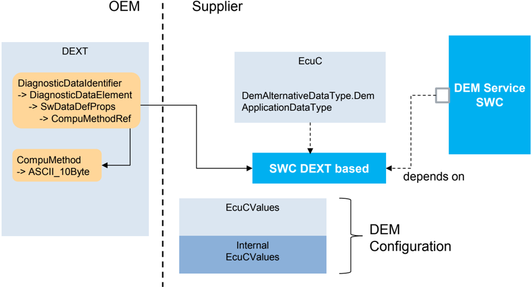

### 6.12. 版本检查

详情请参阅 SWS_BSWGeneral 中第 5.1.8 章"版本检查"（**Version Check**）。

### 6.13. 错误分类

《基础软件模块通用规范》第 7.13 章"错误处理"（**Error Handling**）详细描述了基础软件的错误处理。它首先构成了一个由五种错误类型组成的分类方案，这些错误可能发生在 **BSW** 模块中。

基于此基础，以下各节规定了按相应子章节组织的特定错误。

#### 6.13.1. 开发错误

**Dem** 模块中开发错误的定义：

| 错误类型 | 相关错误代码 | 错误值 |
| --- | --- | --- |
| 以活动配置不允许的参数值调用了 API 函数 | DEM_E_WRONG_CONFIGURATION | 0x10 |
| 以 NULL 指针调用了 API 函数 | DEM_E_PARAM_POINTER | 0x11 |
| 以错误的参数值调用了 API 函数 | DEM_E_PARAM_DATA | 0x12 |
| 以错误的长度参数值调用了 API 函数 | DEM_E_PARAM_LENGTH | 0x13 |
| Dem 初始化失败 | DEM_E_INIT_FAILED | 0x14 |
| 在 Dem 模块完全初始化之前或 Dem 模块已关机之后调用了 API 函数 | DEM_E_UNINIT | 0x20 |
| 相应 API 调用所需的条件未满足（例如发起了无效的状态变化，或过滤器未正确设置等） | DEM_E_WRONG_CONDITION | 0x40 |
| 以无效的 OBDMID 调用了 Dem_DcmGetAvailableOBDMIDs | DEM_E_INVALID_OBDMID | 0x50 |

如果 DemDevErrorDetect 设置为 TRUE，且以下 **API** 之外的任何 **Dem API**：

- Dem_SetEventStatus
- Dem_ResetEventStatus
- Dem_SetEventAvailable
- Dem_ResetEventDebounceStatus
- Dem_GetVersionInfo
- Dem_MainFunction

在 **Dem** 完全初始化之前被调用，**Dem** 模块应设置错误代码 `DEM_E_UNINIT`。

**注意：**如果禁用了开发错误检测且 **Dem** 未完全初始化，这些 **API** 的行为是未定义的。

在 Dem_Init 期间，**Dem** 初始化监视器和组件状态。在此时间点之后，**Dem** 应在 API Dem_GetMonitorStatus 和 Dem_GetComponentFailed 上返回 E_OK。

如果启用了开发错误检测，且任何实例在 **Dem** 被预初始化之前调用了 Dem_SetEventStatus 或 Dem_ResetEventDebounceStatus，**Dem** 模块应设置错误代码 `DEM_E_UNINIT`。

**注意：**如果禁用了开发错误检测且 **Dem** 未预初始化，这些 **API** 的行为是未定义的。

如果启用了开发错误检测，且任何实例在调用 Dem_Shutdown 之后调用了除 Dem_SetEventStatus、Dem_ResetEventDebounceStatus、Dem_GetVersionInfo 和 Dem_MainFunction 之外的任何 **Dem API**，**Dem** 模块应设置错误代码 `DEM_E_UNINIT`，直到再次调用 Dem_Init。

**注意：**如果禁用了开发错误检测且 **Dem** 已关机，这些 **API** 的行为是未定义的。

如果启用了开发错误检测，且在所需前提条件未满足的情况下调用了某个 **Dem** 函数，**Dem** 模块应设置错误代码 `DEM_E_WRONG_CONDITION`。

**注意：**例如，在以 FilterForFaultDetectionCounter = FALSE 调用了 Dem_SetDTCFilter 之后调用了 Dem_GetNextFilteredDTCAndFDC。

#### 6.13.2. 运行时错误

**Dem** 模块中运行时错误的定义：

| 错误类型 | 相关错误代码 | 错误值 |
| --- | --- | --- |
| 与已变化的监视器状态相对应的 UDS 状态无法被处理 | DEM_E_UDS_STATUS_PROCESSING_FAILED | 0x21 |
| SW-C 或 BSW 调用时没有数据元素的有效数据 | DEM_E_NODATAAVAILABLE | 0x30 |

#### 6.13.3. 瞬态故障

没有瞬态故障。

#### 6.13.4. 生产错误

没有生产错误。

#### 6.13.5. 扩展生产错误

没有扩展生产错误。
