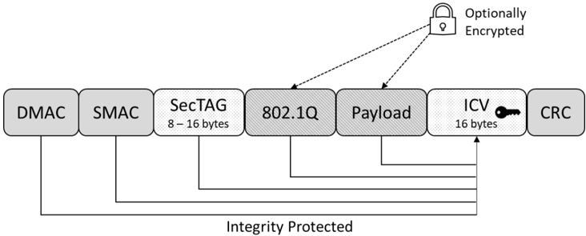
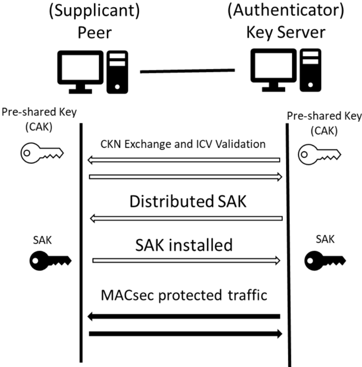

<!-- 源文档 AUTOSAR_FO_RS_MACsec（R23-11），需求规范（RS），不受 Type A 七章骨架约束；章节结构镜像源文档自身编号。需求项 ID [FO_RS_MACsec_*] 与 {DRAFT} 标记按 2026-11-03 批次决议整体省略（标题仅翻译），需求项按其在源文档中的出现顺序补予小节编号（4.2.1.1–4.2.1.2、4.2.2.1–4.2.2.7、4.2.3.1–4.2.3.9、4.2.4.1–4.2.4.3、4.2.5.1–4.2.5.9、4.2.6.1、4.2.7.1–4.2.7.3）。源 §2.2.1–§2.2.3 均为「No content.」占位节，按占位规则整节省略；源 §4.3「Non-Functional Requirements (Qualities)」为「No content.」占位节，按占位规则省略；源第 5 章「Requirements Tracing」为纯 ID 追溯表（含一张表格截图形式的 PDF 装饰图），按 2026-11-03 决议整章省略并将后续章节重编号（源 6→5）。源文档无变更历史附录。封面元数据表、免责声明与目录按 EXP 流程省略；2 处内容图（图4.1 MACsec 帧布局、图4.2 带预共享密钥的 MACsec 密钥协商序列）按源图号嵌入，其余图引用为页面装饰；§3 表格之后的帧布局标签散落（DMAC、SMAC、ICV 16 bytes 等）与图 4.1/4.2 的图内标签散落按转换噪声丢弃。 -->

## 1. 文档范围

本文档规定 **AUTOSAR Foundation** 中 **MACsec** 协议的需求。其动机是规定以下协议的使用：

- **IEEE 802.1AE**（也称为 **MACsec**）协议。
- **MACsec** 密钥协商协议（在 **IEEE 802.1X** 中标准化）。

## 2. 所用约定

### 2.1. 文档约定

**AUTOSAR** 文档中需求的表述遵循约束 TPS\_STDT\_00078 规定的表格，见 **Standardization Template** 的「Support for Traceability」章（[\[1\]](#ref-1)）。

需求的表达应使用约束 TPS\_STDT\_00053 规定的义务表达动词形式，见 **Standardization Template** 的「Support for Traceability」章（[\[1\]](#ref-1)）。

## 3. 缩略语和缩写

以下收录与本文档相关、且未被 **AUTOSAR** 术语表 [\[2\]](#ref-2) 收录的缩略语和缩写。

**AN**
> 关联编号（**Association Number**）

**CA**
> 安全连接关联（**Secure Connectivity Association**）

**CAK**
> 安全连接关联密钥（**Secure Connectivity Association Key**）

**DA**
> 目的地址（**Destination Address**）

**ICV**
> 完整性校验值（**Integrity Check Value**）

**KaY**
> **MAC** 安全密钥协商实体（**MAC Security Key Agreement Entity**）

**MACsec**
> 介质访问控制安全（**Media Access Control Security**）

**MKA**
> **MACsec** 密钥协商协议（**MACsec Key Agreement protocol**，**IEEE Std 802.1X**）

**MKPDU**
> **MACsec** 密钥协商协议数据单元（**MACsec Key Agreement Protocol Data Unit**）

**MPDU**
> **MACsec** 协议数据单元（**MACsec Protocol Data Unit**）

**PAE**
> 端口访问实体（**Port Access Entity**）

**PN**
> 数据包编号（**Packet Number**）

**SA**
> 安全关联（**Secure Association**）或源地址（**Source Address**），视情形而定

**SAI**
> 安全关联标识符（**Secure Association Identifier**）

**SAK**
> 安全关联密钥（**Secure Association Key**）

**SC**
> 安全信道（**Secure Channel**）

**SCI**
> 安全信道标识符（**Secure Channel Identifier**）

**SecTAG**
> **MAC** 安全标签（**MAC Security TAG**）

**SecY**
> **MAC** 安全实体（**MAC Security Entity**）

**SL**
> 短长度（**Short Length**）

**SSCI**
> 短安全信道标识符（**Short Secure Channel Identifier**）

## 4. 需求规格

本章描述驱动 **MACsec** 协议定义工作的全部需求。

### 4.1. 功能概述

**IEEE 802.1AE**（也称为 **MACsec**）是一种工作在介质访问控制层的网络安全标准，它为与介质访问无关的协议定义无连接的数据机密性和完整性。

**802.1AE** 标准规定了 **MAC** 安全实体（**SecY**）的实现，**SecY** 是附加到同一 **LAN** 的站点的一部分，向客户端提供安全的 **MAC** 服务。该标准定义：

- **MACsec** 帧格式，它是一个带特定 EtherType 的有效以太网帧，并包含以下附加字段：
  - 安全标签（**Security Tag**），它是 EtherType 的扩展。
  - 消息认证码（**ICV**）。
- 安全连接关联（**CA**），表示经由单向安全信道连接的站点组。
- 每个安全信道内的安全关联（**SA**）。每个关联使用自己的密钥（**SAK**）。信道内允许存在多于一个关联，目的是在不中断流量的情况下更换密钥（标准要求设备至少支持两个）。
- **GCM-AES-128**（带 128 位密钥的高级加密标准密码的伽罗瓦/计数器模式）默认密码套件
  - 支持使用 256 位密钥的 **GCM-AES-256**

**MACsec** 允许识别未经授权的 **LAN** 连接并将其排除在网络通信之外。与 **IPsec** 和 **TLS** 一样，**MACsec** 定义了一个安全基础设施，以提供数据机密性、数据完整性和数据源认证。

通过确保帧来自声称发送它的站点（这可能需要附加的机制），**MACsec** 甚至可以缓解原本无法防护的第 2 层协议攻击。**MACsec** 防护第 2 层攻击的一个场景是：入侵者在电缆线束中安装设备以发起中间人（**man-in-the-middle**）攻击。

为了识别属于同一安全连接关联（**CA**）的参与者、建立安全信道并维持其存活，通信中的参与者使用 **MACsec** 密钥协商协议（**MKA**）。该协议在 **IEEE 802.1X** 标准中描述和规定。

#### 4.1.1. 动机

**AUTOSAR** 当前支持多种协议来建立安全通信信道，在以太网上提供数据机密性、数据完整性和数据源认证（例如 **IPsec**、**TLS**、**SecOC**）。

**TLS** 协议的主要目标是在两个通信对等方之间提供隐私和数据完整性。如果多于两个通信对等方需要以完整性受保护的方式交换数据，则必须为每个对等方连接建立单独的 **TLS** 连接。**TLS** 与应用协议无关；更高层的协议可以透明地叠加在 **TLS** 之上。**TLS** 需要为每个基于应用的会话建立单独的连接，这会导致资源开销。每个会话需要为协商的密钥、会话状态和其他组织信息单独维护一个数据库条目。

为避免大量所需 **TLS** 连接引入的开销，可以将安全通信信道向下推一层，到 **IP** 层。为了保护 **IP** 层，引入了 **IPsec**。**IPsec** 包含用于在会话开始时建立主机间相互认证以及协商会话期间使用的密码密钥的协议。**IPsec** 可以保护一对主机之间（主机到主机）、一对安全网关之间（网络到网络）或安全网关与主机之间（网络到主机）的数据流。**IPsec** 使用密码安全服务保护 **IP** 网络上的通信。它支持网络级对等方认证、数据源认证、数据完整性、数据机密性（加密）和重放保护（**RFC 4301**）。

与 **TLS** 相比，**IPsec** 的优势在于开销更低，因为 **IPsec** 将所有安全应用信道组合到单一安全信道中。然而，**IPsec** 在典型的汽车用例中存在负面影响。由于 **IPsec** 在主机到主机层级连接，而在汽车领域有时无法使用互联网模型，因为主机之间的连接更紧密。当另一个对等方加入安全通信网络时，连接数量也会按 2 的幂次增加资源和密钥协商时间。再次避免这种开销的方法是将安全信道向下推一层，到 **MAC** 层。有了 **MAC** 层上的安全性，非基于 **IP** 的协议以及使用多播的协议都可以受到保护。

目标是引入 **IEEE 802.1AE**（**MACsec**）解决方案，以减少网状网络布局中的开销，并通过减少对等方数量（每个以太网端口一个对等方，而不是每个 **UDP**/**TCP** 端口一个对等方）和避免更高的网络栈层级来减少密钥协商期间的时序问题。

在 **AUTOSAR** 平台中实现 **MACsec** 协议，提供了在具有机密性和/或完整性的网络节点之间建立安全通信信道的选项。本文档讨论在 **MACsec** 感知硬件（**PHY** 或特定控制器）与 **MACsec** 软件解决方案中的功能实现，以及不同解决方案彼此之间的互操作性。

在 **AUTOSAR** 经典平台中，需要适配 **MAC** 层以实现 **IEEE 802.1AE** 解决方案。

#### 4.1.2. 功能元素

与 **MACsec** 相关的标准（[3, IEEE-802.1AE-2018] 和 [4, IEEE-802.1X-2020]）定义了以下功能元素：

- **MAC** 安全实体（**SecY**）：**SecY** 定义并标识经认证的伙伴。**SecY** 向其客户端实现安全的 **MAC** 服务。**MAC** 安全实体负责完整性保护/验证，以及在需要时加密/解密以提供用户数据机密性。**SecY** 可以是软件或硬件实现。
- 端口访问实体（**PAE**）：**PAE** 提供属于安全连接关联（**CA**）的参与者之间的相互认证，并协商满足 **SecY** 需求的密码密钥和相关参数。
- **MAC** 安全密钥协商实体（**KaY**）：**KaY** 负责 **PAE** 内的 **MKA**，用于通过密钥协商建立安全信道，并在其生命周期内监控该信道。
- 安全信道（**SC**）：存储各种配置参数，例如是否执行重放保护，或是否启用加密。
- 安全关联（**SA**）：安全信道下的安全关系。每个 **SA** 支持不同的密钥。一个安全信道支持若干连续的 **SA**，以便在不终止已建立安全信道的情况下更换密钥。
- **MKPDU**：**MACsec** 密钥协商协议数据单元。
- **MACsec** 协议数据单元（**MPDU**）：定义驻留在 **MAC** 层（**ISO/OSI** 第 2 层）的帧布局。

以下术语标识协议场景中的角色：

- 参与者（**Participant**）：单个 **KaY** 在给定 **MKA** 实例中参与行为的人格化。它传输和接收由从单个给定 **CAK** 派生的密钥保护、并由连接关联密钥名称（**CKN**）标识的 **MKPDU**。
- 密钥服务器（**Key Server**）：生成并分发要在安全信道中使用的安全关联密钥的经认证参与者。该参与者决定要使用的密码套件。
- 对等方（**Peer**）：不具有密钥服务器角色的经认证参与者。

**MACsec** 和 **MKA** 通信需要以下密钥：

- 安全连接关联密钥（**CAK**）：给定 **CA** 的成员拥有的秘密密钥。**CAK** 由其相应的安全连接关联密钥名称（**CKN**）标识。
- 完整性校验值密钥（**ICK**）：从相应 **CAK** 派生的密钥，用于传输/验证完整性受保护的 **MKPDU**。
- 密钥加密密钥（**KEK**）：从相应 **CAK** 派生的密钥，用于加密/解密安全关联密钥（**SAK**）。
- 安全关联密钥（**SAK**）：**MACsec** 实体（**SecY**）用于对属于特定安全关联的 **MPDU** 进行完整性保护/验证和/或加密/解密的密钥。**SAK** 由一个 **MKA** 参与者（密钥服务器）生成，并在 **MKA** 序列期间分发。

如图4.2 所示，**MKA** 协议由三个阶段组成：

1. 参与者的认证。
2. 会话协商。
3. 安全通信。

##### 4.1.2.1. 参与者的认证

在 **MKA** 序列的第一阶段，**MKA** 实体（**KaY**）识别属于其所配置 **CA** 的其他参与者。

在本文档的当前版本中，仅支持预共享密钥认证，并且参与者在 **MKA** 序列中拥有固定的角色。

**MKA** 通信的参与者将基于交换的 **MKPDU** 的 **CKN** 和 **ICV** 相互识别和认证。一旦一个参与者能够成功识别并认证属于同一 **CA** 的另一个参与者，另一参与者的成员标识符就会被纳入其传输的「潜在对等方列表」（**Potential Peer List**）中。

如果一个参与者识别出另一个参与者，并且自己出现在对方的「潜在对等方列表」中，它会将其标记为活跃（**Live**）参与者。另一参与者的成员标识符将被纳入其传输的「活跃对等方列表」（**Live Peer List**）中。

##### 4.1.2.2. 会话协商

在本文档的当前版本中，不支持密钥服务器成员的动态选举，因此每个参与者当前会预先配置其在通信中的角色。

参与者可以通过「**MACsec** 密码套件公告」（**MACsec Cipher Suites Announcement**）共享所支持的密码套件。拥有密钥服务器角色的参与者将选择一个密码套件，并相应地生成和分发安全关联密钥。

双方参与者应通过设置「**MACsec SAK 使用**」（**MACsec SAK Use**）参数来告知已准备好传输和接收 **MACsec** 受保护的 **PDU**。

在安全信道的生命周期内，可以在不中断通信的情况下分发新的 **SAK**（从而创建新的 **SA**）。参与者还可以检测通信伙伴是否存活。

如果选择了带扩展数据包编号（**XPN**）的密码套件，则在安全信道生命周期内会交换附加的参数集，以保持信道信息为最新。

##### 4.1.2.3. 安全通信

在识别、相互认证、密钥分发和密钥安装之后，可以基于前述阶段交换的参数开始安全通信。

### 4.2. 功能需求

#### 4.2.1. 应支持的标准

##### 4.2.1.1. MACsec 协议支持

| 描述 | 应按 [3, IEEE-802.1AE-2018] 的规定支持 **MACsec**。 |
| --- | --- |
| 理由 | 实现经由 **MAC** 的安全通信 |
| 依赖项 | - |
| 用例 | 车内安全通信 |
| 支撑材料 | **IEEE 802.1AE** |
| 适用平台 | **CP**、**AP** |

##### 4.2.1.2. MACsec 密钥协商协议支持

| 描述 | 应按 [4, IEEE-802.1X-2020] 的规定支持 **MACsec** 密钥协商（**MKA**）。应使用 **MKA** 版本 3。 |
| --- | --- |
| 理由 | 实现经由 **MAC** 的安全通信 |
| 依赖项 | - |
| 用例 | 车内安全通信 |
| 支撑材料 | **IEEE 802.1X** |
| 适用平台 | **CP**、**AP** |

#### 4.2.2. 通用需求

##### 4.2.2.1. 在外部通信链路上使用 MACsec

| 描述 | **MKA** 的实现应能够按 [4, IEEE-802.1X-2020] 的定义发送和接收 **MKA** 流量。实现应能够在所有选定的外部端口（即连接到其他对等方的端口）上或经由它们，按照 [3, IEEE-802.1AE-2018] 监控和配置 **MACsec** 操作。选择在哪些端口上使用 **MKA** 应通过配置实现。 |
| --- | --- |
| 理由 | 支持 **MACsec** |
| 依赖项 | - |
| 用例 | 车内安全通信 |
| 支撑材料 | **IEEE 802.1AE**、**IEEE 802.1X** |
| 适用平台 | **CP**、**AP** |

##### 4.2.2.2. 配置哪些以太网端口使用 MACsec

| 描述 | 应支持配置哪些以太网端口使用 **MACsec**。 |
| --- | --- |
| 理由 | 允许选择哪些以太网端口受 **MACsec** 保护、哪些不受保护。 |
| 依赖项 | - |
| 用例 | 车内安全通信 |
| 支撑材料 | - |
| 适用平台 | **CP**、**AP** |

##### 4.2.2.3. MACsec 状态控制

| 描述 | **MKA** 的实现应提供控制接口 **MACsec** 状态的选项。在网络接口上激活、去激活 **MACsec**。 |
| --- | --- |
| 理由 | **MACsec** 的激活与去激活。 |
| 依赖项 | - |
| 用例 | 生产或维护期间 **MACsec** 状态的控制。 |
| 支撑材料 | **IEEE 802.1X** |
| 适用平台 | **CP**、**AP** |

##### 4.2.2.4. 面向自适应 AUTOSAR 平台的 MACsec 支持

| 描述 | 自适应 **AUTOSAR** 平台的操作系统应提供配置 **MACsec** 相关资源的机制。 |
| --- | --- |
| 理由 | 为了按照 [3, IEEE-802.1AE-2018] 和 [4, IEEE-802.1X-2020] 标准确保自适应 **AUTOSAR** 平台内 **MACsec** 的正确建立和配置。 |
| 依赖项 | - |
| 用例 | 车内安全通信 |
| 支撑材料 | - |
| 适用平台 | **AP** |

##### 4.2.2.5. 未受保护流量的配置（面向软件 MACsec）

| 描述 | **MACsec** 实体应提供配置规则的机制，以基于 EtherType 和/或 **VLAN ID** 对传入和传出流量旁路 **MACsec**。所有未配置为旁路流量的流量应由 **MACsec** 实体处理或丢弃。该配置应在端口的初始配置时支持。 |
| --- | --- |
| 理由 | 使端口能够同时支持安全和不安全通信。 |
| 依赖项 | - |
| 用例 | 车内安全与不安全通信同时进行 |
| 支撑材料 | - |
| 适用平台 | **CP**、**AP** |

##### 4.2.2.6. 未受保护流量的配置（面向硬件 MACsec）

| 描述 | 具备 **MACsec** 能力的硬件应提供配置规则的机制，以基于 EtherType 和/或 **VLAN ID** 对传入和传出流量旁路 **MACsec**。所有未配置为旁路流量的流量应由 **MACsec** 实体处理或丢弃。该配置应在收发器（**Transceiver**）、**Eth** 控制器和交换机的初始配置时支持。 |
| --- | --- |
| 理由 | 使端口能够同时支持安全和不安全通信。 |
| 依赖项 | - |
| 用例 | 车内安全与不安全通信同时进行 |
| 支撑材料 | - |
| 适用平台 | **CP**、**AP** |

##### 4.2.2.7. MACsec 安全事件

| 描述 | 所有 **MACsec** 实体（软件或硬件）应支持以下信息的状态计数器，它们可附加到 **IdsM** 功能： * 每端口因 **ICV** 不正确而丢弃的帧 * 每对等方不成功的 **MKA** 序列 * 以及 [3, IEEE-802.1AE-2018] 要求的所有端口统计信息 |
| --- | --- |
| 理由 | **MACsec** 信道状态和统计信息的监控。 |
| 依赖项 | - |
| 用例 | **MACsec** 信道状态和统计信息的监控。 |
| 支撑材料 | [5, RS_IntrusionDetectionSystem]、[3, IEEE-802.1AE-2018] |
| 适用平台 | **CP**、**AP** |

#### 4.2.3. 面向 MACsec 协议的需求

##### 4.2.3.1. 完整性与机密性的支持

| 描述 | **MACsec** 实体（软件或硬件）应为所有受支持的密码算法支持「仅完整性」以及「完整性与机密性」。 |
| --- | --- |
| 理由 | 按需可配置的保护。 |
| 依赖项 | - |
| 用例 | 链路的完整性保护或机密性支持。 |
| 支撑材料 | **IEEE 802.1AE** |
| 适用平台 | **CP**、**AP** |

##### 4.2.3.2. MAC 安全标签

| 描述 | **MACsec** 实体（软件或硬件）应支持 [3, IEEE-802.1AE-2018] 中定义的 **MAC** 安全标签（**SecTAG**）。**SecTAG** 应携带： * 标签控制信息（**TCI**） * 关联编号（**AN**） * 短长度（**SL**） * 数据包编号（**PN**） * 安全信道标识符（**SCI**）——可选 |
| --- | --- |
| 理由 | 支持 **MACsec** |
| 依赖项 | - |
| 用例 | 车内安全通信 |
| 支撑材料 | **IEEE 802.1AE** |
| 适用平台 | **CP**、**AP** |

##### 4.2.3.3. MACsec EtherType

| 描述 | **MACsec** 实体（软件或硬件）应支持 [3, IEEE-802.1AE-2018] 中定义的 **MACsec** EtherType。 |
| --- | --- |
| 理由 | 支持 **MACsec** |
| 依赖项 | - |
| 用例 | 车内安全通信 |
| 支撑材料 | **IEEE 802.1AE** |
| 适用平台 | **CP**、**AP** |

##### 4.2.3.4. 扩展数据包编号（XPN）的支持

| 描述 | **MKA** 模块和 **MACsec** 实体（软件或硬件）应支持 [3, IEEE-802.1AE-2018] 中定义的扩展数据包编号（**XPN**）。**XPN** 将 **PN** 扩展到 64 位。 |
| --- | --- |
| 理由 | 支持 **MACsec** |
| 依赖项 | - |
| 用例 | 车内安全通信 |
| 支撑材料 | **IEEE 802.1AE** |
| 适用平台 | **CP**、**AP** |

##### 4.2.3.5. 安全信道标识符（SCI）

| 描述 | **MKA** 模块和 **MACsec** 实体（软件或硬件）应支持 [3, IEEE-802.1AE-2018] 中定义的安全信道标识符（**SCI**）。如果需要发送 **SCI**，它可以在 **SecTAG** 中编码。 |
| --- | --- |
| 理由 | 支持 **MACsec** |
| 依赖项 | - |
| 用例 | 车内安全通信 |
| 支撑材料 | **IEEE 802.1AE** |
| 适用平台 | **CP**、**AP** |

##### 4.2.3.6. 安全数据

| 描述 | **MACsec** 实体（软件或硬件）应支持 [3, IEEE-802.1AE-2018] 中定义的安全数据（**Secure Data**）。 |
| --- | --- |
| 理由 | 支持 **MACsec** |
| 依赖项 | - |
| 用例 | 车内安全通信 |
| 支撑材料 | **IEEE 802.1AE** |
| 适用平台 | **CP**、**AP** |

##### 4.2.3.7. 完整性校验值（ICV）

| 描述 | **MACsec** 实体（软件或硬件）应支持 [3, IEEE-802.1AE-2018] 中定义的完整性校验值（**ICV**）。**ICV** 长度取决于所使用的密码套件，但不小于 8 个八位组且不大于 16 个八位组。注意，在当前支持的密码套件下，传输的 **ICV** 始终为 16 个八位组。 |
| --- | --- |
| 理由 | 支持 **MACsec** |
| 依赖项 | - |
| 用例 | 车内安全通信 |
| 支撑材料 | **IEEE 802.1AE** |
| 适用平台 | **CP**、**AP** |

##### 4.2.3.8. 软件解决方案中的保护函数

| 描述 | **MACsec** 实体（软件）应支持 [3, IEEE-802.1AE-2018] 中规定的保护（**protect**）函数。 |
| --- | --- |
| 理由 | 在需要基于软件的 **MACsec** 配置的情形下有效。 |
| 依赖项 | - |
| 用例 | 车内安全通信 |
| 支撑材料 | **IEEE 802.1AE** |
| 适用平台 | **CP**、**AP** |

##### 4.2.3.9. 软件解决方案中的验证函数

| 描述 | **MACsec** 实体（软件）应支持 [3, IEEE-802.1AE-2018] 中规定的验证（**validation**）函数。 |
| --- | --- |
| 理由 | 在需要基于软件的 **MACsec** 配置的情形下有效。 |
| 依赖项 | - |
| 用例 | 车内安全通信 |
| 支撑材料 | **IEEE 802.1AE** |
| 适用平台 | **CP**、**AP** |

#### 4.2.4. 面向 MKA 协议的需求

##### 4.2.4.1. MKA 数据包的支持

| 描述 | **MKA** 实现应支持 [4, IEEE-802.1X-2020] 中定义的端口访问实体 EtherType 和 **MACsec** 密钥协商（**MKA**）数据包类型。 |
| --- | --- |
| 理由 | 支持 **MKA** |
| 依赖项 | - |
| 用例 | 车内安全通信 |
| 支撑材料 | **IEEE 802.1X** |
| 适用平台 | **CP**、**AP** |

##### 4.2.4.2. 预共享密钥支持

| 描述 | **MKA** 实现应支持基于连接关联预共享密钥（**CAK**）的标准化认证。 |
| --- | --- |
| 理由 | 支持 **MKA** |
| 依赖项 | - |
| 用例 | 基于预共享密钥的参与者认证。 |
| 支撑材料 | [4, IEEE-802.1X-2020] |
| 适用平台 | **CP**、**AP** |

##### 4.2.4.3. 通过 CKN 选择密钥

| 描述 | 应能够使用对等方在 **MKA** 中传输的 **CKN** 来选择 **CAK** 和/或派生密钥（即 **ICK** 和 **KEK**）。 |
| --- | --- |
| 理由 | 基于预共享密钥的参与者认证。 |
| 依赖项 | - |
| 用例 | 参与者的相互认证。 |
| 支撑材料 | [4, IEEE-802.1X-2020] |
| 适用平台 | **CP**、**AP** |

#### 4.2.5. 面向 MACsec 与 MKA 的密码学

##### 4.2.5.1. 基于 GCM 的密码算法支持

| 描述 | **MACsec** 实现应支持 [3, IEEE-802.1AE-2018] 中定义的基于 **GCM** 的密码算法。 |
| --- | --- |
| 理由 | 支持 **MACsec** |
| 依赖项 | - |
| 用例 | 车内安全通信 |
| 支撑材料 | **IEEE 802.1AE** |
| 适用平台 | **CP**、**AP** |

##### 4.2.5.2. 支持密钥长度至少 128 位的 AES 密码算法

| 描述 | **MACsec** 实现应支持密钥长度至少 128 位的 **AES** 密码算法。 |
| --- | --- |
| 理由 | 支持 **MACsec** |
| 依赖项 | - |
| 用例 | 车内安全通信 |
| 支撑材料 | **IEEE 802.1AE** |
| 适用平台 | **CP**、**AP** |

##### 4.2.5.3. 支持密钥长度为 256 位的 AES 密码算法

| 描述 | **MACsec** 实现应支持密钥长度为 256 位的 **AES** 密码算法。 |
| --- | --- |
| 理由 | 支持 **MACsec** |
| 依赖项 | - |
| 用例 | 车内安全通信 |
| 支撑材料 | **IEEE 802.1AE** |
| 适用平台 | **CP**、**AP** |

##### 4.2.5.4. 密钥加密密钥（KEK）的支持

| 描述 | **MKA** 实现应支持每个 **MKA** 实例一个 **KEK**。**KEK** 使用 [4, IEEE-802.1X-2020] 中定义的密钥派生函数从连接关联密钥（**CAK**）派生。 |
| --- | --- |
| 理由 | 支持 **MKA** |
| 依赖项 | - |
| 用例 | 车内安全通信 |
| 支撑材料 | **IEEE 802.1X**、**RFC 3394** |
| 适用平台 | **CP**、**AP** |

##### 4.2.5.5. 完整性校验值密钥（ICK）的支持

| 描述 | **MKA** 实现应支持每个 **MKA** 实例一个 **ICK**。**ICK** 使用 [4, IEEE-802.1X-2020] 中定义的密钥派生函数从连接关联密钥（**CAK**）派生。 |
| --- | --- |
| 理由 | 支持 **MKA** |
| 依赖项 | - |
| 用例 | 车内安全通信 |
| 支撑材料 | **IEEE 802.1X**、**RFC 3394** |
| 适用平台 | **CP**、**AP** |

##### 4.2.5.6. 密钥派生函数（KDF）的支持

| 描述 | **MKA** 实现应使用 [4, IEEE-802.1X-2020] 和 [6, RFC 3394] 中定义的密钥派生函数，该函数使用 **CMAC** 模式 [7, RFC 4493] 的 **AES** 密码。 |
| --- | --- |
| 理由 | 支持 **MKA** |
| 依赖项 | **CP** 情形：[8, AUTOSAR_RS_Cryptography] |
| 用例 | 车内安全通信 |
| 支撑材料 | **IEEE 802.1X**、**RFC 3394**、**RFC 4493** |
| 适用平台 | **CP**、**AP** |

##### 4.2.5.7. 最低支持密码套件列表

| 描述 | **MACsec** 实体（软件或硬件）应支持以下密码套件： * GCM-AES-128 * GCM-AES-256 * GCM-AES-XPN-128 * GCM-AES-XPN-256 **GCM-AES** 是 [3, IEEE-802.1AE-2018] 中 **MACsec** 的标准算法。 |
| --- | --- |
| 理由 | 支持 **MACsec** |
| 依赖项 | **CP** 情形：[8, AUTOSAR_RS_Cryptography] |
| 用例 | 车内安全通信；基于资源适配密码套件 |
| 支撑材料 | **IEEE 802.1AE**、**IEEE 802.1X** |
| 适用平台 | **CP**、**AP** |

##### 4.2.5.8. ICV 的验证函数

| 描述 | **MACsec** 实体（硬件或软件）和 **MKA** 实现应分别支持用于 **MACsec** 和 **MKA** **ICV** 的验证函数。 |
| --- | --- |
| 理由 | 支持 **MACsec** 和 **MKA** |
| 依赖项 | **CP** 情形：[8, AUTOSAR_RS_Cryptography] |
| 用例 | 车内安全通信；参与者的认证 |
| 支撑材料 | **IEEE 802.1AE**、**IEEE 802.1X** |
| 适用平台 | **CP**、**AP** |

##### 4.2.5.9. ICV 的生成函数

| 描述 | **MACsec** 实体（硬件或软件）和 **MKA** 实现应分别支持用于 **MACsec** 和 **MKA** **ICV** 的生成函数。 |
| --- | --- |
| 理由 | 支持 **MACsec** 和 **MKA** |
| 依赖项 | **CP** 情形：[8, AUTOSAR_RS_Cryptography] |
| 用例 | 车内安全通信；参与者的认证 |
| 支撑材料 | **IEEE 802.1AE**、**IEEE 802.1X** |
| 适用平台 | **CP**、**AP** |

##### 4.2.5.10. HSM 与 MACsec 功能组合时的密钥处理

| 描述 | 在支持的硬件上，应支持将由 **AES Key Wrap** 保护的会话密钥（**SAK**）直接从 **HSM** 安装到 **MACsec** 实体（**SecY**）。 |
| --- | --- |
| 理由 | 支持 **MACsec** |
| 依赖项 | - |
| 用例 | 车内安全通信 |
| 支撑材料 | [6, RFC 3394] |
| 适用平台 | **CP**、**AP** |

#### 4.2.6. 面向具备 MACsec 能力硬件的需求

##### 4.2.6.1. 以太网控制器的帧间隙配置

| 描述 | 由外部物理层芯片实现 **MACsec** 的系统应允许调整帧间隙（**interframe gap**），以容纳附加的 **MACsec SecTAG**（8-16 字节）和 **ICV**（16 字节，如 [3, IEEE-802.1AE-2018] 所规定）。 |
| --- | --- |
| 理由 | 支持 **MACsec** |
| 依赖项 | - |
| 用例 | 车内安全通信 |
| 支撑材料 | **IEEE 802.1AE** |
| 适用平台 | **CP**、**AP** |

#### 4.2.7. 对标准的补充

##### 4.2.7.1. 每条链路的 MACsec 参与者数量

| 描述 | **MKA** 实现应假定每条链路恰好有两个参与者。因此恰好有一个对等方。 |
| --- | --- |
| 理由 | 本需求允许一个 **KaY** 实例在检测到并成功认证链路中的另一个参与者后立即继续 **MKA** 序列，避免启动延迟。 |
| 依赖项 | - |
| 用例 | 车内安全通信 |
| 支撑材料 | - |
| 适用平台 | **CP**、**AP** |

##### 4.2.7.2. MKA SC 建立重试阶段

| 描述 | **MKA** 实现应支持 **MKA** 序列的重试。如果一个 **KaY** 实例无法成功识别链路中的任何参与者或无法与其成功建立 **SC**，它应按照按配置参数化的重试基础延迟并以指数退避（**Exponential Back-off**）方式重试 **MKA** 序列，直至以毫秒为单位的重试周期延迟（例如 20ms、40ms、80ms、160ms、320ms、500ms、500ms、…）。 |
| --- | --- |
| 理由 | 参与者启动时间延迟 |
| 依赖项 | - |
| 用例 | 车内安全通信 |
| 支撑材料 | - |
| 适用平台 | **CP**、**AP** |

##### 4.2.7.3. MKA 重密钥条件

| 描述 | **MKA** 实现应支持按 [4, IEEE-802.1X-2020] 规定的 **SAK** 重密钥，并额外在以下任一条件下进行重密钥： * 经过一段可配置的时间后。 * 如果一个方向（接收和/或发送）的数据包编号空间的使用超过 80%。 |
| --- | --- |
| 理由 | 可配置的 **SAK** 重密钥条件。 |
| 依赖项 | - |
| 用例 | 车内安全通信 |
| 支撑材料 | - |
| 适用平台 | **CP**、**AP** |

## 5. 参考文献

[1] Standardization Template
> AUTOSAR_FO_TPS_StandardizationTemplate

[2] Glossary
> AUTOSAR_FO_TR_Glossary

[3] IEEE Standard for Local and metropolitan area networks——Media Access Control (MAC) Security
> https://ieeexplore.ieee.org/document/8585421

[4] IEEE Standard for Local and Metropolitan Area Networks——Port-Based Network Access Control
> https://ieeexplore.ieee.org/document/9018454

[5] Requirements on Intrusion Detection System
> AUTOSAR_FO_RS_IntrusionDetectionSystem

[6] Advanced Encryption Standard (AES) Key Wrap Algorithm
> https://tools.ietf.org/html/rfc3394

[7] The AES-CMAC Algorithm
> https://www.rfc-editor.org/info/rfc4493

[8] Requirements on Cryptography
> AUTOSAR_AP_RS_Cryptography

[9] Requirements on AUTOSAR Features
> AUTOSAR_CP_RS_Features

### 5.1. 相关标准与规范

#### 5.1.1. IEEE

1. **IEEE 802.1AE-2018** Media Access Control (MAC) Security (v.2018)
2. **IEEE 802.1X-2020** Port-Based Network Access Control (v.2020)
