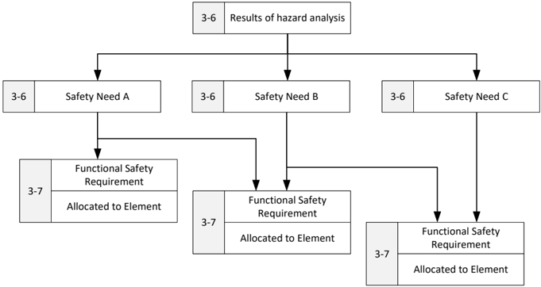
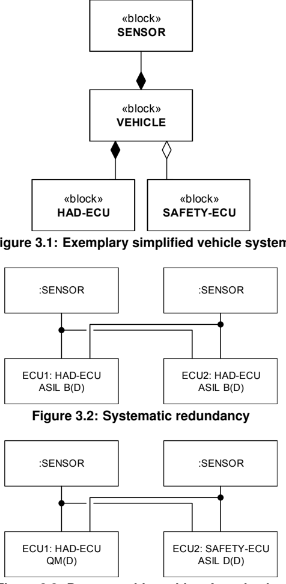
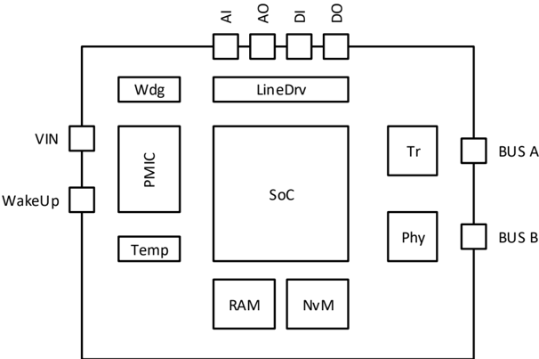
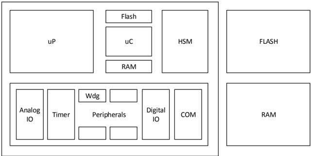
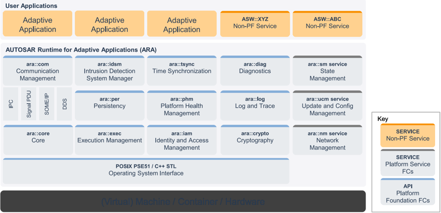

<!-- 源文档 AUTOSAR_FO_EXP_SafetyOverview（R23-11），说明文档（EXP），不受 Type A 七章骨架约束；章节结构镜像源文档自身编号（1–6 与附录 A–B）。封面表格、Disclaimer、Contents、List of Figures 属于文档框架信息，不译；源文档开头的 References 列表保留为文末不编号的「参考文献」注册表。源文档目录前的未编号 Known Limitations 章按 EcuM 先例译为 §1 之前的未编号「已知限制」。规范项/用例/失效引用（[RS_SAF_xxxxx]、[SUC_xx]、[TLF_xx]、[SWS_CORE_00023]、[RS_SAF_1xxxx]）为源文档显式提及的引用，予以保留。6.2.4–[6.2.7](#627-autosar-应监控检测可检测的失效并提供对其作出反应的手段) 在 markdown 转换中被扁平化（仅以纯文本行存在），按其原有章节结构重组。 -->

## 已知限制

本说明文档可能包含假设、示例性条目（如参考模型、用例、场景）和/或对示例性技术方案、设备、过程或软件的引用。本文档中包含的任何此类假设或示例性条目仅用于说明目的。这些假设不是 AUTOSAR 标准的一部分。无论是它们在此类规范中的存在，还是实际实现了此类示例性条目的 AUTOSAR 一致性产品的任何后续文档，都不意味着覆盖此类条目或假设的知识产权按照适用于 AUTOSAR 标准的相同规则被许可。

### 各章（The chapters）

- 技术安全概念
- 安全需求的验证、安全分析与示例性用例

计划在后续发布中提供。

### 无 ASIL 等级（No ASIL Ratings）

AUTOSAR 联盟，特别是 AUTOSAR 自适应平台工作组，只提供架构定义、功能块的描述和概念验证实现，不可能在此范围内为每个架构项添加 ASIL 等级。只能向读者提供一些提示，说明如何在读者自己非常具体的语境下——考虑底层硬件、产品的安全目标与度量以及开发过程——组合这些架构项以实现安全的架构。

### 按照 ISO 26262 第 10 部分的 SEooC（SEooC according to ISO26262 part 10）

AUTOSAR 自适应平台架构定义本身是否可以被视为 ISO 26262 第 10 部分意义上的 SEooC 仍未解决且尚未验证。按照 ISO 26262 第 1 部分对项目（**item**）、元素（**element**）或架构的定义，架构——此处为软件架构——是项目或元素结构的表示，而元素可以是系统、软件组件或软件单元，后者最终也可能是一个 SEooC。无论如何，遵循 ISO 26262 第 10 部分的 SEooC 定义作为本文档创建可复用内容的指南，以及与正式"安全手册"的相似性，可以被视为一个共同的起点。不过，AUTOSAR 自适应平台架构最终将成为某个软件组件的基础，该软件组件可以按照 ISO 26262 第 10 部分被视为元素与 SEooC。AUTOSAR 自适应平台架构的目标是使并支持高达 ASIL D 的系统。

![图 1：项目、系统、组件、硬件部件与软件单元的关系，ISO 26262-10 图 3 [\[1\]](#ref-1)（Relationship of item, system, component, hardware part and software unit, Figure 3 - ISO 26262-10 [\[1\]](#ref-1)）](Figure1.png)

### 信息安全（Cybersecurity）

对于自动驾驶而言，信息安全预计将比过去产生更大的影响。不仅通信信道与通信伙伴需要被认证与验证，它们还需要是安全的。AUTOSAR 自适应平台的安全概念与能力见说明文档 [\[2\]](#ref-2)。本说明文档（AUTOSAR_EXP_SafetyOverview）只包含功能安全主题。由相应的项目团队负责决定其特定安全目标能否以最先进的信息安全措施实现。一些与安全相关的安全特性可以是：

- 安全启动（**Secure boot**）
- 车辆网络内以及与车外世界的通信伙伴认证
- 安全密钥交换
- 安全密钥存储
- ……

加密、解密与签名等安全专用算法不被直接视为安全相关，它们仍需按照 ISO 26262 并参照信息安全指南与标准（例如 ISO 21434）进行开发与集成。

### 完整性（Completeness）

本文档可能未涵盖 AUTOSAR 自适应平台可被使用的所有可能场景。安全相关需求从一些特定用例、以及 AUTOSAR 自适应平台工作组全体成员、贡献者与评审者所知的最优知识派生。

## 1. 引言

### 1.1. 目的

功能安全是从 AUTOSAR 自适应平台开发之初就予以考虑的系统特性，因为它可能影响系统与软件架构设计决策。因此，AUTOSAR 自适应平台规范包含与功能安全相关的需求。系统设计的复杂性等方面可能与汽车工业中功能安全的达成相关。

软件是可以在系统层级影响复杂性的一个参数。可以使用软件开发的新技术与概念，以最小化复杂性并使功能安全的达成更容易。AUTOSAR 自适应平台通过提供安全措施与机制来支持安全相关系统的开发。

然而，AUTOSAR 自适应平台不是一个完整的安全解决方案。本安全概览的目标是从顶层安全需求以及假定的用例或场景派生安全需求，并将其分配到项目的架构元素或任意外部措施。使用 AUTOSAR 自适应平台并不意味着符合 ISO 26262-10。使用 AUTOSAR 自适应平台的安全措施与机制仍然可能构建出不安全的系统。AUTOSAR 自适应平台的架构在最好的情况下也只能被视为一个 SEooC。

关于 AUTOSAR 自适应平台功能安全机制与措施的信息目前分散在所引用的文档中。除非了解功能安全机制如何被支持以及必要的信息具体位于何处，否则很难评估如何高效地使用 AUTOSAR 实现安全相关系统。本说明文档总结与 AUTOSAR 功能安全相关的要点，并解释如何使用功能安全机制与措施。

### 1.2. 范围

本文档应具有说明性，帮助功能安全工程师识别 AUTOSAR 自适应平台内与功能安全相关的主题。本文档的内容分为以下独立各章：

- AUTOSAR 自适应平台目标、用例与场景
- 系统定义、系统上下文与假设
- 危害分析
- 安全需求
- 功能安全概念

它们可以映射到 ISO 26262（图 1.1）中的以下章节：

- [3-5] 项目定义（**Item definition**）
- [3-6] 危害分析与风险评估（**Hazard analysis and risk assessment**）
- [3-7] 功能安全概念（**Functional safety concept**）

如图 1.2 所示。安全需求按层级构造，并按照 ISO 26262 [\[1\]](#ref-1) 从危害到安全目标再到功能需求与制品进行分配或引用，如图 1.3 所示。开发过程与组织主题不在本概览的范围内；未执行风险评估（见"已知限制"章）；本文档中的每个系统描述、场景或用例都仅是说明性的、仅供参考。系统设计不在范围内！

![图 1.1：所考虑的 ISO 26262 章节，ISO 26262 系列标准概览，ISO 26262-1 图 1 [\[1\]](#ref-1)（Considered chapters of ISO 26262, Overview of the ISO 26262 series of standards, Figure 1 - ISO 26262-1 [\[1\]](#ref-1)）](Figure1-1.png)

![图 1.2：安全需求的结构与到本文档的映射，基于 ISO 26262 [\[1\]](#ref-1)（Structure of safety requirements and mapping to this Document, based on ISO 26262 [\[1\]](#ref-1)）](Figure1-2.png)



### 1.3. 目标读者

本文档应为参与安全相关（ECU）系统开发的人员提供 AUTOSAR 自适应平台的功能安全措施与机制及其实现的概览。因此，本文档面向 AUTOSAR 自适应平台的用户，包括参与安全分析的人员。AUTOSAR 专用与功能安全相关的术语由 AUTOSAR 术语表 [\[3\]](#ref-3) 或 ISO 26262 [\[1\]](#ref-1) 本身涵盖；如无与本文档相关的附加信息或解释提示，则不在此复制。

## 2. AUTOSAR 自适应平台的使用假设与目标

### 2.1. 使用假设

AUTOSAR 自适应平台的使用假设特别（但不限于）针对来自以下域的车规级电子控制单元：

- 自动驾驶（**Autonomous Driving**）：从驾驶辅助到完全自动驾驶，包括（如适用）AD、ADAS 和/或传感器 ECU 的生态系统，
- 网关（**Gateway**），
- 车身域控制器（**Body-Domain Controller**），
- 信息娱乐系统等。

为满足对更强处理能力的需求，例如传感器数据处理（图像、雷达）、多传感器数据融合或机器学习，以及增强的多媒体能力（如 2D/3D 图形加速、视频与音频处理），AUTOSAR 自适应平台应支持高性能计算单元与加速器，这些通常通过专门的专有硬件组件与软件接口实现。

### 2.2. 设计目标

AUTOSAR 自适应平台的总体设计目标与众所周知的、已确立的 AUTOSAR 经典平台类似，因此描述汽车电子控制单元软件的抽象层次、接口与某些公共行为。AUTOSAR 自适应平台仍然为软件开发者提供抽象层，例如 AUTOSAR Runtime for Adaptive Applications（**ARA**），使 AUTOSAR 自适应平台应用可以在 ECU 之间交换或被轻松移植。从系统性的视角看，这类似于 AUTOSAR 经典平台的 BSW 与 VFB 层——如 AUTOSAR 经典平台架构文档 [\[4\]](#ref-4) [\[5\]](#ref-5) 中所述，并在图 2.1 与 2.2 中对比展示。

![图 2.2：AUTOSAR 自适应平台分层架构 [\[6\]](#ref-6)（AUTOSAR Adaptive Platform layered architecture [\[6\]](#ref-6)）](Figure2-2.png)

第二个主要目标是允许在车辆现场进行动态软件升级，以及更灵活地开发与部署应用和服务。

第三个——对功能安全工程师而言最重要——目标是在一个分区内执行从 QM 到 ASIL D 的混合关键度的应用，同时保持免受干扰（**freedom from interference**）。如果系统包含多个分区——它们甚至可能完全不符合 ISO 26262（或至多 QM），例如信息娱乐系统——则仍然需要免受干扰，但这不在 AUTOSAR 自适应平台架构与标准的范围内。

关于 AUTOSAR（特别是 AUTOSAR 自适应平台）目标的更多细节，请参见 AUTOSAR 介绍演示文稿 [\[6\]](#ref-6) 与说明性文档 AUTOSAR 自适应平台设计 [\[7\]](#ref-7)。

### 2.3. 场景

#### 2.3.1. 示例场景：HAD

选择高度自动驾驶（**Highly Autonomous Driving**, HAD）场景来研究 AUTOSAR 自适应平台的安全能力。该场景不仅涵盖高性能计算与动态软件更新的需求，还涵盖相应的最高安全等级：按照 ISO 26262 [\[1\]](#ref-1) 的 ASIL D。假定车辆层级的系统设计包含若干传感器，它们直接连接到传感器或传感器 ECU（例如雷达、激光雷达、视觉、INS、GNSS）。预计车辆至少有一个用于自动驾驶功能的 ADAS-ECU，AUTOSAR 自适应平台不仅可以集成在该 ADAS-ECU 上，也可以集成在传感器 ECU 或前述任何其他域控制器上。

#### 2.3.2. 示例场景：仪表盘

另一个不像 HAD 那样安全关键、但可以用 ASIL 评级的例子是仪表盘（**instrument cluster**）。虽然仪表盘不像 HAD 那样安全关键，但它也不像信息娱乐系统那样简单。

让我们考虑这样的用例：车速表给出错误的车速，驾驶员以远超限速的速度行驶，使自己以及其余交通参与者处于危险之中。另一个关键场景可能是故障指示没有被点亮，例如制动故障、安全气囊故障或发动机故障。

随着汽车行业技术水平的进步，仪表盘将需要高性能。将仪表盘集成到 AUTOSAR 自适应平台上自然有意义，以满足高性能需求。反过来，AUTOSAR 自适应平台应确保功能安全需求。

### 2.4. 顶层特性请求或用例

基于初始的利益相关方分析与 AUTOSAR 联盟合作伙伴需求，按照 AUTOSAR 自适应平台的预期用途与范围，识别出以下特性请求：

- [SUC_01] 为多个混合关键度应用提供灵活的执行时间与资源。
- [SUC_02] 为多个混合关键度应用提供动态可配置、可更新、可升级的运行时。
- [SUC_03] 在多个混合关键度应用之间提供信息交换。
- [SUC_04] 在混合关键度应用与车辆内的其他外部组件（如传感器、执行器或 ECU）之间提供信息交换。
- [SUC_05] 在混合关键度应用与车辆外的其他外部组件之间提供信息交换。
- [SUC_06] 在驾驶循环期间维护正确的配置并监控正确的运行。

表2.1：顶层安全用例或特性请求（**Top Level Safety Use-Cases or feature requests**）

## 3. 系统描述

### 3.1. 所研究的元素（Element Under Investigation）

本说明文档中研究的元素是在大致于第 [3](#3-系统描述) 章描述的系统上下文中运行的 AUTOSAR 自适应平台架构。AUTOSAR 自适应平台架构最终将成为某个软件组件的基础，该软件组件可以按照 ISO 26262-1 与 ISO 26262-10 被视为元素与 SEooC。

AUTOSAR 自适应平台旨在与解决方案无关，只是它为汽车行业开发、并按照第 [2](#2-autosar-自适应平台的使用假设与目标) 章所述的目标开发。尽管如此，它将运行的平台也需要被研究，以便派生一些危害与安全需求。其中一些最终将由 AUTOSAR 自适应平台架构中描述和定义的软件特性满足，另一些则分别由 OEM 或其供应商满足。现代 ECU 包含高度模块化的嵌入式软件，它可以由非安全相关与安全相关的软件组件组成，这些组件执行具有不同 ASIL 等级的功能。按照 ISO 26262，如果嵌入式软件由具有不同 ASIL 等级的软件组件组成，则整个软件必须按最高 ASIL 开发，或者应为具有较高 ASIL 等级的软件组件确保免受较低或同等 ASIL 等级元素的干扰——即使或尤其是当它们是从较高 ASIL 的功能分解而来时，例如 2 × ASIL B(D)。

### 3.2. 假定的系统上下文

以下系统上下文描述只是有根据的猜测与假设，是派生与解释安全需求所必需的。

#### 3.2.1. 车辆上下文（Vehicle Context）

在 AUTOSAR 自适应平台最初定义之时，作为 SEooC 开发的高性能处理单元并不总是自身达到 ASIL D 的安全等级，因此考虑了若干简单的系统性设计，以便通过恰当的分解达到 ASIL B 或 ASIL D。AUTOSAR 自适应平台架构只能支持实际的系统或硬件开发者达成具体的安全目标。



车辆系统设计不是 AUTOSAR 自适应平台规范的一部分，不过任一选项（图 3.2 与 3.3）都可以是有效的系统配置。选择恰当的系统设计与分解策略以达成具体安全目标并满足具体安全需求，是最终产品开发者与安全工程师的职责。

#### 3.2.2. ECU 上下文（ECU Context）

在一个典型的符合安全要求的 ECU 中，可以假定除了微处理器（uP 或 SoC）、动态与持久存储器之外，它还将配备电源管理集成电路（**PMIC**）、看门狗（**Watchdog**）以及一些板载传感器或驱动器，以及若干输入输出通道，例如数字、模拟或用于经车载总线（如以太网、CAN 或 FlexRay）通信的通道。



一些简单的板载安全措施有：

- 受调节与受控的电源管理
- 电源监控（电压与电流）
- 温度监控
- 存活监控（看门狗）
- 输入/输出控制

如果控制器或其上运行的软件不再可信，例如电压电平不稳定或看门狗已被触发，则可以禁用线驱动器与收发器，从而在无需软件交互的情况下达成失效静默（**Fail-Silent**）行为。

#### 3.2.3. 微处理器上下文（Microprocessor Context）

微处理器或 SoC 的设计可能如图 3.5 所示。



适合 AUTOSAR 自适应平台的典型微处理器可能包含若干性能处理核（uP）、一个硬件安全模块（**HSM**），在某些情况下还有一个外设微控制器核（uC）。HSM 与 uC 可以是典型的通用控制器，可由用户编程或配备供应商的固件。AUTOSAR 自适应平台的主要目标是性能处理器。外设可以通过 uP 访问，也可能不能；外设访问在 AUTOSAR 自适应平台中并未像在 AUTOSAR 经典平台中那样被标准化到相同层级。来自 AUTOSAR 自适应平台的唯一硬件需求是通过 OS 间接定义的——OS 应为应用的隔离提供多进程支持，因而按照操作系统接口规范 [\[8\]](#ref-8) 与执行管理规范 [\[9\]](#ref-9) 的要求需要一个内存管理单元（**MMU**）。如果 ECU 需要与其他 ECU 通信，预期支持采用 SOME/IP 协议的以太网。外部 Flash 与 RAM 不是直接必需的，但在实际硬件设计中（截至 2018 年）是常见做法。

#### 3.2.4. 硬件加速器（Hardware Accelerator）

硬件加速器与并行处理在 AUTOSAR 自适应平台架构中得到了考虑。关于该主题的更多信息，请阅读"自适应平台上并行处理技术的使用设计指南 [\[10\]](#ref-10)"。硬件加速器的软件开发过程与所需软件机制与典型微处理器基本相同。应有机制检查软件例程是否被正确调度、计算是否正确，且控制流应是可监控的。

#### 3.2.5. 软件上下文（Software Context）

##### 3.2.5.1. 动态内存分配（Dynamic Memory Allocation）

按照 ISO 26262-6 表 6 [\[1\]](#ref-1)，不推荐在安全相关代码中使用动态对象或变量，否则在创建它们期间需要进行在线/运行期测试。

动态内存分配被自适应平台的一些 API 所隐含。只要自适应平台供应商与自适应应用确保在分配失败时进行恰当的错误处理与清理，并且在运行安全相关代码时内存分配与释放函数（例如 malloc 与 free、new 与 delete）具有确定性性能——即其最坏执行/阻塞时间是已知值，或者施加了专门的安全机制（如看门狗）来处理时序违规——则允许它们在安全相关代码中使用动态内存分配。

请考虑 [SWS_CORE_00023]（自适应平台核心规范 [\[11\]](#ref-11)），它规定 AUTOSAR 自适应平台的实现将失败的默认分配视为不可恢复。

### 3.3. 一般硬件与软件故障考虑（General Hardware and Software Fault Considerations）

硬件不是 AUTOSAR 自适应平台架构的一部分，但要最终定义较高安全需求的来源，仍然必须考虑硬件。本节应被视为一般性的先验知识，收集并描述可能直接影响自适应平台的典型硬件与软件故障及相应的安全措施。很可能并非所有硬件与软件故障都在此描述，也并非所有影响都得到足够充分的分析。因此，对于构建在 AUTOSAR 自适应平台之上的每个安全关键应用，必须按照相关行业标准执行完整的安全评估。

#### 3.3.1. 潜在的硬件故障与安全措施（Potential Hardware Faults and Safety Measures）

多个混合关键度应用的不正确执行可能由系统性故障（例如处理器设计中的缺陷）或随机硬件故障引起。自然现象，例如电离辐射（如高能粒子撞击）、电磁兼容、振动、老化效应或外部环境条件，可能导致此类故障。将具有不同关键度的应用集成到单一平台上可能非常棘手。

可以在硬件层级应用分区机制来隔离这些应用（将混合关键度应用映射到多核架构 [\[12\]](#ref-12)）。

基于 AUTOSAR 自适应平台应用安全关键性的硬件分区，与软件或逻辑分区相比，能确保单点故障的影响更小，因为一个硬件分区中的错误不会影响其他分区。但是，当位于不同硬件分区上的两个应用需要通信时，硬件分区技术可能损害性能。

我们可以将硬件故障分为三类：瞬态（**transient**）、间歇（**intermittent**）与永久（**permanent**）。瞬态故障可能只发生一次且不可重现（例如单事件翻转（**Single Event Upset**））。间歇故障则不时发生，但通常以不规则的间隔（例如由温度或湿度等环境条件导致的故障）。顾名思义，永久故障每次都可重现，并将持续存在，除非更换故障组件（例如单事件闩锁（**Single Event Latch-up**））。

以下是可以采取的用于检测/避免上述硬件故障的典型措施清单：

- 周期性配置测试
- 周期性硬件部件测试（使用已知测试向量）
- 关断路径测试（"能否到达安全状态？"）
- 内存遍历测试（例如可写性测试）
- 时钟监控、电源监控、时序监控（由于此类系统固有的复杂性，高性能微处理器中的时序预测可能非常不准确）
- 合理性检查（但仅当检查明显易于计算时才适用）
- 外部看门狗
- 端到端保护
- 硬件锁步 CPU 核（尽管这在高性能微处理器中并不总是存在）
- ECC 内存（数据与地址链路的错误检测）
- 冗余执行（2oo2、2oo2D、2oo3）
- 恰当的硬件设计（由于硬件架构的复杂性，高性能微处理器中的选择可能非常有限，并可能导致共因失效）
- 恰当的通信总线
- 恰当的屏蔽
- 恰当的电磁兼容（**EMC**）

#### 3.3.2. 潜在的软件故障与安全措施（Potential Software Faults and Safety Measures）

硬件故障可能直接或间接影响软件。直接影响的例子可能包括算术计算错误（尽管程序的控制流可能是正确的），或者错误的控制流可能导致地址跳转，从而造成未定义行为、死循环或过早结束执行。间接影响的例子可能包括：影响其他 CPU 核（OS 过载、缓存、内存、外设或跨核中断洪泛，或某个核的剧烈发热可能导致关机）、经由软件的内存破坏，以及 OS、平台服务或外设的错误配置（OS 调度表被破坏或"禁用中断"指令的非预期执行，或实时时钟的错误配置）。

以下是可以采取的用于检测/避免上述软件故障的典型措施清单：

- 冗余执行（2oo2、2oo2D、2oo3）
- 程序流控制（"软件是否以正确的顺序经过已知点？"）
- 校验和
- 仲裁
- 冲突检测
- 签名
- 软件锁步
- 并行执行
- 安全检查器

一个稳健的安全措施是通过软件在 AUTOSAR 自适应平台中检测并阻止故障传播。故障传播可以通过执行合理性检查的软件监控器检测。借助双模块冗余（**DMR**）可以检测故障；而且，若有三模块冗余（**TMR**）与表决机制，甚至可以纠正故障。因此，冗余执行有助于检测（如果不能纠正）故障传播。安全策略的强制执行可以帮助检测访问违规，例如用户进程访问其没有访问权限的资源。

为了避免故障传播，需要限制访问权限。用户态的权限应当被降低。如果用户进程执行特权操作，OS 应在准许之前运行合理性检查。然而，OS 与驱动可能运行在特权模式，从而成为共同的失效原因。平台配置（如 BIOS 设置与特殊寄存器）在运行期应为只读，仅在引导 OS 之前可读写。在运行期，只应为 CPU 算力、内存和外设分配合理的带宽，以免某个故障模块/组件影响整个系统。防止故障传播的另一项措施是通过硬件或 OS 对特定资源（例如 flash、外设等）强制互斥。

### 3.4. 信息安全（Security）

信息安全与功能安全常被视为两个不同的概念：功能安全主要处理非预期的故障与错误，信息安全主要处理导致伤害或损失的蓄意威胁。尽管如此，在一个互联系统中，信息安全对于创建安全的系统、达成高的产品质量非常重要。安全机制需要按照所提供的标准开发，例如 ISO 21434 道路车辆——信息安全工程 [\[13\]](#ref-13)；并且在运行期间，强烈建议监控安全机制，以检查安全系统与机制是否正常工作并处于适当的状态。

### 3.5. AUTOSAR 自适应平台架构概览

#### 3.5.1. AUTOSAR 自适应平台特性（AUTOSAR Adaptive Platform Features）

HAD 场景以及由此产生的 HAD 应用要求底层的 AUTOSAR 自适应平台基础库与服务具备以下能力（如图 2.2 所示，当然除了专门的 HAD 应用之外）：

- 安全且安全（**secure**）的启动
- 应用的执行
- 应用的调度
- 应用状态管理：启动、停止、暂停等
- 运行行为监控：处理时间、总线负载、内存消耗等
- 对应用数据的访问
- 持久数据存储
- ECU 与应用数据的配置
- 已部署应用的更新
- 新应用的部署
- 系统监控
- 经车辆网络收发消息：例如 CAN、CAN-FD、FlexRay、以太网

该特性清单不仅与上述 HAD 场景相关，也可以应用于其他域特定的 ECU，并且到目前为止尚未对这些主题做进一步深入的应用与安全分析。

#### 3.5.2. AUTOSAR 自适应平台架构（AUTOSAR Adaptive Platform Architecture）

AUTOSAR 自适应平台的分层架构如图 3.6 所示，可以分为如图 2.2 所述的三个主要部分：

1. AUTOSAR 自适应平台基础库（**Foundation Libraries**）
2. AUTOSAR 自适应平台服务（**Services**）
3. 用户应用（自适应应用与非平台服务）



操作系统（**OS**）本身不是架构的直接组成部分，但 AUTOSAR 自适应平台对 OS 有若干要求 [\[9\]](#ref-9)，例如是符合 POSIX PSE51 的 OS [\[14\]](#ref-14) [\[15\]](#ref-15)。

#### 3.5.3. AUTOSAR 自适应平台功能簇（AUTOSAR Adaptive Platform Functional Cluster）

AUTOSAR 自适应平台功能簇 [\[16\]](#ref-16) 为：

表3.1：AUTOSAR 自适应平台功能簇（**AUTOSAR Adaptive Platform Functional Cluster**）

| 自适应平台功能簇 | 短名 |
|---|---|
| Adaptive Platform Core | core |
| Communication Management | com |
| Cryptography | crypto |
| Diagnostics | diag |
| Execution Management | exec |
| Firewall | fw |
| Identity and Access Management | iam |
| Intrusion Detection System Manager | idsm |
| Log and Trace | log |
| Network Management | nm |
| Operating System Interface | n/a |
| Persistency | per |
| Platform Health Management | phm |
| State Management | sm |
| Time Synchronization | tsync |
| Update and Configuration Management | ucm |

AUTOSAR 自适应平台功能簇的详细描述见各自的专业文档。"自适应平台设计说明 [\[7\]](#ref-7)"中也包含一个摘要。

### 3.6. 在 AUTOSAR 中配置 ASIL（Configuring ASILs in AUTOSAR）

本规范旨在支持 ISO 26262 [\[1\]](#ref-1) 的汽车安全完整性等级（**ASIL**）。不考虑其他安全完整性等级，它们不在本文档的范围内。ASIL 在概念阶段作为 ISO 26262-3 中 HARA 的一部分确定，并分配给每个安全目标。系统元素、软件元素或硬件元素经由安全需求到安全目标在系统层级上的分配，继承该 ASIL 作为属性。

ASIL 存储为 AdminData，它包含属性 gid="SAFEX" 的 Sdg 数据元素。该元素的内容应包含属性 gid="ASIL" 的 Sd 元素。

该属性的有效取值为：

- QM
- A
- B
- C
- D
- QM(A)
- QM(B)
- QM(C)
- QM(D)
- A(A)
- A(B)
- A(C)
- A(D)
- B(B)
- B(C)
- B(D)
- C(C)
- C(D)
- D(D)

注意，括号表示法用于表达被分解的安全需求。在本规范中，我们将原始 ASIL（即括号中的值）称为分解前的上下文 ASIL，因为它属于安全目标的上下文。

清单5.1：元素上 ASIL 属性的 AUTOSAR XML 表示示例

```xml
<!-- 带 ASIL 的 AUTOSAR 元素示例 -->
<APPLICATION-SW-COMPONENT-TYPE>
  <SHORT-NAME>MyComponent</SHORT-NAME>
  <ADMIN-DATA>
    <SDGS>
      <SDG GID="SAFEX">
        <SD GID="ASIL">B</SD>
      </SDG>
    </SDGS>
  </ADMIN-DATA>
  <PORTS>
```

## 4. 危害分析（Hazard Analysis）

### 4.1. 引言（Introduction）

任何违反安全目标的失效或故障都被认为是危险的。

最常见的与安全相关的失效或故障有：

- MCU 的 CPU、RAM、Flash 或总线及其外设中的硬件错误
- 软件中的任何系统性安全相关错误（也包括较低 ASIL 或 QM 的软件，如果其违反免受干扰）
- 通信线路上的电磁干扰
- 通信硬件组件中的硬件错误
- 导致消息被破坏、延迟、丢失、重复、重排、插入或伪装的通信驱动软件错误（取自 ISO 26262-6 条款 D2.4）。

基于第 [3.3](#33-一般硬件与软件故障考虑general-hardware-and-software-fault-considerations) 章的初始软硬件故障考虑、上述失效源与安全目标，以及提供了导致软件组件之间干扰的故障示例的 ISO 26262，故障可以分组如下：

- 内存（**Memory**），
- 时序（**Timing**），
- 执行（**Execution**），
- 信息交换（**Exchange of information**），
- 应用与服务的认证（**Authentication of applications and services**），
- 权限管理（**Rights management**）。

### 4.2. 顶层失效（Top Level Failures）

考虑的 AUTOSAR 平台的顶层安全相关失效为：

- [TLF_01] 应用的非预期、不合时宜和/或不正确的执行
- [TLF_02] 应用的非预期、不合时宜和/或不正确的配置、更新与升级
- [TLF_03] 应用之间信息的非预期、不合时宜和/或不正确的交换
- [TLF_04] 应用与车辆内外部组件之间信息的非预期、不合时宜和/或不正确的交换
- [TLF_05] 应用与车外外部组件之间信息的非预期、不合时宜和/或不正确的交换
- [TLF_06] 配置的破坏

表4.1：顶层失效（**Top Level Failures**）

## 5. 安全需求（Safety Needs）

### 5.1. 顶层安全需求（Top Level Safety Requirements）

AUTOSAR 平台只是"更大的"项目定义的一部分，正如前几章所解释的，该架构最终将成为真实软件组件的基础，后者可能对应于 SEooC 的元素定义 [\[1\]](#ref-1)。

**[RS_SAF_00001] 安全执行（Safe Execution）**：

AUTOSAR 应提供支撑机制，以监控多个混合安全关键度应用的控制流并管理其执行顺序。

**[RS_SAF_00002] 安全配置（Safe Configuration）**：

AUTOSAR 应提供支撑机制，以在车辆的整个驾驶循环期间支持正确的配置。

**[RS_SAF_00003] 安全更新或安全升级（Safe Update or Safe Upgrade）**：

AUTOSAR 应提供支撑机制，以支持多个混合关键度的平台与非平台应用的正确更新与升级。

**[RS_SAF_00004] 信息的安全交换（Safe Exchange of Information）**：

AUTOSAR 应提供支撑机制，以支持安全关键应用之间信息的安全交换（发送与接收）。

**[RS_SAF_00005] 数据破坏的检测（Detection of Data Corruption）**：

AUTOSAR 应提供在处理数据、与其他系统或系统元素通信时检测故障与失效的机制。

**[RS_SAF_00006] 安全存储（Safe Storage）**：

AUTOSAR 应提供支撑机制，为应用提供安全存储。

**[RS_SAF_00007] 失效后的恢复（Recovery upon failure）**：

AUTOSAR 应监控、检测可检测的失效并提供对其作出反应的手段。

表5.1：顶层安全需求 [\[17\]](#ref-17)（**Top Level Safety Requirements [\[17\]](#ref-17)**）

所有顶层安全需求应可在高达 ASIL D 的等级下达成。在适用的场合，即使某项顶层安全需求被违反，也应可达成 ASIL D 的失效可运行（**Failoperational**）品质。

### 5.2. 潜在的产品安全质量属性（Potential Product Safety Quality Attributes）

表5.2：用例、失效与派生的安全需求（**Use-Cases, Failures and and derived safety requirements**）

| 用例 | 失效 | 安全需求 | 所需安全的维度：可用性 | 所需安全的维度：可靠性 | 所需安全的维度：可维护性 | 所需安全的维度：完整性 (1) |
|---|---|---|---|---|---|---|
| [SUC_01] | [TLF_01] | [RS_SAF_00001] | 失效可运行（**Fail Operational**） | 失效可运行 / 失效降级（**Fail Degradation**） | 不在范围内 | 不在范围内 |
| [SUC_06] | [TLF_06] | [RS_SAF_00002] | 失效可运行 | 失效可运行 / 失效降级 | 不在范围内 | 不在范围内 |
| [SUC_02] | [TLF_02] | [RS_SAF_00003] | 失效可运行 | 失效可运行 / 失效降级 | 不在范围内 | 不在范围内 |
| [SUC_04] | [TLF_04] | [RS_SAF_00004] | 失效可运行 | 失效可运行 / 失效降级 | 不在范围内 | 不在范围内 |
| [SUC_03] | [TLF_03] | [RS_SAF_00004] | 失效可运行 | 失效可运行 / 失效降级 | 不在范围内 | 不在范围内 |
| [SUC_05] | [TLF_05] | [RS_SAF_00004] | 失效可运行 | 失效可运行 / 失效降级 | 不在范围内 | 不在范围内 |

> (1) AUTOSAR 不对宿主应用的安全完整性负责。

## 6. 功能安全概念（Functional Safety Concept）

### 6.1. 派生的 AUTOSAR 平台功能安全需求（Derived AUTOSAR Platform Functional Safety Requirements）

从前几章（第 [4](#4-危害分析hazard-analysis) 章与第 [5](#5-安全需求safety-needs) 章）的架构顶层安全需求（5.1）与潜在危害（4.2）出发，并遵循一般硬件与软件故障考虑（3.3），可以通过梳理 ECU 的典型生命周期与简单类别：安全执行（**safe execution**）、安全通信（**safe communication**）、安全存储（**safe storage**）与安全配置与更新（**safe configuration and update**），派生出以下功能需求。

#### 6.1.1. 安全执行（Safe Execution）

从初始化过程开始：

- 需要考虑安全初始化 [RS_SAF_10001]
- 检查应用与服务的完整性 [RS_SAF_10002]

信息：按照分层架构，安全启动本身位于 AUTOSAR 平台层之下，因此不属于 AUTOSAR 平台架构设计以及本次安全相关研究的范围。但警觉的安全工程师仍应注意，在启动相应分区之前需要验证完整性。

取决于最终产品及其环境的架构决策，上述任务的安全影响难以评级。考虑到 AUTOSAR 自适应应用的动态部署可能性，这些安全功能可能需要在初始化期间执行，以在支持在同一分区上部署混合关键度应用的动态配置的环境中维持安全。如果只允许以安全方式将预先验证的配置上传到系统，则启动期间只需要完整性检查，以确保应用未被更改。

如果所有这些启动检查都已通过，则需要提供以下运行期能力：

- 达成免受干扰的安全资源管理 [RS_SAF_10008]
- 为应用与服务提供可靠调度 [RS_SAF_10028]
- 安全的程序执行 [RS_SAF_10030]
- 已定义的程序执行时间 [RS_SAF_10031]
- 应用与服务的分离 [RS_SAF_10008]
- 应用与服务的保护 [RS_SAF_10008]
- 应用与服务的安全关闭 [RS_SAF_10005]
- 应用/服务生命周期中状态的安全转换 [RS_SAF_10006]

信息：如果底层硬件具有与软件相同的 ASIL 等级，则可以预期安全的计算，只需在硬件的 ASIL 等级低于功能所需时进行研究。可以组合多种 AUTOSAR 自适应平台机制来达成这些目标，例如将重复或冗余执行与某种自检库和控制流监控相结合。AUTOSAR 自适应平台可能不会通过特定的接口或描述直接支持该特性，但如果从一开始就了解这一点，客户特定的实现就可以轻松地尊重这种行为，在某些情况下甚至可能对应用透明。

#### 6.1.2. 安全通信（Safe Communication）

在运行期间，应用与服务需要彼此通信，不仅在同一分区内，还要跨不同分区、不同控制器、ECU 边界，甚至与车外世界通信。此外，动态部署要求对通信伙伴进行认证，因此：

- 为应用或服务提供一个接口以允许安全通信 [RS_SAF_10014]

如果依赖不满足，该应用就不是完全可运行的，并且根据整体安全策略，最终整个 ECU 也可能不被认为是完全可运行的。

#### 6.1.3. 安全存储（Safe Storage）

还预期应用与服务需要在非易失性存储单元中持久地加载与存储数据，因此：

- 防止数据的非预期更改 [RS_SAF_10037]
- 检测数据的非预期更改 [RS_SAF_10002]
- 防止数据或存储访问的延迟 [RS_SAF_10008]

在此，AUTOSAR 自适应平台只是为应用与服务提供一个接口。硬件特定的机制属于平台特定实现的一部分，例如 NvM 是带磨损均衡的 eMMC NAND Flash、EEPROM、NAND/NOR Flash 或 FRAM 等。

#### 6.1.4. 安全配置与更新（Safe Configuration and Update）

外部测试仪在与应用本身不交互的情况下修改 NvM 的可能性只是安全配置与更新的一部分。AUTOSAR 自适应平台的目标是提供使应用能够部署到现场的手段，而不仅仅是在售后车间或生产期间。为了从一开始就防止错误的应用被部署，维护正确配置需要以下任务：

- 验证是否允许将某个应用部署到车辆上
- 验证是否允许将某个应用部署到 ECU 上
- 验证是否允许将某个应用部署到专用资源上

此验证的一部分确实是检查本地与全局依赖是否满足、机器/分区的 ASIL 等级是否具有恰当的分类等。最后，所有确保安全初始化与执行的检查都需要在部署之前运行，否则在初始化之后，系统可能最终进入失效模式。因此，建议安全关键应用的更新只在安全状态下执行：

- 确保安全相关软件在不会导致危险情形的状态下被更新/升级 [RS_SAF_10038]

如果应用只是可选的，影响可能不大，因为该应用可能根本不会被调度。如果应用是一次更新，则：

- 缓解或防止对有效配置的非预期或错误更改 [RS_SAF_10002]
- 缓解或防止有效配置的丢失 [RS_SAF_10027]

动态部署特性对每个帮助满足上述大致描述的安全需求的基础模块或服务都有重大影响。每个基础应用或服务要么需要能够从清单获取配置数据，并在初始化、激活新应用期间动态解释这些数据；要么供应商需要将机器配置作为已更新应用以及基础中被影响的应用与服务的附件进行更新。这被视为客户特定的行为，因此是实现相关的。这取决于集成平台可能被设计得多么开放，以及供应商是否愿意并且能够跟踪现场每台车辆的每个配置。

### 6.2. AUTOSAR 自适应平台的安全制品（Safety Artifacts of the AUTOSAR Adaptive Platform）

基于危害分析、安全需求与功能安全需求，识别出以下 AUTOSAR 自适应平台的制品：

#### 6.2.1. 确保多个混合关键度应用的正确计算、执行与执行顺序

**[RS_SAF_00001]**

- EM
- PHM
- SM

信息：架构元素 EM、SM 与 PHM 具有高度的安全相关性；安全执行与安全管理是自适应应用安全运行的基础。EM、PHM、SM 元素相互依赖，协调它们的活动以确保 AUTOSAR 自适应平台内的功能安全。

#### 6.2.2. AUTOSAR 应确保平台整个生命周期内的正确配置

**[RS_SAF_00002]**

- EM
- PHM
- UCM
- PER

#### 6.2.3. AUTOSAR 应确保多个混合关键度的平台与非平台应用的正确更新与升级

[RS_SAF_00003]

- UCM
- PHM
- CM[E2E]
- PER
- SM

#### 6.2.4. AUTOSAR 应确保（发送与接收）信息的正确交换

[RS_SAF_00004]

- CM

#### 6.2.5. AUTOSAR 应在处理数据、与其他系统或系统元素通信时检测故障与失效

[RS_SAF_00005]

- CM[E2E]
- PER

#### 6.2.6. AUTOSAR 应提供为应用提供安全存储的机制

[RS_SAF_00006]

- PER

#### 6.2.7. AUTOSAR 应监控、检测可检测的失效并提供对其作出反应的手段

[RS_SAF_00007]

- PHM
- UCM
- PER
- SM
- EM

## A. 缩略语

表A.1：缩略语清单（**List of Abbreviations**）

| 缩略语 | 说明 |
|---|---|
| 2oo2 | 二取二（**two out of two**） |
| 2oo2D | 带诊断的二取二（**two out of two with diagnostics**） |
| 2oo3 | 三取二（**two out of three**） |
| AD | 自动驾驶（**Automated Driving**） |
| ADS | 自动驾驶系统（**Automated Driving Systems**） |
| ADAS | 高级驾驶辅助系统（**Advanced Driver Assistance System**） |
| ASIL | 汽车安全完整性等级（**Automotive Safety Integrity Level**） |
| BIOS | 基本输入输出系统（**Basic Input Output System**） |
| CCA | 共因失效分析（**Common Cause Failure Analysis**） |
| DFA | 相关失效分析（**Dependent Failure Analysis**） |
| DMR | 双模块冗余（**Dual Modular Redundancy**） |
| ECC | 纠错码（**Error Correction Code**） |
| EMC | 电磁兼容（**Electro Magnetic Compatibility**） |
| FSR | 功能安全需求（**Functional Safety Requirement**） |
| HAD | 高度自动驾驶（**Highly Automated Driving**） |
| HARA | 危害与风险评估（**Hazard And Risk Assessment**） |
| HSM | 硬件安全模块（**Hardware Security Module**） |
| NvM | 非易失性存储器（**Non-volatile Memory**） |
| PMIC | 电源管理集成电路（**Power Management Integrated Circuit**） |
| QM | 质量管理（**Quality Management**） |
| SG | 安全目标（**Safety Goal**） |
| SoC | 片上系统（**System on a Chip**） |
| SOP | 生产启动（**Start of Production**） |
| TMR | 三模块冗余（**Triple Modular Redundancy**） |
| TSC | 技术安全概念（**Technical Safety Concept**） |
| TSR | 技术安全需求（**Technical Safety Requirement**） |
| Wdg | 看门狗（**Watchdog**） |

## B. 术语表

本文档中使用的所有技术术语——除此处列出的术语外——都可以在官方 AUTOSAR 术语表 [\[3\]](#ref-3) 或 ISO 26262 [\[1\]](#ref-1) 中找到。

表B.1：术语表（**Glossary**）

| 术语 | 说明 |
|---|---|
| ASIL capability | 项目或元素满足被指派了给定 ASIL 的假定安全需求的能力。 |
| Checksum | 用于验证所存储或传输数据完整性的值。 |
| Context Switching Time | CPU 从一个进程或线程切换到另一个进程或线程所消耗的时间。 |
| Cybersecurity | 用于保护网络、程序和数据的完整性免受攻击、损坏或未授权访问的一组技术。→ Security |
| Data integrity | 数据完整性是在数据的整个生命周期内对数据准确性与一致性的维护与保证，是任何存储、处理或检索数据的系统的设计、实现与使用的关键方面。[\[18\]](#ref-18) |
| Memory Management Unit | 处理虚拟内存、内存转换与缓存操作的硬件元素。 |
| Mixed criticality | 系统或分区同时包含、调度并执行按照不同 ASIL 等级的软件组件，例如 AUTOSAR 自适应应用。 |

## 参考文献

<a id="ref-1"></a>[1] ISO 26262:2018 (all parts) - Road vehicles - Functional Safety https://www.iso.org

<a id="ref-2"></a>[2] Utilization of Crypto Services
> AUTOSAR_CP_EXP_UtilizationOfCryptoServices

<a id="ref-3"></a>[3] Glossary
> AUTOSAR_FO_TR_Glossary

<a id="ref-4"></a>[4] Virtual Functional Bus
> AUTOSAR_CP_EXP_VFB

<a id="ref-5"></a>[5] Layered Software Architecture
> AUTOSAR_CP_EXP_LayeredSoftwareArchitecture

<a id="ref-6"></a>[6] AUTOSAR Introduction https://www.autosar.org/fileadmin/ABOUT/AUTOSAR_Introduction.pdf

<a id="ref-7"></a>[7] Explanation of Adaptive Platform Design
> AUTOSAR_AP_EXP_PlatformDesign

<a id="ref-8"></a>[8] Specification of Operating System Interface
> AUTOSAR_AP_SWS_OperatingSystemInterface

<a id="ref-9"></a>[9] Specification of Execution Management
> AUTOSAR_AP_SWS_ExecutionManagement

<a id="ref-10"></a>[10] Design guidelines for using parallel processing technologies on Adaptive Platform
> AUTOSAR_AP_EXP_ParallelProcessingGuidelines

<a id="ref-11"></a>[11] Specification of Adaptive Platform Core
> AUTOSAR_AP_SWS_Core

<a id="ref-12"></a>[12] Mapping mixed-criticality applications on multi-core architectures https://doi.org/10.7873/DATE.2014.111

<a id="ref-13"></a>[13] ISO 21434:2021 - Road vehicles - Cybersecurity engineering https://www.iso.org

<a id="ref-14"></a>[14] IEEE Standard for Information Technology- Standardized Application Environment Profile (AEP)-POSIX Realtime and Embedded Application Support https://standards.ieee.org/findstds/standard/1003.13-2003.html

<a id="ref-15"></a>[15] API standards for Open Systems http://www.opengroup.org/austin/papers/wp-apis.txt

<a id="ref-16"></a>[16] List of Adaptive Platform Functional Clusters
> AUTOSAR_AP_TR_FunctionalClusterList

<a id="ref-17"></a>[17] Safety Requirements for AUTOSAR Adaptive Platform and AUTOSAR Classic Platform
> AUTOSAR_FO_RS_Safety

<a id="ref-18"></a>[18] Data Integrity Pattern http://en.wikipedia.org/wiki/Data_integrity
