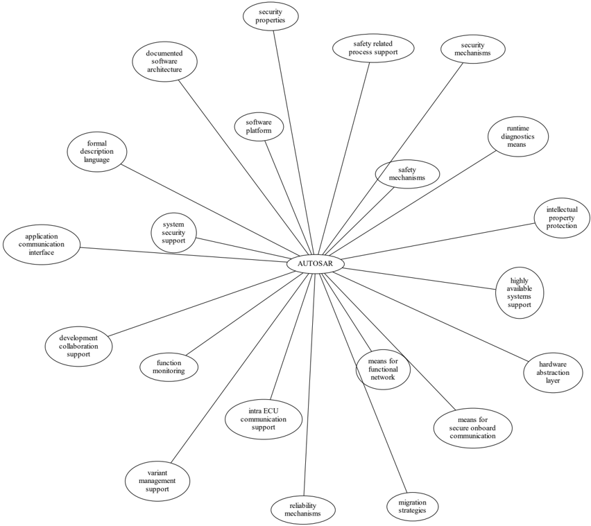

<!-- 源文档 AUTOSAR_FO_RS_Main（R23-11），需求规范（RS），不受 Type A 七章骨架约束；章节结构镜像源文档自身编号。需求项 ID 标记与源文档的草稿标志（Draft 类标记）按 2026-11-03 批次决议整体省略（标题仅翻译）；条目后的 ⌋(…) 追溯行随 ID 一并省略。需求项与所在章节下的 1:1 编号小节（§3.1–§3.24、§4.1–§4.51）对应。源第 3 章「Requirements Tracing」为纯 ID 追溯表，按 2026-11-03 决议整章省略并将后续章节重编号（源 4→3、5→4、6→5）。封面元数据表、免责声明与目录按 EXP 流程省略；48 处图引用中仅 1 处内容图（图1.1 需求范围），按源图号嵌入，其余为页面装饰。本文档的 PDF 转换存在大量表格列错排（理由/用例单元格互换或截断），涉及约 25 个条目，已全部从 R23-11 PDF 恢复。§2.2 无缩略语表（指向 AUTOSAR 术语表），本运行未新增站点术语表条目。支撑材料中的 Wikipedia URL 与「Concept 634 "Bus Mirroring"」按源文档原样以纯文本保留。附录 A 变更表的 Number 列按批次决议省略，仅保留标题列；本文档无 R22-11 变更小节。 -->

## 1. 文档范围

本文档的目标是通过从 **AUTOSAR** 目标导出，定义 **AUTOSAR** 的主要需求。

本文档中需求的范围如图1.1所示。

## 2. 如何阅读本文档

每条需求都有其唯一标识符，以前缀 `RS_Main_`（表示 "Main Requirement"）开头。对于任何评审注释、备注或问题，请引用此唯一 ID 而不是章节号或页码！

### 2.1. 所用约定

本文档中的关键词 "**MUST**"、"**MUST NOT**"、"**REQUIRED**"、"**SHALL**"、"**SHALL NOT**"、"**SHOULD**"、"**SHOULD NOT**"、"**RECOMMENDED**"、"**MAY**" 和 "**OPTIONAL**" 应按如下方式解释。

请注意，使用这些词语的文档的需求层级会修饰这些词语的强制力。

- **MUST**：该词或形容词 "**LEGALLY REQUIRED**" 表示，由于法律问题，该定义是规范中的绝对要求。
- **MUST NOT**：该短语表示，由于法律问题，该定义是规范中的绝对禁止。
- **SHALL**：该短语或形容词 "**REQUIRED**" 表示，该定义是规范中的绝对要求。
- **SHALL NOT**：该短语表示，该定义是规范中的绝对禁止。
- **SHOULD**：该词或形容词 "**RECOMMENDED**" 表示，在特定情形下可能存在充分理由忽略某一事项，但在选择不同做法之前必须理解并仔细权衡其全部影响。
- **SHOULD NOT**：该短语或短语 "**NOT RECOMMENDED**" 表示，在特定情形下，某种特定行为是可接受的甚至有用的，但在实现以此标签描述的任何行为之前，应理解其全部影响并仔细权衡具体情况。
- **MAY**：该词或形容词 "**OPTIONAL**" 表示，某一事项是真正可选的。一个供应商可以选择包含该事项，因为特定市场需要它，或者因为该供应商认为它能增强产品；而另一个供应商可以省略同一事项。

不包含某一特定选项的实现，应准备好与包含该选项的另一实现互操作（尽管功能可能有所减少）。同样，包含某一特定选项的实现，应准备好与不包含该选项的另一实现互操作（当然，该选项所提供的功能除外）。

### 2.2. 缩略语和缩写

本文档中使用的所有缩略语和缩写均包含在 **AUTOSAR** 官方术语表 [\[1\]](#ref-1) 中。相应解释请参见该术语表。

## 3. 需求规范

### 3.1. 实时系统软件平台

| 描述 | **AUTOSAR** 应提供一个软件平台。**AUTOSAR** 软件平台应适用于实时系统领域。补充信息：实时系统分为硬实时系统和软实时系统。硬实时系统必须总是在给定的时间内交付正确的结果，而软实时系统则被要求在给定时间内以专门的平均水准计算出正确答案。 |
| --- | --- |

### 3.2. 标准化的应用通信接口

| 描述 | **AUTOSAR** 应提供一个应用通信接口。**AUTOSAR** 应用通信接口应使 **AUTOSAR** 应用能够使用相同的接口定义，而无论它们位于同一 **ECU** 上还是不同 **ECU** 上。 |
| --- | --- |
| 理由 | 面向应用的标准化接口定义是软件复用和硬件无关部署的前提。 |

### 3.3. 硬件抽象层

| 描述 | **AUTOSAR** 应提供一个硬件抽象层。**AUTOSAR** 硬件抽象层应标准化不属于抽象层的软件对硬件的访问。 |
| --- | --- |
| 理由 | 应用软件必须独立于底层硬件，以便被复用（例如在其他硬件平台上）。 |

### 3.4. 功能建模的手段

| 描述 | **AUTOSAR** 应提供功能建模的手段。**AUTOSAR** 功能建模的手段对 **AUTOSAR** 平台和非 **AUTOSAR** 平台应当相同。 |
| --- | --- |
| 理由 | 使车辆设计无需预先选定专用技术（**AUTOSAR** 平台、非 **AUTOSAR** 平台）。 |
| 依赖项 | RS_Main_00080, RS_Main_00507 |

### 3.5. 网络技术支持

| 描述 | **AUTOSAR** 应支持使用多种车载网络技术的 **E/E** 架构。**AUTOSAR** 应支持通过网关、网桥和中继器实现网络互连。 |
| --- | --- |
| 理由 | 当前的车载 **E/E** 架构使用多种采用不同网络技术的网络。 |

### 3.6. 运行时诊断手段

| 描述 | **AUTOSAR** 应提供运行时诊断手段。**AUTOSAR** 运行时诊断手段应支持以下标准（**OBD**、ISO14229）和协议（**UDS**）。 |
| --- | --- |
| 理由 | 现场服务、认证和生产需要标准化的诊断访问。 |

### 3.7. 标准化的汽车通信协议

| 描述 | **AUTOSAR** 应支持标准化的汽车通信协议。**AUTOSAR** 应支持由 **AUTOSAR** 定义的平台与由其他方定义的平台（例如运行其他操作系统的平台）之间的通信。 |
| --- | --- |
| 理由 | 汽车网络由运行不同软件平台（包括车外系统）的 **ECU** 组成，此外还有 **AUTOSAR** 定义的软件平台。 |

### 3.8. 功能监控

| 描述 | **AUTOSAR** 应提供功能监控。**AUTOSAR** 功能监控应包括运行时应用内部信息的记录、分发和存储。**AUTOSAR** 功能监控应可在不了解 **ECU** 内部内存使用/寻址的情况下使用。 |
| --- | --- |
| 理由 | 开发需要标准化的功能监控，以便能够在运行时检查和理解系统行为。 |

### 3.9. 安全车载通信

| 描述 | **AUTOSAR** 应提供安全车载通信的手段。**AUTOSAR** 安全车载通信的手段应至少包括检查以下内容的手段： * 数据真实性 * 数据完整性 * 可选：机密性 * 可选：数据新鲜度 |
| --- | --- |

### 3.10. ECU 内通信支持

| 描述 | **AUTOSAR** 应提供 **ECU** 内通信支持。**AUTOSAR** ECU 内通信支持应使同一 **ECU** 上的软件模块能够以标准化的手段相互通信。 |
| --- | --- |
| 理由 | 软件模块相互发送信号以交换算法数据。 |

### 3.11. UDS 符合性

| 描述 | **AUTOSAR** 应符合统一诊断服务（**UDS**）的 ISO 14229-2 标准。 |
| --- | --- |
| 理由 | 符合 **UDS** 的测试设备目前广泛使用。 |

### 3.12. 安全机制

| 描述 | **AUTOSAR** 应提供安全机制。**AUTOSAR** 安全机制应确保安全相关软件模块之间的免受干扰。**AUTOSAR** 安全机制应确保安全的 **ECU** 间和 **ECU** 内通信。**AUTOSAR** 安全机制应支持失效可运行（**fail operational**）系统的实现。**AUTOSAR** 安全机制应包括一种支持安全相关方面配置和文档化的方法论。**AUTOSAR** 安全机制应包括一种如何使用模板实现安全的方法论。 |
| --- | --- |
| 理由 | 通过使用 **AUTOSAR** 平台促进安全相关系统的开发。安全相关 **ECU**（例如数字发动机控制单元和电子助力转向系统）需要为支持安全相关系统而设计的平台。 |

### 3.13. 安全相关过程支持

| 描述 | **AUTOSAR** 应提供系统安全支持。**AUTOSAR** 系统安全支持应至少包括开发过程中安全过程相关信息的交换格式。**AUTOSAR** 系统安全支持应使用户能够应用安全标准。 |
| --- | --- |
| 支撑材料 | ISO26262 |

### 3.14. 可靠系统机制

| 描述 | **AUTOSAR** 应为可靠的系统提供机制。 |
| --- | --- |
| 理由 | 可靠性是实现安全的重要特性之一。 |

### 3.15. 高可用性系统支持

| 描述 | **AUTOSAR** 应提供高可用性系统支持。当系统在正常运行期间发生故障时，**AUTOSAR** 高可用性系统支持应确保可用性。补充信息：正常运行：系统主功能预期运行的运行时间。它不包括软件更新之类的功能。 |
| --- | --- |
| 理由 | 通过使用 **AUTOSAR** 平台促进高可用性系统的开发。自动驾驶应用需要高可用性系统。 |

### 3.16. 形式化描述语言

| 描述 | **AUTOSAR** 应提供一种形式化描述语言。**AUTOSAR** 形式化描述语言应允许用户描述 **AUTOSAR** 软件。 |
| --- | --- |
| 理由 | 软件的可分配性和可复用性。**AUTOSAR** 形式化描述语言允许用户定义应用模型，这些模型从通信配置、到 **ECU** 和/或 **AUTOSAR** 平台的映射中抽象出来。 |

### 3.17. 非 AUTOSAR 软件集成

| 描述 | **AUTOSAR** 应支持 **AUTOSAR** 用户将不符合 **AUTOSAR** 的软件集成到 **AUTOSAR** 软件中。 |
| --- | --- |
| 理由 | 用户希望复用专有软件或基于先前 **AUTOSAR** 版本的软件。 |

### 3.18. 资源效率

| 描述 | **AUTOSAR** 应允许 **AUTOSAR** 用户在以下方面高效地实现 **AUTOSAR** 软件： * **RAM** * **ROM**、**Flash** * 计算能力 * 总线带宽。 |
| --- | --- |
| 理由 | 诸如 **Flash**、**RAM**、计算能力等有限资源是汽车计算机的特征。 |

### 3.19. 开发协作支持

| 描述 | **AUTOSAR** 应提供开发协作支持。**AUTOSAR** 开发协作支持应包括过程、交换格式和方法论。 |
| --- | --- |
| 理由 | 在车辆软件开发过程中，独立工作的各个合作伙伴会在不同的过程步骤之间交换信息。 |
| 支撑材料 | Automotive SPICE |

### 3.20. 系统信息安全支持

| 描述 | **AUTOSAR** 应提供系统信息安全支持。**AUTOSAR** 系统信息安全支持应提供信息安全机制。**AUTOSAR** 系统信息安全支持应提供信息安全属性。**AUTOSAR** 信息安全属性应至少包括： * 真实性 * 机密性 * 完整性 * 不可否认性 |
| --- | --- |

### 3.21. 知识产权保护

| 描述 | **AUTOSAR** 应提供知识产权保护。**AUTOSAR** 知识产权保护应保护各方之间交换的开发成果的知识产权。 |
| --- | --- |
| 理由 | 来自不同合作伙伴的软件解决方案的集成需要处理知识产权问题。 |
| 适用平台 | **FO** |

### 3.22. 向后兼容性

| 描述 | **AUTOSAR** 应提供向后兼容性手段。**AUTOSAR** 向后兼容性手段应使用户能够评估如何从 **AUTOSAR** 版本 n 迁移到 **AUTOSAR** 版本 n+1。 |
| --- | --- |
| 理由 | 向后兼容性意味着确保基于 **AUTOSAR** 标准的设备的长期可用性。 |
| 适用平台 | **FO** |

### 3.23. 有文档记录的软件架构

| 描述 | **AUTOSAR** 应提供有文档记录的软件架构。**AUTOSAR** 有文档记录的软件架构应使用户能够按照 ISO26262 执行安全分析。 |
| --- | --- |
| 理由 | 在安全相关开发的背景下，需要对设计和实现是安全的进行确认。 |
| 支撑材料 | ISO26262 |

### 3.24. 变体管理支持

| 描述 | **AUTOSAR** 应提供变体管理支持。**AUTOSAR** 变体管理支持应使用户能够确保应用软件跨车辆变体和车辆软件版本的兼容性。 |
| --- | --- |
| 理由 | 将 **ECU** 集成到一个或不同的 **E/E** 架构中需要变体管理。 |

## 4. 平台级候选需求

### 4.1. AUTOSAR 应标准化在应用、ECU 和系统层面组织模式管理的方法

| 描述 | **AUTOSAR** 应提供一种为应用软件配置模式管理机制的方法，以控制 **ECU** 或车辆的模式或对其作出反应。 |
| --- | --- |
| 理由 | 应用软件的行为很大程度上取决于 **ECU** 的整体模式。因此，必须标准化模式管理的方法，以便应用软件分配到另一 **ECU** 上时行为保持一致。 |
| 适用平台 | **FO** |
| 用例 | 某些功率模式下应用功能的降级。 |

### 4.2. AUTOSAR 应提供确保 AUTOSAR 实现（ICC1 级别）在应用层（RTE）和总线层互操作性的手段

| 描述 | **AUTOSAR** 应提供规定的测试用例和基本的测试方法论，以确保 **ICC1** 级别（黑盒测试）的 **BSW** 在应用（**RTE** 侧）和总线层面的互操作性。应开发这些规定的测试用例及其相关方法论，用于测试 **AUTOSAR** 基础软件的实现。 |
| --- | --- |
| 理由 | 强烈需要验收测试来提供产品符合 **AUTOSAR** 规范的证据，即确保相关元素在面向应用和通信总线的接口处具有一定的行为。 |
| 用例 | 将基础设施软件集成到特定 **ECU** 中，并将其无副作用地引入 **E/E** 架构。现实示例：将 **BSW** 协议栈（**ICC1** 级别）无困难地集成到应用和 **ECU** 基础设施中。支持测试任何 **ICC** 实现（从 **ICC1** 到 **ICC3**）。即使 **ICC3** 规范细节发生变化，也能复用同一测试规范 |

### 4.3. AUTOSAR 方法论应提供典型角色和活动的预定义

| 描述 | 设计方法论中角色和活动的定义与描述应支持一种分工模型。 |
| --- | --- |
| 理由 | 由于 **AUTOSAR** 在不同的位置和活动上支持分工，它应提供对角色和活动的共同理解。 |
| 适用平台 | **FO** |
| 用例 | 在软件集成者和软件架构师之间共享 **AUTOSAR** 配置和应用软件划分等活动。 |

### 4.4. AUTOSAR 应提供数据交换格式以支持大型公司间和公司内开发群体的分工协作

| 描述 | **AUTOSAR** 应通过明确定义的交换格式支持大型开发项目中的分工。 |
| --- | --- |
| 理由 | 一个典型的 **AUTOSAR** 系统预计每辆车携带大量的信号。要开发车辆描述，需要良好的分工组织。为支持此类组织，需要明确定义的信息交换概念。 |
| 适用平台 | **FO** |
| 用例 | **OEM** 与一级供应商之间的数据共享。 |

### 4.5. AUTOSAR 应提供规定系统开发的格式

| 描述 | 在 **AUTOSAR** 中，应可以向其平台环境描述应用软件的所有需求。这使集成者能够在 **ECU** 上以此类环境提供该应用软件。 |
| --- | --- |
| 理由 | **AUTOSAR** 格式将包括系统、**ECU** 和软件规范，并且是 **ECU** 集成过程所必需的。 |
| 适用平台 | **FO** |
| 用例 | **OEM** 设计一个应用软件，供应商将这些 **AUTOSAR** 软件应用集成到 **ECU** 上。 |

### 4.6. AUTOSAR 应支持整个开发周期中时序需求的持续分析

| 描述 | **AUTOSAR** 应支持整个开发周期中时序需求的观察、评估和方法论。 |
| --- | --- |
| 理由 | 应用软件有特定的时序要求，这些要求必须遵循共同的方法论，以便提供可靠且可比的时序信息。 |
| 适用平台 | **FO** |
| 用例 | 当今汽油喷射系统的实时控制。 |

### 4.7. AUTOSAR 应提供命名约定

| 描述 | **AUTOSAR** 应为标准创建和使用的内部和外部符号定义命名约定。 |
| --- | --- |
| 理由 | 应在规范文档中定义命名约定，以实现标准化和一致的文档。这是良好的文档实践，有助于更好地理解、减少歧义并改善协作。 |
| 适用平台 | **FO** |
| 用例 | **OEM** 与供应商之间的分工模型。**AUTOSAR** 规范的开发。 |

### 4.8. AUTOSAR 应为高性能计算平台提供软件平台

| 描述 | **AUTOSAR** 应提供一个名为 **AUTOSAR Adaptive Platform** 的软件平台，它面向对计算能力和内存有较高要求的汽车应用领域。 |
| --- | --- |
| 理由 | 高级汽车应用需要大量资源（计算能力和内存）。为了高效开发此类系统，需要一个与 RS_Main_00001 所需特性不同的软件平台，例如不同的调度策略、动态内存管理等。 |
| 适用平台 | **FO** |
| 用例 | 面向自动驾驶和高级驾驶辅助系统的应用开发 |

### 4.9. AUTOSAR 应提供分层软件架构

| 描述 | **AUTOSAR** 应提供一种软件架构，它区分应用软件、运行环境（**Runtime Environment**）和基础软件。 |
| --- | --- |
| 理由 | 运行环境为应用软件定义了标准化的编程接口。这使软件组件的重新分配和复用成为可能。 |
| 适用平台 | **CP** |
| 用例 | 将横摆角速度控制从一个 **ECU** 重新分配到另一个 **ECU**。 |

### 4.10. AUTOSAR 应支持 AUTOSAR 应用软件的部署和重新分配

| 描述 | **AUTOSAR** 应开发手段，使 **AUTOSAR** 应用软件能够在以下时间点重新分配： * 设计阶段：**ECU** 开发期间 * 运行阶段：软件栈启动和关闭之间的时间 * 生命周期阶段：量产开始之后的时间 |
| --- | --- |
| 理由 | 使应用软件能够重新分配到不同的 **ECU**。 |
| 适用平台 | **AP** |
| 依赖项 | RS_Main_00141 |
| 用例 | * **OEM** 提供用于安装到车辆上的安全或信息安全相关软件 * **OEM** 提供用于安装到车辆上的附加 **QM** 软件 * 开发者对车辆功能进行敏捷开发 * 在开发阶段将横摆角速度控制从一个 **ECU** 重新分配到另一个 **ECU** * 整体系统架构的优化。 * 通过空中下载更新（单个）自适应应用或特定配置 |

### 4.11. AUTOSAR 应为应用软件常用的例程提供规范以支持共享和优化

| 描述 | **AUTOSAR** 应通过提供带有常用函数的标准化库来支持应用软件的开发。 |
| --- | --- |
| 理由 | 在不同应用之间共享例程。集成在不同 **ECU** 中的应用使用经过优化的例程。 |
| 适用平台 | **FO** |
| 用例 | 将软件组件从使用不同微控制器的 **ECU A** 重新分配到 **ECU B**。 |

### 4.12. AUTOSAR 应支持冗余概念

| 描述 | 在工程学中，冗余是指为提高系统可靠性而复制系统的关键组件或功能。**AUTOSAR** 应支持 ISO26262 规定的免受干扰。 |
| --- | --- |
| 理由 | 高度自动驾驶等用例要求很高的系统可靠性。 |
| 适用平台 | **FO** |
| 依赖项 | ISO26262 |
| 用例 | 驾驶员临时/部分地将驾驶任务的责任移交给车辆。 |
| 支撑材料 | http://en.wikipedia.org/wiki/Redundancy_(engineering) http://en.wikipedia.org/wiki/Active_redundancy |

### 4.13. AUTOSAR 应支持虚拟化

| 描述 | **AUTOSAR** 应支持虚拟化，使其可以在虚拟化环境中作为客户操作系统被承载和执行。 |
| --- | --- |
| 理由 | 应可以在现有的 hypervisor 解决方案之上运行 **AUTOSAR**。 |
| 适用平台 | **FO** |
| 用例 | 开发既包含信息娱乐又包含控制功能的 **ECU**。 |

### 4.14. AUTOSAR 应使用已确立的软件标准并整合基础软件功能的事实标准

| 描述 | 基础软件功能的不同解决方案应被整合为单一标准。只要满足给定的需求，**AUTOSAR** 应尽可能利用现有标准。 |
| --- | --- |
| 理由 | 历史上，**OEM** 和主要一级供应商创建了专有的标准核心解决方案，功能部分不同。为了实现一个被所有参与伙伴接受和使用的共同标准，这些解决方案应由 **AUTOSAR** 整合。如果 **OEM** 和一级供应商已支持的公认通用解决方案已经存在，**AUTOSAR** 应采纳该解决方案，以便于现有软件的复用。 |
| 适用平台 | **FO** |
| 用例 | **AUTOSAR ECU** 中的操作系统。部分网络。网络管理。**POSIX** |

### 4.15. AUTOSAR 应标准化对非易失性存储器的访问

| 描述 | **AUTOSAR** 应标准化对用于代码和数据的非易失性存储器的访问。 |
| --- | --- |
| 理由 | 由于当前 **AUTOSAR** 内存栈只面向非易失性数据内存访问，添加该声明可澄清内存栈还应能够访问代码内存。 |
| 适用平台 | **AP**、**CP** |
| 用例 | **NV** 数据存储、软件更新（**OTA**、**Flash** Bootloader） |

### 4.16. AUTOSAR 应标准化对加密专用硬件和软件的访问

| 描述 | **AUTOSAR** 平台应支持对加密和信息安全相关硬件的访问，并定义访问这些硬件的软件。 |
| --- | --- |
| 理由 | 软件组件需要加密、认证数据并将其存储在安全内存中，以防范恶意实体。 |
| 适用平台 | **FO** |
| 用例 | 信息安全 |

### 4.17. AUTOSAR 应提供对 ECU 数据和服务的安全访问

| 描述 | **AUTOSAR** 应通过对 **ECU** 外部用户的安全认证，提供对 **ECU** 数据和安全相关服务的受保护访问。为此，需要实施访问控制决策的机制。 |
| --- | --- |
| 理由 | 防止未授权访问需要安全访问和认证机制。 |
| 适用平台 | **AP**、**CP** |
| 依赖项 | 为满足此需求，还要求未被 **AUTOSAR** 标准化的环境（例如 Bootloader）满足相同的信息安全需求。 |
| 用例 | 安全的 **V2X** 连接 |

### 4.18. AUTOSAR 应支持数据和软件的上传和下载

| 描述 | **AUTOSAR** 应支持数据和软件的标准化上传和下载。对于车外与车载产物之间的所有数据交换，应定义相应的机制和方法。这些机制和方法应支持用于数据传输的常用协议。应支持软件的部分更新。独立的访问控制规则和策略适用。 |
| --- | --- |
| 理由 | 使用标准化机制进行软件更新需要数据和软件的上传和下载。 |
| 适用平台 | **AP** |
| 用例 | 在 **ECU** 中下载专用软件组件。 |

### 4.19. AUTOSAR 应提供标定的手段

| 描述 | **AUTOSAR** 应为车外和车载标定提供统一的方式。标定数据应可被应用访问。 |
| --- | --- |
| 理由 | 标定数据用于生产和现场服务。 |
| 适用平台 | **FO** |
| 用例 | 产品使用过程中客户数据的测量和记录 |

### 4.20. AUTOSAR 应支持已执行软件之间的高速高带宽通信

| 描述 | 中间件应支持已执行软件之间的高速和高带宽通信。 |
| --- | --- |
| 理由 | 对通信速度和带宽的需求在过去快速增长，并将以不间断的速度继续增长。 |
| 适用平台 | **FO** |
| 用例 | 图像或传感器数据等高带宽数据在汽车网络内的组件之间交换。 |

### 4.21. AUTOSAR 应支持面向服务的通信

| 描述 | **AUTOSAR** 应支持应用之间面向服务的通信，而不依赖于应用的位置。 |
| --- | --- |
| 理由 | 服务的可复用性和通信路径的动态配置。 |
| 适用平台 | **AP** |
| 依赖项 | RS_Main_00150 |
| 用例 | 一个驻车辅助应用想要使用摄像头和雷达服务。 |

### 4.22. AUTOSAR 应支持面向数据的通信

| 描述 | **AUTOSAR** 应支持应用之间面向数据的通信。这意味着应用能够向所有被配置为接收相应数据的应用发送数据。 |
| --- | --- |
| 理由 | 将数据传输到其他 **ECU** 上或同一 **ECU** 上的应用。 |
| 适用平台 | **FO** |
| 依赖项 | RS_Main_00150 |
| 用例 | 通过 **CAN** 总线向多个应用发送当前车速。 |

### 4.23. AUTOSAR 应支持在目标机上和车载的软件调试

| 描述 | **AUTOSAR** 应提供标准化的方法和接口，以便在感知 **AUTOSAR** 架构的情况下调试 **AUTOSAR** 系统的软件。如果某模块提供了获取内部状态信息供调试器使用的方法，则它应使用该标准化方法。 |
| --- | --- |
| 理由 | 调试工具需要内部信息来可视化软件的状态。实现此需求的组件和模块应提供可被内部和外部工具使用的必要状态信息。 |
| 适用平台 | **FO** |
| 用例 | 调试软件。 |

### 4.24. AUTOSAR 应支持在目标机上和车载的跟踪与分析

| 描述 | **AUTOSAR** 应提供标准化的方法和接口，以便在感知 **AUTOSAR** 架构的情况下对 **AUTOSAR** 系统的软件进行跟踪和分析。如果某模块提供了获取内部事件信息供跟踪分析工具使用的方法，则它应使用该标准化方法。 |
| --- | --- |
| 理由 | 跟踪和时序分析工具需要内部信息来可视化并检查软件的运行时行为。实现此需求的组件和模块应提供可被工具使用的必要细节和钩子。 |
| 适用平台 | **FO** |
| 用例 | 软件的运行时跟踪、性能分析、时序测量。 |

### 4.25. AUTOSAR 应支持在运行时变更通信和应用软件

| 描述 | 高级系统要求在开发和生产之后、系统生命周期内对 **AUTOSAR** 应用进行动态分配并对通信拓扑进行调整。**AUTOSAR** 应提供在运行时进行这些软件变更的技术可能性。 |
| --- | --- |
| 理由 | 高级驾驶辅助功能必须（例如在开发或生产之后）被更新。 |
| 适用平台 | **AP** |
| 用例 | 通过空中下载更新应用软件或更新配置 |

### 4.26. AUTOSAR 应支持无线车外通信标准

| 描述 | **AUTOSAR** 通信应支持无线车外通信标准。 |
| --- | --- |
| 理由 | 为了与车外服务提供商兼容，**AUTOSAR** 通信需要支持车外通信标准。 |
| 适用平台 | **AP** |
| 用例 | 面向汽车应用的服务可以在云端实例或车辆后端中提供 |

### 4.27. AUTOSAR 应提供与车外实体的安全通信

| 描述 | **AUTOSAR** 通信应提供与车外实体的安全通信。 |
| --- | --- |
| 理由 | 数据应在车辆与车外实体之间安全传输，以保护数据完整性、隐私并防止滥用。 |
| 适用平台 | **FO** |
| 用例 | 通过主机单元 **HMI** 购买应用或解锁功能应当是安全和有保障的。 |

### 4.28. AUTOSAR 应动态建立通信路径

| 描述 | **AUTOSAR** 通信应动态建立通信路径。 |
| --- | --- |
| 理由 | 服务的部署可能取决于许多因素，这些因素在开发过程中或发布到现场后会多次变化。 |
| 适用平台 | **AP** |
| 用例 | 基于传感器数据的可用性选择某项服务。 |

### 4.29. AUTOSAR 通信应确保通信的服务质量

| 描述 | **AUTOSAR** 通信应确保通信的服务质量。 |
| --- | --- |
| 理由 | 某些应用对信号接收中的延迟很敏感。其他应用可能需要保证某些信号的可靠接收才能正常运行。 |
| 适用平台 | **AP** |
| 用例 | **ESP** 中的一个算法需要来自轮速传感器的低延迟且保证接收的数据。 |

### 4.30. AUTOSAR 应容忍意外的通信元素

| 描述 | 如果接收到通信中未预期的元素（例如序列化数据包的新数据元素），**AUTOSAR** 的容忍式通信机制不得使针对预期通信元素的通信行为失效。 |
| --- | --- |
| 理由 | 这允许扩展现有子系统或创建新子系统，而无需修改共享通信元素的无关子系统。 |
| 适用平台 | **FO** |
| 用例 | 即使组件所连接的网络已被修改，该组件也可以保持不变。 |

### 4.31. 通信过滤机制

| 描述 | **AUTOSAR** 应支持通信过滤机制。**AUTOSAR** 通信过滤机制应可通过 **AUTOSAR** 形式化描述语言的手段进行配置。 |
| --- | --- |
| 理由 | 随着针对汽车远程攻击风险的增加，众多法规正在推动在汽车中实现通信过滤机制，例如 UN R155、MIIT ICV、China Gateway GB/T。 |
| 适用平台 | **FO** |
| 用例 | 防止潜在攻击者夺取车辆功能的控制权，并防范拒绝服务攻击 |

### 4.32. AUTOSAR 应提供用于运行多个应用的执行管理

| 描述 | 中间件应为自适应 **SWC** 提供一个执行框架。 |
| --- | --- |
| 理由 | **SWC** 可以基于应用逻辑被启动和停止。为支持这一点，执行管理应能够为大量 **SWC** 提供生命周期操作。 |
| 适用平台 | **AP** |
| 用例 | 执行管理在系统初始化时启动所有需要的 **SWC**。 |

### 4.33. AUTOSAR 应提供面向应用的执行框架以实现应用内部并发控制流

| 描述 | **AUTOSAR** 应提供面向应用的执行框架，以实现应用内部的并发控制流。 |
| --- | --- |
| 理由 | 如果执行框架管理大量正在运行的 **SWC**，它将独立地处理它们的控制流。 |
| 适用平台 | **AP** |
| 用例 | 执行框架以有序的方式启动多个 **SWC**。 |

### 4.34. AUTOSAR 应提供在不重新编译平台基础的情况下用新 SWC 扩展软件的可能性

| 描述 | 应可以在不重新编译平台基础的情况下，用新的 **SWC** 扩展 **AUTOSAR**。 |
| --- | --- |
| 理由 | 为避免不必要的构建时间，单个 **SWC** 应能够被独立编译，而无需重新编译所有其他系统软件。 |
| 适用平台 | **AP** |
| 用例 | 在软件项目的后期，将一个新 **SWC** 引入 **ECU** 实现。 |

### 4.35. AUTOSAR 应提供标准化的基础软件

| 描述 | **AUTOSAR** 应提供基础软件的完整功能规范，包括接口和行为描述。 |
| --- | --- |
| 理由 | 为了支持软件组件的重新分配，软件组件必须能够依赖基础软件提供的相同服务。基础软件是在多个 **ECU** 上实现应用的必要的稳定基础。 |
| 适用平台 | **CP** |
| 用例 | 应用软件应可在基础软件的多个实现上使用。 |

### 4.36. AUTOSAR 应支持已确立的汽车通信标准

| 描述 | **AUTOSAR ECU** 应支持常用的已确立通信系统。这至少包括但不限于：**CAN**、**LIN**、**FlexRay**、以太网。 |
| --- | --- |
| 理由 | 汽车 **ECU** 通过不同的标准化通信系统通信。**AUTOSAR** 应支持这些系统。 |
| 适用平台 | **CP** |
| 用例 | 分布式功能的实现，例如驾驶辅助系统 |

### 4.37. AUTOSAR 应支持汽车微控制器

| 描述 | **AUTOSAR** 应支持常用汽车微控制器的硬件特性。 |
| --- | --- |
| 理由 | 汽车 **ECU** 使用必须通过汽车资格认证程序的专用高度集成微控制器。**AUTOSAR** 应支持这些微控制器的集成特性。这些特性包括但不限于： * 数字 **I/O** * 模数转换器 * 脉冲宽度调制 * **CAN**、**LIN**、**FlexRay**、以太网的总线控制器 * 多处理器架构 * 多核架构 * 内存保护单元 * **Flash** * 微处理器 |
| 适用平台 | **CP** |
| 用例 | 典型汽车控制单元的开发 UC_AD1.4 高度自动驾驶 |

### 4.38. AUTOSAR 应标准化对通用 I/O 的访问

| 描述 | **AUTOSAR** 基础软件应支持对通用 **I/O** 的访问。 |
| --- | --- |
| 理由 | 软件组件需要访问应用特定的硬件（传感器和执行器）。 |
| 适用平台 | **CP** |
| 用例 | 用于发动机控制的温度传感器。 |

### 4.39. AUTOSAR 应支持将 CAN、LIN 和 FlexRay 镜像到 CAN、FlexRay、以太网或专有网络

| 描述 | **AUTOSAR** 应支持将来自多条源总线的 **CAN**、**LIN** 和 **FlexRay** 帧直接转发到目的 **CAN** 或 **FlexRay** 总线、以太网或专有网络（**CDD**）。目的地可以是诊断连接器（**CAN**、**CAN-FD**、**CAN XL** 或以太网/**DoIP**）、中间总线，或代表特殊总线或由非 **AUTOSAR** 应用控制的总线的 **CDD**。应支持以下转发： * LIN/CAN -&gt; CAN * LIN/CAN/CAN-FD -&gt; CAN-FD * LIN/CAN/CAN-FD/FlexRay -&gt; CAN XL * LIN/CAN/CAN-FD/FlexRay -&gt; FlexRay * LIN/CAN/CAN-FD/FlexRay -&gt; 以太网 * LIN/CAN/CAN-FD/FlexRay -&gt; CDD |
| --- | --- |
| 理由 | 将分析工具直接连接到内部网络并不总是可行的，有时也过于复杂。将内部通信转发到诊断连接器，使得可以使用外部测试仪观察内部通信。 |
| 适用平台 | **CP** |
| 用例 | 在分析工具无法直接访问的情况下调试内部网络。 |
| 支撑材料 | 概念 634 "Bus Mirroring" |

### 4.40. AUTOSAR 应规定数据交换的 profile 以支持大型公司间和公司内开发群体的分工协作

| 描述 | **AUTOSAR** 应通过定义共同的数据交换点以及为这些数据交换点处数据的完整性和正确性提供指导的 profile，来支持大型开发项目中的分工。 |
| --- | --- |
| 理由 | 通过改进的工具互操作性实现不同利益相关方之间顺畅的数据交换。避免因数据不完整而造成的迭代。为所有利益相关方明确定义数据交换点。尽早识别可能的数据交换问题。 |
| 适用平台 | **FO** |
| 依赖项 | RS_Main_00300, RS_Main_00250, RS_Main_00251 |
| 用例 | **OEM** 与一级供应商之间的数据共享。 |

### 4.41. AUTOSAR 应支持分层式应用软件设计方法

| 描述 | **AUTOSAR** 应提供以分层方式组织应用软件的手段，使得只有指向外部软件的链接才需要在下一个层级中被处理/适配/更改。 |
| --- | --- |
| 理由 | 目标是让开发链中的每个参与者都能专注于所需的层级和任务。 |
| 适用平台 | **FO** |
| 用例 | 发动机管理系统的软件开发只能通过使用分层策略来实现。 |

### 4.42. 验收测试应最小化测试工作量与测试成本

| 描述 | 为了避免冗余的测试周期并便于 **AUTOSAR** 标准的用户复用测试结果，验收测试应专注于减少测试工作量和测试成本。测试概念应明确地考虑效率。 |
| --- | --- |
| 理由 | 验收测试的用户通常使用这些测试来检查 **BSW** 实现是否足够成熟以进入用户的 **ECU** 软件开发过程。在该开发过程中，通常已有更深入的发布测试。因此，验收测试不要求以完整的深度和覆盖率测试 **BSW**，因而不能取代 **OEM** 或一级供应商的发布测试。标准测试之所以便于复用测试结果，是因为不同的市场伙伴（使用测试结果的人/实现测试的人和执行测试的人）对其有共同的理解。 |
| 用例 | **BSW** 移交进入开发过程。为应用（需要测试结果的地方）选择所需的标准测试 / 记录 **BSW** 实现所支持的标准测试（将提供测试结果的地方） |

### 4.43. 验收测试应测试同一 AUTOSAR 版本的 BSW 实现在同一车辆网络中的互操作性

| 描述 | 验收测试应确保同一 **AUTOSAR** 版本的 **BSW** 实现在同一车辆网络中的互操作性。 |
| --- | --- |
| 理由 | **ECU** 的采购来源和生命周期差异要求 **BSW** 实现的选择具有灵活性。 |
| 用例 | 具有同一 **AUTOSAR** 版本不同 **BSW** 实现的 **ECU** 组成的异构车辆网络 |

### 4.44. 验收测试应测试车辆网络中 BSW 实现的互操作性

| 描述 | 验收测试应测试车辆网络中 **BSW** 实现的互操作性。 |
| --- | --- |
| 理由 | **BSW** 来自各种来源和供应商。 |
| 用例 | 来自不同供应商的 **ECU** 和网关组成的异构车辆网络 |

### 4.45. 验收测试应测试 BSW 实现与应用之间的互操作性

| 描述 | 验收测试应测试 **BSW** 实现与应用之间的互操作性。 |
| --- | --- |
| 理由 | 应用开发必须独立于不同的 **BSW** 实现。所使用的应用接口必须表现一致。 |
| 用例 | 支持应用与 **BSW** 实现的不同开发周期 |

### 4.46. 验收测试应提供衡量 BSW 实现成熟度的手段

| 描述 | 验收测试应提供衡量成熟度的参考。 |
| --- | --- |
| 理由 | 现有的测试规范为 **AUTOSAR** 软件标准中已有的需求提供了验证。一组共同的测试用例作为参考，使软件实现中的验证成为可能。 |
| 用例 | 在 **BSW** 实现的资格认证过程中复用标准测试。 |

### 4.47. 验收测试应覆盖共同商定的 AUTOSAR 需求子集

| 描述 | 验收测试应覆盖共同商定的 **AUTOSAR** 需求子集。 |
| --- | --- |
| 理由 | 根据定义，验收测试是从用户视角设计的，由用户决定是否接受 **BSW** 以在项目中进一步使用。**AUTOSAR** 的可配置性要求聚焦于最常用的特性。 |
| 用例 | 将规范和实现工作聚焦于市场需求最高的特性或测试用例 |

### 4.48. AUTOSAR 过程应符合 ISO26262

| 描述 | 要开发安全相关的汽车系统，所应用的所有过程都需要遵循 ISO26262 中给出的相应需求。相应地，ISO26262 中适用的过程相关需求必须由 **AUTOSAR** 过程满足。 |
| --- | --- |
| 理由 | **AUTOSAR** 应支持按照最高 **ASIL** 开发系统。 |
| 适用平台 | **FO** |
| 用例 | 安全相关汽车系统的开发，例如为高度自动驾驶实现高可用性和失效可运行系统 |
| 支撑材料 | ISO26262 |

### 4.49. AUTOSAR 应支持时间同步

| 描述 | **AUTOSAR** 平台应支持通过汽车通信总线、跨多个时基的 **ECU** 时间同步。 |
| --- | --- |
| 理由 | 车辆内 **ECU** 之间的时间同步是必要的。 |
| 适用平台 | **FO** |
| 用例 | 时间同步的应用、整车范围的同步日志记录和传感器融合 |

### 4.50. AUTOSAR 应支持智能交通系统协议

| 描述 | **AUTOSAR** 通信应支持 **ETSI** 定义的、面向 **Vehicle-2-X** 应用的地理网络、传输协议和设施协议。 |
| --- | --- |
| 理由 | 地理网络（**GN**）和基本传输协议（**BTP**）是 **V2X** 协议栈的基本组件。设施（**FAC**）实现标准 **V2X** 消息的接收和发送功能。**V2X** 设施还构成面向车辆特定应用的接口。对于欧洲市场，它们特别支持协同感知消息的解码、编码和管理。所有协议都配有标准化机制，以保护隐私并在高度拥塞的区域维持服务的可用性。 |
| 适用平台 | **FO** |
| 用例 | 示例：例如通过向软件组件提供基础设施消息（前方红绿灯等）来改善交通流、实现标准化的发送应用 |
| 支撑材料 | EN 302 636, EN 302 636, ETSI TS 102 636-3 |

### 4.51. 时间敏感通信支持

| 描述 | **AUTOSAR** 应支持时间敏感通信。 |
| --- | --- |
| 理由 | 为时间关键流量提供有保证的网络鲁棒性和低延迟。 |
| 适用平台 | **FO** |
| 用例 | 传感器融合、音视频应用 |

## 5. 参考文献

[1] Glossary
> AUTOSAR_FO_TR_Glossary

## A. AUTOSAR 可追溯项变更历史

请注意，本章中的列表还包括在后续版本中已从规范中移除的可追溯项。这些可追溯项在文档中不作为超链接出现。

由于本批次决议整体省略需求项 **ID**，本附录变更表的 Number 列省略，仅保留标题列。

### A.1. 本文档依据 AUTOSAR 版本 R23-11 的可追溯项变更历史

#### A.1.1. R23-11 中新增的需求

表A.1：R23-11 中新增的需求

| 标题 |
| --- |
| 时间敏感通信支持 |

#### A.1.2. R23-11 中变更的需求

表A.2：R23-11 中变更的需求

| 标题 |
| --- |
| 高可用性系统支持 |
| AUTOSAR 应支持已执行软件之间的高速高带宽通信 |
| AUTOSAR 应提供面向应用的执行框架以实现应用内部并发控制流 |
| 标准化的应用通信接口 |
| AUTOSAR 应提供标准化的基础软件 |
| AUTOSAR 应提供在不重新编译平台基础的情况下用新 SWC 扩展软件的可能性 |
| 验收测试应最小化测试工作量与测试成本 |
| 验收测试应测试同一 AUTOSAR 版本的 BSW 实现在同一车辆网络中的互操作性 |
| 验收测试应测试车辆网络中 BSW 实现的互操作性 |
| 验收测试应测试 BSW 实现与应用之间的互操作性 |
| 验收测试应提供衡量 BSW 实现成熟度的手段 |
| 验收测试应覆盖共同商定的 AUTOSAR 需求子集 |
| AUTOSAR 应提供对 ECU 数据和服务的安全访问 |
| 知识产权保护 |
| AUTOSAR 应提供标定的手段 |
| 向后兼容性 |
| AUTOSAR 应规定数据交换的 profile 以支持大型公司间和公司内开发群体的分工协作 |
| AUTOSAR 应使用已确立的软件标准并整合基础软件功能的事实标准 |
| AUTOSAR 应支持已确立的汽车通信标准 |
| AUTOSAR 应支持汽车微控制器 |
| AUTOSAR 应标准化对通用 I/O 的访问 |
| AUTOSAR 过程应符合 ISO26262 |
| 功能监控 |
| AUTOSAR 应支持冗余概念 |
| AUTOSAR 应支持在运行时变更通信和应用软件 |
| 开发协作支持 |
| 安全车载通信 |
| AUTOSAR 应支持虚拟化 |
| AUTOSAR 应支持数据和软件的上传和下载 |
| AUTOSAR 应支持将 CAN、LIN 和 FlexRay 镜像到 CAN、FlexRay、以太网或专有网络 |
| AUTOSAR 应支持无线车外通信标准 |
| AUTOSAR 应动态建立通信路径 |
| AUTOSAR 通信应确保通信的服务质量 |
| AUTOSAR 应提供与车外实体的安全通信 |
| AUTOSAR 应支持在目标机上和车载的软件调试 |
| AUTOSAR 应支持在目标机上和车载的跟踪与分析 |

#### A.1.3. R23-11 中删除的需求

无。
