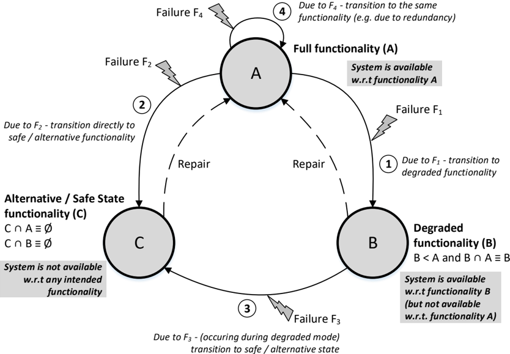
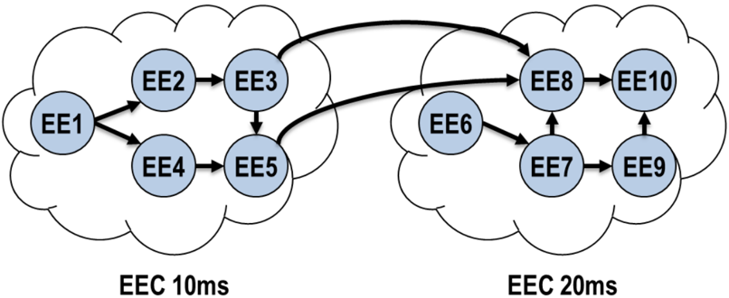
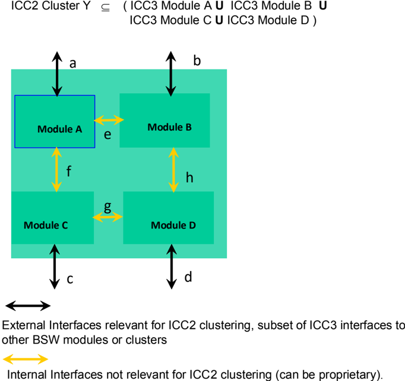
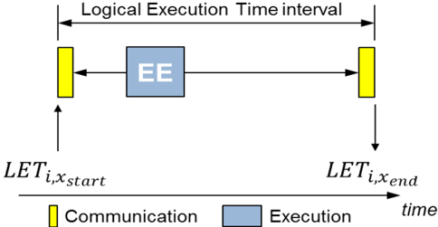
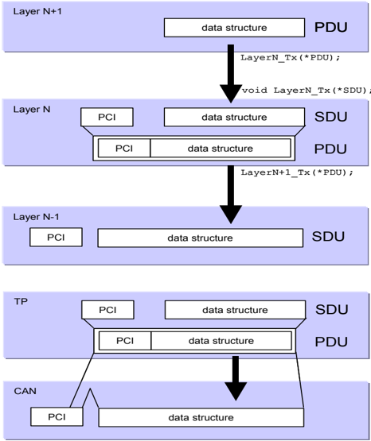
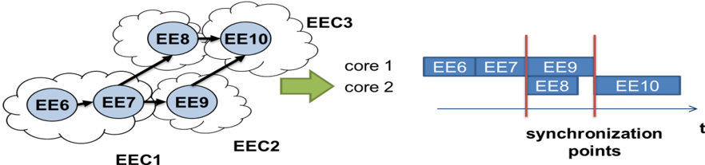
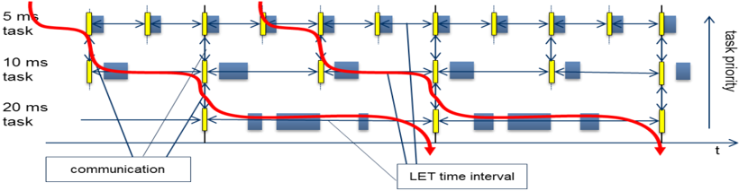

## 1. 简介和功能概述

本文档是 AUTOSAR 的总术语表，包含 AUTOSAR 中使用的所有主要术语和概念的定义。它并不声称完备；请注意，一些 WP（工作组）在其领域专用术语表中定义了更具体的术语。

## 2. 缩略语

**AA**
> 自适应应用（**Adaptive Application**）

**ABC**
> 抽象基类（**Abstract Base Class**）

**ABI**
> 应用二进制接口（**Application Binary Interface**）

**ADC**
> 模数转换器（**Analog Digital Converter**）

**AES**
> 高级加密标准（**Advanced Encryption Standard**）

**AMM**
> 应用模式管理（**Application Mode Management**）

**AP**
> AUTOSAR 自适应平台（**AUTOSAR Adaptive Platform**）

**API**
> 应用编程接口（**Application Programming Interface**）

**ARA**
> 自适应应用 AUTOSAR 运行时（**AUTOSAR Runtime for Adaptive Applications**）

**ARP**
> 地址解析协议（**Address Resolution Protocol**）

**ARTI**
> AUTOSAR 运行时接口（**AUTOSAR Run-Time Interface**）

**ARXML**
> AUTOSAR XML（**AUTOSAR XML**）

**ASAM**
> 自动化与测量系统标准化协会（**Association for Standardization of Automation and Measuring systems**）

**ASD**
> 抽象系统描述（**Abstract System Description**）

**ASIL**
> 汽车安全完整性等级（**Automotive Safety Integrity Levels**）

**ASW**
> 应用软件（**Application SoftWare**）

**ATP**
> AUTOSAR 模板_profile_（**AUTOSAR Template Profile**）

**ATS**
> 验收测试套件（**Acceptance Test Suite**）

**AUTOSAR**
> AUTomotive Open System Architecture（汽车开放系统架构）

**BFx**
> 定点位域函数（**Bitfield functions for fixed point**）

**BSW**
> 基础软件（**Basic Software**）

**BIST**
> 内建自测试（**Built-In Self Tests**）

**BSWM**
> 基础软件模式管理器（**Basic SoftWare Mode manager**）

**BSWMD**
> 基础软件模块描述（**Basic SoftWare Module Description**）

**CAN**
> 控制器局域网（**Controller Area Network**）

**CC**
> 通信控制器（**Communication Controller**）

**CCF**
> 共因失效（**Common Cause Failure**）

**CDD**
> 复杂设备驱动（**Complex Driver**）

**CP**
> 经典平台（**Classic Platform**）

**COM**
> 通信管理（**COmmunication Management**）

**CPU**
> 中央处理单元（**Central Processing Unit**）

**CRC**
> 循环冗余校验（**Cyclic Redundancy Check**）

**DAC**
> 数模转换器（**Digital to Analog Converter**）

**DDS**
> 数据分发服务（**Data Distribution Service**）

**DEM**
> 诊断事件管理器（**Diagnostic Event Manager**）

**DES**
> 数据加密标准（**Data Encryption Standard**）

**DET**
> 开发错误跟踪器（**Development Error Tracer**）

**DEXT**
> 诊断提取（**Diagnostic EXTract**）

**DHCP**
> 动态主机配置协议（**Dynamic Host Configuration Protocol**）

**DIO**
> 数字输入/输出（**Digital Input/Output**）

**DLC**
> 数据长度码（**Data Length Code**）

**DM**
> 诊断管理器（**Diagnostic Manager**）

**DoIP**
> 基于互联网协议的诊断（**Diagnostics over Internet Protocol**）

**DoS**
> 拒绝服务（**Denial of Service**）

**DSL**
> 领域特定语言（**Domain Specific Language**）

**DTC**
> 诊断故障码（**Diagnostic Trouble Code**）

**DTD**
> 文档类型定义（**Document Type Definition**）

**E2E**
> 端到端（**End to End**）

**ECU**
> 电子控制单元（**Electronic Control Unit**）

**ECB**
> 电子密码本（**Electronic Code Book**）

**ECC**
> 椭圆曲线密码学（**Elliptic Curve Cryptography**）

**ECDSA**
> 椭圆曲线数字签名算法（**Elliptic Curve Digital Signature Algorithm**）

**ECIES**
> 椭圆曲线集成加密方案（**Elliptic Curve Integrated Encryption Scheme**）

**EDDSA**
> 爱德华曲线数字签名算法（**Edwards-Curve Digital Signature Algorithm**）

**EEC**
> 可执行实体簇（**Executable Entity Cluster**）

**EEPROM**
> 电可擦除可编程只读存储器（**Electrically Erasable Programmable Read-Only Memory**）

**EM**
> 执行管理（**Execution Management**）

**EOC**
> 执行顺序约束（**Execution Order Constraint**）

**EOCEERG**
> 执行顺序约束可执行实体引用组（**Execution Order Constraint Executable Entity Reference Group**）

**FC**
> 功能簇（**Functional Cluster**）

**FIFO**
> 先进先出（**First In First Out**）

**FIBEX**
> 现场总线交换格式（**Field Bus Exchange Format**）

**FO**
> （AUTOSAR）基础（**(AUTOSAR) FOundation**）

**FOTA**
> 固件远程升级（**Firmware Over The Air**）

**FPU**
> 浮点运算单元（**Floating Point Unit**）

**FQDN**
> 全限定域名（**Fully-Qualified Domain Name**）

**FW**
> 火线接口（**Fire Wire**）

**GCM**
> 伽罗瓦/计数器模式（**Galios/Counter Mode**）

**GENIVI**
> 日内瓦车载信息娱乐联盟（**GENeva In-Vehicle Infotainment**）

**GPT**
> 通用定时器（**General Purpose Timer**）

**GSM**
> 全球移动通信系统（**Global System for Mobile Communication**）

**HMAC**
> 基于哈希的消息认证码（**Hash-based Message Authentication Code**）

**HTMSS**
> 硬件测试管理启动与关闭（**Hardware Test Management Start-up & Shutdown**）

**HTTP**
> 超文本传输协议（**Hypertext Transport Protocol**）

**HW**
> 硬件（**Hardware**）

**I-PDU**
> 交互层协议数据单元（**Interaction Layer Protocol Data Unit**）

**ICC**
> 实现一致性等级（**Implementation Conformance Class**）

**ICMP**
> 互联网控制报文协议（**Internet Control Message Protocol**）

**ICOM**
> 智能通信控制器（**Intelligent COMmunication controller**）

**ICU**
> 输入捕获单元（**Input Capture Unit**）

**ICV**
> 完整性校验值（**Integrity Check Value**）

**ID**
> 标识符（**IDentifier**）

**IDL**
> 接口描述语言（**Interface Description Language**）

**IEC**
> 国际电工委员会（**International Electrotechnical Commission**）

**IFI**
> 浮点插值（**Interpolation Floating point**）

**IFx**
> 定点插值（**Interpolation Fixed point**）

**IO**
> 输入/输出（**Input/ Output**）

**IP**
> 互联网协议（**Internet Protocol**）

**ISO**
> 国际标准化组织（**International Standardization Organization**）

**ISR**
> 中断服务例程（**Interrupt Service Routine**）

**JSON**
> JSON（**JavaScript Object Notation**）

**LAN**
> 局域网（**Local Area Network**）

**LBAP**
> 自适应平台语言绑定（**Language Binding for the Adaptive Platform**）

**L-PDU**
> 数据链路层协议数据单元（**Protocol Data Unit of the data Link layer**）

**L-SDU**
> 数据链路层服务数据单元（**SDU of the data Link layer**）

**LET**
> 逻辑执行时间（**Logical Execution Time**）

**LIFO**
> 后进先出（**Last In First Out**）

**LIN**
> 局部互联网络（**Local Interconnected Network**）

**LT**
> 日志与追踪（**Log and Trace**）

**LSB**
> 最低有效位（**Least Significant Bit**）

**MAC**
> 媒体访问控制（**Media Access Control**）

**MAC**
> 消息认证码（**Message Authentication Code**）

**mC**
> 微控制器（**MicroController**）

**MCAL**
> 微控制器抽象层（**Microcontroller Abstraction Layer**）

**MCU**
> 微控制器单元（**Micro Controller Unit**）

**MD**
> 消息摘要（**Message Digest**）

**ME**
> 可映射元素（**Mappable Element**）

**MFI**
> 数学浮点（**Mathematical Floating point**）

**MFx**
> 定点数学（**Math - Fixed Point**）

**MIPS**
> 每秒百万条指令（**Million Instructions Per Second**）

**MMU**
> 内存管理单元（**Memory Management Unit**）

**MMI**
> 人机接口（**Man Machine Interface**）

**MOST**
> 面向媒体的系统传输（**Media Oriented Systems Transport**）

**mP**
> 微处理器（**MicroProcessor**）

**MPU**
> 内存保护单元（**Memory Protection Unit**）

**MSB**
> 最高有效位（**Most Significant Bit**）

**MSTP**
> 微控制器专用测试包（**Micro-controller Specific Test Package**）

**MTU**
> 最大传输单元（**Maximum Transmission Unit**）

**NM**
> 网络管理（**Network Management**）

**N-PDU**
> 网络层协议数据单元（传输协议）（**Protocol Data Unit of the Network layer (transport protocols)**）

**N-SDU**
> 网络层服务数据单元（传输协议）（**SDU of the Network layer (transport protocols)**）

**NVRAM**
> 非易失性随机访问存储器（**Non-Volatile Random Access Memory**）

**OBD**
> 车载诊断（**On-Board Diagnostic**）

**OEM**
> 原始设备制造商（**Original Equipment Manufacturer**）

**OIL**
> ISO 17356-6（OSEK/VDX 实现语言）（**ISO 17356-6 (OSEK/VDX Implementation Language)**）

**OS**
> 操作系统（**Operating System**）

**OSEK**
> 汽车电子开放系统及对应接口（**Open Systems and the Corresponding Interfaces for Automotive Electronics**）

**PCI**
> 协议控制信息（**Protocol Control Information**）

**PDEP**
> 数据交换点_profile_（**Profile of Data Exchange Point**）

**PDU**
> 协议数据单元（**Protocol Data Unit**）

**PHM**
> 平台健康管理（**Platform Health Management**）

**PKCS**
> 公钥密码学标准（**Public Key Cryptography Standards**）

**POSIX**
> 可移植操作系统接口（**Portable Operating System Interface**）

**PS**
> 产品供应商（**Product Supplier**）

**PSK**
> 预共享密钥（**Pre-Shared Key**）

**PWM**
> 脉冲宽度调制（**Pulse Width Modulation**）

**RAM**
> 随机访问存储器（**Random Access Memory**）

**RDG**
> 可运行实体依赖图（**Runnable Dependency Graph**）

**REST**
> 表述性状态转移（**Representational State Transfer**）

**RfC**
> 变更请求（**Request for Change**）

**ROM**
> 只读存储器（**Read-Only Memory**）

**RP**
> 快速原型（**Rapid Prototyping**）

**RPC**
> 远程过程调用（**Remote Procedure Call**）

**RSA**
> 按 Rivest、Shamir 和 Adleman 的密码学方法（**Cryptographic approach according to Rivest, Shamir, and Adleman**）

**RTE**
> 运行时环境（**Runtime Environment**）

**SAE**
> 汽车工程师学会（**Society of Automotive Engineers**）

**SD**
> 服务发现（**Service Discovery**）

**SDG**
> 特殊数据组（**Special Data Group**）

**SDU**
> 服务数据单元（**Service Data Unit**）

**SHA**
> 安全哈希算法（**Secure Hash Algorithm**）

**SHM**
> 系统健康监控（**System Health Monitoring**）

**SIL**
> 安全完整性等级（**Safety Integrity Level**）

**SL-LET**
> 系统级逻辑执行时间（**System Level Logical Execution Time**）

**SM**
> 状态管理（**State Management**）

**SOA**
> 面向服务的架构（**Service Oriented Architecture**）

**SOME/IP**
> 基于 IP 的可扩展面向服务中间件（**Scalable service-Oriented MiddlewarE over IP**）

**SP**
> 同步点（**Synchronization Point**）

**SPEM**
> 软件与系统过程工程元模型（**Software & Systems Process Engineering Meta-model**）

**SPI**
> 串行外设接口（**Serial Peripheral Interface**）

**SST**
> 信号-服务转换（**Signal-Service Translation**）

**SW**
> 软件（**Software**）

**SW-C**
> 软件组件（**Software Component**）

**SWCT / SWC-T**
> 软件组件模板（**Software Component Template**）

**SWS**
> 软件规格说明（**Software Specification**）

**SYST / SYS-T**
> 系统模板（**System Template**）

**TC**
> 定时通信（**Timed Communication**）

**TC**
> 测试用例（**Test Case**）

**TCP**
> 传输控制协议（**Transmission Control Protocol**）

**TD**
> 时序描述（**Timing Description**）

**TIMEX**
> 时序扩展（**TIMing EXTensions**）

**TLS**
> 传输层安全（**Transport Layer Security**）

**TLV**
> 标签-长度-值（**Tag Length Value**）

**TP**
> 传输协议（**Transport Protocol**）

**TSN**
> 时间敏感网络（**Time sensitive network**）

**TTCAN**
> 时间触发 CAN（**Time Triggered CAN**）

**TTL**
> 生存时间（**Time To Live**）

**TTP**
> 时间触发协议（**Time Triggered Protocol**）

**UDP**
> 用户（通用）数据报协议（**User (Universal) Datagram Protocol**）

**UDS**
> 统一诊断服务（**Unified Diagnostic Services**）

**UDPNM**
> UDP 网络管理（**UDP Network Management**）

**UML**
> 统一建模语言（**Unified Modeling Language**）

**URI**
> 统一资源标识符（**Uniform Resource Identifier**）

**URL**
> 统一资源定位符（**Uniform Resource Locator**）

**USB**
> 通用串行总线（**Universal Serial Bus**）

**UTF**
> 通用编码字符集转换格式（**Universal coded character set Transformation Format**）

**UUID**
> 通用唯一标识符（**Universally Unique Identifier**）

**VFB**
> 虚拟功能总线（**Virtual Functional Bus**）

**V2X**
> 车联万物（**Vehicle-To-Everything**）

**VLAN**
> 虚拟局域网（**Virtual Local Area Network**）

**VSA**
> 变长数组（**Variable Size Array**）

**VSM**
> 车辆状态管理器（**Vehicle State Manager**）

**VISS**
> 车辆信息服务规范（**Vehicle Information Service Specification**）

**VMM**
> 车辆模式管理（**Vehicle Mode Management**）

**WCET**
> 最坏情况执行时间（**Worst Case Execution Time**）

**WCRT**
> 最坏情况响应时间（**Worst Case Response time**）

**W3C**
> 万维网联盟（**World Wide Web Consortium**）

**XCP**
> 通用标定协议（**Universal Calibration Protocol**）

**XML**
> 可扩展标记语言（**Extensible Markup Language**）

**XP**
> 抽象平台（**Abstract Platform**）

**XSD**
> XML 模式定义（**XML Schema Definition**）

## 3. 如何阅读本文档

各子章的标题与所要定义的术语相同。

### 3.1. &lt;术语&gt; 模板

| 定义 | <待定义的术语> |
|---|---|
| 发起者 | <负责该术语的功能簇> |
| 进一步说明 | <定义的进一步解释> |
| 备注 | <注释或提示> |
| 示例 | <该术语的示例> |
| 参考 | <定义的参考> |

## 4. 术语定义

### 4.1. Abstract Platform

| 定义 | AUTOSAR 定义的一种软件平台，用于以独立于经典平台（Classic）/ 自适应平台（Adaptive）/ 离板（Offboard）部署方式的方式定义功能级通信。 |
|---|---|
| 发起者 | 系统设计（**System Design**） |
| 进一步说明 | 抽象平台只存在于方法论与建模意义上，并不是一个物理可部署的平台。在 AUTOSAR 经典平台与 AUTOSAR 自适应平台的语境下，功能级通信指的是 VFB 级通信。 |
| 备注 | - |
| 示例 | - |
| 参考 | - |

### 4.2. Acceptance Test Suite

| 定义 | 在验收测试（**Acceptance Testing**）语境中使用的一种测试用例描述。 |
|---|---|
| 发起者 | 验收测试（**Acceptance Testing**） |
| 进一步说明 | ISO 9646 区分抽象测试套件与可执行测试套件。对 AUTOSAR 而言，前者对应验收测试规格，后者对应测试实现或验收测试套件。 |
| 备注 | - |
| 示例 | - |
| 参考 | [\[1\]](#ref-1)，第 1、2、4 部分 |

### 4.3. Access Control Decision

| 定义 | 访问控制判定是一个布尔值，指示所请求的操作是否被允许。它基于调用者的身份以及"访问控制策略"（**Access Control Policy**）。 |
|---|---|
| 发起者 | 安全（**Security**） |
| 进一步说明 | 在 IAM 的情形中，"调用者"是一个自适应应用。 |
| 备注 | - |
| 示例 | - |
| 参考 | - |

### 4.4. Access Control Policy

| 定义 | 访问控制策略绑定到调用的目标（即服务接口），用于表达访问这些接口需要何种"身份信息"（**Identity Information**）。 |
|---|---|
| 发起者 | 安全（**Security**） |
| 进一步说明 | 策略可以通过配置/建模提供，也可以通过静态预编程的方式写入 PDP。 |
| 备注 | - |
| 示例 | - |
| 参考 | - |

### 4.5. Adaptability

| 定义 | 适应性是系统调整自身以应对其环境变化、从而继续提供预期功能的能力。 |
|---|---|
| 发起者 | 安全（**Safety**） |
| 进一步说明 | 应当区分系统/车辆环境中的变化（"运行时适应性"）与使用软件架构（如 AUTOSAR）的开发环境中的变化（"设计时可预测性"）。 |
| 备注 | - |
| 示例 | - |
| 参考 | • Antonio Carlos Schneider Beck, Carlos Arthur Lang Lisboa, Luigi Carro (eds.), Adaptable Embedded Systems, Springer Science & Business Media, 27 Nov 2012 • Twan Basten, Roelof Hamberg, Frans Reckers, Jacques Verriet, Model-Based Design of Adaptive Embedded Systems, Springer Science & Business Media, 15 Mar 2013 |

### 4.6. Adaptive Application

| 定义 | 遵循自适应 AUTOSAR 规范、因而可部署到自适应平台实例上的软件。它由其实现、运行数据（如地图数据）以及由应用设计模型给出的元数据组成。自适应应用至少包含一个可执行文件。为了能部署到不同的自适应平台上，它只使用 ARA 编程接口。 |
|---|---|
| 发起者 | 执行管理（**Execution Management**） |
| 进一步说明 | 自适应应用通常比经典平台的 SW-C 粒度更粗。它们只使用自适应平台 API，可以提供并使用服务。它们由一个或多个具有已定义入口点的可执行文件、字节码或库实现，并且可以由多个部分组成（如库、数据文件）。 |
| 备注 | 自适应平台的目标是使自适应应用在不同的自适应平台实现之间至少达到源代码级的可移植性，并可能达到目标代码级的可移植性。 |
| 示例 | - |
| 参考 | - |

### 4.7. Adaptive Platform Foundation

| 定义 | 自适应平台实现的一部分，通过软件接口（API）向应用提供标准化的平台功能。 |
|---|---|
| 发起者 | 软件与架构（**Software and Architecture**） |
| 进一步说明 | 自适应平台基础包括核心系统功能，如 OS、执行管理器（**Execution Manager**）、通信管理（**Communication Management**）和持久化（**Persistency**）。 |
| 备注 | 自适应平台的目标是使自适应应用在不同的自适应平台实现之间至少达到源代码级的可移植性，并可能达到目标代码级的可移植性。 |
| 示例 | - |
| 参考 | - |

### 4.8. Adaptive Platform Services

| 定义 | 由属于 AUTOSAR 平台实现一部分的应用所提供的标准平台服务。 |
|---|---|
| 发起者 | 通信（**Communication**） |
| 进一步说明 | - |
| 备注 | - |
| 示例 | - |
| 参考 | - |

### 4.9. Application

| 定义 | 为解决需要信息处理的最终用户问题而规定的软件（或程序）。一个软件实体的"软件配置"（**Software Configuration**）。 |
|---|---|
| 发起者 | 软件与架构（**Software and Architecture**） |
| 进一步说明 | 关于定义的第 1 点：在 AUTOSAR 中，应用软件位于 AUTOSAR RTE（RunTimeEnvironment）之上。 |
| 备注 | 定义 1 是 AUTOSAR 中"应用"的默认含义；若指的是定义 2，则必须显式说明。 |
| 示例 | - |
| 参考 | [\[2\]](#ref-2) |

### 4.10. Application Interface

| 定义 | 软件组件模板中所规定的、由"软件组件"（**Software Component**）使用的"端口接口"（**Port Interface**）。 |
|---|---|
| 发起者 | 软件与架构（**Software and Architecture**） |
| 进一步说明 | - |
| 备注 | - |
| 示例 | - |
| 参考 | [\[3\]](#ref-3) |

### 4.11. Application Programming Interface

| 定义 | 应用编程接口（API）是特定软件部分的既定方法，编写程序的程序员通过它可以向该软件部分发出请求。 |
|---|---|
| 发起者 | 软件与架构（**Software and Architecture**） |
| 进一步说明 | - |
| 备注 | - |
| 示例 | [\[4\]](#ref-4)（OSEK/VDX 操作系统） |
| 参考 | - |

### 4.12. Application Software Component

| 定义 | 应用软件组件是一种特定的"软件组件"，它在应用层实现已定义的功能并运行于 AUTOSAR 基础设施之上。它只通过 AUTOSAR 运行时环境进行通信。 |
|---|---|
| 发起者 | 软件与架构（**Software and Architecture**） |
| 进一步说明 | 应用软件组件位于 AUTOSAR 运行时环境"之上"。 |
| 备注 | - |
| 示例 | - |
| 参考 | - |

### 4.13. Architecture

| 定义 | 体系结构是系统的基本组织方式，体现在其组件、组件之间及其与环境的静态与动态关系、以及指导其设计与演化的原则之中。 |
|---|---|
| 发起者 | 软件与架构（**Software and Architecture**） |
| 进一步说明 | - |
| 备注 | 在 [\[5\]](#ref-5) 的定义中加入了"静态与动态"。 |
| 示例 | - |
| 参考 | [\[6\]](#ref-6), [\[5\]](#ref-5) |

### 4.14. Artifact

| 定义 | 制品是一种工作产品定义（**Work Product Definition**），为有形的工作产品类型提供描述与定义。制品可以由其他制品组成。在高层次上，制品表示为单个概念性文件。 |
|---|---|
| 发起者 | 方法论与模板（**Methodology and Templates**） |
| 进一步说明 | - |
| 备注 | - |
| 示例 | - |
| 参考 | - |

### 4.15. ASIL Decomposition

| 定义 | 参见 ISO-DIS-26262-Part-1（[\[7\]](#ref-7)），ID 1.7 |
|---|---|
| 发起者 | 安全（**Safety**） |
| 进一步说明 | - |
| 备注 | - |
| 示例 | - |
| 参考 | 参见 [\[7\]](#ref-7)，ID 1.7 |

### 4.16. Asserted Property

| 定义 | 如果设计实体（例如软件组件或系统）保证该属性或质量得到满足，则称设计实体的该属性或质量是"已断言的"（**asserted**）。 |
|---|---|
| 发起者 | 软件与架构（**Software and Architecture**） |
| 进一步说明 | 设计单元的某一属性或质量可以由该设计单元自身断言，也可以由其与其他设计单元组合断言。 |
| 备注 | - |
| 示例 | 如果某任务的最坏情况执行时间（相对于某个 CPU 等）被断言为 3 ms，那么在任何情况下，该任务的执行时间都将小于或等于 3 ms。 |
| 参考 | 参照「**Required Property**」 |

### 4.17. Assessment

| 定义 | 参见 ISO-DIS-26262-Part-1（[\[7\]](#ref-7)），ID 1.4 |
|---|---|
| 发起者 | 安全（**Safety**） |
| 进一步说明 | - |
| 备注 | - |
| 示例 | - |
| 参考 | 参见 [\[7\]](#ref-7)，ID 1.4 |

### 4.18. Asset

| 定义 | 为在多种上下文中使用而设计的条目。 |
|---|---|
| 发起者 | 软件与架构（**Software and Architecture**） |
| 进一步说明 | - |
| 备注 | - |
| 示例 | 资产可以是设计、规范、源代码、文档、测试套件、人工流程等。从信息安全的角度看，任何对利益相关方有价值的事物都是资产，例如关键数据（信息、软件）和关键功能，它们可能成为攻击对象，并可能（但不必然）促使采取应对措施。 |
| 参考 | [\[8\]](#ref-8), [\[5\]](#ref-5) |

### 4.19. Asynchronous Communication

| 定义 | 异步通信不会阻塞发送方软件实体。发送方软件实体无需等待通信伙伴的响应即可继续其自身的操作。 |
|---|---|
| 发起者 | 通信（**Communication**） |
| 进一步说明 | 通信系统可能会对信息的发送给出确认。之后向发送方软件实体返回响应也是可能的。 |
| 备注 | - |
| 示例 | - |
| 参考 | - |

### 4.20. Asynchronous Function

| 定义 | 如果某个"函数"（**Function**）所描述的功能在其返回调用者时不能保证已完成，则该函数称为异步函数。 |
|---|---|
| 发起者 | 软件与架构（**Software and Architecture**） |
| 进一步说明 | - |
| 备注 | - |
| 示例 | - |
| 参考 | - |

### 4.21. Atomic Software Component

| 定义 | 非组合的软件组件。 |
|---|---|
| 发起者 | 软件与架构（**Software and Architecture**） |
| 进一步说明 | 原子软件组件可以访问硬件，也可以不访问硬件，因此并非所有原子 SW-C 都是可重定位的。 |
| 备注 | - |
| 示例 | 应用软件组件、复杂驱动（**Complex Driver**） |
| 参考 | - |

### 4.22. Audit

| 定义 | 参见 ISO-DIS-26262-Part-1（[\[7\]](#ref-7)），ID 1.5 |
|---|---|
| 发起者 | 安全（**Safety**） |
| 进一步说明 | - |
| 备注 | - |
| 示例 | - |
| 参考 | 参见 [\[7\]](#ref-7)，ID 1.5 |

### 4.23. Authenticity

| 定义 | 数据确实来源于其所声称来源的特性。 |
|---|---|
| 发起者 | 安全（**Security**） |
| 进一步说明 | - |
| 备注 | - |
| 示例 | - |
| 参考 | NIST SP 800-38B 中"Authenticity"条目 |

### 4.24. Automotive Safety Integrity Levels

| 定义 | 参见 ISO-DIS-26262-Part-1（[\[7\]](#ref-7)），ID 1.7 |
|---|---|
| 发起者 | 安全（**Safety**） |
| 进一步说明 | - |
| 备注 | - |
| 示例 | - |
| 参考 | 参见 [\[7\]](#ref-7)，ID 1.7 |

### 4.25. AUTOSAR Adaptive Platform

| 定义 | 由 AUTOSAR 标准化的自适应计算平台。狭义上指其规范；广义上可指自适应平台实现的一个实例。 |
|---|---|
| 发起者 | 软件与架构（**Software and Architecture**） |
| 进一步说明 | - |
| 备注 | - |
| 示例 | - |
| 参考 | - |

### 4.26. AUTOSAR Application Interface

| 定义 | 由 AUTOSAR 标准化、可用于创建"应用"（**Application**）的"AUTOSAR 接口"（**AUTOSAR Interface**）的一组"蓝图"（**Blueprint**）。从标准化蓝图（**Standardized AUTOSAR Blueprint**）派生的 AUTOSAR 接口即标准化的 AUTOSAR 接口（**Standardized AUTOSAR Interface**）。 |
|---|---|
| 发起者 | 应用接口（**Application Interfaces**） |
| 进一步说明 | - |
| 备注 | - |
| 示例 | - |
| 参考 |  |

### 4.27. AUTOSAR Authoring Tool

| 定义 | 用于创建和修改"AUTOSAR XML 描述"（**AUTOSAR XML description**）的 AUTOSAR 工具（**AUTOSAR Tool**）。 |
|---|---|
| 发起者 | 方法论与模板（**Methodology and Templates**） |
| 进一步说明 | - |
| 备注 | - |
| 示例 | 系统描述编辑器（**System Description Editor**） |
| 参考 | - |

### 4.28. AUTOSAR Blueprint

| 定义 | AUTOSAR 蓝图是 AUTOSAR 元素的"蓝图"（**Blueprint**）。它还包括：在 AUTOSAR 项目中规定，对于某一特定类别的 AUTOSAR 元素类型的蓝图，哪些属性是必须规定的，以及如何从该蓝图派生出 AUTOSAR 对象。 |
|---|---|
| 发起者 | 应用接口（**Application Interfaces**） |
| 进一步说明 | AUTOSAR 元模型支持对模型元素进行预定义，作为后续建模的基础。这些预定义称为蓝图。 |
| 备注 | - |
| 示例 | - |
| 参考 | [\[9\]](#ref-9) |

### 4.29. AUTOSAR Converter Tool

| 定义 | 通过转换其他 AUTOSAR XML 文件中的信息来创建 AUTOSAR XML 文件的 AUTOSAR 工具。 |
|---|---|
| 发起者 | 方法论与模板（**Methodology and Templates**） |
| 进一步说明 | - |
| 备注 | - |
| 示例 | ECU 扁平化工具（**ECU Flattener**） |
| 参考 | - |

### 4.30. AUTOSAR Definition

| 定义 | 这是对可以有取值的参数的定义。可以说，参数值是这些定义的实例。但在 AUTOSAR 的元模型层次结构中，定义本身也是元模型的实例，因此被视为一种描述。 |
|---|---|
| 发起者 | 方法论与模板（**Methodology and Templates**） |
| 进一步说明 | - |
| 备注 | - |
| 示例 | - |
| 参考 | - |

### 4.31. AUTOSAR Interface

| 定义 | 软件组件的 AUTOSAR 接口（**AUTOSAR Interface**）指该组件中用于与其他组件交互的所有"端口"（**Port**）的集合。 |
|---|---|
| 发起者 | 软件与架构（**Software and Architecture**） |
| 进一步说明 | - |
| 备注 | 注意，AUTOSAR 接口不同于"端口接口"（**Port Interface**）。后者刻画的是组件的某一个特定端口。 |
| 示例 | - |
| 参考 | AUTOSAR 虚拟功能总线规范（**Specification of Virtual Functional Bus**）（[\[10\]](#ref-10)），"Modeling of Communication, Graphical Notation"一章 |

### 4.32. AUTOSAR Meta-model

| 定义 | AUTOSAR 元模型是一个 UML2.0 模型，它定义了描述 AUTOSAR 系统及相关制品的语言。 |
|---|---|
| 发起者 | 方法论与模板（**Methodology and Templates**） |
| 进一步说明 | - |
| 备注 | "AUTOSAR XML 模式"（**AUTOSAR XML Schema**）由 AUTOSAR 元模型派生而来。 |
| 示例 | - |
| 参考 | [\[11\]](#ref-11) |

### 4.33. AUTOSAR Model

| 定义 | 这是 AUTOSAR 元模型的一个实例。AUTOSAR 模型表示按照 AUTOSAR 方法论适合预期用途的各个方面。 |
|---|---|
| 发起者 | 方法论与模板（**Methodology and Templates**） |
| 进一步说明 | - |
| 备注 | - |
| 示例 | - |
| 参考 | - |

### 4.34. AUTOSAR Partial Model

| 定义 | 在 AUTOSAR 中，模型可能的划分方式在元模型中用 `<<atp Splitable>>` 标记。一个部分模型在一个"AUTOSAR XML 描述"（**AUTOSAR XML description**）中由一个文件表示。部分模型不需要满足适用于 AUTOSAR 模型的全部语义约束。 |
|---|---|
| 发起者 | 方法论与模板（**Methodology and Templates**） |
| 进一步说明 | - |
| 备注 | - |
| 示例 | - |
| 参考 | - |

### 4.35. AUTOSAR Processor Tool

| 定义 | 通过处理 AUTOSAR XML 文件中的信息来创建非 AUTOSAR 文件的 AUTOSAR 工具。 |
|---|---|
| 发起者 | 方法论与模板（**Methodology and Templates**） |
| 进一步说明 | - |
| 备注 | - |
| 示例 | RTE 生成器（**RTE Generator**） |
| 参考 | - |

### 4.36. AUTOSAR Runtime for Adaptive Applications

| 定义 | 由功能簇（**Functional Cluster**）提供的一组标准应用接口，这些功能簇属于自适应平台基础（**Adaptive Platform Foundation**）或自适应平台服务（**Adaptive Platform Services**）。 |
|---|---|
| 发起者 | 通用（**General**） |
| 进一步说明 | - |
| 备注 | - |
| 示例 | - |
| 参考 | - |

### 4.37. AUTOSAR Run-Time Interface

| 定义 | AUTOSAR 运行时接口（AUTOSAR Run-Time Interface）应定义构建工具与调试/跟踪工具之间的接口。 |
|---|---|
| 发起者 | 软件与架构（**Software and Architecture**） |
| 进一步说明 | 该接口应便于并加快系统行为的调试、跟踪与验证以及双向工程（**round-trip engineering**）。 |
| 备注 |  |
| 示例 | - |
| 参考 | AUTOSAR ARTI 规范（**Specification of ARTI**）（[\[12\]](#ref-12)） |

### 4.38. AUTOSAR Service

| 定义 | "服务"（**service**）一词在分层软件架构中用于表示与应用交互的 AUTOSAR 软件架构的最高层。服务一词按面向服务架构（**service-oriented architecture**）中定义的含义使用。该含义与 AUTOSAR 自适应平台上服务一词的用法关联最强。服务一词也用于描述诊断服务的处理，例如 UDS 服务 ReadDataByIdentifier，用于诊断测试仪与（AUTOSAR）ECU 上的诊断协议栈之间的通信。 |
|---|---|
| 发起者 | 软件与架构（**Software and Architecture**） |
| 进一步说明 | - |
| 备注 | - |
| 示例 | - |
| 参考 | - |

### 4.39. AUTOSAR Software

| 定义 | 按照 AUTOSAR 标准开发的应用软件或基础/平台软件。 |
|---|---|
| 发起者 | - |
| 进一步说明 | - |
| 备注 | - |
| 示例 | - |
| 参考 | - |

### 4.40. AUTOSAR Tool

| 定义 | 这是一种软件工具，它支持方法论中定义的 AUTOSAR 任务中的一个或多个任务。根据所支持的任务，AUTOSAR 工具可以用作"AUTOSAR 编写工具"（**AUTOSAR Authoring Tool**）、"AUTOSAR 转换工具"（**AUTOSAR Converter Tool**）、"AUTOSAR 处理工具"（**AUTOSAR Processor Tool**），或它们的组合。 |
|---|---|
| 发起者 | 方法论与模板（**Methodology and Templates**） |
| 进一步说明 | - |
| 备注 | - |
| 示例 | - |
| 参考 | - |

### 4.41. AUTOSAR XML description

| 定义 | 在 AUTOSAR 中，这是序列化的 AUTOSAR 模型。实际上，AUTOSAR XML 描述是"AUTOSAR 模型"（**AUTOSAR Model**）的 XML 表示。AUTOSAR XML 描述可以由多个文件组成。每个单独的文件表示一个"AUTOSAR 部分模型"（**AUTOSAR Partial Model**），并且必须能够针对"AUTOSAR XML 模式"（**AUTOSAR XML Schema**）成功通过校验。 |
|---|---|
| 发起者 | 方法论与模板（**Methodology and Templates**） |
| 进一步说明 | - |
| 备注 | - |
| 示例 | - |
| 参考 | - |

### 4.42. AUTOSAR XML Schema

| 定义 | AUTOSAR XML 模式是用于交换 AUTOSAR 模型（**AUTOSAR Model**）及描述的 XML 语言定义。 |
|---|---|
| 发起者 | 方法论与模板（**Methodology and Templates**） |
| 进一步说明 | AUTOSAR XML 模式是一种 W3C XML schema，它定义了交换 AUTOSAR 模型的语言。该模式由 AUTOSAR 元模型派生而来。AUTOSAR XML 模式定义了 AUTOSAR 数据交换格式。 |
| 备注 | - |
| 示例 | - |
| 参考 | - |

### 4.43. Availability

| 定义 | 1. 可用性是系统按照其规范完整地执行某个功能 A 的能力。2. 在给定时间间隔内系统执行功能 A（按第 1 条定义）的总时间与该时间间隔长度之比。另一种表述：系统在指定时刻 t 正在执行功能 A 的概率。3. 在降级模式下，如果完整的 A 不可用，系统具有执行 A 的子集 B 的能力。此时，功能 B 是可用的。 |
|---|---|
| 发起者 | 安全（**Safety**） |
| 进一步说明 | 参见图 4.1 了解更多细节。 |
| 备注 | 1. 降级模式包含在此定义中（见示例）。 |
| 示例 | 1. 电动助力转向：如果助力功能失效，则该功能不可用，而作为基础功能的转向仍具有完全的可用性。2. 从信息安全的角度看，可用性是确保授权实体在请求时能够正确且及时地获得访问的一种属性。 |
| 参考 | 参见 [\[7\]](#ref-7)，ID 1.8 |

### 4.44. Basic Software

| 定义 | 基础软件（**Basic Software**, BSW）提供"电子控制单元"（**Electronic Control Unit**）的基础设施功能（依赖于原理图的和独立于原理图的）。它由"集成代码"（**Integration Code**）和"标准软件"（**Standard Software**）组成。 |
|---|---|
| 发起者 | 软件与架构（**Software and Architecture**） |
| 进一步说明 | - |
| 备注 | - |
| 示例 | MCAL、AUTOSAR 服务、通信层（**Communication Layer**） |
| 参考 | - |

### 4.45. Basic Software Module

| 定义 | 在"电子控制单元"（**Electronic Control Unit**）上定义某个特定基础软件功能的软件文件（代码与描述）的集合。 |
|---|---|
| 发起者 | 软件与架构（**Software and Architecture**） |
| 进一步说明 | "标准软件"（**Standard Software**）可以由若干独立开发的软件模块组成。一个软件模块可以由"集成代码"（**Integration Code**）和/或"标准软件"（**Standard Software**）构成。 |
| 备注 | - |
| 示例 | 数字 IO 驱动、复杂驱动（**Complex Driver**）、OS 是基础软件模块的例子。 |
| 参考 | - |

### 4.46. Bit Position

| 定义 | 在 AUTOSAR 中，I-PDU 内的位位置 N 表示字节 J 中的位 I，其中 I = N mod 8，J = N / 8。字节 J 和位位置 I 按照 ISO 17356-4（OSEK/VDX 通信）中的定义进行解释。 |
|---|---|
| 发起者 | 通信（**Communication**） |
| 进一步说明 | - |
| 备注 | - |
| 示例 | - |
| 参考 | - |

### 4.47. Blueprint

| 定义 | 这是一种模型，其他模型可以通过复制和细化从中派生。注意，与元模型及类型相对照，这一过程不是实例化。 |
|---|---|
| 发起者 | 方法论与模板（**Methodology and Templates**） |
| 进一步说明 | - |
| 备注 | - |
| 示例 | 标准化蓝图与 AUTOSAR 蓝图。 |
| 参考 | - |

### 4.48. Bulk Data

| 定义 | "批量数据"（**Bulk Data**）是指规模大到处理较小数据集的标准机制不再适用的一类数据。这意味着软件系统中的批量数据需要用不同于较小数据集的机制来建模、存储、访问和传输。 |
|---|---|
| 发起者 | 软件与架构（**Software and Architecture**） |
| 进一步说明 | 批量数据通常通过增加一层抽象（如文件）来处理，该抽象层将数据的承载与其内部结构分离。 |
| 备注 | 数据必须被视为批量数据的临界大小取决于技术基础设施（如总线系统）和所考虑的用例（传输、存储等）。 |
| 示例 | 容量为几 KB 的持久介质（如 EEPROM）上的数据可以通过内存地址直接访问，地址偏移可以映射为编程语言的符号：不需要批量数据机制。对于容量更大的介质，这样做会变得不方便甚至不可能，因此使用文件系统：数据按批量数据处理。 |
| 参考 | - |

### 4.49. Bus Mirroring

| 定义 | 将信息从车内内部总线转发到外部总线，例如诊断连接器。 |
|---|---|
| 发起者 | 通信（**Communication**） |
| 进一步说明 | 总线镜像用于使内部总线可被外部测试仪访问，从而在出现错误时能够对内部总线进行调试。 |
| 备注 | 由于外部（或中间）总线通常不具备传输内部总线全部信息的足够带宽，必须应用过滤器来选择与分析相关的帧。 |
| 示例 | 某 ECU 在车辆中不进入休眠。工程师想检查 NM（网络管理）报文以排查异常行为，例如与部分网络（**Partial Networking**）信息相关的行为。 |
| 参考 | - |

### 4.50. Bus Wake-Up

| 定义 | 总线唤醒由专用通信标准（如 CAN、LIN、FR）规范中定义的总线上的特定唤醒脉冲引发。总线唤醒会促使收发器和控制器离开节能模式并进入正常模式，重新开始总线通信。 |
|---|---|
| 发起者 | 通信（**Communication**） |
| 进一步说明 | - |
| 备注 | - |
| 示例 | - |
| 参考 | - |

### 4.51. Bypassing

| 定义 | 在 ECU 镜像内以实验方式并入新功能。 |
|---|---|
| 发起者 | 运行时环境（**Runtime Environment**） |
| 进一步说明 | 旁路（**Bypassing**）指在不要求重新构建镜像的情况下，向现有 ECU 镜像并入新功能或替换现有功能。 |
| 备注 | 旁路可以是"内部的"——新的/替换的功能存在于 ECU 镜像中；也可以是"外部的"——由"快速原型工具"（**Rapid Prototyping Tool**）在 ECU 之外提供该功能。 |
| 示例 | RP 工具通过 RP 内存接口拦截被旁路的 RunnableEntity 的输出，并用旁路结果替换该值。后续的 RunnableEntity 处理的是旁路值而非原始结果。 |
| 参考 | - |

### 4.52. Calibration

| 定义 | 标定是对实现控制功能的 SW-C 的参数（即 AUTOSAR SW-C、ECU 抽象或"复杂驱动"（**Complex Driver**）的参数）进行的调整。 |
|---|---|
| 发起者 | 软件与架构（**Software and Architecture**） |
| 进一步说明 | 只有位于 RTE、ECU 抽象和 CDD 之上的软件模块才能被标定。标定总是在下线（**post-build**）阶段进行。用于写入标定数据的技术包括下线编程、售后编程和自适应标定（例如车窗防夹保护）。 |
| 备注 | - |
| 示例 | 发动机控制的标定会考虑该系统将要控制的个体电机的生产差异。 |
| 参考 | - |

### 4.53. Call Point

| 定义 | "软件组件"（**Software Component**）中的一个位置，SW-C 在此强制另一 SW-C 中的执行实体（"入口点"（**Entry Point**））执行。 |
|---|---|
| 发起者 | 软件与架构（**Software and Architecture**） |
| 进一步说明 | - |
| 备注 | - |
| 示例 | 请求服务、发送信息 |
| 参考 | - |

### 4.54. Callback

| 定义 | 由 AUTOSAR 模块定义的功能，使较低层次的模块（即分层软件架构中较低层的模块）能够在需要时（例如特定事件发生或异步处理完成时）提供通知。 |
|---|---|
| 发起者 | 软件与架构（**Software and Architecture**） |
| 进一步说明 | 在 AUTOSAR 中，模块通常为回调函数提供一种通过配置设置的注册机制。模块提供回调，使其他模块能够发起其处理；而模块调用回调来执行 AUTOSAR 无法规定的功能，即"集成代码"（**Integration Code**）。 |
| 备注 | - |
| 示例 | （从某个特定 SWS 的角度看）：被规定的模块（Msws）需要得知另一模块（Mexternal）中的某个事件。在本例中，Msws 调用 Mexternal 执行某些处理，并且只有在 Mexternal 完成后才能继续。完成后，Mexternal 调用 Msws 的回调函数。也就是说，被调用方（Mexternal）在完成时 CALLS（调用）调用方（Msws）BACK（回来）==> 即回调。 |
| 参考 | - |

### 4.55. Callout

| 定义 | 一种函数存根，系统设计者可以用代码替换它，从而为模块添加 AUTOSAR 无法规定的功能。 |
|---|---|
| 发起者 | 软件与架构（**Software and Architecture**） |
| 进一步说明 | 模块调用 callout（外呼）来执行 AUTOSAR 无法规定的功能，即集成代码（**Integration Code**）；而模块提供回调（**Callback**），使其他模块能够发起其处理。Callout 可以分为两类：1) 提供强制功能、因而充当硬件抽象层的 callout；2) 提供可选功能的 callout。 |
| 备注 | - |
| 示例 | 在 EcuM 中：第 1) 类：EcuM_EnableWakeupSources；第 2) 类：初始化列表（EcuM_AL_DriverInitZero）。 |
| 参考 | - |

### 4.56. Can XL

| 定义 | CAN XL 规定了一种具有更高数据速率和更清晰关注点分离的协议与物理层，它构建在 CAN 2.0/FD 之上，并支持以太网帧的隧道传输。 |
|---|---|
| 发起者 | 通信（**Communication**） |
| 进一步说明 | 除了支持任意类型 ECU 之间隧道化的传统 CAN 2.0 / CAN FD 通信之外，还应能够直接隧道传输 IEEE 802.3 以太网帧，例如参与 IP 通信。这使得全车范围内可以使用相同的语义进行通信，而不论物理连接（CAN XL / 以太网）或通信范式（基于信号与基于服务的通信）如何。 |
| 备注 | CAN XL 将有助于弥合当前 CAN 实现与当前 100 Mbit 以太网方案之间的差距。在同一网段上，CAN 2.0/FD/XL 与以太网流量可以共存。波特率不像 10BASE-T1S 那样固定为 10 Mbit，而是可以灵活调整至 20 Mbit。 |
| 示例 | 向连接在 CAN XL 上的 ECU 隧道传输以太网帧。 |
| 参考 | [\[13, CiA610-1\]](#ref-13), [\[14, CiA-611-1\]](#ref-14) |

### 4.57. Cascaded Switch

| 定义 | 级联交换机（**Cascaded Switch**）是由至少两个以太网交换机组成的以太网交换机：一个主交换机和一个从交换机。主交换机与从交换机通过上行端口连接。 |
|---|---|
| 发起者 | 通信（**Communication**） |
| 进一步说明 | - |
| 备注 | - |
| 示例 | 请求服务、发送信息 |
| 参考 | - |

### 4.58. Cascading Failure

| 定义 | 参见 ISO-DIS-26262-Part-1（[\[7\]](#ref-7)），ID 1.13 |
|---|---|
| 发起者 | 安全（**Safety**） |
| 进一步说明 | - |
| 备注 | - |
| 示例 | - |
| 参考 | 参见 [\[7\]](#ref-7)，ID 1.13 |

### 4.59. Category 1 Interrupt

| 定义 | 类别 1（Cat1）中断由 OS 支持，但其代码只允许调用 OS 函数的一个非常小的子集。此外，它们可以绕过 OS。类别 1 中断的代码（通常）取决于所使用的编译器和微控制器。类别 1 中断不允许使用 ISR() 宏。类别 1 中断需要自行实现/建立自己的中断帧（**Interrupt Frame**）。尽管如此，仍必须对它们进行配置，以便将其纳入中断向量表。 |
|---|---|
| 发起者 | 软件与架构（**Software and Architecture**） |
| 进一步说明 | - |
| 备注 | - |
| 示例 | - |
| 参考 | - |

### 4.60. Category 2 Interrupt

| 定义 | 类别 2（Cat2）中断由 OS 支持，其代码可以调用 OS 函数的一个子集。类别 2 中断的定义必须使用 ISR() 宏，以便被 OS 识别。类别 2 中断的中断帧由 OS 管理。 |
|---|---|
| 发起者 | 软件与架构（**Software and Architecture**） |
| 进一步说明 | - |
| 备注 | - |
| 示例 | ISR(timer1) { /* 这里是处理 timer1 中断的代码 */ ... } |
| 参考 | - |

### 4.61. Causality of Transmission

| 定义 | 来自源网络的、具有相同标识符的 PDU（PDU 实例）的发送顺序在目的网络中得以保持。 |
|---|---|
| 发起者 | 通信（**Communication**） |
| 进一步说明 | 具有相同标识符的"协议数据单元"（**Protocol Data Unit**）的传输在给定源网络中具有特定的时间顺序。经过网关路由后，目的网络中 PDU 的传输时间顺序可能被改变。只有当时间顺序相同时，才存在因果性（**causality**）；否则即违反因果性。因果性可能与 PDU 的优先级排序相矛盾。 |
| 备注 | - |
| 示例 | - |
| 参考 | - |

### 4.62. Classic Platform

| 定义 | AUTOSAR 为深度嵌入式系统以及对可预测性、安全性和响应性有高要求的应用软件定义的软件平台。 |
|---|---|
| 发起者 | 通用（**General**） |
| 进一步说明 | - |
| 备注 | - |
| 示例 | - |
| 参考 | - |

### 4.63. Client

| 定义 | 使用"服务器"（**Server**）所提供服务的软件实体。 |
|---|---|
| 发起者 | 软件与架构（**Software and Architecture**） |
| 进一步说明 | 客户端与服务器可以位于同一个"电子控制单元"（**Electronic Control Unit**）上，也可以分布在不同的计算单元上（如 ECU、外部诊断测试仪）。 |
| 备注 | 改编自 [\[15\]](#ref-15) |
| 示例 | - |
| 参考 | [\[15\]](#ref-15) |

### 4.64. Client-Server Communication

| 定义 | 一种可能分布在系统中的特定通信形式，其中软件实体充当客户端、服务器或二者兼有，通常由 1...n 个客户端通过特定协议向一个服务器请求服务。 |
|---|---|
| 发起者 | 通信（**Communication**） |
| 进一步说明 | 客户端-服务器通信可以通过同步或异步通信实现。• 客户端发起：请求服务器执行某项服务，例如客户端触发服务器内的动作（服务器不会自行发起动作）• 客户端在服务请求后阻塞 / 不阻塞 • 客户端期望服务器的响应：数据流（若阻塞则还有控制流）。1 个客户端对 n 个服务器通信（当前不支持）的一个例子是诊断发起的功能性请求。这必须作为一种特定的例外来处理。 |
| 备注 | - |
| 示例 | 互联网（TCP/IP） |
| 参考 | - |

### 4.65. Client-Server Interface

| 定义 | 客户端-服务器接口是一种特殊的"端口接口"（**Port Interface**），用于客户端-服务器通信的情形。客户端-服务器接口定义了"服务器"（**Server**）提供的、可被"客户端"（**Client**）使用的操作。 |
|---|---|
| 发起者 | 通信（**Communication**） |
| 进一步说明 | - |
| 备注 | - |
| 示例 | - |
| 参考 | AUTOSAR 虚拟功能总线规范（**Specification of Virtual Functional Bus**）（[\[10\]](#ref-10)） |

### 4.66. Cluster Signal

| 定义 | 簇信号表示某个特定通信簇上的聚合系统信号。簇信号可以独立于帧来定义。这允许一种开发方法论：先定义信号，然后在后续阶段将信号分配到帧。 |
|---|---|
| 发起者 | 通信（**Communication**） |
| 进一步说明 | - |
| 备注 | - |
| 示例 | - |
| 参考 | - |

### 4.67. Code Generator

| 定义 | 代码生成器（**Code Generator**）接收针对 BSW 模块的完整且格式正确的 XML，并生成配置该模块的代码和数据。 |
|---|---|
| 发起者 | 软件与架构（**Software and Architecture**） |
| 进一步说明 | - |
| 备注 | - |
| 示例 | - |
| 参考 | - |

### 4.68. Code Variant Coding

| 定义 | 根据外部需求，通过选择功能备选项来调整软件。 |
|---|---|
| 发起者 | 软件与架构（**Software and Architecture**） |
| 进一步说明 | 代码变体编码（**Code Variant Coding**）可能影响 RTE（RuntimeEnvironment）和基础软件模块，而不仅仅是应用软件模块。代码变体编码总是在预编译期或链接期进行。代码变体编码还包括由于最终客户意愿而进行的车辆特定（而非用户特定）软件调整（例如停用与车速相关的自动落锁）。 |
| 备注 | 对于 C 语言，可以使用 #if 或 #ifdef 指令来创建代码变体。代码变体编码是设计期的概念。 |
| 示例 | 同一车窗升降器 ECU 用于 2 门车和 4 门车，但两种情况下必须使用不同的代码段。 |
| 参考 |  |

### 4.69. Common Cause Failure

| 定义 | 参见 ISO-DIS-26262-Part-1（[\[7\]](#ref-7)），ID 1.14 |
|---|---|
| 发起者 | 安全（**Safety**） |
| 进一步说明 | - |
| 备注 | - |
| 示例 | - |
| 参考 | 参见 [\[7\]](#ref-7)，ID 1.14 |

### 4.70. Communication Attribute

| 定义 | 通信属性按照开发阶段定义 AUTOSAR 通信模式的行为与实现两个方面。 |
|---|---|
| 发起者 | 通信（**Communication**） |
| 进一步说明 | AUTOSAR 提供的通信模式（客户端-服务器与发送方-接收方）的确切特征可以通过通信属性更精确地规定。 |
| 备注 | 参见虚拟功能总线规范第 4.1.6 章 |
| 示例 | - |
| 参考 | AUTOSAR 虚拟功能总线规范（**Specification of Virtual Functional Bus**）（[\[10\]](#ref-10)） |

### 4.71. Complex Driver

| 定义 | AUTOSAR 未标准化的软件实体，它可以通过"AUTOSAR 接口"（**AUTOSAR Interface**）和/或"基础软件模块"（**Basic Software Module**）API 访问其他实体或被其他实体访问。 |
|---|---|
| 发起者 | 软件与架构（**Software and Architecture**） |
| 进一步说明 | CDD 过去是复杂设备驱动（**Complex Device Driver**）的缩写，但并不限于驱动程序。 |
| 备注 | - |
| 示例 | • 用于支持 AUTOSAR 不支持的总线上通信的通信栈 CDD • 遗留软件的复用 • 在标准化的 AUTOSAR 架构内集成对硬件交互要求很高的软件 |
| 参考 | - |

### 4.72. Composition

| 定义 | AUTOSAR 组合（**Composition**）封装了软件组件（**Software Component**）之间的协作，从而隐藏细节并允许创建更高的抽象层级。通过委托连接器（**Connector**），组合显式地规定内部组件的哪些"端口"（**Port**）从外部可见。AUTOSAR 组合是组件的一种类型，例如它们可以成为更高层组合的一部分。 |
|---|---|
| 发起者 | 软件与架构（**Software and Architecture**） |
| 进一步说明 | - |
| 备注 | 参见虚拟功能总线规范（[\[10\]](#ref-10)），"VFB View, Meta-Model"一章 |
| 示例 | - |
| 参考 | AUTOSAR 虚拟功能总线规范（**Specification of Virtual Functional Bus**）（[\[10\]](#ref-10)） |

### 4.73. Compositionality

| 定义 | 当系统中某个软件组件或子系统的行为与整个系统的负载和配置无关时，即具有可组合性（**Compositionality**）。 |
|---|---|
| 发起者 | 软件与架构（**Software and Architecture**） |
| 进一步说明 | 可组合性是确定性系统的一个重要属性。该属性导致系统完全解耦。此时可以轻松实现子系统平稳集成而不产生反冲。 |
| 备注 | - |
| 示例 | 可以在不改变原有组件行为的情况下向系统添加新组件或子系统。 |
| 参考 | - |

### 4.74. Conditioned Signal

| 定义 | 处理后的信号（**Conditioned Signal**）是电信号在 ECU 内部的电气表示。它被传送给处理器，并以电压和时间表示（对于逻辑信号则以高电平或低电平表示）。 |
|---|---|
| 发起者 | 通用（**General**） |
| 进一步说明 | "电信号"（**Electrical Signal**）通常无法被外设直接处理，必须经过调理，包括放大和限幅、从电流到电压的转换等。这一转换由 ECU 中的某些电子器件完成，转换的结果称为处理后的信号。处理后的信号的描述方式也可以与"技术信号"（**Technical Signal**）和电信号的描述方式相同，但仅限于电气电压。 |
| 备注 | - |
| 示例 | - |
| 参考 | - |

### 4.75. Confidentiality

| 定义 | 数据或信息不向未授权的人员或进程提供或泄露的特性。 |
|---|---|
| 发起者 | 安全（**Security**） |
| 进一步说明 | - |
| 备注 | - |
| 示例 | - |
| 参考 | NIST SP 800-66 Rev. 1 中"Confidentiality"条目，源自 45 C.F.R., Sec. 164.304 |

### 4.76. Configuration

| 定义 | 系统中硬件和/或软件元素的布置。 |
|---|---|
| 发起者 | 软件与架构（**Software and Architecture**） |
| 进一步说明 | 配置通常在运行之前进行。 |
| 备注 | - |
| 示例 | - |
| 参考 | [\[5\]](#ref-5), [\[16\]](#ref-16) |

### 4.77. Confirmation

| 定义 | ISO/OSI 参考模型（[\[17\]](#ref-17)）中定义的服务原语。通过"确认"（**confirmation**）服务原语，服务提供者就服务用户先前的服务请求的结果通知该服务用户。 |
|---|---|
| 发起者 | 软件与架构（**Software and Architecture**） |
| 进一步说明 | 确认例如是下层生成的特定通知，用于告知报文传输错误。 |
| 备注 | - |
| 示例 | - |
| 参考 | [\[18\]](#ref-18) |

### 4.78. Connector

| 定义 | 连接器（**Connector**）连接软件组件（**Software Component**）的"端口"（**Port**），并表示这些端口之间的信息流。 |
|---|---|
| 发起者 | 软件与架构（**Software and Architecture**） |
| 进一步说明 | - |
| 备注 | 更多信息参见 AUTOSAR VFB 规范（[\[10\]](#ref-10)） |
| 示例 | AssemblyConnector、DelegationConnector |
| 参考 | [\[10\]](#ref-10) |

### 4.79. Control Flow

| 定义 | 多个实体之间信息的定向传输，直接导致接收实体的状态改变。 |
|---|---|
| 发起者 | 软件与架构（**Software and Architecture**） |
| 进一步说明 | 状态改变可能导致一个可调度实体被激活。 |
| 备注 | - |
| 示例 | - |
| 参考 | - |

### 4.80. Coordinate

| 定义 | 控制并协调两个或多个事件或操作，使其以有组织、可预测的方式运行。 |
|---|---|
| 发起者 | 通信（**Communication**） |
| 进一步说明 | - |
| 备注 | - |
| 示例 | 可以对两个 NM 通道进行协调，以同步网络休眠的不同阶段。 |
| 参考 |  |

### 4.81. Data

| 定义 | 以适合通信、解释或处理的形式化方式对信息的可重新解释的表示。 |
|---|---|
| 发起者 | 通用（**General**） |
| 进一步说明 | - |
| 备注 | - |
| 示例 | 标志、通知等 |
| 参考 | [\[19\]](#ref-19) |

### 4.82. Data Element

| 定义 | 数据元素（**Data Element**）在"发送方-接收方接口"（**Sender-Receiver Interface**）的上下文中声明。它们用作发送方与接收方之间交换的数据单元。 |
|---|---|
| 发起者 | 软件与架构（**Software and Architecture**） |
| 进一步说明 | - |
| 备注 | - |
| 示例 | - |
| 参考 | [\[3\]](#ref-3) |

### 4.83. Data Flow

| 定义 | 多个实体之间数据的定向传输。所传输的数据与接收方的状态改变没有直接关系。 |
|---|---|
| 发起者 | 软件与架构（**Software and Architecture**） |
| 进一步说明 | - |
| 备注 | - |
| 示例 | 异步通信。 |
| 参考 | - |

### 4.84. Data Variant Coding

| 定义 | 根据外部需求，通过设置某些特征数据来调整软件。 |
|---|---|
| 发起者 | 软件与架构（**Software and Architecture**） |
| 进一步说明 | 数据变体编码（**Data Variant Coding**）可能影响 RTE（RunTimeEnvironment）和基础软件模块，而不仅仅是应用软件模块（需要多个配置参数集）。变体编码还包括由于最终客户意愿而进行的车辆特定（而非用户特定）软件调整（例如停用与车速相关的自动落锁）。用于选择变体的技术包括下线编程和售后编程。 |
| 备注 | 与标定的主要区别在于：标定并不旨在调整软件功能本身，而只是旨在将软件的特征数据调整到硬件/软件环境。软件函数源代码中的特征数据对软件的功能有显著影响。 |
| 示例 | - 方向盘控制器适配到左侧或右侧可以通过变体编码完成（配置的选择）。- 与国家相关的 MMI 适配，涉及速度和/或温度单位（km/h 与 mph、摄氏度与华氏度）。 |
| 参考 |  |

### 4.85. Deadline

| 定义 | 实体的某次执行必须结束的时间点。 |
|---|---|
| 发起者 | 软件与架构（**Software and Architecture**） |
| 进一步说明 | 截止期限（**Deadline**）根据其局部参照系统计算。 |
| 备注 | - |
| 示例 | - |
| 参考 | [\[20\]](#ref-20) |

### 4.86. Debugging

| 定义 | 调试是在出现软件问题时收集信息的过程。所收集的信息用于分析该软件问题。 |
|---|---|
| 发起者 | 软件与架构（**Software and Architecture**） |
| 进一步说明 | 为了分析并随后修复软件问题，在许多情况下需要比软件 API 提供的信息更多的信息，例如软件内部变量的状态或通信的踪迹。这些信息可以通过不同的手段收集，例如仿真器或通信总线跟踪工具。 |
| 备注 | - |
| 示例 | - |
| 参考 | - |

### 4.87. Dependability

| 定义 | 可信性（**Dependability**）定义为计算机系统的可信程度，使得对其所交付服务的依赖是正当合理的。 |
|---|---|
| 发起者 | 软件与架构（**Software and Architecture**） |
| 进一步说明 | - |
| 备注 | - |
| 示例 | - |
| 参考 | [\[5\]](#ref-5) |

### 4.88. Dependent Failure

| 定义 | 参见 ISO-DIS-26262-Part-1（[\[7\]](#ref-7)），ID 1.22 |
|---|---|
| 发起者 | 安全（**Safety**） |
| 进一步说明 | - |
| 备注 | - |
| 示例 | - |
| 参考 | 参见 [\[7\]](#ref-7)，ID 1.22 |

### 4.89. Diagnostic Coverage

| 定义 | 参见 ISO-DIS-26262-Part-1（[\[7\]](#ref-7)），ID 1.25 |
|---|---|
| 发起者 | 安全（**Safety**） |
| 进一步说明 | - |
| 备注 | - |
| 示例 | - |
| 参考 | 参见 [\[7\]](#ref-7)，ID 1.25 |

### 4.90. Diagnostic Event

| 定义 | 诊断事件（**Diagnostic Event**）定义了可由 DEM 模块处理的最小单元。诊断事件的状态表示某个监控器的结果。DEM 通过 RTE 或其他 BSW 模块从 SW-C 接收监控器的结果。 |
|---|---|
| 发起者 | 诊断（**Diagnostics**） |
| 进一步说明 | - |
| 备注 | "监控器"的定义参见 DEM 规范中"Diagnostic monitor definition"一章 |
| 示例 | - |
| 参考 | [\[21\]](#ref-21) |

### 4.91. Diversity

| 定义 | 参见 ISO-DIS-26262-Part-1（[\[7\]](#ref-7)），ID 1.28 |
|---|---|
| 发起者 | 安全（**Safety**） |
| 进一步说明 | - |
| 备注 | - |
| 示例 | - |
| 参考 | 参见 [\[7\]](#ref-7)，ID 1.28 |

### 4.92. Dynamic PDU

| 定义 | 具有动态标识符的"协议数据单元"（**Protocol Data Unit**）。 |
|---|---|
| 发起者 | 通信（**Communication**） |
| 进一步说明 | 动态 PDU 是指 <bus> 标识符（例如 CAN ID）在运行时动态分配（发送）或评估（接收）的 PDU。 |
| 备注 | AUTOSAR 在 CanIf 中支持两种类型的动态 PDU：CanIf_SetDynamicTxId（仅发送），以及带元数据（**Meta-data**）的 PDU（接收和发送）。 |
| 示例 | 源地址可变并以 CAN ID 编码的 PDU，例如 ISO15765 NormalFixed。 |
| 参考 | - |

### 4.93. Dynamic Routing

| 定义 | 网关中信号或"协议数据单元"（**Protocol Data Unit**）的路由可以在整个运行期间改变，而无需改变网关的运行模式。 |
|---|---|
| 发起者 | 通信（**Communication**） |
| 进一步说明 | 动态路由需要在运行期间更改路由表。AUTOSAR 不打算在网关中使用动态路由。 |
| 备注 | - |
| 示例 | - |
| 参考 | [\[5\]](#ref-5) |

### 4.94. E2E Profile

| 定义 | 对特定通信栈在数据结构、服务、行为状态机、错误处理方面的功能完整描述。E2E Profile 定义在 AUTOSAR E2E 库中。E2E Profile 可通过运行时参数配置。一组特定的运行时参数称为 E2E profile 变体（**E2E profile variant**）。为了实现互操作性，应用开发者应使用 E2E 库中定义的 E2E profile 变体。 |
|---|---|
| 发起者 | 安全（**Safety**） |
| 进一步说明 | - |
| 备注 | - |
| 示例 | - |
| 参考 | - |

### 4.95. E2E Protection Alive Counter

| 定义 | 存活计数器（**Alive Counter**）是每次发送请求时递增的计数器。接收方检查计数值是否发生变化，但不检查计数器是否被正确递增。 |
|---|---|
| 发起者 | 安全（**Safety**） |
| 进一步说明 | 通过存活计数器，接收方监控是否有新值到达，即检查发送方是否仍然存活。 |
| 备注 | - |
| 示例 | [\[22\]](#ref-22) 附件 D.2.4 例 3：通信协议可以包含如下信息：通信对象的标识符、保活报文、存活计数器、序列号、检错码和纠错码。 |
| 参考 | - |

### 4.96. E2E Protection Sequence Counter

| 定义 | 序列计数器（**Sequence Counter**）是每次发送请求时递增的计数器。接收方对每条报文检查计数值是否被正确递增。 |
|---|---|
| 发起者 | 安全（**Safety**） |
| 进一步说明 | 序列计数器用于检查报文是否丢失或某条报文是否重复。 |
| 备注 | - |
| 示例 | [\[22\]](#ref-22) 附件 D.2.4 例 3：通信协议可以包含如下信息：通信对象的标识符、保活报文、存活计数器、序列号、检错码和纠错码。 |
| 参考 | - |

### 4.97. ECU Abstraction Layer

| 定义 | ECU 抽象层（**ECU Abstraction Layer**）位于"微控制器抽象层"（**Microcontroller Abstraction Layer**）之上，对 ECU 原理图进行抽象。它为特定 ECU 实现，并提供访问外设和设备的 API，而无论其位置（片上/片下）及其与微控制器的连接方式（端口引脚、接口类型）如何。任务：使较高的软件层次独立于 ECU 硬件布局。 |
|---|---|
| 发起者 | 软件与架构（**Software and Architecture**） |
| 进一步说明 | ECU 抽象层由以下部分组成：• I/O 硬件抽象 • 通信硬件抽象 • 存储硬件抽象 • 加密硬件抽象 • 板载设备抽象。属性：• 实现：独立于 µC，依赖于 ECU 硬件 • 上层接口（API）：独立于 µC 和 ECU 硬件，依赖于信号类型。 |
| 备注 | - |
| 示例 | 参见分层软件架构（**Layered Software Architecture**）（[\[23\]](#ref-23)） |
| 参考 | [\[23\]](#ref-23) |

### 4.98. ECU Configuration

| 定义 | 集成并配置一个 ECU 软件的活动。 |
|---|---|
| 发起者 | 方法论与模板（**Methodology and Templates**） |
| 进一步说明 | 进一步说明：ECU 配置（**ECU Configuration**）指为 ECU 内部的特定用途搭建一个 ECU 软件的活动。在 AUTOSAR 中，ECU 配置活动分为"预编译期配置"、"链接期配置"和"下线期配置"。 |
| 备注 | - |
| 示例 | - |
| 参考 | ECU Configuration Description、Pre-Compile Time Configuration、Link Time Configuration、Post-build Time Configuration。 |

### 4.99. ECU Configuration Description

| 定义 | ECU 配置活动的输出，包含配置参数的取值和引用。 |
|---|---|
| 发起者 | 方法论与模板（**Methodology and Templates**） |
| 进一步说明 | ECU 配置描述（**ECU Configuration Description**）保存 ECU 配置活动中定义的配置参数取值以及对其他模块配置的引用。 |
| 备注 | ECU 配置描述可以包含完整的 ECU 配置信息，也可以只包含与特定配置步骤（如预编译期）相关的部分。 |
| 示例 | - |
| 参考 | ECU Configuration Description（见 [\[24\]](#ref-24)）、"Pre-Compile Time Configuration"、"Link Time Configuration"、"Post-build Time Configuration"。 |

### 4.100. ECU HW

| 定义 | AP 机器与 CP ECU 的任意组合的容器术语。一般来说，ECU-HW 通常是对物理或虚拟实现的抽象/独立于物理或虚拟实现，并且不传递任何硬件壳体（**HW-Housing**）信息，即多个物理 ECU-HW 或一个物理 ECU-HW 提供多个虚拟 ECU-HW（除非另有说明）。 |
|---|---|
| 发起者 | 方法论与模板（**Methodology and Templates**） |
| 进一步说明 | - |
| 备注 | - |
| 示例 | - |
| 参考 | - |

### 4.101. ECU Instance

| 定义 | ECU 实例（**ECU Instance**）表示经典平台协议栈的一次单独实例化，它可以运行在物理 ECU-HW 上（无 hypervisor）或虚拟 ECU-HW 上（有 hypervisor）。 |
|---|---|
| 发起者 | 方法论与模板（**Methodology and Templates**） |
| 进一步说明 | - |
| 备注 | - |
| 示例 | - |
| 参考 | - |

### 4.102. Electrical Signal

| 定义 | 电信号（**Electrical Signal**）是"技术信号"（**Technical Signal**）的电气表示。电信号只能以电压、电流和时间表示。 |
|---|---|
| 发起者 | 通用（**General**） |
| 进一步说明 | 当传感器处理技术信号时，它被转换为电信号。信息可以通过电流、电压或信号的时间变化（例如脉宽调制）来提供。 |
| 备注 | 描述电信号时可以使用与描述技术信号相同的手段，但仅限于电流和电压。 |
| 示例 | - |
| 参考 | - |

### 4.103. Electronic Control Unit

| 定义 | 由至少一个 CPU 和相应外设组成、置于同一壳体内的嵌入式计算机系统。 |
|---|---|
| 发起者 | 通用（**General**） |
| 进一步说明 | ECU 的典型特征是连接到一个或多个车内网络、传感器和执行器。 |
| 备注 | - |
| 示例 | - |
| 参考 | - |

### 4.104. Empty Function

| 定义 | 由 AUTOSAR 规范定义、但不实现或不改变完成其被指派的功能职责所需行为的任何 C 函数。 |
|---|---|
| 发起者 | 软件与架构（**Software and Architecture**） |
| 进一步说明 | 因此，AUTOSAR 语境下的空函数（**Empty Function**）仍然可以包含代码，但除错误上报之外，这些代码不得影响状态机。诸如校验参数并向 DET 上报之类的辅助代码不构成功能行为，因为即使没有这些代码及对它们的正确调用，该函数仍然履行其架构职责。 |
| 备注 | - |
| 示例 | - |
| 参考 | - |

### 4.105. Entry Point

| 定义 | "软件组件"（**Software Component**）中 SW-C 的某个执行实体开始的位置。 |
|---|---|
| 发起者 | 软件与架构（**Software and Architecture**） |
| 进一步说明 | - |
| 备注 | - |
| 示例 | • 客户端/服务器通信中服务器的服务 • 接收信息后的反应（通知） |
| 参考 | - |

### 4.106. Error

| 定义 | 参见 ISO-DIS-26262-Part-1（[\[7\]](#ref-7)），ID 1.36 |
|---|---|
| 发起者 | 安全（**Safety**） |
| 进一步说明 | - |
| 备注 | - |
| 示例 | - |
| 参考 | 参见 [\[7\]](#ref-7)，ID 1.36 |

### 4.107. Error Detection Rate

| 定义 | 检测到的丢失/故障字/符号/块的数量除以已发送的符号/字/块总数的比值。 |
|---|---|
| 发起者 | 安全（**Safety**） |
| 进一步说明 | - |
| 备注 | - |
| 示例 | - |
| 参考 | - |

### 4.108. Ethernet Switch Port Groups

| 定义 | 以太网交换机端口组（**Ethernet Switch Port Groups**）是以太网交换机中被分组为所谓端口组的以太网交换机端口。以太网交换机端口组只与宿主 ECU（**host ECU**）相关。以太网交换机端口组按 VLAN 和 PNC 从模型中派生。宿主端口参与所有端口组。一个以太网交换机端口组可以是内部端口和外部端口的混合。 |
|---|---|
| 发起者 | 通信（**Communication**） |
| 进一步说明 | - |
| 备注 | - |
| 示例 | - |
| 参考 | - |

### 4.109. Event

| 定义 | 硬件和/或软件实体的状态改变。 |
|---|---|
| 发起者 | 软件与架构（**Software and Architecture**） |
| 进一步说明 | 参见"OS 事件"（**OS Event**）、"RTE 事件"（**RTE Event**）、"诊断事件"（**Diagnostic Event**）和"事件报文（SOME/IP）"（**Event Message (SOME/IP)**） |
| 备注 | - |
| 示例 | - |
| 参考 | - |

### 4.110. Event Message (SOME/IP)

| 定义 | 事件（**Event**）——由实现某服务实例的 ECU 发送给使用该服务实例的 ECU 的报文（发布/订阅）。 |
|---|---|
| 发起者 | 通信（**Communication**） |
| 进一步说明 | 事件组（**Eventgroup**）——1 个或多个事件的逻辑分组。事件组是服务的一部分。 |
| 备注 | - |
| 示例 | - |
| 参考 | - |

### 4.111. Executable

| 定义 | 应用的一部分，它要么是包含带已定义入口点的可执行代码、适合作为部署目标平台实例的文件（部署期），要么是已准备好为特定平台集成的软件代码。 |
|---|---|
| 发起者 | 执行管理（**Execution Management**） |
| 进一步说明 | 在 POSIX 系统中，可执行文件（**Executable**）通常在单个"进程"（**Process**）内运行。因此，可执行文件内部通信不同于可执行文件之间的通信，应在可执行文件的设计期予以考虑。 |
| 备注 | - |
| 示例 | - |
| 参考 | - |

### 4.112. Executable Entity Cluster

| 定义 | 一组可执行实体（**Executable Entity**, EE）以及这些 EE 之间的一组执行顺序约束（**Execution Order Constraint**, EOC）的引用。构建可执行实体簇（**Executable Entity Cluster**, EEC）的目的是将 EE 映射到 LET 区间和任务。多个 EEC 可以映射到同一个 LET 区间。 |
|---|---|
| 发起者 | 软件与架构（**Software and Architecture**） |
| 进一步说明 | 可执行实体簇（EEC）对来自任意软件组件的 EE 进行分组。具有不同触发器/周期的 EE 可以属于同一个 EEC，前提是触发器/周期是谐和的（即所有周期都是最小周期的整数倍）。EEC 可以引用一个 LET 区间规范。参见图 4.2 的示例。 |
| 备注 | EOC 的集合是无环的。 |
| 示例 | - |
| 参考 | - |

### 4.113. Execution Order Constraint

| 定义 | 定义同一 LET 区间内可执行实体（**Executable Entity**, EE）实例之间的执行顺序。 |
|---|---|
| 发起者 | 软件与架构（**Software and Architecture**） |
| 进一步说明 | 图 4.3 中的示例显示了一个 EE 2 被标记为 EE 1 的后继/直接后继，此时在 LET 区间内相应可执行实体实例的执行顺序为 1→2（2 在 1 之后运行）。 |
| 备注 | - |
| 示例 | - |
| 参考 | [\[25\]](#ref-25) |

### 4.114. Execution Time

| 定义 | 程序实际执行所经历的时间，或更精确地说，某个执行线程处于活动状态的时间。 |
|---|---|
| 发起者 | 软件与架构（**Software and Architecture**） |
| 进一步说明 | 软件的执行时间是 CPU 执行其指令所经历的时间。CPU 花在任务切换或执行其他软件上的时间在此不予考虑。另见：response time、worst case execution time、worst case response time。 |
| 备注 | - |
| 示例 | - |
| 参考 | - |

### 4.115. Exit Point

| 定义 | "软件组件"（**Software Component**）中 SW-C 的某个执行实体结束的位置。 |
|---|---|
| 发起者 | 软件与架构（**Software and Architecture**） |
| 进一步说明 | - |
| 备注 | - |
| 示例 | 返回点。 |
| 参考 | - |

### 4.116. External Port

| 定义 | 外部端口（**External Port**）是汽车以太网交换机上用于通过以太网物理连接与其他 ECU 通信（例如 100BASE-TX、100BASE-T1）的端口。 |
|---|---|
| 发起者 | 通信（**Communication**） |
| 进一步说明 | - |
| 备注 | - |
| 示例 | - |
| 参考 | - |

### 4.117. Fail-operational

| 定义 | 系统或功能单元的一种属性。描述系统或功能单元在存在硬件或软件故障的情况下，仍能在其输出接口上继续正常运行的能力。 |
|---|---|
| 发起者 | 安全（**Safety**） |
| 进一步说明 | - |
| 备注 | 1. 通常，失效可运行（**fail-operational**）的系统或功能单元没有安全状态。2. 安全手段不被视为正常功能或运行的组成部分。 |
| 示例 | 制动系统 |
| 参考 | - |

### 4.118. Fail-safe

| 定义 | 系统或功能单元的一种属性。在发生故障时，系统或功能单元转入安全状态。 |
|---|---|
| 发起者 | 安全（**Safety**） |
| 进一步说明 | 失效安全（**fail-safe**）系统必须具有安全状态。注意：并非所有系统都有安全状态。 |
| 备注 | - |
| 示例 | - |
| 参考 | 另见 [\[7\]](#ref-7)，ID 1.137 的注 |

### 4.119. Fail-silent

| 定义 | 失效静默（**Fail-silent**）是系统的一种属性，即在存在故障时不产生任何输出。在汽车领域，失效静默系统通常只在下一个层级系统提供安全状态时才被使用。 |
|---|---|
| 发起者 | 安全（**Safety**） |
| 进一步说明 | 失效静默是失效安全（**fail-safe**）属性的一种特例。 |
| 备注 | - |
| 示例 | 失效静默属性可用于避免"喋喋不休的傻瓜"（babbling idiots）干扰整体通信。 |
| 参考 | - |

### 4.120. Failure Mode

| 定义 | 参见 ISO-DIS-26262-Part-1（[\[7\]](#ref-7)），ID 1.40 |
|---|---|
| 发起者 | 安全（**Safety**） |
| 进一步说明 | - |
| 备注 | - |
| 示例 | - |
| 参考 | 参见 [\[7\]](#ref-7)，ID 1.40 |

### 4.121. Failure

| 定义 | 参见 ISO-DIS-26262-Part-1（[\[7\]](#ref-7)），ID 1.39 |
|---|---|
| 发起者 | 安全（**Safety**） |
| 进一步说明 | 终止是指元素或项目的功能执行能力按要求降低或丧失。"按要求执行功能"（更强的定义，面向使用）与"按规定执行功能"之间存在区别，因此失效也可能由不正确的规范导致。 |
| 备注 | - |
| 示例 | - |
| 参考 | 参见 [\[7\]](#ref-7)，ID 1.39 |

### 4.122. Failure Rate

| 定义 | 参见 ISO-DIS-26262-Part-1（[\[7\]](#ref-7)），ID 1.41 |
|---|---|
| 发起者 | 安全（**Safety**） |
| 进一步说明 | - |
| 备注 | - |
| 示例 | - |
| 参考 | 参见 [\[7\]](#ref-7)，ID 1.41 |

### 4.123. Fault

| 定义 | 参见 ISO-DIS-26262-Part-1（[\[7\]](#ref-7)），ID 1.42 |
|---|---|
| 发起者 | 安全（**Safety**） |
| 进一步说明 | - |
| 备注 | - |
| 示例 | - |
| 参考 | 参见 [\[7\]](#ref-7)，ID 1.42 |

### 4.124. Fault Detection

| 定义 | 监控错误并将故障状态设置为特定值的动作称为故障检测。 |
|---|---|
| 发起者 | 软件与架构（**Software and Architecture**） |
| 进一步说明 | 不同的状态称为"未检测到"/"存在"/"间歇或成熟"/……故障状态的名称遵循 ISO/SAE 规范；然而，DTC（诊断故障码，定义见 ISO 15765/ISO 14229）的状态与故障的状态之间存在一个协调步骤。SW-C 的故障检测是分散执行的，例如每个 SW-C 按照定义的故障鉴定（**fault qualification**，SW-C 模板）设置故障的状态。因此故障检测在 SW-C 中实现（SW-C 可以是应用软件组件或基础软件组件）。存在例外情况，这些情况将针对每个故障单独指出。SW-C 的开发者将定义条件（即故障鉴定），当这些条件满足时，SW-C 向诊断内存管理通知一个故障。 |
| 备注 | - |
| 示例 | - |
| 参考 | [\[26\]](#ref-26), [\[27\]](#ref-27), [\[10\]](#ref-10) |

### 4.125. Fault Reaction

| 定义 | 在 SW-C 发生失效（**Failure**）时，有一个需要执行的特定动作。该动作称为"故障反应"（**Fault Reaction**）。 |
|---|---|
| 发起者 | 软件与架构（**Software and Architecture**） |
| 进一步说明 | - |
| 备注 | - |
| 示例 | 故障反应可以在 SW-C 中分散实现。由于存在相互排斥的反应，可能还需要协调各故障反应。这将由一个中央故障反应管理器完成。 |
| 参考 | - |

### 4.126. Fault Reaction Time

| 定义 | 参见 ISO-DIS-26262-Part-1（[\[7\]](#ref-7)），ID 1.44 |
|---|---|
| 发起者 | 安全（**Safety**） |
| 进一步说明 | - |
| 备注 | - |
| 示例 | - |
| 参考 | 参见 [\[7\]](#ref-7)，ID 1.44 |

### 4.127. Fault Tolerance

| 定义 | 在存在一个或多个规定故障的情况下交付规定功能的能力。 |
|---|---|
| 发起者 | 安全（**Safety**） |
| 进一步说明 | - |
| 备注 | - |
| 示例 | - |
| 参考 | - |

### 4.128. Fault Tolerant Time Interval

| 定义 | 参见 ISO-DIS-26262-Part-1（[\[7\]](#ref-7)），ID 1.45 |
|---|---|
| 发起者 | 安全（**Safety**） |
| 进一步说明 | - |
| 备注 | - |
| 示例 | - |
| 参考 | 参见 [\[7\]](#ref-7)，ID 1.45 |

### 4.129. Feature

| 定义 | 特性（**Feature**）是系统的一个显著特征。 |
|---|---|
| 发起者 | 通用（**General**） |
| 进一步说明 | AUTOSAR 定义了许多可以应用"特性"一词的实体并与之交互（例如 AUTOSAR 标准本身、其实现、使用 AUTOSAR 构建的 ECU、AUTOSAR 编写工具、AUTOSAR 特性模型）。对于每一种用法，特性一词都可以按更精确的方式使用——此时会针对该特定用法给出定义（例如 [TPS_FeatureModelExchangeFormat]）。 |
| 备注 | - |
| 示例 | CAN FD 支持、自动雨刮器、FlexRay 调度表的编辑 |
| 参考 | [\[5\]](#ref-5), [\[28\]](#ref-28) |

### 4.130. Firewall

| 定义 | 基于防火墙规则检查并过滤网络流量的功能元素。 |
|---|---|
| 发起者 | 安全（**Security**） |
| 进一步说明 | - |
| 备注 | - |
| 示例 | - |
| 参考 | - |

### 4.131. Flag

| 定义 | 一种数据，可以取两个值之一，用于指示某个逻辑条件为真还是为假。 |
|---|---|
| 发起者 | 软件与架构（**Software and Architecture**） |
| 进一步说明 | - |
| 备注 | - |
| 示例 | 通知标志（**Notification flag**） |
| 参考 | - |

### 4.132. FlexRay

| 定义 | 在 ISO 17458（[\[29\]](#ref-29)）中标准化的汽车时间触发、容错网络通信协议，它既提供在可预测时间范围内到达的确定性数据，也支持动态的事件驱动数据。 |
|---|---|
| 发起者 | 通信（**Communication**） |
| 进一步说明 | FlexRay 提供一个通信周期，其中为静态和动态数据预定义了空间。 |
| 备注 | - |
| 示例 | - |
| 参考 | FlexRay 规范请参见 ISO 17458（[\[29\]](#ref-29)）。关于经典 AUTOSAR 中 FlexRay 的更多细节，请参见 [\[30\]](#ref-30), [\[31\]](#ref-31), [\[32\]](#ref-32)。 |

### 4.133. Foundation

| 定义 | Foundation 包含自适应平台与经典平台通用的制品，以确保以下二者之间的兼容性：• 经典平台与自适应平台 • 非 AUTOSAR 平台与 AUTOSAR 平台。在 AUTOSAR 中，这些通用制品的具体实现分别在自适应平台和经典平台中描述，并且可能不同。 |
|---|---|
| 发起者 | 通用（**General**） |
| 进一步说明 | Foundation 在 AUTOSAR 中的角色有两个方面：1) 对那些与经典平台和自适应平台的直接范围无关或在其之外的制品进行分组。例如：协议规范（**PRS**）、AUTOSAR 抽象平台或非 AUTOSAR 平台制品。2) 为那些内容同时适用于经典平台和自适应平台的制品提供存储库。例如：需求规范（**RS**）、模型（**MMOD** 或 **MOD**）、模板规范（**TPS**）、自适应软件规范（**ASWS**）制品。经典平台与自适应平台之间这种共性的深度通常在相应制品中进一步详细说明。 |
| 备注 | - |
| 示例 |  |
| 参考 | - |

### 4.134. Frame

| 定义 | 按照数据链路协议规定在传输介质上传输序列中位或位域的排列与含义的数据单元。 |
|---|---|
| 发起者 | 通信（**Communication**） |
| 进一步说明 | - |
| 备注 | - |
| 示例 | CAN 帧由最多 8 字节的有效载荷数据和附加的协议特定位/位域（例如 CAN 标识符）组成。 |
| 参考 | [\[33\]](#ref-33) |

### 4.135. Frame PDU

| 定义 | 能放入 1 个帧实例的 PDU，例如在网络上传输时不需要跨多个帧分段。 |
|---|---|
| 发起者 | 通信（**Communication**） |
| 进一步说明 | - |
| 备注 | - |
| 示例 | - |
| 参考 | - |

### 4.136. Freedom from Interference

| 定义 | 参见 ISO-DIS-26262-Part-1（[\[7\]](#ref-7)），ID 1.49 |
|---|---|
| 发起者 | 安全（**Safety**） |
| 进一步说明 | - |
| 备注 | - |
| 示例 | - |
| 参考 | 参见 [\[7\]](#ref-7)，ID 1.49 |

### 4.137. Freshness

| 定义 | 数据新鲜度（**Freshness**）意味着数据是最近的，它确保重放攻击中被重放的报文能够被检测出来。 |
|---|---|
| 发起者 | 安全（**Security**） |
| 进一步说明 | - |
| 备注 | - |
| 示例 | - |
| 参考 | - |

### 4.138. Function

| 定义 | 1. 为达到期望结果而必须完成的任务、动作或活动。2. 由程序的其他部分为达到期望目的而调用的程序代码的一部分。3. 在数学中，函数是两组值之间的关联，其中一组的每个元素在另一组中有一个被指派的对应元素，于是从该组中选出的任何元素成为自变量，其关联元素成为因变量。 |
|---|---|
| 发起者 | 软件与架构（**Software and Architecture**） |
| 进一步说明 | - |
| 备注 | 由于使用"应用"（**application**）一词的文本含义各不相同，应详细说明或引用其适当含义。 |
| 示例 | 1. C 代码函数 2. Y=f(x) |
| 参考 | [\[5\]](#ref-5) |

### 4.139. Functional Cluster

| 定义 | 按照其所指的方面分组的一组需求。 |
|---|---|
| 发起者 | 软件与架构（**Software and Architecture**） |
| 进一步说明 | - |
| 备注 | - |
| 示例 | - |
| 参考 | - |

### 4.140. Functional Network

| 定义 | 特性（**Feature**）的已定义功能部分之间互连的一种逻辑结构。 |
|---|---|
| 发起者 | 软件与架构（**Software and Architecture**） |
| 进一步说明 | - |
| 备注 | - |
| 示例 | - |
| 参考 | - |

### 4.141. Functional Safety Concept

| 定义 | 参见 ISO-DIS-26262-Part-1（[\[7\]](#ref-7)），ID 1.52 |
|---|---|
| 发起者 | 安全（**Safety**） |
| 进一步说明 | - |
| 备注 | - |
| 示例 | - |
| 参考 | 参见 [\[7\]](#ref-7)，ID 1.52 |

### 4.142. Functional Safety Requirement

| 定义 | 参见 ISO-DIS-26262-Part-1（[\[7\]](#ref-7)），ID 1.53 |
|---|---|
| 发起者 | 安全（**Safety**） |
| 进一步说明 | - |
| 备注 | - |
| 示例 | - |
| 参考 | 参见 [\[7\]](#ref-7)，ID 1.53 |

### 4.143. Functional Unit

| 定义 | 能够完成特定目的的软件或硬件实体，或二者的结合。 |
|---|---|
| 发起者 | 软件与架构（**Software and Architecture**） |
| 进一步说明 | - |
| 备注 | - |
| 示例 | ECU、软件组件等 |
| 参考 | [\[19\]](#ref-19) |

### 4.144. Functionality

| 定义 | 功能性（**Functionality**）包含系统对用户可见和不可见的功能方面。 |
|---|---|
| 发起者 | 软件与架构（**Software and Architecture**） |
| 进一步说明 | - |
| 备注 |  |
| 示例 | 通信系统的功能性是用户不可见的方面。 |
| 参考 | - |

### 4.145. Gateway

| 定义 | 网关（**Gateway**）是经典平台 ECU 内的一种功能，它在两个通信系统之间执行帧或信号映射功能。这里的通信系统例如指 CAN 系统或 FlexRay 系统的一个通道。 |
|---|---|
| 发起者 | 通信（**Communication**） |
| 进一步说明 | - |
| 备注 | - |
| 示例 | - |
| 参考 | 「**Gateway ECU**」 |

### 4.146. Gateway ECU

| 定义 | 网关 ECU（**Gateway ECU**）是连接到两个或多个通信信道并执行网关功能的"电子控制单元"（**Electronic Control Unit**）。 |
|---|---|
| 发起者 | 通信（**Communication**） |
| 进一步说明 | - |
| 备注 | - |
| 示例 | - |
| 参考 | 「**Gateway**」 |

### 4.147. Graceful Degradation

| 定义 | 优雅降级（**Graceful Degradation**）：系统在存在错误的情况下继续运行，在恢复或修理期间接受功能或性能的部分降级。文献中也称为"fail soft"。 |
|---|---|
| 发起者 | 安全（**Safety**） |
| 进一步说明 | - |
| 备注 | 安全手段不被视为正常功能或运行的组成部分。也称为：Fail-reduced、Fail-soft。 |
| 示例 | ECU 的"跛行回家"（**limp home**）功能（降低扭矩以确保能够到达家中或维修站） |
| 参考 | 另见：[\[7\]](#ref-7)：3.181 —— 警告和降级策略。 |

### 4.148. Hardware Abstraction Layer

| 定义 | 硬件抽象层（**Hardware Abstraction Layer**）是介于物理硬件与其软件之间的抽象层软件。它允许通过编程接口访问硬件资源。 |
|---|---|
| 发起者 | - |
| 进一步说明 | 在 AUTOSAR 经典平台中，硬件抽象层由微控制器抽象层（**Microcontroller Abstraction Layer**）和 ECU 抽象层（**Ecu Abstraction Layer**）实现。 |
| 备注 | - |
| 示例 | - |
| 参考 | Layered Software Architecture |

### 4.149. Hardware Connection

| 定义 | 硬件连接（**HW Connection**）用于描述硬件元素（**Hardware Element**）彼此之间的连接。它定义/刻画硬件元素之间的相互关系（用于抽象建模）。硬件元素的"硬件端口"（**Hardware Port**）充当连接点。 |
|---|---|
| 发起者 | 通用（**General**） |
| 进一步说明 | AUTOSAR 定义了 2 种硬件连接：• 组装硬件连接（**Assembly HW Connection**） • 委托硬件连接（**Delegation HW Connection**） |
| 备注 | - |
| 示例 | - |
| 参考 | [\[34\]](#ref-34) |

### 4.150. Hardware Element

| 定义 | 硬件元素（**HW Element**）是"电子控制单元"（**Electronic Control Unit**）的主要描述元素。它提供硬件端口（**Hardware Port**）以便彼此互连。通用硬件元素规定对所有特定硬件元素有效的定义。 |
|---|---|
| 发起者 | 通用（**General**） |
| 进一步说明 | 硬件元素是要用 ECU 资源模板描述的那件东西或其一部分。它使用其他元素作为基元：这意味着硬件元素可以嵌套（通过硬件容器，即硬件元素的层次结构）。在最低层级，硬件元素只使用基元。 |
| 备注 | - |
| 示例 | - |
| 参考 | [\[34\]](#ref-34) |

### 4.151. Hardware Interrupt

| 定义 | 由硬件事件触发的中断。 |
|---|---|
| 发起者 | 软件与架构（**Software and Architecture**） |
| 进一步说明 | 2 类硬件事件：• 处理器内部：例如除以零、算术溢出、未实现的指令等事件 • 处理器外部：例如外设（如 PWM）的响应、内存错误、定时器等事件 |
| 备注 | - |
| 示例 | - |
| 参考 | 改编自 [\[35\]](#ref-35) |

### 4.152. Hardware Port

| 定义 | 硬件端口（**HW port**）向"硬件元素"（**Hardware Element**）的外部暴露功能。硬件元素可以通过"硬件连接"（**Hardware Connection**）互连。它为硬件元素定义一个连接端点。 |
|---|---|
| 发起者 | 通信（**Communication**） |
| 进一步说明 | 硬件元素提供硬件端口以便彼此互连。每个硬件端口都有一个在其所在的硬件元素内唯一的名称。 |
| 备注 | - |
| 示例 | - |
| 参考 | [\[34\]](#ref-34) |

### 4.153. Health Indicator

| 定义 | 健康指示器（**Health Indicators**, HI）是针对安全需求的当前系统性能的评估度量。 |
|---|---|
| 发起者 | 安全（**Safety**） |
| 进一步说明 | 健康指示器格式：&lt;HI_ID, Performance, Reliability, SubsystemState&gt; |
| 备注 | - |
| 示例 | - |
| 参考 | [\[36\]](#ref-36) |

### 4.154. Hook

| 定义 | ECU 软件中用于交换数据的干预点。 |
|---|---|
| 发起者 | 运行时环境（**Runtime Environment**） |
| 进一步说明 | - |
| 备注 | - |
| 示例 | 用于读取 ECU 变量和/或用"快速原型"（**Rapid Prototyping**）算法生成的值覆盖 ECU 变量的钩子（**Hook**）。 |
| 参考 | - |

### 4.155. Host ECU

| 定义 | 宿主 ECU（**Host ECU**）是控制一个或多个汽车以太网交换机的 ECU（例如打开/关闭以太网交换机及其端口，读/写以太网交换机配置）。为此，宿主 ECU 通过公共控制接口（如 SPI、MDIO）连接到以太网交换机。宿主 ECU 也参与网络通信。为此，宿主 ECU 通过数据接口（如 MII）连接到特定的以太网交换机端口（宿主端口）。它发送和接收以太网帧。 |
|---|---|
| 发起者 | 通信（**Communication**） |
| 进一步说明 | - |
| 备注 | - |
| 示例 | - |
| 参考 | - |

### 4.156. Host Port

| 定义 | 宿主端口（**host port**）是汽车以太网交换机上连接"宿主 ECU"（**Host ECU**）数据接口（如 MII）的端口。宿主端口可以是内部端口或外部端口。从软件的角度看，宿主端口具有特殊角色（参见链路汇聚和端口组）。 |
|---|---|
| 发起者 | 通信（**Communication**） |
| 进一步说明 | - |
| 备注 | - |
| 示例 | - |
| 参考 | - |

### 4.157. Hypervisor

| 定义 | 在一台物理机中提供并管理多台虚拟机的底层软件。它可以是独立的软件，也可以作为 OS 的功能包含在内。 |
|---|---|
| 发起者 | 执行管理（**Execution Management**） |
| 进一步说明 | 共享的物理资源要么被独占地分配给单个虚拟机，要么通过由 hypervisor 管理的虚拟设备来访问。各种硬件和软件机制可以支持虚拟设备的高效实现。 |
| 备注 | - |
| 示例 | - |
| 参考 | - |

### 4.158. Identity and Access Management (IAM)

| 定义 | IAM（身份与访问管理）是关于管理自适应应用对自适应平台基础与服务的接口的访问权限。 |
|---|---|
| 发起者 | 安全（**Security**） |
| 进一步说明 | - |
| 备注 | - |
| 示例 | - |
| 参考 | - |

### 4.159. Identity Information

| 定义 | 访问控制基于代表自适应应用属性的身份信息（**Identity Information**）来决策/执行。 |
|---|---|
| 发起者 | 安全（**Security**） |
| 进一步说明 | - |
| 备注 | - |
| 示例 | 身份信息的一个例子是能力（**Capabilities**）。 |
| 参考 | - |

### 4.160. Implementation Conformance Class 1 (ICC1)

| 定义 | ICC1 集群提供"软件组件接口"（**Software Component Interface**）和/或"网络接口"（**Network Interface**）。ICC1 集群的软件组件接口和网络接口提供 AUTOSAR 规范在 ICC3 级别所规定的功能行为。 |
|---|---|
| 发起者 | 软件与架构（**Software and Architecture**） |
| 进一步说明 | 在 ICC1 集群中，基础软件被视为黑盒。它使遗留平台能够迁移到 AUTOSAR：- 被集成到 AUTOSAR 网络中 - 支持 SW-C。ICC1 集群的功能可以是 ICC3 功能的子集（例如不使用 FlexRay）。这必须在实现一致性声明（**Implementation Conformance Statement**, ICS）中指出。在 AUTOSAR 中由 RTE 表示的功能必须是任何提供 SW-CI 的 ICC1 集群的一部分。典型地，ICC1 集群 - 不被结构化为基础软件（**BSW**）模块（ICC3）或 BSW 模块集群（ICC2） - 具有专有的内部结构，可能由遗留/专有或高度优化的代码组成。ICC1 集群应提供到引导加载程序的接口。ICC1 应支持 SW-CI 的 SW-C 兼容配置以及 NWI 的 AUTOSAR 网络兼容配置。 |
| 备注 | 在 R4.0 之前，引导加载程序架构未在 AUTOSAR 中标准化。因此 ICC1 一词不适用于引导加载程序架构本身。 |
| 示例 | - |
| 参考 | - |

### 4.161. Implementation Conformance Class 2 (ICC2)

| 定义 | ICC2 集群将逻辑相关的 ICC3 基础软件（**BSW**）模块（2...N 个模块）组合在一起。ICC2 集群中集群特性（**Cluster Feature**）的数量是被集群的 ICC3 模块特性数量并集的子集。 |
|---|---|
| 发起者 | 软件与架构（**Software and Architecture**） |
| 进一步说明 | 每个 ICC2 集群呈现被集群的 ICC3 模块接口的一个子集。ICC2 集群提供 AUTOSAR 规范在 ICC3 级别所规定的功能行为。ICC2 集群具有专有的内部结构，可能由专有或高度优化的代码组成。ICC2 应支持将 AUTOSAR ECU 配置描述作为集群配置的输入。应当可以在一个 BSW 架构中组合 ICC2 集群与 ICC3 模块。对于包含一个或多个 ICC2 集群的 BSW，应用接口一致性（RTE 之上，软件组件接口）和总线一致性（网络接口）必须是可测试的。 |
| 备注 | - |
| 示例 | 参见图 4.4 的示例。 |
| 参考 | - |

### 4.162. Implementation Conformance Class 3 (ICC3)

| 定义 | 对于 ICC3，AUTOSAR BSW 由基础软件模块列表中定义的 BSW 模块组成，包括 RTE。ICC3 是最高级别的粒度。 |
|---|---|
| 发起者 | 软件与架构（**Software and Architecture**） |
| 进一步说明 | BSW 模块列表中定义的所有基础软件模块（包括 RTE）必须遵守其各自软件规范文档（**SWS**）中规定的接口和功能。 |
| 备注 | - |
| 示例 | - |
| 参考 | - |

### 4.163. Independence

| 定义 | 参见 ISO-DIS-26262-Part-1（[\[7\]](#ref-7)），ID 1.61 |
|---|---|
| 发起者 | 安全（**Safety**） |
| 进一步说明 | - |
| 备注 | - |
| 示例 | - |
| 参考 | 参见 [\[7\]](#ref-7)，ID 1.61 |

### 4.164. Independent Failures

| 定义 | 参见 ISO-DIS-26262-Part-1（[\[7\]](#ref-7)），ID 1.62 |
|---|---|
| 发起者 | 安全（**Safety**） |
| 进一步说明 | - |
| 备注 | - |
| 示例 | - |
| 参考 | 参见 [\[7\]](#ref-7)，ID 1.62 |

### 4.165. Indication

| 定义 | ISO/OSI 参考模型（[\[17\]](#ref-17)）中定义的服务原语。通过"指示"（**indication**）服务原语，服务提供者就内部事件的发生或另一服务用户发出的服务请求通知某服务用户。 |
|---|---|
| 发起者 | 软件与架构（**Software and Architecture**） |
| 进一步说明 | 指示例如是下层生成的特定通知，用于告知报文接收错误。 |
| 备注 | - |
| 示例 | - |
| 参考 | - |

### 4.166. Integration

| 定义 | 将系统组件逐步组装成整个系统。 |
|---|---|
| 发起者 | 软件与架构（**Software and Architecture**） |
| 进一步说明 | - |
| 备注 | - |
| 示例 | - |
| 参考 | [\[2\]](#ref-2) |

### 4.167. Integration Code

| 定义 | 集成者需要添加到 AUTOSAR 系统中以适配未标准化功能的代码。例如 ECU 状态管理器（**EcuM**）的 Callout（**Callout**）以及各种其他基础软件模块的回调（**Callback**）。 |
|---|---|
| 发起者 | 软件与架构（**Software and Architecture**） |
| 进一步说明 | - |
| 备注 | - |
| 示例 | - |
| 参考 | - |

### 4.168. Integrity

| 定义 | 数据或信息未以未授权方式被更改或销毁的特性。 |
|---|---|
| 发起者 | 安全（**Security**） |
| 进一步说明 | - |
| 备注 | - |
| 示例 | - |
| 参考 | NIST SP 800-66 Rev. 1 中"Integrity"条目，源自 45 C.F.R., Sec. 164.304 |

### 4.169. Integrity Check Value

| 定义 | 用于确保未授权的消息修改能够被检测到的密码学函数的结果。 |
|---|---|
| 发起者 | 全局时间同步（**Global Time Synchronization**） |
| 进一步说明 | - |
| 备注 | 参见 [\[37\]](#ref-37) |
| 示例 | 该值可以是带密钥的哈希函数 HMAC-SHA256 的结果。 |
| 参考 | [\[38\]](#ref-38) |

### 4.170. Interface

| 定义 | 两个功能单元（**Functional Unit**）之间的共享边界，由涉及功能、物理互连、信号交换及其他特性的各种特征（视情况而定）定义。 |
|---|---|
| 发起者 | 软件与架构（**Software and Architecture**） |
| 进一步说明 | 在 AUTOSAR 中接口具有特定含义：参见"标准化 AUTOSAR 接口"（**Standardized AUTOSAR Interface**）和"标准化接口"（**Standardized Interface**）。 |
| 备注 | - |
| 示例 | 诊断服务 |
| 参考 | [\[19\]](#ref-19) |

### 4.171. Intermediate PNC Coordinator

| 定义 | 中间 PNC 协调器（**Intermediate PNC Coordinator**）在 PNC 网络中位于"顶层 PNC 协调器"（**Top-level PNC Coordinator**）或另一个中间 PNC 协调器之下、PNC 叶节点（**PNC Leaf Node**）或另一个中间 PNC 协调器之上。中间 PNC 协调器将收到的 PNC 请求和自己的 PNC 请求转发给其"顶层 PNC 协调器"。中间 PNC 协调器立即处理收到的 PN 关机报文，将其转发给其下级 ECU（另一个中间 PNC 协调器或 PNC 叶节点），释放所指示的 PNC 并为这些 PNC 重置 PN 复位定时器。 |
|---|---|
| 发起者 | 部分网络（**Partial Networking**） |
| 进一步说明 | - |
| 备注 | 中间 PNC 协调器总是立即处理收到的 PN 关机报文 |
| 示例 | - |
| 参考 | - |

### 4.172. Internal Port

| 定义 | 内部端口（**Internal Port**）是汽车以太网交换机上用于本地通信（宿主 ECU 或级联交换机）的端口。 |
|---|---|
| 发起者 | 通信（**Communication**） |
| 进一步说明 | - |
| 备注 | - |
| 示例 | - |
| 参考 | - |

### 4.173. Interrupt Frames

| 定义 | 中断帧（**Interrupt Frame**）是处理进入/离开（用 C 编写的）中断服务程序的代码。这段代码与微控制器相关，通常用汇编语言编写。中断帧通常由 OS 生成工具生成。 |
|---|---|
| 发起者 | 软件与架构（**Software and Architecture**） |
| 进一步说明 | - |
| 备注 | - |
| 示例 | - |
| 参考 |  |

### 4.174. Interrupt Handler

| 定义 | 对于类别 2 中断，ISR 与中断处理程序（**Interrupt Handler**）同义。对于类别 1 中断，中断处理程序是由硬件中断向量调用的函数。在这两种情况下，中断处理程序都是用户代码，通常是 BSW 模块的一部分。因此中断处理程序是用户级的一段代码。 |
|---|---|
| 发起者 | 软件与架构（**Software and Architecture**） |
| 进一步说明 | - |
| 备注 | - |
| 示例 | - |
| 参考 | - |

### 4.175. Interrupt Service Routine

| 定义 | 在发生"中断"（**Interrupt**）时被调用的软件例程。 |
|---|---|
| 发起者 | 软件与架构（**Software and Architecture**） |
| 进一步说明 | ISR 通常具有比普通进程更高的优先级，只能被另一个具有更高优先级的 ISR 挂起。 |
| 备注 | - |
| 示例 | - |
| 参考 | [\[35\]](#ref-35) |

### 4.176. Interrupt Vector Table

| 定义 | 中断向量表（**Interrupt Vector Table**）是一张中断向量表，它将中断服务程序与相应的中断请求关联起来（通常通过跳转数组或类似机制）。 |
|---|---|
| 发起者 | 软件与架构（**Software and Architecture**） |
| 进一步说明 | - |
| 备注 | - |
| 示例 | - |
| 参考 | - |

### 4.177. Interrupt

| 定义 | 强制处理器改变其状态的事件。这种中断导致正常的指令序列被停止。一旦发生中断，正在运行的软件实体被挂起，并调用一个"中断服务程序"（**Interrupt Service Routine**）（专用于该中断的那一个）。 |
|---|---|
| 发起者 | 软件与架构（**Software and Architecture**） |
| 进一步说明 | 存在两类中断：硬件中断（**Hardware Interrupt**）和软件中断（**Software Interrupt**）。 |
| 备注 | - |
| 示例 | - |
| 参考 | 改编自 [\[35\]](#ref-35) |

### 4.178. Intrusion Detection System

| 定义 | 负责检测、记录和报告安全事件的系统。 |
|---|---|
| 发起者 | 安全（**Security**） |
| 进一步说明 | 符合 AUTOSAR 的 IDS 由安全传感器、入侵检测系统管理器（**IdsM**）和入侵检测系统报告器（**IdsR**）组成。 |
| 备注 | - |
| 示例 | - |
| 参考 | - |

### 4.179. Invalid Flag

| 定义 | 对于 PDU 中的信号，可以在 PDU 有效载荷布局中添加一个可选的无效标志（**Invalid Flag**）。该标志指示有效载荷中其他信号的有效性。当某个信号的无效标志在 PDU 实例中被置为 true 时，该 PDU 实例有效载荷中的相应信号不包含有效的信号值。 |
|---|---|
| 发起者 | 通信（**Communication**） |
| 进一步说明 | 该机制可用于网关中，以指示 PDU 的部分内容不包含有效数据。 |
| 备注 | - |
| 示例 | - |
| 参考 | - |

### 4.180. Invalid Value of Signal

| 定义 | 对于 PDU 中的信号，可以定义一个可选的无效值（**Invalid Value**）。 |
|---|---|
| 发起者 | 通信（**Communication**） |
| 进一步说明 | 无效值是信号能够表示和传输的信号值范围的元素。无效值用于所有应通知接收方信号中的值无效的情形。 |
| 备注 | - |
| 示例 | 当网关的某目的网络的 PDU 由两个不同源网络的两个 PDU 组合而成时，其中一个 PDU 接收失败可以通过目的网络中传输的 PDU 的相应信号中的无效值来指示。 |
| 参考 | - |

### 4.181. I-PDU

| 定义 | 交互层协议数据单元（**I-PDU**）：在网络中节点之间传输的报文集合。在发送节点，交互层（**Interaction Layer**, IL）负责将报文打包为 I-PDU，然后将其发送到数据链路层（**Data Link Layer**, DLL）进行传输。在接收节点，DLL 将每个 I-PDU 传给 IL，IL 随后解包报文并将其内容发送给应用。 |
|---|---|
| 发起者 | 通信（**Communication**） |
| 进一步说明 | - |
| 备注 | - |
| 示例 | ISO 17356-4（OSEK/VDX 通信）规定了一个交互层并基于 I-PDU 工作。 |
| 参考 | [\[39\]](#ref-39) |

### 4.182. Life Cycle

| 定义 | 模型元素在其生存期内的发展/演化阶段历程。 |
|---|---|
| 发起者 | 方法论与模板（**Methodology and Templates**） |
| 进一步说明 | 生命周期由一组生命周期状态组成。生命周期状态可以与版本信息并行地附加到某个元素上。典型的生命周期是 {valid, obsolete}，表示一个有效元素在首次引入时是最新的，但之后被新的元素替代，因此获得"过时"（**obsolete**）的生命周期状态。 |
| 备注 | - |
| 示例 | - |
| 参考 | - |

### 4.183. LIN Bus Idle

| 定义 | 总线空闲（**Bus Idle**）定义为 LIN 总线上隐性位与显性位值之间没有跳变的状态。 |
|---|---|
| 发起者 | 通信（**Communication**） |
| 进一步说明 | LIN 从节点观察 LIN 总线的总线空闲状态。在特定的总线空闲持续时间（总线空闲超时）之后，从节点进入总线休眠模式。 |
| 备注 | 同义词："LIN Bus Inactivity" |
| 示例 | - |
| 参考 | [\[40\]](#ref-40) |

### 4.184. Link State Accumulation

| 定义 | 通过汇总端口组中每个端口的链路状态来累积某个交换机端口组的链路状态。汇总链路状态的规则在以太网接口（**Ethernet Interface**）中规定。 |
|---|---|
| 发起者 | 通信（**Communication**） |
| 进一步说明 | - |
| 备注 | - |
| 示例 | - |
| 参考 | - |

### 4.185. Link Time Configuration

| 定义 | SW 模块的配置在链接期之前完成。 |
|---|---|
| 发起者 | 方法论与模板（**Methodology and Templates**） |
| 进一步说明 | SW 模块的目标代码从另一个目标代码文件接收其部分配置，或者由链接器选项定义。 |
| 备注 | - |
| 示例 | 信号的初始值。 |
| 参考 | - |

### 4.186. Logical Execution Time

| 定义 | 是一个固定的时间区间。输入数据在该区间的开始处读取，输出数据在该区间的结束处写出。数据的处理被限制在该时间区间内。 |
|---|---|
| 发起者 | 软件与架构（**Software and Architecture**） |
| 进一步说明 | 逻辑执行时间（**Logical Execution Time**, LET）是一种实时编程抽象。概念上，LET 程序执行有三个步骤：读取程序输入（零时间），然后执行，最后恰好在自读取输入起所定时间流逝时写出输出（零时间）。因此，通信逻辑上在固定时间点瞬时发生，程序在以 LET 为截止期限的时间窗口内执行。当程序的执行在截止期限之前完成时，写出输出被（逻辑上）延迟到截止期限。这使得截止期限成为执行的上界和下界。因此，使用更快的处理器不会带来更低的响应时间，而是降低核利用率。于是，在任何能够在 LET 区间内执行该程序的平台上，应用的行为都是相同的。 |
| 备注 | LET 的实际实现可以使用缓冲区来避免 LET 区间结束处的写突发，此时只切换缓冲区。 |
| 示例 | 参见图 4.5 中的示例。 |
| 参考 | Henzinger, T.A. et al: Giotto: A Time-Triggered Language for Embedded Programming. In: Proceedings of the IEEE, vol.91, 2003. Pp. 94-99 |

### 4.187. Log and Trace

| 定义 | 日志与跟踪（**Log and Trace**）为应用提供接口，用于将日志和跟踪信息转发到通信总线、控制台或文件系统。 |
|---|---|
| 发起者 | 通信（**Communication**） |
| 进一步说明 | - |
| 备注 | - |
| 示例 | - |
| 参考 | - |

### 4.188. Logging

| 定义 | 日志记录（**Logging**）是在运行期间收集系统中任意的、不必然相关的事件信息的活动。 |
|---|---|
| 发起者 | 软件与架构（**Software and Architecture**） |
| 进一步说明 | 日志记录的目的是获取信息，以发现和解决系统上运行的一个或多个程序的缺陷。因此，它也应该能够在已发布产品的现场使用，并且所创建的日志应适合人类阅读。 |
| 备注 | 根据当前激活的日志级别阈值，日志记录可能对系统产生相当大的时序和/或负载影响，在后续分析中必须予以考虑。与测量（**measuring**）相比，日志记录关注的不是原始数据值，而是系统中以事件表示的聚合信息。与跟踪（**tracing**）相比，日志记录关注的不是记录程序的内部流程或状态变量，而是收集由软件开发者在源代码级别显式添加的事件。与诊断（**diagnostics**）相比，日志记录不对系统的健康状态做出判断，而是关注可用于检测和解决缺陷的调试信息。 |
| 示例 | 运行报告、错误日志、printf 输出 |
| 参考 | - |

### 4.189. Machine

| 定义 | 机器（**Machine**）是自适应平台协议栈的一次单独实例化，它可以运行在物理 ECU-HW 上（无 hypervisor）或虚拟 ECU-HW 上（有 hypervisor）。 |
|---|---|
| 发起者 | 方法论与模板（**Methodology and Templates**） |
| 进一步说明 | - |
| 备注 | - |
| 示例 | - |
| 参考 | - |

### 4.190. Manifest

| 定义 | 清单（**Manifest**）表示为支持 AUTOSAR 自适应平台产品的配置而创建的一段 AUTOSAR 模型描述，它被上传到 AUTOSAR 自适应平台产品，可能与其他包含清单所适用可执行代码的制品（如二进制文件）一起上传。 |
|---|---|
| 发起者 | 方法论与模板（**Methodology and Templates**） |
| 进一步说明 | 清单常用于表示随某段软件一起交付、用于在现场部署该软件的一段配置内容。清单的三个例子是：- Execution Manifest - Service Instance Manifest - Machine Manifest |
| 备注 | 清单可以包含平台实现相关的数据，以及从应用系统描述派生的通用数据。 |
| 示例 | - |
| 参考 | - |

### 4.191. Mappable Element

| 定义 | 可映射元素（**Mappable Element**）是 MCAL 模块的一部分，可以通过该模块基础软件模块描述中的引用参数将其分配到某个分区。可映射元素允许以形式化方式描述 MCAL 模块在分区（以及核）上的可用性/分布方式。 |
|---|---|
| 发起者 | 通用（**General**） |
| 进一步说明 | 可映射元素所代表功能的类型和范围很大程度上取决于 MCAL 模块。可映射元素可以紧密地表示硬件（例如通道），但也可以表示硬件单元的子集以及硬件单元的组。 |
| 备注 | 单分区 MCAL 驱动将完整驱动定义为一个可映射元素，从而表明不支持高级的多分区用例。 |
| 示例 | Adc 通道、CAN 控制器 |
| 参考 | - |

### 4.192. Mapping

| 定义 | 映射（**Mapping**）指定逻辑视图中的元素到物理视图中的元素的分布。 |
|---|---|
| 发起者 | 软件与架构（**Software and Architecture**） |
| 进一步说明 | 一般来说，多个实体可以分配到一个容器，但一个实体只能分配到一个容器。 |
| 备注 | - |
| 示例 | a) 将 AUTOSAR 信号映射到帧（用于 ECU 间通信）。b) 将 SW-C 映射到 ECU（将软件组件分布到各 ECU）。 |
| 参考 | - |

### 4.193. Master Switch

| 定义 | 主交换机（**Master Switch**）是宿主端口所在的以太网交换机。 |
|---|---|
| 发起者 | 通信（**Communication**） |
| 进一步说明 | - |
| 备注 | - |
| 示例 | - |
| 参考 | - |

### 4.194. MCAL Signal

| 定义 | MCAL 信号（**MCAL Signal**）是"处理后的信号"（**Conditioned Signal**）的软件表示。它由微控制器抽象层（**MCAL**）提供，并由 ECU 抽象进一步处理。 |
|---|---|
| 发起者 | 通用（**General**） |
| 进一步说明 | 处理单元通过某个外设访问处理后的信号，该外设通常将处理后的信号数字化为软件表示。从处理后的信号到 MCAL 信号的转换必须考虑数字化误差，以便提供关于技术信号与 MCAL 信号之间质量损失的信息。 |
| 备注 | - |
| 示例 | - |
| 参考 | - |

### 4.195. Meta-data

| 定义 | 元数据（**Meta-data**）是关于数据的数据。 |
|---|---|
| 发起者 | 方法论与模板（**Methodology and Templates**） |
| 进一步说明 | 元数据包括与数据相关的信息，例如作者、版本、访问权限、时间戳等。 |
| 备注 | - |
| 示例 | - |
| 参考 | - |

### 4.196. MetaDataItem

| 定义 | 为"协议数据单元"（**Protocol Data Unit**）定义的元数据项，例如诊断地址、MAC 地址、CAN ID 或 J1939 节点地址。 |
|---|---|
| 发起者 | 通信（**Communication**） |
| 进一步说明 | 一个有序的 MetaDataItem 列表定义了"PDU 元数据"（**PDU Meta-Data**）的布局。每个 MetaDataItem 具有固定的类型和长度，使访问模块能够解析 PDU 元数据，并访问与该模块相关的类型的条目。 |
| 备注 | 元数据在 AUTOSAR 4.3 中经过了修订。 |
| 示例 | 在 CanIf 与 PduR 之间交换的 PDU 可以携带 CAN ID 作为 MetaDataItem，以实现 CAN 报文的范围路由。 |
| 参考 | - |

### 4.197. Microcontroller

| 定义 | 在单个芯片（包括存储器）中集成计算与通信资源以及外围电路的硬件元素。 |
|---|---|
| 发起者 | 通用（**General**） |
| 进一步说明 | 微控制器通常为小型嵌入式系统设计，允许外部器件数量最少的硬件设计。微控制器设计通常针对硅面积进行优化，并且常常支持硬实时和高完整性需求。 |
| 备注 | 经典 AUTOSAR 面向基于微控制器的嵌入式系统。 |
| 示例 | - |
| 参考 | - |

### 4.198. Microcontroller Abstraction Layer

| 定义 | 包含各类驱动程序的软件层，通过已定义的"应用编程接口"（**Application Programming Interface**）实现对微控制器片上外设和片下存储器映射外设的访问。任务：使较高的软件层次独立于微控制器。 |
|---|---|
| 发起者 | 软件与架构（**Software and Architecture**） |
| 进一步说明 | 微控制器抽象层（**Microcontroller Abstraction Layer**）是基础软件中最低的软件层。微控制器抽象层由以下部分组成：• I/O 驱动 • 通信驱动 • 存储驱动 • 加密驱动 • 微控制器驱动。属性：• 实现：依赖于 µC • 上层接口（API）：可标准化、独立于 µC。 |
| 备注 | - |
| 示例 | 位于微控制器抽象层中的驱动程序例如有：• 片上 EEPROM 驱动 • 片上 ADC 驱动 • 片下 Flash 驱动 |
| 参考 | [\[23\]](#ref-23) |

### 4.199. Mistake

| 定义 | 人为错误。 |
|---|---|
| 发起者 | 软件与架构（**Software and Architecture**） |
| 进一步说明 | - |
| 备注 | - |
| 示例 | - |
| 参考 | [\[41\]](#ref-41) |

### 4.200. Mode

| 定义 | 模式（**Mode**）是车辆中运行的各状态机中与特定实体（例如 SW-C、BSW 模块、应用或整车）相关的某一组状态。在其生存期内，实体在一组互斥的模式之间切换。这些切换由环境数据触发，例如信号接收、操作调用。 |
|---|---|
| 发起者 | 运行时环境（**Runtime Environment**） |
| 进一步说明 | - |
| 备注 | - |
| 示例 | - |
| 参考 | - |

### 4.201. Multimedia Stream

| 定义 | 随时间变化的一致的数字数据序列，适合作为那些将这些数据转换为对人类连续可见或可听印象的设备的输入。通过物理链路传输时，多媒体流数据通常以与数据汇消耗它们相同的速率（由数据源）产生。 |
|---|---|
| 发起者 | 通用（**General**） |
| 进一步说明 | 多媒体流通常遵循某个标准（例如 MPEG-x）。通过物理链路传输时，多媒体流需要一定的最小带宽（以比特/秒计），以保证连续的印象。车内的多媒体流通常存在数秒（警告音、导航提示）至数小时（视频电影、电话通话、播放广播节目）。流所需的资源（例如总线系统信道）必须在其整个生存期内连续分配（这是与例如文件传输不同的地方，后者可以拆分为若干数据块）。多媒体流的源通常是专门的设备和/或软件程序（调谐器、麦克风、文本转语音引擎等）。数据汇也是如此（音频放大器或混音器、语音识别软件、MPEG 解码器等）。 |
| 备注 | "对人类可见或可听的印象"一词不应理解得过于字面，因为流也可用于传输机器可读的数据（例如调制解调器、加密信号）。但正是这一条件决定了多媒体流所使用的标准和技术。 |
| 示例 | 作为电话输出或输入的音频流（单声道、低带宽）；作为收音机调谐器输出的音频流（立体声、高带宽）；作为电视调谐器输出的视频流。多媒体总线上物理实现的一个例子是 Firewire 等时流。参见参考。 |
| 参考 | [\[42\]](#ref-42) |

### 4.202. Multiplexed PDU

| 定义 | 多路复用 PDU（**Multiplexed PDU**）是具有可配置数量的不同有效载荷布局的 PDU。 |
|---|---|
| 发起者 | 通信（**Communication**） |
| 进一步说明 | 多路复用 PDU 的每个实例具有一个不同的布局。可能的布局集合是静态定义的。选择器信号定义 PDU 实例使用哪种布局。选择器信号必须在所有布局中位于相同位置。每个布局由唯一的选择器值标识。多路复用 PDU 的每个实例的长度是固定的。 |
| 备注 | - |
| 示例 | - |
| 参考 | - |

### 4.203. Network

| 定义 | AUTOSAR ECU/机器之间的通信基础设施。 |
|---|---|
| 发起者 | 方法论与模板（**Methodology and Templates**） |
| 进一步说明 | - |
| 备注 | - |
| 示例 | - |
| 参考 | - |

### 4.204. Network Interface

| 定义 | 网络接口（**Network Interface**）是"基础软件"（**Basic Software**）向其所连接的网络提供的全部接口的总和。 |
|---|---|
| 发起者 | 通信（**Communication**） |
| 进一步说明 | 基础软件通过通信线路与行为类似 AUTOSAR ECU 的其他系统共享的接口称为网络接口，其目的是 - 允许（分布式的）软件组件交换 ECU 间信号，以及 - 操作通信线路（网络）。网络接口（**NWI**）表示执行基础软件的 ECU 所连接的物理网络（OSI 第 0 层，例如 CAN、LIN、FlexRay）与基础软件之间的接口。因此 NWI 在基础软件与物理网络之间传输网络数据包。术语 NWI 包含的接口有：- 逻辑接口，包括 • 网络管理 • 数据管理 • 数据发送/接收。术语 NWI 排除的接口有：- 物理网络接口（CAN、FlexRay 等）。注意，必须关注网络的物理形态，因为 AUTOSAR 并未对它进行正式规定。给定 ECU 提供的 NWI 支持与该 ECU 之间双向的数据传输以及网络的管理。 |
| 备注 | 引入该术语是为了便于讨论 ICC1/ICC2 内容的一致性以及定义发布版本之间的向后兼容。然而，由于从网络的角度看基础软件的集群方式是不可见的，因此网络接口以同样的方式适用于所有潜在的基础软件一致性类别（ICC1、ICC2、ICC3）。 |
| 示例 | - |
| 参考 | 「**Software Component Interface**」 |

### 4.205. NM Coordination Cluster

| 定义 | 协调关机的一组离散 NM 信道（**NM Channel**）。 |
|---|---|
| 发起者 | 通信（**Communication**） |
| 进一步说明 | NM 协调器（**NM Coordinator**）将保持 NM 协调集群（**NM Coordination Cluster**）中当前所有已唤醒的 NM 信道处于唤醒状态，直到能够在所有已唤醒信道上协调网络休眠。 |
| 备注 | - |
| 示例 | - |
| 参考 | [\[43\]](#ref-43) |

### 4.206. NM Coordinator

| 定义 | 通用 NM 接口（**Generic NM Interface**）的一种功能，允许多个 NM 信道之间协调网络休眠。 |
|---|---|
| 发起者 | 通信（**Communication**） |
| 进一步说明 | 根据配置，可以实现不同级别的同步网络休眠。NM 协调器使用一种通用的协调算法，通过单独配置的超时和同步指示，可以协调多个 NM 信道的同步关机。 |
| 备注 | - |
| 示例 | - |
| 参考 | [\[43\]](#ref-43) |

### 4.207. Non-repudiation

| 定义 | 信息安全中使用的一种概念，确保信息发送方获得送达证明，接收方获得发送方身份证明，从而使双方事后都不能否认处理过该信息。 |
|---|---|
| 发起者 | 安全（**Security**） |
| 进一步说明 | - |
| 备注 | - |
| 示例 | - |
| 参考 | NIST SP 800-18 Rev. 1 中"Non-repudiation"条目，源自 CNSSI 4009 |

### 4.208. Notification

| 定义 | 将已经发生的硬件和/或软件实体的状态改变告知某个软件实体。 |
|---|---|
| 发起者 | 软件与架构（**Software and Architecture**） |
| 进一步说明 | 状态改变的告知可以通过激活某段软件或设置一个"标志"（**Flag**）来完成。 |
| 备注 | - |
| 示例 | - |
| 参考 | - |

### 4.209. Onboard Security Event

| 定义 | 类比 ISO/IEC 27000:2018（[\[44\]](#ref-44)），车载安全事件（**SEv**）是已识别的车载系统、服务或网络状态的出现，它指示可能违反信息安全策略或控制措施失效，或者是先前未知的、可能具有安全相关性的情形。 |
|---|---|
| 发起者 | 安全（**Security**） |
| 进一步说明 | - |
| 备注 | - |
| 示例 | 单个受保护 PDU 校验失败通常就是一个车载安全事件。 |
| 参考 |  |

### 4.210. OS Application

| 定义 | 包括任务、中断、钩子和用户服务在内、构成一个内聚功能单元的软件块。 |
|---|---|
| 发起者 | 软件与架构（**Software and Architecture**） |
| 进一步说明 | 可信（**Trusted**）：可以在特权模式下执行、并且可以无限制地访问 API 和硬件资源的 OS-Application。只有可信应用才能提供可信函数。非可信（**Non-trusted**）：以非特权模式执行、对 API 和硬件资源的访问受到限制的 OS-Application。 |
| 备注 | OS-Application 的可信/非可信属性与 ASIL/非 ASIL 无关。 |
| 示例 | - |
| 参考 | [\[20\]](#ref-20) |

### 4.211. OS Event

| 定义 | 事件机制：• 是一种同步手段 • 仅为扩展任务提供 • 引发任务在等待状态之间进行状态转换。 |
|---|---|
| 发起者 | 软件与架构（**Software and Architecture**） |
| 进一步说明 | - |
| 备注 | - |
| 示例 | - |
| 参考 | [\[4\]](#ref-4)（OSEK/VDX 操作系统） |

### 4.212. Partitioning

| 定义 | 参见 ISO-DIS-26262-Part-1（[\[7\]](#ref-7)），ID 1.85 |
|---|---|
| 发起者 | 安全（**Safety**） |
| 进一步说明 | - |
| 备注 | - |
| 示例 | - |
| 参考 | 参见 [\[7\]](#ref-7)，ID 1.85 |

### 4.213. Protocol Control Information

| 定义 | 将"服务数据单元"（**Service Data Unit**）从一个特定协议层的实例传递到另一个实例所需的信息。例如它包含源和目标信息。 |
|---|---|
| 发起者 | 通信（**Communication**） |
| 进一步说明 | PCI 由协议层在发送侧添加，并在接收侧再次移除。 |
| 备注 | - |
| 示例 | - |
| 参考 | - |

### 4.214. Protocol Data Unit

| 定义 | 协议数据单元（**Protocol Data Unit**, PDU）包含"服务数据单元"（**Service Data Unit**）和"协议控制信息"（**Protocol Control Information**）。 |
|---|---|
| 发起者 | 通信（**Communication**） |
| 进一步说明 | 在发送侧，PDU 从上层传给下层，下层将该 PDU 解释为自己的 SDU（如图 4.6 所示）。 |
| 备注 | - |
| 示例 | [\[39\]](#ref-39)（OSEK/VDX 通信） |
| 参考 | - |

### 4.215. PDU Meta-Data

| 定义 | "协议数据单元"（**Protocol Data Unit**）的附加数据，不属于有效载荷。 |
|---|---|
| 发起者 | 通信（**Communication**） |
| 进一步说明 | 元数据与 PDU 有效载荷一起放置在一个单独的缓冲区中。元数据的布局由一个有序的 MetaDataItem 列表决定。 |
| 备注 | 引入元数据是为了在 PDU 的数据之外传输部分 CAN ID 或寻址信息。 |
| 示例 | 按 ISO 15765/14229 的诊断、J1939 参数组处理。 |
| 参考 | - |

### 4.216. PDU Timeout

| 定义 | 超过一个 PDU 的两个实例被接收之间的最大时间。 |
|---|---|
| 发起者 | 通信（**Communication**） |
| 进一步说明 | 该超时表示 PDU 实例的上一次接收已经过去太久。由此可以得出结论：最后一个 PDU 实例中的数据已过时。 |
| 备注 | - |
| 示例 | - |
| 参考 | - |

### 4.217. Performance

| 定义 | 性能（**Performance**）是一组可测量的特征（例如时间、内存、资源使用、功耗等），可用于比较不同的系统、软件元素、算法等的实现。 |
|---|---|
| 发起者 | 安全（**Safety**） |
| 进一步说明 | 可扩展性（**Scalability**）指系统通过添加资源来提高性能的特征。当软件性能需求发生变化（例如影响响应时间的功能增多）时，可扩展性便发挥作用。可扩展性是系统在软件功能需求增加时继续满足其响应时间或吞吐量目标的能力。 |
| 备注 | - |
| 示例 | - |
| 参考 | - |

### 4.218. Peripheral Hardware

| 定义 | 集成在微控制器架构中、用于与环境交互的硬件设备。 |
|---|---|
| 发起者 | 软件与架构（**Software and Architecture**） |
| 进一步说明 | - |
| 备注 | - |
| 示例 | 存储器、CAN 控制器、ADC、DIO 等 |
| 参考 | - |

### 4.219. Personalization

| 定义 | 用户特定的、被记忆保存的 SW 数据调整或功能备选项选择。 |
|---|---|
| 发起者 | 软件与架构（**Software and Architecture**） |
| 进一步说明 | - |
| 备注 | - |
| 示例 | 座椅参数（位置、动态驱动座椅的激活状态）可以与用户 ID 相关联地存储。对于给定的用户 ID，座椅可以按照存储的位置参数进行调整，动态驱动座椅可以被激活或停用。 |
| 参考 | - |

### 4.220. Plausibility

| 定义 | 运行时合理性检查（**Plausibility**）是一种在运行期间验证计算/算法的输入或结果相对于简化参考模型的对应值是否合理的方法。 |
|---|---|
| 发起者 | 安全（**Safety**） |
| 进一步说明 | 范围检查是合理性检查的子集。附加的知识可以来自多种来源，例如值的物理域，或者来自一个更粗略地表示该计算/算法、并与实际计算/算法并行计算的模型。 |
| 备注 | - |
| 示例 | • 范围检查：要判断车速值是否合理，依据的知识是普通车辆不可能超过 400 km/h。• 合理性检查：要判断车速值是否合理，可以利用值的历史记录以及汽车的加速度不可能超过某个上限的知识。例如车速为 10 km/h，并在 1 秒内增加到 100 km/h。 |
| 参考 | - |

### 4.221. PNC Leaf Node

| 定义 | PNC 叶节点（**PNC Leaf Node**）位于"顶层 PNC 协调器"（**Top-level PNC Coordinator**）或"中间 PNC 协调器"（**Intermediate PNC Coordinator**）之下。PNC 叶节点代表 PN 拓扑层级中的最低层级。PNC 叶节点不跨其本地通信信道协调 PNC 请求。它接收和发送带 PN 信息的 Nm 帧，但不将收到的 PNC 请求转发到其他本地通信信道。PNC 叶节点将 PN 关机报文当作普通的带 PN 信息的 Nm 帧处理。 |
|---|---|
| 发起者 | 部分网络（**Partial Networking**） |
| 进一步说明 | - |
| 备注 | PNC 叶节点代表 PN 拓扑中的最低层级。 |
| 示例 | - |
| 参考 | - |

### 4.222. PN shutdown message

| 定义 | "顶层 PNC 协调器"（**Top-level PNC Coordinator**）发送 PN 关机报文以指示 PNC 关机。PN 关机报文是一种 Nm 报文，其中 PNSR 位（位于控制位向量中）和所有被指示为同步关机的 PNC 位（位于 PN 信息中）被置为"1"。接收方的"中间 PNC 协调器"（**Intermediate PNC Coordinator**）必须立即处理 PN 关机报文，重置 PN 复位定时器，并尽快转发 PN 信息，以确保受影响的 PNC 几乎在同一时间点同步关机。"PNC 叶节点"（**PNC Leaf Node**）的行为与 PNSR 位无关，并重置 PN 复位定时器。 |
|---|---|
| 发起者 | 部分网络（**Partial Networking**） |
| 进一步说明 | - |
| 备注 | PN 关机报文总是指示所指示 PNC 的关机。 |
| 示例 | - |
| 参考 | - |

### 4.223. Policy Decision Point (PDP)

| 定义 | PDP（策略决策点）表示做出访问控制决策的逻辑。它确定是否允许应用执行所请求的任务。 |
|---|---|
| 发起者 | 安全（**Security**） |
| 进一步说明 | PDP 提供一个"访问控制判定"（**Access Control Decision**）。 |
| 备注 | - |
| 示例 | - |
| 参考 | - |

### 4.224. Policy Enforcement Point (PEP)

| 定义 | PEP（策略执行点）表示执行"访问控制判定"（**Access Control Decision**）的逻辑。它直接与相应的"策略决策点（**Policy Decision Point (PDP)**）"通信以接收访问控制判定。 |
|---|---|
| 发起者 | 安全（**Security**） |
| 进一步说明 | - |
| 备注 | - |
| 示例 | - |
| 参考 | - |

### 4.225. Port

| 定义 | 端口（**Port**）属于一个"软件组件"（**Software Component**），是该组件与其他组件之间的交互点。特定组件的特定端口之间的交互使用连接器（**Connector**）建模。端口可以是"提供端口"（**Provide Port**）或"需求端口"（**Require Port**）。 |
|---|---|
| 发起者 | 软件与架构（**Software and Architecture**） |
| 进一步说明 | - |
| 备注 | 更多信息参见 [\[10\]](#ref-10) |
| 示例 | - |
| 参考 | [\[10\]](#ref-10) |

### 4.226. Port Interface

| 定义 | 端口接口（**Port Interface**）刻画"软件组件"（**Software Component**）的某个"端口"（**Port**）所提供或所需的信息。 |
|---|---|
| 发起者 | 软件与架构（**Software and Architecture**） |
| 进一步说明 | 端口接口要么是"客户端-服务器接口"（**Client-Server Interface**）（当选择"客户端-服务器通信"（**Client-Server Communication**）时），要么是"发送方-接收方接口"（**Sender-Receiver Interface**）（当使用"发送方-接收方通信"（**Sender-Receiver Communication**）时）。 |
| 备注 | 更多信息参见：[\[10\]](#ref-10) |
| 示例 | - |
| 参考 | [\[10\]](#ref-10) |

### 4.227. Post-build Time Configuration

| 定义 | SW 模块的配置可以在构建 SW 模块之后进行。 |
|---|---|
| 发起者 | 方法论与模板（**Methodology and Templates**） |
| 进一步说明 | SW 可以接收可单独下载到 ECU 的配置文件，从而避免 ECU SW 模块的重新编译和重新构建。为了使下线期重新配置成为可能，可重新配置的元素应存储在 ECU 存储区的已知位置。 |
| 备注 | - |
| 示例 | CAN 帧的标识符 |
| 参考 | - |

### 4.228. Post-build Hooking

| 定义 | 将便于快速原型支持的钩子（**Hook**）插入（完整的）ECU hex 镜像。 |
|---|---|
| 发起者 | 运行时环境（**Runtime Environment**） |
| 进一步说明 | - |
| 备注 | - |
| 示例 | 通过分析指令流来检测对 ECU 变量的读取和/或写入。 |
| 参考 | - |

### 4.229. Pre-build Hooking

| 定义 | 在创建 ECU hex 镜像之前，将便于快速原型支持的钩子（**Hook**）插入软件源代码。 |
|---|---|
| 发起者 | 运行时环境（**Runtime Environment**） |
| 进一步说明 | - |
| 备注 | - |
| 示例 | - |
| 参考 | - |

### 4.230. Pre-Compile Time Configuration

| 定义 | SW 模块的配置在源代码级别完成，并在编译期之后生效。 |
|---|---|
| 发起者 | 方法论与模板（**Methodology and Templates**） |
| 进一步说明 | 源代码包含所有 ECU 配置数据，一起编译后生成给定的 SW。 |
| 备注 | - |
| 示例 | 用于启用开发错误检测与上报的预处理器开关 |
| 参考 | - |

### 4.231. Predictabiliy

| 定义 | 可预测性（**Predictability**）是指能够对系统的状态/行为做出正确的定性或定量预测或预估的程度。 |
|---|---|
| 发起者 | 安全（**Safety**） |
| 进一步说明 | 一类重要的可预测性出现在受实时约束的系统设计中。关于可预测性准则及如何实现它们的一个很好的概览，参见所列文献。 |
| 备注 | - |
| 示例 | - |
| 参考 | John A. Stankovic, Krithi Ramamritham, What is predictability for real-time systems?, Journal of Real-Time Systems, Volume 2 Issue 4, Nov. 1990, 247-254 |

### 4.232. Pretended Networking

| 定义 | 在不改变网络基础设施的情况下，降低现有活动网络中能耗的方法。 |
|---|---|
| 发起者 | 通信（**Communication**） |
| 进一步说明 | - |
| 备注 | - |
| 示例 | - |
| 参考 | - |

### 4.233. Private Interface

| 定义 | 私有接口（**Private Interface**）是 AUTOSAR"基础软件"（**Basic Software**）内部的接口，既未被标准化也未在 AUTOSAR 中定义。 |
|---|---|
| 发起者 | 软件与架构（**Software and Architecture**） |
| 进一步说明 | 私有接口的目标是使基础软件模块的实现更高效。共享私有接口的基础软件模块必须作为一个包一起发布。该包的行为必须与分立的模块完全相同。它必须像分立模块那样向基础软件的其余部分和/或 RTE 提供相同的标准化接口。它的配置方式也必须与分立模块的配置方式完全相同。 |
| 备注 | 私有接口与标准软件模块可交换性的目标相矛盾，应当避免。 |
| 示例 | - |
| 参考 | - |

### 4.234. Probability of Failure

| 定义 | 系统或功能单元中发生失效（**Failure**）的概率。 |
|---|---|
| 发起者 | 安全（**Safety**） |
| 进一步说明 | - |
| 备注 | - |
| 示例 | - |
| 参考 | - |

### 4.235. Procedure Call

| 定义 | 一种简单的语句，它为过程（软件函数）的执行提供实际参数并调用该执行。 |
|---|---|
| 发起者 | 软件与架构（**Software and Architecture**） |
| 进一步说明 | 同步通信机制可以通过过程调用（**Procedure Call**）实现。 |
| 备注 | - |
| 示例 | - |
| 参考 | [\[45\]](#ref-45) |

### 4.236. Process

| 定义 | 由操作系统调度器管理的可执行单元，它拥有自己的命名空间和资源（包括内存），并受保护不被其他进程使用。 |
|---|---|
| 发起者 | 软件与架构（**Software and Architecture**） |
| 进一步说明 | 一个进程由 n 个任务组成（n ≥ 1）。 |
| 备注 | - |
| 示例 | - |
| 参考 | - |

### 4.237. Processed Manifest

| 定义 | 已处理清单（**Processed Manifest**）是以实现特定格式存储在 AUTOSAR 自适应平台产品上的清单。通常这与其他包含清单所适用可执行代码的制品（如二进制文件）一起完成。 |
|---|---|
| 发起者 | 执行管理（**Execution Management**） |
| 进一步说明 | 清单常用于表示随某段软件一起交付、用于在现场部署该软件的一段配置内容。清单有若干种类，以下列表包括但不限于：• Execution Manifest • Machine Manifest • Service Instance Manifest |
| 备注 | 清单可以包含平台实现相关的数据，以及从应用系统描述派生的通用数据。 |
| 示例 | - |
| 参考 | - |

### 4.238. Profiling

| 定义 | 性能剖析（**Profiling**）指评估"性能"（**Performance**）的过程。 |
|---|---|
| 发起者 | 软件与架构（**Software and Architecture**） |
| 进一步说明 | 性能剖析基于记录（例如测量或踪迹）聚合 AUTOSAR 系统中运行条目的性能度量的描述性统计。评估可以在线进行（即在运行期间），也可以离线进行。 |
| 备注 | 性能剖析的对象可以是函数、任务、可运行体（**Runnable**）、模块、总线等。 |
| 示例 | 统计（最小值/最大值/平均值）、最坏情况分析 |
| 参考 | - |

### 4.239. Proven In Use Argument

| 定义 | 参见 ISO-DIS-26262-Part-1（[\[7\]](#ref-7)），ID 1.90 |
|---|---|
| 发起者 | 安全（**Safety**） |
| 进一步说明 | - |
| 备注 | - |
| 示例 | - |
| 参考 | 参见 [\[7\]](#ref-7)，ID 1.90 |

### 4.240. Provide Port

| 定义 | 提供数据或提供服务器服务的特定"端口"（**Port**）。 |
|---|---|
| 发起者 | 软件与架构（**Software and Architecture**） |
| 进一步说明 | 提供端口（**Provide Port**）有时缩写为 PPort 或 P-Port。 |
| 备注 | - |
| 示例 | • 服务器端口（**Server Port**） • 发送方端口（**Sender Port**） |
| 参考 | - |

### 4.241. Rapid Prototyping

| 定义 | 以实验方式并入新功能。 |
|---|---|
| 发起者 | 运行时环境（**Runtime Environment**） |
| 进一步说明 | 快速原型（**Rapid Prototyping**, RP）允许用户快速进行实验以添加新功能或替换/旁路现有功能，而不要求构建 ECU 镜像。 |
| 备注 | - |
| 示例 | - |
| 参考 | - |

### 4.242. Rapid Prototyping Memory Interface

| 定义 | "快速原型工具"（**Rapid Prototyping Tool**）所必需的内存访问模式。 |
|---|---|
| 发起者 | 运行时环境（**Runtime Environment**） |
| 进一步说明 | RP 内存接口提供 RP 工具所需的、定义良好的内存访问模式，以确保对旁路值一致且完整的访问。 |
| 备注 | - |
| 示例 | RTE API 中强制的"写-读"周期为 RP 工具提供了一个机会：在写入的值被读取并随后用于生成的代码之前，对其进行旁路（即用由另一算法生成的值替换）。 |
| 参考 | - |

### 4.243. Rapid Prototyping Tool

| 定义 | 支持"快速原型"（**Rapid Prototyping**）的软件和/或硬件工具。 |
|---|---|
| 发起者 | 运行时环境（**Runtime Environment**） |
| 进一步说明 | - |
| 备注 | - |
| 示例 | ECU 上的专用原型接口，由基于 PC 的软件工具访问。 |
| 参考 | - |

### 4.244. Rate Conversion

| 定义 | 改变同一 PduId 在一个物理网络上两次传输之间时序的操作。 |
|---|---|
| 发起者 | 通信（**Communication**） |
| 进一步说明 | - |
| 备注 | - |
| 示例 | - |
| 参考 | - |

### 4.245. Raw Data Stream

| 定义 | 原始数据流（**Raw Data Stream**）是未处理的数据集合，基本上是一系列字节，不带有任何关于如何解释它们的信息。 |
|---|---|
| 发起者 | 通信（**Communication**） |
| 进一步说明 | 原始数据流用于通信链路，主要是在以太网上从传感器读取流数据。SWS Communication Management 为自适应 AUTOSAR 应用定义了原始数据流的 API。 |
| 备注 | - |
| 示例 | - |
| 参考 | - |

### 4.246. Recovery

| 定义 | 在故障检测后恢复到预期功能，而不违反安全目标。 |
|---|---|
| 发起者 | 安全（**Safety**） |
| 进一步说明 | • 重启模式：从运行的初始状态重启运行 • 继续模式：从最后已知的运行状态重启运行 • 重复恢复：重复直到超时，以应对例如随机的传输错误 • 前向错误恢复：通过对系统状态进行有选择的修正，从错误状态继续。这包括使可能因失效而受损的受控环境变得安全 • 后向错误恢复：将系统恢复到先前的安全状态，并执行程序的另一段（具有相同功能但使用不同算法，参见 N 版本程序设计） • 恢复点：进程被恢复到的点称为恢复点（**Recovery Point**），建立它的行为称为检查点设置（保存适当的系统状态） • 恢复测试是以多种方式强制软件失效，以验证恢复是否被正确执行。 |
| 备注 | - |
| 示例 | - |
| 参考 | - |

### 4.247. Redundancy

| 定义 | 在足以使元素执行所需功能或表示信息的手段之外，还存在额外的手段。硬件元素冗余包括为支持容错而添加到系统中的复制或附加的硬件手段。软件元素冗余包括用于支持容错的附加软件单元和/或数据。 |
|---|---|
| 发起者 | 安全（**Safety**） |
| 进一步说明 | - |
| 备注 | - |
| 示例 | - |
| 参考 | 参见 [\[7\]](#ref-7)，ID 1.94 |

### 4.248. Reentrancy

| 定义 | 在 AUTOSAR 中，如果一个函数可以在其执行过程中被中断，并且在其先前的调用完成执行之前被安全地再次调用（"重入"），则该函数称为可重入函数。AUTOSAR 区分：•（完全）可重入 • 不可重入 • 条件可重入。 |
|---|---|
| 发起者 | 软件与架构（**Software and Architecture**） |
| 进一步说明 | 重入性（**Reentrancy**）总是从调用者的角度考虑。条件可重入的函数必须记录其重入的条件。条件可重入的典型情形是：只要某个函数参数与（可能的）进行中的调用不同，该函数就是可重入的。 |
| 备注 | 一个函数的实现可能对某个系统是可重入的，而对另一个系统只是条件可重入（甚至不可重入）。这始终取决于重入性是如何实现的（例如锁）。例如，考虑一个使用中断锁在单核系统上实现完全重入的函数。如果该实现被用于多核系统，那么对于来自同一核的调用，它的重入性将只是条件可重入。 |
| 示例 | - |
| 参考 | - |

### 4.249. Reliability

| 定义 | 系统或功能单元在规定条件下、在给定时间区间内按预期执行的概率。 |
|---|---|
| 发起者 | 安全（**Safety**） |
| 进一步说明 | - |
| 备注 | - |
| 示例 | - |
| 参考 | - |

### 4.250. Relocatability

| 定义 | 软件部件能够在不同硬件环境中执行而不改变该软件部件代码的能力。 |
|---|---|
| 发起者 | 软件与架构（**Software and Architecture**） |
| 进一步说明 | - |
| 备注 | - |
| 示例 | - |
| 参考 | - |

### 4.251. Require Port

| 定义 | 需要数据或需要服务器服务的特定"端口"（**Port**）。 |
|---|---|
| 发起者 | 软件与架构（**Software and Architecture**） |
| 进一步说明 | 需求端口（**Require Port**）有时缩写为 RPort 或 R-Port。 |
| 备注 | - |
| 示例 | • 客户端端口（**Client Port**） • 接收方端口（**Receiver Port**） |
| 参考 | - |

### 4.252. Required Property

| 定义 | 设计实体（例如软件组件或系统）的"被要求的属性或质量"（**Required Property**）是指必须由该设计实体的环境来满足的属性或质量。 |
|---|---|
| 发起者 | 软件与架构（**Software and Architecture**） |
| 进一步说明 | 属性或质量可以由利益相关方（如客户）或另一个设计实体要求。 |
| 备注 | - |
| 示例 | 1) 为了实现其功能，软件组件 A 需要某个信号（某个需求端口上的信息）具有最小的时间分辨率，这必须由软件组件 B 来满足。2) 软件组件需要运行时环境每 100 ms 激活一次，抖动为 10 ms。 |
| 参考 | 参照术语「**Asserted Property**」 |

### 4.253. Residual Error Rate

| 定义 | 接收错误且未被检测到的位、单元元素或块的数量，除以已发送的位、单元元素、字符或块的总数所得的比值。 |
|---|---|
| 发起者 | 安全（**Safety**） |
| 进一步说明 | - |
| 备注 | - |
| 示例 | - |
| 参考 | - |

### 4.254. Resource

| 定义 | 资源（**Resource**）是"电子控制单元"（**Electronic Control Unit**）的必需但有限的硬件实体，一般可以被多个软件实体并发访问，但不能同时访问。 |
|---|---|
| 发起者 | 软件与架构（**Software and Architecture**） |
| 进一步说明 | - |
| 备注 | 由于 ISO 17356 中的特定用法，[\[4\]](#ref-4)（OSEK/VDX 操作系统）中的定义不能使用。 |
| 示例 | CPU 负载、中断（机制本身及由此产生的 CPU 负载）、内存、外设硬件、通信等 |
| 参考 | - |

### 4.255. Resource-Management

| 定义 | 控制"资源"（**Resource**）使用的实体。 |
|---|---|
| 发起者 | 软件与架构（**Software and Architecture**） |
| 进一步说明 | 资源管理的主要功能是控制多个实体对单个资源的同时使用，例如请求调度、多路访问保护。 |
| 备注 | - |
| 示例 | OS 调度器（CPU 负载管理） |
| 参考 | - |

### 4.256. Response Time

| 定义 | 从接收激励到交付适当响应或反应之间的时间。 |
|---|---|
| 发起者 | 软件与架构（**Software and Architecture**） |
| 进一步说明 | 响应时间（**Response Time**）描述的是从激励（例如硬件或软件实体的状态改变）到系统的预期反应（例如响应、执行器激活）之间的时间。同义词：reaction time。另见：execution time、worst case execution time 和 worst case response time。 |
| 备注 | - |
| 示例 | - |
| 参考 | - |

### 4.257. Risk

| 定义 | 参见 ISO-DIS-26262-Part-1（[\[7\]](#ref-7)），ID 1.99 |
|---|---|
| 发起者 | 安全（**Safety**） |
| 进一步说明 | - |
| 备注 | - |
| 示例 | - |
| 参考 | 参见 [\[7\]](#ref-7)，ID 1.99 |

### 4.258. Robustness

| 定义 | 系统或功能单元即使在意外条件下也能按预期执行的能力。 |
|---|---|
| 发起者 | 安全（**Safety**） |
| 进一步说明 | - |
| 备注 | - |
| 示例 | - |
| 参考 | - |

### 4.259. RTE Event

| 定义 | RTE 事件（**RTE Event**）涵盖能够触发 RTE 执行"可运行实体"（**Runnable Entity**）的所有可能情形。因此它们可以涉及时序、数据发送与接收、操作调用、服务器调用返回、模式切换或外部事件。RTE 事件可以激活一个可运行实体，或在其等待点唤醒一个可运行实体。 |
|---|---|
| 发起者 | 运行时环境（**Runtime Environment**） |
| 进一步说明 | 注意，此处语境下的"事件"（**event**）不一定与 VFB 规范中定义的"RTEEvent"同义。特别是由通信产生的 RTE 事件由通信触发的可运行实体处理。 |
| 备注 | 事件可以有各种来源，包括时间。 |
| 示例 | 从角位置（例如曲轴）对可运行实体进行调度，用于触发中断进而触发 RTE 通知。软件组件需要按固定间隔执行操作，例如闪烁 LED、复位看门狗等。 |
| 参考 | - |

### 4.260. Runnable Entity

| 定义 | 可运行实体（**Runnable Entity**）是"原子软件组件"（**Atomic Software Component**）的一部分，可以独立于该原子软件组件的其他可运行实体被执行和调度。它由一串可由 RTE 启动的指令描述。每个可运行实体恰好关联一个"入口点"（**Entry Point**）。 |
|---|---|
| 发起者 | 软件与架构（**Software and Architecture**） |
| 进一步说明 | 对于调度器而言，可运行实体至少包含两个点：1 个"入口点"（**Entry Point**）和 1 个"出口点"（**Exit Point**）。由于原子软件组件不可分割，其所有可运行实体都在同一个 ECU 上执行。 |
| 备注 | 一般来说，运行时系统中的一个任务由 m 个原子软件组件的 n 个可运行实体组成。 |
| 示例 | 软件组件的服务器函数。 |
| 参考 | - |

### 4.261. SAE J1939

| 定义 | SAE J1939 是由 SAE（美国汽车工程师学会，美国的标准机构）为轿车和重型卡车行业创建的车载总线标准。 |
|---|---|
| 发起者 | 通信（**Communication**） |
| 进一步说明 | J1939 标准涵盖以下方面：- 总线物理层（J1939/11、J1939/15）- CAN 报文布局（J1939/21）- 请求/响应与多包传输协议（J1939/21）- 用于为每个节点分配唯一地址的网络管理（J1939/81）- 复杂度与 UDS 相当的诊断层（J1939/73）- 标准化的应用信号与报文（J1939/71） |
| 备注 | J1939 标准被全球大多数卡车制造商使用，并在美国某些州被规定用于 OBD。它还被用作海事（NMEA 2000）、农业（ISO 11783）和军事（MilCAN A）应用其他标准的基础。 |
| 示例 | - |
| 参考 | http://www.sae.org/ |

### 4.262. Safe State

| 定义 | 参见 ISO-DIS-26262-Part-1（[\[7\]](#ref-7)），ID 1.102 |
|---|---|
| 发起者 | 安全（**Safety**） |
| 进一步说明 | - |
| 备注 | - |
| 示例 | - |
| 参考 | 参见 [\[7\]](#ref-7)，ID 1.102 |

### 4.263. Safety

| 定义 | 参见 ISO-DIS-26262-Part-1（[\[7\]](#ref-7)），ID 1.103 |
|---|---|
| 发起者 | 安全（**Safety**） |
| 进一步说明 | - |
| 备注 | - |
| 示例 | - |
| 参考 | 参见 [\[7\]](#ref-7)，ID 1.103 |

### 4.264. Safety Analysis

| 定义 | 安全分析的目的是在考虑其功能、行为和设计的前提下，检查故障和失效对项目与元素造成的后果。 |
|---|---|
| 发起者 | 安全（**Safety**） |
| 进一步说明 | - |
| 备注 | - |
| 示例 | - |
| 参考 | ISO 26262 - 9: ASIL-oriented and safety-oriented analyses |

### 4.265. Safety Case

| 定义 | 参见 ISO-DIS-26262-Part-1（[\[7\]](#ref-7)），ID 1.106 |
|---|---|
| 发起者 | 安全（**Safety**） |
| 进一步说明 | - |
| 备注 | - |
| 示例 | - |
| 参考 | 参见 [\[7\]](#ref-7)，ID 1.106 |

### 4.266. Safety Goal

| 定义 | 参见 ISO-DIS-26262-Part-1（[\[7\]](#ref-7)），ID 1.108 |
|---|---|
| 发起者 | 安全（**Safety**） |
| 进一步说明 | - |
| 备注 | - |
| 示例 | - |
| 参考 | 参见 [\[7\]](#ref-7)，ID 1.108 |

### 4.267. Safety Measure

| 定义 | 参见 ISO-DIS-26262-Part-1（[\[7\]](#ref-7)），ID 1.110 |
|---|---|
| 发起者 | 安全（**Safety**） |
| 进一步说明 | - |
| 备注 | - |
| 示例 | - |
| 参考 | 参见 [\[7\]](#ref-7)，ID 1.110 |

### 4.268. Safety Mechanism

| 定义 | 参见 ISO-DIS-26262-Part-1（[\[7\]](#ref-7)），ID 1.111 |
|---|---|
| 发起者 | 安全（**Safety**） |
| 进一步说明 | - |
| 备注 | - |
| 示例 | - |
| 参考 | 参见 [\[7\]](#ref-7)，ID 1.111 |

### 4.269. Safety Protocol

| 定义 | 一种通信协议，定义了确保所传输数据完整性并检测任何与通信相关错误所需的机制。 |
|---|---|
| 发起者 | 通信（**Communication**） |
| 进一步说明 | - |
| 备注 | - |
| 示例 | - |
| 参考 | - |

### 4.270. Sample Application

| 定义 | 用于评估目的的已定义系统。 |
|---|---|
| 发起者 | 软件与架构（**Software and Architecture**） |
| 进一步说明 | 在评估阶段，该应用可以为便于理解而进行简化。 |
| 备注 | - |
| 示例 | 诊断应用"车灯管理" |
| 参考 | - |

### 4.271. Scalability

| 定义 | 资产能够按各种已定义的度量被适配到特定目标环境的程度。 |
|---|---|
| 发起者 | 软件与架构（**Software and Architecture**） |
| 进一步说明 | - |
| 备注 | 与 [\[5\]](#ref-5) 相比引入了目标环境（**Target environment**）。 |
| 示例 | - |
| 参考 | [\[5\]](#ref-5) |

### 4.272. Scheduler

| 定义 | 调度器（**Scheduler**）根据优先级和调度策略（预定义的或可配置的）处理任务/可运行实体（"任务"（**Task**）/"可运行实体"（**Runnable Entity**））的调度。它负责在运行期间决定哪个任务何时可以在 ECU 的 CPU 上运行。 |
|---|---|
| 发起者 | 软件与架构（**Software and Architecture**） |
| 进一步说明 | 调度器可以使用许多策略（基于优先级的、时间触发的、轮转的……），具体取决于所选择和/或实现的算法。 |
| 备注 | - |
| 示例 | - |
| 参考 | [AUTOSAR Specification of Virtual Functional Bus] |

### 4.273. Service Data Unit

| 定义 | 服务数据单元（**Service Data Unit**）是上层为请求传输而传递的数据。它也是下层在接收后提取并传递给上层的数据。 |
|---|---|
| 发起者 | 通信（**Communication**） |
| 进一步说明 | SDU 是"协议数据单元"（**Protocol Data Unit**）的一部分。 |
| 备注 | - |
| 示例 | - |
| 参考 | - |

### 4.274. Security

| 定义 | 保护数据、软件实体或资源免受意外或恶意行为的影响。 |
|---|---|
| 发起者 | 软件与架构（**Software and Architecture**） |
| 进一步说明 | - |
| 备注 | 略作改编的标准。 |
| 示例 | - |
| 参考 | [\[46\]](#ref-46) |

### 4.275. Secure Channel

| 定义 | 安全通道（**Secure Channel**）是两方之间的通信信道。安全通道至少应提供通信的完整性和真实性。它应提供至少对通信一方进行身份验证的手段。它可以提供对通信双方进行相互身份验证的手段。安全通道还可以额外提供通信的机密性。 |
|---|---|
| 发起者 | 安全（**Security**） |
| 进一步说明 | - |
| 备注 | - |
| 示例 | 用于两个自适应平台实例之间安全 SOME/IP 通信的 TLS 或 IPsec 通道。 |
| 参考 | - |

### 4.276. Security Event

| 定义 | 与 ECU 安全相关、应被报告以供后续分析的事件。 |
|---|---|
| 发起者 | 安全（**Security**） |
| 进一步说明 | - |
| 备注 | - |
| 示例 | 共享密钥协商失败、下载签名校验失败、证书更新成功 |
| 参考 | - |

### 4.277. Sender-Receiver Communication

| 定义 | 一种通信模式，它提供信息的异步分发：发送方将信息传送给一个或多个接收方，或接收方从一个或多个发送方接收信息。 |
|---|---|
| 发起者 | 软件与架构（**Software and Architecture**） |
| 进一步说明 | 发送数据的过程不阻塞发送方，并且发送方通常不会从接收方得到任何响应。 |
| 备注 | 常用于数据或事件分发。 |
| 示例 | - |
| 参考 | [\[10\]](#ref-10) |

### 4.278. Sender-Receiver Interface

| 定义 | 发送方-接收方接口（**Sender-Receiver Interface**）是一种特殊的"端口接口"（**Port Interface**），用于"发送方-接收方通信"（**Sender-Receiver Communication**）的情形。发送方-接收方接口定义了由发送组件（拥有提供该发送方-接收方接口的 p 端口）发送、或由接收组件（拥有需要该发送方-接收方接口的 r 端口）接收的数据元素。 |
|---|---|
| 发起者 | 软件与架构（**Software and Architecture**） |
| 进一步说明 | - |
| 备注 | 端口接口的一种特殊类型。 |
| 示例 | - |
| 参考 | [\[10\]](#ref-10) |

### 4.279. Sensor/Actuator SW-Component

| 定义 | 专用于控制传感器或执行器的"软件组件"（**Software Component**）。 |
|---|---|
| 发起者 | 软件与架构（**Software and Architecture**） |
| 进一步说明 | 每个 ECU 中将有若干个传感器/执行器 SW-C。一般而言，每个传感器有一个传感器/执行器 SW-C，每个执行器也有一个（即传感器/执行器 SW-C 的数量 = 传感器数量 + 执行器数量）。 |
| 备注 | - |
| 示例 | - |
| 参考 | - |

### 4.280. Server

| 定义 | 为客户端提供服务的软件实体。 |
|---|---|
| 发起者 | 软件与架构（**Software and Architecture**） |
| 进一步说明 | 服务器和使用其服务的客户端可以位于同一 ECU 上，也可以分布在不同的计算单元（例如 ECU）上。 |
| 备注 | 改编自 [\[15\]](#ref-15)。 |
| 示例 | - |
| 参考 | [\[15\]](#ref-15) |

### 4.281. Service

| 定义 | 服务（**Service**）是一种操作类型，它具有已发布的接口和行为规范，涉及能力提供方与潜在客户端之间的契约。 |
|---|---|
| 发起者 | 软件与架构（**Software and Architecture**） |
| 进一步说明 | - |
| 备注 | - |
| 示例 | 诊断服务等 |
| 参考 | [\[5\]](#ref-5) |

### 4.282. Service Discovery

| 定义 | 由通信管理（**Communication Management**）向应用提供的通用功能，允许应用在运行时找到提供所请求服务的、本地或远程可用的服务实例。 |
|---|---|
| 发起者 | 通信（**Communication**） |
| 进一步说明 | 基于应用的查询，通信管理提供兼容服务实例的列表。兼容性由兼容性规则定义，并可以考虑版本或 QoS 属性。 |
| 备注 | - |
| 示例 | - |
| 参考 | - |

### 4.283. Service Instance

| 定义 | 服务实例（**Service Instance**）的属性由特定的服务接口描述。服务实例具有唯一的身份。 |
|---|---|
| 发起者 | 通信（**Communication**） |
| 进一步说明 | 其他应用在运行时通过服务请求代理（**Service Requester Proxy**）访问它，并由特定的服务接口（**Service Interface**）定义类型。它在车辆网络中通过其服务实例 ID（**Service Instance ID**）寻址，该 ID 是物理位置的一种抽象。可选地，服务实例关联有用于运行时身份验证的认证数据。 |
| 备注 | - |
| 示例 | - |
| 参考 | - |

### 4.284. Service Interface

| 定义 | 服务接口（**Service Interface**）是在自适应平台中使用的一种特殊的端口接口（参见 Port Interface）。它既定义基于事件通信的数据元素，也定义由服务提供者提供、可被服务请求者使用的操作。 |
|---|---|
| 发起者 | 通信（**Communication**） |
| 进一步说明 | - |
| 备注 | - |
| 示例 | - |
| 参考 | - |

### 4.285. Service Oriented Communication

| 定义 | 通信伙伴一般不在设计期定义、而是在运行期间动态发现和绑定的通信。 |
|---|---|
| 发起者 | 通信（**Communication**） |
| 进一步说明 | 通信伙伴一般不在设计期定义，而是在运行期间动态发现和绑定。因此，自适应 AUTOSAR 应用的开发与具体上下文无关，采用松耦合组件的模型。 |
| 备注 | 这是 AUTOSAR 自适应应用之间通信的标准通信范式。 |
| 示例 | - |
| 参考 | - |

### 4.286. Service Port

| 定义 | "原子软件组件"（**Atomic Software Component**）的一种特殊"端口"（**Port**），用于描述服务通信。 |
|---|---|
| 发起者 | 软件与架构（**Software and Architecture**） |
| 进一步说明 | 服务端口（**Service Port**）的接口必须是"标准化 AUTOSAR 接口"（**Standardized AUTOSAR Interface**）。服务端口不需要在 VFB 视图中连接到另一个端口。 |
| 备注 | 如果服务由特定"原子软件组件"（**Atomic Software Component**）所在的 ECU 提供，VFB 视图就足够了。如果服务由另一个 ECU 提供，则服务调用与服务之间的连接必须在映射步骤中显式完成。 |
| 示例 | 向非易失性存储器写入数据。 |
| 参考 | - |

### 4.287. Service Proxy

| 定义 | 从服务消费者的角度在代码级别代表特定服务的一个外观（**facade**），它为所代表服务提供的所有功能提供了相应的方法。 |
|---|---|
| 发起者 | 通信（**Communication**） |
| 进一步说明 | 服务消费者侧的应用代码与这个本地外观交互，该外观随后知道如何将这些调用转发到真正的服务实现并返回。服务代理（**Service Proxy**）通常是服务代理类的一个实例，该类本身可能由 ServiceInterface 按照标准化模式生成，并由平台特定的通信管理实现。服务代理为服务实例 ID 提供占位符，该占位符在运行时由请求应用实现通过服务发现（**Service Discovery**）设置，或基于计划动力学（**Planned Dynamics**）静态设置。 |
| 备注 | - |
| 示例 | - |
| 参考 | - |

### 4.288. Service Skeleton

| 定义 | 从服务实现的角度在代码级别对特定服务的表示，它按照服务定义提供功能，并允许将服务实现连接到通信管理的传输层，使服务实现能够被服务消费者联系。 |
|---|---|
| 发起者 | 通信（**Communication**） |
| 进一步说明 | 服务骨架（**Service Skeleton**）通常是服务骨架类的一个实例，该类本身可能由 ServiceInterface 按照标准化模式生成，并由平台特定的通信管理实现。骨架为服务实例 ID 提供占位符，该占位符由平台实现设置，例如在设计期基于应用描述设置，或在安装时由车辆软件配置管理器设置。 |
| 备注 | - |
| 示例 | - |
| 参考 | - |

### 4.289. Services Layer

| 定义 | 服务层（**Services Layer**）是基础软件的最高层，这也决定了它与应用软件的相关性：对 I/O 信号的访问由硬件抽象层负责，而服务层提供：操作系统服务、车辆网络通信与管理服务、存储服务（NVRAM 管理）、诊断服务（包括 KWP2000 接口和错误存储器）、ECU 状态管理。任务：为应用和基础软件模块提供基础服务。 |
|---|---|
| 发起者 | 软件与架构（**Software and Architecture**） |
| 进一步说明 | 服务层由以下部分组成：通信服务、存储服务、系统服务。 |
| 备注 | - |
| 示例 | 网络管理（**Network Management**）、NVRAM 管理器（**NVRAM Manager**）、ECU 状态管理器（**ECU State Manager**） |
| 参考 | [\[23\]](#ref-23) |

### 4.290. Signal Service Translation

| 定义 | 信号服务转换（**Signal Service Translation**）是将基于信号的通信的定义映射到面向服务的通信、以及反向映射的标准化方式。 |
|---|---|
| 发起者 | 清单与模板（**Manifests & Templates**） |
| 进一步说明 | 自适应平台将通信范式限制为面向服务的通信，然而车辆的大部分仍使用基于信号的通信方式——因此必须对这两种方式执行转换。 |
| 备注 | AUTOSAR 的目标之一是以无缝的方式支持整车的开发。通信范式的转换对整体设计至关重要。AUTOSAR 方法论支持在经典平台网关 ECU 或自适应平台机器上进行转换活动。 |
| 示例 | - |
| 参考 | - |

### 4.291. Slave Switch

| 定义 | 从交换机（**Slave Switch**）是通过上行端口连接到主交换机的以太网交换机。 |
|---|---|
| 发起者 | 通信（**Communication**） |
| 进一步说明 | - |
| 备注 | - |
| 示例 | - |
| 参考 | - |

### 4.292. Software Cluster (Adaptive Platform)

| 定义 | 自适应平台软件集群（**Software Cluster**）将所有与在自适应平台机器（**Machine**）上部署相关的 AUTOSAR 制品分组在一起。软件集群的内容取决于其类别，"可以"（但不限于）包含诸如以下制品：• 自适应平台应用（可执行文件） • 自适应平台功能簇（模块） • 清单 • 持久化存储数据库 • 平台库，例如转换器（**Transformers**）、加密（**Cryptographics**） • 引导加载程序 |
|---|---|
| 发起者 | 诊断（**Diagnostics**） |
| 进一步说明 | 软件集群经由 UCM 在一个 SoftwarePackage 中部署到机器上——多个 SoftwarePackage 被封装在一个 VehiclePackage 中，以部署到车辆中的多台机器上。在诊断的语境下，软件集群可以通过其自己的诊断地址集被单独寻址。 |
| 备注 | 软件集群用于将机器上运行的应用划分为可单独更新的集群。 |
| 示例 | - |
| 参考 | [\[47\]](#ref-47), [\[48\]](#ref-48) |

### 4.293. Software Component

| 定义 | 软件组件（**Software Component**）是提供和/或需要接口的架构元素，它们通过虚拟功能总线彼此连接，以履行架构职责。 |
|---|---|
| 发起者 | 软件与架构（**Software and Architecture**） |
| 进一步说明 | 软件组件具有由软件组件模板定义的形式化描述。软件组件可缩写为 SW-C。SW-C 可以是原子组件、参数组件或组合。此外，提供"基础软件"（**Basic Software**）的"软件组件接口"（**Software Component Interface**）的软件模块也称为软件组件。 |
| 备注 | - |
| 示例 | - |
| 参考 | - |

### 4.294. Software Component Interface

| 定义 | 软件组件接口（**SW-CI**）是"基础软件"（**Basic Software**）向"软件组件"（**Software Component**）提供的全部接口的总和。 |
|---|---|
| 发起者 | 软件与架构（**Software and Architecture**） |
| 进一步说明 | SW-CI 表示 SW-C 与底层基础软件集群（包括 RTE）之间的接口。因此 SW-CI 包含 SW-C 需要从基础软件获得以及提供给基础软件的所有应用编程接口函数和回调（一般通过 RTE 机制）。它还包括允许共享 SW-CI 的 SW-C 彼此通信的机制。就本定义而言，ECU 上集群化的基础软件可以按 ICC1、2 和 3 设计。 |
| 备注 | 引入该术语是为了便于讨论 ICC1/ICC2 一致性类别的基础软件集群内容的一致性，以及定义发布版本之间的向后兼容。然而，由于从 SW-C 的角度看基础软件的集群方式是不可见的，因此组件接口以同样的方式适用于所有潜在的基础软件一致性类别（ICC1、ICC2、ICC3）。 |
| 示例 | - |
| 参考 | Network Interface (NWI) |

### 4.295. Software Configuration

| 定义 | SW 系统中软件元素的布置。 |
|---|---|
| 发起者 | 软件与架构（**Software and Architecture**） |
| 进一步说明 | 软件元素是清晰可定义的软件部件。软件配置是软件模块、软件组件、参数和生成器配置的一个选择版本。标定（**Calibration**）和"变体编码"（**Variant Coding**）可以被视为软件配置的子集。 |
| 备注 | - |
| 示例 | - |
| 参考 | [\[5\]](#ref-5) |

### 4.296. Software Interrupt

| 定义 | 由软件事件触发的中断。 |
|---|---|
| 发起者 | 软件与架构（**Software and Architecture**） |
| 进一步说明 | 软件事件例如调用操作系统服务、启动具有更高优先级的进程。 |
| 备注 | - |
| 示例 | - |
| 参考 | 改编自 [\[35\]](#ref-35) |

### 4.297. Software Package

| 定义 | 用于将软件部署到自适应 AUTOSAR 平台实例上的单元，包含零个或多个可执行文件以及在该机器（**Machine**）上安装和执行它们的元数据。 |
|---|---|
| 发起者 | 软件与架构（**Software and Architecture**） |
| 进一步说明 | 通常，软件包（**Software Package**）包含一个或多个可执行文件，但也允许不包含任何可执行文件，以便能够更新配置元数据。 |
| 备注 | - |
| 示例 | - |
| 参考 | 改编自 [\[35\]](#ref-35) |

### 4.298. Software Platform

| 定义 | 执行应用软件的软件环境。 |
|---|---|
| 发起者 | - |
| 进一步说明 | AUTOSAR Adaptive Platform、AUTOSAR Classic Platform |
| 备注 | - |
| 示例 | - |
| 参考 | - |

### 4.299. Software Signal

| 定义 | 软件信号（**Software Signal**）是在进程与进程之间传输的异步事件。 |
|---|---|
| 发起者 | 软件与架构（**Software and Architecture**） |
| 进一步说明 | SW 信号是（控制）信息的软件实现。此外它可以具有属性（例如新鲜度（**freshness**）、数据类型等）。它在 SW 组件之间交换。 |
| 备注 | - |
| 示例 | - |
| 参考 | - |

### 4.300. Software Unit

| 定义 | 参见 ISO-DIS-26262-Part-1（[\[7\]](#ref-7)），ID 1.125 |
|---|---|
| 发起者 | 安全（**Safety**） |
| 进一步说明 | - |
| 备注 | - |
| 示例 | - |
| 参考 | 参见 [\[7\]](#ref-7)，ID 1.125 |

### 4.301. Special Periphery Access

| 定义 | 访问标准外设设备或特殊外设的特殊函数。 |
|---|---|
| 发起者 | 软件与架构（**Software and Architecture**） |
| 进一步说明 | 仅在由于技术问题而无法使用标准外设访问时使用。 |
| 备注 | - |
| 示例 | - |
| 参考 | - |

### 4.302. Standard Periphery Access

| 定义 | 针对汽车嵌入式应用中使用的 ECU（大多数为微控制器集成）上可用的典型标准外设设备的标准函数。 |
|---|---|
| 发起者 | 软件与架构（**Software and Architecture**） |
| 进一步说明 | - |
| 备注 | - |
| 示例 | 数字输入/输出、模数转换器、脉宽（解）调器、EEPROM、FLASH、捕获比较单元、看门狗定时器 |
| 参考 | - |

### 4.303. Standard Software

| 定义 | 标准软件（**Standard Software**）是在 ECU 上提供独立于原理图的基础设施功能的软件。它只包含标准化的 AUTOSAR 接口（**Standardized AUTOSAR Interface**）、标准化接口（**Standardized Interface**）和/或私有接口（**Private Interface**）。 |
|---|---|
| 发起者 | 软件与架构（**Software and Architecture**） |
| 进一步说明 | - |
| 备注 | - |
| 示例 | ISO 17356、MCAL、服务（**Services**） |
| 参考 | [\[33\]](#ref-33) |

### 4.304. Standardized AUTOSAR Blueprint

| 定义 | 标准化 AUTOSAR 蓝图（**Standardized AUTOSAR Blueprint**）是在 AUTOSAR 项目内标准化的"蓝图"（**Blueprint**）。其派生对象也被视为在 AUTOSAR 项目内标准化。 |
|---|---|
| 发起者 | 应用接口（**Application Interfaces**） |
| 进一步说明 | 在 AUTOSAR 项目中引入蓝图，是为了在不标准化架构静态视图（即提供或请求端口的软件组件）的情况下实现端口的标准化。有时无法标准化 AUTOSAR 元素的所有属性，因为某些属性的值是项目特定的。尽管如此，如果其中一些属性被标准化，则能够实现更好的协作。此外，蓝图还支持添加不同语言的描述和长名称。 |
| 备注 | - |
| 示例 | - |
| 参考 | [\[49\]](#ref-49) |

### 4.305. Standardized AUTOSAR Interface

| 定义 | 这是在 AUTOSAR 项目内标准化的 AUTOSAR 接口（**AUTOSAR Interface**）。 |
|---|---|
| 发起者 | 软件与架构（**Software and Architecture**） |
| 进一步说明 | AUTOSAR 服务（**AUTOSAR Service**）通过标准化的 AUTOSAR 接口（**Standardized AUTOSAR Interface**）与其他组件交互。AUTOSAR 接口可以从 AUTOSAR 应用接口（**AUTOSAR Application Interface**）派生。 |
| 备注 | - |
| 示例 | - |
| 参考 | - |

### 4.306. Standardized Blueprint

| 定义 | 如果"蓝图"（**Blueprint**）的派生对象也被视为标准化，则该蓝图称为标准化蓝图（**Standardized Blueprint**）。它还包括：额外存在具体的标准化规则，规定如何规定蓝图以及如何从该蓝图派生对象。这通常不是针对某个特定蓝图，而是针对同一类的所有蓝图进行的。 |
|---|---|
| 发起者 | 应用接口（**Application Interfaces**） |
| 进一步说明 | - |
| 备注 | - |
| 示例 | - |
| 参考 | - |

### 4.307. Standardized Interface

| 定义 | 如果存在具体的标准化 API，则软件接口称为标准化接口（**Standardized Interface**）。 |
|---|---|
| 发起者 | 软件与架构（**Software and Architecture**） |
| 进一步说明 | 基础软件中的模块通过标准化接口彼此交互。 |
| 备注 | - |
| 示例 | ISO 17356-4（[\[39\]](#ref-39)）：COM 接口 |
| 参考 | - |

### 4.308. Static Configuration

| 定义 | 路由配置在网关正常运行期间无法改变的设置。 |
|---|---|
| 发起者 | 通信（**Communication**） |
| 进一步说明 | 静态配置（**Static Configuration**）不允许在正常运行期间（例如行驶期间）重新配置路由。静态配置不限制在特定维护运行模式（如编程模式）中对配置的更新。 |
| 备注 | - |
| 示例 | 软件更新可能更改路由配置，使一个 PDU 被路由到两个而不是一个目的网络。 |
| 参考 | - |

### 4.309. Synchronization Points

| 定义 | 用于同步在同一 LET 区间内执行的不同任务的 EE 的执行。同步点（**Synchronization Point**）实现属于不同 EEC 的 EE 的执行顺序。 |
|---|---|
| 发起者 | 软件与架构（**Software and Architecture**） |
| 进一步说明 | 该模式用于同步多个核上的 EE，例如确保如图 4.7 所示的执行顺序约束。这里关注两类同步。可执行实体簇（**Executable Entity Cluster**）的执行可以通过在屏障（**barrier**）处主动等待来同步，也可以通过推进执行到 LET 区间开始之后的相对时间点来同步。 |
| 备注 | 同步点可以直接从 EOC 和 EE 到任务的映射中派生。同步可以按时间（推进）实现，也可以作为屏障实现。映射到同一任务的 EEC 之间的同步点可以已经由 EE 在任务中的位置满足。重要的是要知道，在同步点之前的直接访问不会导致干扰，即不会发生对同一内存位置的其他访问。使用推进方式需要对 EE 的 WCET 有确切了解。 |
| 示例 | 由数据依赖强加的可执行实体之间的执行顺序约束。可运行实体 C 等待来自可运行实体 A 和 B 的输入。C 之前的同步点保证 A 和 B 在 C 开始执行时已经为它产生了输入。 |
| 参考 | - |

### 4.310. Synchronize

| 定义 | 使两个或多个事件或操作在同一预定义时刻发生。 |
|---|---|
| 发起者 | 通信（**Communication**） |
| 进一步说明 | - |
| 备注 | - |
| 示例 | 两个 NM 信道可以同时进入总线休眠模式（"同步网络休眠"），或者可以命令它们同时休眠（"同步关机启动"）。 |
| 参考 | [\[43\]](#ref-43) |

### 4.311. Synchronous Communication

| 定义 | 当调用方软件实体被阻塞、直到被调用的操作完成求值时，该通信是同步的。调用方软件实体通过获得结果继续其操作。 |
|---|---|
| 发起者 | 软件与架构（**Software and Architecture**） |
| 进一步说明 | 分布式功能单元之间的同步通信必须以远程过程调用（**remote procedure call**）的方式实现。 |
| 备注 |  |
| 示例 | - |
| 参考 | - |

### 4.312. Synchronous Function

| 定义 | 如果某函数所描述的功能在该函数返回调用者时保证已完成，则该函数称为同步函数。 |
|---|---|
| 发起者 | 软件与架构（**Software and Architecture**） |
| 进一步说明 | - |
| 备注 | - |
| 示例 | - |
| 参考 | - |

### 4.313. System

| 定义 | 车辆中软件相关部分的表示，以及它们彼此通信的方式。 |
|---|---|
| 发起者 | 通用（**General**） |
| 进一步说明 | - |
| 备注 | - |
| 示例 | 车辆网络拓扑的表示，其中软件组件部署在各个 ECU 上，并对 ECU 之间的网络通信有已定义的描述。 |
| 参考 | [\[32\]](#ref-32), [\[48\]](#ref-48) |

### 4.314. System Constraint

| 定义 | 限制（汽车 E/E）系统设计自由度的边界条件。 |
|---|---|
| 发起者 | 软件与架构（**Software and Architecture**） |
| 进一步说明 | ECU 网络的设计以及功能到 ECU 的分布受到若干约束的限制。这些约束大多来自通信矩阵和安全需求。 |
| 备注 | - |
| 示例 | 限制信号到帧分配的现有通信矩阵是一个系统约束（**System Constraint**）。另一个系统约束是不允许将某个规定的软件组件映射到特定 ECU 的安全需求。 |
| 参考 | - |

### 4.315. System Health Monitor

| 定义 | 系统健康监控器（**System Health Monitor**, SHM）分析子系统的健康状况。 |
|---|---|
| 发起者 | 安全（**Safety**） |
| 进一步说明 | - |
| 备注 | - |
| 示例 | - |
| 参考 | [\[36\]](#ref-36) |

### 4.316. System Signal

| 定义 | 系统信号（**System Signal**）表示通信系统对驻留在不同 ECU 上的 SW 组件之间交换的数据的视图。系统信号允许以扁平化的结构表示这种通信，为每个 SW 组件实例发送或接收的数据元素定义（至少）一个系统信号。如果数据必须经由网关发送，仍然只有一个系统信号表示该数据。数据在各个通信系统上的表示由簇信号（**Cluster Signal**）完成。 |
|---|---|
| 发起者 | 通信（**Communication**） |
| 进一步说明 | - |
| 备注 | - |
| 示例 | - |
| 参考 | - |

### 4.317. Systematic Fault

| 定义 | 参见 ISO-DIS-26262-Part-1（[\[7\]](#ref-7)），ID 1.131 |
|---|---|
| 发起者 | 安全（**Safety**） |
| 进一步说明 | - |
| 备注 | - |
| 示例 | - |
| 参考 | 参见 [\[7\]](#ref-7)，ID 1.131 |

### 4.318. Task

| 定义 | 任务（**Task**）是由 OS 管理的最小可调度单元。OS 决定哪个任务何时可以在 ECU 的 CPU 上运行。 |
|---|---|
| 发起者 | 软件与架构（**Software and Architecture**） |
| 进一步说明 | 软件组件的"可运行实体"（**Runnable Entity**）在任务的上下文中运行。基础软件模块也在任务的上下文中运行。 |
| 备注 | - |
| 示例 | - |
| 参考 | [\[10\]](#ref-10) |

### 4.319. Technical Signal

| 定义 | 技术信号（**Technical Signal**）是与 AUTOSAR 系统耦合的外部事件的物理值。技术信号以 SI 单位表示（例如压力以 Pa 表示）。 |
|---|---|
| 发起者 | 通用（**General**） |
| 进一步说明 | 当我们指所考虑的"真实世界"信号时，使用技术信号一词。因此典型的技术信号有温度、速度、扭矩、力、电流和电压等。 |
| 备注 | - |
| 示例 | - |
| 参考 | - |

### 4.320. Timed Communication

| 定义 | 在 LET 区间末尾逻辑发布、在 LET 区间开头逻辑读取的隐式通信。对于通过 EEC 引用该 LET 区间的所有 EE，都可以访问定时通信（**Timed Communication**）缓冲区。 |
|---|---|
| 发起者 | 软件与架构（**Software and Architecture**） |
| 进一步说明 | 引用同一 LET 区间的 EEC 之间保证数据一致性（不论其任务和核映射）。跨越 LET 区间边界的隐式通信被重新定义为定时通信。另见图 4.8 中的示例。 |
| 备注 | 一个 OS 任务可以为多个 LET 区间拥有多个隐式通信缓冲区。引用同一 LET 区间的 EE 之间的隐式通信保持不变。 |
| 示例 | - |
| 参考 | - |

### 4.321. Timeout

| 定义 | 针对事件或任务的截止期限违反而给出的通知（例如在处理信息期间：接收、发送、处理等）。 |
|---|---|
| 发起者 | 软件与架构（**Software and Architecture**） |
| 进一步说明 | - |
| 备注 | - |
| 示例 | - |
| 参考 | - |

### 4.322. Top-level PNC Coordinator

| 定义 | 顶层 PNC 协调器（**Top-level PNC Coordinator**）是 PN 拓扑中的最顶层协调器，是构成特定 PNC 的逻辑部分网络集群的有向无环图的唯一根。顶层 PNC 协调器负责所有 PNC 成员的协调关机，因为它是唯一拥有所有 PNC 状态完整概览的节点。只有 PNC 顶层协调器才允许发送 PN 关机报文。注意，对于不同的 PNC，可以有不同的顶层 PNC 协调器。对于同一个 PNC，只支持一个顶层协调器。 |
|---|---|
| 发起者 | 部分网络（**Partial Networking**） |
| 进一步说明 | - |
| 备注 | 部分网络（**Partial Networking**）用于将网络拓扑中各处的节点分组为逻辑集群。这些集群可以彼此独立地激活。每个部分网络集群都有一个已定义的层级，从顶层协调器跨越多个（0...N）层级的中间协调器（**Intermediate PNC Coordinator**）到 PNC 叶节点（**PNC Leaf Node**）。PNC 叶节点构成 PNC 的最低层级。 |
| 示例 | - |
| 参考 | - |

### 4.323. Tracing

| 定义 | 跟踪（**Tracing**）是在一定时间段内记录程序在系统中的可观测状态和执行路径的活动。 |
|---|---|
| 发起者 | 软件与架构（**Software and Architecture**） |
| 进一步说明 | 跟踪随时间收集所选类型的事件，并将信息存储在所谓的"跟踪缓冲区"（**trace buffer**）中，该缓冲区可以位于板上或板下。为了能够进行时序测量和性能优化，事件可以与时间戳一起存储。跟踪主要用于开发阶段，可能需要添加额外的跟踪软件和/或硬件。 |
| 备注 | 记录可以通过软件方案（例如代码插桩）、硬件辅助方案（如 CPU 指令流跟踪或以太网嗅探器）或两者的组合完成。取决于此，跟踪可能对系统的时序产生相当大的影响，在进行后续分析时必须予以考虑。与日志记录（**logging**）相比，跟踪不是针对任意事件，而是只针对内部状态转换、变量内容和程序流程这些相关联的事件。 |
| 示例 | 程序流程跟踪、调度器事件跟踪、以太网协议跟踪、栈使用跟踪。 |
| 参考 | - |

### 4.324. Uplink Port

| 定义 | 上行端口（**Uplink Port**）是汽车以太网交换机上连接到另一台汽车以太网交换机（级联交换机）的端口。上行端口可以是内部端口或外部端口。一个上行端口连接到另一个上行端口。从软件的角度看，上行端口具有特殊角色。 |
|---|---|
| 发起者 | 通信（**Communication**） |
| 进一步说明 | - |
| 备注 | - |
| 示例 | - |
| 参考 | - |

### 4.325. Use Case

| 定义 | 用例（**Use Case**）定义了一组动作，用于刻画参与者与系统之间为达成某个目标而进行的交互。 |
|---|---|
| 发起者 | 通用（**General**） |
| 进一步说明 | - |
| 备注 | 用例用于系统分析，例如识别和澄清系统需求、定义系统的行为。 |
| 示例 | - |
| 参考 |  |

### 4.326. Validation

| 定义 | 通过检查和提供客观证据，确认针对特定预期用途的特定要求已得到满足。 |
|---|---|
| 发起者 | 通用（**General**） |
| 进一步说明 | 在设计和开发中，确认（**Validation**）涉及检查产品以确定其是否符合用户需求的过程。确认通常在规定的运行条件下对最终产品进行。在较早阶段也可能有必要进行确认。"已确认"（**Validated**）用于表示相应的状态。如果存在不同的预期用途，可以进行多项确认。[ISO 8402: 1994] |
| 备注 | - |
| 示例 | - |
| 参考 | [\[50\]](#ref-50) |

### 4.327. Variability

| 定义 | 系统的可变性（**Variability**）是系统描述一组变体的性质。这些变体的特征是变体特定的属性设置和/或选择。 |
|---|---|
| 发起者 | 方法论与模板（**Methodology and Templates**） |
| 进一步说明 | - |
| 备注 | - |
| 示例 | 例如，这样的系统属性选择体现在连接的特定"接收端口"上。 |
| 参考 | - |

### 4.328. Variant

| 定义 | 系统变体（**Variant**）是系统的一个具体实现，其所有属性都已被设置或选择。就绑定时间而言，该软件系统不再具有可变性。 |
|---|---|
| 发起者 | 方法论与模板（**Methodology and Templates**） |
| 进一步说明 | - |
| 备注 | - |
| 示例 | - |
| 参考 | - |

### 4.329. Variant Coding

| 定义 | 根据外部需求（例如国家相关或法律限制），通过选择功能备选项来调整软件。 |
|---|---|
| 发起者 | 软件与架构（**Software and Architecture**） |
| 进一步说明 | 与标定（**Calibration**）的主要区别在于：标定并不旨在调整软件功能本身，而只是旨在将软件调整到硬件/软件环境，例如针对每台发动机的物理参数进行调整的发动机控制软件标定。变体编码（**Variant Coding**）还包括由于最终客户意愿而进行的车辆特定（而非用户特定）软件调整（例如停用与车速相关的自动落锁）。变体编码总是在编译期之后进行。用于选择变体的技术包括下线编程和售后编程。 |
| 备注 | - |
| 示例 | 与国家相关的 MMI 适配，涉及速度和/或温度单位（km/h 与 mph、摄氏度与华氏度）。 |
| 参考 | - |

### 4.330. Variation Binding

| 定义 | 变体是变体绑定（**Variation Binding**）过程的结果，该过程通过为系统的所有属性赋以特定的取值/选择来消解系统的可变性。 |
|---|---|
| 发起者 | 方法论与模板（**Methodology and Templates**） |
| 进一步说明 | - |
| 备注 | - |
| 示例 | - |
| 参考 | - |

### 4.331. Variation Binding Time

| 定义 | 变体绑定时间（**Variation Binding Time**）确定方法论中由一组可变属性给出的可变性被消解的步骤。 |
|---|---|
| 发起者 | 方法论与模板（**Methodology and Templates**） |
| 进一步说明 | - |
| 备注 | - |
| 示例 | - |
| 参考 | - |

### 4.332. Variation Point

| 定义 | 变化点（**Variation Point**）指示某个属性是可变的。此外，它与一个条件和一个绑定时间相关联，后者定义了选择/设置具体变体的系统上下文。 |
|---|---|
| 发起者 | 方法论与模板（**Methodology and Templates**） |
| 进一步说明 | - |
| 备注 | - |
| 示例 | - |
| 参考 | - |

### 4.333. Vehicle State Manager

| 定义 | 控制整车级别状态、并与车辆系统中各实体交互的 OEM 特定应用。 |
|---|---|
| 发起者 | 安全与 UCM（**Safety and UCM**） |
| 进一步说明 | - |
| 备注 | OEM 可能只有一个这样的应用，并将车辆状态发送到通信总线上；也可能有一个主车辆状态管理器（**Master Vehicle State Manager**）和每台 ECU 上的客户端车辆状态管理器（**Client Vehicle State Manager**）应用。 |
| 示例 | - |
| 参考 | [\[47\]](#ref-47) |

### 4.334. Vehicle Variant

| 定义 | 车辆变体（**Vehicle Variant**）是一个被完整刻画的产品，是产品线制品的子集。 |
|---|---|
| 发起者 | - |
| 进一步说明 | - |
| 备注 | - |
| 示例 | - |
| 参考 | - |

### 4.335. Vendor ID

| 定义 | 供应商 ID（**Vendor ID**）是软件组件供应商的唯一标识。所有符合 AUTOSAR 标准的基础软件模块（**Basic Software Module**）都应提供一个可读的供应商 ID。 |
|---|---|
| 发起者 | 通用（**General**） |
| 进一步说明 | AUTOSAR 供应商 ID 用于在运行前和运行期间确定基础软件模块的供应商。该机制用于改进缺陷处理。AUTOSAR 目前只向 AUTOSAR 合作伙伴关系的成员提供供应商 ID。 |
| 备注 | 申请 AUTOSAR 供应商 ID 时，潜在成员必须发送电子邮件至 request@autosar.org。请求中应列出公司名称、公司地址和联系人。 |
| 示例 | EEPROM 驱动的供应商 ID 称为：EEP_VENDOR_ID |
| 参考 | SRS_BSW_00374 |

### 4.336. Verification

| 定义 | 通过检查和提供客观证据，确认规定的要求已得到满足。 |
|---|---|
| 发起者 | 通用（**General**） |
| 进一步说明 | 在设计和开发中，验证（**Verification**）涉及检查给定活动的结果以确定其是否符合该活动的既定要求的过程。"已验证"（**Verified**）用于表示相应的状态。[ISO 8402: 1994] |
| 备注 | - |
| 示例 | - |
| 参考 | [\[50\]](#ref-50) |

### 4.337. VFB View

| 定义 | VFB 视图（**VFB View**）独立于这些资源来描述汽车中的系统或子系统；换句话说，独立于：• 车中存在何种类型、多少个 ECU • VFB 视图中的实体运行在哪些 ECU 上 • ECU 如何互连：使用何种网络技术（CAN、LIN 等）以及何种拓扑（是否存在网关）。 |
|---|---|
| 发起者 | 软件与架构（**Software and Architecture**） |
| 进一步说明 | 在 VFB 视图中，所考虑的系统或子系统是一个组合（**Composition**），它由连接器（**Connector**）和组件（**Component**）构成。 |
| 备注 | - |
| 示例 | - |
| 参考 | [\[10\]](#ref-10) |

### 4.338. Virtual Functional Bus

| 定义 | 虚拟功能总线（**Virtual Functional Bus**）是"原子软件组件"（**Atomic Software Component**）和"AUTOSAR 服务"（**AUTOSAR Service**）之间通信的抽象。这一抽象使得通信机制的规范独立于为实现通信所选定的具体技术。 |
|---|---|
| 发起者 | 软件与架构（**Software and Architecture**） |
| 进一步说明 | 在针对专用"电子控制单元"（**Electronic Control Unit**）编译和链接软件之后，虚拟功能总线接口由 AUTOSAR 运行时环境实现。 |
| 备注 | - |
| 示例 | - |
| 参考 | - |

### 4.339. Virtual Integration

| 定义 | 形成一个"系统"（**System**）的软件实体的仿真、建模和/或计算出来的（非真实的）组合。 |
|---|---|
| 发起者 | 软件与架构（**Software and Architecture**） |
| 进一步说明 | 通过虚拟集成（**Virtual Integration**），可以在不需要真实硬件单元的情况下检查若干约束和/或需求，例如所需的 CPU 负载、所需的内存、接口的完整性、时序需求的满足等。 |
| 备注 | - |
| 示例 | - |
| 参考 | - |

### 4.340. Virtualization

| 定义 | 虚拟化（**Virtualization**）是一种向用户隐藏计算平台物理特性、而呈现另一个抽象计算平台的机制。它可以用于实现可用性、分区（**Partitioning**）、资源冲突管理、恢复（**Recovery**）等功能安全需求。 |
|---|---|
| 发起者 | 安全（**Safety**） |
| 进一步说明 | 不同类型的硬件虚拟化包括：• 全虚拟化——对实际硬件进行几乎完整的仿真，使通常由客户操作系统组成的软件可以不加修改地运行。• 部分虚拟化——只仿真目标环境的部分（而非全部）属性。因此某些客户程序可能需要修改才能在此类虚拟环境中运行。• 半虚拟化——不仿真硬件环境；客户程序在其各自隔离的域中执行，就像运行在单独的系统上。客户程序需要专门修改才能在此环境中运行。 |
| 备注 | - |
| 示例 | - |
| 参考 | - |

### 4.341. Wake-up and Sleep on Dataline

| 定义 | 通过汽车以太网交换网络的数据线传输的唤醒请求或休眠请求。 |
|---|---|
| 发起者 | 通信（**Communication**） |
| 进一步说明 | 数据线唤醒（**Wake-up on dataline**）用于以太网交换网络，并为 100Base-T1 定义。通信伙伴之间未建立链路的数据线唤醒称为唤醒脉冲（**WUP**）。通信伙伴之间已建立链路的数据线唤醒称为唤醒请求（**WUR**）。休眠请求以连续 LPS（低功耗信号）突发的方式发送。 |
| 备注 | - |
| 示例 | - |
| 参考 | OPEN ALLIANCE Sleep/Wake-up specification for Automotive Ethernet |

### 4.342. Worst Case Execution Time

| 定义 | 程序实际执行的最大可能时间。 |
|---|---|
| 发起者 | 软件与架构（**Software and Architecture**） |
| 进一步说明 | 一段软件的最坏情况执行时间是 CPU 执行属于该段软件的指令的最大可能时间。最坏情况执行时间通常通过分析方法确定。需要确定调度是否满足总体时序需求时需要用到它。缩写：WCET。另见：response time、execution time、worst case response time。 |
| 备注 | 该定义已由 WP COM 扩展。 |
| 示例 | - |
| 参考 | - |

### 4.343. Worst Case Response Time

| 定义 | 从接收激励到交付适当响应或反应之间的最大可能时间。 |
|---|---|
| 发起者 | 软件与架构（**Software and Architecture**） |
| 进一步说明 | 最坏情况响应时间描述的是从激励（例如硬件或软件实体的状态改变）到系统的预期反应（例如响应、执行器激活）之间的最大可能时间。典型关系：最坏情况执行时间 + 基础设施开销 + 调度策略 = 最坏情况反应时间。同义词：worst case reaction time。另见：response time、execution time、worst case execution time。 |
| 备注 | 最坏情况反应时间被更名为最坏情况响应时间，因为响应时间是更常用的术语。该定义已由 WP COM 扩展。 |
| 示例 | - |
| 参考 | - |

<!-- 源文档 AUTOSAR_FO_TR_Glossary（R23-11）开头的 References 注册表保留为不编号的「参考文献」章节，使正文中的 [n] 引用可链接（cdd/TPS 先例）。条目标题保留源文档英文原文；AUTOSAR 规范编号置于引文行；源文档 URL 保留为纯文本。源文档 [\[17\]](#ref-17) 与 [\[34\]](#ref-34) 条目被分页符切断，此处已拼接。 -->

## 参考文献

[1] ISO/IEC 9646-1:1994 - Information technology - Open Systems Interconnection Conformance testing methodology and framework https://www.iso.org

[2] ISO/IEC 2382 Part 20 Information technology - Vocabulary - System Development, First Edition

[3] Software Component Template
> AUTOSAR_CP_TPS_SoftwareComponentTemplate

[4] ISO 17356-3: Road vehicles - Open interface for embedded automotive applications - Part 3: OSEK/VDX Operating System (OS)

[5] ITEA Project 00009 EAST-EEA Embedded Electronic Architecture - Glossary Version 6.1

[6] IEEE 1471-2000: IEEE Recommended Practice for Architectural Description for Software-Intensive Systems

[7] ISO/IEC 26262 Part 1 Road vehicles - Functional safety: Vocabulary

[8] IEEE 1517-1999: IEEE Standard for Information Technology - Software Life Cycle Processes - Reuse Processes

[9] Standardization Template
> AUTOSAR_FO_TPS_StandardizationTemplate

[10] Virtual Functional Bus
> AUTOSAR_CP_EXP_VFB

[11] Unified Modeling Language: Superstructure, Version 2.0, OMG Available Specification, ptc/05-07-04 http://www.omg.org/cgi-bin/doc?formal/05-07-04

[12] Specification of AUTOSAR Run-Time Interface
> AUTOSAR_CP_SWS_ARTI

[13] CiA 610-1 version 1.0.0 (DSP) - CAN XL specifications and test plans - Part 1: Data link layer and physical coding sub-layer requirements http://www.can-cia.org

[14] CiA 611-1 version 1.0.0 (DSP) - CAN XL higher layer functions - Part 1: Definition of service data unit types http://www.can-cia.org

[15] Lehrbuch Grundlagen der Informatik

[16] ISO/IEC 61511 Part 1 Information technology - Software life cycle process, First Edition

[17] Information processing systems - Open Systems Interconnection - Basic Reference Model https://www.iso.org ISO/IEC 7498-1:1994

[18] Binding Specification Version 1.4.1

[19] ISO/IEC 2382 Part 1 Information technology - Vocabulary - Fundamental Terms, Third Edition

[20] Specification of Operating System
> AUTOSAR_CP_SWS_OS

[21] Specification of Diagnostic Event Manager
> AUTOSAR_CP_SWS_DiagnosticEventManager

[22] ISO 26262-6:2018 - Road vehicles - Functional Safety - Part 6: Product development at the software level https://www.iso.org

[23] Layered Software Architecture
> AUTOSAR_CP_EXP_LayeredSoftwareArchitecture

[24] Specification of ECU Configuration
> AUTOSAR_CP_TPS_ECUConfiguration

[25] Specification of Timing Extensions for Classic Platform
> AUTOSAR_CP_TPS_TimingExtensions

[26] Road vehicles - Diagnostics on Controller Area Networks (CAN) - Part 2: Network layer services

[27] Unified diagnostic services (UDS) - Part 1: Specification and requirements (Release 2006-12) https://www.iso.org

[28] AUTOSAR Feature Model Exchange Format
> AUTOSAR_FO_TPS_FeatureModelExchangeFormat

[29] ISO 17458-1:2013, Road vehicles - FlexRay communication system https://www.iso.org

[30] Specification of FlexRay Driver
> AUTOSAR_CP_SWS_FlexRayDriver

[31] Specification of FlexRay Interface
> AUTOSAR_CP_SWS_FlexRayInterface

[32] System Template
> AUTOSAR_CP_TPS_SystemTemplate

[33] ISO 17356-1: Road vehicles - Open interface for embedded automotive applications - Part 1: General structure and terms, definitions and abbreviated terms

[34] Specification of ECU Resource Template
> AUTOSAR_CP_TPS_ECUResourceTemplate

[35] Translation/Adaptation from VDI Lexikon Informatik und Kommunikationstechnik

[36] Specification of Health Monitoring
> AUTOSAR_FO_ASWS_HealthMonitoring

[37] NIST: Secure Hash Standard (SHS) http://csrc.nist.gov/publications/fips/fips180-4/fips-180-4.pdf

[38] IEEE 1588-2019: IEEE Standard for a Precision Clock Synchronization Protocol for Networked Measurement and Control Systems

[39] ISO 17356-4: Road vehicles - Open interface for embedded automotive applications - Part 4: OSEK/VDX Communication (COM)

[40] ISO 17987:2016 (all parts), Road vehicles - Local Interconnect Network (LIN) https://www.iso.org

[41] DIN 40041 Ausgabe:1990-12 Zuverlässigkeit; Begriffe

[42] IEEE Standard for a High-Performance Serial Bus http://www.1394ta.org/Technology/Specifications/specifications.htm

[43] Specification of Network Management Interface
> AUTOSAR_CP_SWS_NetworkManagementInterface

[44] ISO/IEC 27000:2018 Information technology - Security techniques - Information security management systems - Overview and vocabulary https://www.iso.org

[45] ISO/IEC 2382 Part 15 Information technology - Vocabulary - Programming Languages, First Edition

[46] ISO/IEC 2382 Part 1 Information technology - Vocabulary - Security, Second Edition

[47] Specification of Update and Configuration Management
> AUTOSAR_AP_SWS_UpdateAndConfigurationManagement

[48] Specification of Manifest
> AUTOSAR_AP_TPS_ManifestSpecification

[49] XML Specification of Application Interfaces
> AUTOSAR_CP_MOD_AISpecification

[50] IEEE Standard for System, Software, and Hardware Verification and Validation
