<!-- 源文档 AUTOSAR_FO_ASWS_HealthMonitoring（R23-11），抽象软件规范（ASWS），不受 Type A 七章骨架约束；章节结构镜像源文档编号。源文档第 5 章「Requirements Tracing」为纯 ID 追溯表，按 2026-11-03 决议整章省略并将后续章节重编号（源 6→5、7→6、8→7、9→8）；A/B/C 三个附录源内容均为 None，按占位规则省略；D 附录（约束与规范项变更历史）保留。图号保留源文档编号（图6.x、图8.x）。 -->

## 1. 引言和功能概述

### 1.1. 输入文件和相关标准与规范

本文档规定**健康监控**（**Health Monitoring**）与**系统健康监控**（**System Health Monitoring**）的功能。

**健康监控**是 [\[1\]](#ref-1)（ISO 26262）所要求的（其所用术语包括控制流监控、外部监控设施、看门狗、逻辑监控、时间监控、程序顺序监控），本规范旨在覆盖该标准中的所有相关要求。

**健康监控**具有以下错误检测功能：

1. **存活监督**（**Alive Supervision**）——检查**检查点**（**Checkpoint**）是否以正确的频率发生
2. **时限监督**（**Deadline Supervision**）——检查两个**检查点**之间的时间差
3. **逻辑监督**（**Logical Supervision**）——检查**检查点**的执行顺序是否正确

**健康监控**应由 **AUTOSAR Classic Platform** 和 **AUTOSAR Adaptive Platform** 实现，也可以由其他平台实现。

**健康监控**的需求在 [\[2\]](#ref-2)（**RS HealthMonitoring**）中规定。

**系统健康监控**引入了平台无关的健康监控。它旨在通过在不同 **Adaptive**、**Classic** 或非 **AUTOSAR** 平台之间共享健康信息，在系统级抽象健康监控。健康信息应使用标准化的**健康指标**（**Health Indicator**）格式在不同平台之间共享。本文档提供了跨多个平台交换健康信息的抽象接口。

## 2. 缩略语和缩写

以下术语表包含与**健康监控**相关、但未被 AUTOSAR 术语表 [\[3\]](#ref-3) 收录的缩略语和缩写。

**Alive Indication**
> 存活指示：**受监督实体**通过调用用于**存活监督**的检查点来表示其存活性的指示。

**Alive Supervision**
> 存活监督：检查**受监督实体**是否以正确频率执行的一类监督。

**Checkpoint**
> 检查点：**受监督实体**的控制流中报告活动的点。

**Deadline Supervision**
> 时限监督：检查两个**检查点**之间的执行时间是否在最小/最大时间限制内的一类监督。

**Elementary Supervision Status**
> 基本监督状态：表示**存活监督**、**时限监督**或**逻辑监督**当前状态的状态，基于对该监督的评估（正确/错误）。

**Final Checkpoint**
> 最终检查点：**图**的结束**检查点**。每个**图**可以有零个或多个**最终检查点**。

**Global Supervision Status**
> 全局监督状态：累计监督状态。在 **Classic Platform** 中，它汇总所有**受监督实体**的**局部监督状态**。在 **Adaptive Platform** 中，它基于单个功能组内的一组**基本监督状态**计算。

**Graph**
> 图：通过**迁移**连接的一组**检查点**，其中至少有一个**检查点**是**初始检查点**。**图**的任意两个**检查点**之间都有一条（通过**迁移**的）路径。

**Health Channel**
> 健康通道：提供（子）系统健康状况信息的通道。这可以是应用的**全局监督状态**、任何测试例程的结果，或（子）系统报告的状态（例如电压监控、OS 内核、ECU 状态……）。

**Health Channel Supervision**
> 健康通道监督：检查被监督软件所登记的健康指标是否在容差/限值内的一类监督。

**Health Monitoring**
> 健康监控：对软件行为的正确时序与顺序进行的监督。

**Health Status**
> 健康状态：与被监督软件相关的一组状态（例如电压状态、应用状态、RAM 监控算法的结果）。

**Health Status Supervision**
> 健康状态监督：检查被监督软件所登记的健康指标是否在容差/限值内。

**Initial Checkpoint**
> 初始检查点：**图**的起始**检查点**。每个**图**可以有一个或多个**初始检查点**。

**Logical Supervision**
> 逻辑监督：一种在线软件监督，检查软件（**受监督实体**或**受监督实体**集合）是否按程序员（由所开发的代码）定义的顺序执行。

**Local Supervision Status**
> 局部监督状态：表示单个**受监督实体**的**存活监督**、**时限监督**和**逻辑监督**当前结果的状态。

**Machine**
> 机器：参见 [\[3\]](#ref-3) AUTOSAR 术语表。

**Platform Health Management**
> 平台健康管理：**Adaptive Platform** 的健康监控。

**Supervised Entity**
> 受监督实体：软件组件类型的全部或一部分，被纳入监督。**受监督实体**表示相应软件组件类型内**检查点**的集合。一个软件组件类型可以包含零个、一个或多个**受监督实体**。一个**受监督实体**可以被多次实例化，此时每个实例都独立受监督。

**Supervision Mode**
> 监督模式：微控制器或虚拟机的整体状态，或（在 **Adaptive Platform** 情况下）功能组的状态。各模式互斥。模式例如可以是 Startup、Shutdown、Low power。

**Health Indicator**
> 健康指标：**健康指标**提供针对安全要求的当前系统性能的评估度量。

**System Health Monitor(SHM)**
> 系统健康监控器（**System Health Monitor**，**SHM**）：**系统健康监控器**负责监控（子）系统的健康。它提供**健康指标**，可用于跨多个 **Classic**、**Adaptive** 及任何第三方平台的系统级错误处理。

**Local Health Monitor**
> 本地健康监控器：**本地健康监控器**收集其所在平台的健康信息。

**Health Indicator Interface**
> 健康指标接口：**健康指标接口**是使用标准化服务字段来通信**健康指标**的接口。

**SE**
> 受监督实体（**Supervised Entity**）。

**SOTIF**
> 预期功能安全（**Safety Of The Intended Functionality**）[\[4\]](#ref-4)。

**Performance**
> 性能：**性能**针对故障行为对性能进行评级。

**Reliability**
> 可靠性：**可靠性**评估由于不确定性而对系统的可信程度。

## 3. 相关文档

<a id="ref-1"></a>[1] ISO 26262:2018（所有部分）——道路车辆——功能安全
> https://www.iso.org

<a id="ref-2"></a>[2] Requirements on Health Monitoring
> AUTOSAR_FO_RS_HealthMonitoring

<a id="ref-3"></a>[3] Glossary
> AUTOSAR_FO_TR_Glossary

<a id="ref-4"></a>[4] ISO/PAS 21448:2019——道路车辆——预期功能安全
> https://www.iso.org

<a id="ref-5"></a>[5] Specification of Watchdog Manager
> AUTOSAR_CP_SWS_WatchdogManager

<a id="ref-6"></a>[6] Specification of Platform Health Management
> AUTOSAR_AP_SWS_PlatformHealthManagement

<a id="ref-7"></a>[7] Explanation of System Health Monitoring
> AUTOSAR_FO_EXP_SystemHealthMonitoring

## 4. 约束和假设

### 4.1. 限制和使用条件

**健康指标**值的确定逻辑未作为 AUTOSAR 的一部分被标准化。

### 4.2. 汽车域的适用性

无限制。

## 5. 功能规格

### 5.1. 功能概述

本节给出**健康监控**的黑盒功能概述。它既不定义任何需求，也不定义功能的细节。

#### 5.1.1. 功能接口

**健康监控**监督可配置数量的**受监督实体**的执行，同时也监督它们的**健康状态**（**Health Status**）。当它检测到程序执行违反了所配置的时间约束和/或逻辑约束，或违反了所配置的健康约束时，它会触发相应的错误处理器。**健康监控**还相应地控制**看门狗**（**Watchdog**），见图6.1。

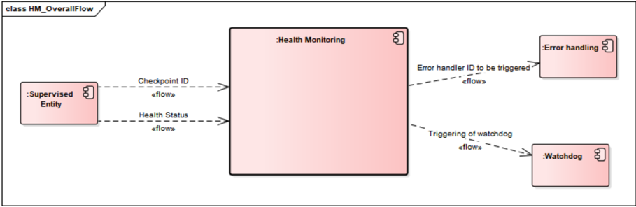

**健康监控**功能可以按菊花链（**daisy chain**）方式拆分。每个**健康监控**实例对**受监督实体**、错误处理和**看门狗**具有相同的接口。此外，**健康监控**实例之间的接口也被标准化——它既传递**健康监控**的结果，也传递“原始数据”（检查点 ID、**健康状态**及必要的上下文信息）。每个实例会为**检查点**添加一些上下文相关数据（例如进程/任务 ID）。

在下例（图6.2）中，有三个**健康监控**实例，每个实例具有不同的使用场景。

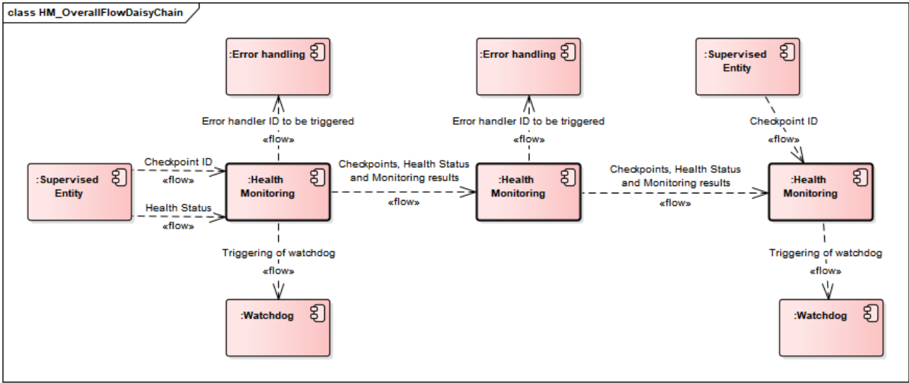

**健康监控**实例之间交换的数据是可配置的。

以下是**健康监控**实例的已知用例：

* 第一个实例通常是与**受监督实体**相同的进程/可执行文件/应用。
* 进一步的实例可以实现为微控制器上的服务/守护进程。
* 进一步或最终的实例可以实现于远程机器上。

**系统健康监控器**（**SystemHealthMonitor**）负责组合不同平台的健康信息，并在不同抽象层次上计算**健康指标**。这些**健康指标**随后可用于平台内部以稳定系统，或以某种**服务健康度**（**Health of Service**）增强服务。**系统健康监控器**被定义为平台无关组件，可以部署在系统中的任何位置。

#### 5.1.2. 基本概念：受监督实体、检查点、图、监督模式

**健康监控**监督软件的执行。监督的逻辑单元是属于**受监督实体**的**检查点**。**受监督实体**与架构构建块软件之间没有固定的关系，但通常一个**受监督实体**可以表示一个软件组件。

**检查点**及**检查点**之间的**迁移**（**Transition**）构成**图**。一个**图**的**检查点**可以属于同一个**受监督实体**，也可以属于不同的**受监督实体**。

**健康监控**应监督其检查点属于相同或不同**受监督实体**的图。

**健康监控**应同时监督被其他**受监督实体**抢占（**preempted**）的**受监督实体**的图。

一个**图**可以有一个或多个**初始检查点**和一个或多个**最终检查点**。任何从任一**初始检查点**开始并以任一**最终检查点**结束的序列都是正确的（假设这些**检查点**属于同一个**图**）。在**最终检查点**之后，可以报告任何**初始检查点**。

在运行时，**健康监控**验证所配置的**图**是否被执行。这称为**逻辑监督**。**健康监控**还验证**检查点**和**迁移**的时序。用于周期性**检查点**的机制称为**存活监督**，用于非周期性**检查点**的机制称为**时限监督**。

**检查点**的粒度不由**健康监控**固定。较少的粗粒度**检查点**会限制**健康监控**的检测能力。例如，对于一个只有一个**检查点**的应用，**健康监控**只能检测该应用（或该应用的一部分）是否周期性运行，并检查时间约束。相反，如果该应用在每个代码块和分支处都有**检查点**，**健康监控**还可以检测该应用控制流中的故障。细粒度的**检查点**会导致**健康监控**的配置复杂且庞大。

**健康监控**允许定义不同的**监督模式**。可以为每个**监督模式**配置监督功能的不同行为。

#### 5.1.3. 监督功能的执行

**健康监控**提供**存活监督**、**时限监督**、**逻辑监督**和**健康通道监督**（**Health Channel Supervision**）。所有监督功能都可以独立调用。

##### 5.1.3.1. 存活监督

周期性**受监督实体**对给定时间跨度内的执行次数有约束。通过**存活监督**，**健康监控**周期性地检查**受监督实体**的**检查点**是否在给定限值内到达。这意味着**健康监控**检查**受监督实体**的运行是否过于频繁或过于稀少。

##### 5.1.3.2. 时限监督

非周期性**受监督实体**对两个**检查点**之间的时序有单独的约束。通过**时限监督**，**健康监控**检查**受监督实体**的两个**检查点**（一个**源检查点**和一个**目标检查点**）之间**迁移**的时间跨度（用于检测提早到达和延迟），以及**源检查点**之后的经过时间（用于检测超时）。这意味着**健康监控**检查**受监督实体**中某些步骤的耗时是否在配置的最小和最大限制内。

##### 5.1.3.3. 逻辑监督

**逻辑监督**是检查嵌入式系统软件正确执行的基本技术。当需要**逻辑监督**时，请参考安全标准（IEC 61508 或 ISO 26262）。**逻辑监督**关注控制流错误，这些错误会导致应用在无故障执行期间偏离有效（即已编码/已编译）的程序序列。如果一个或多个程序指令以错误顺序被处理，或者根本没有被处理，就会发生不正确的控制流。控制流错误可能导致数据损坏、微控制器复位，或违反应故障沉默（**fail-silence**）的行为。

对于控制流图，这意味着每当**受监督实体**报告新的**检查点**时，都必须验证前一个**检查点**与所报告的**检查点**之间是否配置了**迁移**。

#### 5.1.4. 监督状态的确定

基于存活、时限和逻辑监督功能的结果，计算**累计监督状态**（**Cumulative Supervision Status**）。每个状态由状态机确定。状态机的细节请参考相应平台的规范（[\[5\]](#ref-5) 与 [\[6\]](#ref-6)）。

在 **Classic Platform** 情况下，为每个**受监督实体**计算**局部监督状态**，并基于所有**受监督实体**的**局部监督状态**计算**全局监督状态**。

在 **Adaptive Platform** 情况下，为每个存活、时限和逻辑监督计算**基本监督状态**。**全局监督状态**基于映射到某个**全局监督**（**Global Supervision**）的所有**监督**（存活、时限和逻辑）的**基本监督状态**计算。可能存在多个**全局监督**，因此一个**全局监督状态**可能不会汇总所有**基本监督状态**。

##### 5.1.4.1. 规则处理

基于监督功能的结果，**健康监控**确定相应的反应。

##### 5.1.4.2. 看门狗控制

**健康监控**控制硬件**看门狗**。当**受监督实体**因看门狗协议本身的编程错误或内存故障而未被正确评估时，仍可能出现看门狗协议错误地设置触发条件、导致不发生看门狗复位的情况。因此，可能需要在看门狗协议本身内部使用**受监督实体**和**检查点**（或其他内部监督机制），同时避免看门狗协议中的递归。

##### 5.1.4.3. 错误处理

取决于每个**受监督实体**的**局部监督状态**和**全局监督状态**，**健康监控**启动用于从监督失败中恢复的机制。这些机制的范围从通知中央错误处理器到整个 ECU 全局复位。

#### 5.1.5. 功能分解

**健康监控**具有以下逻辑步骤：

1. 执行所有监督功能——参见 [5.2](#52-监督功能的执行与监督结果的确定)
2. 确定监督状态——参见 [5.1.4](#514-监督状态的确定)
3. 确定动作——参见 [5.1.4.1](#5141-规则处理)、[5.1.4.2](#5142-看门狗控制) 和 [5.1.4.3](#5143-错误处理)

**健康监控**的行为是模式相关的（关于**监督模式**的描述参见 [5.1.2](#512-基本概念受监督实体检查点图监督模式) 和 [\[2\]](#ref-2)）。

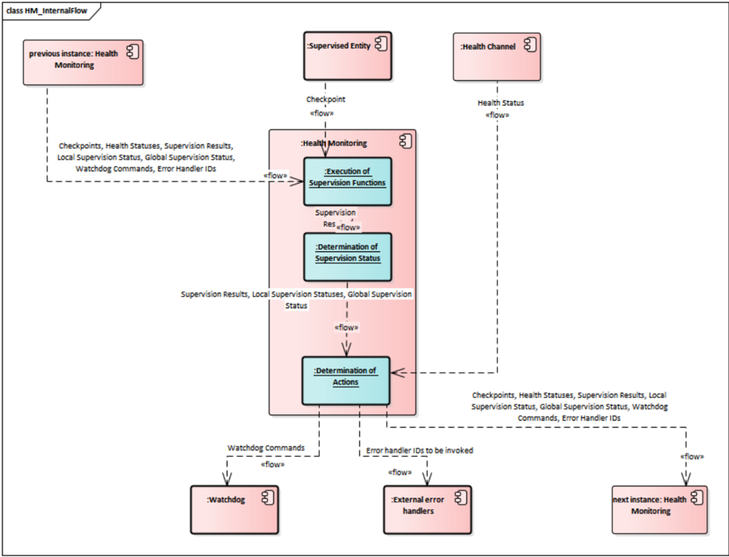

### 5.2. 监督功能的执行与监督结果的确定

**受监督实体**是**健康监控**的监督单元。每个**受监督实体**（**SupervisedEntity**）可以由不同的监督功能或它们的组合来监督。

在本阶段执行以下三个监督功能：

* **存活监督**（参见 [5.2.1](#521-存活监督)）
* **时限监督**（参见 [5.2.2](#522-时限监督)）
* **逻辑监督**（参见 [5.2.3](#523-逻辑监督)）

三个监督功能各为每个**受监督实体**（**SupervisedEntity**）产生一个**监督功能结果**（**Results of Supervision Function**）列表（在图6.3中以蓝色高亮），其中每个结果要么正确要么错误。

在**健康监控**初始化时，所有结果都被设置为正确。这意味着对每个**受监督实体**（**SupervisedEntity**）都有三个部分结果（一个来自**存活监督**、一个来自**时限监督**、一个来自**逻辑监督**）。

在给定模式下，每个**受监督实体**（**SupervisedEntity**）可以有零个、一个或多个**存活监督**（**AliveSupervision**），每个都有一个正确/错误的结果。

在给定模式下，每个**受监督实体**（**SupervisedEntity**）可以有零个、一个或多个**时限监督**（**DeadlineSupervision**），每个都有一个正确/错误的结果。

在给定模式下，每个**受监督实体**（**SupervisedEntity**）可以配置零个、一个或多个**逻辑监督**（**LogicalSupervision**）（即图），每个都有一个正确/错误的结果。

如果在给定模式下没有活动监督，则**健康监控**看不到任何 EXPIRED 局部状态，因此可以调用看门狗触发条件。

#### 5.2.1. 存活监督

**存活监督**（**AliveSupervision**）提供一种机制，用于周期性地检查一个或多个**受监督实体**的执行可靠性。该机制支持对独立**受监督实体**的周期性时间约束进行检查。

##### 5.2.1.1. 存活监督配置

为提供**存活监督**（**AliveSupervision**），需要配置**检查点**及其时间约束。**AliveSupervision** 的最简配置是一个不带任何**迁移**的**检查点**，如图6.4所示。

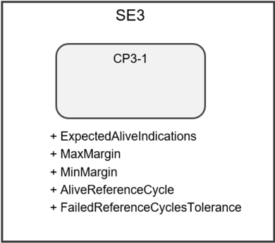

此外，也可以有多个**检查点**，如图6.5所示。

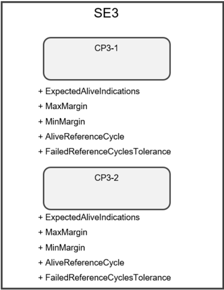

每个**检查点**可以有自己的一组 **AliveSupervision** 参数。**迁移**不被 **AliveSupervision** 使用。尽管每个**检查点**都有自己的参数，但被确定状态的是**受监督实体**，其依据是**检查点**的频率。

**AliveSupervision** 的参数取决于**监督模式**，并且按**检查点**定义（而不是对整个**受监督实体**全局定义）。

在给定模式下，**受监督实体**的**检查点**中的无、部分或全部可以配置为 **AliveSupervision**。此外，在每个模式下，**检查点**的 **AliveSupervision** 选项可以不同。

**ExpectedAliveIndications**（EAI）规定在固定的监督周期数内，某个**检查点**所期望的存活指示数量。周期长度由 **AliveReferenceCycle** 定义。

可以配置一个可接受的负偏差（**MinMargin**）和可接受的正偏差（**MaxMargin**）。

**健康监控**必须支持可配置数量的独立**受监督实体**。

##### 5.2.1.2. 存活监督算法

为发送**存活指示**（**Alive Indication**），**受监督实体**（**SupervisedEntity**）调用函数 **ReportCheckpoint**，该函数会使该**检查点**的**存活计数器**（**Alive Counter**）递增。

**健康监控**对 **SupervisedEntity** 每个**检查点**计数器的周期性检查，在每个 **AliveReferenceCycle** 进行。

**存活参考周期**（**Alive Reference Cycle**，参见 **AliveReferenceCycle**）是给定**监督模式**下某个**检查点**的 **AliveSupervision** 的属性。

**健康监控**应对活动模式下配置的每个**存活监督**（**AliveSupervision**）执行对**受监督实体**每个**检查点****存活计数器**的检查。该检查应在相应**存活监督**（**AliveSupervision**）的 **AliveReferenceCycle** 周期进行。

**健康监控**应通过检查**存活计数器**是否处于允许容差内（期望 − **MinMargin**；期望 + **MaxMargin**）来检查它（参见 **ExpectedAliveIndications**、**MinMargin**、**MaxMargin**）。

如果**受监督实体**的任何一个**检查点**未通过检查，则该**受监督实体**在此 **AliveReferenceCycle** 的**存活监督**结果被设置为错误；否则被设置为正确。

在对**存活计数器**进行检查时，如果**存活监督**结果被判定为错误，则失败存活监督参考周期的计数器应递增，除非它已超过（即不大于）所配置的**失败容忍度**（**Failure Tolerance**，参见配置参数 **FailedReferenceCyclesTolerance**）。

在对**存活计数器**进行检查时，如果**存活监督**结果被判定为正确，则失败存活监督参考周期的计数器应递减，除非它已为零。

**健康监控**只检查为当前**监督模式**配置的**检查点**。

如果当前**监督模式**中未定义相应的**存活监督**（**AliveSupervision**），则**健康监控**不应执行该**检查点****存活计数器**的检查。

#### 5.2.2. 时限监督

**时限监督**（**DeadlineSupervision**）检查非周期性**受监督实体**的时间约束。在这些**受监督实体**中，某个事件发生，随后在给定时间跨度内发生另一事件。该时间跨度可以具有最大和最小期限（时间窗口）。

##### 5.2.2.1. 时限监督配置

对于每个 **DeadlineSupervision**，配置两个由**迁移**连接的**检查点**。**期限**（**Deadline**）附加在从**源检查点**到**目标检查点**的**迁移**上。最简 **DeadlineSupervision** 配置包含两个**检查点**和一个**迁移**，如图6.6所示。

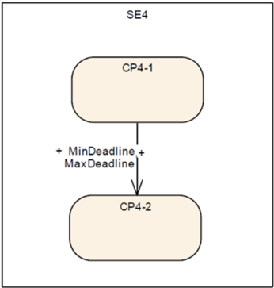

在一个**受监督实体**中可以定义多个**迁移**。**迁移**和**检查点**不必构成闭合图。由于该监督功能只考虑**源检查点**、**目标检查点**以及 **MinDeadline**、**MaxDeadline**，因此可以有独立的图，如图6.7所示。此外，**检查点**可以被串联起来。

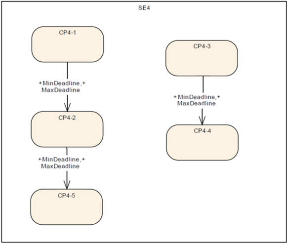

**DeadlineSupervision** 的配置与 **AliveSupervision** 的配置类似。

**时限监督**（参见 **DeadlineSupervision**）的参数取决于**监督模式**（**ModeDependentSettings**），并按一组两个**检查点**定义。在给定模式下，**受监督实体**的**检查点**中的无、部分或全部可以配置为 **DeadlineSupervision**。

**DeadlineSupervision** 定义为带时间约束的一组**迁移**。一个**迁移**定义为对两个**检查点**的两个引用，称为**源检查点**和**目标检查点**（参见 **DeadlineSupervision**）。一个**迁移**具有最小和最大时间 **MinDeadline**、**MaxDeadline**。

##### 5.2.2.2. 时限监督算法

当**源检查点**（即 **CheckpointTransition** 所引用的**源检查点**，参见 **DeadlineSupervision**）或**目标检查点**到达时，**受监督实体**调用函数 **ReportCheckpoint**，该函数将计算**源检查点**与**目标检查点**之间经过的时间。

该计算在**目标检查点**出现时执行，或者在**源检查点**之后的经过时间超过最大限制（**MaxDeadline**）时执行。

如果**目标检查点**与**源检查点**之间的时间差不处于最小和最大限制内（即时间差小于 **MinDeadline** 或大于 **MaxDeadline**），则该**受监督实体**的 **DeadlineSupervision** 结果应定义为错误；否则应定义为正确。

如果尽管自到达**源检查点**以来的时间已超过最大限制（即自到达**源检查点**以来的经过时间大于 **MaxDeadline**），但**目标检查点**仍未到达，则该**受监督实体**的 **DeadlineSupervision** 结果应定义为错误。

当某个**源检查点**在最大限制到期之时或之前被到达两次或更多次，而未到达相应的**目标检查点**时，这应被视为错误，并且该**受监督实体**的 **DeadlineSupervision** 结果应被视为错误。

当某个**目标检查点**在相应**源检查点**出现之前被到达时，函数 **ReportCheckpoint** 应忽略该**检查点**，且不更新该**受监督实体**的**时限监督**结果。

这也意味着，如果某个**目标检查点**在序列中被多次到达，**DeadlineSupervision** 不会将其视为错误。

对于任何既不是**源检查点**也不是**目标检查点**的上报**检查点**，函数 **ReportCheckpoint** 应忽略该**检查点**，且不更新该**受监督实体**的**时限监督**结果。

#### 5.2.3. 逻辑监督

**逻辑监督**检查**受监督实体**的代码是否以正确顺序执行。

##### 5.2.3.1. 逻辑监督配置

对于每个**逻辑监督**（**LogicalSupervision**），都有一个由**迁移**连接的**检查点**的**图**。该**图**抽象 **SupervisedEntity** 的行为。**图**与 **LogicalSupervision** 容器之间是一一对应的关系。

此外，一个**检查点**最多只能属于一个**图**，不允许图重叠。

作为**受监督实体**的示例，让我们考虑以下包含**检查点** CP0-0 至 CP0-6 的代码片段。

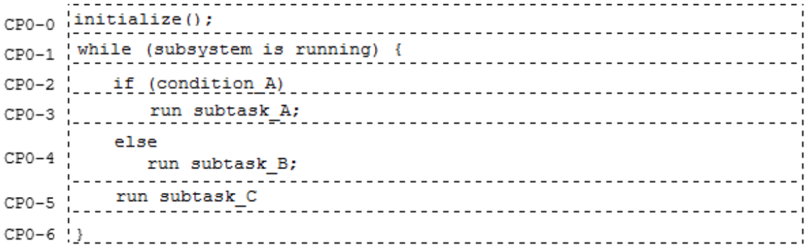

该**受监督实体**可以由如图6.9所示的**图**表示。

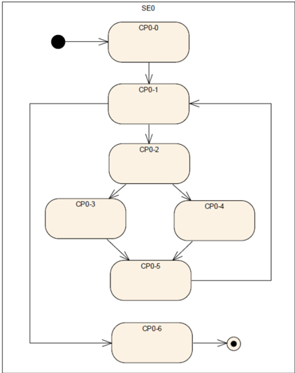

图6.10给出了该**受监督实体**更抽象的视图，其中**检查点** CP0-1 表示完整的 while 循环。

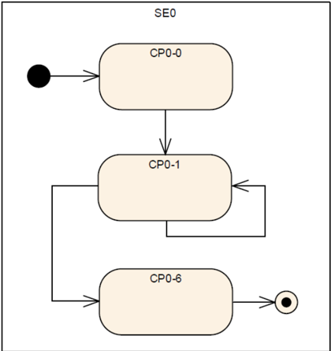

在**图**中，**检查点**可以属于同一个**受监督实体**或不同的**受监督实体**，不施加任何限制。**图**中**检查点**之间的迁移取决于**监督模式**。

**图**（参见 **LogicalSupervision**）的参数是**监督模式**（参见 **ModeDependentSettings**）中所包含的**迁移**。每个**迁移**连接两个**检查点**。无论**检查点**是否被任何迁移连接，它们都存在。

##### 5.2.3.2. 逻辑监督算法

在**健康监控**初始化之后，尚未有任何**检查点**被报告，即所有**受监督实体**都处于被动状态。每个**图**被视为非活动。

每个**图**表示一个 **LogicalSupervision**，但它可能跨越多个**受监督实体**。假设有 N 个跨越某个**受监督实体**的**图**，这意味着该 **SupervisedEntity** 的 **LogicalSupervision** 产生 N 个结果。

**健康监控**应维护每个**图**的活动状态。

在初始化时，**健康监控**应将每个**图**视为非活动。

每个**图**可以有一个或多个**初始检查点**。**初始检查点**是**图**可以起始的**检查点**。

为通知到达某个**检查点**，**受监督实体**调用函数 **ReportCheckpoint**，该函数会执行**逻辑监督**算法。

由于一个**检查点**只能属于一个**图**，函数 **ReportCheckpoint** 能够识别某个**检查点**属于哪个**图**。

函数 **ReportCheckpoint** 应识别所到达的**检查点**属于哪一个**图**。

如果**图**处于活动状态，函数 **ReportCheckpoint** 对每个新**检查点**检查所存储**检查点**与新报告**检查点**之间的**迁移**是否被允许。

函数 **ReportCheckpoint** 应通过以下检查来验证属于某个**图**的上报**检查点**是否正确：

1. 如果所上报**检查点**的**图**处于非活动状态，则：
   a. 如果该**检查点**是**初始检查点**（参见 **LogicalSupervision**），则所上报**检查点**所属 **SupervisedEntity** 内此**逻辑监督**的结果为正确，否则为错误。
2. 否则，如果**图**处于活动状态，且此**图**先前调用的所有**检查点**都按正确顺序调用，则：
   a. 如果所上报**检查点**是所上报**检查点**的**图**中所存储**检查点**的后继（这意味着存在一个带**源**和**目标**的**迁移**），则所上报**检查点**所属 **SupervisedEntity** 的此**逻辑监督**结果为正确，否则为错误。
3. 否则（即**图**处于活动状态，但此**图**中至少有一个**检查点**先前以错误顺序被调用）：
   a. 该 **SupervisedEntity** 的此**逻辑监督**结果保持为错误。

上述需求意味着，在发生不正确的**迁移**时，被视为出错的 **SupervisedEntity** 是报告了不正确**检查点**的那个。

如果某个**检查点**是某个**图**的**初始检查点**之一，则该**图**被设置为活动。

注意，如果一个**图**包含多个**初始检查点**，当该**图**处于非活动状态时，允许进入其中任何一个：当某个**初始检查点**被报告时，相应的**图**变为活动，因此只有当从第一个**检查点**到第二个**检查点**配置了**迁移**时才允许另一个**初始检查点**，因为一个**图**在特定时刻只能有一个活动**检查点**。

如果由 **ReportCheckpoint** 触发的**逻辑监督**结果为正确，且该**检查点**被定义为**最终检查点**，则函数 **ReportCheckpoint** 应将**图**设置为非活动。在**最终检查点**之后，只可能接**初始检查点**。

对于任何不属于任何**图**的上报**检查点**，函数 **ReportCheckpoint** 应忽略它，且不更新该 **SupervisedEntity** 的**逻辑监督**结果。

这是因为该**检查点**可能被其他监督功能（存活或时限）使用。

如果函数 **ReportCheckpoint** 确定给定**检查点**的**逻辑监督**结果为真，且该**检查点**是**初始检查点**（参见 **LogicalSupervision**），则与该**检查点**对应的**图**应被视为活动。

### 5.3. 系统健康监控

前面的章节描述了平台级的**健康监控**。在使用不同平台 **AP**、**CP**、非 **AUTOSAR** 的分布式系统中，需要一个全局监控器来在整车级评估和共享健康信息。

将引入一种标准化的**健康指标**格式，用于共享平台、功能、域甚至整车的健康信息。这些**健康指标**既可用于平台级恢复动作，也可用于以**服务健康度**增强服务，类似于**服务质量**（**Quality of Service**，**QoS**）。

应规定**系统健康监控器**与本地健康监控器之间的抽象接口，以允许对多个 **Adaptive**、**Classic** 和第三方平台进行平台无关的健康管理。

#### 5.3.1. 系统健康监控架构

**SystemHealthMonitor** 旨在实现平台无关的安全监控。因此，**SystemHealthMonitor** 按照 AUTOSAR_TPS_AbstractPlatformSpecification 作为抽象组件引入。**SystemHealthMonitor** 收集抽象 **LocalHealthMonitor** 的健康信息。这些 **LocalHealthMonitor** 部署在平台级，并收集平台自身的健康信息。平台级的 **LocalHealthMonitor** 可以实现为 [\[7\]](#ref-7)（EXP-SHM）中所见的客户端 **SystemHealthMonitor**，或某个功能集群。本地信息可能包括 **Platform Health Monitor**（在 AP 中）/**Watchdog Manager**（在 CP 中）、**State Manager**（在 AP 中）/**Basic Software Mode Manager**（在 CP 中）的监控结果，或硬件信息，例如 highTemp。诸如 **State Manager** 之类的组件高度依赖具体项目，因此无法完全标准化 **LocalHealthMonitor** 报告哪些信息。

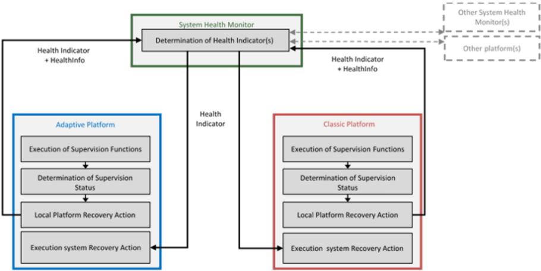

所收集的信息可用于创建平台**健康指标**，给出平台健康的总体估计。

**LocalHealthMonitor** 应基于本地报告的健康信息创建平台**健康指标**。

与 **SHM** 交换的信息被视为安全相关。因此，**SHM** 实例与本地监控器之间以及多个 **SHM** 实例之间的通信应是周期性的。应使用 **E2E** 保护等安全机制来检测可能的消息丢失、延迟、篡改等。可检测的错误取决于所选 **E2E** 配置文件和具体项目。**健康指标**的周期性交换可用作周期性心跳，给出平台和 **SHM** 可用性的指示。消息缺失意味着对正确行为没有信心，并且应在 **SHM** 侧的**健康指标**确定和平台级恢复动作中予以考虑。

平台**健康指标**和本地健康信息应周期性地上报给 **SystemHealthMonitor**。

由 **SHM** 计算的**健康指标**应周期性地上报给订阅者。

**LocalHealthMonitor** 与 **SystemHealthMonitor** 之间的信息交换应受 **E2E** 保护。

**SystemHealthMonitor** 应收集并评估其子系统中所有 **LocalHealthMonitor** 的健康信息。结合其他 **SystemHealthMonitor** 的**健康指标**，该子系统信息可用于在更高抽象层次上创建**健康指标**。

由于一个 **SystemHealthMonitor** 对其子系统构成单点故障威胁，多个 **SystemHealthMonitor** 可以接收本地健康信息，但其中只有一个应在某一时刻活动地计算并提供**健康指标**。

在给定时点，某个专用/特定**健康指标**应只由一个 **SystemHealthMonitor** 提供。

#### 5.3.2. 健康指标的概念

**健康指标**提供针对安全要求的当前系统性能的评估度量。安全监控器的健康信息被分析并用于在不同抽象层次上确定**健康指标**。**健康指标**定义为由 ID、**性能**（**Performance**）、**可靠性**（**Reliability**）、**时间戳**（**Timestamp**）和 **SubsystemState** 构成的元组。**性能**针对故障行为对性能进行评级。**可靠性**评估由于不确定性而对系统的可信程度。**SubsystemState** 是子系统 Sub = {sub1,...,subn} 的特定于系统的**健康状态**。不同的 **SubsystemState** 基于可用性和可用性要求。**健康指标**可以是硬件、软件、用户或车辆环境监督的结果。将监控结果与明确定义的安全属性相结合，即可确定相应的健康三元组。**健康指标**的三个核心参数用于刻画不同安全标准所要求的不同安全方面。**Degradation** 参数在最抽象的层次上运作。仅基于二值可用性指示即可确定整体降级状态。ISO 26262 [\[1\]](#ref-1) 和 ISO 21448 [\[4\]](#ref-4) 考虑了除可用性之外的其他方面。ISO 26262 关注 E/E 系统故障引起的危害，而 **SOTIF** 指由性能局限引起的危害。为此，**SOTIF** 的范围要求包括车辆与其环境、用户及其他车辆的交互，以捕捉它们引入的不确定性。为将 ISO 26262 和 **SOTIF** 纳入**健康指标**，使用了**性能**和**可靠性**参数。

时间戳可用于存储**健康指标**创建时间的信息。应使用唯一的 **HealthIndicatorID** 来区分**健康指标**，并将它们分配给特定子系统（例如功能、平台、域）。

**SystemHealthMonitor** 可以在不同的抽象层次上运作。平台级的监控结果可以在功能特性（**feature**）层面分组。功能特性随后可以在域中分组，所有这些可为整车给出健康指示。这些抽象层次未被标准化，仅作为示例给出。每个 **SystemHealthMonitor** 可以处理不同抽象层次上的多个子系统，因此提供多个 **HealthIndicator**。

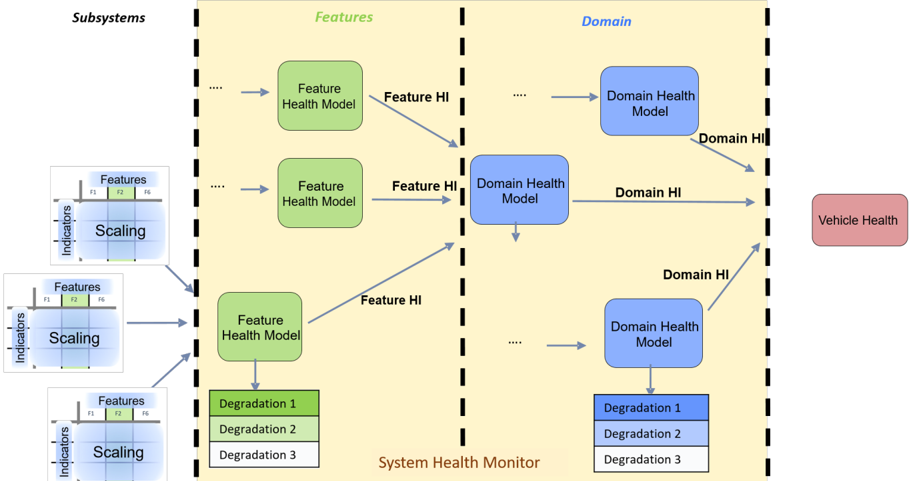

子系统的**健康指标**可用于在功能级构建**健康指标**。随后可以将这些**健康指标**组合起来，在域级构建**健康指标**，最终在整车级构建。关于这些**健康指标**在其各自域中可能呈现的进一步说明可参见 **EXP_SHM**。

**SHM** 向订阅者上报**健康指标**应受 **E2E** 保护。

#### 5.3.3. 应用接口

为上报实际健康信息，应使用标准化接口。平台 **HealthIndicator** 可通过 **HealthIndicatorInterface** 提供，本地健康信息可通过 **HealthInfoInterface** 提供。本地健康信息可以包含来自功能集群的健康信息，例如 **PHM**/**SM** 的监督结果，或外部监控器（例如电压监控器）。这些接口在第 [8](#8-服务接口) 章中描述为服务接口。

#### 5.3.4. 健康指标的用法

**健康指标**可用于直接交换子系统的健康信息。每个对特定**健康指标**感兴趣的消费者都可以通过 **HealthIndicatorInterface** 访问它。本地平台管理器（**State Manager**/**Basic Software Mode Manager**）可以使用其他平台的 **HI** 来降级其自身平台，或为健康不佳的平台激活备份功能。这将允许跨多个平台的去中心化系统降级。类似地，应用可能希望了解为其提供输入的功能的 **HI**，以便决定是否信任该信息。

## 6. 健康监控 API 规范

本章规定在其他文档部分所引用的**健康监控** API。它以通用/抽象方式定义，因此可以在不同平台上实现。关于确切的 API 名称和语义，请参考相应的平台特定文档（**Classic Platform** 为 [\[5\]](#ref-5)，**Adaptive Platform** 为 [\[6\]](#ref-6)）。

### 6.1. 提供的 API

#### 6.1.1. 上报检查点

**健康监控**提供一种方法，用于上报由**检查点**表示的当前代码位置。

```C
ReportCheckpoint(CheckpointID id)
```

#### 6.1.2. 上报健康状态

**健康监控**提供一种方法，用于上报健康状态信息。

```C
ReportHealthStatus(HealthStatusID id, HealthStatus status)
```

#### 6.1.3. 在健康监控组件之间转发信息

**健康监控**提供一种方法，用于上报由一个**健康监控**组件收集并确定的信息，以便将其转发到另一个**健康监控**组件。

```C
ReportHealthMonitoring(HealthMonitoring monitoringData)
```

#### 6.1.4. 初始化/反初始化

**健康监控**提供一种方法来初始化该服务。

```C
Init()
```

**健康监控**提供一种方法来反初始化该服务。

```C
DeInit()
```

#### 6.1.5. 从应用获取监督状态

**健康监控**提供一种方法，用于向应用上报某个**受监督实体**的**局部状态**。

```C
GetLocalStatus(LocalStatusType* LocalStatus)
```

**健康监控**提供一种方法，用于向应用上报指定**受监督实体**所属的**全局状态**。

```C
GetGlobalStatus(GlobalStatusType* GlobalStatus)
```

### 6.2. 假定的 API

本节规定由**健康监控**使用的 API。

#### 6.2.1. 触发错误处理

**健康监控**提供一种方法，用于触发已定义的错误处理器，并提供该错误的标识符。

```C
TriggerErrorHandler(ErrorID id)
```

#### 6.2.2. 控制看门狗

**健康监控**提供一种方法，用于控制看门狗驱动。

```C
ControlWatchdog(ControlData control)
```

## 7. 配置参数

本章规定**健康监控**的配置模型。此处定义的选项在第 [5](#5-功能规格) 章中被引用/使用。

该配置是抽象且平台无关的，应由特定平台实现/实例化，例如由 AUTOSAR AP。

### 7.1. 整体配置

**机器**（**Machine**，表示 MCU、虚拟机、分区）的配置分为两类：

1. **ModeIndependentSettings**——仅包含静态信息：可能的**受监督实体**和可能的**健康通道**有哪些
2. **ModeDependentSettings**——包含所有监督功能配置。

这意味着所有监督配置都完全与模式相关。

一个系统由多个**机器**构成。因此，**健康监控**被分配给特定的**机器**。

同一个**机器**可能存在多个独立的软件供应商。因此，每个供应商都可以为任意配置类提供配置的任意部分。

**ModeDependentSettings** 也包含看门狗的配置——但该部分未被标准化（以蓝色标记）。

**机器**（机器/虚拟机/分区）的定义假定由外部（其他规范）提供，因此在此仅作引用。

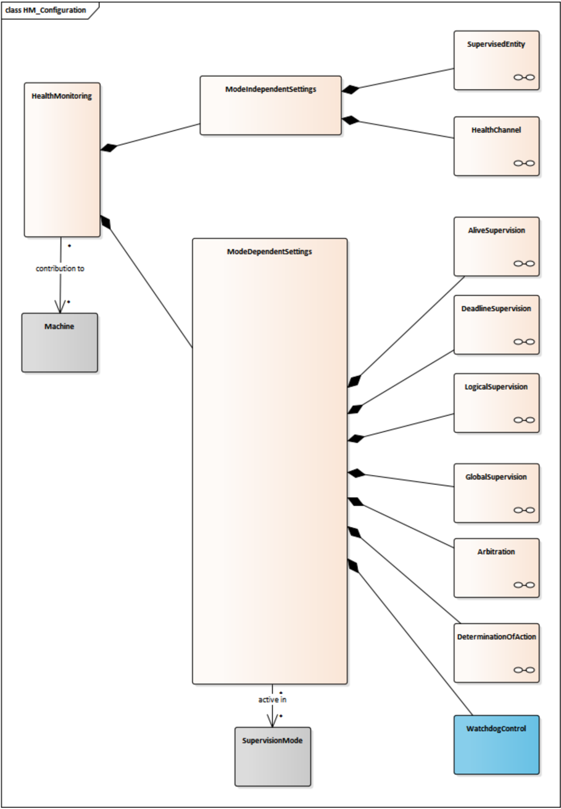

### 7.2. 模式无关设置

**ModeIndependentSettings** 包含静态信息：可能的**受监督实体**和可能的**健康通道**。

实现提示：这部分配置通常用于向应用生成类型安全的 API。

#### 7.2.1. 受监督实体

**SupervisedEntity** 是可在软件运行时出现的**检查点**集合。

**SupervisedEntity** 具有以下选项：

1. **Name**：全局唯一的名称标识符，供应用使用
2. **ID**：全局唯一标识符（数字）

注意，在 AUTOSAR AP 上，名称的唯一性可以通过使用命名空间作为标识的一部分来确保。

**检查点**具有以下选项：

1. **Name**：供应用使用的名称，在该**受监督实体**内唯一。
2. **ID**：**检查点**的标识符，在该**受监督实体**内唯一。

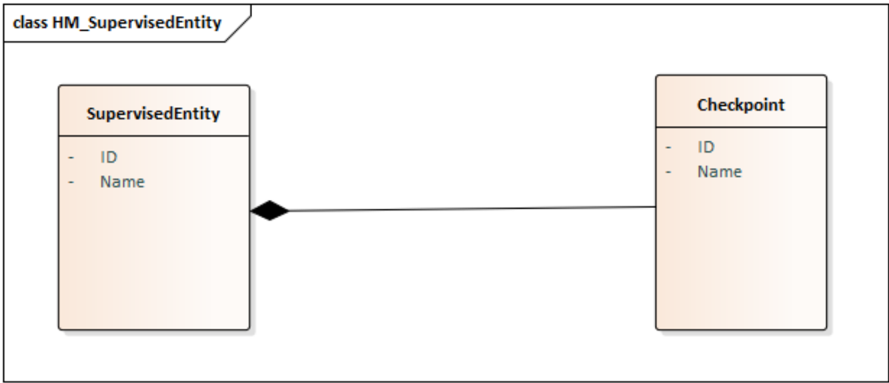

注意：在 AUTOSAR AP 上，**受监督实体**会生成一个枚举，其名称取自**受监督实体**的命名空间和名称，其枚举值与各检查点对应。

### 7.3. 模式相关设置

**ModeDependentSettings** 包含所有监督功能配置。

实现提示：这部分配置通常由非生成代码用于在运行时执行监督。

#### 7.3.1. 存活监督

**AliveSupervision** 检查 **AliveReferenceCycle** 内上报的存活指示数量，该数量应处于 **ExpectedAliveIndications** − **MinMargin** 与 **ExpectedAliveIndications** + **MaxMargin** 之间。

**AliveSupervision** 具有以下选项：

1. **AliveReferenceCycle**：**存活监督**机制在该时间段内将**检查点**收到的**存活指示**数量与期望/配置数量进行比较。
2. **ExpectedAliveIndications**：在 **AliveReferenceCycle** 内**检查点**的期望存活指示数量
3. **MaxMargin**：在 **AliveReferenceCycle** 内可接受的缺失存活指示数量
4. **MinMargin**：在 **AliveReferenceCycle** 内可接受的额外存活指示数量
5. **FailedReferenceCyclesTolerance**：可接受的、存活监督不正确/失败的 **AliveReferenceCycle** 数量

一个**检查点**唯一标识源代码中的特定位置。同一代码的不同执行（例如由于多线程或在多个实例中运行同一应用）共享相同的**检查点**标识。

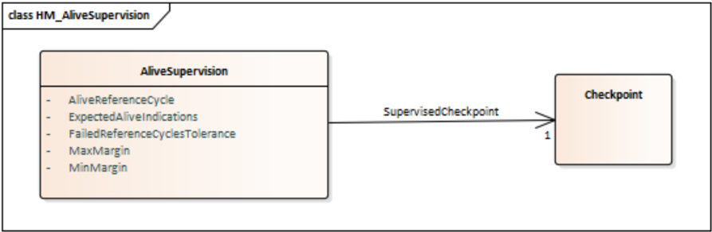

#### 7.3.2. 时限监督

**DeadlineSupervision** 具有以下选项：

1. **MaxDeadline**：允许的最长时间跨度。
2. **MinDeadline**：允许的最短时间跨度。

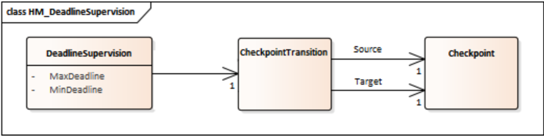

#### 7.3.3. 逻辑监督

**LogicalSupervision** 是 **CheckpointTransition** 的集合。

一个 **LogicalSupervision** 可以看作一个**图**。

由于 **LogicalSupervision** 表示一个图，因此可以通过引用这些**检查点**来配置**初始检查点**和/或**最终检查点**。

一个 **CheckpointTransition** 具有其**源**（**Source**）和**目标**（**Target**）**检查点**。一个**检查点**可以有多个**迁移**——这样可以在图中配置合并和分叉（例如从 A 可以到 B 或到 C）。

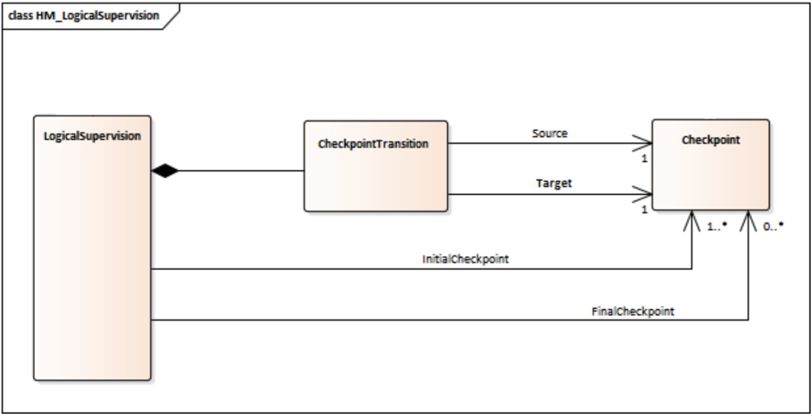

#### 7.3.4. 全局监督

每个**机器**可以有一个或几个 **GlobalSupervision**。

**GlobalSupervision** 是所有所包含 **LocalSupervision** 的“最差者”（**worst-of**）。

**LocalSupervision** 表示一个 **SupervisedEntity** 的状态。它由属于某个 **SupervisedEntity** 的所有 **AliveSupervision**、**DeadlineSupervision** 和 **LogicalSupervision** 组成。

## 8. 服务接口

### 8.1. 类型定义

#### 8.1.1. HealthIndicator

| 名称 | HealthIndicator |
| --- | --- |
| 种类 | STRUCTURE |
| 子元素 | `HealthIndicatorID uint8_t`、`Timestamp uint32_t`（可选）、`Performance int16_t`（可选）、`Reliability int16_t`（可选）、`SubsystemState enum [uint8_t]`（可选） |
| 派生自 | - |
| 描述 | **健康指标**提供针对安全要求的当前系统性能的评估度量。 |

#### 8.1.2. HealthInfo

| 名称 | HealthInfo |
| --- | --- |
| 种类 | STRUCTURE |
| 子元素 | GlobalSupervisionInfoVector（可选）、HealthChannelInfoVector（可选）、FunctionGroupInfoVector（可选）、LocalSupervisionInfoVector（可选）、`BswMModeName string`（可选） |
| 派生自 | - |
| 描述 | 包含不同健康信息对 [Shortname+Value] 的结构。 |

#### 8.1.3. GlobalSupervisionInfo

| 名称 | GlobalSupervisionInfo |
| --- | --- |
| 种类 | STRUCTURE |
| 子元素 | `Name string`、`Status enum[uint8_t]` |
| 派生自 | - |
| 描述 | 包含**全局监督状态**信息的结构。 |

#### 8.1.4. GlobalSupervisionInfoVector

| 名称 | GlobalSupervisionInfoVector |
| --- | --- |
| 种类 | VECTOR &lt;GlobalSupervisionInfo&gt; |
| 子元素 | GlobalSupervisionInfo |
| 派生自 | - |
| 描述 | **全局监督状态**信息的列表 |

#### 8.1.5. FunctionGroupInfo

| 名称 | FunctionGroupInfo |
| --- | --- |
| 种类 | STRUCTURE |
| 子元素 | `Name string`、`State string` |
| 派生自 | - |
| 描述 | 包含功能组状态的结构。 |

#### 8.1.6. FunctionGroupInfoVector

| 名称 | FunctionGroupInfoVector |
| --- | --- |
| 种类 | VECTOR &lt;FunctionGroupInfo&gt; |
| 子元素 | FunctionGroupInfo |
| 派生自 | - |
| 描述 | 功能组状态信息的列表 |

#### 8.1.7. HealthChannelInfo

| 名称 | HealthChannelInfo |
| --- | --- |
| 种类 | STRUCTURE |
| 子元素 | `Name string`、`Status string` |
| 派生自 | - |
| 描述 | 包含**健康通道**状态信息的结构。 |

#### 8.1.8. HealthChannelInfoVector

| 名称 | HealthChannelInfoVector |
| --- | --- |
| 种类 | VECTOR &lt;HealthChannelInfo&gt; |
| 子元素 | HealthChannelInfo |
| 派生自 | - |
| 描述 | **健康通道**状态信息的列表。 |

#### 8.1.9. LocalSupervisionInfo

| 名称 | LocalSupervisionInfo |
| --- | --- |
| 种类 | STRUCTURE |
| 子元素 | `Name string`、`Status enum[uint8_t]` |
| 派生自 | - |
| 描述 | 包含**局部监督状态**的结构 |

#### 8.1.10. LocalSupervisionInfoVector

| 名称 | LocalSupervisionInfoVector |
| --- | --- |
| 种类 | VECTOR &lt;LocalSupervisionInfo&gt; |
| 子元素 | LocalSupervisionInfo |
| 派生自 | - |
| 描述 | **局部监督状态**信息的列表 |

注意：**Adaptive Platform** 支持以下健康信息：

* GlobalSupervisionInfo
* HealthChannelInfo
* FunctionGroupInfo

**Classic Platform** 支持以下健康信息：

* GlobalSupervisionInfo
* LocalSupervisionInfo
* BswMModeName

### 8.2. 提供的服务接口

#### 8.2.1. HealthIndicator

**端口**

| 名称 | HealthIndicatorInterface |
| --- | --- |
| 种类 | ProvidedPort |
| 接口 | HealthIndicatorInterface |
| 描述 | 上报 HealthIndicator |
| 变化 | |

**服务接口**

| 名称 | HealthIndicator |
| --- | --- |
| 事件 | HealthIndicatorEvent |
| 描述 | 所上报的健康指标。 |
| 类型 | HealthIndicator |

#### 8.2.2. HealthInfo

**端口**

| 名称 | HealthInfoInterface |
| --- | --- |
| 种类 | ProvidedPort |
| 接口 | HealthInfoInterface |
| 描述 | 上报 HealthInfo |
| 变化 | |

**服务接口**

| 名称 | HealthInfo |
| --- | --- |
| 事件 | HealthInfoEvent |
| 描述 | 所上报的健康信息 |
| 类型 | HealthInfo |

## D. 约束与规范项变更历史

请注意，本章列表还包括在后续版本中已从规范中移除的约束和规范项。这些约束和规范项在文档中不会显示为超链接。

### D.1. 依据 AUTOSAR R23-11 版本的本文档变更历史

* D.1.1 R23-11 中新增的规范项 —— 无
* D.1.2 R23-11 中变更的规范项 —— 无
* D.1.3 R23-11 中删除的规范项 —— 无

### D.2. 依据 AUTOSAR R22-11 版本的本文档变更历史

* D.2.1 R22-11 中新增的规范项 —— 无
* D.2.2 R22-11 中变更的规范项 —— 无
* D.2.3 R22-11 中删除的规范项 —— 无
