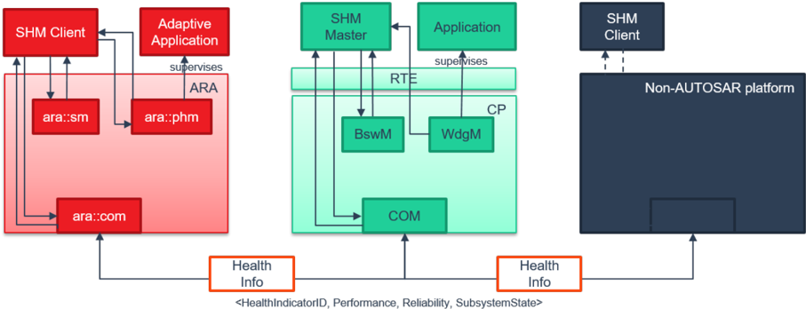
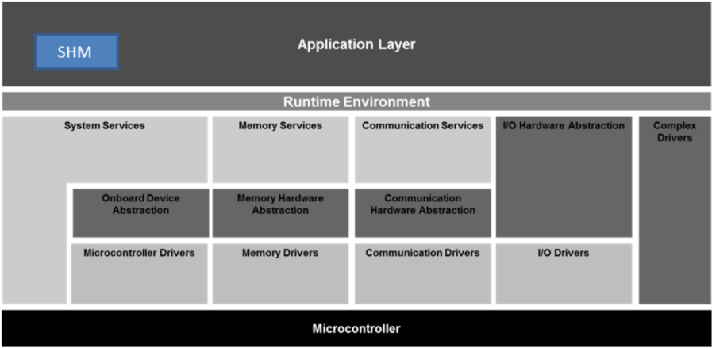
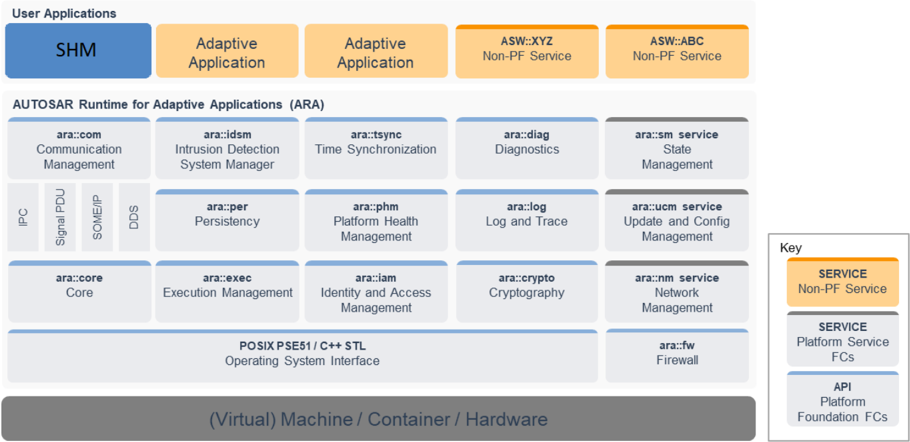
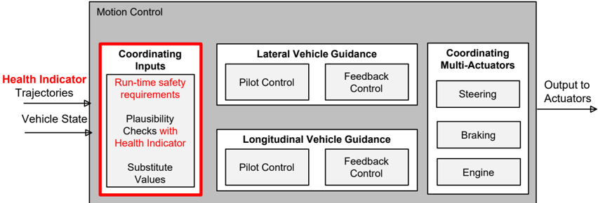
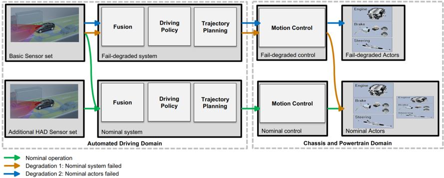

<!-- 源文档 AUTOSAR_FO_EXP_SystemHealthMonitoring（R23-11），说明型文档（EXP），不受 Type A 七章骨架约束；章节结构镜像源文档自身编号（1–5）。源文档的 A 附录为空章（"This chapter is empty"），按占位规则省略。 -->

## 1. 引言

系统健康监控（**System Health Monitoring**，**SHM**）引入了平台无关的健康监控。**SHM** 关注跨多台控制器与机器的多平台之间的系统级错误处理协调。目前，健康监控以及恢复动作的处理都在平台级完成：**Adaptive Platform** 中使用 **PHM**，**Classic Platform** 中使用 **WdgM**。为此，本概念引入一个称为**系统健康监控器**（**System Health Monitor**）的新组件。该**系统健康监控器**组件既可以实例化为**主端**（**Master**）实例，也可以实例化为**客户端**（**Client**）实例。**SHM Client** 负责把平台级健康数据传递给**主端**实例，而 **SHM Master** 负责确定**健康指标**（**Health Indicator**）。**健康指标**可以在子系统级、功能级、域级，并最终在整车级确定。这些**健康指标**既可用于平台级恢复动作，也可用于为服务附加**服务健康度**（**Health of Service**）参数，类似的**服务质量**（**Quality of Service**）。

## 1.1. 目标

本文档旨在更详细地说明**系统健康监控**或**健康指标**可以如何实现。所有内容都应理解为实现提示，而非强制性规范。实际需求见 [\[1\]](#ref-1)（**RS_HealthMonitoring**），抽象规范见 [\[2\]](#ref-2)（**ASWS_HealthMonitoring**）。

## 2. 定义和缩略语

以下术语表包含与**系统健康监控**相关、但未被 **AUTOSAR** 术语表收录的缩略语和术语。

### 2.1. 缩略语和缩写

**SHM**
> 系统健康监控器（**System Health Monitor**）

**HI**
> 健康指标（**Health Indicator**）

**SOME/IP**
> 面向 IP 的可扩展服务导向中间件（**Scalable service-Oriented MiddlewarE over IP**）

**PHM**
> 平台健康管理（**Platform Health Management**）

**SM**
> 状态管理（**State Management**）

**BswM**
> 基础软件模式管理器（**Basic Software Mode Manager**）

**WdgM**
> 看门狗管理器（**Watchdog Manager**）

**GSS**
> 全局监督状态（**Global Supervision Status**）

**LSS**
> 局部监督状态（**Local Supervision Status**）

### 2.2. 术语定义

**Health Indicator**
> **健康指标**提供针对安全要求的当前系统性能的评估度量。

**System Health Monitor**
> **系统健康监控器**组件允许在若干 **Classic**、**Adaptive** 或任意第三方平台之间对错误处理进行系统级协调。

**Global Supervision Status**
> 汇总所有**被监督实体**的**局部监督状态**的状态。

**Local Supervision Status**
> 表示单个**被监督实体**的**存活监督**、**期限监督**和**逻辑监督**的当前结果的状态。

**Alive Supervision**
> 检查**被监督实体**是否以正确频率执行的一种监督。

**Deadline Supervision**
> 检查两个**检查点**之间的执行时间是否处于最小/最大时间限制内的一种监督。

**Logical Supervision**
> 一种软件在线监督，检查软件（**被监督实体**或**被监督实体**集合）是否按程序员（通过所开发的代码）定义的顺序执行。

**Health Channel**
> 提供有关（子）系统健康状态信息的通道。它可能是应用的**全局监督状态**、任一测试例程的结果，或（子）系统报告的状态（例如电压监控、**OS** 内核、**ECU** 状态）。

**Checkpoint**
> **被监督实体**控制流中报告活动的点。

**Supervised Entity**
> 纳入监督的软件实体。**被监督实体**表示软件组件内**检查点**的集合。一个软件组件中可以有零个、一个或多个**被监督实体**。一个**被监督实体**可以被实例化多次，此时每个实例都被独立监督。

## 3. 相关文档

<a id="ref-1"></a>[1] Requirements on Health Monitoring
> AUTOSAR_FO_RS_HealthMonitoring

<a id="ref-2"></a>[2] Specification of Health Monitoring
> AUTOSAR_FO_ASWS_HealthMonitoring

<a id="ref-3"></a>[3] Specification of Watchdog Manager
> AUTOSAR_CP_SWS_WatchdogManager

<a id="ref-4"></a>[4] Specification of Basic Software Mode Manager
> AUTOSAR_CP_SWS_BSWModeManager

<a id="ref-5"></a>[5] Specification of Abstract Platform
> AUTOSAR_FO_TPS_AbstractPlatformSpecification

## 4. 主/客户端架构

本章给出**系统健康监控器**的一个主/客户端示例架构。分布式架构同样可行，但不属于本示例的范围。**SHM** 客户端在平台级的集成将在后续版本中描述。

### 4.1. 约束和假设

由于**健康指标**（**HI**）的确定逻辑未被标准化，本文只给出一个示例。

### 4.2. 概述

为实现全局恢复，除 **PHM** 与 **WdgM** [\[3\]](#ref-3) 之外还应使用**系统健康监控器**。下图所示的工作流澄清了 **PHM**、**WdgM** 与**系统健康监控器**之间的职责。**PHM** 和/或 **WdgM** 执行**局部监督**（**Local Supervision**）功能，并确定**局部监督状态**（**Local Supervision Status**，**LSS**）与**全局监督状态**（**Global Supervision Status**，**GSS**）。必要的健康信息通过既有协议（例如 **SOME/IP**）的载荷传递给**系统健康监控器**。通过组合一个或多个 **PHM**、**WdgM**、**SM**、**BswM** 和/或其他**系统健康监控**组件的信息，**系统健康监控器**确定**健康指标**。**健康指标**包括性能、可靠性和子系统健康状态。这些**健康指标**通过**健康指标**服务字段传输。



上图给出了一种主-客户端分布。在此示例中，**SHM** 客户端收集平台的健康相关信息，执行一些预评估以构建平台**健康指标**，并将其发送给**主端**。**主端**分析平台 **HI** 以及来自其所有客户端的附加监督结果，以在更高抽象层次上创建**健康指标**。随后，**健康指标**由**主端**发送给订阅的客户端或其他 **SHM** 主端。**SM** 或应用可以直接订阅 **HI** 服务，也可以改用 **SHM** 客户端来请求 **HI**。该方式对不支持基于服务通信的订阅者很有用，此时 **SHM** 客户端充当代理（**broker**）。这样，来自 **SHM** 主端的本地存储 **HI** 可被 **SM** 或 **BswM** [\[4\]](#ref-4) 等平台管理器用于对平台进行降级。此外，**HI** 可以作为**服务健康度**（**Health of Service**，**HoS**）附加到平台所提供服务的 **HI** 字段中。

**SHM** 客户端负责收集平台内的健康信息。该健康信息随后可用于预先计算平台**健康指标**。该平台**健康指标**与必要的健康信息（**GSS**/**LSS**）一起发送给 **SHM** 主端。客户端的主要任务是以代理方式提供这些健康信息，并存储由**主端**计算出的**健康指标**。

**主端**根据其从所有客户端收到的全部安全信息计算**健康指标**。客户端可以按其 **ID** 订阅特定的**健康指标**。随后**主端**将**健康指标**返回给所有订阅的客户端。

**系统健康监控器**负责确定**健康指标**。为此，**SHM** 可以使用由 **PHM**、**WdgM**、**SM**、**BswM** 或其他 **SHM** 实例等功能集群提供的软件、硬件和上下文信息。**健康指标**可以封装监督结果、功能组状态或模式、来自**健康通道**的可用硬件信息（例如电压监控），或诸如可用冗余组件之类的系统特定知识。视具体项目而定，可以将多个**健康指标**进一步抽象，以定义系统降级状态或整车级**健康指标**。

**健康指标**可被 **PHM** 或 **WdgM** 用于更精细的健康分析，或被 **SM** 或 **BswM** 用于把健康知识应用于分布式系统级恢复。**健康指标**的确定可以采用仲裁规则或降级模型等不同方法。较简单的场景可能不需要额外逻辑，因为**局部监督状态**或**全局监督状态**以及其他平台的健康状态已足以充当**健康指标**。

### 4.3. 系统健康监控主端的冗余

**系统健康监控主端**是本概念中非常重要的单点故障，这一点不言而喻。项目应考虑 **SHM** 主端的冗余。客户端可以利用 **E2E** 提供的超时特性来识别失效的 **SHM** 主端。类似地，冗余主端可以通过订阅所提供的 **HealthIndicators** 却不再收到它们，来检测失效的主端。

实现此类冗余可能有不同的策略。一种方法是在某个 **ECU** 中设置显式回退的 **SHM** 主端，以便在原先配置的 **SHM** 主端失效时接管。该方案易于实现且具有确定性，无需通过仲裁来决定 **SHM** 主端角色。然而，该方法的问题在于：静态配置的回退 **SHM** 主端在运行时未必是最佳选择，因为其 **HI** 可能比其他任何 **ECU** 都差。

另一种方法是在 **SHM** 主端失效后允许一个仲裁期。在该仲裁期内，**HI** 最佳的客户端将成为 **SHM** 主端。该方案能更有把握地确保 **SHM** 主端角色被交给车内最稳定的 **SHM**。然而，该方法要求所有 **SHM** 都实现被动的 **SHM** 主端逻辑。该方法还意味着**系统健康监控**在仲裁期内不可用。也可能存在其他可用于赢得仲裁的准则。

### 4.4. 系统健康监控在 AUTOSAR 中的集成

由于目前 **SHM** 仅以平台无关的应用接口进行标准化，最合理的方案是在 **AUTOSAR** 的应用层实现 **SHM**。项目特定地在**系统服务**层实现 **SHM** 的方案应当可行，但不推荐，因而也不是 **AUTOSAR** 标准化的方式。





### 4.5. 系统健康监控的接口

由于**系统健康监控器**应标准化为平台无关组件，所有接口描述均沿用 **AUTOSAR_TPS_AbstractPlatformSpecification** [\[5\]](#ref-5) 的抽象接口描述。用于接收健康信息的所有平台接口与载荷配置仅作为示例提供，不属于本版本的标准化内容。

#### 4.5.1. 系统健康监控接口概述

**Adaptive Platform** 上支持的健康信息包括：

* **Global Supervision Status**
* **Health Channel Status**
* **Function Group Status**

**AP** 信息在 **StateManagement** 中可用，但当前没有从应用获取这些信息的标准化接口。

**Classic Platform** 上支持的健康信息包括：

* 来自 **WdgM_GlobalMode** 接口的 **WdgM_GlobalSupervision**
* 来自 **WdgM_LocalMode** 接口的 **WdgM_LocalSupervision**
* 来自 **ModeSwitchInterface** 的 **BswM** 模式

#### 4.5.2. 向 SHM 的信息传输

发往 **SHM** 的信息应按 **SHM** 的 **HealthIndicator** 和 **HealthInfoInterface** 作为数据传输。通信可以使用既有通信模块（`ara::com`、**COM**），以及 **SOME/IP** 等既有协议。由于周期性消息需要一定带宽，消息内容应可在运行时配置以包含不同内容。由于确保可用性需要非常高频率的心跳，因此无需引入额外的非周期性消息。

#### 4.5.3. 健康指标传输

**HealthIndicator** 应用接口应用于在 **SHM** 客户端与主端应用之间交换 **HealthIndicators**。

##### 4.5.3.1. 服务健康度

某些平台可能根本不使用 **AUTOSAR**，也不知道哪个**健康指标**属于哪个子系统。对于这类情况，可以将服务提供方的**健康指标**附加到所提供的数据上。通过把特定 **HI** 作为某种质量参数绑定到服务，接收方可以在不了解其背后架构的情况下决定如何使用该服务。

## 5. 健康指标示例与用例

### 5.1. 健康指标示例：传感器

本节描述针对传感器的一个示例计算，并给出**健康指标**（**HI**）全部三个参数的定义。

“传感器应用”处理并评估测量值。该应用实现表决（**voting**）和合理性检查（**plausibility checks**）以决定转发哪个传感器值。冗余作为提高可靠性（**reliability**）的手段被采用。因此，表决信息与合理性信息同冗余信息结合，用以定义可靠性等级。对于数值结果，**HI** 的接收方可以为不同等级定义各自的阈值。下文给出的公式考虑以下约束：与所选表决器一致的表决器数量越多，可靠性越高；不合理（**implausible**）表决器数量越多，可靠性越低。由于不合理的表决器可以被忽略，可靠性值应能区分“一个合理表决器表示不一致”与“一个不合理表决器表示不一致”两种情况。另一方面，一个合理表决器表示不一致应当降低可靠性。因此，合理且一致的表决器数量与不合理表决器数量是主要的可靠性指标。这两个值都与合理表决器数量成比例，并以因子 α 和 β 加权，以便针对具体项目调整可靠性：

```
                 #agreeWithVoted            #implausibleVoters
RelSen = α * --------------------- - β * ---------------------
              #plausibleVoters             #plausibleVoters
```

“传感器应用”被视为安全关键，由 **WdgM** 或 **PHM** 监督传感器信息是否及时到达，以及逻辑约束和期限约束是否满足。“传感器应用”的监督状态被用作性能指标。可以为**存活监督**配置失败参考周期的错误容忍度。所有监督结果汇总为**局部监督状态**，它可以取以下四个状态之一：

* OK：没有监督失败。
* FAILED：某次**存活监督**失败，且错误计数器低于配置的错误容忍度。
* EXPIRED：某次**期限监督**或**逻辑监督**失败，或错误计数器等于或超过配置的错误容忍度。
* DEACTIVATED：模式切换停用了**被监督实体**。

因此，OK 和 DEACTIVATED 表示传感器性能良好（0）。视用例而定，传感器输入延迟可能降低整体性能，但未必被视为安全风险。因此，FAILED 映射为中等性能（1）。EXPIRED 表明严重错误甚至功能丧失，映射为差性能（2）。综上，可以给出以下公式：

```
           ⎧ 0    若 LSS = OK ∨ LSS = DEACTIVATED
PerSen =   ⎨ 1    若 LSS = FAILED
           ⎩ 2    若 LSS = EXPIRED
```

SubsystemState 评估应指示传感器的可用性。传感器可用性的最低要求是存在一个性能良好或中等的合理传感器：

```
           ⎧ 0    若 ∃s (Plausible(s) ∧ PerSen(s) < 2)
SubSen =   ⎨
           ⎩ 1    否则
```

### 5.2. 用例示例：服务健康度（HoS）指示

第一个用例服务于**自动驾驶**（**Automated Driving**）域与**底盘**（**Chassis**）域之间的接口。自动驾驶域的任务是在车辆当前环境中提供安全的可行驶轨迹。运动控制（**Motion Control**）考虑这些轨迹与当前车辆状态，把驾驶策略转换为控制执行器（**actor**）的命令。因此，运动控制实现附加的安全检查。视当前激活的模式，适用的安全要求不同。当 **ADAS** 激活时，主要目标是控制质量。若控制质量较差，则关闭驾驶员辅助功能，由驾驶员无缝接管。相反，在 **FAD** 和 **HAD** 模式下，停用辅助功能并非安全选项。必须激活适当的降级动作，以保证系统性能较差时的失效降级行为。为此，需对轨迹输入进行合理性检查。若某个输入信号未知，则提供安全的默认值。

正是在这一步，即合理性检查处，可以将当前激活功能（例如高速公路领航）的**健康指标**附加到所发送的轨迹上。图 5.1 给出了采用 **HoS 健康指标**方式的运动控制平台扩展。这样，**健康指标**信息提供了附加的安全信息。**Degradation** 参数可以指示该轨迹符合哪种自动化模式。如上所述，不同降级等级适用不同的安全要求。这样，**健康指标**在运行期给出应检查哪些安全准则的信息，安全要求也可在运行期调整。此外，**Reliability** 和 **Performance** 参数可以作为合理性检查的一部分纳入。总之，对于轨迹是保留、停用驾驶员辅助还是选择替代值这一决定，其安全性会随着**健康指标**作为运行期输入而提高。

对轨迹使用带有标准化 **ServiceHI** 字段的 **HealthService**，可以将正确的 **HI** 直接附加到服务上。在上述情况中，**底盘**域的接收方无需了解自动驾驶域的架构和可用的 **HI**。特别是对于无法直接访问特定 **HI** 的接收方（因为它们无法访问 **SHM** 的服务、不使用 **AUTOSAR** 平台，或不了解发送方的架构），**HealthService** 提供了一种方式：把发送方认为合适的 **HI** 随实际数据一并传输。



### 5.3. 用例示例：系统降级

本用例展示**健康指标**如何支持自动驾驶场景中的系统降级策略。以图 5.2 所示的自动驾驶域逻辑架构为例。



它通过两个冗余的失效安全系统实现，即标称集成系统（下半部分）与失效降级系统（上半部分）。运行期间，只允许同一系统的 **ECU** 处于激活状态，以保证不会把相互矛盾的命令传送到制动与转向系统。除系统间切换时之外，任何时刻都必须恰好有一个系统处于激活状态。标称系统与失效降级系统在设计上必须相互独立，否则无法保证失效降级能力。标称系统负责计算标称轨迹，失效降级系统确定所谓的最小风险机动（**minimum risk maneuvers**）。

**SHM** 收集标称系统与失效降级系统上的全部信息，计算 **HI**，并将其发送回各平台。

为协调系统降级，采用去中心化的方式。每个平台实现自己的状态机。这些状态机以**健康指标**作为决策准则来确定平台的下一个运行模式。这样，**HI** 完善了不同平台之间交换的心跳信号：除了检查平台可用性之外，**HI** 还提供了实现更精细降级策略的机会。状态机确定平台的下一个运行状态并执行降级。为避免不同平台的运行状态发生冲突，每个状态机实现相同的适配逻辑，并周期性交换所有健康状态。此外，**健康指标**可以识别并处理激活平台的可靠性和性能不足。

运行期 **HI** 可以实现性能和功能降级。**Performance** 与 **Reliability** 参数指示性能不足，而 **SubsystemState** 参数可以为功能降级提供上下文信息。

标称集成平台或失效降级平台必须有一个处于激活状态。标称运动控制与失效降级运动控制适用相同的准则。若某个子系统的最低要求无法满足，则将该子系统标记为非激活，并激活冗余系统。若两个冗余系统都失效，驾驶员是最后的后备层级。降级路径对应于从 **FAD** 到 **HAD** 再到 **ADAS** 功能的功能特性削减。标称集成平台提供 **FAD** 与 **HAD** 功能，失效降级平台提供 **ADAS** 功能。
