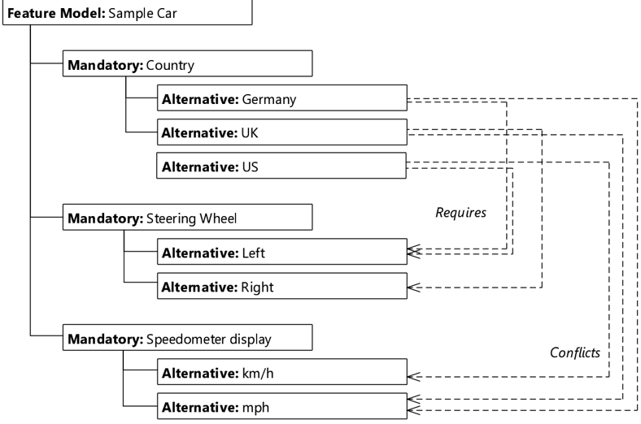

<!-- 源文档 AUTOSAR_FO_RS_FeatureModelExchangeFormat（R23-11），需求规范（RS），不受 Type A 七章骨架约束；章节结构镜像源文档自身编号（参考文献为源文档编号章节之前的无编号章，镜像保留）。需求项 ID（[UC_FMDT_*] 与 [RS_FMDT_*]）按 2026-11-03 批次决议整体省略（标题仅翻译），用例项补予 §2.1–2.16、需求项补予 §3.1–3.16 编号；项间/用例间交叉引用改写为章节号链接。源 §1.2「Requirements Tracing」为纯 ID 追溯表，按 2026-11-03 决议整节省略；每项之后的追溯回引随追溯节一并省略。封面元数据表、免责声明与目录按 EXP 流程省略；全部图引用中 2 处为内容图（图2.1 限制示例、图2.2 关系示例，按源图号命名嵌入），其余为页面装饰；图内特征树的文字标签散落为乱码字形（☞✌✍… 行），按转换噪声丢弃。附录 A 术语表按「粗体术语行 + 引用块」格式镜像。 -->

## 参考文献

<a id="ref-1"></a>[1] Standardization Template
> AUTOSAR_FO_TPS_StandardizationTemplate

<a id="ref-2"></a>[2] Software Process Engineering Meta-Model Specification
> http://www.omg.org/spec/SPEM/2.0/

## 1. 引言

### 1.1. 文档约定

**AUTOSAR** 文档中需求的表述遵循约束 TPS\_STDT\_00078 规定的表格，见 **Standardization Template** 的「Support for Traceability」章（[\[1\]](#ref-1)）。

需求的表达应使用约束 TPS\_STDT\_00053 规定的义务表达动词形式，见 **Standardization Template** 的「Support for Traceability」章（[\[1\]](#ref-1)）。

## 2. 用例

### 2.1. 总体工作流

一个 **OEM** 使用工具集 A 开发 **AUTOSAR** 模型和特征模型。然后两个模型都被传递给供应商以完成。供应商随后使用工具集 B 增强该工作，并将其传回给 **OEM**。**OEM** 随后重新导入 **AUTOSAR** 模型。这在开发周期中可能发生多次。

不同的工程领域出于变体管理的目的使用不同的特征建模工具，因为特定工具能更好地覆盖各自的需求；因此工具集 A 和 B 预期是不同的。

在开发期间的若干同步点上，不仅解决方案，特征描述也需要集成。

### 2.2. 特征模型的交换

一个 **OEM** 开发 **AUTOSAR** 模型和特征模型。特征模型实际上在外部工具中维护。这可能是因为 **OEM** 的工具链不包含直接支持 **AUTOSAR** 特征模型的变体管理工具，或者因为企业标准要求使用不支持 **AUTOSAR** 特征模型格式的特定工具。

**注意：** 在本用例中，特征模型不会被供应商更改。

### 2.3. 特征的特性

特征模型开发者希望表达特征的某些特性：

- 为清晰起见，特征模型具有层级结构<sup>1</sup>，其解释如下：仅当某个特征的父特征也被包含在产品中时，该特征才可能被包含进产品。
- 某个特征对产品是强制性的（**Mandatory**）。例如，一辆车必须有方向盘。需要注意的是（依照层级结构），这并不意味着该特征存在于每一个产品中。强制特征只有在其父特征被包含于产品时才被包含（但一旦父特征被包含，则必定包含）。例如，如果一辆车配有收音机，则扬声器也是强制的。
- 某个特征是可选的（**Optional**），即它可能存在也可能不存在于产品中。例如，收音机或天窗是可选特征。
- 两个或更多特征被标记为备选（**Alternative**）：其中恰好一个必须存在于产品中。例如，一辆车可以配备柴油机或汽油机。

> 1. 这里的层级实际上是树结构，即每个元素（除最顶层外）恰好有一个父元素。

- 两个或更多特征被标记为多选特征（**multipleFeatures**）：其中至少一个必须存在（下限不为零，因为零的情形已由可选特征覆盖）。可以同时选择多个特征。

### 2.4. 特征的限制

有时，层级不足以表达特征模型上的全部约束。

例如，有些特征是特定于国家的，例如方向盘的位置或车速表的默认设置。但是，将「国家 x」设为高层特征并把所有其他特征安排在其之下并不可取，因为这会导致不必要的重复。

相反，更简单的做法是把特征「国家 x」放置在特征树中的适当位置，并从特征树的任意位置引用该特征。

图2.1 展示了一个带有国家特定限制的特征模型示例。


### 2.5. 特征的复杂限制

一个特征可能依赖于若干其他特征。也就是说，仅当所有这些其他特征也被包含在产品中时，该特征才被包含在产品中。这无法用 [§2.3](#23-特征的特性) 中提出的层级来表达。

更复杂的限制类型也可能适用。

例如，[§2.4](#24-特征的限制) 可以使用如下形式的更复杂公式：

```
( Germany or US ) and not UK     UK and not ( Germany or US )
( UK or US ) and not Germany     Germany or not ( UK or US )
```

### 2.6. 特征之间的关系

与 [§2.4](#24-特征的限制) 和 [§2.5](#25-特征的复杂限制) 类似，特征模型需要表达特征之间的关系，其中特征 A 要求（**requires**）或排除（**excludes**）特征 B。

这也可以通过把一个限制（见 [§2.4](#24-特征的限制) 和 [§2.5](#25-特征的复杂限制)）放到特征 B 上来表达，但有时无法对特征 B 做这样的修改，因为它的特征模型不可更改。这可能是因为特征 B 由另一方「拥有」。

此外，关系通常比限制更容易理解或使用，因为它们是带有特征列表的简单关键词，而不是公式。

因此，特征 A 必须能够表达它与特征 B 的关系。

图2.2 展示了一个特征模型，它沿用了 [§2.4](#24-特征的限制) 中图2.1 的示例，但使用关系而非限制。注意，关系从国家相关特征（Germany、UK、US）出发，而前一个模型中的限制位于方向盘（**Steering Wheel**）和车速表默认值（**Speedometer default**）特征上。



其他关系示例有 **recommended for**（推荐用于）、**discouraged for**（不建议用于）和 **impacts**（影响）。

### 2.7. 特征的属性

特征建模者希望为特征提供附加信息，例如相应设备可使用的最大带宽。

当存在多个选项（如 [§2.3](#23-特征的特性) 中的 **multipleFeatures**）且每个特征对应一个单独设备、而这些设备可用的总带宽受总线特性限制时，这类信息很有用。这将产生如下限制：

```
( child1.bandwidth + child2.bandwidth + child3.bandwidth ) < maximumBandwidth
```

### 2.8. 特征模型的分布式开发

特征模型由不同的实体开发。这些实体可以是同一公司内的不同部门，也可以是完全不同的公司。

例如，一个已带有特征模型的 **AUTOSAR** 软件模型（由 **OEM** 创建）与另一个自带特征模型的软件模型（由供应商创建）集成。

再举一例，考虑两个独立的 **AUTOSAR** 软件组件，每个都带有自己的特征模型。它们必须集成到一个描述整个系统并也包含自身特征模型的大型 **AUTOSAR** 模型中。

如果每一方都能够编辑并写出自己的文件，这些例子将得到最好的处理。整体特征模型分布在多个文件上，或拆分为多个协同工作的不同特征模型。

### 2.9. 特征模型是可选的

**OEM** A 借助特征模型开发一个 **AUTOSAR** 模型，并希望包含由供应商 B 提供的软件组件。然而，B 不使用特征建模（或者使用特征建模但由于知识产权或合同原因不共享其特征模型）。

这并不妨碍 **AUTOSAR** 变体处理的使用——变体处理的开发独立于特征建模。

### 2.10. 为具体产品定义特征配置

特征模型描述产品线（**product line**）的特征及其相互依赖关系。其中一些特征可以是可选的。相反，具体产品由一组被选中的特征描述。这组被选中的特征必须满足特征模型定义的各种约束。

为了定义具体产品的特征，**OEM**（或供应商）选择特征模型特征的子集。此外，必须检查该特征选择是否符合特征模型中定义的各种约束（特别参见 [§2.3](#23-特征的特性)、[§2.4](#24-特征的限制)、[§2.5](#25-特征的复杂限制) 和 [§2.6](#26-特征之间的关系)）。

这对产品线内的每个适用产品都要重复进行。也就是说，可以存在多个特征配置。

### 2.11. 特征配置的交换

一个 **OEM** 为产品线定义特征模型，然后按照 [§2.10](#210-为具体产品定义特征配置) 所述选择若干定义单个产品的特征配置。这些特征配置连同特征模型一起被交付给供应商，以确保具体的软件适用于预期的产品（即特征配置）。

### 2.12. 特征的文档化

经验表明，定义特征模型的结构（即有哪些特征、它们的层级结构是什么、它们的特性是什么）、建立特征之间的关系以及定义哪些特征由哪些系统常量实现，是一个耗时的过程。

如果特征模型是为一个已经存在的软件产品线创建的，情况尤其如此。通常，多个来自不同部门的人会参与这样的任务。

因此，帮助形成特征模型最终版本的决策——即「为什么」——需要被记录下来。

### 2.13. 特征的多重性

在 [§2.3](#23-特征的特性) 中被描述为 **multipleFeatures** 的特征可以提供多重性约束。该约束限制特征配置中可以包含的特征数量。

例如，可以有 5 个 **multipleFeatures** 特征，但任何特征配置必须包含至少 2 个、至多 4 个这样的特征。例如，一个控制面板可以包含若干开关，但空间最多只够四个开关。

### 2.14. 特征建模与变体处理的关联

在创建特征模型之后，开发者需要建立特征模型与相应 **AUTOSAR** 模型中变体点（**variation point**）之间的链接。

特征与变体点之间的关系不是一对一关系。例如，一个特征可能影响多个变体点，或者一个变体点可能受多个特征影响。

### 2.15. 协同特征模型开发

一个 **OEM** 创建特征模型，将其导出为 **AUTOSAR** 特征模型，并把该模型传递给供应商。供应商更改该模型并交还给 **OEM**。**OEM** 随后导入该模型。

### 2.16. 特征的绑定时间

开发者限制特征实现的可能绑定时间（**binding time**），例如定义一个特征至少应作为 **PreCompileTime** 实现。这在特征模型中描述。

此外，存在两个面向不同客户的特征选择：一个客户想要 **PreCompileTime** 实现，另一个客户想要 **PostBuild** 解决方案。这在特征选择中描述。

## 3. 需求

### 3.1. 支持产品线

| 描述 | 特征模型交换格式应能够以一组相关产品的形式表达产品线的基本功能，这些产品可以具有相同或共享的特征。 |
| --- | --- |
| 理由 | - |
| 用例 | [§2.1](#21-总体工作流)、[§2.2](#22-特征模型的交换) |
| 依赖项 | - |
| 支撑材料 | - |

### 3.2. 特征

| 描述 | 特征模型交换格式应能够以特征的形式表达产品的基本功能。 |
| --- | --- |
| 理由 | - |
| 用例 | [§2.1](#21-总体工作流)、[§2.2](#22-特征模型的交换) |
| 依赖项 | - |
| 支撑材料 | - |

### 3.3. 特征选择

| 描述 | 特征模型交换格式应提供定义具体产品特征集的特征选择机制。 |
| --- | --- |
| 理由 | - |
| 用例 | [§2.10](#210-为具体产品定义特征配置)、[§2.11](#211-特征配置的交换) |
| 依赖项 | - |
| 支撑材料 | - |

### 3.4. 特征应有名称

| 描述 | 特征模型交换格式应能够对特征命名和描述。 |
| --- | --- |
| 理由 | - |
| 用例 | [§2.12](#212-特征的文档化) |
| 依赖项 | [§3.3](#33-特征选择) |
| 支撑材料 | - |

### 3.5. 特征分解

| 描述 | 特征模型交换格式应能够将特征分解为子特征。 |
| --- | --- |
| 理由 | - |
| 用例 | [§2.3](#23-特征的特性) |
| 依赖项 | [§3.3](#33-特征选择) |
| 支撑材料 | - |

### 3.6. 子特征的特性

| 描述 | 子特征应具有不同的特性，例如「**Mandatory**」（强制）、「**Optional**」（可选）和「**Alternative**」（备选）。 |
| --- | --- |
| 理由 | - |
| 用例 | [§2.3](#23-特征的特性) |
| 依赖项 | [§3.2](#32-特征)、[§3.5](#35-特征分解) |
| 支撑材料 | - |

### 3.7. 特征的多重性

| 描述 | 特征应能够表达多重性。这只与 [§2.13](#213-特征的多重性) 中提到的 **multipleFeatures** 类型组合相关。强制、可选和备选特征不具有多重性。 |
| --- | --- |
| 理由 | - |
| 用例 | [§2.13](#213-特征的多重性) |
| 依赖项 | [§3.2](#32-特征)、[§3.6](#36-子特征的特性) |
| 支撑材料 | - |

### 3.8. 特征之间的关系

| 描述 | 特征应能够表达与其他特征的不同关系，例如「**required**」（要求）、「**excluded**」（排除）和「**impacted**」（影响）。 |
| --- | --- |
| 理由 | - |
| 用例 | [§2.4](#24-特征的限制)、[§2.5](#25-特征的复杂限制)、[§2.6](#26-特征之间的关系) |
| 依赖项 | [§3.2](#32-特征)、[§3.5](#35-特征分解) |
| 支撑材料 | - |

### 3.9. 特征的属性

| 描述 | 特征应能够具有各种属性。 |
| --- | --- |
| 理由 | - |
| 用例 | [§2.7](#27-特征的属性) |
| 依赖项 | [§3.2](#32-特征) |
| 支撑材料 | - |

### 3.10. 与 AUTOSAR 变体处理的集成

| 描述 | 特征模型交换格式应与 **AUTOSAR** 既有的变体处理解决方案集成。 |
| --- | --- |
| 理由 | - |
| 用例 | [§2.14](#214-特征建模与变体处理的关联) |
| 依赖项 | - |
| 支撑材料 | - |

### 3.11. 特征模型应可拆分

| 描述 | 特征模型交换格式应提供将特征模型拆分为若干不同 **ARXML** 文件的手段。 |
| --- | --- |
| 理由 | - |
| 用例 | [§2.8](#28-特征模型的分布式开发)、[§2.15](#215-协同特征模型开发) |
| 依赖项 | - |
| 支撑材料 | - |

### 3.12. 特征模型的分布式维护

| 描述 | 特征模型交换格式应提供在不同参与方之间分布维护工作的手段。 |
| --- | --- |
| 理由 | - |
| 用例 | [§2.8](#28-特征模型的分布式开发)、[§2.15](#215-协同特征模型开发) |
| 依赖项 | - |
| 支撑材料 | - |

### 3.13. 集成到 AUTOSAR 方法论

| 描述 | 特征模型交换格式应能够被集成到整体的 **AUTOSAR** 方法论中。 |
| --- | --- |
| 理由 | - |
| 用例 | [§2.1](#21-总体工作流)、[§2.2](#22-特征模型的交换) |
| 依赖项 | - |
| 支撑材料 | - |

### 3.14. 特征模型是可选的

| 描述 | 在符合 **AUTOSAR** 的开发周期的范围内，特征模型交换格式的使用是可选的。这与 **AUTOSAR** 变体处理类似：不使用变体处理的 **AUTOSAR** 模型仍然是有效模型。 |
| --- | --- |
| 理由 | - |
| 用例 | [§2.9](#29-特征模型是可选的) |
| 依赖项 | - |
| 支撑材料 | - |

### 3.15. 特征可指定绑定时间

| 描述 | 特征可以定义一个预期绑定时间（**intended binding time**），记录该特征实现的绑定时间。该属性应被视为提示。 |
| --- | --- |
| 理由 | - |
| 用例 | [§2.16](#216-特征的绑定时间) |
| 依赖项 | - |
| 支撑材料 | - |

### 3.16. 特征选择可指定绑定时间

| 描述 | 特征选择可以定义一个选定的绑定时间（**selected binding time**），进一步细化 [§3.15](#315-特征可指定绑定时间) 中的预期绑定时间。该属性应被视为提示。 |
| --- | --- |
| 理由 | - |
| 用例 | [§2.16](#216-特征的绑定时间) |
| 依赖项 | - |
| 支撑材料 | - |

## A. 术语表

**Artifact**
> 工件（**Artifact**）：一种工作产品定义（**Work Product Definition**），为有形的工作产品类型提供描述和定义。工件可以由其他工件组成（[\[2\]](#ref-2)）。在高层次上，工件表示为单个概念性文件。

**AUTOSAR Tool**
> **AUTOSAR** 工具：支持方法论中定义的一个或多个 **AUTOSAR** 任务的软件工具。根据所支持的任务，**AUTOSAR** 工具可以充当创作工具、转换工具、处理工具或它们的组合（见各自的定义）。

**AUTOSAR Authoring Tool**
> **AUTOSAR** 创作工具：用于创建和修改 **AUTOSAR XML** 描述的 **AUTOSAR** 工具。示例：系统描述编辑器（**System Description Editor**）。

**AUTOSAR Converter Tool**
> **AUTOSAR** 转换工具：通过从其他 **AUTOSAR XML** 文件转换信息来创建 **AUTOSAR XML** 文件的 **AUTOSAR** 工具。示例：**ECU** 扁平化工具（**ECU Flattener**）。

**AUTOSAR Definition**
> **AUTOSAR** 定义：可以取值的参数的定义。可以说参数值是定义的实例。但在 **AUTOSAR** 元模型层级中，定义本身也是元模型的实例，因此被视为一种描述。**AUTOSAR** 定义的示例：`EcucParameterDef`、`PostBuildVariantCriterion`、`SwSystemconst`。

**AUTOSAR XML Description**
> **AUTOSAR XML** 描述：在 **AUTOSAR** 中指「已填充的模板」。实际上，**AUTOSAR XML** 描述是 **AUTOSAR** 模型的 **XML** 表示。**AUTOSAR XML** 描述可以由多个文件组成。每个单独的文件表示一个 **AUTOSAR** 部分模型，并且应成功通过 **AUTOSAR XML** 模式（**Schema**）的验证。

**AUTOSAR Meta-Model**
> **AUTOSAR** 元模型：定义用于描述 **AUTOSAR** 系统的语言的 **UML 2.0** 模型。**AUTOSAR** 元模型是 **AUTOSAR** 模板的 **UML** 表示。使用 **UML 2.0** 类图描述属性及其相互关系；使用构造型（**Stereotype**）、**UML** 标签和 **OCL** 表达式（对象约束语言）定义特定的语义和约束。

**AUTOSAR Meta-Model Tool**
> **AUTOSAR** 元模型工具：生成关于 **AUTOSAR** 元模型的不同视图（类表、约束列表、图、**XML Schema** 等）的工具。

**AUTOSAR Model**
> **AUTOSAR** 模型：**AUTOSAR** 产品的一种表示。**AUTOSAR** 模型按照 **AUTOSAR** 方法论表示适合预期用途的方面。严格地说，这是 **AUTOSAR** 元模型的一个实例。**AUTOSAR** 模型包含的信息可以是按照 **AUTOSAR** 元模型可表示的任何内容。

**AUTOSAR Partial Model**
> **AUTOSAR** 部分模型：在 **AUTOSAR** 中，模型可能的划分在元模型中通过 `&lt;atpSplitable&gt;` 标记。一个部分模型在 **AUTOSAR XML** 描述中由一个文件表示。部分模型不需要满足适用于 **AUTOSAR** 模型的全部语义约束。

**AUTOSAR Processor Tool**
> **AUTOSAR** 处理工具：通过处理来自 **AUTOSAR XML** 文件的信息来创建非 **AUTOSAR** 文件的 **AUTOSAR** 工具。示例：**RTE** 生成器（**RTE Generator**）。

**AUTOSAR Specification Element**
> **AUTOSAR** 规范元素：作为 **AUTOSAR** 规范一部分的命名元素。示例：需求、约束、规范项、元模型中的类或属性、方法论、交付物、方法论活动、模型元素、**BSW** 模块等。

**AUTOSAR Template**
> **AUTOSAR** 模板：**AUTOSAR** 中使用「模板（**Template**）」一词来描述不同类型描述的格式。该术语来源于这样的想法：**AUTOSAR** 定义了一种表单，需要填写该表单以描述一个模型。填写后的表单称为描述。实际上，**AUTOSAR** 模板现在被定义为元模型。

**AUTOSAR Validation Tool**
> **AUTOSAR** 验证工具：能够依据某个 profile 定义的规则检查 **AUTOSAR** 模型的专用 **AUTOSAR** 工具。

**AUTOSAR XML Schema**
> **AUTOSAR XML Schema**：定义用于交换 **AUTOSAR** 模型的语言的 **W3C XML** 模式。该模式派生自 **AUTOSAR** 元模型。**AUTOSAR XML Schema** 定义 **AUTOSAR** 数据交换格式。

**Blueprint**
> 蓝图（**Blueprint**）：一种可以从中通过复制和细化派生出其他模型的模型。注意，与元模型（即类型）相反，这一过程不是实例化。

**Instance**
> 实例（**Instance**）：通常指模型或类型的特定样本。

**Life Cycle**
> 生命周期（**Life Cycle**）：生命周期是模型元素在其存续期间的发展/演化阶段进程。

**Meta-Model**
> 元模型（**Meta-Model**）：定义模型构建块的模型。从这个意义上说，元模型表示构建模型的语言。

**Meta-Data**
> 元数据（**Meta-Data**）：包括关于数据的相关信息，例如作者、版本、访问权限、时间戳等。

**Model**
> 模型（**Model**）：模型是对现实的简化表示。模型表示适合预期目的的方面。

**Partial Model**
> 部分模型（**Partial Model**）：模型的一部分，预期被持久化在某个特定的工件中。

**Pattern in GST**
> **GST** 中的模式（**Pattern in GST**）：这是一种通过应用模型变换来简化元模型定义的方法。该变换从带标注的模型创建出一个增强的模型。

**Profile Authoring Support Data**
> Profile 创作支持数据（**Profile Authoring Support Data**）：用于高效创作 profile 的数据。例如可引用约束的列表、元类、元属性或其他可复用的模型资产（蓝图）。

**Profile Authoring Tool**
> Profile 创作工具（**Profile Authoring Tool**）：专注于为数据交换点创作 profile 的专用 **AUTOSAR** 工具。例如，它支持从零创建 profile、修改既有 profile 或组合既有 profile。

**Profile Compatibility Checker Tool**
> Profile 兼容性检查工具（**Profile Compatibility Checker Tool**）：专注于检查用于数据交换的 profile 兼容性的专用 **AUTOSAR** 工具。注意，该兼容性检查包括工程师的人工兼容性检查以及使用更形式化算法的自动辅助。

**Profile Consistency Checker Tool**
> Profile 一致性检查工具（**Profile Consistency Checker Tool**）：专注于检查 profile 一致性的专用 **AUTOSAR** 工具。

**Property**
> 属性（**Property**）：属性是对象的结构特征。例如，「连接器」具有「接收端口」和「发送端口」属性。属性通过 `&lt;atpVariation&gt;` 成为可变的。

**Prototype**
> 原型（**Prototype**）：这是在另一个类型的定义中某个类型角色的实现。换言之，一个类型可以包含原型，而这些原型又由「类型」来确定类型。当该类型被实例化时，这些原型中的每一个都成为实例。

**Type**
> 类型（**Type**）：类型提供可以出现在该类型各种角色中的特性。

**Value**
> 值（**Value**）：赋予某个「定义」的特定值。

**Variability**
> 可变性（**Variability**）：系统的可变性是其描述一组变体的能力。这些变体的特征在于变体特定的属性设置和/或选择。例如，这样的系统属性选择表现为某个连接的特定「接收端口」。这通过 `&lt;atpVariation&gt;` 实现。

**Variant**
> 变体（**Variant**）：系统变体是系统的一个具体实现，其所有属性都已被相应地设置或选择。软件系统就绑定时间而言不再有可变性。这通过 `EvaluatedVariantSet` 实现。

**Variation Binding**
> 变体绑定（**Variation Binding**）：变体是变体绑定过程的结果，该过程通过为系统的所有属性赋予特定的值/选择来解析系统的可变性。这由 `VariationPoint` 实现。

**Variation Binding Time**
> 变体绑定时间（**Variation Binding Time**）：变体绑定时间确定方法论中解析由一组可变属性给出的可变性的步骤。这通过相关属性上的 `vh.LatestBindingtime` 实现。

**Variation Definition Time**
> 变体定义时间（**Variation Definition Time**）：变体定义时间确定方法论中定义变体点的步骤。

**Variation Point**
> 变体点（**Variation Point**）：变体点指示某个属性是可变的。此外，它与一个条件和绑定时间相关联，这些定义了选择/设置具体变体的系统上下文。这由 `VariationPoint` 实现。

## B. 变更历史

请注意，本章中的列表还包括在后续版本中已从规范中移除的约束和规范项。这些约束和规范项在文档中不作为超链接出现。

### B.1. 本文档依据 AUTOSAR 版本 R22-11 的变更历史

#### B.1.1. R22-11 中新增的需求

无

#### B.1.2. R22-11 中变更的需求

无

#### B.1.3. R22-11 中删除的需求

无

### B.2. 本文档依据 AUTOSAR 版本 R23-11 的变更历史

#### B.2.1. R23-11 中新增的需求

无

#### B.2.2. R23-11 中变更的需求

无

#### B.2.3. R23-11 中删除的需求

无
