<!-- 源文档 AUTOSAR_FO_TPS_AbstractPlatformSpecification（R23-11），模板规范（TPS），不受 Type A 七章骨架约束；章节结构镜像源文档自身编号（1–4 与附录 A–F）。源文档的封面表格、Disclaimer 与 Contents 属于文档框架信息，不译；源文档开头的 References 列表保留为不编号的「参考文献」注册表，使正文中的 [n] 引用可链接。正文中的规范项按 2026-11-03 决议丢弃条目 ID、图元分隔符与括号回指，仅保留并翻译条文内容；约束（constr_xxxx）同样保留正文、丢弃 ID。源文档附录 D 的表格在 PDF→markdown 转换中缺失（仅有说明文字），本译文如实保留说明文字并在 §D 中说明。图号保留源文档编号（图2.x、图3.x、图C.1），示例 ARXML 清单以源文档图片形式保留。 -->

## 参考文献

[1] Standardization Template
> AUTOSAR_FO_TPS_StandardizationTemplate

[2] Virtual Functional Bus
> AUTOSAR_CP_EXP_VFB

[3] Meta Model
> AUTOSAR_FO_MMOD_MetaModel

[4] Generic Structure Template
> AUTOSAR_FO_TPS_GenericStructureTemplate

[5] Software Component Template
> AUTOSAR_CP_TPS_SoftwareComponentTemplate

[6] Methodology for Adaptive Platform
> AUTOSAR_AP_TR_Methodology

[7] Glossary
> AUTOSAR_FO_TR_Glossary

## 1. 引言

### 1.1. 文档结构

本文档包含 **AUTOSAR** 抽象平台（**XP**）的设计规范。由于该规范抽象于 **AUTOSAR** 自适应平台（**AP**）与 **AUTOSAR** 经典平台（**CP**），因此它作为 **AUTOSAR** 基础标准（**FO**）的一部分发布。

文档的结构如下：

第 1 节（本章）记录本规范中的术语、缩略语、约定；范围与限制，以及需求可追溯性。

第 2 节提供总体图景的描述，给出本规范的背景原因与动机，以及面向目标相关方的使用原则。此外还描述通用建模方法与建模决策。

第 3 节深入**抽象平台**的设计方面。建模连同约束与规范项规定一起描述。各子节详述方法论、**VFB** 元素的建模以及数据类型。

第 4 节 需求的标注与可追溯性。

第 C 节 示例 **ARXML** 清单与模型。

### 1.2. 文档约定

技术术语以等宽字体排版，例如 `PortPrototype`。作为一般规则，技术术语的复数形式通过在单数形式后加 "s" 构成，例如 `PortPrototype` s。通过这种方式，文档与 **AUTOSAR** XML 模式中使用的术语保持一致。

本文档包含文本形式的约束，这些约束以唯一的数字约束 ID、一个标题以及紧随其后的约束正文与其余文本区分开。

这些约束的目的是从字面上约束对 **AUTOSAR** 元模型的解释，从而可以检测对元模型实例（即 M1 层）中所实现的标准化行为的违反。

我们鼓励 **AUTOSAR** 工具制造商在工具发出的诊断消息中加入与 M1 建模问题相对应的约束数字 ID。

本文档中引入的类的属性以类表的形式列出。它们采用顶层元素 `AUTOSAR` 示例所示的形式。

请注意，约束并不打算在 **AUTOSAR** 工作流的任何给定时刻都可强制执行。在模型开发期间，约束可能被合理违反，因为不完整的模型显然会表现出不一致。

然而，在工作流的特定点上，约束应作为防止错误配置的保障措施被执行。

约束应被强制执行的工作流点（有时也称为约束的“绑定时点”）对每个模型类别而言各不相同；例如在经典平台上，为软件组件定义的约束通常在生成 **RTE** 之前执行，而针对 **ECU** 提取定义的约束应在创建 **Com** 协议栈的 **ECU** 配置时应用。

对于每个文档，都定义了约束可能的绑定时点，并且这些绑定时点通常在约束自身中提及，以便为 **AUTOSAR** 创作工具的实现者提供正确的指引。

设 `AUTOSAR` 为一个典型类表的示例。表中的前几行含义如下：

Class：类在 UML 模型中定义时的名称。

Package：该类定义所在的 UML 包。此处列出仅为帮助在整体元模型中定位该类。

Note：建模者对该类的注释（类备注）。类的构造型与 UML 标记也在此注明。

Base Classes：如适用，直接基类的列表。

表中的表头含义如下：

Attribute：类的一个属性的名称。注意 **AUTOSAR** 不区分类属性与所属关联端。

Type：类属性的类型。

Mul.：该属性被赋予的多重性，即有多少个给定数据类型的实例与该属性关联。

Kind：指明该属性是聚合在该类中（`aggr` 聚合）、是类中的 UML 属性（`attr` 原始属性），还是仅被该类引用（`ref` 引用）。实例引用也在此字段中指示（`iref` 实例引用）。

Note：建模者对该类属性的注释（角色备注）。属性的构造型与 UML 标记也在此注明。

请注意，以字母而非数值开头的章节代表文档的附录。附录的目的是帮助解释文档的某些方面，不代表标准的约束性约定。

[\[1\]](#ref-1) 中规定的表示义务的动词形式应用于表示需求，参见 Standardization Template 的 Support for Traceability 章。

**AUTOSAR** 文档中需求的表示遵循 Standardization Template 的 Support for Traceability 章（[\[1\]](#ref-1)）规定的表格。

### 1.3. 范围与限制

在 **AUTOSAR** 时间线上，**XP** 规范是在 **CP** 与 **AP** 之后加入的。它也独立于现有的 **CP**/**AP**，因此作为 **AUTOSAR** 基础标准的一部分发布。

**XP** 使用术语 **VFB** 与 **VFB++**。**AUTOSAR VFB** 在 [\[2\]](#ref-2) 中进行了概念性描述。虽然该文档属于 **CP**，但 [\[2\]](#ref-2) 的 “Overall mechanisms and concepts” 章中的一般原则同样适用于 **AP** 与 **XP**。特别是 **VFB** 层视图的理念，在建模术语上适用于那些用于描述功能 ECU 间通信的元模型工件集合，即组件、端口、接口、连接器。这与所讨论的平台是基于信号、基于服务还是抽象的无关。

**XP VFB++** 描述是纯软件功能设计描述。它独立于拓扑与部署，因此不描述这些内容。

**XP** 描述有其技术边界。**XP** 描述的基础应是 **AUTOSAR** 系统描述。这与 **AUTOSAR** 的一般方法论一致：把 **AUTOSAR** 系统的描述根植于一份自有描述中，参见 [3.2](#32-系统模型)。

**XP** 系统描述的范围，在 **VFB** 层上，从 **SWC** 设计的轮廓一直到软件接口中应用层数据类型定义的细节，参见 [3.5](#35-数据类型)。

有关应用层数据类型的细节，参见 [\[5\]](#ref-5)（**Software Component Template**）中的相关规范项。

## 2. 概念

### 2.1. 背景

现有 **AUTOSAR** 元模型提供了在 **CP ECU** 与 **AP Machine** 上全面设计与部署应用的手段。取决于预期的具体部署平台，功能/功能设计模型（有意地）与平台选择紧密耦合。

系统设计者在早期就被拉入具体决策：是在 **AP**、**CP** 还是非 **AUTOSAR** 平台上设计与部署。因此，设计选择会因预期的部署平台而产生偏差。

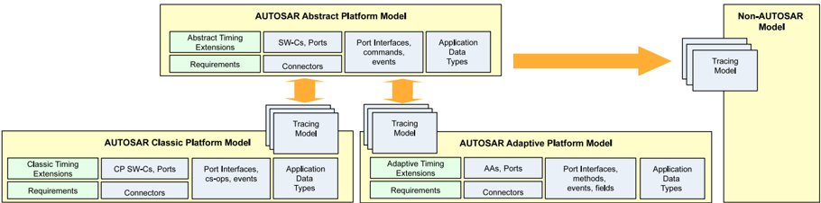

处于早期软件设计阶段的系统设计者未必关心，例如哪种具体组件类型应实现该功能，或哪种具体接口提供所需数据。

相反，设计者只想对功能软件块之间的交互建模，并规定基本情况：即信号名称、数据的流向（提供者/消费者）以及物理数据类型。设计的进一步细化将在下游阶段完成，即关注点分离。

在方法论层面，这与 **AUTOSAR** 的整体设计方法相当契合——**AUTOSAR** 通常采用分阶段的设计方法。可以预见，这通常更适合 **OEM** 中实现的绿地（**green-fields**）或白纸（**blank-page**）设计方法——相比之下，在其他类型的设计方法中，供应商的技术设计决策空间非常有限。

### 2.2. 用法

#### 2.2.1. 通用

本规范旨在提供功能模型的系统描述。它还允许需求标注以及模型元素（包括需求与功能元素）的一般可追溯性。该抽象描述可提供系统的更高层视图，帮助系统设计者“退后一步”，暂不做出关于部署的早期决策，或将该决策推迟到下游设计阶段或供应商。

虽然主要用例建立在 **AP** 与 **CP** 之上，但（按设计）并不打算仅限这些平台。如图2.2所示，与其他汽车或非汽车领域一起使用也应当可行。

标准化的非 **AUTOSAR** 系统拥有各自的领域特定模型/IDL，**XP** 的范围并不试图确定这些领域特定模型/IDL 是什么——也不确定它们是否应被纳入 **XP** 的范围。相反，其意图是通过领域特定工具，从 **XP** 描述进行某种形式的模型到模型转换/派生，得到非 **AUTOSAR** 模型。

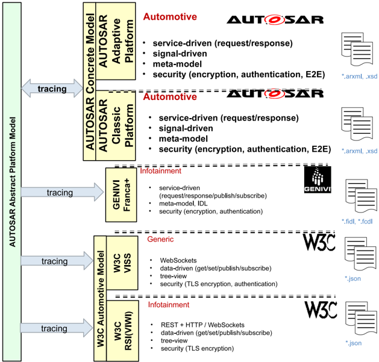

#### 2.2.2. AUTOSAR 特定

**XP** 与 **AP**/**CP** 平台视图之间不存在硬性的建模依赖，即具体层并不依赖于抽象层。该方法论不禁止系统设计者完全绕过 **XP** 模型，仅在 **AP**/**CP** 模型中设计以达到期望结果2。

尽管如此，在工具与追踪支持下，也完全应当可以从 **AP**/**CP** 描述创建 **XP**。

图2.3给出了一个示例场景。一个包含多个层级、由不同种类 **XSC** 组合而成的抽象平台模型被派生为并行的 **AP**/**CP** 模型。此例中展示了 **XP** 模型的分割，但一般而言，任意数量的排列都可能可行，包括向任一平台的完全派生。

> 2 向后兼容性。

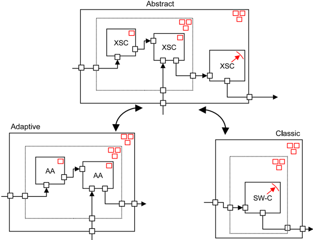

### 2.3. 建模方法

#### 2.3.1. 元模型选择

如果目标是允许抽象设计，可以论证所选的 M2 模型也应当抽象于 **AUTOSAR**。然而，尽管抽象设计应当对非 **AUTOSAR** 平台的设计者开放使用，主要关注仍是 **AUTOSAR** 域（即 **AP**/**CP**）内的使用。

因此，使用 **AUTOSAR** 元模型 [\[3\]](#ref-3) 作为 M2 层建模方法基础的理由更加坚实。**XP** 使用 **AUTOSAR** 元模型设计，但不应当把抽象设计的使用限制在 **AUTOSAR** 内。

#### 2.3.2. 自底向上与自顶向下

基于 [2.3.1](#231-元模型选择) 中元模型选择的假设，下一个问题是如何着手创建抽象平台模型。用很一般的说法，有两种可能的方法：自底向上与自顶向下。注意：**AUTOSAR** 通过 [\[4\]](#ref-4) 的 “Documentation Support::Documentation Block” 章中的专用元模型工件支持模型之间的追踪。

##### 2.3.2.1. 自顶向下

如果 **XP** 模型是自顶向下创建的，则 **VFB++** 功能交互采用绿地方法建模——随后将该抽象模型追踪到新具体模型的创建。

如果具体模型应为 **AUTOSAR** 模型，则这涉及将 **VFB++** 视图派生为相应 **AP**/**CP** 中的 **VFB** 视图。如果具体模型是非 **AUTOSAR** 模型，则定义这一点属于非 **AUTOSAR** 模型自身的领域。

虽然这种方法提供更多设计自由，但存在这样的风险：所规定的 **XP** 最终可能与现有平台的需求相距甚远。因此更可能的方法倾向于自底向上方法。

##### 2.3.2.2. 自底向上

如果 **XP** 模型是自底向上创建的，则以现有具体平台模型为内容基础。在实践中，这意味着这种形式的 **XP** 描述立即比前一种方法更有效，因为它已经以具体平台模型为基础。这种方法还可以实现 **XP** 描述的自动化创建。

如果具体模型是 **AP** 与 **CP** 模型，则应把 **AP**/**CP** 平台中现有的 **VFB** 视图向上抽象，以创建 **XP VFB++** 模型。如果具体模型是非 **AUTOSAR** 模型，则定义这一点属于非 **AUTOSAR** 模型自身的领域。

采用这种方法，可以更好地保证 **XP** 设计与现有平台良好契合。

#### 2.3.3. 元类选择

在决定了 **XP** 设计的总体方法之后，下一个问题是元类选择采用哪种方法，即复用现有元类还是创建新的元类。

虽然 **AP** 与 **CP** 基于不同的架构原则，但它们在 **VFB** 层上大多共享相同的建模原则，因此也共享 **VFB** 建模。因此，方法是把两个平台中的 **VFB** 层模型作为主要基础，把非 **AUTOSAR** 平台作为次要基础。

现有 **AUTOSAR** 元模型，特别是 **AUTOSAR** 软件组件模板 [\[5\]](#ref-5) 的规范，已经为全面设计软件组件模型提供了良好基础。其中的原则也可以在其他更通用的非 **AUTOSAR** 组件模型中找到。

任何给定的同一元类都可以在 **XP**、**AP** 或 **CP** 平台中的任一平台使用。这种做法与设计 **AP** 元模型时所用的类似；同样地，有必要用 **XP** 特有内容扩展元类，并把它们约束到 **XP**（见 [\[4\]](#ref-4) 的 `TPS_GST_00372`）。

## 3. 抽象平台

### 3.1. 方法论

#### 3.1.1. 概述

抽象平台系统描述提供了获得系统更高层软件视图的可能性。架构师可以在设计时决定使用哪种下游 **AUTOSAR** 系统描述类型。

通过抽象获得一定程度的架构自由度，具体方法是：在组件模型层面形式化描述功能交互，但不固定任何下游实现平台的细节。

**抽象平台系统描述的原则**：抽象平台系统描述允许对相互连接的软件组件的功能交互进行平台无关的规格说明。

**抽象平台的 VFB 层建模**：抽象平台描述使用 **AUTOSAR** 元模型中的那些 **VFB** 层元素作为建模基础。

**部署方面的无关性**：抽象平台与部署方面无关。

**AUTOSAR** **CP** / **AP** 模型仍是平台特定软件设计的基础，并且应保持独立于 **XP**。为保持关注点分离，应避免 **AUTOSAR** **CP** / **AP** 模型使用 **XP** 工件。反过来（在 **XP** 中使用 **CP** / **AP**）则是允许的。

这通过利用标记机制实现：对 **XP** 工件施加平台特定限制，以将它们排除在 **CP** / **AP** 模型中的可见性。关于标记的解释，参见 [\[4\]](#ref-4) 的 “Usage of UML in AUTOSAR Templates::UML Tags” 章中的 `TPS_GST_00372`。

**抽象平台模型的定位**：抽象平台模型完全独立于具体平台模型。

**抽象平台工件对 AUTOSAR 具体平台的排除**：抽象平台使用 `mmt.RestrictToStandards="FO"` 元模型标记，把抽象平台元模型工件在语义上排除于其他平台（参见 `TPS_GST_00372`、`TPS_GST_00429`、`TPS_GST_00430`）。

如 [3.1](#31-方法论) 所示，从方法论视角看，**XP** 系统描述与 **CP** 和 **AP** 中对应的系统描述完全解耦。

目前没有对例如角色、子任务或交付物的进一步详细规定（未来版本可能补充）——因此建议采用 [\[6\]](#ref-6) 中相同的方法论步骤，因为它们在大多数情况下是一致的。

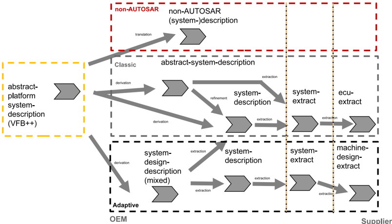

### 3.2. 系统模型

#### 3.2.1. 概述

与 **AP** 和 **CP** 中现有的系统描述一致，**XP** 需要自己的系统描述，以把 **XP** 内容与其他类型的系统描述/提取（extract）区分开。所有 **AUTOSAR** 系统描述/提取的基础是元类 `System`，并且与其他 **AUTOSAR** 系统描述一样，应使用 `category` 来标识内容。

**包含抽象平台内容的系统描述的 System 类别**：包含与抽象平台相关的设计工件的 `System` 元素应具有类别：

- `ABSTRACT_PLATFORM_SYSTEM_DESCRIPTION`。

对应的示例 **ARXML** 清单参见 [C.1](#c1-用于系统的示例-arxml)。

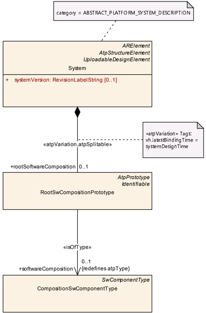

#### 3.2.2. 根组合

与 **AP** 和 **CP** 中其他类型的 `System` 一样，**XP** 中的 `RootSwCompositionPrototype` 引用一个 `CompositionSwComponentType` 作为根组合。参照 `TPS_APSD_01019`，它只具有普通组合的语义。

表3.1：System

| 属性 | 值 |
| --- | --- |
| 类 | System |
| 包 | M2::AUTOSARTemplates::SystemTemplate |
| 备注 | 抽象平台系统描述的顶层元素。标记：atp.recommendedPackage=Systems |
| 基类 | ARElement、ARObject、AtpClassifier、AtpFeature、AtpStructureElement、CollectableElement、Identifiable、MultilanguageReferrable、PackageableElement、Referrable、UploadableDesignElement、UploadablePackageElement |
| 聚合自 | ARPackage.element、AtpClassifier.atpFeature |

| 属性 | 类型 | 多重性 | 种类 | 备注 |
| --- | --- | --- | --- | --- |
| mapping | SystemMapping | * | aggr | 构造型：atpSplitable；atpVariation。标记：atp.Splitkey=mapping.shortName, mapping.variationPoint.shortLabel；vh.latestBindingTime=postBuild |
| rootSoftwareComposition | RootSwCompositionPrototype | 0..1 | aggr | 根软件组合的聚合，以层次化结构包含系统中的所有软件组件。构造型：atpSplitable；atpVariation。标记：atp.Splitkey=rootSoftwareComposition.shortName, rootSoftwareComposition.variationPoint.shortLabel；vh.latestBindingTime=systemDesignTime |
| systemVersion | RevisionLabelString | 0..1 | attr | 系统描述的版本号。 |

表3.2：RootSwCompositionPrototype

| 属性 | 值 |
| --- | --- |
| 类 | RootSwCompositionPrototype |
| 包 | M2::AUTOSARTemplates::SystemTemplate |
| 备注 | `RootSwCompositionPrototype` 表示给定 `System` 内软件组件的顶层组合。这可能例如是或多或少完整的 **VFB++** 描述。因此，`RootSwComposition` 只偶尔会包含完整 **VFB** 系统中使用的所有原子软件组件。**OEM** 主要关注所需功能以及定义软件组件集成到系统中的接口。此类组件的内部结构常常包含供应商的大量知识产权。因此，顶层软件组合常常包含表示子系统的空组合。所包含的 `SwComponentPrototype` 由其 `SwComponentType` 完全指定（包括端口……） |
| 基类 | ARObject、AtpFeature、AtpPrototype、Identifiable、MultilanguageReferrable、Referrable |
| 聚合自 | AtpClassifier.atpFeature、System.rootSoftwareComposition |

| 属性 | 类型 | 多重性 | 种类 | 备注 |
| --- | --- | --- | --- | --- |
| softwareComposition | CompositionSwComponentType | 0..1 | tref | 我们假设恰好存在一个包含系统所有组件实例的顶层组合。构造型：isOfType |

### 3.3. 软件组件模型

#### 3.3.1. 概述

**XP** 软件组件模型总体遵循 [\[5\]](#ref-5) 的 “Overview::Software Components...” 章中阐述的各个方面。**SWC** 的可复用性原则以及类型-原型（type-prototype）模式在 **XP** 中同样适用，只是在大多数情况下，其视角比具体平台更具限制性。这种更具限制性的视角的一个例子是后文所示的允许的软件组件类型。

从 [\[5\]](#ref-5) 继承的另一特性是能够规定任意复杂度的 **SWC** 层次结构。与 **CP** 软件组件模型针对精确用例规定精确的原子 **SWC** 类型不同，**XP** 放宽了这类精确性，目标是对 **SWC** 进行更通用的类型化。

**XP SWC** 模型允许一种不把任何预期下游用途强加给设计者的组件设计，但仍允许通过一组有限的指示（`TPS_APSD_01005`）来标识该组件的预期用途。

#### 3.3.2. 组件组合

这一点（`TPS_APSD_01006`）与 **AP** 和 **CP** 并无不同，它们同样处理 **SWC** 的封装。组合与封装的建模原则在 [\[5\]](#ref-5) 的 “Composition::Overview” 和 “Composition::SwComponentPrototype” 章中已作适当说明，此处无需进一步详述。

**抽象平台中的递归组件定义**：抽象组件设计允许按深度递归地定义组件。

##### 3.3.2.1. SwComponentPrototype

元类 `CompositionSwComponentType` 以角色 `component` 聚合 `SwComponentPrototype`，这有助于对 `SwComponentType` 组件的任意嵌套进行建模。然而，**XP** 仅使用 `CompositionSwComponentType` 作为所包含的 `type`。

**抽象平台中 CompositionSwComponentType 内使用的 SwComponentPrototype 的类型化**：在抽象平台中，`CompositionSwComponentType` 中聚合的 `SwComponentPrototype.type` 应为 `CompositionSwComponentType`。

#### 3.3.3. 组件类型

在 **XP** 中，设计者应当能够以相当自由浮动的方式设计 **VFB++** 层次化 **SWC** 模型。**SWC** 可以通过利用预期组件类型的一个子集来描述。

方法是允许对一种通用类型的组件——`CompositionSwComponentType`——作为通用组件类型进行建模。换言之，抽象平台组件不绑定到特定用例。`CompositionSwComponentType` 从 `Identifiable` 继承 `category` 属性，这意味着可以为其分配 `category` 的一个子集，以规定组件的功能意图。

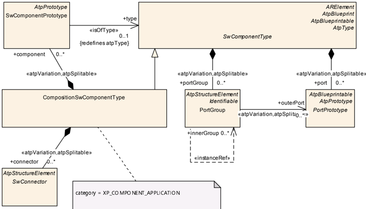

由于 `CompositionSwComponentType` 以这种方式被使用，而不是使用指定的 `AtomicSwComponentType`，这意味着 `CompositionSwComponentType` 会一直使用到组件层次结构树的底部。为了区分 `CompositionSwComponentType` 被指定为实际的普通复合软件组件，还是被指定为“准”原子软件组件，`category` 会根据意图受到限制。

如果没有 `constr_6803`，在 **XP** 与具体平台之间追踪组件的使用将非常随意——可以预见，抽象组件只能被默认派生为下游平台中的某种任意表示，而且这将是纯手工步骤，无法支持任何未来的自动化。因此，`category` 的使用应当允许架构师规定组件类型的某些更细化的细节。

**抽象平台中组件类型的标识**：抽象平台使用 `CompositionSwComponentType` 的 `category` 作为可选地标识该 `CompositionSwComponentType` 预期用途的手段。

**约束：CompositionSwComponentType.category 的标准化取值**：在 `category` 被设为 `ABSTRACT_PLATFORM_SYSTEM_DESCRIPTION` 的 `System` 中，任何被 `SwComponentPrototype` 以角色 `type` 引用的 `CompositionSwComponentType`，其 `category` 应被设为：

- `XP_COMPONENT_APPLICATION`

**类别为 XP_COMPONENT_APPLICATION 的 CompositionSwComponentType 的语义**：抽象平台中类别为 `XP_COMPONENT_APPLICATION` 的组合表示一个应用软件组件。

示例 **ARXML** 清单参见 [C.2](#c2-用于软件组件的示例-arxml)。

表3.3：CompositionSwComponentType

| 属性 | 值 |
| --- | --- |
| 类 | CompositionSwComponentType |
| 包 | M2::AUTOSARTemplates::SWComponentTemplate::Composition |
| 备注 | `CompositionSwComponentType` 聚合 `SwComponentPrototype`（其又由 `SwComponentType` 来类型化）以及 `SwConnector`，主要用于把 `SwComponentPrototype` 彼此连接，并连接到 `CompositionSwComponentType` 的表面。通过这种方式，可以创建软件组件的层次化结构。标记：atp.recommendedPackage=SwComponentTypes |
| 基类 | ARElement、ARObject、AtpBlueprint、AtpBlueprintable、AtpClassifier、AtpType、CollectableElement、Identifiable、MultilanguageReferrable、PackageableElement、Referrable、SwComponentType |
| 聚合自 | ARPackage.element |

| 属性 | 类型 | 多重性 | 种类 | 备注 |
| --- | --- | --- | --- | --- |
| component | SwComponentPrototype | * | aggr | 构造型：atpSplitable；atpVariation。标记：atp.Splitkey=component.shortName, component.variationPoint.shortLabel；vh.latestBindingTime=postBuild |
| connector | SwConnector | * | aggr | `SwConnector` 具有在 `PortPrototype` 之间建立连接的主要能力。在 `CompositionSwComponentType` 的上下文中，它们可以承担多种角色。细节由子类进一步细化。`SwConnector` 的聚合受变体性约束，目的是支持变体数据流。构造型：atpSplitable；atpVariation。标记：atp.Splitkey=connector.shortName, connector.variationPoint.shortLabel；vh.latestBindingTime=postBuild |
| physicalDimensionMapping | PhysicalDimensionMappingSet | 0..1 | ref | 该引用标识在所属 `CompositionSwComponentType` 的上下文中适用的 `PhysicalDimensionMappingSet`。在 `CompositionSwComponentType` 范围内创建 `PortInterfaceMapping` 时，`PhysicalDimensionMappingSet` 中所包含的 `PhysicalDimensionMapping` 应在评估 `PhysicalDimension` 的兼容性时予以考虑。 |

表3.4：SwComponentPrototype

| 属性 | 值 |
| --- | --- |
| 类 | SwComponentPrototype |
| 包 | M2::AUTOSARTemplates::SWComponentTemplate::Composition |
| 备注 | 软件组件在组合内的角色。 |
| 基类 | ARObject、AtpFeature、AtpPrototype、Identifiable、MultilanguageReferrable、Referrable |
| 聚合自 | AtpClassifier.atpFeature、CompositionSwComponentType.component |

| 属性 | 类型 | 多重性 | 种类 | 备注 |
| --- | --- | --- | --- | --- |
| type | SwComponentType | 0..1 | tref | 该实例的类型。构造型：isOfType |

表3.5：SwComponentType

| 属性 | 值 |
| --- | --- |
| 类 | SwComponentType（抽象） |
| 包 | M2::AUTOSARTemplates::SWComponentTemplate::Components |
| 备注 | **AUTOSAR** 软件组件的基类。 |
| 基类 | ARElement、ARObject、AtpBlueprint、AtpBlueprintable、AtpClassifier、AtpType、CollectableElement、Identifiable、MultilanguageReferrable、PackageableElement、Referrable |
| 子类 | AtomicSwComponentType、CompositionSwComponentType、ParameterSwComponentType |
| 聚合自 | ARPackage.element |

| 属性 | 类型 | 多重性 | 种类 | 备注 |
| --- | --- | --- | --- | --- |
| port | PortPrototype | * | aggr | 该 `SwComponentType` 可与之通信的 `PortPrototype`。`PortPrototype` 的聚合受变体性约束，目的是支持 `PortPrototype` 的条件存在。构造型：atpSplitable；atpVariation。标记：atp.Splitkey=port.shortName, port.variationPoint.shortLabel；vh.latestBindingTime=preCompileTime |
| portGroup | PortGroup | * | aggr | 属于该组件的端口组。构造型：atpSplitable；atpVariation。标记：atp.Splitkey=portGroup.shortName, portGroup.variationPoint.shortLabel；vh.latestBindingTime=preCompileTime |
| swComponentDocumentation | SwComponentDocumentation | 0..1 | aggr | 为 `SwComponentType` 添加文档。构造型：atpSplitable；atpVariation。标记：atp.Splitkey=swComponentDocumentation, swComponentDocumentation.variationPoint.shortLabel；vh.latestBindingTime=preCompileTime；xml.sequenceOffset=-10 |

#### 3.3.4. 连接器

虽然对端口连接器的建模支持对某些下游架构来说完全合理，但对另一些架构来说并非如此。特别是对于基于 **SOA** 的平台，可以论证它们是多余的：**SOA** 中间件通常只在另一方发起搜索后、在运行时“找到”所提供服务的时刻才创建“连接”。

**抽象平台中连接器的建模**：**XP** 允许对连接器建模，但将其具体应用推迟到下游平台。

换言之，**XP** 与具体平台无关，但为了在具有真实语义的具体平台中便于使用连接器，它并不禁止使用连接器。

因此 **XP** 沿用 [\[5\]](#ref-5) 的 “Overview::Composition::Connectors” 章中的连接器建模。

#### 3.3.5. 端口组

端口分组在组件模型中相当常见，尽管端口组的语义含义实际上由模型本身自行决定。可能有多种场景，例如限制离散端口被包含在离散组中，或允许离散端口被映射到不同的组。有些模型把抽象端口组定义为一种组合，可在下游平台中进一步分解。

**抽象平台中的端口分组**：在抽象平台中，应能够把离散端口分配给零个或多个端口组。

### 3.4. 端口接口

#### 3.4.1. 概述

**XP** 遵循 [\[5\]](#ref-5) 的 “Overview::Port Interface...” 章中规定的相同一般原则。**XP** 限制模型，不允许同一端口既可读又可写。

**抽象平台中端口的原型化**：抽象平台端口要么处于请求者（requirer）角色，要么处于提供者（provider）角色，但不能同时具备两者。

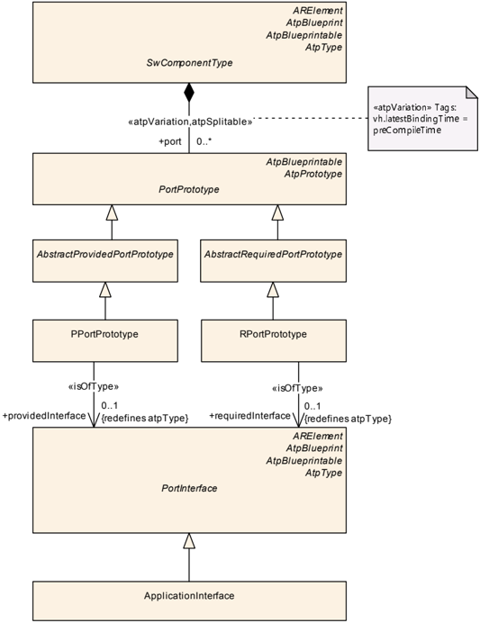

#### 3.4.2. 端口接口

**XP** 并不强制要求特定的 `PortInterface` 类型。在 **CP** / **AP** 中，各自的 **VFB** 模型会为预期的功能用途规定特定的 `PortInterface` 类型，例如 **AP** 的 `ServiceInterface` 用于基于 **SOA** 的部署；而 **XP** 选择一种可以通用地应用的接口类型。

**XP** 确实允许为 `ApplicationInterface` 提供更多语义，以通过 `ApplicationInterface.category` 指示某个端口的预期用途。这作为提示，在派生时可选择性地考虑（如果它在下游平台上具有语义含义），尽管 `ApplicationInterface` 本身并不传达任何与端口之间的功能用途或底层信号架构相关的内容（`TPS_APSD_01010`）。

**抽象平台中接口的通用类型化**：抽象平台在语义上不把 `PortInterface` 的类型绑定到特定的功能用途。

**抽象平台接口对中间件部署的无关性**：抽象平台接口与架构以及任何中间件部署选项均无关。

**ApplicationInterface 的语义**：`ApplicationInterface` 继承自 `PortInterface`，并提供功能无关的 `PortInterface` 类型，以允许在 `PortPrototype` 之间交换数据。

**约束：ApplicationInterface 对抽象平台的独占性**：除非 `System` 的 `category` 为 `ABSTRACT_PLATFORM_SYSTEM_DESCRIPTION`，否则 `ApplicationInterface` 不应对 `PortPrototype` 进行类型化。

`constr_6807` 的理由植根于 `TPS_APSD_01003`。

##### 3.4.2.1. 应用接口的元素

`ApplicationInterface` 的构成借鉴了 **AP** `ServiceInterface` 采用的方法，以便在数据交换方式的选择上具有灵活性。1

下游平台可能只支持原子接口类型，在这种情况下，在派生期间必须把 `ApplicationInterface` 的各个元素映射到离散的原子接口。显然，这可能对端口产生影响，届时需要创建端口，或采用某种外观（facade）模式。

**ApplicationInterface 的元素**：`ApplicationInterface` 允许以下形式的数据交换：

- 以角色 `command` 聚合的 `ClientServerOperation`。
- 以角色 `indication` 聚合的 `VariableDataPrototype`。
- 以角色 `attribute` 聚合的 `Field`。

**ApplicationInterface.command 的语义**：`command` 是带有可选函数参数的 RPC，由请求者（客户端）调用并在提供者（服务器）一侧执行。

**ApplicationInterface.indication 的语义**：`indication` 是由提供者（服务器）更新（指示）的一块纯数据。

**ApplicationInterface.attribute 的语义**：`attribute`（类似于类/对象中的“字段”）提供了 `command` 与 `indication` 的组合特性。请求者（客户端）侧实体可以获取或设置属性，或在属性值被更新时（无论该值是否与之前的值发生变化）接收来自提供者（服务器）侧实体的指示。

> 1 `ApplicationInterface` 的替代方法可以是使用 **CP** 风格的原子接口（单一消息交换元素）。然而，在 `ApplicationInterface` 中聚合单一交换元素提供了更大的灵活性。

**Field 的属性**：`Field` 支持以下属性及其相关语义：

- `hasGetter`：把 `hasGetter` 设为 TRUE/FALSE 等价于允许/禁止请求者（客户端）侧读取该属性值。
- `hasSetter`：把 `hasSetter` 设为 TRUE/FALSE 等价于允许/禁止请求者（客户端）侧更新该属性值。
- `hasNotifier`：把 `hasNotifier` 设为 TRUE/FALSE 等价于允许/禁止提供者（服务器）在属性值发生变化时（无论该值是否与之前的值发生变化）向请求者（客户端）发送通知更新。

**约束：ApplicationInterface.category 的标准化取值**：`ApplicationInterface` 的 `category` 可设为以下之一：

- `XP_PORT_SECURITY`
- `XP_PORT_TIMESYNC`
- `XP_PORT_STORAGE`
- `XP_PORT_APPLICATION`
- `XP_PORT_SAFETY`

**类别为 XP_PORT_SECURITY 的 ApplicationInterface 的语义**：类别为 `XP_PORT_SECURITY` 的 `ApplicationInterface` 表示通往安全实体的控制端口，例如密码或认证实体。

**类别为 XP_PORT_TIMESYNC 的 ApplicationInterface 的语义**：类别为 `XP_PORT_TIMESYNC` 的 `ApplicationInterface` 表示通往时间同步实体的控制端口，例如 **AP** 的 `AbstractSynchronizedTimeBaseInterface`。

**类别为 XP_PORT_STORAGE 的 ApplicationInterface 的语义**：类别为 `XP_STORAGE` 的 `ApplicationInterface` 表示通往用于保存持久数据的存储实体的端口，例如 **AP** 的 `PersistencyInterface` 或 **CP** 的 `NvDataInterface`。

**类别为 XP_PORT_APPLICATION 的 ApplicationInterface 的语义**：类别为 `XP_PORT_APPLICATION` 的 `ApplicationInterface` 表示通用应用数据端口，例如 **AP** 的 `ServiceInterface`。

**类别为 XP_PORT_SAFETY 的 ApplicationInterface 的语义**：类别为 `XP_PORT_APPLICATION` 的 `ApplicationInterface` 表示通往安全实体的端口，例如 **AP** 的 `PlatformHealthManagementInterface` 或等效的 **CP** 实体。

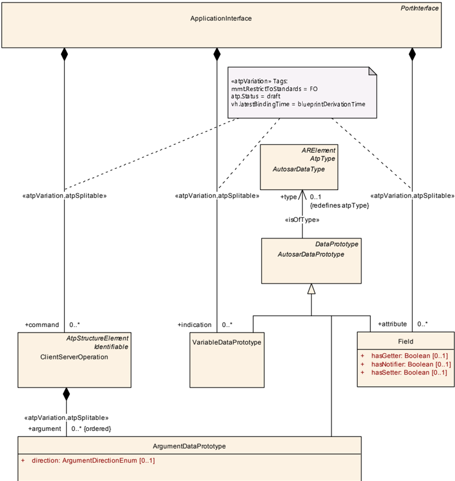

表3.6：PortInterface

| 属性 | 值 |
| --- | --- |
| 类 | PortInterface（抽象） |
| 包 | M2::AUTOSARTemplates::SWComponentTemplate::PortInterface |
| 备注 | 由软件组件端口所提供或所需的接口的抽象基类。 |
| 基类 | ARElement、ARObject、AtpBlueprint、AtpBlueprintable、AtpClassifier、AtpType、CollectableElement、Identifiable、MultilanguageReferrable、PackageableElement、Referrable |
| 子类 | ApplicationInterface、ClientServerInterface、DataInterface、ModeSwitchInterface、TriggerInterface |
| 聚合自 | ARPackage.element |

| 属性 | 类型 | 多重性 | 种类 | 备注 |
| --- | --- | --- | --- | --- |
| - | - | - | - | - |

表3.7：ApplicationInterface

| 属性 | 值 |
| --- | --- |
| 类 | ApplicationInterface |
| 包 | M2::AUTOSARTemplates::AbstractPlatform |
| 备注 | 这表示定义由命令（方法调用）、指示（事件）和属性（字段）组成的 `PortInterface` 的能力。标记：atp.Status=draft；atp.recommendedPackage=Interfaces |
| 基类 | ARElement、ARObject、AtpBlueprint、AtpBlueprintable、AtpClassifier、AtpType、CollectableElement、Identifiable、MultilanguageReferrable、PackageableElement、PortInterface、Referrable |
| 聚合自 | ARPackage.element |

| 属性 | 类型 | 多重性 | 种类 | 备注 |
| --- | --- | --- | --- | --- |
| attribute | Field | * | aggr | 这表示在抽象平台 `ApplicationInterface` 上下文中定义的一组属性。构造型：atpSplitable；atpVariation。标记：atp.Splitkey=attribute.shortName, attribute.variationPoint.shortLabel；atp.Status=draft；vh.latestBindingTime=blueprintDerivationTime |
| command | ClientServerOperation | * | aggr | 这表示在 `ApplicationInterface` 上下文中定义的命令或函数调用（带有可选数据参数）的集合。构造型：atpSplitable；atpVariation。标记：atp.Splitkey=command.shortName, command.variationPoint.shortLabel；atp.Status=draft；vh.latestBindingTime=blueprintDerivationTime |
| indication | VariableDataPrototype | * | aggr | 这表示在 `ApplicationInterface` 上下文中定义的指示或事件（带有可选数据参数）的集合。构造型：atpSplitable；atpVariation。标记：atp.Splitkey=indication.shortName, indication.variationPoint.shortLabel；atp.Status=draft；vh.latestBindingTime=blueprintDerivationTime |

表3.8：ClientServerOperation

| 属性 | 值 |
| --- | --- |
| 类 | ClientServerOperation |
| 包 | M2::AUTOSARTemplates::SWComponentTemplate::PortInterface |
| 备注 | 在当前接口范围内声明的远程过程调用。 |
| 基类 | ARObject、AtpClassifier、AtpFeature、AtpStructureElement、Identifiable、MultilanguageReferrable、Referrable |
| 聚合自 | ApplicationInterface.command、AtpClassifier.atpFeature、ClientServerInterface.operation、DiagnosticDataElementInterface.read、DiagnosticDataIdentifierInterface.read、DiagnosticDataIdentifierInterface.write、DiagnosticRoutineInterface.requestResult、DiagnosticRoutineInterface.start、DiagnosticRoutineInterface.stop、PhmRecoveryActionInterface.recovery、ServiceInterface.method |

| 属性 | 类型 | 多重性 | 种类 | 备注 |
| --- | --- | --- | --- | --- |
| argument (ordered) | ArgumentDataPrototype | * | aggr | 该 `ClientServerOperation` 的一个参数。构造型：atpSplitable；atpVariation。标记：atp.Splitkey=argument.shortName, argument.variationPoint.shortLabel；vh.latestBindingTime=blueprintDerivationTime |

表3.9：VariableDataPrototype

| 属性 | 值 |
| --- | --- |
| 类 | VariableDataPrototype |
| 包 | M2::AUTOSARTemplates::SWComponentTemplate::Datatype::DataPrototypes |
| 备注 | `VariableDataPrototype` 表示一段形式化的通用信息，通常可由应用软件层修改。`VariableDataPrototype` 用于各种上下文，具体上下文赋予这一原本通用的 `VariableDataPrototype` 特定的语义。 |
| 基类 | ARObject、AtpFeature、AtpPrototype、AutosarDataPrototype、DataPrototype、Identifiable、MultilanguageReferrable、Referrable |
| 聚合自 | ApplicationInterface.indication、AtpClassifier.atpFeature、BswInternalBehavior.arTypedPerInstanceMemory、BswModuleDescription.providedData、BswModuleDescription.requiredData、BulkNvDataDescriptor.bulkNvBlock、InternalBehavior.staticMemory、NvBlockDescriptor.ramBlock、NvDataInterface.nvData、SenderReceiverInterface.dataElement、ServiceInterface.event、SwcInternalBehavior.arTypedPerInstanceMemory、SwcInternalBehavior.explicitInterRunnableVariable、SwcInternalBehavior.implicitInterRunnableVariable |

| 属性 | 类型 | 多重性 | 种类 | 备注 |
| --- | --- | --- | --- | --- |
| initValue | ValueSpecification | 0..1 | aggr | 规定 `VariableDataPrototype` 的初始值。 |

表3.10：ArgumentDataPrototype

| 属性 | 值 |
| --- | --- |
| 类 | ArgumentDataPrototype |
| 包 | M2::AUTOSARTemplates::SWComponentTemplate::PortInterface |
| 备注 | 操作的参数，很像数据元素，但也携带方向信息，并由特定的 `ClientServerOperation` 拥有。 |
| 基类 | ARObject、AtpFeature、AtpPrototype、AutosarDataPrototype、DataPrototype、Identifiable、MultilanguageReferrable、Referrable |
| 聚合自 | AtpClassifier.atpFeature、ClientServerOperation.argument |

| 属性 | 类型 | 多重性 | 种类 | 备注 |
| --- | --- | --- | --- | --- |
| direction | ArgumentDirectionEnum | 0..1 | attr | 该属性规定参数原型的方向。 |

### 3.5. 数据类型

#### 3.5.1. 概述

**XP** 部分沿用 [\[5\]](#ref-5) 的 “Data Description” 章中定义的 **AUTOSAR** 数据类型模型与原则。参照 `TPS_SWCT_01229` 以及 “Abstraction Levels for Describing Data” 表，应只使用应用数据层（Application Data Level）。

**XP** 关注高层数据类型以及数据类型的属性（例如数据类型的物理含义）的建模。**XP** 数据类型不涉及实现或平台层的数据类型；预期这些内容完全属于具体平台的领域。

**抽象平台中允许的数据类型**：抽象平台允许通过以下形式推迟数据类型化或显式数据类型化：

- 以 `ApplicationDataType.category = VALUE` 形式的整数。
- 以 `ApplicationDataType.category = STRUCTURE` 形式的结构。
- 以 `ApplicationDataType.category = ARRAY` 形式的数组。
- 以 `ApplicationDataType.category = STRING` 形式的字符串。
- 以 `ApplicationDataType.category = BOOLEAN` 形式的布尔值。

**实现层数据类型的排除**：抽象平台不支持对 `ImplementationDataType` 建模。

#### 3.5.2. 数据定义的属性

来自 [\[5\]](#ref-5) 的 “Data Description::Properties of Data Definitions” 章的数据定义属性在 **XP** 中同样适用。然而，由于所支持的 `ApplicationDataType` 的 `category` 子集减少（见 [3.5.3](#353-数据类型类别)），`SwDataDefProps` 属性的列表也相应地受到约束。

`constr_6812` 中定义的这些属性的语义含义在 [\[5\]](#ref-5) 的 “Data Description::Elements used in Properties of Data Definitions” 章中规定。

**约束：适用于 ApplicationDataType 且为抽象平台独有的 SwDataDefProps**：

| SwDataDefProps 的属性 | ApplicationDataType | ApplicationDeferredDataType | ApplicationRecordElement | ApplicationArrayElement | VALUE | STRUCTURE | ARRAY | STRING | BOOLEAN |
| --- | --- | --- | --- | --- | --- | --- | --- | --- | --- |
| annotation | x | x | x | x | * | * | * | * | * |
| compuMethod | x | | | | 0..1 | | | | 0..1 |
| dataConstr.dataConstrRule.physConstrs | x | | x | x | 0..1 | | 0..1 | | 0..1 |
| dataConstr.dataConstrRule.internalConstrs | x | | x | x | d/c2 | | d/c | | d/c |
| displayFormat | x | | x | x | 0..1 | | 0..1 | 0..1 | 0..1 |
| invalidValue | x | | | | 0..1 | | | 0..1 | 0..1 |
| swTextProps | x | | | | | | | 1 | |
| unit | x | | | | 0..1 | | | 0..1 | 0..1 |
| **根元素之下的其他属性** | | | | | | | | | |
| element：ApplicationRecordElement | x | | x | x | | 1..* | | | |
| element：ApplicationArrayElement | x | | x | x | | | 1 | | |
| ApplicationArrayElement.arraySizeSemantics | x | | | | | | 0..1 | | |
| ApplicationArrayElement.maxNumberOfElements | x | | | | | | 1 | | |

> 2 不关心（don't care）。

表3.11：SwDataDefProps

| 属性 | 值 |
| --- | --- |
| 类 | <<atpVariation>> SwDataDefProps |
| 包 | M2::MSR::DataDictionary::DataDefProperties |
| 备注 | 该类是在各种方面与数据对象相关的属性的集合。可以把该类视为一种“通过聚合实现继承”的模式。这些属性可应用于聚合了 `SwDataDefProps` 的类的所有对象。标记：vh.latestBindingTime=codeGenerationTime |
| 基类 | ARObject |
| 聚合自 | AutosarDataType.swDataDefProps、CompositeNetworkRepresentation.networkRepresentation、DataPrototype.swDataDefProps、DataPrototypeTransformationProps.networkRepresentationProps、DiagnosticDataElement.swDataDefProps、DiagnosticEnvDataElementCondition.swDataDefProps、DltArgument.networkRepresentation、FlatInstanceDescriptor.swDataDefProps、ImplementationDataTypeElement.swDataDefProps、InstantiationDataDefProps.swDataDefProps、ISignal.networkRepresentationProps、McDataInstance.resultingProperties、ParameterAccess.swDataDefProps、PerInstanceMemory.swDataDefProps、ReceiverComSpec.networkRepresentation、SenderComSpec.networkRepresentation、SomeipDataPrototypeTransformationProps.networkRepresentation、SwPointerTargetProps.swDataDefProps、SwServiceArg.swDataDefProps、SwSystemconst.swDataDefProps、SystemSignal.physicalProps |

| 属性 | 类型 | 多重性 | 种类 | 备注 |
| --- | --- | --- | --- | --- |
| annotation | Annotation | * | aggr | 该聚合允许添加与当前数据对象相关的注释（例如黄色便签）。标记：xml.roleElement=true；xml.roleWrapperElement=true；xml.sequenceOffset=20；xml.typeElement=false；xml.typeWrapperElement=false |
| baseType | SwBaseType | 0..1 | ref | 与所包含的数据对象关联的基础类型。标记：xml.sequenceOffset=50 |
| compuMethod | CompuMethod | 0..1 | ref | 与该数据对象语义关联的计算方法。标记：xml.sequenceOffset=180 |
| dataConstr | DataConstr | 0..1 | ref | 该数据对象的数据约束。标记：xml.sequenceOffset=190 |
| displayFormat | DisplayFormatString | 0..1 | attr | 该属性描述数字应如何呈现，例如在文档或测量与标定系统中。标记：xml.sequenceOffset=210 |
| displayPresentation | DisplayPresentationEnum | 0..1 | attr | 该属性控制测量与标定工具中相关数据的呈现方式。 |
| invalidValue | ValueSpecification | 0..1 | aggr | 用于表达实际数据元素无效的可选值。标记：xml.sequenceOffset=255 |
| swComparisonVariable | SwVariableRefProxy | * | aggr | 在 **MCD** 过程中用于比较的变量。标记：xml.sequenceOffset=170；xml.typeElement=false |
| swHostVariable | SwVariableRefProxy | 0..1 | aggr | 包含对某个变量的引用，该变量作为位变量的宿主变量。仅适用于位对象。标记：xml.sequenceOffset=220；xml.typeElement=false |
| swTextProps | SwTextProps | 0..1 | aggr | 若该数据对象是文本对象，则为其特定属性。标记：xml.sequenceOffset=120 |
| unit | Unit | 0..1 | ref | 与该数据对象语义关联的物理单位。若未指定 `compuMethod`，则应用该属性。若同时指定了两个单位（该属性以及通过 `compuMethod` 指定的单位），则这些单位应兼容。标记：xml.sequenceOffset=350 |

#### 3.5.3. 数据类型类别

**XP** 中允许的应用数据类型的基础是 **AUTOSAR** 软件组件模板 [\[5\]](#ref-5) 的 “Data Types::Data Categories” 章中引用的那些应用数据类型——但并非 `ApplicationDataType` 的所有 `category` 都在 **XP** 中受支持。

**约束：抽象平台中数据类型的适用类别**：

| 类别 | ApplicationDataType | ApplicationDeferredDataType | ApplicationArrayDataType | ApplicationRecordDataType | ApplicationPrimitiveDataType | ApplicationRecordElement | ApplicationArrayElement | 描述 |
| --- | --- | --- | --- | --- | --- | --- | --- | --- |
| VALUE | | | | | x | x | x | 包含单个值。 |
| STRUCTURE | | | | x | | x | x | 包含一个或多个进一步的元素，这些元素可以具有不同的 `AutosarDataType`。 |
| STRING | | | | | x | x | x | 包含单个被解释为文本字符串的值（注意，它在应用域中表现为单个值）。 |
| ARRAY | | | x | | | x | x | 由相同类型的子元素组成的固定大小数组。 |
| BOOLEAN | | | | | x | x | x | 包含单个布尔（true/false）状态。 |

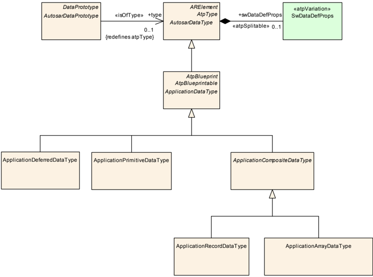

表3.12：ApplicationDataType

| 属性 | 值 |
| --- | --- |
| 类 | ApplicationDataType（抽象） |
| 包 | M2::AUTOSARTemplates::SWComponentTemplate::Datatype::Datatypes |
| 备注 | `ApplicationDataType` 从应用视角定义数据类型。特别是当涉及“物理”含义时，应使用它。`ApplicationDataType` 表示在应用模型中看到的值的集合，例如测量单位。它不考虑诸如位宽、字节序等实现细节。应当可以仅使用 `ApplicationDataType` 来建模 **VFB** 系统的应用层方面。 |
| 基类 | ARElement、ARObject、AtpBlueprint、AtpBlueprintable、AtpClassifier、AtpType、AutosarDataType、CollectableElement、Identifiable、MultilanguageReferrable、PackageableElement、Referrable |
| 子类 | ApplicationCompositeDataType、ApplicationDeferredDataType、ApplicationPrimitiveDataType |
| 聚合自 | ARPackage.element |

| 属性 | 类型 | 多重性 | 种类 | 备注 |
| --- | --- | --- | --- | --- |
| - | - | - | - | - |

表3.13：ApplicationPrimitiveDataType

| 属性 | 值 |
| --- | --- |
| 类 | ApplicationPrimitiveDataType |
| 包 | M2::AUTOSARTemplates::SWComponentTemplate::Datatype::Datatypes |
| 备注 | 原始数据类型定义一组允许的值。标记：atp.recommendedPackage=ApplicationDataTypes |
| 基类 | ARElement、ARObject、ApplicationDataType、AtpBlueprint、AtpBlueprintable、AtpClassifier、AtpType、AutosarDataType、CollectableElement、Identifiable、MultilanguageReferrable、PackageableElement、Referrable |
| 聚合自 | ARPackage.element |

| 属性 | 类型 | 多重性 | 种类 | 备注 |
| --- | --- | --- | --- | --- |
| - | - | - | - | - |

表3.14：ApplicationCompositeDataType

| 属性 | 值 |
| --- | --- |
| 类 | ApplicationCompositeDataType（抽象） |
| 包 | M2::AUTOSARTemplates::SWComponentTemplate::Datatype::Datatypes |
| 备注 | 所有由其他数据类型构成的应用数据类型的抽象基类。 |
| 基类 | ARElement、ARObject、ApplicationDataType、AtpBlueprint、AtpBlueprintable、AtpClassifier、AtpType、AutosarDataType、CollectableElement、Identifiable、MultilanguageReferrable、PackageableElement、Referrable |
| 子类 | ApplicationArrayDataType、ApplicationRecordDataType |
| 聚合自 | ARPackage.element |

| 属性 | 类型 | 多重性 | 种类 | 备注 |
| --- | --- | --- | --- | --- |
| - | - | - | - | - |

表3.15：ApplicationRecordDataType

| 属性 | 值 |
| --- | --- |
| 类 | ApplicationRecordDataType |
| 包 | M2::AUTOSARTemplates::SWComponentTemplate::Datatype::Datatypes |
| 备注 | 一种可分解为其他应用数据类型的原型的应用数据类型。标记：atp.recommendedPackage=ApplicationDataTypes |
| 基类 | ARElement、ARObject、ApplicationCompositeDataType、ApplicationDataType、AtpBlueprint、AtpBlueprintable、AtpClassifier、AtpType、AutosarDataType、CollectableElement、Identifiable、MultilanguageReferrable、PackageableElement、Referrable |
| 聚合自 | ARPackage.element |

| 属性 | 类型 | 多重性 | 种类 | 备注 |
| --- | --- | --- | --- | --- |
| element (ordered) | ApplicationRecordElement | * | aggr | 规定记录的一个元素。`ApplicationRecordElement` 的聚合受变体性约束，目的是支持 `ApplicationRecordDataType` 内元素的条件存在。构造型：atpSplitable；atpVariation。标记：atp.Splitkey=element.shortName, element.variationPoint.shortLabel；vh.latestBindingTime=preCompileTime |

表3.16：ApplicationArrayDataType

| 属性 | 值 |
| --- | --- |
| 类 | ApplicationArrayDataType |
| 包 | M2::AUTOSARTemplates::SWComponentTemplate::Datatype::Datatypes |
| 备注 | 一种数组形式的应用数据类型，每个元素具有相同的应用数据类型。标记：atp.recommendedPackage=ApplicationDataTypes |
| 基类 | ARElement、ARObject、ApplicationCompositeDataType、ApplicationDataType、AtpBlueprint、AtpBlueprintable、AtpClassifier、AtpType、AutosarDataType、CollectableElement、Identifiable、MultilanguageReferrable、PackageableElement、Referrable |
| 聚合自 | ARPackage.element |

| 属性 | 类型 | 多重性 | 种类 | 备注 |
| --- | --- | --- | --- | --- |
| dynamicArraySizeProfile | String | 0..1 | attr | 规定数组在可变大小数组情形下所遵循的配置（profile）。 |
| element | ApplicationArrayElement | 0..1 | aggr | 该关联实现数组元素的概念。也就是说，在某些情况下需要能够标识单个数组元素，例如作为插值例程的输入值。 |

#### 3.5.4. 应用数据类型

**XP** 的目标是平台无关地设计 **SWC**（应用）之间的数据交换。为了坚持保持独立于具体平台实现细节的底层目标，**XP** 中对所用数据类型的描述自然仅限于应用数据类型。

**AUTOSAR** 数据类型模型以 `AutosarDataType` 开始。元类 `AutosarDataType` 继承自 `Identifiable`，后者提供所需的标识属性：`longName`、`shortName`。随后使用 `category` 标识应用层数据类型的底层类别。

#### 3.5.5. ApplicationDataType 的子类

**XP** 支持 `constr_6810` 表中所列的子类。其中部分子类复用自 [\[5\]](#ref-5) 的 “Data Types::Application Data Type” 章，因而在那里定义。纯粹由 **XP** 定义的子类在此详述。

**ApplicationDataType 的子类**：在抽象平台中，抽象元类 `ApplicationDataType` 被划分为以下子类：

- `ApplicationDeferredDataType`

这些 **XP** 特有的子类在后续各节中详述。

##### 3.5.5.1. 推迟数据类型

由于数据类型在 **XP** 中可能尚未知悉，或应在下游阶段的设计中稍后定义，**XP** 的类型化可以推迟，前提是在派生到具体平台或映射到实现数据类型时须具体定义。

这通过 **XP** 独有的、名为 `ApplicationDeferredDataType` 的类型来完成。它连同其属性（`constr_6812`）在 **XP** 中完全可用。

**抽象平台中数据类型类别的推迟**：抽象平台提供一种非承诺性的数据类型 `ApplicationDeferredDataType`，以允许把实际数据类型推迟到稍后阶段。

**ApplicationDeferredDataType 的语义**：`ApplicationDeferredDataType` 表示一个占位符，在模型中可标识，但没有实际适用的数据类型类别。

如 [3.5.3](#353-数据类型类别) 中先前所述，**AUTOSAR** `ApplicationDataType` 被赋予来自 `constr_6810` 的 `category` 值。然而 `ApplicationDeferredDataType` 是该规则的例外，因为它尚无具体类型。

因此有必要在模型中排除任何类型 `category` 的赋值（`constr_6814`）。此外，不向 `ApplicationDeferredDataType` 赋予任何以任何方式传达具体数据类型特性的数据定义属性（`constr_6812`）。换言之，属性列表被故意严格约束，以便与具体数据类型化无关。

**约束：ApplicationDeferredDataType.category 的限制**：`ApplicationDeferredDataType` 的 `category` 应为未赋值/未定义。

表3.17：ApplicationDeferredDataType

| 属性 | 值 |
| --- | --- |
| 类 | ApplicationDeferredDataType |
| 包 | M2::AUTOSARTemplates::AbstractPlatform |
| 备注 | 一种占位数据类型，其中精确的应用数据类型推迟到稍后阶段。标记：atp.Status=draft；atp.recommendedPackage=ApplicationDataTypes |
| 基类 | ARElement、ARObject、ApplicationDataType、AtpBlueprint、AtpBlueprintable、AtpClassifier、AtpType、AutosarDataType、CollectableElement、Identifiable、MultilanguageReferrable、PackageableElement、Referrable |
| 聚合自 | ARPackage.element |

| 属性 | 类型 | 多重性 | 种类 | 备注 |
| --- | --- | --- | --- | --- |
| - | - | - | - | - |

#### 3.5.6. 类型追踪

如前所述，**XP** 不涉及 `ApplicationDataType` 层以下的数据类型。**XP** 与具体平台模型之间的数据类型追踪必须在同一层上进行——在 **AUTOSAR** 上下文中，这意味着只在 **XP** / **CP** / **AP** 中的 `ApplicationDataType` 之间追踪，如图3.7所示。

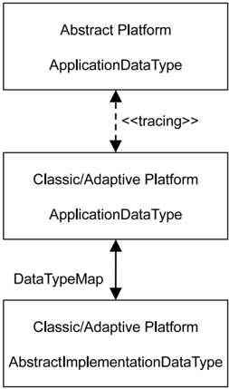

不允许在 **CP** 或 **AP** 中使用任何 **XP** `ApplicationDataType`（图3.7左侧）。不支持 **XP** `ApplicationDataType` 与 **CP** `AbstractImplementationDataType` 或 **AP** `AbstractImplementationDataType` 之间的任何间接追踪（图3.7右侧）。

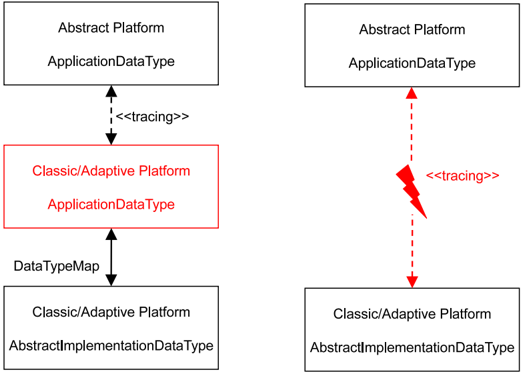

**抽象与具体平台模型之间的数据类型追踪**：抽象与具体平台模型之间的数据类型追踪仅位于 `ApplicationDataType` 层。

关于追踪的模型化示例视图，参见 [C.3](#c3-数据类型追踪) 章。本节其余部分详述在追踪（派生/抽象）**XP** 特有的 `ApplicationDataType` 子类（按此处的小节顺序列出）时应考虑的各个方面。

##### 3.5.6.1. 推迟数据类型

由于 `ApplicationDeferredDataType` 本质上是一种占位类型，且不包含具体数据类型属性，在抽象平台与具体平台之间追踪该类型是直接的。

**ApplicationDeferredDataType 的兼容性**：在追踪期间，`ApplicationDeferredDataType` 不提供任何必要类型化的方面，而具体平台类型提供所有这些方面。

**ApplicationDeferredDataType 的具体数据类型解析**：`ApplicationDeferredDataType` 的精确数据类型化不要求在以下步骤之前，或最迟在以下过程中完成：

- 把 **XP** 上下文中定义的 `ApplicationDataType` 派生为 **CP** 或 **AP** 上下文中定义的相应 `ApplicationDataType`。
- 把 **XP** 上下文中定义的 `ApplicationDataType` 派生为非 **AUTOSAR** 平台中相应的领域特定表示。

**ApplicationDeferredDataType 的可追溯性**：如果具体平台是：

- 一个 **AUTOSAR** 平台：`ApplicationDeferredDataType` 可以追踪到具体平台上任何受支持的 `ApplicationDataType`。
- 一个非 **AUTOSAR** 平台：追踪是领域特定的。

## 4. 需求

### 4.1. 概述

**AUTOSAR** 元模型已在 **AUTOSAR** 标准化模板 [\[1\]](#ref-1)（`TPS_STDT_00060`）中为需求主题提供了充分的一组元类。对于 **XP** 中的需求工程（标注、文档化、合理化、可追溯性），可以直接应用它们。

**XP** 允许在 **XP** 系统描述的上下文中执行需求工程。可以添加一个顶层需求，它可以递归地分解（decompose）为 N 个层级的子需求，并标注到 **XP** 描述上。

设计者可自行决定如何以及何时执行该步骤，并决定当前分解层级何时足够。在具体平台实现阶段，开发者随后会按照需求进行实现。对于需求是什么、以及需求的分解数量都没有限制。元类 `StructuredReq` 可以直接复用于需求规格说明。

**抽象平台中的需求标注**：抽象平台描述支持递归深度的需求标注与分解。

关于 **AUTOSAR** 对各种可追溯性支持的详细描述，参见 [\[4\]](#ref-4) 的 “Documentation Support” 章。

## A. 参考资料

### A.1. 术语和缩略语

术语和缩略语的主列表在 [\[7\]](#ref-7) 中定义。以下列出本文档范围内使用、但尚未在 [\[7\]](#ref-7) 中定义的术语和缩略语，以及每个缩略语的拼写含义。

**ASD**
> 抽象平台系统描述（**Abstract Platform System Description**）

**RSI**
> REST 服务接口（**REST Services Interface**）

**SYSML**
> 系统建模语言（**Systems Modelling Language**）

**VFB++**
> 抽象平台 VFB（**Abstract Platform VFB**）

**VIWI**
> 大众信息娱乐 Web 接口（**Volkswagen Infotainment Web Interface**）

**XSC**
> 抽象软件组件（**Abstract Software Component**）

## B. 提及的类表

为完整起见，本章包含一组类表，表示在本文档上下文中提及、但并非直接处于描述具体元模型语义范围内的元类。

表B.1：AUTOSAR

| 属性 | 值 |
| --- | --- |
| 类 | AUTOSAR |
| 包 | M2::AUTOSARTemplates::AutosarTopLevelStructure |
| 备注 | **AUTOSAR** 描述的根元素，也是对应 XML 文档中的根元素。标记：xml.globalElement=true |
| 基类 | ARObject |

| 属性 | 类型 | 多重性 | 种类 | 备注 |
| --- | --- | --- | --- | --- |
| adminData | AdminData | 0..1 | aggr | 这表示 Autosar 文件的管理数据。构造型：atpSplitable。标记：atp.Splitkey=adminData；xml.sequenceOffset=10 |
| arPackage | ARPackage | * | aggr | 这是 **AUTOSAR** 模型中的顶层包。构造型：atpSplitable；atpVariation。标记：atp.Splitkey=arPackage.shortName, arPackage.variationPoint.shortLabel；vh.latestBindingTime=blueprintDerivationTime；xml.sequenceOffset=30 |
| fileInfoComment | FileInfoComment | 0..1 | aggr | 这表示一种在 Autosar 文件中提供结构化注释的可能性。构造型：atpStructuredComment。标记：xml.roleElement=true；xml.sequenceOffset=-10；xml.typeElement=false |
| introduction | DocumentationBlock | 0..1 | aggr | 这表示 Autosar 文件上的引言。其用途例如表示免责声明与法律说明。标记：xml.sequenceOffset=20 |

表B.2：AbstractImplementationDataType

| 属性 | 值 |
| --- | --- |
| 类 | AbstractImplementationDataType（抽象） |
| 包 | M2::AUTOSARTemplates::CommonStructure::ImplementationDataTypes |
| 备注 | 该元类表示 `ImplementationDataType` 不同形态的抽象基类。 |
| 基类 | ARElement、ARObject、AtpBlueprint、AtpBlueprintable、AtpClassifier、AtpType、AutosarDataType、CollectableElement、Identifiable、MultilanguageReferrable、PackageableElement、Referrable |
| 子类 | ImplementationDataType |
| 聚合自 | ARPackage.element |

| 属性 | 类型 | 多重性 | 种类 | 备注 |
| --- | --- | --- | --- | --- |
| - | - | - | - | - |

表B.3：ApplicationArrayElement

| 属性 | 值 |
| --- | --- |
| 类 | ApplicationArrayElement |
| 包 | M2::AUTOSARTemplates::SWComponentTemplate::Datatype::DataPrototypes |
| 备注 | 描述应用数组数据类型的元素属性。 |
| 基类 | ARObject、ApplicationCompositeElementDataPrototype、AtpFeature、AtpPrototype、DataPrototype、Identifiable、MultilanguageReferrable、Referrable |
| 聚合自 | ApplicationArrayDataType.element、AtpClassifier.atpFeature |

| 属性 | 类型 | 多重性 | 种类 | 备注 |
| --- | --- | --- | --- | --- |
| arraySizeHandling | ArraySizeHandlingEnum | 0..1 | attr | 数组大小的处理方式。 |
| arraySizeSemantics | ArraySizeSemanticsEnum | 0..1 | attr | 该属性控制应如何解释数组大小的信息。 |
| indexDataType | ApplicationPrimitiveDataType | 0..1 | ref | 该引用可用于为数组分配类别为 TEXTTABLE 的 `CompuMethod`。文本表条目把文本值与索引号关联，使得具有该索引号的元素由符号名表示。 |
| maxNumberOfElements | PositiveInteger | 0..1 | attr | 数组可包含元素的最大数量。构造型：atpVariation。标记：vh.latestBindingTime=preCompileTime |

表B.4：ApplicationRecordElement

| 属性 | 值 |
| --- | --- |
| 类 | ApplicationRecordElement |
| 包 | M2::AUTOSARTemplates::SWComponentTemplate::Datatype::DataPrototypes |
| 备注 | 描述应用记录数据类型中某个特定元素的属性。 |
| 基类 | ARObject、ApplicationCompositeElementDataPrototype、AtpFeature、AtpPrototype、DataPrototype、Identifiable、MultilanguageReferrable、Referrable |
| 聚合自 | ApplicationRecordDataType.element、AtpClassifier.atpFeature |

| 属性 | 类型 | 多重性 | 种类 | 备注 |
| --- | --- | --- | --- | --- |
| isOptional | Boolean | 0..1 | attr | 该属性表示把所属 `ApplicationRecordElement` 声明为可选的能力。这意味着在运行时，该 `ApplicationRecordElement` 可能有也可能没有有效值，因此应被忽略。底层运行时软件提供手段，在通信的发送端把 `ApplicationRecordElement` 设为无效，并在接收端确定其有效性。 |

表B.5：AtomicSwComponentType

| 属性 | 值 |
| --- | --- |
| 类 | AtomicSwComponentType（抽象） |
| 包 | M2::AUTOSARTemplates::SWComponentTemplate::Components |
| 备注 | 原子软件组件的原子性，是指它无法进一步分解并分布到多个 **ECU** 上。 |
| 基类 | ARElement、ARObject、AtpBlueprint、AtpBlueprintable、AtpClassifier、AtpType、CollectableElement、Identifiable、MultilanguageReferrable、PackageableElement、Referrable、SwComponentType |
| 子类 | ApplicationSwComponentType、ComplexDeviceDriverSwComponentType、EcuAbstractionSwComponentType、SensorActuatorSwComponentType、ServiceProxySwComponentType、ServiceSwComponentType |
| 聚合自 | ARPackage.element |

| 属性 | 类型 | 多重性 | 种类 | 备注 |
| --- | --- | --- | --- | --- |
| internalBehavior | SwcInternalBehavior | 0..1 | aggr | `AtomicSwComponentType` 拥有的 `SwcInternalBehavior` 可以位于不同的物理文件中。因此该聚合为 `<<atpSplitable>>`。构造型：atpSplitable；atpVariation。标记：atp.Splitkey=internalBehavior.shortName, internalBehavior.variationPoint.shortLabel；vh.latestBindingTime=preCompileTime |
| symbolProps | SymbolProps | 0..1 | aggr | 这表示 `AtomicSwComponentType` 的 `SymbolProps`。构造型：atpSplitable。标记：atp.Splitkey=symbolProps.shortName |

表B.6：AutosarDataType

| 属性 | 值 |
| --- | --- |
| 类 | AutosarDataType（抽象） |
| 包 | M2::AUTOSARTemplates::SWComponentTemplate::Datatype::Datatypes |
| 备注 | 用户定义的、用于软件的 **AUTOSAR** 数据类型的抽象基类。 |
| 基类 | ARElement、ARObject、AtpClassifier、AtpType、CollectableElement、Identifiable、MultilanguageReferrable、PackageableElement、Referrable |
| 子类 | AbstractImplementationDataType、ApplicationDataType |
| 聚合自 | ARPackage.element |

| 属性 | 类型 | 多重性 | 种类 | 备注 |
| --- | --- | --- | --- | --- |
| swDataDefProps | SwDataDefProps | 0..1 | aggr | 该 `AutosarDataType` 的属性。构造型：atpSplitable。标记：atp.Splitkey=swDataDefProps |

表B.7：DataConstr

| 属性 | 值 |
| --- | --- |
| 类 | DataConstr |
| 包 | M2::MSR::AsamHdo::Constraints::GlobalConstraints |
| 备注 | 该元类表示对数据规定约束的能力。标记：atp.recommendedPackage=DataConstrs |
| 基类 | ARElement、ARObject、AtpBlueprint、AtpBlueprintable、CollectableElement、Identifiable、MultilanguageReferrable、PackageableElement、Referrable |
| 聚合自 | ARPackage.element |

| 属性 | 类型 | 多重性 | 种类 | 备注 |
| --- | --- | --- | --- | --- |
| dataConstrRule | DataConstrRule | * | aggr | 这是数据约束中的某一条特定规则。标记：xml.roleElement=true；xml.roleWrapperElement=true；xml.sequenceOffset=30；xml.typeElement=false；xml.typeWrapperElement=false |

表B.8：DataConstrRule

| 属性 | 值 |
| --- | --- |
| 类 | DataConstrRule |
| 包 | M2::MSR::AsamHdo::Constraints::GlobalConstraints |
| 备注 | 该元类表示表达一条特定数据约束规则的能力。 |
| 基类 | ARObject |
| 聚合自 | DataConstr.dataConstrRule |

| 属性 | 类型 | 多重性 | 种类 | 备注 |
| --- | --- | --- | --- | --- |
| constrLevel | Integer | 0..1 | attr | 该属性描述约束的类别。其功能之一位于约束违反领域：可在某个级别起使用，以产生错误消息。级别越低，检查越严格。用于区分硬限制与软限制。标记：xml.sequenceOffset=20 |
| internalConstrs | InternalConstrs | 0..1 | aggr | 描述适用于内部域（相对于物理域）的限制。标记：xml.sequenceOffset=40 |
| physConstrs | PhysConstrs | 0..1 | aggr | 描述适用于物理域（相对于内部域）的限制。标记：xml.sequenceOffset=30 |

表B.9：Field

| 属性 | 值 |
| --- | --- |
| 类 | Field |
| 包 | M2::AUTOSARTemplates::AdaptivePlatform::ApplicationDesign::PortInterface |
| 备注 | 该元类表示定义一段可通过读和/或写语义访问的数据的能力。当数据值发生变化时，也可以产生通知。 |
| 基类 | ARObject、AtpFeature、AtpPrototype、AutosarDataPrototype、DataPrototype、Identifiable、MultilanguageReferrable、Referrable |
| 聚合自 | ApplicationInterface.attribute、AtpClassifier.atpFeature、ServiceInterface.field |

| 属性 | 类型 | 多重性 | 种类 | 备注 |
| --- | --- | --- | --- | --- |
| hasGetter | Boolean | 0..1 | attr | 该属性控制是否为该字段预留读访问。 |
| hasNotifier | Boolean | 0..1 | attr | 该属性控制是否为该字段预留通知语义。 |
| hasSetter | Boolean | 0..1 | attr | 该属性控制是否为该字段预留写访问。 |

表B.10：Identifiable

| 属性 | 值 |
| --- | --- |
| 类 | Identifiable（抽象） |
| 包 | M2::AUTOSARTemplates::GenericStructure::GeneralTemplateClasses::Identifiable |
| 备注 | 该类的实例可以通过其标识符（在命名空间边界内）被引用。此外，`Identifiable` 是对 **AUTOSAR** 描述的整体结构有重要贡献的对象。特别是，`Identifiable` 可以包含 `Identifiable`。 |
| 基类 | ARObject、MultilanguageReferrable、Referrable |
| 子类 | ARPackage、AbstractDoIpLogicAddressProps、AbstractEvent、AbstractImplementationDataTypeElement、AbstractSecurityEventFilter、AbstractSecurityIdsmInstanceFilter、AbstractServiceInstance、ApplicationEndpoint、ApplicationError、AppliedStandard、ArtifactChecksum、AtpBlueprint、AtpBlueprintable、AtpClassifier、AtpFeature、AutosarOperationArgumentInstance、AutosarVariableInstance、BlockState、BuildActionEntity、BuildActionEnvironment、Chapter、ClassContentConditional、ClientIdDefinition、ClientServerOperation、Code、CollectableElement、ComManagementMapping、CommConnectorPort、CommunicationConnector、CommunicationController、Compiler、ConsistencyNeeds、ConsumedEventGroup、CouplingPort、CouplingPortStructuralElement、CryptoKeySlot、CryptoServiceMapping、DataPrototypeGroup、DataTransformation、DdsCpDomain、DdsCpPartition、DdsCpQosProfile、DdsCpTopic、DependencyOnArtifact、DiagEventDebounceAlgorithm、DiagnosticAuthTransmitCertificateEvaluation、DiagnosticConnectedIndicator、DiagnosticDataElement、DiagnosticDebounceAlgorithmProps、DiagnosticFunctionInhibitSource、DiagnosticParameterElement、DiagnosticRoutineSubfunction、DltApplication、DltArgument、DltMessage、DoIpInterface、DoIpLogicAddress、DoIpRoutingActivation、EndToEndProtection、EthernetWakeupSleepOnDatalineConfig、EventHandler、ExclusiveArea、ExecutableEntity、ExecutionTime、FMAttributeDef、FMFeatureMapAssertion、FMFeatureMapCondition、FMFeatureMapElement、FMFeatureRelation、FMFeatureRestriction、FMFeatureSelection、FlexrayArTpNode、FlexrayTpPduPool、FrameTriggering、GeneralParameter、GlobalTimeGateway、GlobalTimeMaster、GlobalTimeSlave、HeapUsage、HwAttributeDef、HwAttributeLiteralDef、HwPin、HwPinGroup、IEEE1722TpAcfBus、IEEE1722TpAcfBusPart、IPSecRule、IPv6ExtHeaderFilterList、ISignalToIPduMapping、ISignalTriggering、IdentCaption、ImpositionTime、InternalTriggeringPoint、Keyword、LifeCycleState、Linker、MacMulticastGroup、MacSecKayParticipant、McDataInstance、MemorySection、ModeDeclaration、ModeDeclarationMapping、ModeSwitchPoint、NetworkEndpoint、NmCluster、NmNode、PackageableElement、ParameterAccess、PduActivationRoutingGroup、PduToFrameMapping、PduTriggering、PerInstanceMemory、PhysicalChannel、PortGroup、PortInterfaceMapping、PossibleErrorReaction、ResourceConsumption、RootSwCompositionPrototype、RptComponent、RptContainer、RptExecutableEntity、RptExecutableEntityEvent、RptExecutionContext、RptProfile、RptServicePoint、RunnableEntityGroup、SdgAttribute、SdgClass、SecureCommunicationAuthenticationProps、SecureCommunicationFreshnessProps、SecurityEventContextProps、ServiceNeeds、SignalServiceTranslationEventProps、SignalServiceTranslationProps、SocketAddress、SomeipTpChannel、SpecElementReference、StackUsage、StaticSocketConnection、StructuredReq、SwGenericAxisParamType、SwServiceArg、SwcServiceDependency、SystemMapping、TimeBaseResource、TimingClock、TimingClockSyncAccuracy、TimingCondition、TimingConstraint、TimingDescription、TimingExtensionResource、TimingModeInstance、Topic1、TpAddress、TraceableTable、TraceableText、TracedFailure、TransformationProps、TransformationTechnology、Trigger、VariableAccess |

| 属性 | 类型 | 多重性 | 种类 | 备注 |
| --- | --- | --- | --- | --- |
| adminData | AdminData | 0..1 | aggr | 这表示该 `Identifiable` 对象的管理数据。构造型：atpSplitable。标记：atp.Splitkey=adminData；xml.sequenceOffset=-40 |
| annotation | Annotation | * | aggr | 在定义模型元素（例如 **ECU** 配置参数值）时提供附加注释的可能性。这些注释并非作为文档，而只是设计备注。标记：xml.sequenceOffset=-25 |
| category | CategoryString | 0..1 | attr | 类别是一个关键字，用于特化 `Identifiable` 的语义。它影响属性的预期存在性以及约束的适用性。标记：xml.sequenceOffset=-50 |
| desc | MultiLanguageOverviewParagraph | 0..1 | aggr | 这表示对对象大致是什么的一般但简短的（一段）描述。它只有一段！`desc` 供收集到总览表中。该属性帮助人类读者识别该对象。更详细的文档（特别是对象如何构建或使用）应放入 “introduction”。标记：xml.sequenceOffset=-60 |
| introduction | DocumentationBlock | 0..1 | aggr | 这表示关于对象如何构建或使用的更多信息。因此它是一个 `DocumentationBlock`。标记：xml.sequenceOffset=-30 |
| uuid | String | 0..1 | attr | 该属性的目的是为元类实例提供全局唯一标识符。该属性的值应是以前缀为标识符类型的全局唯一字符串。例如，要包含由 The Open Group 定义的 DCE UUID，该 UUID 将带有 “DCE:” 前缀。该属性的值可用于支持不同 **AUTOSAR** 模型的合并。UUID（通用唯一标识符）的形式取自 The Open Group（原 Open Software Foundation）定义的标准。该标准被广泛使用，包括 Microsoft 的 COM（GUID）以及许多公司的 DCE（基于 **CORBA**）。生成这些 128 位 ID 的方法已在该标准中发布，其有效性与唯一性在实践中并无争议。若省略 id 命名空间，则假定为 DCE。示例为 “DCE:2fac1234-31f8-11b4-a222-08002b34c003”。`uuid` 属性对 **AUTOSAR** 模型没有语义含义，也不要求 **AUTOSAR** 工具管理时间戳。标记：xml.attribute=true |

表B.11：ImplementationDataType

| 属性 | 值 |
| --- | --- |
| 类 | ImplementationDataType |
| 包 | M2::AUTOSARTemplates::CommonStructure::ImplementationDataTypes |
| 备注 | 描述实现层上可复用的数据类型。这通常对应于 C 代码中的 typedef。标记：atp.recommendedPackage=ImplementationDataTypes |
| 基类 | ARElement、ARObject、AbstractImplementationDataType、AtpBlueprint、AtpBlueprintable、AtpClassifier、AtpType、AutosarDataType、CollectableElement、Identifiable、MultilanguageReferrable、PackageableElement、Referrable |
| 聚合自 | ARPackage.element |

| 属性 | 类型 | 多重性 | 种类 | 备注 |
| --- | --- | --- | --- | --- |
| dynamicArraySizeProfile | String | 0..1 | attr | 规定该数据类型为可变大小数组时所遵循的配置（profile）。 |
| isStructWithOptionalElement | Boolean | 0..1 | attr | 该属性仅在 `category` 属性设为 STRUCTURE 时有效。若设为 true，该属性表明创建 `ImplementationDataType` 时意图把该结构的至少一个元素定义为可选。 |
| subElement (ordered) | ImplementationDataTypeElement | * | aggr | 规定数组、结构或联合数据类型的元素。`ImplementationDataTypeElement` 的聚合受变体性约束，目的是支持表示结构的 `ImplementationDataType` 内元素的条件存在。构造型：atpSplitable；atpVariation。标记：atp.Splitkey=subElement.shortName, subElement.variationPoint.shortLabel；vh.latestBindingTime=preCompileTime |
| symbolProps | SymbolProps | 0..1 | aggr | 这表示 `ImplementationDataType` 的 `SymbolProps`。构造型：atpSplitable。标记：atp.Splitkey=symbolProps.shortName |
| typeEmitter | NameToken | 0..1 | attr | 该属性用于控制 **AUTOSAR** 工具链的哪一部分应触发数据类型定义。 |

表B.12：MultilanguageReferrable

| 属性 | 值 |
| --- | --- |
| 类 | MultilanguageReferrable（抽象） |
| 包 | M2::AUTOSARTemplates::GenericStructure::GeneralTemplateClasses::Identifiable |
| 备注 | 该类的实例可以通过其标识符（同时遵循命名空间边界）被引用。它们也可能具有 `longName`。但它们不被视为对 **AUTOSAR** 描述的整体结构有重大贡献。特别是它不包含其他 `Referrable`。 |
| 基类 | ARObject、Referrable |
| 子类 | Caption、DefItem、DocumentationContext、Identifiable、SdgCaption、TraceReferrable、Traceable |

| 属性 | 类型 | 多重性 | 种类 | 备注 |
| --- | --- | --- | --- | --- |
| longName | MultilanguageLongName | 0..1 | aggr | 这规定对象的长名称。长名称面向人类读者，作用类似标题。 |

表B.13：PortPrototype

| 属性 | 值 |
| --- | --- |
| 类 | PortPrototype（抽象） |
| 包 | M2::AUTOSARTemplates::SWComponentTemplate::Components |
| 备注 | **AUTOSAR** 软件组件端口的基类。`PortPrototype` 的聚合受变体性约束，目的是支持条件存在。 |
| 基类 | ARObject、AtpBlueprintable、AtpFeature、AtpPrototype、Identifiable、MultilanguageReferrable、Referrable |
| 子类 | AbstractProvidedPortPrototype、AbstractRequiredPortPrototype |
| 聚合自 | AtpClassifier.atpFeature、SwComponentType.port |

| 属性 | 类型 | 多重性 | 种类 | 备注 |
| --- | --- | --- | --- | --- |
| - | - | - | - | - |

表B.14：Referrable

| 属性 | 值 |
| --- | --- |
| 类 | Referrable（抽象） |
| 包 | M2::AUTOSARTemplates::GenericStructure::GeneralTemplateClasses::Identifiable |
| 备注 | 该类的实例可以通过其标识符（同时遵循命名空间边界）被引用。 |
| 基类 | ARObject |
| 子类 | AtpDefinition、BswDistinguishedPartition、BswModuleCallPoint、BswModuleClientServerEntry、BswVariableAccess、CouplingPortTrafficClassAssignment、DiagnosticEnvModeElement、EthernetPriorityRegeneration、ExclusiveAreaNestingOrder、HwDescriptionEntity、ImplementationProps、ModeTransition、MultilanguageReferrable、PncMappingIdent、SingleLanguageReferrable、SoConIPduIdentifier、SocketConnectionBundle、TimeSyncServerConfiguration、TpConnectionIdent |

| 属性 | 类型 | 多重性 | 种类 | 备注 |
| --- | --- | --- | --- | --- |
| shortName | Identifier | 1 | attr | 这规定对象的标识短名称。它需要在其上下文中唯一，供人类使用，但更多用于技术引用。构造型：atpIdentityContributor。标记：xml.enforceMinMultiplicity=true；xml.sequenceOffset=-100 |
| shortNameFragment | ShortNameFragment | * | aggr | 这规定 `Referrable.shortName` 如何由多个 `shortNameFragment` 组成。标记：xml.sequenceOffset=-90 |

表B.15：StructuredReq

| 属性 | 值 |
| --- | --- |
| 类 | StructuredReq |
| 包 | M2::MSR::Documentation::BlockElements::RequirementsTracing |
| 备注 | 这表示一条结构化需求。它适用于收集某个特性特定需求的情形。注意它可以渲染为带标签的列表。 |
| 基类 | ARObject、DocumentViewSelectable、Identifiable、MultilanguageReferrable、Paginateable、Referrable、Traceable |
| 聚合自 | DocumentationBlock.structuredReq |

| 属性 | 类型 | 多重性 | 种类 | 备注 |
| --- | --- | --- | --- | --- |
| appliesTo | StandardNameEnum | * | attr | 该属性表示需求被分配到的平台。标记：xml.namePlural=APPLIES-TO-DEPENDENCIES；xml.sequenceOffset=25 |
| conflicts | DocumentationBlock | 0..1 | aggr | 这表示对冲突的非形式化规定。标记：xml.sequenceOffset=40 |
| date | DateTime | 1 | attr | 这表示需求发起的时间。标记：xml.sequenceOffset=5 |
| dependencies | DocumentationBlock | 0..1 | aggr | 这表示对依赖关系的非形式化规定。注意上游追踪应在超类 `Traceable` 提供的 `trace` 属性中形式化。标记：xml.sequenceOffset=30 |
| description | DocumentationBlock | 0..1 | aggr | 这表示需求的一般描述。标记：xml.sequenceOffset=10 |
| importance | String | 1 | attr | 这允许表示需求的重要程度。标记：xml.sequenceOffset=8 |
| issuedBy | String | 1 | attr | 这表示发布需求的个人、组织或权威机构。标记：xml.sequenceOffset=6 |
| rationale | DocumentationBlock | 0..1 | aggr | 这表示需求的理由。标记：xml.sequenceOffset=20 |
| remark | DocumentationBlock | 0..1 | aggr | 这表示非形式化的备注。注意这未建模为注释，因为这些备注仍是需求必不可少的一部分。标记：xml.sequenceOffset=60 |
| supportingMaterial | DocumentationBlock | 0..1 | aggr | 这表示对支持材料的非形式化规定。标记：xml.sequenceOffset=50 |
| testedItem | Traceable | * | ref | 该关联表示在同一规范层级上追踪的能力。这例如支持验收测试。标记：xml.sequenceOffset=70 |
| type | String | 1 | attr | 该属性允许表示需求的类型，例如表示它是 “增强”、“新特性” 等。标记：xml.sequenceOffset=7 |
| useCase | DocumentationBlock | 0..1 | aggr | 这描述相关用例。注意对用例的形式化引用应在 `trace` 关系中完成。标记：xml.sequenceOffset=35 |

## C. 示例

本章包含一组反映本文档各章所述概念的示例。本章内容仅提供解释，不增加任何模型语义。

### C.1. 用于系统的示例 ARXML

C.1 中的清单说明了用于描述抽象平台的 `System` 的定义。

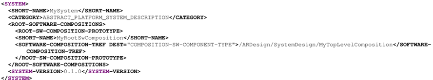

### C.2. 用于软件组件的示例 ARXML

C.2 中的清单说明了使用 `CompositionSwComponentType` 定义组件层次结构的方式。

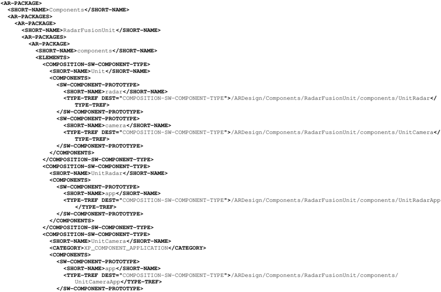

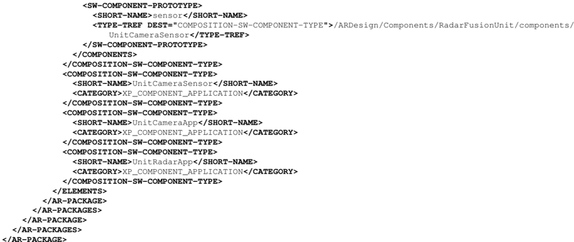

### C.3. 数据类型追踪

模型示例 C.1 说明了 **XP** 与 **CP** / **AP** 之间追踪的元模型视图。

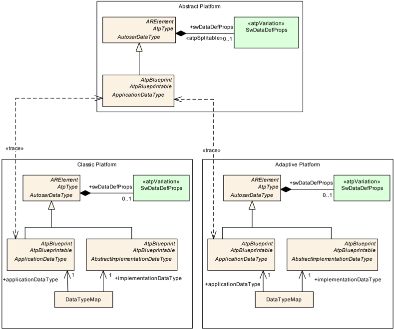

## D. 本文范围内的可拆分元素

本章包含本文范围内所有构造型为 `«atpSplitable»` 的模型元素的表格。

该表中的每个条目由具体模型元素自身的标识以及标记值 `atp.Splitkey` 的适用值组成。

关于可拆分模型元素的概念以及应如何处理它们，更多信息请参见 [\[4\]](#ref-4)。

> 注：源文档的该表格在 PDF→markdown 转换中缺失，仅保留上述说明文字。

## E. 本文范围内的变体点

本章包含本文范围内所有构造型为 `«atpVariation»` 的模型元素的表格。

该表中的每个条目由模型元素自身的标识以及标记值 `vh.latestBindingTime` 的适用值组成。

关于变体点的概念以及应如何处理包含变体点的模型元素，更多信息请参见 [\[4\]](#ref-4)。

表E.1：变体点的使用

| 变体点 | 最晚绑定时点 |
| --- | --- |
| ApplicationInterface.attribute | blueprintDerivationTime |
| ApplicationInterface.command | blueprintDerivationTime |
| ApplicationInterface.indication | blueprintDerivationTime |

## F. 变更历史

请注意，本章中的列表还包含在较晚版本中已从规范中删除的约束与规范项。这些约束与规范项不会在文档中显示为超链接。

### F.1. 本文档依据 AUTOSAR 版本 R19-11 的变更历史

#### F.1.1. R19-11 中新增的规范项

表F.1：R19-11 中新增的规范项

| 标题 |
| --- |
| 抽象平台系统描述的原则 |
| 抽象平台中车辆通信的建模 |
| 抽象平台中部署建模工件的无关性 |
| 将抽象平台工件排除到 AUTOSAR 具体平台 |
| 具有抽象平台内容的系统描述的系统类别 |
| 抽象平台中组件类型的标识 |
| 抽象平台中的递归组件定义 |
| 抽象平台中端口的原型化 |
| 抽象平台中接口的通用类型化 |
| 抽象平台中的端口分组 |
| 抽象平台接口对中间件部署的无关性 |
| 抽象平台接口中接口元素的聚合 |
| 抽象平台中连接器的建模 |
| 抽象平台中数据类型实现细节的抽象 |
| 抽象平台中允许的数据类型 |
| 抽象平台中 ApplicationDataType 类型化的类别推迟 |
| 推迟类型的具体定义 |
| 抽象平台中推迟类型的类别 |
| 抽象平台中类型映射的排除 |
| 抽象平台中的需求标注 |
| 抽象平台中的需求追踪 |
| 抽象平台中的功能追踪 |

#### F.1.2. R19-11 中变更的规范项

无

#### F.1.3. R19-11 中删除的规范项

无

#### F.1.4. R19-11 中新增的约束

表F.2：R19-11 中新增的约束

| 标题 |
| --- |
| FibexElement 与 SystemMapping 对具有抽象平台内容的系统描述的非相关性 |
| 属性 System.pncVectorLength、System.pncVectorOffset 对具有抽象平台内容的系统描述的非相关性 |
| 在具有抽象平台内容的系统描述中，类型化 RootSwCompositionPrototype 的 CompositionSwComponentType 的类别限制 |
| 在具有抽象平台内容的系统描述中，引用 SwComponentPrototype 的 CompositionSwComponentType 的类别限制 |
| 抽象平台中 CompositionSwComponentType 的 ConstantSpecificationMappingSet 与 DataTypeMappingSet 的非相关性 |
| 具有抽象平台内容的系统中 PRPortPrototype 的非相关性 |
| 具有抽象平台内容的系统描述中 PortInterface 的类别限制 |
| ApplicationInterface 对抽象平台的独占性 |
| 在 ApplicationInterface 中使用的 ClientServerOperation 的 ClientServerOperation.fireAndForget 属性的非相关性 |
| 在 ApplicationInterface 上下文中，ClientServerOperation 的 ApApplicationError 与 ApApplicationErrorSet 的非相关性 |
| 抽象平台中数据类型的适用类别 |
| ApplicationDataType.category DEFERRED 对抽象平台的独占性 |
| 适用于 ApplicationDataType 且为抽象平台独有的 SwDataDefProps |
| 抽象平台中 SwComponentType 的限制 |

#### F.1.5. R19-11 中变更的约束

无

#### F.1.6. R19-11 中删除的约束

无

### F.2. 本文档依据 AUTOSAR 版本 R20-11 的变更历史

#### F.2.1. R20-11 中新增的规范项

表F.3：R20-11 中新增的规范项

| 标题 |
| --- |
| 抽象平台中 CompositionSwComponentType 内使用的 SwComponentPrototype 的类型化 |
| 类别为 XP_COMPONENT_APPLICATION 的 CompositionSwComponentType 的语义 |
| ApplicationInterface 的语义 |
| ApplicationInterface 的元素 |
| ApplicationInterface.command 的语义 |
| ApplicationInterface.indication 的语义 |
| 类别为 XP_PORT_CTRL_SECURITY 的 ApplicationInterface 的语义 |
| 类别为 XP_PORT_CTRL_TIMESYNC 的 ApplicationInterface 的语义 |
| 类别为 XP_PORT_DATA_STORAGE 的 ApplicationInterface 的语义 |
| 类别为 XP_PORT_DATA_APPLICATION 的 ApplicationInterface 的语义 |
| 实现层数据类型的排除 |
| ApplicationDataType 的子类 |
| ApplicationDeferredDataType 的语义 |
| ApplicationDeferredDataType 的可追溯性 |
| 抽象平台中的需求标注 |
| 抽象平台模型的定位 |
| 抽象与具体平台模型之间的数据类型追踪 |
| ApplicationDeferredDataType 的兼容性 |

#### F.2.2. R20-11 中变更的规范项

表F.4：R20-11 中变更的规范项

| 标题 |
| --- |
| 抽象平台系统描述的原则 |
| 抽象平台的 VFB 层建模 |
| 部署方面的无关性 |
| 将抽象平台工件排除到 AUTOSAR 具体平台 |
| 抽象平台中组件类型的标识 |
| 抽象平台中接口的通用类型化 |
| 抽象平台中连接器的建模 |
| 应用层数据类型的使用 |
| 抽象平台中允许的数据类型 |
| 抽象平台中数据类型的类别推迟 |
| ApplicationDeferredDataType 的具体数据类型解析 |

#### F.2.3. R20-11 中删除的规范项

表F.5：R20-11 中删除的规范项

| 标题 |
| --- |
| 抽象平台接口中接口元素的聚合 |
| 抽象平台中推迟类型的类别 |
| 抽象平台中类型映射的排除 |
| 抽象平台中的需求标注 |
| 抽象平台中的需求追踪 |
| 抽象平台中的功能追踪 |

#### F.2.4. R20-11 中新增的约束

表F.6：R20-11 中新增的约束

| 标题 |
| --- |
| ApplicationDeferredDataType.category 的限制 |

#### F.2.5. R20-11 中变更的约束

表F.7：R20-11 中变更的约束

| 标题 |
| --- |
| CompositionSwComponentType.category 的标准化取值 |
| ApplicationInterface.category 的标准化取值 |

#### F.2.6. R20-11 中删除的约束

表F.8：R20-11 中删除的约束

| 标题 |
| --- |
| FibexElement 与 SystemMapping 对具有抽象平台内容的系统描述的非相关性 |
| 属性 System.pncVectorLength、System.pncVectorOffset 对具有抽象平台内容的系统描述的非相关性 |
| 在具有抽象平台内容的系统描述中，类型化 RootSwCompositionPrototype 的 CompositionSwComponentType 的类别限制 |
| 抽象平台中 CompositionSwComponentType 的 ConstantSpecificationMappingSet 与 DataTypeMappingSet 的非相关性 |
| 具有抽象平台内容的系统中 PRPortPrototype 的非相关性 |
| 在 ApplicationInterface 中使用的 ClientServerOperation 的 ClientServerOperation.fireAndForget 属性的非相关性 |
| 在 ApplicationInterface 上下文中，ClientServerOperation 的 ApApplicationError 与 ApApplicationErrorSet 的非相关性 |
| ApplicationDataType.category DEFERRED 对抽象平台的独占性 |
| 抽象平台中 SwComponentType 的限制 |

### F.3. 本文档依据 AUTOSAR 版本 R21-11 的变更历史

#### F.3.1. R21-11 中新增的规范项

表F.9：R21-11 中新增的规范项

| 标题 |
| --- |
| 类别为 XP_PORT_SAFETY 的 ApplicationInterface 的语义 |
| ApplicationInterface.attribute 的语义 |
| Field 的属性 |

#### F.3.2. R21-11 中变更的规范项

表F.10：R21-11 中变更的规范项

| 标题 |
| --- |
| ApplicationInterface 的元素 |
| 类别为 XP_PORT_SECURITY 的 ApplicationInterface 的语义 |
| 类别为 XP_PORT_TIMESYNC 的 ApplicationInterface 的语义 |
| 类别为 XP_PORT_STORAGE 的 ApplicationInterface 的语义 |
| 类别为 XP_PORT_APPLICATION 的 ApplicationInterface 的语义 |

#### F.3.3. R21-11 中删除的规范项

表F.11：R21-11 中删除的规范项

| 标题 |
| --- |
| 应用层数据类型的使用 |

#### F.3.4. R21-11 中新增的约束

无

#### F.3.5. R21-11 中变更的约束

表F.12：R21-11 中变更的约束

| 标题 |
| --- |
| ApplicationInterface.category 的标准化取值 |

#### F.3.6. R21-11 中删除的约束

无

### F.4. 本文档依据 AUTOSAR 版本 R22-11 的变更历史

#### F.4.1. R22-11 中新增的规范项

无

#### F.4.2. R22-11 中变更的规范项

无

#### F.4.3. R22-11 中删除的规范项

无

#### F.4.4. R22-11 中新增的约束

无

#### F.4.5. R22-11 中变更的约束

无

#### F.4.6. R22-11 中删除的约束

无

### F.5. 本文档依据 AUTOSAR 版本 R23-11 的变更历史

#### F.5.1. R23-11 中新增的规范项

无

#### F.5.2. R23-11 中变更的规范项

表F.13：R23-11 中变更的规范项

| 标题 |
| --- |
| 将抽象平台工件排除到 AUTOSAR 具体平台 |

#### F.5.3. R23-11 中删除的规范项

无

#### F.5.4. R23-11 中新增的约束

无

#### F.5.5. R23-11 中变更的约束

无

#### F.5.6. R23-11 中删除的约束

无
