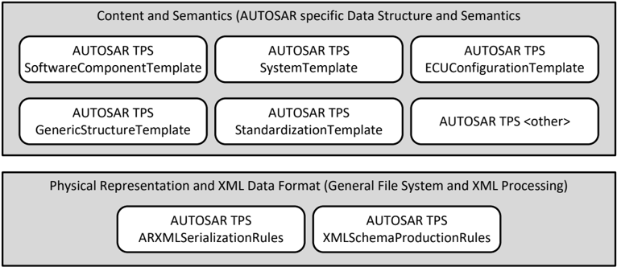
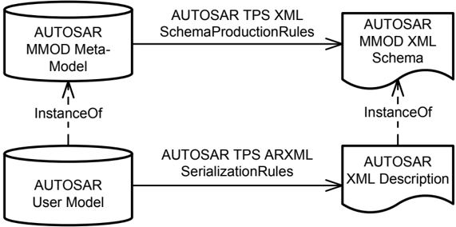

<!-- 源文档 AUTOSAR_FO_TPS_ARXMLSerializationRules（R23-11），模板规范（TPS），不受 Type A 七章骨架约束；章节结构镜像源文档自身编号（1–3 与附录 A–B）。封面表格、Disclaimer、Contents 属于文档框架信息，不译；源文档开头的 References 列表保留为文末不编号的「参考文献」注册表。规范项 [TPS_ASR_xxxxx] 按 2026-11-03 决议丢弃 ID，渲染为粗体标题条文；源文档正文中显式引用的 ID（TPS_STDT/TPS_GST/TPS_XMLSPR/TPS_ASR 互引）保留。附录 A 的 R21-11 小节（A.6，全部 none）在 markdown 转换中缺失，按 ASWS 先例从语料库 PDF（第 26–27 页）恢复。附录 A 表仅保留标题列（附录 F 决议）。「Example 2.x」渲染为粗体导语，清单（Listing）保留源编号。 -->

## 1. 引言

本文档规定 AUTOSAR 模型如何序列化为 AUTOSAR XML 描述的规则。本规范的意图是通过对 AUTOSAR XML 描述施加超出 AUTOSAR XML 模式所定义的 XML 结构的附加约束，来支持 AUTOSAR 工具之间的互操作性。其益处包括：

- 通过定义规范化表示，避免诸如缩进、字符编码等无意义的差异，从而简化 AUTOSAR XML 描述的比较。
- 通过限制 XML 不同风格的种类（例如不同的命名空间前缀、字符编码、文件名等），减少工具实现的工作量。

AUTOSAR 模板规范定义 AUTOSAR 数据交换格式。图 1.1 展示了 AUTOSAR ARXML 序列化规则（本规范）与其他模板规范之间的关系：

- AUTOSAR XML 模式生成规则 [\[1\]](#ref-1) 与本文档关注物理表示与 XML 数据格式。
- 软件组件模板 [\[2\]](#ref-2)、系统模板 [\[3\]](#ref-3)、ECU 配置模板 [\[4\]](#ref-4) 等处理数据结构及其语义。



AUTOSAR 在 AUTOSAR 元模型 [\[5\]](#ref-5) 中形式化并维护 AUTOSAR 数据交换格式的数据结构与语义。该元模型与 AUTOSAR XML 模式 [\[6\]](#ref-6) 之间的映射在 AUTOSAR XML 模式生成规则 [\[1\]](#ref-1) 中描述（见图 1.2）。

产生 AUTOSAR XML 描述的 AUTOSAR 工具必须以能针对 AUTOSAR XML 模式成功通过校验的方式序列化 AUTOSAR 模型。超出 XML 模式校验的附加约束在本文档中描述。



### 1.1. 文档约定

技术术语以等宽字体排版，例如 PortPrototype。作为一般规则，技术术语的复数形式通过在单数形式后加"s"构成，例如 PortPrototypes。以此方式，本文档类似于 AUTOSAR XML 模式中使用的术语。

本文档包含以文本形式给出的约束，它们通过唯一的数字约束 ID、一个标题以及从图元字符开始、以结束图元字符终止的约束正文与文本的其余部分区分。

这些约束的目的是字面意义上约束对 AUTOSAR 元模型的解释，使得能够检测元模型实例（即在 M1 层级）中实现的标准化行为的违规。

鼓励 AUTOSAR 工具的制造者将与 M1 建模问题对应的约束的数字 ID 作为工具发出的诊断消息的一部分加入。

本文档引入的类的属性以类表的形式列出。它们具有顶层元素 AUTOSAR 示例中所示的形式：

请注意，约束并不要求在 AUTOSAR 工作流的任何给定时间点都可强制执行。在模型的开发过程中，约束可能被合理地违反，因为不完整的模型显然会表现出不一致。

然而，在工作流的特定时点，约束应被强制执行，以作为防止错误配置的保障。

工作流中约束应被强制执行的时点（有时也称为约束的"绑定时间"）因模型类别而异：例如在经典平台上，为软件组件定义的约束通常在生成 RTE 之前强制执行，而针对 ECU 提取定义的约束应在为通信协议栈创建 Ecu 配置时应用。

每个文档都定义了约束可能的绑定时间，绑定时间通常在约束本身中提及，以便为 AUTOSAR 编写工具的实现者提供正确的方向。

以 AUTOSAR 作为一个典型类表的例子。表的前几行具有以下含义：

Class：UML 模型中定义的类名。

Package：定义该类的 UML 包。列出它只是为了帮助在整体元模型中定位该类。

Note：建模者为该类给出的注释（类注释）。类的构造型与 UML 标签也在此标注。

Base Classes：如适用，为直接基类清单。

表中的表头具有以下含义：

Attribute：类属性名。注意 AUTOSAR 不区分类属性与拥有的关联端。

Type：类属性的类型。

Mul.：属性被指派的多重性，即与该属性关联的给定数据类型的实例数量。

Kind：说明该属性是在类中聚合的（aggr 聚合）、类中的 UML 属性（attr 原始属性），还是仅被类引用（ref 引用）。实例引用也在此字段中指示（iref 实例引用）。

Note：建模者为该类属性给出的注释（角色注释）。构造型与 UML 标签也在此标注。

请注意，以字母而非数字开头的章代表文档的附录。附录的目的是支持对文档某些方面的解释，不代表标准的有约束力的约定。

[TPS_STDT_00053] 中规定的表达义务的言语形式应用于指示需求，参见标准化模板"可追溯性支持"一章（[\[7\]](#ref-7)）。

AUTOSAR 文档中需求的表示遵循 [TPS_STDT_00078] 规定的表，参见标准化模板"可追溯性支持"一章（[\[7\]](#ref-7)）。

## 2. ARXML 序列化规则（ARXML Serialization Rules）

### 2.1. 物理层级（Physical Level）

#### 2.1.1. 文件分离（File separation）

**规范项：文件分离**：一个 AUTOSAR 模型可以在若干 AUTOSAR XML 描述文件中交付。

**示例 2.1**

某些文件可以包含数据类型，其他文件可以包含接口，等等。

#### 2.1.2. 文件名（File names）

**规范项：文件扩展名：.arxml**：AUTOSAR XML 描述应使用文件扩展名".arxml"（AUTOSAR XML 的缩写）。

**规范项：文件名长度**：文件名的最大长度限制为 255 个字符。

### 2.2. 数据格式（Data Format）

为了支持用文本比较工具直接比较 AUTOSAR XML 描述，必须以可靠且标准化的方式生成 XML。

#### 2.2.1. XML 字符编码（XML Character Encoding）

**规范项：UTF-8 字符编码**：AUTOSAR XML 描述的字符编码应为 UTF-8。不允许任何其他编码。

**规范项：XML 声明中的 UTF-8 编码**：AUTOSAR XML 描述应以声明 UTF-8 编码的 XML 声明开始。

**示例 2.2**

```xml
<?xml .... encoding="UTF-8"?>
```

**规范项：避免 UTF BOM**：AUTOSAR XML 描述不应以"UTF 字节顺序掩码"（**BOM**）开始。

字节顺序掩码是一个 Unicode 字符，可用在文本流的开头，以传达以下信息：

- 该流以 Unicode 编码这一事实
- 使用了哪种 Unicode 编码（UTF-8、UTF-16 等）
- 该 Unicode 编码的字节序

按照 [TPS_ASR_00004] 与 [TPS_ASR_00005]，AUTOSAR XML 描述的字符编码应为 UTF-8，并且该信息应在 XML 声明中显式描述。

UTF-8 与字节序无关。因此，使用 BOM 不会增加额外的信息。

#### 2.2.2. XML 版本（XML Version）

**规范项：XML 版本 1.0**：AUTOSAR XML 描述应符合 XML 版本 1.0 [\[8\]](#ref-8)。不允许任何其他 XML 版本。

**规范项：XML 声明中的 XML 版本 1.0**：AUTOSAR XML 描述应以声明 XML 版本 1.0 [\[8\]](#ref-8) 的 XML 声明开始。

**示例 2.3**

```xml
<?xml version="1.0" .... ?>
```

#### 2.2.3. XML 注释与处理指令（XML Comments and Processing Instructions）

**规范项：XML 注释**：AUTOSAR XML 描述可以包含 XML 注释。

注意：XML 注释对实际的 AUTOSAR 模型没有贡献。AUTOSAR 工具可以静默忽略 XML 注释，不需要再次序列化它们。

**规范项：XML 处理指令**：AUTOSAR XML 描述可以包含 XML 处理指令。

注意：AUTOSAR 工具可以静默忽略 XML 处理指令，不需要再次序列化它们。

> 1 本规则的唯一例外是 XML 版本与 XML 字符编码的声明。按照 [TPS_ASR_00005] 与 [TPS_ASR_00008] 的要求，应支持这些处理指令。

#### 2.2.4. XML 根元素（XML Root Element）

传统上，AUTOSAR 实现了由主版本、次版本与补丁版本组成的三元素版本方案。以这种方式规定的版本在 ARXML 文件中作为 xsi:schemaLocation 定义的一部分使用，例如：

xsi:schemaLocation="http://autosar.org/schema/r4.0 AUTOSAR_4-3-0.xsd"

随着 AUTOSAR 自适应平台的出现，AUTOSAR 决定为自适应平台的发布实现一种不同的版本方案（经典平台只是保留既有的版本方案）。

自适应平台的这一新版本方案只包含两个元素：发布的年份与月份。

最初的方法是简单地将自适应发布的两元素方案同样用于包含自适应平台模型的 ARXML 文件的 xsi:schemaLocation 定义：

xsi:schemaLocation="http://autosar.org/schema/r4.0 AUTOSAR_2017-03.xsd"

随着时间的推移，这种方法将造成三元素与两元素取值在 xsi:schemaLocation 中难以理清的历史，并且很难猜测哪些 AUTOSAR XML 模式发布实际上与给定的 ARXML 文件向后兼容。

为了缓解该问题，AUTOSAR 还决定为模式发布发明一个全新的版本方案，与单个模式发布是由 AUTOSAR 经典平台还是自适应平台触发无关。

用于 xsi:schemaLocation 的新版本方案只预设一个元素的存在：一个随每次 AUTOSAR 发布递增的正数，发布关注经典平台还是自适应平台并不重要。

xsi:schemaLocation="http://autosar.org/schema/r4.0 AUTOSAR_00044.xsd"

xsi:schemaLocation 中该单元素的每个取值都可以与一个特定的 AUTOSAR 发布无歧义地关联。此外，仍然可以容易地理解给定 ARXML 文件的向后兼容状态。

该 XML 模式包含 AUTOSAR 标准的最新发布。这意味着不存在只包含 AUTOSAR 经典平台或自适应平台模型元素的专门 AUTOSAR XML 模式。

**规范项：AUTOSAR XML 命名空间**：所有 AUTOSAR XML 元素与属性的 AUTOSAR XML 命名空间为 http://autosar.org/schema/r&lt;major&gt;.&lt;minor&gt;。

只要保持向后兼容，该命名空间在 AUTOSAR XML 模式的多个发布之间保持不变。&lt;major&gt; 与 &lt;minor&gt; 是开启向后兼容的 AUTOSAR XML 模式序列的 AUTOSAR 发布的主次版本号。

**示例 2.4**

XML 命名空间 http://autosar.org/schema/r4.0 对应 AUTOSAR 发布 4.0.1 的 AUTOSAR XML 模式。后续发布（4.0.2、4.0.3、4.1.0、4.1.1、4.1.2、4.1.3、4.2.1、4.2.2、4.3.0 等）的 AUTOSAR XML 模式旨在向后兼容该发布。

**规范项：AUTOSAR XML 命名空间声明**：AUTOSAR XML 命名空间是默认命名空间。AUTOSAR 元素不得应用命名空间前缀。

**示例 2.5**

```xml
<AUTOSAR xmlns="http://autosar.org/schema/r4.0" ... >
```

而不是

```xml
<AR:AUTOSAR xmlns:AR="http://autosar.org/schema/r4.0" ... >
```

**规范项：无第三方 XML 命名空间**：AUTOSAR XML 描述中允许的唯一有效 XML 命名空间是：

- AUTOSAR XML 命名空间（http://autosar.org/schema/r&lt;major&gt;.&lt;minor&gt;）[TPS_ASR_00017] 以及
- XML 模式实例命名空间（http://www.w3.org/2001/XMLSchema-instance）

不允许任何其他第三方 XML 命名空间。

**规范项：AUTOSAR 修订版声明**：AUTOSAR XML 描述应通过映射到 [TPS_ASR_00011] 中 AUTOSAR 命名空间的模式位置提示 URI [TPS_ASR_00013]，在 xsi:schemaLocation 属性中声明作为其创建基础的 AUTOSAR 修订版。

xsi:schemaLocation 属性以及 AUTOSAR 命名空间的 AUTOSAR 模式位置提示声明是强制性的。

注意：按照 W3C XML 模式规范 [\[9\]](#ref-9) 第 4.3.2 章"模式定义在 Web 上如何定位"，属性 xsi:schemaLocation 规定成对的 URI 引用（一个用于 XML 命名空间，另一个用于提示定义该 XML 命名空间名称的模式文档的位置）。

预期校验 AUTOSAR XML 描述的工具能够在其自己的资源中标识适当的 XML 模式文档。

只要 AUTOSAR XML 模式向后兼容，该方法就允许针对较新的 AUTOSAR XML 模式校验 AUTOSAR XML 描述。

此外，只要 AUTOSAR XML 描述不使用较新的特性，工具也可以尝试针对较旧的 AUTOSAR XML 模式校验该描述。

**示例 2.6**

AUTOSAR 修订版 4.3.0 的 AUTOSAR 修订版声明示例：

```xml
<AUTOSAR ... xsi:schemaLocation="http://autosar.org/schema/r4.0 AUTOSAR_4-3-0.xsd">
</AUTOSAR>
```

**规范项：AUTOSAR XML 模式位置提示 URI 的模式**：AUTOSAR XML 描述中的 AUTOSAR XML 模式位置提示 URI 应为 AUTOSAR 提供的 XML 模式文档的文件名。该文件名遵循以下模式：

```
AUTOSAR_{number}.xsd
```

{number} 对应给定的 AUTOSAR XML 模式所属的特定 AUTOSAR 发布。

特别地，AUTOSAR XML 模式位置提示 URI 中不得包含路径。

AUTOSAR XML 根元素的示例见下方清单：

```xml
<?xml version="1.0" encoding="UTF-8"?>
<AUTOSAR xmlns:xsi="http://www.w3.org/2001/XMLSchema-instance"
         xsi:schemaLocation="{AUTOSAR XML Namespace} {Revision Hint URI}"
         xmlns="{AUTOSAR XML Namespace}">
  ...
</AUTOSAR>
```

#### 2.2.5. XML 格式化/缩进（XML Formating / Indention）

本节规定的格式化与缩进不改变 AUTOSAR 模型的语义。

其主要目的是在使用文本 diff 工具比较两个 AUTOSAR XML 描述时减少无意义的差异。XML 描述应按照 [TPS_ASR_00019] 所示格式化。

**规范项：AUTOSAR XML 描述的格式化**：

| 适用对象 | 策略 | 说明 |
|---|---|---|
| 默认方法 | NewLine：元素是独立的块 | NewLine 特别意味着：• 每层缩进应为 2 个字符 • 元素的开始标签应位于新的一行 • XML 属性应按字母顺序排序。如果有多个 XML 属性，每个属性应各占一行 • 开始标签应按照 XML 标签的嵌套层级缩进 • 结束标签应位于新的一行，并与开始标签同样缩进 • 内容应比开始标签多缩进一级 |
| 原始类型（建模为 UML 属性或原始类型的聚合） | OneLine：元素显示在一行中 | 元素应在新的一行开始。结束标签应与开始标签及元素内容位于同一行。 |
| «atpMixedString» 的属性 | InLine：元素浮动于文本之中 | 元素周围的空白不应改变。标签之前或之后不应插入换行。元素内部的空白不应改变。在下例中，元素 <E> 按照 InLine 方法格式化：<L-1 L="EN">This is <E>bold</E> style </L-1> |
| xml:space 设为 preserve 的 VerbatimString 元素 | keepWhitespace | 元素内的空白应保持原样。 |
| 无 xml:space 或设为 default 的元素 | normalizeWhitespace | 规范化空白包括：• 应移除前导与尾随空白 • 连续空白应替换为单个空格 • 不应折行 • 回车应替换为空格 • 子（行内）元素应视为一个非空白字符 |

以下示例 2.1 说明这些方法：

清单2.1：序列化示例

```xml
<UNIT>
  <SHORT-NAME>Perc</SHORT-NAME>
  <!--OneLine-->
  <DESC>
    <!--NewLine-->
    <L-2 L="EN">a percentage...</L-2>
    <!--OneLine-->
  </DESC>
  <DISPLAY-NAME>%</DISPLAY-NAME>
  <!--OneLine-->
</UNIT>
<UNIT>
  <SHORT-NAME>PercPerSec</SHORT-NAME>
  <!--OneLine-->
  <DESC>
    <!--NewLine-->
    <L-2 L="EN">time-derivative of percent</L-2>
    <!--NewLine NormalizeWhitespace-->
  </DESC>
  <DISPLAY-NAME>%/s</DISPLAY-NAME>
  <!--OneLine-->
</UNIT>
```

按照 [TPS_ASR_00016] 的有效 AUTOSAR XML 描述示例：

清单2.2：有效的层级示例

```xml
<?xml version="1.0" encoding="UTF-8"?>
<AUTOSAR xmlns="http://autosar.org/schema/r4.0"
         xmlns:xsi="http://www.w3.org/2001/XMLSchema-instance"
         xsi:schemaLocation="http://autosar.org/schema/r4.0 AUTOSAR_00052.xsd">
  <!-- .... -->
</AUTOSAR>
```

按照 [TPS_ASR_00016] 的无效 AUTOSAR XML 描述示例：

清单2.3：无效的层级示例

```xml
<?xml version="1.0" encoding="UTF-8"?>
<AUTOSAR xmlns="http://autosar.org/schema/r4.0"
         xmlns:xsi="http://www.w3.org/2001/XMLSchema-instance"
         xsi:schemaLocation="http://autosar.org/schema/r4.0 AUTOSAR_00052.xsd">
  <AR-PACKAGES>
  </AR-PACKAGES>
</AUTOSAR>
```

**规范项：以开始-结束标签对表示的空元素**：空元素应序列化为开始/结束标签，而不是"空标签"（**emptytag**）。

**示例 2.7**

一个空的 VALUE 标签应序列化为 &lt;VALUE&gt;&lt;/VALUE&gt;，而不是技术上可行的替代形式 &lt;VALUE/&gt;。

**规范项：无空包装元素**：AUTOSAR 模型中的某些属性与引用被映射为两个或更多 XML 元素的层次结构。

AUTOSAR XML 描述不应包含不完整的层次结构。这些不完整层次的语义等价于"该值未设置"。

这些规则适用于适用以下 XML 模式生成规则 [\[1\]](#ref-1) 的属性、聚合与引用：

- [TPS_XMLSPR_00008] XML 模式生成规则：复合属性表示（1111）
- [TPS_XMLSPR_00009] XML 模式生成规则：复合属性表示（1101）
- [TPS_XMLSPR_00023] XML 模式生成规则：复合属性表示（1100）
- [TPS_XMLSPR_00022] XML 模式生成规则：复合属性表示（1011）
- [TPS_XMLSPR_00010] XML 模式生成规则：复合属性表示（1001）
- [TPS_XMLSPR_00011] XML 模式生成规则：复合属性表示（0111）
- [TPS_XMLSPR_00012] XML 模式生成规则：复合属性表示（0101）
- [TPS_XMLSPR_00014] XML 模式生成规则：复合属性表示（0011）
- [TPS_XMLSPR_00017] XML 模式生成规则：带角色包装元素的引用属性表示

AUTOSAR 元模型显式定义了属性所拥有的元素的顺序是否相关。如果满足以下条件，则属性的顺序是相关的：

- 该属性由混合内容类拥有（具有 [\[10\]](#ref-10) 中 [TPS_GST_00024]、[TPS_GST_00025]、[TPS_GST_00032] 所定义的构造型«atpMixed»或«atpMixedString»的类），或
- 按照 UML 规范 [\[11\]](#ref-11)，上多重性 &gt; 1 的属性被标记为 {ordered}。

工具不得改变顺序在语义上相关的元素的顺序。但是，如果元素的顺序不相关，则工具可以以任意顺序序列化这些元素。

在使用文本 diff 工具比较 AUTOSAR XML 描述时，这经常导致无意义的差异。为了减少这些无意义的差异，应适用以下规则。

**规范项：元素顺序在语义上无意义时的排序**：上多重性大于 1、且其元素顺序在语义上无意义（即该集合既未限定为 {ordered}、也未被具有构造型«atpMixed»或«atpMixedString»的类拥有）的属性，应使用以下启发式方法序列化：

1. 如果 AUTOSAR 元模型为聚合或引用标注了构造型«atpSplitable»，则所包含的元素应按照由生成的 atp.Splitkey 中所述表达式计算出的键，以升序按字母顺序排序。

   例如，如果标签 atp.Splitkey 的取值为'shortName,variationPoint.shortLabel'，则元素应按由 atp.Splitkey 中 OCL 表达式的取值串联计算出的排序键排序：shortName + ',' + variationPoint.shortLabel。

2. 如果不存在«atpSplitable»标注，则排序键应由被聚合类中所有以«atpIdentityContributor»为构型的属性构造，例如：shortName,shortLabel,variationPoint.shortLabel。

   在排序顺序中，存在以«atpIdentityContributor»为构型的属性取值的元素，排在不存在该属性取值的另一个元素之前。

如果属性是引用（**reference**）种类，则适用以下规则：排序键要么是指定的绝对 shortName 路径（见 [TPS_GST_00169]），要么是按照 [TPS_GST_00170] 的基础属性与相对路径的组合。

对于数组元素，索引也会附加到排序键上。

计算排序键的策略可能无法为所有元素集合计算出唯一的键。这是一个已知的局限。

对于这些情形，产生方工具应定义自己的自定义策略，以确保对顺序在语义上无意义的元素进行确定性的序列化。

## 3. 术语表

**Artifact**
> 这是一个工作产品定义，为有形的工作产品类型提供描述与定义。制品可以由其他制品组成（[\[12\]](#ref-12)）。在高层次上，制品表示为单个概念性文件。

**AUTOSAR Tool**
> 这是一个软件工具，它支持方法论中定义的 AUTOSAR 任务中的一个或多个任务。根据所支持的任务，AUTOSAR 工具可以用作编写工具、转换工具、处理工具或它们的组合（见单独的定义）。

**AUTOSAR Authoring Tool**
> 用于创建和修改 AUTOSAR XML 描述的 AUTOSAR 工具。示例：系统描述编辑器（**System Description Editor**）。

**AUTOSAR Converter Tool**
> 通过转换其他 AUTOSAR XML 文件中的信息来创建 AUTOSAR XML 文件的 AUTOSAR 工具。示例：ECU Flattener。

**AUTOSAR Definition**
> 这是对可以有取值的参数的定义。可以说，参数值是这些定义的实例。但在 AUTOSAR 的元模型层次结构中，定义本身也是元模型的实例，因此被视为一种描述。AUTOSAR 定义的例子有：EcucParameterDef、PostBuildVariantCriterion、SwSystemconst。

**AUTOSAR XML Description**
> 在 AUTOSAR 中，这意味着"已填充的模板"。实际上，AUTOSAR XML 描述是 AUTOSAR 模型的 XML 表示。

AUTOSAR XML 描述可以由多个文件组成。每个单独的文件表示一个 AUTOSAR 部分模型，并且应能针对 AUTOSAR XML 模式成功通过校验。

**AUTOSAR Meta-Model**
> 这是一个 UML2.0 模型，它定义了描述 AUTOSAR 系统的语言。AUTOSAR 元模型是 AUTOSAR 模板的 UML 表示。UML2.0 类图用于描述属性及其相互关系。构造型、UML 标签与 OCL 表达式（对象约束语言）用于定义特定的语义与约束。

**AUTOSAR Meta-Model Tool**
> AUTOSAR 元模型工具是在 AUTOSAR 元模型上生成不同视图（类表、约束清单、图、XML 模式等）的工具。

**AUTOSAR Model**
> 这是 AUTOSAR 产品的一种表示。AUTOSAR 模型表示按照 AUTOSAR 方法论适合预期用途的各个方面。

严格地说，这是 AUTOSAR 元模型的一个实例。AUTOSAR 模型中包含的信息可以是任何可以按照 AUTOSAR 元模型表示的内容。

**AUTOSAR Partial Model**
> 在 AUTOSAR 中，模型可能的划分方式在元模型中用«atpSplitable»标记。一个部分模型在一个 AUTOSAR XML 描述中由一个文件表示。部分模型不需要满足适用于 AUTOSAR 模型的全部语义约束。

**AUTOSAR Processor Tool**
> 通过处理 AUTOSAR XML 文件中的信息来创建非 AUTOSAR 文件的 AUTOSAR 工具。示例：RTE Generator。

**AUTOSAR Specification Element**
> AUTOSAR 规范元素是属于某个 AUTOSAR 规范的命名元素。示例：元模型中的需求、约束、规范项、类或属性、方法论、交付物、方法论活动、模型元素、BSW 模块等。

**AUTOSAR Template**
> "模板"一词在 AUTOSAR 中用于描述不同种类描述的格式。模板一词源于这样的想法：AUTOSAR 定义了一种"表格"，应填写该表格以描述模型。填好的表格即称为描述。

实际上，AUTOSAR 模板现在被定义为元模型。

**AUTOSAR Validation Tool**
> 一种专门的 AUTOSAR 工具，能够按照某个配置文件（**Profile**）定义的规则检查 AUTOSAR 模型。

**AUTOSAR XML Schema**
> 这是一个 W3C XML 模式，它定义了交换 AUTOSAR 模型的语言。该模式由 AUTOSAR 元模型派生而来。AUTOSAR XML 模式定义了 AUTOSAR 数据交换格式。

**Blueprint**
> 这是一种模型，其他模型可以通过复制和细化从中派生。注意，与元模型及类型相对照，这一过程不是实例化。

**Instance**
> 一般而言，这是模型或类型的一个特定样本。

**Life Cycle**
> 生命周期是模型元素在其生存期内的发展/演化阶段历程。

**Meta-Model**
> 元模型定义模型的构建块。在这个意义上，元模型表示构建模型的语言。

**Meta-Data**
> 这包括与数据相关的信息，例如作者、版本、访问权限、时间戳等。

**Model**
> 模型是现实的一种简化表示。模型表示适合某个预期目的的各个方面。

**Partial Model**
> 这是模型的一部分，打算被持久化在某个特定的制品中。

**Pattern in GST**
> 这是通过应用模型转换来简化元模型定义的一种方法。该转换从一个带标注的模型生成一个增强的模型。

**Profile Authoring Support Data**
> 用于高效编写配置文件的数据。例如：可引用的约束、元类、元属性或其他可复用模型资产（蓝图）的清单。

**Profile Authoring Tool**
> 一种专门的 AUTOSAR 工具，专注于为数据交换点编写配置文件。例如，它提供从零创建配置文件、修改既有配置文件或组合既有配置文件的支持。

**Profile Compatibility Checker Tool**
> 一种专门的 AUTOSAR 工具，专注于检查数据交换配置文件的兼容性。注意，该兼容性检查包括工程师的人工兼容性检查以及使用更形式化算法的自动化辅助。

**Profile Consistency Checker Tool**
> 一种专门的 AUTOSAR 工具，专注于检查配置文件的一致性。

**Property**
> 属性是对象的一个结构特征。例如，"连接器"具有"接收端口"与"发送端口"属性。

属性通过«atpVariation»成为可变的。

**Prototype**
> 这是在另一个类型的定义中某个类型的角色的实现。换句话说，一个类型可以包含原型（**Prototype**），而这些原型又由"类型"定义类型。当该类型被实例化时，这些原型中的每一个都成为一个实例。

**Type**
> 类型提供可以以该类型的各种角色出现的特征。

**Value**
> 这是赋给某个"定义"的一个特定取值。

**Variability**
> 系统的可变性是系统描述一组变体的性质。这些变体的特征是变体特定的属性设置和/或选择。例如，这样的系统属性选择体现在某个连接的特定"接收端口"上。

这通过«atpVariation»实现。

**Variant**
> 系统变体是系统的一个具体实现，其所有属性都已被设置或选择。就绑定时间而言，该软件系统不再具有可变性。

这通过 EvaluatedVariantSet 实现。

**Variation Binding**
> 变体是变体绑定过程的结果，该过程通过为系统的所有属性赋以特定的取值/选择来消解系统的可变性。

这通过 VariationPoint 实现。

**Variation Binding Time**
> 变体绑定时间确定方法论中由一组可变属性给出的可变性被消解的步骤。

这通过相关属性上的 vh.LatestBindingtime 实现。

## A. AUTOSAR 可追溯项变更历史

### A.1. 按照 AUTOSAR 发布 R4.3.0 的本文档可追溯项历史

#### A.1.1. R4.3.0 中新增的可追溯项

| 标题 |
|---|
| 文件分离（File separation） |
| 文件扩展名：.arxml（File Name Extension: .arxml） |
| 文件名长度（File Name Length） |
| UTF-8 字符编码（UTF-8 Character Encoding） |
| XML 声明中的 UTF-8 编码（UTF-8 Encoding in XML Declaration） |
| 避免 UTF BOM（Avoid UTF BOM） |
| XML 版本 1.0（XML version 1.0） |
| XML 声明中的 XML 版本 1.0（XML version 1.0 in XML Declaration） |
| XML 注释（XML Comments） |
| XML 处理指令（XML Processing Instructions） |
| AUTOSAR XML 命名空间（AUTOSAR XML Namespace） |
| AUTOSAR 修订版声明（AUTOSAR Revision Declaration） |
| AUTOSAR 修订版提示 URI 的模式（Pattern for AUTOSAR Revision Hint URI） |
| 元素的顺序（Order of Elements） |
| 以开始-结束标签对表示的空元素（Empty elements represented by start-end tag pairs） |
| 无空包装元素（No empty wrappers） |
| 无空包装元素（No empty wrappers） |
| 无第三方 XML 命名空间（No Third-Party XML Namespaces） |
| AUTOSAR XML 描述的格式化（Formating of AUTOSAR XML Descriptions） |

#### A.1.2. R4.3.0 中变更的可追溯项

无

#### A.1.3. R4.3.0 中删除的可追溯项

无

### A.2. 按照 AUTOSAR 发布 R4.3.1 的本文档可追溯项历史

#### A.2.1. R4.3.1 中新增的规范项

无

#### A.2.2. R4.3.1 中变更的规范项

无

#### A.2.3. R4.3.1 中删除的规范项

无

#### A.2.4. R4.3.1 中新增的约束

无

#### A.2.5. R4.3.1 中变更的约束

无

#### A.2.6. R4.3.1 中删除的约束

无

### A.3. 按照 AUTOSAR 发布 R4.4.0 的本文档可追溯项历史

#### A.3.1. R4.4.0 中新增的规范项

无

#### A.3.2. R4.4.0 中变更的规范项

无

#### A.3.3. R4.4.0 中删除的规范项

无

#### A.3.4. R4.4.0 中新增的约束

无

#### A.3.5. R4.4.0 中变更的约束

无

#### A.3.6. R4.4.0 中删除的约束

无

### A.4. 按照 AUTOSAR 发布 R19-11 的本文档可追溯项历史

#### A.4.1. R19-11 中新增的规范项

无

#### A.4.2. R19-11 中变更的规范项

无

#### A.4.3. R19-11 中删除的规范项

无

#### A.4.4. R19-11 中新增的约束

无

#### A.4.5. R19-11 中变更的约束

无

#### A.4.6. R19-11 中删除的约束

无

### A.5. 按照 AUTOSAR 发布 R20-11 的本文档可追溯项历史

#### A.5.1. R20-11 中新增的规范项

无

#### A.5.2. R20-11 中变更的规范项

无

#### A.5.3. R20-11 中删除的规范项

无

#### A.5.4. R20-11 中新增的约束

无

#### A.5.5. R20-11 中变更的约束

无

#### A.5.6. R20-11 中删除的约束

无

### A.6. 按照 AUTOSAR 发布 R21-11 的本文档可追溯项历史

（注：本小节在 R23-11 markdown 转换中缺失，按 ASWS 先例从语料库 PDF 第 26–27 页恢复，全部为"none"。）

#### A.6.1. R21-11 中新增的规范项

无

#### A.6.2. R21-11 中变更的规范项

无

#### A.6.3. R21-11 中删除的规范项

无

#### A.6.4. R21-11 中新增的约束

无

#### A.6.5. R21-11 中变更的约束

无

#### A.6.6. R21-11 中删除的约束

无

### A.7. 按照 AUTOSAR 发布 R22-11 的本文档可追溯项历史

#### A.7.1. R22-11 中新增的规范项

无

#### A.7.2. R22-11 中变更的规范项

| 标题 |
|---|
| 元素顺序在语义上无意义时的排序（Sorting elements if their order is semantically meaningless） |

#### A.7.3. R22-11 中删除的规范项

无

#### A.7.4. R22-11 中新增的约束

无

#### A.7.5. R22-11 中变更的约束

无

#### A.7.6. R22-11 中删除的约束

无

### A.8. 按照 AUTOSAR 发布 R23-11 的本文档可追溯项历史

#### A.8.1. R23-11 中新增的规范项

无

#### A.8.2. R23-11 中变更的规范项

| 标题 |
|---|
| AUTOSAR XML 描述的格式化（Formating of AUTOSAR XML Descriptions） |

#### A.8.3. R23-11 中删除的规范项

无

#### A.8.4. R23-11 中新增的约束

无

#### A.8.5. R23-11 中变更的约束

无

#### A.8.6. R23-11 中删除的约束

无

#### A.8.7. R23-11 中新增的建议（**Advisory**）

无

#### A.8.8. R23-11 中变更的建议

无

#### A.8.9. R23-11 中删除的建议

无

## B. 所提及的类表

为完整起见，本章包含一组类表，它们表示本文档语境中所提及、但不直接包含在描述特定元模型语义范围之内的元类。

**表B.1：AUTOSAR（AUTOSAR）**

| 属性 | 值 |
|---|---|
| Class | AUTOSAR |
| Package | M2::AUTOSARTemplates::AutosarTopLevelStructure |
| Note | AUTOSAR 描述的根元素，也是相应 XML 文档中的根元素。标签：xml.globalElement=true |
| Base | ARObject |

| 属性 | 类型 | 多重性 | 种类 | 备注 |
|---|---|---|---|---|
| adminData | AdminData | 0..1 | aggr | 这表示 Autosar 文件的管理数据。构造型：atpSplitable。标签：atp.Splitkey=adminData、xml.sequenceOffset=10 |
| arPackage | ARPackage | * | aggr | 这是 AUTOSAR 模型中的顶层包。构造型：atpSplitable; atpVariation。标签：atp.Splitkey=arPackage.shortName, arPackage.variationPoint.shortLabel；vh.latestBindingTime=blueprintDerivationTime、xml.sequenceOffset=30 |
| fileInfoComment | FileInfoComment | 0..1 | aggr | 这表示在 AUTOSAR 文件中提供结构化注释的可能性。构造型：atpStructuredComment。标签：xml.roleElement=true、xml.sequenceOffset=-10、xml.typeElement=false |
| introduction | DocumentationBlock | 0..1 | aggr | 这表示 Autosar 文件的引言。例如用于表示免责声明与法律注释。标签：xml.sequenceOffset=20 |

**表B.2：PortPrototype（PortPrototype）**

| 属性 | 值 |
|---|---|
| Class | PortPrototype（抽象） |
| Package | M2::AUTOSARTemplates::SWComponentTemplate::Components |
| Note | AUTOSAR 软件组件端口的基类。PortPrototype 的聚合可具有变体性，目的是支持端口的条件性存在。 |
| Base | ARObject、AtpBlueprintable、AtpFeature、AtpPrototype、Identifiable、MultilanguageReferrable、Referrable |
| Subclasses | AbstractProvidedPortPrototype、AbstractRequiredPortPrototype |
| Aggregated by | AtpClassifier.atpFeature、SwComponentType.port |

**表B.3：Ref（Ref）**

| 属性 | 值 |
|---|---|
| Primitive | Ref |
| Package | M2::AUTOSARTemplates::GenericStructure::GeneralTemplateClasses::PrimitiveTypes |
| Note | 该基元表示基于名称的引用。详细语法见 xsd.pattern：• 第一个斜杠（相对或绝对引用）[可选] • 标识符 [必需] • 斜杠与标识符的序列 [可选]。元模型工具使用该基元来创建引用。标签：xml.xsd.customType=REF、xml.xsd.pattern=/?[a-zA-Z][a-zA-Z0-9_]{0,127}(/[a-zA-Z][a-zA-Z0-9_]{0,127})*、xml.xsd.type=string |

| 属性 | 类型 | 多重性 | 种类 | 备注 |
|---|---|---|---|---|
| base | Identifier | 0..1 | attr | 该属性反映用于此引用的基础。标签：xml.attribute=true |
| blueprintValue | String | 0..1 | attr | 这表示一个描述，文档化在从蓝图派生对象时应如何定义该值。标签：atp.Status=draft、xml.attribute=true |
| index | PositiveInteger | 0..1 | attr | 该属性支持指向数组中特定元素的用例。当使用数组实现特定的数据对象时尤其需要。数组索引的计数从值 0 开始，即第一个数组元素的索引为 0。标签：xml.attribute=true |

**表B.4：Referrable（Referrable）**

| 属性 | 值 |
|---|---|
| Class | Referrable（抽象） |
| Package | M2::AUTOSARTemplates::GenericStructure::GeneralTemplateClasses::Identifiable |
| Note | 本类的实例可以通过其标识符（在命名空间边界内）被引用。 |
| Base | ARObject |
| Subclasses | AtpDefinition, BswDistinguishedPartition, BswModuleCallPoint, BswModuleClientServerEntry, BswVariableAccess, CouplingPortTrafficClassAssignment, DiagnosticEnvModeElement, EthernetPriorityRegeneration, ExclusiveAreaNestingOrder, HwDescriptionEntity, ImplementationProps, ModeTransition, MultilanguageReferrable, PncMappingIdent, SingleLanguageReferrable, SoConIPduIdentifier, SocketConnectionBundle, TimeSyncServerConfiguration, TpConnectionIdent |

| 属性 | 类型 | 多重性 | 种类 | 备注 |
|---|---|---|---|---|
| shortName | Identifier | 1 | attr | 这规定对象的标识性 shortName。它在其上下文中必须唯一，面向人类但更面向技术引用。构造型：atpIdentityContributor。标签：xml.enforceMinMultiplicity=true、xml.sequenceOffset=-100 |
| shortNameFragment | ShortNameFragment | * | aggr | 这规定 Referrable.shortName 如何由若干 shortNameFragment 组成。标签：xml.sequenceOffset=-90 |

**表B.5：VerbatimString（VerbatimString）**

| 属性 | 值 |
|---|---|
| Primitive | VerbatimString |
| Package | M2::AUTOSARTemplates::GenericStructure::GeneralTemplateClasses::PrimitiveTypes |
| Note | 该基元表示一个需要保留空白的字符串。标签：xml.xsd.customType=VERBATIM-STRING、xml.xsd.type=string、xml.xsd.whiteSpace=preserve |

| 属性 | 类型 | 多重性 | 种类 | 备注 |
|---|---|---|---|---|
| blueprintValue | String | 0..1 | attr | 这表示一个描述，文档化在从蓝图派生对象时应如何定义该值。标签：atp.Status=draft、xml.attribute=true |
| xmlSpace | XmlSpaceEnum | 0..1 | attr | 该属性用于表明在该元素中，应用程序应保留空白的意图。它按照 W3C 声明的 xml:space 定义。标签：xml.attribute=true、xml.attributeRef=true、xml.name=space、xml.nsPrefix=xml |

## 参考文献

<a id="ref-1"></a>[1] AUTOSAR XML Schema Production Rules
> AUTOSAR_FO_TPS_XMLSchemaProductionRules

<a id="ref-2"></a>[2] Software Component Template
> AUTOSAR_CP_TPS_SoftwareComponentTemplate

<a id="ref-3"></a>[3] System Template
> AUTOSAR_CP_TPS_SystemTemplate

<a id="ref-4"></a>[4] Specification of ECU Configuration
> AUTOSAR_CP_TPS_ECUConfiguration

<a id="ref-5"></a>[5] Meta Model
> AUTOSAR_FO_MMOD_MetaModel

<a id="ref-6"></a>[6] Meta Model-generated XML Schema
> AUTOSAR_FO_MMOD_XMLSchema

<a id="ref-7"></a>[7] Standardization Template
> AUTOSAR_FO_TPS_StandardizationTemplate

<a id="ref-8"></a>[8] Extensible Markup Language (XML), v1.0 http://www.w3.org/TR/REC-xml/

<a id="ref-9"></a>[9] XML Schema 1.0 http://www.w3.org/TR/xmlschema-1

<a id="ref-10"></a>[10] Generic Structure Template
> AUTOSAR_FO_TPS_GenericStructureTemplate

<a id="ref-11"></a>[11] Unified Modeling Language: Superstructure, Version 2.0, OMG Available Specification, ptc/05-07-04 http://www.omg.org/cgi-bin/apps/doc?formal/05-07-04

<a id="ref-12"></a>[12] Software Process Engineering Meta-Model Specification http://www.omg.org/spec/SPEM/2.0/
