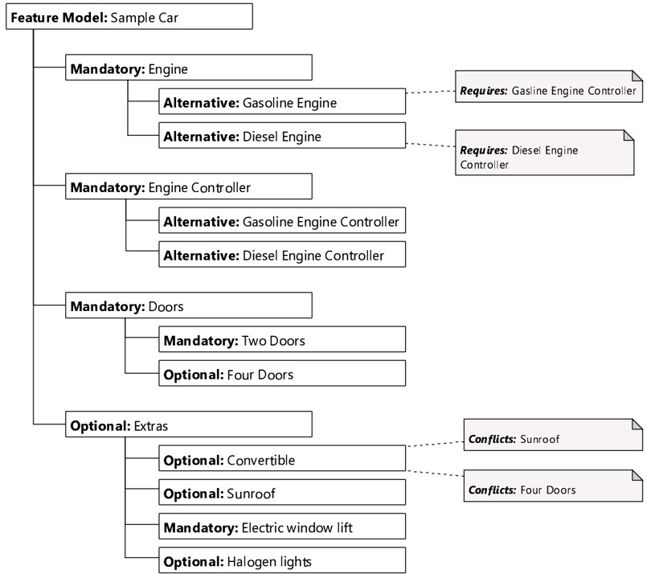
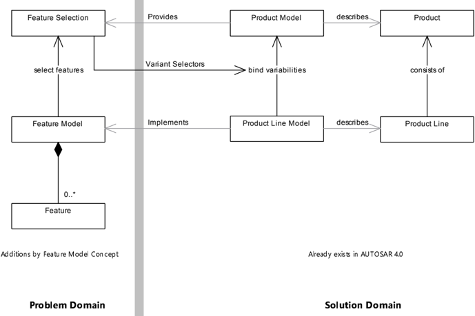
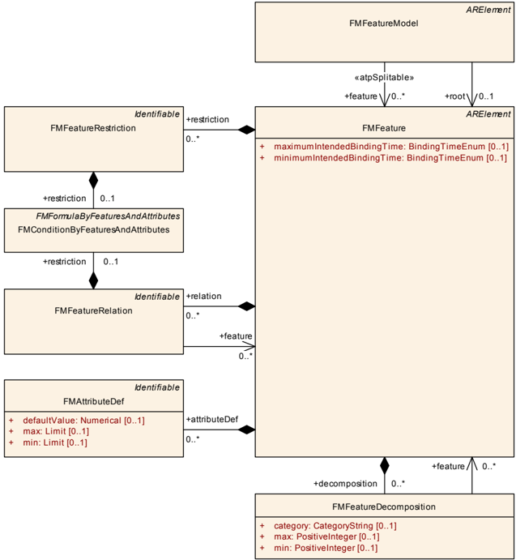
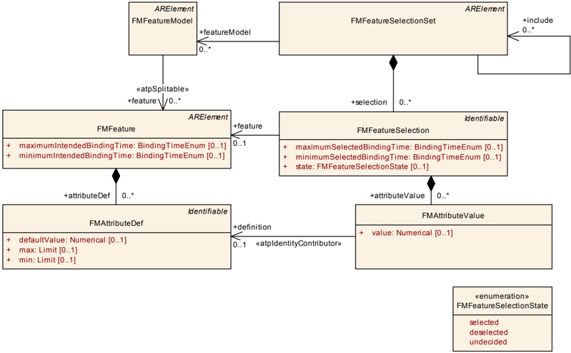
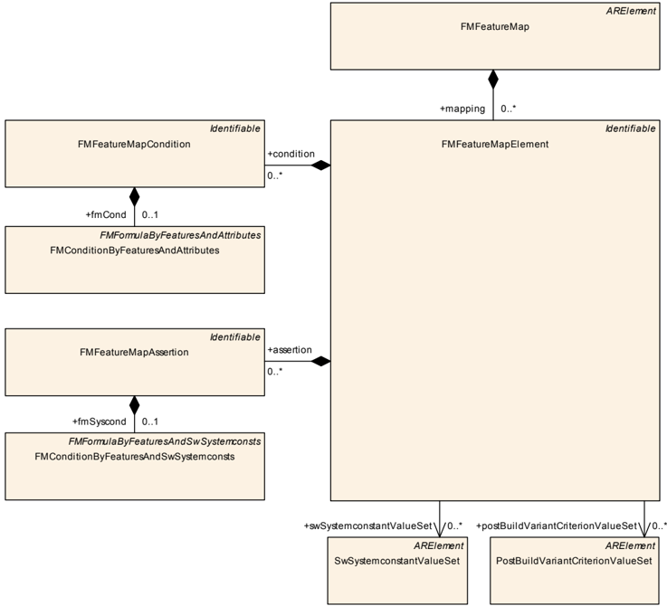
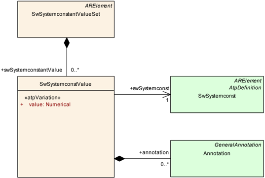
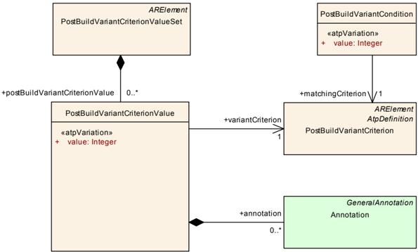
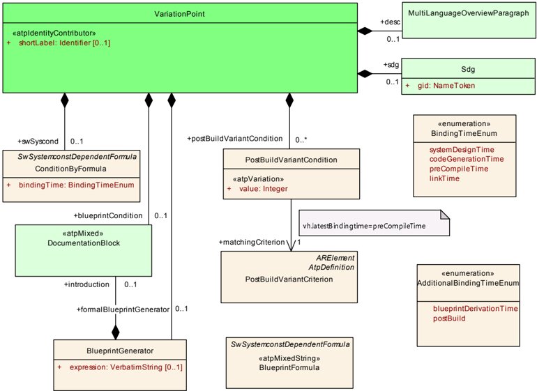
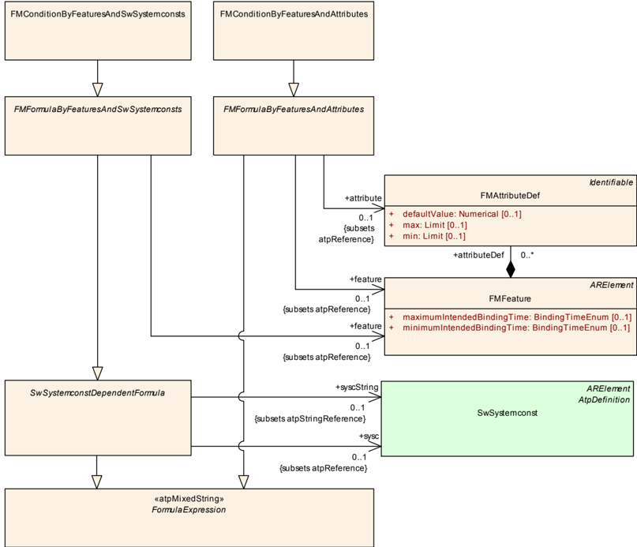

<!-- 源文档 AUTOSAR_FO_TPS_FeatureModelExchangeFormat（R23-11），模板规范（TPS），不受 Type A 七章骨架约束；章节编号镜像源文档 ch.1–ch.7 + 附录 A/C/D。
     文档框架信息（封面/状态/变更历史表、Contents、Disclaimer）不译；附录 B（Reference Material / Requirements Tracing，需求可追溯性表）按需求可追溯性可省略集合（STANDARD.md §1）省略。
     200 个规范项 [TPS_FMDT_xxxxx]/[constr_xxxx]：ID / glyph 定界符 / (RS_…) 回引按批项决策（2026-11-03）丢弃、标题翻译为粗体段；源文自身点名的 ID 保留（[TPS_STDT_00053]/[TPS_STDT_00078]（§1.5）、[TPS_GST_00001]/[TPS_GST_00100]/[TPS_GST_00103]/[TPS_GST_00280]（正文名义引用）、[TPS_SWCT_01431]（表 C.18 数据单元格）、正文点名的 constr_5001..5028）。
     {DRAFT} 标记丢弃。103 个图引用 = 9 张内容图（Figure 1.1、2.1、4.1、5.1、6.1–6.4、7.1）+ 94 张页面装饰图丢弃。
     18 处公式在 markdown 转换中丢失（formula-not-decoded），已从语料库 PDF 第 28–30、32、33、36、42、44、45、59、64 页恢复，以代码块呈现（站点无数学扩展）；脚注编号保持源文档的按页编号（同一编号可在不同章节重复出现，各有自己的脚注正文）。
     附录 C 的 Sdg 与 Referrable 类表中 5 个被截断的属性单元格从语料库 PDF 第 78 页恢复；表 D.1（Added Traceables R4.1.1）在源 markdown 中被分页拆成两段、段间夹着一个与内容不符的杂散表题「Table D.2: changed Constraints in 4.1.1」（源 PDF 自身的表题排版错误），文章将其重组为一张 41 行的表 D.1 并在页脚注记该杂散表题；[TPS_FMDT_00041]/[TPS_FMDT_00042] 与 [TPS_FMDT_00053]/[TPS_FMDT_00054] 在该表中因列错位被并置，按保守重建拆分还原。 -->

## 参考文献

- <a id="ref-1"></a>[\[1\]](#ref-1) Generic Structure Template — AUTOSAR\_FO\_TPS\_GenericStructureTemplate
- <a id="ref-2"></a>[\[2\]](#ref-2) Standardization Template — AUTOSAR\_FO\_TPS\_StandardizationTemplate
- <a id="ref-3"></a>[\[3\]](#ref-3) Methodology for Classic Platform — AUTOSAR\_CP\_TR\_Methodology
- <a id="ref-4"></a>[\[4\]](#ref-4) Software Process Engineering Meta-Model Specification — <http://www.omg.org/spec/SPEM/2.0/>
- <a id="ref-5"></a>[\[5\]](#ref-5) AUTOSAR Feature Model Exchange Format Requirements — AUTOSAR\_FO\_RS\_FeatureModelExchangeFormat

## 1. 简介和功能概述

### 1.1. AUTOSAR 中的变体处理

AUTOSAR 的 Release 4 增加了对变体处理（**Variant Handling**）的支持，它为 AUTOSAR Release 3 中定义的元模型贡献了两个新方面。

首先，变分点（**variation point**）被引入到 AUTOSAR 模型中。带变分点的 AUTOSAR 模型描述了一组具有共同结构、但在某些位置上有所不同的 AUTOSAR 模型。通过绑定（**binding**）变分点——即保留某些变体、丢弃其他变体——可以从这样的模型创建一个无变体的 AUTOSAR 模型。

其次，AUTOSAR 定义了表达什么构成一个特定变体（**variant**）的方法，例如哪些变分点在「经济型（economy）」变体中被选择、哪些变分点在「豪华型（luxury）」变体中被选择。这是必要的，因为一个带变分点的 AUTOSAR 模型可能描述数量非常庞大的变体，而其中实际被使用的只是少数。

AUTOSAR 中的变体处理在通用结构模板（**Generic Structure Template**） [\[1\]](#ref-1) 的变体处理章节中描述。

### 1.2. 特征模型的理由

概括上一节：AUTOSAR 变分点旨在交换关于 AUTOSAR 模型中何处发生变体的信息，并陈述相关的变体是什么。然而，有两个方面尚未被该概念覆盖：

- 变分点在相当低的层次上表达。例如，「经济型」和「豪华型」变体通常由大量变分点组成，但这些变分点共同起作用这一事实在模型中并不显式可见。
- 变分点之间存在依赖关系。例如，「经济型」和「豪华型」变体互斥，但这种关系同样在模型中不显式可见。对于非 PostBuild 的变分点，这可以通过适当地扩展条件所用的公式语言来实现，尽管这会难以维护，并且还会把两个独立的概念（变分点与特征建模）交织在一起。然而，这样的扩展对 PostBuild 不起作用，因为这类变分点只使用简单的条件。

本文档提出的特征模型交换格式（**Feature Model Exchange Format**）覆盖了这些额外的方面。

### 1.3. 特征模型示例

图 1.1 给出了一个特征模型的示例。



### 1.4. 概述

1. 特征（**Feature**）居于「问题域（**problem domain**）」。它们甚至独立于实现（即产品架构）。它们比居于「解决方案域（**solution domain**）」的变分点抽象得多。特征表达的是成品产品的共同和可变特征，而不是为模型中的单个位置做注解。特征模型提供了带变体的 AUTOSAR 模型的高层视图。
2. 特征模型描述各个特征之间的依赖关系。依赖关系的例子包括特征的层次化组织、对替代关系建模的特征，以及要求或禁止其他特征的特征。
3. 单个产品可以通过选择一组特征来描述。当然，这样的选择必须遵守特征模型中声明的依赖关系。从特征到变分点<sup>1</sup>的映射规定了哪些变分点受该选择影响。

> 1 更准确地说，特征将映射到系统常量（**system constant**）的取值，而这些取值进而控制变分点。

4. 特征模型交换格式建立了一种在不同特征建模工具之间交换特征模型的高效方式。
5. 特征模型在 AUTOSAR 中是可选的。这意味着特征模型是一种扩展；仍然可以开发和使用不包含特征模型的 AUTOSAR 模型。

### 1.5. 文档约定

技术术语以等宽字体排版，例如 `PortPrototype`。作为一般规则，技术术语的复数形式通过在单数形式后加「s」构成，例如 `PortPrototypes`。借此，本文档与 AUTOSAR XML Schema 中使用的术语保持一致。

本文档包含文本形式的约束（**constraint**），它们通过唯一的数值约束 ID、一个标题和约束正文（以引述起始字符开始、以引述结束字符终止）与正文其余部分区分开来。

这些约束的目的是字面上约束 AUTOSAR 元模型的解释，使得能够检测元模型实例（即 M1 层）中实现的标准化行为的违例。

鼓励 AUTOSAR 工具的制作者在工具发出的诊断消息中附上与 M1 建模问题相对应的约束的数值 ID。

本文档引入的类的属性以类表（**class table**）的形式列出。它们具有顶层元素 AUTOSAR 示例所示的形式。

请注意，约束并不要求在 AUTOSAR 工作流的任意给定时刻都被强制执行。在模型开发期间，约束可以被合法地违反，因为一个不完整的模型显然会表现出不一致性。

然而，在工作流的特定时点，约束应当被强制执行，以防止错误配置。

约束应当被强制执行的工作流时点（有时也称为约束的「绑定时间（**binding time**）」）因模型类别而异，例如在经典平台上，为软件组件定义的约束通常在 RTE 生成之前强制执行，而针对 ECU 提取定义的约束应在创建 Com 栈的 ECU 配置时应用。

对于每份文档，约束的可能绑定时间都有定义，并且绑定时间通常在约束自身中提及，以便为 AUTOSAR 编写工具的实现者提供适当的方向。

设 AUTOSAR 为典型类表的一个示例。表中的前几行含义如下：

类（**Class**）：在 UML 模型中定义的类的名称。

包（**Package**）：定义该类的 UML 包。列出此项只是为了帮助在整体元模型中定位该类。

说明（**Note**）：建模者对该类的注释（类注释）。类的构造型（**stereotype**）和 UML 标签（**tag**）也在此处注明。

基类（**Base**）：如适用，直接基类的列表。

表中的表头含义如下：

属性（**Attribute**）：类的属性名。注意 AUTOSAR 不区分类属性和所拥有的关联端。

类型（**Type**）：类属性的类型。

多重性（**Mul.**）：分配给该属性的多重性，即有多少个给定数据类型的实例与该属性关联。

种类（**Kind**）：指定该属性是在类中聚合的（aggr 聚合）、类中的 UML 属性（attr 原始属性），还是仅被类引用（ref 引用）。实例引用（iref 实例引用）也在此字段中标示。

备注（**Note**）：建模者对该类属性给出的注释（角色注释）。构造型和 UML 标签也在此处注明。

请注意，以字母而非数字开头的章节代表文档的附录。附录的目的是支持对文档某些方面的解释，不代表标准的约束性约定。

[TPS\_STDT\_00053] 中规定的表达义务的言语形式应用于标示需求，见标准化模板的可追溯性支持章（ [\[2\]](#ref-2) ）。

AUTOSAR 文档中需求的表示遵循 [TPS\_STDT\_00078] 中规定的表格，见标准化模板的可追溯性支持章（ [\[2\]](#ref-2) ）。

**生命周期的使用**：FeatureModelExchangeFormat 中的生命周期通过利用通用结构模板 [\[1\]](#ref-1) 所描述的生命周期支持（**Life Cycle Support**）来描述。

## 2. 术语



图 2.1 给出了特征建模所用术语的概览。我们定义七个专门属于特征模型交换格式的术语，即特征（**Feature**）、特征选择（**Feature Selection**）、特征模型（**Feature Model**）、产品模型（**Product Model**）、产品线模型（**Product Line Model**）、产品（**Product**）和产品线（**Product Line**）：

**特征的定义**：特征描述产品的一个本质特性。特征通常将一个产品与其他类似产品区分开——在我们的上下文中，特征区分产品线中的各个产品。

**特征选择的定义**：

特征选择是描述特定产品的一组特征。

特征选择总是与一个特征模型配对。特征模型中定义的所有依赖和关系都应得到遵守。

**特征模型的定义**：特征模型描述产品线的可用特征及其相互关系/相互依赖。换言之，特征模型在问题域中描述一个产品线模型。

例如，一辆汽车可以装有汽油发动机或柴油发动机，因此特征 Gasoline 和 Diesel 互为替代。汽车的七座配置可能需要空调，因此特征 Seven Seats 要求特征 Air Conditioning。

特征模型通常与一个产品线模型配对。

**产品模型的定义**

产品模型描述一个产品。产品模型不再包含变分点（PostBuild 变分点除外）。它通过「绑定」变分点从产品线模型派生。

在 AUTOSAR 中，产品模型是描述特定产品的 M1 工件（**artifact**）的集合。

除 PostBuild 变分点外，产品模型符合通用结构模板 [\[1\]](#ref-1) 变体处理章节中定义的纯元模型（**Pure Metamodel**）。

**产品线模型的定义**

产品线模型与产品模型类似，但包含所有绑定时间的变分点。产品模型通过保留某些变体、丢弃其他变体（即绑定）从产品线模型创建。产品模型中仍然允许的唯一变分点是 PostBuild 变分点。

在特征建模的上下文中，这一选择过程由特征选择引导（更准确地说，变体选择过程（绑定）由变体选择器（**SwSystemconst**）控制，而后者的取值又可以从特征选择派生）。

在 AUTOSAR 中，产品线模型是描述一组具有共同特征的产品模型的 M1 工件的集合。产品线模型是通用结构模板 [\[1\]](#ref-1) 变体处理章节中定义的扩展元模型的实例。

**产品的定义**

产品是某种过程的产物，例如在一个或多个 ECU 上运行的软件。

在 AUTOSAR 中，产品是 M0 工件的集合。在我们的术语中，它在 M1 层由产品模型描述。

**产品线的定义**

产品线是相互关联的一组产品。产品线通常由一组具有相当多共同方面的产品组成，同时包含若干使各个产品彼此区别的方面。

在我们的术语中，产品线由产品线模型描述，而产品线模型又由特征模型描述。

**关于术语的说明**

在本节中，我们定义了若干在 AUTOSAR 或其他领域已有含义的术语。特征（**Feature**）和产品（**Product**）这两个术语尤其如此。更严谨的定义或许是 AUTOSAR Featuremodel Feature 或 AUTOSAR Featuremodel Product。

然而，显而易见，这样的措辞会显著影响本文档的可读性。诸如特征（**Feature**）之类的术语已在特征建模文献中使用了一段时间，因此对熟悉该领域的人而言，换用其他术语并无帮助。

因此，尽管与现有的 AUTOSAR 术语重叠，我们仍决定沿用已确立的术语。由于这些术语只在特征建模的上下文中使用，所指的定义应当总是清晰的。

### 2.1. 图论术语

本文档偶尔使用图论概念来为约束提供形式化描述。以下小节定义这些术语。

- 有向<sup>1</sup>图（**directed graph**）是一个二元组 (V, E)，其中 E ⊆ V × V。V 称为 G 的节点（**node**），E 称为 G 的边（**edge**）。

> 1 在本文档中我们只需要有向图，因此我们将术语「图（**graph**）」与「有向图（**directed graph**」同义使用。

- 图 G = (V, E) 中的路径（**path**）p 是节点序列 p = v~1~, v~2~, ..., v~n~，其中 v~i~ ∈ V 且 ∀ i ∈ {1, ..., n-1}：(v~i~, v~i+1~) ∈ E。p 起始于 v~1~，终止于 v~n~。
- 图 G = (V, E) 中的圈（**circle**）是一条路径 v~1~, v~2~, ..., v~n~，其中 v~1~ = v~n~。
- 图 G = (V, E) 中的自环（**self loop**）是一条边 (v, v) ∈ E。
- 图 G = (V, E) 中的孤立节点（**isolated node**）是节点 v ∈ V，满足 ¬∃ v' : ((v, v') ∈ E ∨ (v', v) ∈ E)。换言之，孤立节点是没有边相连的节点。
- 树（**tree**）是具有根 r ∈ V 的图 G = (V, E)，并且具有以下性质：
  1. ∀ v ∈ V : ∃ path p = {r, v~2~, ..., v}。换言之，对于每个节点 v ∈ V，存在一条从 r 开始、到 v 结束的路径。
  2. ¬∃ v ∈ V : (v, r) ∈ E。换言之，根节点没有入边。
  3. ∀ v ∈ V, v ≠ r : ∃! v' ∈ V : (v', v) ∈ E。换言之，任何非根节点都恰好有一条入边。
  4. G 没有圈，也没有自环。
  5. size(V) = size(E) + 1。

注意：第 4、5 项是第 1、2、3 项的推论。

## 3. 概述

一个 AUTOSAR 特征模型由三种不同的结构<sup>1</sup>组成：特征模型本身、特征选择（**feature selection**），以及最后的特征映射（**feature map**）。

> 1 本文档描述的许多概念改编自《Generative Programming: Methods, Tools, and Applications》（Krzysztof Czarnecki 和 Ulrich W. Eisenecker，ACM Press/Addison-Wesley Publishing Co，2000）。

### 3.1. 特征模型

特征模型（**FMFeatureModel**）由若干特征（**FMFeature**）组成，这些特征按层次组织（**FMFeatureDecomposition**）。即每个特征可以包含若干子特征，子特征又可以包含自己的子特征，依此类推。换言之：特征模型由一棵或多棵特征树组成。

作为一种特殊情况，特征模型可以分布（拆分）在多个 AUTOSAR 文件中。也可以把一棵大的特征树划分为若干子树。

此外，特征之间可能存在相互依赖。例如，特征可以表示替代关系从而互斥（FMFeatureDecomposition），或者一个特征可以要求一个或多个其他特征、与其他特征矛盾（FMFeatureRelation），或者特征可以包含一个限制其适用性的表达式（FMFeatureRestriction）。

### 3.2. 特征选择

特征选择是描述实际产品的一组特征。例如，一个具体的车型由其特征集合描述。这由 FMFeatureSelectionSet 实现，它包含若干 FMFeatureSelection，每个 FMFeatureSelection 定义某个 FMFeature 在这个特定特征选择中的状态。

如果特征选择遵守为其特征定义的所有限制和关系以及特征模型的层次结构，则称该特征选择是有效的（**valid**）。

特征选择与特征模型分开处理，因为一个特征模型通常对应许多不同的特征选择。例如，不同的汽车由不同的特征选择表示。

### 3.3. 特征映射

在 AUTOSAR 变体处理中，变分点由系统常量控制。基于系统常量的表达式用于判定某个特定变分点是「开」还是「关」。其后果之一是同一个系统常量可用于控制多个变分点。

因此，特征不能直接映射到变分点，而是需要为变分点表达式中所使用的系统常量选择取值。

这由特征映射（**FMFeatureMap**）完成。简而言之，特征映射的每个元素（**FMFeatureMapElement**）包含一组基于特征和特征属性的条件（**FMFeatureMapCondition**）和一组基于特征和系统常数的断言（**FMFeatureMapAssertion**）。如果任一条件且全部断言求值为 true，则该映射列出若干系统常量并为它们选择取值。

## 4. 特征模型



### 4.1. 类 FMFeatureModel

表4.1：FMFeatureModel（**FMFeatureModel**）

| 属性 | 值 |
|---|---|
| 类 | FMFeatureModel |
| 包 | M2::AUTOSARTemplates::FeatureModelTemplate |
| 说明 | 特征模型描述产品线的特征及其依赖。特征模型是 AUTOSAR 模型的可选部分。 |
| 基类 | ARElement, ARObject, CollectableElement, Identifiable, MultilanguageReferrable, Referrable |
| 聚合于 | ARPackage.element |

| 属性 | 类型 | 多重性 | 种类 | 备注 |
|---|---|---|---|---|
| feature | FMFeature | * | ref | 「feature」保存特征模型的特征列表。任何 FMFeature 在该列表中不得出现两次。此外，每个 FMFeature 只能被包含在一个特征模型中。Stereotypes: atpSplitable Tags: atp.Splitkey=feature |
| root | FMFeature | 0..1 | ref | 特征模型的特征定义一棵树。属性 root 指向该树的根。 |

**FMFeatureModel 的用途**：FMFeatureModel 描述产品线的可用特征，如「特征模型的定义」所定义。

特征模型由类 FMFeatureModel 实现。由于 FMFeatureModel 是一个 ARElement，一个 AUTOSAR 模型可以包含任意数量的特征模型，包括零个。

**特征模型是可选的**：不包含特征模型的 AUTOSAR 模型仍然是一个有效的 AUTOSAR 模型。

特别地，特征模型可以为空，即不包含任何特征。

**特征模型可以为空**：FMFeatureModel 在角色 feature 中可以没有对任何 FMFeature 元素的引用。

如果一个 AUTOSAR 模型包含多个特征模型，那么这些特征模型可以通过两种方式相互作用。第一，特征模型可以使用其他特征模型作为子模型，如第 [4.4.4](#444-特征模型的层次分解) 节所定义。第二，特征之间的限制（4.5）和关系（4.6）可以引用在其他特征模型中定义的特征。

#### 4.1.1. 引用 feature

每个 FMFeatureModel 在角色 feature 中包含若干 FMFeature 元素。这些元素表示特征模型的特征。

**FMFeatureModel 的特征的定义**：设 F 是一个 FMFeatureModel，{f~1~, f~2~, ..., f~n~} 是从 F 在角色 feature 中引用的 FMFeature 集合。那么 {f~1~, f~2~, ..., f~n~} 就是 F 的特征。

一个 FMFeature 只能属于单个 FMFeatureModel：

**约束：FMFeature 在角色 feature 中只能被一个 FMFeatureModel 引用**：设 f 是一个 FMFeature，F、F' 是两个 FMFeatureModel，其中 F 在角色 feature 中引用 f，F' 也在角色 feature 中引用 f。那么 F = F'。

显然，FMFeatureModel 不得包含同一个特征两次。

**约束：FMFeatureModel 不得包含同一个 FMFeature 两次**：设 F 是一个 FMFeatureModel，f、f' 是从 F 在角色 feature 中引用的 FMFeature。那么 f = f'。

另一方面，不存在「孤立」的特征；每个 FMFeature 都是某个 FMFeatureModel 的一部分。

**约束：每个 FMFeature 都应包含在一个 FMFeatureModel 中**：对于每个 FMFeature f，应存在一个在角色 feature 中引用 f 的 FMFeatureModel。

约束 constr\_5020 确保不存在「独立」特征——由于 FMFeature 是 ARElement，这在技术上是可能的，但在该上下文中没有用处。

最后，必要时特征模型可以分布在多个物理 ARXML 文件上。

**特征模型是可拆分的**：关系 feature 具有构造型 `<atpSplitable>`。即 FMFeatureModel 可以分布在多个 ARXML 文件上。

#### 4.1.2. 引用 root

由于特征模型的特征按树结构组织（见第 [4.4](#44-类-fmfeaturedecomposition) 节），恰好有一个特征位于树的顶端。特征模型有一个额外的引用 root，指向该特征。

root 并非严格必需，因为从特征模型的层次结构（见第 [4.4](#44-类-fmfeaturedecomposition) 节）可以推导出根特征。不过，包含 root 是为了方便，并协助工具检查模型的完整性。

**FMFeatureModel 的根特征的定义**：设 F 是一个在角色 root 中引用 FMFeature f 的 FMFeatureModel。那么 f 称为 F 的根特征（**root feature**）。

我们需要为根特征定义两个约束。第一，如果特征模型非空——即它有特征——那么应有一个特征作为根特征：

**约束：当且仅当特征模型非空时根特征应存在**：如果 FMFeatureModel 在角色 feature 中引用一个或多个 FMFeature 元素，那么其中应恰好有一个被 FMFeatureModel 在角色 root 中引用。反之，如果 FMFeatureModel 在角色 feature 中不引用任何 FMFeature，那么 root 应为空。

第二，特征模型的根特征应是它自己的特征之一：

**约束：若存在，根特征应是特征模型的一部分**：设 r 是 FMFeatureModel 在角色 root 中引用的 FMFeature，{f~1~, f~2~, ..., f~n~} 是同一个 FMFeatureModel 在角色 feature 中引用的特征集合。那么以下条件应成立：r ∈ {f~1~, f~2~, ..., f~n~}。

我们稍后会带着约束 constr\_5022（要求根特征指向特征树的根）和 constr\_5010（允许一个特征使用另一个特征模型的根特征——且仅限根特征——作为子特征）再回到根特征。

### 4.2. 类 FMFeature

每个 FMFeatureModel 由若干 FMFeature 组成，这些特征又按层次化的树状结构组织。这一层次在特征之间建立父子关系：每个非根特征都恰好有一个父特征，以及任意数量的子特征（包括零个）。

表4.2：FMFeature（**FMFeature**）

| 属性 | 值 |
|---|---|
| 类 | FMFeature |
| 包 | M2::AUTOSARTemplates::FeatureModelTemplate |
| 说明 | FMFeature 描述产品的一个本质特性。每个 FMFeature 包含在恰好一个 FMFeatureModel 中。Tags: atp.recommendedPackage=FMFeatureModels |
| 基类 | ARElement, ARObject, CollectableElement, Identifiable, MultilanguageReferrable, PackageableElement, Referrable |
| 聚合于 | ARPackage.element |

| 属性 | 类型 | 多重性 | 种类 | 备注 |
|---|---|---|---|---|
| attributeDef | FMAttributeDef | * | aggr | 定义给定特征的属性。 |
| decomposition | FMFeatureDecomposition | * | aggr | 列出特征的子特征。 |
| maximumIntendedBindingTime | BindingTimeEnum | 0..1 | attr | 为与 FMFeature 关联的变分点的绑定时间定义一个上界。该属性旨在作为开发过程的提示。 |
| minimumIntendedBindingTime | BindingTimeEnum | 0..1 | attr | 为与 FMFeature 关联的变分点的绑定时间定义一个下界。该属性旨在作为开发过程的提示。 |
| relation | FMFeatureRelation | * | aggr | 为 FMFeature 定义关系，例如对其他 FMFeature 的依赖或与其他 FMFeature 的冲突。只有当 FMFeature 的所有关系都得到满足时，它才能属于一个 FMFeatureSelectionSet。 |
| restriction | FMFeatureRestriction | * | aggr | 为 FMFeature 定义限制。只有当 FMFeature 的至少一个限制求值为 true 时，它才能属于一个 FMFeatureSelectionSet。 |

**FMFeature 的用途**：FMFeature 描述产品的一个本质特性，如「特征的定义」所定义。

FMFeature 聚合以下元素：

- FMFeatureDecomposition 分解定义特征如何按层次组织。它还在特征之间施加某些约束：存在强制（**mandatory**）、可选（**optional**）、替代（**alternative**）和多重（**multiple**）特征。特征分解在第 [4.4](#44-类-fmfeaturedecomposition) 节描述。
- FMFeatureRestriction 限制包含一个约束特征纳入有效特征选择的公式。限制可能不止一个。只有当特征的至少一个限制求值为 true 时，该特征才能属于有效的特征选择。特征限制在第 [4.5](#45-类-fmfeaturerestriction) 节描述。
- FMFeatureRelation 关系表达特征之间的约束。关系从一个特征指向一个或多个其他特征，并定义这些特征之间的关系。例如，关系可用于表达一个特征要求另一个特征，或与若干其他特征冲突。特征关系在第 [4.6](#46-类-fmfeaturerelation) 节描述。
- FMAttributeDef 属性定义特征的一个数值属性。属性被限制（见第 [4.5](#45-类-fmfeaturerestriction) 节）和特征映射（见第 [6.4](#64-类-fmfeaturemapelement) 节）使用。特征本身只定义属性和可选的默认值；实际值可以在特征选择（第 [5](#5-特征选择) 节）中进一步细化。特征属性在第 [4.3](#43-特征的属性) 节描述。

FMFeature 有两个属性 maximumIntendedBindingTime 和 minimumIntendedBindingTime，它们为与该特征关联的变分点规定预期绑定时间（见第 [4.2.2](#422-预期绑定时间) 节）。

#### 4.2.1. 特征的名称与文档

**FMFeature 的名称**：属性 shortName 可用于标识特征。此外，属性 longName 可用于为 FMFeature 提供人类可读的名称。

**FMFeature 的描述**：属性 introduction 和 desc 可用于为 FMFeature 提供人类可读的描述。

如 [\[1\]](#ref-1) 所概述，introduction 和 desc 的用途如下：

- introduction [TPS\_GST\_00103] 包含关于特征如何使用的介绍性文档。
- desc [TPS\_GST\_00100] 包含关于特征是什么的简要描述。

属性 shortName、longName、introduction 和 desc 在图 4.1 中不可见，它们源自 FMFeature 基于 ARElement，而 ARElement 又基于 Identifiable 和 Referrable 这一事实。

#### 4.2.2. 预期绑定时间

类 FMFeature 包含两个可选属性 minimumIntendedBindingTime 和 maximumIntendedBindingTime，它们为与该 FMFeature 关联的变分点的预期绑定时间（绑定时间在 AUTOSAR 方法论 [\[3\]](#ref-3) 中解释）定义下界和上界。

**属性 minimumIntendedBindingTime 和 maximumIntendedBindingTime 的语义**：设 f 是一个 FMFeature，V 是按定义所确定的 f 的受影响变分点集合。那么对每个变分点 v ∈ V 隐含以下条件：

1. 如果属性 minimumIntendedBindingTime 存在且取值为 min，那么 min ≤ bindingtime(v)。
2. 如果属性 maximumIntendedBindingTime 存在且取值为 max，那么 bindingtime(v) ≤ max。

上述语义引用的是与 FMFeature 关联的变分点。该信息无法通过 FMFeatureModel 获得，而是在 FMFeatureMap 中定义（见第 [6](#6-特征映射) 节）。因此，属性 minimumIntendedBindingTime 和 maximumIntendedBindingTime 只有在 FMFeatureMap 也可用时才能被解释。

**属性 maximumIntendedBindingTime 和 minimumIntendedBindingTime 仅是提示**：maximumIntendedBindingTime 和 minimumIntendedBindingTime 的取值仅作为开发过程的提示，用于指导选择正确的可变性实现方式。

### 4.3. 特征的属性

每个 FMFeature 聚合零个或多个 FMAttributeDef 元素，每个元素定义特征的一个属性。

表4.3：FMAttributeDef（**FMAttributeDef**）

| 属性 | 值 |
|---|---|
| 类 | FMAttributeDef |
| 包 | M2::AUTOSARTemplates::FeatureModelTemplate |
| 说明 | 该元类表示为特征定义属性的能力。 |
| 基类 | ARObject, Identifiable, MultilanguageReferrable, Referrable |
| 聚合于 | FMFeature.attributeDef |

| 属性 | 类型 | 多重性 | 种类 | 备注 |
|---|---|---|---|---|
| defaultValue | Numerical | 0..1 | attr | 表示属性的默认值。 |
| max | Limit | 0..1 | attr | 该属性取值的最大可能值 |
| min | Limit | 0..1 | attr | 该属性取值的最小可能值 |

**约束：FMAttributeDef.max 和 FMAttributeDef.min 的多重性**：对于每个 FMAttributeDef，属性 max 和 min 应存在。

**FMAttributeDef 的用途**：FMAttributeDef 为特征定义属性。每个 FMAttributeDef 包含一个可选的 defaultValue，并通过属性 max 和 min 为其取值定义界限。

**约束：类 FMAttributeDef 中属性 max 和 min 的语义**：对于类 FMAttributeDef 的所有实例，以下条件应成立：

```
min ≤ defaultValue ≤ max（若 defaultValue 存在）
```

### 4.4. 类 FMFeatureDecomposition

表4.4：FMFeatureDecomposition（**FMFeatureDecomposition**）

| 属性 | 值 |
|---|---|
| 类 | FMFeatureDecomposition |
| 包 | M2::AUTOSARTemplates::FeatureModelTemplate |
| 说明 | 该元类将子特征与其父特征关联。 |
| 基类 | ARObject, Identifiable, MultilanguageReferrable, Referrable |
| 聚合于 | FMFeature.decomposition |

| 属性 | 类型 | 多重性 | 种类 | 备注 |
|---|---|---|---|---|
| category | FMFeatureDecompositionCategoryEnum | 1 | attr | 该属性定义所引用特征相对于父特征的行为方式。Tags: xml.sequenceOffset=30 |
| feature | FMFeature | 1..* | ref | 该属性列出同一父特征下的特征。Tags: xml.sequenceOffset=20 |
| max | PositiveInteger | 0..1 | attr | 最大多重性（仅适用于 MULTIPLEFEATURE 类别）。 |
| min | PositiveInteger | 0..1 | attr | 最小多重性（仅适用于 MULTIPLEFEATURE 类别）。 |

**父特征、子特征的定义**：设 f 是一个 FMFeature，它聚合一个在角色 feature 中引用 FMFeature f' 的 FMFeatureDecomposition。那么 f 是 f' 的父特征（**parent feature**），f' 是 f 的子特征（**child feature**）。

每个特征至多有一个父特征，但可以有任意数量的子特征（包括零个）。这由特征模型按树组织这一事实确立，由下方约束 constr\_5021 决定。

**约束：FMFeature 不得被多于一个 FMFeatureDecomposition 引用**：设 f 是被某个 FMFeatureDecomposition 在角色 feature 中引用的 FMFeature。那么不得有其他 FMFeatureDecomposition 在角色 feature 中引用 f。

约束 constr\_5005 确保每个 FMFeature 至多有一个父特征（子特征数量出于显而易见的原因不受限制）。这为下面定义 FMFeatureModel 的底层图（它实际上是一棵底层树）铺平了道路。

**FMFeatureModel 的底层图的定义**：设 F 是一个 FMFeatureModel，{f~1~, f~2~, ..., f~n~} 是从 F 在角色 feature 中引用的 FMFeature 集合。那么 F 的底层图是一个图 G = (V, E)，其中

```
V = {f1, f2, ..., fn}
E = {(fi, fj) | fi 是 fj 的父特征}
```

**约束：特征模型的底层图应是一棵树**：设 F 是一个 FMFeatureModel，G 是按上述定义的 F 的底层图。那么 G 应是一棵树。因此我们也把 G 称为 F 的底层树（**underlying tree**）。

**约束：FMFeatureModel 的根特征指向底层树的根**：设 F 是一个 FMFeatureModel，G 是按上述定义的 F 的底层树。再设 r 是该 FMFeatureModel 的根特征所引用的 FMFeature。那么 G 中对应 r 的节点是树 G 的根。

#### 4.4.2. 特征分解的类别

FMFeatureDecomposition 的属性 category 为角色 feature 中引用的 FMFeature 定义语义。我们为 FMFeatureDecomposition 定义四个类别，即 MANDATORYFEATURE、OPTIONALFEATURE、ALTERNATIVEFEATURE 和 MULTIPLEFEATURE：

- **MANDATORYFEATURE**：从一个类别为 MANDATORYFEATURE 的 FMFeatureDecomposition 在角色 feature 中引用的所有 FMFeature，当且仅当其父 FMFeature 被纳入特征选择时，应出现在特征选择中。
- **OPTIONALFEATURE**：从一个类别为 OPTIONALFEATURE 的 FMFeatureDecomposition 在角色 feature 中引用的 FMFeature，当且仅当其父 FMFeature 被纳入特征选择时，可以出现在特征选择中。
- **ALTERNATIVEFEATURE**：当且仅当一个类别为 ALTERNATIVEFEATURE 的 FMFeatureDecomposition 的父 FMFeature 被纳入特征选择时，该分解在角色 feature 中引用的 FMFeature 中应恰好有一个出现在特征选择中。
- **MULTIPLEFEATURE**：当且仅当一个类别为 MULTIPLEFEATURE 的 FMFeatureDecomposition 的父 FMFeature 被纳入特征选择时，该分解在角色 feature 中引用的 FMFeature 中应有一个或多个出现在特征选择中。这还受属性 min 和 max 的进一步约束（见下文与约束 constr\_5013）。

这些定义在下方形式化。

**FMFeatureDecomposition 的语义**：设 S 是一个 FMFeature 集合，f、f~1~、f~2~、...、f~n~ 是 FMFeature，其中 f 是 f~1~、f~2~、...、f~n~ 的父特征。再设 d 是 f 在角色 decomposition 中聚合的 FMFeatureDecomposition，且 {f~1~, f~2~, ..., f~n~} 全部从 d 在角色 feature 中引用。

根据 FMFeatureDecomposition d 的类别，定义以下条件：

**MANDATORYFEATURE**

```
f ∈ S ⇔ |{f1, f2, ..., fn} ∩ S| = n
```

**OPTIONALFEATURE**

```
f ∈ S ⇔ 0 ≤ |{f1, f2, ..., fn} ∩ S| ≤ n
```

**ALTERNATIVEFEATURE**

```
f ∈ S ⇔ |{f1, f2, ..., fn} ∩ S| = 1
```

**MULTIPLEFEATURE**

```
f ∈ S ⇔ min ≤ |{f1, f2, ..., fn} ∩ S| ≤ max
```

请注意，该语义并不要求这些条件得到满足。只有当 S 是有效特征选择（见「有效特征选择的定义」）时，所有条件才必须满足。这是必要的，因为特征选择可能是不完整的，例如当特征在逐步的过程中被选择时，只有「最终的」特征选择才满足所有约束。

#### 4.4.3. 属性 min 和 max

如果可选属性 min 和 max 存在，它们限制可以选择多少个多重特征。

**FMFeatureDecomposition 的属性 min 和 max 的默认值**：如果 min 和 max 缺失，则在上述语义中假定 min 取值 1、max 取值 ∞。

换言之，如果未指定 min 和 max，则有效特征选择应包含至少一个这些特征，但没有上界。从技术上讲，上述语义中的 ∞ 对应 PositiveInteger 可表示的最大数。

**约束：FMFeatureDecomposition 的属性 min 和 max 保留给类别 MULTIPLEFEATURE**：FMFeatureDecomposition 的可选属性 min 和 max 只有在该 FMFeatureDecomposition 的类别为 MULTIPLEFEATURE 时才允许存在。

#### 4.4.4. 特征模型的层次分解

存在一种特殊情况：FMFeatureDecomposition 可以引用另一个 FMFeatureModel 中的特征。这对 FMFeatureModel 的层次分解很有用。然而，只有当被引用的特征是根特征时才允许这样做。

**约束：FMFeatureDecomposition 可以引用另一个特征模型的根特征，但只能一次**：设 f~A~ 是一个被 FMFeatureModel A 在角色 feature 中引用、同时又从一个（由 FMFeature f~B~ 在角色 decomposition 中聚合的）FMFeatureDecomposition 引用的 FMFeature。再设 B 是在角色 feature 中引用 f~B~ 的 FMFeatureModel，且 A ≠ B。即 f~A~ 和 f~B~ 属于不同的特征模型。那么以下两个条件都应成立：

1. f~A~ 被 A 在角色 root 中引用。
2. 没有其他 FMFeatureDecomposition（无论在 B 中还是在任何其他 FMFeatureModel 中）在角色 feature 中引用 f~B~。

该约束的第二个条件是必要的，以确保组合后的特征模型的整体结构仍然是一棵树（另见前述底层图定义和约束 constr\_5021）。

#### 4.4.5. 为什么对 FMFeature 使用引用而不是聚合？

我们本可以把特征模型定义为：FMFeatureModel 聚合单个 FMFeature（根特征），然后 FMFeatureModel 递归地聚合其他 FMFeature。在这种方式下，本节前面定义的若干约束将不再必要，因为这种聚合天然形成一棵树。

然而，这种方式无法支持第 [4.4.4](#444-特征模型的层次分解) 节所述的特征模型分解。在那种情况下，一个 FMFeatureDecomposition 引用另一个 FMFeatureModel 的根。这不容易通过聚合实现。

### 4.5. 类 FMFeatureRestriction

FMFeatureDecomposition 建立的层次（见第 [4.4](#44-类-fmfeaturedecomposition) 节）覆盖了约束特征纳入特征选择的许多用例。

然而，有些情况需要更精细的约束。FMFeatureDecomposition 为共享同一父特征的特征定义约束。例如，它可以表达若干特征在其父特征的上下文中是替代的（典型地，一辆「汽车」要么包含「柴油」发动机，要么包含「汽油」发动机，但不同时包含），但它无法表达一个 FMFeature 跨树依赖另一个 FMFeature，或与另外两个特征的组合相矛盾。

FMFeature 可以聚合若干 FMFeatureRestriction 元素，进一步限制其纳入特征选择。FMFeatureRestriction 在角色 restriction 中聚合一个布尔<sup>1</sup>表达式，约束某个特定特征是否允许成为 FMFeatureSelection 的一部分。

> 1 即其取值被解释为布尔值。

更准确地说，只有当特征的至少一个限制求值为 true 时，该特征才能成为特征选择的一部分。也就是说，所有限制被合并为单个布尔表达式；各个限制通过 ∨ 运算符组合。为简单起见，限制之间没有优先级。

表4.5：FMFeatureRestriction（**FMFeatureRestriction**）

| 属性 | 值 |
|---|---|
| 类 | FMFeatureRestriction |
| 包 | M2::AUTOSARTemplates::FeatureModelTemplate |
| 说明 | 为 FMFeature 定义限制。只有当 FMFeature 的至少一个限制求值为 true 时，它才能属于一个 FMFeatureSelectionSet。 |
| 基类 | ARObject, Identifiable, MultilanguageReferrable, Referrable |
| 聚合于 | FMFeature.restriction |

| 属性 | 类型 | 多重性 | 种类 | 备注 |
|---|---|---|---|---|
| restriction | [FMConditionByFeaturesAndAttributes](#722-fmconditionbyfeaturesandattributes) | 0..1 | aggr | 包含实际限制的公式。 |

**FMFeatureRestriction 的语义**：设 S 是一个 FMFeatureModel 的特征选择，f 是一个具有 FMFeatureRestriction 集合 {R~1~, R~2~, ..., R~n~} 的 FMFeature。设 {C~1~, C~2~, ..., C~n~} 是 R~i~ 在角色 restriction 中聚合的 [FMFormulaByFeaturesAndAttributes](#721-fmformulabyfeaturesandattributes) 元素。那么该特征定义以下条件：

```
f ∈ S ⇒ C1 = true ∨ C2 = true ∨ ... ∨ Cn = true
```

请注意，该语义只定义一个条件，并不要求该条件被特征选择满足。只有有效特征选择（见「有效特征选择的定义」）才要求满足该条件。

该条件只在一个方向上起作用。即使所有条件都为 true，某个特定特征仍可能不出现在有效特征选择中。反过来，如果特征包含在有效特征选择中，则至少一个限制必须为 true。这与 FMFeatureRelation 不同，后者可能强制一个特征成为有效特征选择的一部分（见第 [4.6](#46-类-fmfeaturerelation) 节）。

我们不进一步约束可与 FMFeatureRestriction 一起使用的限制。这意味着确保不引入循环依赖或冲突是限制创建者<sup>2</sup>的责任。例如，特征 f 具有限制 = f 是完全合法的，尽管这可能没什么用处，因为该特征永远不会被选择。

> 2 限制的创建者可以是一个或多个人，甚至是工具。

#### 4.5.1. FMFeatureRestriction 的标识与文档

由于 FMFeatureRestriction 基于 Identifiable，它可以包含可选属性 shortName、introduction 和 desc。

**标识 FMFeatureRestriction**：在 FMFeature 聚合多个 FMFeatureRestriction 的情况下，属性 shortName 可用于区分各个限制。

**记录 FMFeatureRestriction 的文档**：属性 introduction 和 desc 可用于为 FMFeatureRestriction 提供人类可读的描述。

#### 4.5.2. 示例

考虑一个具有以下限制的特征 f：

```
f1 && f2 && f3
```

该限制定义：只有当 f~1~、f~2~ 和 f~3~ 也被纳入某个特征选择时，f 才能属于该特征选择。这无法用特征树表达，因为 f 将不得不是所有三个特征的强制子特征，这显然违反树结构。

反过来说，仅用限制也可以定义强制、可选、替代和多重特征。例如，特征 f 和 f' 互斥（即替代特征）这一事实，可以通过给 f 分配限制 ¬f'、给 f' 分配限制 ¬f 来表达。

通过扩展这种方法，可以替换第 [4.4](#44-类-fmfeaturedecomposition) 节为 FMFeatureDecomposition 定义的不同类别。我们没有采用这个方向，因为从分解生成这样的限制很容易，但若没有适当的注记，很难把它们翻译回分解。

### 4.6. 类 FMFeatureRelation

如第 [4.5](#45-类-fmfeaturerestriction) 节所示，FMFeatureRestriction 是一个布尔表达式，约束一个特征是否可纳入特征选择。本节定义 FMFeatureRelation，它以不同的方式工作：施加的是要求（**requirement**）而不是限制。

例如，关系「F~1~ requires F~2~」陈述：特征 F~1~ 纳入特征选择要求特征 F~2~ 也被选择。类似地，关系「F~1~ excludes F~2~」陈述：如果特征 F~1~ 是特征选择的一部分，则要求特征 F~2~ 不存在。

关系由类 FMFeatureRelation 实现。FMFeatureRelation 在角色 feature 中引用若干 FMFeature；这些是关系的目标特征。

表4.6：FMFeatureRelation（**FMFeatureRelation**）

| 属性 | 值 |
|---|---|
| 类 | FMFeatureRelation |
| 包 | M2::AUTOSARTemplates::FeatureModelTemplate |
| 说明 | 为 FMFeature 定义关系，例如对其他 FMFeature 的依赖或与其他 FMFeature 的冲突。只有当 FMFeature 的所有关系都得到满足时，它才能属于一个 FMFeatureSelectionSet。 |
| 基类 | ARObject, Identifiable, MultilanguageReferrable, Referrable |
| 聚合于 | FMFeature.relation |

| 属性 | 类型 | 多重性 | 种类 | 备注 |
|---|---|---|---|---|
| feature | FMFeature | * | ref | 被 该 FMFeatureRelation 指向的 FMFeature。 |
| restriction | [FMConditionByFeaturesAndAttributes](#722-fmconditionbyfeaturesandattributes) | 0..1 | aggr | 若给出，则该条件应求值为 true，该 FMFeatureRelation 才处于活动状态。 |

**约束：FMFeatureRelation.feature 的多重性**：对于每个 FMFeatureRelation，角色 feature 中应至少存在一个引用。

**FMFeatureRelation 的结构**：FMFeatureRelation R 在两个特征之间建立二元关系：

1. 聚合 R 的 FMFeature f。
2. R 在角色 feature 中引用的 FMFeature f'。

FMFeatureRelation 总是从 f 指向 f'。

如果 R 在角色 feature 中引用特征 {f~1~, f~2~, ..., f~n~}，那么 R 建立 n 个这样的二元关系。

关系的具体类型由其 category 属性规定，见第 [4.6.1](#461-属性-category) 节。我们定义了若干预定义关系类型，列于第 [4.6.3](#463-预定义关系) 节。

显然，特征不得对自身建立关系。

**约束：FMFeatureRelation 不得建立自引用**：由 FMFeature f 聚合的 FMFeatureRelation 不得在角色 feature 中引用 f。换言之：不允许自引用。

约束 constr\_5001 有助于避免诸如「f conflicts f」之类的冲突关系。注意该约束无法防止所有可能的冲突；例如特征 f 可能要求特征 f'，而 f' 又与 f 冲突。由于 FMFeatureRelation 的类别设计为可扩展的（见下文可扩展性语义），无法制定覆盖所有可能冲突的约束。

#### 4.6.1. 属性 category

由于 FMFeatureRelation 是一个 Identifiable，它有一个 category 属性。

**FMFeatureRelation 的 category 属性**：FMFeatureRelation 的属性 category 规定此处实现的关系的种类。

第 [4.6.3](#463-预定义关系) 节给出所有预定义关系的概览。

**FMFeatureRelation 的 category 属性的可扩展性**：FMFeatureRelation 的属性 category 可以用超出本节所定义范围的专有关系类型加以扩展。

例如，公司可以定义只在内部使用（或与选定客户共享）的专有关系。显然，这样的模型不再能安全地与所有人交换，但对于有限的受众是一个有效用例。

#### 4.6.2. FMFeatureRelation 的标识与文档

由于 FMFeatureRelation 基于 Identifiable，它可以包含可选属性 shortName、introduction 和 desc。

**标识 FMFeatureRelation**：在 FMFeature 聚合多个 FMFeatureRelation 的情况下，属性 shortName 可用于区分各个关系。

**记录 FMFeatureRelation 的文档**：属性 introduction 和 desc 可用于为 FMFeatureRelation 提供人类可读的描述。

#### 4.6.3. 预定义关系

**FMFeatureRelation 类别的预定义值**：在以下列表中，f 是在角色 relation 中聚合 FMFeatureRelation R 的特征，f~1~、f~2~、...、f~n~ 是 R 在角色 feature 中引用的特征。

- REQUIRES：只有当 f~1~、f~2~、...、f~n~ 也属于某个特征选择时，f 才能属于该特征选择。
- EXCLUDES：如果 f 属于某个特征选择，那么 f~1~、f~2~、...、f~n~ 不应属于该特征选择。
- RECOMMENDED\_FOR：如果所引用特征中的一个或多个被选择，则建议也纳入本特征。
- DISCOURAGED\_FOR：RECOMMENDED\_FOR 的反面：如果一个或多个所引用特征被选择，则不建议纳入本特征。
- IMPACTS：选择本特征会影响所有被引用的特征。「被影响」的含义是：如果一个或多个所引用特征被选择，则本特征对这些被选择的所引用特征有影响。
- FUNCTIONAL\_DEPENDENT：本特征与被引用的特征之间存在功能依赖。

对于下面的关系，假设 FMFeature f'~1~、f'~2~、...、f'~m~ 是一组特征，每个特征都在角色 relation 中聚合一个 FMFeatureRelation R~i~，而 f~1~、f~2~、...、f~n~ 是所有 R~i~ 在角色 feature 中引用的公共<sup>3</sup>特征。

> 3 各个 R~i~ 可以引用额外的 FMFeature，但这里我们只关心公共子集。

- PROVIDES：如果 f~1~、f~2~、...、f~n~ 属于某个特征选择，那么 f'~1~、f'~2~、...、f'~m~ 中至少一个应属于该特征选择。

RECOMMENDED\_FOR、DISCOURAGED\_FOR、IMPACTS 和 FUNCTIONAL\_DEPENDENT 的细节应在属性 introduction 和 desc 中给出，因为它们无法形式化。对工具而言，这意味着这些关系向进行配置的用户提供提示。相比之下，REQUIRES 和 EXCLUDES 关系可以自动推导出相应的限制。

**FMFeatureRelation 的语义**：设 S 是一个特征选择，f 是一个 FMFeature，带有一个在角色 feature 中引用 FMFeature f~1~、f~2~、...、f~n~ 的 FMFeatureRelation R。那么 R 定义以下条件：

category 为 REQUIRES 时：

```
∀i ∈ {1, ..., n} : f ∈ S ⇒ fi ∈ S
```

category 为 EXCLUDES 时：

```
∀i ∈ {1, ..., n} : f ∈ S ⇒ fi ∉ S
```

再设 S 是一个特征选择，f'~1~、f'~2~、...、f'~m~ 是 FMFeature，每个都在角色 relation 中聚合一个引用特征集合 F~i~ 的 FMFeatureRelation R~i~。假设所有 R~i~ 具有相同的 category，并设 {f~1~, f~2~, ..., f~n~} = F~1~ ∩ F~2~ ∩ ... ∩ F~m~ 为所有关系 R~i~ 的公共特征。那么 R 定义以下条件：

category 为 PROVIDES 时：

```
∀i ∈ {1, ..., n} : fi ∈ S ⇒ ∃1 ≤ j ≤ m : f'j ∈ S
```

所有其他关系不定义形式化关系。此时，属性 introduction 和 desc（由于 FMFeatureRelation 基于 Identifiable 而存在）可以提供对该关系含义的人类可读描述。

### 4.7. 层次、限制和关系

本章定义了在特征之间引入关系的三种不同方式：层次（第 [4.4](#44-类-fmfeaturedecomposition) 节）、限制（第 [4.5](#45-类-fmfeaturerestriction) 节）和关系（第 [4.6](#46-类-fmfeaturerelation) 节）：

1. 层次（FMFeatureDecomposition）只影响特征树中具有相同父特征<sup>4</sup>的同类特征。也就是说，替代特征只依赖其父特征和同为替代特征的兄弟特征，多重特征只依赖其父特征和同为多重特征的兄弟特征，而可选和强制特征只依赖其父特征。

> 4 更准确地说，是被同一个 FMFeatureDecomposition 在角色 feature 中引用的 FMFeature。

2. 带限制（FMFeatureRestriction）的特征依赖同一特征模型、甚至另一个特征模型中的其他特征。与前面不同，特征在层次中的相对位置在这里不起作用。这比层次依赖更强大，但限制需要比层次所定义的限制更谨慎地处理。例如，用限制很容易引入循环依赖或矛盾。
3. 特征之间的关系（FMFeatureRelation）也可以不考虑特征在特征树中的位置而引入特征之间的依赖，但其作用范围更受限。
   然而，与限制（其中特征依赖其他特征）不同，关系可以影响其他特征。如果特征 A 要求特征 B，那么包含 A 的特征选择也必须包含 B。

## 5. 特征选择

特征模型描述的不是单个产品，而是一组具有共同特征的产品——一个产品线（**product line**）。单个产品由特征的特定组合描述。要成为有效的，这样的特征组合需要遵守特征模型中定义的各种约束：层次结构（第 [4.4](#44-类-fmfeaturedecomposition) 节）、限制（第 [4.5](#45-类-fmfeaturerestriction) 节）和关系（第 [4.6](#46-类-fmfeaturerelation) 节）。

**FMFeatureSelectionSet 的用途**：在 AUTOSAR 中，描述一个产品的特征集合由类 FMFeatureSelectionSet 实现。



### 5.1. 示例

表 5.1 给出一个特征选择的示例。

表5.1：特征选择示例（**Sample Feature Selection**）

| 特征 | Sports Edition | Family Edition |
|---|---|---|
| Engine：Gasoline Engine / Diesel Engine | + / – | + / + |
| Engine Controller：Gasoline Engine Controller / Diesel Engine Controller | + / – | + / + |
| Doors：Two Doors / Four Doors | + / – | + / + |
| Convertible：Sunroof / Electric window lift / Halogen lights | – / + / + | + / + / + |

**注意：** 源表按「特征组 + 行」的二维布局印刷（特征组名跨行、子特征分行、两个特征选择各一列）；上表按相同的行序与取值以单表呈现，子特征以「/」分隔。

我们在这里复用第 [1.3](#13-特征模型示例) 节的示例特征模型（图 1.1）。在我们的示例中定义了两个特征选择：Sports Edition 和 Family Edition，对应两个不同的车型。有些特征（例如卤素大灯）在两个车型中都有，而另一些则不同：Sports Edition 使用汽油发动机，而 Family Edition 使用柴油发动机。

因此，在其基本形式中，特征选择就是一个变体<sup>1</sup>所包含特征的清单，如示例 5.1 中的加号所示。

> 1 在我们的示例中，只有完整车型的变体。这当然是过度简化；在现实世界中，变体的粒度要细得多。例如，Sports Edition 或 Family Edition 可以有国家特定的变体。

在我们的规范中，我们还允许变体继承其他变体。例如，特定国家专有的所有特征选择（著名的「方向盘在左/右侧」之分）可以包含在一个单独的特征模型中。面向特定国家的车型只需简单地包含该国家特定的特征模型即可。

### 5.2. 类 FMFeatureSelection

FMFeatureSelection 表示单个 FMFeature。FMFeatureSelection 有三个属性 state、minimumSelectedBindingTime 和 maximumSelectedBindingTime。属性 state 定义该特征是实际被选择、还是未被选择、还是尚未决定。属性 minimumSelectedBindingTime 和 maximumSelectedBindingTime 定义选择应当在哪个绑定时间发生。

表5.2：FMFeatureSelection（**FMFeatureSelection**）

| 属性 | 值 |
|---|---|
| 类 | FMFeatureSelection |
| 包 | M2::AUTOSARTemplates::FeatureModelTemplate |
| 说明 | FMFeatureSelection 表示某个特定 FMFeature 在 FMFeatureSelectionSet 中的状态。 |
| 基类 | ARObject, Identifiable, MultilanguageReferrable, Referrable |
| 聚合于 | FMFeatureSelectionSet.selection |

| 属性 | 类型 | 多重性 | 种类 | 备注 |
|---|---|---|---|---|
| attributeValue | FMAttributeValue | * | aggr | 为角色 definition 中引用的属性定义一个取值。注意 FMFeatureSelection 不能纳入两个在角色 definition 中引用同一个 FMAttributeDef 的 FMAttributeValue。Tags: xml.sequenceOffset=50 |
| feature | FMFeature | 0..1 | ref | 其状态由 该 FMFeatureSelection 定义的 FMFeature。Tags: xml.sequenceOffset=10 |
| maximumSelectedBindingTime | BindingTimeEnum | 0..1 | attr | 为与 FMFeature 关联的变分点的绑定时间定义一个上界，并细化其 maximumIntendedBindingTime。该属性旨在作为开发过程的提示。Tags: xml.sequenceOffset=40 |
| minimumSelectedBindingTime | BindingTimeEnum | 0..1 | attr | 为与 FMFeature 关联的变分点的绑定时间定义一个下界，并细化其 minimumIntendedBindingTime。该属性旨在作为开发过程的提示。Tags: xml.sequenceOffset=30 |
| state | FMFeatureSelectionState | 0..1 | attr | 定义 该 FMFeatureSelection 所描述的 FMFeature 如何作用于 FMFeatureSelectionSet。FMFeature 的状态可以是 selected、deselected 或 undecided。Tags: xml.sequenceOffset=20 |

**约束：FMFeatureSelection.feature 的多重性**：对于每个 FMFeatureSelection，角色 feature 中的引用应存在。

**约束：FMFeatureSelection.state 的多重性**：对于每个 FMFeatureSelection，属性 state 应存在。

#### 5.2.1. 引用 feature

引用 feature 指向由该 FMFeatureSelection 描述的特征。

#### 5.2.2. 属性 state

FMFeatureSelection 有一个属性 state，定义 feature 所引用的特征如何作用于选择。

表5.3：FMFeatureSelectionState（**FMFeatureSelectionState**）

| 属性 | 值 |
|---|---|
| 枚举 | FMFeatureSelectionState |
| 包 | M2::AUTOSARTemplates::FeatureModelTemplate |
| 说明 | 定义特定 FMFeature 如何作用于 FMFeatureSelectionSet。 |
| 聚合于 | FMFeatureSelection.state |

| 字面值 | 描述 |
|---|---|
| deselected | 该特征被排除在选择之外。Tags: atp.EnumerationLiteralIndex=0 |
| selected | 该特征被纳入选择。Tags: atp.EnumerationLiteralIndex=1 |
| undecided | 该特征是纳入还是排除尚未决定。Tags: atp.EnumerationLiteralIndex=2 |

取值 undecided 需要进一步解释。在一个未被其他 FMFeatureSelectionSet 包含的 FMFeatureSelectionSet F 中，取值 undecided 没有用处——在这种情况下，FMFeature 要么状态为 selected，要么为 deselected（或者整个 FMFeatureSelection 缺失）。

然而，如果存在一个包含 F 的 FMFeatureSelectionSet F'，那么在 F' 中（而不是在 F 中）为特定特征 FMFeature f 设置 state 的取值可能有用。如果 f 在 F 中已经有状态（即 selected 或 deselected），这就无法做到。因此，需要第三个可被覆盖的 state 取值：undecided。更详细的解释见第 [5.4](#54-state-与-include) 节。

在示例 5.1 中，「+」对应状态 selected，「–」对应状态 deselected。没有 undecided 的特征，因为该示例刻意保持简单，没有使用包含其他特征选择的特征选择。

#### 5.2.3. FMAttributeValue

每个 FMFeatureSelection 在角色 attributeValue 中聚合一个 FMAttributeValue。它在 FMFeatureSelection 的上下文中为特征的某个特定属性定义取值。

表5.4：FMAttributeValue（**FMAttributeValue**）

| 属性 | 值 |
|---|---|
| 类 | FMAttributeValue |
| 包 | M2::AUTOSARTemplates::FeatureModelTemplate |
| 说明 | 为角色 definition 中引用的属性定义一个取值。 |
| 基类 | ARObject |
| 聚合于 | FMFeatureSelection.attributeValue |

| 属性 | 类型 | 多重性 | 种类 | 备注 |
|---|---|---|---|---|
| definition | FMAttributeDef | 0..1 | ref | 引用该属性的定义。Stereotypes: atpIdentityContributor |
| value | Numerical | 0..1 | attr | 表示该属性的取值。 |

**约束：FMAttributeValue.definition 的多重性**：对于每个 FMAttributeValue，角色 definition 中的引用应存在。

**约束：FMAttributeValue.value 的多重性**：对于每个 FMAttributeValue，属性 value 应存在。

**FMAttributeValue 的语义**：FMAttributeValue 为角色 definition 中引用的 FMAttributeDef 定义一个取值。具体取值存储在属性 value 中。

**约束：类 FMAttributeValue 中 FMAttributeDef 的属性 max 和 min 的语义**：设 v 是 FMAttributeValue V 的属性 value，V 在角色 definition 中引用 FMAttributeDef D。再设 min 和 max 是 D 的属性 min 和 max 的取值。以下条件应成立：

```
min ≤ v ≤ max
```

显然，我们不希望两个 FMAttributeValue 引用同一个 FMAttributeDef。否则就无法确定应选择哪个取值。

**约束：每个 FMAttributeDef 只能有一个 FMAttributeValue**：设 S 是一个 FMFeatureSelectionSet，其 FMFeatureSelection 在角色 attributeValue 中聚合 FMAttributeValue {v~1~, v~2~, ..., v~n~}。对每个 v~i~，设 f~i~ 是 v~i~ 在角色 attributeDef 中引用的 FMFeature。那么以下条件应成立：

```
∀i ∈ {1, ..., n} : i ≠ j ⇒ fi ≠ fj
```

##### 5.2.3.1. 示例

特征可以定义一个名为「pc」的属性，规定该特征的功耗，其取值需在 0 到 1000 毫瓦之间。此时，该特征定义一个 FMAttributeDef，其中属性 min 取值 0、max 取值 1000。

再假设 FMFeature f 有子特征 f~1~、f~2~、f~3~ 和 f~4~，它们都是可选的。所有这些特征都定义名为「pc」的属性。那么 f 可以添加一个 FMFeatureRestriction，以确保其子特征的功耗不超过为 f 分配的功耗：

```
f1.pc + f2.pc + f3.pc + f4.pc < f.pc
```

如果并非 f~1~、f~2~、f~3~ 和 f~4~ 的每种组合都符合为 f 分配的功耗，这会很有用。

再假设 f 的允许功耗取决于车型。此时，在角色 feature 中引用 f 的 FMFeatureSelection 可以定义一个 FMAttributeValue，覆盖 f 的 FMAttributeDef 中给出的默认值。

#### 5.2.4. 选择的绑定时间

**属性 minimumSelectedBindingTime 和 maximumSelectedBindingTime 的语义**：这两个属性细化该 FMFeatureSelection 在角色 feature 中引用的 FMFeature 上定义的属性 minimumIntendedBindingTime 和 maximumIntendedBindingTime。

**minimumSelectedBindingTime 和 maximumSelectedBindingTime 仅是提示**：属性 minimumSelectedBindingTime 和 maximumSelectedBindingTime 仅作为开发过程的提示，用于指导选择正确的可变性实现方式。

### 5.3. 类 FMFeatureSelectionSet

FMFeatureSelectionSet 在角色 selection 中聚合任意数量的 FMFeatureSelection 元素。每个 FMFeatureSelection 对应特征模型中的特定特征，并陈述该特征是否被纳入选择。

表5.5：FMFeatureSelectionSet（**FMFeatureSelectionSet**）

| 属性 | 值 |
|---|---|
| 类 | FMFeatureSelectionSet |
| 包 | M2::AUTOSARTemplates::FeatureModelTemplate |
| 说明 | FMFeatureSelectionSet 是描述特定产品的 FMFeature 集合。Tags: atp.recommendedPackage=FMFeatureModelSelectionSets |
| 基类 | ARElement, ARObject, CollectableElement, Identifiable, MultilanguageReferrable, PackageableElement, Referrable |
| 聚合于 | ARPackage.element |

| 属性 | 类型 | 多重性 | 种类 | 备注 |
|---|---|---|---|---|
| featureModel | FMFeatureModel | * | ref | 该 FMFeatureSelectionSet 中的所有 FMFeature 都应是所引用 FMFeatureModel 的一部分。 |
| include | FMFeatureSelectionSet | * | ref | 每个 FMFeatureSelectionSet 可以包含一个或多个 FMFeatureSelectionSet。这在 FMFeatureSelectionSet 之间建立层次。详见 constr\_5003 和 constr\_5025。 |
| selection | FMFeatureSelection | * | aggr | 该 FMFeatureSelectionSet 的 FMFeatureSelection 集合。 |

#### 5.3.1. 术语和约束

FMFeatureSelectionSet 聚合它的 FMFeatureSelection，因此特定 FMFeatureSelection 不可能在一个 FMFeatureSelectionSet 中出现两次。然而，两个或更多 FMFeatureSelection 可能在角色 feature 中引用同一个 FMFeature，如果它们的状态不同就会引入歧义。因此我们不允许这样做。

**约束：FMFeatureSelectionSet 不得纳入同一个特征两次**：设 {s~1~, s~2~, ..., s~n~} 是某个 FMFeatureSelectionSet 在角色 selection 中聚合的 FMFeatureSelection 元素集合。对每个 s~i~，设 f~i~ 是其在角色 feature 中引用的 FMFeature。那么以下条件应成立：

```
∀i, j ∈ {1, 2, ..., n} : i ≠ j ⇒ fi ≠ fj
```

约束 constr\_5018 确保 FMFeatureSelectionSet 为其关联 FMFeatureModel 中的每个 FMFeature 分配唯一的状态。

**FMFeatureSelectionSet 的特征集的定义**：设 S 是一个 FMFeatureSelectionSet，{s~1~, s~2~, ..., s~n~} 是 S 在角色 selection 中聚合的 FMFeatureSelection 集合。那么 S 的特征集（**feature set**）是 FMFeature 集合 {f~1~, f~2~, ..., f~n~}，其中 s~i~ 在角色 feature 中引用 f~i~。

约束 constr\_5018 确保如果 FMFeatureSelectionSet 聚合 n 个 FMFeatureSelection，那么其特征集的大小也是 n。不过，FMFeatureSelectionSet 不需要枚举关联 FMFeatureModel 的所有 FMFeature。但是，所有 FMFeature 必须来自同一个 FMFeatureModel，如下述约束所规定：

**约束：FMFeatureSelectionSet 只能引用关联 FMFeatureModel 的 FMFeature**：设 S 是一个 FMFeatureSelectionSet，{f~1~, f~2~, ..., f~n~} 是其特征集。再设 {g~1~, g~2~, ..., g~m~} 是 S 在角色 featureModel 中引用的各 FMFeatureModel 的特征集的并集。那么以下条件应成立：{f~1~, f~2~, ..., f~n~} ⊆ {g~1~, g~2~, ..., g~m~}。

请注意，如果某个 FMFeature f 从 FMFeatureSelectionSet S 中缺失，其状态并不自动等同于 deselected。只有当 S 不包含其他 FMFeatureSelectionSet、也不被其他 FMFeatureSelectionSet 包含时才是这样（另见 5.4）。

#### 5.3.2. 关系 include

FMFeatureSelectionSet 可以在角色 include 中引用其他 FMFeatureSelectionSet。如果 FMFeatureSelectionSet A 包含 FMFeatureSelectionSet B，那么 A 选择的特征总数是 A 选择的特征与 B 选择的特征之和。

**约束：FMFeatureSelectionSet 不得包含自身**：设 S 是一个 FMFeatureSelectionSet，S' 是 S 在角色 include 中引用的 FMFeatureSelectionSet。那么以下条件应成立：S ≠ S'。

接下来，我们定义一个描述 FMFeatureSelectionSet 之间 include 关系的图结构：

**FMFeatureSelectionSet 的包含图**：设 {S~1~, S~2~, ..., S~n~} 是 AUTOSAR 模型中所有 FMFeatureSelectionSet 的集合。那么所有 FMFeatureSelectionSet 的包含图（**inclusion graph**）是一个图 G = (V, E)，其中

```
V = {S1, S2, ..., Sn}
E = {(Si, Sj) | Si 在角色 include 中引用 Sj}
```

显然，AUTOSAR 模型的包含图允许包含孤立节点——即独立存在、不包含其他 FMFeatureSelectionSet 也不被其他 FMFeatureSelectionSet 包含的 FMFeatureSelectionSet。

约束 constr\_5024 也可以用包含图的语言描述：包含图不允许自环。通过下一个约束，我们把该约束一般化，禁止 include 关系中的环：

**约束：FMFeatureSelectionSet 的 include 关系中不得有环**：设 S 是一个 FMFeatureSelectionSet，G 是按上述定义的所有 FMFeatureSelectionSet 的包含图。包含图中不得有环。

### 5.4. state 与 include

考虑以下情况：FMFeatureSelectionSet S、S~1~ 和 S~2~ 包含引用同一个 FMFeature f 的 FMFeatureSelection。设 s、s~1~ 和 s~2~ 分别是 S、S~1~ 和 S~2~ 中引用 f 的 FMFeatureSelection 的属性 state 的取值。

由此产生两个问题：

1. 如果 S 包含 S~1~，s 可以取哪些值？
2. 如果 S 包含 S~1~ 和 S~2~，s~1~ 和 s~2~ 的哪些取值组合是允许的，s 又可以取哪些值？

在情况 1 中，s 永远不应覆盖 s~1~。即如果 s~1~ 已经是 selected，那么 s 不能是 deselected，但可以是 undecided。反之，如果 s~1~ 已经是 deselected，那么 s 不能是 selected，但可以是 undecided。最后，如果 s~1~ 是 undecided，那么 s 可以取任意值。

**约束：FMFeatureSelectionSet 不得覆盖被包含特征的状态**：设 S 是一个 FMFeatureSelectionSet，它聚合一个状态为 s、并在角色 feature 中引用 FMFeature f 的 FMFeatureSelection。再设 S~1~ 是一个 FMFeatureSelectionSet，它聚合一个状态为 s~1~、并在角色 feature 中引用同一个 FMFeature f 的 FMFeatureSelection。最后假设 S 在角色 include 中引用 S~1~。那么以下条件应成立：

1. 如果 s~1~ 的属性 state 取值为 undecided，那么 s 的属性 state 的取值可以是 selected、deselected 和 undecided 之一。
2. 如果 s~1~ 的属性 state 取值为 selected 或 deselected，那么 s 的属性 state 的取值应与 s~1~ 的属性 state 相同，或为 undecided。
3. 任何其他情形都被视为错误。

**状态组合小结：FMFeatureSelectionSet S 包含 S~1~**

| | s（S 中的状态） | s~1~（S~1~ 中的状态） |
|---|---|---|
| 有效 | selected | selected |
| 无效 | selected | deselected |
| 有效 | selected | undecided |
| 无效 | deselected | selected |
| 有效 | deselected | deselected |
| 有效 | deselected | undecided |
| 有效 | undecided | selected |
| 有效 | undecided | deselected |
| 有效 | undecided | undecided |

其行为总结如上表。有些组合被标记为无效；这些是已 selected 或 deselected 的特征的状态将被不同取值覆盖的情况。

在情况 2 中，区别在于不仅有 s~1~，还有 s~2~。所以我们需要确保 s~1~ 和 s~2~ 关于 f 的陈述不矛盾。即不应出现 s~1~ 为 selected 而 s~2~ 为 deselected 的情况，反之亦然。同样，s~1~ 或 s~2~ 中的 undecided 不构成问题。

**约束：FMFeatureSelectionSet 不得覆盖被包含特征的状态（多重 include）**：设 S 是一个 FMFeatureSelectionSet，它聚合一个状态为 s、并在角色 feature 中引用 FMFeature f 的 FMFeatureSelection。再设 S~1~（S~2~）是一个 FMFeatureSelectionSet，它聚合一个状态为 s~1~（s~2~）、并在角色 feature 中引用同一个 FMFeature f 的 FMFeatureSelection。最后假设 S 在角色 include 中引用 S~1~ 和 S~2~。那么以下条件应成立：

1. 如果 s~1~ 和 s~2~ 的属性 state 取值都是 undecided，那么 s 的属性 state 的取值可以是 selected、deselected 或 undecided。
2. 如果 s~1~ 的属性 state 取值为 undecided，而 s~2~ 的属性 state 取值为 selected 或 deselected，那么 s 的属性 state 的取值应与 s~2~ 的属性 state 相同，或为 undecided。
3. 如果 s~2~ 的属性 state 取值为 undecided，而 s~1~ 的属性 state 取值为 selected 或 deselected，那么 s 的属性 state 的取值应与 s~1~ 的属性 state 相同，或为 undecided。
4. 如果 s~1~ 和 s~2~ 的属性 state 取值都是 selected 或 deselected，那么 s 的属性 state 的取值应与属性 s~1~ 中相同，或为 undecided。
5. 任何其他情形都被视为错误。

该行为总结如下表。

**状态组合小结：FMFeatureSelectionSet S 包含 S~1~ 和 S~2~**

| | s（S 中的状态） | s~1~（S~1~ 中的状态） | s~2~（S~2~ 中的状态） |
|---|---|---|---|
| 有效 | selected | selected | selected |
| 无效 | selected | selected | deselected |
| 有效 | selected | selected | undecided |
| 无效 | selected | deselected | selected |
| 无效 | selected | deselected | deselected |
| 无效 | selected | deselected | undecided |
| 有效 | selected | undecided | selected |
| 无效 | selected | undecided | deselected |
| 有效 | selected | undecided | undecided |
| 无效 | deselected | selected | selected |
| 无效 | deselected | selected | deselected |
| 无效 | deselected | selected | undecided |
| 无效 | deselected | deselected | selected |
| 有效 | deselected | deselected | deselected |
| 有效 | deselected | deselected | undecided |
| 无效 | deselected | undecided | selected |
| 有效 | deselected | undecided | deselected |
| 有效 | deselected | undecided | undecided |
| 有效 | undecided | selected | selected |
| 无效 | undecided | selected | deselected |
| 有效 | undecided | selected | undecided |
| 无效 | undecided | deselected | selected |
| 有效 | undecided | deselected | deselected |
| 有效 | undecided | deselected | undecided |
| 有效 | undecided | undecided | selected |
| 有效 | undecided | undecided | deselected |
| 有效 | undecided | undecided | undecided |

### 5.5. 有效特征选择

**有效特征选择的定义**：设 S 是一个 FMFeatureSelectionSet，F 是 S 的特征集。如果以下所有约束都得到遵守，则 S 是一个有效特征选择：

- FMFeatureDecomposition 的语义
- FMFeatureRestriction 的语义
- FMFeatureRelation 的语义

## 6. 特征映射

在 AUTOSAR 变体处理中，变分点由系统常量控制。每个变分点包含一个布尔表达式<sup>1</sup>，决定该变分点是「开」还是「关」。AUTOSAR 公式语言允许引用 SwSystemconst 作为操作数（见 [TPS\_GST\_00001]）。这与为 FMFeature 建模限制所用的表达式是同一类型，区别仅在于后者以对其他 FMFeature 的引用替代对 SwSystemconst 的引用。

> 1 我们在这里稍微简化了一下；这只对非 PostBuild 变分点严格成立。PostBuild 变分点不使用表达式，而是把系统常量的取值与特定的 PostBuildVariantCondition 比较。

因此，为了把特征与变分点关联起来，我们需要一个数据结构，基于哪些特征被选择来为 SwSystemconst 赋值。这由类 FMFeatureMap 实现。

### 6.1. 示例

在示例 1.1 中，我们引入了可选特征「Four Doors」，它为车型增加两扇车门。示例 6.1 展示某个车型 XML 表示中的一小段，其中包含两个受变体支配的 SwComponentPrototype：LeftDoorController 和 RightDoorController。

```
<SW-COMPONENT-PROTOTYPE>
  <SHORT-NAME>LeftDoorController</SHORT-NAME>
  <TYPE-TREF DEST="APPLICATION-SW-COMPONENT-TYPE">DoorController</TYPE-TREF>
  <VARIATION-POINT>
    <SHORT-LABEL>Left</SHORT-LABEL>
    <SW-SYSCOND BINDING-TIME="SYSTEM-DESIGN-TIME">
      <SYSC-REF DEST="SW-SYSTEMCONST">HAS_LEFT_DOOR_CNTLR</SYSC-REF> == 1
    </SW-SYSCOND>
  </VARIATION-POINT>
</SW-COMPONENT-PROTOTYPE>
<SW-COMPONENT-PROTOTYPE>
  <SHORT-NAME>RightDoorController</SHORT-NAME>
  <TYPE-TREF DEST="APPLICATION-SW-COMPONENT-TYPE">DoorController</TYPE-TREF>
  <VARIATION-POINT>
    <SHORT-LABEL>Right</SHORT-LABEL>
    <SW-SYSCOND BINDING-TIME="SYSTEM-DESIGN-TIME">
      <SYSC-REF DEST="SW-SYSTEMCONST">HAS_RIGHT_DOOR_CNTLR</SYSC-REF> == 1
    </SW-SYSCOND>
  </VARIATION-POINT>
</SW-COMPONENT-PROTOTYPE>
```

**注意：** 源文档把该 ARXML 片段印刷为带行号的清单（清单6.1：变分点 LeftDoorController 和 RightDoorController 示例）；此处按源行序重构为可读的缩进形式，内容逐行对应。

变分点的条件位于第 9 行和第 21 行。在这些条件中，我们引用系统常量 HAS\_LEFT\_DOOR\_CNTLR 和 HAS\_RIGHT\_DOOR\_CNTLR，并检查它们的取值是否为 1。

假设我们有一个 FMFeatureSelectionSet，其中包含一个引用名为「Four Doors」的特征、状态为 selected 的 FMFeatureSelection（见第 [5.2.2](#522-属性-state) 节）。那么我们需要确保系统常量 HAS\_LEFT\_DOOR\_CNTLR 和 HAS\_RIGHT\_DOOR\_CNTLR 都被赋予取值 1。用伪编程语言表示，如下所示：

```
if has_feature('Four Doors') == 1 then
  set_sysc('HAS_LEFT_DOOR_CNTLR', 1)
  set_sysc('HAS_RIGHT_DOOR_CNTLR', 1)
end
```

这表明一个特征可以影响不止一个系统常量。

进一步扩展示例，假设有一条约束阻止本例中的控制器在非欧洲国家使用（这也可以作为限制加入特征模型，但这类技术约束有时作为映射的一部分处理）。在这些国家改用替代控制器。我们需要相应地扩展上面的伪代码：

```
if has_feature('Four Doors') == 1 && has_feature('EuropeanCountry') == 1 then
  set_sysc('HAS_LEFT_DOOR_CNTLR', 0)
  set_sysc('HAS_RIGHT_DOOR_CNTLR', 0)
end
if has_feature('Four Doors') == 1 && has_feature('EuropeanCountry') == 0 then
  set_sysc('HAS_ALTERNATE_LEFT_DOOR_CNTLR', 1)
  set_sysc('HAS_ALTERNATE_RIGHT_DOOR_CNTLR', 1)
end
```

现在我们有两组系统常量赋值以及复杂的条件。

### 6.2. 概览

FMFeatureMap 聚合若干 FMFeatureMapElement：

- 在最简单的情况下，当某个特定特征被选择或未选择时，FMFeatureMapElement 为一个系统常量选择一个取值。
- 在一般情况下，当某个特定的特征组合被选择时，FMFeatureMapElement 为一组系统常量和后构建变体准则（**postbuild variant criterion**）选择取值。

我们在上一段中使用「选择（chooses）」而非「赋值（assigns）」，因为「赋值」意味着系统常量的行为像典型编程语言中的变量，可以声明、或许初始化、之后再被赋值。

这里并非如此。第一，AUTOSAR 没有「稍后赋值」的概念。系统常量只能声明和初始化，之后不能更改。第二，特征模型是可选的，因此所有系统常量都需要在 AUTOSAR 模型的非可选部分中声明和初始化，而该部分不知道（也不可能知道）特征模型。

### 6.3. 类 FMFeatureMap

FMFeatureMap 在角色 mapping 中聚合若干 FMFeatureMapElement。

表6.1：FMFeatureMap（**FMFeatureMap**）

| 属性 | 值 |
|---|---|
| 类 | FMFeatureMap |
| 包 | M2::AUTOSARTemplates::FeatureModelTemplate |
| 说明 | FMFeatureMap 将 FMFeature 与 AUTOSAR 模型中的变分点关联。为此，它为系统常量和后构建变体准则定义取值集合，每当遇到特定的特征（和系统常量）组合时就应选择这些取值。Tags: atp.recommendedPackage=FMFeatureMaps |
| 基类 | ARElement, ARObject, CollectableElement, Identifiable, MultilanguageReferrable, PackageableElement, Referrable |
| 聚合于 | ARPackage.element |

| 属性 | 类型 | 多重性 | 种类 | 备注 |
|---|---|---|---|---|
| mapping | FMFeatureMapElement | * | aggr | 该 FMFeatureMap 定义的映射集合。 |

### 6.4. 类 FMFeatureMapElement

表6.2：FMFeatureMapElement（**FMFeatureMapElement**）

| 属性 | 值 |
|---|---|
| 类 | FMFeatureMapElement |
| 包 | M2::AUTOSARTemplates::FeatureModelTemplate |
| 说明 | 为系统常量和后构建变体准则定义取值集合，每当遇到特定的特征（和系统常量）组合时就应选择这些取值。 |
| 基类 | ARObject, Identifiable, MultilanguageReferrable, Referrable |
| 聚合于 | FMFeatureMap.mapping |

| 属性 | 类型 | 多重性 | 种类 | 备注 |
|---|---|---|---|---|
| assertion | FMFeatureMapAssertion | * | aggr | 定义一个基于特征和系统常量的布尔表达式，该表达式须求值为 true 此映射才变为活动。 |
| condition | FMFeatureMapCondition | * | aggr | 定义一个须得到满足此映射才变为活动的条件。 |
| postBuildVariantCriterionValueSet | PostBuildVariantCriterionValueSet | * | ref | 为后构建变体准则选择一组取值。 |
| swSystemconstantValueSet | SwSystemconstantValueSet | * | ref | 为系统常量选择一组取值。 |

每个 FMFeatureMapElement 包含两类断言：

- 角色 condition 中的若干 FMFeatureMapCondition。FMFeatureMapCondition 在角色 fmCond 中聚合类 [FMFormulaByFeaturesAndAttributes](#721-fmformulabyfeaturesandattributes) 的布尔表达式（见第 [7.2.1](#721-fmformulabyfeaturesandattributes) 节）。这与 FMFeature 实现 FMFeatureRestriction 所用的表达式是同一类型。实际上它服务于非常类似的目的：只有当 FMFeatureMapElement 的至少一个 FMFeatureMapCondition 求值为 true 时，它才处于活动状态。
- 角色 assertion 中的若干 FMFeatureMapAssertion。FMFeatureMapAssertion 在角色 fmSyscond 中聚合布尔表达式 [FMConditionByFeaturesAndSwSystemconsts](#724-fmconditionbyfeaturesandswsystemconsts)（见第 [7.2.4](#724-fmconditionbyfeaturesandswsystemconsts) 节）。只有当 FMFeatureMapElement 的所有 FMFeatureMapAssertion（更准确地说，在角色 fmSyscond 中聚合的公式）都求值为 true 时，它才处于活动状态。

FMFeatureMapCondition 和 FMFeatureMapAssertion 都是 Identifiable，这意味着它们各有 shortName 属性可用于标识各个条件和断言，也有 desc 和 introduction 用于文档目的。

还有两个元素分别为系统常量选择取值、为后构建变体准则选择取值：

- 在角色 swSystemconstantValueSet 中引用的若干 SwSystemconstantValueSet。
- 在角色 postBuildVariantCriterionValueSet 中引用的若干 PostBuildVariantCriterionValueSet。

为多个系统常量或后构建变体准则选择取值的理由在于：特征是比变分点更高层的概念。例如，在两个不同软件组件之间切换的特征（例如「基本型」和「舒适型」变体）实际上触发多个变分点：不仅软件组件改变，它们的端口和连接器也改变。除非所有变分点都依赖同一个系统常量，否则我们需要为若干系统常量选择取值。

### 6.5. 与 PredefinedVariant 的关系

类 SwSystemconstantValueSet 和 PostBuildVariantCriterionValueSet 原本是变体处理中 PredefinedVariant 结构的一部分 [\[1\]](#ref-1)。PredefinedVariant 把特定变体表示为变体选择器设置的一个给定组合，变体选择器由 SwSystemconstValue 和 PostBuildVariantCriterionValue 表示（[TPS\_GST\_00280]）。

PredefinedVariant 可以看作 SwSystemconstantValueSet 和 PostBuildVariantCriterionValueSet 的清单。这与一个没有 condition、没有 assertion 的映射非常相似。

实际上，我们本可以使用对 PredefinedVariant 的引用来替代对 SwSystemconstantValueSet 和 PostBuildVariantCriterionValueSet 的引用。但是，PredefinedVariant 的粒度通常比 FMFeatureMapElement 所需的粗得多。因此，与其要求调整 PredefinedVariant 的粒度，我们引用单个的 SwSystemconstantValueSet 和 PostBuildVariantCriterionValueSet。通常，它们会是同一个 PredefinedVariant 的一个子集。

构造 FMFeatureMapElement 的典型方式是查看相应的 PredefinedVariant，然后选出与给定映射相关的那些 SwSystemconstantValueSet 和 PostBuildVariantCriterionValueSet。

### 6.6. 那么，它是如何工作的？

**FMFeatureMapElement 的语义**：设 M 是一个 FMFeatureMapElement。如果以下表达式求值为 true

1. 在角色 condition 中被 M 引用的 FMFeatureMapCondition 元素中的至少一个；
2. 在角色 assertion 中被 M 引用的所有 FMFeatureMapAssertion；

那么处理器应使用 M 在角色 swSystemconstantValueSet 中引用的 SwSystemconstantValueSet 以及 M 在角色 postBuildVariantCriterionValueSet 中引用的 PostBuildVariantCriterionValueSet，为关联的 SwSystemconst 和 PostBuildVariantCriterion 选择取值。

表6.3：FMFeatureMapCondition（**FMFeatureMapCondition**）

| 属性 | 值 |
|---|---|
| 类 | FMFeatureMapCondition |
| 包 | M2::AUTOSARTemplates::FeatureModelTemplate |
| 说明 | 定义一个须得到满足此映射才变为活动的条件。该条件实现为基于特征和属性的公式，由 fmCond 定义。 |
| 基类 | ARObject, Identifiable, MultilanguageReferrable, Referrable |
| 聚合于 | FMFeatureMapElement.condition |

| 属性 | 类型 | 多重性 | 种类 | 备注 |
|---|---|---|---|---|
| fmCond | [FMConditionByFeaturesAndAttributes](#722-fmconditionbyfeaturesandattributes) | 0..1 | aggr | 实现该条件的公式。 |

表6.4：FMFeatureMapAssertion（**FMFeatureMapAssertion**）

| 属性 | 值 |
|---|---|
| 类 | FMFeatureMapAssertion |
| 包 | M2::AUTOSARTemplates::FeatureModelTemplate |
| 说明 | 定义一个须求值为 true 此映射才变为活动的布尔表达式。该表达式是基于特征和系统常量的公式，由 fmSyscond 定义。 |
| 基类 | ARObject, Identifiable, MultilanguageReferrable, Referrable |
| 聚合于 | FMFeatureMapElement.assertion |

| 属性 | 类型 | 多重性 | 种类 | 备注 |
|---|---|---|---|---|
| fmSyscond | [FMConditionByFeaturesAndSwSystemconsts](#724-fmconditionbyfeaturesandswsystemconsts) | 0..1 | aggr | 实现该断言的公式。 |

表6.5：SwSystemconstantValueSet（**SwSystemconstantValueSet**）

| 属性 | 值 |
|---|---|
| 类 | SwSystemconstantValueSet |
| 包 | M2::AUTOSARTemplates::GenericStructure::VariantHandling |
| 说明 | 该元类表示规定一组系统常量取值的能力。Tags: atp.recommendedPackage=SwSystemconstantValueSets |
| 基类 | ARElement, ARObject, CollectableElement, Identifiable, MultilanguageReferrable, PackageableElement, Referrable |
| 聚合于 | ARPackage.element |

| 属性 | 类型 | 多重性 | 种类 | 备注 |
|---|---|---|---|---|
| swSystemconstantValue | SwSystemconstValue | * | aggr | 这是系统常量的一个具体取值。 |

表6.6：PostBuildVariantCriterionValueSet（**PostBuildVariantCriterionValueSet**）

| 属性 | 值 |
|---|---|
| 类 | PostBuildVariantCriterionValueSet |
| 包 | M2::AUTOSARTemplates::GenericStructure::VariantHandling |
| 说明 | 该元类表示标示一组 postBuildVariantCriterionValue 的能力。Tags: atp.recommendedPackage=PostBuildVariantCriterionValueSets |
| 基类 | ARElement, ARObject, CollectableElement, Identifiable, MultilanguageReferrable, PackageableElement, Referrable |
| 聚合于 | ARPackage.element |

| 属性 | 类型 | 多重性 | 种类 | 备注 |
|---|---|---|---|---|
| postBuildVariantCriterionValue | PostBuildVariantCriterionValue | * | aggr | 这是 PostBuildVariantSet 中的一个具体的后构建变体准则/取值对。 |

### 6.7. 哪些变分点受特定 FMFeature 影响？

由于 FMFeatureMap 不直接引用 VariationPoint 元素，要看清哪些变分点受某个特定特征影响并不直观。

首先，我们需要查看 SwSystemconstantValueSet 和 PostBuildVariantCriterionValueSet，确认哪些 SwSystemconst 和 PostBuildVariantCriterion 元素实际受其影响。图 6.2 和图 6.3 对此作了说明。







接下来，我们需要查看所有变分点，确认这些 SwSystemconst 和 PostBuildVariantCriterion 在何处被引用。图 6.4 展示变分点的结构。虽然 PostBuildVariantCriterion 在图 6.4 中直接可见，但 SwSystemconst 会从 ConditionByFormula 被引用。



找出哪些变分点受单个 FMFeatureMapElement 影响的算法概述如下。

**FMFeatureMapElement 的受影响变分点集合**

1. 设 e 是一个 FMFeatureMapElement。
2. 设 S = {s~1~, s~2~, ..., s~n~} 是 e 在角色 swSystemconstantValueSet 中聚合的 SwSystemconstantValueSet 元素集合。
3. 每个 SwSystemconstantValueSet s~i~ 在角色 swSystemconstantValue 中聚合若干 SwSystemconstValue 元素，后者又在角色 swSystemconst 中引用单个 SwSystemconst 元素。设 SC~i~ 是每个 s~i~ 的这些 SwSystemconst 元素的集合。
4. SC~i~ 中的每个 SwSystemconst 用于一个或多个 VariationPoint 的条件中。更准确地说，这些 SwSystemconst 被 VariationPoint 在角色 swSyscond 中聚合的 ConditionByFormula 元素引用。设 V~i~ 是 SC~i~ 中所有元素的这些变分点的集合。
5. 设 P = {p~1~, p~2~, ..., p~m~} 是 e 在角色 postBuildVariantCriterionValueSet 中聚合的 PostBuildVariantCriterionValueSet 元素集合。
6. 每个 PostBuildVariantCriterionValueSet p~j~ 在角色 postBuildVariantCriterionValue 中聚合若干 PostBuildVariantCriterionValue 元素，后者又在角色 variantCriterion 中引用一个 PostBuildVariantCriterion。设 PC~j~ 是这些 PostBuildVariantCriterion 元素的集合。
7. 每个 PostBuildVariantCriterion 元素用于一个变分点。更准确地说，一个 VariationPoint 聚合一个 PostBuildVariantCondition，后者引用一个 PostBuildVariantCriterion。设 V'~j~ 是 PC~j~ 中所有元素的这些变分点的集合。

FMFeatureMapElement e 的受影响变分点现在定义如下：

```
affected variation points(e) = ⋃i Vi ∪ ⋃j V'j
```

有了上述 FMFeatureMapElement 的受影响变分点集合，我们现在可以为一个 FMFeature 收集受影响的变分点。

**FMFeature 的受影响变分点的定义**

1. 设 f 是一个 FMFeature。
2. 设 C 是聚合 FMFeatureMapCondition（其聚合的 [FMFormulaByFeaturesAndAttributes](#721-fmformulabyfeaturesandattributes) 元素引用 f）的 FMFeatureMapElement 元素的集合。
3. 设 A 是聚合 FMFeatureMapAssertion（其聚合的 [FMConditionByFeaturesAndSwSystemconsts](#724-fmconditionbyfeaturesandswsystemconsts) 元素引用 f）的 FMFeatureMapElement 元素的集合。

```
affected variation points(f) = affected variation points(C) ∪ affected variation points(A)
```

## 7. 公共概念

### 7.1. 特征模型上下文中的特殊数据

通常，特征模型在外部系统中维护，特征模型的 AUTOSAR 表示是该模型的导出。为了维护与外部模型（或可能与特征模型交互的其他系统）的关系，通常需要向特征模型添加应用特定的数据，例如自定义标识符。

**特征模型的特殊数据**：特征模型概念中的若干主要类基于抽象类 ARElement：

- FMFeatureModel
- FMFeature
- FMFeatureSelectionSet
- FMFeatureMap

以下类基于抽象类 Identifiable：

- FMFeatureRestriction
- FMFeatureRelation
- FMAttributeDef
- FMFeatureMapCondition
- FMFeatureMapAssertion

这些类在角色 adminData 中聚合 AdminData，后者在角色 sdg 中聚合一个 Sdg（特殊数据组，**special data group**）。Sdg 是一个容器，设计用于保存专有的、应用特定的数据，把特征模型导出到 AUTOSAR 模型的应用可以用它添加自己的数据。

显然，这也意味着 Sdg 中包含的数据不适合在任意参与方之间交换，只适合在知道如何解释它的参与方之间交换。

### 7.2. 使用特征的公式



#### 7.2.1. FMFormulaByFeaturesAndAttributes

表7.1：FMFormulaByFeaturesAndAttributes（**FMFormulaByFeaturesAndAttributes**）

| 属性 | 值 |
|---|---|
| 类 | `<<atpMixedString>>` FMFormulaByFeaturesAndAttributes（抽象） |
| 包 | M2::AUTOSARTemplates::FeatureModelTemplate |
| 说明 | 具有 AUTOSAR 公式语言语法、但只使用特征或特征属性（非系统常量）引用作为操作数的表达式。 |
| 基类 | ARObject, FormulaExpression |
| 子类 | [FMConditionByFeaturesAndAttributes](#722-fmconditionbyfeaturesandattributes) |

| 属性 | 类型 | 多重性 | 种类 | 备注 |
|---|---|---|---|---|
| attribute | FMAttributeDef | 0..1 | ref | FMFormulaByFeaturesAndAttributes 类型的表达式可以引用 FMFeature 的属性。 |
| feature | FMFeature | 0..1 | ref | FMFormulaByFeaturesAndAttributes 类型的表达式可以引用 FMFeature。 |

**约束：FMFormulaByFeaturesAndAttributes.attribute 的多重性**：对于每个 FMFormulaByFeaturesAndAttributes，角色 attribute 中的引用应存在。

**约束：FMFormulaByFeaturesAndAttributes.feature 的多重性**：对于每个 FMFormulaByFeaturesAndAttributes，角色 feature 中的引用应存在。

类 FMFormulaByFeaturesAndAttributes 定义的表达式采用与标准 AUTOSAR 公式语言（见 [\[1\]](#ref-1)）相同的结构，但使用特征和特征属性替代系统常量。

这由抽象类 FMFormulaByFeaturesAndAttributes 表达，它基于 FormulaExpression，但约束公式使其只能引用 FMFeature 和 FMAttributeDef，不能引用 SwSystemconst。

**约束：FMFormulaByFeaturesAndAttributes 可以引用 FMFeature 和 FMAttributeDef，但不能引用系统常量**：FMFormulaByFeaturesAndAttributes 类的公式是一个可以使用 FMFeature 和 FMAttributeDef、但不允许使用 SwSystemconst 的表达式。

这类公式中不允许系统常量，因为系统常量被视为实现的一部分，而特征（和特征属性）从实现中抽象出来。

#### 7.2.2. FMConditionByFeaturesAndAttributes

表7.2：FMConditionByFeaturesAndAttributes（**FMConditionByFeaturesAndAttributes**）

| 属性 | 值 |
|---|---|
| 类 | `<<atpMixedString>>` FMConditionByFeaturesAndAttributes |
| 包 | M2::AUTOSARTemplates::FeatureModelTemplate |
| 说明 | 具有 AUTOSAR 公式语言语法、但只使用特征或特征属性（非系统常量）引用作为操作数的布尔表达式。 |
| 基类 | ARObject, [FMFormulaByFeaturesAndAttributes](#721-fmformulabyfeaturesandattributes), FormulaExpression |
| 聚合于 | FMFeatureMapCondition.fmCond, FMFeatureRelation.restriction, FMFeatureRestriction.restriction |

**FMConditionByFeaturesAndAttributes 的结果被解释为布尔值**：FMConditionByFeaturesAndAttributes 类公式的结果应被解释为布尔值，其中 0 应被解释为 false，任何不同于 0 的值应被解释为 true。这与 ConditionByFormula 所用的方法相同。

FMConditionByFeaturesAndAttributes 类的元素被 FMFeatureRestriction 类在角色 restriction 中聚合，也被 FMFeatureMapCondition 类在角色 fmCond 中聚合。

#### 7.2.3. FMFormulaByFeaturesAndSwSystemconsts

表7.3：FMFormulaByFeaturesAndSwSystemconsts（**FMFormulaByFeaturesAndSwSystemconsts**）

| 属性 | 值 |
|---|---|
| 类 | `<<atpMixedString>>` FMFormulaByFeaturesAndSwSystemconsts（抽象） |
| 包 | M2::AUTOSARTemplates::FeatureModelTemplate |
| 说明 | 具有 AUTOSAR 公式语言语法、可使用特征或系统常量引用作为操作数的表达式。 |
| 基类 | ARObject, FormulaExpression, SwSystemconstDependentFormula |
| 子类 | [FMConditionByFeaturesAndSwSystemconsts](#724-fmconditionbyfeaturesandswsystemconsts) |

| 属性 | 类型 | 多重性 | 种类 | 备注 |
|---|---|---|---|---|
| feature | FMFeature | 0..1 | ref | FMFormulaByFeaturesAndSwSystemconsts 类型的表达式可以引用 FMFeature。 |

**约束：FMFormulaByFeaturesAndSwSystemconsts.feature 的多重性**：对于每个 FMFormulaByFeaturesAndSwSystemconsts，角色 feature 中的引用应存在。

类 FMFormulaByFeaturesAndSwSystemconsts 使用标准 AUTOSAR 公式语言，但用特征加以扩展。也就是说，与只允许引用 SwSystemconst 的 SwSystemconstDependentFormula 不同，FMFormulaByFeaturesAndSwSystemconsts 允许引用 SwSystemconst 和 FMFeature。

**FMFormulaByFeaturesAndSwSystemconsts 可以引用特征和系统常量**：FMFormulaByFeaturesAndSwSystemconsts 类的公式是一个既可以引用 FMFeature 又可以引用 SwSystemconst 的表达式。

#### 7.2.4. FMConditionByFeaturesAndSwSystemconsts

表7.4：FMConditionByFeaturesAndSwSystemconsts（**FMConditionByFeaturesAndSwSystemconsts**）

| 属性 | 值 |
|---|---|
| 类 | `<<atpMixedString>>` FMConditionByFeaturesAndSwSystemconsts |
| 包 | M2::AUTOSARTemplates::FeatureModelTemplate |
| 说明 | 具有 AUTOSAR 公式语言语法、可使用特征或系统常量引用作为操作数的布尔表达式。 |
| 基类 | ARObject, [FMFormulaByFeaturesAndSwSystemconsts](#723-fmformulabyfeaturesandswsystemconsts), FormulaExpression, SwSystemconstDependentFormula |
| 聚合于 | FMFeatureMapAssertion.fmSyscond |

**FMConditionByFeaturesAndSwSystemconsts 的结果被解释为布尔值**：FMConditionByFeaturesAndSwSystemconsts 类公式的结果应被解释为布尔值，其中 0 应被解释为 false，任何不同于 0 的值应被解释为 true。这与 ConditionByFormula 所用的方法相同。

FMConditionByFeaturesAndSwSystemconsts 类的元素被 FMFeatureMapAssertion 在角色 fmSyscond 中聚合，以为特征映射定义断言。

#### 7.2.5. 求值使用特征和属性的表达式

使用特征或特征属性的表达式只能在 FMFeatureSelectionSet 的上下文中求值。原因是要对该表达式求值，我们需要为特征引用（selected 则为 1，否则为 0）和特征属性引用（默认值或 FMFeatureSelection 中定义的值）代入取值。该信息只有作为 FMFeatureSelectionSet 的一部分才可获得。

首先，我们需要扩展 FMFeatureSelectionSet 的特征集的定义，纳入所有被 include 的 FMFeatureSelectionSet 中的特征：

**FMFeatureSelectionSet 的递归特征集的定义**：设 S 是一个在角色 include 中引用 FMFeatureSelectionSet {S~1~, S~2~, ..., S~n~} 的 FMFeatureSelectionSet。那么 S 的递归特征集定义为：

```
recursive feature set(S) = feature set(S) ∪ ⋃i recursive feature set(Si)
```

接下来，我们定义 FMFeature 在 FMFeatureSelectionSet 中的状态。同样，该定义涵盖所有被 include 的 FMFeatureSelectionSet：

**FMFeature 在 FMFeatureSelectionSet 中的状态的定义**：设 f 是一个 FMFeature，S 是一个 FMFeatureSelectionSet，f 在 S 的递归特征集中。那么 f 在 S 中的状态定义如下：

1. 如果 f 在 S 的特征集中，设 s 是在角色 feature 中引用 f 的 FMFeatureSelection。那么 f 在 S 中的状态就是 s 的属性 state 的取值。
2. 如果 f 不在 S 的特征集中，设 {S~1~, S~2~, ..., S~n~} 是 S 在角色 include 中引用的 FMFeatureSelectionSet。由于 f 在 S 的递归特征集中，应至少有一个 S~i~ 定义 f 的状态。那么 f 在 S 中的状态就是 f 在 S~i~ 中的状态。

注意，上述定义的第二步之所以能取到一致的结果（即不会出现 selected 与 deselected 之类的冲突状态），是因为约束 constr\_5003 和约束 constr\_5025 的存在。

**求值使用特征和属性的表达式**：设 S 是一个 FMFeatureSelectionSet。要求值一个使用属性的表达式，应执行以下步骤。

1. 把所有对 SwSystemconst 的引用替换为它们的取值。
2. 对每个对 FMFeature f 的引用，区分两种情况。
   1. f 在 S 的递归特征集中。
      - 如果 f 在 S 中的状态是 selected，那么对 f 的引用替换为取值 1。
      - 如果 f 在 S 中的状态是 deselected，那么对 f 的引用替换为取值 0。
      - 如果 f 在 S 中的状态是 undecided，那么这被视为错误。
   2. f 不在 S 的递归特征集中。这被视为错误。
3. 对每个对 FMAttributeDef 的引用，
   1. 如果 S 在角色 selection 中聚合的某个 FMFeatureSelection 聚合了一个在角色 definition 中引用该属性的 FMAttributeValue v，那么该引用替换为 v 的属性 value 的内容。
   2. 否则，设 {S~1~, S~2~, ..., S~n~} 是 S 在角色 include 中引用的 FMFeatureSelectionSet。对所有 S~i~ 元素递归重复上一步。
   3. 否则，如果该属性有 defaultValue，那么该引用替换为该属性 defaultValue 的内容。
   4. 如果以上步骤都无法找到取值，则被视为错误。

注意，在按上述步骤查找属性取值时，我们不会查看 FMFeatureSelection 的状态。也就是说，FMAttributeValue 也可以取自状态为 deselected 的 FMFeatureSelection。是否合适、以及是否需要相应地调整条件，由创建特征模型、特征选择和特征映射的一方决定。

## A. 术语表

**Artifact（工件）**
> 这是工作产品定义（**Work Product Definition**），为有形工作产品类型提供描述和定义。工件可以由其他工件组成（ [\[4\]](#ref-4) ）。在高层上，工件表示为单个概念性文件。

**AUTOSAR Tool（AUTOSAR 工具）**
> 这是支持方法论中定义为 AUTOSAR 任务的一个或多个任务的软件工具。根据所支持的任务，AUTOSAR 工具可以是编写工具、转换工具、处理工具或它们的组合（见各单独定义）。

**AUTOSAR Authoring Tool（AUTOSAR 编写工具）**
> 用于创建和修改 AUTOSAR XML 描述的 AUTOSAR 工具。示例：系统描述编辑器。

**AUTOSAR Converter Tool（AUTOSAR 转换工具）**
> 通过转换其他 AUTOSAR XML 文件中的信息来创建 AUTOSAR XML 文件的 AUTOSAR 工具。示例：ECU Flattener。

**AUTOSAR Definition（AUTOSAR 定义）**
> 这是可以有取值的参数的定义。可以说参数取值是定义的实例。但在 AUTOSAR 的元模型层次中，定义本身也是元模型的实例，因此被视为描述。AUTOSAR 定义的例子有：EcucParameterDef、PostBuildVariantCriterion、SwSystemconst。

**AUTOSAR XML Description（AUTOSAR XML 描述）**
> 在 AUTOSAR 中这意味着「已填充的模板」。实际上 AUTOSAR XML 描述是 AUTOSAR 模型的 XML 表示。AUTOSAR XML 描述可以由多个文件组成。每个单独的文件表示一个 AUTOSAR 部分模型，并且应能对照 AUTOSAR XML schema 成功校验。

**AUTOSAR Meta-Model（AUTOSAR 元模型）**
> 这是一个 UML2.0 模型，定义描述 AUTOSAR 系统的语言。AUTOSAR 元模型是 AUTOSAR 模板的 UML 表示。UML2.0 类图用于描述属性及其相互关系。构造型、UML 标签和 OCL 表达式（对象约束语言）用于定义特定的语义和约束。

**AUTOSAR Meta-Model Tool（AUTOSAR 元模型工具）**
> AUTOSAR 元模型工具是在 AUTOSAR 元模型上生成不同视图（类表、约束清单、图表、XML Schema 等）的工具。

**AUTOSAR Model（AUTOSAR 模型）**
> 这是 AUTOSAR 产品的表示。AUTOSAR 模型按照 AUTOSAR 方法论表示适合预期用途的方面。严格地说，这是 AUTOSAR 元模型的一个实例。AUTOSAR 模型包含的信息可以是按 AUTOSAR 元模型可表示的任何内容。

**AUTOSAR Partial Model（AUTOSAR 部分模型）**
> 在 AUTOSAR 中，模型可能的划分在元模型中以构造型 `<atpSplitable>` 标示。一个部分模型在 AUTOSAR XML 描述中由一个文件表示。部分模型不需要满足适用于 AUTOSAR 模型的所有语义约束。

**AUTOSAR Processor Tool（AUTOSAR 处理工具）**
> 通过处理 AUTOSAR XML 文件中的信息来创建非 AUTOSAR 文件的 AUTOSAR 工具。示例：RTE 生成器。

**AUTOSAR Specification Element（AUTOSAR 规范元素）**
> AUTOSAR 规范元素是 AUTOSAR 规范的一部分的具名元素。示例：需求、约束、规范项、元模型中的类或属性、方法论、交付物、方法论活动、模型元素、BSW 模块等。

**AUTOSAR Template（AUTOSAR 模板）**
> 术语「模板（**Template**）」在 AUTOSAR 中用于描述不同种类描述的格式。术语「模板」来源于这样的想法：AUTOSAR 定义一种表格，为了描述模型应将其填好，填好的表格即称为描述。实际上 AUTOSAR 模板现在定义为元模型。

**AUTOSAR Validation Tool（AUTOSAR 校验工具）**
> 一种专门的 AUTOSAR 工具，能够对照某个 profile 定义的规则检查 AUTOSAR 模型。

**AUTOSAR XML Schema（AUTOSAR XML Schema）**
> 这是定义交换 AUTOSAR 模型的语言的 W3C XML schema。该 Schema 从 AUTOSAR 元模型派生。AUTOSAR XML Schema 定义 AUTOSAR 数据交换格式。

**Blueprint（蓝图）**
> 这是一个模型，其他模型可以通过复制和细化从它派生。注意与元模型（类型）不同，这一过程不是实例化。

**Instance（实例）**
> 一般而言，这是模型或类型的特定示例。

**Life Cycle（生命周期）**
> 生命周期是模型元素在其生命期间的开发/演化阶段进程。

**Meta-Model（元模型）**
> 元模型定义模型的构建块。在这个意义上，元模型表示构建模型的语言。

**Meta-Data（元数据）**
> 这包括关于数据的相关信息，包括作者、版本、访问权限、时间戳等信息。

**Model（模型）**
> 模型是对现实的简化表示。模型表示适合特定目的的方面。

**Partial Model（部分模型）**
> 这是模型的一部分，打算持久化在一个特定工件中。

**Pattern in GST（GST 中的模式）**
> 这是一种通过应用模型变换来简化元模型定义的方法。该变换从一个带注记的模型创建一个增强的模型。

**Profile Authoring Support Data（Profile 编写支持数据）**
> 用于高效编写 profile 的数据。例如可引用的约束清单、元类、元属性或其他可复用模型资产（蓝图）。

**Profile Authoring Tool（Profile 编写工具）**
> 一种专门的 AUTOSAR 工具，专注于为数据交换点编写 profile。例如它支持从零创建 profile、修改现有 profile 或组合现有 profile。

**Profile Compatibility Checker Tool（Profile 兼容性检查工具）**
> 一种专门的 AUTOSAR 工具，专注于检查数据交换 profile 的兼容性。注意该兼容性检查包括工程师的人工兼容性检查以及使用更形式化算法的自动化辅助。

**Profile Consistency Checker Tool（Profile 一致性检查工具）**
> 一种专门的 AUTOSAR 工具，专注于检查 profile 的一致性。

**Property（属性）**
> 属性是对象的结构特征。例如「连接器」具有属性「接收端口」和「发送端口」。属性通过构造型 `<atpVariation>` 成为可变的。

**Prototype（原型）**
> 这是在另一个类型的定义中某个类型角色的实现。换言之，一个类型可以包含原型，而这些原型又由「类型」定类型。当该类型被实例化时，这些原型中的每一个都成为一个实例。

**Type（类型）**
> 类型提供可以出现在该类型各种角色中的特性。

**Value（值）**
> 这是分配给「定义」的特定取值。

**Variability（可变性）**
> 系统的可变性是其描述一组变体的质量。这些变体的特征是变体特定的属性设置和/或选择。例如，这样的系统属性选择表现为某个连接的特定「接收端口」。这是通过构造型 `<atpVariation>` 实现的。

**Variant（变体）**
> 系统变体是系统的一个具体实现，其所有属性都已被设置或选择。就绑定时间而言，软件系统不再具有可变性。这是通过 EvaluatedVariantSet 实现的。

**Variation Binding（变体绑定）**
> 变体是通过变体绑定过程得到的结果，该过程通过为系统的所有属性分配特定取值/选择来解决系统的可变性。这由 VariationPoint 实现。

**Variation Binding Time（变体绑定时间）**
> 变体绑定时间决定方法论中的一步，在该步可变属性集合给出的可变性被解决。这是通过相关属性上的 vh.LatestBindingtime 实现的。

**Variation Definition Time（变体定义时间）**
> 变体定义时间决定方法论中的一步，在该步定义变分点。

**Variation Point（变分点）**
> 变分点表示某个属性受变体支配。此外，它与一个条件和绑定时间相关联，条件和绑定时间定义选择/设置具体变体的系统上下文。这由 VariationPoint 实现。

## C. 所提及的类表

表C.1：ARElement（**ARElement**）

| 属性 | 值 |
|---|---|
| 类 | ARElement（抽象） |
| 包 | M2::AUTOSARTemplates::GenericStructure::GeneralTemplateClasses::ARPackage |
| 说明 | 可以独立定义的元素，即不需要作为另一个元素的一部分（包除外）。 |
| 基类 | ARObject, CollectableElement, Identifiable, MultilanguageReferrable, PackageableElement, Referrable |
| 子类 | AclObjectSet, AclOperation, AclPermission, AclRole, AliasNameSet, ApplicabilityInfoSet, AutosarDataType, BaseType, BlueprintMappingSet, BuildActionManifest, CalibrationParameterValueSet, ClientIdDefinitionSet, Collection, CompuMethod, ConsistencyNeedsBlueprintSet, ConstantSpecification, ConstantSpecificationMappingSet, CryptoServiceKey, CryptoServicePrimitive, CryptoServiceQueue, DataConstr, DataExchangePoint, DataTransformationSet, DataTypeMappingSet, DdsCpConfig, DiagnosticCommonElement, DiagnosticConnection, DiagnosticContributionSet, DltContext, DltEcu, Documentation, E2EProfileCompatibilityProps, EndToEndProtectionSet, EthIpProps, EthTcpIpIcmpProps, EthTcpIpProps, EvaluatedVariantSet, FMFeature, FMFeatureMap, FMFeatureModel, FMFeatureSelectionSet, FirewallRule, GeneralPurposeConnection, HwCategory, HwElement, HwType, IEEE1722TpConnection, IPSecConfigProps, IdsCommonElement, IdsDesign, ImpositionTimeDefinitionGroup, InterpolationRoutineMappingSet, KeywordSet, LifeCycleInfoSet, LifeCycleStateDefinitionGroup, LogAndTraceMessageCollectionSet, MacSecGlobalKayProps, MacSecParticipantSet, McFunction, McGroup, ModeDeclarationGroup, ModeDeclarationMappingSet, PhysicalDimension, PhysicalDimensionMappingSet, PlatformModuleEndpointConfiguration, PortInterface, PortInterfaceMappingSet, PortPrototypeBlueprint, PostBuildVariantCriterion, PostBuildVariantCriterionValueSet, PredefinedVariant, RapidPrototypingScenario, SdgDef, SignalServiceTranslationPropsSet, SomeipSdClientEventGroupTimingConfig, SomeipSdClientServiceInstanceConfig, SomeipSdServerEventGroupTimingConfig, SomeipSdServerServiceInstanceConfig, SwAddrMethod, SwAxisType, SwComponentType, SwRecordLayout, SwSystemconst, SwSystemconstantValueSet, System, SystemSignal, SystemSignalGroup, TimingExtension, TlvDataIdDefinitionSet, TransformationPropsSet, Unit, UnitGroup, UploadablePackageElement |
| 聚合于 | ARPackage.element |

表C.2：AUTOSAR（**AUTOSAR**）

| 属性 | 值 |
|---|---|
| 类 | AUTOSAR |
| 包 | M2::AUTOSARTemplates::AutosarTopLevelStructure |
| 说明 | AUTOSAR 描述的根元素，也是相应 XML 文档中的根元素。Tags: xml.globalElement=true |
| 基类 | ARObject |

| 属性 | 类型 | 多重性 | 种类 | 备注 |
|---|---|---|---|---|
| adminData | AdminData | 0..1 | aggr | 表示 AUTOSAR 文件的管理数据。Stereotypes: atpSplitable Tags: atp.Splitkey=adminData xml.sequenceOffset=10 |
| arPackage | ARPackage | * | aggr | AUTOSAR 模型中的顶层包。Stereotypes: atpSplitable; atpVariation Tags: atp.Splitkey=arPackage.shortName, arPackage.variationPoint.shortLabel vh.latestBindingTime=blueprintDerivationTime xml.sequenceOffset=30 |
| fileInfoComment | FileInfoComment | 0..1 | aggr | 表示在 AUTOSAR 文件中提供结构化注释的可能性。Stereotypes: atpStructuredComment Tags: xml.roleElement=true xml.sequenceOffset=-10 xml.typeElement=false |
| introduction | DocumentationBlock | 0..1 | aggr | 表示 AUTOSAR 文件的引言。例如用于表示免责声明和法律注记。Tags: xml.sequenceOffset=20 |

表C.3：AdminData（**AdminData**）

| 属性 | 值 |
|---|---|
| 类 | AdminData |
| 包 | M2::MSR::AsamHdo::AdminData |
| 说明 | AdminData 表示为一个元素表达管理信息和自定义扩展的能力。这些管理信息应被视为元数据，例如文件的修订 ID 或状态。基本上有以下几类元数据：• 语言和/或所使用的语言。• 涵盖修订号、状态、发布日期、变更等修订信息。注意该信息可以一般性地给出，也可以与特定公司相关联。• 特定于公司的文档元数据。除此之外，可以通过特殊数据组（Sdg）对模型数据进行自定义扩展。 |
| 基类 | ARObject |
| 聚合于 | AUTOSAR.adminData, Describable.adminData, Identifiable.adminData |

| 属性 | 类型 | 多重性 | 种类 | 备注 |
|---|---|---|---|---|
| docRevision (ordered) | DocRevision | * | aggr | |
| language | LEnum | 0..1 | attr | |
| sdg | Sdg | * | aggr | 该属性允许保存标准模型未表示的特殊数据。它可以用于保存例如工具特定的数据。Stereotypes: atpSplitable Tags: atp.Splitkey=sdg.sdgCaption.shortName xml.roleElement=true xml.roleWrapperElement=true xml.sequenceOffset=60 xml.typeElement=false xml.typeWrapperElement=false |
| usedLanguages | MultiLanguagePlainText | 0..1 | aggr | 该属性规定文档中提供的语言。因此只应在顶层管理数据中规定。文档中提供的每种语言在 MultilanguagePlainText 中有一个条目。每个条目的内容可用于语言说明。所使用的语言本身取决于条目中的 language 属性。Tags: xml.sequenceOffset=30 |

表C.4：ConditionByFormula（**ConditionByFormula**）

| 属性 | 值 |
|---|---|
| 类 | `<<atpMixedString>>` ConditionByFormula |
| 包 | M2::AUTOSARTemplates::GenericStructure::VariantHandling |
| 说明 | 该类表示基于系统常量按指定表达式计算的条件。预期结果被视为布尔值。表达式的结果被解释为条件：•「0」表示「false」；• 非零值被视为「true」。 |
| 基类 | ARObject, FormulaExpression, SwSystemconstDependentFormula |
| 聚合于 | VariationPoint.swSyscond, VariationPointProxy.conditionAccess |

| 属性 | 类型 | 多重性 | 种类 | 备注 |
|---|---|---|---|---|
| bindingTime | BindingTimeEnum | 1 | attr | 该属性规定最早可以对该条件求值的时间点。在该时间点，所有被引用的系统常量都应已有取值。Tags: xml.attribute=true |

表C.5：FormulaExpression（**FormulaExpression**）

| 属性 | 值 |
|---|---|
| 类 | `<<atpMixedString>>` FormulaExpression（抽象） |
| 包 | M2::AUTOSARTemplates::GenericStructure::FormulaLanguage |
| 说明 | 该类表示公式语言的语法。该类建模为抽象类，以便特化为特定用例。对每个用例，可在特化中规定可引用的对象。 |
| 基类 | ARObject |
| 子类 | CompuGenericMath, [FMFormulaByFeaturesAndAttributes](#721-fmformulabyfeaturesandattributes), SwSystemconstDependentFormula, TDEventOccurrenceExpressionFormula, TimingConditionFormula |

| 属性 | 类型 | 多重性 | 种类 | 备注 |
|---|---|---|---|---|
| atpReference | Referrable | * | ref | 被引用对象应产生数值/布尔值。Stereotypes: atpAbstract |
| atpStringReference | Referrable | * | ref | 被引用对象应产生字符串值。Stereotypes: atpAbstract |

表C.6：Identifiable（**Identifiable**）

| 属性 | 值 |
|---|---|
| 类 | Identifiable（抽象） |
| 包 | M2::AUTOSARTemplates::GenericStructure::GeneralTemplateClasses::Identifiable |
| 说明 | 该类的实例可以通过其标识符（在命名空间边界内）被引用。除此之外，Identifiable 是对 AUTOSAR 描述的整体结构有显著贡献的对象。特别是，Identifiable 可能包含 Identifiable。 |
| 基类 | ARObject, MultilanguageReferrable, Referrable |
| 子类 | ARPackage, AbstractDoIpLogicAddressProps, AbstractEvent, AbstractImplementationDataTypeElement, AbstractSecurityEventFilter, AbstractSecurityIdsmInstanceFilter, AbstractServiceInstance, ApplicationEndpoint, ApplicationError, AppliedStandard, ArtifactChecksum, AtpBlueprint, AtpBlueprintable, AtpClassifier, AtpFeature, AutosarOperationArgumentInstance, AutosarVariableInstance, BlockState, BuildActionEntity, BuildActionEnvironment, Chapter, ClassContentConditional, ClientIdDefinition, ClientServerOperation, Code, CollectableElement, ComManagementMapping, CommConnectorPort, CommunicationConnector, CommunicationController, Compiler, ConsistencyNeeds, ConsumedEventGroup, CouplingPort, CouplingPortStructuralElement, CryptoKeySlot, CryptoServiceMapping, DataPrototypeGroup, DataTransformation, DdsCpDomain, DdsCpPartition, DdsCpQosProfile, DdsCpTopic, DependencyOnArtifact, DiagEventDebounceAlgorithm, DiagnosticAuthTransmitCertificateEvaluation, DiagnosticConnectedIndicator, DiagnosticDataElement, DiagnosticDebounceAlgorithmProps, DiagnosticFunctionInhibitSource, DiagnosticParameterElement, DiagnosticRoutineSubfunction, DltApplication, DltArgument, DltMessage, DoIpInterface, DoIpLogicAddress, DoIpRoutingActivation, EndToEndProtection, EthernetWakeupSleepOnDatalineConfig, EventHandler, ExclusiveArea, ExecutableEntity, ExecutionTime, FMAttributeDef, FMFeatureMapAssertion, FMFeatureMapCondition, FMFeatureMapElement, FMFeatureRelation, FMFeatureRestriction, FMFeatureSelection, FMFeatureSelectionSet 等（源表以分页截断的形式给出该列表） |

| 属性 | 类型 | 多重性 | 种类 | 备注 |
|---|---|---|---|---|
| adminData | AdminData | | | |
| annotation | Annotation | * | aggr | 在定义模型元素（例如 ECU 配置参数取值）时提供附加注记的可能性。这些注记不是文档，只是设计注记。Tags: xml.sequenceOffset=-25 |
| category | CategoryString | 0..1 | attr | category 是专门化 Identifiable 语义的关键字。它影响属性的预期存在性和约束的适用性。Tags: xml.sequenceOffset=-50 |
| desc | MultiLanguageOverviewParagraph | 0..1 | aggr | 表示对所论对象是什么的一个一般但简短（单段）的描述。只有一个段落！desc 旨在被收集到概览表中。该属性帮助人类读者识别所论对象。更详细的文档（特别是对象如何构建或使用）应放入「introduction」。Tags: xml.sequenceOffset=-60 |
| introduction | DocumentationBlock | 0..1 | aggr | 表示关于所论对象如何构建或如何使用的更多信息，因此是一个 DocumentationBlock。Tags: xml.sequenceOffset=-30 |
| uuid | String | 0..1 | attr | 该属性的目的是为元类的实例提供全局唯一标识符。该属性的值应当是全局唯一的、冠以标识符类型的字符串。例如，要包含 The Open Group 定义的 DCE UUID，UUID 前面会冠以「DCE:」。该属性的值可用于支持不同 AUTOSAR 模型的合并。UUID（通用唯一标识符）的形式取自 Open Group（原 Open Software Foundation）定义的标准。该标准应用广泛，包括 Microsoft 将其用于 COM（GUID），以及许多公司将其用于基于 CORBA 的 DCE。这些 128 位 ID 的生成方法已在标准中发布，其有效性和唯一性在实践中没有争议。如果省略 id 命名空间，则假定为 DCE。一个例子是「DCE:2fac1234-31f8-11b4-a222-08002b34c003」。uuid 属性对 AUTOSAR 模型没有语义含义，也不要求 AUTOSAR 工具管理该时间戳。Tags: xml.attribute=true |

表C.7：MultilanguageReferrable（**MultilanguageReferrable**）

| 属性 | 值 |
|---|---|
| 类 | MultilanguageReferrable（抽象） |
| 包 | M2::AUTOSARTemplates::GenericStructure::GeneralTemplateClasses::Identifiable |
| 说明 | 该类的实例可以通过其标识符（在遵守命名空间边界的前提下）被引用。它们还可以有 longName。但它们不被视为对 AUTOSAR 描述的整体结构有实质贡献。特别地，它不包含其他 Referrable。 |
| 基类 | ARObject, Referrable |
| 子类 | Caption, DefItem, DocumentationContext, Identifiable, SdgCaption, TraceReferrable, Traceable |

| 属性 | 类型 | 多重性 | 种类 | 备注 |
|---|---|---|---|---|
| longName | MultilanguageLongName | 0..1 | aggr | 规定对象的长名。长名面向人类读者，作用类似标题。 |

表C.8：PortPrototype（**PortPrototype**）

| 属性 | 值 |
|---|---|
| 类 | PortPrototype（抽象） |
| 包 | M2::AUTOSARTemplates::SWComponentTemplate::Components |
| 说明 | AUTOSAR 软件组件端口的基类。PortPrototypes 的聚合受变体支配，目的是支持端口的条件性存在。 |
| 基类 | ARObject, AtpBlueprintable, AtpFeature, AtpPrototype, Identifiable, MultilanguageReferrable, Referrable |
| 子类 | AbstractProvidedPortPrototype, AbstractRequiredPortPrototype |
| 聚合于 | AtpClassifier.atpFeature, SwComponentType.port |

表C.9：PositiveInteger（**PositiveInteger**）

| 属性 | 值 |
|---|---|
| 原始类型 | PositiveInteger |
| 包 | M2::AUTOSARTemplates::GenericStructure::GeneralTemplateClasses::PrimitiveTypes |
| 说明 | 这是一个可以用十进制、二进制、八进制和十六进制表示的正整数。取值在 0 和 4294967295 之间。Tags: xml.xsd.customType=POSITIVE-INTEGER xml.xsd.pattern=0&#124;[\+]?[1-9][0-9]*&#124;0[xX][0-9a-fA-F]+&#124;0[bB][0-1]+&#124;0[0-7]+ xml.xsd.type=string |

表C.10：PostBuildVariantCondition（**PostBuildVariantCondition**）

| 属性 | 值 |
|---|---|
| 类 | PostBuildVariantCondition |
| 包 | M2::AUTOSARTemplates::GenericStructure::VariantHandling |
| 说明 | 该类规定为绑定变分点应分配给特定变体准则的取值。如果规定了多个准则/取值对，它们必须全部匹配才能绑定变分点。换言之，绑定可以表示为 (criterion1 == value1) && (condition2 == value2) ... |
| 基类 | ARObject |
| 聚合于 | VariationPoint.postBuildVariantCondition, VariationPointProxy.postBuildVariantCondition |

| 属性 | 类型 | 多重性 | 种类 | 备注 |
|---|---|---|---|---|
| matchingCriterion | PostBuildVariantCriterion | 1 | ref | 这是为使 PostBuildVariantCondition 为 true 而须与取值匹配的准则。 |
| value | Integer | 1 | attr | 这是后构建变体准则的具体取值。Stereotypes: atpVariation Tags: vh.latestBindingTime=preCompileTime |

表C.11：PostBuildVariantCriterion（**PostBuildVariantCriterion**）

| 属性 | 值 |
|---|---|
| 类 | PostBuildVariantCriterion |
| 包 | M2::AUTOSARTemplates::GenericStructure::VariantHandling |
| 说明 | 该类规定一个特定的 PostBuildVariantSelector。Tags: atp.recommendedPackage=PostBuildVariantCriterions |
| 基类 | ARElement, ARObject, AtpDefinition, CollectableElement, Identifiable, MultilanguageReferrable, PackageableElement, Referrable |
| 聚合于 | ARPackage.element |

| 属性 | 类型 | 多重性 | 种类 | 备注 |
|---|---|---|---|---|
| compuMethod | CompuMethod | 1 | ref | compuMethod 规定作为枚举数（**enumerator**）的变体准则的可能取值。 |

表C.12：PostBuildVariantCriterionValue（**PostBuildVariantCriterionValue**）

| 属性 | 值 |
|---|---|
| 类 | PostBuildVariantCriterionValue |
| 包 | M2::AUTOSARTemplates::GenericStructure::VariantHandling |
| 说明 | 该类规定为绑定变分点应分配给特定变体准则的取值。如果规定了多个准则/取值对，它们都应匹配才能绑定变分点。 |
| 基类 | ARObject |
| 聚合于 | PostBuildVariantCriterionValueSet.postBuildVariantCriterionValue |

| 属性 | 类型 | 多重性 | 种类 | 备注 |
|---|---|---|---|---|
| annotation | Annotation | * | aggr | 提供添加「为何如此设置取值」信息的能力。Tags: xml.sequenceOffset=30 |
| value | Integer | 1 | attr | 这是后构建变体准则的具体取值。Stereotypes: atpVariation Tags: vh.latestBindingTime=preCompileTime xml.sequenceOffset=20 |
| variantCriterion | PostBuildVariantCriterion | 1 | ref | 该关联选择被规定取值的变体准则。Tags: xml.sequenceOffset=10 |

表C.13：PredefinedVariant（**PredefinedVariant**）

| 属性 | 值 |
|---|---|
| 类 | PredefinedVariant |
| 包 | M2::AUTOSARTemplates::GenericStructure::VariantHandling |
| 说明 | 这规定一个预定义变体。它的特征是：在所有被引用的系统常量取值集合和后构建变体准则取值集合中所聚合的全部系统常量取值和后构建变体准则取值的并集，加上被包含变体的取值集合。Tags: atp.recommendedPackage=PredefinedVariants |
| 基类 | ARElement, ARObject, CollectableElement, Identifiable, MultilanguageReferrable, PackageableElement, Referrable |
| 聚合于 | ARPackage.element |

| 属性 | 类型 | 多重性 | 种类 | 备注 |
|---|---|---|---|---|
| includedVariant | PredefinedVariant | * | ref | 相关联的变体被视为该 PredefinedVariant 的一部分。这意味着被包含变体的设置被纳入引用方 PredefinedVariant 的设置。尽管如此，被包含的变体可以包含在多个预定义变体中。 |
| postBuildVariantCriterionValueSet | PostBuildVariantCriterionValueSet | * | ref | 这是为该预定义变体贡献取值的 postBuildVariantCriterionValueSet。 |
| swSystemconstantValueSet | SwSystemconstantValueSet | * | ref | 这是为该预定义变体贡献取值的系统常量取值集合。 |

表C.14：Referrable（**Referrable**）

| 属性 | 值 |
|---|---|
| 类 | Referrable（抽象） |
| 包 | M2::AUTOSARTemplates::GenericStructure::GeneralTemplateClasses::Identifiable |
| 说明 | 该类的实例可以通过其标识符（在遵守命名空间边界的前提下）被引用。 |
| 基类 | ARObject |
| 子类 | AtpDefinition, BswDistinguishedPartition, BswModuleCallPoint, BswModuleClientServerEntry, BswVariableAccess, CouplingPortTrafficClassAssignment, DiagnosticEnvModeElement, EthernetPriorityRegeneration, ExclusiveAreaNestingOrder, HwDescriptionEntity, ImplementationProps, ModeTransition, MultilanguageReferrable, PncMappingIdent, SingleLanguageReferrable, SoConIPduIdentifier, SocketConnectionBundle, TimeSyncServerConfiguration, TpConnectionIdent |

| 属性 | 类型 | 多重性 | 种类 | 备注 |
|---|---|---|---|---|
| shortName | Identifier | 1 | attr | 规定对象的标识性 shortName。它需要在其上下文中唯一，面向人类、但更多面向技术引用。Stereotypes: atpIdentityContributor Tags: xml.enforceMinMultiplicity=true xml.sequenceOffset=-100 |
| shortNameFragment | ShortNameFragment | * | aggr | 规定 Referrable.shortName 如何由多个 shortNameFragment 组成。Tags: xml.sequenceOffset=-90 |

表C.15：Sdg（**Sdg**）

| 属性 | 值 |
|---|---|
| 类 | Sdg |
| 包 | M2::MSR::AsamHdo::SpecialData |
| 说明 | Sdg（SpecialDataGroup）是一个通用模型，可用于保存元模型中未显式建模的任意信息。Sdg 可以具有 sdgContentsType 所定义的各种内容。特殊数据应节制使用，因为所有元素都应在元模型中定义。因此，在没有显式模型可用时，SDG 应被视为临时解决方案。如果存在 sdgCaption，则可以建立对该 sdg 结构的引用。 |
| 基类 | ARObject |
| 聚合于 | AdminData.sdg, BuildActionEnvironment.sdg, BuildActionInvocator.sdg, BuildActionIoElement.sdg, FileInfoComment.sdg, RptHook.sdg, SdgContents.sdg, VariationPoint.sdg |

| 属性 | 类型 | 多重性 | 种类 | 备注 |
|---|---|---|---|---|
| gid | NameToken | 1 | attr | 该属性规定一个标识符。Gid 来自 SGML/XML 术语「Generic Identifier」，即 XML 中的元素名。该属性的角色与 XML 元素的名称相同。Tags: xml.attribute=true |
| sdgCaption | SdgCaption | 0..1 | aggr | 该聚合允许将 Identifiable 的属性赋予 sdg。由此可以为 Sdg 分配 shortName 等。Stereotypes: atpIdentityContributor Tags: xml.sequenceOffset=20 |
| sdgContentsType | SdgContents | 0..1 | aggr | 这是 Sdg 的内容。Tags: xml.roleElement=false xml.roleWrapperElement=false xml.sequenceOffset=30 xml.typeElement=false xml.typeWrapperElement=false |

表C.16：SwComponentPrototype（**SwComponentPrototype**）

| 属性 | 值 |
|---|---|
| 类 | SwComponentPrototype |
| 包 | M2::AUTOSARTemplates::SWComponentTemplate::Composition |
| 说明 | 软件组件在组合（**composition**）中的角色。 |
| 基类 | ARObject, AtpFeature, AtpPrototype, Identifiable, MultilanguageReferrable, Referrable |
| 聚合于 | AtpClassifier.atpFeature, CompositionSwComponentType.component |

| 属性 | 类型 | 多重性 | 种类 | 备注 |
|---|---|---|---|---|
| type | SwComponentType | 0..1 | tref | 实例的类型。Stereotypes: isOfType |

表C.17：SwSystemconst（**SwSystemconst**）

| 属性 | 值 |
|---|---|
| 类 | SwSystemconst |
| 包 | M2::MSR::DataDictionary::SystemConstant |
| 说明 | 该元素定义一个系统常量，它作为选择特定变分点的输入。特别是，系统常量作为变分点中绑定函数（swSyscond）的操作数。注意只有当取值被分配给被引用的系统常量后，绑定过程才能发生。Tags: atp.recommendedPackage=SwSystemconsts |
| 基类 | ARElement, ARObject, AtpDefinition, CollectableElement, Identifiable, MultilanguageReferrable, PackageableElement, Referrable |
| 聚合于 | ARPackage.element |

| 属性 | 类型 | 多重性 | 种类 | 备注 |
|---|---|---|---|---|
| swDataDefProps | SwDataDefProps | 0..1 | aggr | 表示系统常量的数据定义属性。它支持通过 compu method 表达界限以及（可选的）内部值到物理值的转换。Stereotypes: atpSplitable Tags: atp.Splitkey=swDataDefProps xml.sequenceOffset=40 |

表C.18：SwSystemconstDependentFormula（**SwSystemconstDependentFormula**）

| 属性 | 值 |
|---|---|
| 类 | `<<atpMixedString>>` SwSystemconstDependentFormula（抽象） |
| 包 | M2::AUTOSARTemplates::GenericStructure::VariantHandling |
| 说明 | 该类表示依赖于系统常量的表达式。 |
| 基类 | ARObject, FormulaExpression |
| 子类 | AttributeValueVariationPoint, BlueprintFormula, ConditionByFormula, [FMFormulaByFeaturesAndSwSystemconsts](#723-fmformulabyfeaturesandswsystemconsts) |

| 属性 | 类型 | 多重性 | 种类 | 备注 |
|---|---|---|---|---|
| sysc | SwSystemconst | 0..1 | ref | 引用一个系统常量。应使用系统常量的内部（编码）取值。Tags: xml.sequenceOffset=50 |
| syscString | SwSystemconst | 0..1 | ref | syscString 表示所引用的系统常量应按 [TPS\_SWCT\_01431] 作为字符串求值。 |

表C.19：SwSystemconstValue（**SwSystemconstValue**）

| 属性 | 值 |
|---|---|
| 类 | SwSystemconstValue |
| 包 | M2::AUTOSARTemplates::GenericStructure::VariantHandling |
| 说明 | 该元类为系统常量分配特定取值。 |
| 基类 | ARObject |
| 聚合于 | SwSystemconstantValueSet.swSystemconstantValue |

| 属性 | 类型 | 多重性 | 种类 | 备注 |
|---|---|---|---|---|
| annotation | Annotation | * | aggr | 提供添加「为何如此设置取值」信息的能力。Tags: xml.sequenceOffset=30 |
| swSystemconst | SwSystemconst | 1 | ref | 这是该取值适用的系统常量。Tags: xml.sequenceOffset=10 |
| value | Numerical | 1 | attr | 这是系统常量的具体取值。规定为 Numerical。系统常量的定义可能施加进一步的限制。value 属性定义公式语言中处理的 SwSystemconst 的内部取值。Stereotypes: atpVariation Tags: vh.latestBindingTime=preCompileTime xml.sequenceOffset=20 |

表C.20：VariationPoint（**VariationPoint**）

| 属性 | 值 |
|---|---|
| 类 | VariationPoint |
| 包 | M2::AUTOSARTemplates::GenericStructure::VariantHandling |
| 说明 | 该元类表示表达「结构变分点」的能力。如果 swSyscond 求值为 true 且每个 postBuildVariantCriterion 都得到满足，则变分点的容器属于被选择的变体。 |
| 基类 | ARObject |

| 属性 | 类型 | 多重性 | 种类 | 备注 |
|---|---|---|---|---|
| blueprintCondition | DocumentationBlock | 0..1 | aggr | 表示一个描述，记录从蓝图派生对象时如何解决该变分点。注意 blueprintCondition 内不允许变分点。Tags: xml.sequenceOffset=28 |
| desc | MultiLanguageOverviewParagraph | 0..1 | aggr | 允许简要描述变分点的用途。Tags: xml.sequenceOffset=20 |
| formalBlueprintGenerator | BlueprintGenerator | 0..1 | aggr | 表示一个描述，记录从蓝图派生对象时如何使用 ARMQL 解决该变分点。注意 formalBlueprintGenerator 内不允许变分点。Tags: atp.Status=draft xml.sequenceOffset=30 |
| postBuildVariantCondition | PostBuildVariantCondition | * | aggr | 这是后构建变体条件的集合，为了（postbuild）绑定变分点，它们全部应得到满足。Tags: xml.sequenceOffset=40 |
| sdg | Sdg | 0..1 | aggr | 每个变分点都附加一个可选的特殊数据组。外部软件系统可以用这些数据附加应用特定的数据。例如，变体管理系统可能添加标识符、URL 或特定的分类符。Tags: xml.sequenceOffset=50 |
| shortLabel | Identifier | 0..1 | attr | 为特定变分点提供一个名称，以支持 RTE 生成器。要支持可拆分聚合、以及绑定时间晚于 codeGenerationTime 的情况和某些 RTE 条件，它是必需的。它需要在具有相同 ShortName 的外层 Identifiable 内唯一。Stereotypes: atpIdentityContributor Tags: xml.sequenceOffset=10 |
| swSyscond | ConditionByFormula | 0..1 | aggr | 该条件充当变分点的绑定函数。注意多重性为 0..1 以支持纯 postBuild 变体。Tags: xml.sequenceOffset=30 |

## D. 约束历史

### D.1. AUTOSAR R4.1.1 的变更历史

#### D.1.1. R4.1.1 中新增的约束

表D.1：R4.1.1 中新增的约束（**Added Constraints R4.1.1**）

| 标题 |
|---|
| FMFeatureRelation shall not establish self-references |
| FMFeatureSelectionSet shall not have cycles in the include relation |
| FMFeatureSelectionSet shall not overwrite the state of included features |
| FMFeature shall not be referenced from more than one FMFeatureDecomposition |
| FMFeature shall only be referenced from one FMFeatureModel in the role feature |
| If present, the root feature shall be part of the feature model |
| Root feature shall be present if and only if the feature model is not empty |
| FMFeatureDecomposition may refer to a root feature of another feature model, but only once. |
| [FMFormulaByFeaturesAndAttributes](#721-fmformulabyfeaturesandattributes) can refer to FMFeatures and FMAttributeDefs, but not to system constants |
| Attributes min and max of FMFeatureDecomposition reserved for category MULTIPLEFEATURE |
| FMFeatureSelectionSet shall not include the same feature twice |
| FMFeatureModel shall not contain the same FMFeature twice |
| Every FMFeature shall be contained in a FMFeatureModel |
| The underlying graph of a feature model shall be a tree. |
| The root feature of a FMFeatureModel refers to the root of the underlying tree. |
| FMFeatureSelectionSet may only refer to FMFeatures from the associated FMFeatureModel |
| FMFeatureSelectionSet shall not include itself |
| Multiple include in FMFeatureSelectionSet shall be consistent |
| Semantics of attributes max and min in class FMAttributeDef |
| Semantics of attributes max and min of FMAttributeDef in class FMAttributeValue |
| Only one FMAttributeValue per FMAttributeDef |

#### D.1.2. R4.1.1 中变更的约束

无

#### D.1.3. R4.1.1 中删除的约束

无

#### D.1.4. R4.1.1 中新增的可追溯项

表D.2：R4.1.1 中新增的可追溯项（**Added Traceables R4.1.1**）

| 标题 |
|---|
| Feature Models may be empty |
| Definition of Feature |
| Definition of Feature Selection |
| Definition of Feature Model |
| Definition of Product Model |
| Definition of Product Line Model |
| Definition of Product |
| Definition of Product Line |
| Definition of Feature Set of a FMFeatureSelectionSet |
| Default values for attributes min and max |
| Feature Models are optional |
| Definition of Parent Feature, Child Feature |
| MANDATORYFEATURE |
| OPTIONALFEATURE |
| ALTERNATIVEFEATURE |
| MULTIPLEFEATURE |
| Predefined values for the category of FMFeatureRelation |
| Structure of FMFeatureRelation |
| category attribute of FMFeatureRelation |
| Extensibility of category attribute of FMFeatureRelation |
| Attributes maximumIntendedBindingTime and minimumIntendedBindingTime are only a hint |
| Set of affected variation points for a FMFeatureMapElement |
| Definition of Valid Feature Selection |
| Inclusion graph for FMFeatureSelectionSets |
| Special data for feature models |
| Definition of Underlying Graph of a FMFeatureModel |
| Definition of Features of a FMFeatureModel |
| Definition of Root Feature of a FMFeatureModel |
| Semantics of FMFeatureMapElement |
| Definition of Affected Variation Points for a FMFeature |
| Name of a FMFeature |
| Description for a FMFeature |
| Purpose of FMFeatureDecomposition |
| Purpose of FMFeature |
| Purpose of FMFeatureModel |
| Semantics of FMFeatureRelation |
| Semantics of FMFeatureRestriction |
| Semantics of FMFeatureDecomposition |
| Feature models are splitable |
| [FMFormulaByFeaturesAndSwSystemconsts](#723-fmformulabyfeaturesandswsystemconsts) can refer to features and system constants |
| The result of [FMConditionByFeaturesAndAttributes](#722-fmconditionbyfeaturesandattributes) is interpreted as a boolean value. |
| The result of [FMConditionByFeaturesAndSwSystemconsts](#724-fmconditionbyfeaturesandswsystemconsts) is interpreted as a boolean value. |
| Purpose of FMAttributeDef |
| Identifying FMFeatureRelations |
| Semantics of FMAttributeValue |
| Semantics of attributes minimumIntendedBindingTime and maximumIntendedBindingTime |
| Semantics of minimumSelectedBindingTime and maximumSelectedBindingTime |
| minimumSelectedBindingTime and maximumSelectedBindingTime are only hints |
| Evaluating an Expression that uses Features and Attributes |
| Definition of state of a FMFeature in a FMFeatureSelectionSet |
| Definition of recursive feature set of a FMFeatureSelectionSet |
| Purpose of FMFeatureSelectionSet |
| Documenting FMFeatureRelations |
| Identifying FMFeatureRestrictions |
| Documenting FMFeatureRestrictions |

**注意：** 源表中该表在分页处被拆为两段、段间夹着一个与内容不符的杂散表题「Table D.2: changed Constraints in 4.1.1」（源 PDF 自身的表题排版错误），此处重组为一张表；[TPS_FMDT_00041]/[TPS_FMDT_00042] 与 [TPS_FMDT_00053]/[TPS_FMDT_00054] 的标题在源列错位中被并置，已按保守重建拆分还原（对应正文中的「FMFeatureDecomposition 的用途」「FMFeature 的用途」与「FMAttributeValue 的语义」「属性 minimumIntendedBindingTime 和 maximumIntendedBindingTime 的语义」）。

#### D.1.5. R4.1.1 中变更的可追溯项

无

#### D.1.6. R4.1.1 中删除的可追溯项

无

### D.2. AUTOSAR R4.2.1 相对 R4.1.3 的变更历史

#### D.2.1. 4.2.1 中新增的约束

无

#### D.2.2. 4.2.1 中变更的约束

无

#### D.2.3. 4.2.1 中删除的约束

无

#### D.2.4. 4.2.1 中新增的规范项

表D.3：[4.2.1](#421-特征的名称与文档) 中新增的可追溯项（**Added Traceables in 4.2.1**）

| 标题 |
|---|
| Usage of Life Cycle |

#### D.2.5. 4.2.1 中变更的规范项

无

#### D.2.6. 4.2.1 中删除的规范项

无

### D.3. AUTOSAR R4.2.2 相对 R4.2.1 的变更历史

#### D.3.1. 4.2.2 中新增的约束

无

#### D.3.2. 4.2.2 中变更的约束

无

#### D.3.3. 4.2.2 中删除的约束

无

#### D.3.4. 4.2.2 中新增的规范项

无

#### D.3.5. 4.2.2 中变更的规范项

无

#### D.3.6. 4.2.2 中删除的规范项

无

### D.4. AUTOSAR R4.3.0 相对 R4.2.2 的变更历史

#### D.4.1. 4.3.0 中新增的约束

无

#### D.4.2. 4.3.0 中变更的约束

无

#### D.4.3. 4.3.0 中删除的约束

无

#### D.4.4. 4.3.0 中新增的规范项

无

#### D.4.5. 4.3.0 中变更的规范项

无

#### D.4.6. 4.3.0 中删除的规范项

无

### D.5. AUTOSAR R4.3.1 相对 R4.3.0 的变更历史

#### D.5.1. 4.3.1 中新增的约束

无

#### D.5.2. 4.3.1 中变更的约束

无

#### D.5.3. 4.3.1 中删除的约束

无

#### D.5.4. 4.3.1 中新增的规范项

无

#### D.5.5. 4.3.1 中变更的规范项

无

#### D.5.6. 4.3.1 中删除的规范项

无

### D.6. AUTOSAR R4.4.0 相对 R4.3.1 的变更历史

#### D.6.1. 4.4.0 中新增的约束

无

#### D.6.2. 4.4.0 中变更的约束

无

#### D.6.3. 4.4.0 中删除的约束

无

#### D.6.4. 4.4.0 中新增的规范项

无

#### D.6.5. 4.4.0 中变更的规范项

无

#### D.6.6. 4.4.0 中删除的规范项

无

### D.7. AUTOSAR R19-11 相对 R4.4.0 的变更历史

#### D.7.1. 19-11 中新增的约束

无

#### D.7.2. 19-11 中变更的约束

无

#### D.7.3. 19-11 中删除的约束

无

#### D.7.4. 19-11 中新增的规范项

无

#### D.7.5. 19-11 中变更的规范项

无

#### D.7.6. 19-11 中删除的规范项

无

### D.8. AUTOSAR R20-11 相对 R19-11 的变更历史

#### D.8.1. R20-11 中新增的约束

无

#### D.8.2. R20-11 中变更的约束

无

#### D.8.3. R20-11 中删除的约束

无

#### D.8.4. R20-11 中新增的规范项

无

#### D.8.5. R20-11 中变更的规范项

无

#### D.8.6. R20-11 中删除的规范项

无

### D.9. AUTOSAR R21-11 相对 R20-11 的变更历史

#### D.9.1. R21-11 中新增的约束

表D.4：R21-11 中新增的约束（**Added Constraints in R21-11**）

| 标题 |
|---|
| Multiplicity of FMAttributeDef.max and FMAttributeDef.min |
| Multiplicity of FMFeatureDecomposition.category |
| Multiplicity of FMFeatureDecomposition.feature |
| Multiplicity of FMFeatureRelation.feature |
| Multiplicity of FMFeatureSelection.feature |
| Multiplicity of FMFeatureSelection.state |
| Multiplicity of FMAttributeValue.definition |
| Multiplicity of FMAttributeValue.value |
| Multiplicity of [FMFormulaByFeaturesAndAttributes](#721-fmformulabyfeaturesandattributes).attribute |
| Multiplicity of [FMFormulaByFeaturesAndAttributes](#721-fmformulabyfeaturesandattributes).feature |
| Multiplicity of [FMFormulaByFeaturesAndSwSystemconsts](#723-fmformulabyfeaturesandswsystemconsts).feature |

#### D.9.2. R21-11 中变更的约束

无

#### D.9.3. R21-11 中删除的约束

无

#### D.9.4. R21-11 中新增的规范项

无

#### D.9.5. R21-11 中变更的规范项

无

#### D.9.6. R21-11 中删除的规范项

无

### D.10. AUTOSAR R22-11 相对 R21-11 的变更历史

#### D.10.1. R22-11 中新增的约束

无

#### D.10.2. R22-11 中变更的约束

无

#### D.10.3. R22-11 中删除的约束

无

#### D.10.4. R22-11 中新增的规范项

无

#### D.10.5. R22-11 中变更的规范项

无

#### D.10.6. R22-11 中删除的规范项

无

### D.11. AUTOSAR R23-11 相对 R22-11 的变更历史

#### D.11.1. R23-11 中新增的约束

无

#### D.11.2. R23-11 中变更的约束

无

#### D.11.3. R23-11 中删除的约束

无

#### D.11.4. R23-11 中新增的规范项

表D.5：R23-11 中新增的规范项（**Added Specification Items in R23-11**）

| 标题 |
|---|
| Summary: FMFeatureSelectionSet S includes S1 |
| Summary: FMFeatureSelectionSet S includes S1 and S2 |

#### D.11.5. R23-11 中变更的规范项

无

#### D.11.6. R23-11 中删除的规范项

无
