<!-- 源文档 AUTOSAR_FO_TPS_GenericStructureTemplate（R23-11），模板规范（TPS），不受 Type A 七章骨架约束；章节编号镜像源文档 References + ch.1–ch.14 + 附录 A–G。
     文档框架信息（封面/状态/变更历史表、Contents、Disclaimer）不译；附录 B（Reference Material）仅含需求可追溯性内容 → 按需求可追溯性可省略集合（STANDARD.md §1，用户决定 2026-10-25）省略（与 tps_standardization_template 附录 A 同型）。
     条目标题中的 [TPS_GST_xxxxx] 编号按批项决策（2026-11-03）丢弃、标题翻译为粗体段；源文自身点名的 ID 保留（正文相互引用的 [TPS_GST_*]、[TPS_STDT_*] 等）；条目 DRAFT 生命周期标记以 &#123;DRAFT&#125; 实体呈现以通过 hygiene grep。
     663 个图引用 = 内容图（>30KB 唯一哈希，逐章嵌入为 Figure<N>-<k>.png）+ 页面装饰图（7.9KB 循环条 ×255 等哈希）丢弃。
     源 markdown 转换把类表示例/清单正文以图片或排版文本给出，处理方式逐处注记；分页切断的条目闭合行按上下文合并。 -->

## 参考文献

- <a id="ref-1"></a>[\[1\]](#ref-1) Meta Model — AUTOSAR\_FO\_MMOD\_MetaModel
- <a id="ref-2"></a>[\[2\]](#ref-2) Standardization Template — AUTOSAR\_FO\_TPS\_StandardizationTemplate
- <a id="ref-3"></a>[\[3\]](#ref-3) AUTOSAR XML Schema Production Rules — AUTOSAR\_FO\_TPS\_XMLSchemaProductionRules
- <a id="ref-4"></a>[\[4\]](#ref-4) Specification of ECU Resource Template — AUTOSAR\_CP\_TPS\_ECUResourceTemplate
- <a id="ref-5"></a>[\[5\]](#ref-5) System Template — AUTOSAR\_CP\_TPS\_SystemTemplate
- <a id="ref-6"></a>[\[6\]](#ref-6) Specification of Manifest — AUTOSAR\_AP\_TPS\_ManifestSpecification
- <a id="ref-7"></a>[\[7\]](#ref-7) Standardized M1 Models used for the Definition of AUTOSAR — AUTOSAR\_FO\_MOD\_GeneralDefinitions
- <a id="ref-8"></a>[\[8\]](#ref-8) Predefined Names in AUTOSAR — AUTOSAR\_FO\_TR\_PredefinedNames
- <a id="ref-9"></a>[\[9\]](#ref-9) List of Basic Software Modules — AUTOSAR\_CP\_TR\_BSWModuleList
- <a id="ref-10"></a>[\[10\]](#ref-10) Basic Software Module Description Template — AUTOSAR\_CP\_TPS\_BSWModuleDescriptionTemplate
- <a id="ref-11"></a>[\[11\]](#ref-11) XML Schema 1.0 — <http://www.w3.org/TR/xmlschema-1>
- <a id="ref-12"></a>[\[12\]](#ref-12) ANTLR parser generator V3
- <a id="ref-13"></a>[\[13\]](#ref-13) C++ Operator Precedence — <http://www.cppreference.com/wiki/operator_precedence>
- <a id="ref-14"></a>[\[14\]](#ref-14) Collection of blueprints for AUTOSAR M1 models — AUTOSAR\_FO\_MOD\_GeneralBlueprints
- <a id="ref-15"></a>[\[15\]](#ref-15) Issue Exchange Format V3.0.0 — <http://www.asam.net>
- <a id="ref-16"></a>[\[16\]](#ref-16) Container Catalog XML Model Specification — <http://www.asam.net>
- <a id="ref-17"></a>[\[17\]](#ref-17) ASAM MCD-2 MC (ASAP2 / A2L) — <http://www.asam.net> ASAM\_AE\_MCD-2\_MC\_BS\_V1-7-1.pdf
- <a id="ref-18"></a>[\[18\]](#ref-18) Methodology for Classic Platform — AUTOSAR\_CP\_TR\_Methodology
- <a id="ref-19"></a>[\[19\]](#ref-19) Specification of RTE Software — AUTOSAR\_CP\_SWS\_RTE
- <a id="ref-20"></a>[\[20\]](#ref-20) Software Component Template — AUTOSAR\_CP\_TPS\_SoftwareComponentTemplate
- <a id="ref-21"></a>[\[21\]](#ref-21) Unified Modeling Language:Superstructure, Version 2.0, OMG Available Specification, ptc/05-07-04 — <http://www.omg.org/cgi-bin/apps/doc?formal/05-07-04>
- <a id="ref-22"></a>[\[22\]](#ref-22) ASAM AE Functional Specification Exchange Format V1.0.0 — <http://www.asam.net> AE-FSX\_V1.0.0.pdf
- <a id="ref-23"></a>[\[23\]](#ref-23) OASIS open exchange table model — <http://www.oasis-open.org/specs/tm9901.html>
- <a id="ref-24"></a>[\[24\]](#ref-24) Software Process Engineering Meta-Model Specification — <http://www.omg.org/spec/SPEM/2.0/>

## 1. 简介

本文档给出 AUTOSAR 通用结构模板（**Generic Structure Template**）的规范。实际上，它是 AUTOSAR 元模型 [\[1\]](#ref-1) 所提供形式化定义的补充。换言之，本文档在形式化规范之外，还对 AUTOSAR 元模型中与几乎所有 AUTOSAR 模板相关的部分提供了介绍性描述与设计动机。

尽管如此，本规范的核心部分仍直接基于 AUTOSAR 元模型的内容。因此，本文档包含对 AUTOSAR 元模型主要概念的总结，参见第 1.3 章与第 1.4 章。

本文档提供参考信息，并不要求按顺序阅读。其主要内容如下：

1. 第 3 章解释所有 AUTOSAR 模板共有的顶层结构。
2. 用于设计 AUTOSAR 模板的机制：
   1. 第 2 章描述 AUTOSAR 模板 UML 构造型（profile）中理解各 AUTOSAR 模板文档所必需的关键方面。
   2. 第 4 章描述通用模板类，这些类以类似编译器标准库的方式汇集在一起。
   3. 第 5 章解释带抽象关系的抽象类。这些结构实现了适用于所有 AUTOSAR 模板的特定概念；这些概念通过特化这些抽象类、尤其是特化抽象关系来应用。
   4. 第 6 章总体解释通过模型转换应用的方法论（例如变体处理中所采用的方式）。
3. 设计机制在元模型中的一些具体应用：
   1. 第 7 章描述基于元建模模式（如第 6 章所述）在 AUTOSAR 模板中实现变体处理的方式。
   2. 第 8 章描述可拆分元素（**Splitable** elements）在 AUTOSAR M2 模型中的实现；相应的 AUTOSAR M1 模型视图在 F.2 章中说明。
   3. 第 9 章描述文档支持。

### 1.1. 范围

本文档的范围涵盖理解 AUTOSAR 模板以及定义这些模板所用核心机制所需的信息。

执行模板建模任务所需的 UML 建模方面的内容不在本文档范围之内。

### 1.2. 文档约定

技术术语以等宽字体排版，例如 `PortPrototype`。一般规则是，技术术语的复数形式在单数形式后加 “s”，例如 `PortPrototypes`。借此，本文档的术语风格与 AUTOSAR XML Schema 保持一致。

本文档包含文本形式的约束（**constraint**），它们通过唯一的数值约束 ID、一个标题行以及以约束定界符开始、以结束定界符结束的约束正文与文本其余部分相区分。

这些约束的目的是对 AUTOSAR 元模型的解释作出字面限定，使得在元模型实例（即 M1 层）上检测违反标准化行为的情况成为可能。

鼓励 AUTOSAR 工具的制作者在工具发出的诊断消息中附上与 M1 建模问题相对应的约束数值 ID。

本文档所引入类的属性以类表（**class table**）形式列出，其形式如顶层元素 `AUTOSAR` 的示例所示：

请注意，约束并不要求在 AUTOSAR 工作流的任意时刻都被强制执行。在模型开发过程中，约束可以被合理地违反，因为不完整的模型显然会表现出不一致。

然而，在工作流的特定时点上，约束应当被强制执行，以防止错误配置。约束应当被强制执行的工作流时点（有时也称为约束的“施加时间”（**binding time**））对每个模型类别各不相同——例如在经典平台上，为软件组件定义的约束通常在 RTE 生成之前强制执行，而针对 ECU 抽取定义的约束则在创建 Com 栈的 ECU 配置时应用。

每份文档都定义了约束可能的施加时间，并且施加时间通常在约束自身中注明，以便为 AUTOSAR 编写工具的实现者提供明确的方向。

以 `AUTOSAR` 作为一个典型类表的示例。表中前几行的含义如下：

**类（Class）**：UML 模型中定义的类的名称。

**包（Package）**：定义该类的 UML 包。列出此项只是为了帮助在整体元模型中定位该类。

**注意（Note）**：建模者针对该类给出的注释（类注释）。类的构型和 UML 标签也在此注明。

**基类（Base Classes）**：如适用，为直接基类的列表。

表中各列表头的含义如下：

**属性（Attribute）**：类属性或类所拥有的关联端（AUTOSAR 不区分二者）。

**类型（Type）**：该属性的类型。

**多重性（Mul.）**：该属性被赋予的多重性，即有多少个给定数据类型的实例与该属性相关联。

**类别（Kind）**：说明该属性是被类聚合（`aggr` 聚合）、是类中的 UML 属性（`attr` 原始属性），还是仅被类引用（`ref` 引用）。实例引用也在此字段中标识（`iref` 实例引用）。

**注意（Note）**：建模者针对该类属性给出的注释（角色注释）。构造型和 UML 标签也在此注明。

请注意，以字母而非数字编号开始的章节代表文档的附录。附录的目的是支撑文档某些方面的解释，不代表标准的有约束力的约定。

[TPS\_STDT\_00053] 所规定的表达义务的言语形式（verbal forms）应当用于表达需求，参见标准化模板（**Standardization Template**）的可追溯性支持章（[\[2\]](#ref-2)）。

AUTOSAR 文档中需求的表示遵循 [TPS\_STDT\_00078] 所规定的表，参见标准化模板（**Standardization Template**）的可追溯性支持章（[\[2\]](#ref-2)）。

### 1.3. 定义形式化模板的方法论

图 1.1 以系统模板（**System Template**）为例，说明了定义形式化模板所采用的总体方法论。关于需要捕获到 AUTOSAR XML 文件中的信息，[\[1\]](#ref-1) 提供了精确而简洁的模型。

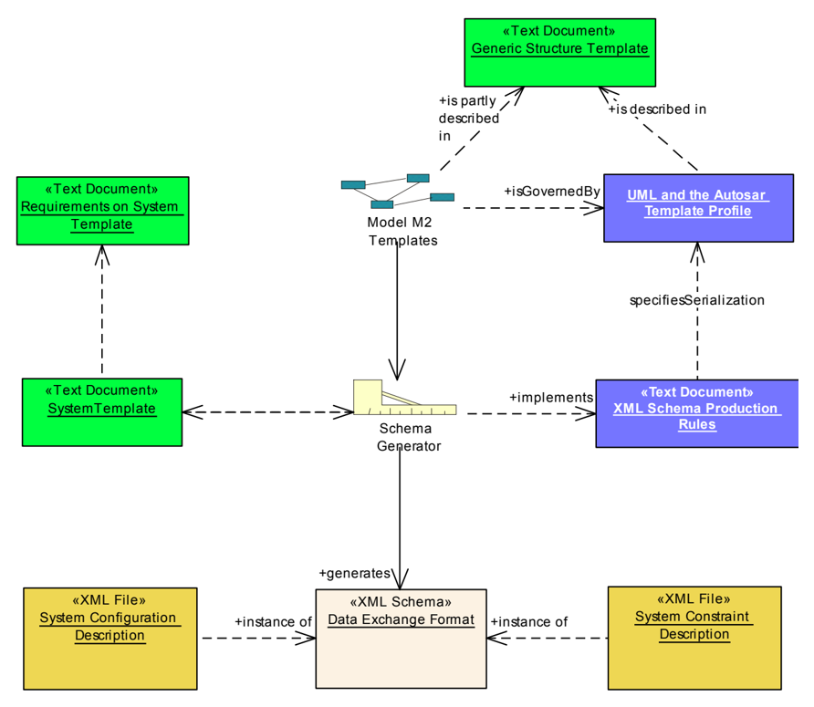

以下文档描述该方法论的各个方面：

1. 模板文档（本例中为系统模板）描述模板中可以捕获的信息，与该模型到 XML 技术的映射无关。它包含对 AUTOSAR 元模型相关部分中可捕获的全部信息的语义（精确含义）的详尽描述。
2. AUTOSAR 元模型 [\[1\]](#ref-1) 中称为 **M2 Templates** 的模型包含以 UML 建模的 AUTOSAR 模板结构。该模型以注释（notes）标注，这些注释在模板文档中同样以类表的形式呈现。
3. 称为通用结构模板（**Generic Structure Template**，即本文档）的文档体现为元模型中的预定义类等，这些内容被并入生成的 schema。
4. 模板 UML 构型与建模指南（**Template UML Profile and Modeling Guide**）描述创建元模型内容时所应用的基本概念。这些信息在第 2 章中呈现。
5. 称为 XML Schema 生成规则（**XML Schema Production Rules**）的文档 [\[3\]](#ref-3) 描述如何使用 XML，以及“软件组件模板”中设计的元模型应如何由“Schema 生成器”（MDS）翻译为 XML Schema（XSD）“数据交换格式”。

这一“形式化策略”应当用于元模型中形式化描述的所有数据。特别地，为理解元模型与基于 XML 的 AUTOSAR 模板之间的映射，值得阅读本文档。

6. 数据交换格式（**Data Exchange Format**）体现为一个 XML schema，它依据 XML Schema 生成规则中定义的方法与模式从 AUTOSAR 元模型自动生成。该 schema 通常用作 AUTOSAR 工具的输入。
7. M1 层描述（在图 1.1 中表现为“System configuration description”与“System Constraint Description”）是可以对照该 XML schema 校验的 XML 文件，随后遵循相关“模板文档”中的规范。换言之，这些 XML 文件是定义模板的 XML 表示的 schema 的实例。

### 1.4. 元模型的组织

图 1.2 勾勒了元模型的总体结构，该元模型形式化地定义了描述 AUTOSAR 软件组件所需的词汇。如图所示，其他模板规范（例如 ECU 资源模板 [\[4\]](#ref-4) 与系统模板 [\[5\]](#ref-5)）也采用相同的建模方法，以便定义一个整体一致的 AUTOSAR 软件描述模型。

图中的虚线箭头表示元模型内部各包之间依赖关系（即导入关系）。例如，包 `SWComponentTemplate` 导入了包 `GenericStructure`（本文档所描述）与 `ECUResourceTemplate` [\[4\]](#ref-4) 中定义的元类。

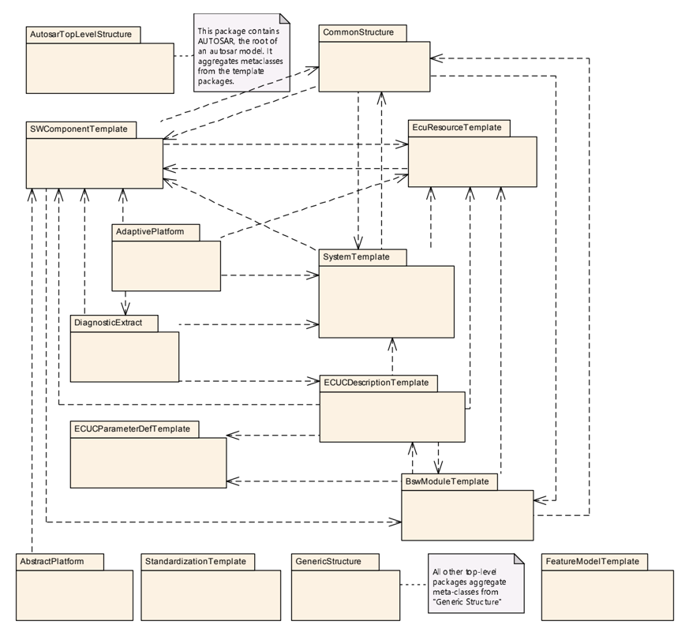

为澄清起见，请注意包 `GenericStructure` 包含一些基础性的基础设施元类与通用模式。由于它们被所有其他模板规范使用，为清晰起见，图中未描绘指向它的依赖关联。

## 2. AUTOSAR 模板中 UML 的使用

AUTOSAR 元模型以 UML 模型定义。因此，理解各 AUTOSAR 模板文档需要具备 UML 的基础知识。

### 2.1. UML 图

AUTOSAR 模板文档中的图与 UML 2.0 一致。底层模型（AUTOSAR 元模型）被假定为完整的，即使为了便于理解，某个特定的图中可能未展示某些元素。尽管如此，类表会给出全部相关信息。

图中的着色通常在周围的文字中解释。但总体而言，浅绿色的元类取自 ASAM/MSR。

实例引用（**instance ref**）的表示如图 5.9 所示（参见 [TPS\_GST\_00044]）。

### 2.2. AUTOSAR 元模型层次

AUTOSAR 模板的完整元模型层次如图 2.1 所示。与 OMG 使用的经典四层架构不同，图中展示了五个元层次。从最低、最具体的元层次开始，它们分别是：

#### M0：AUTOSAR 对象

这是运行中的 AUTOSAR 系统的实现：例如真实的 ECU 在执行包含风窗刮水器控制软件的软件映像。

#### M1：AUTOSAR 模型

这一元层次上的模型由 AUTOSAR 开发者构建。他们可以定义一个名为“风窗刮水器”的软件组件，它带有一组确定的端口并与另一个软件组件相连，等等。在这一层次上，描述 AUTOSAR 系统所需的全部制品都被细化，包括可复用的类型以及这些类型的特定实例。

AUTOSAR 软件被装载到单个车辆的各个 ECU 中。这种装载意味着 M1 模型被实例化。

请注意，这样的 AUTOSAR 模型可以用多种格式表示，从 XML 到 C 乃至 PDF。

#### M2：AUTOSAR 元模型

这一元层次上定义了 AUTOSAR 模板的词汇。这一词汇随后可供基于 AUTOSAR 的 ECU 系统的开发者使用。

例如，在 M2 上定义了 AUTOSAR 中存在一个称为“软件组件”的实体，它聚合一个称为“端口”的实体，等等。这一

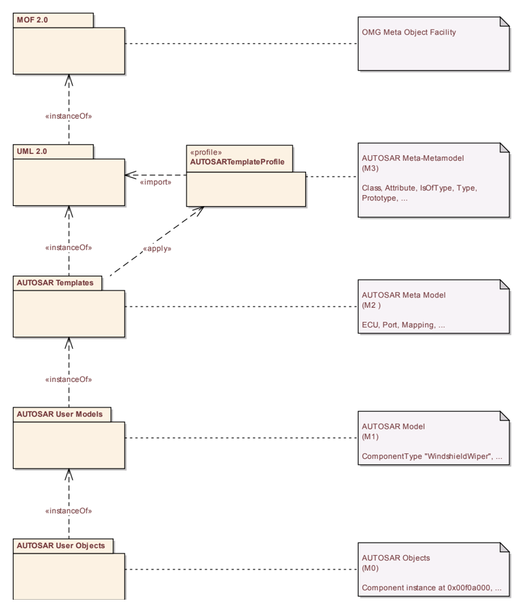

定义保证了 AUTOSAR 软件组件的开发者能够描述其特定的组件及其端口。这一描述称为 AUTOSAR 模型，位于 M1 层。

#### M3：AUTOSAR 模板的 UML 构型（profile）

M2 层上的 AUTOSAR 模板按照 M3 层定义的元模型构建。如前所述，这是 UML 加上一个为更好地支持模板建模工作而设的特定 UML 构型（profile）。

形式上，M2 层的模板仍然是 UML 的实例，但同时应用了模板构型，即还需要遵守构型中各构型（stereotype）所设定的规则。该构型的相关细节在第 2.3 章和第 2.4 章中规定。

请注意，AUTOSAR 模型可以用多种格式表示，从 XML 到 C 乃至 PDF。这些格式之间的转换称为“转换”（**transformation**），而 AUTOSAR 模型遵循 AUTOSAR 元模型这一事实称为“实例化”（**instantiation**）。因此，AUTOSAR 模型（M1）被称为 AUTOSAR 元模型（M2）的实例。

### 2.3. 构型（Stereotypes）

AUTOSAR 模板构型（Template Profile）使用以下构型<sup>1</sup>：

- **&lt;atpAbstract&gt;** — 适用于关系（关联、聚合）：这表示该关系是抽象的。每个具体子类中都需要有一个特化的关系来重定义该抽象关系。设置这一构型是为了在图中提供更好的可视化。关系是抽象的这一事实通过在模型中将该角色定义为“派生（derived）”来建模；在图中也通过角色名前的“/”来指示。
- **&lt;atpDerived&gt;** — 适用于关系（关联、聚合）：这表示该关系通过继承存在于子类中。它还进一步表明，在 M1 模型中该关系是由其他信息计算（派生）得出的。

  计算分为两类：

  - **general** — 表示该值由抽象关系注释中所描述的方法计算。例如 `atpBase` 被计算为第一个 `atpContextElement` 的容器。
  - **derived union** — 表示它被派生为所有具体关系的并集。

  例如，从 `AtpClassifier` 到 `AtpFeature`、角色为 `atpFeature` 的聚合是 **&lt;atpDerived&gt;** 的：`SwComponentType` 在 `component`、`port` 等之外还拥有一个 `atpFeature` 关联。该 `atpFeature` 被计算为各具体 feature 的并集。

  derived union 意味着：对于一个给定的组件类型，其 `atpFeature` 属性持有它的端口**以及**它所包含的组件原型**以及**它所包含的连接器。这使得能够在抽象层次上定义实例引用。

  更多细节参见第 5 章。

- **&lt;atpMixed&gt;** — 适用于类：仅应用于元类，表示一个不含交杂文本的混合内容模型。

  更多细节参见第 2.3.1 章。

- **&lt;atpMixedString&gt;** — 适用于类：这是一个含交杂文本的混合内容模型。仅应用于元类。

  更多细节参见第 2.3.1 章。

- **&lt;atpObject&gt;** — 适用于类：这是一个隐式基类。它只能提供带有 `xml.attribute=true` 标签的属性。

  更多细节参见第 6.3.3 章。

- **&lt;atpSplitable&gt;** — 适用于关系：通过使用构型 **&lt;atpSplitable&gt;**，元模型可以显式地定义元模型的实例如何分布到多个文件中。默认情况下所有数据存储在单个文件中。若应用了 **&lt;atpSplitable&gt;**，则关联或聚合的信息可以存储在不同的文件中。

  关于可拆分元素和 splitkey 的更多信息参见第 8 章。

- **&lt;atpIdentityContributor&gt;** — 适用于聚合、关联和原始属性：这一构型应用于对 M1 元素的标识（identity）有贡献的聚合、关联和原始属性，例如 `shortName` 属性。带有 **&lt;atpIdentityContributor&gt;** 构型的属性参与 splitkey 的构成，splitkey 控制来自部分模型（partial models）的可拆分元素的合并。

  关于可拆分元素和 splitkey 的更多信息参见第 8 章。

- **&lt;atpVariation&gt;** — 适用于类和关系：这表示变体处理。它既应用于元类，也应用于关联或聚合。

  更多细节参见第 7 章。

- **&lt;atpUriDef&gt;** — 适用于关联：这表示本质信息只是引用目标的全限定名（full qualified name）。它随后被整体用作特定用途的标识符。该关联充当 AUTOSAR 模型中一种“通用资源标识符”（**Universal Resource Identifier**）的定义。

  请注意，在这种情况下只有全限定 shortName 路径是重要的，目标本身的 shortName 乃至目标本身都不重要。其具体语义以及后续处理取决于各个用例。

  因此，并不总是需要真正地追随 **&lt;atpUriDef&gt;** 构型所修饰的引用。除非用户或特定用例明确要求，工具不应当对该构型的悬挂引用（dangling references）发出警告。

  例如 `EcucReferenceDef.destination`：该引用表明 `EcucReferenceValue` 的有效目标应当是其 definition 派生自 `EcucReferenceDef.destination` 目标的 `EcucContainerValue`。即使目标 `EcucReferenceDef.destination` 并不真实可用，这一点也可以得到校验。

- **&lt;instanceRef&gt;** — 适用于依赖：用于在图中提供实例引用的简化表示。
- **&lt;instanceRef&gt;** 与 **&lt;atpUriDef&gt;** 组合：如果构型 **&lt;instanceRef&gt;** 和 **&lt;atpUriDef&gt;** 同时应用于一个依赖，则 [TPS\_GST\_00029] 中定义的 **&lt;atpUriDef&gt;** 语义应当应用于该实例引用的所有子引用。

  关于实例引用的更多细节参见第 5.1.3 章。

- **&lt;isOfType&gt;** — 适用于关联：用于强调原型（`AtpPrototype` 的子类）与类型（`AtpType` 的子类）之间的具体关系。

  这一构型影响按照第 6.3.2 章进行的关联生成<sup>3</sup>。

> **1** 这些构型的名称以 atp 开头，它是“AUTOSAR Template Profile”的缩写。
>
> **2** 作为这种重定义的结果，XSD 生成器会忽略此类抽象关系。
>
> **3** 注意，这一构型对于“此类关联需要直接或间接地重定义角色 `atpType`”这一事实而言是冗余的。

**约束：以构型 &lt;isOfType&gt; 修饰的引用必须存在**

如果 `AtpPrototype` 的一个子类定义了一个以构型 **&lt;isOfType&gt;** 修饰的、指向 `AtpType` 某个子类的引用，则该引用必须始终存在。

### 2.3.1. 混合内容（&lt;atpMixed&gt;、&lt;atpMixedString&gt;）

如果一个元类拥有多个属性（其中可以包括聚合或引用），在某些情况下，M1 模型中的“序列化”表示（如 XML）会为属性实例的实际顺序和出现次数添加语义。也可能出现如下要求：同一属性以多个实例（在 M1 中）出现，并且与其他属性的实例相互交杂。这种情况无法用 UML 简单地表达。

此外，如果模型需要描述类似文档的信息，它往往需要把形式化内容与文本混合在一起。这类模型的一个例子是 HTML 中的嵌入式链接：形式化信息片段的标记混入普通文本之中，如下例所示：

```
[...]meet <a href="/wiki/Runtime" title="Runtime">runtime</a> requirements of automotive devices[...]
```

该示例说明，“混合内容”特性在 XML 领域早已广为人知，在那里它被称为 mixed content<sup>4</sup>。

**混合内容的基本特性**

下表从建模的角度列出了混合内容的特性。在一个混合内容实例中：

- 一组形式化定义的模型元素可以以任意顺序、任意次数出现；
- 但实际出现的顺序就整体对象的语义而言是相关的；并且
- 在 **&lt;atpMixedString&gt;** 的情况下，非限定文本（unqualified text）可以交杂在任何形式化定义的元素之间。

AUTOSAR 通过以下构型支持这一机制：

- **&lt;atpMixedString&gt;**（[TPS\_GST\_00025]）——允许在数据元素之间出现文本；
- **&lt;atpMixed&gt;**（[TPS\_GST\_00024]）——允许该类的各属性以任意顺序任意混合。

后一种构型不允许混入文本，但在语法和语义上保留了顺序的定义。

**混合内容中的多重性上限**

混合内容类会在模板模型中聚合或引用若干其他类。这些关系的目标多重性通常为 1，因为按照 [TPS\_GST\_00032] 给出的定义，整体出现次数本来就是任意的。

但如果多重性不等于 1，则规定了所需成组（grouping）的大小。

例如，若目标多重性为 2，则总是必须将这样的一对对象（而不只是单个对象）放入混合内容中，依此类推。

图 2.2 展示了它的工作方式。M1 模型以 XML 表示。请注意：

1. `MixedContent` 可以是 `a b c d e` 的任意混合、任意顺序。顺序在语义上是重要的。这与在 UML 中把一个多重性上限 &gt; 1 的聚合标注为 {ordered} 的意义相同<sup>5</sup>。
2. `c` 的多重性上限 &gt; 1，因此存在针对多重性的包装元素。
3. `e` 合法地缺失，因为按照定义整体出现次数是任意的。

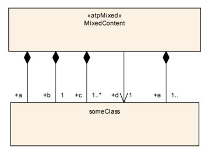

**混合内容中继承的属性**

- 被继承的混合属性属于混合内容的一部分，可以与自有混合属性自由混合。
- 来自本身不是 **&lt;atpMixed&gt;** 的类的被继承属性，不属于混合内容。
- 属性（`xml.attribute` 置为 `true` 的）和被继承的属性不属于混合内容。

进一步注意，在 **&lt;atpMixedString&gt;** 中，除 `xml.attribute` 置为 `true` 的属性外没有其他被继承的属性。

> **4** <http://www.w3schools.com/schema/schema_complex_mixed.asp>
>
> **5** 在 UML 中无法为类标注这一注解。

### 2.3.2. StructuredComment 元素（&lt;atpStructuredComment&gt;）

AUTOSAR 支持 StructuredComment，以提供旨在形成注释的辅助信息。

**&lt;atpStructuredComment&gt;**

标记为 **&lt;atpStructuredComment&gt;** 的元素所包含的信息在模型中没有语义，在模型层次上可以被忽略。

**&lt;atpStructuredComment&gt; 与 &lt;atpSplitable&gt; 的相互作用**

在按照可拆分元素合并多个物理文件时，所有标记为 **&lt;atpStructuredComment&gt;** 的元素及其全部子元素都可以被忽略。

清单 2.1 通过提供关于生成工具及其版本的信息，展示了 **&lt;atpStructuredComment&gt;** 的用法。

清单2.1：ARXML 文件中的 FileInfoComment

```xml
<AUTOSAR xmlns:xsi="http://www.w3.org/2001/XMLSchema-instance"
         xmlns="http://autosar.org/schema/r4.0"
         xsi:schemaLocation="http://autosar.org/schema/r4.0 AUTOSAR_00052.xsd">
  <FILE-INFO-COMMENT>
    <SDGS>
      <SDG GID="GENERATION-INFO">
        <SD GID="TOOL-VERSION">ToolA.1.2.3</SD>
        <SD/>
      </SDG>
    </SDGS>
  </FILE-INFO-COMMENT>
  <ADMIN-DATA>
```

表2.1：FileInfoComment

| 类         | FileInfoComment                                                                                           |
|------------|-----------------------------------------------------------------------------------------------------------|
| 包         | M2::AUTOSARTemplates::AutosarTopLevelStructure                                                            |
| 注意       | 该类支持 StructuredComment，以提供旨在形成注释的辅助信息。                                                   |
| 基类       | ARObject                                                                                                  |
| 聚合于     | AUTOSAR.fileInfoComment                                                                                   |

| 属性 | 类型 | 多重性 | 类别 | 注意 |
|------|------|--------|------|------|
| sdg  | Sdg  | *      | aggr | 该属性允许保留标准模型未表示的特殊数据。它可用于保存例如工具特定的数据。 |

### 2.4. UML 标签

AUTOSAR 模板构型使用以下 UML 标签。注意，这里只列出直接影响元模型语义内容的标签。

**UML 标签在适合时附着于关系的目标端**

除非特定 UML 标签另行规定，UML 标签附着于关系（关联、聚合）的目标端。对于依赖（Dependency）和泛化（Generalization），UML 标签与连接符本身相关联（以克服 AUTOSAR 所用 UML 工具（EA）的限制）。

- **atp.recommendedPackage**：该标签为给定元类的对象提供一个推荐的包名，从而为 {kind} 提供取值。通常它就是该标签所附着元类的名称。请注意：

  - 该标签会传播到子类；
  - 该标签只应用于 `PackageableElement` 的子类。

  可能的取值是 [\[6\]](#ref-6) 中定义的各种 manifest，例如 Machine Manifest、Execution Manifest、Service Instance Manifest。{kind} 的取值在第 3.1 章中描述。

- **atp.Splitkey**：规定 **&lt;atpSplitable&gt;** 关系的标识键。该标签规定一个以逗号分隔的列表，其元素是 [TPS\_GST\_00416] 中定义的属性。这些属性是按照 [TPS\_GST\_00047] 在部分模型中构造 M1 元素标识的基础。

  更多细节参见第 8 章。

### 2.4.1. 生命周期标签

**表示生命周期信息的标签**

AUTOSAR 通过名为 `atp.Status*` 和 `map.Status` 的标签，在 UML 模型的实体上标注其相对于生命周期的状态。

- **atp.Status**：该标签允许规定元模型实体相对于其生命周期的当前状态。它适用于类、聚合、关联和属性。支持以下取值：

  - **VALID** — 表示相关实体是文档的有效部分。
  - **DRAFT** — 表示相关实体是元模型中新增的、仍处于试验状态的实体。该信息已发布，但可在不受向后兼容性管理约束的情况下变更。
  - **CANDIDATE** — 用于尚未成为有效（valid）但仍应被 AUTOSAR BWC 检查器（针对 XML schema）识别的相关实体。相关实体的任何 BWC 不兼容变更都应由 BWC 检查器报告。
  - **OBSOLETE** — 表示相关实体已废弃，出于兼容性原因保留在元模型中。若设置了该标签，注释（note）应当表述推荐的替代方案。
  - **REMOVED** — 表示相关实体仍因某种原因（例如在 lifeCycles 的上下文中）留在元模型中。它不得再被使用，甚至不应再出现在文档中。AUTOSAR 发布版不包含这样的元素。它面向 AUTOSAR 内部开发。在 M1 用例中，这类被移除的元素不会包含在 .arxml 交付物中，但可以通过 `Referrable` 类型的 **&lt;atpUriDef&gt;** 属性在 LifeCycleInfoSet 中被引用：`lcObject`，相应地还有 `useInstead`。

  类与聚合/引用中 LifeCycleState 的允许组合见表 [TPS\_GST\_00440] 和表 [TPS\_GST\_00441]。若未规定该标签，则相关实体是当前元模型的有效（VALID）部分。该标签应当应用于关联的目标端。

  若希望在图的注释中显示该标签，也可以将其应用于关联本身。

  未验证的新引入元素通常以 `LifeCycleState = DRAFT` 创建，与假定的置信水平无关。在后续发布版中，它们可以以对 AUTOSAR schema 不兼容的方式变更。

  为缓解这种情况，由概念（concept）引入的元模型元素以 `LifeCycleState = CANDIDATE` 呈现。具有该 LifeCycleState 的模型元素成为（BWC）兼容性检查器的检查对象，这避免了此类模型元素以不兼容方式被意外变更而未被察觉的情况。

  `LifeCycleState = CANDIDATE` 只适用于元模型元素，不适用于规范项（specification items）的 LifeCycleState。

  请注意，[TPS\_GST\_00051] 关注的是 M2 实体（元模型），而 [TPS\_STDT\_00064] 针对 M1 实体（模型）表达了同样的内容。

  请注意，清单 12.1 以 AUTOSAR arxml 文件的形式提供了这些取值。

- **atp.Status 的默认值**

  元模型的 `atp.Status` 默认值为 “valid”；关联从其源端继承该值；聚合和属性从其父元素继承该值。

- **atp.StatusRevisionBegin**：该标签指示从哪个 AUTOSAR 发布版起 `atp.Status` 所标注的状态有效。它对应于 [TPS\_GST\_00244] 规定的 periodBegin。
- **atp.StatusRevisionEnd**：该标签指示从哪个 AUTOSAR 发布版起 `atp.Status` 所标注的状态有效。它对应于 [TPS\_GST\_00244] 规定的 periodEnd。
- **atp.StatusComment**：这是按照 [TPS\_GST\_00051] 对当前状态的一段简短说明。它主要应用于 “valid” 以外的状态取值。
- **map.Status**：该标签允许为上游映射定义生命周期。该标签的取值与 `atp.status` [TPS\_GST\_00051] 的取值相关联。

元类/枚举的成员所允许的 LifeCycleState 定义于 [TPS\_GST\_00440]。元类成员的目标/类型所允许的 LifeCycleState 定义于 [TPS\_GST\_00441]。两表表示直接子元素，不考虑继承。

**元模型（聚合/引用/属性/枚举字面量）允许的 LifeCycleState**

表2.2：图例：1=允许的组合

| 类/枚举（父/源）的 LifeCycleState | DRAFT | CANDIDATE | VALID | OBSOLETE | REMOVED |
|-----------------------------------|-------|-----------|-------|----------|---------|
| DRAFT                             | 1     |           |       | 1        | 1       |
| CANDIDATE                         |       | 1         |       | 1        | 1       |
| VALID                             | 1     | 1         | 1     | 1        | 1       |
| OBSOLETE                          |       |           |       | 1        | 1       |
| REMOVED                           |       |           |       |          | 1       |

**元模型元类允许的 LifeCycleState**

表2.3：图例：1=允许的组合

| （聚合/引用/属性）的 LifeCycleState | DRAFT | CANDIDATE | VALID | OBSOLETE | REMOVED |
|-------------------------------------|-------|-----------|-------|----------|---------|
| DRAFT                               | 1     |           | 1     |          |         |
| CANDIDATE                           |       | 1         | 1     |          |         |
| VALID                               |       |           | 1     |          |         |
| OBSOLETE                            | 1     | 1         | 1     | 1        |         |
| REMOVED                             | 1     | 1         | 1     | 1        | 1       |

表 [TPS\_GST\_00440] 与表 [TPS\_GST\_00441] 的适用范围如图 2.3 所示。

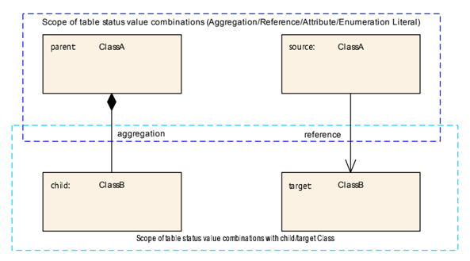

图 2.4 展示了几种无效的情况：

- `ClassA` 的 `LifeCycleState = OBSOLETE` 却拥有 `LifeCycleState = VALID` 的成员（聚合与引用）。这违反表 [TPS\_GST\_00440]。
- 图中所示 `LifeCycleState = VALID` 的聚合与引用以 `LifeCycleState = OBSOLETE` 的 `ClassB` 为目标。这违反表 [TPS\_GST\_00441]。

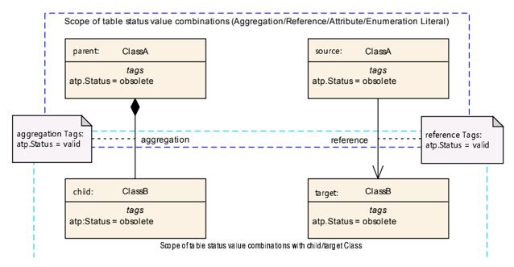

**atp.EnumerationLiteralIndex**

该标签允许为特定的枚举字面量定义一个索引。该索引允许把某个枚举字面量规定为数值函数（尤其是公式表达式的结果）的结果。该索引在一个特定的 Enumeration 元类内是唯一的。

清单2.2：枚举属性值变体点示例

```xml
<DIAGNOSTIC-CONTRIBUTION-SET>
  <SHORT-NAME>DiagSet1</SHORT-NAME>
  <COMMON-PROPERTIES>
    <DIAGNOSTIC-COMMON-PROPS-VARIANTS>
      <DIAGNOSTIC-COMMON-PROPS-CONDITIONAL>
        <DEBOUNCE-ALGORITHM-PROPSS>
          <DIAGNOSTIC-DEBOUNCE-ALGORITHM-PROPS>
            <SHORT-NAME>DiagDebounce</SHORT-NAME>
            <DEBOUNCE-BEHAVIOR BASE="DefaultEnumMappingTables"
                               ENUM-TABLE="DiagnosticDebounceBehaviorEnum">
              <SYSC-REF DEST="SW-SYSTEMCONST">processor</SYSC-REF> == 42 ? 0 : 1
            </DEBOUNCE-BEHAVIOR>
          </DIAGNOSTIC-DEBOUNCE-ALGORITHM-PROPS>
        </DEBOUNCE-ALGORITHM-PROPSS>
      </DIAGNOSTIC-COMMON-PROPS-CONDITIONAL>
    </DIAGNOSTIC-COMMON-PROPS-VARIANTS>
  </COMMON-PROPERTIES>
</DIAGNOSTIC-CONTRIBUTION-SET>
```

在清单 2.2 中，`DiagnosticDebounceAlgorithmProps` 的行为由一个形式化表达式计算。若该形式化表达式的结果为 42，则得到 “0”。该 numericalValue 在 M2 层上标记一个索引，并映射到 `DiagnosticDebounceBehaviorEnum` 的枚举字面量 `FREEZE`。若计算结果不是 42，则得到 “1”，并落到 `DiagnosticDebounceBehaviorEnum` 的枚举字面量 `RESET`。这些映射基于 **&lt;mmt.EnumerationLiteralIndex&gt;** 定义的数值“等价物”。参见 [\[7\]](#ref-7) 中的 EnumerationMappingTable。numericalValue 不用于 CCode，也不在运行时使用。

### 2.4.2. 文档生产控制标签

AUTOSAR 规定了一种手段，用于控制平台特定内容在规范文档中的呈现。这些限制的语义进一步解释如下：

- 在文档层次上：[TPS\_GST\_00428]；
- 在建模层次上：[TPS\_GST\_00431]。

该手段是元模型制品（artifact）特定的，进一步解释如下：

- 元模型类、连接符和属性：[TPS\_GST\_00372]；
- 元模型图：[TPS\_GST\_00429]；
- 元模型描述：[TPS\_GST\_00430]。

**文档层次上的标准限制**

标准限制（standards restriction）的使用控制模型元素在所提及标准范围内生成的文档制品中的呈现。若一个标准限制应用于某个模型元素，则该模型元素应当只出现在由该限制的取值所标识的标准的生成制品中。

**标准限制在建模层次上的影响**

由于 [TPS\_GST\_00372] 而对相应平台不可见的模型元素，即使在模型中可见地存在，也被隐式地排除在模型中的任何进一步语义之外。

若没有 [TPS\_GST\_00431]，就必须在 [TPS\_GST\_00372] 的限制之外再编写形式化的 AUTOSAR 约束，以进一步限制模型中这些被排除制品的任何使用或关联。这会显著增加约束的数量。一个明显的例子是：某个模型中被限制的制品可以存在，但一旦考虑标准限制，它们就不具有任何文档语义。

**控制规范文档生产的标签**

名为 `mmt.*` 的 UML 标签控制规范文档的生产。

- **mmt.RestrictToStandards**：该标签的使用控制元类、连接符和属性等模型元素在生成制品中相对于所提及标准的呈现。若 `mmt.RestrictToStandards` 应用于某个模型元素，则该模型元素应当只出现在由 `mmt.RestrictToStandards` 取值所标识的标准的生成制品中。`mmt.RestrictToStandards` 的取值是一个以逗号分隔的列表，包含一个或多个下列值：“CP”、“AP”、“FO”、“TC”、“TA”。列表中值周围的空白没有意义。

  示例：`Tags:mmt.RestrictToStandards = "CP , AP"`

  若未应用标准限制标签，或值部分的列表为空，则假定不施加限制，制品为所有标准生成。

  AUTOSAR 为所有平台定义了一个统一的元模型。这允许复用既有元类。某些元类会拥有对各标准相互排斥的属性、聚合或引用——例如与经典平台相关的属性应当只出现在为经典平台生成的制品中。

- **mmt.templateTable**：

  该标签用于将模板与给定的变体点（variation point）相关联。取值是一个以空白分隔的模板列表，模板名称遵循 [TR\_PDN\_00003]；具体而言，它是 [\[8\]](#ref-8) 中集合 “DocumentAbbreviations” 里分类为 DocumentAbbreviation 的 Keyword 所定义的 abbrName（例如 `SWCT`）。

  `mmt.templateTable` 标签应用于任何含有对元模型有贡献的对象的包。

  `mmt.templateTable` 传递地应用于定义所在包的所有子包。尽管如此，子包可以覆盖祖先包上 `mmt.templateTable` 提供的值。

**元模型图的标准限制应用**

元模型图的标准限制应用是一个图注（Diagram Note），其取值为 JSON 格式的键/值，其中键为 `mmt.RestrictToStandards`，值为一个字符串，包含一个或多个下列以逗号分隔的值：“CP”、“AP”、“FO”。列表中值周围的空白没有意义。

示例：`{'mmt.RestrictToStandards' : 'CP , AP'}`

若未应用标准限制，或值部分的列表为空，则假定不施加限制，制品为上述所有标准生成。

**元模型描述字段的标准限制应用**

对应当出现在生成文档中的元类或连接符描述（角色注释）应用标准限制的方式，是在描述字段中使用一个嵌入式解析器令牌（parser token）将文本块指派给各个平台，由 AUTOSAR 文档工具套件处理。

示例：

```
@RESTRICT_TO_STANDARD:CP:AP! Classic and Adaptive text. @RESTRICT_TO_STANDARD:FO! Foundation text. @END_RESTRICT_TO_STANDARD!
```

若未应用标准限制，或值部分的列表为空，则假定不施加限制，制品为上述所有标准生成。

### 2.4.3. 变体处理标签

**表示变体处理属性的标签**

名为 `vh.*` 的 UML 标签与变体处理相关。

- **vh.latestBindingTime**：该标签控制变体处理的施加时间（binding time）。更多细节参见第 7.6 章 [TPS\_GST\_00182]。
- **vh.variationPointApplicable**：将该标签设置为 “false” 即标识出“幽灵变体点”（**Ghost Variation Points**）。关于“幽灵变体点”的更多信息，参见第 7.1.3 章 [TPS\_GST\_00185]。

### 2.4.4. Schema 生产配置标签

**用于配置 XML schema 生产的 UML 标签**

名为 `xml.*` 的 UML 标签与 AUTOSAR 模型的 XML 序列化相关。它们基本上不影响 M1 模型的语义，但保证 XML 序列化可以由元模型控制。

它们还提供了对 schema 进行微调的手段，使得在元模型演化的同时能够保证 schema 的向后兼容性。

关于如何应用这些标签及其影响的更多细节，参见 [\[3\]](#ref-3) 中的“4 Configuration of XML schema production”章。

- **xml.xsd.\* 等**：这些标签允许使用 XSD 限制来定义原始类型（primitive types）的细节。即使它是借助一种技术特定的定义规定的，它也独立于存储技术而适用于元模型。
- **xml.xsd.customType**：该标签适用于 **&lt;primitive&gt;**。它规定表示该原始类型的 `xsd:simpleType` 的名称。
- **xml.attribute**：规定该 UML 属性是否序列化为一个 XML 属性。该标签允许控制 XML 序列化，与 M1 模型的语义无关。
- **xml.attributeRef**：规定该 UML 属性是否序列化为对一个全局 XML 属性的引用。若置为 `true`，则将该属性序列化为对一个全局属性的引用。仅在 `xml.attribute` 置为 `true` 时适用。

  被引用属性的名称由 `xml.name` 规定。被引用属性的命名空间前缀由 `xml.nsPrefix` 规定。

- **xml.enforceMinMultiplicity**：若为 `true`，强制最小多重性；否则为 “0”。为了允许传输部分信息，标准化 schema 中默认不强制最小多重性。
- **xml.enforceMaxMultiplicity**：若为 `true`，强制最大多重性；否则为 “unbounded”。`xml.enforceMaxMultiplicity` 默认为 `true`。
- **xml.globalElement**：若为 `true`，为被标记的类创建一个全局 `xsd:element`。该 `xsd:element` 可以用作 schema 实例的根元素。该标签需要在 AUTOSAR 元模型中显式定义。通常只有元类 `AUTOSAR` 由一个全局定义的 XML 元素表示。
- **xml.mds.type**：当某原始类型是由元模型工具生成的类型时，该标签规定其数据类型。这类生成类型的主要例子是 `REFERRABLE-SUBTYPES-ENUM`。该标签应当应用于一个 **&lt;primitive&gt;**，后者随后充当 `xml.mds.type` 所指类型的代理（proxy）。
- **xml.name**：提供表示该角色或类的 schema 片段（元素、属性、组等）的名称。

  若未在 AUTOSAR 元模型中显式定义，则该值按照 [\[3\]](#ref-3) 中说明的方式计算。

- **xml.nsPrefix**：该标签可应用于属性，为 `xml.attributeRef` 置为 `true` 的属性确定命名空间前缀；应用于包时，为基于该包的 schema 确定所使用的命名空间前缀。
- **xml.nsUri**：为基于该包的 schema 确定所使用的命名空间 URI。命名空间 URI 的格式定义于 [\[3\]](#ref-3)。若未在 AUTOSAR 元模型中显式定义，则该值按照 [\[3\]](#ref-3) 中说明的方式隐式指定。
- **xml.roleElement、xml.roleWrapperElement、xml.typeElement、xml.typeWrapperElement**：这些标签允许控制 XML 序列化，尤其是 XML 元素的创建，与 M1 模型的语义无关。更多细节参见 [\[3\]](#ref-3)。
- **xml.sequenceOffset**：确定各属性在 XML 中序列化的顺序。若缺少该标签，属性按字母顺序序列化。该顺序只影响 XML 制品的维护便利性，与 M1 模型的语义无关。<sup>6</sup>

> **6** 若顺序是相关的，则在模型中以 {ordered} 多重性表示。

### 2.4.5. 管理 UML 标签

**管理类 UML 标签**

为了元模型的文档管理，名称模式为 `admin.*` 的 UML 标签应用于一个特定的包（例如 `M2::AUTOSARTemplates::ReadMe`）。若该包在“元模型工具”（**Meta-Model Tool**，MMT）的配置文件中被引用，则这些取值会被传递到生成的制品（例如 `MMOD_XMLSchema` 或 `MOD_ECUConfigurationParameters`）。

除 UML 标签外，生成制品的免责声明（disclaimer）也取自该包的包注释。

适用的 UML 标签如下：

- **admin.documentClassification**：表示元模型的分类（Standard 或 Auxiliary）。
- **admin.documentIdentificationNo**：表示 AUTOSAR 文档编号。
- **admin.documentOwner**：表示元模型的维护者。
- **admin.documentResponsibility**：表示元模型的责任机构。
- **admin.documentStatus**：表示元模型的状态。
- **admin.documentTitle**：表示指派给元模型的标题。
- **admin.documentVersion**：表示元模型的正式版本。注意，文档版本与 `admin.partOfRelease` 无关，因此像 3.1.12 这样的版本号不一定指 AUTOSAR 的 R3.1 分支。

AUTOSAR 区分外部与内部 AUTOSAR 发布版编号：

- 外部 AUTOSAR 发布版编号采用 R&lt;yy&gt;.&lt;mm&gt; 格式（例如 R20-11），标识面向外部社区的某次 AUTOSAR 发布，参见 [TPS\_GST\_00074]。
- 内部 AUTOSAR 发布版编号采用 RevisionLabelString 定义的格式（例如 4.6.0），用于 AUTOSAR 发布版的内部标识与引用。内部发布版编号用于例如 BSW 模块、XML schema 和 ARXML 文件中，参见 [TPS\_GST\_00076]。

- **admin.partOfRelease**：表示元模型发布所在的外部 AUTOSAR 发布版（例如 R20-11）。注意，该标签是必需的，因为工具链要用它来控制各类生成器的细节，例如：

  - 为早于 4.0 的 AUTOSAR 发布版插入硬编码的名为 `REF` 的 `xsd:simpleType`；
  - 按照各自的实现处理原始类型；
  - 各 AUTOSAR 发布版之间制品（例如类表）的结构差异。

  原始类型实现的细节在第 6.3.1 章中描述。

- **admin.releaseDate**：表示元模型发布所在的 AUTOSAR 发布版的日期。
- **admin.revision**：表示元模型发布所在的内部 AUTOSAR 发布版的特定修订（revision）。

### 2.4.6. 上游映射规范标签

**规定上游映射的标签**

名为 `map.*` 的 UML 标签与上游映射的描述相关。上游映射描述方法论中较晚创建的 M1 实体（下游）如何与较早创建的实体（上游）相关联（映射）。

- **map.template**：

  - 表示适用的上游 M2“模板”的列表，映射将在其中列出。
  - 格式为一个以逗号分隔的列表，包含一个或多个“模板”。列表中值（“模板”）周围的空白没有意义。
  - 每个“模板”遵循 [TR\_PDN\_00003]；具体而言，它是 [\[8\]](#ref-8) 中集合 “DocumentAbbreviations” 里分类为 DocumentAbbreviation 的 Keyword 所定义的 abbrName（例如 `SWCT`）。

  ```
  示例：map.template=TPS_SWCT,TPS_DEXT
  ```

- **map.param**：

  - 表示适用的上游 M2 元素的列表，M1 参数应当映射到这些元素。
  - 格式为一个以逗号分隔的列表，包含一个或多个“节点路径”。列表中值（“节点路径”）周围的空白没有意义。
  - 每个“节点路径”是到相应 M2 元素的全限定元模型节点路径。

  ```
  示例：map.param=SystemTemplate::Fibex::Fibex4Can::CanCommunication::CanFrameTriggering.canAddressingMode, SystemTemplate::Fibex::Fibex4Can::CanCommunication::CanFrameTriggering.canFrameRxBehavior
  ```

- **map.rule**：

  - 表示如何转换数据的自由文本描述。

  ```
  示例：map.rule=1:1 mapping
  ```

- **map.type**：

  - 表示映射质量。适用以下取值：**local** — 无需映射，因为参数是 BSW 本地的；**partial** — 部分数据可以自动映射，但不是全部；**full** — 全部数据都可以自动映射。

  ```
  示例：map.type=full
  ```

## 3. AUTOSAR 顶层结构

AUTOSAR 为所有 AUTOSAR 模板使用一个公共的顶层结构。这一做法为在 AUTOSAR 方法论中设计各制品保留了最大的灵活性。图 3.1 展示了 AUTOSAR 的顶层结构。

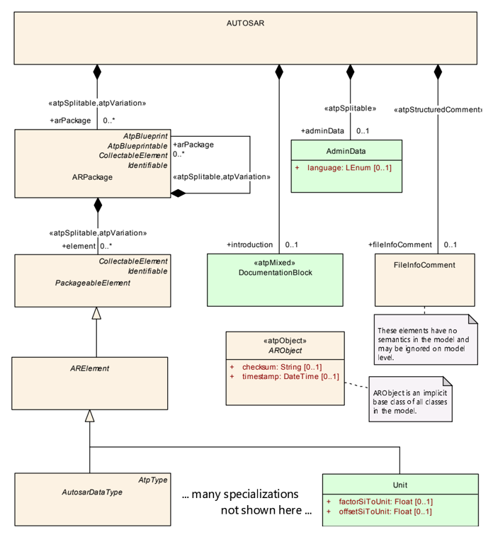

**AUTOSAR 模型的顶层结构**

元类 `AUTOSAR` 是所有模板的根。`AUTOSAR` 以 `arPackage` 的形式包含多个 `ARPackage`。

由于元类 `AUTOSAR` 作为所有模板（进而也是相应 XML 文档）的根，`AUTOSAR` 的这一唯一角色还通过赋予 `xml.globalElement` 标签来体现，另参见 [TPS\_GST\_00059]。

`ARPackage` 可以任意嵌套。这些包包含 `PackageableElement`，它们代表 AUTOSAR 模板中特定的自治实体。其中最突出的特化是 `ARElement`（参见第 4.2 章）。

请注意，所有 AUTOSAR 元类都继承自 `ARObject`（参见第 4.1 章）。<sup>1</sup>

**AUTOSAR 顶层的 AdminData**

顶层结构还包含 AdminData，它规定了 AUTOSAR 制品的两个主要方面：

- 以 `DocRevision` 规定的变更管理信息；
- 文档的语言状态。

更多细节参见第 4.5 章。

聚合的 introduction 刻意不带有 **&lt;atpSplitable&gt;** 构型。它由类 `DocumentationBlock` 表示，后者带有指示混合内容模型的 **&lt;atpMixed&gt;** 构型，参见 [TPS\_GST\_00024]。

**制品的语言状态**

制品的语言状态规定：

1. 文档的“主”语言，规定于顶层 AdminData 中的属性 `language`。
2. 文档中存在的其他语言。这规定为 `usedLanguages`，它是一个 `MultiLanguagePlainText`，充当文档所用语言的列表。

关于多语言方法的更多细节参见第 9.6 章。以下示例展示了一个 ARXML 文件的顶层结构。该文件同时以英语和德语维护，英语是主语言。

清单3.1：ARXML 文件的顶层结构

```xml
<?xml version="1.0" encoding="UTF-8"?>
<AUTOSAR xmlns:xsi="http://www.w3.org/2001/XMLSchema-instance"
         xmlns="http://autosar.org/schema/r4.0"
         xsi:schemaLocation="http://autosar.org/schema/r4.0 AUTOSAR_00052.xsd">
  <ADMIN-DATA>
    <LANGUAGE>EN</LANGUAGE>
    <USED-LANGUAGES>
      <L-10 L="EN" xml:space="default">English</L-10>
      <L-10 L="DE" xml:space="default">German</L-10>
    </USED-LANGUAGES>
  </ADMIN-DATA>
  <AR-PACKAGES>
    <AR-PACKAGE>
      <SHORT-NAME>demo</SHORT-NAME>
      <ELEMENTS>
        <!--autosar elements here-->
      </ELEMENTS>
    </AR-PACKAGE>
  </AR-PACKAGES>
</AUTOSAR>
```

另参见 AUTOSAR。

一个 AUTOSAR 制品按 `ARPackage` 组织，`ARPackage` 包含所谓的 `PackageableElement` 元素。这些元素按其自身的性质定义，彼此独立存在，并通过关联被使用。例如，一个计算方法（computation method）独立定义自身，并通过引用被数据定义所使用。

关于 `ARPackage` 的更多细节请参见第 4.2 章。

为了在顶层提供模型中没有语义的辅助信息，AUTOSAR 支持 **&lt;atpStructuredComment&gt;**，参见 [TPS\_GST\_00381]。

> **1** 显然 `ARObject` 不继承自其自身。

### 3.1. 标识包中的 M1 元素

包用于组织 AUTOSAR M1 模型。AUTOSAR GBR 本身将 M1 模型作为已发布标准的一部分发布。为了清晰地标识这些模型元素，适用以下规则：

**AUTOSAR 交付模型的包结构**

由 AUTOSAR 标准化并以 ARXML 交付的模型元素位于 shortName 为 `AUTOSAR` 的顶层包中。

这意味着由 OEM 或供应商定义的数据元素不应当位于名为 `AUTOSAR` 的顶层包中。

**AUTOSAR 交付模型的结构模式**

AUTOSAR 交付模型的包结构遵循以下模式：

```
/AUTOSAR
  /{module}                       --标识规范
    /{kind}s[_Blueprint | _Example] --标识对象的类别
```

请注意，AUTOSAR 通常交付 Blueprint。更多细节参见 [TPS\_STDT\_00067]。

一个示例结构为：

| /AUTOSAR                            |              |
|-------------------------------------|--------------|
| /ComM                               |              |
| /ApplicationDataTypes_Blueprint     | [BLUEPRINT]  |
| /BswModuleEntrys_Blueprint          | [BLUEPRINT]  |
| /CompuMethods_Blueprint             | [BLUEPRINT]  |
| /DataConstrs_Blueprint              | [BLUEPRINT]  |
| /DataTypeMappingSets_Blueprint      | [BLUEPRINT]  |
| /Documentations                     | [STANDARD]   |
| /ImplementationDataTypes_Blueprint  | [BLUEPRINT]  |
| /ImplementationDataTypes            | [STANDARD]   |
| /ModeDeclarationGroups_Blueprint    | [BLUEPRINT]  |
| /SwcBswMappings_Blueprint           | [BLUEPRINT]  |
| /SwComponentTypes_Blueprint         | [BLUEPRINT]  |
| /BswModuleDescriptions_Blueprint    | [BLUEPRINT]  |

在此示例中，既有实现数据类型的 blueprint 包，也有最终实现为 STANDARD 的实现数据类型的包。

另一个示例为：

| /AUTOSAR                            |              |
|-------------------------------------|--------------|
| /AISpecification                    |              |
| /DataConstrs                        | [STANDARD]   |
| /PhysicalDimensions                 | [STANDARD]   |
| /Units                              | [STANDARD]   |
| /ApplicationDataTypes_Blueprint     | [BLUEPRINT]  |
| /CompuMethods_Blueprint             | [BLUEPRINT]  |
| /PortInterfaces_Blueprint           | [BLUEPRINT]  |
| /PortPrototypeBlueprints_Blueprint  | [BLUEPRINT]  |
| /ApplicationDataTypes_Example       | [EXAMPLE]    |
| /BlueprintMappingSets_Example       | [EXAMPLE]    |
| /CompuMethods_Example               | [EXAMPLE]    |
| /PortInterfaces_Example             | [EXAMPLE]    |
| /SwComponentTypes_Example           | [EXAMPLE]    |

此示例展示了一个同时提供 STANDARD、BLUEPRINT 和 EXAMPLE 的用例。

**ECUC 参数定义的包结构**

请注意，出于兼容性原因，ECUC 包结构在 AUTOSAR 4.0 中保持为：

```
/AUTOSAR
  /EcucDefs
```

**AUTOSAR 定义模型元素的结构模式**

AUTOSAR 规范已经为其定义了标准化名称（例如平台类型）的模型元素，应当位于遵循以下模式的包路径中：

```
/AUTOSAR_{module}[_{postfix}]/{kind}s
```

在这些模式中，适用以下占位符：

- **{module}** 表示一个模块标志符（**Module Designator**）。模块标志符是以下之一：

  - 模块、库等（作为按照 [\[9\]](#ref-9) 的 API 服务前缀，例如 `CanIf`、`Ifx`、`Compiler`）；
  - [\[8\]](#ref-8) 中集合 “VirtualModules” 里分类为 ModuleDesignator 的 Keyword 所定义的 abbrName（例如 `AISpecification`）。

- **{postfix}** 表示特定的实现：当且仅当同一系统中出现同一 BSW 模块的多个实现时，才在包结构中附加一个后缀。
- **{kind}** 表示元素的类别：取值是 `ARElement` 某个子类的名称加复数后缀 “s”。各 `ARElement` 特定的包名通过 UML 标签 `atp.recommendedPackage` 规定（参见 [TPS\_GST\_00049]），并照此显示在类表中（例如由 `BswModuleDescription` 派生的 `BswModuleDescriptions`）。

**ARPackage 的类别**

`ARPackage` 的 `category` 属性取值可以作为该 `ARPackage` 内容性质的一个指示。`category` 属性的某些取值由 AUTOSAR 标准化：`STANDARD`、`BLUEPRINT`、`EXAMPLE`、`ICS`。`category` 属性自定义取值的定义适用 [TPS\_GST\_00016]。

- **BLUEPRINT**：此类包中的元素充当真实对象的一种“蓝图”。

  这特别适用于诸如 `PortInterface` 这类对象——它们并非特意被建模为“蓝图”，但仍是 `AtpBlueprint` 或 `AtpBlueprintable` 的特化。

  例如，编写工具会把这类预定义的 `PortInterface` 作为一种工具箱提供，从中可以把定义复制到真实的项目中。

  这类包中的模型元素可以只定义一部分。因此可能适用特定的语义约束。更多细节参见 [\[2\]](#ref-2) 中的 [TPS\_STDT\_00002]。

  **约束：不支持蓝图的蓝图**

  请注意，特意建模为“蓝图”的对象（例如 `PortPrototypeBlueprint`）同样位于类别为 BLUEPRINT 的包中。严格说来，这意味着它们可以成为“蓝图的蓝图”。这种间接层次并非本意，不受支持。

- **STANDARD**：由相关顶层包的提交方标准化、可以直接按原样用于处理（例如 ECU 参数定义）的元素。

  请注意，这也允许表示利益相关方特定的标准元素，因为 STANDARD 不限于 AUTOSAR 内部应用。

- **ICS**：构成实现一致性声明（**Implementation Conformance Statement**）的元素。

  **约束：ICS 不得包含蓝图**

  由于实现一致性声明始终描述一组一个或多个完整配置的软件模块，类别为 ICS 的包不允许在任何层次上包含类别为 BLUEPRINT 的子包。

  **约束：ICS 不得引用示例**

  ICS 如同生产模型，因此不得引用 EXAMPLE。这样的引用毫无用处，因为在 ICS 中目标需要被忽略。

  关于实现一致性声明内容的更多细节，参见 [\[10\]](#ref-10)。

- **EXAMPLE**：EXAMPLE 包中的元素展示如何应用（例如）STANDARD 或 BLUEPRINT 包中定义的元素。EXAMPLE 包中的元素应当被生成器等忽略。

**ARPackage 的非标准化类别**

不属于上述任一类别的模型元素应当位于一个类别由利益相关方共同商定的包中。在这种情况下也可以完全不设类别。

**约束：包的类别不得冲突**

**包类别冲突表（父类别 × 子类别，含间接子包）**

| 父类别 \ 子类别（含间接子包） | 空 | BLUEPRINT | STANDARD | EXAMPLE | ICS | custom1 | custom2 |
|-------------------------------|----|-----------|----------|---------|-----|---------|---------|
| 空                            | ok | ok        | ok       | ok      | ok  | ok      | ok      |
| BLUEPRINT                     | ok | ok        | conflict | conflict| conflict | conflict | conflict |
| STANDARD                      | ok | conflict  | ok       | conflict| conflict | conflict | conflict |
| EXAMPLE                       | ok | conflict  | conflict | ok      | conflict | conflict | conflict |
| ICS                           | ok | conflict  | conflict | conflict| ok  | conflict | conflict |
| custom1                       | ok | conflict  | conflict | conflict| conflict | ok   | conflict |
| custom2                       | ok | conflict  | conflict | conflict| conflict | conflict | ok   |

**特定类别包之间引用的规则表（引用源元素所在包的类别 × 目标包的类别）**

| 引用源元素所在包的类别 | 空 | BLUEPRINT | STANDARD | EXAMPLE | ICS | custom1 | custom2 |
|------------------------------------|----|-----------|----------|---------|-----|---------|---------|
| 空                                 | ok | ok        | ok       | ok      | ok  | ok      | ok      |
| BLUEPRINT                          | ok | ok        | ok       | conflict| ok  | conflict | conflict |
| STANDARD                           | ok | conflict  | ok       | conflict| conflict | conflict | conflict |
| EXAMPLE                            | ok | ok        | ok       | ok      | ok  | conflict | conflict |
| ICS                                | ok | conflict  | ok       | conflict<sup>2</sup> | ok | conflict | conflict |
| custom1                            | ok | ok        | ok       | ok      | ok  | ok      | ok      |
| custom2                            | ok | ok        | ok       | ok      | ok  | ok      | ok      |

> **2** 细节参见 [constr\_2573]。（表头注：目标包的类别为空时，应用父包的类别；引用源所在包同理。）

第一张表：若为某个包定义了非空类别，则其所有子包应当具有空类别或相同的类别。

第二张表：此外，“特定类别包中元素之间引用的规则”应当适用。

可以从蓝图维护一个指向由该蓝图派生的“实际”对象的引用。元类 `BlueprintMappingSet` 可用于此目的。可能适用特定的兼容性规则，并在相应的模板中定义。更多细节参见 [\[2\]](#ref-2)。

表3.1：BlueprintMappingSet

| 类         | BlueprintMappingSet                                                                                                                            |
|------------|-------------------------------------------------------------------------------------------------------------------------------------------------|
| 包         | M2::AUTOSARTemplates::CommonStructure::StandardizationTemplate::BlueprintMapping                                                                |
| 注意       | 这表示“实际”模型元素与创建它们所采用的“蓝图”之间映射的容器。标签：atp.recommendedPackage=BlueprintMappingSets                                    |
| 基类       | ARElement、ARObject、CollectableElement、Identifiable、MultilanguageReferrable、PackageableElement、Referrable                                   |
| 聚合于     | ARPackage.element                                                                                                                               |

| 属性         | 类型                | 多重性 | 类别 | 注意                                       |
|--------------|---------------------|--------|------|--------------------------------------------|
| blueprintMap | AtpBlueprintMapping | *      | aggr | 这表示该集合中一个特定的蓝图映射。           |

### 3.2. ARPackage、ARElement 与 Identifiable 等的角色

AUTOSAR 元模型使用一些抽象类来表示与模型组织相关的各种能力。图 3.2 提供了它们的概览。

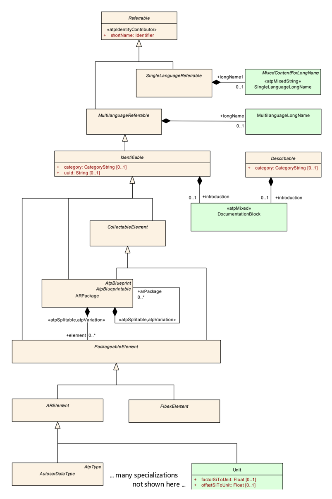

**关于 Referrable：**

- `Referrable` 是一个抽象元类，拥有充当引用目标的 `shortName`。`Referrable` 主要用于占用空间小的引用目标，例如 `Sdg`。`Referrable` 特化为 `SingleLanguageReferrable` / `MultilanguageReferrable`。
- `SingleLanguageReferrable` 的特化适用于嵌入在已经属于多语言对象的文本中的元素（即第 9.2.8 章所述的内联元素（inline elements））。
- `MultilanguageReferrable` 的特化适用于占用空间相对较小的多语言对象，例如 `DefList`、`Traceable`。

**关于 Describable：**

- `Describable` 是一个抽象元类，表示提供描述但不作为 `Referrable` 或 `Identifiable` 的能力。此处提及仅为完整性。

**关于 Identifiable：**

- `Identifiable` 是继承自 `MultilanguageReferrable` 的抽象类。它用于标识 AUTOSAR 模型中的本质对象。相对于 `Referrable`，它提供了进一步标识元素的手段，例如 `desc`。显然，任何可被标识的东西也应当是可引用的，因此 `Identifiable` 是 `Referrable` 的特化。
- 嵌套的 `Identifiable` 建立了一个层次化的命名空间（**name space**）。

请注意，如果 `Referrable` 还能包含更进一步的 `Referrable`，那么它就不会构成层次化的命名空间，因为命名空间只由 `Identifiable` 建立。<sup>3</sup>

更多细节参见第 4.3.1 章。

- AUTOSAR 中的 `ARPackage` 是 AUTOSAR 模型中最顶层的 `Identifiable`。这个顶层 `ARPackage` 是命名空间层次的根。
- `Identifiable`（更准确地说 `Referrable`）的 `shortName` 在其包含的 `Identifiable` 内应当（不区分大小写地）唯一。例如：

  - `ARElement`（例如 `ApplicationSwComponentType`）的 `shortName` 在 `ARPackage`（它是一个 `Identifiable`）内应当唯一。但在另一个 `ARPackage` 中可能存在 `shortName` 相同的其他 `ApplicationSwComponentType`。
  - `PortPrototype` 的 `shortName` 在一个 `ApplicationSwComponentType`（它是一个 `Identifiable`）内应当唯一。但在其他 `ApplicationSwComponentType` 中可能存在同名的 `PortPrototype`。

**关于 CollectableElement：**

- `CollectableElement` 表示成为集合一部分的能力（尤其是被一个集合引用）。该元类不引入更多属性，也不引入更多可能的聚合。
- 尽管 `CollectableElement` 与 `ARElement` 相似，但两者并不相同，因为它处理的是完全不同的方面。

**关于 ARPackage：**

- `ARPackage` 可以嵌套：`ARPackage` 可以在 `arPackage` 角色中包含 `ARPackage`。
- 由此，`ARPackage` 由嵌套的分支（`ARPackage`）和叶子（`PackageableElement` 的子类，尤其是 `ARElement` 的子类）组成。
- `ARPackage` 是 `Identifiable` 的特化。否则它将无法参与命名空间层次。
- `PackageableElement` 是一个抽象类，表示对象可以被独立定义的能力。这些对象不需要上下文。这样的对象有时被称为“一等公民”（**first class citizens**）。
- `PackageableElement`（`ARElement`、`FibexElement`）不能包含更进一步的 `PackageableElement`（相应地即 `ARElement`、`FibexElement`）。

**关于 ARElement 与 FibexElement：**

- `ARElement` 是一个抽象类，通常对 AUTOSAR 模型有所贡献。
- `FibexElement` 是一个抽象类，表示元素对系统通信与拓扑描述的特定贡献能力。
- `ARElement` 与 `FibexElement` 都是 `Identifiable`。因此派生的元素也拥有 `shortName`。
- `ARElement`、`FibexElement` 可以包含从 `Identifiable` 派生的更多元素。

> **3** 尽管如此，AUTOSAR 元模型中并不出现这样的 `Referrable` 嵌套。

## 4. 通用模板类

下文给出的通用模板类，其性质类似于编译器的标准库：一组预定义的结构和元素，供 AUTOSAR 模板模型使用。

### 4.1. ARObject——所有类的公共属性

**ARObject**

`ARObject` 是被所有其他元类继承的一个元类。

相关模式如图 6.9 所示。

另参见 ARObject。

### 4.2. AUTOSAR 中的包

AUTOSAR M1 模型可以组织为若干个包，由类 `ARPackage` 表示。它允许把模型元素放在一起，例如以一个 OEM 或项目特定的包的形式，包含诸如风窗刮水器软件组件之类的实体。

自聚合（角色 `arPackage`）表明包实际上可以包含其他包。除此之外，一个包可以包含任意数量的元素，由抽象类 `ARElement` 表示。这样的 AUTOSAR 元素是在其自身的语义上下文中独立（stand-alone）定义有意义的实体。这类 `ARElement` 的一个例子是可复用软件组件类型的定义。另一方面，一个操作的参数独立定义并无意义，因为其语义定义于其所在上下文之内、因而高度依赖于外层上下文：该操作。

**ARPackage 的用途**

`ARPackage` 的用途是：

- 组织 AUTOSAR M1 模型，并为包内的元素建立命名空间（如同所有 `Identifiable` 所做的那样）；
- 定义相对引用的基础。

关于相对引用的细节，参见第 4.4.3.2 章。

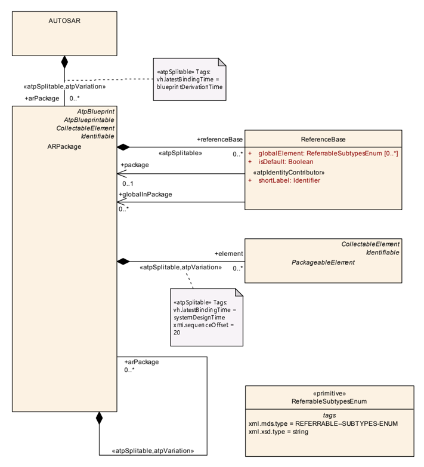

请注意，`ARPackage` 中对 `ARElement` 的聚合是可变体化的（subject to variation）。其主要用例是在产品线架构中规定具有不同接口的组件备选项。

表4.1：ARPackage

| 类         | ARPackage                                                                                                   |
|------------|--------------------------------------------------------------------------------------------------------------|
| 包         | M2::AUTOSARTemplates::GenericStructure::GeneralTemplateClasses::ARPackage                                    |
| 注意       | AUTOSAR 包，允许创建顶层包以结构化所包含的 ARElement。ARPackage 是开放集合。这意味着在基于文件的描述系统中，可以使用多个文件部分地描述一个包的内容。这是 MSR 的 SW-SYSTEM 的扩展版本。 |
| 基类       | ARObject、AtpBlueprint、AtpBlueprintable、CollectableElement、Identifiable、MultilanguageReferrable、Referrable |
| 聚合于     | ARPackage.arPackage、AUTOSAR.arPackage                                                                        |

| 属性          | 类型                | 多重性 | 类别 | 注意                                                                                                                                                     |
|---------------|---------------------|--------|------|----------------------------------------------------------------------------------------------------------------------------------------------------------|
| arPackage     | ARPackage           | *      | aggr | 这表示 ARPackage 内的一个子包，从而允许无限的包层次。构型：atpSplitable；atpVariation 标签：atp.Splitkey=arPackage.shortName, arPackage.variationPoint.shortLabel vh.latestBindingTime=blueprintDerivationTime xml.sequenceOffset=30 |
| element       | PackageableElement  | *      | aggr | 属于本包的元素。构型：atpSplitable；atpVariation 标签：atp.Splitkey=element.shortName, element.variationPoint.shortLabel vh.latestBindingTime=systemDesignTime xml.sequenceOffset=20 |
| referenceBase | ReferenceBase       | *      | aggr | 这表示该包的引用基础（reference base）。它是包内所有相对引用的基础。基础需要按照引用中的 base 属性来选择。构型：atpSplitable 标签：atp.Splitkey=referenceBase.shortLabel xml.sequenceOffset=10 |

表4.2：PackageableElement

| 类         | PackageableElement（抽象）                                                        |
|------------|-------------------------------------------------------------------------------------|
| 包         | M2::AUTOSARTemplates::GenericStructure::GeneralTemplateClasses::ARPackage           |
| 注意       | 该元类规定成为 AUTOSAR 包成员的能力。                                                 |
| 基类       | ARObject、CollectableElement、Identifiable、MultilanguageReferrable、Referrable      |
| 子类       | ARElement、EnumerationMappingTable、FibexElement                                    |
| 聚合于     | ARPackage.element                                                                   |

表4.3：ARElement

| 类         | ARElement（抽象）                                                                                                       |
|------------|--------------------------------------------------------------------------------------------------------------------------|
| 包         | M2::AUTOSARTemplates::GenericStructure::GeneralTemplateClasses::ARPackage                                                |
| 注意       | 可以独立定义的元素，即无需作为另一个元素的一部分（当然包除外）。                                                            |
| 基类       | ARObject、CollectableElement、Identifiable、MultilanguageReferrable、PackageableElement、Referrable                        |
| 子类       | AclObjectSet、AclOperation、AclPermission、AclRole、AliasNameSet、ApplicabilityInfoSet、ApplicationPartition、AutosarDataType、BaseType、BlueprintMappingSet、BswEntryRelationshipSet、BswModuleDescription、BswModuleEntry、BuildActionManifest、CalibrationParameterValueSet、ClientIdDefinitionSet、ClientServerInterfaceToBswModuleEntryBlueprintMapping、Collection、CompuMethod、ConsistencyNeedsBlueprintSet、ConstantSpecification、ConstantSpecificationMappingSet、CpSoftwareCluster、CpSoftwareClusterBinaryManifestDescriptor、CpSoftwareClusterMappingSet、CpSoftwareClusterResourcePool、CryptoEllipticCurveProps、CryptoServiceCertificate、CryptoServiceKey、CryptoServicePrimitive、CryptoServiceQueue、CryptoSignatureScheme、DataConstr、DataExchangePoint、DataTransformationSet、DataTypeMappingSet、DdsCpConfig、DiagnosticCommonElement、DiagnosticConnection、DiagnosticContributionSet、DltContext、DltEcu、Documentation、E2EProfileCompatibilityProps、EcucDefinitionCollection、EcucDestinationUriDefSet、EcucModuleConfigurationValues、EcucModuleDef、EcucValueCollection、EndToEndProtectionSet、EthIpProps、EthTcpIpIcmpProps、EthTcpIpProps、EvaluatedVariantSet、FMFeature、FMFeatureMap、FMFeatureModel、FMFeatureSelectionSet、FirewallRule、FlatMap、GeneralPurposeConnection、HwCategory、HwElement、HwType、IEEE1722TpConnection、IPSecConfigProps、IPv6ExtHeaderFilterSet、IdsCommonElement、IdsDesign、Implementation、ImpositionTimeDefinitionGroup、InterpolationRoutineMappingSet、J1939ControllerApplication、KeywordSet、LifeCycleInfoSet、LifeCycleStateDefinitionGroup、LogAndTraceMessageCollectionSet、MacSecGlobalKayProps、MacSecParticipantSet、McFunction、McGroup、ModeDeclarationGroup、ModeDeclarationMappingSet、OsTaskProxy、PhysicalDimension、PhysicalDimensionMappingSet、PortInterface、PortInterfaceMappingSet、PortPrototypeBlueprint、PostBuildVariantCriterion、PostBuildVariantCriterionValueSet、PredefinedVariant、RapidPrototypingScenario、SdgDef、SignalServiceTranslationPropsSet、SomeipSdClientEventGroupTimingConfig、SomeipSdClientServiceInstanceConfig、SomeipSdServerEventGroupTimingConfig、SomeipSdServerServiceInstanceConfig、SwAddrMethod、SwAxisType、SwComponentMappingConstraints、SwComponentType、SwRecordLayout、SwSystemconst、SwSystemconstantValueSet、SwcBswMapping、System、SystemSignal、SystemSignalGroup、TDCpSoftwareClusterMappingSet、TcpOptionFilterSet、TimingExtension、TlsConnectionGroup、TlvDataIdDefinitionSet、TransformationPropsSet、Unit、UnitGroup、UploadablePackageElement、ViewMapSet |
| 聚合于     | ARPackage.element                                                                                                        |

### 4.3. Referrable 与 Identifiable

`Identifiable` 的主要直接抽象基类是 `Referrable` 和 `MultilanguageReferrable`。

**Referrable 的主要用途**

抽象基类 `Referrable` 表示成为引用目标的能力。这样的引用可以是文档中的简单链接，也可以是为 AUTOSAR 系统数据模型做出贡献的关联。

`Referrable` 的本质属性是 `shortName`。

**shortName 的用途**

`shortName`（由 `Referrable` 提供）在第一个祖先 `Identifiable` 给定的上下文内无歧义地标识该对象。

`MultilanguageReferrable` 的本质属性是 `longName`。

**longName 的用途**

`longName`（由 `MultilanguageReferrable` 提供）以单行文本的形式包含对象的标题。`longName` 的内容面向人类读者。因此长名可以用不同的语言描述。

理解 `Identifiable` 各属性的全貌十分重要。

**Identifiable 的主要用途**

抽象基类 `Identifiable` 在 `Referrable` 之上扩展了描述性与管理性特性。

**desc 的用途**

`desc` 包含该对象是什么的简要描述。其目的是帮助人类识别该对象。它是单个段落，同样以多种语言提供。

**adminData 的用途**

`adminData` 包含关于该对象的管理性信息，例如版本信息、语言设置等。这些信息也具有标识性质。

**uuid 的用途**

`uuid` 可以在用户的工具环境中用于唯一地标识 AUTOSAR 元素，例如在把 AUTOSAR 元素合并入某个公司专有数据库时。`uuid` 对 AUTOSAR 模型没有任何语义含义，也不要求 AUTOSAR 工具管理 `uuid`。

除这些标识性属性之外，`Identifiable` 还携带一些以规范为目的的属性。为简化模型，这些属性定义在 `Identifiable` 中，因为它们适用于几乎所有表示 AUTOSAR 系统技术结构的可标识对象：

**category 的用途**

`category` 包含一个表达该 `Identifiable` 特定用例的关键字。在某种程度上，`category` 可以与 UML 中的构型（stereotype）类比。适用的类别在相关对象的约束中规定。

**category 的取值**

一般而言，允许以用户自定义的取值扩展各模板规范中定义的类别。在这种情况下，用户有责任避免与既有或将来自动定义的 AUTOSAR 类别发生任何冲突。例如可以通过使用合适的前缀来实现。

不过，特定元素的约束可能把 category 限定为恰好那些已定义的取值，此时不允许扩展。

**introduction 的用途**

`introduction` 包含关于该被标识对象如何构建或可能如何使用的介绍性文档。

**annotation 的用途**

`annotation` 包含开发注记（development annotations）。

关于 Annotation 的更多细节参见第 4.12 章。

作为示例，AUTOSAR 项目的这些属性为：

- `shortName`：AUTOSAR
- `longName`：AUTomotive Open System ARchitecture
- `desc`：AUTOSAR 是一个开放且标准化的汽车软件架构，由汽车制造商、供应商和工具开发者共同开发。
- `introduction`：AUTOSAR 为进一步提升性能、安全性与环境友好性的创新电子系统铺平道路；AUTOSAR 是一个强大的全球合作伙伴关系，它创造了一个共同的标准：“在标准上合作，在实现上竞争”。

基类 `Identifiable` 还有更多与内容相关的属性，如图 4.2 所示：

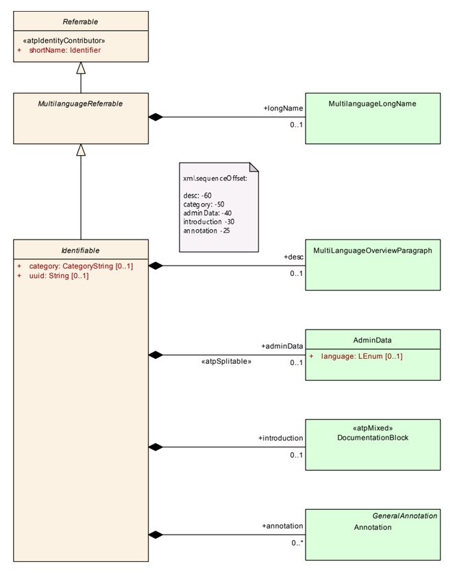

基类 `Referrable` 及其特化如图 4.3 所示：

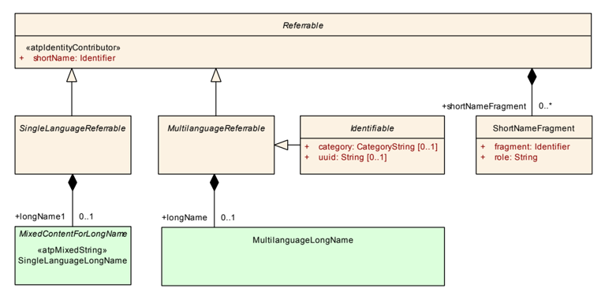

如果 `shortName` 由不同的组件组装而成，那么提供 `ShortNameFragment` 作为组装指令的形式化规范是一种良好实践。

在第 4.1 章中，组合而成的 shortName 是 “A\_\_B”。第一个 `ShortNameFragment` 是 “A”，其角色（role）为 “prefix”。第二个 `ShortNameFragment` 是 “B”，其角色为 “suffix”。“prefix” 与 “suffix” 只是示例，不属于标准化的对象。它们仅用于说明本示例。AUTOSAR 不标准化 `role` 属性的任何取值。

清单4.1：shortNameFragments 示例

```xml
<SHORT-NAME>A__B</SHORT-NAME>
<SHORT-NAME-FRAGMENTS>
  <SHORT-NAME-FRAGMENT>
    <ROLE>prefix</ROLE>
    <FRAGMENT>A</FRAGMENT>
  </SHORT-NAME-FRAGMENT>
  <SHORT-NAME-FRAGMENT>
    <ROLE>suffix</ROLE>
    <FRAGMENT>B</FRAGMENT>
  </SHORT-NAME-FRAGMENT>
</SHORT-NAME-FRAGMENTS>
```

这一流程允许组合与拆分原子的和组合的 `shortName` 而不丢失原始信息。

关于 DocumentationBlock 的更多内容请参见第 9.2 章。

各属性在以下类表中给出：

表4.4：Identifiable

| 类         | Identifiable（抽象）                                                                                                  |
|------------|------------------------------------------------------------------------------------------------------------------------|
| 包         | M2::AUTOSARTemplates::GenericStructure::GeneralTemplateClasses::Identifiable                                            |
| 注意       | 该类的实例可以通过其标识符（在命名空间边界内）被引用。此外，Identifiable 是对 AUTOSAR 描述的整体结构有显著贡献的对象。特别是，Identifiable 可以包含 Identifiable。 |
| 基类       | ARObject、MultilanguageReferrable、Referrable                                                                            |
| 子类       | ARPackage、AbstractDoIpLogicAddressProps、AbstractEvent、AbstractImplementationDataTypeElement、AbstractSecurityEventFilter、AbstractSecurityIdsmInstanceFilter、AbstractServiceInstance、AppOsTaskProxyToEcuTaskProxyMapping、ApplicationEndpoint、ApplicationError、ApplicationPartitionToEcuPartitionMapping、AppliedStandard、AsynchronousServerCallResultPoint、AtpBlueprint、AtpBlueprintable、AtpClassifier、AtpFeature、AutosarOperationArgumentInstance、AutosarVariableInstance、BinaryManifestAddressableObject、BinaryManifestItemDefinition、BinaryManifestResource、BinaryManifestResourceDefinition、BlockState、BswInternalTriggeringPoint、BswModuleDependency、BuildActionEntity、BuildActionEnvironment、CanTpAddress、CanTpChannel、CanTpNode、Chapter、ClassContentConditional、ClientIdDefinition、ClientServerOperation、Code、CollectableElement、ComManagementMapping、CommConnectorPort、CommunicationConnector、CommunicationController、Compiler、ConsistencyNeeds、ConsumedEventGroup、CouplingElementAbstractDetails、CouplingPort、CouplingPortAbstractShaper、CouplingPortStructuralElement、CpSoftwareClusterResource、CpSoftwareClusterResourceToApplicationPartitionMapping、CpSoftwareClusterToApplicationPartitionMapping、CpSoftwareClusterToEcuInstanceMapping、CpSoftwareClusterToResourceMapping、CryptoServiceMapping、DataPrototypeGroup、DataTransformation、DdsCpDomain、DdsCpPartition、DdsCpQosProfile、DdsCpTopic、DependencyOnArtifact、DiagEventDebounceAlgorithm、DiagnosticAuthTransmitCertificateEvaluation、DiagnosticConnectedIndicator、DiagnosticDataElement、DiagnosticDebounceAlgorithmProps、DiagnosticFunctionInhibitSource、DiagnosticParameterElement、DiagnosticRoutineSubfunction、DltApplication、DltArgument、DltLogChannel、DltMessage、DoIpInterface、DoIpLogicAddress、DoIpRoutingActivation、ECUMapping、EOCExecutableEntityRefAbstract、EcuPartition、EcucContainerValue、EcucDefinitionElement、EcucDestinationUriDef、EcucEnumerationLiteralDef、EcucQuery、EcucValidationCondition、EndToEndProtection、EthernetWakeupSleepOnDatalineConfig、EventHandler、ExclusiveArea、ExecutableEntity、ExecutionTime、FMAttributeDef、FMFeatureMapAssertion、FMFeatureMapCondition、FMFeatureMapElement、FMFeatureRelation、FMFeatureRestriction、FMFeatureSelection、FlatInstanceDescriptor、FlexrayArTpNode、FlexrayTpConnectionControl、FlexrayTpNode、FlexrayTpPduPool、FrameTriggering、GeneralParameter、GlobalTimeGateway、GlobalTimeMaster、GlobalTimeSlave、HeapUsage、HwAttributeDef、HwAttributeLiteralDef、HwPin、HwPinGroup、IEEE1722TpAcfBus、IEEE1722TpAcfBusPart、IPSecRule、IPv6ExtHeaderFilterList、ISignalToIPduMapping、ISignalTriggering、IdentCaption、ImpositionTime、InternalTriggeringPoint、J1939SharedAddressCluster、J1939TpNode、Keyword、LifeCycleState、LinScheduleTable、LinTpNode、Linker、MacMulticastGroup、MacSecKayParticipant、McDataInstance、MemorySection、ModeDeclaration、ModeDeclarationMapping、ModeSwitchPoint、NetworkEndpoint、NmCluster、NmEcu、NmNode、NvBlockDescriptor、PackageableElement、ParameterAccess、PduActivationRoutingGroup、PduToFrameMapping、PduTriggering、PerInstanceMemory、PhysicalChannel、PortElementToCommunicationResourceMapping、PortGroup、PortInterfaceMapping、PossibleErrorReaction、ResourceConsumption、RootSwCompositionPrototype、RptComponent、RptContainer、RptExecutableEntity、RptExecutableEntityEvent、RptExecutionContext、RptProfile、RptServicePoint、RteEventInCompositionSeparation、RteEventInCompositionToOsTaskProxyMapping、RteEventInSystemSeparation、RteEventInSystemToOsTaskProxyMapping、RunnableEntityGroup、SdgAttribute、SdgClass、SecureCommunicationAuthenticationProps、SecureCommunicationFreshnessProps、SecurityEventContextProps、ServerCallPoint、ServiceNeeds、SignalServiceTranslationElementProps、SignalServiceTranslationEventProps、SignalServiceTranslationProps、SocketAddress、SomeipTpChannel、SpecElementReference、StackUsage、StaticSocketConnection、StructuredReq、SwGenericAxisParamType、SwServiceArg、SwcServiceDependency、SwcToApplicationPartitionMapping、SwcToEcuMapping、SwcToImplMapping、SwitchAsynchronousTrafficShaperGroupEntry、SwitchFlowMeteringEntry、SwitchStreamFilterActionDestPortModification、SwitchStreamFilterEntry、SwitchStreamFilterRule、SwitchStreamGateEntry、SwitchStreamIdentification、SystemMapping、SystemSignalGroupToCommunicationResourceMapping、SystemSignalToCommunicationResourceMapping、TDCpSoftwareClusterMapping、TDCpSoftwareClusterResourceMapping、TcpOptionFilterList、TimingClock、TimingClockSyncAccuracy、TimingExtension 等从 `Identifiable` 派生的全部元类（源表以两栏连排印刷，此处按转换结果合并） |

| 属性        | 类型                             | 多重性 | 类别 | 注意                                                                                                                                                                                                                                                                       |
|-------------|----------------------------------|--------|------|----------------------------------------------------------------------------------------------------------------------------------------------------------------------------------------------------------------------------------------------------------------------------|
| adminData   | AdminData                        | 0..1   | aggr | 这表示该可标识对象的管理数据。标签：atp.Splitkey=adminData xml.sequenceOffset=-40 构型：atpSplitable                                                                                                                                                                          |
| annotation  | Annotation                       | *      | aggr | 在定义模型元素（例如 ECU 配置参数值）时提供附加注记的可能性。这些并非用作文档，而只是设计注记。标签：xml.sequenceOffset=-25                                                                                                                                                      |
| category    | CategoryString                   | 0..1   | attr | category 是一个特化 Identifiable 语义的关键字。它影响属性的预期存在性与约束的适用性。标签：xml.sequenceOffset=-50                                                                                                                                                               |
| desc        | MultiLanguageOverviewParagraph   | 0..1   | aggr | 这表示关于相关对象是什么的一般但简短（单段）描述。它只有一个段落！Desc 旨在被收集到概览表中。该属性帮助人类读者识别相关对象。更详尽的文档（特别是对象如何构建或使用）应当放到 “introduction”。标签：xml.sequenceOffset=-60                                                          |
| introduction| DocumentationBlock               | 0..1   | aggr | 这表示关于相关对象如何构建或使用的更多信息。因此它是一个 DocumentationBlock。标签：xml.sequenceOffset=-30                                                                                                                                                                       |
| uuid        | String                           | 0..1   | attr | 该属性的目的是为元类的实例提供一个全局唯一标识符。该属性的取值应当是全局唯一的字符串，并以标识符的类型为前缀。例如，要包含 The Open Group 定义的 DCE UUID，UUID 将以 “DCE:” 为前缀。该属性的取值可用于支持不同 AUTOSAR 模型的合并。UUID（Universally Unique Identifier）的形式取自 The Open Group（原 Open Software Foundation）定义的标准。该标准被广泛使用，包括 Microsoft 用于 COM（GUID），以及许多公司用于基于 CORBA 的 DCE。生成这些 128 位 ID 的方法已在该标准中公布，其有效性与唯一性在实践中没有争议。若省略 id 命名空间，则假定 DCE。例如 “DCE:2fac1234-31f8-11b4-a222-08002b34c003”。uuid 属性对 AUTOSAR 模型没有任何语义含义，也不要求 AUTOSAR 工具管理该时间戳。标签：xml.attribute=true |

表4.5：Identifier

| 原始类型    | Identifier                                                                                                                                                          |
|-------------|----------------------------------------------------------------------------------------------------------------------------------------------------------------------|
| 包          | M2::AUTOSARTemplates::GenericStructure::GeneralTemplateClasses::PrimitiveTypes                                                                                       |
| 注意        | Identifier 是一个带有若干外观约束的字符串，满足典型编程语言对其标识符（Identifier）的要求。该数据类型表示一个可用作 C 标识符的字符串。它应当以字母开头，可以由字母、数字和下划线组成。标签：xml.xsd.customType=IDENTIFIER xml.xsd.maxLength=128 xml.xsd.pattern=[a-zA-Z][a-zA-Z0-9_]* xml.xsd.type=string |

| 属性           | 类型   | 多重性 | 类别 | 注意                                                                                                             |
|----------------|--------|--------|------|-------------------------------------------------------------------------------------------------------------------|
| blueprintValue | String | 0..1   | attr | 这表示一段描述，记录在从蓝图派生对象时应当如何定义该取值。标签：atp.Status=draft xml.attribute=true                  |
| namePattern    | String | 0..1   | attr | 该属性表示一个模式；若相关标识符是蓝图的一部分，应当使用该模式来定义标识符的取值。更多细节参见 TPS_StandardizationTemplate。标签：xml.attribute=true |

表4.6：MultilanguageLongName

| 类         | MultilanguageLongName                                                                                                     |
|------------|----------------------------------------------------------------------------------------------------------------------------|
| 包         | M2::MSR::Documentation::TextModel::MultilanguageData                                                                       |
| 注意       | 该元类表示规定一个充当标题（headline）角色的长名的能力。它面向人类读者。每种语言应不超过约 80 个字符。                          |
| 基类       | ARObject                                                                                                                   |
| 聚合于     | AliasNameAssignment.label、GeneralAnnotation.label、MultilanguageReferrable.longName、Note.label、Prms.label、ValueGroup.label |

| 属性 | 类型       | 多重性 | 类别 | 注意                                                                                                                                                                                  |
|------|------------|--------|------|----------------------------------------------------------------------------------------------------------------------------------------------------------------------------------------|
| l4   | LLongName  | 1..*   | aggr | 这是某一种特定语言中的长名。标签：xml.roleElement=true xml.roleWrapperElement=false xml.sequenceOffset=20 xml.typeElement=false xml.typeWrapperElement=false                              |

表4.7：SingleLanguageLongName

| 类         | &lt;&lt;atpMixedString&gt;&gt; SingleLanguageLongName                       |
|------------|--------------------------------------------------------------------------------|
| 包         | M2::MSR::Documentation::TextModel::SingleLanguageData                          |
| 注意       | SingleLanguageLongName                                                         |
| 基类       | ARObject、MixedContentForLongName                                              |
| 聚合于     | SingleLanguageReferrable.longName1、Xref.label1                                 |

表4.8：LLongName

| 类         | &lt;&lt;atpMixedString&gt;&gt; LLongName                                              |
|------------|------------------------------------------------------------------------------------------|
| 包         | M2::MSR::Documentation::TextModel::LanguageDataModel                                      |
| 注意       | 某一种特定语言中的 MixedContentForLongName。语言在属性 `l` 中标注。                         |
| 基类       | ARObject、LanguageSpecific、MixedContentForLongName                                        |
| 聚合于     | MultilanguageLongName.l4                                                                  |

| 属性           | 类型   | 多重性 | 类别 | 注意                                                                                              |
|----------------|--------|--------|------|-----------------------------------------------------------------------------------------------------|
| blueprintValue | String | 0..1   | attr | 这表示一段描述，记录在从蓝图派生对象时应当如何定义该取值。标签：atp.Status=draft xml.attribute=true    |

表4.9：MixedContentForLongName

| 类         | &lt;&lt;atpMixedString&gt;&gt; MixedContentForLongName（抽象）                                                                                                                                                                     |
|------------|----------------------------------------------------------------------------------------------------------------------------------------------------------------------------------------------------------------------------------------|
| 包         | M2::MSR::Documentation::TextModel::InlineTextModel                                                                                                                                                                                       |
| 注意       | 这是标题与长名的模型。它允许一些强调与索引条目，但没有引用目标（引用目标由相关的 identifiable 提供）。其意图是该内容模型也可以呈现为纯文本。该抽象类既可用于单语言元素，也可用于多语言元素。                                                              |
| 基类       | ARObject                                                                                                                                                                                                                                 |
| 子类       | LLongName、SingleLanguageLongName                                                                                                                                                                                                          |

| 属性 | 类型         | 多重性 | 类别 | 注意                                   |
|------|--------------|--------|------|------------------------------------------|
| e    | EmphasisText | 1      | aggr | 这是强调文本。标签：xml.sequenceOffset=40  |
| ie   | IndexEntry   | 1      | aggr | 这是一个索引条目。标签：xml.sequenceOffset=70 |
| sub  | Superscript  | 1      | attr | 这是下标文本。标签：xml.sequenceOffset=60   |
| sup  | Superscript  | 1      | attr | 这是上标文本。标签：xml.sequenceOffset=50   |
| tt   | Tt           | 1      | aggr | 这是一个技术术语。标签：xml.sequenceOffset=30 |

另参见 MultiLanguageOverviewParagraph；另参见 LOverviewParagraph。

表4.10：Referrable

| 类         | Referrable（抽象）                                                                                                                                                                                                                                       |
|------------|------------------------------------------------------------------------------------------------------------------------------------------------------------------------------------------------------------------------------------------------------------|
| 包         | M2::AUTOSARTemplates::GenericStructure::GeneralTemplateClasses::Identifiable                                                                                                                                                                                 |
| 注意       | 该类的实例可以通过其标识符（在遵守命名空间边界的前提下）被引用。                                                                                                                                                                                              |
| 基类       | ARObject                                                                                                                                                                                                                                                     |
| 子类       | AtpDefinition、BswDistinguishedPartition、BswModuleCallPoint、BswModuleClientServerEntry、BswVariableAccess、CouplingPortTrafficClassAssignment、DiagnosticEnvModeElement、EthernetPriorityRegeneration、ExclusiveAreaNestingOrder、HwDescriptionEntity、ImplementationProps、LinSlaveConfigIdent、ModeTransition、MultilanguageReferrable、PncMappingIdent、SingleLanguageReferrable、SoConIPduIdentifier、SocketConnectionBundle、TimeSyncServerConfiguration、TpConnectionIdent |
| 属性       | shortName、shortNameFragment                                                                                                                                                                                                                                  |

| 属性              | 类型              | 多重性 | 类别 | 注意                                                                                                                                                     |
|-------------------|-------------------|--------|------|-----------------------------------------------------------------------------------------------------------------------------------------------------------|
| shortName         | Identifier        | 1      | attr | 这为对象规定一个标识用的 shortName。它需要在其上下文内唯一，面向人类但更多面向技术引用。构型：atpIdentityContributor 标签：xml.enforceMinMultiplicity=true xml.sequenceOffset=-100 |
| shortNameFragment | ShortNameFragment | *      | aggr | 这规定 `Referrable.shortName` 如何由若干 shortNameFragment 组合而成。标签：xml.sequenceOffset=-90                                                            |

表4.11：MultilanguageReferrable

| 类         | MultilanguageReferrable（抽象）                                                                                                                                                                                                    |
|------------|----------------------------------------------------------------------------------------------------------------------------------------------------------------------------------------------------------------------------------------|
| 包         | M2::AUTOSARTemplates::GenericStructure::GeneralTemplateClasses::Identifiable                                                                                                                                                               |
| 注意       | 该类的实例可以通过其标识符（在遵守命名空间边界的前提下）被引用。它们还可以拥有 longName。但它们不被认为对 AUTOSAR 描述的整体结构有实质贡献。特别地，它不包含其他 Referrable。                                                                      |
| 基类       | ARObject、Referrable                                                                                                                                                                                                                        |
| 子类       | Caption、DefItem、DocumentationContext、Identifiable、SdgCaption、TraceReferrable、Traceable                                                                                                                                                  |

| 属性     | 类型                  | 多重性 | 类别 | 注意                                                                                     |
|----------|-----------------------|--------|------|--------------------------------------------------------------------------------------------|
| longName | MultilanguageLongName | 0..1   | aggr | 这规定对象的长名。长名面向人类读者，其作用类似于标题。                                        |

表4.12：SingleLanguageReferrable

| 类         | SingleLanguageReferrable（抽象）                                                                                                                                                                                                                                                  |
|------------|----------------------------------------------------------------------------------------------------------------------------------------------------------------------------------------------------------------------------------------------------------------------------------------|
| 包         | M2::AUTOSARTemplates::GenericStructure::GeneralTemplateClasses::Identifiable                                                                                                                                                                                                              |
| 注意       | 该类的实例可以通过其标识符（在遵守命名空间边界的前提下）被引用。它们也可以拥有 longName，但只能是一种语言。该类的特化只作为某一种特定语言中的内联元素出现。但它们不被认为对 AUTOSAR 描述的整体结构有实质贡献。特别地，它不包含其他 Referrable。（源表此处的句子因转换存在残缺，按上下文合并。） |
| 基类       | ARObject、Referrable                                                                                                                                                                                                                                                                       |
| 子类       | Std、Xdoc、Xfile、XrefTarget                                                                                                                                                                                                                                                                |

| 属性     | 类型                   | 多重性 | 类别 | 注意                                                                                      |
|----------|------------------------|--------|------|----------------------------------------------------------------------------------------------|
| longName1| SingleLanguageLongName | 0..1   | aggr | 这规定对象的长名。角色名为 longName1 是为了与 ASAM FSX 兼容。                                   |

表4.13：ShortNameFragment

| 类         | ShortNameFragment                                                                              |
|------------|----------------------------------------------------------------------------------------------------|
| 包         | M2::AUTOSARTemplates::GenericStructure::GeneralTemplateClasses::Identifiable                        |
| 注意       | 该类描述 `Referrable.shortName` 如何由若干 shortNameFragment 组合而成。                              |
| 基类       | ARObject                                                                                           |
| 聚合于     | Referrable.shortNameFragment                                                                        |

| 属性     | 类型       | 多重性 | 类别 | 注意                                                                               |
|----------|------------|--------|------|---------------------------------------------------------------------------------------|
| fragment | Identifier | 1      | attr | 这规定作为组合 shortName 一部分的单个 shortName（片段）。标签：xml.sequenceOffset=20      |
| role     | String     | 1      | attr | 这规定片段的角色，例如用于定义片段的顺序。标签：xml.sequenceOffset=10                     |

### 4.3.1. 命名空间与 shortName 的唯一性

`Referrable` 中的 `shortName` 有助于对 `Referrable` 各特化（尤其是 `Identifiable`）的标识。

**Identifiable 建立的命名空间**

`Identifiable` 由此建立一个命名空间，在其中所包含的 `Identifiable` 或 `Referrable` 可以通过其 `shortName` 无歧义地标识。在某些情况下，存在派生自 `Identifiable` 的元类聚合了并非派生自 `Identifiable`、但转而聚合了一个派生自 `Referrable` 的元类的元类。换言之，存在 `Identifiable` 只被间接聚合的情况。

无论如何，解释已建立命名空间的规则在这种情况同样适用。特别是，对于一个给定的 `Referrable` 实例，命名空间由最近的祖先（不仅是父元素）中作为 `Identifiable` 的元素建立。这表现为 [constr\_2508] 中的措辞“在一个给定的 Identifiable 内”。

**Referrable 不建立命名空间**

请注意，`Referrable` 不建立命名空间。在 `Identifiable` 之外，不存在 `Referrable` 聚合另一个 `Referrable` 的用例。但如果存在，被聚合者的 `shortName` 将需要在最近的祖先 `Identifiable`（而非最近的祖先 `Referrable`）内唯一。

请注意，可以为特定元素扩展命名空间以支持全局引用。更多细节参见 [constr\_2538]。

**shortName 的大小写敏感性**

`shortName` 应当：

- 基本上按区分大小写解释（参见 [TPS\_GST\_00020]）；
- 但唯一性检查按不区分大小写进行（[constr\_2508]）。

**约束：shortName 应当在其命名空间内唯一**

`shortName` 的内容在由父元素给定的命名空间内需要唯一（不区分大小写）。

请注意，shortName 的唯一性检查应当不区分大小写地执行。这支持一种良好实践：名称不应当只在大小写上不同，那会造成大量混淆。

术语“不区分大小写”表示字符集合

```
{a b c d e f g h i j k l m n o p q r s t u v w x y z}
{A B C D E F G H I J K L M N O P Q R S T U V W X Y Z}
```

中的字符分别被视为相同。换言之，对 shortName 唯一性的不区分大小写检查导致如下结果：例如 shortName 为 “X” 与 “x” 的元素被视为相同，不得存在于同一个命名空间中。

清单 4.2 展示了有效的情况：命名空间 `SwComp` 中的 `SR_1` 与 `SR_2`。

清单4.2：有效命名空间用例示例

```xml
<AR-PACKAGE>
  <SHORT-NAME>SwComp</SHORT-NAME>
  <ELEMENTS>
    <APPLICATION-SW-COMPONENT-TYPE>
      <SHORT-NAME>SwComp1</SHORT-NAME>
      <PORTS>
        <P-PORT-PROTOTYPE>
          <SHORT-NAME>PPortA</SHORT-NAME>
          <PROVIDED-INTERFACE-TREF DEST="SENDER-RECEIVER-INTERFACE">/SwComp/SR_1</PROVIDED-INTERFACE-TREF>
        </P-PORT-PROTOTYPE>
        <R-PORT-PROTOTYPE>
          <SHORT-NAME>RPortB</SHORT-NAME>
          <REQUIRED-INTERFACE-TREF DEST="SENDER-RECEIVER-INTERFACE">/SwComp/SR_2</REQUIRED-INTERFACE-TREF>
        </R-PORT-PROTOTYPE>
      </PORTS>
    </APPLICATION-SW-COMPONENT-TYPE>
    <SENDER-RECEIVER-INTERFACE>
      <SHORT-NAME>SR_1</SHORT-NAME>
      <IS-SERVICE>false</IS-SERVICE>
    </SENDER-RECEIVER-INTERFACE>
    <SENDER-RECEIVER-INTERFACE>
      <SHORT-NAME>SR_2</SHORT-NAME>
      <IS-SERVICE>false</IS-SERVICE>
    </SENDER-RECEIVER-INTERFACE>
  </ELEMENTS>
</AR-PACKAGE>
```

清单 4.3 展示了无效的情况：尽管对 `SR_1` 与 `Sr_1` 的引用按照 [TPS\_GST\_00167] 是唯一的，命名空间 `SwComp` 中的 shortName 违反了 [constr\_2508]。

清单4.3：无效命名空间用例示例

```xml
<AR-PACKAGE>
  <SHORT-NAME>SwComp</SHORT-NAME>
  <ELEMENTS>
    <APPLICATION-SW-COMPONENT-TYPE>
      <SHORT-NAME>SwComp1</SHORT-NAME>
      <PORTS>
        <P-PORT-PROTOTYPE>
          <SHORT-NAME>PPortA</SHORT-NAME>
          <PROVIDED-INTERFACE-TREF DEST="SENDER-RECEIVER-INTERFACE">/SwComp/SR_1</PROVIDED-INTERFACE-TREF>
        </P-PORT-PROTOTYPE>
        <R-PORT-PROTOTYPE>
          <SHORT-NAME>RPortB</SHORT-NAME>
          <REQUIRED-INTERFACE-TREF DEST="SENDER-RECEIVER-INTERFACE">/SwComp/Sr_1</REQUIRED-INTERFACE-TREF>
        </R-PORT-PROTOTYPE>
      </PORTS>
    </APPLICATION-SW-COMPONENT-TYPE>
    <SENDER-RECEIVER-INTERFACE>
      <SHORT-NAME>SR_1</SHORT-NAME>
      <IS-SERVICE>false</IS-SERVICE>
    </SENDER-RECEIVER-INTERFACE>
    <SENDER-RECEIVER-INTERFACE>
      <SHORT-NAME>Sr_1</SHORT-NAME>
      <IS-SERVICE>false</IS-SERVICE>
    </SENDER-RECEIVER-INTERFACE>
  </ELEMENTS>
</AR-PACKAGE>
```

### 4.4. 引用基础（Reference Base）

#### 4.4.1. 引言

AUTOSAR 元模型和生成的 schema 用于支持模块化、灵活性与可扩展性。AUTOSAR 提供了引用基础（**Reference Base**）的方法学途径来实现这一点。

复杂度较高的模型结构由指向更小模型结构的引用组合而成（为了复用）。这些数据段在完整结构中的位置应当是灵活且可交换的。ReferenceBase 的概念为创建指向模型其他部分的可移植引用提供了一个强大的机制。模型中的元素承担不同的角色，其定义见下图例。

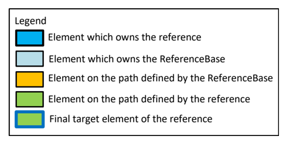

从使用绝对路径的引用开始（参见图 4.5），后续将依次展示更复杂的模式。

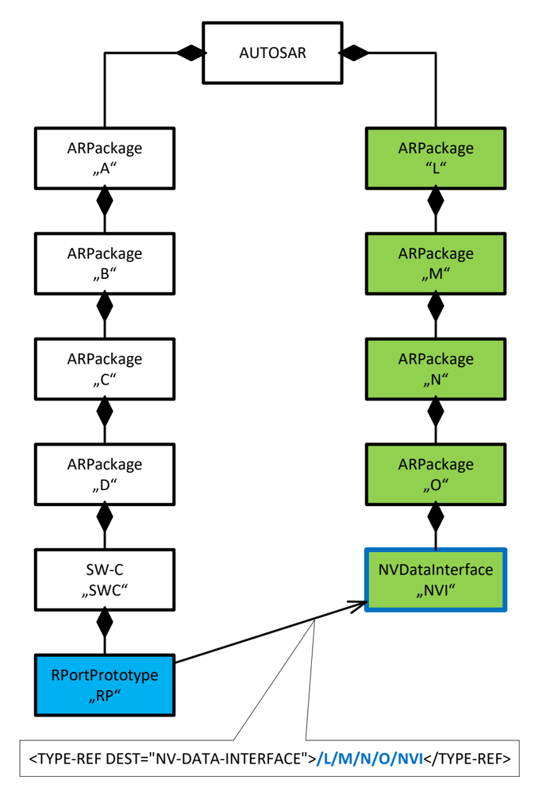

引用的最终目标的完整路径由拥有该引用的元素提供。

下一个模式使用带相对路径的 ReferenceBase。

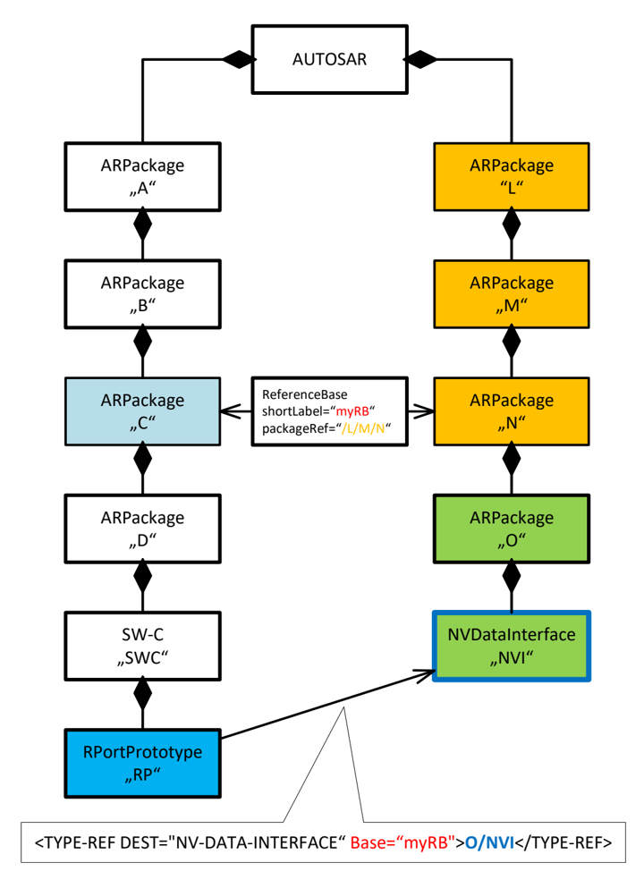

`ReferenceBase` 的属性 `shortLabel` “myRB” 与包 “/L/M/N” 定义了相对路径的起点。由此，由拥有引用的元素所提供的相对路径 “O/NVI” 在 `ARPackage` “/L/M/N” 中解析。被引用元素的结果完整路径为 “/L/M/N/O/NVI”。相应的清单参见 F.26 与 F.27。

为了突出数据段灵活处理这一侧面，`ARPackage` “O” 与 `NvDataInterface` “NVI” 被移动到第三个分支，并由 `ARPackage` “S” 聚合。

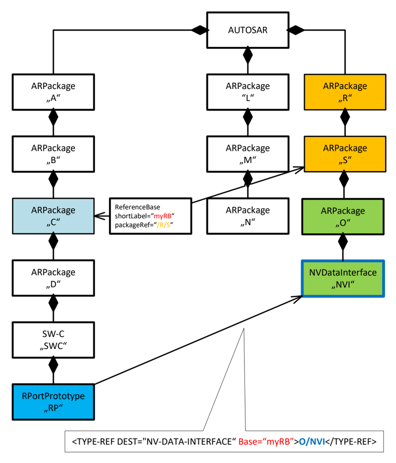

把 `ReferenceBase` 中的包从 “/L/M/N”（参见图 4.6）改为 “/R/S”（参见图 4.7），就足以实现把数据段移动到第三个分支。拥有引用的元素无需任何变更。这凸显了 ReferenceBase 机制所建立方法的威力。相应的清单参见 F.28 与 F.29。

ReferenceBase 机制还提供了定义一个或多个用于搜索全局元素的 `ARPackage` 的可能性。这通过属性 `globalInPackage` 实现，它可以在 `ReferenceBase.package` 之外附加使用。

为说明这一点，把带相对路径的 ReferenceBase 的既有数据结构（参见图 4.6）扩展以属性 `globalInPackage`，它规定全局元素应当在 `ARPackage` “/R/S” 中解析。

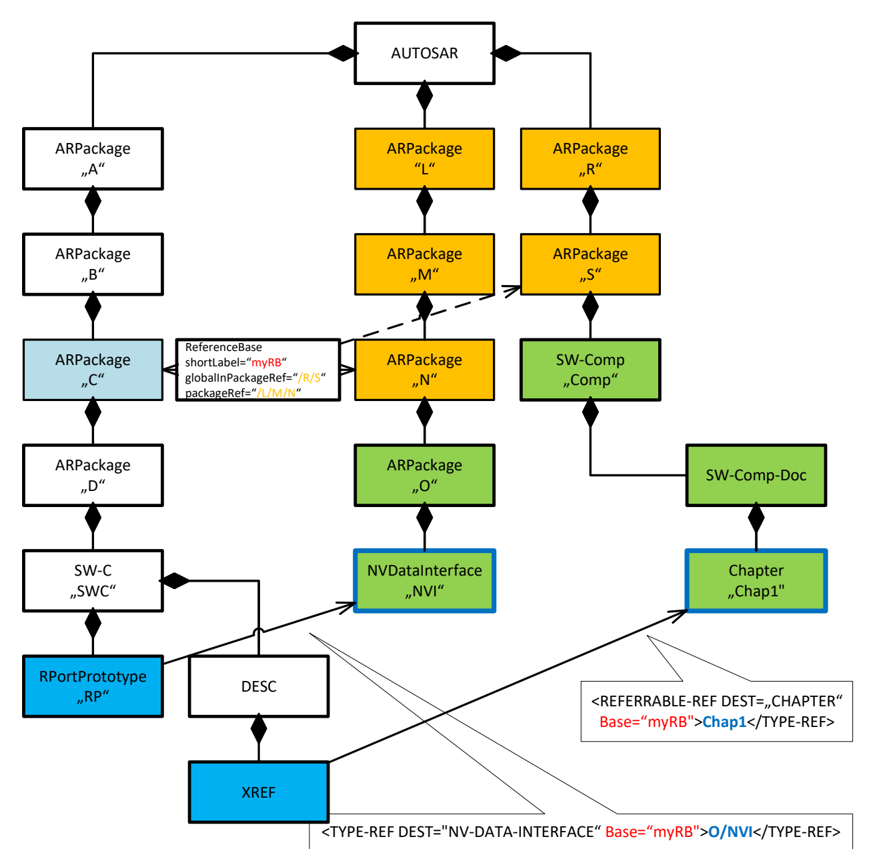

这样，就可以创建一个软件组件 “SWC” 的描述，其中包含一个仅凭 `shortName` 指向 Chapter “Chap1” 的 Xref。该 Chapter 在 “/R/S” 之下全局解析为由软件组件 “Comp” 聚合的 SwComponentDocumentation 中的成员。

ReferenceBase 的扩展（`globalInPackage` 为 “/R/S”）与由拥有引用 “XREF” 的元素所提供的引用 “Chap1” 共同构成被引用元素的完整路径 “/R/S/Comp/Chap1”。相应的清单参见 F.30 与 F.31。

#### 4.4.2. Reference Base 属性

类 `ReferenceBase` 拥有以下属性：`globalElement`、`globalInPackage`、`isDefault`、`package` 和 `shortLabel`。

这些属性的详细用法在本节中定义。

表4.14：ReferenceBase

| 类         | ReferenceBase                                                                                        |
|------------|---------------------------------------------------------------------------------------------------------|
| 包         | M2::AUTOSARTemplates::GenericStructure::GeneralTemplateClasses::ARPackage                               |
| 注意       | 该元类建立相对引用的基础。引用基础由 shortLabel 标识，shortLabel 应当在当前包内唯一。                      |
| 基类       | ARObject                                                                                                |
| 聚合于     | ARPackage.referenceBase                                                                                 |

| 属性           | 类型                   | 多重性 | 类别 | 注意                                                                                                                                                                  |
|----------------|------------------------|--------|------|--------------------------------------------------------------------------------------------------------------------------------------------------------------------------|
| globalElement  | ReferrableSubtypesEnum | *      | attr | 该属性表示一个元类，经由该引用基础支持对它的全局引用。标签：xml.sequenceOffset=29                                                                                              |
| globalInPackage| ARPackage              | *      | ref  | 这表示可以表达全局元素位于没有共同祖先包的多个包中的能力。ReferenceBase.globalInPackage 所提及的包在 ReferenceBase.package 之外附加使用。标签：xml.sequenceOffset=28             |
| isDefault      | Boolean                | 1      | attr | 该属性表示当前的 ReferenceBase 是否为默认。注意，一个包内只能有一个默认引用基础。标签：atp.Status=obsolete xml.sequenceOffset=20                                                 |
| package        | ARPackage              | 0..1   | ref  | 该关联规定 base 等于 shortLabel 的所有相对引用的基础。标签：xml.sequenceOffset=30                                                                                                |
| shortLabel     | Identifier             | 1      | attr | 这是引用基础的名称。通过这个名称，特定的引用可以指明适用的基础。构型：atpIdentityContributor 标签：xml.sequenceOffset=10                                                          |

属性 `globalElement` 显式地规定 [constr\_2538] 所定义列表中的全局元素。

**约束：全局引用限于某些元素**

执行全局引用的能力限于：

- `Chapter`、
- `Topic1`、
- `Caption`、
- `Traceable`、
- `XrefTarget`、
- `Std`、
- `Xdoc`、
- `Xfile`

**注意：** 属性 `globalElement` 规定哪些 `Referrable` 共享全局命名空间。换言之，这些 shortName 应当在所标注的类中唯一。[constr\_2538] 限制了属性 `globalElement` 的取值。这是刻意的，以避免出现庞大的全局命名空间。例如在文档的上下文中，这一做法保证了章节是“可移动的”，即可以在不影响引用定义的情况下重新编排。

```xml
<GLOBAL-ELEMENTS>
  <GLOBAL-ELEMENT>TRACEABLE</GLOBAL-ELEMENT>
  <GLOBAL-ELEMENT>CHAPTER</GLOBAL-ELEMENT>
  <GLOBAL-ELEMENT>CAPTION</GLOBAL-ELEMENT>
</GLOBAL-ELEMENTS>
```

表4.15：ReferrableSubtypesEnum

| 原始类型    | ReferrableSubtypesEnum                                                                                                                            |
|-------------|------------------------------------------------------------------------------------------------------------------------------------------------------|
| 包          | M2::AUTOSARTemplates::GenericStructure::GeneralTemplateClasses::PrimitiveTypes                                                                        |
| 注意        | 该原始类型是 MMT 生成的一个枚举的代理。它允许引用 `Referrable` 的任意子类。由于技术原因，可能的取值不在此类表中显示。标签：xml.mds.type=REFERRABLE-SUBTYPES-ENUM xml.xsd.type=string |

**ReferenceBase.package 与 ReferenceBase.globalInPackage 的共存**

`ReferenceBase.package` 与 `ReferenceBase.globalInPackage` 可以在 ReferenceBase 的上下文中共存。

**注意：** 属性 `isDefault` 的存在受到质疑，因为它建立了一条捷径：当使用能够无额外代价地填入正确 base 属性的 AUTOSAR 编写工具时，它并不能带来效用。因此，该属性的生命周期状态在 R22-11 中被置为 “obsolete”。它可以很容易地被替代，例如用一个 shortLabel 为 “default” 的具名 ReferenceBase。

属性 `isDefault` 可以置为 `true`（情形 1）或 `false`（情形 2）。

情形 1：`isDefault = true`：当前的 ReferenceBase 是默认的。

在下面的清单中，第一个 ReferenceBase “RefBase1” 是默认的。由于 [constr\_2510]，只能有一个 ReferenceBase 被设为默认。因此在 ReferenceBase “RefBase2” 的上下文中，属性 `isDefault` 置为 `false`。也可能所有 ReferenceBase 都未定义为默认的 ReferenceBase。

```xml
<REFERENCE-BASES>
  <REFERENCE-BASE>
    <SHORT-LABEL>RefBase1</SHORT-LABEL>
    <IS-DEFAULT>true</IS-DEFAULT>
    ...
  </REFERENCE-BASE>
  <REFERENCE-BASE>
    <SHORT-LABEL>RefBase2</SHORT-LABEL>
    <IS-DEFAULT>false</IS-DEFAULT>
    ...
  </REFERENCE-BASE>
</REFERENCE-BASES>
```

如果引用

```xml
<PROVIDED-INTERFACE-TREF DEST="SENDER-RECEIVER-INTERFACE">MyInterface</PROVIDED-INTERFACE-TREF>
```

没有 base 属性，则使用默认的 ReferenceBase 来解析该引用。这意味着可以省略 base 属性而不影响引用的解析。

而引用

```xml
<PROVIDED-INTERFACE-TREF BASE="RefBase2" DEST="SENDER-RECEIVER-INTERFACE">MyInterface</PROVIDED-INTERFACE-TREF>
```

带有 base 属性，解析该引用时将采用它。

情形 2：`isDefault = false`：非默认的 ReferenceBase 只适用于那些在 base 属性中显式指明该 ReferenceBase 的 shortLabel 的引用。

**约束：ReferenceBase.shortLabel 在 ARPackage 范围内的唯一性**

在某个 `ARPackage` 范围内定义的任何给定 `ReferenceBase` 的 `shortLabel` 应当在该外层 `ARPackage` 的范围内唯一。

请注意，包层次的每一层都可以拥有一组独立的 ReferenceBase。

**约束：只能有一个默认的 ReferenceBase**

每个 `ARPackage` 只能定义一个默认的 ReferenceBase（`isDefault = true`）。

#### 4.4.3. Reference Base 用例

##### 4.4.3.1. 绝对 ShortName 路径

ShortName 路径由以 “/” 分隔的 `shortName` 序列组成。以下规则适用于 AUTOSAR 中使用的 shortName 路径：

**绝对 shortName 路径**

绝对 shortName 路径通过沿包含关系从根元素遍历到给定元素并执行以下步骤创建：

1. 每个元素的 `shortName` 应当前置一个斜杠（由此形成所谓的前置 shortName（prepended shortName））；
2. 按给定顺序串联所有前置 shortName。

绝对路径可以通过以下步骤转换为相对路径：

- 移除绝对 shortName 路径中与 base 属性所引用的绝对 shortName 路径相同的前导部分；
- 从剩余的 shortName 路径中移除前导斜杠。

**使用绝对 shortName 路径对模型元素的引用**

对于使用绝对 shortName 路径的对模型元素的引用，可选的 base 属性不是必需的，应当被忽略。

##### 4.4.3.2. 相对 ShortName 路径

**相对 shortName 路径**

相对引用路径不以字符 “/” 开头。相对引用路径可以通过在相对 shortName 路径前面添加由适用的 ReferenceBase 所规定的 `ARPackage` 的相应 shortName 路径，转换为绝对路径。

**标识相对引用的 ReferenceBase**

适当的 ReferenceBase 通过以下方式标识：

- 属性 `base`。它表示从该引用到模型根的方向上、第一个（可见的）拥有 shortLabel 等于 `base` 的 referenceBase 的包含 `ARPackage`。换言之：由于 `ARPackage` 是嵌套的，适当的 referenceBase 自底向上搜索。
- 或者，在指向模型根的方向上、拥有 `isDefault` 置为 `true` 的 referenceBase 的最内层 `ARPackage`。

请注意，指向模型根方向上其他具有相同 shortLabel 的 ReferenceBase 应当被忽略。

**约束：具名引用基础应当可用**

如果存在相对引用，则包含该引用的某个包应当拥有一个 shortLabel 等于该引用 base 的 referenceBase。

**部分模型中的 ReferenceBase**

请注意 `ReferenceBase` 是 **&lt;atpSplitable&gt;** 的。因此，有必要在整个模型中搜索适当的 ReferenceBase。换言之，应当在所有部分模型中搜索 ReferenceBase。

清单 4.4 展示了相对引用最简单的形式。在这种情况下，`ARPackage` 内的相对引用应当独立于该 `ARPackage` 的 shortName。请注意以 XML 注释形式指定的标注 `&lt;!--1--&gt;`：

1. `&lt;!--1--&gt;`：这是一个相对引用的基础。
2. `&lt;!--2--&gt;`：这是一个相对引用。该引用使用 `&lt;!--1--&gt;` 中规定的 shortLabel 为 “default” 的基础来解析。

清单4.4：base 为 “default” 的相对引用

```xml
<?xml version="1.0"?>
<AUTOSAR xmlns:xsi="http://www.w3.org/2001/XMLSchema-instance"
         xmlns="http://autosar.org/schema/r4.0"
         xsi:schemaLocation="http://autosar.org/schema/r4.0 AUTOSAR_00052.xsd">
  <AR-PACKAGES>
    <AR-PACKAGE>
      <SHORT-NAME>MyComponent</SHORT-NAME>
      <REFERENCE-BASES>
        <!--1-->
        <REFERENCE-BASE>
          <SHORT-LABEL>default</SHORT-LABEL>
          <PACKAGE-REF DEST="AR-PACKAGE">/MyComponent</PACKAGE-REF>
        </REFERENCE-BASE>
      </REFERENCE-BASES>
      <ELEMENTS>
        <SENDER-RECEIVER-INTERFACE>
          <SHORT-NAME>MyInterface</SHORT-NAME>
          <DATA-ELEMENTS>
            <VARIABLE-DATA-PROTOTYPE>
              <SHORT-NAME>MyData</SHORT-NAME>
              <CATEGORY>VALUE</CATEGORY>
            </VARIABLE-DATA-PROTOTYPE>
          </DATA-ELEMENTS>
        </SENDER-RECEIVER-INTERFACE>
        <APPLICATION-SW-COMPONENT-TYPE>
          <SHORT-NAME>MyComponent</SHORT-NAME>
          <PORTS>
            <P-PORT-PROTOTYPE>
              <SHORT-NAME>MyPort</SHORT-NAME>
              <!--2-->
              <!--/MyComponent/MyInterface-->
              <PROVIDED-INTERFACE-TREF BASE="default" DEST="SENDER-RECEIVER-INTERFACE">MyInterface</PROVIDED-INTERFACE-TREF>
            </P-PORT-PROTOTYPE>
          </PORTS>
        </APPLICATION-SW-COMPONENT-TYPE>
      </ELEMENTS>
    </AR-PACKAGE>
  </AR-PACKAGES>
</AUTOSAR>
```

清单 4.5 展示了可以存在多个 ReferenceBase。在这种情况下，除前面的示例外，还为 CompuMethod 提供了另一个基础，因为它们位于一个单独的 `ARPackage` 中。

1. `&lt;!--1.1--&gt;`：这是相对引用的另一个基础。注意 `isDefault` 属性缺失。它与被显式规定为 `false` 等效。
2. `&lt;!--2.1--&gt;`：这是一个相对引用。属性 `base` 表明应当把 shortLabel 为 compum（定义于 `&lt;!--1.1--&gt;`）的基础用于该相对引用。对应的绝对引用是 /CompuMethods/MyCompu。

清单4.5：带显式 base 的相对引用

```xml
<?xml version="1.0"?>
<AUTOSAR xmlns:xsi="http://www.w3.org/2001/XMLSchema-instance"
         xmlns="http://autosar.org/schema/r4.0"
         xsi:schemaLocation="http://autosar.org/schema/r4.0 AUTOSAR_00052.xsd">
  <AR-PACKAGES>
    <AR-PACKAGE>
      <SHORT-NAME>MyComponent</SHORT-NAME>
      <REFERENCE-BASES>
        <!--1-->
        <REFERENCE-BASE>
          <SHORT-LABEL>default</SHORT-LABEL>
          <PACKAGE-REF DEST="AR-PACKAGE">/MyComponent</PACKAGE-REF>
        </REFERENCE-BASE>
        <REFERENCE-BASE>
          <SHORT-LABEL>compum</SHORT-LABEL>
          <!--1.1-->
          <PACKAGE-REF DEST="AR-PACKAGE">/CompuMethods</PACKAGE-REF>
        </REFERENCE-BASE>
      </REFERENCE-BASES>
      <ELEMENTS>
        <SENDER-RECEIVER-INTERFACE>
          <SHORT-NAME>MyInterface</SHORT-NAME>
          <DATA-ELEMENTS>
            <VARIABLE-DATA-PROTOTYPE>
              <SHORT-NAME>MyData</SHORT-NAME>
              <CATEGORY>VALUE</CATEGORY>
              <SW-DATA-DEF-PROPS>
                <SW-DATA-DEF-PROPS-VARIANTS>
                  <SW-DATA-DEF-PROPS-CONDITIONAL>
                    <!--2.1-->
                    <!--/CompuMethods/MyCompu-->
                    <COMPU-METHOD-REF DEST="COMPU-METHOD" BASE="compum">MyCompu</COMPU-METHOD-REF>
                  </SW-DATA-DEF-PROPS-CONDITIONAL>
                </SW-DATA-DEF-PROPS-VARIANTS>
              </SW-DATA-DEF-PROPS>
            </VARIABLE-DATA-PROTOTYPE>
          </DATA-ELEMENTS>
        </SENDER-RECEIVER-INTERFACE>
        <APPLICATION-SW-COMPONENT-TYPE>
          <SHORT-NAME>MyComponent</SHORT-NAME>
          <PORTS>
            <P-PORT-PROTOTYPE>
              <SHORT-NAME>MyPort</SHORT-NAME>
              <!--2-->
              <!--/MyComponent/MyInterface-->
              <PROVIDED-INTERFACE-TREF BASE="default" DEST="SENDER-RECEIVER-INTERFACE">MyInterface</PROVIDED-INTERFACE-TREF>
            </P-PORT-PROTOTYPE>
          </PORTS>
        </APPLICATION-SW-COMPONENT-TYPE>
      </ELEMENTS>
    </AR-PACKAGE>
    <AR-PACKAGE>
      <SHORT-NAME>CompuMethods</SHORT-NAME>
      <ELEMENTS>
        <COMPU-METHOD>
          <SHORT-NAME>MyCompu</SHORT-NAME>
          <CATEGORY>RATFUNC</CATEGORY>
        </COMPU-METHOD>
      </ELEMENTS>
    </AR-PACKAGE>
  </AR-PACKAGES>
</AUTOSAR>
```

清单 4.6 展示了 ReferenceBase 可以嵌套。在这种情况下，CompuMethod 的基础是相对于默认基础定义的。这使得可以在一个 `ARPackage` 的开头维护全部包关系。

它还进一步表明，ReferenceBase 需要从内向外搜索。

1. `&lt;!--1.1.1--&gt;`：这是相对引用的另一个基础。注意 base 属性现在被显式规定。在这里引用默认机制本来也是可行的。
2. `&lt;!--1.2--&gt;`：这是单位（Unit）的基础。注意这个基础同样是相对于默认定义的。
3. `&lt;!--2.2--&gt;`：这是一个相对引用。属性 `base` 表明应当把 shortLabel 为 compum（定义于 `&lt;!--1.1.1--&gt;`）的基础用于该相对引用。对应的绝对引用是 /MyComponent/NestedCompuMethods/MyCompu。
4. `&lt;!--3--&gt;`：这是包含 CompuMethod 的 `ARPackage`。它现在作为嵌套的 `ARPackage` 位于 /MyComponent 中。
5. `&lt;!--3.1--&gt;`：这是对 Unit 的一个引用，它相对于名为 units 的基础，该基础定义于 `&lt;!--1.2--&gt;`。注意该引用位于一个没有 ReferenceBase 的内层 `ARPackage` 中。

这说明了 ReferenceBase 的 base 位于某个外层 `ARPackage` 中，但不一定在直接包含的 `ARPackage` 中。

6. `&lt;!--4--&gt;`：这是包含 Unit 的 `ARPackage`。它位于 /MyComponent 的一个兄弟 `ARPackage` 中。

清单4.6：带多个嵌套基础的相对引用

```xml
<?xml version="1.0"?>
<AUTOSAR xmlns:xsi="http://www.w3.org/2001/XMLSchema-instance"
         xmlns="http://autosar.org/schema/r4.0"
         xsi:schemaLocation="http://autosar.org/schema/r4.0 AUTOSAR_00052.xsd">
  <AR-PACKAGES>
    <AR-PACKAGE>
      <SHORT-NAME>MyComponent</SHORT-NAME>
      <REFERENCE-BASES>
        <!--1-->
        <REFERENCE-BASE>
          <SHORT-LABEL>default</SHORT-LABEL>
          <PACKAGE-REF DEST="AR-PACKAGE">/MyComponent</PACKAGE-REF>
        </REFERENCE-BASE>
        <!--1.1-->
        <REFERENCE-BASE>
          <SHORT-LABEL>compum</SHORT-LABEL>
          <!--1.1.1-->
          <PACKAGE-REF BASE="default" DEST="AR-PACKAGE">NestedCompuMethods</PACKAGE-REF>
        </REFERENCE-BASE>
        <REFERENCE-BASE>
          <SHORT-LABEL>units</SHORT-LABEL>
          <!--1.2-->
          <PACKAGE-REF DEST="AR-PACKAGE">/MyUnits</PACKAGE-REF>
        </REFERENCE-BASE>
      </REFERENCE-BASES>
      <ELEMENTS>
        <SENDER-RECEIVER-INTERFACE>
          <SHORT-NAME>MyInterface</SHORT-NAME>
          <DATA-ELEMENTS>
            <VARIABLE-DATA-PROTOTYPE>
              <SHORT-NAME>MyData</SHORT-NAME>
              <CATEGORY>VALUE</CATEGORY>
              <SW-DATA-DEF-PROPS>
                <SW-DATA-DEF-PROPS-VARIANTS>
                  <SW-DATA-DEF-PROPS-CONDITIONAL>
                    <!--2.2-->
                    <!--/MyComponent/NestedCompuMethods/MyCompu-->
                    <COMPU-METHOD-REF DEST="COMPU-METHOD" BASE="compum">MyCompu</COMPU-METHOD-REF>
                  </SW-DATA-DEF-PROPS-CONDITIONAL>
                </SW-DATA-DEF-PROPS-VARIANTS>
              </SW-DATA-DEF-PROPS>
            </VARIABLE-DATA-PROTOTYPE>
          </DATA-ELEMENTS>
        </SENDER-RECEIVER-INTERFACE>
        <APPLICATION-SW-COMPONENT-TYPE>
          <SHORT-NAME>MyComponent</SHORT-NAME>
          <PORTS>
            <P-PORT-PROTOTYPE>
              <SHORT-NAME>MyPort</SHORT-NAME>
              <!--2-->
              <!--/MyComponent/MyInterface-->
              <PROVIDED-INTERFACE-TREF BASE="default" DEST="SENDER-RECEIVER-INTERFACE">MyInterface</PROVIDED-INTERFACE-TREF>
            </P-PORT-PROTOTYPE>
          </PORTS>
        </APPLICATION-SW-COMPONENT-TYPE>
      </ELEMENTS>
      <AR-PACKAGES>
        <AR-PACKAGE>
          <!--3-->
          <SHORT-NAME>NestedCompuMethods</SHORT-NAME>
          <ELEMENTS>
            <COMPU-METHOD>
              <SHORT-NAME>MyCompu</SHORT-NAME>
              <CATEGORY>RATFUNC</CATEGORY>
              <!--3.1-->
              <!--/MyUnits/kmh-->
              <UNIT-REF BASE="units" DEST="UNIT">kmh</UNIT-REF>
            </COMPU-METHOD>
          </ELEMENTS>
        </AR-PACKAGE>
      </AR-PACKAGES>
    </AR-PACKAGE>
    <!--4-->
    <AR-PACKAGE>
      <SHORT-NAME>MyUnits</SHORT-NAME>
      <ELEMENTS>
        <UNIT>
          <SHORT-NAME>kmh</SHORT-NAME>
        </UNIT>
      </ELEMENTS>
    </AR-PACKAGE>
  </AR-PACKAGES>
</AUTOSAR>
```

清单 4.7 展示了带全局目标的相对引用。

1. `&lt;!--1--&gt;` 表示 referenceBase。由此它声明经由该基础，Chapter 与 Traceable 是全局唯一的。
2. `&lt;!--2--&gt;` “ChR\_4711” 是一个可全局引用的目标。
3. `&lt;!--3--&gt;` 经由 `&lt;!--1--&gt;` 中的基础引用一个 TraceableText（“constr\_0815”）。
4. `&lt;!--5--&gt;` “constr\_0815” 是一个可全局引用的 TraceableText。
5. `&lt;!--6--&gt;` 经由 `&lt;!--1--&gt;` 中的基础引用一个章节（“ChR\_4711”）。

清单4.7：带全局引用的相对引用

```xml
<?xml version="1.0"?>
<AUTOSAR xmlns:xsi="http://www.w3.org/2001/XMLSchema-instance"
         xmlns="http://autosar.org/schema/r4.0"
         xsi:schemaLocation="http://autosar.org/schema/r4.0 AUTOSAR_00052.xsd">
  <AR-PACKAGES>
    <AR-PACKAGE>
      <SHORT-NAME>Demo</SHORT-NAME>
      <REFERENCE-BASES>
        <!--1-->
        <REFERENCE-BASE>
          <SHORT-LABEL>globals</SHORT-LABEL>
          <BASE-IS-THIS-PACKAGE>true</BASE-IS-THIS-PACKAGE>
          <GLOBAL-IN-PACKAGE-REFS>
            <GLOBAL-IN-PACKAGE-REF DEST="AR-PACKAGE">/Demo</GLOBAL-IN-PACKAGE-REF>
          </GLOBAL-IN-PACKAGE-REFS>
          <GLOBAL-ELEMENTS>
            <GLOBAL-ELEMENT>TRACEABLE</GLOBAL-ELEMENT>
            <GLOBAL-ELEMENT>CHAPTER</GLOBAL-ELEMENT>
          </GLOBAL-ELEMENTS>
        </REFERENCE-BASE>
      </REFERENCE-BASES>
      <AR-PACKAGES>
        <AR-PACKAGE>
          <SHORT-NAME>mySupPackage</SHORT-NAME>
          <ELEMENTS>
            <DOCUMENTATION>
              <SHORT-NAME>myDoc</SHORT-NAME>
              <DOCUMENTATION-CONTENT>
                <!--2-->
                <CHAPTER>
                  <SHORT-NAME>ChR_4711</SHORT-NAME>
                  <LONG-NAME>
                    <L-4 L="EN">More details on Requirement 4711</L-4>
                  </LONG-NAME>
                  <P>
                    <L-1 L="EN">
                      Lorem ipsum dolor sit amet, consetetur sadipscing elitr, sed diam nonumy
                      eirmod tempor invidunt ut labore et dolore magna aliquyam erat,
                      <XREF>
                        <!--3-->
                        <!--/Demo/mySubPackage/myDoc/Ch_001/Constr_0815 global: /Demo@/Constr_0815-->
                        <REFERRABLE-REF BASE="globals" DEST="TRACEABLE">Constr_0815</REFERRABLE-REF>
                      </XREF>
                      autem vel eum iriure dolor in hendrerit in vulputate velit esse molestie
                      consequat, vel illum dolore eu
                    </L-1>
                  </P>
                </CHAPTER>
                <CHAPTER>
                  <SHORT-NAME>Ch_001</SHORT-NAME>
                  <LONG-NAME>
                    <L-4 L="EN">an implementation</L-4>
                  </LONG-NAME>
                  <!--5-->
                  <TRACE>
                    <SHORT-NAME>Constr_0815</SHORT-NAME>
                    <LONG-NAME>
                      <L-4 L="EN">This is my specific constraint</L-4>
                    </LONG-NAME>
                    <P>
                      <L-1 L="EN">
                        Lorem ipsum dolor sit amet, consetetur sadipscing elitr, sed diam nonumy
                        eirmod tempor invidunt
                        <XREF>
                          <!--6-->
                          <!--/Demo/mySupPackage/myDoc/ChR_4711 global: /Demo@/ChR_4711-->
                          <REFERRABLE-REF BASE="globals" DEST="CHAPTER">ChR_4711</REFERRABLE-REF>
                        </XREF>
                        autem vel eum iriure dolor in hendrerit in vulputate velit esse molestie
                        consequat, vel illum dolore eu
                      </L-1>
                    </P>
                  </TRACE>
                </CHAPTER>
              </DOCUMENTATION-CONTENT>
            </DOCUMENTATION>
          </ELEMENTS>
        </AR-PACKAGE>
      </AR-PACKAGES>
    </AR-PACKAGE>
  </AR-PACKAGES>
</AUTOSAR>
```

#### 4.4.4. 层次化的引用基础

ReferenceBase 可以层次化地使用。这意味着一个 base 属性等于适用的 ReferenceBase 之 shortLabel 的引用，又以一个 base 属性指向另一个 `ARPackage`。

下面的示例展示了对 `PortPrototypeBlueprint` “BrkPedlVal” 的引用，它涉及两个嵌套的 ReferenceBase：

```xml
<ELEMENT-REF BASE="PortPrototypeBlueprints" DEST="PORT-PROTOTYPE-BLUEPRINT">BrkPedlVal</ELEMENT-REF>
...
<REFERENCE-BASE>
  <SHORT-LABEL>PortPrototypeBlueprints</SHORT-LABEL>
  <PACKAGE-REF BASE="AISpec" DEST="AR-PACKAGE">PortPrototypeBlueprints_Blueprint</PACKAGE-REF>
</REFERENCE-BASE>
...
<REFERENCE-BASE>
  <SHORT-LABEL>AISpec</SHORT-LABEL>
  <PACKAGE-REF DEST="AR-PACKAGE">/AUTOSAR/AISpecification</PACKAGE-REF>
</REFERENCE-BASE>
```

目标元素得到的绝对 AUTOSAR 路径是 /AUTOSAR/AISpecification/PortPrototypeBlueprints\_Blueprint/BrkPedlVal。

**引用的递归迭代**

层次化引用结构从一个 base 属性等于适用的 ReferenceBase 之 shortLabel 的 Ref 开始。若该 ReferenceBase 不包含带 base 属性的包引用，则层次化引用到此结束（中止判据）。否则，递归迭代通过解析指向下一个 ReferenceBase 的 base 属性继续。ReferenceBase 的链条最终指向某个 `ARPackage`，原始引用的目标元素可以在其中解析。

出于实用原因，层次化引用结构的嵌套层次不应被大量使用。

### 4.5. 管理数据（Administrative Data）

AdminData 用于为对象标注管理性元数据。它涵盖多个方面：

**通过 AdminData 控制文档语言**

对文档中语言的控制（参见第 3 章与第 9.6 章）。

**约束：文档语言控制的唯一性**

多语言的设置只在顶层 AdminData 中规定。

**版本管理**

版本与变更管理通过 `DocRevision` 执行。请注意，当前修订的条目排在第一位。关于先前修订的信息可以作为变更历史提供。

**版本管理中的合并操作**

`DocRevision` 允许规定其前驱的修订标签，以记录合并操作。

**版本管理中的特殊信息**

`Sdg` 允许在 AUTOSAR 标准化模型之外标注特定信息。`Sdg` 的使用应当由相关各方共同商定。

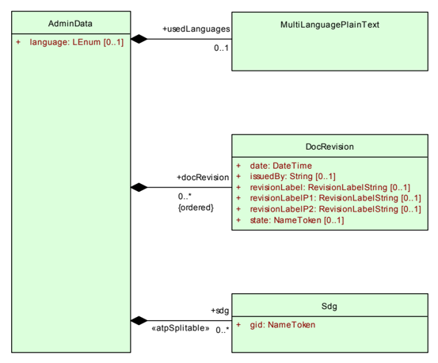

表4.16：AdminData

| 类         | AdminData                                                                                                                                                                                                                                                                                          |
|------------|--------------------------------------------------------------------------------------------------------------------------------------------------------------------------------------------------------------------------------------------------------------------------------------------------------|
| 包         | M2::MSR::AsamHdo::AdminData                                                                                                                                                                                                                                                                             |
| 注意       | AdminData 表示为元素表达管理性信息与自定义扩展的能力。该管理信息应当作为元数据处理，例如修订号或文件状态。基本上有以下几类元数据：语言和/或所用语言；涵盖例如修订号、状态、发布日期、变更的修订信息（注意，该信息既可以一般性地给出，也可以与特定公司相关联）；特定于公司的文档元数据。除此之外，还可以通过特殊数据（Special Data）对模型数据进行自定义扩展。 |
| 基类       | ARObject                                                                                                                                                                                                                                                                                                |
| 聚合于     | AUTOSAR.adminData、Describable.adminData、Identifiable.adminData                                                                                                                                                                                                                                         |

| 属性                   | 类型                    | 多重性 | 类别 | 注意                                                                                                                                                                                                                                                                                     |
|------------------------|-------------------------|--------|------|-----------------------------------------------------------------------------------------------------------------------------------------------------------------------------------------------------------------------------------------------------------------------------------------------|
| docRevision (ordered)  | DocRevision             | *      | aggr | 这允许标注关于对象当前修订的信息。注意，关于先前修订的信息也可以记录于此。这些条目应当按日期降序排序以反映历史。因此，表示当前版本的最新条目排在第一位。标签：xml.roleElement=true xml.roleWrapperElement=true xml.sequenceOffset=50 xml.typeElement=false xml.typeWrapperElement=false                |
| language               | LEnum                   | 0..1   | attr | 该属性规定文档或文档片段的主语言。主语言是维护文档并从中派生其他语言的语言。特别是在出现不一致的情况下，主语言中的信息具有优先级。标签：xml.sequenceOffset=20                                                                                                                                             |
| sdg                    | Sdg                     | *      | aggr | 该属性允许保留标准模型未表示的特殊数据。它可用于保存例如工具特定的数据。构型：atpSplitable 标签：atp.Splitkey=sdg.sdgCaption.shortName xml.roleElement=true xml.roleWrapperElement=true xml.sequenceOffset=60 xml.typeElement=false xml.typeWrapperElement=false                                        |
| usedLanguages          | MultiLanguagePlainText  | 0..1   | aggr | 该属性规定文档中提供的语言。因此它只应当在顶层 admin 数据中规定。文档中提供的每种语言在 MultilanguagePlainText 中有一个条目。每个条目的内容可用于展示该语言。所用语言本身取决于条目中的 language 属性。标签：xml.sequenceOffset=30                                                                          |

表4.17：DocRevision

| 类         | DocRevision                                                                           |
|------------|------------------------------------------------------------------------------------------|
| 包         | M2::MSR::AsamHdo::AdminData                                                              |
| 注意       | 该元类表示维护与文档或对象的修订管理相关的信息的能力。                                       |
| 基类       | ARObject                                                                                |
| 聚合于     | AdminData.docRevision                                                                    |

| 属性             | 类型                | 多重性 | 类别 | 注意                                                                                                                                                  |
|------------------|---------------------|--------|------|------------------------------------------------------------------------------------------------------------------------------------------------------------|
| date             | DateTime            | 1      | attr | 这规定相关对象发布时的日期与时间。标签：xml.sequenceOffset=80                                                                                                |
| issuedBy         | String              | 0..1   | attr | 这是发布文档或文档片段当前修订的个人或组织的名称。标签：xml.sequenceOffset=60                                                                                      |
| modification     | Modification        | *      | aggr | 该属性表示相对于其前驱的一项特定修改。标签：xml.roleElement=true xml.roleWrapperElement=true xml.sequenceOffset=100 xml.typeElement=false xml.typeWrapperElement=false |
| revisionLabel    | RevisionLabelString | 0..1   | attr | 该属性表示对象的版本号。标签：xml.sequenceOffset=20                                                                                                            |
| revisionLabelP1  | RevisionLabelString | 0..1   | attr | 该属性表示对象第一个前驱的版本号。标签：xml.sequenceOffset=30                                                                                                    |
| revisionLabelP2  | RevisionLabelString | 0..1   | attr | 该属性表示对象第二个前驱的版本号。当对象是一个合并过程的结果——即两个分支合并为一个新的修订——时使用该属性。标签：xml.sequenceOffset=40                                    |
| state            | NameToken           | 0..1   | attr | 属性 state 按照配置管理计划表示当前文件的当前状态。在可能的状态被标准化之前，它是一个 NameToken。标签：xml.sequenceOffset=50                                          |

表4.18：Modification

| 类         | Modification                                                                               |
|------------|-----------------------------------------------------------------------------------------------|
| 包         | M2::MSR::AsamHdo::AdminData                                                                    |
| 注意       | 该元类表示记录文档相对于其前驱发生了什么变更的能力。                                              |
| 基类       | ARObject                                                                                      |
| 聚合于     | DocRevision.modification                                                                       |

| 属性   | 类型                             | 多重性 | 类别 | 注意                                                 |
|--------|----------------------------------|--------|------|--------------------------------------------------------|
| change | MultiLanguageOverviewParagraph   | 1      | aggr | 该属性表示对对象执行的那项特定变更。标签：xml.sequenceOffset=20 |
| reason | MultiLanguageOverviewParagraph   | 0..1   | aggr | 该属性表示该特定变更的理由。标签：xml.sequenceOffset=30        |

### 4.6. 特殊数据——扩展机制

#### 4.6.1. 特殊数据

特殊数据组（`Sdg`）提供了一种标准化机制，用于存储数据模型中不存在其他元素可承载的任意数据。

**Sdg 的用例**

特殊数据的预期用例如：

- 在 AUTOSAR 模型中表示专有信息，而无需“随附（sidecar）”文件；
- 表示用于规避 AUTOSAR 元模型缺陷或缺失特性的信息；
- 在模型中的专用位置表示用例（例如 `BuildActionIoElement`）。

`Sdg` 的应用取决于相关各方之间的共同约定。

**特殊数据中可用的建模支持**

基本上，`Sdg` 允许对任意模型进行通用表示（类似于“well-formed XML”），而无需显式的元模型。它提供以下途径：

- 聚合在 `SdgContents` 之外的 `Sdg` 表示特殊数据的根容器。
- 角色 `SdgContents.sdg` 中的 `Sdg` 表示结构化信息的容器。它可以包含 `sdg`、`sd` 与 `sdx` 的任意混合。
- 角色 `Sdg.sdg` 中的 `Sd` 表示原始信息。与 `TagWithOptionalValue` 相反，其值是隐式表示的，因此不能是可选的（参见 [TPS\_GST\_00358]）。
- `Sdg.sdx`（对 `Referrable` 的引用）表示一个关联。

**Sdg 的应用**

`Sdg` 的应用有一处细微差别：

- `AdminData.sdg` 用于纯粹的专有目的；
- 其他元类中的专用聚合，其目的在相应的模板中描述。

**特殊数据中角色的规定**

特殊数据中元素的特定角色标注在 `Sd` 或 `Sdg` 的属性 `gid` 中。注意 `sdx` 没有这样的属性。如果需要标注特定角色，则需要把一个额外的容器 `sdg` 包裹在 `sdx` 外面。

以下提示适用：

- 按共同约定创建单独的 `sdg`。这可以在 `gid` 中以组织名或指示特定语义的名称标注。
- 为 `gid` 选择有区分度的名称，因为 `Sdg` 不建立命名空间。
- 选择合适的容器（`sdg`）布局：既不要每个 `sd` 一个容器，也不要把所有 `sd` 放进一个“巨型容器”。
- 不要用 `sdg` 表示元模型已经支持的信息。
- 注意 `sd` 保留空白字符。

示例 4.8 展示了一个用例 “tracing-info” 作为较完整的示例。它规定了文档相对于需求追溯的一些属性。它是一个带有一组属性的简单容器。

清单4.8：特殊数据的简单示例

```xml
<SDG GID="TRACING-INFO">
  <SD GID="ITEM-PREFIX">BswM</SD>
  <SD GID="CONTRIBUTES-TO-GENERAL">SRS_BSWGeneral</SD>
  <SD GID="CONTRIBUTES-TO">SRS_ModeManagement</SD>
  <SD GID="INCLUDES">SWS_BSWGeneral</SD>
</SDG>
```

示例 4.9 展示了一个用例 “Relation” 作为简单示例。该示例展示了如何使用 `Sdg` 表示一个需求与相关开发对象之间的关系。该示例特别展示：

- 一个带有 `sdgCaption`（其中包含 shortName 与 desc）的 `Sdg`；
- 由 `sdx` 表示的任意关联；
- 引用 /My/Mypackage 的 `sdx` 的角色未被显式规定；
- 这些关联的语义由外层的 `sdg` 表达；
- `SdgContents` 中 `sdg`、`sd` 与 `sdx` 的任意混合。

清单4.9：带引用的特殊数据示例

```xml
<SDG GID="EXAMPLE-RELATION">
  <SDG-CAPTION>
    <SHORT-NAME>Rel_90</SHORT-NAME>
    <LONG-NAME>
      <L-4 L="AA">This is the relationship no 90</L-4>
    </LONG-NAME>
    <DESC>
      <L-2 L="AA">This relationship specifies objects related to requirement 90.</L-2>
    </DESC>
  </SDG-CAPTION>
  <SDX-REF DEST="AR-PACKAGE">/My/Mypackage</SDX-REF>
  <SD GID="SEVERITY">significant</SD>
  <SDG GID="SOURCE">
    <SDX-REF DEST="TRACEABLE" BASE="ArTrace">RS_MyReq_0090</SDX-REF>
  </SDG>
  <SDG GID="TARGETS">
    <SDX-REF DEST="SW-COMPONENT-TYPE" BASE="MyComponent">SwComponentTypes/MyComponent</SDX-REF>
    <SDX-REF DEST="COMPU-METHOD" BASE="MyComponent">CompuMethods/MyMethod</SDX-REF>
    <SDX-REF DEST="AUTOSAR-DATA-TYPE" BASE="MyComponent">ImplementationDataTypes/MyType</SDX-REF>
  </SDG>
  <SD GID="Path">maintenance</SD>
</SDG>
```

关于在特殊数据组中表达可变性，参见清单 4.10。

清单4.10：带端口引用与变体的特殊数据示例

```xml
<SDG GID="EXAMPLE-PORT-REF">
  <SDXF>
    <REFERRABLE-REF DEST="P-PORT-PROTOTYPE" BASE="MyComponent">SwComponentTypes/MyComponent/PData1</REFERRABLE-REF>
    <VARIATION-POINT>
      <SW-SYSCOND BINDING-TIME="PRE-COMPILE-TIME">
        <SYSC-REF DEST="SW-SYSTEMCONST" BASE="MySwSystemconsts">SwSystemconsts/ScVar1</SYSC-REF>
        &gt;= 1
      </SW-SYSCOND>
    </VARIATION-POINT>
  </SDXF>
  <SDF GID="EXAMPLE-VARIANT-SD">
    <VALUE><SYSC-REF DEST="SW-SYSTEMCONST" BASE="MySwSystemconsts">SwSystemconsts/ScVar2</SYSC-REF> +4</VALUE>
  </SDF>
  <SDG GID="EXAMPLE-VARIANT-SDG">
    <SD GID="Path">maintenance</SD>
    <VARIATION-POINT>
      <SW-SYSCOND BINDING-TIME="PRE-COMPILE-TIME">
        <SYSC-REF DEST="SW-SYSTEMCONST" BASE="MySwSystemconsts">SwSystemconsts/ScVar3</SYSC-REF>
        &lt; 1
      </SW-SYSCOND>
    </VARIATION-POINT>
  </SDG>
</SDG>
```

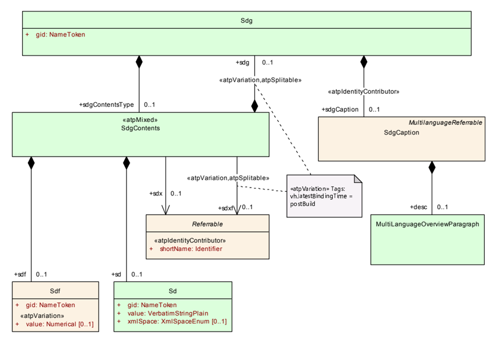

表4.19：Sdg

| 类         | Sdg                                                                                                                                                                                                                                                                                                                                                       |
|------------|---------------------------------------------------------------------------------------------------------------------------------------------------------------------------------------------------------------------------------------------------------------------------------------------------------------------------------------------------------------|
| 包         | M2::MSR::AsamHdo::SpecialData                                                                                                                                                                                                                                                                                                                                   |
| 注意       | Sdg（SpecialDataGroup）是一个通用模型，可用于保存元模型中未显式建模的任意信息。Sdg 可以具有 sdgContentsType 定义的各种内容。特殊数据应当只被适度使用，因为所有元素都应当在元模型中定义。因此，SDG 应当被视为在尚无显式模型可用时的临时解决方案。若存在 sdgCaption，则可以建立指向该 sdg 结构的引用。                                                                                  |
| 基类       | ARObject                                                                                                                                                                                                                                                                                                                                                         |
| 聚合于     | AdminData.sdg、BuildActionEnvironment.sdg、BuildActionInvocator.sdg、BuildActionIoElement.sdg、FileInfoComment.sdg、RptHook.sdg、SdgContents.sdg、VariationPoint.sdg                                                                                                                                                                                              |

| 属性             | 类型        | 多重性 | 类别 | 注意                                                                                                                                                                                              |
|------------------|-------------|--------|------|--------------------------------------------------------------------------------------------------------------------------------------------------------------------------------------------------------|
| gid              | NameToken   | 1      | attr | 该属性规定一个标识符。Gid 来自 SGML/XML 术语“Generic Identifier”，即 XML 中的元素名。该属性的角色与 XML 元素的名称相同。标签：xml.attribute=true                                                            |
| sdgCaption       | SdgCaption  | 0..1   | aggr | 该聚合允许把 Identifiable 的属性指派给 sdg。由此可以为 Sdg 指派 shortName 等。构型：atpIdentityContributor 标签：xml.sequenceOffset=20                                                                       |
| sdgContentsType  | SdgContents | 0..1   | aggr | 这是 Sdg 的内容。标签：xml.roleElement=false xml.roleWrapperElement=false xml.sequenceOffset=30 xml.typeElement=false xml.typeWrapperElement=false                                                         |

表4.20：SdgContents

| 类         | &lt;&lt;atpMixed&gt;&gt; SdgContents                                                                                    |
|------------|-----------------------------------------------------------------------------------------------------------------------------|
| 包         | M2::MSR::AsamHdo::SpecialData                                                                                                 |
| 注意       | 该元类表示特殊数据组的可能内容。它可以是对引用、原始特殊数据与嵌套特殊数据组的任意混合。                                          |
| 基类       | ARObject                                                                                                                     |
| 聚合于     | Sdg.sdgContentsType                                                                                                          |

| 属性 | 类型      | 多重性 | 类别 | 注意                                                                                                                                                                                                                                |
|------|-----------|--------|------|------------------------------------------------------------------------------------------------------------------------------------------------------------------------------------------------------------------------------------------|
| sd   | Sd        | 0..1   | aggr | 这是一个特定的特殊数据元素。标签：xml.sequenceOffset=40                                                                                                                                                                                        |
| sdf  | Sdf       | 0..1   | aggr | 这是一个特定的特殊数据元素。标签：xml.sequenceOffset=60                                                                                                                                                                                        |
| sdg  | Sdg       | 0..1   | aggr | 该聚合允许表达嵌套的特殊数据组。由此，任何结构都可以在 SpeicalData（源文如此）中表示。构型：atpSplitable；atpVariation 标签：atp.Splitkey=sdg.sdgCaption.shortName, sdg.variationPoint.shortLabel vh.latestBindingTime=postBuild xml.sequenceOffset=50 |
| sdx  | Referrable| 0..1   | ref  | 对任何可标识元素的引用。这使得 Sdg 甚至可以用来建立任意的关联关系。                                                                                                                                                                                |
| sdxf | Referrable| 0..1   | ref  | 带变体支持的附加引用。构型：atpSplitable；atpVariation 标签：atp.Splitkey=sdxf.referrable, sdxf.variationPoint.shortLabel vh.latestBindingTime=postBuild                                                                                              |

表4.21：SdgCaption

| 类         | SdgCaption                                                                                                       |
|------------|----------------------------------------------------------------------------------------------------------------------|
| 包         | M2::MSR::AsamHdo::SpecialData                                                                                          |
| 注意       | 该元类表示特殊数据组的标题（caption）。这使得特殊数据的某些部分可以成为可标识的。                                          |
| 基类       | ARObject、MultilanguageReferrable、Referrable                                                                            |
| 聚合于     | Sdg.sdgCaption                                                                                                          |

| 属性 | 类型                             | 多重性 | 类别 | 注意                                                                                                                                                      |
|------|----------------------------------|--------|------|---------------------------------------------------------------------------------------------------------------------------------------------------------------|
| desc | MultiLanguageOverviewParagraph   | 0..1   | aggr | 这表示关于相关特殊数据是什么的一般但简短（单段）描述。它只有一个段落！Desc 旨在被收集到概览表中。该属性帮助人类读者识别相关特殊数据。                                |

表4.22：Sd

| 类         | Sd                                                                                              |
|------------|------------------------------------------------------------------------------------------------------|
| 包         | M2::MSR::AsamHdo::SpecialData                                                                          |
| 注意       | 该类表示特殊数据组中的一个原始元素。                                                                     |
| 基类       | ARObject                                                                                              |
| 聚合于     | SdgContents.sd                                                                                          |

| 属性     | 类型                | 多重性 | 类别 | 注意                                                                                                                                                                                          |
|----------|---------------------|--------|------|----------------------------------------------------------------------------------------------------------------------------------------------------------------------------------------------------|
| gid      | NameToken           | 1      | attr | 该属性规定一个标识符。Gid 来自 SGML/XML 术语“Generic Identifier”，即 XML 中的元素名。该属性的角色与 XML 元素的名称相同。标签：xml.attribute=true                                                            |
| value    | VerbatimStringPlain | 1      | attr | 这是特殊数据的取值。标签：xml.roleElement=false xml.roleWrapperElement=false xml.typeElement=false xml.typeWrapperElement=false                                                                          |
| xmlSpace | XmlSpaceEnum        | 0..1   | attr | 该属性用于表示一个意图：在该元素中，应用程序应当保留空白字符。它按照 W3C 声明的 xml:space 定义。标签：xml.attribute=true xml.attributeRef=true xml.enforceMinMultiplicity=true xml.name=space xml.nsPrefix=xml |

表4.23：Sdf

| 类         | Sdf                                                                                        |
|------------|-------------------------------------------------------------------------------------------------|
| 包         | M2::MSR::AsamHdo::SpecialData                                                                    |
| 注意       | 该类表示特殊数据组中一个可能受可变性支配的数值。                                                    |
| 基类       | ARObject                                                                                        |
| 聚合于     | SdgContents.sdf                                                                                   |

| 属性  | 类型      | 多重性 | 类别 | 注意                                                                                                                                                                |
|-------|-----------|--------|------|--------------------------------------------------------------------------------------------------------------------------------------------------------------------------|
| gid   | NameToken | 1      | attr | 该属性规定一个标识符。Gid 来自 SGML/XML 术语“Generic Identifier”，即 XML 中的元素名。该属性的角色与 XML 元素的名称相同。标签：xml.attribute=true                                    |
| value | Numerical | 0..1   | attr | 这是特殊数据的取值。构型：atpVariation 标签：vh.latestBindingTime=preCompileTime                                                                                                  |

#### 4.6.2. 特殊数据定义

**SdgDef 的用途**

特殊数据组定义（**Special Data Group Definition**，SdgDef）规定 AUTOSAR 模型中所接受的 `Sdg` 的结构。该结构通过使用 `SdgClass` 及其 `SdgAttribute`（`SdgPrimitiveAttribute`、`SdgPrimitiveAttributeWithVariation`、`SdgReference`、`SdgAggregationWithVariation`、`SdgForeignReference` 和 `SdgForeignReferenceWithVariation`）规定一个元模型来定义。

`SdgDef` 是 UML 构型（Profile）的 AUTOSAR 对应物。

**SdgPrimitiveAttribute 与 SdgPrimitiveAttributeWithVariation 的类别**

`SdgPrimitiveAttribute` 的标准化类别为 INTEGER、BOOLEAN、FLOAT、STRING、ENUMERATION。`SdgPrimitiveAttributeWithVariation` 的标准化类别为 INTEGER、BOOLEAN、FLOAT、ENUMERATION 之一。

清单 4.12 展示了一个枚举属性 “severity” 的定义。枚举属性的建模使用 `SdgPrimitiveAttribute.pattern` 完成，它定义有效的枚举字面量。

**SdgClass 的用途**

`SdgClass` 规定具有特定 `gid` 的 `Sdg` 的结构。

`SdgClass` 是 UML 构型（Stereotype）的 AUTOSAR 对应物。

**SdgClass.extendsMetaClass 与 SdgAbstractForeignReference.destMetaClass 取值的规定**

作为 `SdgClass.extendsMetaClass` 与 `SdgAbstractForeignReference.destMetaClass` 取值输入的字符串应当遵循 XML schema 中定义的 M2 类名的格式，且被引用的类需要（直接或间接）派生自 `Referrable`。

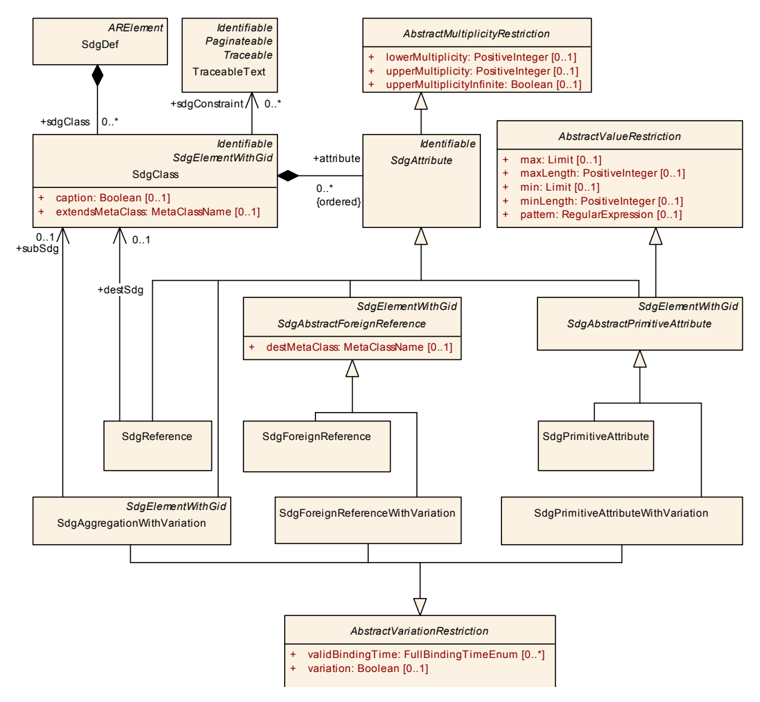

示例 4.11 规定了一个特殊数据组定义 `SdgDef`，它接受如示例 4.8 所述的简单扩展。

清单4.11：特殊数据定义示例

```xml
<SDG-DEF>
  <SHORT-NAME>TracingInfoExtension</SHORT-NAME>
  <SDG-CLASSES>
    <SDG-CLASS>
      <SHORT-NAME>TracingInfo</SHORT-NAME>
      <GID>TRACING-INFO</GID>
      <EXTENDS-META-CLASS>Documentation</EXTENDS-META-CLASS>
      <ATTRIBUTES>
        <SDG-PRIMITIVE-ATTRIBUTE>
          <SHORT-NAME>ItemPrefix</SHORT-NAME>
          <GID>ITEM-PREFIX</GID>
        </SDG-PRIMITIVE-ATTRIBUTE>
        <SDG-PRIMITIVE-ATTRIBUTE>
          <SHORT-NAME>ContributesToGeneral</SHORT-NAME>
          <GID>CONTRIBUTES-TO-GENERAL</GID>
        </SDG-PRIMITIVE-ATTRIBUTE>
        <SDG-PRIMITIVE-ATTRIBUTE>
          <SHORT-NAME>ContributesTo</SHORT-NAME>
          <GID>CONTRIBUTES-TO</GID>
        </SDG-PRIMITIVE-ATTRIBUTE>
        <SDG-PRIMITIVE-ATTRIBUTE>
          <SHORT-NAME>Includes</SHORT-NAME>
          <GID>INCLUDES</GID>
        </SDG-PRIMITIVE-ATTRIBUTE>
      </ATTRIBUTES>
    </SDG-CLASS>
  </SDG-CLASSES>
</SDG-DEF>
```

示例 4.12 规定了一个特殊数据组定义 `SdgDef`，它接受带嵌套 `Sdg` 容器和对 AUTOSAR 模型对象的引用的扩展。一个被接受的 `Sdg` 的示例见 4.9。

清单4.12：规定带子组与引用的特殊数据结构的特殊数据定义示例

```xml
<SDG-DEF>
  <SHORT-NAME>ExampleSdgDefWithForeignReferencesAndSubSdgs</SHORT-NAME>
  <SDG-CLASSES>
    <SDG-CLASS>
      <SHORT-NAME>ExampleRelation</SHORT-NAME>
      <GID>EXAMPLE-RELATION</GID>
      <EXTENDS-META-CLASS>ARPackage</EXTENDS-META-CLASS>
      <CAPTION>true</CAPTION>
      <ATTRIBUTES>
        <SDG-FOREIGN-REFERENCE>
          <SHORT-NAME>packageRef</SHORT-NAME>
          <UPPER-MULTIPLICITY>1</UPPER-MULTIPLICITY>
          <DEST-META-CLASS>ArPackage</DEST-META-CLASS>
        </SDG-FOREIGN-REFERENCE>
        <SDG-PRIMITIVE-ATTRIBUTE>
          <SHORT-NAME>severity</SHORT-NAME>
          <UPPER-MULTIPLICITY>1</UPPER-MULTIPLICITY>
          <GID>SEVERITY</GID>
          <PATTERN>critical|significant|minor|low</PATTERN>
        </SDG-PRIMITIVE-ATTRIBUTE>
        <SDG-AGGREGATION-WITH-VARIATION>
          <SHORT-NAME>source</SHORT-NAME>
          <LOWER-MULTIPLICITY>1</LOWER-MULTIPLICITY>
          <UPPER-MULTIPLICITY>1</UPPER-MULTIPLICITY>
          <GID>SOURCE</GID>
          <VARIATION>false</VARIATION>
          <SUB-SDG-REF DEST="SDG-CLASS" BASE="Extensions">ExampleSdgDefWithForeignReferencesAndSubSdgs/SourceRefContainer</SUB-SDG-REF>
        </SDG-AGGREGATION-WITH-VARIATION>
        <SDG-AGGREGATION-WITH-VARIATION>
          <SHORT-NAME>target</SHORT-NAME>
          <LOWER-MULTIPLICITY>1</LOWER-MULTIPLICITY>
          <UPPER-MULTIPLICITY>1</UPPER-MULTIPLICITY>
          <GID>TARGETS</GID>
          <VARIATION>false</VARIATION>
          <SUB-SDG-REF DEST="SDG-CLASS" BASE="Extensions">ExampleSdgDefWithForeignReferencesAndSubSdgs/TargetsRefContainer</SUB-SDG-REF>
        </SDG-AGGREGATION-WITH-VARIATION>
        <SDG-PRIMITIVE-ATTRIBUTE>
          <SHORT-NAME>path</SHORT-NAME>
          <LOWER-MULTIPLICITY>0</LOWER-MULTIPLICITY>
          <UPPER-MULTIPLICITY>1</UPPER-MULTIPLICITY>
          <GID>Path</GID>
        </SDG-PRIMITIVE-ATTRIBUTE>
      </ATTRIBUTES>
    </SDG-CLASS>
    <SDG-CLASS>
      <SHORT-NAME>SourceRefContainer</SHORT-NAME>
      <GID>SOURCE-REF-CONTAINER</GID>
      <EXTENDS-META-CLASS>ARPackage</EXTENDS-META-CLASS>
      <CAPTION>true</CAPTION>
      <ATTRIBUTES>
        <SDG-FOREIGN-REFERENCE>
          <SHORT-NAME>sourceRef</SHORT-NAME>
          <LOWER-MULTIPLICITY>1</LOWER-MULTIPLICITY>
          <UPPER-MULTIPLICITY>1</UPPER-MULTIPLICITY>
          <DEST-META-CLASS>Traceable</DEST-META-CLASS>
        </SDG-FOREIGN-REFERENCE>
      </ATTRIBUTES>
    </SDG-CLASS>
    <SDG-CLASS>
      <SHORT-NAME>TargetsRefContainer</SHORT-NAME>
      <GID>STARGET-REF-CONTAINER</GID>
      <EXTENDS-META-CLASS>ARPackage</EXTENDS-META-CLASS>
      <CAPTION>true</CAPTION>
      <ATTRIBUTES>
        <SDG-FOREIGN-REFERENCE>
          <SHORT-NAME>targetRef</SHORT-NAME>
          <LOWER-MULTIPLICITY>1</LOWER-MULTIPLICITY>
          <UPPER-MULTIPLICITY-INFINITE>true</UPPER-MULTIPLICITY-INFINITE>
          <DEST-META-CLASS>Referrable</DEST-META-CLASS>
        </SDG-FOREIGN-REFERENCE>
      </ATTRIBUTES>
    </SDG-CLASS>
  </SDG-CLASSES>
</SDG-DEF>
```

示例 4.13 规定了一个特殊数据组定义 `SdgDef`，它接受带变体的扩展。一个被接受的 `Sdg` 的示例见 4.10。

清单4.13：规定带变体的特殊数据结构的特殊数据定义示例

```xml
<SDG-DEF>
  <SHORT-NAME>ExampleSdgDefWithVariation</SHORT-NAME>
  <SDG-CLASSES>
    <SDG-CLASS>
      <SHORT-NAME>ExampleSdgWithVariation</SHORT-NAME>
      <GID>EXAMPLE-PORT-REF</GID>
      <ATTRIBUTES>
        <SDG-FOREIGN-REFERENCE-WITH-VARIATION>
          <SHORT-NAME>exampleVariantSfxf</SHORT-NAME>
          <LOWER-MULTIPLICITY>1</LOWER-MULTIPLICITY>
          <UPPER-MULTIPLICITY>1</UPPER-MULTIPLICITY>
          <DEST-META-CLASS>PortPrototype</DEST-META-CLASS>
          <VARIATION>true</VARIATION>
          <VALID-BINDING-TIMES>
            <VALID-BINDING-TIME>PRE-COMPILE-TIME</VALID-BINDING-TIME>
            <VALID-BINDING-TIME>SYSTEM-DESIGN-TIME</VALID-BINDING-TIME>
          </VALID-BINDING-TIMES>
        </SDG-FOREIGN-REFERENCE-WITH-VARIATION>
        <SDG-PRIMITIVE-ATTRIBUTE-WITH-VARIATION>
          <SHORT-NAME>ExampleVariantSd</SHORT-NAME>
          <LOWER-MULTIPLICITY>1</LOWER-MULTIPLICITY>
          <UPPER-MULTIPLICITY>1</UPPER-MULTIPLICITY>
          <GID>EXAMPLE-VARIANT-SD</GID>
          <VARIATION>true</VARIATION>
          <VALID-BINDING-TIMES>
            <VALID-BINDING-TIME>PRE-COMPILE-TIME</VALID-BINDING-TIME>
            <VALID-BINDING-TIME>SYSTEM-DESIGN-TIME</VALID-BINDING-TIME>
          </VALID-BINDING-TIMES>
        </SDG-PRIMITIVE-ATTRIBUTE-WITH-VARIATION>
        <SDG-AGGREGATION-WITH-VARIATION>
          <SHORT-NAME>ExampleVariantSdg</SHORT-NAME>
          <LOWER-MULTIPLICITY>1</LOWER-MULTIPLICITY>
          <UPPER-MULTIPLICITY>1</UPPER-MULTIPLICITY>
          <GID>EXAMPLE-VARIANT-SDG</GID>
          <VARIATION>true</VARIATION>
          <VALID-BINDING-TIMES>
            <VALID-BINDING-TIME>PRE-COMPILE-TIME</VALID-BINDING-TIME>
            <VALID-BINDING-TIME>SYSTEM-DESIGN-TIME</VALID-BINDING-TIME>
          </VALID-BINDING-TIMES>
          <SUB-SDG-REF DEST="SDG-CLASS" BASE="Extensions">ExampleSdgDefWithVariation/ExampleVariantSdgContainer</SUB-SDG-REF>
        </SDG-AGGREGATION-WITH-VARIATION>
      </ATTRIBUTES>
    </SDG-CLASS>
    <SDG-CLASS>
      <SHORT-NAME>ExampleVariantSdgContainer</SHORT-NAME>
      <ATTRIBUTES>
        <SDG-PRIMITIVE-ATTRIBUTE>
          <SHORT-NAME>Path</SHORT-NAME>
          <GID>Path</GID>
        </SDG-PRIMITIVE-ATTRIBUTE>
      </ATTRIBUTES>
    </SDG-CLASS>
  </SDG-CLASSES>
</SDG-DEF>
```

**若取值侧的 Sdg 应当可引用，则置 SdgClass.caption = true**

如果某个 `SdgClass` 所定义的 `Sdg` 应当是可引用的，则属性 `SdgClass.caption` 应当置为 `true`。在这种情况下，一个有效的 `Sdg` 实例必须拥有 `SdgCaption`。若属性 `SdgClass.caption` 未设置，或设置的值为 `false`，则 `SdgCaption` 的使用是可选的。

[TPS\_GST\_00425] 必须区分定义侧（示例 4.14）与取值侧（示例 4.15）。caption 的存在是一种引用 `Sdg` 的机制，用于标准化引用方式无法适用的情况。

清单4.14：特殊数据定义侧示例

```xml
<SDG-DEF>
  <SHORT-NAME>InstanceExtensions</SHORT-NAME>
  <SDG-CLASSES>
    <SDG-CLASS>
      <SHORT-NAME>ProvidedUserDefinedServiceInstance</SHORT-NAME>
      <GID>acme:instanceExtensions</GID>
      <EXTENDS-META-CLASS>ProvidedUserDefinedServiceInstance</EXTENDS-META-CLASS>
      <CAPTION>true</CAPTION>
      <ATTRIBUTES>
        <SDG-FOREIGN-REFERENCE>
          <SHORT-NAME>SdServerTimeConfig</SHORT-NAME>
          <LOWER-MULTIPLICITY>0</LOWER-MULTIPLICITY>
          <UPPER-MULTIPLICITY>1</UPPER-MULTIPLICITY>
          <GID>acme:sdServerTimeConfig</GID>
          <DEST-META-CLASS>SomeipSdServerServiceInstanceConfig</DEST-META-CLASS>
        </SDG-FOREIGN-REFERENCE>
      </ATTRIBUTES>
    </SDG-CLASS>
  </SDG-CLASSES>
</SDG-DEF>
```

清单4.15：特殊数据取值侧示例

```xml
<PROVIDED-USER-DEFINED-SERVICE-INSTANCE>
  <SHORT-NAME>UDSI</SHORT-NAME>
  <ADMIN-DATA>
    <SDGS>
      <SDG GID="acme:instanceExtensions">
        <SDG GID="acme:sdServerTimeConfig">
          <SDG-CAPTION>
            <SHORT-NAME>MyConfigRef</SHORT-NAME>
          </SDG-CAPTION>
          <SDX-REF DEST="SOMEIP-SD-SERVER-SERVICE-INSTANCE-CONFIG">MyConf</SDX-REF>
        </SDG>
      </SDG>
    </SDGS>
  </ADMIN-DATA>
</PROVIDED-USER-DEFINED-SERVICE-INSTANCE>
```

类 `SdgReference` 可以在定义侧用于建模一个指向取值侧某个 `Sdg` 的引用。在定义侧，属性 `SdgReference.destSdg` 指向一个 `SdgClass`，后者描述被引用 `Sdg` 的目标类型。注意，在取值侧，该引用通过源 `Sdg` 定义一个指向被引用 `Sdg` 的 `sdgCaption` 的 `sdx` 属性来实现。为了在取值侧强制 `SdgCaption` 的存在，`SdgReference.destSdg` 所引用的 `SdgClass` 的属性 `SdgClass.caption` 必须置为 `true`，参见 [TPS\_GST\_00425]。

假设一个 SWC（示例 4.16），其中要把一些自定义的安全指南和一个指向安全等级的引用规定为特殊数据。

清单4.16：SWC 中特殊数据用法示例

```xml
<AR-PACKAGE>
  <SHORT-NAME>SwComponentTypes</SHORT-NAME>
  <ELEMENTS>
    <APPLICATION-SW-COMPONENT-TYPE>
      <SHORT-NAME>SwcFoo</SHORT-NAME>
      <ADMIN-DATA>
        <SDGS>
          <SDG GID="CustomSafetyGuidelines">
            <SDX-REF DEST="SDG-CAPTION">/SwComponentTypes/SwcFoo/ASIL_B</SDX-REF>
            <SD GID="Rule">R00042</SD>
          </SDG>
          <SDG GID="SafetyLevel">
            <SDG-CAPTION>
              <SHORT-NAME>ASIL_B</SHORT-NAME>
            </SDG-CAPTION>
            <SD GID="ASIL">B</SD>
          </SDG>
        </SDGS>
      </ADMIN-DATA>
    </APPLICATION-SW-COMPONENT-TYPE>
  </ELEMENTS>
</AR-PACKAGE>
```

这可以用以下 `Sdg` 定义建模（示例 4.17）：

清单4.17：对应的特殊数据定义示例

```xml
<AR-PACKAGE>
  <SHORT-NAME>SdgDefs</SHORT-NAME>
  <ELEMENTS>
    <SDG-DEF>
      <SHORT-NAME>CustomSafetyExtensionDef</SHORT-NAME>
      <SDG-CLASSES>
        <SDG-CLASS>
          <SHORT-NAME>CustomSafetyGuidelines</SHORT-NAME>
          <GID>CustomSafetyGuidelines</GID>
          <ATTRIBUTES>
            <SDG-REFERENCE>
              <SHORT-NAME>SafetyLevelRef</SHORT-NAME>
              <DEST-SDG-REF DEST="SDG-CLASS">/SdgDefs/CustomSafetyExtensionDef/SafetyLevelDef</DEST-SDG-REF>
            </SDG-REFERENCE>
            <SDG-PRIMITIVE-ATTRIBUTE>
              <SHORT-NAME>RuleDef</SHORT-NAME>
              <CATEGORY>STRING</CATEGORY>
              <UPPER-MULTIPLICITY-INFINITE>true</UPPER-MULTIPLICITY-INFINITE>
              <GID>Rule</GID>
            </SDG-PRIMITIVE-ATTRIBUTE>
          </ATTRIBUTES>
        </SDG-CLASS>
        <SDG-CLASS>
          <SHORT-NAME>SafetyLevelDef</SHORT-NAME>
          <GID>SafetyLevel</GID>
          <CAPTION>true</CAPTION>
          <ATTRIBUTES>
            <SDG-PRIMITIVE-ATTRIBUTE>
              <SHORT-NAME>AsilDef</SHORT-NAME>
              <CATEGORY>ENUMERATION</CATEGORY>
              <UPPER-MULTIPLICITY>1</UPPER-MULTIPLICITY>
              <GID>ASIL</GID>
              <PATTERN>A|B|C|D</PATTERN>
            </SDG-PRIMITIVE-ATTRIBUTE>
          </ATTRIBUTES>
        </SDG-CLASS>
      </SDG-CLASSES>
    </SDG-DEF>
  </ELEMENTS>
</AR-PACKAGE>
```

表4.24：SdgDef

| 类         | SdgDef                                                                                                                                          |
|------------|------------------------------------------------------------------------------------------------------------------------------------------------------|
| 包         | M2::AUTOSARTemplates::GenericStructure::GeneralTemplateClasses::SpecialDataDef                                                                          |
| 注意       | 一个 SdgDef 把属于同一扩展的若干 SdgClass 组合在一起。SdgDef 的概念类似于 UML Profile。标签：atp.recommendedPackage=SdgDefs                              |
| 基类       | ARElement、ARObject、CollectableElement、Identifiable、MultilanguageReferrable、PackageableElement、Referrable                                            |
| 聚合于     | ARPackage.element                                                                                                                                        |

| 属性     | 类型      | 多重性 | 类别 | 注意                                                       |
|----------|-----------|--------|------|----------------------------------------------------------------|
| sdgClass | SdgClass  | *      | aggr | 所拥有的 sdgClass，它们定义 Sdg 的结构。标签：xml.namePlural=SDG-CLASSES |

表4.25：SdgElementWithGid

| 类         | SdgElementWithGid（抽象）                                                                 |
|------------|-----------------------------------------------------------------------------------------------|
| 包         | M2::AUTOSARTemplates::GenericStructure::GeneralTemplateClasses::SpecialDataDef                  |
| 注意       | 带 gid 的特殊数据组元素是一个应当拥有名称（gid，“Generic Identifier”）的抽象元素。                  |
| 基类       | ARObject                                                                                      |
| 子类       | SdgAbstractForeignReference、SdgAbstractPrimitiveAttribute、SdgAggregationWithVariation、SdgClass |

| 属性 | 类型      | 多重性 | 类别 | 注意                             |
|------|-----------|--------|------|--------------------------------------|
| gid  | NameToken | 0..1   | attr | 规定标识该元素的名称。                   |

表4.26：SdgClass

| 类         | SdgClass                                                                                                  |
|------------|----------------------------------------------------------------------------------------------------------------|
| 包         | M2::AUTOSARTemplates::GenericStructure::GeneralTemplateClasses::SpecialDataDef                                   |
| 注意       | 一个 SdgClass 规定 SDG 的名称与结构，SDG 可用于在 AUTOSAR 模型中存储专有数据。SdgClass 类似于 UML 构型（stereotype）。 |
| 基类       | ARObject、Identifiable、MultilanguageReferrable、Referrable、SdgElementWithGid                                    |
| 聚合于     | SdgDef.sdgClass                                                                                                   |

| 属性                 | 类型          | 多重性 | 类别 | 注意                                                                          |
|----------------------|---------------|--------|------|------------------------------------------------------------------------------------|
| attribute (ordered)  | SdgAttribute  | *      | aggr | Sdg 结构的定义。标签：xml.sequenceOffset=30（Defintion 为源文如此）                     |
| caption              | Boolean       | 0..1   | attr | 规定是否需要 caption。注意：只有拥有 caption 的 Sdg 才能被引用。标签：xml.sequenceOffset=20 |
| extendsMetaClass     | MetaClassName | 0..1   | attr | 可以被该 SdgClass 扩展的 AUTOSAR 元类。标签：xml.sequenceOffset=10                      |
| sdgConstraint        | TraceableText | *      | ref  | 限制特殊数据组结构的语义约束。标签：xml.sequenceOffset=40                               |

表4.27：SdgAttribute

| 类         | SdgAttribute（抽象）                                                                                       |
|------------|---------------------------------------------------------------------------------------------------------------|
| 包         | M2::AUTOSARTemplates::GenericStructure::GeneralTemplateClasses::SpecialDataDef                                   |
| 注意       | 描述 Sdg 的属性。                                                                                                 |
| 基类       | ARObject、AbstractMultiplicityRestriction、Identifiable、MultilanguageReferrable、Referrable                       |
| 子类       | SdgAbstractForeignReference、SdgAbstractPrimitiveAttribute、SdgAggregationWithVariation、SdgReference               |
| 聚合于     | SdgClass.attribute                                                                                                 |

表4.28：SdgAbstractPrimitiveAttribute

| 类         | SdgAbstractPrimitiveAttribute（抽象）                                                                                                                                                                |
|------------|-----------------------------------------------------------------------------------------------------------------------------------------------------------------------------------------------------------|
| 包         | M2::AUTOSARTemplates::GenericStructure::GeneralTemplateClasses::SpecialDataDef                                                                                                                              |
| 注意       | 描述特殊数据组的原始属性。                                                                                                                                                                                    |
| 基类       | ARObject、AbstractMultiplicityRestriction、AbstractValueRestriction、Identifiable、MultilanguageReferrable、Referrable、SdgAttribute、SdgElementWithGid                                                          |
| 子类       | SdgPrimitiveAttribute、SdgPrimitiveAttributeWithVariation                                                                                                                                                      |
| 聚合于     | SdgClass.attribute                                                                                                                                                                                             |

表4.29：SdgPrimitiveAttribute

| 类         | SdgPrimitiveAttribute                                                                                                                                                                                  |
|------------|--------------------------------------------------------------------------------------------------------------------------------------------------------------------------------------------------------------|
| 包         | M2::AUTOSARTemplates::GenericStructure::GeneralTemplateClasses::SpecialDataDef                                                                                                                                  |
| 注意       | 描述不带变体的原始特殊数据属性。该类接受特殊数据 “sd” 属性。                                                                                                                                                      |
| 基类       | ARObject、AbstractMultiplicityRestriction、AbstractValueRestriction、Identifiable、MultilanguageReferrable、Referrable、SdgAbstractPrimitiveAttribute、SdgAttribute、SdgElementWithGid                                |
| 聚合于     | SdgClass.attribute                                                                                                                                                                                               |

表4.30：SdgPrimitiveAttributeWithVariation

| 类         | SdgPrimitiveAttributeWithVariation                                                                                                                                                                      |
|------------|----------------------------------------------------------------------------------------------------------------------------------------------------------------------------------------------------------------|
| 包         | M2::AUTOSARTemplates::GenericStructure::GeneralTemplateClasses::SpecialDataDef                                                                                                                                   |
| 注意       | 描述带变体的原始数值特殊数据属性。该类接受特殊数据 “sdf” 元素。                                                                                                                                                    |
| 基类       | ARObject、AbstractMultiplicityRestriction、AbstractValueRestriction、AbstractVariationRestriction、Identifiable、MultilanguageReferrable、Referrable、SdgAbstractPrimitiveAttribute、SdgAttribute、SdgElementWithGid |
| 聚合于     | SdgClass.attribute                                                                                                                                                                                                 |

表4.31：SdgAggregationWithVariation

| 类         | SdgAggregationWithVariation                                                                                                                                                                    |
|------------|------------------------------------------------------------------------------------------------------------------------------------------------------------------------------------------------------|
| 包         | M2::AUTOSARTemplates::GenericStructure::GeneralTemplateClasses::SpecialDataDef                                                                                                                         |
| 注意       | 描述 Sdg 可以包含另一个 Sdg。嵌套 Sdg 的 gid 由 subSdg 定义。表示 “sdg”。                                                                                                                                |
| 基类       | ARObject、AbstractMultiplicityRestriction、AbstractVariationRestriction、Identifiable、MultilanguageReferrable、Referrable、SdgAttribute、SdgElementWithGid                                                |
| 聚合于     | SdgClass.attribute                                                                                                                                                                                      |

| 属性   | 类型      | 多重性 | 类别 | 注意                       |
|--------|-----------|--------|------|--------------------------------|
| subSdg | SdgClass  | 0..1   | ref  | 受支持的子 Sdg 类。             |

表4.32：SdgReference

| 类         | SdgReference                                                                                                                                                    |
|------------|-------------------------------------------------------------------------------------------------------------------------------------------------------------------------|
| 包         | M2::AUTOSARTemplates::GenericStructure::GeneralTemplateClasses::SpecialDataDef                                                                                            |
| 注意       | 描述 SdgClass 的一个属性，用于在定义侧建模从取值侧的一个 Sdg 到另一个 Sdg 的引用。                                                                                            |
| 基类       | ARObject、AbstractMultiplicityRestriction、Identifiable、MultilanguageReferrable、Referrable、SdgAttribute                                                                  |
| 聚合于     | SdgClass.attribute                                                                                                                                                           |

| 属性    | 类型      | 多重性 | 类别 | 注意                                                                                                                                                                                                              |
|---------|-----------|--------|------|--------------------------------------------------------------------------------------------------------------------------------------------------------------------------------------------------------------------------|
| destSdg | SdgClass  | 0..1   | ref  | 指向一个 SdgClass，用于在定义侧建模被引用 Sdg 的目标类型。在取值侧，该引用通过源 Sdg 定义一个指向被引用 Sdg 的 sdgCaption 的 sdgx 属性来实现。                                                                                        |

表4.33：SdgAbstractForeignReference

| 类         | SdgAbstractForeignReference（抽象）                                                                                                                  |
|------------|-----------------------------------------------------------------------------------------------------------------------------------------------------------|
| 包         | M2::AUTOSARTemplates::GenericStructure::GeneralTemplateClasses::SpecialDataDef                                                                                |
| 注意       | 一个可以指向 AUTOSAR 模型中任何可引用对象的抽象引用。                                                                                                            |
| 基类       | ARObject、AbstractMultiplicityRestriction、Identifiable、MultilanguageReferrable、Referrable、SdgAttribute、SdgElementWithGid                                     |
| 子类       | SdgForeignReference、SdgForeignReferenceWithVariation                                                                                                            |
| 聚合于     | SdgClass.attribute                                                                                                                                               |

| 属性          | 类型          | 多重性 | 类别 | 注意                                       |
|---------------|---------------|--------|------|------------------------------------------------|
| destMetaClass | MetaClassName | 0..1   | attr | 规定该引用的目标元类。                            |

表4.34：SdgForeignReference

| 类         | SdgForeignReference                                                                                                                                                                |
|------------|-------------------------------------------------------------------------------------------------------------------------------------------------------------------------------------------|
| 包         | M2::AUTOSARTemplates::GenericStructure::GeneralTemplateClasses::SpecialDataDef                                                                                                                |
| 注意       | 一个不带变体支持的引用，可以指向 AUTOSAR 模型中任何可引用对象。该类接受特殊数据 “Sdx” 引用。                                                                                                    |
| 基类       | ARObject、AbstractMultiplicityRestriction、Identifiable、MultilanguageReferrable、Referrable、SdgAbstractForeignReference、SdgAttribute、SdgElementWithGid                                         |
| 聚合于     | SdgClass.attribute                                                                                                                                                                              |

表4.35：SdgForeignReferenceWithVariation

| 类         | SdgForeignReferenceWithVariation                                                                                                                                                        |
|------------|-------------------------------------------------------------------------------------------------------------------------------------------------------------------------------------------------|
| 包         | M2::AUTOSARTemplates::GenericStructure::GeneralTemplateClasses::SpecialDataDef                                                                                                                    |
| 注意       | 一个带变体支持的引用，可以指向 AUTOSAR 模型中任何可引用对象。该类接受特殊数据 “Sdxf” 引用。                                                                                                        |
| 基类       | ARObject、AbstractMultiplicityRestriction、AbstractVariationRestriction、Identifiable、MultilanguageReferrable、Referrable、SdgAbstractForeignReference、SdgAttribute、SdgElementWithGid              |
| 聚合于     | SdgClass.attribute                                                                                                                                                                                 |

表4.36：MetaClassName

| 原始类型    | MetaClassName                                                                                        |
|-------------|----------------------------------------------------------------------------------------------------------|
| 包          | M2::AUTOSARTemplates::GenericStructure::GeneralTemplateClasses::PrimitiveTypes                             |
| 注意        | AUTOSAR 元模型中类的名称。标签：xml.xsd.customType=META-CLASS-NAME xml.xsd.pattern=[A-Z][a-zA-Z0-9_]* xml.xsd.type=string |

### 4.7. 模型限制类型

**模型限制类型的用途**

模型限制类型（**Model Restriction Types**）规定限制 AUTOSAR 模型内容的规则。这些限制例如用于特殊数据组定义或数据交换点 [\[2\]](#ref-2) 的上下文中。与特殊数据组定义相应的细节见 4.6.2。

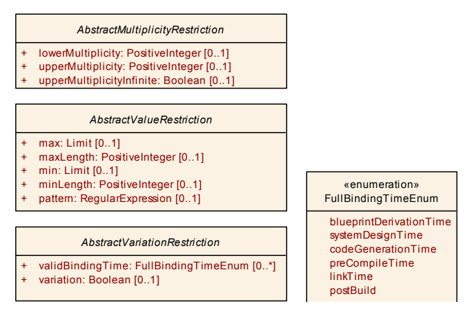

#### 4.7.1. 简单原始值的限制

**AbstractValueRestriction 的用途**

`AbstractValueRestriction` 对简单原始数据类型的值空间定义约束。该类的属性表示 XML Schema 规范 [\[11\]](#ref-11) 意义上的约束性 facet（constraining facets）。若一个值按照所有已定义的约束均有效，则该值有效。

表4.37：AbstractValueRestriction

| 类         | AbstractValueRestriction（抽象）                                                                            |
|------------|----------------------------------------------------------------------------------------------------------------|
| 包         | M2::AUTOSARTemplates::GenericStructure::GeneralTemplateClasses::ModelRestrictionTypes                            |
| 注意       | 限制原始值。若该限制定义的所有规则均取值为真，则一个值有效。                                                        |
| 基类       | ARObject                                                                                                       |
| 子类       | PrimitiveAttributeCondition、SdgAbstractPrimitiveAttribute、ValueRestrictionWithSeverity                          |

| 属性      | 类型             | 多重性 | 类别 | 注意                                                     |
|-----------|------------------|--------|------|----------------------------------------------------------------|
| max       | Limit            | 0..1   | attr | 规定数值的上界。                                                 |
| maxLength | PositiveInteger  | 0..1   | attr | 规定文本型值的最大字符数。                                         |
| min       | Limit            | 0..1   | attr | 规定数值的下界。                                                 |
| minLength | PositiveInteger  | 0..1   | attr | 规定文本型值的最小字符数。                                         |
| pattern   | RegularExpression| 0..1   | attr | 定义可接受字符的精确序列。                                         |

#### 4.7.2. 多重性的限制

**AbstractMultiplicityRestriction 的用途**

`AbstractMultiplicityRestriction` 规定一个元素可以出现的次数。通过两个属性 `lowerMultiplicity` 与 `upperMultiplicity` 规定配置元素的最小与最大出现次数。

**可数的无限数量元素**

为了表达元素出现次数的可数无限，元素 `upperMultiplicityInfinite` 应当存在且被置为 `true`。

**约束：AbstractMultiplicityRestriction 的 upperMultiplicityInfinite 与 upperMultiplicity 互斥**

元素 `upperMultiplicityInfinite` 与 `AbstractMultiplicityRestriction` 的 `upperMultiplicity` 的存在应当互斥。

**约束：AbstractMultiplicityRestriction 的 lowerMultiplicity 应当小于或等于 upperMultiplicity**

`AbstractMultiplicityRestriction` 的 `lowerMultiplicity` 应当小于或等于 `upperMultiplicity`。

#### 4.7.3. 变体使用的限制

**AbstractVariationRestriction 的用途**

`AbstractVariationRestriction` 对变体的使用以及有效的施加时间（binding times）定义约束。

表4.38：AbstractVariationRestriction

| 类         | AbstractVariationRestriction（抽象）                                                                                                                                              |
|------------|----------------------------------------------------------------------------------------------------------------------------------------------------------------------------------------|
| 包         | M2::AUTOSARTemplates::GenericStructure::GeneralTemplateClasses::ModelRestrictionTypes                                                                                                     |
| 注意       | 对变体的使用以及有效施加时间定义约束。                                                                                                                                                      |
| 基类       | ARObject                                                                                                                                                                                 |
| 子类       | SdgAggregationWithVariation、SdgForeignReferenceWithVariation、SdgPrimitiveAttributeWithVariation、VariationRestrictionWithSeverity                                                          |

| 属性             | 类型                | 多重性 | 类别 | 注意                                                             |
|------------------|---------------------|--------|------|------------------------------------------------------------------------|
| validBindingTime | FullBindingTimeEnum | *      | attr | 有效施加时间的列表。标签：xml.sequenceOffset=20                         |
| variation        | Boolean             | 0..1   | attr | 规定 AUTOSAR 模型是否可以在该位置定义一个变体点。标签：xml.sequenceOffset=10 |

表4.39：FullBindingTimeEnum

| 枚举        | FullBindingTimeEnum                                                                     |
|-------------|----------------------------------------------------------------------------------------------|
| 包          | M2::AUTOSARTemplates::GenericStructure::GeneralTemplateClasses::ModelRestrictionTypes          |
| 注意        | 该枚举规定可以在 AUTOSAR 模型中使用的施加时间（BindingTimes）。                                  |
| 聚合于      | AbstractVariationRestriction.validBindingTime                                                   |

| 字面量                   | 说明                                                                                                                                                                                                       |
|--------------------------|----------------------------------------------------------------------------------------------------------------------------------------------------------------------------------------------------------------|
| blueprintDerivationTime  | 从蓝图创建对象的时间点。标签：atp.EnumerationLiteralIndex=0                                                                                                                                                        |
| codeGenerationTime       | 基于需求文档的手工编码；基于工具的代码生成（例如从模型生成）；模型可以包含变体；只为所选变体实际生成代码。标签：atp.EnumerationLiteralIndex=2                                                                            |
| linkTime                 | 配置目标代码中包含什么、省略什么——基于选择了哪些变体。例如对以目标代码（而非源代码）交付的模块。标签：atp.EnumerationLiteralIndex=4                                                                                      |
| postBuild                | PostBuild 是最晚在 ECU 启动时施加的施加时间。换言之，这是从可执行程序的创建到 ECU 启动之间的一切。标签：atp.EnumerationLiteralIndex=5                                                                                   |
| preCompileTime           | 这通常是 C 预处理器。把代码的某些部分排除出编译过程，例如因为所选变体不需要它们、它们与所选变体不兼容，或它们需要所选变体中不存在的资源。只为所选变体生成目标代码。在这一阶段被排除的代码在后续阶段将不可用。标签：atp.EnumerationLiteralIndex=3 |
| systemDesignTime         | 设计 VFB；软件组件类型（PortInterface）；SWC 原型及 SWC 原型之间的连接；设计拓扑；ECU 与互连网络；设计通信矩阵与数据映射。标签：atp.EnumerationLiteralIndex=1                                                              |

### 4.8. 原始类型（Primitive Types）

本章描述 AUTOSAR M2 模型中使用的原始类型。这些原始类型在下方的类表中展示。除这些原始类型外，某些包还可能定义一些自己的局部原始类型。由于历史原因，MSR 的原始类型被收在单独的包中。

请注意，AUTOSAR 元模型不使用 UML 提供的内建原始类型。

还需注意，其中一些原始类型也拥有属性。这样的属性体现为表示该原始类型的 XML 元素的 XML 属性。

在 GST 的先前发布版中，诸如 “0b” 的字符串因正则式 0[bB][0-1]* 而被接受为有效。将正则式的二进制部分改为 0[bB][0-1]+ 的意图是：仅当该正则式恰好有一个匹配且覆盖整个字符串时，给定的字符串才有效。无意义的输入（例如 “0b”）现在会被标识为无效的二进制数。这也适用于其他包含该二进制部分的正则式。

**约束：xml.xsd.type=double 数据类型的表示**

所有 `xml.xsd.type=double` 的数据类型应当符合 IEEE 754，并限于 64 位二进制表示所能表达的范围。

**工具实现者注意：** 正则式模式必须从头到尾匹配原始值字符串表示的整体，即对于使用典型正则式库的工具实现，模式应当以 ^（首字符）与 $（末字符）封闭，以匹配整个输入字符串。

**约束：UnlimitedInteger 实际上应限于 64 位可表示的范围**

若表示带符号的值，最小值可低至 -9223372036854775808（0x8000000000000000，源文括注作 0x800000000000000014），最大值可高至 9223372036854775807（0x7fffffffffffffff）。

**约束：PositiveUnlimitedInteger 的界限**

对于 `PositiveUnlimitedInteger`，最小值可低至 0，最大值可高至 18446744073709551615（0xffffffffffffffff）。

**数值的兼容性**

数值（尤其是 `Float`、`Numerical`、`PositiveInteger`、`UnlimitedInteger`）的兼容性与表示（浮点、整数、八进制/十六进制/二进制/十进制）无关，定义为：

当且仅当 abs(v1 - v2) &lt; epsilon 时，v1 与 v2 兼容。

**约束：AnyServiceInstanceId 的取值 ANY 的使用**

给定 `AnyServiceInstanceId` 的取值不得被设置为 ANY。

**注意：** 原始元类 `AnyServiceInstanceId` 的取值 ANY 仅为向后兼容原因而包含在 xml.xsd.pattern 中。元类的命名也是如此，即 “Any” 前缀。从 AUTOSAR 元模型的角度看，更干净的做法是把既有元类的 atp.Status 置为 removed，并创建一个新的、正确表达 “ALL” 语义的元类。但这一变更会影响既有的 ARXML 文件并要求模型迁移。

**约束：AnyVersionString 取值首字符的限制**

类型为 `AnyVersionString` 的任何属性的取值，其首字符只能处于 1..9 范围。

**约束：AnyVersionString 取值长度的限制**

类型为 `AnyVersionString` 的任何属性的取值应当至少包含一个字符。

以下列表汇集了本文档其他章节未显式提及的全部元类。

表4.40：Address

| 原始类型    | Address                                                                                     |
|-------------|-------------------------------------------------------------------------------------------------|
| 包          | M2::AUTOSARTemplates::GenericStructure::GeneralTemplateClasses::PrimitiveTypes                   |
| 注意        | 用于规定 CPU 内的一个地址。标签：xml.xsd.customType=ADDRESS xml.xsd.pattern=0[xX][0-9a-fA-F]+ xml.xsd.type=string |

表4.41：AlignmentType

| 原始类型    | AlignmentType                                                                                                                                                                                                                                                                                                        |
|-------------|---------------------------------------------------------------------------------------------------------------------------------------------------------------------------------------------------------------------------------------------------------------------------------------------------------------------------|
| 包          | M2::AUTOSARTemplates::GenericStructure::GeneralTemplateClasses::PrimitiveTypes                                                                                                                                                                                                                                              |
| 注意        | 该原始类型表示对象在一个内存段（memory section）内的对齐。取值为位数、UNKNOWN（已废弃）、UNSPECIFIED、BOOLEAN 或 PTR；数字的典型取值为 8、16、32、64。标签：xml.xsd.customType=ALIGNMENT-TYPE xml.xsd.pattern=[1-9][0-9]*&#124;0[xX][0-9a-fA-F]*&#124;0[bB][0-1]+&#124;0[0-7]*&#124;UNSPECIFIED&#124;UNKNOWN&#124;BOOLEAN&#124;PTR xml.xsd.type=string |

表4.42：AsamRecordLayoutSemantics

| 原始类型    | AsamRecordLayoutSemantics                                                                                                                                                                                                                                                                                                                                                                                                           |
|-------------|-------------------------------------------------------------------------------------------------------------------------------------------------------------------------------------------------------------------------------------------------------------------------------------------------------------------------------------------------------------------------------------------------------------------------------------------|
| 包          | M2::MSR::DataDictionary::RecordLayout                                                                                                                                                                                                                                                                                                                                                                                                        |
| 注意        | 该元类用于标注语义——尤其是以相应 A2L 关键字表达的语义。这是为了支持把 AUTOSAR/MSR 中较通用的记录布局映射到特定的 A2L 关键字。可以在 SwRecordLayoutGroup 中表达 A2L RecordLayout 关键字的特定语义，但并非总是可以反其道而行之。因此该映射在这个可选属性中提供。它规定为 NMTOKEN 以降低 ASAM 与 AUTOSAR 标准之间的直接依赖。标签：xml.xsd.customType=ASAM-RECORD-LAYOUT-SEMANTICS xml.xsd.type=NMTOKEN |

表4.43：AxisIndexType

| 原始类型    | AxisIndexType                                                                                                                                                                                                                                                                                                                                                                                                                              |
|-------------|-------------------------------------------------------------------------------------------------------------------------------------------------------------------------------------------------------------------------------------------------------------------------------------------------------------------------------------------------------------------------------------------------------------------------------------------------|
| 包          | M2::MSR::DataDictionary::RecordLayout                                                                                                                                                                                                                                                                                                                                                                                                             |
| 注意        | 该元类规定曲线/映射（curve/map）数据对象中的一根轴。索引满足以下约定：0 = 输出“轴”；1 = 输入轴 1（例如 CURVE 的 X 输入轴）；2 = 输入轴 2（例如 MAP 的 Y 输入轴）；3 = 输入轴 3（例如 CUBOID 的 Z 输入轴）；4 = 输入轴 3（例如 CUBE_4 的 Z4 输入轴）；5 = 输入轴 3（例如 CUBE_5 的 Z5 输入轴）；6..9 等依此类推。输出“轴”提供对参数输出值的访问。注意，这种访问通常经由按输入轴的索引进行。除此之外，STRING 与 ARRAY 取值支持特定的迭代。标签：xml.xsd.customType=AXIS-INDEX-TYPE xml.xsd.pattern=[0-9]+&#124;STRING&#124;ARRAY xml.xsd.type=string |

表4.44：BaseTypeEncodingString

| 原始类型    | BaseTypeEncodingString                                                                                                                               |
|-------------|------------------------------------------------------------------------------------------------------------------------------------------------------------|
| 包          | M2::MSR::AsamHdo::BaseTypes                                                                                                                                   |
| 注意        | 这是 BaseType 编码的字符串表示。它可由特定用例细化。标签：xml.xsd.customType=BASE-TYPE-ENCODING-STRING xml.xsd.type=string                                         |

表4.45：CIdentifier

| 原始类型    | CIdentifier                                                                                                                            |
|-------------|---------------------------------------------------------------------------------------------------------------------------------------------|
| 包          | M2::AUTOSARTemplates::GenericStructure::GeneralTemplateClasses::PrimitiveTypes                                                                |
| 注意        | 该数据类型表示一个遵循 C 标识符规则的字符串。标签：xml.xsd.customType=C-IDENTIFIER xml.xsd.pattern=[a-zA-Z_][a-zA-Z0-9_]* xml.xsd.type=string |

| 属性           | 类型   | 多重性 | 类别 | 注意                                                                                                                              |
|----------------|--------|--------|------|------------------------------------------------------------------------------------------------------------------------------------|
| blueprintValue | String | 1      | attr | 这表示一段描述，记录在从蓝图派生对象时应当如何定义该取值。标签：atp.Status=draft xml.attribute=true                                   |
| namePattern    | String | 0..1   | attr | 该属性表示一个模式；若相关 CIdentifier 是蓝图的一部分，应当使用该模式来定义标识符的取值。更多细节参见 TPS_StandardizationTemplate。标签：xml.attribute=true |

表4.46：CIdentifierWithIndex

| 原始类型    | CIdentifierWithIndex                                                                                                                                                 |
|-------------|--------------------------------------------------------------------------------------------------------------------------------------------------------------------------|
| 包          | M2::AUTOSARTemplates::GenericStructure::GeneralTemplateClasses::PrimitiveTypes                                                                                            |
| 注意        | 该数据类型表示一个遵循带索引的 C 标识符规则的字符串。标签：xml.xsd.customType=C-IDENTIFIER-WITH-INDEX xml.xsd.pattern=[a-zA-Z_][a-zA-Z0-9_]*\[[0-9]+\] xml.xsd.type=string |

表4.47：CategoryString

| 原始类型    | CategoryString                                                                                                                                                                                                                                     |
|-------------|---------------------------------------------------------------------------------------------------------------------------------------------------------------------------------------------------------------------------------------------------------|
| 包          | M2::AUTOSARTemplates::GenericStructure::GeneralTemplateClasses::PrimitiveTypes                                                                                                                                                                            |
| 注意        | 这表示适用于 category（类别）的模式。它基本上与 Identifier 相同，但语义不同，因此被建模为一个独立的原始类型。标签：xml.xsd.customType=CATEGORY-STRING xml.xsd.pattern=[a-zA-Z][a-zA-Z0-9_]* xml.xsd.type=string                                             |

表4.48：DateTime

| 原始类型    | DateTime                                                                                                                                                                                                                                                                                                                                                                                                                                   |
|-------------|-------------------------------------------------------------------------------------------------------------------------------------------------------------------------------------------------------------------------------------------------------------------------------------------------------------------------------------------------------------------------------------------------------------------------------------------------|
| 包          | M2::AUTOSARTemplates::GenericStructure::GeneralTemplateClasses::PrimitiveTypes                                                                                                                                                                                                                                                                                                                                                                     |
| 注意        | 表示时间戳的数据类型。最小粒度为 1 秒。该数据类型表示格式为 yyyy-mm-dd 的一个时间戳，后跟可选的时间。时间的引入字符为 “T”，格式为 hh:mm:ss。此外应当规定时区指示符。时区指示符可以是 “Z”（表示 UTC）或相对 UTC 的偏移，即 (+&#124;-)hh:mm。示例：2009-07-23；2009-07-23T14:38:00+01:00；2009-07-23T13:38:00Z。标签：xml.xsd.customType=DATE xml.xsd.pattern=([0-9]{4}-[0-9]{2}-[0-9]{2})(T[0-9]{2}:[0-9]{2}:[0-9]{2}(Z&#124;([+\-][0-9]{2}:[0-9]{2})))? xml.xsd.type=string |

表4.49：DiagRequirementIdString

| 原始类型    | DiagRequirementIdString                                                                                                                          |
|-------------|--------------------------------------------------------------------------------------------------------------------------------------------------------|
| 包          | M2::AUTOSARTemplates::GenericStructure::GeneralTemplateClasses::PrimitiveTypes                                                                            |
| 注意        | 该字符串表示一个需求的标识符。标签：xml.xsd.customType=DIAG-REQUIREMENT-ID-STRING xml.xsd.pattern=[0-9a-zA-Z_\-]+ xml.xsd.type=string                     |

表4.50：DisplayFormatString

| 原始类型    | DisplayFormatString                                                                                                                                                                                                                                                                                                                                                                                                                                                                                                                                                                                                                                                                                                                                                                                                                                                                                                                                                                                                                                                                                                                                                                                                                                                                                                                                                                                                                                                                                                                                                                                                                                  |
|-------------|---------------------------------------------------------------------------------------------------------------------------------------------------------------------------------------------------------------------------------------------------------------------------------------------------------------------------------------------------------------------------------------------------------------------------------------------------------------------------------------------------------------------------------------------------------------------------------------------------------------------------------------------------------------------------------------------------------------------------------------------------------------------------------------------------------------------------------------------------------------------------------------------------------------------------------------------------------------------------------------------------------------------------------------------------------------------------------------------------------------------------------------------------------------------------------------------------------------------------------------------------------------------------------------------------------------------------------------------------------------------------------------------------------------------------------------------------------------------------------------------------------------------------------------------------------------------------------------------------------------------------------------------------------------------------------------------------------------------------|
| 包          | M2::AUTOSARTemplates::GenericStructure::GeneralTemplateClasses::PrimitiveTypes                                                                                                                                                                                                                                                                                                                                                                                                                                                                                                                                                                                                                                                                                                                                                                                                                                                                                                                                                                                                                                                                                                                                                                                                                                                                                                                                                                                                                                                                                                                                                                             |
| 注意        | 这是用于在文档或测量与标定系统中显示取值的显示格式说明符。显示格式说明符是 ANSI C printf 说明符的一个子集，形式为 %[flags] [width] [.prec] type character。由于取值设定的数值性质，只允许以下类型字符：d = 有符号十进制整数；i = 有符号十进制整数；o = 无符号八进制整数；u = 无符号十进制整数；x = 使用 “abcdef” 的无符号十六进制整数；X = 使用 “ABCDEF” 的无符号十六进制整数；e = 形如 [-]d.dddd e [sign]ddd 的有符号值，其中 d 是单个十进制数字，dddd 是一个或多个十进制数字，ddd 恰好是三个十进制数字，sign 为 + 或 -；E = 与 e 格式相同，只是以 E 而非 e 引入指数；f = 形如 [-]dddd.dddd 的有符号值，其中 dddd 是一个或多个十进制数字；小数点前的位数取决于数值的大小，小数点后的位数取决于请求的精度；g = 以 f 或 e 格式打印的有符号值——对给定的值与精度取更紧凑者；末尾的零被截断，只有当其后还有一个或多个数字时才出现小数点；G = 与 g 格式相同，只是（在适当时）以 E 而非 e 引入指数；b = 不带前缀或后缀的二进制数，例如 110；B = 带大写后缀 B 的二进制数，例如 110B。标签：xml.xsd.customType=DISPLAY-FORMAT-STRING xml.xsd.pattern=`%[ \-+#]?[0-9]*(\.[0-9]+)?[bBdiouxXfeEgGcs]` xml.xsd.type=string |

表4.51：Ip4AddressString

| 原始类型    | Ip4AddressString                                                                                                                                                                                                                                                                                     |
|-------------|-----------------------------------------------------------------------------------------------------------------------------------------------------------------------------------------------------------------------------------------------------------------------------------------------------------|
| 包          | M2::AUTOSARTemplates::GenericStructure::GeneralTemplateClasses::PrimitiveTypes                                                                                                                                                                                                                               |
| 注意        | 用于规定一个 IP4 地址。记法：255.255.255.255。标签：xml.xsd.customType=IP4-ADDRESS-STRING xml.xsd.pattern=(25[0-5]&#124;2[0-4][0-9]&#124;[01]?[0-9][0-9]?)\.(25[0-5]&#124;2[0-4][0-9]&#124;[01]?[0-9][0-9]?)\.(25[0-5]&#124;2[0-4][0-9]&#124;[01]?[0-9][0-9]?)\.(25[0-5]&#124;2[0-4][0-9]&#124;[01]?[0-9][0-9]?)&#124;ANY xml.xsd.type=string |

表4.52：Ip6AddressString

| 原始类型    | Ip6AddressString                                                                                                                                                                                                                                                                        |
|-------------|-----------------------------------------------------------------------------------------------------------------------------------------------------------------------------------------------------------------------------------------------------------------------------------------------|
| 包          | M2::AUTOSARTemplates::GenericStructure::GeneralTemplateClasses::PrimitiveTypes                                                                                                                                                                                                                   |
| 注意        | 用于规定一个 IP6 地址。记法：FFFF:FFFF:FFFF:FFFF:FFFF:FFFF:FFFF:FFFF。不允许替代记法，例如使用重复冒号（如 :: 等）的简写，或混用冒号与点的记法。标签：xml.xsd.customType=IP6-ADDRESS-STRING xml.xsd.pattern=[0-9A-Fa-f]{1,4}(:[0-9A-Fa-f]{1,4}){7,7}&#124;ANY xml.xsd.type=string |

表4.53：MacAddressString

| 原始类型    | MacAddressString                                                                                                                                                                                                                                                                                |
|-------------|-------------------------------------------------------------------------------------------------------------------------------------------------------------------------------------------------------------------------------------------------------------------------------------------------------|
| 包          | M2::AUTOSARTemplates::GenericStructure::GeneralTemplateClasses::PrimitiveTypes                                                                                                                                                                                                                           |
| 注意        | 该原始类型规定一个 MAC 地址。记法：FF:FF:FF:FF:FF:FF。不允许替代记法，例如用短横线代替冒号，或对数字采用其他分组。标签：xml.xsd.customType=MAC-ADDRESS-STRING xml.xsd.pattern=([0-9a-fA-F]{2}:){5}[0-9a-fA-F]{2} xml.xsd.type=string |

表4.54：McdIdentifier

| 原始类型    | McdIdentifier                                                                                                                                                                                                                                                                                                                                                                                                                                                                                                                                                                                                                                   |
|-------------|--------------------------------------------------------------------------------------------------------------------------------------------------------------------------------------------------------------------------------------------------------------------------------------------------------------------------------------------------------------------------------------------------------------------------------------------------------------------------------------------------------------------------------------------------------------------------------------------------------------------------------------------------------|
| 包          | M2::AUTOSARTemplates::GenericStructure::GeneralTemplateClasses::PrimitiveTypes                                                                                                                                                                                                                                                                                                                                                                                                                                                                                                            |
| 注意        | 该原始类型表示一个用于测量与标定系统的名称，应当遵循 ASAM ASAP2 ident 的限制。详细语法参见 xsd.pattern。尺寸限制未在此体现。McdIdentifier 是随机名称，可以包含字符 A 到 Z、a 到 z、下划线（_）、数字 0 到 9、点（'.'）与方括号（'['、']'）。但适用以下限制：首字符应当是字母或下划线；方括号应当成对出现在部分字符串的末尾，并且应当包含一个数字或字母数字字符串（数组元素索引的描述）。标签：xml.xsd.customType=MCD-IDENTIFIER xml.xsd.pattern=[a-zA-Z_][a-zA-Z0-9_]*(\[([a-zA-Z_][a-zA-Z0-9_]*&#124;[0-9]+)\])*(\.[a-zA-Z_][a-zA-Z0-9_]*(\[([a-zA-Z_][a-zA-Z0-9_]*&#124;[0-9]+)\])*)* xml.xsd.type=string |

表4.55：MimeTypeString

| 原始类型    | MimeTypeString                                                                                                                                                                                                                                                 |
|-------------|---------------------------------------------------------------------------------------------------------------------------------------------------------------------------------------------------------------------------------------------------------------------|
| 包          | M2::AUTOSARTemplates::GenericStructure::GeneralTemplateClasses::PrimitiveTypes                                                                                                                                                                                        |
| 注意        | 该原始类型表示一种 Internet 媒体类型——最初按 MIME 命名为 MIME 类型，有时按若干协议中某个头的名称称为 Content-type——它是 Internet 上文件格式的两部分标识符。标签：xml.xsd.customType=MIME-TYPE-STRING xml.xsd.type=string                                          |

表4.56：NameTokens

| 原始类型    | NameTokens                                                                                                            |
|-------------|------------------------------------------------------------------------------------------------------------------------|
| 包          | M2::AUTOSARTemplates::GenericStructure::GeneralTemplateClasses::PrimitiveTypes                                            |
| 注意        | 这是一个以空白分隔的名称令牌（name token）列表。标签：xml.xsd.customType=NMTOKENS-STRING xml.xsd.type=NMTOKENS              |

表4.57：NativeDeclarationString

| 原始类型    | NativeDeclarationString                                                                                                                                                                     |
|-------------|----------------------------------------------------------------------------------------------------------------------------------------------------------------------------------------------------|
| 包          | M2::AUTOSARTemplates::GenericStructure::GeneralTemplateClasses::PrimitiveTypes                                                                                                                        |
| 注意        | 该字符串包含某编程语言中一个数据类型的原生数据声明。它基本上是一个字符串，但应当保留空白。标签：xml.xsd.customType=NATIVE-DECLARATION-STRING xml.xsd.type=string xml.xsd.whiteSpace=preserve            |

表4.58：PrimitiveIdentifier

| 原始类型    | PrimitiveIdentifier                                                                                                                                                                                                                                                                                        |
|-------------|-----------------------------------------------------------------------------------------------------------------------------------------------------------------------------------------------------------------------------------------------------------------------------------------------------------------|
| 包          | M2::AUTOSARTemplates::GenericStructure::GeneralTemplateClasses::PrimitiveTypes                                                                                                                                                                                                                                    |
| 注意        | 该元类具有包含字符串的能力。请注意，引入该元类只是为了修复 [TPS\_XMLSPR\_00024] 上下文中原始类型属性生成的一个问题。标签：xml.xsd.customType=PRIMITIVE-IDENTIFIER xml.xsd.maxLength=128 xml.xsd.pattern=`[a-zA-Z]([a-zA-Z0-9]&#124;_[a-zA-Z0-9])*_?` xml.xsd.type=string |

表4.59：RecordLayoutIteratorPoint

| 原始类型    | RecordLayoutIteratorPoint                                                                                                                                                                                                                                                                                                       |
|-------------|----------------------------------------------------------------------------------------------------------------------------------------------------------------------------------------------------------------------------------------------------------------------------------------------------------------------------------------|
| 包          | M2::MSR::DataDictionary::RecordLayout                                                                                                                                                                                                                                                                                                    |
| 注意        | 该元类表示 SwRecordLayoutGroup 迭代的起点/终点。它可以是一个整数，或关键字 MAX-TEXT-SIZE&#124;ARRAY-SIZE 之一。注意，负数按反向计数，因此例如 -1 指最后一个取值。标签：xml.xsd.customType=RECORD-LAYOUT-ITERATOR-POINT xml.xsd.pattern=-?([0-9]+&#124;MAX-TEXT-SIZE&#124;ARRAY-SIZE) xml.xsd.type=string |

表4.60：RegularExpression

| 原始类型    | RegularExpression                                                                                                                              |
|-------------|-----------------------------------------------------------------------------------------------------------------------------------------------------|
| 包          | M2::AUTOSARTemplates::GenericStructure::GeneralTemplateClasses::PrimitiveTypes                                                                         |
| 注意        | 这是 http://www.w3.org/TR/xmlschema-2 定义的常规表达式（regular expression）。目前它在 XSD 中仍作为字符串生成。标签：xml.xsd.customType=REGULAR-EXPRESSION xml.xsd.type=string |

表4.61：RevisionLabelString

| 原始类型    | RevisionLabelString                                                                                                                                                                                                                                                                                                                                                                                                                                                                                      |
|-------------|----------------------------------------------------------------------------------------------------------------------------------------------------------------------------------------------------------------------------------------------------------------------------------------------------------------------------------------------------------------------------------------------------------------------------------------------------------------------------------------------------------------|
| 包          | M2::AUTOSARTemplates::GenericStructure::GeneralTemplateClasses::PrimitiveTypes                                                                                                                                                                                                                                                                                                                                                                     |
| 注意        | 该原始类型表示一个内部 AUTOSAR 修订标签，用于标识一个工程对象。它表示一个模式，该模式：支持三个整数，从左到右依次为 MajorVersion、MinorVersion、PatchVersion；可以添加以 “.”、“_” 或 “;” 分隔的应用特定后缀。合法模式例如：4.0.0；4.0.0.1234565；4.0.0_vendor specific;13；4.0.0;12。标签：xml.xsd.customType=REVISION-LABEL-STRING xml.xsd.pattern=[0-9]+\.[0-9]+\.[0-9]+([\._;].*)? xml.xsd.type=string |

表4.62：SectionInitializationPolicyType

| 原始类型    | SectionInitializationPolicyType                                                                                                                                                                                                                                                                                                                                                                                                                                                                                                                                                                                                                      |
|-------------|------------------------------------------------------------------------------------------------------------------------------------------------------------------------------------------------------------------------------------------------------------------------------------------------------------------------------------------------------------------------------------------------------------------------------------------------------------------------------------------------------------------------------------------------------------------------------------------------------------------------------------------------------------|
| 包          | M2::AUTOSARTemplates::GenericStructure::GeneralTemplateClasses::PrimitiveTypes                                                                                                                                                                                                                                                                                                                                                                                                                                                                                                                 |
| 注意        | SectionInitializationPolicyType 描述 MemorySection 的预期初始化方式。AUTOSAR 方法论标准化了以下取值：INIT = 用于（显式或非显式）初始化的变量；CLEARED = 用于非显式初始化的变量；POWER-ON-CLEARED = 用于在正常启动期间非显式初始化（清除）的变量——它们仅在通电复位后才被清除。请注意，这些取值的定义与 XML schema 中枚举类型的表示类似，以保证向后兼容。标签：xml.xsd.customType=SECTION-INITIALIZATION-POLICY-TYPE xml.xsd.type=NMTOKEN |

表4.63：String

| 原始类型    | String                                                                                                                                                                                              |
|-------------|------------------------------------------------------------------------------------------------------------------------------------------------------------------------------------------------------------|
| 包          | M2::AUTOSARTemplates::GenericStructure::GeneralTemplateClasses::PrimitiveTypes                                                                                                                                |
| 注意        | 这表示一个在处理前应当对空白做规范化的字符串。例如：为了比较两个字符串：需要移除前导与尾随空白；连续的空白（空格、cr、lf、tab）需要替换为一个空格。标签：xml.xsd.customType=STRING xml.xsd.type=string          |

表4.64：StrongRevisionLabelString

| 原始类型    | StrongRevisionLabelString                                                                                                                                                                                                                                                                                                                                                                                                                                                                                                                                                                                                                   |
|-------------|----------------------------------------------------------------------------------------------------------------------------------------------------------------------------------------------------------------------------------------------------------------------------------------------------------------------------------------------------------------------------------------------------------------------------------------------------------------------------------------------------------------------------------------------------------------------------------------------------------------------------------------------------|
| 包          | M2::AUTOSARTemplates::GenericStructure::GeneralTemplateClasses::PrimitiveTypes                                                                                                                                                                                                                                                                                                                                                                                                                                                                                                                                                                        |
| 注意        | 该原始类型表示一个标识版本受控对象的修订标签。它表示一个模式，要求三个以点分隔的整数，从左到右依次为 MajorVersion、MinorVersion、PatchVersion，并带有用于预发布版本与构建元数据的附加标签。合法模式例如：1.0.0-alpha+001；1.0.0+20130313144700；1.0.0-beta+exp.sha.5114f85。标签：xml.xsd.customType=STRONG-REVISION-LABEL-STRING xml.xsd.pattern=(0&#124;[1-9]\d*)\.(0&#124;[1-9]\d*)\.(0&#124;[1-9]\d*)(-((0&#124;[1-9]\d*&#124;\d*[a-zA-Z-][0-9a-zA-Z-]*)(\.(0&#124;[1-9]\d*&#124;\d*[a-zA-Z-][0-9a-zA-Z-]*))*))?(\+([0-9a-zA-Z-]+(\.[0-9a-zA-Z-]+)*))? xml.xsd.type=string |

表4.65：SymbolString

| 原始类型    | SymbolString                                                                                                                                                                                                                                                     |
|-------------|-----------------------------------------------------------------------------------------------------------------------------------------------------------------------------------------------------------------------------------------------------------------------|
| 包          | M2::AUTOSARTemplates::GenericStructure::GeneralTemplateClasses::PrimitiveTypes                                                                                                                                                                                          |
| 注意        | 该元类具有包含一个字符串外加一个附加 namePattern 的能力。请注意，引入该元类只是为了修复 McDataInstance 上下文中 R4.0.3 与 R4.1.1 之间的向后兼容性问题。标签：xml.xsd.customType=SYMBOL-STRING xml.xsd.type=string                                                        |

| 属性        | 类型   | 多重性 | 类别 | 注意                                                                                                                              |
|-------------|--------|--------|------|------------------------------------------------------------------------------------------------------------------------------------|
| namePattern | String | 1      | attr | 该属性表示一个模式；若相关标识符是蓝图的一部分，应当使用该模式来定义标识符的取值。更多细节参见 TPS_StandardizationTemplate。标签：xml.attribute=true |

表4.66：UriString

| 原始类型    | UriString                                                                                                                                  |
|-------------|-------------------------------------------------------------------------------------------------------------------------------------------------|
| 包          | M2::AUTOSARTemplates::GenericStructure::GeneralTemplateClasses::PrimitiveTypes                                                                    |
| 注意        | 统一资源标识符（URI）是用于标识或命名资源的紧凑字符串。标签：xml.xsd.customType=URI-STRING xml.xsd.type=string                                     |

表4.67：VerbatimString

| 原始类型    | VerbatimString                                                                                                                  |
|-------------|----------------------------------------------------------------------------------------------------------------------------------------|
| 包          | M2::AUTOSARTemplates::GenericStructure::GeneralTemplateClasses::PrimitiveTypes                                                            |
| 注意        | 该原始类型表示一个需要保留空白的字符串。标签：xml.xsd.customType=VERBATIM-STRING xml.xsd.type=string xml.xsd.whiteSpace=preserve            |

| 属性       | 类型         | 多重性 | 类别 | 注意                                                                                                                                                                                          |
|------------|--------------|--------|------|----------------------------------------------------------------------------------------------------------------------------------------------------------------------------------------------------|
| blueprintValue | String       | 0..1   | attr | 这表示一段描述，记录在从蓝图派生对象时应当如何定义该取值。标签：atp.Status=draft xml.attribute=true                                                                                                  |
| xmlSpace   | XmlSpaceEnum | 0..1   | attr | 该属性用于表示一个意图：在该元素中，应用程序应当保留空白字符。它按照 W3C 声明的 xml:space 定义。标签：xml.attribute=true xml.attributeRef=true xml.name=space xml.nsPrefix=xml                     |

表4.68：VerbatimStringPlain

| 原始类型    | VerbatimStringPlain                                                                                                                                                                                                                                                                                                                              |
|-------------|-------------------------------------------------------------------------------------------------------------------------------------------------------------------------------------------------------------------------------------------------------------------------------------------------------------------------------------------------------|
| 包          | M2::AUTOSARTemplates::GenericStructure::GeneralTemplateClasses::PrimitiveTypes                                                                                                                                                                                                                                                                            |
| 注意        | 该原始类型表示一个需要保留空白的字符串。该原始类型应用于原始类型本身无法提供 xml:space 属性、而需要由容器类提供的情况。这尤其适用于 [TPS\_XMLSPR\_00024] 的应用场景。标签：xml.xsd.customType=VERBATIM-STRING-PLAIN xml.xsd.type=string xml.xsd.whiteSpace=preserve                                            |

### 4.9. 公式语言（Formula Language）

本章详细介绍一种通用公式语言的引入。该公式语言可用于方法论中不同的处理步骤，例如 XML 处理器、C 预处理器、建模工具。

公式语言的核心特性是：

- 公式语言总是产出数值。
- 它以 ANTLR [\[12\]](#ref-12) 形式化定义。
- 提供良定义的扩展点。
- 公式语言可以处理：数值字面量、字符串字面量；由对 AUTOSAR 模型元素的引用（例如 sysc、ecuc）提供的值——元模型中规定的受支持引用；常用运算符 +、- 等（见 4.9.2.1 节）；硬编码函数 sin 等（扩展点，见 4.9.2.2 节）；字符串比较，参见 [TPS\_GST\_00146]、[TPS\_GST\_00147]；特殊值，例如 undefined [TPS\_GST\_00010]、无穷大 [TPS\_GST\_00275]。

#### 4.9.1. 公式语言的应用

在第 3 发布版之前，AUTOSAR 制品无法表达依赖关系，即无法基于其他参数的取值计算某个参数的取值，也无法基于变体信息定义取值。这些用例各自表示为抽象元类 `FormulaExpression` 的一个特化，如图 4.13 所示。

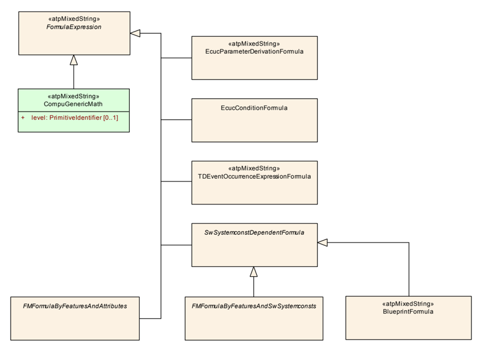

**FormulaExpression 的特化**

这些特化代表三类扩展：

- 适用的操作数被规定为子类中的关联（更多细节参见 [TPS\_GST\_00001]）。下文文法中的有效引用取自元模型中的角色名。把引用维护为形式化关联，使得即使不解析公式表达式也能检索依赖关系。
- 附加的函数由特化表示，并在其上下文中记录（更多细节参见 [TPS\_GST\_00293]）。无法通过更多运算符扩展该语言。
- 特定的应用对预期结果施加约束。例如在 `AttributeValueVariationPoint` 中，结果由变体属性的类型给出。另一个例子是 swSyscond，它期望一个布尔结果。

适用操作数的一个例子如图 4.15 所示。

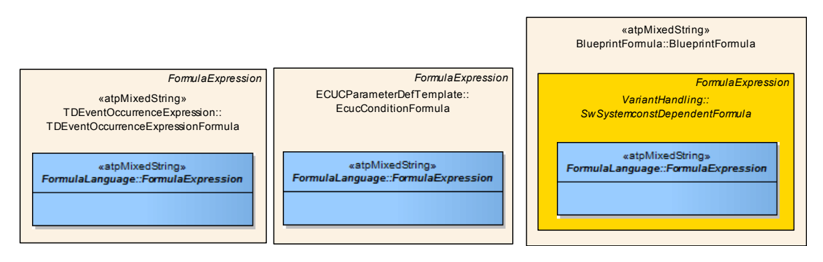

本文定义的公式语言是该特化的核心部分，即图 4.14 中的蓝色部分。

请注意 `FormulaExpression` 是 **&lt;atpMixedString&gt;** 的（见第 2.3.1 章）。因此一个表达式例如可以依赖于多个 `SwSystemconst`。

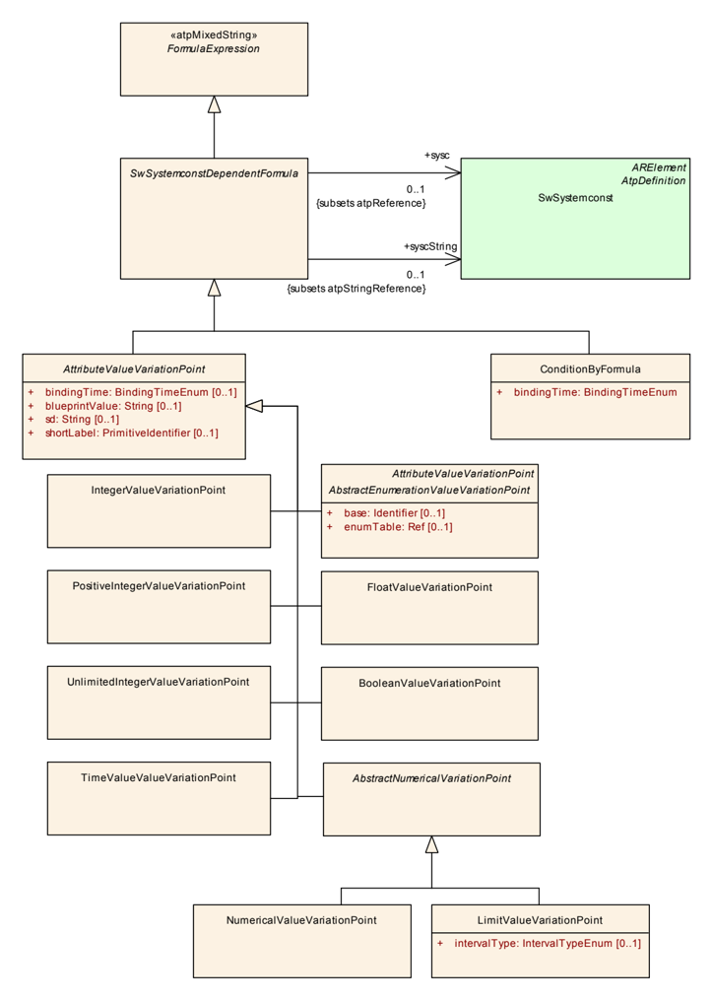

#### 4.9.2. 公式语言定义

公式与充当操作数的被引用元模型对象之间的连接由元模型中的关联建立，并在文法中表示为名为 reference 与 stringReference 的规则（参见 [TPS\_GST\_00001]）。因此在 ARXML 中序列化时，`FormulaExpression` 是 **&lt;atpMixedString&gt;**。而表达式的文法则是在 XML 解析器处理完混合字符串之后定义的，即它们不再包含任何 XML 标签、实体、注释等。这样做是为了不在文法中“模仿”XML，而是聚焦于表达式本身。

以下规则适用于从 ARXML 表示得到将要按文法定义的字符串：

- XML 实体被替换为它们所代表的 UTF 字符（例如 “&amp;amp;lt;” 被替换为 “&lt;”）；
- XML 注释被移除；
- ARXML 引用被替换为：
  - reference("{DEST 属性的取值}:{标签的文本内容}")，若它们是 FormulaExpression 与 Referrable 之间的 +/atpReference 关联的子集；
  - stringReference("{DEST 属性的取值}:{标签的文本内容}")，若它们是 FormulaExpression 与 Referrable 之间的 +/atpStringReference 关联的子集。

例如，考虑以下 ARXML 片段：

```xml
<VARIATION-POINT>
  <SW-SYSCOND>
    defined(<SYSC-REF DEST="SW-SYSTEMCONST">SY_COUNT</SYSC-REF>)
    <!-- this is a comment -->
    &amp;&amp;
    <SYSC-REF DEST="SW-SYSTEMCONST">SY_COUNT</SYSC-REF> &lt; 10
  </SW-SYSCOND>
</VARIATION-POINT>
```

该 FormulaExpression 序列化在 ARXML 的 **&lt;atpMixedString&gt;** 标签 &lt;SW-SYSCOND&gt; 中。按上述规则它被转换为：

```
defined(reference("SW-SYSTEMCONST:SY_COUNT") && reference("SW-SYSTEMCONST:SY_COUNT") < 10
```

然后按公式语言文法定义的语法，该 FormulaExpression 被视为是良构的。

用例特定的扩展可以通过按照 [TPS\_GST\_00293] 重定义特定的记号定义来应用。

**AUTOSAR 公式语言**

AUTOSAR 公式语言使用清单 4.18 所描述、按照 [\[12\]](#ref-12) 定义的语法。

清单4.18：AUTOSAR 公式语言

```antlr
grammar autosarFormulaLanguage;
expr : atomExpr ;
atomExpr : condExpr ;
condExpr : orExpr ( CondOperator orExpr AltOperator orExpr )? ;
orExpr : xorExpr ( OrOperator xorExpr )* ;
xorExpr : andExpr ( XorOperator andExpr )* ;
andExpr : bitOrExpr ( AndOperator bitOrExpr )* ;
bitOrExpr : bitXorExpr ( BitOrOperator bitXorExpr )* ;
bitXorExpr : bitAndExpr ( BitXorOperator bitAndExpr )* ;
bitAndExpr : compEqExpr ( BitAndOperator compEqExpr )* ;
compEqExpr : compExpr ( CompEqOperator compExpr )* ;
compExpr : shiftExpr ( CompOperator shiftExpr )* ;
shiftExpr : sumExpr ( ShiftOperator sumExpr )* ;
sumExpr : mulExpr ( SumOperator mulExpr )* ;
mulExpr : powExpr ( MulOperator powExpr )* ;
powExpr : unaryExpr ( PowOperator unaryExpr )? ;
unaryExpr : unaryOperator ? atom ;
atom : DecIntegerLiteral | reference | BooleanLiteral | HexIntegerLiteral
     | OctIntegerLiteral | BinIntegerLiteral | DecimalLiteral | DoubleLiteral
     | ArgumentOperand
     | DefinedFuncName LPAREN ( reference | stringReference ) RPAREN
     | StringFuncName LPAREN stringArg COMMA stringArg RPAREN
     | BinaryFuncName LPAREN atomExpr COMMA atomExpr RPAREN
     | UnaryFuncName LPAREN atomExpr RPAREN
     | Keyword
     | ( LPAREN atomExpr RPAREN )
     // Here the supported extension points are listed:
     // Depending on which of the extension points are defined in a
     // specialisation of the formula language, the following one,
     // two or all of the following alternatives are added to this rule:
     // | ExtBinaryFuncName LPAREN atomExpr COMMA atomExpr RPAREN
     // | ExtUnaryFuncName LPAREN atomExpr RPAREN
     // | ExtKeyword
     // end of extension points
     ;
stringArg : stringReference | StringLiteral ;
unaryOperator : SumOperator | OtherUnaryOperator ;
//--------------------------------------------------------------------
// these rules represent the reference to operands
// in an XML-Artifact, this is represented as XML-Artifact
//
// Applicable RefFuncNames depend on the associations in the
// particular specialization of FormulaLanguage in the
// metamodel
// see [TPS_GST_00001]
stringReference : StringReferenceFuncName LPAREN StringLiteral RPAREN ;
reference : ReferenceFuncName LPAREN StringLiteral RPAREN ;
// argumentOperand is valid only in formula derived from CompuGenericMath
ArgumentOperand : 'X' ('1' .. '9')('0' .. '9')* ;
// Tokens
OrOperator : '||';
XorOperator : '^^' ;
AndOperator : '&&';
BitOrOperator : '|';
BitXorOperator : '^';
BitAndOperator : '&';
CompEqOperator : '==' | '!=';
CompOperator : '<=' | '<' | '>=' | '>' ;
ShiftOperator : '<<' | '>>' ;
SumOperator : '+' | '-' ;
OtherUnaryOperator : '!' | '~' ;
MulOperator : '*' | '/' | '%' ;
PowOperator : '**' ;
CondOperator : '?';
AltOperator : ':';
DefinedFuncName : 'defined' ;
StringFuncName : 'streqcs' | 'streqci';
UnaryFuncName : 'round' | 'ceil' | 'floor' | 'abs' | 'log' | 'exp' | 'sin' | 'cos'
              | 'asin' | 'acos' | 'atan' | 'sinh' | 'cosh' | 'tan' | 'tanh' | 'sqrt'
              | 'log10' | 'sgn' ;
ReferenceFuncName : 'reference' ;
StringReferenceFuncName : 'stringReference' ;
BinaryFuncName : 'max' | 'min' | 'pow' ;
Keyword : 'epsilon' | 'undefined' ;
//////////////////////////////////////////////////////////////////
//Here the definitions for the extension points would be included
//////////////////////////////////////////////////////////////////
BooleanLiteral : 'true' | 'false' ;
LPAREN : '(' ;
RPAREN : ')' ;
COMMA : ',' ;
//-------------------------------------------------------------------------------
DecIntegerLiteral : '0' | ('1'..'9')('0'..'9')* ;
HexIntegerLiteral : '0' ('x' | 'X') (('0'..'9') | ('a'..'f') | ('A'..'F'))+ ;
OctIntegerLiteral : '0'('0'..'7')+ ;
BinIntegerLiteral : '0' ('b' | 'B') ('0' ..'1')+ ;
DecimalLiteral : ('0'? '.' ('0'..'9')+) | (('1'..'9')('0'..'9')* ('.' ('0'..'9')*)) ;
DoubleLiteral : ((('0'? '.' ('0'..'9')+) | (('1'..'9')('0'..'9')* ('.' ('0'..'9')*)?))
                 ('e' | 'E') ('+' | '-')? ('0'..'9')+)
               | 'NaN'
               | 'INF' ;
// The next rule defines StringLiterals as double quoted sequences of
// (almost) arbitrary characters with the backslash as escape character.
// Please notice that the tilde is used in the ANTLR syntax to denote
// negation and it is necessary to escape the backslash to match itself.
StringLiteral : '"' ((~('"'|'\\') | '\\' ~('\\') | '\\\\')*) '"' ;
WS : (' ' | '\t' | '\r' | '\n' )+ { $channel = HIDDEN ;} ;
```

##### 4.9.2.1. 算术表达式中的运算符

算术表达式支持以下运算符：

- **取负运算符**（产出布尔值、按位取反）：符号 `!`、`~`；返回类型见 [TPS\_GST\_00039]。
- **幂运算符**：产出操作数 1 的操作数 2 次幂。符号 `**`；返回类型见 [TPS\_GST\_00035]。
- **乘性运算符 / 除法**：产出乘法、除法、取模。符号 `*`、`/`、`%`；返回类型见 [TPS\_GST\_00035]。
- **加性运算符**：产出加法、减法、符号。符号 `+`、`-`；返回类型见 [TPS\_GST\_00034]。
- **移位运算符**：产出按位左移、右移；注意端部以 “0” 填充。符号 `&lt;&lt;`、`&gt;&gt;`；返回类型见 [TPS\_GST\_00037]。
- **排序运算符**：产出比较：小于、小于等于、大于、大于等于。符号 `&lt;`、`&lt;=`、`&gt;`、`&gt;=`；返回类型见 [TPS\_GST\_00036]。
- **比较：相等**：产出等于、不等于。符号 `==`、`!=`；返回类型见 [TPS\_GST\_00036]。
- **按位与**：产出操作数的按位与。符号 `&amp;`；返回类型见 [TPS\_GST\_00037]。
- **按位异或**：产出操作数的按位异或。符号 `^`；返回类型见 [TPS\_GST\_00037]。
- **按位或**：产出操作数的按位或。符号 `&#124;`；返回类型见 [TPS\_GST\_00037]。
- **布尔与**：产出布尔与，操作数值 0 → false，其余 → true。符号 `&amp;&amp;`；返回类型见 [TPS\_GST\_00036]。
- **布尔异或**：产出布尔异或，操作数值 0 → false，其余 → true。符号 `^^`；返回类型见 [TPS\_GST\_00036]。
- **布尔或**：产出布尔或，操作数值 0 → false，其余 → true。符号 `&#124;&#124;`；返回类型见 [TPS\_GST\_00036]。

##### 4.9.2.2. 算术表达式中的数学函数

算术表达式支持以下数学函数：

- **round 函数**：把正数与负数舍入到最近的整数。注意处理此类表达式时，round 定义于取值范围 -2147483648 至 +4294967295。函数：round；参数：1；结果类型：integer。
- **round up 函数**：把正数与负数向上舍入到下一个整数。注意处理此类表达式时，ceil 定义于取值范围 -2147483648 至 +4294967295。函数：ceil；参数：1；结果类型：integer。
- **round down 函数**：把正数与负数向下舍入到下一个整数。注意处理此类表达式时，floor 定义于取值范围 -2147483648 至 +4294967295。函数：floor；参数：1；结果类型：integer。
- **绝对值**：产出操作数的绝对值。函数：abs；参数：1；结果类型：与操作数相同。
- **自然对数**：产出参数的自然对数（以 e 为底）。函数：log；参数：1；结果类型：float。
- **十进制对数**：产出以 10 为底的对数——为 A2L 1.6 提供。函数：log10；参数：1；结果类型：float。
- **平方根**：产出平方根——为 A2L 1.6 提供。函数：sqrt；参数：1；结果类型：float。
- **正弦（sinus）**：产出正弦——为 A2L 1.6 提供。函数：sin；参数：1；结果类型：float。
- **反正弦（arcus sinus）**：产出反正弦——为 A2L 1.6 提供。函数：asin；参数：1；结果类型：float。
- **余弦（cosinus）**：产出余弦——为 A2L 1.6 提供。函数：cos；参数：1；结果类型：float。
- **反余弦（arcus cosinus）**：产出反余弦——为 A2L 1.6 提供。函数：acos；参数：1；结果类型：float。
- **双曲正弦（sinus hyperbolicus）**：产出双曲正弦——为 A2L 1.6 提供。函数：sinh；参数：1；结果类型：float。
- **双曲余弦（cosinus hyperbolicus）**：产出双曲余弦——为 A2L 1.6 提供。函数：cosh；参数：1；结果类型：float。
- **正切（tangens）**：产出正切——为 A2L 1.6 提供。函数：tan；参数：1；结果类型：float。
- **反正切（arcus tangens）**：产出反正切——为 A2L 1.6 提供。函数：atan；参数：1；结果类型：float。
- **双曲正切（tangens hyperbolicus）**：产出双曲正切——为 A2L 1.6 提供。函数：tanh；参数：1；结果类型：float。
- **指数**：产出指数函数（以 e 为底）。函数：exp；参数：1；结果类型：float。
- **is defined**：检查作为参数给出的引用是否已定义。函数：defined；参数：1；结果类型：0 或 1。
- **signum**：产出 signum，结果为 -1、0、+1 之一。函数：sgn；参数：1；结果类型：integer。
- **最大值**：找出各参数的最大值。函数：max；参数：2；结果类型：取决于操作数。
- **最小值**：找出各参数的最小值。函数：min；参数：2；结果类型：取决于操作数。
- **幂函数**：产出参数 1 的参数 2 次幂——为 A2L 1.6 提供。它等价于幂运算符。函数：pow；参数：2；结果类型：取决于参数，结果类型遵循 [TPS\_GST\_00035]。
- **区分大小写的字符串比较**：以区分大小写的方式比较两个字符串。函数：streqcs；参数：2；结果类型：0 或 1。
- **不区分大小写的字符串比较**：以不区分大小写的方式比较两个字符串。函数：streqci；参数：2；结果类型：0 或 1。

##### 4.9.2.3. 公式处理器的实现细节

适用以下实现细节：

**公式与模型元素之间的连接**

上文提到的公式语言拥有产生式规则（reference、stringReference），它们被定义为表示对模型元素的引用。
（续）对公式与模型元素之间的连接，源文规定如下：公式语言中提及的产生式规则（reference、stringReference）表示对模型元素的引用；此外：

- [TPS\_GST\_00002] — 公式中未定义操作数的处理：若操作数未定义，则整个表达式的结果未定义。
- **关键字 undefined**：undefined 表示一个未定义的子项。它会在后续处理步骤中被替换。其主要用途是表示表达式的蓝图。undefined 的结果与一个未定义的操作数相同，通常导致运行时错误。以下恒等式成立：

```
defined(undefined) = false
true && undefined  = error
false && undefined = false
~undefined         = error
```

因此对 OR 同理为 error。

```
true || undefined  = true
false || undefined = error
```

`pow(0, 0)`（即 0**0）是未定义的，应当引发错误（另参见 [TPS\_GST\_00014]）。

- **Float 字面量 INF、NaN**：为了与 Float 保持一致，公式表达式也支持特殊的浮点字面量 INF 与 NaN。

  对这些字面量的支持具体为：

  - INF 只允许出现在运算符 “==”、“!=”、一元 “-” 的上下文以及 condExpr 的结果中；
  - NaN 只允许出现在运算符 “==”、“!=” 的上下文以及 condExpr 的结果中；
  - INF、NaN 只能通过字面量规定（例如在 SwSystemconstValue 中）获得，而不能作为算术运算的结果（特别地，[TPS\_GST\_00014] 不受这些字面量影响）。

  请注意，不存在特定的字面量 -INF，因为它经由一元运算符 “-” 得到支持。

  在 SwSystemconstDependentFormula 的上下文中，一个产出 INF 的表达式示例为：

```
reference("SW-SYSTEMCONST:unlimited") == true ? INF : 10000
```

- **函数 round、ceil、floor**：它们的作用相当于带舍入的“整数转换（Integer-Cast）”。适用以下规则：

  - **round** — 把正数与负数舍入到最近的整数：

    ```
    round(4.4) = 4    round(-4.4) = -4
    round(4.7) = 5    round(-4.7) = -5
    round(4.5) = 5    round(-4.5) = -5
    ```

  - **floor** — 把正数与负数向下舍入到下一个整数：

    ```
    floor(4.4) = 4    floor(-4.4) = -5
    floor(4.7) = 4    floor(-4.7) = -5
    floor(4.0) = 4    floor(-4.0) = -4
    ```

  - **ceil** — 把正数与负数向上舍入到下一个整数：

    ```
    ceil(4.4) = 5     ceil(-4.4) = -4
    ceil(4.7) = 5     ceil(-4.7) = -4
    ceil(4.0) = 4     ceil(-4.0) = -4
    ```

- **函数 defined**：若作为参数传递的引用已定义，则 defined(reference) 返回 1。若一个 reference(...) 由公式定义，则 defined(reference(...)) 返回 1。表达式 defined(stringReference(...)) 在作为参数传递的引用能够产出一个字符串时返回 1。在所有其他情况下它返回 0。

  请注意，例如 SwSystemconstValue 可以用公式定义。这样一个“重定义”的 SwSystemconst 总是被视为“已定义”，即使它的公式引用了一个未定义的 SwSystemconst。引用可以返回字符串，例如在 SwSystemconstDependentFormula 的情况下，被引用的 SwSystemconst 引用一个类别为 TEXTTABLE 的 CompuMethod。

  **示例：**

  ```
  假设 reference("SW-SYSTEMCONST:ZYLZA")   被设为 4
       reference("SW-SYSTEMCONST:ZYLZA2")  被设为 reference("SW-SYSTEMCONST:ZYLZA")+2
       reference("SW-SYSTEMCONST:TURBO")   保持未定义
       reference("SW-SYSTEMCONST:TURBO2")  被设为 reference("SW-SYSTEMCONST:TURBO")+2

  则 defined(reference("SW-SYSTEMCONST:ZYLZA"))  得 1
     defined(reference("SW-SYSTEMCONST:ZYLZA2")) 得 1
     defined(reference("SW-SYSTEMCONST:TURBO"))  得 0
     defined(reference("SW-SYSTEMCONST:TURBO2")) 得 1
     （TURBO2 是已定义的，即使被引用的 TURBO 未定义。）
  ```

- **公式求值器中的错误处理**

  求值器应当在以下情况下暴露错误消息：

  - 算术表达式在语法上不正确时；
  - 除以 0 时；
  - 出现 0**0 或 pow(0, 0) 时（参见 [TPS\_GST\_00276]）；
  - 函数的定义域被违反时；
  - 函数的函数值超出可表示的范围时（例如这适用于 floor(10E22)）；
  - 操作数的求值失败时（参见 [TPS\_GST\_00002]、[TPS\_GST\_00010]）；
  - 使用基本算术运算符 ‘-’、‘+’、‘*’、‘/’ 时超出可表示的范围。

##### 4.9.2.4. 公式表达式的结果数据类型

对运算符/操作数适用以下返回类型：

**加性运算符的返回类型**

```
+ - / *
Integer, Integer -> Integer （这是整数除法）
Integer, Float   -> Float
Float,   Integer -> Float
Float,   Float   -> Float
```

**乘性运算符的返回类型**

```
**, pow
Integer, Integer -> Integer
Integer, Float   -> Float
Float,   Integer -> Float
Float,   Float   -> Float
```

**逻辑运算符的返回类型**

```
|, &&, ^^, ==, <=, <, >, >=, !=
Integer, Integer -> Integer （表示布尔值：0 = false，1 = true）
Integer, Float   -> Integer （表示布尔值：0 = false，1 = true）
Float,   Integer -> Integer （表示布尔值：0 = false，1 = true）
Float,   Float   -> Integer （表示布尔值：0 = false，1 = true）
```

**按位运算符的返回类型**

```
|, &, ^, <<, >>
按位运算符总是产出取值 >= 0 的 Integer
Integer, Integer -> Integer
Integer, Float   -> Fault
Float,   Integer -> Fault
Float,   Float   -> Fault
使用 Float 类型的操作数或负 Integer 会导致不正确的结果
```

**二元函数的返回类型**

```
min
Integer, Integer -> Integer
Integer, Float   -> Float
Float,   Integer -> Float
Float,   Float   -> Float
max
Integer, Integer -> Integer
Integer, Float   -> Float
Float,   Integer -> Float
Float,   Float   -> Float
```

**取负运算符的返回类型**

```
~, !
Integer -> Integer
Float   -> Fault
使用 Float 类型的操作数或负 Integer 会导致不正确的结果
```

**defined 的返回类型**

```
defined -> Integer （表示布尔值：0 = false，1 = true）
```

**一元函数的返回类型**

```
log, log10, exp
Integer -> Float
Float   -> Float
abs
Integer -> Integer
Float   -> Float
sgn
Integer -> Integer （结果为 -1、0、1 之一）
Float   -> Integer （结果为 -1、0、1 之一）
ceil, floor, round
Integer -> Integer
Float   -> Integer
```

**关键字的返回类型**

```
epsilon      -> Float
true, false  -> Integer （表示布尔值：0 = false，1 = true）
```

**float 类型返回类型的表示**

类型为 float 的最终返回值的序列化应当采用浮点格式；即使结果没有小数位，也应当输出一位小数（例如 5.0）。

##### 4.9.2.5. 公式语言表达式示例

正确的算术表达式示例<sup>2</sup>：

```xml
<APPLICATION-VALUE-SPECIFICATION>
  <SW-VALUE-CONT>
    <SW-VALUES-PHYS>
      <VF>1</VF>
    </SW-VALUES-PHYS>
  </SW-VALUE-CONT>
</APPLICATION-VALUE-SPECIFICATION>
```

```
<VF>2.0</VF>
...
<VF>1.5E5</VF>
...
<VF>2.0 * (1 + 2)</VF>
...
<VF>2 > 1</VF>
...
```

不带实体的示例。文法是针对替换实体之后的字符串定义的。

```xml
...
<VF>2 &gt; 1</VF>
...
```

带实体的示例。在真实的 ARXML 文件中查看（例如用文本编辑器）时，可能在公式表达式中发现实体。实体是指诸如

```
&amp;gt;
```

这样的东西，它代表 “&gt;”。

更多公式语言表达式用例见 [\[14\]](#ref-14) 中的测试用例 [AUTOSAR\_TP\_FormulaLanguage\_TestCase\_Blueprint.arxml]。带引用的更多示例见下文 [TPS\_GST\_00265] 的内容。

> **2** 注意，该示例未体现 BINDING-TIME。

### 4.10. AUTOSAR 模型查询语言（ARMQL）

本章描述 ARMQL，即 AUTOSAR 模型查询语言<sup>3</sup>。由于该语言目前只在蓝图的上下文中使用（参见 [\[2\]](#ref-2) 的“蓝图的原理”章），所有示例均取自该应用领域。在蓝图内，ARMQL 用于 formalBlueprintGenerator 内部的表达式，而 formalBlueprintGenerator 位于一个 VariationPoint 之内。

```xml
<VARIATION-POINT>
  <FORMAL-BLUEPRINT-GENERATOR>
    <EXPRESSION>
      ...
    </EXPRESSION>
  </FORMAL-BLUEPRINT-GENERATOR>
</VARIATION-POINT>
```

> **3** 该语言的设计受到 XQuery、函数式编程以及模板引擎的启发。语言的核心是采用非严格求值策略的无类型 λ 演算。它拥抱不可变性、引用透明与静态作用域等原则。

主要思想是：一个 formalBlueprintGenerator “生成”一个有序的（可能为空的）“名称-值赋值集合”列表。对其中每一个赋值集合，VariationPoint 的外层元素被“打印出来”，同时对 VariationPoint 外层元素的任何后代递归地应用同样的方法。在 ARXML 包含层次中更深处、由这些 formalBlueprintGenerator 生成的赋值集合，与层次更高处的 formalBlueprintGenerator 的赋值集合相连接，使得赋值集合形成一个层次化的作用域。较低层次上赋值中的键优先于较高层次上对同一键的赋值。在这一过程中，没有 formalBlueprintGenerator 的元素被视为隐式拥有一个“空的” formalBlueprintGenerator，即产生空赋值集合的生成器。

在“打印”一个元素期间，相应作用域上的当前赋值集合被用于对某些字符串进行变量插值（variable interpolation）。

其后果是：一个带有显式 formalBlueprintGenerator 的元素在蓝图派生过程中可能派生出零个、一个或多个同一元类的元素。

#### 4.10.1. ARMQL 的应用

本节借助一个示例展示在 FORMAL-BLUEPINT-GENERATOR（源文如此）标签内 ARMQL 的使用以及它与 ARXML 其他部分的相互作用。ARMQL 的定义见 4.10.2 节。

##### 4.10.1.1. LET 块

考虑蓝图中的以下部分：

```xml
...
<CLIENT-SERVER-INTERFACE>
  <SHORT-NAME BLUEPRINT-VALUE="IF_{Name}_{Id}">Interface</SHORT-NAME>
  ...
  <VARIATION-POINT>
    <FORMAL-BLUEPRINT-GENERATOR>
      <EXPRESSION>
        LET Name = "Example"; Id = 1;
      </EXPRESSION>
    </FORMAL-BLUEPRINT-GENERATOR>
  </VARIATION-POINT>
  ...
</CLIENT-SERVER-INTERFACE>
...
```

在蓝图派生过程中，它将被派生为以下 ARXML 代码：

```xml
...
<CLIENT-SERVER-INTERFACE>
  <SHORT-NAME>IF_Example_1</SHORT-NAME>
  ...
</CLIENT-SERVER-INTERFACE>
...
```

我们逐行分析该示例，但省略只包含闭合标签的行（我们假定读者熟悉 ARXML）以及省略号（... —— 省略号表示对理解示例并非必需、但可能存在甚至必需的任意 ARXML 代码，以保证示例符合 schema）。

`&lt;CLIENT-SERVER-INTERFACE&gt;`

这是将从蓝图派生的元素的元类。在派生过程中，该标签保持不变。备注：这里使用 CLIENT-SERVER-INTERFACE，因为它是蓝图化的常见候选；但这里展示的一切对任何可蓝图化（blueprintable）的元类都有效。

```xml
<SHORT-NAME BLUEPRINT-VALUE="IF_{Name}_{Id}">Interface</SHORT-NAME>
```

shortName 将在蓝图派生过程中被修改，因为它包含属性 blueprintValue。该属性经变量插值之后的取值将成为该标签的新取值。标签的原始内容（本例中为 Interface）被丢弃。

这里的变量插值是指：被花括号包围的部分（本例中为 Name 与 Id）被解释为变量的名称，随后被这些变量的取值替换。把取值赋给名称的动作发生在 formalBlueprintGenerator 内部。看完 formalBlueprintGenerator 之后我们再回到取值的推导。

```xml
<VARIATION-POINT>
<FORMAL-BLUEPRINT-GENERATOR>
<EXPRESSION>
```

formalBlueprintGenerator 位于一个 VariationPoint 内。VariationPoint 定义其直接祖先元素的可变性，在本例中即 ClientServerInterface。这对理解 formalBlueprintGenerator 内部所做的赋值的作用域很重要。

标签 FORMAL-BLUEPRINT-GENERATOR 表明该 VariationPoint 用于形式化蓝图派生。在 EXPRESSION 标签内部描述赋值集合的生成。除 EXPRESSION 标签外，还可以例如使用 introduction 子元素把面向人类读者的说明放入 formalBlueprintGenerator。

```
LET Name = "Example"; Id = 1;
```

EXPRESSION 的内容需要以 ARMQL 表述。在本示例中，表达式只包含一个 LET 块，它定义从名称到取值的简单映射。LET 块以关键字 LET 开头（也可使用 Let 或 let），可以包含一个或多个赋值。每个赋值以分号结束。此处名称 Name 被映射到取值 "Example"，名称 Id 被映射到取值 1。

再看上面的 blueprintValue 属性。在本示例中，字符串 "IF\_{Name}\_{Id}" 被派生为 "IF\_Example\_1"，因为 {Name} 被替换为 "Example"，{Id} 被替换为 1——这些是 CLIENT-SERVER-INTERFACE 的 FORMAL-BLUEPRINT-GENERATOR 内部赋给这些名称的取值。

##### 4.10.1.2. 表达式

该语言支持加、减、乘、除等基本算术运算。此外，它遵循标准的运算符优先级规则，例如乘法的优先级高于加法。因此在下面的清单中，取值 7 被赋给名称 {Id}。

```
LET Id = 1 + 2 * 3;
```

可以在表达式中应用函数。下面的清单中，预定义函数 startsWith() 以两个参数调用，即 "Example" 与 "Ex"。该函数调用返回布尔值 True，因为字符串 "Example" 以字符串 "Ex" 开头。该 True 值随后被赋给名称 isMatch。

```
LET isMatch = startsWith("Example", "Ex");
```

函数也可以在 LET 块中定义。下面第一行定义函数 genId()，第二行调用它。该函数有一个参数（名为 s）。genId() 的函数定义含义如下：若传给 genId() 的参数是字符串且以 “Ex” 开头，genId() 返回整数值 “24”；若参数是字符串但不以 “Ex” 开头，则返回整数值 “42”。若参数不是字符串，则 genId() 返回 undefined。请注意，undefined 被视为一个特殊类型的特殊取值，而不被视为例如一个特殊的整数。

```
LET genId(s) = if( startsWith(s, "Ex") , 24, 42);
    Id = genId( "Example" );
```

为了摆脱大量括号并提高可读性，该语言包含了另一种调用函数的方式：函数的第一个参数可以前置，后跟一个点，后跟函数名，后跟括号中可能剩余的参数。例如在下面示例的第一行中，表达式 s.startsWith("Ex") 等价于 startsWith(s,"Ex")。示例的第二行以 //（行注释记号）开头，该行成为注释。该注释展示了表达第一行的另一种方式，即同时前置 if() 函数的第一个参数。示例的第三行表明这种调用函数的方式也适用于新定义的函数，如此例中的 genId()。注意：这一语法模仿面向对象语言中的方法调用，但不应当被误认为方法调用，因为它实际上只是函数调用的另一种语法。

```
LET genId(s) = if( s.startsWith("Ex") , 24, 42);
    //或 genId(s) = s.startsWith("Ex").if(24, 42);
    Id = "Example".genId();
```

##### 4.10.1.3. FOR 块

FOR 块用于对一个取值列表进行迭代（或“映射”）。考虑以下示例：

```xml
...
<CLIENT-SERVER-INTERFACE>
  <SHORT-NAME BLUEPRINT-VALUE="IF_{Name}_{Id}">Interface</SHORT-NAME>
  ...
  <VARIATION-POINT>
    <FORMAL-BLUEPRINT-GENERATOR>
      <EXPRESSION>
        FOR Id : [1,3];
        LET Name = "Example";
      </EXPRESSION>
    </FORMAL-BLUEPRINT-GENERATOR>
  </VARIATION-POINT>
  ...
</CLIENT-SERVER-INTERFACE>
...
```

在蓝图派生过程中，它将被派生为以下 ARXML 代码（注意：表达式 [1,3] 展开为由整数值 1、2、3 组成的列表）。LET 块将对列表中的每个元素执行，得到三个 (Name, Id) 对，它们被应用到包含 VariationPoint 的 ARElement 的 BlueprintValue 属性上。

```xml
...
<CLIENT-SERVER-INTERFACE>
  <SHORT-NAME>IF_Example_1</SHORT-NAME>
  ...
</CLIENT-SERVER-INTERFACE>
<CLIENT-SERVER-INTERFACE>
  <SHORT-NAME>IF_Example_2</SHORT-NAME>
  ...
</CLIENT-SERVER-INTERFACE>
<CLIENT-SERVER-INTERFACE>
  <SHORT-NAME>IF_Example_3</SHORT-NAME>
  ...
</CLIENT-SERVER-INTERFACE>
...
```

##### 4.10.1.4. WHERE 块

WHERE 块用于在蓝图派生过程中过滤掉输出的某些部分。在 WHERE 关键字之后恰好有一个条件，即一个应当求值为布尔值的表达式。在蓝图派生过程中，只有当该条件求值为 True 时，才以当前赋值集合生成输出。

考虑以下示例：

**注意：** 运算符 != 的意思是“不等于”。

```xml
...
<CLIENT-SERVER-INTERFACE>
  <SHORT-NAME BLUEPRINT-VALUE="IF_{Name}_{Id}">Interface</SHORT-NAME>
  ...
  <VARIATION-POINT>
    <FORMAL-BLUEPRINT-GENERATOR>
      <EXPRESSION>
        FOR Id : [1,3];
        LET Name = "Example";
        WHERE Id != 2;
      </EXPRESSION>
    </FORMAL-BLUEPRINT-GENERATOR>
  </VARIATION-POINT>
  ...
</CLIENT-SERVER-INTERFACE>
...
```

在蓝图派生过程中，它将被派生为以下 ARXML 代码：

```xml
...
<CLIENT-SERVER-INTERFACE>
  <SHORT-NAME>IF_Example_1</SHORT-NAME>
  ...
</CLIENT-SERVER-INTERFACE>
<CLIENT-SERVER-INTERFACE>
  <SHORT-NAME>IF_Example_3</SHORT-NAME>
  ...
</CLIENT-SERVER-INTERFACE>
...
```

#### 4.10.2. ARMQL 定义

本小节定义 formalBlueprintGenerator 内部使用的语言。

##### 4.10.2.1. 文法

**ARMQL 的文法**

ARMQL 的语法由以下文法定义。

清单4.20：ARMQL ANTLR 4 文法（Parser）

```
flws : ( stmt1 | stmt2 | stmt3 )* ;
stmt1 : FOR fors + ( LET lets + )? ( WHERE where )? ;
stmt2 : LET lets + ( WHERE where )? ;
stmt3 : WHERE where ;
fors : ID IN expr SEMI ;
lets : ID ( LPAREN ID ( COMMA ID )* RPAREN )? ASSIGN expr SEMI ;
where : expr SEMI ;
expr : expr DOT ID LPAREN expr ? ( COMMA expr )* RPAREN     # Method
     | expr op=( MUL | DIV | MOD ) expr                     # MulDiv
     | expr op=( ADD | SUB ) expr                           # AddSub
     | expr op=( EQ | NE | GT | LT | GE | LE ) expr         # Compare
     | NOT expr                                             # Not
     | expr op=( AND | OR ) expr                            # AndOr
     | LAMBDA ID DOT expr                                   # Lambda
     | FLOAT                                                # Float
     | INTEGER                                              # Integer
     | BOOL                                                 # Bool
     | STRING                                               # String
     | ID                                                   # Id
     | ID LPAREN expr ? ( COMMA expr )* RPAREN              # Fun
     | LPAREN expr RPAREN                                   # Parens
     | LBRACK expr COMMA expr RBRACK                        # Range
     ;
```

清单4.21：ARMQL ANTLR 4 文法（Lexer）

```
// Comments
COMMENTS : ( BlockComment | LineComment ) -> channel ( HIDDEN ) ;
fragment BlockComment : '/*' .*? ('*/' | EOF ) ;
fragment LineComment : '//' ~[\r\n]* ;
//-------------------------
// Numbers
FLOAT : DecDigits '.' DecDigits ? ExponentPart ?
      | '.' DecDigits ExponentPart ?
      | DecDigits ExponentPart ;
fragment ExponentPart : [ eE ] [+-]? DecDigits ;
INTEGER : DecimalNumeral | HexNumeral | OctalNumeral | BinaryNumeral ;
fragment HexNumeral : '0' [ xX ] HexDigits ;
fragment OctalNumeral : '0' '_' OctalDigits ;
fragment DecimalNumeral : '0' | [1-9] DecDigit * ;
fragment BinaryNumeral : '0' [ bB ] BinaryDigits ;
fragment HexDigits : HexDigit + ;
fragment DecDigits : DecDigit + ;
fragment OctalDigits : OctalDigit + ;
fragment BinaryDigits : BinaryDigit + ;
fragment HexDigit : [0-9 a -fA -F ] ;
fragment DecDigit : [0-9] ;
fragment OctalDigit : [0-7] ;
fragment BinaryDigit : [01] ;
//-------------------------
// Strings
STRING : '"' ( EscSeq | ~["\r\n\\] )* '"' ;
// Any kind of escaped character that we can embed within literal strings.
fragment EscSeq : '\\' ( [tnr"\\]      // Std escaped character set (tab, newline, etc.)
                       | .             // Invalid escape character
                       | EOF           // Incomplete at EOF
                       ) ;
//-------------------------
// Bools
BOOL : 'true' | 'True' | 'TRUE' | 'false' | 'False' | 'FALSE' ;
//-------------------------
// Reserved Words and Operators
FOR : 'for' | 'For' | 'FOR' ;
LET : 'let' | 'Let' | 'LET' ;
WHERE : 'where' | 'Where' | 'WHERE';
IN : 'in' | 'In' | 'IN' ;
LT : 'lt' | 'Lt' | 'LT' ;   //less than
GT : 'gt' | 'Gt' | 'GT' ;   //greater than
LE : 'le' | 'Le' | 'LE' ;   //less or equal
GE : 'ge' | 'Ge' | 'GE' ;   //greater or equal
AND : 'and' | 'And' | 'AND' ;
OR : 'or' | 'Or' | 'OR' ;
NOT : 'not' | 'Not' | 'NOT' ;
NE : '!=' ;   //not equal
EQ : '==' ;   //equal
COMMA : ',' ;
SEMI : ';' ;
LPAREN : '(' ;
RPAREN : ')' ;
ASSIGN : '=' ;
LBRACK : '[' ;
RBRACK : ']' ;
MUL : '*' ;
DIV : '/' ;
MOD : '%' ;
ADD : '+' ;   //also string concatenation
SUB : '-' ;
LAMBDA : '\\' ;
DOT : '.' ;
COLON : ':' ;
//-------------------------
// Identifiers
ID : NameStartChar NameChar * ;
fragment NameStartChar : 'A'..'Z' | 'a'..'z' | '_' ;
fragment NameChar : NameStartChar | '0'..'9' | '_' ;
//-------------------------
// Whitespace and Errors
WS : ( '[ \t]' | '\r'? [\n] )+ -> channel ( HIDDEN ) ;
ERRCHAR : . -> channel ( HIDDEN ) ;
```

##### 4.10.2.2. 类型与取值

**ARMQL 中的类型与取值**

虽然 ARMQL 不是静态类型的语言，但运行时区分以下类型：

- 浮点数（例如 1.415e-10，始终 64 位）；
- 整数（例如 -37，任意长度，"BigInteger"）；
- 布尔值（例如 true 或 false）；
- 字符串（例如 "this is a string"）；
- 函数（例如 \a.a+x）；
- 不透明对象（例如 ECV，用于以抽象数据类型丰富该语言）；
- 列表（例如 [1, 4]）；
- Undefined（例如 1 / 0；两个 undefined 取值被认为永远不相等）。

**类型强制规则**

- 不存在从整数到浮点数的自动转换；这必须使用函数 int() 或 float() 手工完成。
- 所有算术运算在数值类型上是同质的，即没有自动强制，而是在运行时返回 undefined。例如加法要么是纯浮点、要么是纯整数。该规则同样适用于整数的除法——其结果为整数，因此 7 / 2 的结果是整数 3。
- 浮点数字面量应当包含小数点。不带小数点的数值字面量被解释为整数。

**运算符与表达式**

以下表达式与运算符可用：

清单4.22：ARMQL ANTLR 4 文法（Expressions）

```
| expr op=( MUL | DIV | MOD ) expr          # MulDiv
| expr op=( ADD | SUB ) expr                # AddSub
| expr op=( EQ | NE | GT | LT | GE | LE ) expr # Compare
| NOT expr                                  # Not
| expr op=( AND | OR ) expr                 # AndOr
```

清单4.23：ARMQL ANTLR 4 文法（Operators）

```
LT : 'lt' | 'Lt' | 'LT' ;   //less than
GT : 'gt' | 'Gt' | 'GT' ;   //greater than
LE : 'le' | 'Le' | 'LE' ;   //less or equal
GE : 'ge' | 'Ge' | 'GE' ;   //greater or equal
AND : 'and' | 'And' | 'AND' ;
OR : 'or' | 'Or' | 'OR' ;
NOT : 'not' | 'Not' | 'NOT' ;
NE : '!=' ;   //not equal
EQ : '==' ;   //equal
COMMA : ',' ;
SEMI : ';' ;
LPAREN : '(' ;
RPAREN : ')' ;
ASSIGN : '=' ;
LBRACK : '[' ;
RBRACK : ']' ;
MUL : '*' ;
DIV : '/' ;
MOD : '%' ;
ADD : '+' ;   //also string concatenation
SUB : '-' ;
```

**Lambda 抽象、函数与伪方法调用**

匿名函数可以借助 λ 运算符定义。

以下表达式的结果是一个函数，它取一个参数并给该参数加 3：

```
\a . a + 3
```

一些函数以匿名函数作为参数，例如 filter()。匿名函数也可以被赋予名称，然后应用到参数上。因此以下示例的结果是 7。请注意，注释展示了定义 add3 的等价方式。

```
LET add3 = \a . a + 3;
// add3(a) = a + 3
result = add3(4);
```

此外，一个带两个参数的函数可以只应用于一个参数。这次函数应用的结果是一个带一个参数的匿名函数。因此以下是定义 add3() 的又一种方式：

```
LET add(a,b) = a + b;
// add = \b . \a . a + b;
add3 = add(3);
```

还有一种用于前置函数调用第一个参数的语法糖，它类似面向对象语言中的方法调用，并大幅减少了所需的括号数量。

**整数区间表达式**

若 n 与 m 是整数，则表达式 [n,m] 展开为所有满足 n ≤ i ≤ m 的整数 i 的列表。若 n 或 m（或二者）不表示整数，则 [n,m] 为 undefined。

换言之，[n,m] 表示一个闭整数区间。请注意，该定义的一个后果是：若 n ≥ m，则区间为空。

##### 4.10.2.3. LET 块

**为取值指派名称**

LET 块用于给表达式命名。一个 LET 块允许对许多取值进行任意命名。

单一名称赋值的示例：

```
LET var = "value";
```

这里名称 var 被赋予字符串取值 "value"。

一个 LET 块中多个名称赋值的示例：

```
LET str = "a string";
    num = 42;
    boo = true;
    exp = 17.3 * 2 + num;
```

这里定义了名称 str、num、boo、exp。exp 的定义说明表达式可以被命名，并且先前定义的名称可以在这些表达式中使用（即 exp 的定义中使用了 num）。在 LET 块内，语句的顺序是任意的。

**约束：在一个 LET 块内不得重新指派同名**

在一个 LET 块内，一个名称至多被赋值一次。

**函数的定义**

LET 块支持函数的定义。

LET 块内函数定义的示例：

```
LET fun1a(a) = a + 3;
    fun1b = \a . a + 3;
    fun2a(a,b) = a + b;
    fun2b = \b . \a . a + b;
```

这里，函数 fun1a 与 fun2a 被视为在 LET 块中直接定义。直接函数定义是一种特殊 λ 表达式的语法糖。即 fun1a 等价于 fun1b，fun2a 等价于 fun2b。

##### 4.10.2.4. FOR 块

FOR 块用于对一个取值列表进行迭代（或“映射”）。

**单行 FOR 块**

单行 FOR 块具有以下形式：

```
FOR <name> : <list>; <remainder>
```

&lt;name&gt; 依次绑定到 &lt;list&gt; 中的每个取值。一个 FOR 块开始一个新的层次级别。&lt;list&gt; 中取值的顺序被保留。每做一次赋值，&lt;remainder&gt; 就被求值一次。

请注意，&lt;remainder&gt; 可以只由被蓝图化的 ARXML 的展开构成，即在 formalBlueprintGenerator 属性中访问绑定到 &lt;name&gt; 的取值。&lt;remainder&gt; 甚至可以为空，这意味着 FOR 的赋值永远不会被使用。

**示例：**

```xml
...
<CLIENT-SERVER-INTERFACE>
  <SHORT-NAME BLUEPRINT-VALUE="IF_{Name}_{Id}">Interface</SHORT-NAME>
  ...
  <VARIATION-POINT>
    <FORMAL-BLUEPRINT-GENERATOR>
      <EXPRESSION>
        FOR Id : [1,3];
        LET Name = "Example";
      </EXPRESSION>
    </FORMAL-BLUEPRINT-GENERATOR>
  </VARIATION-POINT>
  ...
</CLIENT-SERVER-INTERFACE>
...
```

**多行 FOR 块**

多行 FOR 块具有以下形式：

```
FOR <name1> : <list1>; <name2> : <list2>; ... <nameN> : <listN>; <remainder>
```

多行 FOR 块只是语法糖，直接等价于一个单行 FOR 块序列：

```
FOR <name1> : <list1>;
FOR <name2> : <list2>;
...
FOR <nameN> : <listN>;
<remainder>
```

这意味着多行 FOR 块求值为嵌套的 FOR，即 FOR Id1 : [1,3], Id2 : [5,6]; 求值为 [1,3] 与 [5,6] 的叉积，第一个分量绑定到 Id1，第二个绑定到 Id2。

**注意：** 其后果是：&lt;name1&gt; 可以用于 &lt;list2&gt;（或 &lt;listN&gt;）的描述，但 &lt;name2&gt; 不能用于 &lt;list1&gt; 的描述。

```xml
...
<CLIENT-SERVER-INTERFACE>
  <SHORT-NAME BLUEPRINT-VALUE="IF_{Name}_{Id1}_{Id2}">Interface</SHORT-NAME>
  ...
  <VARIATION-POINT>
    <FORMAL-BLUEPRINT-GENERATOR>
      <EXPRESSION>
        FOR Id1 : [1,3]; Id2 : [5,6];
        LET Name = "Example";
      </EXPRESSION>
    </FORMAL-BLUEPRINT-GENERATOR>
  </VARIATION-POINT>
  ...
</CLIENT-SERVER-INTERFACE>
...
```

在蓝图派生过程中这将产生以下结果：

```xml
...
<CLIENT-SERVER-INTERFACE>
  <SHORT-NAME>IF_Example_1_5</SHORT-NAME>
  ...
</CLIENT-SERVER-INTERFACE>
<CLIENT-SERVER-INTERFACE>
  <SHORT-NAME>IF_Example_1_6</SHORT-NAME>
  ...
</CLIENT-SERVER-INTERFACE>
<CLIENT-SERVER-INTERFACE>
  <SHORT-NAME>IF_Example_2_5</SHORT-NAME>
  ...
</CLIENT-SERVER-INTERFACE>
<CLIENT-SERVER-INTERFACE>
  <SHORT-NAME>IF_Example_2_6</SHORT-NAME>
  ...
</CLIENT-SERVER-INTERFACE>
<CLIENT-SERVER-INTERFACE>
  <SHORT-NAME>IF_Example_3_5</SHORT-NAME>
  ...
</CLIENT-SERVER-INTERFACE>
<CLIENT-SERVER-INTERFACE>
  <SHORT-NAME>IF_Example_3_6</SHORT-NAME>
  ...
</CLIENT-SERVER-INTERFACE>
...
```

###### 4.10.2.4.1. LET 块与 FOR 块的交替

FOR 块与 LET 块可以交替，从而也为 FOR 块中列表的描述赋予有意义的名称。

```xml
...
<CLIENT-SERVER-INTERFACE>
  <SHORT-NAME BLUEPRINT-VALUE="IF_{Name}_{Id1}_{Id2}">Interface</SHORT-NAME>
  ...
  <VARIATION-POINT>
    <FORMAL-BLUEPRINT-GENERATOR>
      <EXPRESSION>
        FOR Id1 : [1,3];
        LET Low = Id1 + 3; High = Id1 + 5;
        FOR Id2 : [Low, High];
        LET Name = "Example";
      </EXPRESSION>
    </FORMAL-BLUEPRINT-GENERATOR>
  </VARIATION-POINT>
  ...
</CLIENT-SERVER-INTERFACE>
...
```

在蓝图派生过程中，这将得到以下 9 个赋值集合：

```
[Id1=1, Low=4, High=6, Id2=4, Name="Example"]
[Id1=1, Low=4, High=6, Id2=5, Name="Example"]
[Id1=1, Low=4, High=6, Id2=6, Name="Example"]
[Id1=2, Low=5, High=7, Id2=5, Name="Example"]
[Id1=2, Low=5, High=7, Id2=6, Name="Example"]
[Id1=2, Low=5, High=7, Id2=7, Name="Example"]
[Id1=3, Low=6, High=8, Id2=6, Name="Example"]
[Id1=3, Low=6, High=8, Id2=7, Name="Example"]
[Id1=3, Low=6, High=8, Id2=8, Name="Example"]
```

并产生以下结果：

```xml
...
<CLIENT-SERVER-INTERFACE>
  <SHORT-NAME>IF_Example_1_4</SHORT-NAME>
  ...
</CLIENT-SERVER-INTERFACE>
<CLIENT-SERVER-INTERFACE>
  <SHORT-NAME>IF_Example_1_5</SHORT-NAME>
  ...
</CLIENT-SERVER-INTERFACE>
<CLIENT-SERVER-INTERFACE>
  <SHORT-NAME>IF_Example_1_6</SHORT-NAME>
  ...
</CLIENT-SERVER-INTERFACE>
<CLIENT-SERVER-INTERFACE>
  <SHORT-NAME>IF_Example_2_5</SHORT-NAME>
  ...
</CLIENT-SERVER-INTERFACE>
<CLIENT-SERVER-INTERFACE>
  <SHORT-NAME>IF_Example_2_6</SHORT-NAME>
  ...
</CLIENT-SERVER-INTERFACE>
<CLIENT-SERVER-INTERFACE>
  <SHORT-NAME>IF_Example_2_7</SHORT-NAME>
  ...
</CLIENT-SERVER-INTERFACE>
<CLIENT-SERVER-INTERFACE>
  <SHORT-NAME>IF_Example_3_6</SHORT-NAME>
  ...
</CLIENT-SERVER-INTERFACE>
<CLIENT-SERVER-INTERFACE>
  <SHORT-NAME>IF_Example_3_7</SHORT-NAME>
  ...
</CLIENT-SERVER-INTERFACE>
<CLIENT-SERVER-INTERFACE>
  <SHORT-NAME>IF_Example_3_8</SHORT-NAME>
  ...
</CLIENT-SERVER-INTERFACE>
...
```

##### 4.10.2.5. WHERE 块

WHERE 块用于在赋值集合被用于蓝图展开之前过滤它们。

**WHERE 块的语义**

WHERE 块始终是单行的，并具有以下形式：

```
WHERE <condition>; <remainder>
```

若 &lt;condition&gt; 以当前赋值求值为布尔值 true，则以当前赋值求值 &lt;remainder&gt;。否则不当前赋值求值 &lt;remainder&gt;。

请注意，&lt;remainder&gt; 可能只是被蓝图化的 ARXML 的展开，即在 formalBlueprintGenerator 属性中访问当前赋值中的名称。&lt;remainder&gt; 也可以是更进一步的 ARMQL 表达式。

```xml
...
<CLIENT-SERVER-INTERFACE>
  <SHORT-NAME BLUEPRINT-VALUE="IF_{Name}_{Id1}_{Id2}">Interface</SHORT-NAME>
  ...
  <VARIATION-POINT>
    <FORMAL-BLUEPRINT-GENERATOR>
      <EXPRESSION>
        FOR Id1 : [1,3];
        LET Low = Id1 + 3; High = Id1 + 5;
        FOR Id2 : [Low, High];
        LET Name = "Example";
        WHERE Id1 + Id2 lt 10;
      </EXPRESSION>
    </FORMAL-BLUEPRINT-GENERATOR>
  </VARIATION-POINT>
  ...
</CLIENT-SERVER-INTERFACE>
...
```

在蓝图派生过程中，这将得到以下 7 个赋值集合：

```
[Id1=1, Low=4, High=6, Id2=4, Name="Example"]  // 1 + 4 < 10
[Id1=1, Low=4, High=6, Id2=5, Name="Example"]  // 1 + 5 < 10
[Id1=1, Low=4, High=6, Id2=6, Name="Example"]  // 1 + 6 < 10
[Id1=2, Low=5, High=7, Id2=5, Name="Example"]  // 2 + 5 < 10
[Id1=2, Low=5, High=7, Id2=6, Name="Example"]  // 2 + 6 < 10
[Id1=2, Low=5, High=7, Id2=7, Name="Example"]  // 2 + 7 < 10
[Id1=3, Low=6, High=8, Id2=6, Name="Example"]  // 3 + 6 < 10
// 对其余组合 Id1 + Id2 >= 10
```

并产生以下结果：

```xml
...
<CLIENT-SERVER-INTERFACE>
  <SHORT-NAME>IF_Example_1_4</SHORT-NAME>
  ...
</CLIENT-SERVER-INTERFACE>
<CLIENT-SERVER-INTERFACE>
  <SHORT-NAME>IF_Example_1_5</SHORT-NAME>
  ...
</CLIENT-SERVER-INTERFACE>
<CLIENT-SERVER-INTERFACE>
  <SHORT-NAME>IF_Example_1_6</SHORT-NAME>
  ...
</CLIENT-SERVER-INTERFACE>
<CLIENT-SERVER-INTERFACE>
  <SHORT-NAME>IF_Example_2_5</SHORT-NAME>
  ...
</CLIENT-SERVER-INTERFACE>
<CLIENT-SERVER-INTERFACE>
  <SHORT-NAME>IF_Example_2_6</SHORT-NAME>
  ...
</CLIENT-SERVER-INTERFACE>
<CLIENT-SERVER-INTERFACE>
  <SHORT-NAME>IF_Example_2_7</SHORT-NAME>
  ...
</CLIENT-SERVER-INTERFACE>
<CLIENT-SERVER-INTERFACE>
  <SHORT-NAME>IF_Example_3_6</SHORT-NAME>
  ...
</CLIENT-SERVER-INTERFACE>
...
```

##### 4.10.2.6. 预定义函数与对象

以下函数可用：

###### 4.10.2.6.1. 类型谓词

**类型谓词**

类型谓词是一元函数，若其参数具有某个运行时类型则返回 true。所有类型谓词都是严格的，即若其参数为 undefined 则返回 undefined。在所有其他情况下它们返回 false。可用的类型谓词有：

```
isNumber(a)  : Bool
isBool(a)    : Bool
isString(a)  : Bool
isObject(a)  : Bool
isSeq(a)     : Bool
isLambda(a)  : Bool
```

**注意：** 类型 Object 用于以抽象数据类型扩展该语言，例如访问 ECUC 值或模型参数（见 4.10.2.6.2 节与 4.10.2.6.3 节）。

**检查表达式是否已定义**

函数 defined(a) : Bool 在其参数为 undefined 时返回 false。在所有其他情况下返回 true。

**通用函数**

定义了以下通用函数：

- if(condition, a, b) — 若 condition 求值为 true 则返回 a，若求值为 false 则返回 b；在所有其他情况下返回 undefined。
- default(a,d) — 若 a 已定义则返回 a，否则返回 d。

**字符串谓词**

字符串谓词是以字符串作为第一个参数、并在满足某些条件时返回 Bool 值的函数。所有字符串谓词都是严格的，即若其参数为 undefined 则返回 undefined。可用的字符串谓词有：

- matches(s : String, regExp : String) : Bool — 若第一个参数（一个字符串）匹配第二个参数（一个常规表达式），则返回 true。该函数的定义与 JAVA 方法 “String.matches()” 相同。
- contains(s : String, contained : String) : Bool — 若第一个参数（一个字符串）包含第二个参数（同样是字符串），则返回 true。该函数的定义与 JAVA 方法 “String.contains()” 相同。
- endsWith(s : String, endsWith : String) : Bool — 若第一个参数（一个字符串）以第二个参数（同样是字符串）结尾，则返回 true。该函数的定义与 JAVA 方法 “String.endsWith()” 相同。
- startsWith(s : String, startsWith : String) : Bool — 若第一个参数（一个字符串）以第二个参数（同样是字符串）开头，则返回 true。该函数的定义与 JAVA 方法 “String.startsWith()” 相同。

**列表处理函数**

列表处理函数是以 Seq 作为第一个参数的函数。所有列表处理函数至少对其第一个参数是严格的，即若其第一个参数（Seq）为 undefined 则返回 undefined。可用的列表处理函数有：

- count(l : Seq) : Integer — 返回 l 中元素的数量。
- filter(l : Seq, pred : Lambda) : Seq — 函数 pred 应当是一个一元函数，对 l 的每个元素返回一个 Bool 值。filter() 随后返回一个由 l 中 pred 返回 true 的全部元素组成的 Seq，保持 l 的顺序。若 pred 对 l 中包含的任何元素返回 undefined，则 filter() 返回 undefined。
- map(l : Seq, fun : Lambda) : Seq — map() 返回一个 Seq，由对 l 的每个元素应用 fun 的结果组成，保持顺序。
- fold(l : Seq, start : a, fun : Lambda) : b — 函数 fun 应当能够接受两个参数。fold 通过把 fun 递归地应用到已累积的结果（作为第一个参数）与 l 中第一个尚未累积的元素（作为第二个参数）上来累积 l 的元素。这一结果随后被视为下一个累积结果，所使用的 l 的元素被视为已累积。start 被视为第一个累积结果。当 l 的所有元素都被累积后，返回最后一个累积结果。fold() 对其第二个与第三个参数的严格性完全取决于 fun 的严格性。
- flatten(x : Seq) : Seq — 若 x 的所有元素都具有运行时类型 Seq，则 flatten() 返回一个由 x 的各元素的全部元素组成的 Seq，保持顺序，即它串联 x 中包含的所有 Seq。否则 flatten() 返回 undefined。请注意：函数 flatten() 不是递归的，即只展平一层 Seq。

**类型强制函数**

类型强制函数取一个具有某个运行时类型的数，并返回一个具有另一运行时类型的数。若其参数不是预期的运行时类型，则返回 undefined。可用的类型强制函数有：

- int(f : Float) : Integer — 把 Float 强制转换为 Integer，截断小数。
- float(i : Integer) : Float — 把 Integer 强制转换为 Float。若 i 过大而无法放入 Float，则返回 undefined。

###### 4.10.2.6.2. ECUC 值访问

ARMQL 由一个抽象数据类型增强，用于访问来自 ECUC 值的取值。备注：对于模型值的访问，存在另一个更专门的抽象数据类型，见 4.10.2.6.3 节。

本小节把这个抽象数据类型称为 EObj（来自 “ECUC value access object”）。此外还使用一个名为 DefinitionRefPath 的类型。该类型是一个具有特定内部结构与语义的普通字符串，语义在下文描述。

**对 ECUC 值的访问（Acccess 为源文如此）**

抽象数据类型 EObj 由以下部分组成：

- ECV : EObj — 一个预定义的 Object。它构成访问来自 ECUC 的配置值的根。
- subElt(e : EObj, p: DefinitionRefPath) : EObj — 一个函数，返回作为 e 的后代、可经由从 e 出发的相对路径 p 到达的 EObj。若求值结果不是恰好一个 EObj，则结果为 undefined。
- subEltList(e : EObj, p: DefinitionRefPath) : Seq&lt;EObj&gt; — 一个函数，返回作为 e 的后代、可经由相对路径 p 到达的 EObj 列表。列表中 EObj 的顺序未定义。注意：若未找到后代，则返回空列表。
- hasValue(EObj) : Bool — 若该 EObj 包含一个 Value 则返回 true，否则返回 false。
- hasShortname(EObj) : Bool — 若该 EObj 包含一个 Shortname 则返回 true，否则返回 false。
- hasValueRef(EObj) : Bool — 若该 EObj 包含一个 ValueRef 则返回 true，否则返回 false。
- value(e : EObj) : t — 返回 e 的 Value。取决于 e，返回值 t 的类型为 String、Integer、Float 或 Boolean。若 e 不包含取值，则结果为 undefined。
- shortname(e : EObj) : String — 返回 e 的 Shortname。若 e 不包含 Shortname，则结果为 undefined。
- valueRef(e : EObj) : String — 返回 e 的 ValueRef。若 e 不包含 ValueRef，则结果为 undefined。
- deref(e : EObj) : EObj — 返回 e 所引用的 EObj。若 e 不包含 ValueRef，则结果为 undefined。
- definitionRef(e : EObj) : String — 返回 e 的 ECUC 参数定义路径，以模块名开头（例如 Csm、NvM 等）。若 e 没有 ECUC 参数定义路径，则结果为 undefined。
- definitionRefName(e : EObj) : String — 返回 e 的 ECUC 参数定义路径的最后一段，即 ECUC 参数定义路径中最后一个斜杠之后的字符串。若 e 没有 ECUC 参数定义路径，则结果为 undefined。

**DefinitionRefPath**

DefinitionRefPath 是一个包含以 “/” 分隔路径的字符串，可以包含通配符：

```
DefinitionRefPath ::= "/"? PathPart ("/" PathPart)* "/"?
PathPart          ::= ( "*" | "**" | "?" | [a-zA-Z0-9_] )+
*  --> [a-zA-Z0-9_] 的任意序列
** --> ("/" | [a-zA-Z0-9_]) 的任意序列
?  --> [a-zA-Z0-9_] 的任意一个
```

以下表达式遍历所有 DefinitionRef 为 “NvM/NvMCommon/NvMApiConfigClass” 的 EcuC 值，并匹配取值为 “NVM\_API\_CONFIG\_CLASS\_3” 的值：

```
FOR
  configClass : ECV.subEltList("NvM/NvMCommon/NvMApiConfigClass");
LET
  isConfigClass3 = configClass.value() == "NVM_API_CONFIG_CLASS_3";
WHERE
  isConfigClass3;
```

###### 4.10.2.6.3. 模型值访问

ARMQL 由一个抽象数据类型增强，用于访问来自以 ARXML 描述的模型的取值。备注：对于 ECUC 值的访问，存在另一个更专门的抽象数据类型。

本小节把这个抽象数据类型称为 MObj（来自 “model access object”）。它由以下部分组成：

**对模型值的访问（Acccess 为源文如此）**

- MODEL : MObj — 一个预定义的 Object。它构成访问来自 ARXML 模型的配置值的根。
- getAttribute(a: MObj, b: String) : MObj — 一个函数，返回作为 a 的直接子元素、且名称或角色为 b 的 MObj。
- filterByType(a: MObj, b: String) : Seq — 一个函数，返回由作为 a 的后代且类型为 b 的所有 MObj 组成的 Seq。
- mdlDeref(a: MObj) : MObj — 解引用 a，即若 a 是一个指向 MODEL 中某个 MObj 的引用，则返回该 MObj。在所有其他情况下，结果为 undefined。

##### 4.10.2.7. 每个参数的非严格求值

**非严格求值**

表达式只有在其取值真正被使用时才被求值。一个取值只有在插值 formalBlueprintGenerator 属性时需要它、或为了计算这样一个取值时，才算“被使用”。

##### 4.10.2.8. 作用域与可见性规则

该语言使用层次化的静态作用域与可见性。存在三类作用域规则：通用作用域与可见性规则、一个 &lt;EXPRESSION&gt; 标签内的层次级别、不同 &lt;EXPRESSION&gt; 之间的层次级别。

**通用作用域规则**

层次级别定义 ARMQL 中名称的作用域与可见性。ARMQL 的层次级别构成一棵树，以所有预定义名称的层次级别为根。一个名称的作用域覆盖定义它的层次级别以及该层次级别的所有子层次级别。名称可以被重定义，即在一个名称的作用域内，可以为该名称赋予一个不同的取值（例外：一个 LET 块内不得重定义）。这会“隐藏”先前定义的名称，即先前定义的名称的可见性结束，因此其取值在该层次级别及其子层次级别中不再可访问。若名称未被重定义，则其可见性与其作用域一致。

**一个 EXPRESSION 标签内的层次级别**

每个 FOR 块以及 FOR 块内的每个定义都开始一个新的子层次级别。每个 LET 块开始一个新的子层次级别。与 FOR 块相反，一个 LET 块内的所有定义被视为处于同一个层次级别。每个 WHERE 块开始一个新的层次级别。

**EXPRESSION 标签之间的层次级别**

不同 &lt;EXPRESSION&gt; 标签之间的层次级别对应于 ARMQL 表达式所在变体点的父元素的 ARXML 包含层次。位于 ARXML 包含层次更深处（如上所述）的 ARMQL 表达式被视为处于该 ARMQL 表达式的子层次级别上。

###### 4.10.2.8.1. 作用域与可见性示例

本示例展示一个带两个 ClientServerOperation 的 ClientServerInterface 定义的相关部分。Name、Id 与函数 genId() 定义在该定义的最高层次级别上，因此它们的作用域覆盖完整的 ClientServerInterface。

该示例说明三点：

- 对取值的访问：名为 Name 的取值在 ClientServerOperation 内被访问，但它定义在更高的层次级别上。
- 定义的隐藏：Id 在 ClientServerOperation 内被重定义，隐藏了在 ClientServerInterface 层次级别上定义的名称 Id。
- 对函数的访问：函数 genId() 定义在 ClientServerInterface 层次级别上，但在 ClientServerOperation 层次级别上被访问。

```xml
...
<CLIENT-SERVER-INTERFACE>
  <SHORT-NAME BLUEPRINT-VALUE="IF_{Name}_{Id}">Interface</SHORT-NAME>
  ...
  <VARIATION-POINT>
    <FORMAL-BLUEPRINT-GENERATOR>
      <EXPRESSION>
        LET Name = "Example"; Id = 1;
            genId(s) = s.startsWith("Ex").if(24, 42);
      </EXPRESSION>
    </FORMAL-BLUEPRINT-GENERATOR>
  </VARIATION-POINT>
  ...
  <OPERATIONS>
    <CLIENT-SERVER-OPERATION>
      <SHORT-NAME BLUEPRINT-VALUE="Op_{Name}_{Id}">RequestResults</SHORT-NAME>
      ...
      <VARIATION-POINT>
        <FORMAL-BLUEPRINT-GENERATOR>
          <EXPRESSION>
            LET OpName = "ExampleOp"; Id = OpName.genId();
          </EXPRESSION>
        </FORMAL-BLUEPRINT-GENERATOR>
      </VARIATION-POINT>
      ...
    </CLIENT-SERVER-OPERATION>
    <CLIENT-SERVER-OPERATION>
      <SHORT-NAME BLUEPRINT-VALUE="Op_{Name}_{Id}">RequestResults</SHORT-NAME>
      ...
      <VARIATION-POINT>
        <FORMAL-BLUEPRINT-GENERATOR>
          <EXPRESSION>
            LET OpName = "AnotherExampleOp"; Id = OpName.genId();
          </EXPRESSION>
        </FORMAL-BLUEPRINT-GENERATOR>
      </VARIATION-POINT>
      ...
    </CLIENT-SERVER-OPERATION>
    ...
  </OPERATIONS>
</CLIENT-SERVER-INTERFACE>
...
```

在蓝图派生过程中，以上内容将被派生为：

```xml
...
<CLIENT-SERVER-INTERFACE>
  <SHORT-NAME>IF_Example_1</SHORT-NAME>
  ...
  <OPERATIONS>
    <CLIENT-SERVER-OPERATION>
      <SHORT-NAME>Op_ExampleOp_24</SHORT-NAME>
      ...
    </CLIENT-SERVER-OPERATION>
    <CLIENT-SERVER-OPERATION>
      <SHORT-NAME>Op_AnotherExampleOp_42</SHORT-NAME>
      ...
    </CLIENT-SERVER-OPERATION>
    ...
  </OPERATIONS>
</CLIENT-SERVER-INTERFACE>
...
```

##### 4.10.2.9. 蓝图派生与变量插值

在蓝图派生过程中，构造出的赋值集合被用于对某些字符串进行变量插值。

**派生元素的多重性**

一个包含带有 formalBlueprintGenerator 的 VariationPoint 的元素，在蓝图派生过程中可能派生出零个、一个或多个同一元类的元素。

**注意：** 必须特别注意确保蓝图派生过程产出的 ARXML 符合 schema。

**变量插值**

包含属性 blueprintValue 的标签的内容将在蓝图派生过程中被修改。该属性经变量插值之后的取值将成为该标签的新取值。标签的原始内容被丢弃。变量插值是指：被花括号包围的部分被解释为取值的名称，并将被相应的取值替换。所有其他部分按原样复制。绑定到用于变量插值的名称的取值，其运行时类型应当是 String 或 Integer。

在 4.10.2.8.1 节的示例中：

- C/S 接口 “Interface” 的原始 shortName 被替换为结果 blueprintValue “IF\_Example\_1”；
- C/S 操作 “RequestResults” 的原始 shortName 被替换为结果 blueprintValue “Op\_ExampleOp\_24”。

### 4.11. EngineeringObject

在开发基于 AUTOSAR 的系统时，需要引用物理文件。这些文件可以是存储 AUTOSAR 模型的制品，也可以是源文件、图表等。AUTOSAR M1 模型可能需要引用这样的文件。

**制品与物理文件系统的抽象**

需要保持 AUTOSAR XML 文件独立于硬盘的物理布局。因此，对物理文件的引用被抽象为一个 AutosarEngineeringObject。

这遵循 [\[15\]](#ref-15) 中的方法。

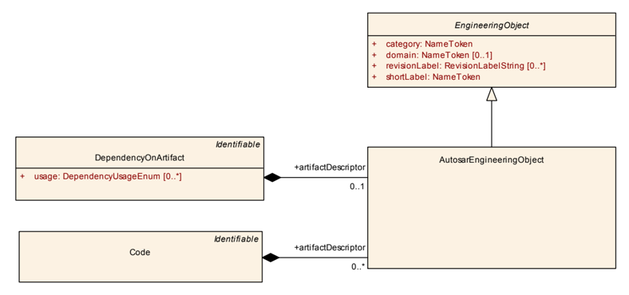

表4.69：EngineeringObject

| 类         | EngineeringObject（抽象）                                                                                                                                                         |
|------------|----------------------------------------------------------------------------------------------------------------------------------------------------------------------------------------|
| 包         | M2::AUTOSARTemplates::GenericStructure::GeneralTemplateClasses::EngineeringObject                                                                                                          |
| 注意       | 该类规定一个工程对象。这样的对象通常由一个文件制品表示。工程对象的性质使得该制品可以通过查询一个 ASAM 目录（catalog）文件找到。工程对象由 domain+category+shortLabel+revisionLabel 唯一标识。 |
| 基类       | ARObject                                                                                                                                                                                  |
| 子类       | AutosarEngineeringObject、BuildEngineeringObject、Graphic                                                                                                                                   |

| 属性          | 类型                | 多重性 | 类别 | 注意                                                                                                                                                     |
|---------------|---------------------|--------|------|------------------------------------------------------------------------------------------------------------------------------------------------------------|
| category      | NameToken           | 1      | attr | 这表示工程对象在开发周期中的角色。类别例如：SWSRC = 源代码；SWOBJ = 目标代码；SWHDR = C 头文件。更多角色需要通过方法论定义。标签：xml.sequenceOffset=20              |
| domain        | NameToken           | 0..1   | attr | 这表示工程对象存储在哪个域中。这允许指示仓库中保存工程对象的各个分段。域可以区分公司以及汽车领域。细节需要由方法论定义。该属性是可选的，以支持默认域。标签：xml.sequenceOffset=40 |
| revisionLabel | RevisionLabelString | *      | attr | 这是标注工程对象特定版本的修订标签。标签：xml.sequenceOffset=30                                                                                              |
| shortLabel    | NameToken           | 1      | attr | 这是工程对象的短名。注意，它建模为 NameToken 而非 Identifier，因为在 ASAM-CC 中它也是 NameToken。标签：xml.sequenceOffset=10                                    |

表4.70：AutosarEngineeringObject

| 类         | AutosarEngineeringObject                                                                                                                       |
|------------|-----------------------------------------------------------------------------------------------------------------------------------------------------|
| 包         | M2::AUTOSARTemplates::GenericStructure::GeneralTemplateClasses::EngineeringObject                                                                      |
| 注意       | 这表示作为过程一部分的工程对象。它是抽象类 EngineeringObject 在 AUTOSAR 内使用的特化。                                                                   |
| 基类       | ARObject、EngineeringObject                                                                                                                             |
| 聚合于     | AclObjectSet.engineeringObject、BuildActionEntity.deliveryArtifact、Code.artifactDescriptor、DependencyOnArtifact.artifactDescriptor                       |

以下示例展示了使用 EngineeringObject 引用物理文件。

清单4.24：制品描述示例

```xml
<?xml version="1.0" encoding="UTF-8"?>
<AUTOSAR xmlns:xsi="http://www.w3.org/2001/XMLSchema-instance"
         xmlns="http://autosar.org/schema/r4.0"
         xsi:schemaLocation="http://autosar.org/schema/r4.0 AUTOSAR_00052.xsd">
  <AR-PACKAGES>
    <AR-PACKAGE>
      <SHORT-NAME>demo</SHORT-NAME>
      <ELEMENTS>
        <SWC-IMPLEMENTATION>
          <SHORT-NAME>foo</SHORT-NAME>
          <ANNOTATIONS>
            <ANNOTATION>
              <ANNOTATION-TEXT>
                <P></P>
                <FORMULA></FORMULA>
                <VERBATIM></VERBATIM>
                <P></P>
              </ANNOTATION-TEXT>
            </ANNOTATION>
          </ANNOTATIONS>
          <REQUIRED-ARTIFACTS>
            <DEPENDENCY-ON-ARTIFACT>
              <SHORT-NAME>Foo</SHORT-NAME>
              <ARTIFACT-DESCRIPTOR>
                <SHORT-LABEL>FOO</SHORT-LABEL>
                <CATEGORY>SWSRC</CATEGORY>
                <DOMAIN>AUTOSAR</DOMAIN>
              </ARTIFACT-DESCRIPTOR>
              <USAGES>
                <USAGE>COMPILE</USAGE>
              </USAGES>
            </DEPENDENCY-ON-ARTIFACT>
          </REQUIRED-ARTIFACTS>
        </SWC-IMPLEMENTATION>
      </ELEMENTS>
    </AR-PACKAGE>
  </AR-PACKAGES>
</AUTOSAR>
```

**EngineeringObject 可以经由容器目录解析**

可以按照 [\[16\]](#ref-16) 定义的容器目录（container catalog）解析 EngineeringObject，以找到物理文件。

上例中的 artifactDescriptor 描述了类别为 “SWSRC” 的制品 “FOO”。利用这一信息，物理文件的路径可以通过以下目录示例解析。它是其中第一个 ABLOCK。

清单4.25：ASAM 目录示例

```xml
<?xml version="1.0" encoding="utf-8"?>
<CATALOG xmlns:xsi="http://www.w3.org/2001/XMLSchema-instance"
         xsi:noNamespaceSchemaLocation="catalog_V3_0_0.ml.xsd">
  <SHORT-NAME>sample</SHORT-NAME>
  <ABLOCKS>
    <ABLOCK>
      <SHORT-NAME>FOO</SHORT-NAME>
      <CATEGORY>SWSRC</CATEGORY>
      <DOMAIN>AUTOSAR</DOMAIN>
      <FILES>
        <FILE>source/c/foo.c</FILE>
      </FILES>
    </ABLOCK>
    <ABLOCK>
      <SHORT-NAME>FOO</SHORT-NAME>
      <CATEGORY>SWCT</CATEGORY>
      <DOMAIN>AUTOSAR</DOMAIN>
      <FILES>
        <FILE>AUTOSAR/xml/foo.arxml</FILE>
      </FILES>
    </ABLOCK>
    <ABLOCK>
      <SHORT-NAME>FOO</SHORT-NAME>
      <CATEGORY>ECUC</CATEGORY>
      <DOMAIN>AUTOSAR</DOMAIN>
      <FILES>
        <FILE>AUTOSAR/ecuc/foo.ecucvalues.arxml</FILE>
      </FILES>
    </ABLOCK>
  </ABLOCKS>
</CATALOG>
```

### 4.12. 注记（Annotations）

**注记**

在开发过程中，经常需要在模型上放置注记（annotation，一种“便签”）。为了以通用的方式支持这一点，应用抽象元类 GeneralAnnotation 并按特定用例进行特化。

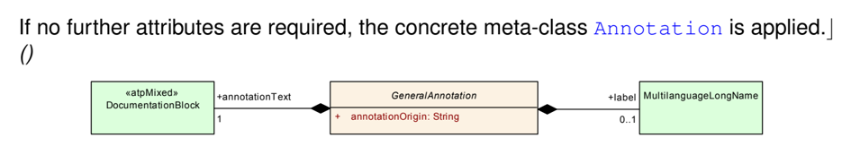

表4.71：GeneralAnnotation

| 类         | GeneralAnnotation（抽象）                                                                                                                                                                                                                                                               |
|------------|------------------------------------------------------------------------------------------------------------------------------------------------------------------------------------------------------------------------------------------------------------------------------------------------|
| 包         | M2::AUTOSARTemplates::GenericStructure::GeneralTemplateClasses::GeneralAnnotation                                                                                                                                                                                                                 |
| 注意       | 该类表示与聚合它的对象相关的文本注释（称为注记）。这些注记面向开发过程中的使用，用于把信息从开发过程的一个步骤传递到下一步骤。这一方法类似于“便签”。该抽象类可以特化以添加进一步的形式化属性。                                                                                                                    |
| 基类       | ARObject                                                                                                                                                                                                                                                                                          |
| 子类       | Annotation、ClientServerAnnotation、DelegatedPortAnnotation、IoHwAbstractionServerAnnotation、ModePortAnnotation、NvDataPortAnnotation、ParameterPortAnnotation、SenderReceiverAnnotation、TriggerPortAnnotation                                                                                                     |

| 属性            | 类型               | 多重性 | 类别 | 注意                                                                                                                                                |
|-----------------|--------------------|--------|------|----------------------------------------------------------------------------------------------------------------------------------------------------------|
| annotationOrigin| String             | 1      | attr | 该属性标识注记的来源。它是一个任意字符串，因为可以是个人名、工具名，甚至流程步骤名。标签：xml.sequenceOffset=30                                                    |
| annotationText  | DocumentationBlock | 1      | aggr | 这是注记的文本。标签：xml.sequenceOffset=40                                                                                                                        |
| label           | MultilanguageLongName | 0..1 | aggr | 这是注记的标题。标签：xml.sequenceOffset=20                                                                                                                        |

表4.72：Annotation

| 类         | Annotation                                                                                                                                                          |
|------------|----------------------------------------------------------------------------------------------------------------------------------------------------------------------------|
| 包         | M2::MSR::Documentation::Annotation                                                                                                                                            |
| 注意       | 这是一个不带进一步形式化数据的普通注记。                                                                                                                                          |
| 基类       | ARObject、GeneralAnnotation                                                                                                                                                     |
| 聚合于     | EcucAbstractReferenceValue.annotation、EcucParameterValue.annotation、HwAttributeValue.annotation、Identifiable.annotation、PostBuildVariantCriterionValue.annotation、SwDataDefProps.annotation、SwSystemconstValue.annotation |

| 属性 | 类型 | 多重性 | 类别 | 注意 |
|------|------|--------|------|------|
| -    |      |        |      |      |

### 4.13. 多维时间（MultidimensionalTime）

**MultidimensionalTime 的用途**

从时序角度看，为时序属性规定清晰的语义十分重要（例如某属性的单位是秒还是角度）。借助模型元素 MultidimensionalTime，这可以通过使用 [\[17\]](#ref-17) 定义的 ASAM CSE 代码类型（Codes for Scaling Units）来完成。

**CseCodeType 的标准化取值**

表4.73：图例：ASAM=ASAM-MCD-2MC-ASAP2

| 缩放单位（Scaling Unit） | 基本单位              | 来源标准 | 说明                                                                                                        |
|--------------------------|------------------------|----------|---------------------------------------------------------------------------------------------------------------|
| 0                        | 1 µsec                 | ASAM     | 时间                                                                                                          |
| 1                        | 10 µsec                | ASAM     | 时间                                                                                                          |
| 2                        | 100 µsec               | ASAM     | 时间                                                                                                          |
| 3                        | 1 msec                 | ASAM     | 时间                                                                                                          |
| 4                        | 10 msec                | ASAM     | 时间                                                                                                          |
| 5                        | 100 msec               | ASAM     | 时间                                                                                                          |
| 6                        | 1 sec                  | ASAM     | 时间                                                                                                          |
| 7                        | 10 sec                 | ASAM     | 时间                                                                                                          |
| 8                        | 1 min                  | ASAM     | 时间                                                                                                          |
| 9                        | 1 hour                 | ASAM     | 时间                                                                                                          |
| 10                       | 1 day                  | ASAM     | 时间                                                                                                          |
| 20                       | 1 fs（飞秒）            | ASAM     | 时间                                                                                                          |
| 21                       | 10 fs（飞秒）           | ASAM     | 时间                                                                                                          |
| 22                       | 100 fs（飞秒）          | ASAM     | 时间                                                                                                          |
| 23                       | 1 ps（皮秒）            | ASAM     | 时间                                                                                                          |
| 24                       | 10 ps（皮秒）           | ASAM     | 时间                                                                                                          |
| 25                       | 100 ps（皮秒）          | ASAM     | 时间                                                                                                          |
| 26                       | 1 ns（纳秒）            | ASAM     | 时间                                                                                                          |
| 27                       | 10 ns（纳秒）           | ASAM     | 时间                                                                                                          |
| 28                       | 100 ns（纳秒）          | ASAM     | 时间                                                                                                          |
| 100                      | 角度（Angular degrees）  | ASAM     | 角度（Angle）：Rate 定义多长时间（度数，360°）后触发一次触发器                                                        |
| 101                      | 转数（360 度）           | ASAM     | 转数（Revolutions）：Rate 定义多少转之后触发一次触发器                                                              |
| 102                      | 循环（720 度）           | ASAM     | 循环（Cycles）：例如内燃机。Rate 定义多少个循环（四冲程发动机的循环）之后触发一次触发器                               |
| 103                      | 气缸区段                | ASAM     | 燃烧（Combustion）：例如内燃机。Rate 定义触发器所关联的气缸编号（燃烧）                                              |
| 104                      | 0.1 角度               | AUTOSAR  | 同 Angle                                                                                                       |
| 105                      | 0.01 角度              | AUTOSAR  | 同 Angle                                                                                                       |
| 106                      | 0.001 角度             | AUTOSAR  | 同 Angle                                                                                                       |
| 1000                     | 非确定性                | ASAM     | 无固定缩放。RATE 的取值不被解释，Rate 置为 “0”                                                                   |

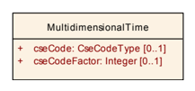

表4.74：MultidimensionalTime

| 类         | MultidimensionalTime                |
|------------|------------------------------------------|
| 包         | M2::AUTOSARTemplates::GenericStructure::GeneralTemplateClasses::MultidimensionalTime |
| 注意       | 基于 [\[17\]](#ref-17) 规定一个时间取值，参见 [TPS_GST_00354]。 |
| 基类       | ARObject                                 |
| 聚合于     | AgeConstraint.maximum、AgeConstraint.minimum、AnalyzedExecutionTime.bestCaseExecutionTime、AnalyzedExecutionTime.worstCaseExecutionTime、ArbitraryEventTriggering.maximumDistance、ArbitraryEventTriggering.minimumDistance、BurstPatternEventTriggering.minimumInterArrivalTime、BurstPatternEventTriggering.patternJitter、BurstPatternEventTriggering.patternLength、BurstPatternEventTriggering.patternPeriod、ConcretePatternEventTriggering.offset、ConcretePatternEventTriggering.patternJitter、ConcretePatternEventTriggering.patternLength、ConcretePatternEventTriggering.patternPeriod、ConfidenceInterval.lowerBound、ConfidenceInterval.upperBound、ExecutionTimeConstraint.maximum、ExecutionTimeConstraint.minimum、IoHwAbstractionServerAnnotation.age、LatencyTimingConstraint.maximum、LatencyTimingConstraint.minimum、LatencyTimingConstraint.nominal、MeasuredExecutionTime.maximumExecutionTime、MeasuredExecutionTime.minimumExecutionTime、MeasuredExecutionTime.nominalExecutionTime、OffsetTimingConstraint.maximum、OffsetTimingConstraint.minimum、PeriodicEventTriggering.jitter、PeriodicEventTriggering.minimumInterArrivalTime、PeriodicEventTriggering.period、ReceiverAnnotation.signalAge、RoughEstimateOfExecutionTime.estimatedExecutionTime、SimulatedExecutionTime.maximumExecutionTime、SimulatedExecutionTime.minimumExecutionTime、SimulatedExecutionTime.nominalExecutionTime、SporadicEventTriggering.jitter、SporadicEventTriggering.maximumInterArrivalTime、SporadicEventTriggering.minimumInterArrivalTime、SporadicEventTriggering.period、SwDataDefProps.swRefreshTiming、SynchronizationTimingConstraint.tolerance、TDLETZoneClock.accuracyExt、TDLETZoneClock.accuracyInt、TimingClockSyncAccuracy.accuracy、Trigger.triggerPeriod |

| 属性           | 类型         | 多重性 | 类别 | 注意                                                 |
|----------------|--------------|--------|------|-----------------------------------------------------------|
| cseCode        | CseCodeType  | 0..1   | attr | 通过 CSE 代码规定时基。                                       |
| cseCodeFactor  | Integer      | 0..1   | attr | 基于规定的 CSE 代码的时间取值的缩放因子。                          |

表4.75：CseCodeType

| 原始类型    | CseCodeType                                                                                                                                    |
|-------------|------------------------------------------------------------------------------------------------------------------------------------------------------|
| 包          | M2::AUTOSARTemplates::GenericStructure::GeneralTemplateClasses::PrimitiveTypes                                                                          |
| 注意        | 该原始类型表示一个基于 ASAM-MCD-2MC-ASAP2 规范中定义的 ASAM CSE（Codes for Scaling Units）。特定语义规定于 [TPS\_GST\_00354]。标签：xml.xsd.customType=CSE-CODE-TYPE-STRING xml.xsd.type=unsignedInt |

### 4.14. TagWithOptionalValue

**TagWithOptionalValue 的用途**

TagWithOptionalValue 提供了把带取值的标签与不带取值的标签附着到元素上的可能性。注意，与 Sd 相反，TagWithOptionalValue 有能力把一个没有取值的标签附着到对象上（参见 [TPS\_GST\_00224]）。

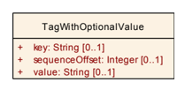

表4.76：TagWithOptionalValue

| 类         | TagWithOptionalValue                                                                                                                                                                    |
|------------|------------------------------------------------------------------------------------------------------------------------------------------------------------------------------------------------|
| 包         | M2::AUTOSARTemplates::GenericStructure::GeneralTemplateClasses::TagWithOptionalValue                                                                                                              |
| 注意       | 带标签的取值是一个标签（键）与取值的组合，给出附着到模型元素上的补充信息。请注意，允许不带取值的键。                                                                                                  |
| 基类       | ARObject                                                                                                                                                                                          |
| 聚合于     | AbstractServiceInstance.capabilityRecord、Machine.environmentVariable、ProvidedSomeipServiceInstance.capabilityRecord、RequiredSomeipServiceInstance.capabilityRecord、SdClientConfig.capabilityRecord、SdServerConfig.capabilityRecord、StartupConfig.environmentVariable |

| 属性           | 类型    | 多重性 | 类别 | 注意                                                                                                                                                                                                                                                                                                                  |
|----------------|---------|--------|------|----------------------------------------------------------------------------------------------------------------------------------------------------------------------------------------------------------------------------------------------------------------------------------------------------------------------------|
| key            | String  | 0..1   | attr | 定义一个键。                                                                                                                                                                                                                                                                                                                |
| sequenceOffset | Integer | 0..1   | attr | sequenceOffset 属性支持 TagWithOptionalValue 作为可拆分元素聚合的用例。如果多个聚合定义了属性 key 的相同取值，那么合并取值集合时的顺序可能很重要。例如考虑用元类 TagWithOptionalValue 建模 $PATH 环境变量。sequenceOffset 描述每个贡献在拼接值中的相对位置。各贡献按整数升序排序。                                                            |
| value          | String  | 0..1   | attr | 定义对应的取值。                                                                                                                                                                                                                                                                                                              |

## 5. 抽象结构（AbstractStructure）

抽象结构用于定义一种通过特化应用的模式。抽象结构由以下内容建立：

- 抽象元类；
- 这些元类之间的关系：
  - 标记为 **&lt;atpAbstract&gt;**（参见 [TPS\_GST\_00022]）和/或 **&lt;atpDerived&gt;**（参见 [TPS\_GST\_00023]）；
  - 若关系为 **&lt;atpDerived&gt;**，则关系的目标被标记为派生（derived）。在图中通过角色名前的斜杠显示。

**派生属性不出现在 XML Schema 中**

派生意味着该属性并不直接存在于模型中，而是以某种方式从模型中的其他信息计算得到。例如 `AtpInstanceRef` 中的 base 被计算为第一个 `atpContext` 的容器。

其后果是：派生关系不出现在 XML schema 中。

**派生关系的特化**

派生关系的特化只有在显式注明的情况下才是派生的。**&lt;atpDerived&gt;** 表示一种隐式关系，它不在模型中显式表达（例如不在 xml-schema 的 as 元素中）。派生关系的非抽象特化的动机应当被很好地记录。

**派生并集（Derived Union）**

可选地，关系的目标可以被标记为 derived union。在这种情况下，该属性被计算为所有具体关系的并集。这在图中以关系端的花括号显示。注意，对这类关系而言，多重性上限显然需要大于一。

抽象结构通过以下方式应用：

**抽象结构的应用**

- 前文提到的抽象元类的子类；
- 这些子类之间的关系。这些关系特化抽象元类之间的关系。

**关系的特化**

特化分为两类：

- **redefines** — 重定义完全替换抽象关系；
- **subset** — 子集化为抽象关系做出贡献，使得它可以派生为所有子集的并集。

特化在图中以关系端的花括号显示。注意，多重性上限等于 1 的关系只能“重定义”而不能“子集化”；反之，多重性上限大于 1 的关系只能“子集化”而不能“重定义”。

图 5.1 展示了这一方法。

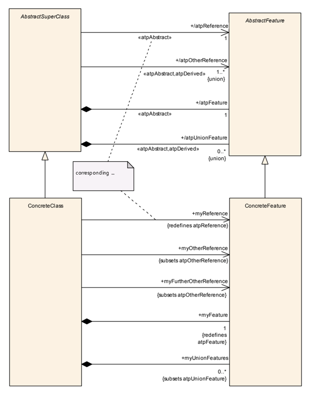

### 5.1. 可复用的结构层次

#### 5.1.1. 动机

在设计系统时，运行时空间中的元素共享同一结构的情况很常见。一个著名的示例领域是面向对象编程：从同一个类实例化的对象都具有该类所规定的相同结构。把结构规定一次然后在设计中的多个位置使用的能力在汽车领域中同样有用。为此，类型（**type**）与原型（**prototype**）的概念被引入 AUTOSAR 元模型。类型表示一个可复用的结构，原型表示该结构在一个类型内部以某一角色的使用。

考虑图 5.2 中的 M1 模型。它展示了一个应用组件类型 ‘WindowControllerType’，带有一个由 ‘ControlInterface’ 定型的端口原型 ‘ctrl’；以及一个组合类型 ‘PowerWindowType’，它拥有两个名为 ‘leftController’ 与 ‘rightController’ 的组件原型，二者都由 ‘WindowControllerType’ 定型。因此类型 ‘WindowControllerType’ 在 ‘PowerWindowType’ 组合中被使用了两次——一次扮演左侧控制器角色，一次扮演右侧控制器角色。请注意，尽管端口 ‘ctrl’ 在图中出现两次，但它实际上只在 ‘WindowControllerType’ 的结构中规定了一次。

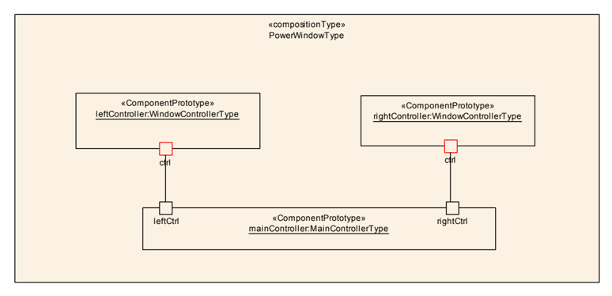

可复用类型的概念导致如下情形：一个扁平的 M1 模型规定深的、树状的 M0 实例。‘PowerWindowType’ 的 M0 实例的结构（部分地）如图 5.3 所示。可以看到，有两个实例对应于 ‘ctrl’ 端口，而该端口在 M1 中只定义了一次。

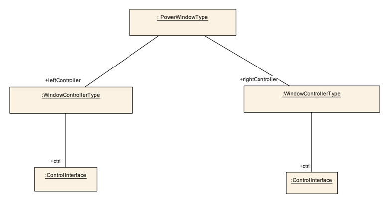

事实证明，这种结构在不同角色中的重复在 M1 模型的层次上也有后果。回到图 5.2：‘PowerWindowType’ 组合还包含一个由 ‘MainControllerType’ 定型的组件原型 ‘mainController’，后者拥有左、右控制端口。组合内的连接器把左车窗控制器的端口连接到主控制器的左端口，把右车窗控制器的端口连接到主控制器的右端口。

回顾一下：尽管左、右控制器的 ‘ctrl’ 端口在图中出现两次，它们在 M1 规范中实际上只出现一次——在类型 ‘WindowControllerType’ 中。但为了良定义连接器（例如在 XML 描述中），应当有一种方法在 M1 模型规范中区分那两个未来的 M0 实例。这是因为我们需要把左侧实例连接到主控制器的 ‘leftCtrl’ 端口、右侧实例连接到 ‘rightCtrl’ 端口。于是问题在于：如何引用源自同一 M1 模型元素的不同未来 M0 实例。这由实例引用（**instance refs**）的概念解决。

下一节引入类型、原型与结构元素的抽象层，并对这些概念给出更详细的说明；再下一节引入实例引用的抽象层并更详细地解释该概念。

#### 5.1.2. 类型、原型与结构元素

图 5.4 展示了带内部结构的元素的抽象层。

**Classifier 与 Feature 的表示**

分类器（**classifier**）按其特征（**feature**）对实例分类。这里“分类器”指（M2 元模型类 `AtpClassifier` 的某个具体子类的）M1 实例，“特征”指（M2 元模型类 `AtpFeature` 的具体子类的）实例。

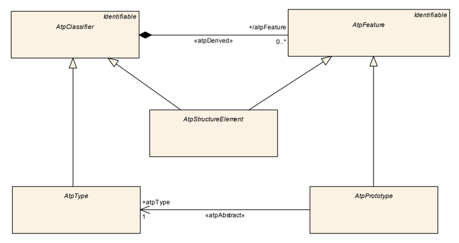

分类器的一个例子是某个给定的组件类型，特征的一个例子是某个给定的端口。例如图 5.2 中的组件类型 ‘WindowControllerType’ 拥有特征 ‘ctrl’，它是控制信号到达所经由的端口。这些元素是 M1 元素，它们的作用是刻画“运行时”系统中的 M0 元素。因此运行时系统将拥有若干个 ‘WindowControllerType’ 的实例（每个 ‘PowerWindowType’ 实例中有两个），每个实例都拥有一个控制端口。

一个给定系统的全部 M0 实例的集合可以按每个实例的特征加以划分（即分类）。分类器把这些特征组装成一个有意义的整体。

**AtpClassifier 的用途**

M2 元类 `AtpClassifier` 是一个“纵向”概念：它的语义贯穿多个抽象层次——这个 M2 类的含义是，它的 M1 实例对 M0 实例空间进行分类。

分类器与特征相互作用的方式是：一个特征对它所属的分类器的规范做出贡献的途径，是经由另一个规定该特征结构的分类器。

**AtpPrototype 的用途**

元类 `AtpPrototype` 代表由另一个对它们定型的分类器给出结构的特征。元类 `AtpType` 代表对原型定型的分类器。

有些分类器不需要是可复用的。这种情况由结构元素（**structure elements**）的概念刻画。

**AtpStructureElement 的用途**

结构元素既是特征又是分类器，因此规定自身的结构而不引用类型。

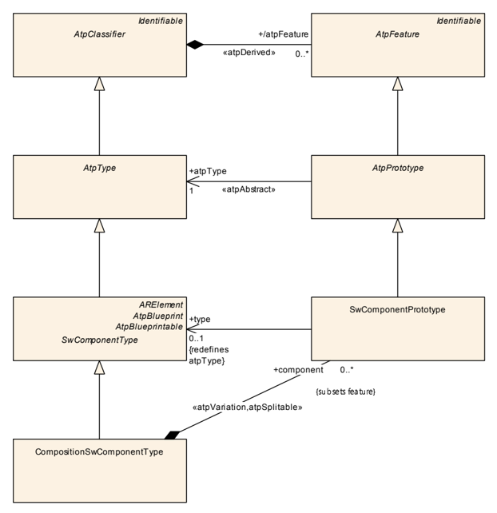

这类元素的抽象类是 `AtpStructureElement`。结构元素更容易定义，因为单个元素同时完成类型与原型两项工作。

类型与结构元素都是分类器，即都有 M0 实例。区别在于：类型在一个 M1 模型内是可复用的——一个给定类型（例如 ‘WindowControllerType’）可以用于在一个给定模型中为许多原型定型。这些原型代表 ‘WindowControllerType’ 的实例（即车窗控制器组件）在其所属组合中扮演的不同角色。例如，一个实例扮演 ‘leftLifter’ 角色，另一个扮演 ‘rightLifter’ 角色。

元类 `AtpType`、`AtpPrototype`、`AtpStructureElement` 都是抽象的。它们在元模型中用作具体元类的父类。图 5.5 展示了一个例子：组合类型被定义为组件原型的容器，而组件原型又由组件类型定型。

图中所示的组件结构是图 5.4 所示一般结构的特化。

**在抽象结构中派生特征**

除了对类进行特化之外，关联角色 ‘atpType’ 与 ‘atpFeature’ 也被特化。‘atpType’ 被重定义，而 ‘atpFeature’ 被子集化——这符合前者是抽象的、后者是派生并集的事实。

具体的 ‘type’ 关联重定义抽象的 ‘atpType’ 关联。

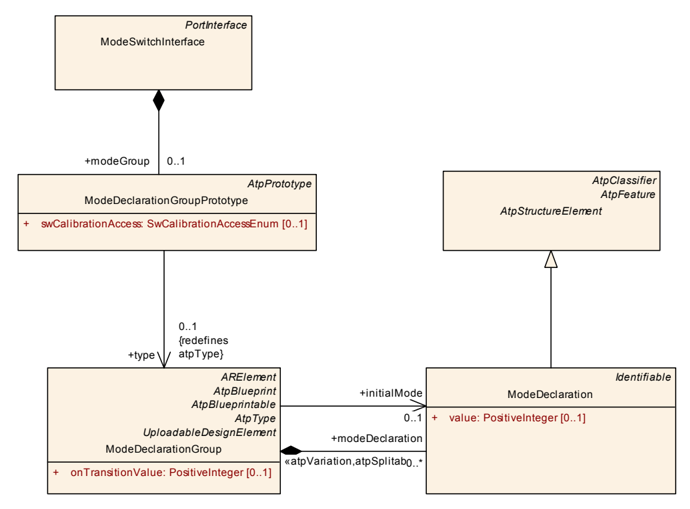

具体特征关联（注意是复数）的并集产生派生的 atpFeature。

因此，例如一个给定组件类型的特征包括其全部组件原型与端口。出于技术原因，特征的子集化不在元模型图中指示。

图 5.6 展示了一个具体结构元素的例子。

表5.1：AtpClassifier

| 类         | AtpClassifier（抽象）                                                                              |
|------------|---------------------------------------------------------------------------------------------------------|
| 包         | M2::AUTOSARTemplates::GenericStructure::AbstractStructure                                                 |
| 注意       | 分类器按其特征对 M0 实例分类。或者说：分类器是拥有实例的东西——一个 M1 分类器拥有 M0 实例。                   |
| 基类       | ARObject、Identifiable、MultilanguageReferrable、Referrable                                                 |
| 子类       | AtpStructureElement、AtpType                                                                                |

| 属性       | 类型       | 多重性 | 类别 | 注意                                                 |
|------------|------------|--------|------|-----------------------------------------------------------|
| atpFeature | AtpFeature | *      | aggr | 这是分类器的一个特征。构型：atpDerived                       |

表5.2：AtpFeature

| 类         | AtpFeature（抽象）                                                                                      |
|------------|--------------------------------------------------------------------------------------------------------------|
| 包         | M2::AUTOSARTemplates::GenericStructure::AbstractStructure                                                        |
| 注意       | 特征是分类器借以对实例分类的属性。或者说：分类器拥有特征，它的每个 M0 实例都将拥有这些特征。                          |
| 基类       | ARObject、Identifiable、MultilanguageReferrable、Referrable                                                       |
| 子类       | AtpPrototype、AtpStructureElement                                                                                |
| 聚合于     | AtpClassifier.atpFeature                                                                                          |

表5.3：AtpInstanceRef

| 类         | AtpInstanceRef（抽象）                                                                                                                                                                                                                                                                                                                                                                                                                                                                                                                                                                                                                                    |
|------------|------------------------------------------------------------------------------------------------------------------------------------------------------------------------------------------------------------------------------------------------------------------------------------------------------------------------------------------------------------------------------------------------------------------------------------------------------------------------------------------------------------------------------------------------------------------------------------------------------------------------------------------------------------------------------------------------------------------------------------------------------------------------------------------------------------------------------------------------------------------------------------------------------------------------------------------------------------------------------------------------------------------------------------------------------------------------------------------------------------------------------------------------------------------------------------------------------|
| 包         | M2::AUTOSARTemplates::GenericStructure::AbstractStructure                                                                                                                                                                                                                                                                                                                                                                                                                                                                                                                                                                                                                |
| 注意       | 分类器的一个 M0 实例可以表示为一棵以该实例为根的树，每个节点之下是以该节点特征身份出现的实例所对应的子树。实例引用规定一条从基础（base，它是一个分类器）的任何 M0 树实例到某个叶子（它是目标的实例）的导航路径。                                                                                                                                                                                                                                                                                                                                                                                                                     |
| 基类       | ARObject                                                                                                                                                                                                                                                                                                                                                                                                                                                                                                                                                                                                                                                                  |
| 子类       | AnyInstanceRef、ApplicationCompositeElementInPortInterfaceInstanceRef、ComponentInCompositionInstanceRef、ComponentInSystemInstanceRef、DataPrototypeInPortInterfaceInstanceRef、DataPrototypeInSystemInstanceRef、InnerDataPrototypeGroupInCompositionInstanceRef、InnerPortGroupInCompositionInstanceRef、InnerRunnableEntityGroupInCompositionInstanceRef、InstanceEventInCompositionInstanceRef、ModeDeclarationGroupPrototypeInSystemInstanceRef、ModeGroupInAtomicSwcInstanceRef、ModeInBswModuleDescriptionInstanceRef、ModeInSwcInstanceRef、OperationArgumentInComponentInstanceRef、OperationInAtomicSwcInstanceRef、OperationInSystemInstanceRef、PModeInSystemInstanceRef、ParameterDataPrototypeInSystemInstanceRef、ParameterInAtomicSWCTypeInstanceRef、PortGroupInSystemInstanceRef、PortInCompositionTypeInstanceRef、RModeInAtomicSwcInstanceRef、RteEventInCompositionInstanceRef、RteEventInEcuInstanceRef、RteEventInSystemInstanceRef、RunnableEntityInCompositionInstanceRef、SwcServiceDependencyInSystemInstanceRef、TriggerInAtomicSwcInstanceRef、TriggerInSystemInstanceRef、VariableAccessInEcuInstanceRef、VariableDataPrototypeInCompositionInstanceRef、VariableDataPrototypeInSystemInstanceRef、VariableInAtomicSWCTypeInstanceRef、VariableInAtomicSwcInstanceRef、VariableInComponent |
| 属性       | atpBase、atpContextElement、atpTarget                                                                                                                                                                                                                                                                                                                                                                                                                                                                                                                                                                                                                                      |

| 属性                        | 类型          | 多重性 | 类别 | 注意                                                                        |
|-----------------------------|---------------|--------|------|----------------------------------------------------------------------------------|
| atpBase                     | AtpClassifier | 1      | ref  | 这是导航路径出发的基础。构型：atpAbstract；atpDerived                              |
| atpContextElement (ordered) | AtpPrototype  | *      | ref  | 这是导航路径中的一个特定步骤。构型：atpAbstract                                    |
| atpTarget                   | AtpFeature    | 1      | ref  | 这是实例引用的目标。换言之，它是导航路径的终点。构型：atpAbstract                    |

表5.4：AtpPrototype

| 类         | AtpPrototype（抽象）                                                                                                                                                                                    |
|------------|----------------------------------------------------------------------------------------------------------------------------------------------------------------------------------------------------------------|
| 包         | M2::AUTOSARTemplates::GenericStructure::AbstractStructure                                                                                                                                                            |
| 注意       | 原型是被定型的特征。分类器中的一个原型表明：该分类器的实例将拥有一个特征，该特征的结构由其类型给出。该类型的一个实例将在拥有该特征的分类器中扮演特征所指示的角色。特征不是实例，而是对未来实例的指示。                                |
| 基类       | ARObject、AtpFeature、Identifiable、MultilanguageReferrable、Referrable                                                                                                                                                  |
| 子类       | DataPrototype、ModeDeclarationGroupPrototype、PortPrototype、RootSwCompositionPrototype、SwComponentPrototype                                                                                                              |
| 聚合于     | AtpClassifier.atpFeature                                                                                                                                                                                                  |

| 属性    | 类型    | 多重性 | 类别 | 注意                                     |
|---------|---------|--------|------|-----------------------------------------------|
| atpType | AtpType | 1      | ref  | 这是该特征的类型。构型：atpAbstract             |

表5.5：AtpStructureElement

| 类         | AtpStructureElement（抽象）                                                                                                                                                                                                                                                                                                                                                                                                                                       |
|------------|--------------------------------------------------------------------------------------------------------------------------------------------------------------------------------------------------------------------------------------------------------------------------------------------------------------------------------------------------------------------------------------------------------------------------------------------------------------------------|
| 包         | M2::AUTOSARTemplates::GenericStructure::AbstractStructure                                                                                                                                                                                                                                                                                                                                                                                                                     |
| 注意       | 结构元素既是分类器又是特征。作为特征，它的结构由它作为分类器所拥有的特征给出。                                                                                                                                                                                                                                                                                                                                                                                                    |
| 基类       | ARObject、AtpClassifier、AtpFeature、Identifiable、MultilanguageReferrable、Referrable                                                                                                                                                                                                                                                                                                                                                                                            |
| 子类       | AbstractAccessPoint、AbstractImplementationDataTypeElement、AsynchronousServerCallResultPoint、BswModuleDescription、BulkNvDataDescriptor、ClientServerOperation、DataPrototypeGroup、IdentCaption、InternalBehavior、InternalTriggeringPoint、ModeDeclaration、ModeDeclarationMapping、ModeSwitchPoint、ModeTransition、NvBlockDescriptor、ParameterAccess、PerInstanceMemory、PortGroup、PortPrototypeBlueprint、RTEEvent、RunnableEntity、RunnableEntityGroup、ServerCallPoint、SwConnector、SwcBswMapping、SwcServiceDependency、System、Trigger、VariableAccess |
| 聚合于     | AtpClassifier.atpFeature                                                                                                                                                                                                                                                                                                                                                                                                                                                          |

表5.6：AtpType

| 类         | AtpType（抽象）                                                                                          |
|------------|---------------------------------------------------------------------------------------------------------------|
| 包         | M2::AUTOSARTemplates::GenericStructure::AbstractStructure                                                        |
| 注意       | 类型是可以为原型定型的分类器。它是一个可复用的分类器。                                                              |
| 基类       | ARObject、AtpClassifier、Identifiable、MultilanguageReferrable、Referrable                                          |
| 子类       | AutosarDataType、ModeDeclarationGroup、ModeDeclarationMappingSet、PortInterface、SwComponentType                     |

#### 5.1.3. 实例引用（Instance Refs）

**实例引用**

实例引用是 M1 元素，它定义在 M1 分类的未来 M0 实例树内的一个特定导航。

图 5.7 展示了一个名为 ‘ctrlInRightControllerInPowerWindowType’ 的 M1 实例引用。在 ‘PowerWindowType’ 的每个 M0 实例（其结构如图 5.3 所示）中，该实例引用标识该图右侧最底部的实例。它以组合类型 ‘PowerWindowType’ 为 base，以组件原型 ‘rightController’ 为 context，以端口 ‘ctrl’ 为 target。context 的作用是沿一条特定的路径导航实例树，本例中即右侧路径。

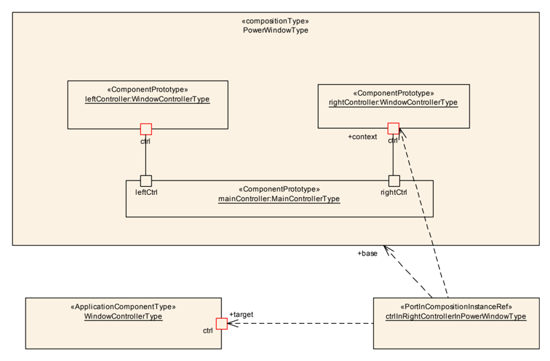

M1 实例引用是元类 `AtpInstanceRef` 某个具体子类的实例。图 5.8 展示了实例引用的抽象层。

**实例引用的定义**

每个实例引用都相对于一个作为分类器的基础（base）定义。实例引用所做的事情是规定一条特定的导航，从基础的任何 M0 实例的根导向树内的某个内部实例。一个实例引用（即一条导航）对该基础的任何 M0 实例都有效。导航经由一系列 context 元素（它们是特征）与一个同样为特征的 target 规定。

**实例引用中的 context 路径**

有序的 context 特征集合加上 target 构成从根到所规定的内部实例的路径。换言之，context 从 InstanceRef 的第一个元素开始。target 始终是 InstanceRef 类中的最后一个元素。

**InstanceRef 的 atpContextElement 应当一致**

路径中的第一个 `atpContextElement` 应当是 `atpBase` 的一个 `atpFeature`。对于所有后续的 `atpContextElement`，它们应当是前一个元素（它是一个 `AtpPrototype`）的 `atpType` 的 `atpFeature`。

**约束：InstanceRef 的 atpTarget 应当一致**

实例引用的 `atpTarget` 应当是以下之一：

- 最后一个 `atpContextElement` 的 `atpType` 所拥有的一个 `atpFeature`；或
- 最后一个 `atpContextElement` 的 `atpType` 所拥有的某个 `AtpStructureElement` 所拥有的一个 `atpFeature`。

**实例引用的变体依赖**

如果一个带有 **&lt;instanceRef&gt;** 构型的依赖需要成为可变体的，那么需要遵守以下后果：

- 该依赖应当带有构型 **&lt;instanceRef, atpVariation&gt;**；
- 实例引用类在实例引用拥有者处的聚合应当带有构型 **&lt;atpVariation&gt;**。

**AtpInstanceRef 应当贴近基础**

`AtpInstanceRef` 的聚合方式应当使其与角色 `atpBase` 中引用的 `AtpClassifier` 的关系无歧义。以下情形之一即满足：

- `AtpInstanceRef` 聚合在角色 `atpBase` 中引用的 `AtpFeature` 内；
- `atpBase` 是实例树的根。它是聚合第一个（最外层）`atpContextElement` 所对应的第一个 `AtpFeature` 的 `AtpClassifier`。

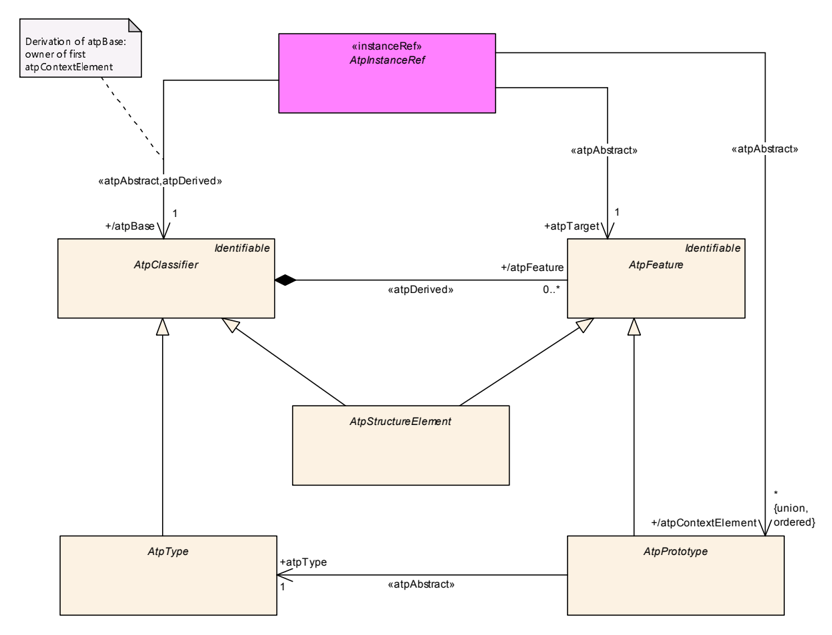

图 5.9 展示了 `AtpInstanceRef` 的一个具体子类，名为 RPortInCompositionInstanceRef，用于定义经由一个内部组件原型导航到组合类型内某个端口的实例引用。这个具体元类规定：base 应当是一个组合类型；应当恰好有一个作为组件原型的 context 元素；target 是一个端口。实例引用 ‘ctrlInRightControllerInPowerWindowType’ 就是 RPortInCompositionInstanceRef 的一个实例。

图 5.9 还展示了这样的实例引用在元模型中的应用方式：

**实例引用的应用**

实例引用在元模型中通过两种必须同时存在的表示来应用：

- 一个带 **&lt;instanceRef&gt;** 构型的依赖，它表达意图并为文档与类表做出贡献；
- 在引用的源处对 `AtpInstanceRef` 具体子类的相应聚合，它表示实现并因此为 xml schema 做出贡献。

请注意，两种表示都是相关的，并且应当同时存在于元模型中。

**相应实例引用表示的标识**

用于建模实例引用的依赖的目标角色名与相应聚合的目标角色名（如 [TPS\_GST\_00043] 所述）应当相同。<sup>1</sup>

图 5.9 给出了 [TPS\_GST\_00044] 应用的示例。从 AssemblySwConnector 到 AbstractRequiredPortPrototype 的依赖的目标角色名（即 requester）与 AssemblySwConnector 处 RPortInCompositionInstanceRef 聚合的目标角色名相同。

清单 5.1 展示了图 5.9 场景的 ARXML 表示，特别是示例末尾 AssemblySwConnector 中的实例引用。

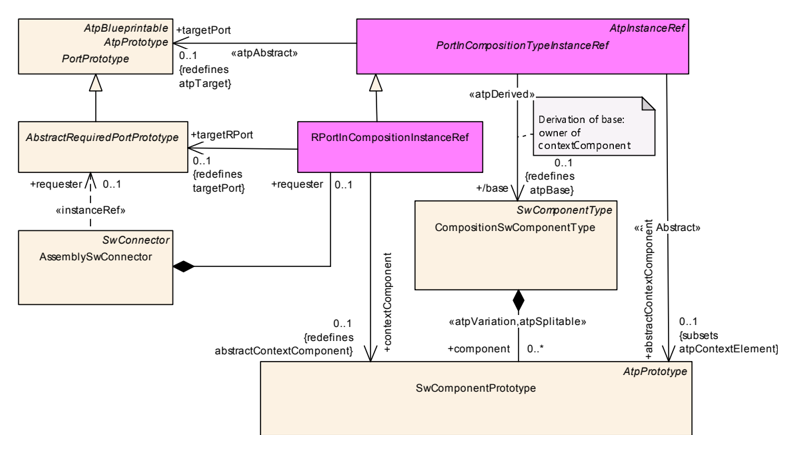

清单5.1：实例引用的应用

```xml
<AUTOSAR xmlns:xsi="http://www.w3.org/2001/XMLSchema-instance"
         xmlns="http://autosar.org/schema/r4.0"
         xsi:schemaLocation="http://autosar.org/schema/r4.0 AUTOSAR_00052.xsd">
  <ADMIN-DATA>
    <USED-LANGUAGES>
      <L-10 xml:space="preserve" L="EN">English</L-10>
    </USED-LANGUAGES>
  </ADMIN-DATA>
  <AR-PACKAGES>
    <AR-PACKAGE>
      <SHORT-NAME>Example</SHORT-NAME>
      <INTRODUCTION>
        <P>
          <L-1 L="EN">This example fragment illustrates an instance ref</L-1>
        </P>
      </INTRODUCTION>
      <ELEMENTS>
        <APPLICATION-SW-COMPONENT-TYPE>
          <SHORT-NAME>MainControllerType</SHORT-NAME>
          <PORTS>
            <P-PORT-PROTOTYPE>
              <SHORT-NAME>leftCtrl</SHORT-NAME>
            </P-PORT-PROTOTYPE>
            <P-PORT-PROTOTYPE>
              <SHORT-NAME>rightCtrl</SHORT-NAME>
            </P-PORT-PROTOTYPE>
          </PORTS>
        </APPLICATION-SW-COMPONENT-TYPE>
        <APPLICATION-SW-COMPONENT-TYPE>
          <SHORT-NAME>WindowControllerType</SHORT-NAME>
          <PORTS>
            <R-PORT-PROTOTYPE>
              <SHORT-NAME>ctrl</SHORT-NAME>
            </R-PORT-PROTOTYPE>
          </PORTS>
        </APPLICATION-SW-COMPONENT-TYPE>
        <COMPOSITION-SW-COMPONENT-TYPE>
          <SHORT-NAME>PowerWindowType</SHORT-NAME>
          <COMPONENTS>
            <SW-COMPONENT-PROTOTYPE>
              <SHORT-NAME>rightController</SHORT-NAME>
              <TYPE-TREF DEST="APPLICATION-SW-COMPONENT-TYPE">/Example/WindowControllerType</TYPE-TREF>
            </SW-COMPONENT-PROTOTYPE>
            <SW-COMPONENT-PROTOTYPE>
              <SHORT-NAME>mainController</SHORT-NAME>
              <TYPE-TREF DEST="APPLICATION-SW-COMPONENT-TYPE">/Example/MainControllerType</TYPE-TREF>
            </SW-COMPONENT-PROTOTYPE>
          </COMPONENTS>
          <CONNECTORS>
            <ASSEMBLY-SW-CONNECTOR>
              <SHORT-NAME>rightControl</SHORT-NAME>
              <PROVIDER-IREF>
                <CONTEXT-COMPONENT-REF DEST="SW-COMPONENT-PROTOTYPE">/Example/PowerWindowType/mainController</CONTEXT-COMPONENT-REF>
                <TARGET-P-PORT-REF DEST="P-PORT-PROTOTYPE">/Example/MainControllerType/rightCtrl</TARGET-P-PORT-REF>
              </PROVIDER-IREF>
              <REQUESTER-IREF>
                <CONTEXT-COMPONENT-REF DEST="SW-COMPONENT-PROTOTYPE">/Example/PowerWindowType/rightController</CONTEXT-COMPONENT-REF>
                <TARGET-R-PORT-REF DEST="R-PORT-PROTOTYPE">/Example/WindowControllerType/ctrl</TARGET-R-PORT-REF>
              </REQUESTER-IREF>
            </ASSEMBLY-SW-CONNECTOR>
          </CONNECTORS>
        </COMPOSITION-SW-COMPONENT-TYPE>
      </ELEMENTS>
    </AR-PACKAGE>
  </AR-PACKAGES>
</AUTOSAR>
```

> **1** 注意，用于生成图的 UML 工具允许在依赖上规定角色名，即使 UML 本身不支持这一点。

#### 5.1.4. 任意实例引用（Any Instance Refs）

元类 `AnyInstanceRef` 提供了一种通用的能力：描述指向作为 `AtpFeature` 的任意目标的 InstanceRef。但这样的 InstanceRef 的 M1 模型需要遵循 5.1.3 节描述的规则。

另参见 AtpInstanceRef。

一个 System 可以用作 `AtpFeature`，例如作为 AnyInstanceRef 的第一个 contextElement。对 AnyInstanceRef 的 base 求派生将返回 System 的拥有者，即一个 `ARPackage`。但 `ARPackage` 不是 `AtpClassifier`，这与 AnyInstanceRef 的规范相矛盾——后者定义 AnyInstanceRef 的派生 base 引用应当返回一个 `AtpClassifier`。为避免这种不一致，适用 [constr\_2587]。

**约束：AnyInstanceRef 中不得使用 System**

作为 [TPS\_GST\_00387] 的后果，System 不得作为 AnyInstanceRef 的 contextElement 或 target。否则 atpBase 将无法确定。

##### 5.1.4.1. AnyInstanceRef 应用于 ImplementationDataTypeElement

若 AnyInstanceRef 以一个 `ImplementationDataTypeElement` 作为目标，则需要适用进一步的约束以保证模型一致。在这种情况下，即使不出现类型-原型序列，也可能需要提供附加的 context。

**约束：引用 ImplementationDataTypeElement 的 AnyInstanceRef 的完整性**

若目标引用一个 `ImplementationDataTypeElement`，则 AnyInstanceRef 应当为以下对象定义 contextElement 引用：

1. 引用型 ImplementationDataType 链中除目标之外的每个叶子 `ImplementationDataTypeElement`；
2. 引用型 ImplementationDataType 链中类别为 ARRAY 的每个 `ImplementationDataTypeElement`。

由此，context 按照 [TPS\_GST\_00162] 从根创建到叶子 ImplementationDataTypeElement——后者或者被定型（直接地或经由类别为 TYPE\_REFERENCE 的 ImplementationDataType 间接地）、或者拥有 target。

**注意：** 从技术上讲，可以为层次中的一维数组省略 context。仍然要求 context 的原因是：这样 context 存在性的规则就简单得多。

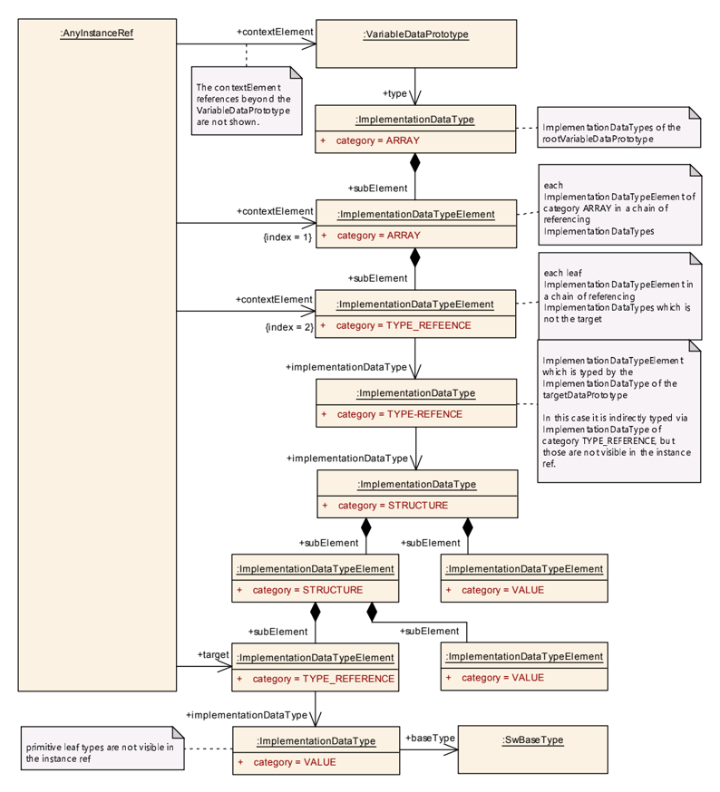

## 6. 元建模模式与模型转换

元建模模式（**meta-modeling pattern**）是一种参数化结构，当应用到实际参数时产出一个规则的、非参数化的结构。结构就是由关联和聚合相关的元类的集合。模式的好处是：允许反复使用重现出现的结构，而无需重复其定义。本章描述元建模模式的概念，以及它们在 AUTOSAR 元模型中的使用与记法。另一个好处是：元模型的原始结构得以保留，不被实现细节所模糊。

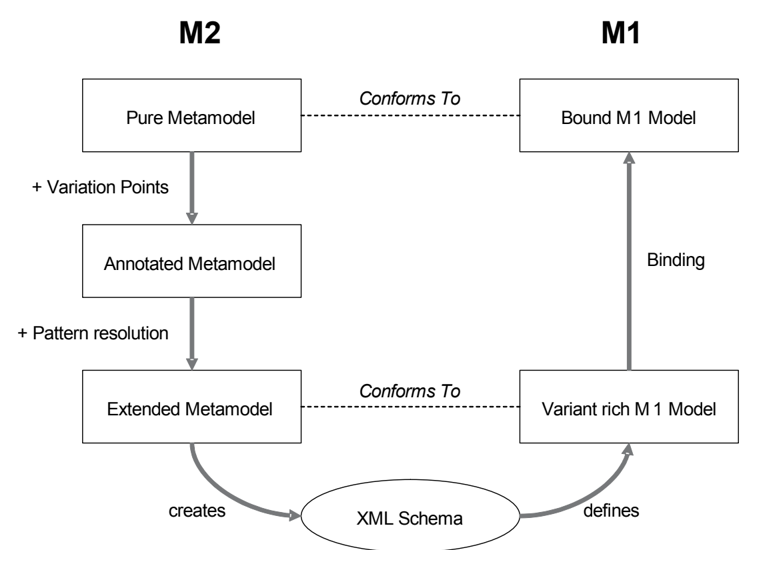

图 6.1 给出了该方法的快速概览，其中以 AUTOSAR 中的变体处理为例<sup>1</sup>：

1. **纯元模型** — AUTOSAR 首先定义一个表示总体方法、不带注记与转换的元模型（例如不支持变体）。

   请注意，最终只有带注记的元模型被手工维护，并成为 AUTOSAR 交付物的一部分。

2. **带注记的元模型** — 随后使用构型与 UML 标签对纯元模型进行注记，以描述预期的转换（例如 **&lt;atpVariation&gt;** 与 UML 标签 vh.latestBindingTime）。
3. **扩展元模型** — 一个模型转换把带注记的元模型转换为扩展元模型，后者随后用于生成 schema。

   扩展元模型与带注记元模型的差别在于：它添加了若干更多的元素，这些元素提供完整描述（例如）一个变体点所需的全部信息。它还引入附加的约束，例如以支持变体点。

   这些附加元素通过把模式应用到带注记元模型中被标注为（例如）变体点的那些位置来生成。

> **1** 注意，此处的“模型”是一个概念实体，与其表示无关。在这个意义上，XML、C 与 PDF 等都被视为“模型”的表示。术语“模型”指 AUTOSAR 相关的内容，而非物理实体。

为了说明，考虑图 6.2 中的模式 VHUnboundedAggregationPattern。它展示了一个由四个类及它们之间的若干聚合构成的参数化结构。参数（图中以花括号（{}）显示）为：

- WholeClass，一个类；
- PartClass，一个被聚合的类；
- partRole，被聚合的类的角色；
- vh.latestBindingTime，枚举类型 BindingTimeEnum 的一个取值。

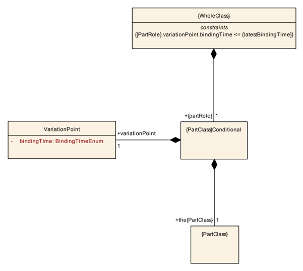

现在可以把该模式应用到实际参数以产出一个非参数化的结构。例如，通过赋予实际参数

- WholeClass = SwComponentType
- PartClass = PortPrototype
- partRole = port
- vh.latestBindingTime = systemDesignTime

我们得到图 6.3 中的结构。把同一模式应用到不同参数可以得到许多不同的结构。

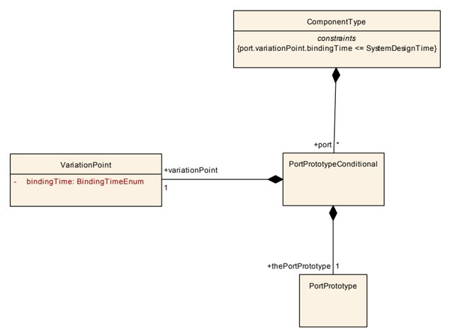

### 6.1. 模式应用的记法

被抽象为模式的重现结构通常具有以参数扮演的角色来解释的、良定义的语义。这一语义通常会自然引出一种用于模式应用的直观记法，它当然是特定于手头模式的。

图 6.4 展示了 VHUnboundedAggregationPattern 应用于组件类型与端口的一种记法。该记法使用扮演 WholeClass 角色的类与扮演 PartClass 角色的类之间的一条聚合箭头，并以 **&lt;atpVariation&gt;** 构型修饰。这一记法表明：类 SwComponentType 在角色 port 上“语义地聚合”类 PortPrototype，同时允许变体。这张图是一次模式应用的记法，其结果产生图 6.3 中的图。

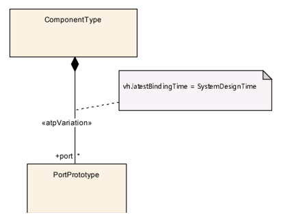

类似的记法用于所有与变体相关的模式。各特定模式将在下文连同它们的记法一起描述。这类记法的一个主要好处是：它类似于无变体的聚合。这使得可以在常规的、无变化的设计“之上”规定变体，而不去搅动概念设计本身。然而重要的是要记住：由 **&lt;atpVariation&gt;** 修饰的聚合箭头（如图 6.4 中那样）并不是真实的聚合：它们是模式应用的记法（其结果包含真实的聚合）。

### 6.2. 模式规范

**转换模式的规范**

模式的规范包括：

- 模式的名称；
- 参数列表；
- 参数化结构；
- 模式应用的记法。

上述元素全部经由单张图规定，图 6.5 以无界聚合模式为例进行了说明。

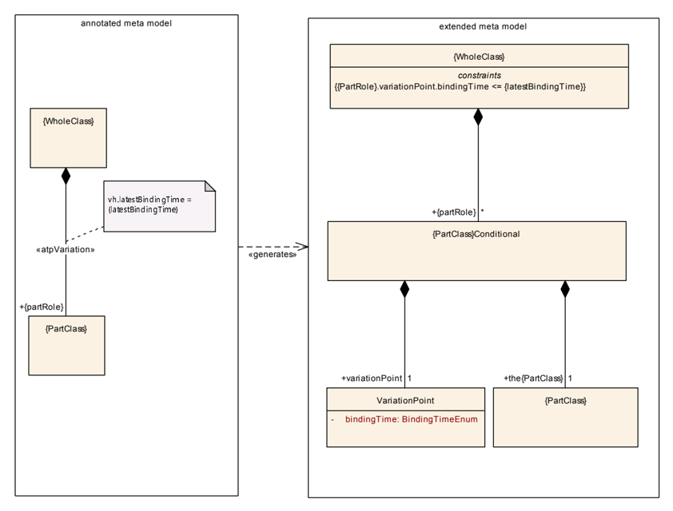

### 6.3. 元模型中应用的模型转换

模型转换模式机制在元模型中用于：

- 变体处理（第 7 章）；
- 其他特定目的，例如引用（第 4.4 章）。

#### 6.3.1. 实现 &lt;primitive&gt;

本节说明原始类型的实现，尽管它尚未（R4.0）作为真正的模型转换实现。

**原始类型的模型转换**

一个 **&lt;primitive&gt;** 元类被转换为以下元素：

1. 另一个同名、名字加后缀 ‘\_simple’ 的原始类型。对 XML 而言，该原始类型在生成的 schema 中产生一个简单类型（simple type），并规定实现细节，例如模式（pattern）与 facet。该元类用于带有 `xml.attribute=true` 标签的属性，也用作带有 `xml.roleElement=false`、`xml.roleWrapperElement=false`、`xml.typeElement=false`、`xml.typeWrapperElement=false` 标签的属性的原始类型。
2. 一个同名的元类。与所有其他元类一样，该元类继承自 **&lt;atpObject&gt;**。因此，除非带有 `xml.attribute=true` 标签，元模型中的 UML 属性最终被实现为对该元类的聚合。

**&lt;atpObject&gt;** 的细节在第 6.3.3 章中描述。

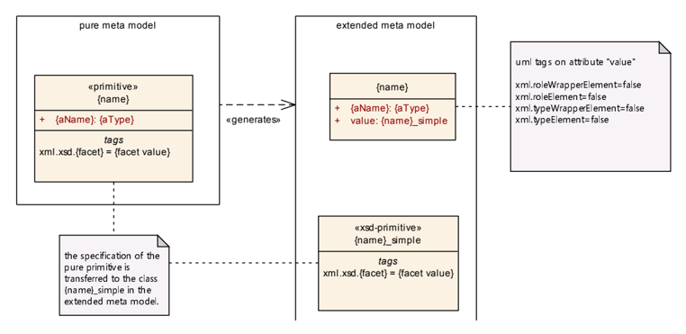

#### 6.3.2. 把关联实现为引用

本节说明关联的实现，尽管它尚未（R4.0）作为真正的模型转换实现。

**建立引用**

元类之间的引用表示为关联。被引用的元类派生自 `Referrable`，多数是 `Identifiable`。由此它们定义了一个应当在其命名空间内唯一的 `shortName`（参见 [constr\_2508]）。因此引用（元模型中的关联）通过以下方式表达：

1. 规定一个区分大小写的 `shortName` 路径（绝对的或相对的）；
2. 引用的目标类型；
3. 相对引用的情况下，区分大小写的引用基础名称。

命名空间层次在元模型中由派生自 `Identifiable` 的类的组合关联定义。每个 `Identifiable` 是其直接或间接关联（组合关联）类的命名空间。

**引用的大小写敏感性**

请注意，术语“区分大小写”表示字符集合

```
{a b c d e f g h i j k l m n o p q r s t u v w x y z}
{A B C D E F G H I J K L M N O P Q R S T U V W X Y Z}
```

中的字符分别被视为不同。short name 的任何使用都应当采用与 short name 实际定义相同的大小写敏感性。

**类型引用的表示**

请注意，对带有 **&lt;isOfType&gt;** 构型的关联，引用类的角色是 {theRole}Tref。

**关联上的模型转换**

一个关联被转换为一个匿名<sup>2</sup>元类的聚合，该元类带有属性 dest。在按照原始类型规则执行转换之后，该元类继承自 Ref。Ref 由此提供取值，该取值表示指向被引用对象的 shortName 路径。图 6.7 展示了等价的模式。

> **2** 这一捷径是可能的，因为所描述的方法不是作为模型转换实现，而是在 schema 生成器中实现。如果应用模型转换，则需要为每个特定引用创建一个特定的元类。

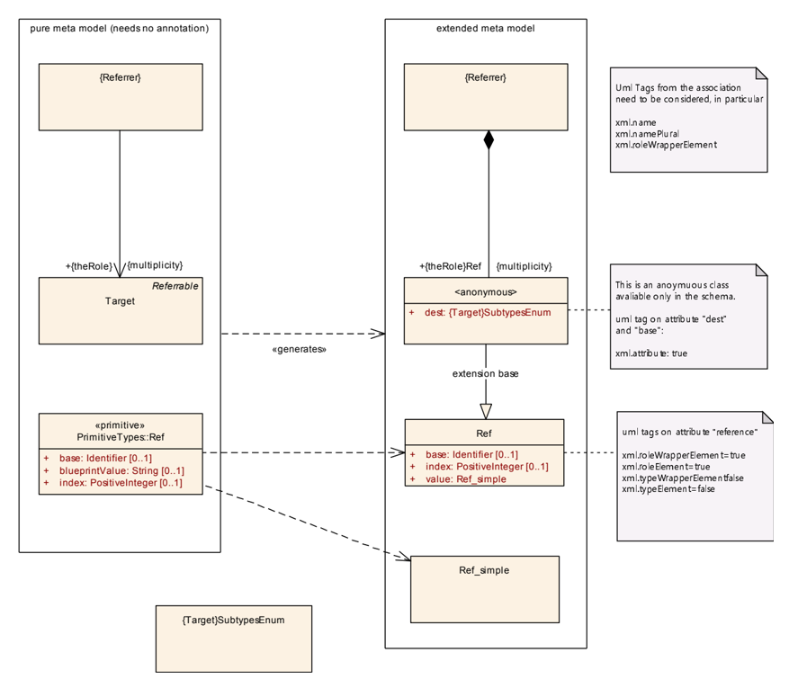

##### 6.3.2.1. 目标类型

**目标类型**

目标类型（规定为引用元素中的属性 dest）定义被引用对象的类型。目标类型也可以引用子类（抽象的与具体的）。该属性的取值是：

- 若元模型中的引用指向一个抽象类，则 dest 的取值是该抽象类的 XML 名称或其任何子类的 XML 名称。即使 dest 是一个抽象类的 XML 名称，引用的目标也可以是派生自该抽象类的任何具体类的实例。
- 若元模型中的引用指向一个具体类，则 dest 的取值是该类的名称。引用的目标只能是该类的实例。

目标类型提高了 XML 描述的健壮性，例如：

- 工具可以找到引用了错误类型对象的引用。
- 若被引用对象不可用，工具可以指示正确的类型，或实例化一个合适的代理。

但如果 dest 的可能取值不包含抽象类，则会造成以下问题：

- 若引用目标被改为另一个子类，即使该引用并不关心这一点，也需要维护这些引用；
- 它不会把元模型的信息传播到 XML schema。

图 6.8 展示了一个关联的实现。

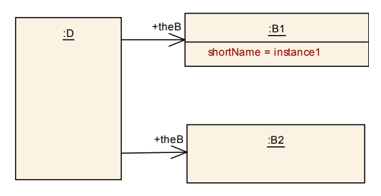

```xml
<D>
  <THE-B-REFS>
    <THE-B-REF DEST="B-1">/package1/package2/instance1</THE-B-REF>
    <THE-B-REF DEST="B-2">/package1/package2/instance2</THE-B-REF>
  </THE-B-REFS>
</D>
```

#### 6.3.3. &lt;atpObject&gt;：ARObject

**所有元类的属性**

在 AUTOSAR 元模型中，应当存在适用于所有具体元类的属性。这可以视为一个模型转换：把所有 **&lt;atpObject&gt;** 的元类（尤其是 ARObject）作为超类应用到所有基类。

该转换模式的细节参见图 6.9。

**注意：** 该模式实际上并不要求参数。

表6.1：ARObject

| 类         | ARObject（抽象）                                                 |
|------------|---------------------------------------------------------------------|
| 包         | M2::AUTOSARTemplates::GenericStructure::GeneralTemplateClasses::ArObject |
| 注意       | 元模型中所有类的隐式基类。                                              |
| 基类       | （无）                                                               |
| 子类       | -所有具体元类-                                                        |

| 属性      | 类型     | 多重性 | 类别 | 注意                                                                                                                                                                                                                       |
|-----------|----------|--------|------|-------------------------------------------------------------------------------------------------------------------------------------------------------------------------------------------------------------------------------|
| checksum  | String   | 0..1   | attr | 由用户的工具环境为 ArObject 计算的校验和。可以在自己的工具环境中用它判断 ArObject 是否已变更。checksum 对 AUTOSAR 模型没有任何语义含义，也不要求 AUTOSAR 工具管理校验和。标签：xml.attribute=true xml.name=S                          |
| timestamp | DateTime | 0..1   | attr | 由用户的工具环境为 ArObject 计算的时间戳。可以在自己的工具环境中用它判断 ArObject 的最近变更。timestamp 对 AUTOSAR 模型没有任何语义含义，也不要求 AUTOSAR 工具管理时间戳。标签：xml.attribute=true xml.name=T                          |

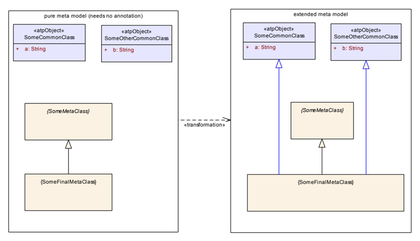

## 7. 变体处理（Variant Handling）

### 7.1. 引言

AUTOSAR 中变体处理的动机是：在 OEM 与供应商之间架起桥梁、避免制品之间的冗余，并为在 AUTOSAR 中表达基本产品线提供基础。

当然，变体处理概念在多数公司中已经存在，但它们通常（在公司边界之外）没有标准化，因此 OEM 与供应商很难就这一主题相互沟通。

考虑以下示例。一个 OEM 把一个包含变体的模型发给供应商。供应商从该模型生成代码，但并不解析全部变体。OEM 拿回的是一些变体已绑定、另一些变体保持“开放”（待装载时绑定）的目标代码。这只有在双方讲同一种语言、对变体有相同理解的情况下才能工作。而且经常涉及不止两方。

因此，AUTOSAR 中的变体处理主要是关于变体的文档化：

**变体处理术语**

- 变体点（**Variation Points**）是模型中可变的位置。也就是说，它们可能并非在所有变体中都存在，或者在不同变体中具有不同的特性。
- 施加时间（**Binding Time**）是一个变体点可以被施加（bind）的最晚可能时间。
- 绑定表达式（**Binding Expressions**）规定可变元素在何种条件下存在，或确定某些可变特性。

#### 7.1.1. 快速概览

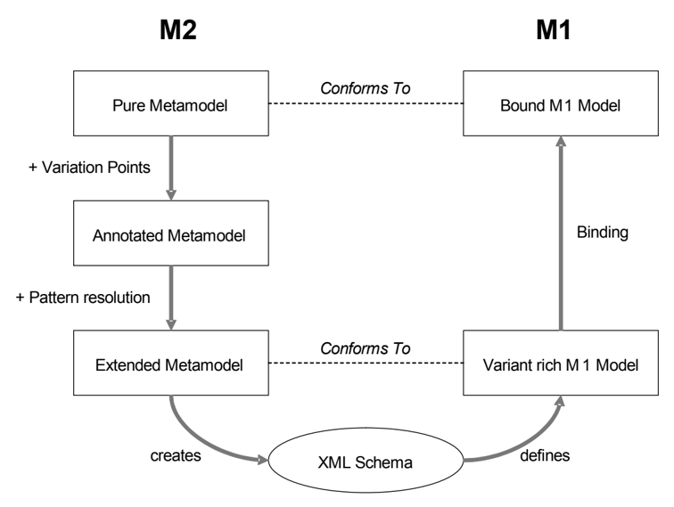

本节继续第 6 章的元模型转换概览。

1. （第 6 章的回顾。）AUTOSAR 从纯元模型出发。带注记的元模型具有相同的结构，但用构型（**&lt;atpVariation&gt;**）标记那些作为变体点的位置。本节将定义一些模式，展示如何把这些位置转换为一个拥有实现变体点所需全部信息的结构。
2. 这一切都发生在 M2 模型上。XML schema 创建之后，焦点转向 M1——这是变体被施加（bind）的地方。
3. **变体丰富的 M1 模型**

   变体丰富的 M1 模型是一个（应当符合扩展元模型 [TPS\_GST\_00164] 定义的规则的）模型，它同时包含全部受支持的变体。变体由此通过 VariationPoint 或 AttributeValueVariationPoint 表达。

4. **已施加的 M1 模型**

   已施加的模型表示一个特定的变体。它从变体丰富的模型创建而来：通过施加各变体点，把后者转换为某个特定的变体。

**约束应当应用于已施加的纯元模型**

约束的执行应当在变体点的施加完成、且存在已施加模型之后进行。

例如，在一个不变模型中，端口可以拥有 1:n 或 n:1 的连接。另一方面，该规则不适用于变体丰富的模型，因为变体可能彼此重叠，导致 m:n 连接。对变体丰富的模型施加并抽取某个特定变体之后，不变模型的规则重新适用。

另一个例子：接口兼容性规则只能应用于特定的变体。

请注意，PostBuild 变体点的存在实际上意味着：完全施加的 M1 模型不一定作为一个制品存在。原因是 PostBuild 变体点在 ECU 启动时施加，显然无法在 M1 模型中解析。然而，得到的 M0 模型符合已施加的 M1 模型。

**移除被取消选择的对象**

如果已施加的 M1 模型作为制品保存，那么被取消选择的对象应当被移除。

**施加时移除绑定函数**

被选中对象的 VariationPoint 是否保留在制品中取决于流程。如果保留，则绑定函数应当被移除、或在 AttributeValueVariationPoint 中被结果替换。由此，该变体点不再像一个未施加的变体点。

#### 7.1.2. 变体处理与方法论

如前所述，变体处理发生在方法论的不同层次与不同阶段，因此可能影响不同的工作产品。事实上，现在每个工作产品都可以包含变体。

**变体处理规范的范围**

在 AUTOSAR 中，我们只规定变体如何在 ARXML 中表示。其余一切都是实现特定的，不在 M2 层次上标准化。

但总体而言，可以说：无变体的方法论可以通过把“变体的解析”作为每个活动的第一个动作引入，扩展为变体处理方法论。

例如，一个变体丰富的软件组件描述（由 ARXML 文件表示）可以由变体解析工具预处理为已施加的软件组件描述，然后按无变体方法论中的定义处理。

**沿开发步骤解析变体点**

每个变体点都从 XML 表示开始，但不一定在 XML 表示中被解析。如果它在某个特定的处理步骤中未被解析，则它需要被传递到输出制品中。例如，这意味着生成的 C 头文件可能包含 #ifdef 语句（用于 PreCompile Time 可变性）。

另一个例子是 PostBuild 变体：生成的目标代码包含用于实现 PostBuild 变体点的条件语句，如 XML 表示中所规定。

关于施加时间与方法论关系的更多细节，请参见 [\[18\]](#ref-18) 中的 [TR\_METH\_00001]（任务）、[TR\_METH\_00002]（制品）、[TR\_METH\_00003]（任务用法）。

#### 7.1.3. 变体处理如何在元模型中实现

AUTOSAR 中的变体处理由以下步骤组成<sup>1</sup>：

1. **变体处理的带注记元模型**

   在带注记的元模型（参见 [TPS\_GST\_00163]）中——即在 M2 层次上——所有可能展现可变性的位置都被如此注记。这通过应用构型 **&lt;atpVariation&gt;** 实现。

   元模型中可能展现可变性的位置有四类：

   - 聚合（见第 7.2 节）
   - 关联（见第 7.3 节）
   - 属性取值（见第 7.4 节）
   - 提供属性集的类（见第 7.5 节）

   上述各节引用的每一段都描述一个模式，用于把构型 **&lt;atpVariation&gt;** 及其关联元素转换为一个提供描述变体点所需全部信息的结构。换言之，它们描述从带注记元模型到增强元模型的转换。

   这种方法的好处——除了不让元模型被大量变体处理相关的信息所杂乱之外——是：构型 **&lt;atpVariation&gt;** 现在还充当了对元模型中所有可能出现变体的位置进行文档化的手段。

   **注意：** 此时我们仍处于带注记的元模型中。因此我们只定义哪些变体是可能的，而不提供为该变体规定条件（即它何时发生）或选择特定变体的手段。

2. **M2 上最晚施加时间的记法**

   在所有与变体处理相关的模型转换模式中，都有一个 UML 标签 vh.latestBindingTime（参见 [TPS\_GST\_00052]）与该构型相关联。更准确地说，它附着在带有构型 **&lt;atpVariation&gt;** 的元素上。具体而言，即该元类、一个属性或一个聚合/关联（而非同一者的目标端）。

   vh.latestBindingTime 的适用取值是 BindingTimeEnum 与 AdditionalBindingTimeEnum 二者定义的取值。

   该标签应用于 M2 元素。它不规定变体点的施加时间，而是为变体点的施加时间的可能取值设置上限。

   **施加时间的表示**

   单个变体点的施加时间规定在其 ConditionByFormula 或 AttributeValueVariationPoint 元素的属性 bindingTime 中。因此称为“最晚”：vh.latestBindingTime 所定义的取值是可以赋给该元素的最晚施加时间。

   vh.latestBindingTime 在第 7.1.6 节与第 7.6.4 节中有更详细的描述；施加时间在 [\[18\]](#ref-18) 中解释。

3. **元模型上的转换**

   在可以从元模型生成 XML schema 之前（例如由元模型工具生成），所有变体点都被转换为一个允许为每个变体点规定详细信息（[TPS\_GST\_00164]）的结构，包括其实际施加时间以及变体在何时发生的条件。

   这是通过把第 1 步提到的模式应用到带注记的元模型来完成的。这一转换的结果是展开的元模型（expanded meta-model）。

   换言之，单个变体在 M1 层次上使用 M2 层次提供的手段定义。

   各模式的细节分别在 7.2、7.3、7.4、7.5 节描述，类 VariationPoint 在第 7.6 节解释。

   **注意：** 如果存在带有构型 **&lt;atpVariation&gt;** 修饰的某个 {PartClass} 的聚合，那么指向该特定 {PartClass} 的所有聚合（即使它们没有 **&lt;atpVariation&gt;** 构型修饰）都会附着一个变体点。这导致所谓的“幽灵变体点”（**Ghost Variation Points**），它们与元模型不一致，不应使用。

   **约束：变体点不得存在于非变体角色中**

   如果在 AUTOSAR 元模型中聚合未带有构型 **&lt;atpVariation&gt;**，那么变体点不得在工作流的任何时刻存在。

4. **M1 上变体的描述**

   模型设计者最终为该变体规定条件与最晚施加时间。这在 M1 层次上的变体丰富模型中完成。

   条件规定在何种情况下某个特定变体变为活跃。例如，它可以从多个备选项中选择一个；在这种情况下，这些条件最好相互排斥。简言之，这样的条件是一个以系统常量为操作数的表达式。

   关于条件的更多细节见第 7.6.8 节与本文档前文的第 4.9 章。

5. 下一步是选择一个特定的变体。这可以发生在为该变体定义的施加时间之前的任何时刻。

   正如第 4 步所说，条件本质上是以系统常量为操作数的表达式。

   **选择一个特定的变体**

   因此，一个系统的特定变体通过为所有相关系统常量赋值来选择——即所有对该给定施加时间相关的变体点所引用的系统常量。

   这里应当注意：并非所有变体都在同一时刻被选择。相反，可能（而且通常会）有多“波”变体施加，各在不同的时刻。类似地，并非所有系统常量都需要同时确定——这里唯一的限制是它们的取值应当在需要时可得。

   此外，在这一阶段，模型仍然包含关于可能变体的信息。一开始，这是全部变体。在后面的阶段，其中一些变体已被施加（见第 6 步），模型只包含原始变体子集的信息。

   本步骤在第 7.8 节中详细描述。

6. **解析变体点**

   当按 [TPS\_GST\_00187] 所述选择了某个特定变体后，该选择被实现，变体被解析。

   这意味着：所有聚合了一个条件求值为 false 的 VariationPoint 的元素都被从模型中移除，所有 AttributeValueVariationPoint 元素的 value 属性被固定（参见 [TPS\_GST\_00178]）。

   如第 6 章所示，并非所有变体都在同一（施加）时刻被施加。在每个施加步骤中，未施加的变体可能仍然存在，并可以在稍后的（施加）时刻被施加<sup>2</sup>。换言之，第 5 步与第 6 步通常会迭代多次。

> **1** 在本节以及本章的其余部分，我们大量借用第 6 节的术语，尤其是图 6.1。
>
> **2** 当然，PostBuild 之后没有施加时间。

#### 7.1.4. 并非元模型中的每个元素都可以是变体

**变体限于特定元素**

构型 **&lt;atpVariation&gt;** 只允许用于特定的元素。这些元素由相应的 AUTOSAR 模板定义。

原因是：当构型 **&lt;atpVariation&gt;** 附着到一个元素时，会对其他元素产生后果。例如，当一个端口可变时，所有与该端口的连接也变为可变。相应的措施必须在相关的 AUTOSAR 模板中精确描述。因此，元模型中只有有限的位置支持变体。

允许变体点的 UML 元素列表可以通过在元模型中查询构型 **&lt;atpVariation&gt;** 得到（见附录 C）。

在技术上，这一限制实现如下：XML schema 等价于扩展元模型，它根本不允许把 VariationPoint 或其他变体处理相关元素附着到任意位置。schema 保证只有那些在带注记元模型中带有 **&lt;atpVariation&gt;** 标签的位置可以包含这样的元素（参见 [TPS\_GST\_00195] 与 [TPS\_GST\_00199]）。

#### 7.1.5. 变体点是可选的，即使对可变元素亦然

构型 **&lt;atpVariation&gt;** 在 M2 层次上把一个模型元素标记为可变。然而，该元素在 M1 层次上被使用时并不一定每次都可变——相反，可变性只应在需要时使用。

这可能意味着：如果一个模型元素潜在可变，即使该元素以非变体方式使用，在 M1 层次上也有显著的开销。然而情况并非如此：作为可变性信息起点的 VariationPoint 元素始终是可选的。因此，只有在需要时才需要提供它——若缺席，则没有可变性。

#### 7.1.6. 关于施加时间的说明

在 AUTOSAR 中，我们在三个不同的层次上处理施加时间：

1. 有 M1 层次上规定的施加时间。这是元素 ConditionByFormula（见图 7.8）与 AttributeValueVariationPoint（见图 7.4）的属性 bindingTime 的取值。

   **bindingTime 的语义**

   bindingTime 的取值为该特定变体点定义了最晚施加时间。一个变体可以更早地被选择和施加，但不能晚于 bindingTime。其后果是：一旦所有涉及的系统常量都有了取值，变体就可以被施加。

   另一方面，一个系统常量应当在“最早”需要它的施加时间拥有取值。如果没有这一点，那么可能出现系统常量取值在开发周期中被更改的情况，进而导致不一致。

2. **最晚施加时间的附着**

   在 M2 层次的带注记元模型中，存在构型 **&lt;atpVariation&gt;** 的各次单独应用。对每一次这样的应用，都有一个标签 vh.latestBindingTime 与该构型相关联。

   **施加时间的附着**

   带有构型 **&lt;atpVariation&gt;** 标签的元素被转换为一个更精细的结构，它提供定义变体点所需的全部信息。这一转换总是引入一个 ConditionByFormula 或一个 AttributeValueVariationPoint，即一个拥有属性 bindingTime 的元素。

   **对 bindingTime 的约束**

   标签 vh.latestBindingTime 约束 [TPS\_GST\_00190] 中属性 bindingTime 的取值。因此，它定义了方法论中允许作为该次 **&lt;atpVariation&gt;** 应用的 bindingTime 取值的最晚时点。

3. 存在一些模式，它们描述构型 **&lt;atpVariation&gt;** 如何被翻译为更精细的 UML 构造，后者提供定义变体点所需的全部信息。

   这些模式可能再次限制 vh.latestBindingTime 的潜在取值范围。这些特定的限制定义在 7.2.2、7.3.2、7.4.4、7.5.3 节。

#### 7.1.7. 关于变体处理对 XML Schema 影响的说明

自然地，变体处理需要对 M1 AUTOSAR 模型的 XML schema 做一些变更与扩展。总体而言，这些变更保持得尽可能简单。除属性集模式（第 7.5 节）之外，这些变更不在 XML 中引入显著的结构性变化，而只是添加、有时重命名元素。

各模式 XML 代码的特定问题在各个模式的小节（7.2.4、7.3.4、7.4.6、7.5.5 节）中记录。

#### 7.1.8. 各模式相互独立

我们定义了四个模式，用于为聚合、关联、属性取值与属性集定义变体点。这些模式描述 **&lt;atpVariation&gt;** 如何把一个既有的 UML 构造——通常是关系或属性——转换为支持描述变体的构造。

**变体处理模式可以混合**

变体处理的模型转换模式可以以任何方式组合。例如，一个带有变体属性的元素可以是一个变体聚合的一部分。或者，属性集模式中的单个属性自身也可以是变体。

#### 7.1.9. 关于变体处理模式中多重性的说明

**变体处理扩展多重性上限**

变体处理模式需要在模式内转换某些聚合/关联的多重性上限。通常，聚合的多重性上限被提升为 ∗。

这导致以下情形：

1. 在纯元模型中，多重性是 m...n。
2. 在带注记的元模型中，多重性仍是 m...n。
3. 在扩展元模型中，多重性被提升为 m...∗。

其中，扩展元模型是那个为描述所有可能变体而添加额外结构的模型。其后果是：对应于扩展（M2）元模型的变体丰富的 M1 模型，可以聚合或关联比纯元模型的原始 m...n 多重性所允许的更多的元素。

换言之，变体丰富的 M1 模型违反了纯元模型中定义的多重性。

然而，这并不像听起来那么严重，因为违反只发生在施加完成之前。变体丰富的 M1 模型从所有可能的变体开始，但如第 7.1.3 节所述，“多余的”变体在施加过程中被移除。

施加完成之后——在已施加的 M1 模型中——多重性应当再次回到纯元模型定义的界限之内。这由作为模式一部分的语义约束保证，如 [TPS\_GST\_00435] 所述。

#### 7.1.10. 关于变体处理模式应用顺序的说明

**变体处理中模式解析的顺序**

变体处理模式由 M2 上的模型转换（例如由元模型工具）按以下顺序解析：

1. 属性集模式（Property Set Pattern）
2. 聚合模式（Aggregation Pattern）
3. 关联模式（Association Pattern）
4. 属性取值模式（Attribute Value Pattern）

应当注意，这并不是本文档呈现各模式的顺序；即属性集模式排在最后。这是因为我们的描述从最容易理解的模式开始，然后逐步进入更复杂的模式。

**变体处理模式中的命名约定**

在变体处理模型转换期间，会创建一些从参与变体处理模式的元类到其他元类的连接符。那些其他元类或者已存在于带注记的元模型中，或者在转换期间被创建。已存在的元类如下：

- VariationPoint（用于属性集模式、聚合模式与关联模式）；
- {Type}ValueVariationPoint（用于属性取值模式：{Type} 如 [TPS\_GST\_00205] 所述）；
- AbstractEnumerationValueVariationPoint（用于属性取值模式）。

在转换期间，这些元类按命名约定连接，即需要它们在带注记元模型中按类名被找到。因此该转换依赖这些元类的存在性与（按类名的）唯一性。

### 7.2. 用于变体点的聚合模式

#### 7.2.1. 描述

图 7.2 展示元模型工具如何把一个聚合转换为带变体信息的 M2 模型。

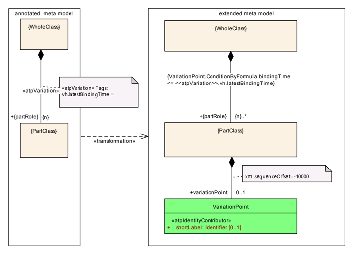

在左侧，{WholeClass} 聚合 {PartClass}。该聚合受变体支配：它可以在已施加的模型中存在，也可以不存在。这通过把构型 **&lt;atpVariation&gt;** 应用于该关联来指示。

请注意，左侧只包含 {WholeClass}、**&lt;atpVariation&gt;** 与 {PartClass}，不包含判定该变体是否存在的条件。这样的条件作为 VariationPoint 的一部分加在右侧。无论如何，在这里规定这样的条件都没有意义，因为该图处于 M2 层次，而条件只能为某个具体的变体点（例如 M1 层次上的）填写。

简言之，转换的工作方式如下：

**聚合模式定义的转换**

1. {WholeClass} 仍然直接聚合 {PartClass}。
2. {partRole} 的多重性从 {n} 变为 {n}…∗。

   多重性变化的原因是：包含变体的模型自然会比变体已施加的模型包含更多的 {PartClass} 元素。请注意，“多余”的 {PartClass} 元素（即“未使用”的变体）在施加过程中被删除。

   这由约束 [constr\_2505] 指示。

3. {PartClass} 聚合一个 VariationPoint。VariationPoint 聚合关于该可变性的更多信息，尤其是施加时间与守护该变体的条件。<sup>2</sup>

   类 VariationPoint 的结构在第 7.6.1 节描述。

> **2** 该条目在源文中编号为 “2.”，按上下文归入列表。

**变体点是可选的**

VariationPoint 的多重性是 0…1，意味着变体点是可选的。如果没有给出变体点，那么从 {WholeClass} 到 {PartClass} 的聚合是不变的。这可以视为等价于一个条件永远求值为 true 的变体点。

**抽象子类与具体子类的变体聚合**

如果一个类作为变体被聚合，则同一类的任何超类不得作为变体被聚合。

**约束：&lt;atpMixed&gt; 中最多一个 VariationPoint**

如果一个 **&lt;atpMixed&gt;** 元类作为 **&lt;atpVariation&gt;** 被聚合，则 VariationPoint 不得多于一个，且 VariationPoint 应当是最后被聚合的元素。

把 VariationPoint 设为可选的原因是：该聚合可以是变体的，但不必是变体的。因此，如果该聚合用在没有可变性的上下文中——聚合总是存在——那么就不需要（在 M1 层次上）向模型添加变体点。这有助于降低所得模型的复杂度，并精简所得的 XML 表示。

**约束：施加后的多重性**

```
若 Phase ≥ {partRole}.BindingTime，则 {partRole} 的数量 = n
```

其中 n 是 PartRole 元素的最终数量。

#### 7.2.2. 施加时间

**约束：聚合模式中的施加时间**

在 VariationPoint 内，类 ConditionByFormula 拥有属性 bindingTime，它为该变体点定义最晚施加时间。该施加时间进一步受附着于该聚合的 UML 标签 vh.latestBindingTime 约束（参见 [TPS\_GST\_00190]、[TPS\_GST\_00220]、[TPS\_GST\_00221]）：

```
ConditionByFormula.bindingTime ≤ aggregation.vh.latestBindingTime
```

这保证元模型可以在 M2 层次上定义限制。实际的施加时间在 M1 层次上规定（当 bindingTime 属性的取值被固定时）。

#### 7.2.3. {PartClass} 的多重性

表 7.1 展示了 {PartClass} 的多重性在转换期间如何变化。

表7.1：聚合模式中的多重性

| 带注记元模型中的 {PartClass} | 扩展元模型中的 {PartClass} |
|-------------------------------|-------------------------------|
| 0…1                           | 0…∗                           |
| 0…n                           | 0…∗                           |
| 0…∗                           |                               |
| 1…n                           | 1…∗                           |
| 1…∗                           |                               |
| m...n                         | m...∗                         |
| n                             | n…∗                           |
| ∗                             |                               |

多重性的变化意味着：转换之后，模型比之前更宽松。转换前具有固定上限（或是常数）的多重性，被替换为上限无界的多重性。

原因是：我们需要提供若干备选的 {PartClass} 元素，然后从中选择一个或多个。因此，我们需要放宽原始多重性——否则无法添加附加的元素。而且由于此时无法知道可供选择的附加 {PartClass} 元素的数量，多重性上限始终是 ∗。

#### 7.2.4. XML 表示

聚合模式对 M1 模型的 XML 表示影响很小。

事实上，当一个“普通”聚合被改造成变体点时，唯一的差别是：与 {partRole} UML 元素对应的 XML 元素得到一个名为 &lt;VARIATION-POINT&gt; 的附加 XML 元素。

聚合模式产生的 XML 代码示例见清单 7.5。

#### 7.2.5. 注记与限制

1. **带注记元模型定义适用的变体点**

   如果从 {WholeClass} 到 {PartClass} 的关联带有 **&lt;atpVariation&gt;** 标签，那么 {PartClass} 的任何出现都可以聚合一个 VariationPoint。换言之，即使 {PartClass} 不是带有 **&lt;atpVariation&gt;** 标签的关联的末端，它也可以聚合 VariationPoint。

   然而，以这种方式使用变体显然与带注记元模型中的定义不兼容。

   这种情况的一个例子是：InternalBehavior 以 **&lt;atpVariation&gt;** 在角色 constantMemory 上聚合 ParameterDataPrototype；与此相对，PortInterface 也聚合 ParameterDataPrototype，但不带 **&lt;atpVariation&gt;**。XML Schema 允许在两个聚合上都有变体点，而带注记的元模型不允许。

2. **Schema 生成器避免重复的 VariationPoint**

   如果 {PartClass} 有一个子类（比如 SubPartClass）在别处（比如 AnotherWholeClass）被聚合，而且那一个聚合也带有 **&lt;atpVariation&gt;** 标签，那么 SubPartClass 将聚合两个变体点。

   为避免这一点，schema 生成器（即元模型工具）使用一个专门的处理步骤来清理这类重复的 VariationPoint。

3. **原始类型上的聚合模式**

   聚合模式不能用于 **&lt;primitive&gt;** 元素。原因在于 [\[3\]](#ref-3) 第 4.1.1 节定义的 **&lt;primitive&gt;** 元素的特殊处理。

   显而易见的变通办法是把该元素改为非原始类型。

4. **非 post build 的限制**

   如果 vh.latestBindingTime 早于 PostBuild，那么 Point 不能有 PostBuild 分支，即它不能聚合 VariantCondition（参见 [constr\_2517]）。

   这在第 7.6.6 节中有更详细的解释。

### 7.3. 用于变体点的关联模式

图 7.2 展示了元模型工具如何把一个关联转换为带变体信息的 M2 模型。

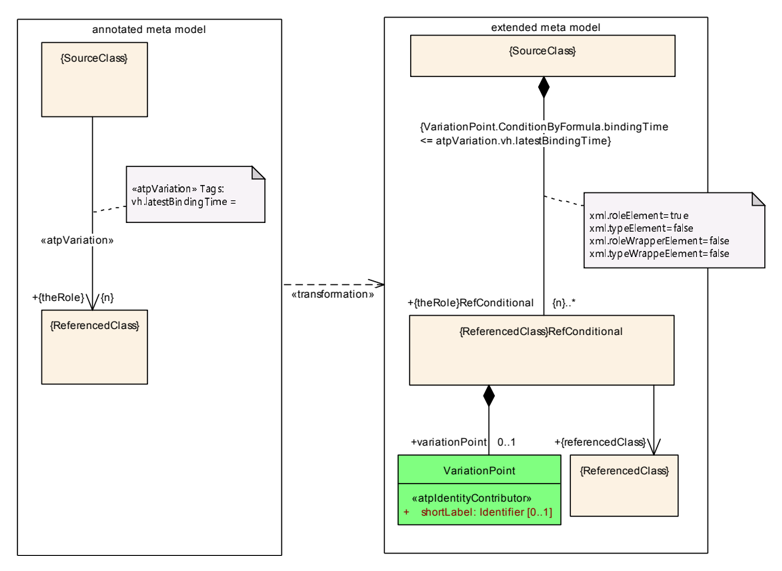

该模式与聚合模式（第 7.2 节）的主要差别是添加了 {ReferencedClass}RefConditional 类。VariationPoint 现在由 {ReferencedClass}RefConditional 聚合，而不是由 {ReferencedClass} 聚合。

#### 7.3.1. 描述

简言之，转换关联的模式工作方式如下：

**关联模式定义的转换**

1. {SourceClass} 聚合一个 {ReferencedClass}RefConditional 元素。这与非变体关联的实现非常相似，后者引入一个充当指向 {ReferencedClass} 的指针（即引用）的 {ReferencedClass}Ref 元素。
2. {ReferencedClass}RefConditional 聚合一个 VariationPoint 元素。VariationPoint 控制 {ReferencedClass}RefConditional 元素是否存在。

   该聚合的多重性是 0…1。即 VariationPoint 是可选的。若省略 VariationPoint 元素，则没有变体，{ReferencedClass}RefConditional 始终存在（这等价于条件永远求值为 true 的变体点。）

3. {ReferencedClass}RefConditional 提供一个指向 {ReferencedClass} 的引用。

   如前所述，非变体情形会改用 {ReferencedClass}Ref——它同样拥有指向 {ReferencedClass} 的引用，但缺少聚合的 VariationPoint。

#### 7.3.2. 施加时间

关联模式的施加时间遵循与聚合模式（第 7.2.2 节）相同的模式。

**约束：关联模式中的施加时间**

在 VariationPoint 内，类 ConditionByFormula 拥有属性 bindingTime，它为该变体点定义最晚施加时间。该施加时间进一步受附着于该关联的 UML 标签 vh.latestBindingTime 约束（参见 [TPS\_GST\_00190]、[TPS\_GST\_00220]、[TPS\_GST\_00221]）：

```
ConditionByFormula.bindingTime ≤ association.vh.latestBindingTime
```

#### 7.3.3. {ReferencedClass}RefConditional 的多重性

关联模式中 {ReferencedClass}RefConditional 的多重性遵循与聚合模式中 {PartClass} 的多重性（第 7.2.3 节）相同的方案。

#### 7.3.4. XML 表示

关联模式对 M1 模型的 XML 表示影响很小。

元素 {ReferencedClass}RefConditional 在 XML 层次上以角色名 {theRole}RefConditional 可见。这与使用角色名 {theRole}Ref 的非变体情形只有细微差别。两者服务于同一目的：它们是实际引用的容器。唯一差别是变体情形添加了可选的 &lt;VARIATION-POINT&gt;。

关联模式产生的 XML 代码示例见图 7.7。

#### 7.3.5. 注记与限制

**非变体关联的处理**

在 {ReferenceClass}RefConditional 中把 VariationPoint 设为可选的原因是：该关联可以是变体的，但不必是变体的。因此，如果该关联用在没有可变性的上下文中——关联总是存在——那么就不需要（在 M1 层次上）向模型添加变体点。这有助于降低所得模型的复杂度，并精简所得的 XML 表示。

### 7.4. 用于变体点的属性取值模式

前两个模式（7.2 与 7.3 节）处理两个元素之间关系的存在性。本节描述的模式实现另一种变体，即一个或多个属性取值的变体。

#### 7.4.1. 描述

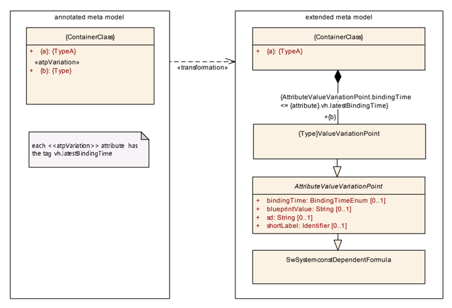

表7.2：AttributeValueVariationPoint

| 类         | &lt;&lt;atpMixedString&gt;&gt; AttributeValueVariationPoint（抽象）                                                             |
|------------|--------------------------------------------------------------------------------------------------------------------------------------|
| 包         | M2::AUTOSARTemplates::GenericStructure::VariantHandling::AttributeValueVariationPoints                                                  |
| 注意       | 该类表示从系统常量（经由 SwSystemconstDependentFormula）派生 Attribute 取值的能力。它还提供一个 bindingTime。                          |
| 基类       | ARObject、FormulaExpression、SwSystemconstDependentFormula                                                                                |
| 子类       | AbstractEnumerationValueVariationPoint、AbstractNumericalVariationPoint、BooleanValueVariationPoint、FloatValueVariationPoint、IntegerValueVariationPoint、PositiveIntegerValueVariationPoint、TimeValueValueVariationPoint、UnlimitedIntegerValueVariationPoint |
| 聚合于     | VariationPointProxy.valueAccess                                                                                                            |

| 属性           | 类型             | 多重性 | 类别 | 注意                                                                                                                                                                                  |
|----------------|------------------|--------|------|--------------------------------------------------------------------------------------------------------------------------------------------------------------------------------------------|
| bindingTime    | BindingTimeEnum  | 0..1   | attr | 这是属性取值需要被施加的施加时间。若缺少该属性，则该属性不是变体点。特别地，这意味着它需要是按纯模型中规定的类型的单一取值。若它仍是公式，则是错误。标签：xml.attribute=true                          |
| blueprintValue | String           | 0..1   | attr | 这表示一段描述，记录在从蓝图派生对象时应当如何定义该取值。标签：xml.attribute=true                                                                                                            |
| sd             | String           | 0..1   | attr | 提供该特殊数据是为了允许属性取值变体点与变体管理系统的同步。其使用由相关各方约定。标签：xml.attribute=true                                                                                        |
| shortLabel     | PrimitiveIdentifier | 0..1 | attr | 这允许标识该变体点。它也旨在允许 RTE 对 CompileTime 变体点的支持。标签：xml.attribute=true                                                                                                  |

在该模式中，构型 **&lt;atpVariation&gt;** 标记那些可变的属性<sup>3</sup>。转换的工作方式如下：

**属性取值模式定义的转换**

1. {ContainerClass} 被剥离全部变体属性。
2. 对每个变体属性，为 AttributeValueVariationPoint 的相应子类生成一个元素 {Type}ValueVariationPoint。若该属性是枚举，{Type} 应当是描述该枚举的元类的名称。
3. {Type}ValueVariationPoint 继承自：
   - AttributeValueVariationPoint，若 {Type} 是 Integer、Float、Boolean、PositiveInteger、UnlimitedInteger、TimeValue 或 NameToken；
   - AbstractNumericalVariationPoint，若 {Type} 是 Numerical 或 Limit；
   - AbstractEnumerationValueVariationPoint，若 {Type} 是描述该枚举的元类的名称。

   其属性 bindingTime 规定该变体属性（在 M1 层次上）的施加时间。

4. AttributeValueVariationPoint 又继承自 SwSystemconstDependentFormula，后者实现一个公式。该公式为变体属性提供取值。

> **3** 在图 7.4 中，列于 **&lt;atpVariation&gt;** 之下的全部属性都具有该构型。换言之，{a} 是非变体属性，而 {b} 带有构型 **&lt;atpVariation&gt;**。

按照图 7.4 所示的模式，第 1 步只留下属性 {a}。第 3 步提到的类 {Type}ValueVariationPoint 在第 7.4.3 节描述。施加时间的继承在第 7.4.4 节更详细描述。

#### 7.4.2. AttributeValueVariationPoint

AttributeValueVariationPoint 包含四个属性，即 bindingTime、shortLabel、sd 与 blueprintValue：

- bindingTime 在第 7.4.4 节描述。
- shortLabel 的用途与 VariationPoint 的 shortLabel 属性相同。

  **约束：AttributeValueVariationPoint 中的 shortLabel 应当唯一**

  shortLabel 应当在下一个直接外层的 Identifiable 内唯一（不区分大小写），并用于在变体丰富的 M1 模型中单独寻址变体点。

  请注意，shortLabel 唯一性检查应当不区分大小写地执行。这支持一种良好实践：shortLabel 不应当只在大小写上不同，那会造成大量混淆。

  术语“不区分大小写”表示字符集合

  ```
  {a b c d e f g h i j k l m n o p q r s t u v w x y z}
  {A B C D E F G H I J K L M N O P Q R S T U V W X Y Z}
  ```

  中的字符分别被视为相同。换言之，对 shortLabel 唯一性的不区分大小写检查导致如下结果：例如 shortLabel 为 ‘X’ 与 ‘x’ 的元素被视为相同，不得存在于同一上下文中。

  细节见第 7.6.2 节。

- sd 属性是 VariationPoint 的 sd 成员（见第 7.6.3 节）的精简版本。

  sd 是一个字符串，外部应用可以用它添加自定义数据。

  不像 VariationPoint 那样使用特殊数据组有两个原因。第一，属性取值的变体点在结构上不像完整元素那样重要，因此可以想见需要的数据更少。

  第二，如果 AttributeValueVariationPoint 聚合一个特殊数据组，那么所得的 XML 表示将需要一个额外的包装元素——即使该聚合是可选的。这将比聚合模式与关联模式中的开销显著更高。

- blueprintValue 在变体点属于蓝图的一部分时使用。它包含一段描述，提供如何从蓝图派生合适对象的指令。关于蓝图中变体点的更多细节，见第 7.6.11 节与 [\[2\]](#ref-2)。

  **约束：属性取值蓝图中的 Undefined 取值**

  若规定了 blueprintValue，则 AttributeValueVariationPoint 定义的取值不被使用，因此它应当至少包含一个待求项 undefined，在从该蓝图派生对象时被细化。

shortLabel 与 sd 都是可选的。bindingTime 在 7.4.4 节描述的某些情况下可以省略。

**约束：blueprintValue 只用于蓝图**

blueprintValue 只允许出现在蓝图中，不得出现在系统描述中。

#### 7.4.3. {Type}ValueVariationPoint

图 4.15 同时反映了 {Type}ValueVariationPoint 的建模。

**AttributeValueVariationPoint 的专用元类**

类 AttributeValueVariationPoint 有若干种形态，即 IntegerValueVariationPoint、FloatValueVariationPoint、BooleanValueVariationPoint、LimitValueVariationPoint、NumericalValueVariationPoint、PositiveIntegerValueVariationPoint、UnlimitedIntegerValueVariationPoint 与 TimeValueValueVariationPoint，以及类 AbstractEnumerationValueVariationPoint 的全部具体子类。

类 AbstractEnumerationValueVariationPoint 的具体子类按照属性取值模式自动生成（图 7.5）。


**约束：AbstractEnumerationValueVariationPoint 的取值**

AbstractEnumerationValueVariationPoint 的公式应当求值为一个取值，对该取值在其 base 与 enumTable 属性所引用的 EnumerationMappingTable 中定义了映射。

**注意：** 通常，该约束只能在变异性被施加时的完整模型中检查。

**默认的 EnumerationMappingTable**

如果 AbstractEnumerationValueVariationPoint 的子类 {Type}ValueVariationPoint 没有给出 base 与 enumTable 的取值，则 base 应当被设为 EnumMappingTables，enumTable 应当被设为 {Type}。

EnumerationMappingTable（包括 EnumerationMappingEntry）的默认取值可在 GeneralDefinitions [\[7\]](#ref-7) 中获得。

添加这些额外类的原因如下。我们本可以在没有它们的情况下定义属性取值模式——只让 {ContainerClass}（图 7.4）聚合一个 AttributeValueVariationPoint。但那样，原始属性类型的任何痕迹都会丢失。

#### 7.4.4. 施加时间

**约束：属性取值模式中的施加时间**

元类 AttributeValueVariationPoint 拥有属性 bindingTime，它为该变体点定义最晚施加时间。该施加时间进一步受附着于该属性的 UML 标签 vh.latestBindingTime 约束（参见 [TPS\_GST\_00190]、[TPS\_GST\_00220]、[TPS\_GST\_00221]）：

```
AttributeValueVariationPoint.bindingTime ≤ attribute.vh.latestBindingTime
```

属性取值的施加时间在 AttributeValueVariationPoint 的属性 bindingTime 中规定。每个属性可以有自己的施加时间。

**常量无需施加时间**

若 SwSystemconstDependentFormula 为该属性规定单一常量取值而非表达式，则属性 bindingTime 可以省略。即：公式不含对其他系统常量的任何引用，也不含任何函数或运算符，只有一个单一取值。在这种情况下，取值从一开始就是固定的。在所有其他情况下，属性 bindingTime 应当存在。

**约束：属性取值不得有 postbuild 变体**

在属性取值模式中，标签 vh.latestBindingTime 限于 preCompileTime 及更早的施加时间，即（blueprintDerivationTime、systemDesignTime 与 codeGenerationTime）。

#### 7.4.5. AttributeValueVariationPoint 的多重性

在 M1 AUTOSAR 模型中，应当为原始 {ContainerClass} 中的每个变体属性创建一个或多个 {Type}ValueVariationPoint 元素。确切数量按如下方式确定：

**AttributeValueVariationPoint 的多重性**

- 若原始属性的多重性为 1，则恰好生成一个 {Type}ValueVariationPoint。
- 若原始属性是数组（即多重性为 [0…∗]、[1…∗] 或更一般地 [m...n]），则应当按照数组中的条目数创建同样多的 {Type}ValueVariationPoint。

在这种情况下，相应 XML 元素的顺序可能很重要，此时它应当对应于数组中元素的实际先后顺序。

#### 7.4.6. XML 表示

在没有可变性的情况下，图 7.4 中的属性 {a} 与 {b} 都会在 XML schema 中表示为单个元素，各自持有一个常量取值。

属性取值模式把变体属性替换为系统常量表达式。若该表达式只是一个取值，则所得的 XML 与非变体情形结构相同（除施加时间外；但对这类表达式连该属性也可省略）。复杂表达式相比非变体情形当然会增加显著的开销。

shortLabel（表示为可选 XML 属性 SHORT-LABEL）、sd（表示为可选 XML 属性 SD）与 bindingTime（表示为可选 XML 属性 BINDING-TIME）是可选的，在缺席时不给 XML 表示增加任何开销。

属性取值模式产生的 XML 代码示例见图 7.9。

#### 7.4.7. 注记与限制

1. **AttributeValueVariationPoint 不支持 PostBuild 变体**

   AttributeValueVariationPoint 的施加时间至多是 preCompileTime。我们不支持把这样的变体点用于 postBuild 施加时间。这是因为这样的行为已经由标定参数覆盖。

2. **属性的存在性不能受变体支配**

   无法对属性的存在性建模。

   显而易见的做法是把相关属性移到一个单独的元素中，聚合该元素，然后把该聚合作为变体点。

   见聚合模式（第 7.2 节）。

3. **数组应当具有相同的施加时间**

   由于数组的每个元素由单独的 AttributeValueVariationPoint 元素规定，不再强制要求所有数组元素具有相同的施加时间。然而，为所有数组元素使用相同的施加时间被认为是良好实践。

4. **扩展属性取值模式的应用**

   属性取值模式只为类型 Integer、Float、Boolean、Numerical、Limit、PositiveInteger 与 UnlimitedInteger 的属性定义。向其他类型的扩展——只要它们被表达式语言覆盖——将需要变更元模型（以及元模型工具）。

5. **AttributeValueVariationPoint 中 bindingTime 可选的理由**

   把 bindingTime 设为可选的理由是：这使 XML 表示更简单。这对 EvaluatedVariantSet 特别有帮助——它们使用属性取值模式为系统常量定义取值。在典型用例中，这些取值是常量，不是公式。

### 7.5. 用于变体点的属性集模式

与前面的模式一样，本模式也处理属性中的变体。然而，第 7.4 节引入的模式要求每个变体属性都带有构型 **&lt;atpVariation&gt;** 注记。这也意味着 M2 元模型必须决定哪个属性是变体、哪个不是。这样的决定并不总是实际的，例如当存在大量属性、而每个都可能受变体支配时。本节定义的模式采用另一种方法。

**属性集模式的方法**

通过把构型 **&lt;atpVariation&gt;** 应用于拥有这些属性的元类（而不是元类的单个属性），我们可以把全部属性定义为潜在地受变体支配。属性随后被划分为若干变体属性集合，每个集合拥有一个变体点。

#### 7.5.1. 示例

考虑以下示例。一个名为 PropertiesClass 的类有六个属性：attr1、attr2、attr3、attr4、attr5 与 attr6。其中前四个属性是变体，attr5 与 attr6 是不变。

一种解决方案是把 **&lt;atpVariation&gt;** 应用于 attr1、attr2、attr3 与 attr4。在这种情况下，每个属性都是自己的变体点，可以独立变化。

然而，可能存在 attr1、attr2、attr3 与 attr4 的三组不同取值：

表7.3：属性集模式示例

|      | attr1 | attr2 | attr3 | attr4 |
|------|-------|-------|-------|-------|
| Set1 | 1     |       | 2     |       |
| Set2 | 2     | 3     | 4     | 1     |
| Set3 | 3     | 1     | 6     | 3     |

属性集模式允许我们规定这三组取值。当构型 **&lt;atpVariation&gt;** 应用于 PropertiesClass（在带注记的元模型中）时，该类被转换（在扩展元模型中）为一个新的 PropertiesClass——它没有任何属性，但聚合一个或多个名为 PropertiesClassConditional 的类，属性现在包含在后者之中<sup>4</sup>。每个 PropertiesClassConditional 聚合一个变体点，非常类似聚合模式中的 {PartClass}（见第 7.3 节——按上下文应为第 7.2 节的模式形态）。

其思想是：一个具体模型将包含一个 PropertiesClass 实例（不带属性），它聚合四个（而非三个！）PropertiesClassConditional 实例。前三个实例分别持有 Set1、Set2 与 Set3。剩下的 PropertiesClassConditional 实例包含不变属性，即 attr5 与 attr6。前三者的 VariationPoint 应当具有合适的条件，保证恰好可以选中前三个 PropertiesClassConditional 实例之一。最后一个 PropertiesClassConditional 可以省略它的 VariationPoint，因为那里定义的属性是不变的。

前三个 PropertiesClassConditional 怎么会持有与最后一个不同的属性呢？实际上，PropertiesClassConditional 包含原始 PropertiesClass（带注记元模型中）全部属性的副本，但每个属性的下重数被降为 0——即所有属性都是可选的。这样，PropertiesClassConditional 的每个实例可以持有原始属性的任意子集。条件是：变体施加之后，全部属性之和应当等于原始属性集合<sup>5</sup>。

属性集模式实际上比示例所示更灵活一些。第一，变体属性不需要在同一个集合中；它们也可以分布在多个 PropertiesClassConditional 类上。第二，该模式不仅适用于属性，还适用于聚合与关联元素。第三，该模式可以与属性取值模式（及其他模式）组合，以创建更强大的变体结构。

> **4** 正如下一节将看到的，实际转换要更复杂一些，但总体思想与本示例概述的一致。
>
> **5** 为完整起见：纯元模型中本就可选的属性仍然可以省略。

#### 7.5.2. 描述

属性集模式所涉及的转换比前面各模式的转换更复杂。这一次，我们把构型 **&lt;atpVariation&gt;** 应用于一个类，而不是关系或属性。与其他模式不同，一个类可以从另一个类继承其构型（或聚合其他类），这需要特别的考虑。

因此，我们分两步描述属性集模式。首先，我们展示转换如何作用于一个在元模型中显式带有构型 **&lt;atpVariation&gt;**、且不派生自带同一构型的类的类。第二步，我们把这一描述扩展，展示当一个类没有显式带有 **&lt;atpVariation&gt;** 标签、但派生自带该构型的类因而隐式拥有该构型时会发生什么。

##### 7.5.2.1. &lt;atpVariation&gt; 直接应用于属性集类


该转换的带注记元模型围绕 {PropertySetClass}：

1. {PropertySetClass} 基于 NonVariantSuperClass，该类不会被本模式改变。
2. 类 {PropertySetClass} 带有构型 **&lt;atpVariation&gt;**，并包含一个名为 {attr} 的属性。
3. {PropertySetClass} 聚合 AggregatedClass。应用模式时 AggregatedClass 本身不改变，尽管它之后将由另一个类聚合。

**属性集模式定义的转换**

转换工作方式如下：

1. 全部属性与构型 **&lt;atpVariation&gt;** 从 {PropertySetClass} 中移除。
2. 转换生成一个新类 {PropertySetClass}Content，它包含 {PropertySetClass} 的原始属性，但下重数变为 0。

   多重性的变化源于：该类被设计为持有原始 {PropertySetClass} 属性的任意子集。

   {PropertySetClass}Content 可以看作 {PropertySetClass} 的某种克隆，它缺少对 NonVariantSuperClass 的继承，且其属性具有不同的多重性。

3. 生成一个名为 {PropertySetClass}Conditional 的新类。{PropertySetClass}Conditional 派生自 {PropertySetClass}Content，并聚合一个 VariationPoint。

   由于它继承自 {PropertySetClass}Content，{PropertySetClass}Conditional 的每个实例持有带注记元模型中原始 {PropertySetClass} 属性的一个子集。

4. {PropertySetClass} 聚合任意数量的 {PropertySetClass}Conditional 元素。其思想是：扩展元模型中某个特定的 {PropertySetClass}Conditional 实例包含带注记元模型中原始 {PropertySetClass} 属性的一个子集。但在施加之后，各 {PropertySetClass}Conditional 实例给出的全部属性的不相交和应当产出带注记元模型中 {PropertySetClass} 的全部属性集合。
5. VariationPoint 最终决定某个 {PropertySetClass}Conditional 是否被包含在某个特定变体中。也就是说，从 {PropertySetClass} 到 {PropertySetClass}Conditional 的聚合本身受变体支配。
6. AggregatedClass 现在由 {PropertySetClass}Content 聚合，下重数为 0。多重性变化的原因是：被聚合的类按与属性相同的方式处理。
7. （上图中未显示）带注记元模型中指向 {PropertySetClass} 的引用在扩展元模型中仍然指向 {PropertySetClass}。

##### 7.5.2.2. &lt;atpVariation&gt; 应用于属性集类的超类


**属性集模式与继承**

当构型 **&lt;atpVariation&gt;** 应用于属性集类的超类时，情况会略微复杂：

1. NonVariantSuperClass 与 AggregatedClass 与之前相同。
2. {PropertySetClass1} 扮演上一节中 {PropertySetClass} 扮演的角色。然而，{PropertySetClass1} 现在派生自一个同样带有构型 **&lt;atpVariation&gt;** 标签的类 {PropertySetClass3}。{PropertySetClass2} 位于这两个类之间。

图 7.7 与图 7.6 之间的实际转换没有太大差别。图 7.7 中唯一的新内容是：对直到 {PropertySetClass3} 的每个属性集类，我们创建一个 {PropertySetClass}Content 类的层次。这些类保留原始类的属性，以及它们的聚合与关联关系。

##### 7.5.2.3. 约束

一般而言，多个 conditional 可以并存，即使它们都没有变体点。在存在变体的情况下，属性集模式需要一条规则 [TPS\_GST\_00433] 与一条约束 [constr\_2634]，保证对任何变体，用这一方法定义的全部属性取值的集合是完整的，且没有重复定义。

**各 conditional 中的单独属性**

在一个变体的上下文中、且全部变体点都解析之后，单独属性应当只存在于各 conditional 之一中。若一个单独属性存在于多个 conditional 中，则 [TPS\_GST\_00417] 定义的规则适用于把这些 conditional 合并为一个 conditional。

**约束：带有序集合的 conditional**

有序集合不得被拆分到不同的 conditional 上。

示例清单 7.1 展示了两个非变体属性与一个变体属性的集合，它们可以都存在于同一个属性集中。该示例代表一个有效情形。

清单7.1：两个非变体属性与一个变体属性，有效情形

```xml
<APPLICATION-PRIMITIVE-DATA-TYPE>
  <SHORT-NAME>MyDT</SHORT-NAME>
  <SW-DATA-DEF-PROPS>
    <SW-DATA-DEF-PROPS-VARIANTS>
      <SW-DATA-DEF-PROPS-CONDITIONAL>
        <SW-TEXT-PROPS>
          <ARRAY-SIZE-SEMANTICS>FIXED-SIZE</ARRAY-SIZE-SEMANTICS>
        </SW-TEXT-PROPS>
      </SW-DATA-DEF-PROPS-CONDITIONAL>
      <SW-DATA-DEF-PROPS-CONDITIONAL>
        <INVALID-VALUE>
          <APPLICATION-VALUE-SPECIFICATION>
            <SW-VALUE-CONT>
              <SW-VALUES-PHYS>
                <V>42</V>
              </SW-VALUES-PHYS>
            </SW-VALUE-CONT>
          </APPLICATION-VALUE-SPECIFICATION>
        </INVALID-VALUE>
      </SW-DATA-DEF-PROPS-CONDITIONAL>
      <SW-DATA-DEF-PROPS-CONDITIONAL>
        <BASE-TYPE-REF DEST="SW-BASE-TYPE">/A/B/C</BASE-TYPE-REF>
        <VARIATION-POINT>
          <SW-SYSCOND BINDING-TIME="CODE-GENERATION-TIME">
            <SYSC-REF DEST="SW-SYSTEMCONST">/J/K/L</SYSC-REF> == 1
          </SW-SYSCOND>
        </VARIATION-POINT>
      </SW-DATA-DEF-PROPS-CONDITIONAL>
    </SW-DATA-DEF-PROPS-VARIANTS>
  </SW-DATA-DEF-PROPS>
</APPLICATION-PRIMITIVE-DATA-TYPE>
```

示例清单 7.2 展示了三个非变体属性（其中一个属性重复出现；取值等价）与一个变体属性的集合，它们可以都存在于同一个属性集中。重复的属性因取值等价而可以合并。该示例代表一个有效情形。

清单7.2：三个非变体属性（等价值）与一个变体属性，有效情形

```xml
<APPLICATION-PRIMITIVE-DATA-TYPE>
  <SHORT-NAME>MyDT</SHORT-NAME>
  <SW-DATA-DEF-PROPS>
    <SW-DATA-DEF-PROPS-VARIANTS>
      <SW-DATA-DEF-PROPS-CONDITIONAL>
        <SW-TEXT-PROPS>
          <ARRAY-SIZE-SEMANTICS>FIXED-SIZE</ARRAY-SIZE-SEMANTICS>
        </SW-TEXT-PROPS>
      </SW-DATA-DEF-PROPS-CONDITIONAL>
      <SW-DATA-DEF-PROPS-CONDITIONAL>
        <SW-TEXT-PROPS>
          <ARRAY-SIZE-SEMANTICS>FIXED-SIZE</ARRAY-SIZE-SEMANTICS>
        </SW-TEXT-PROPS>
        <INVALID-VALUE>
          <APPLICATION-VALUE-SPECIFICATION>
            <SW-VALUE-CONT>
              <SW-VALUES-PHYS>
                <V>42</V>
              </SW-VALUES-PHYS>
            </SW-VALUE-CONT>
          </APPLICATION-VALUE-SPECIFICATION>
        </INVALID-VALUE>
      </SW-DATA-DEF-PROPS-CONDITIONAL>
      <SW-DATA-DEF-PROPS-CONDITIONAL>
        <BASE-TYPE-REF DEST="SW-BASE-TYPE">/A/B/C</BASE-TYPE-REF>
        <VARIATION-POINT>
          <SW-SYSCOND BINDING-TIME="CODE-GENERATION-TIME">
            <SYSC-REF DEST="SW-SYSTEMCONST">/J/K/L</SYSC-REF> == 1
          </SW-SYSCOND>
        </VARIATION-POINT>
      </SW-DATA-DEF-PROPS-CONDITIONAL>
    </SW-DATA-DEF-PROPS-VARIANTS>
  </SW-DATA-DEF-PROPS>
</APPLICATION-PRIMITIVE-DATA-TYPE>
```

示例清单 7.3 展示了三个非变体属性（其中一个属性重复出现；取值不等价）与一个变体属性的集合，它们不能都存在于同一个属性集中。重复的属性因取值不等价而无法合并。该示例代表一个无效情形。

清单7.3：三个非变体属性（非等价值）与一个变体属性，无效情形

```xml
<APPLICATION-PRIMITIVE-DATA-TYPE>
  <SHORT-NAME>MyDT</SHORT-NAME>
  <SW-DATA-DEF-PROPS>
    <SW-DATA-DEF-PROPS-VARIANTS>
      <SW-DATA-DEF-PROPS-CONDITIONAL>
        <SW-TEXT-PROPS>
          <ARRAY-SIZE-SEMANTICS>FIXED-SIZE</ARRAY-SIZE-SEMANTICS>
        </SW-TEXT-PROPS>
      </SW-DATA-DEF-PROPS-CONDITIONAL>
      <SW-DATA-DEF-PROPS-CONDITIONAL>
        <SW-TEXT-PROPS>
          <ARRAY-SIZE-SEMANTICS>VARIABLE-SIZE</ARRAY-SIZE-SEMANTICS>
        </SW-TEXT-PROPS>
        <INVALID-VALUE>
          <APPLICATION-VALUE-SPECIFICATION>
            <SW-VALUE-CONT>
              <SW-VALUES-PHYS>
                <V>42</V>
              </SW-VALUES-PHYS>
            </SW-VALUE-CONT>
          </APPLICATION-VALUE-SPECIFICATION>
        </INVALID-VALUE>
      </SW-DATA-DEF-PROPS-CONDITIONAL>
      <SW-DATA-DEF-PROPS-CONDITIONAL>
        <BASE-TYPE-REF DEST="SW-BASE-TYPE">/A/B/C</BASE-TYPE-REF>
        <VARIATION-POINT>
          <SW-SYSCOND BINDING-TIME="CODE-GENERATION-TIME">
            <SYSC-REF DEST="SW-SYSTEMCONST">/J/K/L</SYSC-REF> == 1
          </SW-SYSCOND>
        </VARIATION-POINT>
      </SW-DATA-DEF-PROPS-CONDITIONAL>
    </SW-DATA-DEF-PROPS-VARIANTS>
  </SW-DATA-DEF-PROPS>
</APPLICATION-PRIMITIVE-DATA-TYPE>
```

与 Splitkey 相同的合并规则（见第 8.3 节）应当适用。

#### 7.5.3. 施加时间

**约束：属性集模式中的施加时间**

元类 VariationPoint 拥有属性 bindingTime，它为该变体点定义最晚施加时间。该施加时间进一步受附着于被标记为 **&lt;atpVariation&gt;** 的元类的 UML 标签 vh.latestBindingTime 约束（参见 [TPS\_GST\_00190]、[TPS\_GST\_00220]、[TPS\_GST\_00221]）：

```
VariationPoint.bindingTime ≤ meta class.vh.latestBindingTime
```

**属性集模式的施加时间**

属性集模式的最晚施加时间是 PostBuild。

#### 7.5.4. 属性与被聚合元素的多重性

**属性集模式中的多重性**

在属性集模式中，属性（与被聚合元素）从带注记元模型中的 {PropertySetClass} 移动到扩展元模型中的 {PropertySetClass}Conditional。

随着这一移动，下重数总是变为 0。

#### 7.5.5. XML 表示

属性集模式产生的 XML 代码示例见图 7.10。

尽管图 7.6 与图 7.7 中的模式看起来复杂，属性集模式对 XML 代码的影响相当有限。如示例 7.10 所示，属性集模式在属性外添加一个 -VARIANTS 包装元素，并为每个（子）属性取值集合添加一个 -CONDITIONAL 元素。-CONDITIONAL 还包含一个 VARIATION-POINT 元素。

因此，对 XML 代码的主要影响是属性取值的重复，而变体处理引入的开销应当只增加少量元素。

#### 7.5.6. 与其他模式的比较

本模式与属性取值模式（第 7.4 节）都以属性为目标，但有若干差别：

- 属性集模式提供了一种把彼此相关的属性分组的方法。
- 属性集模式更灵活：可变性不限于 M2 元模型“允许”可变性的那些属性。但有一个陷阱：由于更高的灵活性，哪些属性是不变的、哪些不是，无法先验地确定。
- 属性取值模式可以使用表达式来定义属性的取值，而属性集模式只能使用固定取值（更准确地说，每个变体一个固定取值）。不过，属性集模式可以与属性取值模式组合来实现这一效果。
- 属性取值模式只适用于有限数量的数据类型，即 Integer、Float、Boolean、Numerical、PositiveInteger 与 UnlimitedInteger。属性集模式没有这种限制。
- 若属性是可选的，则属性集模式还可以决定该属性是否存在。这与属性取值模式不同——后者只能改变属性的取值。

此外，属性集模式与聚合模式、关联模式的差别在于：前者一次作用于多个属性、聚合与关联，而后者只决定单个聚合或关联的存在性。

#### 7.5.7. 属性取值模式与属性集模式的组合

上一节我们说过，属性集模式无法用表达式规定属性的取值。虽然如此，有一种方法可以避开这一限制，即把属性集模式与属性取值模式组合。

在这种情况下，属性集模式允许把完整的属性集合划分为若干不相交的子集。这些单个属性中的每一个都可以带有构型 **&lt;atpVariation&gt;**，这意味着属性取值模式被应用，属性的取值可以由表达式决定。

此外，由于一个属性可以出现在多个集合中（在 M1 层次上），可能存在多个用于确定某特定属性取值的表达式，每个都为特定变体量身定制。

### 7.6. VariationPoint

VariationPoint 的结构如图 7.8 所示。


表7.4：VariationPoint

| 类         | VariationPoint                                                                                                                                                                                |
|------------|-----------------------------------------------------------------------------------------------------------------------------------------------------------------------------------------------------|
| 包         | M2::AUTOSARTemplates::GenericStructure::VariantHandling                                                                                                                                                 |
| 注意       | 该元类表示表达“结构变体点”的能力。若 swSyscond 求值为 true 且每个 postBuildVariantCriterion 都得到满足，则该变体点的容器属于被选择的变体。                                                                 |
| 基类       | ARObject                                                                                                                                                                                                |

| 属性                       | 类型                          | 多重性 | 类别 | 注意                                                                                                                                                                                                                             |
|----------------------------|-------------------------------|--------|------|---------------------------------------------------------------------------------------------------------------------------------------------------------------------------------------------------------------------------------------|
| blueprintCondition         | DocumentationBlock            | 0..1   | aggr | 这表示一段描述，记录在从蓝图派生对象时该变体点应当如何解析。注意，blueprintCondition 内不允许有 variationPoint。标签：xml.sequenceOffset=28                                                                                                    |
| desc                       | MultiLanguageOverviewParagraph| 0..1   | aggr | 这允许简要描述变体点的目的。标签：xml.sequenceOffset=20                                                                                                                                                                                        |
| formalBlueprintGenerator   | BlueprintGenerator            | 0..1   | aggr | 这表示一段描述，记录在从蓝图派生对象时如何使用 ARMQL 解析该变体点。注意，formalBlueprintGenerator 内不允许有 variationPoint。标签：atp.Status=draft xml.sequenceOffset=30                                                                       |
| postBuildVariantCondition  | PostBuildVariantCondition     | *      | aggr | 这是为了（postbuild）施加该变体点而必须全部得到满足的 post build 变体条件的集合。标签：xml.sequenceOffset=40                                                                                                                                    |
| sdg                        | Sdg                           | 0..1   | aggr | 每个变体点都可以附带一个可选的特殊数据组。这些数据可被外部软件系统用来附加应用特定的数据。例如，变体管理系统可能添加一个标识符、一个 URL 或一个特定的分类器。标签：xml.sequenceOffset=50                                                              |
| shortLabel                 | Identifier                    | 0..1   | attr | 这为该特定变体点提供一个名称，以支持 RTE 生成器。它对于支持可拆分聚合、施加时间晚于 codeGenerationTime 以及某些 RTE 条件是必需的。它需要在拥有相同 ShortName 的直接外层 Identifiable 内唯一。构型：atpIdentityContributor 标签：xml.sequenceOffset=10 |
| swSyscond                  | ConditionByFormula            | 0..1   | aggr | 该条件充当变体点的绑定函数。注意多重性为 0..1，以支持纯 postBuild 变体。标签：xml.sequenceOffset=30                                                                                                                                            |

#### 7.6.1. 类 VariationPoint 的结构

类 VariationPoint 持有聚合模式（第 7.2 节）、关联模式（第 7.3 节）与属性集模式（第 7.5 节）中变体点的信息<sup>6</sup>。

一个 VariationPoint 聚合一个 ConditionByFormula、一个 PostBuildVariantCondition，以及角色 blueprintCondition 中的一个 DocumentationBlock。这三个“分支”彼此独立。如图 7.8 中的多重性所示，它们也都是可选的：

- **PreBuild 变体点**：若变体点聚合 ConditionByFormula，则该变体点是 PreBuild 变体点。细节见第 7.6.5 节。
- **PostBuild 变体点**：若变体点聚合一个 PostBuildVariantCondition，则该变体点是 PostBuild 变体点。细节见第 7.6.6 节。
- **BlueprintDerivation 变体点**：若变体点聚合 blueprintCondition 或 formalBlueprintGenerator，则该变体应当在派生对象时解析。细节参见 [\[2\]](#ref-2)。
- **组合的 PreBuild 与 PostBuild 变体点**：变体点也可以同时聚合 ConditionByFormula 与 PostBuildVariantCondition。在这种情况下，它既是 PreBuild 变体点，也是 PostBuild 变体点。细节见第 7.6.5 节。
- **无条件变体点**：从技术上讲，变体点也可以一个上述类都不聚合。在这种情况下，完全没有变体，附着变体点的元素始终存在。

  这等价于一个 ConditionByFormula 施加时间为 systemDesignTime、且公式永远求值为 true 的纯 PreBuild 变体点。

**VariationPoint 的多重性**

在所有模式中，VariationPoint 元素的多重性为 [0…1]，即它是可选的。若省略变体点，则没有变体，相应元素始终存在。

> **6** 属性取值模式（第 7.4 节）更简单，不使用类 VariationPoint。此外，它的最晚施加时间是 CompileTime，因此本节讨论的许多问题不适用于该模式。

**约束：系统配置中不得有 vh.latestBindingTime 为 BlueprintDerivationTime 的 VariationPoint**

蓝图不是系统配置的一部分。因此，在系统配置中不得存在被元模型把 vh.latestBindingTime 限定为 BlueprintDerivationTime 的 VariationPoint。

**约束：若 vh.latestBindingTime 为 BlueprintDerivationTime，则只能有 blueprintCondition 或 formalBlueprintGenerator（相应地 blueprintValue）**

vh.latestBindingTime 限定为 BlueprintDerivation 的 VariationPoint 不得拥有 swSyscond 或 postBuildVariantCondition。

**约束：不得嵌套 VariationPoint**

由于 blueprintCondition 是一个 DocumentationBlock，它可以再次包含 VariationPoint，从而允许 VariationPoint 的嵌套。这并非本意，不应使用。

#### 7.6.2. VariationPoint 中的 shortLabel

VariationPoint 拥有单个可选属性 shortLabel，它为变体点实现一个名称。

**约束：VariationPoint 中的 shortLabel 应当唯一**

shortName 与 shortLabel 的组合应当在下一个直接外层的 Identifiable {WholeClass} 内唯一。

例如，在聚合模式（第 7.2 节）中，这个外层 Identifiable 通常就是 {WholeClass}。

**变体丰富的模型违反 [constr\_2508]**

按照 [TPS\_GST\_00097]，AUTOSAR 会使用下一个直接外层 Identifiable 的属性 shortName 作为唯一名称。这对变体点行不通。其原因根植于变体丰富的 M1 模型与已施加的 M1 模型之间的差别。

变体丰富的 M1 模型可以为一个聚合定义若干备选变体。正如“备选”一词所暗示的，已施加的 M1 元模型中只留下其中一个，但它们全都拥有相同的 shortName。

因此，一个（尚未施加的）变体丰富的 M1 模型通过拥有多个相同 shortName 的元素，违反了 AUTOSAR 的一致性条件（[constr\_2508]）。这只是可行的，因为我们要求已施加的 M1 模型（及相关代码）最终遵守那些一致性规则（参见 [TPS\_GST\_00435]）。

对于变体丰富的模型，[constr\_2508] 被 [constr\_2512] 取代。

有多种情形需要单独寻址变体丰富的 M1 模型中拥有相同 shortName 的变体：

- **变体丰富模型的拆分/合并**

  如果聚合带有构型 **&lt;atpSplitable&gt;**。其用例是：特定变体保存在单独的制品中。为了合并这些单独的制品，不仅需要考虑 shortName，还需要考虑某个 Identifiable 特定变体的 shortLabel（[constr\_2512]）。关于可拆分元素的更多细节见第 8 章。

- **在 RTE 中区分 codeGenerationTime 变体点**

  如果施加时间是 codeGenerationTime 或更晚，那么在实现 preCompileTime 可变性时，RTE 需要区分各个变体。

- **从外部引用变体点**

  从外部引用单个变体点常常是必要的。例如，配置管理系统可能需要标识单个变体点以实现可追溯性。

此外，由于 shortLabel 是可选元素，它缺席时对 XML 的尺寸或复杂度没有影响。

**约束：变体的 shortName 唯一性约束**

变体元素的 shortName + shortLabel 应当在外围 Identifiable 建立的命名空间内唯一。

VariationPoint 中的 shortLabel 在技术上只在 VariationPoint 用于在拥有相同 shortName 的 Identifiable 之间切换时才需要，见清单 F.1 与 F.3。此外若这些 Identifiable 描述在部分模型中，部分模型中的 shortLabel 指示哪些元素属于一起，见清单 F.1 与 F.2。

如果 Identifiable 中的 shortLabel 用于改变 Identifiable 的存在性、而没有同名的备选项，则 VariationPoint 中的 shortLabel 不是必需的，但可以存在。若定义了 shortLabel 且该 Identifiable 描述在部分模型中，则需要在各部分模型中一致地重复该 shortLabel，见清单 F.2。若 shortLabel 未定义，则它不得出现在任何部分模型中。

#### 7.6.3. VariationPoint 中的 sdg

类 VariationPoint 聚合一个可选的 sdg 对象（见第 4.6.1 节），外部软件系统可以用它把应用特定的数据附着到变体点上。例如，变体管理系统可能向变体点添加一个标识符、一个 URL 或一个特定的分类器。

由于这样的数据高度依赖应用与厂商，它无法被标准化，而需要用一个特殊数据组替代。

同样，由于 sdg 是可选元素，它缺席时对 XML 表示的尺寸或复杂度没有影响。

#### 7.6.4. （最晚）施加时间

在第 7.1 节中我们看到，每个变体点都有一个施加时间。施加时间（见 [\[18\]](#ref-18)）可以进一步归类为 PreBuild 与 PostBuild 施加时间：

**PreBuild 变体点的定义**

该类别包含以下施加时间：systemDesignTime、codeGenerationTime、preCompileTime 与 linkTime。

一个具体变体点（即在 M1 层次上）若包含一个 ConditionByFormula 元素，则受 PreBuild 变体支配。其施加时间规定在 ConditionByFormula 元素的 bindingTime 属性中。更多细节见第 7.6.5 节。

**带蓝图条件的 PreBuild 变体点的定义**

该类别只包含单一施加时间，即 blueprintDerivationTime。一个具体变体点若包含 blueprintCondition 或 formalBlueprintGenerator 属性，则受施加时间为 blueprintDerivationTime 的 PreBuild 变体支配。更多细节见第 7.6.11.2 节。

**PostBuild 变体点的定义**

该类别只包含单一施加时间，即 PostBuild。

一个具体变体点若包含一个 PostBuildVariantCondition 元素，则为 PostBuild。由于 PostBuild 只有一个施加时间，不需要规定施加时间的专门属性。更多细节见第 7.6.6 节。

施加时间进一步受 7.2 至 7.5 节各模式中引入的标签 vh.latestBindingTime 约束：

**施加时间受 vh.latestBindingTime 约束**

- 若 vh.latestBindingTime = PostBuild，则 M1 层次上的变体点可以有任何施加时间。它可以是 PreBuild 或 PostBuild 变体点（或二者），可以聚合 ConditionByFormula 或 PostBuildVariantCondition。
- 若 vh.latestBindingTime &lt; PostBuild，则 M1 层次上的变体点只能是 PreBuild，而不能是 PostBuild 变体点。显然此时它只能聚合一个 ConditionByFormula。
- 若 vh.latestBindingTime = BlueprintDerivationTime，则 M1 层次上的变体点只能聚合 blueprintCondition 或 formalBlueprintGenerator。另参见 [constr\_2557] 与 [constr\_2558]。

显然，PreBuild 变体点的施加时间（即 ConditionByFormula 的属性 bindingTime 的取值）永远不得超过 vh.latestBindingTime。

#### 7.6.5. PreBuild 变体点

表7.5：ConditionByFormula

| 类         | &lt;&lt;atpMixedString&gt;&gt; ConditionByFormula                                                                                              |
|------------|------------------------------------------------------------------------------------------------------------------------------------------------------|
| 包         | M2::AUTOSARTemplates::GenericStructure::VariantHandling                                                                                                    |
| 注意       | 该类表示一个按规定的表达式基于系统常量计算的条件。预期结果被视为布尔值。表达式的结果被解释为条件：“0”代表“false”；非零值被视为“true”。                          |
| 基类       | ARObject、FormulaExpression、SwSystemconstDependentFormula                                                                                                    |
| 聚合于     | VariationPoint.swSyscond、VariationPointProxy.conditionAccess                                                                                                  |

| 属性        | 类型            | 多重性 | 类别 | 注意                                                                                          |
|-------------|-----------------|--------|------|-----------------------------------------------------------------------------------------------------|
| bindingTime | BindingTimeEnum | 1      | attr | 该属性规定最早可以对条件求值的时点。此时所有被引用的系统常量应当已有取值。标签：xml.attribute=true |

实现 PreBuild 变体点所需的全部信息由类 ConditionByFormula 提供：

- ConditionByFormula 派生自 SwSystemconstDependentFormula。该类实现判定变体点“开”或“关”的（布尔）公式。

  公式语言在第 4.9 节定义。关于公式在变体处理概念中的使用的进一步解释，另见第 7.6.8 节。

- ConditionByFormula 有单一属性 bindingTime，它为该变体点定义最晚施加时间。施加时间在 [\[18\]](#ref-18) 中有更详细的描述。

**尽早施加 VariationPoint**

一个具体软件系统可以在技术上可行、且在合同限度内时，于更早的施加时间施加变体点<sup>7</sup>。我们定义以下附加限制：

```
晚于系统设计时间的变体点施加时间属于合同的一部分。
```

按照这一限制，RTE 生成器不允许解析应用头文件中的可变性，即使该可变性在 RTE 的输入中已被选定。

如果施加时间是 systemDesignTime，则该可变性不被视为合同阶段的一部分，它应当在 systemDesignTime、合同之前被正确施加。

> **7** 合同阶段的定义见 RTE 规范 [\[19\]](#ref-19) 第 3.1 章。

#### 7.6.6. PostBuild 变体点

表7.6：PostBuildVariantCondition

| 类         | PostBuildVariantCondition                                                                                                                                                                                 |
|------------|--------------------------------------------------------------------------------------------------------------------------------------------------------------------------------------------------------------------|
| 包         | M2::AUTOSARTemplates::GenericStructure::VariantHandling                                                                                                                                                                  |
| 注意       | 该类规定为了施加变体点而应当赋给某个特定变体判据的取值。若规定了多个判据/取值对，则它们必须全部匹配才能施加变体点。换言之，施加可以表示为 (criterion1 == value1) && (condition2 == value2) …                                     |
| 基类       | ARObject                                                                                                                                                                                                                  |
| 聚合于     | VariationPoint.postBuildVariantCondition、VariationPointProxy.postBuildVariantCondition                                                                                                                                     |

| 属性              | 类型                       | 多重性 | 类别 | 注意                                                                                                                              |
|-------------------|----------------------------|--------|------|------------------------------------------------------------------------------------------------------------------------------------------|
| matchingCriterion | PostBuildVariantCriterion  | 1      | ref  | 这是需要与取值匹配、从而使 PostBuildVariantCondition 为真的判据。                                                                      |
| value             | Integer                    | 1      | attr | 这是 post-build 变体判据的特定取值。构型：atpVariation 标签：vh.latestBindingTime=preCompileTime                                          |

表7.7：PostBuildVariantCriterion

| 类         | PostBuildVariantCriterion                                                                                                          |
|------------|------------------------------------------------------------------------------------------------------------------------------------------|
| 包         | M2::AUTOSARTemplates::GenericStructure::VariantHandling                                                                                      |
| 注意       | 该类规定一个特定的 PostBuildVariantSelector。标签：atp.recommendedPackage=PostBuildVariantCriterions                                            |
| 基类       | ARElement、ARObject、AtpDefinition、CollectableElement、Identifiable、MultilanguageReferrable、PackageableElement、Referrable                    |
| 聚合于     | ARPackage.element                                                                                                                            |

| 属性       | 类型        | 多重性 | 类别 | 注意                                                                     |
|------------|-------------|--------|------|--------------------------------------------------------------------------------|
| compuMethod| CompuMethod | 1      | ref  | compuMethod 规定充当枚举器的变体判据的可能取值。                                 |

一个 PostBuild 变体点包含角色 postBuildVariantCondition 中的多个 PostBuildVariantCondition，后者又拥有指向一个 PostBuildVariantCriterion 的引用。与由 ConditionByFormula 中定义的公式支配的 PreBuild 变体点不同，PostBuild 变体点由 PostBuildVariantCondition 的组合支配。

**约束：postBuildVariantCondition 只用于 PostBuild**

只有当带注记模型把 vh.latestBindingTime 规定为 PostBuild 时，才允许在 VariationPoint 中聚合 PostBuildVariantCondition。

**PostBuild 判据的 PreBuild 配置**

PostBuildVariantCondition 的属性取值受 PreBuild 变体支配。它使用属性取值模式，因此其最晚施加时间是 preCompileTime。也就是说，将与 PostBuildVariantCriterion 内容比较的取值至多在 preCompileTime 被计算<sup>8</sup>。

而与 PostBuildVariantCriterion 内容的实际比较则基于 ECU 启动时的结果完成。

> **8** 它可以是一个表达式，而不是常量取值或单一系统常量。

**PostBuildVariantCondition 的求值**

一个 VariationPoint 元素可以在角色 postBuildVariantCondition 中聚合任意数量的 PostBuildVariantCondition。这些元素之间隐含逻辑与：若对所有 postBuildVariantCondition 而言，PostBuildVariantCondition 中定义的取值与 RTE 为 PostBuildVariantCriterion 提供的取值匹配（参见 [SWS\_Rte\_06612]），则该 PostBuild 变体点被“启用”。


**PostBuildVariantCriterion 的可能取值**

PostBuildVariantCriterion 还引用一个 compuMethod，它规定该判据的可能取值以及数据的物理表示与内部表示之间的转换（细节见软件组件模板 [\[20\]](#ref-20) 的 [TPS\_SWCT\_01243]、[TPS\_SWCT\_01278]）。

RTE 负责管理 PostBuildVariantCriterion 的取值（[SWS\_Rte\_06612]）。

#### 7.6.7. 系统常量

对 PreBuild 变体点，绑定函数依赖于 SwSystemconst。这样的系统常量基本上是一个名称/取值对。系统常量的 shortName、dataConstr 与 compuMethod 在 SwSystemconst 中定义。与数据类型类似，单位可以通过单位引用显式表达。

定义 dataConstr 是为了描述适用的 SwSystemconstValue 的界限。compuMethod 支持内部取值与文本字面量之间的转换，或内部取值与物理含义之间的转换。无论 compuMethod 是否存在，包含 SwSystemconst 的公式的求值都通过内部取值实现。因此 SwSystemconstValue 持有的也是内部取值。不过，工具可以使用 compuMethod 来显示物理取值。

**SwSystemconst 的表示**

SwSystemconst 的 SwDataDefProps 中的 compuMethod 只用于支持在工具与文档中恰当地表示取值。取值应当始终以内部表示设置。


表7.8：SwSystemconst

| 类         | SwSystemconst                                                                                                                                                                                                    |
|------------|--------------------------------------------------------------------------------------------------------------------------------------------------------------------------------------------------------------------------|
| 包         | M2::MSR::DataDictionary::SystemConstant                                                                                                                                                                                       |
| 注意       | 该元素定义一个系统常量，它充当选择特定变体点的输入。特别地，系统常量充当 Variation point 中绑定函数（swSyscond）的操作数。注意，只有当取值被赋给被引用的系统常量之后，施加过程才能发生。标签：atp.recommendedPackage=SwSystemconsts |
| 基类       | ARElement、ARObject、AtpDefinition、CollectableElement、Identifiable、MultilanguageReferrable、PackageableElement、Referrable                                                                                                        |
| 聚合于     | ARPackage.element                                                                                                                                                                                                              |

| 属性           | 类型           | 多重性 | 类别 | 注意                                                                                                                                                                                            |
|----------------|----------------|--------|------|--------------------------------------------------------------------------------------------------------------------------------------------------------------------------------------------------------|
| swDataDefProps | SwDataDefProps | 0..1   | aggr | 这表示系统常量的数据定义属性。它支持表达界限，并可选地通过 compu method 表达内部值到物理值的转换。构型：atpSplitable 标签：atp.Splitkey=swDataDefProps xml.sequenceOffset=40                                |

**为 SwSystemconst 赋值**

为了选择变体，需要为 SwSystemconst 赋值。注意，取值应当始终以“内部取值”规定。这在 SwSystemconstValue 中完成。

**约束：SwSystemconst 不允许循环取值赋值**

显式禁止为 SwSystemconst 赋予反过来直接或间接依赖该取值赋值的取值。

SwSystemconst 的循环取值赋值因取值的循环依赖而无法解析。

更多细节见第 7.8 节。


表7.9：SwSystemconstValue

| 类         | SwSystemconstValue                                       |
|------------|------------------------------------------------------------------|
| 包         | M2::AUTOSARTemplates::GenericStructure::VariantHandling            |
| 注意       | 该元类为系统常量赋予一个特定取值。                                    |
| 基类       | ARObject                                                          |
| 聚合于     | SwSystemconstantValueSet.swSystemconstantValue                        |

| 属性          | 类型          | 多重性 | 类别 | 注意                                                                                                                                                                                            |
|---------------|---------------|--------|------|--------------------------------------------------------------------------------------------------------------------------------------------------------------------------------------------------------|
| annotation    | Annotation    | *      | aggr | 这提供了说明取值为何如此设置的信息的可能性。标签：xml.sequenceOffset=30                                                                                                                                      |
| swSystemconst | SwSystemconst | 1      | ref  | 这是取值适用的系统常量。标签：xml.sequenceOffset=10                                                                                                                                                          |
| value         | Numerical     | 1      | attr | 这是系统常量的特定取值。规定为 Numerical。系统常量的定义可能施加进一步的限制。value 属性定义 SwSystemconst 在公式语言中处理时的内部取值。构型：atpVariation 标签：vh.latestBindingTime=preCompileTime xml.sequenceOffset=20 |

#### 7.6.8. 公式在变体点中的应用

变体点的施加通过求值变体点中的公式完成。这些公式可以是图 4.15 中子类之一。

**SwSystemconstDependentFormula 的用途**

SwSystemconstDependentFormula 元素是一个以系统常量（通过对 SwSystemconst 的 sysc 引用）为操作数的公式。注意，图中的多重性 1 是技术细节（参见 [TPS\_GST\_00032]）；一个公式实际上可以使用多于一个系统常量。（见图 4.15）

**公式中的系统常量**

SwSystemconstDependentFormula.sysc 反映 SwSystemconst 的内部取值。

SwSystemconstDependentFormula.syscString 反映 SwSystemconst 的字符串表示取值。这尤其是按照 [TPS\_SWCT\_01431] 确定的、C 中 CompuScale 表示所用的符号。

带引用（sysc）的正确表达式示例如下：

```xml
<APPLICATION-VALUE-SPECIFICATION>
  <SW-VALUE-CONT>
    <SW-VALUES-PHYS>
      <VF>
        <SYSC-REF DEST="SW-SYSTEMCONST">/S/SY_ZYLZA</SYSC-REF>
      </VF>
    </SW-VALUES-PHYS>
  </SW-VALUE-CONT>
</APPLICATION-VALUE-SPECIFICATION>
```

序列化于 &lt;VF&gt; 标签内的公式语言是在替换 ARXML 引用之后定义的，即上述 ARXML 将被转换为以下表达式：

```
reference("SW-SYSTEMCONST:/S/SY_ZYLZA")
```

然后它被接受为正确的 SwSystemconstDependentFormula。

```
...
<VF>
  <SYSC-REF DEST="SW-SYSTEMCONST">/S/SY_ZYLZA</SYSC-REF>
  +
  <SYSC-REF DEST="SW-SYSTEMCONST">/S/SY_TURBO</SYSC-REF>
</VF>
...
```

被转换为：

```
reference("SW-SYSTEMCONST:/S/SY_ZYLZA") + reference("SW-SYSTEMCONST:/S/SY_TURBO")
```

```
...
<VF>defined(<SYSC-REF DEST="SW-SYSTEMCONST">/S/SY_ZYLZA</SYSC-REF>)</VF>
...
```

被转换为：

```
defined(reference("SW-SYSTEMCONST:/S/SY_ZYLZA"))
```

```
...
<VF>1 / <SYSC-REF DEST="SW-SYSTEMCONST">/S/SY_ZYLZA</SYSC-REF></VF>
...
```

被转换为：

```
1 / reference("SW-SYSTEMCONST:/S/SY_ZYLZA")
```

```xml
<VARIATION-POINT>
  <SW-SYSCOND>
    defined(<SYSC-REF DEST="SW-SYSTEMCONST">SY_COUNT</SYSC-REF>)
    &amp;&amp;
    <SYSC-REF DEST="SW-SYSTEMCONST">SY_COUNT</SYSC-REF> &lt; 10
  </SW-SYSCOND>
</VARIATION-POINT>
```

请注意，该示例表明：当公式序列化为 ARXML 时，标记字符（“&lt;” 与 “&amp;”）需要表示为 XML 实体。上述公式被转换为：

```
defined(reference("SW-SYSTEMCONST:SY_COUNT") && reference("SW-SYSTEMCONST:SY_COUNT") < 10
```

带引用（syscString）的正确表达式示例如下：

第一个示例：使用 conditionAccess 处理字符串 “Condition1”。

```xml
<VARIATION-POINT-PROXYS>
  <VARIATION-POINT-PROXY>
    <SHORT-NAME>MyVariationProxy</SHORT-NAME>
    <LONG-NAME>
      <L-4 L="EN">My Variation Point Proxy</L-4>
    </LONG-NAME>
    <CATEGORY>CONDITION</CATEGORY>
    <CONDITION-ACCESS BINDING-TIME="PRE-COMPILE-TIME">
      <SYSC-STRINGREF DEST="SW-SYSTEMCONST">/SwSystemconsts/MySysConst1_SY</SYSC-STRINGREF>=="Condition1"
    </CONDITION-ACCESS>
  </VARIATION-POINT-PROXY>
</VARIATION-POINT-PROXYS>
```

以及基于数值取值的 SwSystemconstValue：

```xml
<SW-SYSTEMCONST-VALUE>
  <SW-SYSTEMCONST-REF DEST="SW-SYSTEMCONST">/SwSystemconsts/MySysConst1_SY</SW-SYSTEMCONST-REF>
  <VALUE>"Condition1"</VALUE>
</SW-SYSTEMCONST-VALUE>
```

被转换为：

```
reference("SW-SYSTEMCONST:/SwSystemconsts/MySysConst1_SY") == Condition1
```

**提示：** RTE 生成器校验该表达式以定义 Rte\_VP\_MyVariationPoint1 (TRUE)。若字符串 “Condition1” 变为 “Condition2”，RTE 生成器校验该表达式以定义 Rte\_VP\_MyVariationPoint1 (FALSE)。

第二个示例：使用 conditionAccess 处理引用类别为 TEXTTABLE 的 CompuMethod 的 SwSystemconst，另见 [TPS\_GST\_00013]：

```xml
<VARIATION-POINT-PROXYS>
  <VARIATION-POINT-PROXY>
    <SHORT-NAME>MyVariationProxy</SHORT-NAME>
    <LONG-NAME>
      <L-4 L="EN">My Variation Point Proxy</L-4>
    </LONG-NAME>
    <CATEGORY>CONDITION</CATEGORY>
    <CONDITION-ACCESS BINDING-TIME="PRE-COMPILE-TIME">
      <SYSC-STRINGREF DEST="SW-SYSTEMCONST">/SwSystemconsts/MySysConst5_SY</SYSC-STRINGREF>==Element1
    </CONDITION-ACCESS>
  </VARIATION-POINT-PROXY>
</VARIATION-POINT-PROXYS>
```

以及基于字符串的 SwSystemconst：

```xml
<SW-SYSTEMCONST>
  <SHORT-NAME>MySysConst5_SY</SHORT-NAME>
  <LONG-NAME>
    <L-4 L="EN">This is my fifth system constant</L-4>
  </LONG-NAME>
  <CATEGORY>VALUE</CATEGORY>
  <SW-DATA-DEF-PROPS>
    <SW-DATA-DEF-PROPS-VARIANTS>
      <SW-DATA-DEF-PROPS-CONDITIONAL>
        <SW-CALIBRATION-ACCESS>NOT-ACCESSIBLE</SW-CALIBRATION-ACCESS>
        <COMPU-METHOD-REF DEST="COMPU-METHOD">/CompuMethods/MyTextTable</COMPU-METHOD-REF>
      </SW-DATA-DEF-PROPS-CONDITIONAL>
    </SW-DATA-DEF-PROPS-VARIANTS>
  </SW-DATA-DEF-PROPS>
</SW-SYSTEMCONST>
```

引用该 CompuMethod：

```xml
<COMPU-METHOD>
  <SHORT-NAME>MyTextTable</SHORT-NAME>
  <LONG-NAME>
    <L-4 L="EN">My Texttable computation method</L-4>
  </LONG-NAME>
  <CATEGORY>TEXTTABLE</CATEGORY>
  <COMPU-INTERNAL-TO-PHYS>
    <COMPU-SCALES>
      <COMPU-SCALE>
        <LOWER-LIMIT INTERVAL-TYPE="CLOSED">1.0</LOWER-LIMIT>
        <UPPER-LIMIT INTERVAL-TYPE="CLOSED">1.0</UPPER-LIMIT>
        <COMPU-CONST>
          <VT>Element1</VT>
        </COMPU-CONST>
      </COMPU-SCALE>
    </COMPU-SCALES>
  </COMPU-INTERNAL-TO-PHYS>
</COMPU-METHOD>
```

被转换为：

```
reference("SW-SYSTEMCONST:/SwSystemconsts/MySysConst5_SY") == Element1
```

公式语言在第 4.9 节中详细描述。本节聚焦于派生自 SwSystemconstDependentFormula 的变体处理相关类，即 AttributeValueVariationPoint 与 ConditionByFormula：

ConditionByFormula 由 VariationPoint 聚合，决定 VariationPoint 所附着的元素是否真实存在。这用于除属性取值模式之外的所有模式。

该公式的返回值总是被解释为布尔值：0 等于 false，任何其他值被解释为 true。

AttributeValueVariationPoint 主要用于在属性取值模式（第 7.4 节）中提供取值。由于属性取值模式被隐式用于定义 PostBuild 变体点的条件，它也可以用于其他任何模式。

AttributeValueVariationPoint 进一步分为八个（源文列七——此处按源文列出）子类，即 NumericalValueVariationPoint、FloatValueVariationPoint、IntegerValueVariationPoint、BooleanValueVariationPoint、TimeValueValueVariationPoint、PositiveIntegerValueVariationPoint 与 UnlimitedIntegerValueVariationPoint。

这些子类提供公式预期返回类型的信息（见第 4.9.2.4 章），并对应于 AUTOSAR 原始类型 Numerical、Float、Integer、Boolean、PositiveInteger 与 UnlimitedInteger。

**约束：AttributeValueVariationPoint 的返回类型**

当软件工具求值这样的公式时，公式的返回值应当与纯元模型中属性的类型兼容。

表7.10：SwSystemconstDependentFormula

| 类         | &lt;&lt;atpMixedString&gt;&gt; SwSystemconstDependentFormula（抽象）                       |
|------------|---------------------------------------------------------------------------------------------------|
| 包         | M2::AUTOSARTemplates::GenericStructure::VariantHandling                                                |
| 注意       | 该类表示一个依赖于系统常量的表达式。                                                                     |
| 基类       | ARObject、FormulaExpression                                                                              |
| 子类       | AttributeValueVariationPoint、BlueprintFormula、ConditionByFormula、FMFormulaByFeaturesAndSwSystemconsts   |

| 属性       | 类型          | 多重性 | 类别 | 注意                                                                                                |
|------------|---------------|--------|------|-----------------------------------------------------------------------------------------------------------|
| sysc       | SwSystemconst | 0..1   | ref  | 这引用一个系统常量。应当使用系统常量的内部（编码）取值。标签：xml.sequenceOffset=50                              |
| syscString | SwSystemconst | 0..1   | ref  | syscString 指示被引用的系统常量应当按照 [TPS\_SWCT\_01431] 作为字符串求值。                                   |

另参见 ConditionByFormula；另参见 AttributeValueVariationPoint。

表7.11：AbstractNumericalVariationPoint

| 类         | &lt;&lt;atpMixedString&gt;&gt; AbstractNumericalVariationPoint（抽象）                                                                     |
|------------|--------------------------------------------------------------------------------------------------------------------------------------------------|
| 包         | M2::AUTOSARTemplates::GenericStructure::VariantHandling::AttributeValueVariationPoints                                                                |
| 注意       | 这是一个抽象的 NumericalValueVariationPoint。引入它是为了支持为特定目的需要附加属性的情形。                                                              |
| 基类       | ARObject、AttributeValueVariationPoint、FormulaExpression、SwSystemconstDependentFormula                                                                  |
| 子类       | LimitValueVariationPoint、NumericalValueVariationPoint                                                                                                    |
| 聚合于     | VariationPointProxy.valueAccess                                                                                                                            |

表7.12：BooleanValueVariationPoint

| 类         | &lt;&lt;atpMixedString&gt;&gt; BooleanValueVariationPoint                                                        |
|------------|--------------------------------------------------------------------------------------------------------------------------|
| 包         | M2::AUTOSARTemplates::GenericStructure::VariantHandling::AttributeValueVariationPoints                                        |
| 注意       | 该类表示 Boolean 属性的属性取值变体点。注意，该类可能只在扩展元模型中使用。                                                    |
| 基类       | ARObject、AttributeValueVariationPoint、FormulaExpression、SwSystemconstDependentFormula                                          |
| 聚合于     | VariationPointProxy.valueAccess                                                                                                |

表7.13：FloatValueVariationPoint

| 类         | &lt;&lt;atpMixedString&gt;&gt; FloatValueVariationPoint                                                          |
|------------|--------------------------------------------------------------------------------------------------------------------------|
| 包         | M2::AUTOSARTemplates::GenericStructure::VariantHandling::AttributeValueVariationPoints                                        |
| 注意       | 该类表示 Float 属性的属性取值变体点。                                                                                            |
| 基类       | ARObject、AttributeValueVariationPoint、FormulaExpression、SwSystemconstDependentFormula                                          |
| 聚合于     | VariationPointProxy.valueAccess                                                                                                |

表7.14：IntegerValueVariationPoint

| 类         | &lt;&lt;atpMixedString&gt;&gt; IntegerValueVariationPoint                                                        |
|------------|--------------------------------------------------------------------------------------------------------------------------|
| 包         | M2::AUTOSARTemplates::GenericStructure::VariantHandling::AttributeValueVariationPoints                                        |
| 注意       | 该类表示 Integer 属性的属性取值变体点。注意，该类可能只在扩展元模型中使用。                                                    |
| 基类       | ARObject、AttributeValueVariationPoint、FormulaExpression、SwSystemconstDependentFormula                                          |
| 聚合于     | VariationPointProxy.valueAccess                                                                                                |

表7.15：LimitValueVariationPoint

| 类         | &lt;&lt;atpMixedString&gt;&gt; LimitValueVariationPoint                                                                                                                                                              |
|------------|----------------------------------------------------------------------------------------------------------------------------------------------------------------------------------------------------------------------------|
| 包         | M2::AUTOSARTemplates::GenericStructure::VariantHandling::AttributeValueVariationPoints                                                                                                                                            |
| 注意       | 该类表示表达数值界限的能力。注意，它实际上是一个 NumericalValueVariationPoint，但拥有附加属性 intervalType。注意，出于向后兼容的原因，xml.name 为 “LIMIT”。标签：xml.name=LIMIT                                                              |
| 基类       | ARObject、AbstractNumericalVariationPoint、AttributeValueVariationPoint、FormulaExpression、SwSystemconstDependentFormula                                                                                                              |
| 聚合于     | VariationPointProxy.valueAccess                                                                                                                                                                                                |

| 属性         | 类型             | 多重性 | 类别 | 注意                                                                                              |
|--------------|------------------|--------|------|---------------------------------------------------------------------------------------------------------|
| intervalType | IntervalTypeEnum | 0..1   | attr | 这规定区间的类型。若缺少该属性，区间应被视为 “CLOSED”。标签：xml.attribute=true                                  |

表7.16：NumericalValueVariationPoint

| 类         | &lt;&lt;atpMixedString&gt;&gt; NumericalValueVariationPoint                                                        |
|------------|--------------------------------------------------------------------------------------------------------------------------|
| 包         | M2::AUTOSARTemplates::GenericStructure::VariantHandling::AttributeValueVariationPoints                                        |
| 注意       | 该类表示 Numerical 属性的属性取值变体点。注意，该类可能只在扩展元模型中使用。                                                  |
| 基类       | ARObject、AbstractNumericalVariationPoint、AttributeValueVariationPoint、FormulaExpression、SwSystemconstDependentFormula          |
| 聚合于     | VariationPointProxy.valueAccess                                                                                                |

表7.17：PositiveIntegerValueVariationPoint

| 类         | &lt;&lt;atpMixedString&gt;&gt; PositiveIntegerValueVariationPoint                                                  |
|------------|--------------------------------------------------------------------------------------------------------------------------|
| 包         | M2::AUTOSARTemplates::GenericStructure::VariantHandling::AttributeValueVariationPoints                                        |
| 注意       | 该类表示正 Integer 属性的属性取值变体点。                                                                                      |
| 基类       | ARObject、AttributeValueVariationPoint、FormulaExpression、SwSystemconstDependentFormula                                          |
| 聚合于     | VariationPointProxy.valueAccess                                                                                                |

表7.18：UnlimitedIntegerValueVariationPoint

| 类         | &lt;&lt;atpMixedString&gt;&gt; UnlimitedIntegerValueVariationPoint                                                  |
|------------|--------------------------------------------------------------------------------------------------------------------------|
| 包         | M2::AUTOSARTemplates::GenericStructure::VariantHandling::AttributeValueVariationPoints                                        |
| 注意       | 该类表示无限 Integer 属性的属性取值变体点。注意，该类可能只在扩展元模型中使用。                                                |
| 基类       | ARObject、AttributeValueVariationPoint、FormulaExpression、SwSystemconstDependentFormula                                          |
| 聚合于     | VariationPointProxy.valueAccess                                                                                                |

表7.19：TimeValueValueVariationPoint

| 类         | &lt;&lt;atpMixedString&gt;&gt; TimeValueValueVariationPoint                                                        |
|------------|--------------------------------------------------------------------------------------------------------------------------|
| 包         | M2::AUTOSARTemplates::GenericStructure::VariantHandling::AttributeValueVariationPoints                                        |
| 注意       | 该类表示为数值型时间值表达公式的能力。                                                                                          |
| 基类       | ARObject、AttributeValueVariationPoint、FormulaExpression、SwSystemconstDependentFormula                                          |
| 聚合于     | VariationPointProxy.valueAccess                                                                                                |

#### 7.6.9. 组合 PreBuild 与 PostBuild 变体点

如果某个特定变体点的 vh.latestBindingTime 被设为 PostBuild（[constr\_2517]），那么该变体点可以拥有一个由 PostBuildVariantCondition 表示的 PostBuild 分支<sup>9</sup>。然而，它也可以包含一个 PreBuild 分支。这是因为 VariationPoint 的 PreBuild 分支与 PostBuild 分支并不互斥。

**PreBuild 禁用 PostBuild 支持**

可以把一个变体点同时定义为 PreBuild 与 PostBuild。若 PreBuild 条件为 false，则不期望实现该变体对象（包括 PostBuild 条件）。

换言之，变体点中的系统常量表达式可以甚至在 PreBuild 时就禁用 PostBuild 可变性。

表 7.20 总结了 [TPS\_GST\_00266] 提供的选项。

表7.20：组合 PreBuild 与 PostBuild 变体点

| PreBuild                | PostBuild             | 结果                                              |
|--------------------------|------------------------|-----------------------------------------------------|
| 完全没有条件              |                        | VP 所附着的元素始终被选中                             |
| 〃                       | 未施加的条件            | 纯 PostBuild 变体点                                   |
| 〃                       | 条件被施加为 true       | 已施加、被选中的 PostBuild VP（在 ARXML 中不可见）      |
| 〃                       | 条件被施加为 false      | 已施加、被取消选择的 PostBuild VP（在 ARXML 中不可见）  |
| 未施加的条件              | 完全没有条件            | 纯 PreBuild VP                                       |
| 〃                       | 未施加的条件            | PreBuild 可选择的 PostBuild VP                       |
| 〃                       | 条件被施加为 true       | PreBuild 可选择的 PostBuild VP（在 ARXML 中不可见）    |
| 〃                       | 条件被施加为 false      | PreBuild 可选择的 PostBuild VP（在 ARXML 中不可见）    |
| 条件被施加为 true         | 完全没有条件            | VP 所附着的元素始终被选中                             |
| 〃                       | 未施加的条件            | 纯 PostBuild VP                                      |
| 〃                       | 条件被施加为 true       | 已施加、被选中的 PostBuild VP（在 ARXML 中不可见）      |
| 〃                       | 条件被施加为 false      | 已施加、被取消选择的 PostBuild VP（在 ARXML 中不可见）  |
| 条件被施加为 false        | 完全没有条件            | 被取消选择的 PreBuild VP，无 PostBuild VP             |
| 〃                       | 未施加的条件            | 〃                                                  |
| 〃                       | 条件被施加为 true       | 〃                                                  |
| 〃                       | 条件被施加为 false      | 〃                                                  |

> **9** 反之，一个变体点是否为 PostBuild 可以从它包含 PostBuildVariantCondition 这一事实识别。

#### 7.6.10. 注记与限制

1. 不支持（[TPS\_GST\_00199]、[TPS\_GST\_00200]）在同一位置聚合多于一个 VariationPoint。不过，为单个变体点同时定义 PreBuild 与 PostBuild 条件是可能的。
2. **只能有一个施加时间**

   无法为单个变体点声明多个施加时间。该限制的理由是：如果多个施加时间真的在同一位置被使用，那么它们的条件多半也不同。也就是说，不会存在一个带多个施加时间的变体点，而是会有若干变体点。

3. 由于处理变体的固有性质，在全部 PreBuild 变体被解析之前，可能存在多个具有相同 ShortName 的元素。

   这也意味着：在全部变体被解析之前，可能无法完全完成模型的一致性检查。这是因为变体处理的目的之一就是建模若干互不兼容的变体并提供手段来选择其一、丢弃其余，而这意味着模型在该选择做出之前无法完全一致。

   关于这一问题的更多细节，另见第 7.6.2 节（[constr\_2512]）。

4. **对 PreBuild 与 PostBuild 变体采用不同方法的理由**

   对 PreBuild 与 PostBuild 变体点区别处理的原因是：如果在两种情况下都只使用 ConditionByFormula（即只有 PreBuild 分支），那么该条件就必须在启动时求值。然而这会带来通常不可接受的性能代价。因此我们对 PostBuild 变体点采用更简单的方法，它只需要一次比较。

5. **从不变部分到变体部分的引用**

   AUTOSAR 模型中的引用也可以是从不变（相应地 PreBuild 变体）元素指向 post build 变体元素的——只要变体元素的全部变体对不变元素都有意义（参见 [TPS\_GST\_00435]）。

   一个示例用例是条件存在的 SwComponentPrototype，其 LatestBindingTime = postBuild。该变体 SwComponentPrototype 的 runnable 到 task 的映射是一个 preCompileTime 的 ECUC 参数。但这一映射对该变体 SwComponentPrototype 的所有变体都有意义，因为它在此之前已被解析，不需要任何附加条件。

6. shortLabel 也可以通过把 VariationPoint 做成 Identifiable 来实现（见第 4.3 章）。但 Identifiable 对我们的目的而言代价过高：

   - Identifiable 的 XML 占用远大于 shortLabel 属性。
   - shortLabel 始终可选，而 Identifiable 添加一个必需的 shortName。

   此外，shortLabel 面向局部标识（在下一个直接外层 Identifiable 内），而 Identifiable 面向引用目的。

#### 7.6.11. 把变体点用于蓝图化

如 [\[2\]](#ref-2) 的 [TPS\_STDT\_00028] 所规定，VariationPoint 与 AttributeValueVariationPoint 也用于规定从蓝图派生对象的细节。

**蓝图中的变体点**

蓝图中的变体处理与 AUTOSAR 其他地方的变体处理不同：

- 处理蓝图可以视为一个单独的施加时间，它发生在 systemDesignTime 之前。
- 模型不给出如何处理该变体的精确指令；相反，只有关于需要做什么的文字描述可用。
- 变体点可以出现在蓝图中作为 ARElement 子类的全部元素上。

##### 7.6.11.1. 变体点何时是蓝图变体点？

类 VariationPoint（见表 7.8）聚合一个 blueprintCondition 或 formalBlueprintGenerator。该对象只能在蓝图中聚合——也就是说，只有当 VariationPoint 位于类别为 BLUEPRINT 的 AUTOSAR 包中时它才可能出现。它不得出现在系统配置中。

如果这样的 DocumentationBlock 存在，那么它包含如何进一步处理该变体点的指令。这些指令的具体格式没有详细规定，因为它们面向人类或专门化的（可能是专有的）工具。

类似地，AttributeValueVariationPoint 拥有一个属性 blueprintValue，其用途与角色 blueprintCondition 中的 DocumentationBlock 相同。

**blueprintCondition 不能是变体**

作为 [constr\_2559] 的后果，VariationPoint 所聚合的 DocumentationBlock 内不允许再有 VariationPoint。其理由是：这样的变体必须在 systemDesignTime 或更晚解析，而这在蓝图被处理之后。

##### 7.6.11.2. BlueprintDerivationTime

**BlueprintDerivationTime 的语义**

为支持蓝图，标签 vh.latestBindingTime 可以取值 BluePrintDerivationTime。这样的变体点只能出现在蓝图中，不得被复制到系统配置。

在这种情况下，变体点不能有 swSyscond 也不能有 postBuildVariantCondition（由 [\[2\]](#ref-2) 的 [constr\_2558] 定义），因为这些字段包含的信息无法在 BluePrintDerivationTime 处理。

类似地，此时 AttributeValueVariationPoint 的取值没有意义。因此它不应当被求值，取值应当为 undefined。另见第 7.4.2 节。

##### 7.6.11.3. 哪些 AUTOSAR 模型元素可以是蓝图变体点？

非蓝图变体点——即在 systemDesignTime 或更晚解析的变体点——不能在模型的任意处使用。它们的适用性被元模型限制为带有构型 **&lt;atpVariation&gt;** 的那些位置。这样做有充分的理由；例如，RTE 应当能够在该位置处理变体点并生成合适的代码。

AUTOSAR 元素 PackageableElement 以及派生自它的 ARElement 构成一个特例。由于 PackageableElement 以最晚施加时间 systemDesignTime 可变，任何 ARElement 都可能是可变的，这显然不是本意。

在蓝图中，任何 ARElement 都可以是变体点。

**按时解析 BlueprintVariationPoints**

当元素从蓝图复制到系统配置时，只允许转移那些在 systemDesignTime 或更晚允许作为变体点的变体点。

因此，蓝图中任何 ARElement（或派生自它的东西）的变体都隐含一个 bluePrintDerivationTime 的最晚施加时间。

### 7.7. 已求值的变体（Evaluated Variants）

#### 7.7.1. 动机

变体处理并不止于描述变体在何处发生（即本章前面几节描述的那些模式）。这种描述往往隐含数量巨大的变体<sup>10</sup>，但其中只有一部分实际被使用。

这可能是因为软件被构建为支持比某个特定 OEM 的选项更宽的范围。但由于供应商有几个 OEM 客户，他可能把软件设计为满足全部变体。交付给 OEM 的内容可以只包含其特定变体的制品<sup>11</sup>，或至少只针对这些变体通过认证。

变体由系统常量取值的集合描述。因此，需要描述哪些系统常量取值的组合是有效的。这为 OEM 与供应商以标准化的方式就该主题交换信息提供了基础。

> **10** 仅五个备选项、每个有三个互斥选项，就产出一共 3⁵ = 243 个选项。
>
> **11** 尤其当可变性在 systemDesignTime 或 preCompileTime 时；对 PostBuild 变体这通常不可行。

#### 7.7.2. 示例

表7.21：已求值变体示例，完整表

| “APPROVED”              | Basic | Economy | Senior | Sportive | Junior |
|--------------------------|-------|---------|--------|----------|--------|
| Turbocharge              | 0     | 1       |        |          | 0      |
| Automatic Transmission   | 0     | 1       | 0      | 1        | 0      |
| Headlight                | 0     | 1       | 2      | 3        | 0      |
| Sunroof                  | 0     |         |        | 1        |        |

表 7.21 展示了一个示例：我们有四个系统常量（Turbocharge、Automatic Transmission、Headlight 与 Sunroof），它们可以取整数值。在此示例中，五个变体被求值并命名为 Basic、Economy、Senior、Sportive、Junior。

Basic、Economy、Senior、Sportive、Junior 称为预定义变体（**predefined variants**）。每个预定义变体是系统常量取值的一个组合<sup>12</sup>。换言之，PredefinedVariant 是上表中代表全部已求值变体的一个列。

求值的结果由 EvaluatedVariantSet 的属性 approvalStatus 陈述。对应于上面的示例，加粗的列可以表示为一个 approvalStatus 置为 ‘APPROVED’ 的 EvaluatedVariantSet，如表 7.22 所示。

此外，假设供应商能够（内部）提供全部五种组合，而一个假想的 OEM 只对购买 Economy 与 Senior 感兴趣，如表 7.21 中加粗列所示。

在这种情况下，OEM 与供应商之间交换的表将只包含两列（预定义变体）：Economy 与 Senior。

表7.22：供应商与 OEM 之间交换的表

| “APPROVED”              | Economy | Senior |
|--------------------------|---------|--------|
| Turbocharge              | 0       | 1      |
| Automatic Transmission   | 1       | 0      |
| Headlight                | 1       | 2      |
| Sunroof                  | 0       |        |

表 7.22 展示了 OEM 与供应商之间交换的表。这张表也是 7.7.5 节 XML 示例的基础。

> **12** 预定义变体还包括 PostBuild 变体点的取值，为清晰起见表 7.21 中省略。

##### 7.7.2.1. 超出示例的内容

已求值变体的概念还有四个未在上例中展示的方面：

1. 一个已求值变体可以引用一个特定的组件（或其他元素），表中的审批状态即针对它适用。
2. 预定义变体不仅为系统常量定义取值，也可以为 PostBuild 变体判据定义取值。
3. 表中的列——甚至是子列——可以被其他表复用。这通过以引用（而非聚合）实现该表来完成。当一张已求值变体表的数据被复用、或来自不同来源时，这两个特性都有帮助。
4. 一个已求值变体可以有一个审批状态，进一步细化表的含义。已求值变体可以是 “approved”（此时表包含已知可工作的预定义变体），也可以是 “rejected”（此时预定义变体已知不能工作）。
5. 一个 PredefinedVariant 可以通过 includedVariant 关联包含其他 PredefinedVariant。

##### 7.7.2.2. 示例覆盖的用例

上面的示例覆盖以下用例：

- 集成者可以使用已求值变体表检查某个非变体系统（即变体已被解析的系统）是否基于某个预定义变体。
- 系统设计者可以导入预配置的设置来构建某个特定变体。
- 组件提供者可以使用该机制向组件用户交付一组有效的变体。这不必是全部有效变体的集合；例如，用户可能只有权查看（即获得关于）某个子集的信息。

#### 7.7.3. 描述

**已求值变体的用途**

EvaluatedVariantSet 提供了一种方法，用于针对特定的一组 CollectableElement 描述某个特定产品变体及其审批状态（approved/rejected）。这使得可以陈述某个特定元素对某个给定变体是 approved 还是 rejected。


表 7.21 与表 7.22 按如下方式转换为图 7.12：

**EvaluatedVariantSet** 整张表由类 EvaluatedVariantSet 表示。EvaluatedVariantSet 是一个 ARElement，因此拥有自己的 shortName，即表的名称。

**用 EvaluatedVariantSet 为不同侧面建立多重有效性**

可以存在多个 EvaluatedVariantSet。若有若干这样的集合，每个集合为某个特定侧面建立有效性。各个侧面可以通过 shortName 寻址。例如，单元测试可以使用它们自己专用的 EvaluatedVariantSet。各个集合可以通过 shortName 寻址。

**PredefinedVariant** 一个 EvaluatedVariantSet 包含若干 PredefinedVariant。每个 PredefinedVariant 及其 included variants 是表中的一列。列的名称是 PredefinedVariant 的 shortName。

**预定义变体的定义**

PredefinedVariant 把某个特定变体表示为变体选择器设置的一个给定组合——变体选择器由 SwSystemconstValue 相应地 PostBuildVariantCriterionValue 表示。

对 ECU 配置适用的带 SwSystemconstantValueSet 的预定义变体的选择由 ECUC 变体解析器完成（见 ECU 配置中的 3.3.3 变体解析器描述）。

带 PostBuildVariantCriterionValueSet 的 PredefinedVariant 的处理在 [\[19\]](#ref-19) 中描述（参见 [SWS\_Rte\_06638]）。

**SwSystemconstantValueSet** 一个 PredefinedVariant 包含若干 SwSystemconstantValueSet 对象。在最简单的情况下，只有一个这样的对象，它代表该列的条目。更准确地说，PredefinedVariant 代表包括表头在内的整列，而 SwSystemconstantValueSet 是表头之下的全部内容。

**来自不同来源的 SwSystemconstantValueSet**

把一列的条目分布在若干 SwSystemconstantValueSet 对象上也是可能的。使用多个 SwSystemconstantValueSet 的原因是为了允许一个预定义变体由来自不同来源的系统常量赋值组成。

延续图 7.21 中描绘的图景：此时每一列由若干 SwSystemconstantValueSet 组成，其内容被串联。

**约束：PredefinedVariant 需要保持一致**

若一个 PredefinedVariant 及其 includedVariant 引用了多于一个 SwSystemconstantValueSet，则针对某个特定 SwSystemconst 的 SwSystemconstValue 中的全部 value 属性应当完全相同。

通过约束 [constr\_2519]，矛盾的取值赋值被正面地避免。

**SwSystemconstValue** 一个 SwSystemconstantValueSet 包含若干 SwSystemconstValue 对象，每个代表表中的一个单元格，并且——如其名所示——实现单个系统常量的取值。

单元格中存储的取值由属性 value 表示，它又通过属性取值模式受变体支配（见第 7.4 节）。

**系统常量的间接取值赋值**

在这里使用变体点的主要动机是便利：取值由一个表达式决定，而这正是属性取值变体点所做的。在实践中，该表达式多数时候应当由单个系统常量组成。

**SwSystemconst** 每个 SwSystemconstValue 提供指向一个 SwSystemconst 的引用。这是 SwSystemconstValue 为其定义取值的系统常量。

SwSystemconstantValueSet、SwSystemconstValue 与 SwSystemconst 定义 prebuild 变体。PostBuild 变体有第二个分支：

**Pre Build 与 Post Build 分支的预定义变体之间的类比**

PostBuildVariantCriterionValueSet 是 SwSystemconstantValueSet 的 postbuild 对应物。

PostBuildVariantCriterionValue 是 SwSystemconstValue 的 postbuild 对应物。

PostBuildVariantCriterion 是 SwSystemconst 的 postbuild 对应物。

**Post Build 与 Pre Build 变体组合的有效性**

当同时定义了 prebuild 与 postbuild 变体时，postbuild 变体适用于全部 prebuild 变体。

此外，PredefinedVariant、SwSystemconstantValueSet 与 PostBuildVariantCriterionValueSet 是被引用的（而非聚合的），以支持变体的复用。例如，一个厂商可能拥有若干 PredefinedVariant 集合——每个 OEM 一个——并在不同的 EvaluatedVariantSet 中复用它们（参见 [TPS\_GST\_00280]）。

##### 7.7.3.1. evaluatedElement

一个 EvaluatedVariantSet 提供指向一个或多个 CollectableElement 的引用（见第 13 章）。这用于标识 PredefinedVariant 所覆盖的包与元素。注意 EvaluatedVariantSet 本身也是 CollectableElement。

**约束：EvaluatedVariantSet 不得引用自身**

一个 EvaluatedVariantSet 不得直接或经由其他 EvaluatedVariantSet 引用自身。

更多细节见第 7.7.4 节。

##### 7.7.3.2. approvalStatus

**approvalStatus 的语义**

EvaluatedVariantSet 的属性 approvalStatus 进一步细化已求值变体的状态。以下取值被标准化：

1. APPROVED — 一个 “approved” 的变体已知可以工作。
2. REJECTED — 一个 “rejected” 的变体已知不能工作。

请注意，所有其他取值都是用例特定的。因此 approvalStatus 不是 APPROVED 或 REJECTED 的 EvaluatedVariantSet 不由标准定义，在评估系统时应当被忽略。见第 7.7.4 节。

##### 7.7.3.3. includedVariant

**PredefinedVariant 中 includedVariant 的用途**

关联 includedVariant 定义：被引用的 PredefinedVariant 的设置被视为引用它的 PredefinedVariant 的设置的一部分。

假设一个变体丰富的系统由多方交付的变体丰富的子系统组成。在这种情况下，各子系统的提供者需要为其交付定义合适的 EvaluatedVariantSet。此外，系统的责任方需要为整个系统规定 EvaluatedVariantSet。

为此，他可以使用 includedVariant 来引用子系统 PredefinedVariant 的定义。否则他将不得不重复那些定义。那需要对子系统的了解，并降低系统的可维护性。通过使用 includedVariant，系统的创建者不需要任何关于子系统中使用的 SwSystemconstantValueSet 与 PostBuildVariantCriterionValueSet 的知识。

#### 7.7.4. 一致性

一个特定的 EvaluatedVariantSet 引用若干 CollectableElement 以表达它们的审批状态。由于 EvaluatedVariantSet 本身也是 CollectableElement，可能出现 EvaluatedVariantSet 的层次。

另一方面，元模型通过对象的聚合建立了另一个层次。在考虑已求值变体时，清楚地区分这两个层次十分重要。

本节定义与这类层次的一致性相关的细节。

**REJECTED 优先于 APPROVED**

一般而言，状态 REJECTED 优先于状态 APPROVED。也就是说，例如若一个 “approved” 的包包含一个 “rejected” 的软件组件，则对这张 EvaluatedVariantSet 而言整个包应当被视为 REJECTED。

**CollectableElement 的 APPROVED**

一个 CollectableElement 对某个给定变体被判为 rejected，如果：

- 它被至少一个 approvalStatus 置为 REJECTED 的相应 EvaluatedVariantSet 引用；
- 或它（可能跨多个层次）聚合了一个在相应 EvaluatedVariantSet 中被引用、approvalStatus 置为 REJECTED 的 CollectableElement。

CollectableElement 的细节在第 3 章描述。

**CollectableElement 的 REJECTED**

一个 CollectableElement 对某个给定变体被判为 approved，如果：

- 它被至少一个 approvalStatus 置为 APPROVED 的相应 EvaluatedVariantSet 引用，或者它不是一个 rejected 的 EvaluatedVariantSet。这保证 EvaluatedVariantSet 默认被视为 approved。
- 并且它不是一个 rejected 的 CollectableElement。

CollectableElement 的细节在第 3 章描述。

#### 7.7.5. EvaluatedVariantSet 的 XML 示例

以下清单展示 EvaluatedVariantSet 在 XML 中的表达：

清单7.4：ARXML 中的已求值变体示例

```xml
<AR-PACKAGE>
  <SHORT-NAME>Variants</SHORT-NAME>
  <ELEMENTS>
    <PREDEFINED-VARIANT>
      <SHORT-NAME>Basic</SHORT-NAME>
      <SW-SYSTEMCONSTANT-VALUE-SET-REFS>
        <SW-SYSTEMCONSTANT-VALUE-SET-REF DEST="SW-SYSTEMCONSTANT-VALUESET">/SystemConstantValues/V1</SW-SYSTEMCONSTANT-VALUE-SET-REF>
        <SW-SYSTEMCONSTANT-VALUE-SET-REF DEST="SW-SYSTEMCONSTANT-VALUESET">/SystemConstantValues/V2</SW-SYSTEMCONSTANT-VALUE-SET-REF>
      </SW-SYSTEMCONSTANT-VALUE-SET-REFS>
    </PREDEFINED-VARIANT>
    <PREDEFINED-VARIANT>
      <SHORT-NAME>Economy</SHORT-NAME>
      <SW-SYSTEMCONSTANT-VALUE-SET-REFS>
        <SW-SYSTEMCONSTANT-VALUE-SET-REF DEST="SW-SYSTEMCONSTANT-VALUESET">/SystemConstantValues/V1</SW-SYSTEMCONSTANT-VALUE-SET-REF>
        <SW-SYSTEMCONSTANT-VALUE-SET-REF DEST="SW-SYSTEMCONSTANT-VALUESET">/SystemConstantValues/V3</SW-SYSTEMCONSTANT-VALUE-SET-REF>
      </SW-SYSTEMCONSTANT-VALUE-SET-REFS>
    </PREDEFINED-VARIANT>
    <PREDEFINED-VARIANT>
      <SHORT-NAME>Senior</SHORT-NAME>
      <SW-SYSTEMCONSTANT-VALUE-SET-REFS>
        <SW-SYSTEMCONSTANT-VALUE-SET-REF DEST="SW-SYSTEMCONSTANT-VALUESET">/SystemConstantValues/V4</SW-SYSTEMCONSTANT-VALUE-SET-REF>
      </SW-SYSTEMCONSTANT-VALUE-SET-REFS>
    </PREDEFINED-VARIANT>
    <PREDEFINED-VARIANT>
      <SHORT-NAME>Sportive</SHORT-NAME>
      <SW-SYSTEMCONSTANT-VALUE-SET-REFS>
        <SW-SYSTEMCONSTANT-VALUE-SET-REF DEST="SW-SYSTEMCONSTANT-VALUESET">/SystemConstantValues/V5</SW-SYSTEMCONSTANT-VALUE-SET-REF>
      </SW-SYSTEMCONSTANT-VALUE-SET-REFS>
    </PREDEFINED-VARIANT>
  </ELEMENTS>
</AR-PACKAGE>
<!--now we have the systemconstant value sets-->
<AR-PACKAGE>
  <SHORT-NAME>SystemConstantValues</SHORT-NAME>
  <ELEMENTS>
    <SW-SYSTEMCONSTANT-VALUE-SET>
      <SHORT-NAME>V1</SHORT-NAME>
      <SW-SYSTEMCONSTANT-VALUES>
        <SW-SYSTEMCONST-VALUE>
          <SW-SYSTEMCONST-REF DEST="SW-SYSTEMCONST">/SwSystemconsts/Turbocharge</SW-SYSTEMCONST-REF>
          <VALUE>0</VALUE>
        </SW-SYSTEMCONST-VALUE>
        <SW-SYSTEMCONST-VALUE>
          <SW-SYSTEMCONST-REF DEST="SW-SYSTEMCONST">/SwSystemconsts/Sunroof</SW-SYSTEMCONST-REF>
          <VALUE>0</VALUE>
        </SW-SYSTEMCONST-VALUE>
      </SW-SYSTEMCONSTANT-VALUES>
    </SW-SYSTEMCONSTANT-VALUE-SET>
    <SW-SYSTEMCONSTANT-VALUE-SET>
      <SHORT-NAME>V2</SHORT-NAME>
      <SW-SYSTEMCONSTANT-VALUES>
        <SW-SYSTEMCONST-VALUE>
          <SW-SYSTEMCONST-REF DEST="SW-SYSTEMCONST">/SwSystemconsts/Automatictransmission</SW-SYSTEMCONST-REF>
          <VALUE>0</VALUE>
        </SW-SYSTEMCONST-VALUE>
        <SW-SYSTEMCONST-VALUE>
          <SW-SYSTEMCONST-REF DEST="SW-SYSTEMCONST">/SwSystemconsts/Headlight</SW-SYSTEMCONST-REF>
          <VALUE>0</VALUE>
        </SW-SYSTEMCONST-VALUE>
      </SW-SYSTEMCONSTANT-VALUES>
    </SW-SYSTEMCONSTANT-VALUE-SET>
    <SW-SYSTEMCONSTANT-VALUE-SET>
      <SHORT-NAME>V3</SHORT-NAME>
      <SW-SYSTEMCONSTANT-VALUES>
        <SW-SYSTEMCONST-VALUE>
          <SW-SYSTEMCONST-REF DEST="SW-SYSTEMCONST">/SwSystemconsts/Automatictransmission</SW-SYSTEMCONST-REF>
          <VALUE>1</VALUE>
        </SW-SYSTEMCONST-VALUE>
        <SW-SYSTEMCONST-VALUE>
          <SW-SYSTEMCONST-REF DEST="SW-SYSTEMCONST">/SwSystemconsts/Headlight</SW-SYSTEMCONST-REF>
          <VALUE>1</VALUE>
        </SW-SYSTEMCONST-VALUE>
      </SW-SYSTEMCONSTANT-VALUES>
    </SW-SYSTEMCONSTANT-VALUE-SET>
    <!--note that this set is used in all variants above-->
    <SW-SYSTEMCONSTANT-VALUE-SET>
      <SHORT-NAME>V4</SHORT-NAME>
      <SW-SYSTEMCONSTANT-VALUES>
        <SW-SYSTEMCONST-VALUE>
          <SW-SYSTEMCONST-REF DEST="SW-SYSTEMCONST">/SwSystemconsts/Turbocharge</SW-SYSTEMCONST-REF>
          <VALUE>1</VALUE>
        </SW-SYSTEMCONST-VALUE>
        <SW-SYSTEMCONST-VALUE>
          <SW-SYSTEMCONST-REF DEST="SW-SYSTEMCONST">/SwSystemconsts/Automatictransmission</SW-SYSTEMCONST-REF>
          <VALUE>0</VALUE>
        </SW-SYSTEMCONST-VALUE>
        <SW-SYSTEMCONST-VALUE>
          <SW-SYSTEMCONST-REF DEST="SW-SYSTEMCONST">/SwSystemconsts/Headlight</SW-SYSTEMCONST-REF>
          <VALUE>2</VALUE>
        </SW-SYSTEMCONST-VALUE>
        <SW-SYSTEMCONST-VALUE>
          <SW-SYSTEMCONST-REF DEST="SW-SYSTEMCONST">/SwSystemconsts/Sunroof</SW-SYSTEMCONST-REF>
          <VALUE>0</VALUE>
        </SW-SYSTEMCONST-VALUE>
      </SW-SYSTEMCONSTANT-VALUES>
    </SW-SYSTEMCONSTANT-VALUE-SET>
    <SW-SYSTEMCONSTANT-VALUE-SET>
      <SHORT-NAME>V5</SHORT-NAME>
      <SW-SYSTEMCONSTANT-VALUES>
        <SW-SYSTEMCONST-VALUE>
          <SW-SYSTEMCONST-REF DEST="SW-SYSTEMCONST">/SwSystemconsts/Turbocharge</SW-SYSTEMCONST-REF>
          <VALUE>1</VALUE>
        </SW-SYSTEMCONST-VALUE>
        <SW-SYSTEMCONST-VALUE>
          <SW-SYSTEMCONST-REF DEST="SW-SYSTEMCONST">/SwSystemconsts/Automatictransmission</SW-SYSTEMCONST-REF>
          <VALUE>1</VALUE>
        </SW-SYSTEMCONST-VALUE>
        <SW-SYSTEMCONST-VALUE>
          <SW-SYSTEMCONST-REF DEST="SW-SYSTEMCONST">/SwSystemconsts/Headlight</SW-SYSTEMCONST-REF>
          <VALUE>3</VALUE>
        </SW-SYSTEMCONST-VALUE>
        <SW-SYSTEMCONST-VALUE>
          <SW-SYSTEMCONST-REF DEST="SW-SYSTEMCONST">/SwSystemconsts/Sunroof</SW-SYSTEMCONST-REF>
          <VALUE>1</VALUE>
        </SW-SYSTEMCONST-VALUE>
      </SW-SYSTEMCONSTANT-VALUES>
    </SW-SYSTEMCONSTANT-VALUE-SET>
  </ELEMENTS>
</AR-PACKAGE>
<!--here we have the evaluated variants-->
<AR-PACKAGE>
  <SHORT-NAME>EvaluatedVariants</SHORT-NAME>
  <ELEMENTS>
    <EVALUATED-VARIANT-SET>
      <SHORT-NAME>foobar</SHORT-NAME>
      <EVALUATED-ELEMENT-REFS>
        <EVALUATED-ELEMENT-REF DEST="APPLICATION-SW-COMPONENT-TYPE">Components/foo</EVALUATED-ELEMENT-REF>
        <EVALUATED-ELEMENT-REF DEST="APPLICATION-SW-COMPONENT-TYPE">Components/bar</EVALUATED-ELEMENT-REF>
      </EVALUATED-ELEMENT-REFS>
      <EVALUATED-VARIANT-REFS>
        <EVALUATED-VARIANT-REF DEST="PREDEFINED-VARIANT">/Variants/Economy</EVALUATED-VARIANT-REF>
        <EVALUATED-VARIANT-REF DEST="PREDEFINED-VARIANT">/Variants/Senior</EVALUATED-VARIANT-REF>
      </EVALUATED-VARIANT-REFS>
    </EVALUATED-VARIANT-SET>
  </ELEMENTS>
</AR-PACKAGE>
<!--here we have the components-->
<AR-PACKAGE>
  <SHORT-NAME>Components</SHORT-NAME>
  <ELEMENTS>
    <APPLICATION-SW-COMPONENT-TYPE>
      <SHORT-NAME>foo</SHORT-NAME>
    </APPLICATION-SW-COMPONENT-TYPE>
    <APPLICATION-SW-COMPONENT-TYPE>
      <SHORT-NAME>bar</SHORT-NAME>
    </APPLICATION-SW-COMPONENT-TYPE>
  </ELEMENTS>
</AR-PACKAGE>
```

**注意：** 系统常量不仅由其名称标识（如表 7.21 所暗示的那样），实际上它们由完整引用标识。这避免了层次中的名称冲突，例如当两个（子）组件来自不同厂商、而它们出于某种原因使用了相同名称时。

#### 7.7.6. 类表

表7.23：EvaluatedVariantSet

| 类         | EvaluatedVariantSet                                                                                                                                                                                                                                                                                                                                                                |
|------------|--------------------------------------------------------------------------------------------------------------------------------------------------------------------------------------------------------------------------------------------------------------------------------------------------------------------------------------------------------------------------------------------|
| 包         | M2::AUTOSARTemplates::GenericStructure::VariantHandling                                                                                                                                                                                                                                                                                                                                          |
| 注意       | 该元类表示表达一组 ARElement 是否能够支持一个或多个特定变体的能力。换言之，对给定的一组 evaluatedElement，该元类表示一张已求值变体的表，其中每个 PredefinedVariant 代表一列。在这一列中，每个后代 swSystemconstantValue 相应地 postbuildVariantCriterionValue 代表一个条目。在图形表示中，每个 swSystemconstantValueSet / postBuildVariantCriterionValueSet 可以用作表列中的一个中间标题。若 approvalStatus 为 “APPROVED”，它表达该 CollectableElement 集合已知对给定的 evaluatedVariants 有效。注意，EvaluatedVariantSet 是一个 CollectableElement。这允许建立 EvaluatedVariantSet 的层次。标签：atp.recommendedPackage=EvaluatedVariantSets |
| 基类       | ARElement、ARObject、CollectableElement、Identifiable、MultilanguageReferrable、PackageableElement、Referrable                                                                                                                                                                                                                                                                                        |
| 聚合于     | ARPackage.element                                                                                                                                                                                                                                                                                                                                                                                 |

| 属性               | 类型                | 多重性 | 类别 | 注意                                                                                                                                                                                                                      |
|--------------------|---------------------|--------|------|--------------------------------------------------------------------------------------------------------------------------------------------------------------------------------------------------------------------------------|
| approvalStatus     | NameToken           | 1      | attr | 定义预定义变体的审批状态。预定义了两个取值：“APPROVED” 与 “REJECTED”：approved 变体已知可以工作；rejected 变体已知不能工作。更多取值可以在每个公司的基础上得到认可；在 AUTOSAR 内只应识别 “APPROVED” 与 “REJECTED”。 |
| evaluatedElement   | CollectableElement  | *      | ref  | 这表示在 EvaluatedVariants 的上下文中被求值的一个特定元素。approvalStatus 适用于该元素（及其全部后代）。换言之，被引用的元素是求值预定义变体时被考虑的那些元素。                                                              |
| evaluatedVariant   | PredefinedVariant   | *      | ref  | 该元类表示一个被求值的特定变体。LowerMultiplicity 被置为 0 以支持渐进式方法。                                                                                                                                                |

表7.24：PredefinedVariant

| 类         | PredefinedVariant                                                                                                                                                                                                                                                                |
|------------|------------------------------------------------------------------------------------------------------------------------------------------------------------------------------------------------------------------------------------------------------------------------------------------|
| 包         | M2::AUTOSARTemplates::GenericStructure::VariantHandling                                                                                                                                                                                                                                        |
| 注意       | 这规定一个预定义变体。它由全部被引用的系统常量取值集合与 post build 变体判据取值集合内聚合的全部系统常量取值与 post-build 变体判据取值的并集，加上被包含变体的取值集合来刻画。标签：atp.recommendedPackage=PredefinedVariants                                                                            |
| 基类       | ARElement、ARObject、CollectableElement、Identifiable、MultilanguageReferrable、PackageableElement、Referrable                                                                                                                                                                                        |
| 聚合于     | ARPackage.element                                                                                                                                                                                                                                                                                |

| 属性                                 | 类型                                | 多重性 | 类别 | 注意                                                                                                                                                                                                                            |
|--------------------------------------|-------------------------------------|--------|------|----------------------------------------------------------------------------------------------------------------------------------------------------------------------------------------------------------------------------------------|
| includedVariant                      | PredefinedVariant                   | *      | ref  | 关联的变体被视为该 PredefinedVariant 的一部分。这意味着被包含变体的设置被并入引用它的 PredefinedVariant 的设置。尽管如此，被包含的变体可以包含在若干预定义变体中。                                                                              |
| postBuildVariantCriterionValueSet    | PostBuildVariantCriterionValueSet   | *      | ref  | 这是为该预定义变体做出贡献的 postBuildVariantCriterionValueSet。                                                                                                                                                                              |
| swSystemconstantValueSet             | SwSystemconstantValueSet            | *      | ref  | 这是为该预定义变体做出贡献的系统常量取值的集合。（This ist 为源文如此。）                                                                                                                                                                       |

表7.25：SwSystemconstantValueSet

| 类         | SwSystemconstantValueSet                                                                                                                            |
|------------|------------------------------------------------------------------------------------------------------------------------------------------------------------|
| 包         | M2::AUTOSARTemplates::GenericStructure::VariantHandling                                                                                                          |
| 注意       | 该元类表示规定一组系统常量取值的能力。标签：atp.recommendedPackage=SwSystemconstantValueSets                                                                          |
| 基类       | ARElement、ARObject、CollectableElement、Identifiable、MultilanguageReferrable、PackageableElement、Referrable                                                        |
| 聚合于     | ARPackage.element                                                                                                                                                |

| 属性                   | 类型                | 多重性 | 类别 | 注意                                           |
|------------------------|---------------------|--------|------|-----------------------------------------------------|
| swSystemconstantValue  | SwSystemconstValue  | *      | aggr | 这是系统常量的一个特定取值。                             |

另参见 SwSystemconstValue；另参见 SwSystemconst。

表7.26：PostBuildVariantCriterionValueSet

| 类         | PostBuildVariantCriterionValueSet                                                                                              |
|------------|-----------------------------------------------------------------------------------------------------------------------------------------|
| 包         | M2::AUTOSARTemplates::GenericStructure::VariantHandling                                                                                      |
| 注意       | 该元类表示标注一组 postBuildVariantCriterionValue 的能力。标签：atp.recommendedPackage=PostBuildVariantCriterionValueSets                     |
| 基类       | ARElement、ARObject、CollectableElement、Identifiable、MultilanguageReferrable、PackageableElement、Referrable                                 |
| 聚合于     | ARPackage.element                                                                                                                           |

| 属性                            | 类型                            | 多重性 | 类别 | 注意                                                                                   |
|---------------------------------|----------------------------------|--------|------|-----------------------------------------------------------------------------------------------|
| postBuildVariantCriterionValue  | PostBuildVariantCriterionValue   | *      | aggr | 这是 PostBuildVariantSet 中一个特定的 postbuild 变体判据/取值对。（This is is 为源文如此。） |

表7.27：PostBuildVariantCriterionValue

| 类         | PostBuildVariantCriterionValue                                                                                                                                          |
|------------|------------------------------------------------------------------------------------------------------------------------------------------------------------------------------------|
| 包         | M2::AUTOSARTemplates::GenericStructure::VariantHandling                                                                                                                                  |
| 注意       | 该类规定为了施加变体点而应当赋给某个特定变体判据的取值。若规定了多个判据/取值对，则它们必须全部匹配才能施加变体点。                                                                              |
| 基类       | ARObject                                                                                                                                                                                  |
| 聚合于     | PostBuildVariantCriterionValueSet.postBuildVariantCriterionValue                                                                                                                            |

| 属性            | 类型                       | 多重性 | 类别 | 注意                                                                                                                              |
|-----------------|----------------------------|--------|------|------------------------------------------------------------------------------------------------------------------------------------------|
| annotation      | Annotation                 | *      | aggr | 这提供了说明取值为何如此设置的信息的可能性。标签：xml.sequenceOffset=30                                                                    |
| value           | Integer                    | 1      | attr | 这是 post-build 变体判据的特定取值。构型：atpVariation 标签：vh.latestBindingTime=preCompileTime xml.sequenceOffset=20                      |
| variantCriterion| PostBuildVariantCriterion  | 1      | ref  | 该关联选择规定了取值的那个变体判据。标签：xml.sequenceOffset=10                                                                              |

另参见 PostBuildVariantCriterion。

### 7.8. 选择变体

本节描述如何表示 AUTOSAR 系统的一个特定变体。

#### 7.8.1. 什么是变体？

**变体的定义**

变体是已施加变体点的集合。换言之，它由对系统常量相应地 post build 变体判据的一次完整赋值表示。

更形式化地，变体由以下内容刻画：

1. **施加时间**：变体与一个特定的施加时间绑定。该施加时间在以下模型元素中给出：
   - ConditionByFormula——它在聚合模式（图 7.2）、关联模式（图 7.3）与属性集模式（图 7.7、7.6）中由 VariationPoint 聚合；
   - 属性取值模式（图 7.4）中的 AttributeValueVariationPoint。

   **约束：施加时间受约束**

   请注意，该施加时间又受标签 vh.latestBindingTime 取值的约束。

   细节见第 7.1.6 节。

2. **变体点**：需要在变体的施加时间施加的变体点集合。在模型中，这影响以下元素：
   - VariationPoint——用于聚合模式（图 7.2）、关联模式（图 7.3）与属性集模式（图 7.7、7.6）；
   - 属性取值模式（图 7.4）中的 AttributeValueVariationPoint。
3. **系统常量**：从变体点内部引用的系统常量集合。系统常量从 SwSystemconstDependentFormula 及其子类引用（第 7.6.8 节）。
4. **取值赋值**：上一步确定的系统常量需要被赋值。

#### 7.8.2. 有效变体

**有效变体的定义（Defintion 为源文如此）**

有效变体定义如下：

1. 对施加时间 T 的有效变体 V 是对全部施加时间为 T 的变体点所引用的系统常量的一次取值赋值。
2. 不存在覆盖 V 中系统的 PredefinedVariant、且其状态为 REJECTED。

### 7.9. 示例

本节提供四个变体处理示例，每个聚焦于单个模式。我们还给出可能的实现，以说明这些用例可以被翻译为实践的方式。但应当注意，这些只是示例实现，不一定是实现特定用例的唯一可行方式。

#### 7.9.1. 聚合模式示例

**描述** 带变体端口的软件组件类型。

**用例** 一个车身控制应用使用两个灯光控制器之一：低端系统使用 low-end-light control，而高端系统使用 adaptive-curve light-control。

**实现** 车身控制应用拥有一个用于与灯光控制器通信的端口。该端口的连接器有两个变体：一个低端变体与一个自适应曲线变体。这两个变体互斥。

系统常量 CarType 用于在两个变体之间切换：取值 1 表示 “low end”，取值 2 表示 “adaptive curve”。


清单7.5：ARXML 中的聚合模式示例

```xml
<TYPE-TREF BASE="default" DEST="APPLICATION-SW-COMPONENT-TYPE">LowEndLightControl1</TYPE-TREF>
<VARIATION-POINT>
  <SHORT-LABEL>LowEnd</SHORT-LABEL>
  <SW-SYSCOND BINDING-TIME="SYSTEM-DESIGN-TIME">
    <SYSC-REF DEST="SW-SYSTEMCONST">CarType</SYSC-REF> == 1
  </SW-SYSCOND>
</VARIATION-POINT>
</SW-COMPONENT-PROTOTYPE>
<SW-COMPONENT-PROTOTYPE>
  <SHORT-NAME>AdaptiveCurveLightControl</SHORT-NAME>
  <TYPE-TREF BASE="default" DEST="APPLICATION-SW-COMPONENT-TYPE">AdaptiveCurveLightControl1</TYPE-TREF>
  <VARIATION-POINT>
    <SHORT-LABEL>HighEnd</SHORT-LABEL>
    <SW-SYSCOND BINDING-TIME="SYSTEM-DESIGN-TIME">
      <SYSC-REF DEST="SW-SYSTEMCONST">CarType</SYSC-REF> == 2
    </SW-SYSCOND>
  </VARIATION-POINT>
</SW-COMPONENT-PROTOTYPE>
<SW-COMPONENT-PROTOTYPE>
  <SHORT-NAME>BodyControl</SHORT-NAME>
  <TYPE-TREF BASE="default" DEST="APPLICATION-SW-COMPONENT-TYPE">BodyControl1</TYPE-TREF>
</SW-COMPONENT-PROTOTYPE>
</COMPONENTS>
<CONNECTORS>
<ASSEMBLY-SW-CONNECTOR>
  <SHORT-NAME>LightControl</SHORT-NAME>
  <INTRODUCTION>
    <P>
      <L-1 L="EN">Note that the shortname in both variants is the same.</L-1>
    </P>
  </INTRODUCTION>
  <VARIATION-POINT>
    <SHORT-LABEL>LowEnd</SHORT-LABEL>
    <SW-SYSCOND BINDING-TIME="SYSTEM-DESIGN-TIME">
      <SYSC-REF BASE="default" DEST="SW-SYSTEMCONST">CarType</SYSC-REF> == 1
    </SW-SYSCOND>
  </VARIATION-POINT>
  <PROVIDER-IREF>
    <CONTEXT-COMPONENT-REF BASE="default" DEST="SW-COMPONENT-PROTOTYPE">MySystem/LowEndLightControl</CONTEXT-COMPONENT-REF>
    <TARGET-P-PORT-REF DEST="P-PORT-PROTOTYPE">/AggregationPattern/LowEndLightControl1/ToLight</TARGET-P-PORT-REF>
  </PROVIDER-IREF>
  <REQUESTER-IREF>
    <CONTEXT-COMPONENT-REF DEST="SW-COMPONENT-PROTOTYPE">MySystem/BodyControl</CONTEXT-COMPONENT-REF>
    <TARGET-R-PORT-REF DEST="R-PORT-PROTOTYPE">/AggregationPattern/BodyControl1/LightControlInput</TARGET-R-PORT-REF>
  </REQUESTER-IREF>
</ASSEMBLY-SW-CONNECTOR>
<ASSEMBLY-SW-CONNECTOR>
  <SHORT-NAME>LightControl</SHORT-NAME>
  <VARIATION-POINT>
    <SHORT-LABEL>HighEnd</SHORT-LABEL>
    <SW-SYSCOND BINDING-TIME="SYSTEM-DESIGN-TIME">
      <SYSC-REF BASE="default" DEST="SW-SYSTEMCONST">CarType</SYSC-REF> == 2
    </SW-SYSCOND>
  </VARIATION-POINT>
  <PROVIDER-IREF>
    <CONTEXT-COMPONENT-REF BASE="default" DEST="SW-COMPONENT-PROTOTYPE">MySystem/AdaptiveCurveLightControl</CONTEXT-COMPONENT-REF>
    <TARGET-P-PORT-REF DEST="P-PORT-PROTOTYPE">/AggregationPattern/AdaptiveCurveLightControl1/ToLight</TARGET-P-PORT-REF>
  </PROVIDER-IREF>
  <REQUESTER-IREF>
    <CONTEXT-COMPONENT-REF BASE="default" DEST="SW-COMPONENT-PROTOTYPE">MySystem/BodyControl</CONTEXT-COMPONENT-REF>
    <TARGET-R-PORT-REF DEST="R-PORT-PROTOTYPE">/AggregationPattern/BodyControl1/LightControlInput</TARGET-R-PORT-REF>
  </REQUESTER-IREF>
</ASSEMBLY-SW-CONNECTOR>
</CONNECTORS>
</COMPOSITION-SW-COMPONENT-TYPE>
<APPLICATION-SW-COMPONENT-TYPE>
  <SHORT-NAME>LowEndLightControl1</SHORT-NAME>
  <PORTS>
    <P-PORT-PROTOTYPE>
      <SHORT-NAME>ToLight</SHORT-NAME>
    </P-PORT-PROTOTYPE>
  </PORTS>
</APPLICATION-SW-COMPONENT-TYPE>
<APPLICATION-SW-COMPONENT-TYPE>
  <SHORT-NAME>AdaptiveCurveLightControl1</SHORT-NAME>
  <PORTS>
    <P-PORT-PROTOTYPE>
      <SHORT-NAME>ToLight</SHORT-NAME>
    </P-PORT-PROTOTYPE>
  </PORTS>
</APPLICATION-SW-COMPONENT-TYPE>
<APPLICATION-SW-COMPONENT-TYPE>
  <SHORT-NAME>BodyControl1</SHORT-NAME>
  <PORTS>
    <R-PORT-PROTOTYPE>
      <SHORT-NAME>LightControlInput</SHORT-NAME>
    </R-PORT-PROTOTYPE>
  </PORTS>
</APPLICATION-SW-COMPONENT-TYPE>
</ELEMENTS>
</AR-PACKAGE>
```

清单 7.5 包含两对 VARIATION-POINT 元素：一对在备选组件原型之间切换，另一对在备选连接器之间切换。

以下取自上述 XML 的摘录展示了三个组件原型 LowEndLightControl、AdaptiveCurveLightControl 与 BodyControl 的代码：

清单7.6：变体组件原型

```xml
<SHORT-NAME>MySystem</SHORT-NAME>
<COMPONENTS>
<SW-COMPONENT-PROTOTYPE>
  <SHORT-NAME>LowEndLightControl</SHORT-NAME>
  <TYPE-TREF BASE="default" DEST="APPLICATION-SW-COMPONENT-TYPE">LowEndLightControl1</TYPE-TREF>
  <VARIATION-POINT>
    <SHORT-LABEL>LowEnd</SHORT-LABEL>
    <SW-SYSCOND BINDING-TIME="SYSTEM-DESIGN-TIME">
      <SYSC-REF DEST="SW-SYSTEMCONST">CarType</SYSC-REF> == 1
    </SW-SYSCOND>
  </VARIATION-POINT>
</SW-COMPONENT-PROTOTYPE>
<SW-COMPONENT-PROTOTYPE>
  <SHORT-NAME>AdaptiveCurveLightControl</SHORT-NAME>
  <TYPE-TREF BASE="default" DEST="APPLICATION-SW-COMPONENT-TYPE">AdaptiveCurveLightControl1</TYPE-TREF>
  <VARIATION-POINT>
    <SHORT-LABEL>HighEnd</SHORT-LABEL>
    <SW-SYSCOND BINDING-TIME="SYSTEM-DESIGN-TIME">
      <SYSC-REF DEST="SW-SYSTEMCONST">CarType</SYSC-REF> == 2
    </SW-SYSCOND>
  </VARIATION-POINT>
</SW-COMPONENT-PROTOTYPE>
```

LowEndLightControl 与 AdaptiveCurveLightControl 都包含一个 VARIATION-POINT 元素，它检查名为 CarType 的系统常量的取值。

装配连接器原型的描述中嵌入了类似的变体点。注意，这些变体点拥有相同的 SHORT-NAME（LightControl），但使用不同的 SHORT-LABEL（LowEnd 与 HighEnd），如第 7.6.2 节所述。

#### 7.9.2. 关联模式示例

**描述** 带变体诊断流程的软件组件类型。

**用例** 前一示例中的灯光控制器提供一个标准诊断方法与一个高端诊断方法。

**实现** 存在两个诊断流程：standard\_light\_diagnostics\_proc 与 complex\_diagnostics\_proc。这些流程实现不同的算法，需要不同的 API 函数调用。standard\_light\_diagnostics\_proc 总是被调用，complex\_diagnostics\_proc 只在高端车辆中调用。

系统常量 CarType 区分两类车辆：取值 1 表示标准车，取值 2 表示高端车。


清单7.7：ARXML 中的关联模式示例

```xml
<AR-PACKAGE>
  <SHORT-NAME>AssociationPattern</SHORT-NAME>
  <REFERENCE-BASES>
    <REFERENCE-BASE>
      <SHORT-LABEL>default</SHORT-LABEL>
      <PACKAGE-REF DEST="AR-PACKAGE">/AssociationPattern</PACKAGE-REF>
    </REFERENCE-BASE>
  </REFERENCE-BASES>
  <ELEMENTS>
    <BSW-MODULE-ENTRY>
      <SHORT-NAME>standard_light_diagnostics_proc</SHORT-NAME>
    </BSW-MODULE-ENTRY>
    <BSW-MODULE-ENTRY>
      <SHORT-NAME>complex_diagnostics_proc</SHORT-NAME>
    </BSW-MODULE-ENTRY>
    <BSW-MODULE-DESCRIPTION>
      <SHORT-NAME>MyDiagnosticManager</SHORT-NAME>
      <INTERNAL-BEHAVIORS>
        <BSW-INTERNAL-BEHAVIOR>
          <SHORT-NAME>Behavior</SHORT-NAME>
          <ENTITYS>
            <BSW-SCHEDULABLE-ENTITY>
              <SHORT-NAME>TheMainFunc</SHORT-NAME>
              <INTRODUCTION>
                <P>
                  <L-1 L="EN">complex_diagnostics_proc is called in case of Highend. standard_light_diagnostics_proc is always called.</L-1>
                </P>
              </INTRODUCTION>
              <CALLED-ENTRYS>
                <BSW-MODULE-ENTRY-REF-CONDITIONAL>
                  <BSW-MODULE-ENTRY-REF BASE="default" DEST="BSW-MODULE-ENTRY">complex_diagnostics_proc</BSW-MODULE-ENTRY-REF>
                  <VARIATION-POINT>
                    <SW-SYSCOND BINDING-TIME="CODE-GENERATION-TIME">
                      <SYSC-REF DEST="SW-SYSTEMCONST">/AggregationPattern/CarType</SYSC-REF> == 2
                    </SW-SYSCOND>
                  </VARIATION-POINT>
                </BSW-MODULE-ENTRY-REF-CONDITIONAL>
                <BSW-MODULE-ENTRY-REF-CONDITIONAL>
                  <BSW-MODULE-ENTRY-REF BASE="default" DEST="BSW-MODULE-ENTRY">standard_light_diagnostics_proc</BSW-MODULE-ENTRY-REF>
                </BSW-MODULE-ENTRY-REF-CONDITIONAL>
              </CALLED-ENTRYS>
            </BSW-SCHEDULABLE-ENTITY>
          </ENTITYS>
        </BSW-INTERNAL-BEHAVIOR>
      </INTERNAL-BEHAVIORS>
    </BSW-MODULE-DESCRIPTION>
  </ELEMENTS>
</AR-PACKAGE>
```

清单 7.7 中的变体位于 BswModuleEntity 调用 BswModuleEntry 的部分：

清单7.8：ARXML 中的关联模式示例（节选）

```xml
<CALLED-ENTRYS>
  <BSW-MODULE-ENTRY-REF-CONDITIONAL>
    <BSW-MODULE-ENTRY-REF BASE="default" DEST="BSW-MODULE-ENTRY">complex_diagnostics_proc</BSW-MODULE-ENTRY-REF>
    <VARIATION-POINT>
      <SW-SYSCOND BINDING-TIME="CODE-GENERATION-TIME">
        <SYSC-REF DEST="SW-SYSTEMCONST">/AggregationPattern/CarType</SYSC-REF> == 2
      </SW-SYSCOND>
    </VARIATION-POINT>
  </BSW-MODULE-ENTRY-REF-CONDITIONAL>
  <BSW-MODULE-ENTRY-REF-CONDITIONAL>
    <BSW-MODULE-ENTRY-REF BASE="default" DEST="BSW-MODULE-ENTRY">standard_light_diagnostics_proc</BSW-MODULE-ENTRY-REF>
  </BSW-MODULE-ENTRY-REF-CONDITIONAL>
</CALLED-ENTRYS>
```

BswModuleEntity 拥有指向 BswModuleEntry 的变体引用（角色名为 calledEntry）。因此 &lt;BSW-MODULE-ENTITY&gt; 包含两个名为 &lt;BSW-MODULE-ENTRY-REF-CONDITIONAL&gt; 的元素，每个都包含一个指向被调用条目的引用。第一个包含一个 &lt;VARIATION-POINT&gt;。

如果从 BswModuleEntity 到 BswModuleEntry 的引用不是可变的，那么只会有一个名为 &lt;BSW-MODULE-ENTRY-REF&gt; 的元素，当然也不会有 &lt;VARIATION-POINT&gt;。除此之外代码看起来是一样的。

#### 7.9.3. 属性取值模式示例

**描述** 用于变体数组大小的自适应算法。

**用例** 一个发动机控制系统需要适应广泛的发动机。特别是，气缸数可能因发动机而异。实现需要为每个气缸存储数据。

**实现** 气缸的数据存储在一个数组中，其大小对应于气缸的数量。由于我们在嵌入式系统中，不能使用动态数组，而应使用静态数组，例如 CylinderData cylinder\_measures[2*NO\_OF\_CYLINDERS]。在元模型中，数组的大小（2*NO\_OF\_CYLINDERS）是一个类的属性。该属性应当是变体的。


清单7.9：ARXML 中的属性取值模式示例

```xml
<AR-PACKAGE>
  <SHORT-NAME>AttributeValuePattern</SHORT-NAME>
  <REFERENCE-BASES>
    <REFERENCE-BASE>
      <SHORT-LABEL>default</SHORT-LABEL>
      <PACKAGE-REF DEST="AR-PACKAGE">/AttributeValuePattern</PACKAGE-REF>
    </REFERENCE-BASE>
  </REFERENCE-BASES>
  <ELEMENTS>
    <SW-SYSTEMCONST>
      <SHORT-NAME>NO_OF_CYLINDERS</SHORT-NAME>
    </SW-SYSTEMCONST>
    <APPLICATION-RECORD-DATA-TYPE>
      <SHORT-NAME>CylinderMeasure</SHORT-NAME>
    </APPLICATION-RECORD-DATA-TYPE>
    <APPLICATION-ARRAY-DATA-TYPE>
      <SHORT-NAME>Cylinder_measures</SHORT-NAME>
      <ELEMENT>
        <SHORT-NAME>Cylinder_Measure</SHORT-NAME>
        <CATEGORY>VALUE</CATEGORY>
        <TYPE-TREF BASE="default" DEST="APPLICATION-DATA-TYPE">CylinderMeasure</TYPE-TREF>
        <MAX-NUMBER-OF-ELEMENTS BINDING-TIME="CODE-GENERATION-TIME">
          2 * <SYSC-REF BASE="default" DEST="SW-SYSTEMCONST">NO_OF_CYLINDERS</SYSC-REF>
        </MAX-NUMBER-OF-ELEMENTS>
      </ELEMENT>
    </APPLICATION-ARRAY-DATA-TYPE>
  </ELEMENTS>
</AR-PACKAGE>
```

在本示例中，变体位于数组 cylinder\_measures 的大小上。通常，该大小是一个取值；在本示例中，它是一个对系统常量的引用：

```xml
<MAX-NUMBER-OF-ELEMENTS BINDING-TIME="CODE-GENERATION-TIME">
  2 * <SYSC-REF DEST="SW-SYSTEMCONST">NO_OF_CYLINDERS</SYSC-REF>
</MAX-NUMBER-OF-ELEMENTS>
```

可以看到，没有 VARIATION-POINT 标签。变体点可以通过属性 BINDING-TIME 识别<sup>13</sup>。

> **13** 因此，外层 XML 元素上没有 BINDING-TIME 属性的公式是一个错误。

#### 7.9.4. 属性集模式示例

**描述** FlexrayCommunicationController 的可变属性。

**用例** 一个 ECU 以两种不同的配置（车型）连接到 FlexRay 总线，需要不同的 FlexrayCommunicationController 设置。

**实现** FlexrayCommunicationController 的若干属性取值需要在一个配置步骤中被一致地设置或修改。

在本示例中，FlexrayCommunicationController 的属性 microPerCycle、microtickDuration 与 samplesPerMicrotick 有两个变体。由于这三个属性在两种配置中相互依赖，它们的取值需要一起设置。

系统常量 CarType 用于区分两个变体 CarType1 与 CarType2，如表 7.28 所示。

本示例中所有其他属性都是非变体的。为简洁起见，XML 文件中只展示 FlexrayCommunicationController 的（按字母序）第一个与最后一个属性，即 acceptedStartupRange 与 wakeUpPattern，省略其余属性。

表7.28：属性集模式示例：CarType

|                     | CarType1 | CarType2   |
|---------------------|----------|------------|
| microPerCycle       | 320000   | 80000      |
| microtickDuration   | 50E-9    | 12.5E-9    |
| samplesPerMicrotick | 4        | 1          |

本示例如图 7.16 所示。


清单 7.10 展示了本示例的 XML 代码。

清单7.10：属性集模式示例

```xml
<AR-PACKAGE>
  <SHORT-NAME>PropertySetPattern</SHORT-NAME>
  <ELEMENTS>
    <ECU-INSTANCE>
      <SHORT-NAME>iPhone</SHORT-NAME>
      <COMM-CONTROLLERS>
        <FLEXRAY-COMMUNICATION-CONTROLLER>
          <SHORT-NAME>iFlex</SHORT-NAME>
          <FLEXRAY-COMMUNICATION-CONTROLLER-VARIANTS>
            <FLEXRAY-COMMUNICATION-CONTROLLER-CONDITIONAL>
              <ACCEPTED-STARTUP-RANGE>1875</ACCEPTED-STARTUP-RANGE>
              <WAKE-UP-PATTERN>5</WAKE-UP-PATTERN>
            </FLEXRAY-COMMUNICATION-CONTROLLER-CONDITIONAL>
            <FLEXRAY-COMMUNICATION-CONTROLLER-CONDITIONAL>
              <MICRO-PER-CYCLE>320000</MICRO-PER-CYCLE>
              <MICROTICK-DURATION>50E-9</MICROTICK-DURATION>
              <SAMPLES-PER-MICROTICK>4</SAMPLES-PER-MICROTICK>
              <VARIATION-POINT>
                <SW-SYSCOND BINDING-TIME="CODE-GENERATION-TIME">
                  <SYSC-REF DEST="SW-SYSTEMCONST">/AggregationPattern/CarType</SYSC-REF> == 1
                </SW-SYSCOND>
              </VARIATION-POINT>
            </FLEXRAY-COMMUNICATION-CONTROLLER-CONDITIONAL>
            <FLEXRAY-COMMUNICATION-CONTROLLER-CONDITIONAL>
              <MICRO-PER-CYCLE>80000</MICRO-PER-CYCLE>
              <MICROTICK-DURATION>12.5E-9</MICROTICK-DURATION>
              <SAMPLES-PER-MICROTICK>1</SAMPLES-PER-MICROTICK>
              <VARIATION-POINT>
                <SW-SYSCOND BINDING-TIME="CODE-GENERATION-TIME">
                  <SYSC-REF DEST="SW-SYSTEMCONST">/AggregationPattern/CarType</SYSC-REF> == 2
                </SW-SYSCOND>
              </VARIATION-POINT>
            </FLEXRAY-COMMUNICATION-CONTROLLER-CONDITIONAL>
          </FLEXRAY-COMMUNICATION-CONTROLLER-VARIANTS>
        </FLEXRAY-COMMUNICATION-CONTROLLER>
      </COMM-CONTROLLERS>
    </ECU-INSTANCE>
  </ELEMENTS>
</AR-PACKAGE>
```

示例 7.10 的核心是以下构造，它为 FlexrayCommunicationController 定义了三组变体属性：

```xml
<FLEXRAY-COMMUNICATION-CONTROLLER>
  <SHORT-NAME>iFlex</SHORT-NAME>
  <FLEXRAY-COMMUNICATION-CONTROLLER-VARIANTS>
    <FLEXRAY-COMMUNICATION-CONTROLLER-CONDITIONAL>
      ...
    </FLEXRAY-COMMUNICATION-CONTROLLER-CONDITIONAL>
    <FLEXRAY-COMMUNICATION-CONTROLLER-CONDITIONAL>
      ...
      <VARIATION-POINT>
        <SW-SYSCOND BINDING-TIME="CODE-GENERATION-TIME">
          <SYSC-REF DEST="SW-SYSTEMCONST">/AggregationPattern/CarType</SYSC-REF> == 1
        </SW-SYSCOND>
      </VARIATION-POINT>
    </FLEXRAY-COMMUNICATION-CONTROLLER-CONDITIONAL>
    <FLEXRAY-COMMUNICATION-CONTROLLER-CONDITIONAL>
      ...
      <VARIATION-POINT>
        <SW-SYSCOND BINDING-TIME="CODE-GENERATION-TIME">
          <SYSC-REF DEST="SW-SYSTEMCONST">/AggregationPattern/CarType</SYSC-REF> == 2
        </SW-SYSCOND>
      </VARIATION-POINT>
    </FLEXRAY-COMMUNICATION-CONTROLLER-CONDITIONAL>
  </FLEXRAY-COMMUNICATION-CONTROLLER-VARIANTS>
</FLEXRAY-COMMUNICATION-CONTROLLER>
```

可以看到，FLEXRAY-COMMUNICATION-CONTROLLER 包含一个包装元素 FLEXRAY-COMMUNICATION-CONTROLLER-VARIANTS，以及每个变体一个 FLEXRAY-COMMUNICATION-CONTROLLER-CONDITIONAL：

- 第一个 CONDITIONAL 持有非变体属性（acceptedStartupRange 到 wakeUpPattern）。注意该 CONDITIONAL 不包含变体点。
- 第二个 CONDITIONAL 持有 CarType 1 的第一组变体属性。
- 第三个 CONDITIONAL 持有 CarType 2 的第一组（按上下文应为“第二组”）变体属性。

## 8. 可拆分元素（Splitable Elements）

### 8.1. 引言

从在完整 ECU 项目上下文中工作的 AUTOSAR 工具的视角看，属于该项目的全部元数据都驻留在按照 AUTOSAR 标准化元模型的一个单一大数据模型中。把这个数据模型持久化到磁盘上的自然选择是把它存储在一个单一的 AUTOSAR XML（arxml）文件中。虽然这对微型或演示项目仍然可行，但在真实的 ECU 项目中这些文件会变得大到不可接受。此外，不同开发者对这一数据模型的不同方面并行工作会导致严重的并发问题。把模型拆分为多个文件还有更多的原因，将在下文解释。

因此，ECU 项目的 AUTOSAR 数据模型必须被拆分为更易于管理的片段。穿过这个数据模型并不存在一条单一的、不言自明的分割线，而是存在把模型片段拆分到专用文件的整整一堆不同的动机：

- 各种技术方面需要专门的能力，例如接口设计 vs. 文档；
- 某些信息在开发过程中比其他信息更早需要，例如基础数据类型应当先于发送方/接收方接口的实例化而定义；
- 一些较复杂的模型实体的属性由不同范围的不同开发者逐步细化；例如应用软件开发者定义用于持久存储的 NVRAM Manager（NVM）块的名称与大小，NVM 专家指派更难把握的块属性，最后项目集成者定义该 NVM 块的精确存储位置；
- 存在可以从其他模型项自动派生的模型项（例如配置 ID）；这些项通常由机器而非人类创建；
- 更新率高的模型片段应当与更新率低的模型片段分离，以最小化软件配置与版本管理或 diff/merge 操作的工作量；
- 不同组织（例如 OEM 与 Tier1）之间的工作分工与 IP 保护；
- 文档相关的方面可能需要翻译，但翻译过程绝不应改变被记录实体的技术属性；
- 可能还适用附加的一般性组织或位置相关约束（OEM）。

这一切归结为一条相当简单的规则：每当不同的开发者为同一个制品工作，或存在为该制品做贡献的不同触发条件时，就应当考虑把这个制品拆分为多个文件。


合作软件开发中的过程与工作策略高度依赖所选的业务场景。

下面的示例描述一个 OEM 与供应商之间的协作场景。该示例的详细 ARXML 文件见附录 F.2。

OEM 提供组合 A（Composition A），它包含一个 require 端口（左侧）与一个 provide 端口（右侧）。最初这个组合 A 不包含任何原子软件组件，将被持久化在一个 ARXML 文件中，见清单 F.5。

此外，OEM 要求供应商 X 集成一个预定义的原子软件组件（SW-C X），例如以纳入品牌特定的功能。该原子软件组件（SW-C X）也将被持久化在一个专用 ARXML 文件中，见清单 F.6。

为了补全组合 A 的功能，供应商 Y 必须开发并集成原子软件组件 SW-C Y，见清单 F.7。

拆分特性允许以优化的方式使实现适应既有的开发流程。ARPackage SW-C Y 被拆分，例如拆分为单独的端口定义。它们保证与组合 A 以及原子软件组件（SW-C X）的交互，见清单 F.8 与清单 F.9。

拆分的另一个动机是：在不改变原始制品的情况下为一个元素添加进一步的方面。如果内部行为（Internal Behavior）分两步开发，第一步可以定义（例如）一个粗略计算（Runnable 1），而开发流程中稍后的第二步用第二个计算（Runnable 2）细化该计算，那么两个可拆分的制品就很有用（见清单 F.10 与清单 F.11）。

以下各章提供全部相关信息：可拆分元素如何在 M2 层次建模（见第 8.2 章）以及它们如何应用于不同场景——M1 层次（见第 8.3 章）。附录 F.2 基于上述应用示例为 M1 用户（ARXML 作者）提供详细信息。

### 8.2. 分布到多个物理文件（M2 层次）

AUTOSAR 区分两类模型元素：可以拆分到多个物理文件的元素，以及需要一起定义、因而应当完整地描述在恰好一个物理文件中的元素。默认情况下，一个元素的全部属性应当在同一个物理文件中（参见 [constr\_2524]）。带有构型 **&lt;atpSplitable&gt;** 的属性称为可拆分元素（**splitable elements**）。没有 **&lt;atpSplitable&gt;** 构型的属性（聚合、引用与原始属性）称为不可拆分元素（**non-splitable elements**）。

通过引入可拆分元素，AUTOSAR 支持：

- 灵活的方法论（例如通过对信息到物理制品的特定分布来优化流程）；
- 在不改变原始制品的情况下为一个元素添加进一步的方面。

在下文中，术语部分模型（**partial model**）按 [TPS\_GST\_00423] 中的定义理解。

**AUTOSAR 部分模型**

AUTOSAR XML 描述可以由多个文件组成。每个单独的文件恰好表示一个 AUTOSAR 部分模型。一个部分模型在 AUTOSAR XML 描述中由一个文件表示。部分模型不需要满足适用于 AUTOSAR 模型的全部语义约束，但它应当能够对照 AUTOSAR XML schema 校验成功。

**可拆分元素的建模**

对每个单独的属性（属性、聚合与引用），元模型可以通过应用构型 **&lt;atpSplitable&gt;** 规定一个具体的 AUTOSAR 模型能够以及如何分布到多个文件上。

**约束：合并后的模型应当符合元模型**

由 **&lt;atpSplitable&gt;** 元素合并而成的模型应当遵守元模型的一致性规则。请注意，所需的下重数取决于流程阶段，因此 AUTOSAR schema 把它们主要置为 0。这也适用于已施加的模型。

**&lt;atpSplitable&gt;** 的语义由以下规则定义：

**约束：不可拆分元素在同一个文件中**

如果聚合/属性不是 **&lt;atpSplitable&gt;** 的，那么全部被聚合的元素应当与聚合元素描述在同一个物理文件中。

**Splitkey**

每个 **&lt;atpSplitable&gt;** 由一个 splitkey 刻画。可拆分元素的标识由直到根的 splitkey 路径给出。

**注意：** splitkey 应当遵循 [TPS\_GST\_00021]。这意味着 splitkey 区分大小写。

**Splitkey 路径的定义**

splitkey 路径是跨全部嵌套层次的 [TPS\_GST\_00047] 中定义的 splitkey 取值的组合；splitkey 路径的起点始终是根包。


与 AUTOSAR 路径相反，splitkey 路径标识变体丰富的模型中的元素。这也适用于不可引用的元素。

图 8.2 展示了一个聚合链示例。图 8.2 的简单示例没有 VariationPoint，因此 variationPoint.shortLabel 不出现在 splitkey 路径中。splitkey 路径是 ("AUTOSAR", "A", "B", "X") 与 ("AUTOSAR", "A", "B", "Y")。splitkey 路径的最后一段不同，因此这在包 /AUTOSAR/A/B 中得到两个元素 "X" 与 "Y"。

**M2 层次上 splitkey 定义规则**

可拆分属性的 splitkey 应当由以下部分组成：

- 可拆分属性（即属性、关联或聚合）的角色名；
- 被聚合类型中带有构型 **&lt;atpIdentityContributor&gt;** 的属性的角色名，特别是：
  - shortName，若被聚合类型是 Referrable；
  - shortLabel、ident.shortName，或其他对标识有贡献的特殊属性；
  - definition ref 的角色名，若被聚合类型受 definition-ref 模式支配；
  - 全部子引用的角色名，若被聚合类型受 instance-ref 模式支配；
  - variationPoint.shortLabel，若该可拆分属性带有构型 **&lt;atpVariation&gt;**。这适用于聚合与关联，但不适用于 AttributeValueVariationPoint；
  - 若被聚合类型是抽象类，则派生子类的 **&lt;atpIdentityContributor&gt;** 属性的角色名也应当加入 splitkey。

一个 M2 类的 **&lt;atpIdentityContributor&gt;** 属性（[TPS\_GST\_00416] 的第二个要点）必须逐例决定，取决于可拆分元素的用例。

注意，多数 **&lt;atpIdentityContributor&gt;** 属性对名称标识（name identity）有贡献，而 ECU-C 值的 definition reference 对类型标识（type identity）有贡献。合并可拆分元素时，标识的两个部分——名称与类型——都是相关的，参见 [constr\_2630] 与 [TPS\_GST\_00047]。splitkey 永远不为空，因为它包含可拆分属性的角色名，而后者总是存在。

关于 **&lt;atpStructuredComment&gt;** 与 **&lt;atpSplitable&gt;** 的相互作用——例如部分模型中 FileInfoComment 的处理——参见 [TPS\_GST\_00382]。

**可拆分直到根**

- 如果一个元素包含标记为 **&lt;atpSplitable&gt;** 的属性，那么至少应当存在一条聚合路径，其上直到根元素的全部聚合都标记为 **&lt;atpSplitable&gt;**。
- 如果一个类型聚合可拆分元素，它应当拥有按照 [TPS\_GST\_00416] 的定义规定标识的属性。这是在部分模型中无歧义地标识可拆分元素所必需的。更深层次上的可拆分元素只有在标识直到根都匹配时才会被合并。

**可拆分集合**

如果一个 **&lt;atpSplitable&gt;** 聚合的多重性上限 &gt; 1，它表示一个元素集合。这个集合随后可以被拆分到不同的文件中。由这些不同文件表示的部分模型仍然提供对合并后模型做出贡献的集合。因此，按照 [\[3\]](#ref-3)，包装 XML 元素在每个单独的文件中都存在。

**有序集合**

有序集合（多重性上限 &gt; 1 的关系）是元素顺序在语义上有意义的集合。它们按照 UML 规范 [\[21\]](#ref-21) 被标记为 ordered。

请注意，有序集合上的 **&lt;atpSplitable&gt;** 表示整个集合应当位于一个部分模型中。

**约束：有序集合不能被拆分到不同的部分模型**

有序集合不能被拆分。换言之：与无序集合的语义（可以在部分模型之间分布）相反，有序集合只能整体地放在其中一个部分模型中。否则合并方法会影响集合的语义。

**约束：不可拆分元素不得重复**

未标记为 **&lt;atpSplitable&gt;** 的属性（即聚合、引用与原始属性）应当放在一个物理文件中。它们不得在拆分文件中重复，除非它们是用作 split key 一部分的属性。另一个特例是 **&lt;atpStructuredComment&gt;** 的处理，参见 [TPS\_GST\_00382]。

注意，AUTOSAR 工具应当通过接受多次定义的 ARElement 来化解与 [constr\_2525] 的冲突——只要它们的不可拆分属性相同。

### 8.3. 从部分模型合并可拆分元素（M1 层次）

为了合并若干部分模型，需要定义元素被合并的判据。不同的判据分别相关，取决于 **&lt;atpSplitable&gt;** 的种类（聚合、关联或原始属性）。[TPS\_GST\_00047] 列出在部分模型中标识元素的判据。

**部分模型中 M1 元素的标识**

M1 元素的标识（名称与类型）基于带有构型 **&lt;atpIdentityContributor&gt;** 的属性，它们被收集进 splitkey。

- 标识从可拆分属性的角色名开始，该角色名始终存在于 splitkey 中。
- 若 splitkey 包含 shortName，则把 shortName 属性的取值加入标识。
- 若 splitkey 包含一个特殊属性（例如 shortLabel 或 ident.shortName），则把该属性的取值加入标识。
- 若 splitkey 包含引用属性的角色名，则把被引用 M1 元素的完整 AUTOSAR 路径加入标识。
- 若 splitkey 包含实例引用的角色名，则把全部被引用 M1 元素的完整 AUTOSAR 路径加入标识。
- 若 splitkey 包含 variationPoint.shortLabel，则把 shortLabel 的取值加入标识。

请注意，M1 元素的标识永远不是 undefined，因为它至少包含可拆分属性的角色名。除了 [TPS\_GST\_00047] 定义的标识之外，元素的合并还依赖于直到根的聚合路径上各元素的类型与标识，参见 [constr\_2630]、[constr\_2629] 与 [TPS\_GST\_00420]。

详细示例见小节 F.1（变体）与 F.2（可拆分）。

**约束：标识相同但类型不同的 M1 元素不允许存在**

不得存在标识相同但类型不同的可拆分 M1 元素。

**约束：直到根的已定义标识**

如果 M1 模型中的一个元素在更深层次聚合可拆分元素，它应当拥有已定义的标识，即标识属性（例如 shortName 或 shortLabel，见 [TPS\_GST\_00047]）应当在 M1 模型中设置。

**直到根的标识匹配**

只有当聚合路径上全部父元素的标识直到根都匹配时，才应用可拆分元素的合并。

**从部分模型合并可拆分元素**

以下规则适用于从部分模型合并可拆分元素：

- 若变体丰富模型中某个可拆分属性的多重性上限 &gt; 1，则按 [TPS\_GST\_00047] 具有相同标识的 M1 元素被合并——前提是除角色名之外至少还存在一个其他标识贡献者。标识不同或标识只由角色名构成的 M1 元素不被合并，即它们只是被复制到输出集合。
- 若变体丰富模型中某个可拆分属性的多重性上限为 1，则具有不同标识的 M1 元素导致多重性冲突。按 [TPS\_GST\_00047] 具有相同标识的 M1 元素被合并。

变体施加之后，多重性应当与纯元模型的多重性一致。

[TPS\_GST\_00417] 需要一个图示，见图 8.3。部分模型 1 与 2 包含不同的场景。为便于说明，元素被排成一个矩阵：行代表标识（不含变体），列代表不同的 VariationPoint。


只有标识与 variationPoint.shortLabel 都相同的元素才被合并。("A", VP1)、("Z", VP2) 与 ("Z", VPn) 属于这种情况。相应的示例见 F.1.1。标识 "B" 的合并以 shortName 为基础。标识 "C" 的情形展示了一次冲突：若选择 VariationPoint VP1，那么施加变体之后会出现两个标识为 "C" 的元素。这是 [TPS\_GST\_00435] 的后果。

图 8.4 展示另一个示例：没有 shortName、variationPoint.shortLabel 是唯一标识贡献者的 M1 元素。多重性上限大于 1，意味着两个部分文件的元素被合并进一个公共集合。所有标识被视为不同，除非它们属于具有相同 shortLabel 的变体。所得的集合包含两个部分文件中全部 M1 元素的超集，只有 variationPoint.shortLabel 相同的元素被合并。见图 8.5。


相应的示例见 F.2.5。


## 9. 文档支持（Documentation Support）

### 9.1. 引言

AUTOSAR 元模型与 XML schema 基于 ASAM FSX [\[22\]](#ref-22)。它们为良构的、内容聚焦的、集成的文档提供支持。

AUTOSAR 支持的文档是“良构”的：用于构建文档的构造块界定每个构造的开始与结束，这些构造与上下文无关，可以在构造合法的任何地方被剪切与粘贴<sup>1</sup>。

AUTOSAR 文档的作者不需要关注文本的排版。相反，他/她可以聚焦于内容，把内容结构化为章节的层次。他可以使用图、列表、表格与公式清晰地表达自己的思想，甚至可以使用注记（notes）<sup>2</sup> 来强调某些要点。但是，他并不规定这些元素的外观。他让一个工具按照一致的样式（例如企业识别）为它们全部排版。

这种良构且内容聚焦的文档的一个优点是：它可以被轻松地处理与转换，从而支持诸如把不同来源合并、从多个组件的文档产生一份综合文档之类的操作。内容的不同部分可以标注其目标受众，使得可以从同一份复合来源生成面向特定受众的文档。

文档可以在以下层次上集成到一个 M1 层次的制品中（例如一个 SWC-T 实例）：

**单一段落**

角色 desc 中的单一段落提供可标识对象的简短描述，帮助人类识别该对象。它可以插入任何 Identifiable 元素中以描述可标识对象。更多细节见第 9.2.1 章与 4.3 节。

**文档块**

文档块（**documentation block**）在任何 Identifiable 元素中作为 introduction 可用。这类文档通常用于记录一个元素的角色或其构建方式的简短介绍。更多细节见第 9.2 章与 4.3 节。

**独立文档**

AUTOSAR 也提供结构化为多章节的独立文档。它支持对特定模型元素的引用。这类文档适合描述多个元素之间的相互作用并提供完整的概览。细节见第 9.3 节。

> **1** 例如，chapter 构造可以嵌套进任何其他章节，成为子章节或子子章节。当试图重排一份 LaTeX 报告、在文档层次的不同层次上移动章节、节与小节时，这一优点就变得清楚了。
>
> **2** 注记的例子包括警示（caution）、提示（hint）、练习（exercise）。

图 9.1 展示了 AUTOSAR 的宏观文本模型<sup>3</sup>，特别是文档被集成到特定 AUTOSAR 元模型元素时可用的入口点。DocumentationContainer 并不是一个真实的元模型元素。它在这张图中用于表示任何可能包含文档的 AUTOSAR 元模型元素。


在图 9.1 中，三个层次中的每一个都扩展了前一个层次提供的机制。introduction 中使用的文档块包含 desc 中使用的段落。独立文档围绕章节构建，章节包含文档块以及通用表格 table、可追溯表格 traceableTable 与参数表格 prms。章节有两种类型：拥有标题的 Chapter，以及名称由其上下文给出的预定义章节 PredefinedChapter<sup>4</sup>。

> **3** 注意，这只是真实模型的简化图示。
>
> **4** 例如在软件组件模板中，一个组件拥有一组可选的预定义文档方面（例如 swFeatureDesc、swTestDesc、swCalibrationNotes）。

**Chapter 的用途**

一个章节（chapter）承载一个或多个 topicContent。它可以组织为表格与文档块，后跟子章节或主题。

**Topic1 的用途**

主题（topic）是一个逻辑单元，它被赋予显式的边界以及一个简明概括其内容的标签。通常主题不编号，也不进入（例如印刷文档的）目录。

**章节与主题的概要**

章节与主题基本上拥有相同的内容。然而，章节的排版通常不同，可以提供额外的表示手段，并且将来可能独立于主题而扩展。因此 ChapterContent 包含 TopicContent。

**TopicContent 的概要**

TopicContent 由可以被呈现为 Chapter 或 Topic 直接内容的对象组成。与 DocumentationBlock 不同，TopicContent 不能出现在 table 与 list 中。

请注意，各种名称（例如 prms、desc、introduction）的使用是为了与 [\[22\]](#ref-22) 保持一致。

本章其余各节描述 AUTOSAR 文档的以下方面：

- 9.2.1 节描述单个段落内使用的机制。
- 9.2 节描述 introduction 所支持的文档特性及用于实现它们的类。
- 9.3 节描述用于产生独立文档的完备文档特性。
- 9.6 节描述 AUTOSAR 文档提供的多语言支持。

### 9.2. 文档块（Documentation Block）

**DocumentationBlock 可以放入表格单元格**

DocumentationBlock 受到限制，使其可以被表示在一个表格单元格中，因此不能包含表格类元素。它包含以下基本文档元素：

- paragraph：构造 p 标识组织为段落的文本。
- List：列表是条目（item）的序列。在 AUTOSAR 中，列表的概念使用不同的关键字实现。
- Figure：figure 是用于在文档中插入图表的构造。它由一个 figureCaption 与图表本身组成。取决于所用的工具，支持不同的图表格式（图形格式的例子包括 SVG（可缩放矢量图形）、JPEG（联合图像专家组）与 GIF（图形交换格式））。
- Formula：构造 formula 用于表示数学表达式。公式可以有不同种类的规定方式（例如 TEXmath 格式）。
- Verbatim：verbatim 表示一个空白（尤其是空格与换行）被“原样”保留的块。这使得可以执行基本的预格式化，甚至可以在简单设备上显示。verbatim 常用于在书籍中表示源代码或 XML。
- note：构造 note 用于表达注记。注记类型的例子包括 hint、caution、tip、instruction 与 exercise。
- trace：构造 trace 用于管理文档中条目之间的追溯。更多细节见 [\[2\]](#ref-2)。
- structuredReq：构造 structuredReq 用于需求文档。更多细节见 [\[2\]](#ref-2)。

更多细节见图 9.2。

表9.1：DocumentationBlock

| 类         | &lt;&lt;atpMixed&gt;&gt; DocumentationBlock                                                                                                                                                                                                                                                                                           |
|------------|---------------------------------------------------------------------------------------------------------------------------------------------------------------------------------------------------------------------------------------------------------------------------------------------------------------------------------------------|
| 包         | M2::MSR::Documentation::BlockElements                                                                                                                                                                                                                                                                                                              |
| 注意       | 该类表示一个文档块。它由可以显示在表格单元格中的基本文本结构元素组成。                                                                                                                                                                                                                                                                                    |
| 基类       | ARObject                                                                                                                                                                                                                                                                                                                                             |
| 聚合于     | ApplicabilityInfo.remark、AUTOSAR.introduction、BlueprintGenerator.introduction、BlueprintPolicyModifiable.blueprintDerivationGuide、ClientServerOperationBlueprintMapping.blueprintMappingGuide、DataMapping.introduction、DefItem.def、Describable.introduction、EcucAddInfoParamValue.value、EcuResourceEstimation.introduction、Entry.entryContents、FrameMapping.introduction、GeneralAnnotation.annotationText、Identifiable.introduction、IPduMapping.introduction、ISignalMapping.introduction、Item.itemContents、LabeledItem.itemContents、LifeCycleInfo.remark、MappingConstraint.introduction、MsrQueryP2.msrQueryResultP2、Note.noteText、PortDefinedArgumentBlueprint.blueprintMappingGuide、PrmChar.cond、PrmChar.remark、ScheduleTableEntry.introduction、SignalPathConstraint.introduction、StructuredReq.conflicts、StructuredReq.dependencies、StructuredReq.description、StructuredReq.rationale、StructuredReq.remark、StructuredReq.supportingMaterial、StructuredReq.useCase、SwAxisType.swGenericAxisDesc、TopicContent.blockLevelContent、TraceableText.text、VariationPoint.blueprintCondition |

| 属性          | 类型                     | 多重性 | 类别 | 注意                                                                                                                                                                                                                                          |
|---------------|--------------------------|--------|------|------------------------------------------------------------------------------------------------------------------------------------------------------------------------------------------------------------------------------------------------------|
| defList       | DefList                  | 0..1   | aggr | 这表示文档块中的一个定义列表。构型：atpSplitable；atpVariation 标签：atp.Splitkey=defList, defList.variationPoint.shortLabel vh.latestBindingTime=postBuild xml.sequenceOffset=40                                                                       |
| figure        | MlFigure                 | 0..1   | aggr | 这表示文档块中的一幅图。构型：atpSplitable；atpVariation 标签：atp.Splitkey=figure, figure.variationPoint.shortLabel vh.latestBindingTime=postBuild xml.sequenceOffset=70                                                                                 |
| formula       | MlFormula                | 0..1   | aggr | 这是定义块中的一个公式。构型：atpSplitable；atpVariation 标签：atp.Splitkey=formula, formula.variationPoint.shortLabel vh.latestBindingTime=postBuild xml.sequenceOffset=60                                                                               |
| labeledList   | LabeledList              | 0..1   | aggr | 这表示一个带标签的列表。构型：atpSplitable；atpVariation 标签：atp.Splitkey=labeledList, labeledList.variationPoint.shortLabel vh.latestBindingTime=postBuild xml.sequenceOffset=50                                                                        |
| list          | List                     | 0..1   | aggr | 这表示编号或不编号的列表。构型：atpSplitable；atpVariation 标签：atp.Splitkey=list, list.variationPoint.shortLabel vh.latestBindingTime=postBuild xml.sequenceOffset=30                                                                                     |
| msrQueryP2    | MsrQueryP2               | 0..1   | aggr | 这表示在 Documentation Block 的上下文中由 msrquery 自动贡献的内容。                                                                                                                                                                                            |
| note          | Note                     | 0..1   | aggr | 这表示文本流中的一条注记。构型：atpSplitable；atpVariation 标签：atp.Splitkey=note, note.variationPoint.shortLabel vh.latestBindingTime=postBuild xml.sequenceOffset=80                                                                                      |
| p             | MultiLanguageParagraph   | 0..1   | aggr | 这是一个特定的段落。构型：atpSplitable；atpVariation 标签：atp.Splitkey=p, p.variationPoint.shortLabel vh.latestBindingTime=postBuild xml.sequenceOffset=10                                                                                                    |
| structuredReq | StructuredReq            | 0..1   | aggr | 该聚合支持嵌入在文档块中的结构化需求。构型：atpSplitable；atpVariation 标签：atp.Splitkey=structuredReq.shortName, structuredReq.variationPoint.shortLabel vh.latestBindingTime=postBuild xml.sequenceOffset=100                                                 |
| trace         | TraceableText            | 0..1   | aggr | 这表示文档块中的可追溯文本。这允许在任何文档块中规定需求/约束。追溯的种类在 category 中规定。构型：atpSplitable；atpVariation 标签：atp.Splitkey=trace.shortName, trace.variationPoint.shortLabel vh.latestBindingTime=postBuild xml.sequenceOffset=90                |
| verbatim      | MultiLanguageVerbatim    | 0..1   | aggr | 这表示一个特定的 verbatim 文本。构型：atpSplitable；atpVariation 标签：atp.Splitkey=verbatim, verbatim.variationPoint.shortLabel vh.latestBindingTime=postBuild xml.sequenceOffset=20                                                                        |

图 9.2 展示了文档块中包含的构造以及包含文档块的构造。

**文档中的变体**

DocumentationBlock 中的元素作为 **&lt;atpVariation&gt;** 聚合，最晚施加时间置为 PostBuild。这表明 post build 变体也可以被恰当地文档化。细节见第 7.6.4 章。

施加时间为 PostBuild 的文档部分无法在 ECU 启动时被施加。该部分描述依赖于 PostBuild 可变性的功能。


#### 9.2.1. 段落（Paragraph）

**段落的类型**

AUTOSAR 中有两种不同的段落类型。它们的差别只在于可以包含的元素：

- 概览段落（**LOverviewParagraph**）用作紧凑的描述性段落 desc。因此它不能嵌入可能被渲染为结构的 Identifiable（例如 Xdoc 等）。
- 常规段落（**LParagraph**）（用作 p）额外提供可能被渲染为结构的元素，例如外部文件、文档与标准的元数据。

**约束：脚注不应当嵌套**

请注意，即使元模型支持，脚注也不应当嵌套。嵌套的脚注可能导致脚注链接处理方面的问题。换言之，LParagraph 不应当以角色 ft 聚合在一个已经拥有角色 ft 的 LParagraph 内。<sup>5</sup>

**注意：** ft 内属性 L 的取值应当与 ft 容器的属性 L 保持一致。

> **5** ft 类的 L 属性在 R4.2.2 中引入。这无意中导致了向后不兼容。为修正这一点，引入了类 SlParagraph 与 SlOverviewParagraph 作为克服该不兼容性的载体。两个类都拥有一个 L 属性。该属性恢复了对 R4.1（该属性不可用时）的向后兼容，同时保持对 4.2.2（该属性必需时）的向后兼容。无论如何，该属性的取值都应当被忽略。

表9.2：MixedContentForParagraph

| 类         | &lt;&lt;atpMixedString&gt;&gt; MixedContentForParagraph（抽象）                       |
|------------|-----------------------------------------------------------------------------------------------|
| 包         | M2::MSR::Documentation::TextModel::InlineTextModel                                                 |
| 注意       | 这主要表示文档中一个完整段落（full blown paragraph）的文本模型。                                      |
| 基类       | ARObject                                                                                          |
| 子类       | LParagraph、SlParagraph                                                                              |

| 属性       | 类型          | 多重性 | 类别 | 注意                                                                                                      |
|------------|---------------|--------|------|----------------------------------------------------------------------------------------------------------------|
| br         | Br            | 1      | aggr | 该元素的作用与 HTML 文档中相同，即强制换行。标签：xml.sequenceOffset=40                                           |
| e          | EmphasisText  | 1      | aggr | 这是强调文本。标签：xml.sequenceOffset=70                                                                          |
| ft         | SlParagraph   | 1      | aggr | 这是段落内的一个脚注。                                                                                              |
| ie         | IndexEntry    | 1      | aggr | 这是一个索引条目。标签：xml.sequenceOffset=110                                                                      |
| std        | Std           | 1      | aggr | 这是对一个标准的引用（refeernce 为源文如此）。标签：xml.sequenceOffset=120                                          |
| sub        | Superscript   | 1      | attr | 这是下标文本。标签：xml.sequenceOffset=100                                                                          |
| sup        | Superscript   | 1      | attr | 这是上标文本。标签：xml.sequenceOffset=90                                                                           |
| trace      | Traceable     | 1      | ref  | 这允许在文档中放置指向某个可追溯对象的任意引用。                                                                        |
| tt         | Tt            | 1      | aggr | 这是一个技术术语。标签：xml.sequenceOffset=30                                                                        |
| xdoc       | Xdoc          | 1      | aggr | 这是对一个可打印外部文档的引用。标签：xml.sequenceOffset=130                                                          |
| xfile      | Xfile         | 1      | aggr | 这表示对一个通常不可打印的外部文件的引用。标签：xml.sequenceOffset=140                                                  |
| xref       | Xref          | 1      | aggr | 这是一个交叉引用。标签：xml.sequenceOffset=50                                                                        |
| xrefTarget | XrefTarget    | 1      | aggr | 该元素规定一个可以散布在文本中的引用目标。标签：xml.sequenceOffset=60                                                  |

表9.3：MixedContentForOverviewParagraph

| 类         | &lt;&lt;atpMixedString&gt;&gt; MixedContentForOverviewParagraph（抽象）                          |
|------------|-----------------------------------------------------------------------------------------------------------|
| 包         | M2::MSR::Documentation::TextModel::InlineTextModel                                                             |
| 注意       | 这是文档中一个受限段落的文本模型。这类受限段落主要用于概览条目，例如 desc。                                       |
| 基类       | ARObject                                                                                                      |
| 子类       | LOverviewParagraph、SlOverviewParagraph                                                                            |

| 属性       | 类型                | 多重性 | 类别 | 注意                                                                                     |
|------------|---------------------|--------|------|------------------------------------------------------------------------------------------------|
| br         | Br                  | 1      | aggr | 该元素的作用与 HTML 文档中相同，即强制换行。                                                          |
| e          | EmphasisText        | 1      | aggr | 这是强调文本。标签：xml.sequenceOffset=60                                                               |
| ft         | SlOverviewParagraph | 1      | aggr | 这是段落内的一个脚注。                                                                                  |
| ie         | IndexEntry          | 1      | aggr | 这是一个索引条目。标签：xml.sequenceOffset=100                                                            |
| sub        | Superscript         | 1      | attr | 这是下标文本。标签：xml.sequenceOffset=90                                                                |
| sup        | Superscript         | 1      | attr | 这是上标文本。标签：xml.sequenceOffset=80                                                                |
| trace      | Traceable           | 1      | ref  | 这允许在文档中放置指向某个可追溯对象的任意引用。                                                            |
| tt         | Tt                  | 1      | aggr | 这是一个技术术语。标签：xml.sequenceOffset=30                                                             |
| xref       | Xref                | 1      | aggr | 这是一个交叉引用。标签：xml.sequenceOffset=40                                                             |
| xrefTarget | XrefTarget          | 1      | aggr | 该元素规定一个可以散布在文本中的引用目标。标签：xml.sequenceOffset=50                                       |

表9.4：MultiLanguageParagraph

| 类         | MultiLanguageParagraph                                                                                                                               |
|------------|---------------------------------------------------------------------------------------------------------------------------------------------------------------|
| 包         | M2::MSR::Documentation::TextModel::MultilanguageData                                                                                                                |
| 注意       | 这是文档中一个多语言段落的内容模型。                                                                                                                                    |
| 基类       | ARObject、DocumentViewSelectable、Paginateable                                                                                                                          |
| 聚合于     | DocumentationBlock.p                                                                                                                                                     |

| 属性      | 类型       | 多重性 | 类别 | 注意                                                                                                                                                                                  |
|-----------|------------|--------|------|--------------------------------------------------------------------------------------------------------------------------------------------------------------------------------------------|
| helpEntry | String     | 0..1   | attr | 这规定在线帮助系统中与父类链接的一个入口点。语法应当由所应用的帮助系统或帮助系统生成器定义。标签：xml.attribute=true                                                                            |
| l1        | LParagraph | 1..*   | aggr | 这是某一种特定语言中的段落内容。（partiucular 为源文如此）标签：xml.roleElement=true xml.roleWrapperElement=false xml.sequenceOffset=20 xml.typeElement=false xml.typeWrapperElement=false |

另参见 MixedContentForParagraph。

#### 9.2.2. 原样文本（Verbatim）

**Verbatim 的用途**

Verbatim（由 MultiLanguageVerbatim 相应地 MixedContentForVerbatim 表示）把文本标记为“预格式化”——全部空格与回车都按照用户键入或模型中出现的样子原样呈现。这样的内容也应当使用等宽字体呈现。

**Verbatim 内联元素的渲染**

即使内容需要原样呈现，模型仍然允许内联元素。预期是：这些元素被呈现时字符数量不发生变化。

表9.5：MultiLanguageVerbatim

| 类         | MultiLanguageVerbatim                                                                                                                               |
|------------|--------------------------------------------------------------------------------------------------------------------------------------------------------------|
| 包         | M2::MSR::Documentation::TextModel::MultilanguageData                                                                                                                |
| 注意       | 该类表示多语言 Verbatim。Verbatim 意味着保留空白。当 Verbatim 在 PDF 或在线媒体中呈现时，空白被遵守。空格与换行字符都被呈现。                                                |
| 基类       | ARObject、DocumentViewSelectable、Paginateable                                                                                                                          |
| 聚合于     | BlueprintFormula.verbatim、DocumentationBlock.verbatim、MlFigure.verbatim、MlFormula.verbatim                                                                               |

| 属性      | 类型        | 多重性 | 类别 | 注意                                                                                                                                                                                  |
|-----------|-------------|--------|------|--------------------------------------------------------------------------------------------------------------------------------------------------------------------------------------------|
| allowBreak| NameToken   | 0..1   | attr | 这指示 verbatim 文本是否可以被拆分到多个页面。默认为 “1”。标签：xml.attribute=true                                                                                                              |
| float     | FloatEnum   | 0..1   | attr | 指示是否允许断开该元素。允许以下取值。标签：xml.attribute=true                                                                                                                                  |
| helpEntry | String      | 0..1   | attr | 这规定在线帮助系统中与父类链接的一个入口点。语法应当由所应用的帮助系统或帮助系统生成器定义。标签：xml.attribute=true                                                                              |
| l5        | LVerbatim   | 1..*   | aggr | 这是某一种特定语言中的文本。标签：xml.roleElement=true xml.roleWrapperElement=false xml.sequenceOffset=20 xml.typeElement=false xml.typeWrapperElement=false                                    |
| pgwide    | PgwideEnum  | 0..1   | attr | 用于指示图是否应当占满整个页宽（值 = “pgwide”）或不占满（值 = “noPgwide”）。标签：xml.attribute=true                                                                                              |

表9.6：MixedContentForVerbatim

| 类         | &lt;&lt;atpMixedString&gt;&gt; MixedContentForVerbatim（抽象）                                                                                                                                                                                                                                                                                                  |
|------------|------------------------------------------------------------------------------------------------------------------------------------------------------------------------------------------------------------------------------------------------------------------------------------------------------------------------------------------------------------------------|
| 包         | M2::MSR::Documentation::TextModel::InlineTextModel                                                                                                                                                                                                                                                                                                                            |
| 注意       | 这是预格式化（verbatim）文本的文本模型。它主要由在呈现时不改变长度的属性组成。该类表示多语言 verbatim。Verbatim（有时称为预格式化文本）意味着保留空白。当 verbatim 在 PDF 或在线媒体中呈现时，它以等宽字体呈现且空白被遵守。空格与换行字符都被呈现。即使存在内联元素，数据的长度也不应当受排版影响。                                                                                        |
| 基类       | ARObject、WhitespaceControlled                                                                                                                                                                                                                                                                                                                                                  |
| 子类       | LVerbatim                                                                                                                                                                                                                                                                                                                                                                        |

| 属性 | 类型          | 多重性 | 类别 | 注意                                                                                                                                                                                                                              |
|------|---------------|--------|------|------------------------------------------------------------------------------------------------------------------------------------------------------------------------------------------------------------------------------------------|
| br   | Br            | 1      | aggr | 该元素的作用与 HTML 文档中相同，即强制换行。标签：xml.sequenceOffset=50                                                                                                                                                                           |
| e    | EmphasisText  | 1      | aggr | 这是强调文本（emphsized 为源文如此）。注意，在 verbatim 中不应当考虑属性 font，因为 verbatim 总是以等宽字体呈现。                                                                                                                                   |
| tt   | Tt            | 1      | aggr | 这表示 verbatim 中的一个技术术语。注意，用户有责任不选取会给文本增加额外字符的 tt（例如 SgmlElement）。                                                                                                                                             |
| xref | Xref          | 1      | aggr | 这是 verbatim 文本内的一个交叉引用。其属性可能干扰文本的排布。保持其受控是作者的责任。标签：xml.sequenceOffset=40                                                                                                                                    |

表9.7：WhitespaceControlled

| 类         | WhitespaceControlled（抽象）                                                                                          |
|------------|------------------------------------------------------------------------------------------------------------------------------------|
| 包         | M2::MSR::Documentation::TextModel::LanguageDataModel                                                                                     |
| 注意       | 该元类表示控制空白处理（例如在 XML 序列化中）的能力。这通过添加属性 “space” 实现。                                                            |
| 基类       | ARObject                                                                                                                              |
| 子类       | MixedContentForPlainText、MixedContentForVerbatim                                                                                          |

| 属性     | 类型         | 多重性 | 类别 | 注意                                                                                                                                                                                          |
|----------|--------------|--------|------|----------------------------------------------------------------------------------------------------------------------------------------------------------------------------------------------------|
| xmlSpace | XmlSpaceEnum | 1      | attr | 该属性用于表示一个意图：在该元素中，应用程序应当保留空白字符。它按照 W3C 声明的 xml:space 定义。标签：xml.attribute=true xml.attributeRef=true xml.enforceMinMultiplicity=true xml.name=space xml.nsPrefix=xml |

#### 9.2.3. 文档中的列表

在文档中，以列表的形式呈现事实常常是合适的。AUTOSAR 支持以下种类的列表：

**普通列表（Plain List）**

普通列表（List）由一个或多个列表条目（item）组成。列表有两种类型：编号的与不编号的<sup>6</sup>。这由 List 中的 type 控制。

一个 Item 包含一个 DocumentationBlock。多数情况下它是一个简单的段落，但常常是一个或多个段落后面跟一个子列表。

**带标签的列表（Labeled List）**

带标签的列表（LabeledList）是一种列表，其中每个条目拥有一个标签（LabeledItem）与一个内容（它是一个 DocumentationBlock）。

如何呈现带标签列表的策略标注在 IndentSample 的 itemLabelPos 中。

**定义列表（Definition List）**

定义列表（DefList）用于引入术语及其定义。术语记录在一个 DefItem 中，定义表达在一个 DocumentationBlock 中。

请注意，即使 DefList 可能以与 LabeledList 相同的方式呈现，它仍维护定义的特定语义。例如 DefList 中的 defItem 是 Referrable。

**约束：列表的嵌套应当受限**

列表的嵌套应当限于合理的深度，使其可以安全地呈现在 A4 页面上。合理的做法是嵌套不超过三层。

> **6** 不编号的列表也称为项目符号列表（bullet list）。


##### 9.2.3.1. List 的类表

表9.8：List

| 类         | List                                                                                                                                                                |
|------------|------------------------------------------------------------------------------------------------------------------------------------------------------------------------------|
| 包         | M2::MSR::Documentation::BlockElements::ListElements                                                                                                                               |
| 注意       | 该元类表示表达一个列表的能力。列表的种类在属性中规定。                                                                                                                                  |
| 基类       | ARObject、DocumentViewSelectable、Paginateable                                                                                                                                        |
| 聚合于     | DocumentationBlock.list                                                                                                                                                               |

| 属性 | 类型      | 多重性 | 类别 | 注意                                                                                                                                                                                                                                                                                                     |
|------|-----------|--------|------|----------------------------------------------------------------------------------------------------------------------------------------------------------------------------------------------------------------------------------------------------------------------------------------------------------------|
| item | Item      | 1..*   | aggr | 这表示一个特定的列表条目。注意，它又是一个文档块。因此列表可以任意嵌套。不建议很深的嵌套。构型：atpSplitable；atpVariation 标签：atp.Splitkey=item, item.variationPoint.shortLabel vh.latestBindingTime=postBuild xml.roleElement=true xml.roleWrapperElement=false xml.sequenceOffset=20 xml.typeElement=false xml.typeWrapperElement=false |
| type | ListEnum  | 0..1   | attr | 列表的类型。默认为 “UNNUMBER”。标签：xml.attribute=true                                                                                                                                                                                                          |

表9.9：Item

| 类         | Item                                                                                  |
|------------|-----------------------------------------------------------------------------------------------|
| 包         | M2::MSR::Documentation::BlockElements::ListElements                                                 |
| 注意       | 该元类表示列表中的一个特定条目。                                                                        |
| 基类       | ARObject、DocumentViewSelectable、Paginateable                                                          |
| 聚合于     | List.item                                                                                               |

| 属性         | 类型               | 多重性 | 类别 | 注意                                                                                                                                                        |
|--------------|--------------------|--------|------|----------------------------------------------------------------------------------------------------------------------------------------------------------------------|
| itemContents | DocumentationBlock | 1      | aggr | 这表示条目的实际内容。它由一个 DocumentationBlock 组成。由此可以使用从简单段落到嵌套列表、公式、图或注记的任何内容。标签：xml.roleElement=false xml.roleWrapperElement=false xml.typeElement=false xml.typeWrapperElement=false |

表9.10：ListEnum

| 枚举        | ListEnum                                                                  |
|-------------|----------------------------------------------------------------------------------|
| 包          | M2::MSR::Documentation::BlockElements::ListElements                                    |
| 注意        | 该元类表示各种列表类型的记法。                                                              |
| 聚合于      | List.type                                                                               |

| 字面量   | 说明                                                                        |
|----------|----------------------------------------------------------------------------------|
| number   | 这表示该列表是一个编号列表。标签：atp.EnumerationLiteralIndex=0                     |
| unnumber | 这表示它是一个项目符号列表（bulleted list）。标签：atp.EnumerationLiteralIndex=1     |

##### 9.2.3.2. LabeledList 的类表

表9.11：LabeledList

| 类         | LabeledList                                                                                                                                            |
|------------|------------------------------------------------------------------------------------------------------------------------------------------------------------------|
| 包         | M2::MSR::Documentation::BlockElements::ListElements                                                                                                                    |
| 注意       | 该元类表示一个带标签的列表，其中条目拥有标签与内容。如何呈现这类条目的策略在该带标签列表中规定。                                                                                |
| 基类       | ARObject、DocumentViewSelectable、Paginateable                                                                                                                              |
| 聚合于     | DocumentationBlock.labeledList                                                                                                                                                |

| 属性         | 类型         | 多重性 | 类别 | 注意                                                                                                                                                                                                                      |
|--------------|--------------|--------|------|------------------------------------------------------------------------------------------------------------------------------------------------------------------------------------------------------------------------------------|
| indentSample | IndentSample | 0..1   | aggr | 这是一个样例条目。渲染系统使用该样例来测量缩进的宽度。由于这取决于特定的字号等，缩进无法（例如）以 mm 规定。标签：xml.sequenceOffset=20                                                                                                          |
| labeledItem  | LabeledItem  | 1..*   | aggr | 这表示带标签列表中的一个特定条目。构型：atpSplitable；atpVariation 标签：atp.Splitkey=labeledItem, labeledItem.variationPoint.shortLabel vh.latestBindingTime=postBuild xml.roleElement=true xml.roleWrapperElement=false xml.sequenceOffset=30 xml.typeElement=false xml.typeWrapperElement=false |

表9.12：LabeledItem

| 类         | LabeledItem                                                          |
|------------|-------------------------------------------------------------------------------|
| 包         | M2::MSR::Documentation::BlockElements::ListElements                                 |
| 注意       | 这表示带标签列表的一个条目。                                                              |
| 基类       | ARObject、DocumentViewSelectable、Paginateable                                             |
| 聚合于     | LabeledList.labeledItem                                                                       |

| 属性         | 类型                             | 多重性 | 类别 | 注意                                                                                                                                                                                |
|--------------|----------------------------------|--------|------|--------------------------------------------------------------------------------------------------------------------------------------------------------------------------------------------|
| helpEntry    | String                           | 0..1   | attr | 这规定在线帮助系统中与父类链接的一个入口点。语法应当由所应用的帮助系统或帮助系统生成器定义。标签：xml.attribute=true                                                                              |
| itemContents | DocumentationBlock               | 0..1   | aggr | 这表示条目的实际内容。它由一个 DocumentationBlock 组成。由此可以使用从简单段落到嵌套列表、公式、图或注记的任何内容。标签：xml.roleElement=false xml.roleWrapperElement=false xml.sequenceOffset=30 xml.typeElement=false xml.typeWrapperElement=false |
| itemLabel    | MultiLanguageOverviewParagraph   | 1      | aggr | 这是条目的标签。标签：xml.sequenceOffset=20                                                                                                                                                  |

表9.13：IndentSample

| 类         | IndentSample                                                                                                                                                |
|------------|----------------------------------------------------------------------------------------------------------------------------------------------------------------------|
| 包         | M2::MSR::Documentation::BlockElements::ListElements                                                                                                                         |
| 注意       | 这表示通过提供一个样例内容来规定带标签列表缩进的能力。渲染系统可以测量该内容以确定缩进的宽度。                                                                                    |
| 基类       | ARObject                                                                                                                                                                    |
| 聚合于     | LabeledList.indentSample                                                                                                                                                       |

| 属性         | 类型              | 多重性 | 类别 | 注意                                                                                                        |
|--------------|-------------------|--------|------|----------------------------------------------------------------------------------------------------------------------|
| itemLabelPos | ItemLabelPosEnum  | 0..1   | attr | 标签过长时标签的位置。默认为 “NO-NEWLINE”。标签：xml.attribute=true                                                      |
| l2           | LOverviewParagraph| 1..*   | aggr | 这表示某一种特定语言中的缩进样例。标签：xml.roleElement=true xml.roleWrapperElement=false xml.sequenceOffset=20 xml.typeElement=false xml.typeWrapperElement=false |

表9.14：ItemLabelPosEnum

| 枚举        | ItemLabelPosEnum                                                                                             |
|-------------|----------------------------------------------------------------------------------------------------------------------|
| 包          | M2::MSR::Documentation::BlockElements::ListElements                                                                        |
| 注意        | 该枚举器规定带标签列表的标签应当如何呈现。                                                                                        |
| 聚合于      | IndentSample.itemLabelPos                                                                                                    |

| 字面量             | 说明                                                                                    |
|--------------------|------------------------------------------------------------------------------------------------|
| newline            | 标签渲染在新的一行中。标签：atp.EnumerationLiteralIndex=0                                             |
| newlineIfNecessary | 若标签长于缩进，则标签渲染在新的一行中。标签：atp.EnumerationLiteralIndex=1                             |
| noNewline          | 即使标签长于缩进，标签也与条目渲染在一行中。标签：atp.EnumerationLiteralIndex=2                          |

##### 9.2.3.3. DefList 的类表

表9.15：DefList

| 类         | DefList                                                                                                                                                                            |
|------------|--------------------------------------------------------------------------------------------------------------------------------------------------------------------------------------------|
| 包         | M2::MSR::Documentation::BlockElements::ListElements                                                                                                                                            |
| 注意       | 该元类表示表达一个定义列表的能力。注意，定义列表的呈现方式可能与带标签列表相似，但拥有表示定义的特定语义。                                                                                            |
| 基类       | ARObject、DocumentViewSelectable、Paginateable                                                                                                                                                    |
| 聚合于     | DocumentationBlock.defList                                                                                                                                                                      |

| 属性    | 类型    | 多重性 | 类别 | 注意                                                                                                                                                                                                                      |
|---------|---------|--------|------|------------------------------------------------------------------------------------------------------------------------------------------------------------------------------------------------------------------------------------|
| defItem | DefItem | 1..*   | aggr | 这是定义列表中的一个条目。构型：atpSplitable；atpVariation 标签：atp.Splitkey=defItem.shortName, defItem.variationPoint.shortLabel vh.latestBindingTime=postBuild xml.roleElement=true xml.roleWrapperElement=false xml.sequenceOffset=20 xml.typeElement=false xml.typeWrapperElement=false |

表9.16：DefItem

| 类         | DefItem                                                                                                          |
|------------|----------------------------------------------------------------------------------------------------------------------------|
| 包         | M2::MSR::Documentation::BlockElements::ListElements                                                                              |
| 注意       | 这表示定义列表中的一个条目。被定义的项使用 shortName 与 longName 规定。                                                              |
| 基类       | ARObject、DocumentViewSelectable、MultilanguageReferrable、Paginateable、Referrable                                                  |
| 聚合于     | DefList.defItem                                                                                                                    |

| 属性      | 类型               | 多重性 | 类别 | 注意                                                                                      |
|-----------|--------------------|--------|------|--------------------------------------------------------------------------------------------------|
| def       | DocumentationBlock | 1      | aggr | 这表示 DefItem 的定义部分。标签：xml.sequenceOffset=20                                                |
| helpEntry | String             | 0..1   | attr | 这规定在线帮助系统中与父类链接的一个入口点。语法应当由所应用的帮助系统或帮助系统生成器定义。标签：xml.attribute=true |

#### 9.2.4. 文档中的图

**文档中的图**

AUTOSAR 支持通过 MlFigure 在文档中包含图。它由一个标题（figureCaption）与一个带语言属性的图形 lGraphic 组成。标题为图给出名称，并使图可被引用。

**文档中图的细节**

figureCaption 以 GraphicNotationEnum 规定的标准化图表格式引用实际的图表。

图还包含一个 map，规定图像或对象的区域并为每个区域指派特定的动作（例如获取文档、运行程序等）。当用户激活该区域时，执行该动作。

可以添加 MultiLanguageOverviewParagraph 以进一步描述标题：

- 这允许提供对相关图更详尽的描述；
- 这允许提供对其他条目（如 trace、相关图等）的引用。


表9.17：Area

| 类         | Area                                                                                                                                                                                                                                          |
|------------|-----------------------------------------------------------------------------------------------------------------------------------------------------------------------------------------------------------------------------------------------------------|
| 包         | M2::MSR::Documentation::BlockElements::Figure                                                                                                                                                                                                                  |
| 注意       | 该元素规定图像映射（image map）中的一个区域。图像映射使作者能够规定对象（例如图形）中的区域并为每个区域指派特定的活动（例如载入文档、启动程序等）。更多细节参见 HTML 规范。                                                                                                  |
| 基类       | ARObject                                                                                                                                                                                                                                                       |
| 聚合于     | Map.area                                                                                                                                                                                                                                                          |

| 属性       | 类型            | 多重性 | 类别 | 注意                                                                                                                                                                                                                              |
|------------|-----------------|--------|------|--------------------------------------------------------------------------------------------------------------------------------------------------------------------------------------------------------------------------------------------|
| accesskey  | String          | 0..1   | attr | 该属性为一个元素指派访问键。访问键是文档字符范围内的单个字符（例如 “B”）。若按下指派给某元素的访问键，该元素获得焦点。元素获得焦点时执行的活动取决于元素自身。标签：xml.attribute=true                                                                   |
| alt        | String          | 0..1   | attr | 该属性规定替代插图、形状或小程序（当它们无法被用户代理显示时）而插入的文本。标签：xml.attribute=true                                                                                                                                                |
| class      | String          | 0..1   | attr | 以空白分隔的类列表。标签：xml.attribute=true                                                                                                                                                                                                        |
| coords     | String          | 0..1   | attr | 该属性规定在屏幕上的位置与形状。取值的数量与顺序取决于所定义的几何图形。标签：xml.attribute=true                                                                                                                                                    |
| href       | String          | 0..1   | attr | 该属性规定一个 Web 资源的存储位置。因此它能够规定当前元素与目标元素之间的链接。标签：xml.attribute=true                                                                                                                                              |
| nohref     | AreaEnumNohref  |        |      | 若设置了该属性，Area 没有关联的链接。标签：xml.attribute=true                                                                                                                                                                                       |
| onblur     | String          | 0..1   | attr | 当焦点从一个元素移开时发生 ONBLUR 事件。脚本可以存储在该属性中以便在事件中执行。标签：xml.attribute=true                                                                                                                                               |
| onclick    | String          | 0..1   | attr | 若当前元素被点击，发生 ONCLICK 事件。脚本可以存储在该属性中以便在事件中执行。标签：xml.attribute=true                                                                                                                                                |
| ondblclick | String          | 0..1   | attr | 若当前元素被“双”击，发生 ONCLICK 事件。脚本可以存储在该属性中以便在事件中执行。标签：xml.attribute=true                                                                                                                                              |
| onfocus    | String          | 0..1   | attr | 若一个元素获得焦点（例如通过使用 tab 键导航），发生 ONFOCUS 事件。脚本可以存储在该属性中以便在事件中执行。标签：xml.attribute=true                                                                                                                      |
| onkeydown  | String          | 0..1   | attr | 若当前元素上的按钮被按下，发生 ONKEYDOWN 事件。脚本可以存储在该属性中以便在事件中执行。标签：xml.attribute=true                                                                                                                                      |
| onkeypress | String          | 0..1   | attr | 若当前元素上的按钮被按下并释放，发生 ONKEYPRESS 事件。脚本可以存储在该属性中以便在事件中执行。标签：xml.attribute=true                                                                                                                                |
| onkeyup    | String          | 0..1   | attr | 若当前元素上的按钮被释放，发生 ONKEYUP 事件。脚本可以存储在该属性中以便在事件中执行。标签：xml.attribute=true                                                                                                                                        |
| onmousedown| String          | 0..1   | attr | 若用于点击的鼠标键在当前元素上被按住，发生 ONMOUSEDOWN 事件。脚本可以存储在该属性中以便在事件中执行。标签：xml.attribute=true                                                                                                                          |
| onmousemove| String          | 0..1   | attr | 若鼠标指针在当前元素上移动（即它位于当前元素上），发生 ONMOUSEMOVE 事件。脚本可以存储在该属性中以便在事件中执行。标签：xml.attribute=true                                                                                                                |
| onmouseout | String          | 0..1   | attr | 若鼠标指针从当前元素移出，发生 ONMOUSEOUT 事件。脚本可以存储在该属性中以便在事件中执行。标签：xml.attribute=true                                                                                                                                    |
| onmouseover| String          | 0..1   | attr | 若鼠标指针从外部另一处移动到当前元素上，发生 ONMOUSEOVER 事件。脚本可以存储在该属性中以便在事件中执行。标签：xml.attribute=true                                                                                                                        |
| onmouseup  | String          | 0..1   | attr | 若用于点击的鼠标键在当前元素上被释放，发生 ONMOUSEUP 事件。脚本可以存储在该属性中以便在事件中执行。标签：xml.attribute=true                                                                                                                            |
| shape      | AreaEnumShape   | 0..1   | attr | 区域的形状。注意在 HTML 中默认为 RECT。标签：xml.attribute=true                                                                                                                                                                                    |
| style      | String          | 0..1   | attr | 关联样式的信息。标签：xml.attribute=true                                                                                                                                                                                                            |
| tabindex   | String          | 0..1   | attr | 该属性规定当前元素在相应文档的 tab 顺序中的位置。取值应当介于 0 与 32767 之间。Tab 顺序定义用户使用键盘导航时元素获得焦点的先后。标签：xml.attribute=true                                                                                              |
| title      | String          | 0..1   | attr | Area 元素的标题信息。标签：xml.attribute=true                                                                                                                                                                                                       |

表9.18：AreaEnumNohref

| 枚举        | AreaEnumNohref                                                  |
|-------------|--------------------------------------------------------------------------|
| 包          | M2::MSR::Documentation::BlockElements::Figure                                  |
| 注意        | 该枚举器规定该区域没有引用的事实。                                                    |
| 聚合于      | Area.nohref                                                                      |

| 字面量  | 说明                                                            |
|---------|----------------------------------------------------------------------|
| nohref  | 这表示该区域没有活动链接。标签：atp.EnumerationLiteralIndex=0             |

表9.19：AreaEnumShape

| 枚举        | AreaEnumShape                                               |
|-------------|---------------------------------------------------------------------|
| 包          | M2::MSR::Documentation::BlockElements::Figure                             |
| 注意        | 该枚举器规定区域的形状。                                                        |
| 聚合于      | Area.shape                                                                    |

| 字面量  | 说明                                                                       |
|---------|-----------------------------------------------------------------------------------|
| circle  | 形状是圆形。标签：atp.EnumerationLiteralIndex=0                                        |
| default | 这表示该区域覆盖图的其余部分。标签：atp.EnumerationLiteralIndex=1                      |
| poly    | 区域被规定为多边形。标签：atp.EnumerationLiteralIndex=2                                |
| rect    | 形状被规定为矩形。标签：atp.EnumerationLiteralIndex=3                                  |

表9.20：Graphic

| 类         | Graphic                                                                                                                                                                                                                                                |
|------------|------------------------------------------------------------------------------------------------------------------------------------------------------------------------------------------------------------------------------------------------------------------|
| 包         | M2::MSR::Documentation::BlockElements::Figure                                                                                                                                                                                                                        |
| 注意       | 该类表示一个包含要插入文档的图像的制品。                                                                                                                                                                                                                              |
| 基类       | ARObject、EngineeringObject                                                                                                                                                                                                                                            |
| 聚合于     | LGraphic.graphic                                                                                                                                                                                                                                                          |

| 属性       | 类型                 | 多重性 | 类别 | 注意                                                                                                                                                                                                                                                                                                                                                                                                        |
|------------|----------------------|--------|------|----------------------------------------------------------------------------------------------------------------------------------------------------------------------------------------------------------------------------------------------------------------------------------------------------------------------------------------------------------------------------------------------------------------------------|
| editfit    | GraphicFitEnum       | 0..1   | attr | 规定图形在编辑器中应当如何显示。若缺少该属性（源文如此）。标签：xml.attribute=true                                                                                                                                                                                                                                                                                                                                                  |
| editHeight | String               | 0..1   | attr | 规定图形在编辑器中显示时的高度。单位可以附加在字符串中的数字后。可能的单位为：cm、mm、px、pt。默认单位为 px。标签：xml.attribute=true                                                                                                                                                                                                                                                                                                      |
| editscale  | String               | 0..1   | attr | 设置在编辑器中显示时的比例缩放。标签：xml.attribute=true                                                                                                                                                                                                                                                                                                                                                                            |
| editWidth  | String               | 0..1   | attr | 规定图形在编辑器中显示时的宽度。单位可以附加在字符串中的数字后。可能的单位为：cm、mm、px、pt。默认单位为 px。标签：xml.attribute=true                                                                                                                                                                                                                                                                                                      |
| filename   | String               | 0..1   | attr | 应当显示的文件的名称。ASAM FSX 支持该属性；AUTOSAR 保留它以支持剪切与粘贴。标签：xml.attribute=true                                                                                                                                                                                                                                                                                                                                     |
| fit        | GraphicFitEnum       | 0..1   | attr | 它确定插入图形的方式。输入属性值 “AS-IS” 以按原始尺寸插入图形。若图形对为其预留的空间太大，则图形被调整。默认为 “AS-IS”。标签：xml.attribute=true                                                                                                                                                                                                                                                                                              |
| generator  | NameToken            | 0..1   | attr | 该属性规定用于生成图像的生成器。用例是：在编辑文档时，编写工具以引用的方式插入一幅图（将由建模工具交付）——这就是 graphic 的角色。但真正的图形可能在文档处理期间被注入。为了能够识别这种情况，可以应用该属性。标签：xml.attribute=true                                                                                                                                                                                                            |
| height     | String               | 0..1   | attr | 定义图形的显示高度。单位可以附加在字符串中的数字后。可能的单位为：cm、mm、px、pt。默认单位为 px。标签：xml.attribute=true                                                                                                                                                                                                                                                                                                                |
| htmlFit    | GraphicFitEnum       | 0..1   | attr | 如何在在线媒体中放置图形。默认为 AS-IS。标签：xml.attribute=true                                                                                                                                                                                                                                                                                                                                                                      |
| htmlHeight | String               | 0..1   | attr | 规定图形在线显示时的高度。单位可以附加在字符串中的数字后。可能的单位为：cm、mm、px、pt。默认单位为 px。标签：xml.attribute=true                                                                                                                                                                                                                                                                                                            |
| htmlScale  | String               | 0..1   | attr | 设置在线显示时的比例缩放。标签：xml.attribute=true                                                                                                                                                                                                                                                                                                                                                                                    |
| htmlWidth  | String               | 0..1   | attr | 规定图形在线显示时的宽度。单位可以附加在字符串中的数字后。可能的单位为：cm、mm、px、pt。默认单位为 px。标签：xml.attribute=true                                                                                                                                                                                                                                                                                                            |
| notation   | GraphicNotationEnum  | 0..1   | attr | 该属性记录用于表示图形的格式。标签：xml.attribute=true                                                                                                                                                                                                                                                                                                                                                                                |
| scale      | String               | 0..1   | attr | 在该元素中可以按比例改变图形的尺寸。标签：xml.attribute=true                                                                                                                                                                                                                                                                                                                                                                            |
| width      | String               | 0..1   | attr | 定义图形的显示宽度。单位可以附加在字符串中的数字后。可能的单位为：cm、mm、px、pt。默认单位为 px。标签：xml.attribute=true                                                                                                                                                                                                                                                                                                                |

表9.21：GraphicFitEnum

| 枚举        | GraphicFitEnum                                                                                                               |
|-------------|---------------------------------------------------------------------------------------------------------------------------------------|
| 包          | M2::MSR::Documentation::BlockElements::Figure                                                                                             |
| 注意        | 该枚举器规定在页面上放置与缩放图的策略。                                                                                              |
| 聚合于      | Graphic.editfit、Graphic.fit、Graphic.htmlFit                                                                                             |

| 字面量                  | 说明                                                                                                                              |
|--------------------------|-------------------------------------------------------------------------------------------------------------------------------------------|
| AsIs                     | 这表示图像应当按原样并入，不缩放、不旋转等。标签：atp.EnumerationLiteralIndex=0                                                            |
| FitToPage                | 适配页面。标签：atp.EnumerationLiteralIndex=1                                                                                              |
| FitToText                | 适配包含该图形的文本。标签：atp.EnumerationLiteralIndex=2                                                                                   |
| LimitToPage              | 这表示图形的宽度应当限于页宽。图像不缩小而是裁剪。标签：atp.EnumerationLiteralIndex=3                                                          |
| LimitToText              | 这表示图形的宽度应当限于当前文本流的宽度。图像不缩小而是裁剪。标签：atp.EnumerationLiteralIndex=4                                              |
| Rotate180                | 旋转 180 度。标签：atp.EnumerationLiteralIndex=5                                                                                           |
| Rotate180LimitToText     | 旋转 180 度。标签：atp.EnumerationLiteralIndex=6                                                                                           |
| Rotate90ccw              | 逆时针旋转 90 度。标签：atp.EnumerationLiteralIndex=7                                                                                       |
| Rotate90CcwFitToText     | 逆时针旋转 90 度然后适配文本。标签：atp.EnumerationLiteralIndex=8                                                                             |
| Rotate90CcwLimitToText   | 逆时针旋转 90 度然后适配文本。标签：atp.EnumerationLiteralIndex=9                                                                             |
| Rotate90Cw               | 顺时针旋转 90 度。标签：atp.EnumerationLiteralIndex=10                                                                                      |
| Rotate90CwFitToText      | 旋转 90 度然后适配文本。标签：atp.EnumerationLiteralIndex=11                                                                                  |
| Rotate90CwLimitToText    | 旋转 90 度然后适配文本。标签：atp.EnumerationLiteralIndex=12                                                                                  |

表9.22：GraphicNotationEnum

| 枚举        | GraphicNotationEnum                                                             |
|-------------|--------------------------------------------------------------------------------------------|
| 包          | M2::MSR::Documentation::BlockElements::Figure                                                   |
| 注意        | 该枚举器规定用于表示图的各种记法（最终即文件类型）。                                                  |
| 聚合于      | Graphic.notation                                                                                     |

| 字面量 | 说明                                                                                          |
|--------|--------------------------------------------------------------------------------------------------------|
| bmp    | 位图图像。标签：atp.EnumerationLiteralIndex=0                                                              |
| eps    | Encapsulated Postscript。标签：atp.EnumerationLiteralIndex=1                                                |
| gif    | Graphics Interchange Format。标签：atp.EnumerationLiteralIndex=2                                            |
| jpg    | “Joint Photographic Experts Group” 格式。标签：atp.EnumerationLiteralIndex=3                                 |
| pdf    | Portable Document Format。标签：atp.EnumerationLiteralIndex=4                                               |
| png    | Portable Network Graphics。标签：atp.EnumerationLiteralIndex=5                                              |
| svg    | 可缩放矢量图形（scalable vector graphic）。                                                                   |
| tiff   | Tagged Image File Format。标签：atp.EnumerationLiteralIndex=7                                                |

表9.23：Map

| 类         | Map                                                                                                                                                                                                                                                              |
|------------|---------------------------------------------------------------------------------------------------------------------------------------------------------------------------------------------------------------------------------------------------------------------------|
| 包         | M2::MSR::Documentation::BlockElements::Figure                                                                                                                                                                                                                                 |
| 注意       | 图像映射使作者能够规定图像或对象的区域并为每个区域指派特定动作（例如获取文档、运行程序等）。当用户激活该区域时，执行该动作。该类遵循 html 方法，旨在支持交互式文档。                                                                                                                              |
| 基类       | ARObject                                                                                                                                                                                                                                                                         |
| 聚合于     | LGraphic.map                                                                                                                                                                                                                                                                        |

| 属性       | 类型   | 多重性 | 类别 | 注意                                                                                                                                                                                                                              |
|------------|--------|--------|------|--------------------------------------------------------------------------------------------------------------------------------------------------------------------------------------------------------------------------------------------|
| area       | Area   | 1..*   | aggr | 该元素规定图像映射中的一个区域。图像映射使作者能够规定对象（例如图形）中的区域并为每个区域指派特定的活动（例如载入文档、启动程序等）。标签：xml.roleElement=true xml.roleWrapperElement=false xml.sequenceOffset=20 xml.typeElement=false xml.typeWrapperElement=false |
| class      | String | 0..1   | attr | 该属性为一个元素指派一个类名或一组类名。任意数量的元素可以被指派相同的类名或类名集合。多个类名应当以空白字符分隔。类名通常用于把 CSS 排版规则应用到元素上。标签：xml.attribute=true                                                                          |
| name       | NameToken | 0..1 | attr | 该属性在 MAP 元素中为图像映射指派一个名称。该名称可用于在 HTML 图像中经由属性 USEMAP 被引用。虽然在 MSR 模型中实际上并不需要它，但插入它是为了支持为 HTML 创建的 MAP。                                                                                  |
| onclick    | String | 0..1   | attr | 若当前元素被点击，发生 ONCLICK 事件。脚本可以存储在该属性中以便在事件中执行。标签：xml.attribute=true                                                                                                                                                |
| ondblclick | String | 0..1   | attr | 若当前事件被“双”击，发生 ONDBLCLICK 事件。脚本可以存储在该属性中以便在事件中执行。标签：xml.attribute=true                                                                                                                                          |
| onkeydown  | String | 0..1   | attr | 若当前元素上的按钮被按下，发生 ONKEYDOWN 事件。脚本可以存储在该属性中以便在事件中执行。标签：xml.attribute=true                                                                                                                                      |
| onkeypress | String | 0..1   | attr | 若当前元素上的按钮被按下并释放，发生 ONKEYPRESS 事件。脚本可以存储在该属性中以便在事件中执行。标签：xml.attribute=true                                                                                                                                |
| onkeyup    | String | 0..1   | attr | 若当前元素上的按钮被释放，发生 ONKEYUP 事件。脚本可以存储在该属性中以便在事件中执行。标签：xml.attribute=true                                                                                                                                        |
| onmousedown| String | 0..1   | attr | 若用于点击的鼠标键在当前元素上被按住，发生 ONMOUSEDOWN 事件。脚本可以存储在该属性中以便在事件中执行。标签：xml.attribute=true                                                                                                                          |
| onmousemove| String | 0..1   | attr | 若鼠标指针在当前元素上移动（即它位于当前元素上），发生 ONMOUSEMOVE 事件。脚本可以存储在该属性中以便在事件中执行。标签：xml.attribute=true                                                                                                                |
| onmouseout | String | 0..1   | attr | 若鼠标指针从当前元素移出，发生 ONMOUSEOUT 事件。脚本可以存储在该属性中以便在事件中执行。标签：xml.attribute=true                                                                                                                                    |
| onmouseover| String | 0..1   | attr | 若鼠标指针从外部另一处移动到当前元素上，发生 ONMOUSEOVER 事件。脚本可以存储在该属性中以便在事件中执行。标签：xml.attribute=true                                                                                                                        |
| onmouseup  | String | 0..1   | attr | 若用于点击的鼠标键在当前元素上被释放，发生 ONMOUSEUP 事件。脚本可以存储在该属性中以便在事件中执行。标签：xml.attribute=true                                                                                                                            |
| title      | String | 0..1   | attr | 该属性提供咨询性信息。一些 Web 浏览器将把该信息显示为工具提示（tooltip）。编写工具可以把该信息作为关于元素的附加信息提供给用户。标签：xml.attribute=true                                                                                              |

表9.24：MlFigure

| 类         | MlFigure                                                                                                     |
|------------|------------------------------------------------------------------------------------------------------------------------|
| 包         | M2::MSR::Documentation::BlockElements::Figure                                                                                |
| 注意       | 该元类表示嵌入一幅图的能力。                                                                                                    |
| 基类       | ARObject、DocumentViewSelectable、Paginateable                                                                                   |
| 聚合于     | DocumentationBlock.figure                                                                                                       |

| 属性          | 类型                  | 多重性 | 类别 | 注意                                                                                                                                                                                                                                  |
|---------------|-----------------------|--------|------|--------------------------------------------------------------------------------------------------------------------------------------------------------------------------------------------------------------------------------------------------|
| figureCaption | Caption               | 0..1   | aggr | 该元素规定插图的标题。                                                                                                                                                                                                                                  |
| frame         | FrameEnum             | 0..1   | attr | 用于定义图周围的边框线。它可以取以下值：TOP = 图顶部的边框；BOTTOM = 图底部的边框；TOPBOT = 图顶部与底部的边框；ALL = 图四周的边框；SIDES = 图两侧的边框；NONE = 图周围无边框。标签：xml.attribute=true                                                                |
| helpEntry     | String                | 0..1   | attr | 这规定在线帮助系统中与父类链接的一个入口点。语法应当由所应用的帮助系统或帮助系统生成器定义。标签：xml.attribute=true                                                                                                                                        |
| lGraphic      | LGraphic              | *      | aggr | 给定语言中图（或图表）及可选映射（map）的容器。标签：xml.roleWrapperElement=false xml.sequenceOffset=30                                                                                                                                                |
| pgwide        | PgwideEnum            | 0..1   | attr | 用于指示图是否应当占满整个页宽（值 = “pgwide”）或不占满（值 = “noPgwide”）。标签：xml.attribute=true                                                                                                                                                      |
| verbatim      | MultiLanguageVerbatim | 0..1   | aggr | &lt;verbatim&gt; 是一个空白（尤其是空格与换行）被遵守的段落。这使得可以执行基本的预格式化，甚至可以在简单设备上显示。行为与 HTML 中的 PRE 相同。标签：xml.sequenceOffset=50                                                                                  |

表9.25：LGraphic

| 类         | LGraphic                                                 |
|------------|--------------------------------------------------------------------|
| 包         | M2::MSR::Documentation::BlockElements::Figure                            |
| 注意       | 该元类表示某一种特定语言中的图。                                                |
| 基类       | ARObject、LanguageSpecific                                                   |
| 聚合于     | MlFigure.lGraphic、MlFormula.lGraphic                                           |

| 属性    | 类型    | 多重性 | 类别 | 注意                                           |
|---------|---------|--------|------|-----------------------------------------------------|
| graphic | Graphic | 1      | aggr | 对图中表示的实际图形的引用。标签：xml.sequenceOffset=20   |
| map     | Map     | 0..1   | aggr | 图像映射使作者能够规定图像或对象的区域并为每个区域指派特定动作。标签：xml.sequenceOffset=30 |

#### 9.2.5. 文档中的公式

**文档中的数学主题**

AUTOSAR 支持使用公式来文档化数学主题。MlFormula 支持一个可选的标题（formulaCaption），为公式给出名称并使公式可被引用。

可以添加 MultiLanguageOverviewParagraph 以进一步描述标题：

- 这允许提供对相关公式更详尽的描述；
- 这允许提供对其他条目（如 trace、相关公式等）的引用。

**多种公式表示**

公式本身至少采用以下形式之一：

- 一个图形（LGraphic），其中包含以图形表示的公式；
- 以 TEXmath 方式记录的数学（texMath）；
- 一个通用数学（genericMath）；
- 一个 verbatim（当公式以简单文本书写、空格被保留时）。

这些形式可以同时存在。当文档被呈现时，呈现引擎应当使用最适合呈现格式的表示。


表9.26：MlFormula

| 类         | MlFormula                                                                                                                                                                       |
|------------|------------------------------------------------------------------------------------------------------------------------------------------------------------------------------------------|
| 包         | M2::MSR::Documentation::BlockElements::Formula                                                                                                                                                |
| 注意       | 该元类表示在文档中表达公式的能力。公式可以以各种方式表达。若有多于一种表示可用，它们需要保持一致。呈现系统可以使用最合适的那种表示。                                                                    |
| 基类       | ARObject、DocumentViewSelectable、Paginateable                                                                                                                                                   |
| 聚合于     | DocumentationBlock.formula、EcucConditionSpecification.informalFormula、EcucDerivationSpecification.informalFormula                                                                                  |

| 属性          | 类型                    | 多重性 | 类别 | 注意                                                                                                                                       |
|---------------|-------------------------|--------|------|------------------------------------------------------------------------------------------------------------------------------------------------------|
| formulaCaption| Caption                 | 0..1   | aggr | 该元素规定公式的标识或标题。标签：xml.sequenceOffset=20                                                                                              |
| genericMath   | MultiLanguagePlainText  | 0..1   | aggr | 这表示由数学处理器（math-processor）处理的语义与数学描述。（rpresents 为源文如此）标签：xml.sequenceOffset=80                                            |
| lGraphic      | LGraphic                | *      | aggr | 这表示以嵌入图形式给出的公式。标签：xml.roleWrapperElement=false xml.sequenceOffset=30                                                                  |
| texMath       | MultiLanguagePlainText  | 0..1   | aggr | 这是 TeX 公式的 TeX 表示。TeX 公式可以由 TeX 或 LaTeX 处理器处理。标签：xml.sequenceOffset=60                                                            |
| verbatim      | MultiLanguageVerbatim   | 0..1   | aggr | 这表示只用文本与空白表示的公式。它可以用于以伪代码或任何看起来合适的方式表示公式。标签：xml.sequenceOffset=50                                             |

#### 9.2.6. 文档中的注记

**Note 的用途**

元类 Note 可用于在文档中放置带侧标题与图标的注记。它例如用于突出显示指令、练习、警示等。注记本身包含一个文档块。它由一个可选的标签与一个或多个段落组成。

**约束：注记不应当嵌套**

请注意，即使嵌套注记是可能的，也不建议这样做，因为它可能导致注记图标呈现方面的问题。

表9.27：Note

| 类         | Note                                                                                                                                                                                           |
|------------|---------------------------------------------------------------------------------------------------------------------------------------------------------------------------------------------------------|
| 包         | M2::MSR::Documentation::BlockElements::Note                                                                                                                                                                   |
| 注意       | 这表示文档中的一条注记，可用于突出显示诸如提示或警示之类的特定事项。注意，文档注记可以递归地嵌套，即使这并非本意。在嵌套注记的情况下，例如内层注记的注记图标在呈现注记时可能被省略。                                        |
| 基类       | ARObject、DocumentViewSelectable、Paginateable                                                                                                                                                                    |
| 聚合于     | DocumentationBlock.note                                                                                                                                                                                           |

| 属性     | 类型               | 多重性 | 类别 | 注意                                                                                                                      |
|----------|--------------------|--------|------|------------------------------------------------------------------------------------------------------------------------------------|
| label    | MultilanguageLongName | 0..1 | aggr | 该标签可用于取代 noteType 属性规定的默认标签。它对 noteType="other" 特别有用。标签：xml.sequenceOffset=20                              |
| noteText | DocumentationBlock | 1      | aggr | 这是注记的文本内容。标签：xml.roleElement=false xml.roleWrapperElement=false xml.sequenceOffset=30 xml.typeElement=false xml.typeWrapperElement=false |
| noteType | NoteTypeEnum       | 0..1   | attr | Note 的类型。默认为 “HINT”。标签：xml.attribute=true                                                                                  |

表9.28：NoteTypeEnum

| 枚举        | NoteTypeEnum                                                                                                    |
|-------------|---------------------------------------------------------------------------------------------------------------------------|
| 包          | M2::MSR::Documentation::BlockElements::Note                                                                                      |
| 注意        | 该枚举器规定注记的类型。它可以用于渲染注记标签甚至注记图标。                                                                            |
| 聚合于      | Note.noteType                                                                                                                     |

| 字面量     | 说明                                                                                                                        |
|------------|--------------------------------------------------------------------------------------------------------------------------------------|
| caution    | 这表示该注记是一个应当被认真考虑的警示。标签：atp.EnumerationLiteralIndex=0                                                              |
| example    | 这表示该注记表示一个示例，例如代码示例等。标签：atp.EnumerationLiteralIndex=1                                                            |
| exercise   | 这表示该注记表示一个面向读者的练习。标签：atp.EnumerationLiteralIndex=2                                                                  |
| hint       | 这表示该注记表示一个帮助用户更好理解的提示。标签：atp.EnumerationLiteralIndex=3                                                          |
| instruction| 这表示该注记表示一个指令，例如逐步的过程。标签：atp.EnumerationLiteralIndex=4                                                            |
| other      | 这表示该注记是其他类型的东西。注记的特定类型随后应当在注记的标签中规定。标签：atp.EnumerationLiteralIndex=5                              |
| tip        | 这表示该注记表示值得知道的东西。它类似于 hint，但更关注良好实践而非更好的理解。标签：atp.EnumerationLiteralIndex=6                        |

#### 9.2.7. 文档中的可追溯性支持

AUTOSAR 文档支持包括在文本元素之间执行追溯的能力。这种追溯主要旨在作为自底向上的追溯应用，例如从规范语句追溯到由所规定条目满足的特定需求。更多细节见 [\[2\]](#ref-2)。

**对可追溯文本的非正式引用**

在段落中通过 trace 提供指向 Traceable 的非正式引用也是可能的。

该关联规定对 trace 的一种引用方式。与 Traceable.trace 相反，它是一个用于引用目的的任意依赖。该关联不打算被计入需求追溯分析。

请注意，在生成超链接文档时，若关联的 trace 不是文档的一部分，该关联可以表示为不带超链接的 [TPS\_STDT\_00042]。


表9.29：Traceable

| 类         | Traceable（抽象）                                                                                                                                                                                              |
|------------|-------------------------------------------------------------------------------------------------------------------------------------------------------------------------------------------------------------------------|
| 包         | M2::MSR::Documentation::BlockElements::RequirementsTracing                                                                                                                                                                       |
| 注意       | 该元类表示成为 AUTOSAR 模型内追溯对象的能力。注意，预期它的子类要么继承自 MultilanguageReferrable，要么继承自 Identifiable。尽管如此，它也从 MultilanguageReferrable 继承，以便为所有 Traceable 提供一个公共的引用目标。                              |
| 基类       | ARObject、MultilanguageReferrable、Referrable                                                                                                                                                                                        |
| 子类       | StructuredReq、TimingConstraint、TraceableTable、TraceableText                                                                                                                                                                          |

| 属性  | 类型      | 多重性 | 类别 | 注意                                                                                                                                                                                  |
|-------|-----------|--------|------|--------------------------------------------------------------------------------------------------------------------------------------------------------------------------------------------|
| trace | Traceable | *      | ref  | 该关联表示向上游需求/约束追溯的能力。这例如支持自底向上的追溯 ProjectObjectives &lt;- MainRequirements &lt;- Features &lt;- RequirementSpecs &lt;- BSW/AI。标签：xml.sequenceOffset=20 |

表9.30：TraceableText

| 类         | TraceableText                                                                                                                                                                                |
|------------|--------------------------------------------------------------------------------------------------------------------------------------------------------------------------------------------------------|
| 包         | M2::MSR::Documentation::BlockElements::RequirementsTracing                                                                                                                                                       |
| 注意       | 该元类表示标注一个可追溯文本条目（例如需求等）的能力。适用以下方法：shortName 表示用于追溯的标签；longName 表示标题行；category 表示被标注文本的种类（见 [constr_2540]）。                                                 |
| 基类       | ARObject、DocumentViewSelectable、Identifiable、MultilanguageReferrable、Paginateable、Referrable、Traceable                                                                                                          |
| 聚合于     | DocumentationBlock.trace                                                                                                                                                                                            |

| 属性 | 类型               | 多重性 | 类别 | 注意                                                                                                                                                    |
|------|--------------------|--------|------|------------------------------------------------------------------------------------------------------------------------------------------------------------------|
| text | DocumentationBlock | 1      | aggr | 这表示标签所适用的文本。标签：xml.roleElement=false xml.roleWrapperElement=false xml.sequenceOffset=30 xml.typeElement=false xml.typeWrapperElement=false                  |

表9.31：StructuredReq

| 类         | StructuredReq                                                                                                            |
|------------|------------------------------------------------------------------------------------------------------------------------------------|
| 包         | M2::MSR::Documentation::BlockElements::RequirementsTracing                                                                               |
| 注意       | 这表示一个结构化需求。它用于收集针对特性的特定需求的情形。注意，它可以被渲染为一个带标签的列表。                                                |
| 基类       | ARObject、DocumentViewSelectable、Identifiable、MultilanguageReferrable、Paginateable、Referrable、Traceable                                |
| 聚合于     | DocumentationBlock.structuredReq                                                                                                             |

| 属性               | 类型               | 多重性 | 类别 | 注意                                                                                                                                    |
|--------------------|--------------------|--------|------|--------------------------------------------------------------------------------------------------------------------------------------------------|
| appliesTo          | StandardNameEnum   | *      | attr | 该属性表示该需求被指派到的平台。标签：xml.namePlural=APPLIES-TO-DEPENDENCIES xml.sequenceOffset=25                                                            |
| conflicts          | DocumentationBlock | 0..1   | aggr | 这表示冲突的非正式规定。标签：xml.sequenceOffset=40                                                                                                  |
| date               | DateTime           | 1      | attr | 这表示该需求发起的日期。标签：xml.sequenceOffset=5                                                                                                    |
| dependencies       | DocumentationBlock | 0..1   | aggr | 这表示依赖的非正式规定。注意，向上游追溯应当在超类 Traceable 提供的属性 trace 中形式化。标签：xml.sequenceOffset=30                                        |
| description        | DocumentationBlock | 0..1   | aggr | 这表示需求的一般描述。标签：xml.sequenceOffset=10                                                                                                     |
| importance         | String             | 1      | attr | 这允许表示需求的重要性。标签：xml.sequenceOffset=8                                                                                                    |
| issuedBy           | String             | 1      | attr | 这表示发布该需求的人、组织或机构。标签：xml.sequenceOffset=6                                                                                            |
| rationale          | DocumentationBlock | 0..1   | aggr | 这表示需求的动机。标签：xml.sequenceOffset=20                                                                                                          |
| remark             | DocumentationBlock | 0..1   | aggr | 这表示非正式的备注。注意，这没有被建模为 annotation，因为该备注仍然是需求的重要部分。标签：xml.sequenceOffset=60                                            |
| supportingMaterial | DocumentationBlock | 0..1   | aggr | 这表示支持材料的非正式规定。标签：xml.sequenceOffset=50                                                                                                |
| testedItem         | Traceable          | *      | ref  | 该关联表示在同一规范层次上追溯的能力。这例如支持验收测试。标签：xml.sequenceOffset=70                                                                      |
| type               | String             | 1      | attr | 该属性允许标注需求的类型，例如它是一个“增强”、“新特性”等。标签：xml.sequenceOffset=7                                                                       |
| useCase            | DocumentationBlock | 0..1   | aggr | 这描述相关的用例。注意，指向用例的形式化引用应当在 trace 关系中完成。标签：xml.sequenceOffset=35                                                            |

表9.32：StandardNameEnum

| 枚举        | StandardNameEnum                                                        |
|-------------|----------------------------------------------------------------------------------|
| 包          | M2::AUTOSARTemplates::GenericStructure::DocumentationOnM1                              |
| 注意        | 该枚举列出全部允许的标准缩写。                                                              |
| 聚合于      | AppliedStandard.appliesTo、StructuredReq.appliesTo                                          |

| 字面量 | 说明                                                                          |
|--------|----------------------------------------------------------------------------------------|
| AP     | 该取值表示 Adaptive Platform。标签：atp.EnumerationLiteralIndex=0                            |
| CP     | 该取值表示 Classic Platform。标签：atp.EnumerationLiteralIndex=1                              |
| FO     | 该取值表示 Foundation。标签：atp.EnumerationLiteralIndex=2                                   |
| TA     | 该取值表示 Testing of the Adaptive Platform。标签：atp.EnumerationLiteralIndex=3             |
| TC     | 该取值表示 Testing of the Classic Platform。标签：atp.EnumerationLiteralIndex=4              |

#### 9.2.8. 混合内容与内联文本模型元素

**文档中的内联元素**

根据上下文，AUTOSAR 支持各种内联元素。内联元素表示（例如）段落数据内部文本的特定标记。例子包括下标/上标等。

在清单 9.1 中，desc 使用了内联元素：

- Tt，以类型 “PARAMETER” 表达特定的技术术语；
- EmphasisText，以字体类型 “ITALIC” 强调文本；
- Br，强制换行。

清单9.1：文档中的内联元素

```xml
<BSW-MODULE-ENTRY>
  <SHORT-NAME>Dcm_ReadMemory</SHORT-NAME>
  <LONG-NAME>
    <L-4 L="EN">Dcm_ReadMemory</L-4>
  </LONG-NAME>
  <DESC>
    <L-2 L="EN">
      The Dcm_ReadMemory callout is used to request memory data identified by
      the parameter <TT TYPE="PARAMETER">memoryAddress</TT> and
      <TT TYPE="PARAMETER">memorySize</TT> from the UDS request message.
      This service is needed for the implementation of
      <E TYPE="ITALIC">UDS services</E>:
      <BR/>
      -ReadMemoryByAddress
      <BR/>
      -RequestUpload
      <BR/>
      -ReadDataByIdentifier (in case of Dynamical DID defined by memory address)
    </L-2>
  </DESC>
</BSW-MODULE-ENTRY>
```

表 [TPS\_GST\_00442] 指示各种内容模型中内联元素的可用性。

**内联文本模型元素的可用性**

|                                    | Br | EmphasisText | IndexEntry | Std | Superscript | Tt | Traceable | Xdoc | Xfile | Xref | XrefTarget | ft |
|------------------------------------|----|--------------|------------|-----|-------------|----|-----------|------|-------|------|------------|----|
| MixedContentForLongName            |    | e            | ie         |     | sub / sup   |    | trace     |      |       |      |            |    |
| MixedContentForOverviewParagraph   | br | e            | ie         |     | sub / sup   | tt | trace     |      |       | xref | xrefTarget | ft |
| MixedContentForParagraph           | br | e            | ie         | std | sub / sup   | tt | trace     | xdoc | xfile | xref | xrefTarget | ft |
| MixedContentForPlainText           |    |              |            |     |             |    |           |      |       |      |            |    |
| MixedContentForUnitNames           |    |              |            |     | sub / sup   |    |           |      |       |      |            |    |
| MixedContentForVerbatim            | br | e            |            |     |             | tt |           |      |       | xref |            |    |
| EmphasisText                       |    |              |            |     | sub / sup   | tt |           |      |       |      |            |    |

**约束：属性 color 与 bgcolor 使用的颜色**

属性 color 与 bgcolor 使用的颜色应当基于 6 位 RGB 十六进制编码：

```
#([a-fA-F0-9]{6})
```

表9.33：Br

| 类         | Br                                                                                             |
|------------|--------------------------------------------------------------------------------------------------------|
| 包         | M2::MSR::Documentation::TextModel::InlineTextElements                                                        |
| 注意       | 该元素的作用与 HTML 文档中相同，即强制换行。                                                                      |
| 基类       | ARObject                                                                                                  |
| 聚合于     | MixedContentForOverviewParagraph.br、MixedContentForParagraph.br、MixedContentForVerbatim.br                                |

表9.34：EmphasisText

| 类         | &lt;&lt;atpMixedString&gt;&gt; EmphasisText                                                                  |
|------------|----------------------------------------------------------------------------------------------------------------------|
| 包         | M2::MSR::Documentation::TextModel::InlineTextElements                                                                      |
| 注意       | 这是强调文本。作为折中，它包含一些面向呈现的属性，例如 color 与 font。                                                      |
| 基类       | ARObject                                                                                                              |
| 聚合于     | MixedContentForLongName.e、MixedContentForOverviewParagraph.e、MixedContentForParagraph.e、MixedContentForVerbatim.e            |

| 属性 | 类型       | 多重性 | 类别 | 注意                                                                                                  |
|------|------------|--------|------|----------------------------------------------------------------------------------------------------------------|
| color| String     | 0..1   | attr | 这允许推荐强调的颜色。它基于 6 位 RGB 十六进制编码规定。标签：xml.attribute=true                                      |
| font | EEnumFont  | 0..1   | attr | 这规定强调文本应当以何种字体样式呈现。标签：xml.attribute=true                                                        |
| sub  | Superscript| 1      | attr | 这是下标文本                                                                                                  |
| sup  | Superscript| 1      | attr | 这是上标文本                                                                                                  |
| tt   | Tt         | 0..1   | aggr | 这是一个技术术语。标签：xml.sequenceOffset=30                                                                    |
| type | EEnum      | 0..1   | attr | 指示文本可以如何被强调。注意，这只是一个提案，特定的排版引擎可以覆盖或忽略它。默认为 BOLD。标签：xml.attribute=true    |

表9.35：ExtIdClassEnum

| 原始类型    | ExtIdClassEnum                                                                                                                                                                                                                                                                                                                                                                    |
|-------------|------------------------------------------------------------------------------------------------------------------------------------------------------------------------------------------------------------------------------------------------------------------------------------------------------------------------------------------------------------------------------------------|
| 包          | M2::MSR::Documentation::TextModel::InlineAttributeEnums                                                                                                                                                                                                                                                                                                                                     |
| 注意        | 这实际上是一个枚举器。可能的取值是可标识对象的全部合法 XML 名称，甚至包括其他 XML 文件中的名称。若所有相关文件的 schema 都从一个公共元模型生成，这就类似于一个 IdentifiableSubtypesEnum。也许 schema 生成器的未来版本可以生成这样一个枚举。目前它被规定为字符串。标签：xml.xsd.customType=EXT-ID-CLASS-ENUM xml.xsd.type=string |

表9.36：IndexEntry

| 类         | &lt;&lt;atpMixedString&gt;&gt; IndexEntry                                            |
|------------|-----------------------------------------------------------------------------------------------|
| 包         | M2::MSR::Documentation::TextModel::InlineTextElements                                              |
| 注意       | 该类表示一个索引条目。                                                                                  |
| 基类       | ARObject                                                                                          |
| 聚合于     | MixedContentForLongName.ie、MixedContentForOverviewParagraph.ie、MixedContentForParagraph.ie                      |

| 属性 | 类型        | 多重性 | 类别 | 注意                                       |
|------|-------------|--------|------|--------------------------------------------------|
| sub  | Superscript | 1      | attr | 这是下标文本。标签：xml.sequenceOffset=40              |
| sup  | Superscript | 1      | attr | 这是上标文本。标签：xml.sequenceOffset=30              |

表9.37：Std

| 类         | Std                                                          |
|------------|------------------------------------------------------------------------|
| 包         | M2::MSR::Documentation::TextModel::InlineTextElements                        |
| 注意       | 这表示对外部标准的引用。                                                          |
| 基类       | ARObject、Referrable、SingleLanguageReferrable                                    |
| 聚合于     | MixedContentForParagraph.std                                                          |

| 属性     | 类型     | 多重性 | 类别 | 注意                                                                       |
|----------|----------|--------|------|--------------------------------------------------------------------------------------|
| date     | DateTime | 0..1   | attr | 该元素规定外部标准的发布日期（如适用）。标签：xml.sequenceOffset=50                            |
| position | String   | 0..1   | attr | 这表示对标准相关位置的引用。保留为字符串。标签：xml.sequenceOffset=70                         |
| state    | String   | 0..1   | attr | 这表示标准的版本与状态。保留为字符串。标签：xml.sequenceOffset=40                              |
| subtitle | String   | 0..1   | attr | 这表示标准的副标题。标签：xml.sequenceOffset=30                                                |
| url      | Url      | 0..1   | aggr | 这表示标准的 URL。标签：xml.sequenceOffset=60                                                  |

表9.38：Superscript

| 原始类型    | Superscript                                                                                  |
|-------------|-------------------------------------------------------------------------------------------------------|
| 包          | M2::MSR::Documentation::TextModel::InlineTextElements                                                       |
| 注意        | 这是根据角色被渲染为上标或下标的文本。标签：xml.xsd.customType=SUPSCRIPT xml.xsd.type=string             |

表9.39：Tt

| 类         | Tt                                                                                                              |
|------------|----------------------------------------------------------------------------------------------------------------------------|
| 包         | M2::MSR::Documentation::TextModel::InlineTextElements                                                                            |
| 注意       | 该元类表示表达特定技术术语的能力。术语的种类标注在属性 “type” 中。                                                                |
| 基类       | ARObject                                                                                                                  |
| 聚合于     | EmphasisText.tt、MixedContentForLongName.tt、MixedContentForOverviewParagraph.tt、MixedContentForParagraph.tt、MixedContentForVerbatim.tt  |

| 属性 | 类型   | 多重性 | 类别 | 注意                                                                                                                                      |
|------|--------|--------|------|------------------------------------------------------------------------------------------------------------------------------------------------------|
| term | String | 1      | attr | 这是术语本身。标签：xml.roleElement=false xml.roleWrapperElement=false xml.typeElement=false xml.typeWrapperElement=false                                |

#### 9.2.8（续）——内联元素的其余类表

表9.40：Xdoc

| 类         | Xdoc                                                                                              |
|------------|-------------------------------------------------------------------------------------------------------------|
| 包         | M2::MSR::Documentation::TextModel::InlineTextElements                                                            |
| 注意       | 该元类表示引用一个可以呈现为印刷品的外部文档的能力。                                                                  |
| 基类       | ARObject、Referrable、SingleLanguageReferrable                                                                        |
| 聚合于     | MixedContentForParagraph.xdoc                                                                                          |

| 属性      | 类型     | 多重性 | 类别 | 注意                                                                       |
|-----------|----------|--------|------|--------------------------------------------------------------------------------------|
| date      | DateTime | 0..1   | attr | 该元素规定外部文档的发布日期（如适用）。标签：xml.sequenceOffset=50                            |
| number    | String   | 0..1   | attr | 这表示被引用的外部文档的文档编号。保留为字符串。标签：xml.sequenceOffset=30                    |
| position  | String   | 0..1   | attr | 这表示对标准相关位置的引用。保留为字符串。标签：xml.sequenceOffset=80                          |
| publisher | String   | 0..1   | attr | 这表示被引用的外部文档的发布者。保留为字符串。标签：xml.sequenceOffset=60                      |
| state     | String   | 0..1   | attr | 这表示外部文档的版本与状态。保留为字符串。标签：xml.sequenceOffset=40                          |
| url       | Url      | 0..1   | aggr | 这规定外部文档的 URL。标签：xml.sequenceOffset=70                                              |

表9.41：Xfile

| 类         | Xfile                                                                     |
|------------|-------------------------------------------------------------------------------------|
| 包         | M2::MSR::Documentation::TextModel::InlineTextElements                                     |
| 注意       | 这表示在文档中引用一个外部文件。                                                              |
| 基类       | ARObject、Referrable、SingleLanguageReferrable                                                  |
| 聚合于     | MixedContentForParagraph.xfile                                                                   |

| 属性        | 类型 | 多重性 | 类别 | 注意                                                                                                      |
|-------------|------|--------|------|--------------------------------------------------------------------------------------------------------------------|
| tool        | String | 0..1 | attr | 该元素描述用于生成相应 Xfile 的工具。保留为字符串，因为无法提供标注工具的特定语法。标签：xml.sequenceOffset=50              |
| toolVersion | String | 0..1 | attr | 该元素描述用于生成相应 xfile 的工具版本。保留为字符串，因为无法规定特定的语法。标签：xml.sequenceOffset=60                 |
| url         | Url  | 0..1 | aggr | 这表示外部文件的 URL。标签：xml.sequenceOffset=30                                                                            |


表9.42：Xref

| 类         | Xref                                                                    |
|------------|----------------------------------------------------------------------------------|
| 包         | M2::MSR::Documentation::TextModel::InlineTextElements                                  |
| 注意       | 这表示文档内的一个交叉引用。                                                                |
| 基类       | ARObject                                                                              |
| 聚合于     | MixedContentForOverviewParagraph.xref、MixedContentForParagraph.xref、MixedContentForVerbatim.xref  |

| 属性                    | 类型                        | 多重性 | 类别 | 注意                                                                                                                                                                              |
|--------------------------|------------------------------|--------|------|--------------------------------------------------------------------------------------------------------------------------------------------------------------------------------------------|
| label1                   | SingleLanguageLongName       | 0..1   | aggr | 这允许规定一段替代文本，当 showContent 被选中时应当呈现它。                                                                                                                                      |
| referrable               | Referrable                   | 0..1   | ref  | 这以 AUTOSAR 风格建立引用。                                                                                                                                                                    |
| resolutionPolicy         | ResolutionPolicyEnum         | 0..1   | attr | 指示 xref 元素的内容是否遵循一个专门的解析策略。默认为 “NO-SLOPPY”。标签：xml.attribute=true                                                                                                    |
| showContent              | ShowContentEnum              | 0..1   | attr | 指示是否应当呈现 xref 元素的内容。默认为 “NO-SHOW-CONTENT”。标签：xml.attribute=true                                                                                                            |
| showResourceAliasName    | ShowResourceAliasNameEnum    | 0..1   | attr | 这指示是否应当呈现被引用对象的别名（alias name）。这意味着这是一种反向搜索：查看被引用对象是否存在别名，若有则打印它。若有多于一个 AliasNameSet，Xref 可以把它们全部呈现。若未找到别名且 showResourceShortName 被置为 NoShowShortName，则应当显示引用目标的 shortName。由此 showResourceAliasName 类似于 showResourceShortName，但显示 aliasName 而非 shortName。默认为 NO-SHOW-ALIAS-NAME。标签：xml.attribute=true |
| showResourceCategory     | ShowResourceCategoryEnum     | 0..1   | attr | 指示是否应当呈现被引用资源的类别。默认为 “NO-SHOW-CATEGORY”。标签：xml.attribute=true                                                                                                            |
| showResourceLongName     | ShowResourceLongNameEnum     | 0..1   | attr | 指示是否应当呈现被引用资源的 longName。默认为 “SHOW-LONG-NAME”。标签：xml.attribute=true                                                                                                          |
| showResourceNumber       | ShowResourceNumberEnum       | 0..1   | attr | 指示是否应当显示被引用资源的编号（Number）。默认为 “SHOW-NUMBER”。标签：xml.attribute=true                                                                                                        |
| showResourcePage         | ShowResourcePageEnum         | 0..1   | attr | 指示是否应当显示被引用资源的页码。默认为 “SHOW-PAGE”。标签：xml.attribute=true                                                                                                                    |
| showResourceShortName    | ShowResourceShortNameEnum    | 0..1   | attr | 指示是否应当显示被引用资源的 shortName（shortJName 为源文如此）。默认为 “SHOW-SHORT-NAME”。标签：xml.attribute=true                                                                                |
| showResourceType         | ShowResourceTypeEnum         | 0..1   | attr | 指示是否应当显示被引用资源的类型。默认为 “SHOW-TYPE”。标签：xml.attribute=true                                                                                                                    |
| showSee                  | ShowSeeEnum                  | 0..1   | attr | 指示是否应当在引用之前显示单词 “see”。默认为 “NO-SHOW-SEE”。注意，它的存在只是为了兼容性。标签：xml.attribute=true                                                                                  |

表9.43：XrefTarget

| 类         | XrefTarget                                                                |
|------------|-------------------------------------------------------------------------------------|
| 包         | M2::MSR::Documentation::TextModel::InlineTextElements                                     |
| 注意       | 该元素规定一个可以散布在文本中的引用目标。                                                      |
| 基类       | ARObject、Referrable、SingleLanguageReferrable                                                  |
| 聚合于     | MixedContentForOverviewParagraph.xrefTarget、MixedContentForParagraph.xrefTarget                  |

表9.44：EEnumFont

| 枚举        | EEnumFont                                                                   |
|-------------|--------------------------------------------------------------------------------------|
| 包          | M2::MSR::Documentation::TextModel::InlineAttributeEnums                                    |
| 注意        | 这规定用于强调的可能的字体种类。                                                                |
| 聚合于      | EmphasisText.font                                                                               |

| 字面量  | 说明                                                            |
|---------|----------------------------------------------------------------------|
| default | 强调使用默认字体。标签：atp.EnumerationLiteralIndex=0                   |
| mono    | 强调使用等宽字体。标签：atp.EnumerationLiteralIndex=1                   |

表9.45：EEnum

| 枚举        | EEnum                                                                                                                                                                                                                                                                              |
|-------------|--------------------------------------------------------------------------------------------------------------------------------------------------------------------------------------------------------------------------------------------------------------------------------------------|
| 包          | M2::MSR::Documentation::TextModel::InlineAttributeEnums                                                                                                                                                                                                                                          |
| 注意        | 这规定可能的强调种类，作为如何在纸张或屏幕上呈现它的提案。注意，使用 plain、weak（斜体）、strong（粗体）、veryStrong（粗斜体）……本来会更好，但用户对此抱怨过。                                                                                                                                                    |
| 聚合于      | EmphasisText.type                                                                                                                                                                                                                                                                                     |

| 字面量     | 说明                                                                                                        |
|------------|------------------------------------------------------------------------------------------------------------------------|
| bold       | 强调最好以粗体表示。标签：atp.EnumerationLiteralIndex=0                                                                    |
| bolditalic | 强调最好以粗体加斜体表示。标签：atp.EnumerationLiteralIndex=1                                                                |
| italic     | 强调最好以斜体表示。标签：atp.EnumerationLiteralIndex=2                                                                    |
| plain      | 强调没有特定的呈现方式。例如当语义信息被应用到强调文本上时使用。标签：atp.EnumerationLiteralIndex=3                                |

表9.46：ResolutionPolicyEnum

| 枚举        | ResolutionPolicyEnum                                                |
|-------------|------------------------------------------------------------------------------|
| 包          | M2::MSR::Documentation::TextModel::InlineAttributeEnums                            |
| 注意        | 这规定 xref 元素的内容是否遵循一个专门的解析策略。                                      |
| 聚合于      | Xref.resolutionPolicy                                                                 |

| 字面量   | 说明                                                                     |
|----------|----------------------------------------------------------------------------------|
| noSloppy | xref 元素的内容不由草率引用（sloppy reference）链接。标签：atp.EnumerationLiteralIndex=0 |
| sloppy   | xref 元素的内容由草率引用链接。标签：atp.EnumerationLiteralIndex=1                      |

表9.47：ShowContentEnum

| 枚举        | ShowContentEnum                                                      |
|-------------|--------------------------------------------------------------------------------|
| 包          | M2::MSR::Documentation::TextModel::InlineAttributeEnums                              |
| 注意        | 这规定是否应当呈现 xref 元素的内容。                                                        |
| 聚合于      | Xref.showContent                                                                        |

| 字面量        | 说明                                                                            |
|---------------|--------------------------------------------------------------------------------------------|
| noShowContent | Xref.label 的内容不在引用处呈现。标签：atp.EnumerationLiteralIndex=0                           |
| showContent   | 元素的内容在引用处呈现。标签：atp.EnumerationLiteralIndex=1                                   |

表9.48：ShowResourceAliasNameEnum

| 枚举        | ShowResourceAliasNameEnum                                                             |
|-------------|--------------------------------------------------------------------------------------------------|
| 包          | M2::MSR::Documentation::TextModel::InlineAttributeEnums                                                |
| 注意        | 该枚举器规定是否应当连同 xref 呈现引用目标的别名。                                                            |
| 聚合于      | Xref.showResourceAliasName                                                                                |

| 字面量          | 说明                                                                            |
|------------------|--------------------------------------------------------------------------------------------|
| noShowAliasName  | 这表示被引用对象的别名不在引用处呈现。标签：atp.EnumerationLiteralIndex=0                        |
| showAliasName    | 这表示被引用对象的别名在引用处呈现。标签：atp.EnumerationLiteralIndex=1                        |

表9.49：ShowResourceCategoryEnum

| 枚举        | ShowResourceCategoryEnum                                                              |
|-------------|---------------------------------------------------------------------------------------------------|
| 包          | M2::MSR::Documentation::TextModel::InlineAttributeEnums                                                 |
| 注意        | 该枚举器规定是否应当连同 xref 呈现引用目标的类别。                                                            |
| 聚合于      | Xref.showResourceCategory                                                                                  |

| 字面量         | 说明                                                                 |
|-----------------|--------------------------------------------------------------------------------|
| noShowCategory  | 目标的类别不在引用处呈现。标签：atp.EnumerationLiteralIndex=0                       |
| showCategory    | 目标的类别在引用处呈现。标签：atp.EnumerationLiteralIndex=1                        |

表9.50：ShowResourceLongNameEnum

| 枚举        | ShowResourceLongNameEnum                                                              |
|-------------|----------------------------------------------------------------------------------------------------|
| 包          | M2::MSR::Documentation::TextModel::InlineAttributeEnums                                                 |
| 注意        | 该枚举器规定是否应当连同 xref 呈现引用目标的长名。                                                            |
| 聚合于      | Xref.showResourceLongName                                                                                   |

| 字面量         | 说明                                                             |
|-----------------|-----------------------------------------------------------------------------|
| noShowLongName  | 目标的长名不在引用处呈现。标签：atp.EnumerationLiteralIndex=0                    |
| showLongName    | 目标的长名在引用处呈现。标签：atp.EnumerationLiteralIndex=1                    |

表9.51：ShowResourceNumberEnum

| 枚举        | ShowResourceNumberEnum                                                                          |
|-------------|------------------------------------------------------------------------------------------------------------|
| 包          | M2::MSR::Documentation::TextModel::InlineAttributeEnums                                                           |
| 注意        | 该枚举器规定是否应当连同 xref 呈现引用目标的编号（例如章节号）。                                                          |
| 聚合于      | Xref.showResourceNumber                                                                                        |

| 字面量       | 说明                                                             |
|---------------|-----------------------------------------------------------------------------|
| noShowNumber  | 目标的编号不在引用处呈现。标签：atp.EnumerationLiteralIndex=0                   |
| showNumber    | 目标的编号在引用处呈现。标签：atp.EnumerationLiteralIndex=1                   |

表9.52：ShowResourcePageEnum

| 枚举        | ShowResourcePageEnum                                                            |
|-------------|----------------------------------------------------------------------------------------------|
| 包          | M2::MSR::Documentation::TextModel::InlineAttributeEnums                                            |
| 注意        | 该枚举器规定是否应当连同 xref 呈现引用目标的页码。                                                            |
| 聚合于      | Xref.showResourcePage                                                                              |

| 字面量     | 说明                                                       |
|-------------|------------------------------------------------------------------------|
| noShowPage  | 目标的页码不在引用处呈现。标签：atp.EnumerationLiteralIndex=0               |
| showPage    | 目标的页码在引用处呈现。标签：atp.EnumerationLiteralIndex=1             |

表9.53：ShowResourceShortNameEnum

| 枚举        | ShowResourceShortNameEnum                                                             |
|-------------|----------------------------------------------------------------------------------------------------|
| 包          | M2::MSR::Documentation::TextModel::InlineAttributeEnums                                                 |
| 注意        | 该枚举器规定是否应当连同 xref 呈现引用目标的短名。                                                            |
| 聚合于      | Xref.showResourceShortName                                                                                  |

| 字面量          | 说明                                                             |
|------------------|-----------------------------------------------------------------------------|
| noShowShortName  | 目标的短名不在引用处呈现。标签：atp.EnumerationLiteralIndex=0                   |
| showShortName    | 目标的短名在引用处呈现。标签：atp.EnumerationLiteralIndex=1                   |

表9.54：ShowResourceTypeEnum

| 枚举        | ShowResourceTypeEnum                                                                             |
|-------------|----------------------------------------------------------------------------------------------------------------|
| 包          | M2::MSR::Documentation::TextModel::InlineAttributeEnums                                                               |
| 注意        | 该枚举器规定是否应当连同 xref 呈现引用目标的类型（例如派生自哪个类）。                                                        |
| 聚合于      | Xref.showResourceType                                                                                               |

| 字面量    | 说明                                                       |
|------------|------------------------------------------------------------------------|
| noShowType | 目标的类型不在引用处呈现。标签：atp.EnumerationLiteralIndex=0               |
| showType   | 目标的类型在引用处呈现。标签：atp.EnumerationLiteralIndex=1             |

表9.55：ShowSeeEnum

| 枚举        | ShowSeeEnum                                                                    |
|-------------|-------------------------------------------------------------------------------------------|
| 包          | M2::MSR::Documentation::TextModel::InlineAttributeEnums                                          |
| 注意        | 该枚举器规定是否应当在 xref 之前呈现单词 “see”。                                                        |
| 聚合于      | Xref.showSee                                                                                       |

| 字面量    | 说明                                                                     |
|------------|----------------------------------------------------------------------------------|
| noShowSee  | 单词 “see” 不在引用之前呈现。标签：atp.EnumerationLiteralIndex=0                   |
| showSee    | 单词 “see” 在引用之前呈现。标签：atp.EnumerationLiteralIndex=1                   |

### 9.3. 独立文档（Standalone Documentation）

**独立文档**

独立文档提供与 AUTOSAR 系统的结构无关地记录文档的手段。为实现这一点，它扩展 introduction：添加章节、主题、可视化表格与通用参数集（prms）。可以说，它把 DocumentationBlock 包装进章节、主题与表格。

除此之外，它允许引用 AUTOSAR 对象——它们是文档的上下文。

它还以 Documentation 的形式提供——后者本身就是一个 ARElement，允许指向文档的上下文。


#### 9.3.1. 文档的上下文

**独立文档的上下文**

独立文档可以规定它所关联的上下文。该上下文有两个用途：

- 作为引用目标，使文档自含（self contained）；
- 支持组装完整的文档，例如在一个项目内。

图 9.9 描绘了如何记录文档上下文。AUTOSAR 提供 Documentation——它是一个 PackageableElement，可用于在（例如）任何可标识元素乃至 M1 实例的上下文中呈现文档。


**约束：文档上下文要么是 feature 要么是 identifiable**

一个特定的 DocumentationContext 应当要么是 feature、要么是 identifiable，但不得同时是二者。若需要二者，应当创建多个 DocumentationContext。

表9.56：DocumentationContext

| 类         | DocumentationContext                                                                                                                          |
|------------|----------------------------------------------------------------------------------------------------------------------------------------------------------|
| 包         | M2::AUTOSARTemplates::GenericStructure::DocumentationOnM1                                                                                                     |
| 注意       | 该类表示标注所谓独立文档上下文的能力。注意，这是一个 &lt;&lt;atpMixed&gt;&gt;。其内容应当被视为有序的。                                                              |
| 基类       | ARObject、MultilanguageReferrable、Referrable                                                                                                                    |
| 聚合于     | Documentation.context                                                                                                                                               |

| 属性         | 类型       | 多重性 | 类别 | 注意                                                                                                                            |
|--------------|------------|--------|------|------------------------------------------------------------------------------------------------------------------------------------------|
| feature      | AtpFeature | 0..1   | iref | 这引用一个特定的 feature（M0 模型中的实例），它是文档的上下文。InstanceRef 实现为：AnyInstanceRef                                                  |
| identifiable | Identifiable | 0..1 | ref  | 这是文档上下文中的一个可标识对象。                                                                                                      |

表9.57：AnyInstanceRef

| 类         | AnyInstanceRef                                                                                                                                                                                                                    |
|------------|---------------------------------------------------------------------------------------------------------------------------------------------------------------------------------------------------------------------------------------------------|
| 包         | M2::AUTOSARTemplates::GenericStructure::GeneralTemplateClasses::AnyInstanceRef                                                                                                                                                                         |
| 注意       | 描述对 AUTOSAR 模型中任何实例的引用。这是实例引用最通用的形式。更多细节参见超类的注释。                                                                                                                                                                    |
| 基类       | ARObject、AtpInstanceRef                                                                                                                                                                                                                               |
| 聚合于     | Collection.collectedInstance、Collection.sourceInstance、DocumentationContext.feature、EcucInstanceReferenceValue.value、FlatInstanceDescriptor.ecuExtractReference、FlatInstanceDescriptor.upstreamReference、RptContainer.byPassPoint、RptHook.rptArHook、ViewMap.firstElementInstance、ViewMap.secondElementInstance |

| 属性                     | 类型          | 多重性 | 类别 | 注意                                                              |
|--------------------------|---------------|--------|------|-------------------------------------------------------------------------|
| base                     | AtpClassifier | 1      | ref  | 这是导航路径开始的基础。构型：atpDerived                                  |
| contextElement (ordered) | AtpFeature    | *      | ref  | 这是实例引用所规定导航路径中的一个步骤。                                    |
| target                   | AtpFeature    | 1      | ref  | 这是实例引用的目标。                                                      |

#### 9.3.2. 章节（Chapter）

**Chapter**

chapter 元素由其 caption（由 Identifiable 提供）、其直接内容 chapterContent，以及分组为主题 topic1 与子章节 chapter 的更多逻辑块组成。章节的内容由参数、表格与文档块组成。

**预定义章节**

PredefinedChapter 是一个不能被嵌套的章节，因为它表达一种特定的语义。但它内部可以有嵌套的章节。


表9.58：Chapter

| 类         | Chapter                                                                                                                                                                                                                                                    |
|------------|---------------------------------------------------------------------------------------------------------------------------------------------------------------------------------------------------------------------------------------------------------------------|
| 包         | M2::MSR::Documentation::Chapters                                                                                                                                                                                                                                          |
| 注意       | 该元类表示文档的一个章节。章节是文档中的主要结构化元素。                                                                                                                                                                                                                          |
| 基类       | ARObject、DocumentViewSelectable、Identifiable、MultilanguageReferrable、Paginateable、Referrable                                                                                                                                                                                |
| 聚合于     | ChapterOrMsrQuery.chapter、MsrQueryResultChapter.chapter、SwComponentDocumentation.chapter、SwComponentDocumentation.swCalibrationNotes、SwComponentDocumentation.swCarbDoc、SwComponentDocumentation.swDiagnosticsNotes、SwComponentDocumentation.swFeatureDef、SwComponentDocumentation.swFeatureDesc、SwComponentDocumentation.swMaintenanceNotes、SwComponentDocumentation.swTestDesc、System.systemDocumentation |

| 属性       | 类型          | 多重性 | 类别 | 注意                                                                                                                                                                                  |
|------------|---------------|--------|------|--------------------------------------------------------------------------------------------------------------------------------------------------------------------------------------------|
| chapterModel | ChapterModel | 1      | aggr | 这表示章节的全部内容。标签：xml.roleElement=false xml.roleWrapperElement=false xml.typeElement=false xml.typeWrapperElement=false                                                              |
| helpEntry  | String        | 0..1   | attr | 这规定在线帮助系统中与父类链接的一个入口点。语法应当由所应用的帮助系统或帮助系统生成器定义。它可以是一个串联的标识符，但目前把它保留为任意字符串。标签：xml.attribute=true                                  |

表9.59：ChapterModel

| 类         | ChapterModel                                                                                                                                                                                                                                    |
|------------|-----------------------------------------------------------------------------------------------------------------------------------------------------------------------------------------------------------------------------------------------------------|
| 包         | M2::MSR::Documentation::Chapters                                                                                                                                                                                                                                 |
| 注意       | 这是章节（除 Chapter 标题外）的基本内容模型。它可以用于一般章节，也可以用于预定义章节。一个章节在三个层次上拥有内容：1. 章节内容；2. 主题；3. 子章节。                                                                                                                        |
| 基类       | ARObject                                                                                                                                                                                                                                                            |
| 聚合于     | Chapter.chapterModel、PredefinedChapter.chapterModel                                                                                                                                                                                                                  |

| 属性           | 类型               | 多重性 | 类别 | 注意                                                                                                                                                                                                  |
|----------------|--------------------|--------|------|----------------------------------------------------------------------------------------------------------------------------------------------------------------------------------------------------------------|
| chapter        | ChapterOrMsrQuery  | 0..1   | aggr | 这是一个特定的子章节。标签：xml.roleElement=false xml.roleWrapperElement=false xml.sequenceOffset=200 xml.typeElement=false xml.typeWrapperElement=false                                                              |
| chapterContent | ChapterContent     | 0..1   | aggr | 这是既非主题也非子章节的章节内容。它是直接位于章节中的内容。标签：xml.roleElement=false xml.roleWrapperElement=false xml.sequenceOffset=30 xml.typeElement=false xml.typeWrapperElement=false                              |
| topic1         | TopicOrMsrQuery    | 0..1   | aggr | 这是章节中的一个主题。标签：xml.roleElement=false xml.roleWrapperElement=false xml.sequenceOffset=170 xml.typeElement=false xml.typeWrapperElement=false                                                                  |

表9.60：ChapterContent

| 类         | &lt;&lt;atpMixed&gt;&gt; ChapterContent                                                                                                                                  |
|------------|----------------------------------------------------------------------------------------------------------------------------------------------------------------------------------------|
| 包         | M2::MSR::Documentation::Chapters                                                                                                                                                             |
| 注意       | 该类表示直接位于章节中的内容。它与 Topic 中的内容基本相同，但可以拥有额外的复杂结构（例如概要 Synopsis）。                                                                                |
| 基类       | ARObject                                                                                                                                                                                  |
| 聚合于     | ChapterModel.chapterContent                                                                                                                                                                    |

| 属性        | 类型                    | 多重性 | 类别 | 注意                                                                                                                                                    |
|-------------|--------------------------|--------|------|--------------------------------------------------------------------------------------------------------------------------------------------------------------------|
| prms        | Prms                     | 1      | aggr | 这是章节中的一个参数表格。标签：xml.sequenceOffset=150                                                                                                                    |
| topicContent| TopicContentOrMsrQuery   | 0..1   | aggr | 这是章节内容中既可以出现在章节、也可以出现在主题中的那一部分。标签：xml.roleElement=false xml.roleWrapperElement=false xml.sequenceOffset=40 xml.typeElement=false xml.typeWrapperElement=false |

表9.61：ChapterEnumBreak

| 枚举        | ChapterEnumBreak                                                        |
|-------------|----------------------------------------------------------------------------------|
| 包          | M2::MSR::Documentation::BlockElements::PaginationAndView                              |
| 注意        | 这允许规定一个可分页元素的换页策略。                                                            |
| 聚合于      | Paginateable.break                                                                               |

| 字面量  | 说明                                                                        |
|---------|------------------------------------------------------------------------------------|
| break   | 这表示应当在当前块之前应用换页。标签：atp.EnumerationLiteralIndex=0                     |
| noBreak | 这表示无需在该块之前强制换页。标签：atp.EnumerationLiteralIndex=1                       |

表9.62：PredefinedChapter

| 类         | PredefinedChapter                                                     |
|------------|------------------------------------------------------------------------------|
| 包         | M2::MSR::Documentation::Chapters                                                   |
| 注意       | 这表示一个预定义章节。                                                                  |
| 基类       | ARObject                                                                           |
| 聚合于     | Documentation.documentationContent                                                        |

| 属性         | 类型         | 多重性 | 类别 | 注意                                                                                                        |
|--------------|--------------|--------|------|----------------------------------------------------------------------------------------------------------------------|
| chapterModel | ChapterModel | 1      | aggr | 这是预定义章节的内容。标签：xml.roleElement=false xml.roleWrapperElement=false xml.typeElement=false xml.typeWrapperElement=false |

#### 9.3.3. 文档中的表格

**文档中的表格**

AUTOSAR 支持通过元类 Table 在文档中使用表格——它是 Oasis 交换表格模型（[\[23\]](#ref-23)）的一个实现。模型如图 9.11 所示。

**表格的分区**

一个表格（Table）包含一个或多个分区（Tgroup）。第一个分区拥有列规范（Colspec），它规定该分区内各列的属性。

后续的分区可以定义自己的列规范，或从上一个拥有规范的分区继承。一个分区恰好由一个体（tbody）、一个可选的表头（thead）与一个可选的表尾（tfoot）组成。

**表格行**

表格的分区（体、表头与表尾）由一行或多行（Row）组成。在表格行的层次上可以控制换页与视图。每个 Row 由一个或多个条目（Entry）组成，其中包含一个文档块。

表格也可以有一个标题（caption）。

可以添加 MultiLanguageOverviewParagraph 以进一步描述标题：

- 这允许提供对相关表更详尽的描述；
- 这允许提供对其他条目（如 trace、相关表等）的引用。


表9.63：Table

| 类         | Table                                                                                                                                            |
|------------|------------------------------------------------------------------------------------------------------------------------------------------------------------|
| 包         | M2::MSR::Documentation::BlockElements::OasisExchangeTable                                                                                                          |
| 注意       | 该类按照 OASIS Technical Resolution TR 9503:1995 实现一个交换表格。http://www.oasis-open.org/specs/a503.htm                                                        |
| 基类       | ARObject、DocumentViewSelectable、Paginateable                                                                                                                          |
| 聚合于     | TopicContent.table、TraceableTable.table                                                                                                                              |

| 属性          | 类型                  | 多重性 | 类别 | 注意                                                                                                                                                                          |
|----------------|------------------------|--------|------|----------------------------------------------------------------------------------------------------------------------------------------------------------------------------------------|
| colsep         | TableSeparatorString   | 0..1   | attr | 指示默认情况下是否应当在该表的各列之间绘制线。标签：xml.attribute=true                                                                                                                  |
| float          | FloatEnum              | 1      | attr | 指示是否允许断开该元素。标签：xml.attribute=true                                                                                                                                        |
| frame          | FrameEnum              | 0..1   | attr | 用于定义表格周围的边框线。标签：xml.attribute=true                                                                                                                                      |
| helpEntry      | String                 | 0..1   | attr | 这规定在线帮助系统中与父类链接的一个入口点。语法应当由所应用的帮助系统或帮助系统生成器定义。标签：xml.attribute=true                                                                        |
| orient         | OrientEnum             | 0..1   | attr | 指示表格应当以横向还是纵向表示。land = 横向；port = 纵向。标签：xml.attribute=true                                                                                                          |
| pgwide         | NameToken              | 0..1   | attr | 用于指示图是否应当占满整个页宽（值 = “pgwide”）或不占满（值 = “noPgwide”）。标签：xml.attribute=true                                                                                      |
| rowsep         | TableSeparatorString   | 0..1   | attr | 指示默认情况下是否应当在表格行的底部绘制线。标签：xml.attribute=true                                                                                                                      |
| tableCaption   | Caption                | 0..1   | aggr | 该元素规定表格的标题。标签：xml.sequenceOffset=20                                                                                                                                        |
| tabstyle       | NameToken              | 0..1   | attr | 指示一个外部表格样式。标签：xml.attribute=true                                                                                                                                            |
| tgroup (ordered)| Tgroup                | 1..*   | aggr | 表格可以由独立的段（segment）构成。这样的段称为 tgroup。标签：xml.roleElement=true xml.roleWrapperElement=false xml.sequenceOffset=30 xml.typeElement=false xml.typeWrapperElement=false |

表9.64：FloatEnum

| 枚举        | FloatEnum                                                                                                                              |
|-------------|----------------------------------------------------------------------------------------------------------------------------------------------------|
| 包          | M2::MSR::Documentation::BlockElements::OasisExchangeTable                                                                                                |
| 注意        | 该枚举器规定对象在页面上浮动（float）的策略。                                                                                                                |
| 聚合于      | MultiLanguageVerbatim.float、Table.float                                                                                                                    |

| 字面量  | 说明                                                                                          |
|---------|--------------------------------------------------------------------------------------------------------|
| float   | 这表示允许页面格式化器浮动该表以优化分页。例如 TeX 支持这一点。标签：atp.EnumerationLiteralIndex=0             |
| noFloat | 这表示不允许页面格式化器浮动该对象以优化分页。标签：atp.EnumerationLiteralIndex=1                          |

表9.65：FrameEnum

| 枚举        | FrameEnum                                                                           |
|-------------|--------------------------------------------------------------------------------------------------|
| 包          | M2::MSR::Documentation::BlockElements::OasisExchangeTable                                              |
| 注意        | 该枚举器规定在表格周围何处放置边框的策略。                                                                    |
| 聚合于      | MlFigure.frame、Table.frame                                                                                |

| 字面量 | 说明                                          |
|--------|--------------------------------------------------------|
| all    | 表格四周的边框。标签：atp.EnumerationLiteralIndex=0      |
| bottom | 表格底部的边框。标签：atp.EnumerationLiteralIndex=1      |
| none   | 表格周围无边框。标签：atp.EnumerationLiteralIndex=2      |
| sides  | 表格两侧的边框。标签：atp.EnumerationLiteralIndex=3      |
| top    | 表格顶部的边框。标签：atp.EnumerationLiteralIndex=4      |
| topbot | 表格顶部与底部的边框。标签：atp.EnumerationLiteralIndex=5 |

表9.66：Tgroup

| 类         | Tgroup                                                                                                            |
|------------|-----------------------------------------------------------------------------------------------------------------------------|
| 包         | M2::MSR::Documentation::BlockElements::OasisExchangeTable                                                                          |
| 注意       | 该元类表示标注表格段的能力。                                                                                                    |
| 基类       | ARObject                                                                                                                    |
| 聚合于     | Table.tgroup                                                                                                                     |

| 属性             | 类型                  | 多重性 | 类别 | 注意                                                                                                                                                                                                                                          |
|-------------------|------------------------|--------|------|----------------------------------------------------------------------------------------------------------------------------------------------------------------------------------------------------------------------------------------------------------|
| align             | AlignEnum              | 0..1   | attr | 规定单元格条目在指定的 TGROUP 内应当如何水平对齐。默认为 “LEFT”。标签：xml.attribute=true                                                                                                                                                                  |
| cols              | Integer                | 1      | attr | 该属性表示表格中的列数。标签：xml.attribute=true                                                                                                                                                                                                              |
| colsep            | TableSeparatorString   | 0..1   | attr | 指示默认情况下是否应当在该表格组的各列之间绘制线。标签：xml.attribute=true                                                                                                                                                                                      |
| colspec (ordered) | Colspec                | *      | aggr | 这规定表格中一个特定的列规范。每一列应当有一个条目。标签：xml.roleElement=true xml.roleWrapperElement=false xml.sequenceOffset=20 xml.typeElement=false xml.typeWrapperElement=false                                                                              |
| rowsep            | TableSeparatorString   | 0..1   | attr | 指示默认情况下是否应当在该表格组各行的底部绘制线。标签：xml.attribute=true                                                                                                                                                                                      |
| tbody             | Tbody                  | 1      | aggr | 这是表格段的主要部分，称为表格体。标签：xml.sequenceOffset=60                                                                                                                                                                                                    |
| tfoot             | Tbody                  | 0..1   | aggr | 这表示表格段的表尾。该段打印在表格的末尾或换页之前。标签：xml.sequenceOffset=50                                                                                                                                                                                  |
| thead             | Tbody                  | 0..1   | aggr | 这表示表格段的表头。表头通常在每个新页面的开头重复。标签：xml.sequenceOffset=40                                                                                                                                                                                  |

表9.67：AlignEnum

| 枚举        | AlignEnum                                                                                                                                  |
|-------------|---------------------------------------------------------------------------------------------------------------------------------------------------------|
| 包          | M2::MSR::Documentation::BlockElements::OasisExchangeTable                                                                                                      |
| 注意        | 该枚举器规定水平对齐方式。                                                                                                                                          |
| 聚合于      | Colspec.align、Entry.align、Tgroup.align                                                                                                                              |

| 字面量  | 说明                                                                                                                             |
|----------|---------------------------------------------------------------------------------------------------------------------------------------------|
| center   | 表格的内容水平居中。标签：atp.EnumerationLiteralIndex=0                                                                              |
| justify  | 这表示表格单元格的内容应当两端对齐（呈现为一个块，其中空白被扩展使所有行填满）。标签：atp.EnumerationLiteralIndex=1                              |
| left     | 这表示表格单元格的内容左对齐。标签：atp.EnumerationLiteralIndex=2                                                                      |
| right    | 这表示表格单元格的内容左对齐（源文如此，应为右对齐）。标签：atp.EnumerationLiteralIndex=3                                                              |

表9.68：Tbody

| 类         | Tbody                                                                                                                                                                    |
|------------|--------------------------------------------------------------------------------------------------------------------------------------------------------------------------------------|
| 包         | M2::MSR::Documentation::BlockElements::OasisExchangeTable                                                                                                                                  |
| 注意       | 该元类表示表格组中的一个部分。这样的部分可以是表头、表体或表尾。                                                                                                                          |
| 基类       | ARObject                                                                                                                                                                                  |
| 聚合于     | Tgroup.tbody、Tgroup.tfoot、Tgroup.thead                                                                                                                                                       |

| 属性        | 类型        | 多重性 | 类别 | 注意                                                                                                                                                                                                                                          |
|--------------|--------------|--------|------|----------------------------------------------------------------------------------------------------------------------------------------------------------------------------------------------------------------------------------------------------------|
| row (ordered)| Row          | 1..*   | aggr | 这是表格中的一个特定行。构型：atpSplitable；atpVariation 标签：atp.Splitkey=row, row.variationPoint.shortLabel vh.latestBindingTime=postBuild xml.roleElement=true xml.roleWrapperElement=false xml.sequenceOffset=20 xml.typeElement=false xml.typeWrapperElement=false |
| valign       | ValignEnum   | 0..1   | attr | 指示行中各单元格应当如何对齐。默认从 tbody 继承，否则为 “TOP”。标签：xml.attribute=true                                                                                                                                                                        |

表9.69：ValignEnum

| 枚举        | ValignEnum                                                                          |
|-------------|--------------------------------------------------------------------------------------------------|
| 包          | M2::MSR::Documentation::BlockElements::OasisExchangeTable                                              |
| 注意        | 该枚举器规定垂直对齐方式。                                                                                    |
| 聚合于      | Entry.valign、Row.valign、Tbody.valign                                                                    |

| 字面量 | 说明                                                                      |
|--------|------------------------------------------------------------------------------------|
| bottom | 表格单元格的内容底部对齐。标签：atp.EnumerationLiteralIndex=0                            |
| middle | 表格的内容垂直居中。标签：atp.EnumerationLiteralIndex=1                                 |
| top    | 表格单元格的内容顶部对齐。标签：atp.EnumerationLiteralIndex=2                            |

表9.70：Row

| 类         | Row                                                                                                                       |
|------------|----------------------------------------------------------------------------------------------------------------------------------------|
| 包         | M2::MSR::Documentation::BlockElements::OasisExchangeTable                                                                                    |
| 注意       | 该元类表示表达表格中一行的能力。                                                                                                    |
| 基类       | ARObject、DocumentViewSelectable、Paginateable                                                                                                 |
| 聚合于     | Tbody.row                                                                                                                            |

| 属性           | 类型                  | 多重性 | 类别 | 注意                                                                                                                                                                    |
|-----------------|------------------------|--------|------|--------------------------------------------------------------------------------------------------------------------------------------------------------------------------------------|
| entry (ordered) | Entry                  | 1..*   | aggr | 这表示一个特定的表格单元格。它是表格中的一个条目。标签：xml.roleElement=true xml.roleWrapperElement=false xml.sequenceOffset=20 xml.typeElement=false xml.typeWrapperElement=false            |
| rowsep          | TableSeparatorString   | 0..1   | attr | 指示默认情况下是否应当在该行下方显示线。标签：xml.attribute=true                                                                                                                            |
| valign          | ValignEnum             | 0..1   | attr | 指示行中各单元格应当如何对齐。默认从 tbody 继承，否则为 “TOP”。标签：xml.attribute=true                                                                                                        |

表9.71：Entry

| 类         | Entry                                                                                     |
|------------|-----------------------------------------------------------------------------------------------------|
| 包         | M2::MSR::Documentation::BlockElements::OasisExchangeTable                                                |
| 注意       | 这表示一个特定的表格单元格。                                                                                    |
| 基类       | ARObject                                                                                                |
| 聚合于     | Row.entry                                                                                                   |

| 属性         | 类型                  | 多重性 | 类别 | 注意                                                                                                                             |
|---------------|------------------------|--------|------|---------------------------------------------------------------------------------------------------------------------------------------------|
| align         | AlignEnum              | 0..1   | attr | 规定单元格 ENTRY 应当如何水平对齐。默认为 “LEFT”。标签：xml.attribute=true                                                                          |
| bgcolor       | String                 | 1      | attr | 这允许推荐条目的背景色。它基于 6 位 RGB 十六进制编码规定。标签：xml.attribute=true                                                                    |
| colname       | String                 | 0..1   | attr | 指示条目应当出现的列的名称。标签：xml.attribute=true                                                                                              |
| colsep        | TableSeparatorString   | 0..1   | attr | 指示是否应当在该条目的末尾显示线。标签：xml.attribute=true                                                                                          |
| entryContents | DocumentationBlock     | 1      | aggr | 这是 TableEntry 的内容。标签：xml.roleElement=false xml.roleWrapperElement=false xml.typeElement=false xml.typeWrapperElement=false             |
| morerows      | String                 | 0..1   | attr | 附加的行数。默认为 “0”。标签：xml.attribute=true                                                                                                  |
| nameend       | String                 | 0..1   | attr | 当一个条目跨越多列时，这是最后一列的名称。标签：xml.attribute=true                                                                                  |
| namest        | String                 | 0..1   | attr | 当一个条目跨越多列时，这是第一列的名称。标签：xml.attribute=true                                                                                    |
| rotate        | String                 | 0..1   | attr | 指示单元格内容是否应当旋转。默认为 0；1 将把内容逆时针旋转 90 度。该属性由 OASIS 定义。标签：xml.attribute=true                                        |
| rowsep        | TableSeparatorString   | 0..1   | attr | 指示是否应当在单元格的底部显示线。标签：xml.attribute=true                                                                                          |
| spanname      | String                 | 0..1   | attr | 记录合并多列的条目的名称。标签：xml.attribute=true                                                                                                  |
| valign        | ValignEnum             | 0..1   | attr | 指示单元格的内容应当如何对齐。默认从 row 或 tbody 继承，否则为 “TOP”。标签：xml.attribute=true                                                      |

表9.72：TableSeparatorString

| 原始类型    | TableSeparatorString                                                                                                                                                                            |
|-------------|----------------------------------------------------------------------------------------------------------------------------------------------------------------------------------------------------------|
| 包          | M2::MSR::Documentation::BlockElements::OasisExchangeTable                                                                                                                                                        |
| 注意        | 这表示标注 OASIS 交换表格内分隔字符串的能力。0 = 不显示线；1 = 显示线。标签：xml.xsd.customType=TABLE-SEPARATOR-STRING xml.xsd.pattern=[0-1] xml.xsd.type=string                                         |

#### 9.3.4. 文档中的主题

**文档中的主题**

主题（Topic1）<sup>7</sup>是一个逻辑单元，它主要通过提供中间标题来细分章节的内容。注意，这些标题不是生成的目录的一部分。

> **7** 主题的名称（Topic1）沿用 ASAM FSX。

表9.73：Topic1

| 类         | Topic1                                                                                                                                                                                                                                           |
|------------|------------------------------------------------------------------------------------------------------------------------------------------------------------------------------------------------------------------------------------------------------------|
| 包         | M2::MSR::Documentation::Chapters                                                                                                                                                                                                                                 |
| 注意       | 该元类表示文档的一个主题。主题类似于章节，但不能嵌套。它们也不出现在目录中。主题可用于产生中间标题，从而在内部结构化一个章节。                                                                                                                                          |
| 基类       | ARObject、DocumentViewSelectable、Identifiable、MultilanguageReferrable、Paginateable、Referrable                                                                                                                                                                      |
| 聚合于     | MsrQueryResultTopic1.topic1、TopicOrMsrQuery.topic1                                                                                                                                                                                                                  |

| 属性        | 类型                     | 多重性 | 类别 | 注意                                                                                                                                                                                  |
|-------------|---------------------------|--------|------|--------------------------------------------------------------------------------------------------------------------------------------------------------------------------------------------|
| helpEntry   | String                    | 0..1   | attr | 这规定在线帮助系统中与父类链接的一个入口点。语法应当由所应用的帮助系统或帮助系统生成器定义。标签：xml.attribute=true                                                                              |
| topicContent| TopicContentOrMsrQuery    | 0..1   | aggr | 这是主题的内容。标签：xml.roleElement=false xml.roleWrapperElement=false xml.sequenceOffset=20 xml.typeElement=false xml.typeWrapperElement=false                                                |

#### 9.3.5. 参数表格

**参数表格**

参数表格可以用于在文档中收集数值或文本参数。这样的参数不应当与 ECU 软件中的参数混淆。参数表格旨在创建一种数据表单（data sheet）。

表9.74：Prms

| 类         | Prms                                                                                                                                              |
|------------|--------------------------------------------------------------------------------------------------------------------------------------------------------------|
| 包         | M2::MSR::Documentation::BlockElements::GerneralParameters（源文如此，应为 GeneralParameters）                                                                        |
| 注意       | 该元类表示规定参数表格的能力。它例如可用于在数据表单中规定参数表格。                                                                                                  |
| 基类       | ARObject、DocumentViewSelectable、Paginateable                                                                                                                          |
| 聚合于     | ChapterContent.prms                                                                                                                                                    |

| 属性  | 类型                  | 多重性 | 类别 | 注意                                                                                              |
|-------|------------------------|--------|------|------------------------------------------------------------------------------------------------------------|
| label | MultilanguageLongName  | 0..1   | aggr | 这表示参数表格的标题。标签：xml.sequenceOffset=20                                                              |
| prm   | GeneralParameter       | 1..*   | aggr | 这表示表格中的一个特定参数。标签：xml.roleElement=true xml.roleWrapperElement=false xml.sequenceOffset=30 xml.typeElement=false xml.typeWrapperElement=false |

#### 9.4. 文档生产

（例如印刷）文档的生产使用文档处理器完成。这些处理器决定文档的内容与版面。尽管如此，有必要通过一些策略支持这一文档生产过程，以便微调最终的输出。

**文档分页的支持**

AUTOSAR 为分页策略（Paginateable）提供基本支持，它允许微调生成文档的换页。

表9.75：Paginateable

| 类         | Paginateable（抽象）                                                                                                                                                                                        |
|------------|----------------------------------------------------------------------------------------------------------------------------------------------------------------------------------------------------------------------|
| 包         | M2::MSR::Documentation::BlockElements::PaginationAndView                                                                                                                                                                    |
| 注意       | 该元类表示在创建文档时控制分页策略的能力。                                                                                                                                                                              |
| 基类       | ARObject、DocumentViewSelectable                                                                                                                                                                                            |
| 子类       | Chapter、DefItem、DefList、Item、LabeledItem、LabeledList、List、MlFigure、MlFormula、MsrQueryChapter、MsrQueryP1、MsrQueryTopic1、MultiLanguageParagraph、MultiLanguageVerbatim、Note、Prms、Row、StructuredReq、Table、Topic1、TraceableTable、TraceableText |

| 属性              | 类型                  | 多重性 | 类别 | 注意                                                                                                    |
|--------------------|------------------------|--------|------|------------------------------------------------------------------------------------------------------------------|
| break              | ChapterEnumBreak       | 0..1   | attr | 该属性允许规定一个强制的换页。标签：xml.attribute=true                                                              |
| keepWithPrevious   | KeepWithPreviousEnum   | 0..1   | attr | 该属性表示分页策略。特别是它定义包含的文本块是否应当与前一个块保持在一起。标签：xml.attribute=true                          |

另参见 ChapterEnumBreak。

表9.76：KeepWithPreviousEnum

| 枚举        | KeepWithPreviousEnum                                                                |
|-------------|--------------------------------------------------------------------------------------------------|
| 包          | M2::MSR::Documentation::BlockElements::PaginationAndView                                              |
| 注意        | 该枚举器通过控制应当保持在一起的块来规定换页策略。                                                            |
| 聚合于      | Paginateable.keepWithPrevious                                                                            |

| 字面量 | 说明                                                                                          |
|--------|--------------------------------------------------------------------------------------------------------|
| keep   | 这表示该块应当与前一个块保持在一起。标签：atp.EnumerationLiteralIndex=0                                   |
| noKeep | 这表示无需把该块与前一个块保持在一起。这与属性本身缺失等效。标签：atp.EnumerationLiteralIndex=1              |

表9.77：DocumentViewSelectable

| 类         | DocumentViewSelectable（抽象）                                                                                                                                                             |
|------------|---------------------------------------------------------------------------------------------------------------------------------------------------------------------------------------------------------|
| 包         | M2::MSR::Documentation::BlockElements::PaginationAndView                                                                                                                                                      |
| 注意       | 该元类表示被专用于特定受众或文档视图的能力。                                                                                                                                                              |
| 基类       | ARObject                                                                                                                                                                                                     |
| 子类       | Paginateable                                                                                                                                                                                                  |

| 属性 | 类型       | 多重性 | 类别 | 注意                                                                                                                                                                                  |
|------|-------------|--------|------|--------------------------------------------------------------------------------------------------------------------------------------------------------------------------------------------|
| si   | NameTokens  | 1      | attr | 该属性允许标注一个语义信息，用于标识要在可自定义的文档视图中选择的文档对象。它应当由相关各方约定定义。标签：xml.attribute=true                                                              |
| view | ViewTokens  | 0..1   | attr | 该属性列出对象应当出现的文档视图。若缺失，对象出现在全部文档视图中。标签：xml.attribute=true                                                                                                    |

表9.78：ViewTokens

| 原始类型    | ViewTokens                                                                                                                                      |
|-------------|--------------------------------------------------------------------------------------------------------------------------------------------------------------|
| 包          | M2::MSR::Documentation::BlockElements::PaginationAndView                                                                                                            |
| 注意        | 该原始类型规定用于规定文档视图的令牌。标签：xml.xsd.customType=VIEW-TOKENS xml.xsd.pattern=(-?[a-zA-Z_]+)(( )+-?[a-zA-Z_]+)* xml.xsd.type=string                        |

#### 9.5. 包含生成的文档部分

**包含生成的文档部分**

AUTOSAR 支持一种方法：文档的部分内容被自动生成，并包含在文档内的特定位置。

这一支持由所谓的 MSR 查询机制（MsrQueryP1、MsrQueryP2、MsrQueryTopic1 与 MsrQueryChapter）提供。这些类允许表示包含的属性以及包含的结果。由此，在生成的部分被包含之后，中间结果可以被可视化与交换。因此并不要求项目中涉及的所有各方都能够执行包含过程。

细节由各方共同约定。


以下元类表示手工编辑文档与包含生成部分之间的选择。

表9.79：TopicContentOrMsrQuery

| 类         | &lt;&lt;atpMixed&gt;&gt; TopicContentOrMsrQuery                                      |
|------------|-----------------------------------------------------------------------------------------------|
| 包         | M2::MSR::Documentation::Chapters                                                                   |
| 注意       | 该元类表示使用查询生成的一个主题或主题内容。                                                            |
| 基类       | ARObject                                                                                          |
| 聚合于     | ChapterContent.topicContent、Topic1.topicContent                                                         |

| 属性        | 类型         | 多重性 | 类别 | 注意                                                                    |
|-------------|--------------|--------|------|--------------------------------------------------------------------------------|
| msrQueryP1  | MsrQueryP1   | 1      | aggr | 这表示由一个 msrquery 自动提供的内容。                                              |
| topicContent| TopicContent | 1      | aggr | 这是一个主题的内容。标签：xml.roleElement=false                                          |

表9.80：TopicOrMsrQuery

| 类         | &lt;&lt;atpMixed&gt;&gt; TopicOrMsrQuery                                              |
|------------|-----------------------------------------------------------------------------------------------|
| 包         | M2::MSR::Documentation::Chapters                                                                   |
| 注意       | 该类提供 Topic 的替代：一个交付主题的 MsrQuery。                                                          |
| 基类       | ARObject                                                                                          |
| 聚合于     | ChapterModel.topic1                                                                                   |

| 属性            | 类型            | 多重性 | 类别 | 注意                                                                                                                                                                                                                      |
|------------------|------------------|--------|------|-------------------------------------------------------------------------------------------------------------------------------------------------------------------------------------------------------------------------------------|
| msrQueryTopic1   | MsrQueryTopic1   | 1      | aggr | 这表示由一个 msrquery 自动提供的主题。标签：xml.sequenceOffset=190                                                                                                                                                                            |
| topic1           | Topic1           | 1      | aggr | 这用于在章节内创建特定的主题。主题类似于子章节，但不能嵌套，也不会出现在文档的目录中。构型：atpSplitable；atpVariation 标签：atp.Splitkey=topic1.shortName, topic1.variationPoint.shortLabel vh.latestBindingTime=postBuild xml.sequenceOffset=180 |

表9.81：ChapterOrMsrQuery

| 类         | &lt;&lt;atpMixed&gt;&gt; ChapterOrMsrQuery                                            |
|------------|--------------------------------------------------------------------------------------------------|
| 包         | M2::MSR::Documentation::Chapters                                                                      |
| 注意       | 该元类表示标注一个特定章节或一个返回章节的查询的能力。                                                        |
| 基类       | ARObject                                                                                          |
| 聚合于     | ChapterModel.chapter                                                                                   |

| 属性             | 类型             | 多重性 | 类别 | 注意                                                                                                                                                                                                                      |
|-------------------|-------------------|--------|------|-------------------------------------------------------------------------------------------------------------------------------------------------------------------------------------------------------------------------------------|
| chapter           | Chapter           | 1      | aggr | 这建立一个子章节。构型：atpSplitable；atpVariation 标签：atp.Splitkey=chapter.shortName, chapter.variationPoint.shortLabel vh.latestBindingTime=postBuild xml.sequenceOffset=210                                                            |
| msrQueryChapter   | MsrQueryChapter   | 1      | aggr | 这表示由一个 msrquery 自动提供的章节。标签：xml.sequenceOffset=220                                                                                                                                                                            |

以下元类表示被包含的生成部分。

表9.82：MsrQueryP1

| 类         | MsrQueryP1                                                                                      |
|------------|------------------------------------------------------------------------------------------------------------|
| 包         | M2::MSR::Documentation::MsrQuery                                                                                 |
| 注意       | 该元类表示表达一个查询的能力，其结果为主题的内容。                                                                    |
| 基类       | ARObject、DocumentViewSelectable、Paginateable                                                                        |
| 聚合于     | TopicContentOrMsrQuery.msrQueryP1                                                                                   |

| 属性              | 类型          | 多重性 | 类别 | 注意                                                    |
|--------------------|----------------|--------|------|-----------------------------------------------------------------|
| msrQueryProps      | MsrQueryProps  | 1      | aggr | 这是段落查询的参数与属性。标签：xml.sequenceOffset=20                 |
| msrQueryResultP1   | TopicContent   | 0..1   | aggr | 这表示查询的结果。标签：xml.sequenceOffset=30                         |

表9.83：MsrQueryTopic1

| 类         | MsrQueryTopic1                                                                                        |
|------------|------------------------------------------------------------------------------------------------------------------|
| 包         | M2::MSR::Documentation::MsrQuery                                                                                       |
| 注意       | 该元类表示规定一个查询的能力，其结果为一组主题。                                                                            |
| 基类       | ARObject、DocumentViewSelectable、Paginateable                                                                              |
| 聚合于     | TopicOrMsrQuery.msrQueryTopic1                                                                                           |

| 属性                    | 类型                 | 多重性 | 类别 | 注意                                                    |
|---------------------------|-----------------------|--------|------|-----------------------------------------------------------------|
| msrQueryProps             | MsrQueryProps         | 1      | aggr | 这是主题查询的参数与属性。标签：xml.sequenceOffset=20                 |
| msrQueryResultTopic1      | MsrQueryResultTopic1  | 0..1   | aggr | 这表示查询的结果。标签：xml.sequenceOffset=30                         |

表9.84：MsrQueryChapter

| 类         | MsrQueryChapter                                                                                         |
|------------|------------------------------------------------------------------------------------------------------------------|
| 包         | M2::MSR::Documentation::MsrQuery                                                                                       |
| 注意       | 该元类表示表达一个查询的能力，其结果为一组章节。                                                                            |
| 基类       | ARObject、DocumentViewSelectable、Paginateable                                                                              |
| 聚合于     | ChapterOrMsrQuery.msrQueryChapter                                                                                        |

| 属性                    | 类型                  | 多重性 | 类别 | 注意                                                    |
|---------------------------|------------------------|--------|------|-----------------------------------------------------------------|
| msrQueryProps             | MsrQueryProps          | 1      | aggr | 这是章节查询的参数与属性。标签：xml.sequenceOffset=20                 |
| msrQueryResultChapter     | MsrQueryResultChapter  | 0..1   | aggr | 这表示查询的结果。标签：xml.sequenceOffset=30                         |

以下元类控制包含过程。

表9.85：MsrQueryProps

| 类         | MsrQueryProps                                                                                                                                                               |
|------------|------------------------------------------------------------------------------------------------------------------------------------------------------------------------------------------|
| 包         | M2::MSR::Documentation::MsrQuery                                                                                                                                                                |
| 注意       | 该元类表示规定一个查询的能力，该查询产出某些文档文本。结果的性质由使用查询的上下文决定。                                                                                                            |
| 基类       | ARObject                                                                                                                                                                                          |
| 聚合于     | MsrQueryChapter.msrQueryProps、MsrQueryP1.msrQueryProps、MsrQueryP2.msrQueryProps、MsrQueryTopic1.msrQueryProps                                                                                          |

| 属性         | 类型         | 多重性 | 类别 | 注意                                                                                                                                           |
|---------------|---------------|--------|------|---------------------------------------------------------------------------------------------------------------------------------------------------------|
| comment       | String        | 0..1   | attr | 该元素包含一段文本形式的评注。标签：xml.sequenceOffset=40                                                                                                      |
| msrQueryArg   | MsrQueryArg   | *      | aggr | 该元素规定 MsrQuery 中的一个参数。标签：xml.roleElement=true xml.roleWrapperElement=false xml.sequenceOffset=30 xml.typeElement=false xml.typeWrapperElement=false |
| msrQueryName  | String        | 1      | attr | 该元素规定被触发的 MSR-QUERY 的名称。标签：xml.sequenceOffset=20                                                                                                |

表9.86：MsrQueryArg

| 类         | MsrQueryArg                                                                                   |
|------------|----------------------------------------------------------------------------------------------------------------------|
| 包         | M2::MSR::Documentation::MsrQuery                                                                                             |
| 注意       | 这表示查询的一个参数。注意，这些参数不被标准化，因此由各方共同约定。                                                              |
| 基类       | ARObject                                                                                                                |
| 聚合于     | MsrQueryProps.msrQueryArg                                                                                                    |

| 属性 | 类型      | 多重性 | 类别 | 注意                                                                                                        |
|------|------------|--------|------|----------------------------------------------------------------------------------------------------------------------|
| arg  | String     | 1      | attr | 这是参数的取值。标签：xml.roleElement=false xml.roleWrapperElement=false xml.typeElement=false xml.typeWrapperElement=false |
| si   | NameToken  | 1      | attr | 这表示查询参数的名称（语义信息）。标签：xml.attribute=true                                                                |

以下元类表示被包含的结果。

表9.87：MsrQueryResultChapter

| 类         | MsrQueryResultChapter                                             |
|------------|------------------------------------------------------------------------------|
| 包         | M2::MSR::Documentation::MsrQuery                                                    |
| 注意       | 该元类表示一个 msrquery 的结果——它是一组章节。                                            |
| 基类       | ARObject                                                                           |
| 聚合于     | MsrQueryChapter.msrQueryResultChapter                                                     |

| 属性             | 类型    | 多重性 | 类别 | 注意                                                                                                                            |
|-------------------|----------|--------|------|------------------------------------------------------------------------------------------------------------------------------------------|
| chapter (ordered) | Chapter  | *      | aggr | 这是查询结果中的一个特定章节。标签：xml.roleElement=true xml.roleWrapperElement=false xml.sequenceOffset=20 xml.typeElement=false xml.typeWrapperElement=false |

表9.88：MsrQueryResultTopic1

| 类         | MsrQueryResultTopic1                                                                            |
|------------|----------------------------------------------------------------------------------------------------------------------------|
| 包         | M2::MSR::Documentation::MsrQuery                                                                                                  |
| 注意       | 该元类表示表达一个查询结果的能力——它是一组主题。                                                                                      |
| 基类       | ARObject                                                                                                                        |
| 聚合于     | MsrQueryTopic1.msrQueryResultTopic1                                                                                                   |

| 属性            | 类型    | 多重性 | 类别 | 注意                                                                                                                            |
|------------------|----------|--------|------|------------------------------------------------------------------------------------------------------------------------------------------|
| topic1 (ordered) | Topic1   | *      | aggr | 这表示查询结果中的一个特定主题。标签：xml.roleElement=true xml.roleWrapperElement=false xml.sequenceOffset=20 xml.typeElement=false xml.typeWrapperElement=false |

#### 9.6. 在 AUTOSAR 制品中处理多种语言

**多语言**

AUTOSAR 支持多语言文档<sup>8</sup>：文档的每个构造都可以拥有 LanguageSpecific 中的可选属性 l，其取值标注书写它的语言。文档中可用的语言在 adminData 中定义。

细节见第 3 章。

以下块级元素及其子构造支持多语言文本/图形：

- paragraph
- formula
- figure
- verbatim

> **8** 基于 [\[22\]](#ref-22)。

图 9.13 以 LongName 为例展示了多语言支持的方法。它展示了如何从一个公共模型派生出单语言与多语言版本。


用书写语言对每个构造进行注记，使文档块的作者可以在单一来源文档中以两种或多种语言交错书写（interlinear），随后生成每种语言的文档块。

**约束：所用语言需要保持一致**

AUTOSAR 文件所用的语言在顶层 adminData 中规定。所有其他元素应当以文档规定的语言提供。更多细节见第 3 章。

这一方法支持更好的可维护性。例如在一个以英语、法语与德语书写的文档块中，当每个段落之后紧跟其在其他语言中的译文时，维护三个版本的一致性比把它们放在完全不同的位置、甚至更糟地放在分离的文档中要容易得多。

以下示例说明这一方法：

清单9.2：ARXML 中多语言文档块节选示例

```xml
<P>
  <L-1 L="EN">
    In a documentation block written in English, French and German, for
    example, it is easier to maintain the three versions consistent when each
    paragraph is immediately followed by its translation in the other languages
    as when they are found at completely different locations or worse separated
    documents.
  </L-1>
  <L-1 L="FR">
    Dans un bloque documentaire écrit en anglais, français et allemand, par
    exemple, il est plus facile de maintenir les trois versions consistantes
    entre elles, quand chaque paragraphe est suivi immédiatement de sa
    traduction dans les autres langues que si ces dernières ce trouvaient dans
    des endroits différents ou même pire dans des documents séparés.
  </L-1>
</P>
</INTRODUCTION>
</AR-PACKAGE>
</AR-PACKAGES>
</AUTOSAR>
```

（源文的法语译文经转换出现编码损伤（Ãc © 等），此处按可读形式复原。）

另参见 MultiLanguageVerbatim。

表9.89：LVerbatim

| 类         | &lt;&lt;atpMixedString&gt;&gt; LVerbatim                                                     |
|------------|--------------------------------------------------------------------------------------------------------|
| 包         | M2::MSR::Documentation::TextModel::LanguageDataModel                                                         |
| 注意       | 某一种特定语言中的 MixedContentForVerbatim。语言标注在属性 l 中（源文句子在 “attribute” 后截断）。                |
| 基类       | ARObject、LanguageSpecific、MixedContentForVerbatim、WhitespaceControlled                                          |
| 聚合于     | MultiLanguageVerbatim.l5                                                                                             |

表9.90：MultiLanguageOverviewParagraph

| 类         | MultiLanguageOverviewParagraph                                                                                                                                                                                     |
|------------|------------------------------------------------------------------------------------------------------------------------------------------------------------------------------------------------------------------------------------------------|
| 包         | M2::MSR::Documentation::TextModel::MultilanguageData                                                                                                                                                                                                 |
| 注意       | 这是概览条目中一个多语言段落的内容。                                                                                                                                                                                                                      |
| 基类       | ARObject                                                                                                                                                                                                                                                      |
| 聚合于     | Caption.desc、CompuScale.desc、Describable.desc、Identifiable.desc、LabeledItem.itemLabel、Modification.change、Modification.reason、ScaleConstr.desc、SdgCaption.desc、SwRecordLayoutGroup.desc、SwRecordLayoutV.desc、VariationPoint.desc |

| 属性 | 类型                | 多重性 | 类别 | 注意                                                                                                                                    |
|------|----------------------|--------|------|------------------------------------------------------------------------------------------------------------------------------------------------------|
| l2   | LOverviewParagraph   | 1..*   | aggr | 这表示某一种特定语言中的文本。标签：xml.roleElement=true xml.roleWrapperElement=false xml.sequenceOffset=20 xml.typeElement=false xml.typeWrapperElement=false |

表9.91：LOverviewParagraph

| 类         | &lt;&lt;atpMixedString&gt;&gt; LOverviewParagraph                                                       |
|------------|---------------------------------------------------------------------------------------------------------------------|
| 包         | M2::MSR::Documentation::TextModel::LanguageDataModel                                                                      |
| 注意       | 某一种特定语言中的 MixedContentForOverviewParagraph。语言标注在属性 l 中。                                                  |
| 基类       | ARObject、LanguageSpecific、MixedContentForOverviewParagraph                                                                    |
| 聚合于     | IndentSample.l2、MultiLanguageOverviewParagraph.l2                                                                              |

| 属性           | 类型   | 多重性 | 类别 | 注意                                                                                              |
|-----------------|---------|--------|------|------------------------------------------------------------------------------------------------------------|
| blueprintValue  | String  | 0..1   | attr | 这表示一段描述，记录在从蓝图派生对象时应当如何定义该取值。标签：atp.Status=draft xml.attribute=true           |

另参见 MultiLanguageParagraph。

表9.92：LParagraph

| 类         | &lt;&lt;atpMixedString&gt;&gt; LParagraph                                                                       |
|------------|---------------------------------------------------------------------------------------------------------------------------|
| 包         | M2::MSR::Documentation::TextModel::LanguageDataModel                                                                            |
| 注意       | 这是某一种特定语言中一个段落的文本。语言标注在属性 l 中。                                                                              |
| 基类       | ARObject、LanguageSpecific、MixedContentForParagraph                                                                                  |
| 聚合于     | MultiLanguageParagraph.l1                                                                                                            |

表9.93：PgwideEnum

| 枚举        | PgwideEnum                                                                                                                                          |
|-------------|--------------------------------------------------------------------------------------------------------------------------------------------------------------------|
| 包          | M2::MSR::Documentation::BlockElements::OasisExchangeTable                                                                                                                 |
| 注意        | 该枚举器规定表格是否应当横跨整页呈现，即使它被放置在侧标题（side-head）版式中。                                                                                                |
| 聚合于      | MlFigure.pgwide、MultiLanguageVerbatim.pgwide                                                                                                                              |

| 字面量   | 说明                                                                                                                           |
|-----------|-----------------------------------------------------------------------------------------------------------------------------------------|
| noPgwide  | 这表示表格应当适配当前文本流。标签：atp.EnumerationLiteralIndex=0                                                                          |
| pgwide    | 这表示表格可以使用整页宽度。这在所谓“侧标题版式”中特别重要，当表格位于列表或注记中时也是如此。标签：atp.EnumerationLiteralIndex=1                  |

表9.94：MixedContentForPlainText

| 类         | &lt;&lt;atpMixedString&gt;&gt; MixedContentForPlainText（抽象）                                        |
|------------|------------------------------------------------------------------------------------------------------------------|
| 包         | M2::MSR::Documentation::TextModel::InlineTextModel                                                                     |
| 注意       | 这表示一个纯文本，概念上按混合内容处理。出于对称性的原因它被如此建模。                                                        |
| 基类       | ARObject、WhitespaceControlled                                                                                             |
| 子类       | LPlainText                                                                                                              |

表9.95：MultiLanguagePlainText

| 类         | MultiLanguagePlainText                                                                                                                                      |
|------------|------------------------------------------------------------------------------------------------------------------------------------------------------------------------------------------|
| 包         | M2::MSR::Documentation::TextModel::MultilanguageData                                                                                                                                           |
| 注意       | 这是一个多语言的纯文本。它旨在被呈现为一个段落。                                                                                                                                                |
| 基类       | ARObject                                                                                                                                                                                            |
| 聚合于     | AdminData.usedLanguages、MlFormula.genericMath、MlFormula.texMath                                                                                                                                    |

| 属性 | 类型       | 多重性 | 类别 | 注意                                                                                                                                    |
|------|-------------|--------|------|------------------------------------------------------------------------------------------------------------------------------------------------------|
| l10  | LPlainText  | 1..*   | aggr | 这是某一种特定语言中的纯文本。标签：xml.roleElement=true xml.roleWrapperElement=false xml.sequenceOffset=20 xml.typeElement=false xml.typeWrapperElement=false |

表9.96：LPlainText

| 类         | &lt;&lt;atpMixedString&gt;&gt; LPlainText                                                                  |
|------------|----------------------------------------------------------------------------------------------------------------------|
| 包         | M2::MSR::Documentation::TextModel::LanguageDataModel                                                                       |
| 注意       | 这表示某一种特定语言中的纯字符串。语言标注在属性 l 中。                                                                        |
| 基类       | ARObject、LanguageSpecific、MixedContentForPlainText、WhitespaceControlled                                                       |
| 聚合于     | MultiLanguagePlainText.l10                                                                                                    |

表9.97：LanguageSpecific

| 类         | LanguageSpecific（抽象）                                                                                                                                                                                                                                    |
|------------|--------------------------------------------------------------------------------------------------------------------------------------------------------------------------------------------------------------------------------------------------------------------------|
| 包         | M2::MSR::Documentation::TextModel::LanguageDataModel                                                                                                                                                                                                                            |
| 注意       | 该元类表示标注一个对象所适用的特定语言的能力。                                                                                                                                                                                                                                  |
| 基类       | ARObject                                                                                                                                                                                                                                                                      |
| 子类       | LGraphic、LLongName、LOverviewParagraph、LParagraph、LPlainText、LVerbatim                                                                                                                                                                                                            |

| 属性 | 类型  | 多重性 | 类别 | 注意                                                                                                                                                                                                                                                              |
|------|--------|--------|------|--------------------------------------------------------------------------------------------------------------------------------------------------------------------------------------------------------------------------------------------------------------------------------------|
| l    | LEnum  | 1      | attr | 该属性标注语言特定文档实体所用的语言。注意，“FOR-ALL” 意味着该实体适用于所有语言——它是语言中立的。它遵循 ISO 639-1:2002，并以大写规定。标签：xml.attribute=true xml.enforceMinMultiplicity=true |

表9.98：LEnum

| 枚举        | LEnum                                                                              |
|-------------|----------------------------------------------------------------------------------------------|
| 包          | M2::MSR::Documentation::TextModel::LanguageDataModel                                                |
| 注意        | 这表示按照 ISO 639 两位字母代码的可能的语言标志符。                                                          |
| 聚合于      | AdminData.language、LanguageSpecific.l                                                                   |

| 字面量 | 说明 | 字面量 | 说明 | 字面量 | 说明 |
|--------|------|--------|------|--------|------|
| aa | Afar（阿法尔语） | bh | Bihari（比哈尔语） | forAll | 内容适用于所有语言 |
| ab | Abkhazian（阿布哈兹语） | bi | Bislama（比斯拉马语） | fr | French（法语） |
| af | Afrikaans（南非语） | bn | Bengali（孟加拉语） | fy | Frisian（弗里西语） |
| am | Amharic（阿姆哈拉语） | bo | Tibetian（藏语，源文如此） | ga | Irish（爱尔兰语） |
| ar | Arabic（阿拉伯语） | br | Breton（布列塔尼语） | gd | Scots Gaelic（苏格兰盖尔语） |
| as | Assamese（阿萨姆语） | ca | Catalan（加泰罗尼亚语） | gl | Galician（加利西亚语） |
| ay | Aymara（艾马拉语） | co | Corsican（科西嘉语） | gn | Guarani（瓜拉尼语） |
| az | Azerbaijani（阿塞拜疆语） | cs | Czech（捷克语） | gu | Gjarati（古吉拉特语，源文如此） |
| ba | Bashkir（巴什基尔语） | cy | Welsh（威尔士语） | ha | Hausa（豪萨语） |
| be | Byelorussian（白俄罗斯语） | da | Danish（丹麦语） | hi | Hindi（印地语） |
| bg | Bulgarian（保加利亚语） | de | German（德语） | hr | Croatian（克罗地亚语） |
| en | English（英语） | hu | Hungarian（匈牙利语） | ln | Lingala（林加拉语） |
| eo | Esperanto（世界语） | hy | Armenian（亚美尼亚语） | lo | Laothian（老挝语） |
| es | Spanish（西班牙语） | ia | Interlingua（国际语） | lt | Lithuanian（立陶宛语） |
| et | Estonian（爱沙尼亚语） | ie | Interlingue（西方国际语） | lv | Lavian, Lettish（拉脱维亚语） |
| eu | Basque（巴斯克语） | ik | Inupiak（伊努皮克语） | mg | Malagasy（马尔加什语） |
| fa | Persian（波斯语） | in | Indonesian（印尼语） | mi | Maori（毛利语） |
| fi | Finnish（芬兰语） | is | Icelandic（冰岛语） | mk | Macedonian（马其顿语） |
| fj | Fiji（斐济语） | it | Italian（意大利语） | ml | Malayalam（马拉雅拉姆语） |
| fo | Faeroese（法罗语） | iw | Hebrew（希伯来语） | mn | Mongolian（蒙古语） |
| ja | Japanese（日语） | ji | Yiddish（意第绪语） | mo | Moldavian（摩尔多瓦语） |
| jw | Javanese（爪哇语） | ka | Georgian（格鲁吉亚语） | mr | Marathi（马拉地语） |
| kk | Kazakh（哈萨克语） | kl | Greenlandic（格陵兰语） | ms | Malay（马来语） |
| km | Cambodian（高棉语） | kn | Kannada（卡纳达语） | mt | Maltese（马耳他语） |
| ko | Korean（韩语） | ks | Kashmiri（克什米尔语） | my | Burmese（缅甸语） |
| ku | Kurdish（库尔德语） | ky | Kirghiz（吉尔吉斯语） | na | Nauru（瑙鲁语） |
| la | Latin（拉丁语） | ne | Nepali（尼泊尔语） | pt | Portuguese（葡萄牙语） |
| nl | Dutch（荷兰语） | no | Norwegian（挪威语） | qu | Quechua（盖丘亚语） |
| oc | Occitan（奥克语） | om | (Afan) Oromo（奥罗莫语） | rm | Rhaeto-Romance（罗曼什语） |
| or | Oriya（奥里亚语） | pa | Punjabi（旁遮普语） | pl | Polish（波兰语） |
| ps | Pashto, Pushto（普什图语） | rn | Kirundi（基隆迪语） | ro | Romanian（罗马尼亚语） |
| ru | Russian（俄语） | rw | Kinyarwanda（卢旺达语） | sa | Sanskrit（梵语） |
| sd | Sindhi（信德语） | sg | Sangro（桑戈语） | sh | Serbo-Croatian（塞尔维亚-克罗地亚语） |
| si | Singhalese（僧伽罗语） | sk | Slovak（斯洛伐克语） | sl | Slovenian（斯洛文尼亚语） |
| sm | Samoan（萨摩亚语） | sn | Shona（绍纳语） | so | Somali（索马里语） |
| sq | Albanian（阿尔巴尼亚语） | sr | Serbian（塞尔维亚语） | ss | Siswati（斯瓦蒂语） |
| st | Sesotho（塞索托语） | su | Sundanese（巽他语） | sv | Swedish（瑞典语） |
| sw | Swahili（斯瓦希里语） | ta | Tamil（泰米尔语） | te | Tegulu（泰卢固语） |
| tg | Tajik（塔吉克语） | th | Thai（泰语） | ti | Tigrinya（提格里尼亚语） |
| tk | Turkmen（土库曼语） | tl | Tagalog（他加禄语） | tn | Setswana（茨瓦纳语） |
| to | Tonga（汤加语） | tr | Turkish（土耳其语） | ts | Tsonga（聪加语） |
| tt | Tatar（鞑靼语） | tw | Twi（契维语） | uk | Ukrainian（乌克兰语） |
| ur | Urdu（乌尔都语） | uz | Uzbek（乌兹别克语） | vi | Vietnamese（越南语） |
| vo | Volapuk（沃拉普克语） | wo | Wolof（沃洛夫语） | xh | Xhosa（科萨语） |
| yo | Yoruba（约鲁巴语） | zh | Chinese（中文） | zu | Zulu（祖鲁语） |

（源表分 8 栏连排印刷；此处为节省篇幅按行合并，字面量集合与源表完全一致，atp.EnumerationLiteralIndex 从 aa=0 递增至 zu=136、forAll=33。）

#### 9.7. 文档视图

**视图方法**

AUTOSAR 支持多个文档视图。它们由 DocumentViewSelectable 支持。

在下文中，图示的示例使用：

- LanguageSpecific 使用 LEnum “en”；
- 构型 **&lt;atpVariation&gt;** 使用 SwSystemconst “Country” 及其 SwSystemconstValue “1” 与 “2”；
- DocumentViewSelectable 使用 ViewTokens “INTERNAL” 与 “DETAILED”。

基于这些设置，文档表示定义在图 9.14 中蓝色标记的切片内。


除文档的 LanguageSpecific 方面与由构型 **&lt;atpVariation&gt;** 实现的系统固有的配置之外，DocumentViewSelectable 打开了第三个维度：为特定受众或文档视图生成文档。

第一步，用对象应当出现的文档视图增强文档内容。在稍后的开发步骤中，选择一个专门的视图，确保满足预期的受众（见图 9.15）。


以下用例是可能的：

- 未规定视图 [TPS\_GST\_00366]；
- 规定了专门视图 [TPS\_GST\_00367]；
- 规定了多个视图 [TPS\_GST\_00368]；
- 排除内容 [TPS\_GST\_00369]。

**未规定视图**

未规定视图的文档应当向所有受众完整展示。

图 9.16：用例——未做选择

表9.99：用例——未做选择

| LEnum==en | - | SwSystemconst Country==1 | SwSystemconst Country==2 |
|-------------|------------|--------------------------------|---------------------------------|
| ViewToken   | DETAILED   | -                              | -                               |
|             | INTERNAL   | -                              | -                               |

图 9.16 展示的文档内容为（特征描述 Passenger Lock）：

1. 特征描述 Passenger Lock
   1.1 乘员锁的功能

乘员锁的特征 A 由函数 A1 与 A2 实现。特征 B 由函数 B1 与 B2 实现。

函数 A1 始终可用。函数 A2 的使用取决于所选的系统配置。函数 A1 比较参数 P1 与 P2 并给出状态。

函数 A2 仅在条件被置为 Country = 1 时活跃。FuncA2/SwSystemconsts/Country==1

函数 B1 的使用取决于所选的系统配置。函数 B2 是面向服务目的的专用函数。

函数 B1 仅在条件被置为 Country = 2 时活跃。FuncB1/SwSystemconsts/Country==2

该函数的应用应当从给定的初始值开始。随后迭代逼近物理极限。FuncB1/SwSystemconsts/Country==2

函数 B2 应当在标准服务期间执行。该函数的计算结果必须处于 +2 到 -3 的范围内。若超出该范围，遵循手册中的服务说明：仅在工程模式下使用该应用；参见服务说明 A2。

函数 B2 的升级将通过实现 CRQ0815 完成。

图 9.16 中黄色标记的文本表明这些段落包含一个带有 SwSystemconst “Country” 的 VariationPoint。

清单9.3：段落包含带有 SwSystemconst “Country==1” 的 VariationPoint

```xml
<P>
  <L-1 L="EN">The function A2 is only active in case the condition is set Country = 1.</L-1>
  <L-1 L="DE">Die Funktion A2 wird nur aktiv, wenn die Bedingung Country = 1 gesetzt ist.</L-1>
  <VARIATION-POINT>
    <SHORT-LABEL>FuncA2</SHORT-LABEL>
    <SW-SYSCOND BINDING-TIME="SYSTEM-DESIGN-TIME">
      <SYSC-REF DEST="SW-SYSTEMCONST">/AR/SwSystemconsts/Country</SYSC-REF> == 1
    </SW-SYSCOND>
  </VARIATION-POINT>
</P>
```

**规定了专门视图**

为文档的某个部分规定面向特定受众的视图，意思是“只向该受众展示”，换言之“不向其他受众展示被标记的部分”。

在文档中规定视图是对受影响文档部分的显式包含。为保证一个元素展示给所有预期的受众，它应当显式设置全部相应的视图（[TPS\_GST\_00368]）。

```
include = selectedViews ∈ declaredViews
```

图 9.17：用例——规定了专门视图并被选中（INTERNAL）

表9.100：用例——规定了专门视图并被选中（INTERNAL）

| LEnum==en | - | SwSystemconst Country==1 | SwSystemconst Country==2 |
|-------------|------------|--------------------------------|---------------------------------|
| ViewToken   | DETAILED   | -                              | -                               |
|             | INTERNAL   | X                              | -                               |

带有 ViewToken “INTERNAL” 的 DocumentViewSelectable 与带有 SwSystemconstValue “1” 的 SwSystemconst “Country” 被选中。以 ViewTokens “DETAILED” 规定的内容未被选中。

这一用例揭示两个要点：

图 9.17 中红色标记的文本表明这些段落包含带有 ViewToken “INTERNAL” 的 DocumentViewSelectable。

清单9.4：段落包含带有 ViewToken “INTERNAL” 的 DocumentViewSelectable

```xml
<P VIEW="INTERNAL">
  <L-1 L="EN">
    The function B2 shall be executed during standard services. The
    calculation result of this function must be in the range of +2 to -3.
    If this range is exceeded follow the service instruction in the manual.
  </L-1>
  <L-1 L="DE">
    Die Funktion B2 wird im Standardservice ausgeführt. Die
    Berechnungsergebnisse dieser Funktion muss in Bereich von +2 bis -3 liegen.
    Wird dieser Bereich überschritten, ist der Serviceanweiseung im Handbuch
    zu folgen.
  </L-1>
</P>
<LIST TYPE="UNNUMBER" VIEW="INTERNAL">
  <ITEM VIEW="DETAILED">
    <P>
      <L-1 L="EN">Use this application only in engineering mode.</L-1>
      <L-1 L="DE">Diese Anwendung ist nur im Engineering Mode zu verwenden.</L-1>
    </P>
  </ITEM>
  <ITEM>
    <P>
      <L-1 L="EN">See service instruction A2.</L-1>
      <L-1 L="DE">Siehe Serviceanweisung A2.</L-1>
    </P>
  </ITEM>
</LIST>
```

列表的第一个条目被指派给 ViewToken “DETAILED”，因此它不出现在生成的文档中。

图 9.17 中蓝色标记的文本表明该段落包含带有 ViewTokens “INTERNAL” 与 “DETAILED” 的 DocumentViewSelectable（见清单 9.5）。

清单9.5：段落包含带有 ViewTokens “INTERNAL” 与 “DETAILED” 的 DocumentViewSelectable

```xml
<P VIEW="INTERNAL DETAILED">
  <L-1 L="EN">The upgrade of function B2 will be done by implementation of CRQ0815.</L-1>
  <L-1 L="DE">Die Erweiterung der Funktion B2 wird durch die Implementierung von CRQ0815 erfolgen.</L-1>
</P>
```

选择 ViewToken “DETAILED” 时，蓝色标记的文本也因其声明而出现，如图 9.18 所示。

**规定了多个视图**

一个实体可以在一个视图列表中可见。这应当被解释为“若当前选中的视图在列表中，则显示该信息”。

表9.101：用例——规定了专门视图并被选中（DETAILED）

| LEnum==en | - | SwSystemconst Country==1 | SwSystemconst Country==2 |
|-------------|------------|--------------------------------|---------------------------------|
| ViewToken   | DETAILED   | X                              | -                               |
|             | INTERNAL   | -                              | -                               |

生成的输出将如图 9.18 所示。

图 9.18：用例——规定了专门视图并被选中（DETAILED）

（图 9.18 中的文档内容与图 9.16 相同，但不包含被标记为 INTERNAL 专属的两段红字内容：函数 B2 的服务说明段与 CRQ0815 升级说明段中的 INTERNAL 专属部分——后者因同时声明了 DETAILED 而保留。）

**排除内容**

排除内容的意思是“不向任何受众呈现它”。这可以通过规定一个任意命名的视图（例如 DONOTPRESENT）来实现——它永远不会在生产中被选择。

若选择了 ViewToken “DETAILED”（表 9.101），则只有以该专门视图规定的文本与未规定任何视图的文本会出现。以 ViewToken “INTERNAL” 规定的文本将被排除出内容（见图 9.18）。

## 10. 构建动作清单（The Build Action Manifest）

### 10.1. 引言

任何 BSW 模块的交换都包含 ECU 配置代码生成器（又称 ECUC 处理器、模块生成器）的交换。

- 把这些模块生成器无缝集成到软件构建框架中，需要关于输入/输出数据的精确知识。
- 有了这一知识，外部栈（foreign stacks）的集成被简化、更不易出错。
- 若没有这一知识的形式化规范，“外部”模块生成器的集成是低效且易错的。

有了这样的形式化规范，BSW 模块集成者可以获得以下好处：

- 显著降低集成工作量与歧义。
- 由于代码生成不再绑定到专门的编辑器应用，整个项目可以使用单一的配置编辑器。


主要针对以下用例：

- 一级供应商（tier 1）必须集成来自多个 BSW 厂商的 BSW 模块。
- BSW 厂商不仅可以销售完整的 BSW 解决方案，也可以销售单个 BSW 模块。

BuildActionManifest 可以在模块的 Implementation（实现）中标注 [TPS\_BSWMDT\_04085]。

以下图展示所应用处理器的序列。


一般序列是：初始化（Initialize）→ 执行构建（Perform build）→ 拆除构建（Tear down build）。

### 10.2. BuildActionManifest 概览


表10.1：BuildActionManifest

| 类         | BuildActionManifest                                                                                                                                                                     |
|------------|-----------------------------------------------------------------------------------------------------------------------------------------------------------------------------------------------------|
| 包         | M2::AUTOSARTemplates::GenericStructure::BuildActionManifest                                                                                                                                            |
| 注意       | 该元类表示规定用于处理制品的清单的能力。示例用例是 ECUC 参数值的处理。标签：atp.recommendedPackage=BuildActionManifests xml.globalElement=false                                                              |
| 基类       | ARElement、ARObject、AtpBlueprint、AtpBlueprintable、CollectableElement、Identifiable、MultilanguageReferrable、PackageableElement、Referrable                                                                          |
| 聚合于     | ARPackage.element                                                                                                                                                                                          |

| 属性                     | 类型                    | 多重性 | 类别 | 注意                                                                                                                                                                                                                                    |
|---------------------------|--------------------------|--------|------|------------------------------------------------------------------------------------------------------------------------------------------------------------------------------------------------------------------------------------------------------|
| buildAction               | BuildAction              | *      | aggr | 这表示构建链中的一个特定动作。构型：atpSplitable；atpVariation 标签：atp.Splitkey=buildAction.shortName, buildAction.variationPoint.shortLabel vh.latestBindingTime=blueprintDerivationTime                                                                    |
| buildActionEnvironment    | BuildActionEnvironment   | *      | aggr | 这表示一个构建动作环境。构型：atpSplitable；atpVariation 标签：atp.Splitkey=buildActionEnvironment.shortName, buildActionEnvironment.variationPoint.shortLabel vh.latestBindingTime=blueprintDerivationTime                                                        |
| dynamicAction             | BuildAction              | *      | ref  | 这表示将作为动态动作集合的一部分执行的动作。                                                                                                                                                                                                              |
| startAction               | BuildAction              | *      | ref  | 这规定在过程开始时要执行的动作列表。标签：xml.sequenceOffset=-90                                                                                                                                                                                          |
| tearDownAction            | BuildAction              | *      | ref  | 这规定在清单中全部其他动作执行完毕后应当执行的动作集合。标签：xml.sequenceOffset=-80                                                                                                                                                                          |

**构建动作清单概览**

BuildActionManifest 是一个 ARElement，它提供描述在给定环境中要执行的特定步骤的能力——这些步骤例如需要在生成 AUTOSAR 可执行文件时执行。它主要由两个实体组成：

- BuildAction 是为（例如）生成 ECU 可执行文件做出贡献而执行的一个特定动作。
- BuildActionEnvironment 提供关于用于执行各 BuildAction 的环境的信息。

由此，清单定义了三组动作：

- startAction：应当在任何其他动作执行之前按给定顺序执行。
- tearDownAction：应当在全部其他动作完成后按给定顺序执行。
- dynamicAction：属于本质构建过程的一部分。这些动作应当在 startAction 完成后执行。它们的顺序由输入/输出关系、相应地 followUpAction / predecessorAction 确定。若顺序无法确定或未规定，则[每个 dynamicAction]的结果应当与执行顺序无关。

#### 10.2.1. BuildAction

这表示为生成 ECU 可执行文件的活动做出贡献的一个特定动作。


表10.2：BuildAction

| 类         | BuildAction                                                                                                                                                                      |
|------------|--------------------------------------------------------------------------------------------------------------------------------------------------------------------------------------------|
| 包         | M2::AUTOSARTemplates::GenericStructure::BuildActionManifest                                                                                                                                        |
| 注意       | 该元类表示规定一个构建动作的能力。                                                                                                                                                                    |
| 基类       | ARObject、AtpBlueprint、AtpBlueprintable、BuildActionEntity、Identifiable、MultilanguageReferrable、Referrable                                                                                          |
| 聚合于     | BuildActionManifest.buildAction                                                                                                                                                                        |

| 属性                 | 类型                    | 多重性 | 类别 | 注意                                                                                                                                                  |
|-----------------------|--------------------------|--------|------|--------------------------------------------------------------------------------------------------------------------------------------------------------------------|
| createdData           | BuildActionIoElement     | *      | aggr | 这表示由处理器创建的制品。                                                                                                                                                |
| followUpAction        | BuildAction              | *      | ref  | 该关联规定一组后续动作。标签：xml.sequenceOffset=-80                                                                                                                      |
| inputData             | BuildActionIoElement     | *      | aggr | 这表示由处理器读取的制品。                                                                                                                                                |
| modifiedData          | BuildActionIoElement     | *      | aggr | 这表示被该动作修改的数据。                                                                                                                                                |
| predecessorAction     | BuildAction              | *      | ref  | 该关联规定一组前驱。这些动作应当在给定动作之前完成（但不必紧接着）。这些动作需要按规定的顺序执行。标签：xml.sequenceOffset=-90                                                  |
| requiredEnvironment   | BuildActionEnvironment   | 1      | ref  | 这表示使用规定的处理器所需的环境。                                                                                                                                          |

**BuildActionEnvironment 的用途**

一个构建动作引用它应当在其中执行的环境。注意，构建动作不提供用于错误处理与中止条件的专门属性。这由执行构建动作的环境负责。

**构建动作涉及的数据**

一个构建动作以聚合的 BuildActionIoElement 的形式规定涉及的数据。BuildAction 中 BuildActionIoElement 聚合的角色决定数据是只读、被修改，还是第一次被创建。

**构建动作的序列**

BuildAction 中涉及的数据可以用来确定一个合适的执行顺序。适用以下提示：

- 消费数据的动作应当在生产或修改同一数据的动作之后执行。
- 既消费又生产同一数据的动作应当使用 modifiedData。否则该动作会成为自己的前驱/后继。
- modifiedData 特别支持动作操作或校验既有数据的情形。这些动作应当在任何消费动作之前执行。
- BuildAction 之间的隐式相互依赖可以使用 predecessorAction 相应地 followUpAction 规定。

实现/调用的细节使用超类 BuildActionEntity 的属性规定。

#### 10.2.2. BuildActionIoElement

这表示一个 BuildAction 中涉及的数据。


表10.3：BuildActionIoElement

| 类         | BuildActionIoElement                                                                                                  |
|------------|-------------------------------------------------------------------------------------------------------------------------------------|
| 包         | M2::AUTOSARTemplates::GenericStructure::BuildActionManifest                                                                               |
| 注意       | 该元类表示规定 BuildAction 的输入/输出实体的能力。                                                                                          |
| 基类       | ARObject                                                                                                                                |
| 聚合于     | BuildAction.createdData、BuildAction.inputData、BuildAction.modifiedData                                                                      |

| 属性                   | 类型                    | 多重性 | 类别 | 注意                                                                                                                                                                          |
|-------------------------|--------------------------|--------|------|--------------------------------------------------------------------------------------------------------------------------------------------------------------------------------------------|
| category                | NameToken                | 1      | attr | 该元素为父元素指派一个类别。它旨在特化对象的用法和/或内容。这样的特化也可能对整个子结构施加特定的语义约束。另参见 Identifiable。标签：xml.sequenceOffset=-100                                                |
| ecucDefinition          | EcucDefinitionElement    | 0..1   | ref  | 该关联标注一个 ECUC 参数定义。这样被引用的参数是构建动作输入/输出的对象。注意，对定义的引用表示构建动作有权读取和/或写入该定义及全部被包含定义的取值。                                                |
| engineeringObject       | BuildEngineeringObject   | 0..1   | aggr | 这表示一个适用于该构建动作的制品。                                                                                                                                                              |
| foreignModelReference   | ForeignModelReference    | 0..1   | aggr | 这是对一个外部模型元素的引用。注意，它没有被建模为关联，因为它也应当能够引用非 AUTOSAR 模型。                                                                                                      |
| role                    | Identifier               | 0..1   | attr | 该属性允许标注该集合的一个特定角色。注意，适用的语义应当由双方共同约定。标签：xml.sequenceOffset=30                                                                                                  |
| sdg                     | Sdg                      | *      | aggr | 该特殊数据组允许标注特定的数据。其结构由各方共同约定。标签：xml.sequenceOffset=-90                                                                                                                |

**构建动作中的输入数据**

该模型涵盖三类数据：

1. 制品（Artifacts）——表示为 BuildEngineeringObject；
2. ECUC 参数——表示为对 EcucDefinitionElement 的引用；
3. 对任意模型元素的引用——表示为 GenericModelReference。

**构建动作中的 ECUC 参数**

请注意，若引用了容器，则该动作也可以触达该容器中的参数/子容器。

**构建动作中的 ECUC 容器**

还需注意，若角色为 createdData 的 BuildActionIoElement 中引用了一个容器，则创建一个新的容器。

**构建动作中的通用模型元素**

对于通用模型元素，假定模型元素可以像 AUTOSAR 模型内的引用那样被引用。这也意味着被引用的模型元素位于一个专有模型中。

[TPS\_GST\_00344] 的一个示例是在工作流模型中设置状态信息。

**BuildActionIoElement 中的特殊数据**

sdg 可以用于把环境特定的属性附着到 BuildActionIoElement 上。

#### 10.2.3. BuildActionEnvironment

该实体规定构建环境。主要目的是提供让构建动作标注所需环境的可能性。该模型支持规定任意属性，可用于支持环境的安装与测试。

表10.4：BuildActionEnvironment

| 类         | BuildActionEnvironment                                                                                                             |
|------------|---------------------------------------------------------------------------------------------------------------------------------------------|
| 包         | M2::AUTOSARTemplates::GenericStructure::BuildActionManifest                                                                                        |
| 注意       | 该元类表示规定一个构建动作环境的能力。                                                                                                                |
| 基类       | ARObject、AtpBlueprint、AtpBlueprintable、Identifiable、MultilanguageReferrable、Referrable                                                               |
| 聚合于     | BuildActionManifest.buildActionEnvironment                                                                                                              |

| 属性 | 类型 | 多重性 | 类别 | 注意                                                               |
|------|------|--------|------|---------------------------------------------------------------------------|
| sdg  | Sdg  | *      | aggr | 这表示一个通用数据结构，用于标注 BuildActionEnvironment 的参数。 |

#### 10.2.4. BuildActionEntity

BuildActionEntity 规定必要的实现/调用属性。


表10.5：BuildActionEntity

| 类         | BuildActionEntity（抽象）                                                                                                                                                |
|------------|-------------------------------------------------------------------------------------------------------------------------------------------------------------------------------------|
| 包         | M2::AUTOSARTemplates::GenericStructure::BuildActionManifest                                                                                                                               |
| 注意       | 该元类表示描述一个构建动作实体的能力，它既可以特化为环境，也可以特化为单个构建动作。                                                                                                            |
| 基类       | ARObject、AtpBlueprint、AtpBlueprintable、Identifiable、MultilanguageReferrable、Referrable                                                                                                    |
| 子类       | BuildAction                                                                                                                                                                                 |

| 属性             | 类型                     | 多重性 | 类别 | 注意                                                                     |
|-------------------|---------------------------|--------|------|----------------------------------------------------------------------------------|
| deliveryArtifact  | AutosarEngineeringObject  | *      | aggr | 这表示该实体用于引用目的的交付制品。                                                      |
| invocation        | BuildActionInvocator      | 0..1   | aggr | 这规定如何在给定的环境中调用一个构建动作。                                                  |

**特殊数据的使用**

BuildActionManifest 内特殊数据（Sdg）的使用特定于具体应用，因此不被标准化。清单 10.1 展示了如何在 BuildAction 中标注一个制品的更具体角色的示例。


表10.6：BuildActionInvocator

| 类         | BuildActionInvocator                                                                                                                                    |
|------------|------------------------------------------------------------------------------------------------------------------------------------------------------------------------|
| 包         | M2::AUTOSARTemplates::GenericStructure::BuildActionManifest                                                                                                                  |
| 注意       | 该元类表示规定构建动作中任务调用的能力。                                                                                                                                        |
| 基类       | ARObject                                                                                                                                                                      |
| 聚合于     | BuildActionEntity.invocation                                                                                                                                                       |

| 属性   | 类型           | 多重性 | 类别 | 注意                                                                                                                                                                                                                                                            |
|---------|-----------------|--------|------|--------------------------------------------------------------------------------------------------------------------------------------------------------------------------------------------------------------------------------------------------------------------------|
| command | VerbatimString  | 0..1   | attr | 这表示调用处理器的命令。注意，这是一个通用字符串，可以在处理器环境中被恰当地解释。注意它是可选的，因为某些动作被硬编码在环境中，不需要显式的命令。另一方面，调用器的属性可能很复杂且不被标准化。                                                                                          |
| sdg     | Sdg             | *      | aggr | 这表示一个通用数据结构，用于标注 BuildAction 的参数。                                                                                                                                                                                                                         |

表10.7：BuildEngineeringObject

| 类         | BuildEngineeringObject                                                                                                                        |
|------------|-------------------------------------------------------------------------------------------------------------------------------------------------------------------------|
| 包         | M2::AUTOSARTemplates::GenericStructure::BuildActionManifest                                                                                                                     |
| 注意       | 该元类表示标注一个在特定构建动作中被处理的制品的能力。                                                                                                                              |
| 基类       | ARObject、EngineeringObject                                                                                                                                                          |
| 聚合于     | BuildActionIoElement.engineeringObject                                                                                                                                                |

| 属性               | 类型              | 多重性 | 类别 | 注意                                                                                                                                                                                                                                          |
|---------------------|--------------------|--------|------|-----------------------------------------------------------------------------------------------------------------------------------------------------------------------------------------------------------------------------------------------------------------|
| fileType            | NameToken          | 1      | attr | 该属性指示应当用于该工程对象的文件类型。注意，一个工程对象可以交付同一制品的多种表示。该属性可以选择提供的表示之一。                                                                                                                                            |
| fileTypePattern     | RegularExpression  | 1      | attr | 该属性允许把对各个工程对象的 filetype 施行基于模式的搜索，从而定义一组工程对象。标签：xml.sequenceOffset=90                                                                                                                                              |
| intendedFilename    | UriString          | 0..1   | attr | 该属性表示新创建时文件的名称。注意，工程对象解析 category + ShortLabel 主要用于指向一个既有文件。若文件是新创建的，文件名可以由内建策略确定，也可以在此预定义。注意，即使扩展名可以从 fileType 派生，它也应当是文件名的一部分。                                      |
| parentCategory      | NameToken          | 0..1   | attr | 这表示父对象的类别。                                                                                                                                                                                                                                  |
| parentShortLabel    | NameToken          | 0..1   | attr | 这表示父对象的 shortLabel。这允许在一个层次化组织的系统中规定输出位置。                                                                                                                                                                              |
| shortLabelPattern   | RegularExpression  | 1      | attr | 该属性允许把对各个工程对象的 shortLabel 施行基于模式的搜索，从而定义一组工程对象。标签：xml.sequenceOffset=80                                                                                                                                              |

#### 10.2.6. 示例

本示例应当说明在 arxml 文件中的表示。

清单10.1：构建动作清单中的特殊数据示例（清单号沿用源文）

```xml
<?xml version="1.0" encoding="UTF-8"?>
<AUTOSAR xmlns:xsi="http://www.w3.org/2001/XMLSchema-instance"
         xmlns="http://autosar.org/schema/r4.0"
         xsi:schemaLocation="http://autosar.org/schema/r4.0 AUTOSAR_00052.xsd">
  <ADMIN-DATA>
    <USED-LANGUAGES/>
  </ADMIN-DATA>
  <AR-PACKAGES>
    <AR-PACKAGE>
      <SHORT-NAME>AUTOSAR</SHORT-NAME>
      <AR-PACKAGES>
        <AR-PACKAGE>
          <SHORT-NAME>GenericStructureTemplate</SHORT-NAME>
          <CATEGORY>EXAMPLE</CATEGORY>
          <AR-PACKAGES>
            <AR-PACKAGE>
              <SHORT-NAME>BuildActionManifests</SHORT-NAME>
              <ELEMENTS>
                <BUILD-ACTION-MANIFEST>
                  <SHORT-NAME>CanIf</SHORT-NAME>
                  <BUILD-ACTIONS>
                    <BUILD-ACTION>
                      <SHORT-NAME>CanIf_Generate</SHORT-NAME>
                      <CATEGORY>GENERATOR</CATEGORY>
                      <INVOCATION/>
                      <CREATED-DATAS>
                        <BUILD-ACTION-IO-ELEMENT>
                          <CATEGORY>ARTIFACT</CATEGORY>
                          <ENGINEERING-OBJECT>
                            <SHORT-LABEL>CanIf_Cfg</SHORT-LABEL>
                            <CATEGORY>SWSRC</CATEGORY>
                            <DOMAIN>ARDEMO</DOMAIN>
                            <FILE-TYPE>c</FILE-TYPE>
                            <INTENDED-FILENAME>CanIf_Cfg.c</INTENDED-FILENAME>
                          </ENGINEERING-OBJECT>
                        </BUILD-ACTION-IO-ELEMENT>
                        <BUILD-ACTION-IO-ELEMENT>
                          <CATEGORY>ARTIFACT</CATEGORY>
                          <ENGINEERING-OBJECT>
                            <SHORT-LABEL>CanIf_Cfg</SHORT-LABEL>
                            <CATEGORY>SWHDR</CATEGORY>
                            <DOMAIN>ARDEMO</DOMAIN>
                            <FILE-TYPE>h</FILE-TYPE>
                            <INTENDED-FILENAME>CanIf_Cfg.h</INTENDED-FILENAME>
                          </ENGINEERING-OBJECT>
                        </BUILD-ACTION-IO-ELEMENT>
                        <BUILD-ACTION-IO-ELEMENT>
                          <CATEGORY>ARTIFACT</CATEGORY>
                          <ENGINEERING-OBJECT>
                            <SHORT-LABEL>CanIf_Cfg_Doc</SHORT-LABEL>
                            <CATEGORY>Doc</CATEGORY>
                            <DOMAIN>ARDEMO</DOMAIN>
                            <FILE-TYPE>arxml</FILE-TYPE>
                            <INTENDED-FILENAME>CanIf_Cfg_Doc.arxml</INTENDED-FILENAME>
                          </ENGINEERING-OBJECT>
                        </BUILD-ACTION-IO-ELEMENT>
                      </CREATED-DATAS>
                      <INPUT-DATAS>
                        <BUILD-ACTION-IO-ELEMENT>
                          <CATEGORY>ARTIFACT</CATEGORY>
                          <SDGS>
                            <SDG>
                              <SD GID="USED_ACTION_ROLE">PROCESSOR</SD>
                            </SDG>
                          </SDGS>
                          <ENGINEERING-OBJECT>
                            <SHORT-LABEL>CanIf_Generator</SHORT-LABEL>
                            <CATEGORY>CONFWF</CATEGORY>
                            <DOMAIN>ARDEMO</DOMAIN>
                            <FILE-TYPE>oaw</FILE-TYPE>
                          </ENGINEERING-OBJECT>
                        </BUILD-ACTION-IO-ELEMENT>
                      </INPUT-DATAS>
                      <REQUIRED-ENVIRONMENT-REF DEST="BUILD-ACTION-ENVIRONMENT">/AUTOSAR/GenericStructureTemplate/BuildActionManifests/CanIf/ARDEMO_ENV_CODE</REQUIRED-ENVIRONMENT-REF>
                    </BUILD-ACTION>
                    <BUILD-ACTION>
                      <SHORT-NAME>Compile_Doc</SHORT-NAME>
                      <CATEGORY>GENERATOR</CATEGORY>
                      <INVOCATION>
                        <COMMAND>DOC_FORMATTER {CanIf_Static_Doc} {CanIf_Doc}</COMMAND>
                      </INVOCATION>
                      <CREATED-DATAS>
                        <BUILD-ACTION-IO-ELEMENT>
                          <CATEGORY>ARTIFACT</CATEGORY>
                          <ENGINEERING-OBJECT>
                            <SHORT-LABEL>CanIf_Doc</SHORT-LABEL>
                            <CATEGORY>Doc</CATEGORY>
                            <DOMAIN>ARDEMO</DOMAIN>
                            <FILE-TYPE>pdf</FILE-TYPE>
                            <INTENDED-FILENAME>CanIf_Doc.pdf</INTENDED-FILENAME>
                            <PARENT-CATEGORY>PRJ</PARENT-CATEGORY>
                            <PARENT-SHORT-LABEL>CanIf</PARENT-SHORT-LABEL>
                          </ENGINEERING-OBJECT>
                        </BUILD-ACTION-IO-ELEMENT>
                      </CREATED-DATAS>
                      <INPUT-DATAS>
                        <BUILD-ACTION-IO-ELEMENT>
                          <CATEGORY>ARTIFACT</CATEGORY>
                          <ENGINEERING-OBJECT>
                            <SHORT-LABEL>CanIf_Cfg_Doc</SHORT-LABEL>
                            <CATEGORY>Doc</CATEGORY>
                            <DOMAIN>ARDEMO</DOMAIN>
                            <FILE-TYPE>arxml</FILE-TYPE>
                          </ENGINEERING-OBJECT>
                        </BUILD-ACTION-IO-ELEMENT>
                        <BUILD-ACTION-IO-ELEMENT>
                          <CATEGORY>ARTIFACT</CATEGORY>
                          <ENGINEERING-OBJECT>
                            <SHORT-LABEL>CanIf_Static_Doc</SHORT-LABEL>
                            <CATEGORY>Doc</CATEGORY>
                            <DOMAIN>ARDEMO</DOMAIN>
                            <FILE-TYPE>arxml</FILE-TYPE>
                          </ENGINEERING-OBJECT>
                        </BUILD-ACTION-IO-ELEMENT>
                      </INPUT-DATAS>
                      <REQUIRED-ENVIRONMENT-REF DEST="BUILD-ACTION-ENVIRONMENT">/AUTOSAR/GenericStructureTemplate/BuildActionManifests/CanIf/ARDEMO_ENV_DOC</REQUIRED-ENVIRONMENT-REF>
                    </BUILD-ACTION>
                  </BUILD-ACTIONS>
                  <BUILD-ACTION-ENVIRONMENTS>
                    <BUILD-ACTION-ENVIRONMENT>
                      <SHORT-NAME>ARDEMO_ENV_CODE</SHORT-NAME>
```

清单10.2：构建动作清单示例

#### 10.3. 约束和假设

在软件交换的情况下，也必须向接收方的构建环境提供相应的贡献。同时假定各方对全部细节达成共同约定。清单有助于把这些约定形式化，使得——一旦环境被建立——软件交换可以按常规进行。交换依赖某个处理器的软件的情形也受到支持。

## 11. 角色与权限（Roles and Rights）

为了管理协作式工程方法，AUTOSAR 支持为相关方规定对对象的访问权限。该方法适用于诸如以下的用例：

- 软件共享：制品被交付给合作方。根据双方选择的业务场景与合作模式，交付的文件应当以只读方式使用，或允许（甚至期望）集成者/供应商对规定的属性做规定的变更/添加。
- 在协作的应用软件开发中，AUTOSAR 描述可以被拆分到多个文件。由于 AUTOSAR 不规定特定的流程，应当有一种通用的方式允许规定开发流程中的角色。基于这样的角色，可以执行 AUTOSAR XML 描述的初始拆分。它还允许基于元类派生访问控制。
- 某些 ECU 参数值可能属于不同的责任类别。因此基于 ECU 参数定义，该责任可以被规定为访问控制。此外，访问控制也可以以制品的形式规定。这最终甚至允许定义一个拆分/合并策略。

**访问控制关系**

总体而言，角色与权限被概念化为一个关系：

```
Permission = f(role, operation, object, context)
```

图 11.1 描绘了按照 [TPS\_GST\_00226] 实现访问控制关系的元类：

- **AclPermission**：这表示 [TPS\_GST\_00226] 中提到的关系。
- **AclRole**：这表示角色与权限定义中可能的角色。该角色可能与方法论中定义的角色有关系。另一方面，这些角色的技术定义高度依赖本地环境。又由于 LDAP 组非常普遍，ldapUrl 允许指向一个事先约定的 LDAP 组。
- **AclOperation**：这用于规定一个角色可以对一组对象执行的可能活动。该活动可能与方法论中的活动有关系。操作之间的关系以 implies / blocks 表达。例如写访问蕴含读访问。一个 Operation 还通过 aclScope 规定其作用范围。
- **AclObjectSet**：这用于规定权限适用的对象。该定义既可以基于元层次 M1，也可以基于 M2。
- **AclPermission 的上下文**：AclPermission 可以应用的上下文在属性 aclContext 中规定。更复杂的上下文可以使用 sdg 或经由 Collection 实现。可能的取值由利益相关方共同约定。


图 11.2 展示了如何规定对象集合。这既可以基于元层次 M1，也可以基于 M2。支持以下方法：

- **aclObjectClass**：这表示受访问控制的对象被规定为对某个元类或元类属性（M2）的引用的情形。如此定义的权限适用于该元类的全部模型元素（实例）。
- **collection**：这表示受访问控制的对象由一个 Collection 规定的情形。被引用 Collection 引用的对象属于受访问控制的对象集合。
- **object**：这表示显式引用 M1 对象的情形。注意，除 Collection 之外，这也可以指向 Referrable。
- **objectDefinition**：AUTOSAR 元模型有这样一个模式：在 M1 上我们拥有定义/描述（Definition/Description）对。在这种情况下，一个被引用定义的全部描述都属于对象集合。

[TPS\_GST\_00235] 的示例如：

- EcucDefinitionElement ↔ ECUC 参数值（Value）
- SwSystemconst ↔ SwSystemconstValue
- PostBuildVariantCriterion ↔ PostBuildVariantCriterionValue

- **derivedFromBlueprint**：在这种情况下，从一个被引用蓝图派生的全部对象都属于对象集合。

  请注意，不支持 instanceRef，因为没有用例。它可以通过 FlatMap 得到支持。

- **engineeringObject**：这表示一个工程对象。规定的权限适用于存储在该 AutosarEngineeringObject 中的部分模型内的全部对象。


清单 11.1 展示了如何把角色与权限方法应用于控制 AUTOSAR 描述中对象的访问。它定义：

- 一个名为 “Integrator” 的权限集合，它表示基于下述定义的 [TPS\_GST\_00226] 中的关系；
- 一个名为 “ECU\_Integrator” 的角色；
- 一个名为 “MemoryStackConfiguration” 的对象集合；
- 两个操作。

清单11.1：访问控制示例

```xml
<AR-PACKAGE>
  <SHORT-NAME>GenericStructureTemplate</SHORT-NAME>
  <CATEGORY>EXAMPLE</CATEGORY>
  <AR-PACKAGES>
    <AR-PACKAGE>
      <SHORT-NAME>AclPermissions</SHORT-NAME>
      <ELEMENTS>
        <ACL-PERMISSION>
          <SHORT-NAME>Integrator</SHORT-NAME>
          <ACL-OBJECT-REFS>
            <ACL-OBJECT-REF DEST="ACL-OBJECT-SET">/AUTOSAR/GenericStructureTemplate/AccessObjectSets/MemoryStackConfiguration</ACL-OBJECT-REF>
          </ACL-OBJECT-REFS>
          <ACL-OPERATION-REFS>
            <ACL-OPERATION-REF DEST="ACL-OPERATION">/AUTOSAR/GenericStructureTemplate/AclOperations/AssignValue</ACL-OPERATION-REF>
            <ACL-OPERATION-REF DEST="ACL-OPERATION">/AUTOSAR/GenericStructureTemplate/AclOperations/ReassignValue</ACL-OPERATION-REF>
          </ACL-OPERATION-REFS>
          <ACL-ROLE-REFS>
            <ACL-ROLE-REF DEST="ACL-ROLE">/AUTOSAR/GenericStructureTemplate/AclRoles/ECU_Integrator</ACL-ROLE-REF>
          </ACL-ROLE-REFS>
        </ACL-PERMISSION>
      </ELEMENTS>
    </AR-PACKAGE>
    <AR-PACKAGE>
      <SHORT-NAME>AccessObjectSets</SHORT-NAME>
      <ELEMENTS>
        <ACL-OBJECT-SET>
          <SHORT-NAME>MemoryStackConfiguration</SHORT-NAME>
          <ACL-SCOPE>DESCENDANT</ACL-SCOPE>
          <OBJECT-DEFINITION-REFS>
            <OBJECT-DEFINITION-REF DEST="ECUC-MODULE-DEF">/AUTOSAR/EcucDefs/MemIf</OBJECT-DEFINITION-REF>
            <OBJECT-DEFINITION-REF DEST="ECUC-MODULE-DEF">/AUTOSAR/EcucDefs/MemMap</OBJECT-DEFINITION-REF>
            <OBJECT-DEFINITION-REF DEST="ECUC-MODULE-DEF">/AUTOSAR/EcucDefs/NvM</OBJECT-DEFINITION-REF>
          </OBJECT-DEFINITION-REFS>
        </ACL-OBJECT-SET>
      </ELEMENTS>
    </AR-PACKAGE>
    <AR-PACKAGE>
      <SHORT-NAME>AclOperations</SHORT-NAME>
      <REFERENCE-BASES>
        <REFERENCE-BASE>
          <SHORT-LABEL>op</SHORT-LABEL>
          <BASE-IS-THIS-PACKAGE>true</BASE-IS-THIS-PACKAGE>
        </REFERENCE-BASE>
      </REFERENCE-BASES>
      <ELEMENTS>
        <ACL-OPERATION>
          <SHORT-NAME>AssignValue</SHORT-NAME>
        </ACL-OPERATION>
        <ACL-OPERATION>
          <SHORT-NAME>ReassignValue</SHORT-NAME>
          <IMPLIED-OPERATION-REFS>
            <IMPLIED-OPERATION-REF DEST="ACL-OPERATION" BASE="op">AssignValue</IMPLIED-OPERATION-REF>
          </IMPLIED-OPERATION-REFS>
        </ACL-OPERATION>
      </ELEMENTS>
    </AR-PACKAGE>
    <AR-PACKAGE>
      <SHORT-NAME>AclRoles</SHORT-NAME>
      <ELEMENTS>
        <ACL-ROLE>
          <SHORT-NAME>ECU_Integrator</SHORT-NAME>
          <LONG-NAME>
            <L-4 L="EN">See <TT>ECU Integrator</TT></L-4>
          </LONG-NAME>
        </ACL-ROLE>
      </ELEMENTS>
    </AR-PACKAGE>
  </AR-PACKAGES>
</AR-PACKAGE>
```

表11.1：AclPermission

| 类         | AclPermission                                                                                                                                                               |
|------------|----------------------------------------------------------------------------------------------------------------------------------------------------------------------------------------|
| 包         | M2::AUTOSARTemplates::GenericStructure::RolesAndRights                                                                                                                                        |
| 注意       | 该元类表示表示对 AUTOSAR 模型中对象授予的权限的能力。标签：atp.recommendedPackage=AclPermissions                                                                                              |
| 基类       | ARElement、ARObject、AtpBlueprint、AtpBlueprintable、CollectableElement、Identifiable、MultilanguageReferrable、PackageableElement、Referrable                                                        |
| 聚合于     | ARPackage.element                                                                                                                                                                              |

| 属性        | 类型          | 多重性 | 类别 | 注意                                                                                                                                          |
|--------------|----------------|--------|------|---------------------------------------------------------------------------------------------------------------------------------------------------------|
| aclContext   | NameToken      | *      | attr | 该属性用于规定 AclPermission 适用的上下文。取值由相关利益相关方共同约定。例如取值可以是施加时间的名称。（AclPemission 为源文如此）                                    |
| aclObject    | AclObjectSet   | *      | ref  | 这表示 AclPermission 适用的对象。                                                                                                                            |
| aclOperation | AclOperation   | *      | ref  | 这表示给定 AclPermission 授予的操作。                                                                                                                          |
| aclRole      | AclRole        | *      | ref  | 这表示为其授予 AclPermission 的角色（个人甚至组织）。                                                                                                          |
| aclScope     | AclScopeEnum   | 1      | attr | 这表示所应用权限的范围：explicit、descendant、dependent。                                                                                                        |

表11.2：AclObjectSet

| 类         | AclObjectSet                                                                                                                                                                                                                                    |
|------------|---------------------------------------------------------------------------------------------------------------------------------------------------------------------------------------------------------------------------------------------------------------------|
| 包         | M2::AUTOSARTemplates::GenericStructure::RolesAndRights                                                                                                                                                                                                                |
| 注意       | 该元类表示为一个对象集合定义角色与权限（访问控制列表）的能力。它基本上可以基于以下内容定义对象：对象的性质；所涉及的蓝图；对象被序列化到的制品；对象的定义（在定义-取值模式中）；单独的引用对象。                                                                                        |
| 基类       | ARElement、ARObject、AtpBlueprint、AtpBlueprintable、CollectableElement、Identifiable、MultilanguageReferrable、PackageableElement、Referrable                                                                                                                                        |
| 聚合于     | ARPackage.element                                                                                                                                                                                                                                                         |

| 属性                    | 类型                     | 多重性 | 类别 | 注意                                                                                                                                                                                                                                  |
|--------------------------|---------------------------|--------|------|--------------------------------------------------------------------------------------------------------------------------------------------------------------------------------------------------------------------------------------------------------------------------------------------------------------------|
| aclObjectClass           | ReferrableSubtypesEnum    | *      | attr | 这规定把被考虑的对象作为所标注元类的实例。                                                                                                                                                                                                                      |
| aclScope                 | AclScopeEnum              | 1      | attr | 这表示被引用对象的作用范围。                                                                                                                                                                                                                                  |
| collection               | Collection                | 0..1   | ref  | 这表示相关对象经由一个集合规定。                                                                                                                                                                                                                              |
| derivedFromBlueprint     | AtpBlueprint              | *      | ref  | 该关联指示被考虑的对象是从关联的蓝图派生的那些对象。构型：atpUriDef                                                                                                                                                                                            |
| engineeringObject        | AutosarEngineeringObject  | *      | aggr | 这表示一个工程对象。AclPermission 关联到该部分模型中的全部对象。这也意味着该集合中的其他对象应当被放置在规定的工程对象中。注意，关于 &lt;&lt;atpSplitable&gt;&gt; 适用语义约束。                                                                                          |
| object                   | Referrable                | *      | ref  | 该关联应用于一个特定（通常很小）的对象集合（例如单个包）。主要用途是不想专门为访问控制创建一个集合的情形。                                                                                                                                                            |
| objectDefinition         | AtpDefinition             | *      | ref  | 这通过对象的定义标注该对象。例如操作某个特定 ecuc 参数取值的权限通过引用该参数的定义来标注。注意，这也可以是指向一个标准模块定义的引用。因此它带有构型 atpUriDef。构型：atpUriDef                                                                                        |

表11.3：AtpDefinition

| 类         | AtpDefinition（抽象）                                                                                                                                                                      |
|------------|--------------------------------------------------------------------------------------------------------------------------------------------------------------------------------------------------------|
| 包         | M2::AUTOSARTemplates::GenericStructure::RolesAndRights                                                                                                                                                      |
| 注意       | 该抽象元类表示标识相应取值的“定义”元素。例如某个特定系统常量的取值由该系统常量的定义标识。                                                                                                                    |
| 基类       | ARObject、Referrable                                                                                                                                                                                        |
| 子类       | EcucDefinitionElement、HwCategory、PostBuildVariantCriterion、SwSystemconst                                                                                                                                    |

表11.4：AclOperation

| 类         | AclOperation                                                                                                                                                                                             |
|------------|----------------------------------------------------------------------------------------------------------------------------------------------------------------------------------------------------------------------|
| 包         | M2::AUTOSARTemplates::GenericStructure::RolesAndRights                                                                                                                                                                       |
| 注意       | 该元类表示标注一个可以在 AUTOSAR 模型中对象上执行的特定操作的能力。标签：atp.recommendedPackage=AclOperations                                                                                                                          |
| 基类       | ARElement、ARObject、AtpBlueprint、AtpBlueprintable、CollectableElement、Identifiable、MultilanguageReferrable、PackageableElement、Referrable                                                                                              |
| 聚合于     | ARPackage.element                                                                                                                                                                                                              |

| 属性              | 类型         | 多重性 | 类别 | 注意                                                                                                        |
|--------------------|---------------|--------|------|------------------------------------------------------------------------------------------------------------------------|
| impliedOperation   | AclOperation  | *      | ref  | 这表示相关联的操作也被蕴含。因此权限也被授予该操作。                                                                            |

表11.5：AclRole

| 类         | AclRole                                                                                                                                                                                                            |
|------------|-----------------------------------------------------------------------------------------------------------------------------------------------------------------------------------------------------------------------------------|
| 包         | M2::AUTOSARTemplates::GenericStructure::RolesAndRights                                                                                                                                                                                    |
| 注意       | 该元类表示规定一个用于授予对 AUTOSAR 模型访问权限的特定角色的能力。该元类的目的是支持相关各方之间的共同约定。标签：atp.recommendedPackage=AclRoles                                                                                                      |
| 基类       | ARElement、ARObject、AtpBlueprint、AtpBlueprintable、CollectableElement、Identifiable、MultilanguageReferrable、PackageableElement、Referrable                                                                                                      |
| 聚合于     | ARPackage.element                                                                                                                                                                                                                              |

| 属性    | 类型      | 多重性 | 类别 | 注意                                                                         |
|----------|------------|--------|------|--------------------------------------------------------------------------------------|
| ldapUrl  | UriString  | 0..1   | attr | 这是一个 URL，允许表示承担该特定角色的用户或组织。                                            |

表11.6：AclScopeEnum

| 枚举        | AclScopeEnum                                                                                                                                  |
|-------------|---------------------------------------------------------------------------------------------------------------------------------------------------------|
| 包          | M2::AUTOSARTemplates::GenericStructure::RolesAndRights                                                                                                          |
| 注意        | 该枚举器表示访问控制上下文中定义的作用范围。                                                                                                                        |
| 聚合于      | AclObjectSet.aclScope、AclPermission.aclScope                                                                                                                        |

| 字面量    | 说明                                                                                                                                          |
|------------|----------------------------------------------------------------------------------------------------------------------------------------------------------|
| dependant  | 这规定 AclPermission 也适用于依赖的（尤其是被引用的）操作/对象。注意这包括后代。标签：atp.EnumerationLiteralIndex=0                                                  |
| descendant | 这规定 AclPermission 也适用于后代操作/对象。标签：atp.EnumerationLiteralIndex=1                                                                                  |
| explicit   | 这表示 AclPermission 只适用于显式的对象/操作。标签：atp.EnumerationLiteralIndex=2                                                                                  |

## 12. 生命周期支持（Life Cycle Support）

### 12.1. 引言

为了支持 AUTOSAR 模型元素（例如端口原型蓝图、端口接口、关键字缩写、示例 SW-C（ASW 中）或 BSW 模块的 API 等）的演化和向后兼容，AUTOSAR 支持生命周期。

所提供的方法也可以应用于标准化（参见 [TPS\_STDT\_00038]，源文作 [TPS\_STDT\_-00038]）以及厂商特定的开发。生命周期呈现诸如“过时/废弃/遗留（outdated/deprecated/legacy）”、“无效/不再是标准的一部分（invalid/not part of standard anymore）”、“已废弃/将在不久的将来过时（obsolete/will be outdated in near future）”这样的信息。它不等同于“开发中（in work）”、“已发布（released）”等版本状态信息。

生命周期方法也可以用于两个发布版之间的中间开发，例如给它附加一个“实验性（experimental）”的生命周期。但对于最终发布版而言，仍然带有这样的生命周期的元素不会是发布版的一部分。

由于向后兼容性要求，仅仅删除一个模型元素并添加一个新元素，或者更糟——不通知就更改模型元素——可能并不合适。诸如 “obsolete” 这样的生命周期状态可以用来处理这种情况。

不能期望所有既有元素与所有新元素都同样“好”。因此支持向用户给出提示：哪些元素更宜使用，即使另一些并未被禁止使用、仍是标准的一部分。

请注意，生命周期状态不允许在同一个 ARPackage 内拥有两个相同 shortName 的元素。特别地，元模型的命名空间概念（见第 4.3.1 章）不受影响。

**“生命周期”的定义**

生命周期（**Life Cycle**）是一个模型元素在其生命期内的发展/演化阶段的过程。

一个生命周期由一组生命周期状态组成。生命周期状态可以在版本信息之外并行地附着到一个元素上。

一个典型的生命周期是 {valid, obsolete}，含义是：一个有效元素在首次引入时是最新的，但随后被新的替代，因此获得生命周期状态 “obsolete”。

按照图 12.1，生命周期支持提供两个基本手段：

- 生命周期的定义（LifeCycleStateDefinitionGroup），见第 12.2 章；
- 生命周期的应用（LifeCycleInfoSet），见第 12.3 章。


### 12.2. 生命周期的定义

**LifeCycleStateDefinitionGroup**

这用于通过规定一组 LifeCycleState 来定义一个特定的生命周期。生命周期的目的使用 LifeCycleStateDefinitionGroup 的 desc 表达。特定的概览细节可以在 LifeCycleStateDefinitionGroup 的 introduction 中表达。

关于某个特定 LifeCycleState 的目的的信息规定在 LifeCycleState 的 introduction 中。

以下提示适用：

- 一个模型可以同时使用多个生命周期，以支持不同的方面。
- 建议在各 LifeCycleStateDefinitionGroup 之间保持 shortName 唯一。

清单 12.1 展示了按照 [TPS\_GST\_00051] 的生命周期定义的 ARXML 表示。

清单12.1：AUTOSAR 标准生命周期定义（LifeCycleDefintion 为源文如此）

```xml
<!--LifeCycleStateDefinitionGroup: AutosarLifeCycleStates-->
<LIFE-CYCLE-STATE-DEFINITION-GROUP>
  <SHORT-NAME>AutosarLifeCycleStates</SHORT-NAME>
  <LONG-NAME>
    <L-4 L="EN">Life Cycle Definitions used in AUTOSAR Standards</L-4>
  </LONG-NAME>
  <DESC>
    <L-2 L="EN">
      This set represents the life cycle definitions used by AUTOSAR on M1
      and M2 level. See also [TPS_GST_00051] respectively [TPS_GST_00064].
    </L-2>
  </DESC>
  <LC-STATES>
    <!--LifeCycleState: valid-->
    <LIFE-CYCLE-STATE>
      <SHORT-NAME>valid</SHORT-NAME>
      <LONG-NAME><L-4 L="EN">VALID</L-4></LONG-NAME>
      <DESC>
        <L-2 L="EN">
          This indicates that the related entity is a valid part of the
          document. This is the default.
        </L-2>
      </DESC>
    </LIFE-CYCLE-STATE>
    <!--LifeCycleState: draft-->
    <LIFE-CYCLE-STATE>
      <SHORT-NAME>draft</SHORT-NAME>
      <LONG-NAME><L-4 L="EN">DRAFT</L-4></LONG-NAME>
      <DESC>
        <L-2 L="EN">
          This indicates that the related entity is introduced newly in the
          (meta) model but still experimental. This information is published
          but is subject to be changed without backward compatibility
          management.
        </L-2>
      </DESC>
    </LIFE-CYCLE-STATE>
    <!--LifeCycleState: candidate-->
    <LIFE-CYCLE-STATE>
      <SHORT-NAME>candidate</SHORT-NAME>
      <LONG-NAME><L-4 L="EN">CANDIDATE</L-4></LONG-NAME>
      <DESC>
        <L-2 L="EN">
          This indicates that the entity was introduced by a concept result
          and is still not validated.
        </L-2>
      </DESC>
    </LIFE-CYCLE-STATE>
    <!--LifeCycleState: obsolete-->
    <LIFE-CYCLE-STATE>
      <SHORT-NAME>obsolete</SHORT-NAME>
      <LONG-NAME><L-4 L="EN">OBSOLETE</L-4></LONG-NAME>
      <DESC>
        <L-2 L="EN">
          This indicates that the related entity is obsolete and kept in the
          (meta) model for compatibility reasons.
        </L-2>
      </DESC>
      <INTRODUCTION>
        <P>
          <L-1 L="EN">
            If this life cycle state is set, the
            <TT TYPE="ARMetaClassRole">LifeCycleInfo.remark</TT>
            shall express the recommended alternative solution.
          </L-1>
        </P>
      </INTRODUCTION>
    </LIFE-CYCLE-STATE>
    <!--LifeCycleState: removed-->
    <LIFE-CYCLE-STATE>
      <SHORT-NAME>removed</SHORT-NAME>
      <LONG-NAME><L-4 L="EN">REMOVED</L-4></LONG-NAME>
      <DESC>
        <L-2 L="EN">
          This indicates that the related entity is still in the (meta) model
          for whatever reason. It shall not be used and should not even appear
          in documents.
        </L-2>
      </DESC>
      <INTRODUCTION>
        <P>
```

表12.1：LifeCycleStateDefinitionGroup

| 类         | LifeCycleStateDefinitionGroup                                                                                                     |
|------------|---------------------------------------------------------------------------------------------------------------------------------------------|
| 包         | M2::AUTOSARTemplates::GenericStructure::LifeCycles                                                                                                |
| 注意       | 该元类表示定义一个特定生命周期的状态与属性的能力。标签：atp.recommendedPackage=LifeCycleStateDefintionGroups（源文如此）                              |
| 基类       | ARElement、ARObject、AtpBlueprint、AtpBlueprintable、CollectableElement、Identifiable、MultilanguageReferrable、PackageableElement、Referrable            |
| 聚合于     | ARPackage.element                                                                                                                                    |

| 属性   | 类型           | 多重性 | 类别 | 注意                                                               |
|---------|-----------------|--------|------|-----------------------------------------------------------------------------|
| lcState | LifeCycleState  | *      | aggr | 描述该生命周期状态定义组的单个生命周期状态。                                        |

表12.2：LifeCycleState

| 类         | LifeCycleState                                                                                              |
|------------|----------------------------------------------------------------------------------------------------------------------|
| 包         | M2::AUTOSARTemplates::GenericStructure::LifeCycles                                                                          |
| 注意       | 该元类表示生命周期中的一个特定状态。                                                                                        |
| 基类       | ARObject、AtpBlueprint、AtpBlueprintable、Identifiable、MultilanguageReferrable、Referrable                                        |
| 聚合于     | LifeCycleStateDefinitionGroup.lcState                                                                                          |

### 12.3. 生命周期的应用

图 12.1 也展示了把生命周期状态指派给特定对象。这一指派由元类 LifeCycleInfoSet 完成。

#### 12.3.1. LifeCycleInfoSet

**LifeCycleInfoSet**

这表示把生命周期状态实际指派给特定对象。除此之外，它定义生命周期状态与有效期的适用默认值。

**约束：默认生命周期状态应当被正确定义**

LifeCycleInfoSet 中的 defaultLcState 应当引用 usedLifeCycleStateDefinitionGroup 所引用的 LifeCycleStateDefinitionGroup 中定义的一个 lcState。

#### 12.3.2. LifeCycleInfo

**LifeCycleInfo**

该元类规定由 lcObject 标注的特定对象的生命周期状态。若未提供生命周期状态，则适用 defaultLcState。

**约束：LifeCycleInfo 应当无歧义**

在一个特定的 LifeCycleInfoSet 内，lifeCycleInfo.lcObject 应当唯一。这保证 LifeCycleState 与 Referrable 的关联无歧义。

该约束针对某个特定时点、考虑 [TPS\_GST\_00244] 的有效期而适用。

**约束：使用的生命周期状态应当被正确定义**

LifeCycleInfo 中的 defaultLcState 应当引用其包含的 LifeCycleInfoSet 的 usedLifeCycleStateDefinitionGroup 所引用的 LifeCycleStateDefinitionGroup 中定义的一个 lcState。

**生命周期信息的有效期**

LifeCycleInfo 的有效性可以通过 periodBegin 相应地 periodEnd 限制在特定的时间段内。适用以下条目：

- 若未提供 periodBegin，则适用 defaultPeriodBegin。
- 若未提供 periodEnd，则适用 defaultPeriodEnd。
- 若同样未规定 defaultPeriodBegin 相应地 defaultPeriodEnd，则时间段无限制（例如从 2013-01-01 起永远有效）。
- 开始与结束被视为包含在时间段内。因此在给定时点 t，LifeCycleInfo 的定义是有效的，当且仅当

```
periodBegin <= t <= periodEnd
```

**约束：LifeCyclePeriod 上的约束**

LifeCyclePeriod 中的属性 date、arReleaseVersion、productRelease 相互排斥。

**在 LifeCycleInfo 中规定替代方法**

如果生命周期状态表明该对象不再是推荐使用的对象，则 LifeCycleInfo.useInstead 指向应当取代 lcObject 所标注对象来使用的对象。在这种情况下，可以使用 remark 记录替代的细节。

清单 12.2 展示了把生命周期状态指派给特定对象。

清单12.2：生命周期指派示例

```xml
<LIFE-CYCLE-INFO-SET>
  <SHORT-NAME>AutosarObsoleteKeywords</SHORT-NAME>
  <LIFE-CYCLE-INFOS>
    <LIFE-CYCLE-INFO>
      <LC-OBJECT-REF DEST="KEYWORD">/AUTOSAR/AISpecification/KeywordSets/KeywordListLc/Abs</LC-OBJECT-REF>
      <LC-STATE-REF DEST="LIFE-CYCLE-STATE">/AUTOSAR/GeneralDefinitions/LifeCycleStateDefintionGroups/AutosarLifeCycleStates/obsolete</LC-STATE-REF>
      <PERIOD-BEGIN>
        <AR-RELEASE-VERSION>3.1.1</AR-RELEASE-VERSION>
      </PERIOD-BEGIN>
      <REMARK>
        <P>
          <L-1 L="EN">use Abs3 instead, obsolete since R3</L-1>
        </P>
      </REMARK>
      <USE-INSTEAD-REFS>
        <USE-INSTEAD-REF DEST="KEYWORD">/AUTOSAR/AISpecification/KeywordSets/KeywordListLc/Abs3</USE-INSTEAD-REF>
      </USE-INSTEAD-REFS>
    </LIFE-CYCLE-INFO>
  </LIFE-CYCLE-INFOS>
```

#### 12.3.3. LifeCycleState 的传播

**LifeCycleState 的传播**

LifeCycleState 隐式地传播到全部被包含的子元素。LifeCycleState 不传播到被引用的对象（出向引用）。LifeCycleState 不传播到引用它的对象（入向引用）。


图 12.2 展示了当 SwComponentType 被置为 obsolete 时 LifeCycleState 的传播：

1. 全部被包含的端口也被隐式置为 obsolete；
2. 全部被引用的对象（出向引用）PortInterface 不会隐式变 obsolete；
3. 全部引用它的对象（入向引用），例如由该 SwComponentType 定型的 SwComponentPrototype，也不会隐式变 obsolete。

对 1) 与 3)，软件组件开发者需要做出专门的决策。

表12.3：LifeCycleInfoSet

| 类         | LifeCycleInfoSet                                                                                                                                                                                                                      |
|------------|------------------------------------------------------------------------------------------------------------------------------------------------------------------------------------------------------------------------------------------------------|
| 包         | M2::AUTOSARTemplates::GenericStructure::LifeCycles                                                                                                                                                                                                          |
| 注意       | 该元类表示把生命周期信息附着到一组特定元素的能力。信息可以为特定的时间段定义。这支持过渡计划的定义。若未规定时间段，则生命周期状态永远适用。标签：atp.recommendedPackage=LifeCycleInfoSets                                                                        |
| 基类       | ARElement、ARObject、CollectableElement、Identifiable、MultilanguageReferrable、PackageableElement、Referrable                                                                                                                                                |
| 聚合于     | ARPackage.element                                                                                                                                                                                                                                               |

| 属性                                | 类型                            | 多重性 | 类别 | 注意                                                                                                                                                                                |
|--------------------------------------|----------------------------------|--------|------|----------------------------------------------------------------------------------------------------------------------------------------------------------------------------------------------|
| defaultLcState                       | LifeCycleState                   | 1      | ref  | 这表示默认的生命周期状态。当 LifeCycleInfoSet 内的 LifeCycleInfo 元素未显式声明生命周期状态时使用它。即 defaultLcState 可以被 LifeCycleInfo 元素覆盖。                                                    |
| defaultPeriodBegin                   | LifeCyclePeriod                  | 0..1   | aggr | 全部指定的 lifeCycleInfo 适用的时间段的默认起点。注意，默认时间段可以为每个 lifeCycleInfo 单独覆盖。                                                                                              |
| defaultPeriodEnd                     | LifeCyclePeriod                  | 0..1   | aggr | 默认到期日，即全部指定的 lifeCycleInfo 适用的时间段的默认终点。注意，默认时间段可以为每个 lifeCycleInfo 单独覆盖。                                                                                |
| lifeCycleInfo                        | LifeCycleInfo                    | *      | aggr | 这表示一个特定的生命周期信息。                                                                                                                                                                    |
| usedLifeCycleStateDefinitionGroup    | LifeCycleStateDefinitionGroup    | 1      | ref  | 这表示适用于当前生命周期信息集合的生命周期状态。                                                                                                                                                    |

表12.4：LifeCyclePeriod

| 类         | LifeCyclePeriod                                                                                                                                                                            |
|------------|----------------------------------------------------------------------------------------------------------------------------------------------------------------------------------------------------------|
| 包         | M2::AUTOSARTemplates::GenericStructure::LifeCycles                                                                                                                                                             |
| 注意       | 该元类表示规定一个指定时间段内的时点的能力，例如一个特定生命周期状态有效/适用的起点或终点。                                                                                                                          |
| 基类       | ARObject                                                                                                                                                                                                            |
| 聚合于     | LifeCycleInfo.periodBegin、LifeCycleInfo.periodEnd、LifeCycleInfoSet.defaultPeriodBegin、LifeCycleInfoSet.defaultPeriodEnd                                                                                                |

| 属性              | 类型                | 多重性 | 类别 | 注意                                                                                      |
|--------------------|----------------------|--------|------|------------------------------------------------------------------------------------------------------|
| arReleaseVersion   | RevisionLabelString  | 0..1   | attr | 所引用元素所属的 AUTOSAR 发布版的版本。编号包含三个层次（major、minor、revision），由 AUTOSAR 定义。标签：xml.sequenceOffset=20 |
| date               | DateTime             | 0..1   | attr | 时间段内的日期。标签：xml.sequenceOffset=10                                                                |
| productRelease     | RevisionLabelString  | 0..1   | attr | 时间段内产品的版本。标签：xml.sequenceOffset=30                                                            |

表12.5：LifeCycleInfo

| 类         | LifeCycleInfo                                                                                                             |
|------------|-----------------------------------------------------------------------------------------------------------------------------------------|
| 包         | M2::AUTOSARTemplates::GenericStructure::LifeCycles                                                                                            |
| 注意       | LifeCycleInfo 描述一个元素的生命周期状态，以及诸如“应当用什么取代”之类的附加信息。                                                                    |
| 基类       | ARObject                                                                                                                                    |
| 聚合于     | LifeCycleInfoSet.lifeCycleInfo                                                                                                                    |

| 属性        | 类型               | 多重性 | 类别 | 注意                                                                                                                                                                                  |
|--------------|---------------------|--------|------|--------------------------------------------------------------------------------------------------------------------------------------------------------------------------------------------------|
| lcObject     | Referrable          | 1      | ref  | 元素拥有 lcState 所描述的生命周期。                                                                                                                                                             |
| lcState      | LifeCycleState      | 0..1   | ref  | 这表示指派给该对象的特定状态。若未给出 lcState，则假定 LifeCycleInfoSet 的默认生命周期状态。                                                                                                      |
| periodBegin  | LifeCyclePeriod     | 0..1   | aggr | 元素拥有所标注生命周期状态 lcState 的时间段的起点。若未给出 periodBegin，则假定 LifeCycleInfoSet 的默认时间段起点。                                                                                    |
| periodEnd    | LifeCyclePeriod     | 0..1   | aggr | 到期日，即元素不再拥有所标注生命周期状态 lcState 的时间段的终点。若未给出 periodEnd，则假定 LifeCycleInfoSet 的默认时间段起点（源文如此，应为默认时间段终点）。                                            |
| remark       | DocumentationBlock  | 0..1   | aggr | 说明例如该元素为何被给予指定的生命周期、useInstead 的语义的备注。                                                                                                                              |
| useInstead   | Referrable          | *      | ref  | 应当用来取代 referrable 中所标注元素的元素。只在生命周期状态 lcState 非 “valid” 的情况下相关。若存在多个引用，其确切语义应当在 remark 中单独描述。                                                          |

## 13. 集合与可收集元素（Collections and Collectable Elements）

**集合（Collections）**

对某些用例而言，有必要建立一个元素的集合。这样的集合与包正交。因此一个集合驻留在一个包中，但通过对被收集元素的关联建立。

一个集合由任意数量的、指向 Referrable 的扁平引用和/或指向 AtpFeature 的实例引用组成，其角色取决于 category 与 collectionSemantics。细节参见 [TPS\_GST\_00432]、[TPS\_GST\_00434] 与 [TPS\_GST\_00347]。


Collection 的示例用例：

- 已求值变体（见第 7.7 章）；
- 定义具有特定语义的模型元素集合 [TPS\_GST\_00434]；
- 建立对象之间的关系 [TPS\_GST\_00347]；
- 定义模型的子集（模型上的 VIEW）[TPS\_GST\_00348]。

**自动集合**

autoCollect 规定被收集元素与 collectedInstance 中引用的目标是否也被视为集合的一部分。特定细节参见 AutoCollectEnum。

**以集合表达元素集合**

集合可以用于建立一个元素集合。在这种情况下：

- Collection 的 category 为 SET；
- element 代表属于该集合的元素的扁平引用；
- collectedInstance 代表属于该集合的元素的实例引用；
- elementRole 是可选的，规定被收集元素和/或 collectedInstance 的角色。见 [TPS\_GST\_00349]；
- collectionSemantics 是可选的，规定 Collection 在预期用例中的语义。见 [TPS\_GST\_00432]。

**以集合表达关系**

集合也可以用于建立对象之间的关系。在这种情况下：

- Collection 的 category 为 RELATION；
- sourceElement 或 sourceInstance 之一是必需的，代表关系的源端；
- element 和/或 collectedInstance（被收集元素）代表关系的目标端；
- 若应用 autoCollect，则 elementRole 是必需的，规定被收集元素和/或 collectedInstance 的角色。见 [TPS\_GST\_00349]；
- collectionSemantics 是可选的，规定 Collection 在预期用例中的语义。见 [TPS\_GST\_00432]。

**Collection 的标准化 category**

以下取值为 Collection 的 category 标准化取值：

- RELATION——这表示该集合用于表达一个关系（见 [TPS\_GST\_00347]）。
- SET——这表示该集合只是元素的一个集合。未规定 category 时这是默认值。

**约束：Collection.category 不得有自定义取值**

不允许定义属性 Collection.category 的任何自定义或项目特定的取值。

**Collection 的语义**

属性 collectionSemantics 可以用于按照预期用例表达 Collection 的语义。collectionSemantics 必须得到全部利益相关方的同意。

collectionSemantics 的一个典型示例是：使用 category 为 SET、collectionSemantics = SO\_SERVICE\_INTERFACE 的 Collection 为经典平台定义 ServiceInterface，如 [TPS\_SYST\_02283] 所述。

**Collection 的标准化 elementRole**

以下取值为 Collection 的 elementRole 标准化取值：

- AUTO\_COLLECTED\_FROM——若 Collection 表示两个等价集合之间的关系，其中之一使用被引用元素的自动纳入、另一个是等价的已解析集合，则应用此值。Collection 的 category 为 RELATION（[TPS\_GST\_00347]）。
- PART\_OF\_SUBSET——这表示 Collection 中的元素相应地 collectedInstance 是模型某个特定子集的一部分。Collection 的 category 为 SET。

**约束：Collection.elementRole 不得有自定义取值**

不允许定义属性 Collection.elementRole 的任何自定义或项目特定的取值。

图 13.2 展示了按照 [TPS\_GST\_00349] 的一个关系示例<sup>1</sup>。此时我们有两个集合，都表示同一个视图（即使 elementRole 未在图中显示）。一个表示使用 “auto collect”，另一个是已解析的表示。

> **1** 不要被“集合建立了集合之间的关系”这一点迷惑。


清单 13.1 展示 ARXML 中的表示。

清单13.1：作为关系的 Collection 示例（1）

```xml
<COLLECTION>
  <SHORT-NAME>DefinedView</SHORT-NAME>
  <CATEGORY>SET</CATEGORY>
  <AUTO-COLLECT>REF-ALL</AUTO-COLLECT>
  <ELEMENT-ROLE>PART_OF_SUBSET</ELEMENT-ROLE>
  <ELEMENT-REFS>
    <ELEMENT-REF BASE="OPEN" DEST="PORT-PROTOTYPE-BLUEPRINT">EngN</ELEMENT-REF>
  </ELEMENT-REFS>
</COLLECTION>
<COLLECTION>
  <SHORT-NAME>ExpandedView</SHORT-NAME>
  <CATEGORY>SET</CATEGORY>
  <AUTO-COLLECT>REF-NONE</AUTO-COLLECT>
  <ELEMENT-ROLE>PART_OF_SUBSET</ELEMENT-ROLE>
  <ELEMENT-REFS>
    <ELEMENT-REF BASE="OPEN" DEST="PORT-PROTOTYPE-BLUEPRINT">EngN</ELEMENT-REF>
    <ELEMENT-REF BASE="OPEN" DEST="PORT-INTERFACE">EngN1</ELEMENT-REF>
    <ELEMENT-REF BASE="OPEN" DEST="APPLICATION-PRIMITIVE-DATA-TYPE">N1</ELEMENT-REF>
    <!--futher elements are not shown in this example-->
  </ELEMENT-REFS>
</COLLECTION>
<COLLECTION>
  <SHORT-NAME>ViewRelation</SHORT-NAME>
  <CATEGORY>RELATION</CATEGORY>
  <ELEMENT-ROLE>AUTO_COLLECTED_FROM</ELEMENT-ROLE>
  <ELEMENT-REFS>
    <ELEMENT-REF BASE="Coll" DEST="COLLECTION">ExpandedView</ELEMENT-REF>
  </ELEMENT-REFS>
  <SOURCE-ELEMENT-REFS>
    <SOURCE-ELEMENT-REF BASE="Coll" DEST="COLLECTION">DefinedView</SOURCE-ELEMENT-REF>
  </SOURCE-ELEMENT-REFS>
</COLLECTION>
```

清单 13.2 展示按照 [TPS\_GST\_00349] 的另一个关系示例。此处展示两个关键字的“词干（stem）”关系。

清单13.2：作为关系的 Collection 示例（2）

```xml
<COLLECTION>
  <SHORT-NAME>Drv_declinations</SHORT-NAME>
  <CATEGORY>RELATION</CATEGORY>
  <COLLECTION-SEMANTICS>DECLINATION_OF</COLLECTION-SEMANTICS>
  <ELEMENT-REFS>
    <ELEMENT-REF BASE="KW" DEST="KEYWORD">KeywordList/Drvr</ELEMENT-REF>
    <ELEMENT-REF BASE="KW" DEST="KEYWORD">KeywordList/Drvg</ELEMENT-REF>
  </ELEMENT-REFS>
  <SOURCE-ELEMENT-REFS>
    <SOURCE-ELEMENT-REF BASE="KW" DEST="KEYWORD">KeywordList/Drv</SOURCE-ELEMENT-REF>
  </SOURCE-ELEMENT-REFS>
</COLLECTION>
```

表13.1：Collection

| 类         | Collection                                                                                                                                                                                                                                                                                        |
|------------|-----------------------------------------------------------------------------------------------------------------------------------------------------------------------------------------------------------------------------------------------------------------------------------------------------------------------------|
| 包         | M2::AUTOSARTemplates::GenericStructure::GeneralTemplateClasses::ElementCollection                                                                                                                                                                                                                                            |
| 注意       | 该元类规定一个元素的集合。集合可以用于为一组元素表达附加的方面。注意 Collection 是一个 ARElement。因此它例如适用于 EvaluatedVariant，即使这一点并不明显。通常 Collection 的 category 是 “SET”。另一方面，Collection 也可以表达元素之间的任意关系。这由类别 “RELATION” 标注（另见 [TPS_GST_00347]）。在这种情况下，集合表示从 “sourceElement” 到角色 “role” 中 “targetElement” 的关联。标签：atp.recommendedPackage=Collections |
| 基类       | ARElement、ARObject、CollectableElement、Identifiable、MultilanguageReferrable、PackageableElement、Referrable                                                                                                                                                                                                                    |
| 聚合于     | ARPackage.element                                                                                                                                                                                                                                                                                                                     |

| 属性                 | 类型            | 多重性 | 类别 | 注意                                                                                                                                                                                                                                  |
|-----------------------|------------------|--------|------|----------------------------------------------------------------------------------------------------------------------------------------------------------------------------------------------------------------------------------------------------------------------------------------------------------------|
| autoCollect           | AutoCollectEnum  | 0..1   | attr | 该属性反映被引用对象在多大程度上属于该集合。标签：xml.sequenceOffset=20                                                                                                                                                                                                                                      |
| collectedInstance     | AtpFeature       | *      | iref | 该实例引用支持一个特定实例是集合一部分的用例。标签：xml.sequenceOffset=60。InstanceRef 实现为：AnyInstanceRef                                                                                                                                                                                    |
| collectionSemantics   | NameToken        | 0..1   | attr | 提供按照预期用例表达 Collection 语义的能力。collectionSemantics 规定为一个 NameToken，必须得到全部利益相关方的同意。标签：xml.sequenceOffset=25                                                                                                                                                                    |
| element               | Identifiable     | *      | ref  | 这是集合中的一个元素。注意 Collection 本身是可收集的。因此集合可以嵌套。在 category="RELATION" 的情况下，这表示关系的目标端。标签：xml.sequenceOffset=40                                                                                                                                                                |
| elementRole           | Identifier       | 0..1   | attr | 该属性允许标注集合的一个特定角色。注意，适用的语义应当由双方共同约定。特别是它表示 sourceElement 上下文中 element 的角色。标签：xml.sequenceOffset=30                                                                                                                                                              |
| sourceElement         | Identifiable     | *      | ref  | 仅当 Category = "RELATION"。这表示一个关系的源。标签：xml.sequenceOffset=50                                                                                                                                                                                                                                     |
| sourceInstance        | AtpFeature       | *      | iref | 仅当 Category = "RELATION"。这表示一个关系的源实例。标签：xml.sequenceOffset=70。InstanceRef 实现为：AnyInstanceRef                                                                                                                                                                                            |

表13.2：AutoCollectEnum

| 枚举        | AutoCollectEnum                                                                                                                                                           |
|-------------|---------------------------------------------------------------------------------------------------------------------------------------------------------------------------------------|
| 包          | M2::AUTOSARTemplates::GenericStructure::GeneralTemplateClasses::ElementCollection                                                                                                            |
| 注意        | 该枚举器定义确定集合中最终元素集合的可能方法。                                                                                                                                        |
| 聚合于      | Collection.autoCollect                                                                                                                                                                     |

| 字面量        | 说明                                                                                                                                           |
|----------------|----------------------------------------------------------------------------------------------------------------------------------------------------------|
| refAll         | 从集合中直接提及的对象（递归地）引用的全部对象也被视为集合的一部分。标签：atp.EnumerationLiteralIndex=0                                                            |
| refNone        | 这表示只有集合中直接提及的对象属于该集合。不再考虑其他对象。标签：atp.EnumerationLiteralIndex=1                                                                  |
| refNonStandard | 这表示由集合中直接提及的对象（递归地）引用的非标准对象（[TPS\_GST\_00088]）也被视为集合的一部分。标签：atp.EnumerationLiteralIndex=2                                |

表13.3：CollectableElement

| 类         | CollectableElement（抽象）                                                                                                                                                                                  |
|------------|------------------------------------------------------------------------------------------------------------------------------------------------------------------------------------------------------------------------|
| 包         | M2::AUTOSARTemplates::GenericStructure::GeneralTemplateClasses::ElementCollection                                                                                                                                            |
| 注意       | 该元类规定成为特定 AUTOSAR 集合（ARPackage 或 ARElement 的集合）的一部分的能力。集合的范围在 4.0.3 版被扩展到 CollectableElement 之外。出于兼容性原因，该元类的名称未改变。                                                            |
| 基类       | ARObject、Identifiable、MultilanguageReferrable、Referrable                                                                                                                                                                        |
| 子类       | ARPackage、PackageableElement                                                                                                                                                                                                        |

## 14. 映射视图（Mapping Views）

在 AUTOSAR 系统的开发过程中，模型内部可能发生各种转换。这导致模型表示对同一系统的不同视图。借助 ViewMap，这些不同的视图可以相互映射。

**不同视图的模型元素映射**

ViewMap 表示两个模型元素之间的非定向关系。一般语义是：被映射的元素主要是同一实体，但表示不同的视图。映射的细化语义可以在 role 中规定。

请注意，即使它被称为“视图”，DocumentViewSelectable 中的 view 表示的是另一个概念，不应当与 ViewMap 混淆。

还需注意，ViewMap 表示一种特定的关系，与 [TPS\_GST\_00347] 中的 Collection 相反——后者可以用来表示任意但有向的关系。


ViewMap 的示例用例（参见 [TPS\_SYST\_01136]）：

- 抽象系统描述（Abstract System Description）到系统描述（System Description）的映射；
- 系统描述与系统抽取（System Extract）之间的映射。

表14.1：ViewMapSet

| 类         | ViewMapSet                                                                                                                              |
|------------|------------------------------------------------------------------------------------------------------------------------------------------------------|
| 包         | M2::AUTOSARTemplates::GenericStructure::ViewMapSet                                                                                                          |
| 注意       | 用于建立不同 AUTOSAR 制品之间关系的 ViewMap 集合。标签：atp.recommendedPackage=ViewMapSets                                                                          |
| 基类       | ARElement、ARObject、CollectableElement、Identifiable、MultilanguageReferrable、PackageableElement、Referrable                                                            |
| 聚合于     | ARPackage.element                                                                                                                                            |

| 属性    | 类型    | 多重性 | 类别 | 注意                                                     |
|----------|----------|--------|------|------------------------------------------------------------------|
| viewMap  | ViewMap  | *      | aggr | 被 ViewMapSet 收集的 ViewMap。                                          |

表14.2：ViewMap

| 类         | ViewMap                                                                                                                                                                                                                                                                                                                                                   |
|------------|----------------------------------------------------------------------------------------------------------------------------------------------------------------------------------------------------------------------------------------------------------------------------------------------------------------------------------------------------------------------|
| 包         | M2::AUTOSARTemplates::GenericStructure::ViewMapSet                                                                                                                                                                                                                                                                                                                            |
| 注意       | ViewMap 允许把“第一”侧上的任意数量的元素关联到“第二”侧上的任意数量的元素。由于 ViewMap 不针对特定的映射用例，角色 “first” 与 “second” 应当体现这种通用性。这一映射允许在 AUTOSAR 环境内追踪制品的转换。指向被映射元素的引用可以是普通引用和/或 InstanceRef。                                                                                                                              |
| 基类       | ARObject、Identifiable、MultilanguageReferrable、Referrable                                                                                                                                                                                                                                                                                                                        |
| 聚合于     | ViewMapSet.viewMap                                                                                                                                                                                                                                                                                                                                                                     |

| 属性                   | 类型        | 多重性 | 类别 | 注意                                                                                                                                                                  |
|-------------------------|--------------|--------|------|--------------------------------------------------------------------------------------------------------------------------------------------------------------------------------------|
| firstElement            | Referrable   | *      | ref  | 指向“第一”侧上可标识元素的引用。标签：xml.sequenceOffset=20                                                                                                                              |
| firstElementInstance    | AtpFeature   | *      | iref | 指向“第一”侧上元素的实例引用。标签：xml.sequenceOffset=50。InstanceRef 实现为：AnyInstanceRef                                                                                        |
| role                    | Identifier   | 0..1   | attr | 该属性用于描述特定的映射场景，例如映射：AR\_AbstractSystemDescription\_SystemDescription；AR\_SystemDescription\_SystemExtract。标签：xml.sequenceOffset=10                                  |
| secondElement           | Referrable   | *      | ref  | 指向“第二”侧上可标识元素的引用。标签：xml.sequenceOffset=30                                                                                                                              |
| secondElementInstance   | AtpFeature   | *      | iref | 指向“第二”侧上元素的实例引用。标签：xml.sequenceOffset=60。InstanceRef 实现为：AnyInstanceRef                                                                                        |

## A. 术语表（Glossary）

**Artifact（制品）**
> 这是一个工作产品定义（Work Product Definition），它为有形的工作产品类型提供描述与定义。制品可以由其他制品组成（[\[24\]](#ref-24)）。
>
> 在高层，一个制品表现为单一的概念性文件。

**AUTOSAR Tool（AUTOSAR 工具）**
> 这是一个支持方法论中定义为一个或多个 AUTOSAR 任务的软件工具。取决于所支持的任务，AUTOSAR 工具可以充当编写工具（authoring tool）、转换工具（converter tool）、处理工具（processor tool）或它们的组合（见各自的定义）。

**AUTOSAR Authoring Tool（AUTOSAR 编写工具）**
> 用于创建与修改 AUTOSAR XML 描述的 AUTOSAR 工具。示例：System Description Editor。

**AUTOSAR Converter Tool（AUTOSAR 转换工具）**
> 通过转换来自其他 AUTOSAR XML 文件的信息来创建 AUTOSAR XML 文件的 AUTOSAR 工具。示例：ECU Flattener。

**AUTOSAR Definition（AUTOSAR 定义）**
> 这是可以拥有取值的参数的定义。可以说参数取值是这些定义的实例（Instance）。但在 AUTOSAR 的元模型层次中，定义本身也是元模型的实例，因此被视为一种描述。AUTOSAR 定义的例子有：EcucParameterDef、PostBuildVariantCriterion、SwSystemconst。

**AUTOSAR XML Description（AUTOSAR XML 描述）**
> 在 AUTOSAR 中，这意味着“填好的模板（filled Template）”。实际上，AUTOSAR XML 描述是 AUTOSAR 模型的 XML 表示。
>
> AUTOSAR XML 描述可以由多个文件组成。每个单独的文件表示一个 AUTOSAR 部分模型，并且应当能够对照 AUTOSAR XML schema 校验成功。

**AUTOSAR Meta-Model（AUTOSAR 元模型）**
> 这是一个 UML 2.0 模型，它定义描述 AUTOSAR 系统的语言。AUTOSAR 元模型是 AUTOSAR 模板的 UML 表示。UML 2.0 类图用于描述属性及其相互关系。构型（stereotype）、UML 标签与 OCL 表达式（对象约束语言）用于定义特定的语义与约束。

**AUTOSAR Meta-Model Tool（AUTOSAR 元模型工具）**
> AUTOSAR 元模型工具是在 AUTOSAR 元模型上生成不同视图（类表、约束清单、图、XML Schema 等）的工具。

**AUTOSAR Model（AUTOSAR 模型）**
> 这是 AUTOSAR 产品的一个表示。AUTOSAR 模型按照 AUTOSAR 方法论表示适合预期用途的方面。
>
> 严格说来，这是 AUTOSAR 元模型的一个实例。AUTOSAR 模型中包含的信息可以是按照 AUTOSAR 元模型可表示的任何东西。

**AUTOSAR Partial Model（AUTOSAR 部分模型）**
> 在 AUTOSAR 中，模型可能的划分在元模型中以 **&lt;atpSplitable&gt;** 标注。一个部分模型在 AUTOSAR XML 描述中由一个文件表示。部分模型不需要满足适用于 AUTOSAR 模型的全部语义约束。

**AUTOSAR Processor Tool（AUTOSAR 处理工具）**
> 通过处理来自 AUTOSAR XML 文件的信息来创建非 AUTOSAR 文件的 AUTOSAR 工具。示例：RTE 生成器（RTE Generator）。

**AUTOSAR Specification Element（AUTOSAR 规范元素）**
> AUTOSAR 规范元素是 AUTOSAR 规范的一部分的命名元素。示例：需求、约束、规范项、元模型中的类或属性、方法论、交付物、方法论活动、模型元素、BSW 模块等。

**AUTOSAR Template（AUTOSAR 模板）**
> 术语“模板（Template）”在 AUTOSAR 中用于描述不同种类描述的格式。术语“模板”源于如下思想：AUTOSAR 定义一种表单，应当把它填好以描述一个模型。填好的表单随后被称为描述。
>
> 实际上，AUTOSAR 模板现在被定义为一个元模型。

**AUTOSAR Validation Tool（AUTOSAR 校验工具）**
> 一种专门的 AUTOSAR 工具，能够对照某个构型（profile）定义的规则检查 AUTOSAR 模型。

**AUTOSAR XML Schema（AUTOSAR XML Schema）**
> 这是一个 W3C XML schema，它定义交换 AUTOSAR 模型的语言。该 Schema 派生自 AUTOSAR 元模型。AUTOSAR XML Schema 定义 AUTOSAR 数据交换格式。

**Blueprint（蓝图）**
> 这是一个可以被其他模型通过复制与细化而派生的模型。注意，与元模型或类型相反，这一过程不是实例化。

**Instance（实例）**
> 一般而言，这是模型或类型的特定样本（exemplar）。

**Life Cycle（生命周期）**
> 生命周期是一个模型元素在其生命期内的发展/演化阶段的过程。

**Meta-Model（元模型）**
> 它定义模型的构造块。在这个意义上，元模型表示构建模型的语言。

**Meta-Data（元数据）**
> 这包括关于数据的相关信息，包括关于作者、版本、访问权限、时间戳等的信息。

**Model（模型）**
> 模型是现实的简化表示。模型表示适合预期目的的各个方面。

**Partial Model（部分模型）**
> 这是模型的一部分，预期被持久化在一个特定的制品中。

**Pattern in GST（GST 中的模式）**
> 这是一种通过应用模型转换来简化元模型定义的方法。该转换从一个带注记的模型产生一个增强的模型。

**Profile Authoring Support Data（构型编写支持数据）**
> 用于高效编写构型（profile）的数据。例如可引用约束的清单、元类、元属性或其他可复用的模型资产（蓝图）。

**Profile Authoring Tool（构型编写工具）**
> 一种专门的 AUTOSAR 工具，聚焦于为数据交换点编写构型。它例如提供从头创建构型、修改既有构型或组合既有构型的支持。

**Profile Compatibility Checker Tool（构型兼容性检查工具）**
> 一种专门的 AUTOSAR 工具，聚焦于检查数据交换构型的兼容性。注意，该兼容性检查包括工程师的手工兼容性检查以及使用更形式化算法的自动辅助。

**Profile Consistency Checker Tool（构型一致性检查工具）**
> 一种专门的 AUTOSAR 工具，聚焦于检查构型的一致性。

**Property（属性）**
> 属性是对象的一个结构特征。例如一个“连接器（connector）”拥有属性“接收端口（receive port）”与“发送端口（send port）”。
>
> 属性通过 **&lt;atpVariation&gt;** 成为可变体。

**Prototype（原型）**
> 这是在另一个类型的定义中一个类型角色的实现。换言之，一个类型可以包含原型，而这些原型又由“类型”定型。当该类型被实例化时，这些原型中的每一个都成为一个实例。

**Type（类型）**
> 类型提供可以出现在该类型各种角色中的特征。

**Value（取值）**
> 这是赋给某个“定义（Definition）”的一个特定取值。

**Variability（可变性）**
> 系统的可变性是其描述一组变体的性质。这些变体的特征是变体特定的属性设置和/或选择。例如，这样的系统属性选择表现为某个连接的特定“接收端口”。
>
> 这使用 **&lt;atpVariation&gt;** 实现。

**Variant（变体）**
> 系统变体是系统的一个具体实现，其全部属性都已被设置相应地选定。就施加时间而言，软件系统不再具有可变性。
>
> 这使用 EvaluatedVariantSet 实现。

**Variation Binding（变体施加）**
> 变体是变体施加过程的结果，该过程通过为系统的全部属性赋予特定的取值/选择来解析系统的可变性。
>
> 这由 VariationPoint 实现。

**Variation Binding Time（变体施加时间）**
> 变体施加时间决定方法论中由一组可变属性给出的可变性被解析的步骤。
>
> 这由相关属性上的 vh.LatestBindingtime 实现。

**Variation Definition Time（变体定义时间）**
> 变体定义时间决定方法论中变体点被定义的步骤。

**Variation Point（变体点）**
> 变体点表明一个属性受变体支配。此外，它与一个条件和一个施加时间相关联，后者定义选择/设置具体变体的系统上下文。
>
> 这由 VariationPoint 实现。

## B. 参考材料（Reference Material）

> **省略注记：** 附录 B（Reference Material）在 R23-11 源文档的 markdown 转换中仅有页码/框架残留（“406 of 535” 页脚），无正文内容。按需求可追溯性可省略集合（STANDARD.md §1，用户决定 2026-10-25）并对照 PDF 核实后省略——该附录在源 PDF 中对应需求追溯表。请在确认门核验此省略。

## C. 本文档范围内的变体点

本章包含元模型中所有带有构型 **&lt;atpVariation&gt;** 的模型元素的表。

表中的每个条目由模型元素本身的标识以及标签值 vh.latestBindingTime 的适用取值组成。

表C.1：变体点的使用（Usage of variation points）

| 变体点（Variation Point） | 最晚施加时间 |
|-------------------------------------------------------------------|------------------------|
| AbstractCanCluster | postBuild |
| AbstractCanCommunicationController | postBuild |
| AbstractServiceInstance.capabilityRecord | postBuild |
| AbstractServiceInstance.methodActivationRoutingGroup | postBuild |
| AccessCount.value | preCompileTime |
| AccessCountSet.accessCount | preCompileTime |
| AliasNameSet.aliasName | preCompileTime |
| ApplicationArrayElement.maxNumberOfElements | preCompileTime |
| ApplicationRecordDataType.element | preCompileTime |
| ARPackage.arPackage | blueprintDerivationTime |
| ARPackage.element | systemDesignTime |
| ArrayValueSpecification.element | preCompileTime |
| AtomicSwComponentType.internalBehavior | preCompileTime |
| AUTOSAR.arPackage | blueprintDerivationTime |
| BlueprintPolicyList.maxNumberOfElements | blueprintDerivationTime |
| BlueprintPolicyList.minNumberOfElements | blueprintDerivationTime |
| BswInternalBehavior.arTypedPerInstanceMemory | preCompileTime |
| BswInternalBehavior.bswPerInstanceMemoryPolicy | preCompileTime |
| BswInternalBehavior.clientPolicy | preCompileTime |
| BswInternalBehavior.distinguishedPartition | preCompileTime |
| BswInternalBehavior.entity | preCompileTime |
| BswInternalBehavior.event | preCompileTime |
| BswInternalBehavior.exclusiveAreaPolicy | preCompileTime |
| BswInternalBehavior.internalTriggeringPoint | preCompileTime |
| BswInternalBehavior.internalTriggeringPointPolicy | preCompileTime |
| BswInternalBehavior.modeReceiverPolicy | preCompileTime |
| BswInternalBehavior.modeSenderPolicy | preCompileTime |
| BswInternalBehavior.parameterPolicy | preCompileTime |
| BswInternalBehavior.perInstanceParameter | preCompileTime |
| BswInternalBehavior.receptionPolicy | preCompileTime |
| BswInternalBehavior.releasedTriggerPolicy | preCompileTime |
| BswInternalBehavior.schedulerNamePrefix | preCompileTime |
| BswInternalBehavior.sendPolicy | preCompileTime |
| BswInternalBehavior.serviceDependency | preCompileTime |
| BswInternalBehavior.triggerDirectImplementation | preCompileTime |
| BswModuleDependency.targetModuleRef | preCompileTime |
| BswModuleDescription.bswModuleDependency | preCompileTime |
| BswModuleDescription.bswModuleDocumentation | preCompileTime |
| BswModuleDescription.expectedEntry | preCompileTime |
| BswModuleDescription.implementedEntry | preCompileTime |
| BswModuleDescription.providedClientServerEntry | preCompileTime |
| BswModuleDescription.providedData | preCompileTime |
| BswModuleDescription.providedModeGroup | preCompileTime |
| BswModuleDescription.releasedTrigger | preCompileTime |
| BswModuleDescription.requiredClientServerEntry | preCompileTime |
| BswModuleDescription.requiredData | preCompileTime |
| BswModuleDescription.requiredModeGroup | preCompileTime |
| BswModuleDescription.requiredTrigger | preCompileTime |
| BswModuleEntity.accessedModeGroup | preCompileTime |
| BswModuleEntity.activationPoint | preCompileTime |
| BswModuleEntity.callPoint | preCompileTime |
| BswModuleEntity.dataReceivePoint | preCompileTime |
| BswModuleEntity.dataSendPoint | preCompileTime |
| BswModuleEntity.issuedTrigger | preCompileTime |
| BswModuleEntity.managedModeGroup | preCompileTime |
| BswModuleEntry.argument | blueprintDerivationTime |
| BswServiceDependency.assignedData | preCompileTime |
| BswServiceDependency.assignedEntryRole | preCompileTime |
| BuildActionManifest.buildAction | blueprintDerivationTime |
| BuildActionManifest.buildActionEnvironment | blueprintDerivationTime |
| BulkNvDataDescriptor.nvBlockDataMapping | preCompileTime |
| BusMirrorChannel.channel | systemDesignTime |
| BusMirrorChannelMapping.targetPduTriggering | postBuild |
| CalibrationParameterValueSet.calibrationParameterValue | preCompileTime |
| CanCluster | postBuild |
| CanCommunicationController | postBuild |
| CanTpConfig.tpAddress | postBuild |
| CanTpConfig.tpChannel | postBuild |
| CanTpConfig.tpConnection | postBuild |
| CanTpConfig.tpEcu | postBuild |
| CanTpConfig.tpNode | postBuild |
| ChapterOrMsrQuery.chapter | postBuild |
| ClientIdDefinitionSet.clientIdDefinition | postBuild |
| ClientIdRange.lowerLimit | preCompileTime |
| ClientIdRange.upperLimit | preCompileTime |
| ClientServerInterface.operation | blueprintDerivationTime |
| ClientServerInterfaceToBswModuleEntryBlueprintMapping.operationMapping | preCompileTime |
| ClientServerInterfaceToBswModuleEntryBlueprintMapping.portDefinedArgumentBlueprint | preCompileTime |
| ClientServerOperation.argument | blueprintDerivationTime |
| CommunicationCluster | postBuild |
| CommunicationCluster.physicalChannel | systemDesignTime |
| CommunicationController | postBuild |
| CompositionSwComponentType.component | postBuild |
| CompositionSwComponentType.connector | postBuild |
| CompositionSwComponentType.instantiationRTEEventProps | codeGenerationTime |
| CompuConstFormulaContent.vf | codeGenerationTime |
| CompuNominatorDenominator.v | preCompileTime |
| CompuScale.lowerLimit | preCompileTime |
| CompuScale.upperLimit | preCompileTime |
| CompuScales.compuScale | blueprintDerivationTime |
| ConsistencyNeeds.dpgDoesNotRequireCoherency | preCompileTime |
| ConsistencyNeeds.dpgRequiresCoherency | preCompileTime |
| ConsistencyNeeds.regDoesNotRequireStability | preCompileTime |
| ConsistencyNeeds.regRequiresStability | preCompileTime |
| ConsistencyNeedsBlueprintSet.consistencyNeeds | preCompileTime |
| ConsumedEventGroup.eventMulticastAddress | postBuild |
| ConsumedEventGroup.sdClientTimerConfig | postBuild |
| ConsumedProvidedServiceInstanceGroup.consumedServiceInstance | postBuild |
| ConsumedProvidedServiceInstanceGroup.providedServiceInstance | postBuild |
| ConsumedServiceInstance.allowedServiceProvider | postBuild |
| ConsumedServiceInstance.consumedEventGroup | postBuild |
| ConsumedServiceInstance.eventMulticastSubscriptionAddress | postBuild |
| ConsumedServiceInstance.localUnicastAddress | postBuild |
| ConsumedServiceInstance.remoteUnicastAddress | postBuild |
| ConsumedServiceInstance.sdClientTimerConfig | postBuild |
| CouplingElement.couplingElementDetails | postBuild |
| CouplingElement.couplingPort | postBuild |
| CouplingPortConnection.nodePort | postBuild |
| CpSoftwareCluster.swComponentAssignment | postBuild |
| CpSoftwareCluster.swComposition | systemDesignTime |
| CpSoftwareClusterMappingSet.portElementToComResourceMapping | postBuild |
| CpSoftwareClusterMappingSet.resourceToApplicationPartitionMapping | systemDesignTime |
| CpSoftwareClusterMappingSet.softwareClusterToResourceMapping | preCompileTime |
| CpSoftwareClusterMappingSet.swcToApplicationPartitionMapping | postBuild |
| CpSoftwareClusterToEcuInstanceMapping.swCluster | systemDesignTime |
| DataPrototypeGroup.dataPrototypeGroup | preCompileTime |
| DataPrototypeGroup.implicitDataAccess | preCompileTime |
| DataTransformationSet.dataTransformation | codeGenerationTime |
| DataTransformationSet.transformationTechnology | codeGenerationTime |
| DdsCpConsumedServiceInstance.consumedDdsOperation | systemDesignTime |
| DdsCpConsumedServiceInstance.consumedDdsServiceEvent | systemDesignTime |
| DdsCpConsumedServiceInstance.localUnicastAddress | systemDesignTime |
| DdsCpConsumedServiceInstance.staticRemoteMulticastAddress | systemDesignTime |
| DdsCpConsumedServiceInstance.staticRemoteUnicastAddress | systemDesignTime |
| DdsCpProvidedServiceInstance.localUnicastAddress | systemDesignTime |
| DdsCpProvidedServiceInstance.providedDdsOperation | systemDesignTime |
| DdsCpProvidedServiceInstance.providedDdsServiceInstanceEvent | systemDesignTime |
| DdsCpProvidedServiceInstance.staticRemoteMulticastAddress | systemDesignTime |
| DdsCpProvidedServiceInstance.staticRemoteUnicastAddress | systemDesignTime |
| DefList.defItem | postBuild |
| DiagEventDebounceCounterBased.counterDecrementStepSize | preCompileTime |
| DiagEventDebounceCounterBased.counterFailedThreshold | preCompileTime |
| DiagEventDebounceCounterBased.counterIncrementStepSize | preCompileTime |
| DiagEventDebounceCounterBased.counterJumpDown | preCompileTime |
| DiagEventDebounceCounterBased.counterJumpDownValue | preCompileTime |
| DiagEventDebounceCounterBased.counterJumpUp | preCompileTime |
| DiagEventDebounceCounterBased.counterJumpUpValue | preCompileTime |
| DiagEventDebounceCounterBased.counterPassedThreshold | preCompileTime |
| DiagEventDebounceTimeBased.timeBasedFdcThresholdStorageValue | preCompileTime |
| DiagEventDebounceTimeBased.timeFailedThreshold | preCompileTime |
| DiagEventDebounceTimeBased.timePassedThreshold | preCompileTime |
| DiagnosticAbstractDataIdentifier.id | preCompileTime |
| DiagnosticAbstractParameter.dataElement | postBuild |
| DiagnosticAging.agingCycle | preCompileTime |
| DiagnosticAging.threshold | preCompileTime |
| DiagnosticCommonProps | codeGenerationTime |
| DiagnosticConnectedIndicator.healingCycleCounterThreshold | preCompileTime |
| DiagnosticContributionSet.element | postBuild |
| DiagnosticContributionSet.serviceTable | postBuild |
| DiagnosticDataIdentifier.dataElement | postBuild |
| DiagnosticDebounceAlgorithmProps.debounceBehavior | preCompileTime |
| DiagnosticEnableConditionGroup.enableCondition | postBuild |
| DiagnosticEvent.confirmationThreshold | preCompileTime |
| DiagnosticEvent.connectedIndicator | postBuild |
| DiagnosticFreezeFrame.recordNumber | preCompileTime |
| DiagnosticIndicator.type | preCompileTime |
| DiagnosticIumprGroup.iumprGroupIdentifier | postBuild |
| DiagnosticMeasurementIdentifier.obdMid | preCompileTime |
| DiagnosticParameterIdentifier.dataElement | postBuild |
| DiagnosticProtocol.diagnosticConnection | postBuild |
| DiagnosticProtocol.priority | preCompileTime |
| DiagnosticProtocol.sendRespPendOnTransToBoot | preCompileTime |
| DiagnosticProtocol.serviceTable | postBuild |
| DiagnosticRoutine.id | preCompileTime |
| DiagnosticServiceTable.diagnosticConnection | postBuild |
| DiagnosticStorageConditionGroup.storageCondition | postBuild |
| DiagnosticTestIdentifier.id | preCompileTime |
| DiagnosticTestIdentifier.uasId | preCompileTime |
| DiagnosticTestResult.diagnosticEvent | preCompileTime |
| DiagnosticTroubleCodeGroup.dtc | postBuild |
| DiagnosticTroubleCodeGroup.groupNumber | preCompileTime |
| DiagnosticTroubleCodeObd.considerPtoStatus | preCompileTime |
| DiagnosticTroubleCodeObd.eventReadinessGroup | postBuild |
| DiagnosticTroubleCodeObd.obdDTCValue | preCompileTime |
| DiagnosticTroubleCodeProps.extendedDataRecord | preCompileTime |
| DiagnosticTroubleCodeProps.freezeFrame | preCompileTime |
| DiagnosticTroubleCodeProps.legislatedFreezeFrameContentUdsObd | preCompileTime |
| DiagnosticTroubleCodeProps.priority | preCompileTime |
| DiagnosticTroubleCodeProps.snapshotRecordContent | preCompileTime |
| DiagnosticTroubleCodeUds.considerPtoStatus | preCompileTime |
| DiagnosticTroubleCodeUds.eventReadinessGroup | postBuild |
| DiagnosticTroubleCodeUds.functionalUnit | preCompileTime |
| DiagnosticTroubleCodeUds.obdDtcValue3Byte | preCompileTime |
| DiagnosticTroubleCodeUds.severity | preCompileTime |
| DiagnosticTroubleCodeUds.udsDtcValue | preCompileTime |
| DiagnosticTroubleCodeUds.wwhObdDtcClass | preCompileTime |
| DltApplication.context | systemDesignTime |
| DltContext.dltMessage | systemDesignTime |
| DltEcu.application | systemDesignTime |
| DocumentationBlock.defList | postBuild |
| DocumentationBlock.figure | postBuild |
| DocumentationBlock.formula | postBuild |
| DocumentationBlock.labeledList | postBuild |
| DocumentationBlock.list | postBuild |
| DocumentationBlock.note | postBuild |
| DocumentationBlock.p | postBuild |
| DocumentationBlock.structuredReq | postBuild |
| DocumentationBlock.trace | postBuild |
| DocumentationBlock.verbatim | postBuild |
| EcucAbstractStringParamDef | codeGenerationTime |
| EcucBooleanParamDef.defaultValue | codeGenerationTime |
| EcucContainerValue.parameterValue | postBuild |
| EcucContainerValue.referenceValue | postBuild |
| EcucContainerValue.subContainer | postBuild |
| EcucDefinitionElement.lowerMultiplicity | codeGenerationTime |
| EcucDefinitionElement.upperMultiplicity | codeGenerationTime |
| EcucDefinitionElement.upperMultiplicityInfinite | codeGenerationTime |
| EcucFloatParamDef.defaultValue | codeGenerationTime |
| EcucFloatParamDef.max | codeGenerationTime |
| EcucFloatParamDef.min | codeGenerationTime |
| EcucFunctionNameDef | codeGenerationTime |
| EcucIntegerParamDef.defaultValue | codeGenerationTime |
| EcucIntegerParamDef.max | codeGenerationTime |
| EcucIntegerParamDef.min | codeGenerationTime |
| EcucLinkerSymbolDef | codeGenerationTime |
| EcucModuleConfigurationValues.container | postBuild |
| EcucMultilineStringParamDef | codeGenerationTime |
| EcucNumericalParamValue.value | preCompileTime |
| EcucStringParamDef | codeGenerationTime |
| EcucValueCollection.ecucValue | preCompileTime |
| EcuInstance.associatedConsumedProvidedServiceInstanceGroup | postBuild |
| EcuInstance.commController | postBuild |
| EcuInstance.connector | postBuild |
| EndToEndProtection.endToEndProtectionISignalIPdu | preCompileTime |
| EndToEndProtection.endToEndProtectionVariablePrototype | preCompileTime |
| EndToEndProtectionSet.endToEndProtection | preCompileTime |
| EndToEndTransformationISignalProps | postBuild |
| ErrorTracerNeeds.tracedFailure | preCompileTime |
| EthernetCluster | postBuild |
| EthernetCluster.couplingPortConnection | postBuild |
| EthernetCommunicationController | postBuild |
| EventHandler.eventMulticastAddress | postBuild |
| EventHandler.sdServerEgTimingConfig | postBuild |
| ExecutableEntity.canEnter | preCompileTime |
| ExecutableEntity.runsInside | preCompileTime |
| FlatMap.instance | postBuild |
| FlexrayArTpConfig.tpAddress | postBuild |
| FlexrayArTpConfig.tpChannel | postBuild |
| FlexrayArTpConfig.tpNode | postBuild |
| FlexrayCluster | postBuild |
| FlexrayCommunicationController | postBuild |
| FlexrayTpConfig.pduPool | postBuild |
| FlexrayTpConfig.tpAddress | postBuild |
| FlexrayTpConfig.tpConnection | postBuild |
| FlexrayTpConfig.tpConnectionControl | postBuild |
| FlexrayTpConfig.tpEcu | postBuild |
| FlexrayTpConfig.tpNode | postBuild |
| Frame.pduToFrameMapping | postBuild |
| FrameTriggering.pduTriggering | postBuild |
| Gateway.frameMapping | postBuild |
| Gateway.iPduMapping | postBuild |
| Gateway.signalMapping | postBuild |
| GlobalTimeDomain.gateway | postBuild |
| GlobalTimeDomain.globalTimeDomainProperty | postBuild |
| GlobalTimeDomain.globalTimeMaster | postBuild |
| GlobalTimeDomain.globalTimeSubDomain | postBuild |
| GlobalTimeDomain.pduTriggering | postBuild |
| GlobalTimeDomain.slave | postBuild |
| HwAttributeValue.v | systemDesignTime |
| HwDescriptionEntity.hwAttributeValue | systemDesignTime |
| HwElement.hwElementConnection | systemDesignTime |
| HwElement.hwPinGroup | systemDesignTime |
| HwElement.nestedElement | systemDesignTime |
| HwElementConnector.hwPinConnection | systemDesignTime |
| HwElementConnector.hwPinGroupConnection | systemDesignTime |
| HwPinGroupConnector.hwPinConnection | systemDesignTime |
| HwPinGroupContent.hwPin | systemDesignTime |
| HwPinGroupContent.hwPinGroup | systemDesignTime |
| IdsDesign.element | systemDesignTime |
| IdsmInstance.ecuInstance | systemDesignTime |
| IdsmInstance.rateLimitationFilter | preCompileTime |
| IdsmInstance.trafficLimitationFilter | preCompileTime |
| IEEE1722TpAcfBus.acfPart | postBuild |
| IEEE1722TpAcfConnection.acfTransportedBus | postBuild |
| IEEE1722TpConfig.tpConnection | postBuild |
| Implementation.buildActionManifest | codeGenerationTime |
| Implementation.generatedArtifact | preCompileTime |
| Implementation.requiredArtifact | preCompileTime |
| Implementation.requiredGeneratorTool | preCompileTime |
| ImplementationDataType.subElement | preCompileTime |
| ImplementationDataTypeElement.arraySize | preCompileTime |
| ImplementationDataTypeElement.subElement | preCompileTime |
| InternalBehavior.constantMemory | preCompileTime |
| InternalBehavior.exclusiveArea | preCompileTime |
| InternalBehavior.exclusiveAreaNestingOrder | preCompileTime |
| InternalBehavior.staticMemory | preCompileTime |
| InternalConstrs.lowerLimit | preCompileTime |
| InternalConstrs.upperLimit | preCompileTime |
| ISignal.dataTransformation | codeGenerationTime |
| ISignalGroup.comBasedSignalGroupTransformation | codeGenerationTime |
| ISignalIPdu.iPduTimingSpecification | postBuild |
| ISignalIPdu.iSignalToPduMapping | postBuild |
| ISignalIPduGroup.iSignalIPdu | postBuild |
| ISignalIPduGroup.nmPdu | postBuild |
| J1939Cluster | postBuild |
| J1939TpConfig.tpAddress | postBuild |
| J1939TpConfig.tpConnection | postBuild |
| J1939TpConfig.tpNode | postBuild |
| LabeledList.labeledItem | postBuild |
| LinCluster | postBuild |
| LinCommunicationController | postBuild |
| LinMaster | postBuild |
| LinPhysicalChannel.scheduleTable | postBuild |
| LinTpConfig.tpAddress | postBuild |
| LinTpConfig.tpConnection | postBuild |
| LinTpConfig.tpNode | postBuild |
| List.item | postBuild |
| LogAndTraceMessageCollectionSet.dltMessage | systemDesignTime |
| McDataInstance.subElement | preCompileTime |
| McFunctionDataRefSet | preCompileTime |
| McGroupDataRefSet | preCompileTime |
| McSupportData.emulationSupport | preCompileTime |
| McSupportData.mcParameterInstance | postBuild |
| McSupportData.mcVariableInstance | postBuild |
| ModeDeclarationGroup.modeDeclaration | blueprintDerivationTime |
| MultiplexedIPdu.dynamicPart | postBuild |
| MultiplexedIPdu.staticPart | postBuild |
| NmCluster.nmNode | postBuild |
| NmConfig.nmCluster | postBuild |
| NmConfig.nmClusterCoupling | postBuild |
| NmConfig.nmIfEcu | preCompileTime |
| NumericalOrText.vf | preCompileTime |
| NumericalValueSpecification.value | preCompileTime |
| NvBlockDescriptor.clientServerPort | preCompileTime |
| NvBlockDescriptor.instantiationDataDefProps | preCompileTime |
| NvBlockDescriptor.modeSwitchEventTriggeredActivity | preCompileTime |
| NvBlockDescriptor.nvBlockDataMapping | preCompileTime |
| NvBlockSwComponentType.bulkNvDataDescriptor | preCompileTime |
| NvBlockSwComponentType.nvBlockDescriptor | preCompileTime |
| ParameterSwComponentType.instantiationDataDefProps | preCompileTime |
| PdurIPduGroup.iPdu | postBuild |
| PduTriggering.iSignalTriggering | postBuild |
| PerInstanceMemorySize.size | preCompileTime |
| PhysConstrs.lowerLimit | preCompileTime |
| PhysConstrs.upperLimit | preCompileTime |
| PhysicalChannel.commConnector | postBuild |
| PhysicalChannel.frameTriggering | postBuild |
| PhysicalChannel.iSignalTriggering | postBuild |
| PhysicalChannel.pduTriggering | postBuild |
| PncMapping.pncConsumedProvidedServiceInstanceGroup | postBuild |
| PortGroup.outerPort | preCompileTime |
| PortInterface.isService | blueprintDerivationTime |
| PortInterfaceMappingSet.portInterfaceMapping | blueprintDerivationTime |
| PostBuildVariantCondition.value | preCompileTime |
| PostBuildVariantCriterionValue.value | preCompileTime |
| ProvidedServiceInstance.allowedServiceConsumer | postBuild |
| ProvidedServiceInstance.eventHandler | postBuild |
| ProvidedServiceInstance.localUnicastAddress | postBuild |
| ProvidedServiceInstance.remoteMulticastSubscriptionAddress | postBuild |
| ProvidedServiceInstance.remoteUnicastAddress | postBuild |
| ProvidedServiceInstance.sdServerTimerConfig | postBuild |
| RapidPrototypingScenario.rptContainer | preCompileTime |
| ReceiverComSpec.maxDeltaCounterInit | preCompileTime |
| ReceiverComSpec.usesEndToEndProtection | preCompileTime |
| RecordValueSpecification.field | preCompileTime |
| ResourceConsumption.accessCountSet | preCompileTime |
| ResourceConsumption.executionTime | preCompileTime |
| ResourceConsumption.heapUsage | preCompileTime |
| ResourceConsumption.memorySection | preCompileTime |
| ResourceConsumption.sectionNamePrefix | preCompileTime |
| ResourceConsumption.stackUsage | preCompileTime |
| RptComponent.rptExecutableEntity | preCompileTime |
| RptContainer.byPassPoint | preCompileTime |
| RptContainer.rptContainer | preCompileTime |
| RptContainer.rptHook | preCompileTime |
| RptExecutableEntity.rptExecutableEntityEvent | preCompileTime |
| RptExecutableEntity.rptRead | preCompileTime |
| RptExecutableEntity.rptWrite | preCompileTime |
| RptSupportData.rptComponent | preCompileTime |
| RptSupportData.rptServicePoint | preCompileTime |
| RuleArguments.vf | preCompileTime |
| RuleArguments.vtf | preCompileTime |
| RuleBasedValueSpecification.arguments | preCompileTime |
| RunnableEntity.asynchronousServerCallResultPoint | preCompileTime |
| RunnableEntity.dataReadAccess | preCompileTime |
| RunnableEntity.dataReceivePointByArgument | preCompileTime |
| RunnableEntity.dataReceivePointByValue | preCompileTime |
| RunnableEntity.dataSendPoint | preCompileTime |
| RunnableEntity.dataWriteAccess | preCompileTime |
| RunnableEntity.externalTriggeringPoint | preCompileTime |
| RunnableEntity.internalTriggeringPoint | preCompileTime |
| RunnableEntity.modeAccessPoint | preCompileTime |
| RunnableEntity.modeSwitchPoint | preCompileTime |
| RunnableEntity.parameterAccess | preCompileTime |
| RunnableEntity.readLocalVariable | preCompileTime |
| RunnableEntity.serverCallPoint | preCompileTime |
| RunnableEntity.writtenLocalVariable | preCompileTime |
| RunnableEntityGroup.runnableEntity | preCompileTime |
| RunnableEntityGroup.runnableEntityGroup | preCompileTime |
| ScaleConstr.lowerLimit | preCompileTime |
| ScaleConstr.upperLimit | preCompileTime |
| Sdf.value | preCompileTime |
| SdgContents.sdg | postBuild |
| SdgContents.sdxf | postBuild |
| SecurityEventContextMapping.filterChain | preCompileTime |
| SecurityEventContextMapping.idsmInstance | systemDesignTime |
| SecurityEventContextMapping.mappedSecurityEvent | preCompileTime |
| SecurityEventContextMappingCommConnector.commConnector | preCompileTime |
| SecurityEventContextProps.contextData | systemDesignTime |
| SecurityEventContextProps.securityEvent | systemDesignTime |
| SenderComSpec.usesEndToEndProtection | preCompileTime |
| ServiceDependency.assignedDataType | preCompileTime |
| ServiceInstanceCollectionSet.serviceInstance | postBuild |
| SoAdConfig.connection | postBuild |
| SoAdConfig.connectionBundle | postBuild |
| SoAdConfig.socketAddress | postBuild |
| SocketAddress.staticSocketConnection | postBuild |
| SOMEIPTransformationISignalProps | postBuild |
| StaticSocketConnection.iPduIdentifier | postBuild |
| StaticSocketConnection.remoteAddress | postBuild |
| SubElementMapping.firstElement | preCompileTime |
| SubElementMapping.secondElement | preCompileTime |
| SupervisedEntityNeeds.checkpoints | preCompileTime |
| SwAxisIndividual.swMaxAxisPoints | preCompileTime |
| SwAxisIndividual.swMinAxisPoints | preCompileTime |
| SwcBswMapping.runnableMapping | preCompileTime |
| SwcBswMapping.synchronizedModeGroup | preCompileTime |
| SwcBswMapping.synchronizedTrigger | preCompileTime |
| SwcImplementation.perInstanceMemorySize | preCompileTime |
| SwcInternalBehavior.arTypedPerInstanceMemory | preCompileTime |
| SwcInternalBehavior.event | preCompileTime |
| SwcInternalBehavior.exclusiveAreaPolicy | preCompileTime |
| SwcInternalBehavior.explicitInterRunnableVariable | preCompileTime |
| SwcInternalBehavior.implicitInterRunnableVariable | preCompileTime |
| SwcInternalBehavior.instantiationDataDefProps | preCompileTime |
| SwcInternalBehavior.perInstanceMemory | preCompileTime |
| SwcInternalBehavior.perInstanceParameter | preCompileTime |
| SwcInternalBehavior.portAPIOption | preCompileTime |
| SwcInternalBehavior.runnable | preCompileTime |
| SwcInternalBehavior.serviceDependency | preCompileTime |
| SwcInternalBehavior.sharedParameter | preCompileTime |
| SwComponentDocumentation.chapter | postBuild |
| SwComponentType.consistencyNeeds | preCompileTime |
| SwComponentType.port | preCompileTime |
| SwComponentType.portGroup | preCompileTime |
| SwComponentType.swComponentDocumentation | preCompileTime |
| SwcServiceDependency.assignedData | preCompileTime |
| SwcServiceDependency.assignedPort | preCompileTime |
| SwDataDefProps | codeGenerationTime |
| SwDataDefProps.swValueBlockSize | preCompileTime |
| SwDataDefProps.swValueBlockSizeMult | preCompileTime |
| SwGenericAxisParam.vf | preCompileTime |
| SwSystemconstValue.value | preCompileTime |
| SwTextProps.swMaxTextSize | preCompileTime |
| SwValues.vf | preCompileTime |
| SwValues.vtf | preCompileTime |
| System.fibexElement | postBuild |
| System.j1939SharedAddressCluster | postBuild |
| System.mapping | postBuild |
| System.rootSoftwareComposition | systemDesignTime |
| System.swCluster | systemDesignTime |
| System.systemDocumentation | systemDesignTime |
| SystemMapping.applicationPartitionToEcuPartitionMapping | postBuild |
| SystemMapping.comManagementMapping | systemDesignTime |
| SystemMapping.cryptoServiceMapping | postBuild |
| SystemMapping.dataMapping | postBuild |
| SystemMapping.ddsISignalToTopicMapping | postBuild |
| SystemMapping.ecuResourceMapping | systemDesignTime |
| SystemMapping.mappingConstraint | systemDesignTime |
| SystemMapping.pncMapping | systemDesignTime |
| SystemMapping.portElementToComResourceMapping | postBuild |
| SystemMapping.resourceEstimation | systemDesignTime |
| SystemMapping.resourceToApplicationPartitionMapping | systemDesignTime |
| SystemMapping.signalPathConstraint | systemDesignTime |
| SystemMapping.softwareClusterToApplicationPartitionMapping | systemDesignTime |
| SystemMapping.softwareClusterToResourceMapping | preCompileTime |
| SystemMapping.swClusterMapping | systemDesignTime |
| SystemMapping.swcToApplicationPartitionMapping | postBuild |
| SystemMapping.swImplMapping | preCompileTime |
| SystemMapping.swMapping | preCompileTime |
| SystemMapping.systemSignalGroupToComResourceMapping | systemDesignTime |
| SystemMapping.systemSignalToComResourceMapping | systemDesignTime |
| Tbody.row | postBuild |
| TDCpSoftwareClusterMappingSet.tdCpSoftwareClusterResourceToTdMapping | postBuild |
| TDCpSoftwareClusterMappingSet.tdCpSoftwareClusterToTdMapping | postBuild |
| TextTableMapping.bitfieldTextTableMaskFirst | preCompileTime |
| TextTableMapping.bitfieldTextTableMaskSecond | preCompileTime |
| TextTableValuePair.firstValue | preCompileTime |
| TextTableValuePair.secondValue | preCompileTime |
| TimingClock.platformTimeBase | postBuild |
| TimingExtension.timingClock | postBuild |
| TimingExtension.timingClockSyncAccuracy | postBuild |
| TimingExtension.timingCondition | postBuild |
| TimingExtension.timingDescription | postBuild |
| TimingExtension.timingGuarantee | postBuild |
| TimingExtension.timingRequirement | postBuild |
| TimingExtensionResource.timingArgument | postBuild |
| TimingExtensionResource.timingMode | postBuild |
| TimingExtensionResource.timingVariable | postBuild |
| TopicContent.table | postBuild |
| TopicOrMsrQuery.topic1 | postBuild |
| TransformationISignalProps | postBuild |
| TransformationTechnology.transformationDescription | postBuild |
| TtcanCluster | postBuild |
| TtcanCommunicationController | postBuild |
| UserDefinedCluster | postBuild |
| UserDefinedCommunicationController | postBuild |
| UserDefinedTransformationISignalProps | postBuild |
| ValueList.vf | preCompileTime |

（源表分多栏连排印刷；条目集合与源表完全一致，按字母序排列。源表中 ProvidedServiceInstance.eventHandler 与 localUnicastAddress、TimingExtension.timingClock 与 timingClockSyncAccuracy 各有两处因换栏并排成一行，此处按条目拆分。）

## D. 本模板中的可拆分元素

本章包含本文档范围内所有带有构型 **&lt;atpSplitable&gt;** 的模型元素的表。

表中的每个条目由特定模型元素本身的标识以及标签值 atp.Splitkey 的适用取值组成。

表D.1：可拆分元素的使用（Usage of splitable elements）

| 可拆分元素名称 | Splitkey |
|------------------------------------------------|--------------------------------------------------------------------------------------------|
| AdminData.sdg | sdg.sdgCaption.shortName |
| ARPackage.arPackage | arPackage.shortName, arPackage.variationPoint.shortLabel |
| ARPackage.element | element.shortName, element.variationPoint.shortLabel |
| ARPackage.referenceBase | referenceBase.shortLabel |
| AUTOSAR.adminData | adminData |
| AUTOSAR.arPackage | arPackage.shortName, arPackage.variationPoint.shortLabel |
| BuildActionManifest.buildAction | buildAction.shortName, buildAction.variationPoint.shortLabel |
| BuildActionManifest.buildActionEnvironment | buildActionEnvironment.shortName, buildActionEnvironment.variationPoint.shortLabel |
| ChapterOrMsrQuery.chapter | chapter.shortName, chapter.variationPoint.shortLabel |
| DefList.defItem | defItem.shortName, defItem.variationPoint.shortLabel |
| Describable.adminData | adminData |
| DocumentationBlock.defList | defList, defList.variationPoint.shortLabel |
| DocumentationBlock.figure | figure, figure.variationPoint.shortLabel |
| DocumentationBlock.formula | formula, formula.variationPoint.shortLabel |
| DocumentationBlock.labeledList | labeledList, labeledList.variationPoint.shortLabel |
| DocumentationBlock.list | list, list.variationPoint.shortLabel |
| DocumentationBlock.note | note, note.variationPoint.shortLabel |
| DocumentationBlock.p | p, p.variationPoint.shortLabel |
| DocumentationBlock.structuredReq | structuredReq.shortName, structuredReq.variationPoint.shortLabel |
| DocumentationBlock.trace | trace.shortName, trace.variationPoint.shortLabel |
| DocumentationBlock.verbatim | verbatim, verbatim.variationPoint.shortLabel |
| Identifiable.adminData | adminData |
| LabeledList.labeledItem | labeledItem, labeledItem.variationPoint.shortLabel |
| List.item | item, item.variationPoint.shortLabel |
| SdgContents.sdg | sdg.sdgCaption.shortName, sdg.variationPoint.shortLabel |
| SdgContents.sdxf | sdxf.referrable, sdxf.variationPoint.shortLabel |
| SwDataDefProps.swPointerTargetProps | &lt;Not applicable due to atpVariation (PropertySet Pattern)&gt; |
| SwPointerTargetProps.swDataDefProps | swDataDefProps |
| SwServiceArg.swDataDefProps | swDataDefProps |
| SwSystemconst.swDataDefProps | swDataDefProps |
| Tbody.row | row, row.variationPoint.shortLabel |
| TopicContent.table | table, table.variationPoint.shortLabel |
| TopicOrMsrQuery.topic1 | topic1.shortName, topic1.variationPoint.shortLabel |

## E. 本文档提及的类表（Mentioned Class Tables）

出于完整性的考虑，本章收录一组类表，它们表示本文档上下文中提及、但不直接处于描述特定元模型语义的范围内的元类。

表E.1：AUTOSAR

| 类         | AUTOSAR                                                                                                                                                   |
|------------|--------------------------------------------------------------------------------------------------------------------------------------------------------------------|
| 包         | M2::AUTOSARTemplates::AutosarTopLevelStructure                                                                                                                         |
| 注意       | AUTOSAR 描述的根元素，也是相应 XML 文档中的根元素。标签：xml.globalElement=true                                                                                              |
| 基类       | ARObject                                                                                                                                                              |

| 属性        | 类型               | 多重性 | 类别 | 注意                                                                                                                                                                                |
|-------------|---------------------|--------|------|--------------------------------------------------------------------------------------------------------------------------------------------------------------------------------------------|
| adminData   | AdminData           | 0..1   | aggr | 这表示一个 Autosar 文件的管理数据。构型：atpSplitable 标签：atp.Splitkey=adminData xml.sequenceOffset=10                                                                                        |
| arPackage   | ARPackage           | *      | aggr | 这是 AUTOSAR 模型中的顶层包。构型：atpSplitable；atpVariation 标签：atp.Splitkey=arPackage.shortName, arPackage.variationPoint.shortLabel vh.latestBindingTime=blueprintDerivationTime xml.sequenceOffset=30 |
| fileInfoComment | FileInfoComment | 0..1   | aggr | 这表示在 AUTOSAR 文件中提供结构化注释的可能性。构型：atpStructuredComment 标签：xml.roleElement=true xml.sequenceOffset=-10 xml.typeElement=false                                                |
| introduction| DocumentationBlock  | 0..1   | aggr | 这表示 Autosar 文件的一个介绍。它例如旨在表达免责声明与法律说明。标签：xml.sequenceOffset=20                                                                                                      |

表E.2：AbstractEnumerationValueVariationPoint

| 类         | &lt;&lt;atpMixedString&gt;&gt; AbstractEnumerationValueVariationPoint（抽象）                                                               |
|------------|------------------------------------------------------------------------------------------------------------------------------------------------------|
| 包         | M2::AUTOSARTemplates::GenericStructure::VariantHandling::AttributeValueVariationPoints                                                                    |
| 注意       | 这是一个抽象的 EnumerationValueVariationPoint。引入它是为了支持为特定目的需要附加属性的情形。                                                                  |
| 基类       | ARObject、AttributeValueVariationPoint、FormulaExpression、SwSystemconstDependentFormula                                                                        |
| 聚合于     | VariationPointProxy.valueAccess                                                                                                                              |

| 属性      | 类型       | 多重性 | 类别 | 注意                                                                                                    |
|-----------|-------------|--------|------|------------------------------------------------------------------------------------------------------------------|
| base      | Identifier  | 0..1   | attr | 该属性反映此引用在 EnumerationMappingTable 上下文中要使用的基础。标签：xml.attribute=true                            |
| enumTable | Ref         | 0..1   | attr | 这表示被指派的枚举表。标签：xml.attribute=true                                                                        |

表E.3：AbstractMultiplicityRestriction

| 类         | AbstractMultiplicityRestriction（抽象）                                                                        |
|------------|-------------------------------------------------------------------------------------------------------------------------|
| 包         | M2::AUTOSARTemplates::GenericStructure::GeneralTemplateClasses::ModelRestrictionTypes                                          |
| 注意       | 规定当前上下文中一个元素的有效出现次数的限制。                                                                                      |
| 基类       | ARObject                                                                                                                  |
| 子类       | AttributeCondition、MultiplicityRestrictionWithSeverity、SdgAttribute                                                            |

| 属性                      | 类型            | 多重性 | 类别 | 注意                                                                                                                               |
|---------------------------|------------------|--------|------|---------------------------------------------------------------------------------------------------------------------------------------------|
| lowerMultiplicity         | PositiveInteger  | 0..1   | attr | 规定一个对象应当出现的最少次数。若未设置该原始属性，则该对象是可选的。                                                                                  |
| upperMultiplicity         | PositiveInteger  | 0..1   | attr | 规定一个对象可以出现的最多次数。若未设置该原始属性，则对最大出现次数没有限制。                                                                              |
| upperMultiplicityInfinite | Boolean          | 0..1   | attr | 这显式规定多重性上限不受限制。注意：'upperMultiplicityInfinite' 与 'upperMultiplicity' 的使用互斥。                                                  |

表E.4：AbstractRequiredPortPrototype

| 类         | AbstractRequiredPortPrototype（抽象）                                                                                                            |
|------------|------------------------------------------------------------------------------------------------------------------------------------------------------------|
| 包         | M2::AUTOSARTemplates::SWComponentTemplate::Components                                                                                                              |
| 注意       | 该抽象类提供成为一个 require 端口原型（PortPrototype）的能力。                                                                                                |
| 基类       | ARObject、AtpBlueprintable、AtpFeature、AtpPrototype、Identifiable、MultilanguageReferrable、PortPrototype、Referrable                                                |
| 子类       | PRPortPrototype、RPortPrototype                                                                                                                                    |
| 聚合于     | AtpClassifier.atpFeature、SwComponentType.port                                                                                                                          |

| 属性            | 类型         | 多重性 | 类别 | 注意                                                                                  |
|------------------|---------------|--------|------|--------------------------------------------------------------------------------------------------|
| requiredComSpec  | RPortComSpec  | *      | aggr | 所需的通信属性，每个接口元素一个。构型：atpSplitable 标签：atp.Splitkey=requiredComSpec             |

表E.5：AdditionalBindingTimeEnum

| 枚举        | AdditionalBindingTimeEnum                                                                    |
|-------------|--------------------------------------------------------------------------------------------------------|
| 包          | M2::AUTOSARTemplates::GenericStructure::VariantHandling                                                       |
| 注意        | 该枚举规定适用于变体点 vh.latestBindingTime 的附加施加时间。                                                        |

| 字面量                   | 说明                                                       |
|---------------------------|---------------------------------------------------------------------|
| blueprintDerivationTime   | 从蓝图创建对象的时间点。标签：atp.EnumerationLiteralIndex=0            |
| postBuild                 | 可执行文件构建完成之后。标签：atp.EnumerationLiteralIndex=1            |

表E.6：AnyServiceInstanceId

| 原始类型    | AnyServiceInstanceId                                                                                                                                                                            |
|-------------|--------------------------------------------------------------------------------------------------------------------------------------------------------------------------------------------------------|
| 包          | M2::AUTOSARTemplates::GenericStructure::GeneralTemplateClasses::PrimitiveTypes                                                                                                                              |
| 注意        | 这是一个正整数或字面量 ALL（取值 ANY 在技术上受支持但已废弃），可以以十进制、八进制与十六进制表示。取值介于 0 与 65535 之间。标签：xml.xsd.customType=ANY-SERVICE-INSTANCE-ID xml.xsd.pattern=[1-9][0-9]*&#124;0[xX][0-9a-fA-F]+&#124;0[0-7]*&#124;0[bB][0-1]+&#124;ANY&#124;ALL xml.xsd.type=string |

表E.7：AnyVersionString

| 原始类型    | AnyVersionString                                                                                          |
|-------------|----------------------------------------------------------------------------------------------------------------------|
| 包          | M2::AUTOSARTemplates::GenericStructure::GeneralTemplateClasses::PrimitiveTypes                                            |
| 注意        | （源表无注释文本。）标签：xml.xsd.customType=ANY-VERSION-STRING xml.xsd.pattern=[0-9]+&#124;ANY xml.xsd.type=string           |

表E.8：ApplicationSwComponentType

| 类         | ApplicationSwComponentType                                                                                                                                                                                 |
|------------|--------------------------------------------------------------------------------------------------------------------------------------------------------------------------------------------------------------------------|
| 包         | M2::AUTOSARTemplates::SWComponentTemplate::Components                                                                                                                                                                            |
| 注意       | ApplicationSwComponentType 用于表示应用软件。标签：atp.recommendedPackage=SwComponentTypes                                                                                                                                            |
| 基类       | ARElement、ARObject、AtomicSwComponentType、AtpBlueprint、AtpBlueprintable、AtpClassifier、AtpType、CollectableElement、Identifiable、MultilanguageReferrable、PackageableElement、Referrable、SwComponentType                                    |
| 聚合于     | ARPackage.element                                                                                                                                                                                                              |

表E.9：AssemblySwConnector

| 类         | AssemblySwConnector                                                                                                                                                                      |
|------------|----------------------------------------------------------------------------------------------------------------------------------------------------------------------------------------------------------|
| 包         | M2::AUTOSARTemplates::SWComponentTemplate::Composition                                                                                                                                                            |
| 注意       | AssemblySwConnector 专门用于在 CompositionSwComponentType 的上下文中连接 SwComponentPrototype。                                                                                                                            |
| 基类       | ARObject、AtpClassifier、AtpFeature、AtpStructureElement、Identifiable、MultilanguageReferrable、Referrable、SwConnector                                                                                                        |
| 聚合于     | AtpClassifier.atpFeature、CompositionSwComponentType.connector                                                                                                                                                              |

| 属性      | 类型                           | 多重性 | 类别 | 注意                                                                                                  |
|-----------|----------------------------------|--------|------|------------------------------------------------------------------------------------------------------------------|
| provider  | AbstractProvidedPortPrototype    | 0..1   | iref | 提供端口的实例。InstanceRef 实现为：PPortInCompositionInstanceRef                                                    |
| requester | AbstractRequiredPortPrototype    | 0..1   | iref | 需求端口的实例。InstanceRef 实现为：RPortInCompositionInstanceRef                                                    |

表E.10：AtpBlueprint

| 类         | AtpBlueprint（抽象）                                                                                                                                                                                                                                                                |
|------------|----------------------------------------------------------------------------------------------------------------------------------------------------------------------------------------------------------------------------------------------------------------------------------------------------|
| 包         | M2::AUTOSARTemplates::CommonStructure::StandardizationTemplate::AbstractBlueprintStructure                                                                                                                                                                                                                  |
| 注意       | 该元类表示充当蓝图（Blueprint）的能力。由于该类是抽象的，特定的蓝图元类继承自它。                                                                                                                                                                                                                            |
| 基类       | ARObject、Identifiable、MultilanguageReferrable、Referrable                                                                                                                                                                                                                                                    |
| 子类       | ARPackage、AbstractImplementationDataType、AclObjectSet、AclOperation、AclPermission、AclRole、AliasNameSet、ApplicationDataType、BswEntryRelationshipSet、BswModuleDescription、BswModuleEntry、BuildActionEntity、BuildActionEnvironment、BuildActionManifest、ClientServerInterfaceToBswModuleEntryBlueprintMapping、CompuMethod、ConsistencyNeeds、DataConstr、DataTypeMappingSet、EcucDefinitionCollection、EcucDestinationUriDefSet、EcucModuleDef、FlatMap、ImpositionTime、ImpositionTimeDefinitionGroup、KeywordSet、LifeCycleState、LifeCycleStateDefinitionGroup、ModeDeclarationGroup、PortInterface、PortInterfaceMapping、PortInterfaceMappingSet、PortPrototypeBlueprint、SwAddrMethod、SwBaseType、SwComponentType、VfbTiming |

| 属性            | 类型             | 多重性 | 类别 | 注意                                                                     |
|------------------|-------------------|--------|------|------------------------------------------------------------------------------------|
| blueprintPolicy  | BlueprintPolicy   | *      | aggr | 该角色指示可蓝图化的元素将是可修改的还是不可修改的。                                      |

表E.11：AtpBlueprintable

| 类         | AtpBlueprintable（抽象）                                                                                                                                                                                                                                                            |
|------------|----------------------------------------------------------------------------------------------------------------------------------------------------------------------------------------------------------------------------------------------------------------------------------------------------|
| 包         | M2::AUTOSARTemplates::CommonStructure::StandardizationTemplate::AbstractBlueprintStructure                                                                                                                                                                                                                  |
| 注意       | 该元类表示从蓝图派生的能力。由于该类是抽象的，特定的可蓝图化元类继承自它。                                                                                                                                                                                                                                  |
| 基类       | ARObject、Identifiable、MultilanguageReferrable、Referrable                                                                                                                                                                                                                                                    |
| 子类       | ARPackage、AbstractImplementationDataType、AclObjectSet、AclOperation、AclPermission、AclRole、AliasNameSet、ApplicationDataType、BswEntryRelationshipSet、BswModuleDescription、BswModuleEntry、BuildActionEntity、BuildActionEnvironment、BuildActionManifest、CompuMethod、ConsistencyNeeds、DataConstr、DataTypeMappingSet、EcucDefinitionCollection、EcucDestinationUriDefSet、EcucModuleDef、FlatMap、ImpositionTime、ImpositionTimeDefinitionGroup、KeywordSet、LifeCycleState、LifeCycleStateDefinitionGroup、ModeDeclarationGroup、PortInterface、PortInterfaceMapping、PortInterfaceMappingSet、PortPrototype、SwAddrMethod、SwBaseType、SwComponentType、VfbTiming |

表E.12：BlueprintGenerator

| 类         | BlueprintGenerator                                                                                                                                             |
|------------|----------------------------------------------------------------------------------------------------------------------------------------------------------------------------|
| 包         | M2::AUTOSARTemplates::CommonStructure::StandardizationTemplate::BlueprintGenerator                                                                                                |
| 注意       | 该类表达在复杂描述中生成蓝图派生物的扩展语言。标签：atp.Status=valid                                                                                                              |
| 基类       | ARObject                                                                                                                                                                      |
| 聚合于     | VariationPoint.formalBlueprintGenerator                                                                                                                                             |

| 属性         | 类型               | 多重性 | 类别 | 注意                                                                                                                               |
|---------------|---------------------|--------|------|---------------------------------------------------------------------------------------------------------------------------------------------|
| expression    | VerbatimString      | 0..1   | attr | 这表示基于该扩展语言的表达式中的一个形式化项。标签：atp.Status=valid xml.sequenceOffset=20                                                        |
| introduction  | DocumentationBlock  | 0..1   | aggr | 这表示一段描述，记录在从蓝图派生对象时蓝图生成器应当如何解析。标签：atp.Status=valid xml.sequenceOffset=10                                        |

表E.13：Boolean

| 原始类型    | Boolean                                                                                                          |
|-------------|----------------------------------------------------------------------------------------------------------------------------|
| 包          | M2::AUTOSARTemplates::GenericStructure::GeneralTemplateClasses::PrimitiveTypes                                                  |
| 注意        | Boolean 取值表示一个逻辑条件，为 “true” 或 “false”。它可以取 “0”、“1”、“true”、“false” 之一。标签：xml.xsd.customType=BOOLEAN xml.xsd.pattern=0&#124;1&#124;true&#124;false xml.xsd.type=string |

表E.14：BswImplementation

| 类         | BswImplementation                                                                                                                                                                |
|------------|---------------------------------------------------------------------------------------------------------------------------------------------------------------------------------------------|
| 包         | M2::AUTOSARTemplates::BswModuleTemplate::BswImplementation                                                                                                                                          |
| 注意       | 在通用规范（BswModuleDescription 与 BswBehavior）之外包含实现特定的信息。可以有多个不同的 BswImplementation 指向同一个 BswBehavior。标签：atp.recommendedPackage=BswImplementations                |
| 基类       | ARElement、ARObject、CollectableElement、Identifiable、Implementation、MultilanguageReferrable、PackageableElement、Referrable                                                                        |
| 聚合于     | ARPackage.element                                                                                                                                                                              |

| 属性                        | 类型                            | 多重性 | 类别 | 注意                                                                                                                                                                     |
|------------------------------|----------------------------------|--------|------|------------------------------------------------------------------------------------------------------------------------------------------------------------------------------------|
| arReleaseVersion             | RevisionLabelString              | 0..1   | attr | 该实现所基于的 AUTOSAR 发布版的版本。编号包含三个层次（major、minor、revision），由 AUTOSAR 定义。                                                                                    |
| behavior                     | BswInternalBehavior              | 0..1   | ref  | 该实现的行为。该关系作为关联建立，因为：它遵循 SWCT 的模式；由于 ARElement 不可拆分，而我们希望稍后交付实现，BswImplementation 不被聚合在 BswBehavior 中。                        |
| preconfiguredConfiguration   | EcucModuleConfigurationValues    | *      | ref  | 指向该 BswImplementation 的一组预配置（即固定）配置取值的引用。若 BswImplementation 表示多个模块的集群，可以引用多于一个 EcucModuleConfigurationValues 元素（每个模块至多一个），否则至多引用一个这样的元素。标签：xml.roleWrapperElement=true |
| recommendedConfiguration     | EcucModuleConfigurationValues    | *      | ref  | 指向该模块或模块集群的一组或多组推荐配置取值的引用。                                                                                                                                  |
| vendorApiInfix               | Identifier                       | 0..1   | attr | 在单个 ECU 上可以多次实例化的驱动模块中，SRS\_BSW\_00347 要求文件、API、已发布参数与内存分配关键字的名称以 vendorId 和一个厂商特定的名称扩展。该参数用于规定厂商特定的名称。总体上，实现特定的 API 名称按如下方式生成：&lt;Module Name&gt;\_&lt;vendorId&gt;\_&lt;vendorApiInfix&gt;\_&lt;API name from SWS&gt;。例如，假设实现者的 vendorId 为 123，实现者选择了 vendorApiInfix “v11r456”，则 SWS 中定义的 API 名称 Can\_Write 将变为 Can\_123\_v11r456\_Write。对多重性上限 &gt; 1 的模块，该属性是必需的。对多重性上限 = 1 的模块不得使用。另参见 SWS\_BSW\_00102。 |
| vendorSpecificModuleDef      | EcucModuleDef                    | *      | ref  | 指向：该 Bsw Implementation 中使用的厂商特定 EcucModuleDef（若它表示单个模块）；该 Bsw Implementation 中使用的若干 EcucModuleDef（若它表示模块集群）；该 Bsw Implementation 中使用的一个或不使用 EcucModuleDef（若它表示库）。标签：xml.roleWrapperElement=true |

表E.15：BswModuleDescription

| 类         | BswModuleDescription                                                                                                                                                                                                            |
|------------|----------------------------------------------------------------------------------------------------------------------------------------------------------------------------------------------------------------------------------------------|
| 包         | M2::AUTOSARTemplates::BswModuleTemplate::BswOverview                                                                                                                                                                                                |
| 注意       | 描述单个 BSW 模块或 BSW 集群的根元素。若它描述一个 BSW 模块，该元素的 short name 等于 BSW 模块的名称。标签：atp.recommendedPackage=BswModuleDescriptions                                                                                                      |
| 基类       | ARElement、ARObject、AtpBlueprint、AtpBlueprintable、AtpClassifier、AtpFeature、AtpStructureElement、CollectableElement、Identifiable、MultilanguageReferrable、PackageableElement、Referrable                                                                    |
| 聚合于     | ARPackage.element、AtpClassifier.atpFeature                                                                                                                                                                                                        |

| 属性                       | 类型                              | 多重性 | 类别 | 注意                                                                                                                                                                                                                                                                 |
|-----------------------------|------------------------------------|--------|------|----------------------------------------------------------------------------------------------------------------------------------------------------------------------------------------------------------------------------------------------------------------------------------|
| bswModuleDependency         | BswModuleDependency               | *      | aggr | 描述对另一个 BSW 模块的依赖。构型：atpSplitable；atpVariation 标签：atp.Splitkey=bswModuleDependency.shortName, bswModuleDependency.variationPoint.shortLabel vh.latestBindingTime=preCompileTime xml.sequenceOffset=20                                                                 |
| bswModuleDocumentation      | SwComponentDocumentation          | 0..1   | aggr | 这为 BSW 模块添加一个文档。构型：atpSplitable；atpVariation 标签：atp.Splitkey=bswModuleDocumentation, bswModuleDocumentation.variationPoint.shortLabel vh.latestBindingTime=preCompileTime xml.sequenceOffset=6                                                                      |
| expectedEntry               | BswModuleEntry                    | *      | ref  | 指示该模块所需的一个条目。取代 outgoingCallback / requiredEntry。构型：atpSplitable；atpVariation 标签：atp.Splitkey=expectedEntry.bswModuleEntry, expectedEntry.variationPoint.shortLabel vh.latestBindingTime=preCompileTime                                                            |
| implementedEntry            | BswModuleEntry                    | *      | ref  | 规定该模块提供的一个条目，它可以被其他模块调用。这包括 “main” 函数、中断例程与回调。取代 providedEntry / expectedCallback。构型：atpSplitable；atpVariation 标签：atp.Splitkey=implementedEntry.bswModuleEntry, implementedEntry.variationPoint.shortLabel vh.latestBindingTime=preCompileTime |
| internalBehavior            | BswInternalBehavior               | *      | aggr | 与一个 BswModuleDescription 相关联的各个 BswInternalBehavior 可以分布在多个物理文件上。因此该聚合是 &lt;&lt;atpSplitable&gt;&gt;。构型：atpSplitable 标签：atp.Splitkey=internalBehavior.shortName                                                                                          |
| moduleId                    | PositiveInteger                   | 0..1   | attr | 指向 AUTOSAR 标准定义的 BSW 模块标识符。对非标准化模块，可以选择一个专有标识符。                                                                                                                                                          |
| providedClientServerEntry   | BswModuleClientServerEntry        | *      | aggr | 规定该模块提供一个可以被另一个分区或核心调用的 client/server 条目。该条目在此上下文中局部声明，并将通过 BSW Scheduler 的配置连接到另一个或同一模块的 requiredClientServerEntry。构型：atpSplitable；atpVariation 标签：atp.Splitkey=providedClientServerEntry.shortName, providedClientServerEntry.variationPoint.shortLabel vh.latestBindingTime=preCompileTime |
| providedData                | VariableDataPrototype             | *      | aggr | 规定该模块提供的一个数据原型，以便从另一个分区或核心读取。providedData 在此上下文中局部声明，并将通过 BSW Scheduler 的配置连接到另一个或同一模块的 requiredData。构型：atpSplitable；atpVariation 标签：atp.Splitkey=providedData.shortName, providedData.variationPoint.shortLabel vh.latestBindingTime=preCompileTime xml.sequenceOffset=55 |
| providedModeGroup           | ModeDeclarationGroupPrototype     | *      | aggr | 由该模块或集群拥有并提供的一组模式。它可以通过 BswScheduler 的配置连接到其他模块或集群的 requiredModeGroup。它还可以与一个关联的 ServiceSwComponentType、EcuAbstractionSwComponentType 或 ComplexDeviceDriverSwComponentType 经由端口提供的模式同步。构型：atpSplitable；atpVariation 标签：atp.Splitkey=providedModeGroup.shortName, providedModeGroup.variationPoint.shortLabel vh.latestBindingTime=preCompileTime xml.sequenceOffset=25 |
| releasedTrigger             | Trigger                           | *      | aggr | 由该模块或集群释放的一个触发器。它可以通过 BswScheduler 的配置连接到其他模块或集群的 requiredTrigger。它还可以与一个关联的 ServiceSwComponentType、EcuAbstractionSwComponentType 或 ComplexDeviceDriverSwComponentType 经由端口提供的触发器同步。构型：atpSplitable；atpVariation 标签：atp.Splitkey=releasedTrigger.shortName, releasedTrigger.variationPoint.shortLabel vh.latestBindingTime=preCompileTime xml.sequenceOffset=35 |
| requiredClientServerEntry   | BswModuleClientServerEntry        | *      | aggr | 规定该模块需要一个可以在另一个分区或核心上实现的 client/server 条目。该条目在此上下文中局部声明，并将通过 BSW Scheduler 的配置连接到另一个或同一模块的 providedClientServerEntry。构型：atpSplitable；atpVariation 标签：atp.Splitkey=requiredClientServerEntry.shortName, requiredClientServerEntry.variationPoint.shortLabel vh.latestBindingTime=preCompileTime xml.sequenceOffset=50 |
| requiredData                | VariableDataPrototype             | *      | aggr | 规定该模块所需的一个数据原型，以便由另一个分区或核心提供。requiredData 在此上下文中局部声明，并将通过 BswScheduler 的配置连接到另一个或同一模块的 providedData。构型：atpSplitable；atpVariation 标签：atp.Splitkey=requiredData.shortName, requiredData.variationPoint.shortLabel vh.latestBindingTime=preCompileTime xml.sequenceOffset=60 |
| requiredModeGroup           | ModeDeclarationGroupPrototype     | *      | aggr | 规定该模块或集群依赖于某个特定的模式组。requiredModeGroup 对此上下文是局部的，并将通过 BswScheduler 的配置连接到另一个模块或集群的 providedModeGroup。构型：atpSplitable；atpVariation 标签：atp.Splitkey=requiredModeGroup.shortName, requiredModeGroup.variationPoint.shortLabel vh.latestBindingTime=preCompileTime xml.sequenceOffset=30 |
| requiredTrigger             | Trigger                           | *      | aggr | 规定该模块或集群对外部触发器作出反应。requiredTrigger 在此上下文中局部声明，并将通过 BswScheduler 的配置连接到另一个模块或集群的 providedTrigger。构型：atpSplitable；atpVariation 标签：atp.Splitkey=requiredTrigger.shortName, requiredTrigger.variationPoint.shortLabel vh.latestBindingTime=preCompileTime xml.sequenceOffset=40 |

表E.16：BswModuleEntity

| 类         | BswModuleEntity（抽象）                                                                                                                                       |
|------------|--------------------------------------------------------------------------------------------------------------------------------------------------------------------------|
| 包         | M2::AUTOSARTemplates::BswModuleTemplate::BswBehavior                                                                                                                            |
| 注意       | 规定在 AUTOSAR 内可以为 BSW 模块或集群描述的最小代码片段。                                                                                                                          |
| 基类       | ARObject、ExecutableEntity、Identifiable、MultilanguageReferrable、Referrable                                                                                                          |
| 子类       | BswCalledEntity、BswInterruptEntity、BswSchedulableEntity                                                                                                                            |
| 聚合于     | BswInternalBehavior.entity                                                                                                                                                            |

| 属性                  | 类型                             | 多重性 | 类别 | 注意                                                                                                                                                                      |
|------------------------|-----------------------------------|--------|------|------------------------------------------------------------------------------------------------------------------------------------------------------------------------------------|
| accessedModeGroup      | ModeDeclarationGroupPrototype     | *      | ref  | 该实体经由 API 调用访问的一个模式组。它应当是该模块或集群所需的 ModeDeclarationGroupPrototype。构型：atpSplitable；atpVariation 标签：atp.Splitkey=accessedModeGroup.modeDeclarationGroupPrototype, accessedModeGroup.variationPoint.shortLabel vh.latestBindingTime=preCompileTime |
| activationPoint        | BswInternalTriggeringPoint        | *      | ref  | 模块实体用来激活一个或多个内部触发器的激活点。构型：atpSplitable；atpVariation 标签：atp.Splitkey=activationPoint.bswInternalTriggeringPoint, activationPoint.variationPoint.shortLabel vh.latestBindingTime=preCompileTime                 |
| callPoint              | BswModuleCallPoint                | *      | aggr | 该实体代码中使用的一个调用点。该关联的可变性尤其面向调试场景：可以让一个变体调用 AUTOSAR 调试模块，而另一个变体不调用。构型：atpSplitable；atpVariation 标签：atp.Splitkey=callPoint.shortName, callPoint.variationPoint.shortLabel vh.latestBindingTime=preCompileTime |
| dataReceivePoint       | BswVariableAccess                 | *      | aggr | 数据经由 BSW Scheduler 接收。构型：atpSplitable；atpVariation 标签：atp.Splitkey=dataReceivePoint.shortName, dataReceivePoint.variationPoint.shortLabel vh.latestBindingTime=preCompileTime                                                  |
| dataSendPoint          | BswVariableAccess                 | *      | aggr | 数据经由 BSW Scheduler 发送。构型：atpSplitable；atpVariation 标签：atp.Splitkey=dataSendPoint.shortName, dataSendPoint.variationPoint.shortLabel vh.latestBindingTime=preCompileTime                                                          |
| implementedEntry       | BswModuleEntry                    | 0..1   | ref  | 由该模块实体实现的条目。                                                                                                                                                                |
| issuedTrigger          | Trigger                           | *      | ref  | 该实体经由 BSW Scheduler API 调用发出的一个触发器。它应当是该模块或集群释放（即拥有）的 BswTrigger。构型：atpSplitable；atpVariation 标签：atp.Splitkey=issuedTrigger.trigger, issuedTrigger.variationPoint.shortLabel vh.latestBindingTime=preCompileTime |
| managedModeGroup       | ModeDeclarationGroupPrototype     | *      | ref  | 由该实体管理的一个模式组。它应当是该模块或集群提供的 ModeDeclarationGroupPrototype。构型：atpSplitable；atpVariation 标签：atp.Splitkey=managedModeGroup.modeDeclarationGroupPrototype, managedModeGroup.variationPoint.shortLabel          |
| schedulerNamePrefix    | BswSchedulerNamePrefix            | 0..1   | ref  | 在该 BswModuleEntity 的上下文中用于 BSW 调度器生成名称的一个前缀，例如入口点原型、处理独占区的宏、头文件名。细节在 SWS RTE 中定义。该前缀取代这些名称前缀的默认规则。                                              |

表E.17：BswModuleEntry

| 类         | BswModuleEntry                                                                                                                                                                                                                      |
|------------|--------------------------------------------------------------------------------------------------------------------------------------------------------------------------------------------------------------------------------------------------|
| 包         | M2::AUTOSARTemplates::BswModuleTemplate::BswInterfaces                                                                                                                                                                                                |
| 注意       | 该类表示进入 BSW 模块或集群的单个 API 条目（C 函数原型）。C 函数的名称等于该元素的 short name，有一个例外：在同一 CPU 上模块有多个实例的情况下，适用关于“中缀（infix）”的特殊规则，参见类 BswImplementation 的描述。                                                    |
| 基类       | ARElement、ARObject、AtpBlueprint、AtpBlueprintable、CollectableElement、Identifiable、MultilanguageReferrable、PackageableElement、Referrable                                                                                                                |
| 聚合于     | ARPackage.element                                                                                                                                                                                                                                        |

| 属性                       | 类型                        | 多重性 | 类别 | 注意                                                                                                                                                                                                                                                  |
|-----------------------------|------------------------------|--------|------|--------------------------------------------------------------------------------------------------------------------------------------------------------------------------------------------------------------------------------------------------------------|
| argument (ordered)          | SwServiceArg                 | *      | aggr | 属于该 BswModuleEntry 的一个参数。构型：atpSplitable；atpVariation 标签：atp.Splitkey=argument.shortName, argument.variationPoint.shortLabel vh.latestBindingTime=blueprintDerivationTime xml.sequenceOffset=45                                                                |
| bswEntryKind                | BswEntryKindEnum             | 0..1   | attr | 这描述该条目是具体的还是抽象的。若缺少该属性，则该条目被视为具体的。标签：xml.sequenceOffset=40                                                                                                                                                                    |
| callType                    | BswCallType                  | 0..1   | attr | 与该服务关联的调用类型。标签：xml.sequenceOffset=25                                                                                                                                                                                                          |
| executionContext            | BswExecutionContext          | 0..1   | attr | 规定该服务所需的执行上下文（对该模块的条目而言）或所保证的执行上下文（对从该模块调用的条目而言）。标签：xml.sequenceOffset=30                                                                                                                                            |
| functionPrototypeEmitter    | NameToken                    | 0..1   | attr | 该属性用于控制函数原型的生成。若置为 “RTE”，RTE 在 Module Interlink Header File 中生成函数原型。                                                                                                                                                    |
| isReentrant                 | Boolean                      | 0..1   | attr | 从函数调用者角度看的可重入性：true = 允许在服务尚未完成时再次调用该服务；false = 在服务完成之前禁止再次调用该服务。标签：xml.sequenceOffset=15                                                                                                                            |
| isSynchronous               | Boolean                      | 0..1   | attr | 从函数调用者角度看的同步性：true = 这调用一个同步服务，即调用返回时服务已完成；false = 调用返回时服务（在语义层次上）可能尚未完成。标签：xml.sequenceOffset=20                                                                                                              |
| returnType                  | SwServiceArg                 | 0..1   | aggr | 属于该 bswModuleEntry 的返回类型。标签：xml.sequenceOffset=40                                                                                                                                                                                              |
| role                        | Identifier                   | 0..1   | attr | 规定该条目在给定上下文中的角色。它应当等于服务调用的标准化名称，尤其是在未规定 ServiceIdentifier 的情况下（例如对回调）。注意，ShortName 并不总是足够的，因为它可能是厂商特定的（例如对可以有多个实例的回调）。标签：xml.sequenceOffset=10                                  |
| serviceId                   | PositiveInteger              | 0..1   | attr | 指向 AUTOSAR 基础软件标准化接口的服务标识符。对非标准化接口，它可以选择性地用于专有标识。标签：xml.sequenceOffset=5                                                                                                                                            |
| swServiceImplPolicy         | SwServiceImplPolicyEnum      | 0..1   | attr | 表示实现策略：标准函数调用、内联函数或宏。这必须在接口层次上规定，因为它决定调用的签名。标签：xml.sequenceOffset=35                                                                                                                                                |

表E.18：Caption

| 类         | Caption                                                                                                                                                        |
|------------|--------------------------------------------------------------------------------------------------------------------------------------------------------------------------|
| 包         | M2::MSR::Documentation::BlockElements                                                                                                                                            |
| 注意       | 该元类表示表达一个 caption（即一个标题）与一个 shortName 的能力。                                                                                                              |
| 基类       | ARObject、MultilanguageReferrable、Referrable                                                                                                                                    |
| 聚合于     | MlFigure.figureCaption、MlFormula.formulaCaption、Table.tableCaption                                                                                                              |

| 属性 | 类型                             | 多重性 | 类别 | 注意                                                                                                                                                                  |
|------|-----------------------------------|--------|------|--------------------------------------------------------------------------------------------------------------------------------------------------------------------------------|
| desc | MultiLanguageOverviewParagraph    | 0..1   | aggr | 这表示关于相关对象是什么的一般但简短（单段）描述。它只有一个段落！该属性帮助人类读者识别相关对象。标签：xml.sequenceOffset=10                                                              |

表E.19：ClientServerInterface

| 类         | ClientServerInterface                                                                                                                                                                                             |
|------------|-----------------------------------------------------------------------------------------------------------------------------------------------------------------------------------------------------------------------------------|
| 包         | M2::AUTOSARTemplates::SWComponentTemplate::PortInterface                                                                                                                                                                                  |
| 注意       | 一个 client/server 接口声明一组可以由客户端在服务器上调用的操作。标签：atp.recommendedPackage=PortInterfaces                                                                                                                                    |
| 基类       | ARElement、ARObject、AtpBlueprint、AtpBlueprintable、AtpClassifier、AtpType、CollectableElement、Identifiable、MultilanguageReferrable、PackageableElement、PortInterface、Referrable                                                                      |
| 聚合于     | ARPackage.element                                                                                                                                                                                                                              |

| 属性          | 类型                   | 多重性 | 类别 | 注意                                                                                                                                                      |
|----------------|-------------------------|--------|------|--------------------------------------------------------------------------------------------------------------------------------------------------------------------|
| operation      | ClientServerOperation   | *      | aggr | 该 ClientServerInterface 的 ClientServerOperation。构型：atpSplitable；atpVariation 标签：atp.Splitkey=operation.shortName, operation.variationPoint.shortLabel vh.latestBindingTime=blueprintDerivationTime                      |
| possibleError  | ApplicationError        | *      | aggr | 作为该接口一部分定义的应用错误。                                                                                                                                          |

表E.20：ClientServerOperation

| 类         | ClientServerOperation                                                                                                                                                                                                                                                                                          |
|------------|--------------------------------------------------------------------------------------------------------------------------------------------------------------------------------------------------------------------------------------------------------------------------------------------------------------------------|
| 包         | M2::AUTOSARTemplates::SWComponentTemplate::PortInterface                                                                                                                                                                                                                                                                          |
| 注意       | 在一个 client/server 接口范围内声明的一个操作。                                                                                                                                                                                                                                                                                    |
| 基类       | ARObject、AtpClassifier、AtpFeature、AtpStructureElement、Identifiable、MultilanguageReferrable、Referrable                                                                                                                                                                                                                            |
| 聚合于     | ApplicationInterface.command、AtpClassifier.atpFeature、ClientServerInterface.operation、DiagnosticDataElementInterface.read、DiagnosticDataIdentifierInterface.read、DiagnosticDataIdentifierInterface.write、DiagnosticRoutineInterface.requestResult、DiagnosticRoutineInterface.start、DiagnosticRoutineInterface.stop、PhmRecoveryActionInterface.recovery、ServiceInterface.method |

| 属性               | 类型                   | 多重性 | 类别 | 注意                                                                                                                                                                                                                                                                           |
|---------------------|-------------------------|--------|------|--------------------------------------------------------------------------------------------------------------------------------------------------------------------------------------------------------------------------------------------------------------------------------------------|
| argument (ordered)  | ArgumentDataPrototype   | *      | aggr | 该 ClientServerOperation 的一个参数。构型：atpSplitable；atpVariation 标签：atp.Splitkey=argument.shortName, argument.variationPoint.shortLabel vh.latestBindingTime=blueprintDerivationTime                                                                                                        |
| diagArgIntegrity    | Boolean                 | 0..1   | attr | 该属性只应在诊断例程的实现中使用，以支持如下情形：输入与输出参数被分配在一个共享缓冲区中，而对输出参数的尝试性写入操作可能无意地覆盖输入参数。这种情况可能发生在分片执行期间，或当输出参数是数组（按引用调用）时。取值 true 表示该 ClientServerOperation 知道共享缓冲区的使用，并采取预防措施避免无意覆盖输入参数。若该属性不存在或被置为 false，则 ClientServerOperation 不必考虑共享缓冲区的使用。 |
| possibleError       | ApplicationError        | *      | ref  | 被引用操作可能引发的可能错误。                                                                                                                                                                                                                                            |

表E.21：Colspec

| 类         | Colspec                                                                                                                              |
|------------|------------------------------------------------------------------------------------------------------------------------------------------|
| 包         | M2::MSR::Documentation::BlockElements::OasisExchangeTable                                                                                      |
| 注意       | 该元类表示规定表格中一列的属性的能力。                                                                                                    |
| 基类       | ARObject                                                                                                                              |
| 聚合于     | Tgroup.colspec                                                                                                                            |

| 属性     | 类型                  | 多重性 | 类别 | 注意                                                                                                                          |
|-----------|------------------------|--------|------|----------------------------------------------------------------------------------------------------------------------------------------|
| align     | AlignEnum              | 0..1   | attr | 规定单元格条目在规定的列内应当如何水平对齐。默认为 “LEFT”。标签：xml.attribute=true                                                          |
| colname   | String                 | 0..1   | attr | 规定列的名称。标签：xml.attribute=true                                                                                                  |
| colnum    | String                 | 0..1   | attr | 列号（允许对列排序）。标签：xml.attribute=true                                                                                          |
| colsep    | TableSeparatorString   | 0..1   | attr | 指示是否应当在列规范中该列的右侧显示线。标签：xml.attribute=true                                                                          |
| colwidth  | String                 | 0..1   | attr | 列的宽度。可以输入绝对值（如 4 cm）或带 \* 的相对值（例如 2\* 表示列宽是 1\* 列的两倍）。单位可以附加在字符串中的数字后。可能的单位为：cm、mm、px、pt。标签：xml.attribute=true |
| rowsep    | TableSeparatorString   | 0..1   | attr | 指示是否应当在 Colspec 定义的列的单元格底部显示线。标签：xml.attribute=true                                                              |

表E.22：Compiler

| 类         | Compiler                                                                                                                             |
|------------|------------------------------------------------------------------------------------------------------------------------------------------|
| 包         | M2::AUTOSARTemplates::CommonStructure::Implementation                                                                                          |
| 注意       | 规定编译器属性。对源代码，这规定应当如何调用编译器的需求；对目标代码，这记录所使用的编译器设置。                                                          |
| 基类       | ARObject、Identifiable、MultilanguageReferrable、Referrable                                                                                      |
| 聚合于     | Implementation.compiler                                                                                                                             |

| 属性    | 类型   | 多重性 | 类别 | 注意                                       |
|----------|---------|--------|------|-----------------------------------------------------|
| name     | String  | 0..1   | attr | 编译器名称（如 gcc）。                                    |
| options  | String  | 0..1   | attr | 规定编译器选项。                                            |
| vendor   | String  | 0..1   | attr | 编译器厂商。                                                |
| version  | String  | 0..1   | attr | 编译器可执行文件的精确版本。                                      |

表E.23：CompositionSwComponentType

| 类         | CompositionSwComponentType                                                                                                                                                                                                                                          |
|------------|-----------------------------------------------------------------------------------------------------------------------------------------------------------------------------------------------------------------------------------------------------------------------------|
| 包         | M2::AUTOSARTemplates::SWComponentTemplate::Composition                                                                                                                                                                                                                               |
| 注意       | CompositionSwComponentType 聚合 SwComponentPrototype（它们又由 SwComponentType 定型）以及 SwConnector——后者主要用于把 SwComponentPrototype 相互连接并连接到 CompositionSwComponentType 的表面。由此可以创建软件组件的层次结构。标签：atp.recommendedPackage=SwComponentTypes |
| 基类       | ARElement、ARObject、AtpBlueprint、AtpBlueprintable、AtpClassifier、AtpType、CollectableElement、Identifiable、MultilanguageReferrable、PackageableElement、Referrable、SwComponentType                                                                                                    |
| 聚合于     | ARPackage.element                                                                                                                                                                                                                                                                       |

| 属性                      | 类型                             | 多重性 | 类别 | 注意                                                                                                                                                                                                                                                                                                                                                                                                                                                                                                                                                                      |
|---------------------------|-----------------------------------|--------|------|----------------------------------------------------------------------------------------------------------------------------------------------------------------------------------------------------------------------------------------------------------------------------------------------------------------------------------------------------------------------------------------------------------------------------------------------------------------------------------------------------------------------------------------------------------------------------------------------------------------------------------------------------|
| component                 | SwComponentPrototype              | *      | aggr | 属于该组合的被实例化的组件。SwComponentPrototype 的聚合受变体支配，目的是支持 SwComponentPrototype 的条件存在。请注意：若 SwComponentPrototype 的条件存在被 post-build 解析，被取消选择的 SwComponentPrototype 仍包含在 ECU 构建中，但其实例是不活跃的——它们不被 RTE 调度。该聚合被标记为 atpSplitable，以便允许在 ECU 集成期间把服务组件添加到 ECU extract。让 CompositionSwComponentType 拥有 0 个组件的用例可能是：向（例如）供应商交付一个空的 CompositionSwComponentType 以填充内部结构。构型：atpSplitable；atpVariation 标签：atp.Splitkey=component.shortName, component.variationPoint.shortLabel vh.latestBindingTime=postBuild |
| connector                 | SwConnector                       | *      | aggr | SwConnector 原则上能够在 PortPrototype 之间建立连接。在 CompositionSwComponentType 的上下文中它们可以有许多角色。细节由子类细化。SwConnector 的聚合受变体支配，目的是支持变体数据流。该聚合被标记为 atpSplitable，以便允许在 ECU 集成期间用 AssemblySwConnector 扩展 ECU extract（在 ApplicationSwComponentType 与 ServiceSwComponentType 之间）。构型：atpSplitable；atpVariation 标签：atp.Splitkey=connector.shortName, connector.variationPoint.shortLabel vh.latestBindingTime=postBuild                        |
| constantValueMapping      | ConstantSpecificationMappingSet   | *      | ref  | 指向要应用于 PPortComSpec 与 RPortComSpec 的 initValues 的 ConstantSpecificationMapping 的引用。构型：atpSplitable 标签：atp.Splitkey=constantValueMapping                                                                                                                                                                                                                                                                                                    |
| dataTypeMapping           | DataTypeMappingSet                | *      | ref  | 指向要应用于 PortInterface 中所使用的 ApplicationDataType 的 DataTypeMappingSet 的引用。背景：在开发子系统时，ApplicationDataType 可能被用在 CompositionSwComponentType 的表面上。在这种情况下，合理的是也能够提供到 ImplementationDataType 的预期映射。然而，该映射应当是非正式的、对实现者在技术上不具约束力的，主要因为 RTE 生成器不关心 CompositionSwComponentType。理由：若被委托与内部 PortPrototype 上 ApplicationDataType 的映射匹配，则到 ImplementationDataType 的映射不影响兼容性。构型：atpSplitable 标签：atp.Splitkey=dataTypeMapping |
| instantiationRTEEventProps| InstantiationRTEEventProps        | *      | aggr | 这允许为 RTE 事件定义实例化特定的属性，尤其是实例特定的调度。构型：atpSplitable；atpVariation 标签：atp.Splitkey=instantiationRTEEventProps.shortLabel, instantiationRTEEventProps.variationPoint.shortLabel vh.latestBindingTime=codeGenerationTime                                                                                                                                                                      |
| physicalDimensionMapping  | PhysicalDimensionMappingSet       | 0..1   | ref  | 该引用标识在外层 CompositionSwComponentType 的上下文中适用的 PhysicalDimensionMappingSet。在 CompositionSwComponentType 范围内创建 PortInterfaceMapping 时，评估 PhysicalDimension 的兼容性应当考虑 PhysicalDimensionMappingSet 中包含的 PhysicalDimensionMapping。                                                                                                                                      |

表E.24：CompuMethod

| 类         | CompuMethod                                                                                                                                                                        |
|------------|-----------------------------------------------------------------------------------------------------------------------------------------------------------------------------------------------------|
| 包         | M2::MSR::AsamHdo::ComputationMethod                                                                                                                                                                      |
| 注意       | 该元类表示表达物理取值与数学表示之间关系的能力。注意，它仍然独立于数据类型中的技术实现。它只规定内部取值如何对应其物理对应物的公式。标签：atp.recommendedPackage=CompuMethods                                        |
| 基类       | ARElement、ARObject、AtpBlueprint、AtpBlueprintable、CollectableElement、Identifiable、Referrable、PackageableElement、Referrable                                                                              |
| 聚合于     | ARPackage.element                                                                                                                                                                                          |

| 属性                  | 类型                | 多重性 | 类别 | 注意                                                                                                                               |
|------------------------|----------------------|--------|------|---------------------------------------------------------------------------------------------------------------------------------------------|
| compuInternalToPhys    | Compu                | 0..1   | aggr | 这规定从内部取值到物理取值的计算。构型：atpSplitable 标签：atp.Splitkey=compuInternalToPhys xml.sequenceOffset=80                              |
| compuPhysToInternal    | Compu                | 0..1   | aggr | 这表示从物理取值到内部取值的计算。构型：atpSplitable 标签：atp.Splitkey=compuPhysToInternal xml.sequenceOffset=90                              |
| displayFormat          | DisplayFormatString  | 0..1   | attr | 该属性规定物理取值应当如何显示，例如在文档或测量与标定工具中。标签：xml.sequenceOffset=20                                                            |
| unit                   | Unit                 | 0..1   | ref  | 这是 CompuMethod 所适用的物理取值的物理单位。标签：xml.sequenceOffset=30                                                                          |

表E.25：Describable

| 类         | Describable（抽象）                                                                                                                                                                                                                                       |
|------------|--------------------------------------------------------------------------------------------------------------------------------------------------------------------------------------------------------------------------------------------------------------------|
| 包         | M2::AUTOSARTemplates::GenericStructure::GeneralTemplateClasses::Identifiable                                                                                                                                                                                            |
| 注意       | 该元类表示为不可标识元素添加描述性文档的能力。                                                                                                                                                                                                                              |
| 基类       | ARObject                                                                                                                                                                                                                                                            |
| 子类       | CyclicTiming、EventControlledTiming、HwElementConnector、HwPinConnector、HwPinGroupConnector、IPduTiming、Ipv4DhcpServerConfiguration、Ipv6DhcpServerConfiguration、PncMapping、SocketConnection、TransformationComSpecProps、TransformationDescription、TransformationISignalProps |
| 属性       | adminData、category、desc、introduction                                                                                                                                                                                                                                  |

| 属性        | 类型                             | 多重性 | 类别 | 注意                                                                                                                                                                                                                                            |
|--------------|-----------------------------------|--------|------|------------------------------------------------------------------------------------------------------------------------------------------------------------------------------------------------------------------------------------------------------------|
| adminData    | AdminData                         | 0..1   | aggr | 这表示该可描述对象的管理数据。构型：atpSplitable 标签：atp.Splitkey=adminData xml.sequenceOffset=-20                                                                                                                                                            |
| category     | CategoryString                    | 0..1   | attr | category 是一个特化 Describable 语义的关键字。它影响属性的预期存在性与约束的适用性。标签：xml.sequenceOffset=-50                                                                                                                                          |
| desc         | MultiLanguageOverviewParagraph    | 0..1   | aggr | 这表示关于相关对象是什么的一般但简短（单段）描述。它只有一个段落！Desc 旨在被收集到概览表中。该属性帮助人类读者识别相关对象。更详尽的文档（特别是对象如何构建或使用）应当放到 “introduction”。标签：xml.sequenceOffset=-60                                          |
| introduction | DocumentationBlock                | 0..1   | aggr | 这表示关于相关对象如何构建或使用的更多信息。因此它是一个 DocumentationBlock。标签：xml.sequenceOffset=-30                                                                                                                                                  |

表E.26：DiagnosticDebounceAlgorithmProps

| 类         | DiagnosticDebounceAlgorithmProps                                  |
|------------|-----------------------------------------------------------------------------|
| 包         | M2::AUTOSARTemplates::DiagnosticExtract::Dem::DiagnosticDebouncingAlgorithm         |
| 注意       | 定义防抖（debounce）算法类别的属性。                                            |
| 基类       | ARObject、Identifiable、MultilanguageReferrable、Referrable                           |
| 聚合于     | DiagnosticCommonProps.debounceAlgorithmProps                                            |

| 属性                | 类型                              | 多重性 | 类别 | 注意                                                                                                                                |
|----------------------|------------------------------------|--------|------|----------------------------------------------------------------------------------------------------------------------------------------------|
| debounceAlgorithm    | DiagEventDebounceAlgorithm         | 0..1   | aggr | 这表示实际的防抖算法。                                                                                                                  |
| debounceBehavior     | DiagnosticDebounceBehaviorEnum     | 0..1   | attr | 该属性定义当相关的使能条件不满足、或相关事件的 ControlDTCSetting 被禁用时，事件防抖算法将如何表现。构型：atpVariation 标签：vh.latestBindingTime=preCompileTime |
| debounceCounterStorage | Boolean                          | 0..1   | attr | 是否把防抖计数器取值非易失存储的开关。true = 防抖计数器取值应当非易失存储；false = 防抖计数器取值是易失的。请注意，该属性对自适应平台无关。          |

表E.27：DiagnosticDebounceBehaviorEnum

| 枚举        | DiagnosticDebounceBehaviorEnum                                              |
|-------------|--------------------------------------------------------------------------------------------|
| 包          | M2::AUTOSARTemplates::DiagnosticExtract::Dem::DiagnosticDebouncingAlgorithm                        |
| 注意        | 事件防抖算法行为选项。                                                                              |
| 聚合于      | DiagnosticDebounceAlgorithmProps.debounceBehavior                                                        |

| 字面量 | 说明                                                                                                                                                                                                                       |
|---------|----------------------------------------------------------------------------------------------------------------------------------------------------------------------------------------------------------------------------------------|
| freeze  | 在相关使能条件不满足、或相关事件的 ControlDTCSetting 被禁用期间，事件防抖计数器将被冻结在当前取值且不变化。在全部相关使能条件重新满足且相关事件的 ControlDTCSetting 重新启用后，事件限定将在下一次事件报告（即 SetEventStatus）时继续。标签：atp.EnumerationLiteralIndex=0 |
| reset   | 若相关使能条件不满足、或相关事件的 ControlDTCSetting 被禁用，事件防抖计数器将被重置为初始值。事件限定将从下一次有效事件报告重新开始。标签：atp.EnumerationLiteralIndex=1                                                                                  |

表E.28：Documentation

| 类         | Documentation                                                                                                                                                                                             |
|------------|------------------------------------------------------------------------------------------------------------------------------------------------------------------------------------------------------------------------|
| 包         | M2::AUTOSARTemplates::GenericStructure::DocumentationOnM1                                                                                                                                                                     |
| 注意       | 该元类表示处理所谓独立文档的能力。独立意味着这样的文档不嵌入另一个 ARElement 或可标识对象中。独立文档是一个自身独立的实体，它通过引用其他对象与实例标注其上下文。标签：atp.recommendedPackage=Documentations                    |
| 基类       | ARElement、ARObject、CollectableElement、Identifiable、MultilanguageReferrable、PackageableElement、Referrable、UploadableDesignElement、UploadablePackageElement                                                                        |
| 聚合于     | ARPackage.element                                                                                                                                                                                                              |

| 属性                 | 类型                 | 多重性 | 类别 | 注意                                                                                                  |
|-----------------------|-----------------------|--------|------|------------------------------------------------------------------------------------------------------------------|
| context               | DocumentationContext  | *      | aggr | 这是该特定文档的上下文。                                                                                             |
| documentationContent  | PredefinedChapter     | 0..1   | aggr | 这是与规定的上下文相关的文档内容。标签：xml.sequenceOffset=200                                                            |

表E.29：EcucContainerValue

| 类         | EcucContainerValue                                                                                                     |
|------------|------------------------------------------------------------------------------------------------------------------------------------|
| 包         | M2::AUTOSARTemplates::ECUCDescriptionTemplate                                                                                          |
| 注意       | 表示 ECU 配置描述中的一个容器定义。                                                                                                  |
| 基类       | ARObject、EcucIndexableValue、Identifiable、MultilanguageReferrable、Referrable                                                            |
| 聚合于     | EcucContainerValue.subContainer、EcucModuleConfigurationValues.container                                                                  |

| 属性           | 类型                        | 多重性 | 类别 | 注意                                                                                                                                                                          |
|-----------------|------------------------------|--------|------|----------------------------------------------------------------------------------------------------------------------------------------------------------------------------------------|
| definition      | EcucContainerDef             | 0..1   | ref  | 指向 ECU 配置参数定义中该容器定义的引用。标签：xml.sequenceOffset=-10                                                                                                              |
| parameterValue  | EcucParameterValue           | *      | aggr | 聚合该容器内的全部 ECU 配置取值。atpVariation：[RS\_ECUC\_00079]。构型：atpSplitable；atpVariation 标签：atp.Splitkey=parameterValue, parameterValue.variationPoint.shortLabel vh.latestBindingTime=postBuild |
| referenceValue  | EcucAbstractReferenceValue   | *      | aggr | 聚合该容器内的全部引用。atpVariation：[RS\_ECUC\_00079]。构型：atpSplitable；atpVariation 标签：atp.Splitkey=referenceValue, referenceValue.variationPoint.shortLabel vh.latestBindingTime=postBuild    |
| subContainer    | EcucContainerValue           | *      | aggr | 聚合该容器内的全部子容器。atpVariation：[RS\_ECUC\_00078]。构型：atpSplitable；atpVariation 标签：atp.Splitkey=subContainer.shortName, subContainer.variationPoint.shortLabel vh.latestBindingTime=postBuild |

表E.30：EcucDefinitionElement

| 类         | EcucDefinitionElement（抽象）                                                                                                                                                                             |
|------------|--------------------------------------------------------------------------------------------------------------------------------------------------------------------------------------------------------------------|
| 包         | M2::AUTOSARTemplates::ECUCParameterDefTemplate                                                                                                                                                                              |
| 注意       | 用于表达配置参数、引用与容器共性的公共类。除非另有说明，默认多重性恰好是规定元素的一次必需出现。                                                                                                                              |
| 基类       | ARObject、AtpDefinition、Identifiable、MultilanguageReferrable、Referrable                                                                                                                                                          |
| 子类       | EcucCommonAttributes、EcucContainerDef、EcucModuleDef                                                                                                                                                                            |

| 属性                        | 类型                          | 多重性 | 类别 | 注意                                                                                                                                                                      |
|------------------------------|--------------------------------|--------|------|------------------------------------------------------------------------------------------------------------------------------------------------------------------------------------|
| ecucCond                     | EcucConditionSpecification     | 0..1   | aggr | 若求值为 true，则该 ECU 参数定义应当按照规定处理。否则该参数定义应当被忽略。标签：xml.sequenceOffset=100                                                                    |
| ecucValidationCond           | EcucValidationCondition        | *      | aggr | 校验条件的集合，全部需要求值为 true，才能指示 EcucDefinitionElement 的一个有效校验条件。                                                                  |
| lowerMultiplicity            | PositiveInteger                | 0..1   | attr | 规定元素的下重数。0 = 可选；1 = 至少一次；n = 至少 n 次。atpVariation：[RS\_ECUC\_00082]。构型：atpVariation 标签：vh.latestBindingTime=codeGenerationTime xml.sequenceOffset=110              |
| relatedTraceItem             | Traceable                      | 0..1   | ref  | 这包含指向该元素的 Autosar 兼容标识符（EcucId）的草率引用（sloppy reference）。构型：atpUriDef 标签：xml.sequenceOffset=-10                                            |
| scope                        | EcucScopeEnum                  | 0..1   | attr | 规定该配置元素的作用范围。标签：xml.sequenceOffset=150                                                                                                                    |
| upperMultiplicity            | PositiveInteger                | 0..1   | attr | 规定元素的上重数。0 = 无出现（用于 VSMD）；1 = 至多一次；m = 至多 m 次。若设置了 upperMultiplicity，则不得使用 upperMultiplicityInfinite。atpVariation：[RS\_ECUC\_00082]。构型：atpVariation 标签：vh.latestBindingTime=codeGenerationTime xml.sequenceOffset=120 |
| upperMultiplicityInfinite    | Boolean                        | 0..1   | attr | 为表达该元素出现的无限次数，该属性必须置为 true。若设置了 upperMultiplicityInfinite，则不得使用 upperMultiplicity。atpVariation：[RS\_ECUC\_00082]。构型：atpVariation 标签：vh.latestBindingTime=codeGenerationTime |

表E.31：EcucModuleConfigurationValues

| 类         | EcucModuleConfigurationValues                                                                                                                                                                                                                |
|------------|----------------------------------------------------------------------------------------------------------------------------------------------------------------------------------------------------------------------------------------------------------------|
| 包         | M2::AUTOSARTemplates::ECUCDescriptionTemplate                                                                                                                                                                                                                        |
| 注意       | 一个模块配置的头部。模块可以是 BSW 模块，也可以是 RTE 与 ECU 基础设施。作为 BSW 模块描述的一部分，EcucModuleConfigurationValues 元素有两种不同的角色：recommendedConfiguration 包含由 BSW 模块厂商推荐的参数取值；preconfiguredConfiguration 包含由实现固定、不可更改的参数取值。这两种 EcucModuleConfigurationValues 在基础 EcucModuleConfigurationValues（源文句子在此截断）。 |
| 基类       | ARElement、ARObject、CollectableElement、Identifiable、MultilanguageReferrable、PackageableElement、Referrable                                                                                                                                                        |
| 聚合于     | ARPackage.element                                                                                                                                                                                                                                                  |

| 属性                          | 类型                          | 多重性 | 类别 | 注意                                                                                                                                                                                                                                                                            |
|--------------------------------|--------------------------------|--------|------|----------------------------------------------------------------------------------------------------------------------------------------------------------------------------------------------------------------------------------------------------------------------------------------------|
| container                      | EcucContainerValue             | *      | aggr | 聚合属于该模块配置的全部容器。atpVariation：[RS\_ECUC\_00078]。构型：atpSplitable；atpVariation 标签：atp.Splitkey=container.shortName, container.variationPoint.shortLabel vh.latestBindingTime=postBuild xml.sequenceOffset=10                                                                                |
| definition                     | EcucModuleDef                  | 0..1   | ref  | 指向该 EcucModuleConfigurationValues 元素的定义的引用。通常这是一个厂商特定的模块配置。                                                                                                                                                                                          |
| ecucDefEdition                 | RevisionLabelString            | 0..1   | attr | 这是该取值所符合/所基于的 ModuleDef ECUC 参数定义的版本信息。对 ModuleDef ECUC 参数的定义，应当使用 AdminData 表达语义变更。定义与取值修订标签之间的兼容性规则由模块厂商决定。                                                                                                        |
| implementationConfigVariant    | EcucConfigurationVariantEnum   | 0..1   | attr | 规定该 EcucModuleConfigurationValues 元素提供的交付物种类。若该元素未在特定角色中使用（例如 preconfiguredConfiguration 或 recommendedConfiguration），则取值应当是 VariantPreCompile、VariantLinkTime、VariantPostBuild 之一。            |
| moduleDescription              | BswImplementation              | 0..1   | ref  | 指向该 EcucModuleConfigurationValues 元素正在配置的 BSW 模块描述。它是可选的，因为 EcucModuleConfigurationValues 元素也用于配置 ECU 基础设施（内存映射）或应用 SW-C。然而，若 EcucModuleConfigurationValues 用于配置该模块，则该引用是必需的，以便获取模块特定的“公共”已发布信息。 |
| postBuildVariantUsed           | Boolean                        | 0..1   | attr | 指示一个模块实现是否已经或计划拥有（即在 link 或 post-build 时引入）新的 post-build 变体点。TRUE 表示是，FALSE 表示否。若未定义该属性，则应假定 FALSE 语义。                                                                                                              |

表E.32：EcucNumericalParamValue

| 类         | EcucNumericalParamValue                                       |
|------------|-------------------------------------------------------------------------|
| 包         | M2::AUTOSARTemplates::ECUCDescriptionTemplate                                 |
| 注意       | 持有受变体支配的取值。                                                              |
| 基类       | ARObject、EcucIndexableValue、EcucParameterValue                                       |
| 聚合于     | EcucContainerValue.parameterValue                                                        |

| 属性  | 类型      | 多重性 | 类别 | 注意                                                                                              |
|--------|------------|--------|------|----------------------------------------------------------------------------------------------------------------|
| value  | Numerical  | 0..1   | attr | 受变体支配的取值。atpVariation：[RS\_ECUC\_00080]。构型：atpVariation 标签：vh.latestBindingTime=preCompileTime |

表E.33：EcucParameterValue

| 类         | EcucParameterValue（抽象）                                                                                                   |
|------------|------------------------------------------------------------------------------------------------------------------------------------------|
| 包         | M2::AUTOSARTemplates::ECUCDescriptionTemplate                                                                                                  |
| 注意       | 全部类型配置取值的公共类。                                                                                                            |
| 基类       | ARObject、EcucIndexableValue                                                                                                                  |
| 子类       | EcucAddInfoParamValue、EcucNumericalParamValue、EcucTextualParamValue                                                                           |
| 聚合于     | EcucContainerValue.parameterValue                                                                                                                  |

| 属性       | 类型               | 多重性 | 类别 | 注意                                                                                                                                                                |
|-------------|---------------------|--------|------|--------------------------------------------------------------------------------------------------------------------------------------------------------------------------------|
| annotation  | Annotation          | *      | aggr | 在定义 ECU 配置参数取值时提供附加注记的可能性。这些并非用作文档，而只是设计注记。标签：xml.sequenceOffset=10                                                              |
| definition  | EcucParameterDef    | 0..1   | ref  | 指向 ECU 配置参数定义中该 EcucParameterValue 子类定义的引用。标签：xml.sequenceOffset=-10                                                                              |
| isAutoValue | Boolean             | 0..1   | attr | 若该参数定义的 withAuto 置为 “true”，则 isAutoValue 可以置为 “true”。若 isAutoValue 置为 “true”，则实际取值在 ECU 配置期间不被考虑，而是由代码生成器（重新）计算并随后存储在 value 属性中。这些隐式更新的取值可能要求引用这些取值的其他模块重新生成。若 isAutoValue 不存在，默认为 “false”。标签：xml.sequenceOffset=20 |

表E.34：EcucReferenceDef

| 类         | EcucReferenceDef                                                                                                                                                                           |
|------------|----------------------------------------------------------------------------------------------------------------------------------------------------------------------------------------------------------|
| 包         | M2::AUTOSARTemplates::ECUCParameterDefTemplate                                                                                                                                                                  |
| 注意       | 规定 ECU 配置描述内参数容器之间的引用。                                                                                                                                                                     |
| 基类       | ARObject、AtpDefinition、EcucAbstractInternalReferenceDef、EcucAbstractReferenceDef、EcucCommonAttributes、EcucDefinitionElement、Identifiable、MultilanguageReferrable、Referrable                                          |
| 聚合于     | EcucDestinationUriPolicy.reference、EcucParamConfContainerDef.reference                                                                                                                                              |

| 属性       | 类型              | 多重性 | 类别 | 注意                                                                                              |
|-------------|--------------------|--------|------|------------------------------------------------------------------------------------------------------------|
| destination | EcucContainerDef   | 0..1   | ref  | 作为目标，恰好允许一个指向参数容器的引用。构型：atpUriDef                                                        |

表E.35：EcucReferenceValue

| 类         | EcucReferenceValue                                                                                                                                |
|------------|---------------------------------------------------------------------------------------------------------------------------------------------------------------------|
| 包         | M2::AUTOSARTemplates::ECUCDescriptionTemplate                                                                                                                             |
| 注意       | 用于表示一个配置取值，其参数定义的类型为 EcucAbstractReferenceDef（用于其全部特化，EcucInstanceReferenceDef 除外）。                                                            |
| 基类       | ARObject、EcucAbstractReferenceValue、EcucIndexableValue                                                                                                                        |
| 聚合于     | EcucContainerValue.referenceValue                                                                                                                                                |

| 属性 | 类型      | 多重性 | 类别 | 注意                             |
|-------|------------|--------|------|--------------------------------------------|
| value | Referrable | 0..1   | ref  | 规定引用的目标。                              |

表E.36：EcucTextualParamValue

| 类         | EcucTextualParamValue                                    |
|------------|---------------------------------------------------------------------|
| 包         | M2::AUTOSARTemplates::ECUCDescriptionTemplate                             |
| 注意       | 持有一个不受变体支配的取值。                                                    |
| 基类       | ARObject、EcucIndexableValue、EcucParameterValue                               |
| 聚合于     | EcucContainerValue.parameterValue                                                  |

| 属性  | 类型           | 多重性 | 类别 | 注意                                           |
|--------|-----------------|--------|------|----------------------------------------------------------|
| value  | VerbatimString  | 0..1   | attr | 参数的取值，不受变体支配。                                      |

表E.37：EnumerationMappingEntry

| 类         | EnumerationMappingEntry                                                                                                                                                                                 |
|------------|----------------------------------------------------------------------------------------------------------------------------------------------------------------------------------------------------------------------|
| 包         | M2::AUTOSARTemplates::GenericStructure::VariantHandling::AttributeValueVariationPoints                                                                                                                                    |
| 注意       | 该类规定枚举映射表的条目元素。注意，该类可能只在扩展元模型中使用。                                                                                                                                                    |
| 基类       | ARObject                                                                                                                                                                                                              |
| 聚合于     | EnumerationMappingTable.entry                                                                                                                                                                                              |

| 属性            | 类型            | 多重性 | 类别 | 注意                                                                                                                                                                 |
|------------------|------------------|--------|------|----------------------------------------------------------------------------------------------------------------------------------------------------------------------------------|
| enumeratorValue  | NameToken        | 1      | attr | 该属性规定枚举条目的符号取值（例如 in、out）。标签：xml.sequenceOffset=20                                                                                                        |
| numericalValue   | PositiveInteger  | 1      | attr | 该属性规定枚举条目的数值（例如 0、1）。numericalValue 在 M2 层次上标记一个索引。它不用于 C 代码或运行时。给出 numericalValue 只是为了能够计算出一个在数值表达式中表示该枚举字面量的取值。标签：xml.sequenceOffset=10 |

表E.38：EnumerationMappingTable

| 类         | EnumerationMappingTable                                                                                                                                  |
|------------|----------------------------------------------------------------------------------------------------------------------------------------------------------------------|
| 包         | M2::AUTOSARTemplates::GenericStructure::VariantHandling::AttributeValueVariationPoints                                                                                    |
| 注意       | 该类表示 Enumeration 属性的属性取值变体点。注意，该类可能只在扩展元模型中使用。标签：atp.recommendedPackage=EnumerationMappingTables                                    |
| 基类       | ARObject、CollectableElement、Identifiable、MultilanguageReferrable、PackageableElement、Referrable                                                                            |
| 聚合于     | ARPackage.element                                                                                                                                                             |

| 属性  | 类型                     | 多重性 | 类别 | 注意                                                                                                                                    |
|--------|---------------------------|--------|------|-----------------------------------------------------------------------------------------------------------------------------------------------------|
| entry  | EnumerationMappingEntry   | *      | aggr | 把枚举取值映射到唯一整数的键值对。标签：xml.roleElement=true xml.roleWrapperElement=true xml.typeElement=false xml.typeWrapperElement=false |

表E.39：FMFeature

| 类         | FMFeature                                                                                                                                                                               |
|------------|----------------------------------------------------------------------------------------------------------------------------------------------------------------------------------------------------------|
| 包         | M2::AUTOSARTemplates::FeatureModelTemplate                                                                                                                                                                    |
| 注意       | 一个 FMFeature 描述产品的一个本质特性。每个 FMFeature 恰好包含在一个 FMFeatureModel 中。标签：atp.recommendedPackage=FMFeatureModels                                                                          |
| 基类       | ARElement、ARObject、CollectableElement、Identifiable、MultilanguageReferrable、PackageableElement、Referrable                                                                                                    |
| 聚合于     | ARPackage.element                                                                                                                                                                                                 |

| 属性                       | 类型                  | 多重性 | 类别 | 注意                                                                                                                               |
|-----------------------------|------------------------|--------|------|---------------------------------------------------------------------------------------------------------------------------------------------|
| attributeDef                | FMAttributeDef         | *      | aggr | 这定义给定特征的属性。                                                                                                                          |
| decomposition               | FMFeatureDecomposition | *      | aggr | 列出一个特征的子特征。                                                                                                                          |
| maximumIntendedBindingTime  | BindingTimeEnum        | 0..1   | attr | 为与该 FMFeature 关联的变体点的施加时间定义一个上界。该属性旨在作为开发流程的提示。                                                              |
| minimumIntendedBindingTime  | BindingTimeEnum        | 0..1   | attr | 为与该 FMFeature 关联的变体点的施加时间定义一个下界。该属性旨在作为开发流程的提示。                                                              |
| relation                    | FMFeatureRelation      | *      | aggr | 定义 FMFeature 的关系，例如对其他 FMFeature 的依赖，或与其他 FMFeature 的冲突。只有当其全部关系都得到满足时，FMFeature 才能成为 FMFeatureSelectionSet 的一部分。 |
| restriction                 | FMFeatureRestriction   | *      | aggr | 定义 FMFeature 的限制。只有当其至少一个限制求值为 true 时，FMFeature 才能成为 FMFeatureSelectionSet 的一部分。                                        |

表E.40：FMFeatureModel

| 类         | FMFeatureModel                                                                                                                       |
|------------|-------------------------------------------------------------------------------------------------------------------------------------------------|
| 包         | M2::AUTOSARTemplates::FeatureModelTemplate                                                                                                            |
| 注意       | 特征模型描述产品线的特征及其依赖。特征模型是 AUTOSAR 模型的可选部分。标签：atp.recommendedPackage=FMFeatureModels                                            |
| 基类       | ARElement、ARObject、CollectableElement、Identifiable、MultilanguageReferrable、PackageableElement、Referrable                                              |
| 聚合于     | ARPackage.element                                                                                                                                          |

| 属性    | 类型      | 多重性 | 类别 | 注意                                                                                                                                          |
|----------|------------|--------|------|--------------------------------------------------------------------------------------------------------------------------------------------------------------------------|
| feature  | FMFeature  | *      | ref  | “feature” 持有特征模型的特征列表。任何 FMFeature 不得在该列表中出现两次。此外，每个 FMFeature 只能包含在一个特征模型中。构型：atpSplitable 标签：atp.Splitkey=feature            |
| root     | FMFeature  | 0..1   | ref  | 特征模型的特征定义一棵树。属性 root 指向该树的根。                                                                                                            |

表E.41：FibexElement

| 类         | FibexElement（抽象）                                                                                                            |
|------------|---------------------------------------------------------------------------------------------------------------------------------------------|
| 包         | M2::AUTOSARTemplates::SystemTemplate::Fibex::FibexCore                                                                                             |
| 注意       | 规定通信与拓扑的 ASAM FIBEX 元素。                                                                                                          |
| 基类       | ARObject、CollectableElement、Identifiable、MultilanguageReferrable、PackageableElement、Referrable                                                  |
| 子类       | BusMirrorChannelMapping、CommunicationCluster、ConsumedProvidedServiceInstanceGroup、CouplingElement、EcuInstance、EthernetWakeupSleepOnDatalineConfigSet、Frame、Gateway、GlobalTimeDomain、ISignal、ISignalGroup、ISignalIPduGroup、NmConfig、Pdu、PdurIPduGroup、SecureCommunicationPropsSet、ServiceInstanceCollectionSet、SoAdRoutingGroup、SocketConnectionIpduIdentifierSet、TpConfig |
| 聚合于     | ARPackage.element                                                                                                                                   |

表E.42：FlatMap

| 类         | FlatMap                                                                                                                                                                                                                               |
|------------|--------------------------------------------------------------------------------------------------------------------------------------------------------------------------------------------------------------------------------------------------------|
| 包         | M2::AUTOSARTemplates::CommonStructure::FlatMap                                                                                                                                                                                                                |
| 注意       | 包含一个指向软件对象的扁平引用列表。该列表用于标识实例并解决名称冲突。其范围由使用它的 RootSwCompositionPrototype 给出，即它可以应用于一个系统、系统抽取或 ECU extract。FlatMap 的实例也可以用在初步上下文中，例如在集成进系统之前、某个软件组件的范围内。此时它不被 RootSwCompositionPrototype 引用。标签：atp.recommendedPackage=FlatMaps |
| 基类       | ARElement、ARObject、AtpBlueprint、AtpBlueprintable、CollectableElement、Identifiable、Referrable、PackageableElement、Referrable                                                                                                                                        |
| 聚合于     | ARPackage.element                                                                                                                                                                                                                                               |

| 属性    | 类型                    | 多重性 | 类别 | 注意                                                                                                                                                                                                                                                                                                          |
|----------|--------------------------|--------|------|------------------------------------------------------------------------------------------------------------------------------------------------------------------------------------------------------------------------------------------------------------------------------------------------------------------------|
| instance | FlatInstanceDescriptor   | *      | aggr | 聚合在扁平映射中的一个描述符实例。变体点考虑到：范围内的系统可能受变体支配，因此某些实例的存在是可变的。该聚合被做成可拆分的，因为其内容可能由不同利益相关方在工作流程的不同时间贡献。此外，总体尺寸可能非常大，以至于分布在多个文件中最终更易于管理。构型：atpSplitable；atpVariation 标签：atp.Splitkey=instance.shortName, instance.variationPoint.shortLabel vh.latestBindingTime=postBuild |

表E.43：FlexrayCommunicationController

| 类         | &lt;&lt;atpVariation&gt;&gt; FlexrayCommunicationController                                                                                                       |
|------------|----------------------------------------------------------------------------------------------------------------------------------------------------------------------------------|
| 包         | M2::AUTOSARTemplates::SystemTemplate::Fibex::Fibex4Flexray::FlexrayTopology                                                                                                            |
| 注意       | FlexRay 总线特定的通信端口属性。                                                                                                                                                          |
| 基类       | ARObject、CommunicationController、Identifiable、MultilanguageReferrable、Referrable                                                                                                          |
| 聚合于     | EcuInstance.commController、MachineDesign.communicationController                                                                                                                              |

| 属性                     | 类型    | 多重性 | 类别 | 注意                                                                                                                                                                                               |
|---------------------------|----------|--------|------|-----------------------------------------------------------------------------------------------------------------------------------------------------------------------------------------------------------------|
| acceptedStartupRange      | Integer  | 0..1   | attr | 集成期间允许的启动帧测量时钟偏差的扩展范围。单位：微节拍（microtick）。                                                                                                                              |
| allowHaltDueToClock       | Boolean  | 0..1   | attr | 控制因时钟同步错误向 POC:halt 状态转换的布尔标志。若置为 true，通信控制器被允许转换到 POC:halt；若置为 false，通信控制器不转换到 POC:halt 状态，而是进入或保持正常 POC（被动状态）。                                  |
| allowPassiveToActive      | Integer  | 0..1   | attr | 在通信控制器被允许从 POC:normal passive 状态转换到 POC:normal active 状态之前，应当拥有有效时钟校正项的连续偶/奇循环对的数量。若置为 0，通信控制器不允许从 POC:norm（源文在此截断）。                                  |
| clusterDriftDamping       | Integer  | 0..1   | attr | 时钟同步速率校正中使用的（以微节拍计的）集群漂移阻尼因子。                                                                                                                              |
| decodingCorrection        | Integer  | 0..1   | attr | 接收方用来计算主时间参考点与次时间参考点之差的取值。单位：微节拍（pDecodingCorrection）。                                                                                                  |
| delayCompensationA        | Integer  | 0..1   | attr | 用于补偿通道 A 上接收延迟的取值。单位：微节拍。该可选参数只在通道 A 被使用时填写。                                                                                                      |
| delayCompensationB        | Integer  | 0..1   | attr | 用于补偿通道 B 上接收延迟的取值。单位：微节拍。该可选参数只在通道 B 被使用时填写。                                                                                                      |
| externalSync              | Boolean  | 0..1   | attr | 指示该节点是外部同步的（在 TT-E 时间触发外部同步集群中作为时间网关接收端运行）还是本地同步的。                                                                                          |
| externOffsetCorrection    | Integer  | 0..1   | attr | 为便利外部偏移校正而加到或减自计算出的偏移校正项的固定量，以节点本地微节拍表示。                                                                                                      |
| externRateCorrection      | Integer  | 0..1   | attr | 为便利外部速率校正而加到或减自计算出的速率校正项的固定量，以节点本地微节拍表示。                                                                                                      |
| fallBackInternal          | Boolean  | 0..1   | attr | 指示时间网关接收端节点在与时间网关源节点的同步丢失时（pFallBackInternal = true）切换到本地时钟运行，还是转而进入 POC:ready（pFallBackInternal = false）。                            |
| flexrayFifo               | FlexrayFifoConfiguration| * | aggr | 一个先进先出（FIFO）排队接收结构，定义进入 FIFO 的准入判据。                                                                                                                              |
| keySlotID                 | PositiveInteger | 0..1 | attr | 用于发送启动帧、同步帧或指定的单时隙帧的时隙 ID。若属性 keySlotUsedForStartUp、keySlotUsedForSync 或 keySlotOnlyEnabled 置为 true，则关键时隙值是必需的。                          |
| keySlotOnlyEnabled        | Boolean  | 0..1   | attr | 指示节点是否应当在启动后进入仅关键时隙模式的标志。                                                                                                                              |
| keySlotUsedForStartUp     | Boolean  | 0..1   | attr | 指示关键时隙是否用于发送启动帧的标志。                                                                                                                                          |
| keySlotUsedForSync        | Boolean  | 0..1   | attr | 指示关键时隙是否用于发送同步帧的标志。                                                                                                                                          |
| latestTX                  | Integer  | 0..1   | attr | 对相应节点而言，动态段中可以开始发送的最后一个微时隙的编号。                                                                                                                          |
| listenTimeout             | Integer  | 0..1   | attr | 启动监听超时与唤醒监听超时的取值。尽管这是节点本地参数，该值的实际时间等价量对集群中全部节点应当相同。单位：微节拍。                                                              |
| macroInitialOffsetA       | Integer  | 0..1   | attr | 基于标称宏节拍时长、静态时隙边界与次时间参考点最近的宏节拍边界之间的宏节拍整数数量（pMacroInitialOffset）。该可选参数只在通道 A 被使用时填写。                                      |
| macroInitialOffsetB       | Integer  | 0..1   | attr | 基于标称宏节拍时长、静态时隙边界与次时间参考点最近的宏节拍边界之间的宏节拍整数数量（pMacroInitialOffset）。该可选参数只在通道 B 被使用时填写。                                      |
| maximumDynamicPayloadLength | Integer | 0..1  | attr | 帧的动态通道的最大负载长度，以 16 位 WORD 计。                                                                                                                              |
| microInitialOffsetA       | Integer  | 0..1   | attr | gMacroInitialOffset 所描述的最近宏节拍边界与次时间参考点之间的微节拍数量。该参数依赖于 pDelayCompensationA，因此必须对每个通道独立设置。该可选参数只在通道 A 被使用时填写。              |
| microInitialOffsetB       | Integer  | 0..1   | attr | gMacroInitialOffset 所描述的最近宏节拍边界与次时间参考点之间的微节拍数量。该参数依赖于 pDelayCompensationB，因此必须对每个通道独立设置。该可选参数只在通道 B 被使用时填写。              |
| microPerCycle             | Integer  | 0..1   | attr | 一个通信周期中标称的微节拍数量。                                                                                                                                              |
| microtickDuration         | TimeValue| 0..1   | attr | 一个微节拍的时长。该属性可以从 samplePerMicrotick 与 gdSampleClockPeriod 派生。单位：秒。                                                                                    |
| nmVectorEarlyUpdate       | Boolean  | 0..1   | attr | 指示 CHI 中网络管理向量（Network Management Vector）的更新何时发生的标志。若置为 false，更新应当在 NIT 之后发生；若置为 true，更新应当在静态段结束后发生。                      |
| offsetCorrectionOut       | Integer  | 0..1   | attr | 允许的偏移校正取值的最大幅度。单位：微节拍（pOffsetCorrectionOut）。                                                                                                        |
| rateCorrectionOut         | Integer  | 0..1   | attr | 允许的速率校正取值的最大幅度，以及以未同步时钟运行的两个节点在一个通信周期内的最大漂移偏移。单位：微节拍（pRateCorrectionOut）。备注：该参数映射到 FlexRay 协议 2.1 Rev. A 的参数 pdMaxDrift。 |
| samplesPerMicrotick       | Integer  | 0..1   | attr | 每微节拍的采样数量。                                                                                                                                                        |
| secondKeySlotId           | PositiveInteger | 0..1 | attr | 第二关键时隙的 ID，在 TT-L 时间触发本地主同步或 TT-E 时间触发外部同步模式下，第二个启动帧将在其中发送。若该参数置为零，则节点没有第二关键时隙。                              |
| twoKeySlotMode            | Boolean  | 0..1   | attr | 指示节点在 TT-E 时间触发外部同步或 TT-L 时间触发本地主同步集群中是否作为启动节点运行的标志。                                                                                |
| wakeUpPattern             | Integer  | 0..1   | attr | 该节点在集群的 CC\_WakeupSend 状态期间要发送的 Tx 唤醒符号的重复次数。                                                                                                    |

表E.44：Float

| 原始类型    | Float                                                                                       |
|-------------|---------------------------------------------------------------------------------------------------------|
| 包          | M2::AUTOSARTemplates::GenericStructure::GeneralTemplateClasses::PrimitiveTypes                                |
| 注意        | Float 的实例是实数集合中的一个元素。标签：xml.xsd.customType=FLOAT xml.xsd.type=double                        |

表E.45：FormulaExpression

| 类         | &lt;&lt;atpMixedString&gt;&gt; FormulaExpression（抽象）                                                                                          |
|------------|----------------------------------------------------------------------------------------------------------------------------------------------------------|
| 包         | M2::AUTOSARTemplates::GenericStructure::FormulaLanguage                                                                                                          |
| 注意       | 该类表示公式语言的语法。该类被建模为抽象类，以便特化为特定用例。对每个用例，可引用的对象可以在特化中规定。                                                            |
| 基类       | ARObject                                                                                                                                                        |
| 子类       | CompuGenericMath、EcucConditionFormula、EcucParameterDerivationFormula、FMFormulaByFeaturesAndAttributes、SwSystemconstDependentFormula、TDEventOccurrenceExpressionFormula、TimingConditionFormula |

| 属性                | 类型      | 多重性 | 类别 | 注意                                                                                              |
|----------------------|------------|--------|------|----------------------------------------------------------------------------------------------------------------|
| atpReference         | Referrable | *      | ref  | 该可引用对象应当产出一个数值/布尔取值。构型：atpAbstract                                                            |
| atpStringReference   | Referrable | *      | ref  | 该可引用对象应当产出一个字符串取值。构型：atpAbstract                                                                |

表E.46：GenericModelReference

| 类         | GenericModelReference                                                                                                                                                                  |
|------------|-----------------------------------------------------------------------------------------------------------------------------------------------------------------------------------------------------|
| 包         | M2::AUTOSARTemplates::GenericStructure::BuildActionManifest                                                                                                                                             |
| 注意       | 该元类表示表达对模型元素的晚绑定引用的能力。该模型元素可以来自任何模型。即使它按照关联表示建模，它也不限于引用 AUTOSAR 模型元素。                                                                          |
| 基类       | ARObject                                                                                                                                                                                              |

| 属性 | 类型      | 多重性 | 类别 | 注意                                                                                                                                                      |
|-------|------------|--------|------|------------------------------------------------------------------------------------------------------------------------------------------------------------------------|
| base  | NameToken  | 1      | attr | 这建立引用基础。标签：xml.attribute=true                                                                                                                              |
| dest  | NameToken  | 1      | attr | 该属性表示被引用模型元素的类别。它是一个字符串，因为模型元素可以在任何模型中。因此这里不能做任何假设。标签：xml.attribute=true                                              |
| ref   | Ref        | 1      | attr | 这是模型元素的全限定名。标签：xml.roleElement=true xml.roleWrapperElement=false xml.typeElement=false xml.typeWrapperElement=false                                                |

表E.47：Implementation

| 类         | Implementation（抽象）                                                                                                                                                                                                                                                       |
|------------|------------------------------------------------------------------------------------------------------------------------------------------------------------------------------------------------------------------------------------------------------------------------------------------|
| 包         | M2::AUTOSARTemplates::CommonStructure::Implementation                                                                                                                                                                                                                                           |
| 注意       | 对单个软件组件或模块的实现（implementation）的描述。                                                                                                                                                                                                                                                |
| 基类       | ARElement、ARObject、CollectableElement、Identifiable、MultilanguageReferrable、PackageableElement、Referrable                                                                                                                                                                                            |
| 子类       | BswImplementation、SwcImplementation                                                                                                                                                                                                                                                                        |
| 聚合于     | ARPackage.element                                                                                                                                                                                                                                                                                               |

| 属性                    | 类型                    | 多重性 | 类别 | 注意                                                                                                                                                                                                                                                                                                |
|--------------------------|--------------------------|--------|------|--------------------------------------------------------------------------------------------------------------------------------------------------------------------------------------------------------------------------------------------------------------------------------------------------------------------|
| buildActionManifest      | BuildActionManifest      | 0..1   | ref  | 一个清单，规定随该实现交付的软件预期的构建动作。构型：atpSplitable；atpVariation 标签：atp.Splitkey=buildActionManifest.buildActionManifest, buildActionManifest.variationPoint.shortLabel vh.latestBindingTime=codeGenerationTime                                                |
| codeDescriptor           | Code                     | *      | aggr | 规定所提供的实现代码。                                                                                                                                                                                                                                                                                      |
| compiler                 | Compiler                 | *      | aggr | 规定该实现为其发布的编译器。                                                                                                                                                                                                                                                                                |
| generatedArtifact        | DependencyOnArtifact     | *      | aggr | 关联到一个在集成该实现期间将由关联的生成器工具生成的制品。注意，这是可选信息，因为提供该信息不一定总是在单个模块或组件的范围内。构型：atpSplitable；atpVariation 标签：atp.Splitkey=generatedArtifact.shortName, generatedArtifact.variationPoint.shortLabel vh.latestBindingTime=preCompileTime                                    |
| hwElement                | HwElement                | *      | ref  | 该实现所需的硬件元素（例如处理器）。                                                                                                                                                                                                                                                                          |
| linker                   | Linker                   | *      | aggr | 规定该实现为其发布的链接器。                                                                                                                                                                                                                                                                                |
| mcSupport                | McSupportData            | 0..1   | aggr | 属于该实现的测量与标定支持数据。该聚合是 &lt;&lt;atpSplitable&gt;&gt; 的，因为在既有的 BSW Implementation 模型的情况下，该描述将在流程中稍后添加，即在代码生成时。构型：atpSplitable 标签：atp.Splitkey=mcSupport（aggregtion 为源文如此）                                                                                  |
| programmingLanguage      | ProgramminglanguageEnum  | 0..1   | attr | 创建该实现所用的编程语言。                                                                                                                                                                                                                                                                                |
| requiredArtifact         | DependencyOnArtifact     | *      | aggr | 规定该实现依赖于另一个制品（例如库）的存在。DependencyOnArtifact 的该聚合受变体支配，目的是支持实现中的可变性。实现中的不同算法可能造成不同的依赖，例如所使用库的数量。构型：atpSplitable；atpVariation 标签：atp.Splitkey=requiredArtifact.shortName, requiredArtifact.variationPoint.shortLabel vh.latestBindingTime=preCompileTime |
| requiredGeneratorTool    | DependencyOnArtifact     | *      | aggr | 把该实现关联到一个生成器工具，以便在集成期间生成附加制品。构型：atpSplitable；atpVariation 标签：atp.Splitkey=requiredGeneratorTool.shortName, requiredGeneratorTool.variationPoint.shortLabel vh.latestBindingTime=preCompileTime                                                                                          |
| resourceConsumption      | ResourceConsumption      | 0..1   | aggr | 每个实现的全部静态与动态资源都在 ResourceConsumption 类中描述。构型：atpSplitable 标签：atp.Splitkey=resourceConsumption.shortName                                                                                                                                                                            |
| swcBswMapping            | SwcBswMapping            | 0..1   | ref  | 这允许把 SWC 与 BSW 行为之间的映射附着到一个实现描述上（用于 AUTOSAR 服务、ECU 抽象与复杂驱动组件）。由方法论决定该引用是否必须为 Swc- 或 BswImplementation 设置，或两者都设置。                                                                                                          |
| swVersion                | RevisionLabelString      | 0..1   | attr | 该实现的软件版本。编号包含三个层次（如 major、minor、patch），其取值由厂商决定。                                                                                                                                                                                                                        |
| usedCodeGenerator        | String                   | 0..1   | attr | 可选：所使用的代码生成器。                                                                                                                                                                                                                                                                                  |
| vendorId                 | PositiveInteger          | 0..1   | attr | 按照 AUTOSAR 厂商清单的该实现的厂商 ID。                                                                                                                                                                                                                                                              |

表E.48：ImplementationDataType

| 类         | ImplementationDataType                                                                                                                                                                                                                                                                                                     |
|------------|------------------------------------------------------------------------------------------------------------------------------------------------------------------------------------------------------------------------------------------------------------------------------------------------------------------------------------------|
| 包         | M2::AUTOSARTemplates::CommonStructure::ImplementationDataTypes                                                                                                                                                                                                                                                                                    |
| 注意       | 描述实现层次上一个可复用的数据类型。这通常对应 C 代码中的一个 typedef。标签：atp.recommendedPackage=ImplementationDataTypes                                                                                                                                                                                                                              |
| 基类       | ARElement、ARObject、AbstractImplementationDataType、AtpBlueprint、AtpBlueprintable、AtpClassifier、AtpType、AutosarDataType、CollectableElement、Identifiable、MultilanguageReferrable、PackageableElement、Referrable                                                                                                                                  |
| 聚合于     | ARPackage.element                                                                                                                                                                                                                                                                                                                              |

| 属性                          | 类型                            | 多重性 | 类别 | 注意                                                                                                                                                                                              |
|--------------------------------|----------------------------------|--------|------|----------------------------------------------------------------------------------------------------------------------------------------------------------------------------------------------------------|
| dynamicArraySizeProfile        | String                           | 0..1   | attr | 规定若该数据类型是可变尺寸数组，数组将遵循的 profile。                                                                                                                                                    |
| isStructWithOptionalElement    | Boolean                          | 0..1   | attr | 该属性只在属性 category 置为 STRUCTURE 时有效。若置为 true，该属性指示 ImplementationDataType 的创建意图是把结构的至少一个元素定义为可选。                                                            |
| subElement (ordered)           | ImplementationDataTypeElement    | *      | aggr | 规定数组、结构或联合数据类型的一个元素。ImplementationDataTypeElement 的聚合受变体支配，目的是支持表示结构的 ImplementationDataType 内元素的条件存在。（ImplementionDataTypeElement 为源文如此）构型：atpSplitable；atpVariation 标签：atp.Splitkey=subElement.shortName, subElement.variationPoint.shortLabel vh.latestBindingTime=preCompileTime |
| symbolProps                    | SymbolProps                      | 0..1   | aggr | 这表示该 ImplementationDataType 的 SymbolProps。构型：atpSplitable 标签：atp.Splitkey=symbolProps.shortName                                                                                          |
| typeEmitter                    | NameToken                        | 0..1   | attr | 该属性用于规定 AUTOSAR 工具链的哪一部分应当触发数据类型定义。                                                                                                                                          |

表E.49：ImplementationDataTypeElement

| 类         | ImplementationDataTypeElement                                                                                                                                                                                                                                                                                  |
|------------|----------------------------------------------------------------------------------------------------------------------------------------------------------------------------------------------------------------------------------------------------------------------------------------------------------------------------|
| 包         | M2::AUTOSARTemplates::CommonStructure::ImplementationDataTypes                                                                                                                                                                                                                                                                    |
| 注意       | 声明一个局部聚合的数据对象。这样的元素只能在聚合它的范围内使用。该元素要么由进一步的 subElement 组成，要么通过其 swDataDefProps 进一步定义。在 ImplementationDataTypes 系统内，这样的局部声明有若干用例（fur 为源文如此，应为 for）：它可以表示数组的元素，定义元素类型与数组大小；它可以表示结构的元素，定义其类型。|
| 基类       | ARObject、AbstractImplementationDataTypeElement、AtpClassifier、AtpFeature、AtpStructureElement、Identifiable、MultilanguageReferrable、Referrable                                                                                                                                                                                    |
| 聚合于     | AtpClassifier.atpFeature、ImplementationDataType.subElement、ImplementationDataTypeElement.sub                                                                                                                                                                                                                                          |

| 属性                  | 类型                            | 多重性 | 类别 | 注意                                                                                                                                                                                                                                                          |
|------------------------|----------------------------------|--------|------|--------------------------------------------------------------------------------------------------------------------------------------------------------------------------------------------------------------------------------------------------------------------------|
| arrayImplPolicy        | ArrayImplPolicyEnum              | 0..1   | attr | 该属性控制数组负载的实现。只应当在外层 ImplementationDataType 构成数组时使用。                                                                                                                              |
| arraySize              | PositiveInteger                  | 0..1   | attr | 该属性的存在（若大于 0）定义数组的大小，并声明该 ImplementationDataTypeElement 表示每个数组元素的类型。构型：atpVariation 标签：vh.latestBindingTime=preCompileTime                                                              |
| arraySizeHandling      | ArraySizeHandlingEnum            | 0..1   | attr | 可变尺寸数组情况下处理数组大小的方式。                                                                                                                                                          |
| arraySizeSemantics     | ArraySizeSemanticsEnum           | 0..1   | attr | 该属性控制数组大小取值的含义。                                                                                                                                                                  |
| isOptional             | Boolean                          | 0..1   | attr | 该属性表示把外层 ImplementationDataTypeElement 声明为可选的能力。这意味着在运行时，ImplementationDataTypeElement 可能有、也可能没有有效取值，因此应当被忽略。底层运行时软件提供手段，在通信发送端把 CppImplementationDataTypeElement 置为无效，并在接收端判定其有效性。 |
| subElement (ordered)   | ImplementationDataTypeElement    | *      | aggr | 嵌套声明（即不使用 “typedef”）情况下数组、结构或联合的元素。ImplementationDataTypeElement 的聚合受变体支配，目的是支持表示结构的 ImplementationDataType 内元素的条件存在。（ImplementionDataTypeElement 为源文如此）构型：atpSplitable；atpVariation 标签：atp.Splitkey=subElement.shortName, subElement.variationPoint.shortLabel vh.latestBindingTime=preCompileTime |
| swDataDefProps         | SwDataDefProps                   | 0..1   | aggr | 该 ImplementationDataTypeElement 的属性。构型：atpSplitable 标签：atp.Splitkey=swDataDefProps                                                                                                          |

表E.50：Integer

| 原始类型    | Integer                                                                                                                                                                                                                       |
|-------------|------------------------------------------------------------------------------------------------------------------------------------------------------------------------------------------------------------------------------------------|
| 包          | M2::AUTOSARTemplates::GenericStructure::GeneralTemplateClasses::PrimitiveTypes                                                                                                                                                                  |
| 注意        | Integer 的实例是整数集合（…, -2, -1, 0, 1, 2, …）中的一个元素。取值可以以十进制、八进制、十六进制与二进制表示表示。负数只能以十进制记法表示。范围从 -2147483648 到 2147483647。标签：xml.xsd.customType=INTEGER xml.xsd.pattern=0&#124;[\+\-]?[1-9][0-9]*&#124;0[xX][0-9a-fA-F]+&#124;0[bB][0-1]+&#124;0[0-7]+ xml.xsd.type=string |

表E.51：InternalBehavior

| 类         | InternalBehavior（抽象）                                                                                                                                                                                                                                                                       |
|------------|----------------------------------------------------------------------------------------------------------------------------------------------------------------------------------------------------------------------------------------------------------------------------------------------------------------------------|
| 包         | M2::AUTOSARTemplates::CommonStructure::InternalBehavior                                                                                                                                                                                                                                                                          |
| 注意       | 软件组件与基础软件模块/集群两者的内部行为的公共基类（抽象）。                                                                                                                                                                                                                                                                        |
| 基类       | ARObject、AtpClassifier、AtpFeature、AtpStructureElement、Identifiable、MultilanguageReferrable、Referrable                                                                                                                                                                                                                              |
| 子类       | BswInternalBehavior、SwcInternalBehavior                                                                                                                                                                                                                                                                                                |
| 聚合于     | AtpClassifier.atpFeature                                                                                                                                                                                                                                                                                                                  |

| 属性                    | 类型                             | 多重性 | 类别 | 注意                                                                                                                                                                                                                                                                            |
|--------------------------|-----------------------------------|--------|------|------------------------------------------------------------------------------------------------------------------------------------------------------------------------------------------------------------------------------------------------------------------------------------------------------------|
| constantMemory           | ParameterDataPrototype            | *      | aggr | 描述一个只读内存对象，它包含由该 InternalBehavior 实现的特征值。ParameterDataPrototype 的 shortName 必须等于所描述常量的 'C' 标识符。特征值可以在同一 SwComponentType 的 SwComponentPrototype 之间共享。constantMemory 的聚合受变体支配，目的是支持软件组件或模块实现中的可变性。通常实现中的不同算法需要不同数量的内存对象。构型：atpSplitable；atpVariation 标签：atp.Splitkey=constantMemory.shortName, constantMemory.variationPoint.shortLabel vh.latestBindingTime=preCompileTime |
| constantValueMapping     | ConstantSpecificationMappingSet   | *      | ref  | 指向要应用于该特定 InternalBehavior 的 ConstantSpecificationMapping 的引用。构型：atpSplitable 标签：atp.Splitkey=constantValueMapping                                                                                                                            |
| dataTypeMapping          | DataTypeMappingSet                | *      | ref  | 指向要应用于该特定 InternalBehavior 的 DataTypeMapping 的引用。构型：atpSplitable 标签：atp.Splitkey=dataTypeMapping                                                                                                                                                    |
| exclusiveArea            | ExclusiveArea                     | *      | aggr | 这为该 InternalBehavior 规定一个 ExclusiveArea。exclusiveArea 对组件相应地模块是局部的。ExclusiveArea 的聚合受变体支配。注意：ExclusiveArea 的数量可能因 RunnableEntity 或 BswModuleEntity 的条件存在而变化。构型：atpSplitable；atpVariation 标签：atp.Splitkey=exclusiveArea.shortName, exclusiveArea.variationPoint.shortLabel vh.latestBindingTime=preCompileTime |
| exclusiveAreaNestingOrder| ExclusiveAreaNestingOrder         | *      | aggr | 这表示该 InternalBehavior 拥有的 ExclusiveAreaNestingOrder 集合。构型：atpSplitable；atpVariation 标签：atp.Splitkey=exclusiveAreaNestingOrder.shortName, exclusiveAreaNestingOrder.variationPoint.shortLabel vh.latestBindingTime=preCompileTime                                              |
| staticMemory             | VariableDataPrototype             | *      | aggr | 描述一个可读写的静态内存对象，它表示由该软件组件实现的测量变量。术语 “static” 在“非临时”的意义上使用，不一定规定链接器封装。只有当 supportsMultipleInstantiation 为 FALSE 时才支持这种内存。VariableDataPrototype 的 shortName 必须与所描述变量的 'C' 标识符相等。staticMemory 的聚合受变体支配，目的是支持软件组件实现中的可变性。通常实现中的不同算法需要不同数量的内存对象。构型：atpSplitable；atpVariation 标签：atp.Splitkey=staticMemory.shortName, staticMemory.variationPoint.shortLabel vh.latestBindingTime=preCompileTime |

表E.52：Keyword

| 类         | Keyword                                                                                                                                                                                                                                                              |
|------------|----------------------------------------------------------------------------------------------------------------------------------------------------------------------------------------------------------------------------------------------------------------------------------|
| 包         | M2::AUTOSARTemplates::CommonStructure::StandardizationTemplate::Keyword                                                                                                                                                                                                                    |
| 注意       | 该元类表示预定义关键字的能力，这些关键字随后可用于按照给定的命名约定（例如 AUTOSAR 命名约定）构造名称。注意，这样的名称不只是 shortName。它可以是符号（symbol），甚至是 longName。关键字的应用不限于特定名称。                                                                                |
| 基类       | ARObject、Identifiable、MultilanguageReferrable、Referrable                                                                                                                                                                                                                                          |
| 聚合于     | KeywordSet.keyword                                                                                                                                                                                                                                                                                             |

| 属性          | 类型      | 多重性 | 类别 | 注意                                                                                                                                            |
|----------------|------------|--------|------|------------------------------------------------------------------------------------------------------------------------------------------------------------|
| abbrName       | NameToken  | 1      | attr | 该属性规定关键字的缩写名。该缩写例如可以用于按照 AUTOSAR 命名约定构造有效的 shortName。与 shortName 不同，它可以包含任何名称令牌。例如它可以只由数字组成。 |
| classification | NameToken  | *      | attr | 该属性允许为关键字附加分类，例如 MEAN、ACTION、CONDITION、INDEX、PREPOSITION。                                          |

表E.53：Limit

| 原始类型    | Limit                                                                                                                                                                                                                                                                         |
|-------------|------------------------------------------------------------------------------------------------------------------------------------------------------------------------------------------------------------------------------------------------------------------------------------------|
| 包          | M2::AUTOSARTemplates::GenericStructure::GeneralTemplateClasses::PrimitiveTypes                                                                                                                                                                                                                  |
| 注意        | 该类表示表达数值界限的能力。注意，这实际上是一个 NumericalVariationPoint，但拥有附加属性 intervalType。标签：xml.xsd.customType=LIMIT-VALUE xml.xsd.pattern=`(0[xX][0-9a-fA-F]+)&#124;(0[0-7]+)&#124;(0[bB][0-1]+)&#124;(([+\-]?[1-9][0-9]+(\.[0-9]+)?&#124;[+\-]?[0-9](\.[0-9]+)?)([eE]([+\-]?)[0-9]+)?)&#124;\.0&#124;INF&#124;-INF&#124;NaN` xml.xsd.type=string |

| 属性         | 类型              | 多重性 | 类别 | 注意                                                                                              |
|---------------|--------------------|--------|------|----------------------------------------------------------------------------------------------------------------|
| intervalType  | IntervalTypeEnum   | 0..1   | attr | 这规定区间的类型。若缺少该属性，区间应被视为 “CLOSED”。标签：xml.attribute=true                            |

表E.54：McFunctionDataRefSet

| 类         | &lt;&lt;atpVariation&gt;&gt; McFunctionDataRefSet                                                                                                                                                                                                  |
|------------|------------------------------------------------------------------------------------------------------------------------------------------------------------------------------------------------------------------------------------------------------------|
| 包         | M2::AUTOSARTemplates::CommonStructure::MeasurementCalibrationSupport::RptSupport                                                                                                                                                                                  |
| 注意       | 指向以特定角色赋给一个 McFunction 的一组数据的引用。数据由以下方式给出：FlatMap 中的条目；或作为 MC 支持数据一部分的数据实例。这两种可能性在一个给定的 McFunctionDataRefSet 内是互斥的。使用哪一种取决于流程与工具环境。该集合受变体支配，因为同一个功能模型可以与数据的不同表示一起使用。标签：vh.latestBindingTime=preCompileTime |
| 基类       | ARObject                                                                                                                                                                                                                                                            |
| 聚合于     | McFunction.defCalprmSet、McFunction.inMeasurementSet、McFunction.locMeasurementSet、McFunction.outMeasurementSet、McFunction.refCalprmSet                                                                                                                                      |

| 属性             | 类型                    | 多重性 | 类别 | 注意                                                                                                                                                                     |
|-------------------|--------------------------|--------|------|--------------------------------------------------------------------------------------------------------------------------------------------------------------------------------------|
| flatMapEntry      | FlatInstanceDescriptor   | *      | ref  | 指向集合中 FlatMap 的一个条目的引用，例如一个标定参数或被测变量。注意：该 atpSplitable 属性因 atpVariation（PropertySetPattern）而没有 atp.Splitkey。构型：atpSplitable 标签：xml.sequenceOffset=10 |
| mcDataInstance    | McDataInstance           | *      | ref  | 指向 MC 支持数据中属于该集合的一个数据实例（即标定参数或被测变量）的引用。注意：该 atpSplitable 属性因 atpVariation（PropertySetPattern）而没有 atp.Splitkey。构型：atpSplitable 标签：xml.sequenceOffset=20 |

表E.55：MixedContentForUnitNames

| 类         | &lt;&lt;atpMixedString&gt;&gt; MixedContentForUnitNames（抽象）                                                                                                                                      |
|------------|----------------------------------------------------------------------------------------------------------------------------------------------------------------------------------------------------------|
| 包         | M2::MSR::Documentation::TextModel::InlineTextModel                                                                                                                                                            |
| 注意       | 这是带有下标与上标的条目（例如测量单位标志）的文本模型。其意图是：这样的模型可以容易地转写为纯文本模型——或通过使用适当的字符，或通过像 m² 那样的转写（源文作 mˆ2）。                      |
| 基类       | ARObject                                                                                                                                                                                                    |
| 子类       | SingleLanguageUnitNames                                                                                                                                                                                          |

| 属性 | 类型        | 多重性 | 类别 | 注意                                    |
|------|--------------|--------|------|--------------------------------------------------|
| sub  | Superscript  | 1      | attr | 这是下标文本。标签：xml.sequenceOffset=40            |
| sup  | Superscript  | 1      | attr | 这是上标文本。标签：xml.sequenceOffset=30            |

表E.56：MsrQueryP2

| 类         | MsrQueryP2                                                                                       |
|------------|--------------------------------------------------------------------------------------------------------------|
| 包         | M2::MSR::Documentation::MsrQuery                                                                                   |
| 注意       | 该元类表示表达一个查询的能力，其结果为 Documentation Block 的内容。                                                      |
| 基类       | ARObject                                                                                                       |
| 聚合于     | DocumentationBlock.msrQueryP2                                                                                       |

| 属性                 | 类型               | 多重性 | 类别 | 注意                                                    |
|-----------------------|---------------------|--------|------|------------------------------------------------------------------|
| msrQueryProps         | MsrQueryProps       | 1      | aggr | 这是 Documentation Block 查询的参数与属性。标签：xml.sequenceOffset=20 |
| msrQueryResultP2      | DocumentationBlock  | 0..1   | aggr | 这表示查询的结果。标签：xml.sequenceOffset=30                         |

表E.57：NameToken

| 原始类型    | NameToken                                                                                                                                                                                                                                                                                  |
|-------------|----------------------------------------------------------------------------------------------------------------------------------------------------------------------------------------------------------------------------------------------------------------------------------------------------------|
| 包          | M2::AUTOSARTemplates::GenericStructure::GeneralTemplateClasses::PrimitiveTypes                                                                                                                                                                                                                                  |
| 注意        | 这是一个 XML 中使用的标识符，例如 XML 名称（xml-names）。典型的用法例如类型生成器、协议或构型（profile）的名称。细节参见 W3C 网站上的 NMTOKEN 定义（https://www.w3.org/TR/xml/#NT-Nmtoken）。注意：尽管 NameToken 支持很宽的字符范围，由 NameToken 定型的某个属性实际允许的模式可能被该属性的规范进一步限制。标签：xml.xsd.customType=NMTOKEN-STRING xml.xsd.type=NMTOKEN |

表E.58：Numerical

| 原始类型    | Numerical                                                                                                                                                                                                                                                                    |
|-------------|------------------------------------------------------------------------------------------------------------------------------------------------------------------------------------------------------------------------------------------------------------------------------------------|
| 包          | M2::AUTOSARTemplates::GenericStructure::GeneralTemplateClasses::PrimitiveTypes                                                                                                                                                                                                                  |
| 注意        | 该原始类型规定一个数值。它可以用不同的格式表示，例如十进制、八进制、十六进制、浮点。细节参见 xsd 模式。取值可以以八进制、十六进制、二进制表示表示。负数只能以十进制或浮点记法表示。标签：xml.xsd.customType=NUMERICAL-VALUE xml.xsd.pattern=`(0[xX][0-9a-fA-F]+)&#124;(0[0-7]+)&#124;(0[bB][0-1]+)&#124;(([+\-]?[1-9][0-9]+(\.[0-9]+)?&#124;[+\-]?[0-9](\.[0-9]+)?)([eE]([+\-]?)[0-9]+)?)&#124;\.0&#124;INF&#124;-INF&#124;NaN` xml.xsd.type=string |

表E.59：NvDataInterface

| 类         | NvDataInterface                                                                                                                                                                                     |
|------------|------------------------------------------------------------------------------------------------------------------------------------------------------------------------------------------------------------------|
| 包         | M2::AUTOSARTemplates::SWComponentTemplate::PortInterface                                                                                                                                                                  |
| 注意       | 一个非易失数据接口声明若干 VariableDataPrototype，用于在非易失块组件与原子软件组件之间交换。标签：atp.recommendedPackage=PortInterfaces                                                                                       |
| 基类       | ARElement、ARObject、AtpBlueprint、AtpBlueprintable、AtpClassifier、AtpType、CollectableElement、DataInterface、Identifiable、MultilanguageReferrable、PackageableElement、PortInterface、Referrable                                          |
| 聚合于     | ARPackage.element                                                                                                                                                                                                              |

| 属性 | 类型                   | 多重性 | 类别 | 注意                                           |
|-------|--------------------------|--------|------|----------------------------------------------------------|
| nvData| VariableDataPrototype    | *      | aggr | 该 nv 数据接口的 VariableDataPrototype。                          |

表E.60：ParameterDataPrototype

| 类         | ParameterDataPrototype                                                                                                                                                                                                                  |
|------------|-----------------------------------------------------------------------------------------------------------------------------------------------------------------------------------------------------------------------------------------------------|
| 包         | M2::AUTOSARTemplates::SWComponentTemplate::Datatype::DataPrototypes                                                                                                                                                                                          |
| 注意       | ParameterDataPrototype 表示一个形式化的通用信息片段，它通常对应用软件层不可变，但对测量与标定工具可变。ParameterDataPrototype 用于多种上下文，特定上下文赋予这个原本通用的 ParameterDataPrototype 专门的语义。            |
| 基类       | ARObject、AtpFeature、AtpPrototype、AutosarDataPrototype、DataPrototype、Identifiable、MultilanguageReferrable、Referrable                                                                                                                                  |
| 聚合于     | AtpClassifier.atpFeature、BswInternalBehavior.perInstanceParameter、InternalBehavior.constantMemory、NvBlockDescriptor.romBlock、ParameterInterface.parameter、SwcInternalBehavior.perInstanceParameter、SwcInternalBehavior.sharedParameter |

| 属性     | 类型               | 多重性 | 类别 | 注意                                                     |
|-----------|---------------------|--------|------|-----------------------------------------------------------------------|
| initValue | ValueSpecification  | 0..1   | aggr | 规定 ParameterDataPrototype 的初始取值。                                  |

表E.61：PortInterface

| 类         | PortInterface（抽象）                                                                                                                                                                                           |
|------------|---------------------------------------------------------------------------------------------------------------------------------------------------------------------------------------------------------------------------------|
| 包         | M2::AUTOSARTemplates::SWComponentTemplate::PortInterface                                                                                                                                                                                  |
| 注意       | 由软件组件的端口提供或所需的接口的抽象基类。                                                                                                                                                                                              |
| 基类       | ARElement、ARObject、AtpBlueprint、AtpBlueprintable、AtpClassifier、AtpType、CollectableElement、Identifiable、MultilanguageReferrable、PackageableElement、Referrable                                                                                |
| 子类       | ClientServerInterface、DataInterface、ModeSwitchInterface、TriggerInterface                                                                                                                                                                    |
| 聚合于     | ARPackage.element                                                                                                                                                                                                                              |

| 属性        | 类型                   | 多重性 | 类别 | 注意                                                                                                                                                                                                                                                                                                  |
|--------------|-------------------------|--------|------|--------------------------------------------------------------------------------------------------------------------------------------------------------------------------------------------------------------------------------------------------------------------------------------------------------------------|
| isService    | Boolean                 | 0..1   | attr | 若 PortInterface 要用于同一个 ECU 上的 ApplicationSwComponentType、ServiceProxySwComponentType、SensorActuatorSwComponentType、ComplexDeviceDriverSwComponentType 之一与一个 ServiceSwComponentType（即一个 AUTOSAR 服务）之间的通信，则设置该标志。否则不设置。构型：atpVariation 标签：vh.latestBindingTime=blueprintDerivationTime |
| serviceKind  | ServiceProviderEnum     | 0..1   | attr | 该属性提供关于所应用服务性质的更多细节。                                                                                                                                                                                                                                                  |

表E.62：PortPrototype

| 类         | PortPrototype（抽象）                                                                                                                                                                  |
|------------|--------------------------------------------------------------------------------------------------------------------------------------------------------------------------------------------------|
| 包         | M2::AUTOSARTemplates::SWComponentTemplate::Components                                                                                                                                                  |
| 注意       | AUTOSAR 软件组件端口的基类。PortPrototype 的聚合受变体支配，目的是支持端口的条件存在。                                                                                                              |
| 基类       | ARObject、AtpBlueprintable、AtpFeature、AtpPrototype、Identifiable、MultilanguageReferrable、Referrable                                                                                                  |
| 子类       | AbstractProvidedPortPrototype、AbstractRequiredPortPrototype                                                                                                                                          |
| 聚合于     | AtpClassifier.atpFeature、SwComponentType.port                                                                                                                                                          |

| 属性                          | 类型                          | 多重性 | 类别 | 注意                                                   |
|--------------------------------|--------------------------------|--------|------|---------------------------------------------------------------------|
| clientServerAnnotation         | ClientServerAnnotation         | *      | aggr | 该 PortPrototype 关于 client/server 通信的注记。                          |
| delegatedPortAnnotation        | DelegatedPortAnnotation        | 0..1   | aggr | 该委托端口上的注记。                                                          |
| ioHwAbstractionServerAnnotation| IoHwAbstractionServerAnnotation| *      | aggr | 该 IO 硬件抽象端口上的注记。                                                  |
| modePortAnnotation             | ModePortAnnotation             | *      | aggr | 该模式端口上的注记。                                                          |
| nvDataPortAnnotation           | NvDataPortAnnotation           | *      | aggr | 该非易失数据端口上的注记。（voilatile 为源文如此，应为 non volatile）        |
| parameterPortAnnotation        | ParameterPortAnnotation        | *      | aggr | 该参数端口上的注记。                                                          |
| senderReceiverAnnotation       | SenderReceiverAnnotation       | *      | aggr | 该端口发送/接收通信的注记集合。                                                  |
| triggerPortAnnotation          | TriggerPortAnnotation          | *      | aggr | 该触发器端口上的注记。                                                        |

表E.63：PortPrototypeBlueprint

| 类         | PortPrototypeBlueprint                                                                                                                                                                                                                                                                                    |
|------------|------------------------------------------------------------------------------------------------------------------------------------------------------------------------------------------------------------------------------------------------------------------------------------------------------------------------|
| 包         | M2::AUTOSARTemplates::CommonStructure::StandardizationTemplate::BlueprintDedicated::PortProtoypeBlueprint（Port Protoype 为源文如此）                                                                                                                                                                                              |
| 注意       | 该元类表示通过引用一个特定的 PortInterface 表达 PortPrototype 蓝图的能力。该蓝图随后可以用作创建特定 PortPrototype 的指导——这些 PortPrototype 按照该蓝图定义。由此可以在不需要同时标准化由标准化 PortInterface 定型 PortPrototype 的软件组件的情况下，标准化应用接口。标签：atp.recommendedPackage=PortPrototypeBlueprints |
| 基类       | ARElement、ARObject、AtpBlueprint、AtpClassifier、AtpFeature、AtpStructureElement、CollectableElement、Identifiable、MultilanguageReferrable、PackageableElement、Referrable                                                                                                                                                                |
| 聚合于     | ARPackage.element、AtpClassifier.atpFeature                                                                                                                                                                                                                                                                                          |

| 属性             | 类型                              | 多重性 | 类别 | 注意                                                                                      |
|-------------------|------------------------------------|--------|------|------------------------------------------------------------------------------------------------------|
| initValue         | PortPrototypeBlueprintInitValue    | *      | aggr | 这规定该特定 PortPrototypeBlueprint 中 dataElement 的初始取值。                                |
| interface         | PortInterface                      | 1      | ref  | 这是为其定义蓝图的接口。它可以是一个蓝图本身，或一个标准化的 PortInterface。                  |
| providedComSpec   | PPortComSpec                       | *      | aggr | 每个接口元素（数据元素或操作）的提供通信属性。                                                |
| requiredComSpec   | RPortComSpec                       | *      | aggr | 所需的通信属性，每个接口元素一个。                                                            |

表E.64：PositiveInteger

| 原始类型    | PositiveInteger                                                                                                                                                                                                    |
|-------------|---------------------------------------------------------------------------------------------------------------------------------------------------------------------------------------------------------------------------------|
| 包          | M2::AUTOSARTemplates::GenericStructure::GeneralTemplateClasses::PrimitiveTypes                                                                                                                                                          |
| 注意        | 这是一个正整数，可以以十进制、二进制、八进制与十六进制表示。取值介于 0 与 4294967295 之间。标签：xml.xsd.customType=POSITIVE-INTEGER xml.xsd.pattern=0&#124;[\+]?[1-9][0-9]*&#124;0[xX][0-9a-fA-F]+&#124;0[bB][0-1]+&#124;0[0-7]+ xml.xsd.type=string |

表E.65：PositiveUnlimitedInteger

| 原始类型    | PositiveUnlimitedInteger                                                                                                                        |
|-------------|----------------------------------------------------------------------------------------------------------------------------------------------------------------------------|
| 包          | M2::AUTOSARTemplates::GenericStructure::GeneralTemplateClasses::PrimitiveTypes                                                                                                  |
| 注意        | 这是一个正的无限整数，可以以十进制、二进制、八进制与十六进制表示。标签：xml.xsd.customType=POSITIVE-UNLIMITED-INTEGER xml.xsd.pattern=0&#124;[\+]?[1-9][0-9]*&#124;0[xX][0-9a-fA-F]+&#124;0[bB][0-1]+&#124;0[0-7]+ xml.xsd.type=string |

表E.66：RPortInCompositionInstanceRef

| 类         | RPortInCompositionInstanceRef                                                                                                     |
|------------|---------------------------------------------------------------------------------------------------------------------------------------------|
| 包         | M2::AUTOSARTemplates::SWComponentTemplate::Composition::InstanceRefs                                                                               |
| 注意       | （源表无注释文本。）                                                                                                                              |
| 基类       | ARObject、AtpInstanceRef、PortInCompositionTypeInstanceRef                                                                                              |
| 聚合于     | AssemblySwConnector.requester、DelegationSwConnector.innerPort、SecurityEventReportToSecurityEventDefinitionMapping.reportedSecurityEvent                    |

| 属性             | 类型                           | 多重性 | 类别 | 注意                             |
|-------------------|---------------------------------|--------|------|------------------------------------------------------------------------------------------------------------|
| contextComponent  | SwComponentPrototype            | 0..1   | ref  | 标签：xml.sequenceOffset=20                          |
| targetRPort       | AbstractRequiredPortPrototype   | 0..1   | ref  | 标签：xml.sequenceOffset=30                          |

表E.67：RPortPrototype

| 类         | RPortPrototype                                                                                                                                               |
|------------|--------------------------------------------------------------------------------------------------------------------------------------------------------------------------------------------|
| 包         | M2::AUTOSARTemplates::SWComponentTemplate::Components                                                                                                                                              |
| 注意       | 需要某个端口接口的组件端口。                                                                                                                                                                    |
| 基类       | ARObject、AbstractRequiredPortPrototype、AtpBlueprintable、AtpFeature、AtpPrototype、Identifiable、MultilanguageReferrable、PortPrototype、Referrable                                                      |
| 聚合于     | AtpClassifier.atpFeature、SwComponentType.port                                                                                                                                                          |

| 属性              | 类型         | 多重性 | 类别 | 注意                                                                                                                                                                 |
|--------------------|---------------|--------|------|--------------------------------------------------------------------------------------------------------------------------------------------------------------------------------------|
| mayBeUnconnected   | Boolean       | 0..1   | attr | 若置为 true，该属性指示外层 RPortPrototype 可以不连接，并且这一方面已经在软件组件的设计中被显式考虑。                                                                |
| requiredInterface  | PortInterface | 0..1   | tref | 该端口需要的接口。构型：isOfType                                                                                                                              |

表E.68：Ref

| 原始类型    | Ref                                                                                                                                                                                                                                                                     |
|-------------|------------------------------------------------------------------------------------------------------------------------------------------------------------------------------------------------------------------------------------------------------------------------------------------|
| 包          | M2::AUTOSARTemplates::GenericStructure::GeneralTemplateClasses::PrimitiveTypes                                                                                                                                                                                                                  |
| 注意        | 该原始类型表示一个基于名称的引用。详细语法参见 xsd.pattern：首个斜杠（相对或绝对引用）[可选]；标识符 [必需]；斜杠与标识符的序列 [可选]。该原始类型由元模型工具用于创建引用。标签：xml.xsd.customType=REF xml.xsd.pattern=/?[a-zA-Z][a-zA-Z0-9_]{0,127}(/[a-zA-Z][a-zA-Z0-9_]{0,127})* xml.xsd.type=string |

| 属性           | 类型            | 多重性 | 类别 | 注意                                                                                                                                                                                                                                                              |
|-----------------|------------------|--------|------|--------------------------------------------------------------------------------------------------------------------------------------------------------------------------------------------------------------------------------------------------------------------------------------|
| base            | Identifier       | 0..1   | attr | 该属性反映该引用要使用的基础。标签：xml.attribute=true                                                                                                                                                                                                                          |
| blueprintValue  | String           | 0..1   | attr | 这表示一段描述，记录在从蓝图派生对象时应当如何定义该取值。标签：atp.Status=draft xml.attribute=true                                                                                                                                                                                    |
| index           | PositiveInteger  | 0..1   | attr | 该属性支持指向数组中特定元素的用例。当数组被用于实现特定数据对象时尤其需要。数组索引的计数从取值 0 开始，即第一个数组元素的索引为 0。标签：xml.attribute=true                                                                                                              |

表E.69：RunnableEntity

| 类         | RunnableEntity                                                                                                                                                                                                                                                                                                                                                       |
|------------|------------------------------------------------------------------------------------------------------------------------------------------------------------------------------------------------------------------------------------------------------------------------------------------------------------------------------------------------------------------------------------|
| 包         | M2::AUTOSARTemplates::SWComponentTemplate::SwcInternalBehavior                                                                                                                                                                                                                                                                                                                            |
| 注意       | RunnableEntity 表示由 AtomicSwComponentType 提供的、在 RTE 控制下执行的最小代码片段。RunnableEntities 的设置例如用于响应数据接收或服务器上的操作调用。                                                                                                                                                                                                    |
| 基类       | ARObject、AtpClassifier、AtpFeature、AtpStructureElement、ExecutableEntity、Identifiable、MultilanguageReferrable、Referrable                                                                                                                                                                                                                |
| 聚合于     | AtpClassifier.atpFeature、SwcInternalBehavior.runnable                                                                                                                                                                                                                                                                                                                                      |

| 属性                                   | 类型                              | 多重性 | 类别 | 注意                                                                                                                                                                                                                                                                                                                                                                                                                                                                                                                                                                                                 |
|-----------------------------------------|------------------------------------|--------|------|----------------------------------------------------------------------------------------------------------------------------------------------------------------------------------------------------------------------------------------------------------------------------------------------------------------------------------------------------------------------------------------------------------------------------------------------------------------------------------------------------------------------------------------------------------------------------|
| argument (ordered)                      | RunnableEntityArgument             | *      | aggr | 这表示 RunnableEntity 的一个参数的形式定义。                                                                                                                                                                                                                                                                                                                                                                                                                                                                                                                                                  |
| asynchronousServerCallResultPoint       | AsynchronousServerCallResultPoint  | *      | aggr | 服务器调用结果点允许 runnable 获取异步服务器调用的结果。AsynchronousServerCallResultPoint 的聚合受变体支配，目的是支持 client/server PortPrototype 的条件存在以及实现中服务器调用结果点的变体存在。构型：atpSplitable；atpVariation 标签：atp.Splitkey=asynchronousServerCallResultPoint.shortName, asynchronousServerCallResultPoint.variationPoint.shortLabel vh.latestBindingTime=preCompileTime                |
| canBeInvokedConcurrently                | Boolean                            | 0..1   | attr | 若该属性的取值置为 “true”，则外层 RunnableEntity 可以被并发调用（即使对相应 AtomicSwComponentType 的一个实例也是如此）。这意味着照顾这种并发形式是 RunnableEntity 实现的责任。                                                                                                                                                                                                                                                          |
| dataReadAccess                          | VariableAccess                     | *      | aggr | RunnableEntity 对发送/接收 PortPrototype 的 dataElement 或 nv 数据 PortPrototype 的 nv 数据拥有隐式读访问。dataReadAccess 的聚合受变体支配，目的是支持发送/接收端口的条件存在或实现中 dataReadAccess 的变体存在。构型：atpSplitable；atpVariation 标签：atp.Splitkey=dataReadAccess.shortName, dataReadAccess.variationPoint.shortLabel vh.latestBindingTime=preCompileTime                    |
| dataReceivePointByArgument              | VariableAccess                     | *      | aggr | RunnableEntity 对发送/接收 PortPrototype 的 dataElement 或 nv 数据 PortPrototype 的 nv 数据拥有显式读访问。结果经由函数签名中的一个参数传回应用。dataReceivePointByArgument 的聚合受变体支配，目的是支持发送/接收 PortPrototype 的条件存在或实现中数据接收点的变体存在。构型：atpSplitable；atpVariation 标签：atp.Splitkey=dataReceivePointByArgument.shortName, dataReceivePointByArgument.variationPoint.shortLabel vh.latestBindingTime=preCompileTime        |
| dataReceivePointByValue                 | VariableAccess                     | *      | aggr | RunnableEntity 对发送/接收 PortPrototype 的 dataElement 或 nv 数据 PortPrototype 的 nv 数据拥有显式读访问。结果经由返回值传回应用。dataReceivePointByValue 的聚合受变体支配，目的是支持发送/接收端口的条件存在或实现中数据接收点的变体存在。构型：atpSplitable；atpVariation 标签：atp.Splitkey=dataReceivePointByValue.shortName, dataReceivePointByValue.variationPoint.shortLabel vh.latestBindingTime=preCompileTime                |
| dataSendPoint                           | VariableAccess                     | *      | aggr | RunnableEntity 对发送/接收 PortPrototype 的 dataElement 或 nv 数据 PortPrototype 的 nv 数据拥有显式写访问。dataSendPoint 的聚合受变体支配，目的是支持发送/接收 PortPrototype 的条件存在或实现中数据发送点的变体存在。构型：atpSplitable；atpVariation 标签：atp.Splitkey=dataSendPoint.shortName, dataSendPoint.variationPoint.shortLabel vh.latestBindingTime=preCompileTime                    |
| dataWriteAccess                         | VariableAccess                     | *      | aggr | RunnableEntity 对发送/接收 PortPrototype 的 dataElement 或 nv 数据 PortPrototype 的 nv 数据拥有隐式写访问。dataWriteAccess 的聚合受变体支配，目的是支持发送/接收端口的条件存在或实现中 dataWriteAccess 的变体存在。构型：atpSplitable；atpVariation 标签：atp.Splitkey=dataWriteAccess.shortName, dataWriteAccess.variationPoint.shortLabel vh.latestBindingTime=preCompileTime                |
| externalTriggeringPoint                 | ExternalTriggeringPoint            | *      | aggr | ExternalTriggeringPoint 的聚合受变体支配，目的是支持触发器端口的条件存在或实现中外部触发点的变体存在。构型：atpSplitable；atpVariation 标签：atp.Splitkey=externalTriggeringPoint.ident.shortName, externalTriggeringPoint.variationPoint.shortLabel vh.latestBindingTime=preCompileTime                                                                                                                          |
| internalTriggeringPoint                 | InternalTriggeringPoint            | *      | aggr | InternalTriggeringPoint 的聚合受变体支配，目的是支持实现中内部触发点的变体存在。构型：atpSplitable；atpVariation 标签：atp.Splitkey=internalTriggeringPoint.shortName, internalTriggeringPoint.variationPoint.shortLabel vh.latestBindingTime=preCompileTime                                                                                                                                                    |
| modeAccessPoint                         | ModeAccessPoint                    | *      | aggr | 该 runnable 拥有一个模式访问点。ModeAccessPoint 的聚合受变体支配，目的是支持模式端口的条件存在或实现中模式访问点的变体存在。构型：atpSplitable；atpVariation 标签：atp.Splitkey=modeAccessPoint.ident.shortName, modeAccessPoint.variationPoint.shortLabel vh.latestBindingTime=preCompileTime                                                                                                                |
| modeSwitchPoint                         | ModeSwitchPoint                    | *      | aggr | 该 runnable 拥有一个模式切换点。ModeSwitchPoint 的聚合受变体支配，目的是支持模式端口的条件存在或实现中模式切换点的变体存在。构型：atpSplitable；atpVariation 标签：atp.Splitkey=modeSwitchPoint.shortName, modeSwitchPoint.variationPoint.shortLabel vh.latestBindingTime=preCompileTime                                                                                                                            |
| parameterAccess                         | ParameterAccess                    | *      | aggr | ParameterAccess 的存在意味着 RunnableEntity 需要对一个 ParameterDataPrototype 的只读访问——后者可以是局部的，也可以在一个 PortPrototype 内。ParameterAccess 的聚合受变体支配，目的是支持参数端口与组件本地参数的条件存在以及实现中 ParameterAccess（点）的变体存在。构型：atpSplitable；atpVariation 标签：atp.Splitkey=parameterAccess.shortName, parameterAccess.variationPoint.shortLabel vh.latestBindingTime=preCompileTime |
| readLocalVariable                       | VariableAccess                     | *      | aggr | readLocalVariable 的存在意味着 RunnableEntity 需要对角色为 implicitInterRunnableVariable 或 explicitInterRunnableVariable 的 VariableDataPrototype 的读访问。readLocalVariable 的聚合受变体支配，目的是支持 implicitInterRunnableVariable 与 explicitInterRunnableVariable 的条件存在或实现中 readLocalVariable（点）的变体存在。构型：atpSplitable；atpVariation 标签：atp.Splitkey=readLocalVariable.shortName, readLocalVariable.variationPoint.shortLabel vh.latestBindingTime=preCompileTime |
| serverCallPoint                         | ServerCallPoint                    | *      | aggr | 该 RunnableEntity 拥有一个 ServerCallPoint。ServerCallPoint 的聚合受变体支配，目的是支持 client/server PortPrototype 的条件存在或实现中服务器调用点的变体存在。构型：atpSplitable；atpVariation 标签：atp.Splitkey=serverCallPoint.shortName, serverCallPoint.variationPoint.shortLabel vh.latestBindingTime=preCompileTime                                                                                      |
| symbol                                  | CIdentifier                        | 0..1   | attr | 描述该 RunnableEntity 入口点的符号。这被视为 RunnableEntity 的 API，在 RTE 合同阶段需要。                                                                                                                                                                                                                                                                                                              |
| waitPoint                               | WaitPoint                          | *      | aggr | 与该 RunnableEntity 关联的 WaitPoint。                                                                                                                                                                                                                                                                                                                                                              |
| writtenLocalVariable                    | VariableAccess                     | *      | aggr | writtenLocalVariable 的存在意味着 RunnableEntity 需要对角色为 implicitInterRunnableVariable 或 explicitInterRunnableVariable 的 VariableDataPrototype 的写访问。writtenLocalVariable 的聚合受变体支配，目的是支持 implicitInterRunnableVariable 与 explicitInterRunnableVariable 的条件存在或实现中 writtenLocalVariable（点）的变体存在。构型：atpSplitable；atpVariation 标签：atp.Splitkey=writtenLocalVariable.shortName, writtenLocalVariable.variationPoint.shortLabel vh.latestBindingTime=preCompileTime |

表E.70：SlOverviewParagraph

| 类         | &lt;&lt;atpMixedString&gt;&gt; SlOverviewParagraph                                                                                       |
|------------|------------------------------------------------------------------------------------------------------------------------------------------------------------|
| 包         | M2::MSR::Documentation::TextModel::SingleLanguageData                                                                                                            |
| 注意       | 某一种特定语言中的 MixedContentForOverviewParagraph。语言由上下文定义。属性 l 的存在只是为了向后兼容，应当被忽略。                                                            |
| 基类       | ARObject、MixedContentForOverviewParagraph                                                                                                                            |
| 聚合于     | MixedContentForOverviewParagraph.ft                                                                                                                                        |

表E.71：SlParagraph

| 类         | &lt;&lt;atpMixedString&gt;&gt; SlParagraph                                                                            |
|------------|-------------------------------------------------------------------------------------------------------------------------|
| 包         | M2::MSR::Documentation::TextModel::SingleLanguageData                                                                          |
| 注意       | 这是某一种特定语言中一个段落的文本。语言由上下文定义。属性 l 的存在只是为了向后兼容，应当被忽略。                                    |
| 基类       | ARObject、MixedContentForParagraph                                                                                              |
| 聚合于     | MixedContentForParagraph.ft                                                                                                          |

表E.72：SwComponentDocumentation

| 类         | SwComponentDocumentation                                                                                                                                                                                                                                                                           |
|------------|------------------------------------------------------------------------------------------------------------------------------------------------------------------------------------------------------------------------------------------------------------------------------------------------------------------------------|
| 包         | M2::AUTOSARTemplates::SWComponentTemplate::SoftwareComponentDocumentation                                                                                                                                                                                                                                                              |
| 注意       | 该类规定按照 ASAM FSX 为一个组件类型编写专门文档的能力。                                                                                                                                                                                                                                                                                |
| 基类       | ARObject                                                                                                                                                                                                                                                                                                                                      |
| 聚合于     | BswModuleDescription.bswModuleDocumentation、SwComponentType.swComponentDocumentation                                                                                                                                                                                                                                                              |

| 属性                 | 类型    | 多重性 | 类别 | 注意                                                                                                                                                                                                                                                                    |
|-----------------------|----------|--------|------|-----------------------------------------------------------------------------------------------------------------------------------------------------------------------------------------------------------------------------------------------------------------------------------------|
| chapter               | Chapter  | *      | aggr | 这些章节提供关于该软件组件的、不适合放入其他章节的附加信息。注意，它受变体支配，因为一般而言文档中角色 chapter 的 Chapter 聚合是可变的。构型：atpSplitable；atpVariation 标签：atp.Splitkey=chapter.shortName, chapter.variationPoint.shortLabel vh.latestBindingTime=postBuild xml.roleElement=true xml.roleWrapperElement=false xml.sequenceOffset=100 xml.typeElement=false |
| swCalibrationNotes    | Chapter  | 0..1   | aggr | 该元素包含面向标定工程师的标定指令与提示。标签：xml.roleElement=true xml.sequenceOffset=60 xml.typeElement=false                                                                                                                                                                          |
| swCarbDoc             | Chapter  | 0..1   | aggr | 该元素记录 CARB 要求的文档。标签：xml.roleElement=true xml.sequenceOffset=80 xml.typeElement=false                                                                                                                                                                                          |
| swDiagnosticsNotes    | Chapter  | 0..1   | aggr | 该元素包含组件内诊断事项的一般信息。标签：xml.roleElement=true xml.sequenceOffset=75 xml.typeElement=false                                                                                                                                                                                  |
| swFeatureDef          | Chapter  | 0..1   | aggr | 该元素包含该软件组件物理功能的定义。该定义多少是形式化的，旨在由建模工具交付。标签：xml.roleElement=true xml.sequenceOffset=20 xml.typeElement=false                                                                                                                                          |
| swFeatureDesc         | Chapter  | 0..1   | aggr | 该元素包含该软件组件软件功能的文字描述。该描述应当由专家编写。标签：xml.roleElement=true xml.sequenceOffset=30 xml.typeElement=false                                                                                                                                                        |
| swMaintenanceNotes    | Chapter  | 0..1   | aggr | 该元素包含关于该组件软件维护的信息。标签：xml.roleElement=true xml.sequenceOffset=70 xml.typeElement=false                                                                                                                                                                                  |
| swTestDesc            | Chapter  | 0..1   | aggr | 该元素包含该软件组件软件功能测试的建议与提示。标签：xml.roleElement=true xml.sequenceOffset=50 xml.typeElement=false                                                                                                                                                                        |

表E.73：SwComponentPrototype

| 类         | SwComponentPrototype                                                                             |
|------------|--------------------------------------------------------------------------------------------------------------|
| 包         | M2::AUTOSARTemplates::SWComponentTemplate::Composition                                                             |
| 注意       | 软件组件在一个组合中的角色。                                                                                        |
| 基类       | ARObject、AtpFeature、AtpPrototype、Identifiable、MultilanguageReferrable、Referrable                                    |
| 聚合于     | AtpClassifier.atpFeature、CompositionSwComponentType.component                                                          |

| 属性 | 类型           | 多重性 | 类别 | 注意                 |
|-------|------------------|--------|------|-----------------------------|
| type  | SwComponentType  | 0..1   | tref | 实例的类型。构型：isOfType    |

表E.74：SwComponentType

| 类         | SwComponentType（抽象）                                                                                                                                                                  |
|------------|----------------------------------------------------------------------------------------------------------------------------------------------------------------------------------------------------|
| 包         | M2::AUTOSARTemplates::SWComponentTemplate::Components                                                                                                                                                    |
| 注意       | AUTOSAR 软件组件的基类。                                                                                                                                                                       |
| 基类       | ARElement、ARObject、AtpBlueprint、AtpBlueprintable、AtpClassifier、AtpType、CollectableElement、Identifiable、MultilanguageReferrable、PackageableElement、Referrable                                      |
| 子类       | AtomicSwComponentType、CompositionSwComponentType、ParameterSwComponentType                                                                                                                              |
| 聚合于     | ARPackage.element                                                                                                                                                                                          |

| 属性                      | 类型                            | 多重性 | 类别 | 注意                                                                                                                                                                                                                                    |
|---------------------------|-----------------------------------|--------|------|----------------------------------------------------------------------------------------------------------------------------------------------------------------------------------------------------------------------------------------------------------|
| consistencyNeeds          | ConsistencyNeeds                  | *      | aggr | 这表示外层 SwComponentType 拥有的 ConsistencyNeeds 集合。构型：atpSplitable；atpVariation 标签：atp.Splitkey=consistencyNeeds.shortName, consistencyNeeds.variationPoint.shortLabel vh.latestBindingTime=preCompileTime                                  |
| port                      | PortPrototype                     | *      | aggr | 该 SwComponentType 借以通信的 PortPrototype。PortPrototype 的聚合受变体支配，目的是支持 PortPrototype 的条件存在。构型：atpSplitable；atpVariation 标签：atp.Splitkey=port.shortName, port.variationPoint.shortLabel vh.latestBindingTime=preCompileTime    |
| portGroup                 | PortGroup                         | *      | aggr | 属于该组件的一个端口组。构型：atpSplitable；atpVariation 标签：atp.Splitkey=portGroup.shortName, portGroup.variationPoint.shortLabel vh.latestBindingTime=preCompileTime                                                                                  |
| swcMappingConstraint      | SwComponentMappingConstraints     | *      | ref  | 指向对该 SwComponentType 有效的约束的引用。                                                                                                                                                          |
| swComponentDocumentation  | SwComponentDocumentation          | 0..1   | aggr | 这为 SwComponentType 添加一个文档。构型：atpSplitable；atpVariation 标签：atp.Splitkey=swComponentDocumentation, swComponentDocumentation.variationPoint.shortLabel vh.latestBindingTime=preCompileTime xml.sequenceOffset=-10                      |
| unitGroup                 | UnitGroup                         | *      | ref  | 这允许规定在引用 SwComponentType 的上下文中哪些 UnitGroup 是相关的。                                                                                                                              |

表E.75：SwDataDefProps

| 类         | &lt;&lt;atpVariation&gt;&gt; SwDataDefProps                                                                                                                                                                                                                                                                                                                                                                                                                                  |
|------------|--------------------------------------------------------------------------------------------------------------------------------------------------------------------------------------------------------------------------------------------------------------------------------------------------------------------------------------------------------------------------------------------------------------------------------------------------------------------------------------------|
| 包         | M2::MSR::DataDictionary::DataDefProperties                                                                                                                                                                                                                                                                                                                                                                                                                                                        |
| 注意       | 该类是各种方面下与数据对象相关的属性的集合。可以把该类视为“经由聚合的继承模式”。这些属性可以应用于聚合了 SwDataDefProps 的全部类中的全部对象。请注意，并非全部属性或关联元素在所有时候都有用。因此，流程定义（例如以 OCL 或文档控制实例 MSR-DCI 表达）承担施加限制的任务。SwDataDefProps 涵盖多个方面：用于标定用例的数据元素的结构——它是单值、曲线还是映射，以及规定这些元素如何映射/转换为编程语言（或 AUTOSAR 中）的数据类型的 recordLayout。这主要由 swRecordLayout 与 swCalprmAxisSet 等属性表达；实现方面，主要由 swImplPolicy、swVariableAccessImplPolicy、swAddrMethod、swPointerTagetProps、baseType、implementationDataType 与 additionalNativeTypeQualifier 表达；MCD 系统的访问策略，主要由 swCalibrationAccess 表达；数据元素的语义，主要由 compuMethod 和/或 unit、dataConstr、invalidValue 表达；由 swRecordLayout 提供的代码生成策略。标签：vh.latestBindingTime=codeGenerationTime（swPointerTagetProps 为源文如此） |
| 基类       | ARObject                                                                                                                                                                                                                                                                                                                                                                                                                                                                                                |
| 聚合于     | AutosarDataType.swDataDefProps、CompositeNetworkRepresentation.networkRepresentation、DataPrototype.swDataDefProps、DataPrototypeTransformationProps.networkRepresentationProps、DiagnosticDataElement.swDataDefProps、DiagnosticEnvDataElementCondition.swDataDefProps、DltArgument.networkRepresentation、FlatInstanceDescriptor.swDataDefProps、ImplementationDataTypeElement.swDataDefProps、InstantiationDataDefProps.swDataDefProps、ISignal.networkRepresentationProps、McDataInstance.resultingProperties、ParameterAccess.swDataDefProps、PerInstanceMemory.swDataDefProps、ReceiverComSpec.networkRepresentation、SenderComSpec.networkRepresentation、SomeipDataPrototypeTransformationProps.networkRepresentation、SwPointerTargetProps.swDataDefProps、SwServiceArg.swDataDefProps、SwSystemconst.swDataDefProps、SystemSignal.physicalProps |

| 属性                            | 类型                              | 多重性 | 类别 | 注意                                                                                                                                                                                                                                                                                                                                                                                                                                                                                                                                                                              |
|----------------------------------|------------------------------------|--------|------|----------------------------------------------------------------------------------------------------------------------------------------------------------------------------------------------------------------------------------------------------------------------------------------------------------------------------------------------------------------------------------------------------------------------------------------------------------------------------------------------------------------------------------------------------------------------------------------------------|
| additionalNativeTypeQualifier    | NativeDeclarationString            | 0..1   | attr | 该属性用于声明编程语言的原生限定符，它们既不能从 baseType 推导（例如因为数据对象描述一个指针），也不能从其他更抽象的属性推导。例子是 C 语言的 “volatile”、“strict” 或 “enum” 等限定符。全部这样的声明必须放进一个字符串。标签：xml.sequenceOffset=235                                                                                                                                                                  |
| annotation                       | Annotation                         | *      | aggr | 该聚合允许添加与当前数据对象相关的注记（便签……）。标签：xml.roleElement=true xml.roleWrapperElement=true xml.sequenceOffset=20 xml.typeElement=false xml.typeWrapperElement=false                                                                                                                                                            |
| baseType                         | SwBaseType                         | 0..1   | ref  | 与包含它的数据对象关联的基类型。标签：xml.sequenceOffset=50                                                                                                                                                                                                                                                                              |
| compuMethod                      | CompuMethod                        | 0..1   | ref  | 与该数据对象的语义关联的计算方法。标签：xml.sequenceOffset=180                                                                                                                                                                                                                                                                      |
| dataConstr                       | DataConstr                         | 0..1   | ref  | 该数据对象的数据约束。标签：xml.sequenceOffset=190                                                                                                                                                                                                                                                                                    |
| displayFormat                    | DisplayFormatString                | 0..1   | attr | 该属性描述一个数应当如何呈现，例如在文档中或在测量与标定系统中。标签：xml.sequenceOffset=210                                                                                                                                                                                                                                                |
| displayPresentation              | DisplayPresentationEnum            | 0..1   | attr | 该属性控制相关数据在测量与标定工具中的呈现。                                                                                                                                                                                                                                                                          |
| implementationDataType           | AbstractImplementationDataType     | 0..1   | ref  | 该关联经由其聚合的 SwDataDefProps 标注一个数据声明的 ImplementationDataType。它用于数据声明不直接引用基类型的情况。特别是：经由 “typedef” 到另一个 ImplementationDataType 对 ImplementationDataType 的重定义；指针的目标类型（见 SwPointerTargetProps），若它不直接引用基类型；ImplementationDataType 内数组或记录元素的数据类型，若它不直接引用基类型；SwServiceArg 的数据类型，若它不直接引用基类型。标签：xml.sequenceOffset=215 |
| invalidValue                     | ValueSpecification                 | 0..1   | aggr | 表达实际数据元素无效性的可选取值。                                                                                                                                                                                                                                                                                          |
| stepSize                         | Float                              | 0..1   | attr | 该属性可用于定义一个取值：在标定时使用上/下键时，把它加到 DataPrototype 的取值上或从其减去。                                                                                                                                                                                                                          |
| swAddrMethod                     | SwAddrMethod                       | 0..1   | ref  | 与该数据对象关联的寻址方法。经由指向同一 SwAddrMethod 的关联，可以规定若干 DataPrototype 应当位于同一内存中，而不必已经规定内存段本身。                                                                                                                                                                                  |
| swAlignment                      | AlignmentType                      | 0..1   | attr | 该属性描述 DataPrototype 预期的典型对齐。若未定义该属性，对齐由 swBaseType 大小与被引用 SwAddrMethod 的 memoryAllocationKeywordPolicy 决定。标签：xml.sequenceOffset=33                                                                                                                                          |
| swBitRepresentation              | SwBitRepresentation                | 0..1   | aggr | 位变量情况下二进制表示的描述。                                                                                                                                                                                                                                                                                          |
| swCalibrationAccess              | SwCalibrationAccessEnum            | 0..1   | attr | 规定 MCD 工具对该数据对象的读或写访问。标签：xml.sequenceOffset=70                                                                                                                                                                                                                                                          |
| swCalprmAxisSet                  | SwCalprmAxisSet                    | 0..1   | aggr | 这规定曲线或映射等情况下轴的属性。这主要适用于标定参数。                                                                                                                                                                                                                                                                  |
| swComparisonVariable             | SwVariableRefProxy                 | *      | aggr | MCD 流程中用于比较的变量。标签：xml.sequenceOffset=170 xml.typeElement=false                                                                                                                                                                                                                                            |
| swDataDependency                 | SwDataDependency                   | 0..1   | aggr | 描述（由 MCD 系统）如何从另一个数据对象的取值计算该数据对象的取值。标签：xml.sequenceOffset=200                                                                                                                                                                                                                              |
| swHostVariable                   | SwVariableRefProxy                 | 0..1   | aggr | 包含指向一个变量的引用，该变量充当位变量的宿主变量（host-variable）。只适用于位对象。标签：xml.sequenceOffset=220 xml.typeElement=false                                                                                                                                                                              |
| swImplPolicy                     | SwImplPolicyEnum                   | 0..1   | attr | 该数据对象的实现策略。标签：xml.sequenceOffset=230                                                                                                                                                                                                                                                                        |
| swIntendedResolution             | Numerical                          | 0..1   | attr | 该元素的目的是在设计流程的早期描述对数据对象所要求的量化。分辨率最终经由现有的转换公式（compuMethod）发生——它规定从物理世界到标准化世界的过渡（反之亦然）（这里，“每位的斜率”隐含在转换公式中）。在没有固定转换公式的开发阶段的情况下，可以通过 swIntendedResolution 进行预规定。分辨率按照属性 “unit” 在物理域中规定。标签：xml.sequenceOffset=240 |
| swInterpolationMethod            | Identifier                         | 0..1   | attr | 这是一个关键字，标识插值应当采用的数学方法。该关键字需要与需要调用的插值例程相关。标签：xml.sequenceOffset=250                                                                                                                                                                                                                    |
| swIsVirtual                      | Boolean                            | 0..1   | attr | 该元素区分虚拟对象。虚拟对象不出现在内存中，它们的派生更依赖其他对象，因此它们应当拥有 swDataDependency。                                                                                                                                                                                                                  |
| swPointerTargetProps             | SwPointerTargetProps               | 0..1   | aggr | 规定包含它的数据对象是一个指向另一个数据对象或 CPU 代码中函数的指针。注意：该 atpSplitable 属性因 atpVariation（PropertySetPattern）而没有 atp.Splitkey。构型：atpSplitable 标签：xml.sequenceOffset=280                                                                                                              |
| swRecordLayout                   | SwRecordLayout                     | 0..1   | ref  | 该数据对象的记录布局。标签：xml.sequenceOffset=290                                                                                                                                                                                                                                                                          |
| swRefreshTiming                  | MultidimensionalTime               | 0..1   | aggr | 该元素规定应当（或正在）调用或计算所涉及对象的频率。该时序可以从对变量执行写访问的任务收集。但 MCD 系统无法做到这一点。因此该属性可以在早期阶段用于表达期望的刷新时序，稍后用于规定真实的刷新时序。                                                                                                                  |
| swTextProps                      | SwTextProps                        | 0..1   | aggr | 数据对象为文本对象时的特定属性。标签：xml.sequenceOffset=120                                                                                                                                                                                                                                                              |
| swValueBlockSize                 | Numerical                          | 0..1   | attr | 这表示一个取值块（Value Block）的大小。构型：atpVariation 标签：vh.latestBindingTime=preCompileTime xml.sequenceOffset=80                                                                                                                                                                                              |
| swValueBlockSizeMult (ordered)   | Numerical                          | *      | attr | 该属性用于在取值块（VAL\_BLK）有多于一个维度的情况下规定取值块的维度。该属性给出的维度是有序的：第一个条目表示第一维，第二个条目表示第二维，依此类推。对一维取值块，应当使用属性 swValueBlockSize，且该属性不得存在。构型：atpVariation 标签：vh.latestBindingTime=preCompileTime                                          |
| unit                             | Unit                               | 0..1   | ref  | 与该数据对象语义关联的物理单位。该属性在未规定 compuMethod 时适用。若规定了两个单位（本属性以及经由 compuMethod），则单位应当兼容。标签：xml.sequenceOffset=350                                                                                                                                                              |
| valueAxisDataType                | ApplicationPrimitiveDataType       | 0..1   | ref  | 被引用的 ApplicationPrimitiveDataType 表示复合原始类型（例如曲线、映射）中值轴的原始数据类型。它取代 CompuMethod、Unit 与 BaseType。标签：xml.sequenceOffset=355                                                                                                                                                              |

表E.76：SwPointerTargetProps

| 类         | SwPointerTargetProps                                                                                                                                                                                                                                                       |
|------------|--------------------------------------------------------------------------------------------------------------------------------------------------------------------------------------------------------------------------------------------------------------------------------------|
| 包         | M2::MSR::DataDictionary::DataDefProperties                                                                                                                                                                                                                                                  |
| 注意       | 该元素定义：被聚合元素所规定的数据对象包含指向另一个数据对象或 CPU 代码中函数的引用。这对应 C 语言中的指针。该元素的属性描述目标的类别与详细属性——目标是数据描述或函数签名。                                                                                                                          |
| 基类       | ARObject                                                                                                                                                                                                                                                                                            |
| 聚合于     | SwDataDefProps.swPointerTargetProps                                                                                                                                                                                                                                                                          |

| 属性                      | 类型            | 多重性 | 类别 | 注意                                                                                                                                                                      |
|----------------------------|------------------|--------|------|------------------------------------------------------------------------------------------------------------------------------------------------------------------------------------|
| functionPointerSignature   | BswModuleEntry   | 0..1   | ref  | 被引用的 BswModuleEntry 充当函数指针定义的签名。主要用例：作为参数传给其他函数的函数指针。标签：xml.sequenceOffset=40                                                              |
| swDataDefProps             | SwDataDefProps   | 0..1   | aggr | 目标数据类型的属性。构型：atpSplitable 标签：atp.Splitkey=swDataDefProps xml.sequenceOffset=30                                                                                  |
| targetCategory             | Identifier       | 0..1   | attr | 这规定目标的类别：对数据指针，它应当规定被引用数据的类别；对函数指针，它可以用于标注被引用 BswModuleEntry 的类别。标签：xml.sequenceOffset=5                      |

表E.77：SwServiceArg

| 类         | SwServiceArg                                                                                                                                                                                                                                                                                                                       |
|------------|----------------------------------------------------------------------------------------------------------------------------------------------------------------------------------------------------------------------------------------------------------------------------------------------------------------------------------------------------------------------------------------------------------|
| 包         | M2::MSR::DataDictionary::ServiceProcessTask                                                                                                                                                                                                                                                                                                                                                                |
| 注意       | 规定在一次 SwService 调用期间交换的数据对象的属性，例如一个参数或一个返回值。SwServiceArg 也可以用在 C 宏的参数列表中。为此，category 应当置为 “MACRO”。若实际参数拥有 implementationDataType，可以选择性地添加指向 implementationDataType 的引用。                                                                                                                  |
| 基类       | ARObject、Identifiable、MultilanguageReferrable、Referrable                                                                                                                                                                                                                                                                                                                                                      |
| 聚合于     | BswModuleEntry.argument、BswModuleEntry.returnType                                                                                                                                                                                                                                                                                                                                                                  |

| 属性             | 类型                    | 多重性 | 类别 | 注意                                                                                                                                                                                                                                                             |
|-------------------|--------------------------|--------|------|-----------------------------------------------------------------------------------------------------------------------------------------------------------------------------------------------------------------------------------------------------------------------------|
| direction         | ArgumentDirectionEnum    | 0..1   | attr | 规定数据传输的方向。该方向应当指示调用者和/或被调用者所消费的实际信息的方向，而不是 C 中形式参数的方向。出于向后兼容的原因该属性是可选的。例如，若使用指针传递预期结果的内存地址，方向应当是 “out”；若使用指针传递内容将被被调用者读取的内存地址，其方向应当是 “in”。标签：xml.sequenceOffset=10 |
| swArraysize       | ValueList                | 0..1   | aggr | 这把服务的参数变成一个数组。标签：xml.sequenceOffset=20                                                                                                                                                                                                                      |
| swDataDefProps    | SwDataDefProps           | 0..1   | aggr | 该 SwServiceArg 的数据属性。构型：atpSplitable 标签：atp.Splitkey=swDataDefProps xml.sequenceOffset=30                                                                                                                                                              |

表E.78：SwcInternalBehavior

| 类         | SwcInternalBehavior                                                                                                                                                                                                                                                            |
|------------|--------------------------------------------------------------------------------------------------------------------------------------------------------------------------------------------------------------------------------------------------------------------------------------------|
| 包         | M2::AUTOSARTemplates::SWComponentTemplate::SwcInternalBehavior                                                                                                                                                                                                                                    |
| 注意       | AtomicSwComponentType 的 SwcInternalBehavior 从 RTE 的角度描述软件组件的相关方面，即 RunnableEntity 与它们响应的 RTEEvent。                                                                                                                                                                                |
| 基类       | ARObject、AtpClassifier、AtpFeature、AtpStructureElement、Identifiable、InternalBehavior、MultilanguageReferrable、Referrable                                                                                                                                                                                    |
| 聚合于     | AtomicSwComponentType.internalBehavior、AtpClassifier.atpFeature                                                                                                                                                                                                                                                  |

| 属性                              | 类型                    | 多重性 | 类别 | 注意                                                                                                                                                                                                                                                                                                                                                                                                                                                                                                                                                                |
|------------------------------------|--------------------------|--------|------|---------------------------------------------------------------------------------------------------------------------------------------------------------------------------------------------------------------------------------------------------------------------------------------------------------------------------------------------------------------------------------------------------------------------------------------------------------------------------------------------------------------------------------------------------------------------------------|
| arTypedPerInstanceMemory           | VariableDataPrototype    | *      | aggr | 定义每个 SW 组件实例都需要的一个 AUTOSAR 类型的内存块。这通常只在 supportsMultipleInstantiation 置为 “true” 或组件经由永久块定义 NVRAM 访问时才有用。arTypedPerInstanceMemory 的聚合受变体支配，目的是支持软件组件实现中的可变性。通常实现中的不同算法需要不同数量的内存对象。构型：atpSplitable；atpVariation 标签：atp.Splitkey=arTypedPerInstanceMemory.shortName, arTypedPerInstanceMemory.variationPoint.shortLabel vh.latestBindingTime=preCompileTime |
| event                              | RTEEvent                 | *      | aggr | 这是为该特定 SwcInternalBehavior 规定的一个 RTEEvent。RTEEvent 的聚合受变体支配，目的是支持 RTE 事件的条件存在。注意：RTE 事件的数量可能因使用 DataReceivedEvent 的 PortPrototype 的条件存在或算法的不同调度需求而变化。构型：atpSplitable；atpVariation 标签：atp.Splitkey=event.shortName, event.variationPoint.shortLabel vh.latestBindingTime=preCompileTime                                                |
| exclusiveAreaPolicy                | SwcExclusiveAreaPolicy   | *      | aggr | 如何生成 ExclusiveArea 相关 API 的选项。当没有为某个 ExclusiveArea 规定 SwcExclusiveAreaPolicy 时，适用默认值。构型：atpSplitable；atpVariation 标签：atp.Splitkey=exclusiveAreaPolicy, exclusiveAreaPolicy.variationPoint.shortLabel vh.latestBindingTime=preCompileTime                                                                                                                |
| explicitInterRunnableVariable      | VariableDataPrototype    | *      | aggr | 实现状态消息语义，用于在同一组件的 runnable 之间建立通信。explicitInterRunnableVariable 的聚合受变体支配，目的是支持软件组件实现中的可变性。通常实现中的不同算法需要不同数量的内存对象。构型：atpSplitable；atpVariation 标签：atp.Splitkey=explicitInterRunnableVariable.shortName, explicitInterRunnableVariable.variationPoint.shortLabel vh.latestBindingTime=preCompileTime    |
| implicitInterRunnableVariable      | VariableDataPrototype    | *      | aggr | 实现状态消息语义，用于在同一组件的 runnable 之间建立通信。implicitInterRunnableVariable 的聚合受变体支配，目的是支持软件组件实现中的可变性。通常实现中的不同算法需要不同数量的内存对象。构型：atpSplitable；atpVariation 标签：atp.Splitkey=implicitInterRunnableVariable.shortName, implicitInterRunnableVariable.variationPoint.shortLabel vh.latestBindingTime=preCompileTime    |
| includedDataTypeSet                | IncludedDataTypeSet      | *      | aggr | includedDataTypeSet 由软件组件为其实现使用。构型：atpSplitable 标签：atp.Splitkey=includedDataTypeSet                                                                                                                                                                                                                                    |
| includedModeDeclarationGroupSet    | IncludedModeDeclarationGroupSet | * | aggr | 该聚合表示被包含的模式声明组。构型：atpSplitable 标签：atp.Splitkey=includedModeDeclarationGroupSet                                                                                                                                                                                                                                              |
| instantiationDataDefProps          | InstantiationDataDefProps| *      | aggr | 其目的是：在给定 SwComponentType 的上下文内，可以修改单个实例化的某些数据定义属性。InstantiationDataDefProps 的聚合受变体支配，目的是支持 PortPrototype 与组件本地内存（例如 “perInstanceParameter” 或 “arTypedPerInstanceMemory”）的条件存在。构型：atpSplitable；atpVariation 标签：atp.Splitkey=instantiationDataDefProps, instantiationDataDefProps.variationPoint.shortLabel vh.latestBindingTime=preCompileTime |
| perInstanceMemory                  | PerInstanceMemory        | *      | aggr | 定义该软件组件需要的每实例内存对象。PerInstanceMemory 的聚合受变体支配，目的是支持软件组件实现中的可变性。通常实现中的不同算法需要不同数量的内存对象。构型：atpSplitable；atpVariation 标签：atp.Splitkey=perInstanceMemory.shortName, perInstanceMemory.variationPoint.shortLabel vh.latestBindingTime=preCompileTime                |
| perInstanceParameter               | ParameterDataPrototype   | *      | aggr | 定义软件组件的每个实例都需要的一个或多个参数或特征值。这通常只在 supportsMultipleInstantiation 置为 “true” 时有用。perInstanceParameter 的聚合受变体支配，目的是支持软件组件实现中的可变性。通常实现中的不同算法需要不同数量的内存对象。构型：atpSplitable；atpVariation 标签：atp.Splitkey=perInstanceParameter.shortName, perInstanceParameter.variationPoint.shortLabel vh.latestBindingTime=preCompileTime |
| portAPIOption                      | PortAPIOption            | *      | aggr | 关于从 runnable 到 RTE（及反向）的端口相关调用签名如何生成的选项。PortPrototype 的聚合受变体支配，目的是支持端口的条件存在。构型：atpSplitable；atpVariation 标签：atp.Splitkey=portAPIOption, portAPIOption.variationPoint.shortLabel vh.latestBindingTime=preCompileTime                                                                                          |
| runnable                           | RunnableEntity           | *      | aggr | 这是为该特定 SwcInternalBehavior 规定的一个 RunnableEntity。RunnableEntity 的聚合受变体支配，目的是支持 RunnableEntity 的条件存在。注意：RunnableEntity 的数量可能因使用 DataReceivedEvent 的 PortPrototype 的条件存在或算法的不同调度需求而变化。构型：atpSplitable；atpVariation 标签：atp.Splitkey=runnable.shortName, runnable.variationPoint.shortLabel vh.latestBindingTime=preCompileTime |
| serviceDependency                  | SwcServiceDependency     | *      | aggr | 定义特定条目对 AUTOSAR 服务的要求。SwcServiceDependency 的聚合受变体支配，目的是支持端口的条件存在以及 ServiceNeeds 的条件存在。SwcInternalBehavior 拥有的 SwcServiceDependency 可以位于不同的物理文件中，以支持 SwcServiceDependency 可以在稍后的开发步骤中、甚至由不同的专家领域（例如 OBD 专家处理 OBD 相关的 Service Needs）工具提供。因此该聚合是 &lt;&lt;atpSplitable&gt;&gt;。构型：atpSplitable；atpVariation 标签：atp.Splitkey=serviceDependency.shortName, serviceDependency.variationPoint.shortLabel vh.latestBindingTime=preCompileTime |
| sharedParameter                    | ParameterDataPrototype   | *      | aggr | 定义同一 SwComponentType 的 SwComponentPrototype 之间共享的一个或多个参数或特征值。sharedParameter 的聚合受变体支配，目的是支持软件组件实现中的可变性。通常实现中的不同算法需要不同数量的内存对象。构型：atpSplitable；atpVariation 标签：atp.Splitkey=sharedParameter.shortName, sharedParameter.variationPoint.shortLabel vh.latestBindingTime=preCompileTime    |
| supportsMultipleInstantiation      | Boolean                  | 0..1   | attr | 指示相应的软件组件是否可以在一个 ECU 上多次实例化。在这种情况下，该属性将在编程语言层次上产生一个合适的组件 API（带或不带实例句柄）。                                                                                                                                                                                              |
| variationPointProxy                | VariationPointProxy      | *      | aggr | C/C++ 实现中变体点的代理。构型：atpSplitable 标签：atp.Splitkey=variationPointProxy.shortName                                                                                                                                                                                                                                            |

表E.79：System

| 类         | System                                                                                                                                                                                                                                                  |
|------------|----------------------------------------------------------------------------------------------------------------------------------------------------------------------------------------------------------------------------------------------------------------------|
| 包         | M2::AUTOSARTemplates::SystemTemplate                                                                                                                                                                                                                                        |
| 注意       | 系统描述的顶层元素。系统描述定义五个主要元素：拓扑、软件、通信、映射与映射约束。System 元素直接聚合描述软件、映射与映射约束的元素；它包含一个指向规定通信与拓扑的 ASAM FIBEX 描述的引用。标签：atp.recommendedPackage=Systems                                                                          |
| 基类       | ARElement、ARObject、AtpClassifier、AtpFeature、AtpStructureElement、CollectableElement、Identifiable、MultilanguageReferrable、PackageableElement、Referrable、UploadableDesignElement、UploadablePackageElement                                                                                      |
| 聚合于     | ARPackage.element、AtpClassifier.atpFeature                                                                                                                                                                                                                                |

| 属性                             | 类型                          | 多重性 | 类别 | 注意                                                                                                                                                                                                                                      |
|-----------------------------------|--------------------------------|--------|------|----------------------------------------------------------------------------------------------------------------------------------------------------------------------------------------------------------------------------------------------------------|
| clientIdDefinitionSet             | ClientIdDefinitionSet          | *      | ref  | 系统中用于跨 ECU client-server 通信的客户端标识符集合。                                                                                                                                                                                            |
| containerIPduHeaderByteOrder      | ByteOrderEnum                  | 0..1   | attr | 定义 ContainerIPdu 中头部的字节序。                                                                                                                                                                                                                    |
| ecuExtractVersion                 | RevisionLabelString            | 0..1   | attr | ECU extract 的版本号。                                                                                                                                                                                                                                    |
| fibexElement                      | FibexElement                   | *      | ref  | 指向规定通信与拓扑的 ASAM FIBEX 元素的引用。系统描述中使用的全部 Fibex 元素都应当从 System 元素引用。atpVariation：为了描述产品线，全部 Fibex 元素都可以是可选的。构型：atpSplitable；atpVariation 标签：atp.Splitkey=fibexElement.fibexElement, fibexElement.variationPoint.shortLabel vh.latestBindingTime=postBuild      |
| interpolationRoutineMappingSet    | InterpolationRoutineMappingSet | *      | ref  | 该引用标识在外层 System 的上下文中相关的 InterpolationRoutineMappingSet。                                                                                                                                                                                    |
| j1939SharedAddressCluster         | J1939SharedAddressCluster      | *      | aggr | 共享一个公共地址空间以进行消息路由的 J1939Cluster 集合。构型：atpSplitable；atpVariation 标签：atp.Splitkey=j1939SharedAddressCluster.shortName, j1939SharedAddressCluster.variationPoint.shortLabel vh.latestBindingTime=postBuild                              |
| mapping                           | SystemMapping                  | *      | aggr | 全部映射方面（SW 组件到 ECU 的映射、数据元素到信号的映射、以及映射约束）的聚合。为了支持 OEM / Tier 1 交互以及一个公共系统的共同开发，该聚合是 atpSplitable 与 atpVariation 的。System Mapping 的内容可以由几方以不同的 SystemMapping 名称提供。当系统描述用于纯网络用例时，该元素不是必需的。构型：atpSplitable；atpVariation 标签：atp.Splitkey=mapping.shortName, mapping.variationPoint.shortLabel vh.latestBindingTime=postBuild |
| pncVectorLength                   | PositiveInteger                | 0..1   | attr | 部分网络请求释放信息向量的长度（以字节计）。                                                                                                                                                                                                              |
| pncVectorOffset                   | PositiveInteger                | 0..1   | attr | 部分网络请求释放信息向量相对于 NM-PDU 的绝对偏移，以字节为单位定义，索引从 0 开始。                                                                                                                                                                            |
| rootSoftwareComposition           | RootSwCompositionPrototype     | 0..1   | aggr | 根软件组合的聚合，以层次结构包含系统中的全部软件组件。当系统描述用于纯网络用例时，该元素不是必需的。atpVariation：RootSwCompositionPrototype 可以变化。构型：atpSplitable；atpVariation 标签：atp.Splitkey=rootSoftwareComposition.shortName, rootSoftwareComposition.variationPoint.shortLabel vh.latestBindingTime=systemDesignTime |
| swCluster                         | CpSoftwareCluster              | *      | ref  | 该系统的 CP 软件集群。构型：atpSplitable；atpVariation 标签：atp.Splitkey=swCluster.cpSoftwareCluster, swCluster.variationPoint.shortLabel vh.latestBindingTime=systemDesignTime                                                                                  |
| systemDocumentation               | Chapter                        | *      | aggr | 在定义 System 时提供附加文档的可能性。System 文档可以由若干章节组成。构型：atpSplitable；atpVariation 标签：atp.Splitkey=systemDocumentation.shortName, systemDocumentation.variationPoint.shortLabel vh.latestBindingTime=systemDesignTime xml.sequenceOffset=-10 |
| systemVersion                     | RevisionLabelString            | 0..1   | attr | 系统描述的版本号。                                                                                                                                                                                                                                          |

表E.80：TimeValue

| 原始类型    | TimeValue                                                                                                                  |
|-------------|----------------------------------------------------------------------------------------------------------------------------------------|
| 包          | M2::AUTOSARTemplates::GenericStructure::GeneralTemplateClasses::PrimitiveTypes                                                              |
| 注意        | 取该原始类型来表达时间取值。数值应当按物理单位秒解释。标签：xml.xsd.customType=TIME-VALUE xml.xsd.type=double                            |

表E.81：TopicContent

| 类         | &lt;&lt;atpMixed&gt;&gt; TopicContent                                                                                                    |
|------------|------------------------------------------------------------------------------------------------------------------------------------------|
| 包         | M2::MSR::Documentation::Chapters                                                                                                              |
| 注意       | 该元类表示一个主题的内容。它主要是一个文档块，但也可以是一个表格。                                                                                |
| 基类       | ARObject                                                                                                                                    |
| 聚合于     | MsrQueryP1.msrQueryResultP1、TopicContentOrMsrQuery.topicContent                                                                                  |

| 属性            | 类型                | 多重性 | 类别 | 注意                                                                                          |
|------------------|----------------------|--------|------|--------------------------------------------------------------------------------------------------------------------------|
| blockLevelContent| DocumentationBlock   | 1      | aggr | 这是内容中也可以出现在表格单元格中的那部分。标签：xml.roleElement=false                                            |
| table            | Table                | 0..1   | aggr | 这表示主题内的一个表格。构型：atpSplitable；atpVariation 标签：atp.Splitkey=table, table.variationPoint.shortLabel vh.latestBindingTime=postBuild |
| traceableTable   | TraceableTable       | 1      | aggr | 这表示主题内的一个可追溯表格。                                                                                            |

表E.82：Unit

| 类         | Unit                                                                                                                                                                                                                                                                          |
|------------|--------------------------------------------------------------------------------------------------------------------------------------------------------------------------------------------------------------------------------------------------------------------------------------------|
| 包         | M2::MSR::AsamHdo::Units                                                                                                                                                                                                                                                                            |
| 注意       | 这是一个物理测量单位。可能定义的全部单位都应当源自 SI 单位。为了把一个单位转换为另一个单位，定义了因子（factor）与偏移（offset）。从 SI 单位计算到定义的单位时，按如下方式应用因子（factorSiToUnit）与偏移（offsetSiToUnit）：x [{unit}] := y \* [{siUnit}] \* factorSiToUnit [[unit]/{siUnit}] + offsetSiToUnit [{unit}]。从某个单位计算到 SI 单位时，应用因子的倒数（factorSiToUnit）与偏移的取负。y {siUnit} := (x\*{unit} - offsetSiToUnit [{unit}]) / (factorSiToUnit [[unit]/{siUnit}]。标签：atp.recommendedPackage=Units |
| 基类       | ARElement、ARObject、CollectableElement、Identifiable、MultilanguageReferrable、PackageableElement、Referrable                                                                                                                                                                                            |
| 聚合于     | ARPackage.element                                                                                                                                                                                                                                                                                    |

| 属性              | 类型                    | 多重性 | 类别 | 注意                                                                                                                                        |
|--------------------|--------------------------|--------|------|----------------------------------------------------------------------------------------------------------------------------------------------------------|
| displayName        | SingleLanguageUnitNames  | 0..1   | aggr | 这规定单位应当如何显示在文档或工具的用户界面中。displayName 对应 ASAM MCD-2MC 文件中的 Unit.Display。标签：xml.sequenceOffset=20                                |
| factorSiToUnit     | Float                    | 0..1   | attr | 这是从 SI 单位转换为单位的因子。反方向（从单位到 SI 单位）使用其倒数。标签：xml.sequenceOffset=30                                                              |
| offsetSiToUnit     | Float                    | 0..1   | attr | 这是与 siUnits 相互转换的偏移。标签：xml.sequenceOffset=40                                                                                                    |
| physicalDimension  | PhysicalDimension        | 0..1   | ref  | 该关联表示该单位所属的物理维度。注意，只有具有相同物理维度的单位的取值之间才可能转换。标签：xml.sequenceOffset=50                                              |

表E.83：UnlimitedInteger

| 原始类型    | UnlimitedInteger                                                                                                                                                                                            |
|-------------|------------------------------------------------------------------------------------------------------------------------------------------------------------------------------------------------------------------------------------------|
| 包          | M2::AUTOSARTemplates::GenericStructure::GeneralTemplateClasses::PrimitiveTypes                                                                                                                                                                  |
| 注意        | UnlimitedInteger 的实例是整数集合（…, -2, -1, 0, 1, 2, …）中的一个元素。范围受约束 2534 限制。取值可以以十进制、八进制、十六进制与二进制表示表示。负数只能以十进制记法表示。标签：xml.xsd.customType=UNLIMITED-INTEGER xml.xsd.pattern=0&#124;[\+\-]?[1-9][0-9]*&#124;0[xX][0-9a-fA-F]+&#124;0[bB][0-1]+&#124;0[0-7]+ xml.xsd.type=string |

表E.84：VariationPointProxy

| 类         | VariationPointProxy                                                                                               |
|------------|--------------------------------------------------------------------------------------------------------------------------------|
| 包         | M2::AUTOSARTemplates::SWComponentTemplate::SwcInternalBehavior::VariantHandling                                                      |
| 注意       | VariationPointProxy 表示 C/C++ 实现中的变体点。在 bindingTime = compileTime 的情况下，RTE 提供可用于预处理器指令的宏定义，以实现 compileTime 可变性。|
| 基类       | ARObject、Identifiable、MultilanguageReferrable、Referrable                                                                            |
| 聚合于     | BswInternalBehavior.variationPointProxy、SwcInternalBehavior.variationPointProxy                                                        |

| 属性                       | 类型                          | 多重性 | 类别 | 注意                                                                                                                                                             |
|-----------------------------|--------------------------------|--------|------|--------------------------------------------------------------------------------------------------------------------------------------------------------------------------------------------|
| conditionAccess             | ConditionByFormula             | 0..1   | aggr | 该条件充当变体点的绑定函数。                                                                                                                                                    |
| implementationDataType      | AbstractImplementationDataType | 0..1   | ref  | 指向 ImplementationDataType 的该关联应当被 RTE 生成器作为实现提示。                                                                                                      |
| postBuildValueAccess        | PostBuildVariantCriterion      | 0..1   | ref  | 这表示 VariationPointProxy 上下文中适用的 PostBuildVariantCriterion。注意，如何访问该特定 postBuildValueAccess 的技术细节仍被视为（源文句子在此截断）。                              |
| postBuildVariantCondition   | PostBuildVariantCondition      | *      | aggr | 这表示 VariationPointProxy 上下文中适用的 PostBuildVariantCondition。（PostBuoldVariant 为源文如此）                                                            |
| valueAccess                 | AttributeValueVariationPoint   | 0..1   | aggr | 该取值充当 VariationPoint 的绑定函数。                                                                                                                                        |

## F. 示例（Examples）

本章包含前述各章中给出的示例的更详细信息。

### F.1. 变体点中的 ShortLabel

#### F.1.1 拥有相同 shortName 的 Identifiable

以下 ARXML 文件说明：在 shortName 相同、且分布在三个部分模型（即三个不同文件）中的情况下 shortLabel 的使用。

例如，一个软件组件的 InternalBehavior（Ib\_MySWC）受变体支配。在这种情况下，VariationPoint 也需要被考虑 [TPS\_GST\_00047]。


图 F.1 展示了一个 InternalBehavior（Ib\_MySWC）的两个 VariationPoint（VP1、VP2），分布在三个文件（清单）F.1、F.2 与 F.3 中。

清单 F.1 包含与清单 F.2 相同的 shortName，但二者存在于各自的部分模型中。二者拥有相同的 atp.splitkey——由 shortName（Ib\_MySwc）与 shortLabel（VP1）的组合给出。

清单F.1：部分模型 1 中相同 shortName 的示例

```xml
<?xml version="1.0" encoding="UTF-8"?>
<AUTOSAR xmlns:xsi="http://www.w3.org/2001/XMLSchema-instance"
         xmlns="http://autosar.org/schema/r4.0"
         xsi:schemaLocation="http://autosar.org/schema/r4.0 AUTOSAR_00052.xsd">
  <AR-PACKAGES>
    <AR-PACKAGE>
      <SHORT-NAME>Demo</SHORT-NAME>
      <AR-PACKAGES>
        <AR-PACKAGE>
          <SHORT-NAME>SwComponentTypes</SHORT-NAME>
          <ELEMENTS>
            <APPLICATION-SW-COMPONENT-TYPE>
              <SHORT-NAME>MySWC</SHORT-NAME>
              <INTERNAL-BEHAVIORS>
                <SWC-INTERNAL-BEHAVIOR>
                  <SHORT-NAME>Ib_MySWC</SHORT-NAME>
                  <RUNNABLES>
                    <RUNNABLE-ENTITY>
                      <SHORT-NAME>Run1</SHORT-NAME>
                    </RUNNABLE-ENTITY>
                  </RUNNABLES>
                  <VARIATION-POINT>
                    <SHORT-LABEL>VP1</SHORT-LABEL>
                    <SW-SYSCOND BINDING-TIME="CODE-GENERATION-TIME">
                      <SYSC-REF DEST="SW-SYSTEMCONST">/Demo/SystemConstants/SY_TURBO</SYSC-REF> == 0
                    </SW-SYSCOND>
                  </VARIATION-POINT>
                </SWC-INTERNAL-BEHAVIOR>
              </INTERNAL-BEHAVIORS>
            </APPLICATION-SW-COMPONENT-TYPE>
          </ELEMENTS>
        </AR-PACKAGE>
        <AR-PACKAGE>
          <SHORT-NAME>SystemConstants</SHORT-NAME>
          <ELEMENTS>
            <SW-SYSTEMCONST>
              <SHORT-NAME>SY_TURBO</SHORT-NAME>
              <SW-DATA-DEF-PROPS>
                <SW-DATA-DEF-PROPS-VARIANTS>
                  <SW-DATA-DEF-PROPS-CONDITIONAL>
                    <SW-CALIBRATION-ACCESS>NOT-ACCESSIBLE</SW-CALIBRATION-ACCESS>
                  </SW-DATA-DEF-PROPS-CONDITIONAL>
                </SW-DATA-DEF-PROPS-VARIANTS>
              </SW-DATA-DEF-PROPS>
            </SW-SYSTEMCONST>
          </ELEMENTS>
        </AR-PACKAGE>
      </AR-PACKAGES>
    </AR-PACKAGE>
  </AR-PACKAGES>
</AUTOSAR>
```

清单F.2：部分模型 2 中相同 shortName 的示例

```xml
<?xml version="1.0" encoding="UTF-8"?>
<AUTOSAR xmlns:xsi="http://www.w3.org/2001/XMLSchema-instance"
         xmlns="http://autosar.org/schema/r4.0"
         xsi:schemaLocation="http://autosar.org/schema/r4.0 AUTOSAR_00052.xsd">
  <AR-PACKAGES>
    <AR-PACKAGE>
      <SHORT-NAME>Demo</SHORT-NAME>
      <AR-PACKAGES>
        <AR-PACKAGE>
          <SHORT-NAME>SwComponentTypes</SHORT-NAME>
          <ELEMENTS>
            <APPLICATION-SW-COMPONENT-TYPE>
              <SHORT-NAME>MySWC</SHORT-NAME>
              <INTERNAL-BEHAVIORS>
                <SWC-INTERNAL-BEHAVIOR>
                  <SHORT-NAME>Ib_MySWC</SHORT-NAME>
                  <RUNNABLES>
                    <RUNNABLE-ENTITY>
                      <SHORT-NAME>Run2</SHORT-NAME>
                    </RUNNABLE-ENTITY>
                  </RUNNABLES>
                  <VARIATION-POINT>
                    <SHORT-LABEL>VP1</SHORT-LABEL>
                  </VARIATION-POINT>
                </SWC-INTERNAL-BEHAVIOR>
              </INTERNAL-BEHAVIORS>
            </APPLICATION-SW-COMPONENT-TYPE>
          </ELEMENTS>
        </AR-PACKAGE>
      </AR-PACKAGES>
    </AR-PACKAGE>
  </AR-PACKAGES>
</AUTOSAR>
```

清单 F.3 拥有组合的 atp.splitkey（Ib\_MySWC/VP2）与 shortLabel（VP2）。它包含与清单 F.1 相同的 shortName，但 shortLabel 不同（VP2）。该 VariationPoint 在清单 F.3 中提供两个 RunnableEntity（Run1、Run3）。

清单F.3：相同 shortName 但不同 shortLabel 的示例

```xml
<?xml version="1.0" encoding="UTF-8"?>
<AUTOSAR xmlns:xsi="http://www.w3.org/2001/XMLSchema-instance"
         xmlns="http://autosar.org/schema/r4.0"
         xsi:schemaLocation="http://autosar.org/schema/r4.0 AUTOSAR_00052.xsd">
  <AR-PACKAGES>
    <AR-PACKAGE>
      <SHORT-NAME>Demo</SHORT-NAME>
      <AR-PACKAGES>
        <AR-PACKAGE>
          <SHORT-NAME>SwComponentTypes</SHORT-NAME>
          <ELEMENTS>
            <APPLICATION-SW-COMPONENT-TYPE>
              <SHORT-NAME>MySWC</SHORT-NAME>
              <INTERNAL-BEHAVIORS>
                <SWC-INTERNAL-BEHAVIOR>
                  <SHORT-NAME>Ib_MySWC</SHORT-NAME>
                  <RUNNABLES>
                    <RUNNABLE-ENTITY>
                      <SHORT-NAME>Run1</SHORT-NAME>
                    </RUNNABLE-ENTITY>
                    <RUNNABLE-ENTITY>
                      <SHORT-NAME>Run3</SHORT-NAME>
                    </RUNNABLE-ENTITY>
                  </RUNNABLES>
                  <VARIATION-POINT>
                    <SHORT-LABEL>VP2</SHORT-LABEL>
                    <SW-SYSCOND BINDING-TIME="CODE-GENERATION-TIME">
                      <SYSC-REF DEST="SW-SYSTEMCONST">/Demo/SystemConstants/SY_TURBO</SYSC-REF> == 1
                    </SW-SYSCOND>
                  </VARIATION-POINT>
                </SWC-INTERNAL-BEHAVIOR>
              </INTERNAL-BEHAVIORS>
            </APPLICATION-SW-COMPONENT-TYPE>
          </ELEMENTS>
        </AR-PACKAGE>
        <AR-PACKAGE>
          <SHORT-NAME>SystemConstants</SHORT-NAME>
          <ELEMENTS>
            <SW-SYSTEMCONST>
              <SHORT-NAME>SY_TURBO</SHORT-NAME>
              <SW-DATA-DEF-PROPS>
                <SW-DATA-DEF-PROPS-VARIANTS>
                  <SW-DATA-DEF-PROPS-CONDITIONAL>
                    <SW-CALIBRATION-ACCESS>NOT-ACCESSIBLE</SW-CALIBRATION-ACCESS>
                  </SW-DATA-DEF-PROPS-CONDITIONAL>
                </SW-DATA-DEF-PROPS-VARIANTS>
              </SW-DATA-DEF-PROPS>
            </SW-SYSTEMCONST>
          </ELEMENTS>
        </AR-PACKAGE>
      </AR-PACKAGES>
    </AR-PACKAGE>
  </AR-PACKAGES>
</AUTOSAR>
```

由于 [constr\_2512]，变体元素的 shortName 与 shortLabel 应当在外围 Identifiable 建立的命名空间内唯一。此外，若这些 shortName 被描述在部分模型中，部分模型中的 shortLabel 指示哪些元素属于一起，并且需要一致地重复 shortLabel。

合并可拆分元素（清单）F.1、F.2、F.3 之后，合并后的模型（清单）F.4 再次包含 InternalBehavior（Ib\_MySWC）的两个 VariationPoint（VP1、VP2）。

**注意：** 合并后的模型只在 AUTOSAR 工具内部存在。列出该清单仅为说明。

清单F.4：合并模型的示例

```xml
<?xml version="1.0" encoding="UTF-8"?>
<AUTOSAR xmlns:xsi="http://www.w3.org/2001/XMLSchema-instance"
         xmlns="http://autosar.org/schema/r4.0"
         xsi:schemaLocation="http://autosar.org/schema/r4.0 AUTOSAR_00052.xsd">
  <AR-PACKAGES>
    <AR-PACKAGE>
      <SHORT-NAME>Demo</SHORT-NAME>
      <AR-PACKAGES>
        <AR-PACKAGE>
          <SHORT-NAME>SwComponentTypes</SHORT-NAME>
          <ELEMENTS>
            <APPLICATION-SW-COMPONENT-TYPE>
              <SHORT-NAME>MySWC</SHORT-NAME>
              <INTERNAL-BEHAVIORS>
                <SWC-INTERNAL-BEHAVIOR>
                  <SHORT-NAME>Ib_MySWC</SHORT-NAME>
                  <RUNNABLES>
                    <RUNNABLE-ENTITY>
                      <SHORT-NAME>Run1</SHORT-NAME>
                    </RUNNABLE-ENTITY>
                    <RUNNABLE-ENTITY>
                      <SHORT-NAME>Run2</SHORT-NAME>
                    </RUNNABLE-ENTITY>
                  </RUNNABLES>
                  <VARIATION-POINT>
                    <SHORT-LABEL>VP1</SHORT-LABEL>
                    <SW-SYSCOND BINDING-TIME="CODE-GENERATION-TIME">
                      <SYSC-REF DEST="SW-SYSTEMCONST">/Demo/SystemConstants/SY_TURBO</SYSC-REF> == 0
                    </SW-SYSCOND>
                  </VARIATION-POINT>
                </SWC-INTERNAL-BEHAVIOR>
                <SWC-INTERNAL-BEHAVIOR>
                  <SHORT-NAME>Ib_MySWC</SHORT-NAME>
                  <RUNNABLES>
                    <RUNNABLE-ENTITY>
                      <SHORT-NAME>Run1</SHORT-NAME>
                    </RUNNABLE-ENTITY>
                    <RUNNABLE-ENTITY>
                      <SHORT-NAME>Run3</SHORT-NAME>
                    </RUNNABLE-ENTITY>
                  </RUNNABLES>
                  <VARIATION-POINT>
                    <SHORT-LABEL>VP2</SHORT-LABEL>
                    <SW-SYSCOND BINDING-TIME="CODE-GENERATION-TIME">
                      <SYSC-REF DEST="SW-SYSTEMCONST">/Demo/SystemConstants/SY_TURBO</SYSC-REF> == 1
                    </SW-SYSCOND>
                  </VARIATION-POINT>
                </SWC-INTERNAL-BEHAVIOR>
              </INTERNAL-BEHAVIORS>
            </APPLICATION-SW-COMPONENT-TYPE>
          </ELEMENTS>
        </AR-PACKAGE>
        <AR-PACKAGE>
          <SHORT-NAME>SystemConstants</SHORT-NAME>
          <ELEMENTS>
            <SW-SYSTEMCONST>
              <SHORT-NAME>SY_TURBO</SHORT-NAME>
              <SW-DATA-DEF-PROPS>
                <SW-DATA-DEF-PROPS-VARIANTS>
                  <SW-DATA-DEF-PROPS-CONDITIONAL>
                    <SW-CALIBRATION-ACCESS>NOT-ACCESSIBLE</SW-CALIBRATION-ACCESS>
                  </SW-DATA-DEF-PROPS-CONDITIONAL>
                </SW-DATA-DEF-PROPS-VARIANTS>
              </SW-DATA-DEF-PROPS>
            </SW-SYSTEMCONST>
          </ELEMENTS>
        </AR-PACKAGE>
      </AR-PACKAGES>
    </AR-PACKAGE>
  </AR-PACKAGES>
</AUTOSAR>
```

最后，施加变体之后，只有变体条件为 true 的元素保留下来。

### F.2. 可拆分元素的使用

#### F.2.1. 引入示例

以下 ARXML 文件说明 8.1 节“引言”中给出的示例<sup>1</sup>。

组合 A 不包含任何原子软件组件，将被持久化在一个 ARXML 文件中，见清单 F.5。

清单F.5：组合 A 的示例（DOC\_GST\_ExampleForSplitableCompA.arxml）

```xml
<?xml version="1.0" encoding="UTF-8"?>
<AUTOSAR xmlns="http://autosar.org/schema/r4.0"
         xmlns:xsi="http://www.w3.org/2001/XMLSchema-instance"
         xsi:schemaLocation="http://autosar.org/schema/r4.0 AUTOSAR_00052.xsd">
  <AR-PACKAGES>
    <AR-PACKAGE>
      <SHORT-NAME>Composition</SHORT-NAME>
      <ELEMENTS>
        <COMPOSITION-SW-COMPONENT-TYPE>
          <SHORT-NAME>CompositionA</SHORT-NAME>
          <PORTS>
            <P-PORT-PROTOTYPE>
              <SHORT-NAME>PPort_CompositionA</SHORT-NAME>
            </P-PORT-PROTOTYPE>
            <R-PORT-PROTOTYPE>
              <SHORT-NAME>RPort_CompositionA</SHORT-NAME>
            </R-PORT-PROTOTYPE>
          </PORTS>
        </COMPOSITION-SW-COMPONENT-TYPE>
      </ELEMENTS>
    </AR-PACKAGE>
  </AR-PACKAGES>
</AUTOSAR>
```

原子软件组件（SW-C X）将被持久化在一个专用 ARXML 文件中，见清单 F.6。

> **1** 第一个清单带 XML 声明与根元素打印；其余清单不带。

清单F.6：SW-C X 的示例（DOC\_GST\_ExampleForSplitableSWCX.arxml）

```xml
<AR-PACKAGE>
  <SHORT-NAME>SwComponentTypes</SHORT-NAME>
  <ELEMENTS>
    <APPLICATION-SW-COMPONENT-TYPE>
      <SHORT-NAME>SWCX</SHORT-NAME>
      <PORTS>
        <P-PORT-PROTOTYPE>
          <SHORT-NAME>PPort_SWCX</SHORT-NAME>
        </P-PORT-PROTOTYPE>
        <R-PORT-PROTOTYPE>
          <SHORT-NAME>RPort_SWCX</SHORT-NAME>
        </R-PORT-PROTOTYPE>
      </PORTS>
      <INTERNAL-BEHAVIORS>
        <SWC-INTERNAL-BEHAVIOR>
          <SHORT-NAME>SwcInternalBehavior_SWCX</SHORT-NAME>
          <RUNNABLES>
            <RUNNABLE-ENTITY>
              <SHORT-NAME>Runnable1_SWCX</SHORT-NAME>
              <SYMBOL>RunnableEntity_X1_func</SYMBOL>
            </RUNNABLE-ENTITY>
            <RUNNABLE-ENTITY>
              <SHORT-NAME>Runnable2_SWCX</SHORT-NAME>
              <SYMBOL>RunnableEntity_X2_func</SYMBOL>
            </RUNNABLE-ENTITY>
          </RUNNABLES>
        </SWC-INTERNAL-BEHAVIOR>
      </INTERNAL-BEHAVIORS>
    </APPLICATION-SW-COMPONENT-TYPE>
  </ELEMENTS>
</AR-PACKAGE>
```

对原子软件组件 SW-C Y 做同样的处理，见清单 F.7。

清单F.7：SW-C Y 的示例（DOC\_GST\_ExampleForSplitableSWCY.arxml）

```xml
<AR-PACKAGE>
  <SHORT-NAME>SwComponentTypes</SHORT-NAME>
  <ELEMENTS>
    <APPLICATION-SW-COMPONENT-TYPE>
      <SHORT-NAME>SWCY</SHORT-NAME>
      <INTERNAL-BEHAVIORS>
        <SWC-INTERNAL-BEHAVIOR>
          <SHORT-NAME>SwcInternalBehavior_SWCY</SHORT-NAME>
        </SWC-INTERNAL-BEHAVIOR>
      </INTERNAL-BEHAVIORS>
    </APPLICATION-SW-COMPONENT-TYPE>
  </ELEMENTS>
</AR-PACKAGE>
```

ARPackage SW-C Y 被拆分，例如拆分为单独的端口定义。它们保证与组合 A 以及原子软件组件（SW-C X）的交互，见清单 F.8 与清单 F.9。

清单F.8：SW-C Y 的 P 端口示例（DOC\_GST\_ExampleForSplitableSWCY\_PP.arxml）

```xml
<AR-PACKAGE>
  <SHORT-NAME>SwComponentTypes</SHORT-NAME>
  <ELEMENTS>
    <APPLICATION-SW-COMPONENT-TYPE>
      <SHORT-NAME>SWCY</SHORT-NAME>
      <PORTS>
        <P-PORT-PROTOTYPE>
          <SHORT-NAME>PPort_SWCY</SHORT-NAME>
        </P-PORT-PROTOTYPE>
      </PORTS>
    </APPLICATION-SW-COMPONENT-TYPE>
  </ELEMENTS>
</AR-PACKAGE>
```

清单F.9：SW-C Y 的 R 端口示例（DOC\_GST\_ExampleForSplitableSWCY\_RP.arxml）

```xml
<AR-PACKAGE>
  <SHORT-NAME>SwComponentTypes</SHORT-NAME>
  <ELEMENTS>
    <APPLICATION-SW-COMPONENT-TYPE>
      <SHORT-NAME>SWCY</SHORT-NAME>
      <PORTS>
        <R-PORT-PROTOTYPE>
          <SHORT-NAME>RPort_SWCY</SHORT-NAME>
        </R-PORT-PROTOTYPE>
      </PORTS>
    </APPLICATION-SW-COMPONENT-TYPE>
  </ELEMENTS>
</AR-PACKAGE>
```

由于进一步的优化，SW-C Y 的 runnable 使用两个可拆分制品很有用（见清单 F.10 与清单 F.11）。

清单F.10：SW-C Y 的 Runnable 1 示例（DOC\_GST\_ExampleForSplitableSWCY\_IBRun1.arxml）

```xml
<AR-PACKAGE>
  <SHORT-NAME>SwComponentTypes</SHORT-NAME>
  <ELEMENTS>
    <APPLICATION-SW-COMPONENT-TYPE>
      <SHORT-NAME>SWCY</SHORT-NAME>
      <INTERNAL-BEHAVIORS>
        <SWC-INTERNAL-BEHAVIOR>
          <SHORT-NAME>SwcInternalBehavior_SWCY</SHORT-NAME>
          <RUNNABLES>
            <RUNNABLE-ENTITY>
              <SHORT-NAME>Runnable1_SWCY</SHORT-NAME>
              <SYMBOL>RunnableEntity_Y1_func</SYMBOL>
            </RUNNABLE-ENTITY>
          </RUNNABLES>
        </SWC-INTERNAL-BEHAVIOR>
      </INTERNAL-BEHAVIORS>
    </APPLICATION-SW-COMPONENT-TYPE>
  </ELEMENTS>
</AR-PACKAGE>
```

清单F.11：SW-C Y 的 Runnable 2 示例（DOC\_GST\_ExampleForSplitableSWCY\_IBRun2.arxml）

```xml
<AR-PACKAGE>
  <SHORT-NAME>SwComponentTypes</SHORT-NAME>
  <ELEMENTS>
    <APPLICATION-SW-COMPONENT-TYPE>
      <SHORT-NAME>SWCY</SHORT-NAME>
      <INTERNAL-BEHAVIORS>
        <SWC-INTERNAL-BEHAVIOR>
          <SHORT-NAME>SwcInternalBehavior_SWCY</SHORT-NAME>
          <RUNNABLES>
            <RUNNABLE-ENTITY>
              <SHORT-NAME>Runnable2_SWCY</SHORT-NAME>
              <SYMBOL>RunnableEntity_Y2_func</SYMBOL>
            </RUNNABLE-ENTITY>
          </RUNNABLES>
        </SWC-INTERNAL-BEHAVIOR>
      </INTERNAL-BEHAVIORS>
    </APPLICATION-SW-COMPONENT-TYPE>
  </ELEMENTS>
</AR-PACKAGE>
```

最后，SWC-Y 的“合并模型”见清单 F.12。

**注意：** 合并后的模型只在 AUTOSAR 工具内部存在。列出该清单仅为说明。

清单F.12：SW-C Y 合并模型的示例（DOC\_GST\_ExampleForSplitableSWCY\_Merged.arxml）

```xml
<AR-PACKAGE>
  <SHORT-NAME>SwComponentTypes</SHORT-NAME>
  <ELEMENTS>
    <APPLICATION-SW-COMPONENT-TYPE>
      <SHORT-NAME>SWCY</SHORT-NAME>
      <PORTS>
        <P-PORT-PROTOTYPE>
          <SHORT-NAME>PPort_SWCY</SHORT-NAME>
        </P-PORT-PROTOTYPE>
        <R-PORT-PROTOTYPE>
          <SHORT-NAME>RPort_SWCY</SHORT-NAME>
        </R-PORT-PROTOTYPE>
      </PORTS>
      <INTERNAL-BEHAVIORS>
        <SWC-INTERNAL-BEHAVIOR>
          <SHORT-NAME>SwcInternalBehavior_SWCY</SHORT-NAME>
          <RUNNABLES>
            <RUNNABLE-ENTITY>
              <SHORT-NAME>Runnable1_SWCY</SHORT-NAME>
              <SYMBOL>RunnableEntity_Y1_func</SYMBOL>
            </RUNNABLE-ENTITY>
            <RUNNABLE-ENTITY>
              <SHORT-NAME>Runnable2_SWCY</SHORT-NAME>
              <SYMBOL>RunnableEntity_Y2_func</SYMBOL>
            </RUNNABLE-ENTITY>
          </RUNNABLES>
        </SWC-INTERNAL-BEHAVIOR>
      </INTERNAL-BEHAVIORS>
    </APPLICATION-SW-COMPONENT-TYPE>
  </ELEMENTS>
</AR-PACKAGE>
```

出于说明的目的，上述示例完整“合并模型”的 ARXML 见清单 F.13。

清单F.13：Comp A 合并模型的示例（DOC\_GST\_ExampleForSplitableCompA\_Merged.arxml）

```xml
<AR-PACKAGE>
  <SHORT-NAME>Composition</SHORT-NAME>
  <ELEMENTS>
    <COMPOSITION-SW-COMPONENT-TYPE>
      <SHORT-NAME>CompositionA</SHORT-NAME>
      <PORTS>
        <P-PORT-PROTOTYPE>
          <SHORT-NAME>PPort_CompositionA</SHORT-NAME>
        </P-PORT-PROTOTYPE>
        <R-PORT-PROTOTYPE>
          <SHORT-NAME>RPort_CompositionA</SHORT-NAME>
        </R-PORT-PROTOTYPE>
      </PORTS>
      <COMPONENTS>
        <SW-COMPONENT-PROTOTYPE>
          <SHORT-NAME>CPT_SWCX</SHORT-NAME>
          <TYPE-TREF DEST="APPLICATION-SW-COMPONENT-TYPE">/SwComponentTypes/SWCX</TYPE-TREF>
        </SW-COMPONENT-PROTOTYPE>
        <SW-COMPONENT-PROTOTYPE>
          <SHORT-NAME>CPT_SWCY</SHORT-NAME>
          <TYPE-TREF DEST="APPLICATION-SW-COMPONENT-TYPE">/SwComponentTypes/SWCY</TYPE-TREF>
        </SW-COMPONENT-PROTOTYPE>
      </COMPONENTS>
    </COMPOSITION-SW-COMPONENT-TYPE>
  </ELEMENTS>
</AR-PACKAGE>
<AR-PACKAGE>
  <SHORT-NAME>SwComponentTypes</SHORT-NAME>
  <ELEMENTS>
    <APPLICATION-SW-COMPONENT-TYPE>
      <SHORT-NAME>SWCX</SHORT-NAME>
      <PORTS>
        <P-PORT-PROTOTYPE>
          <SHORT-NAME>PPort_SWCX</SHORT-NAME>
        </P-PORT-PROTOTYPE>
        <R-PORT-PROTOTYPE>
          <SHORT-NAME>RPort_SWCX</SHORT-NAME>
        </R-PORT-PROTOTYPE>
      </PORTS>
      <INTERNAL-BEHAVIORS>
        <SWC-INTERNAL-BEHAVIOR>
          <SHORT-NAME>SwcInternalBehavior_SWCX</SHORT-NAME>
          <RUNNABLES>
            <RUNNABLE-ENTITY>
              <SHORT-NAME>Runnable1_SWCX</SHORT-NAME>
              <SYMBOL>RunnableEntity_X1_func</SYMBOL>
            </RUNNABLE-ENTITY>
            <RUNNABLE-ENTITY>
              <SHORT-NAME>Runnable2_SWCX</SHORT-NAME>
              <SYMBOL>RunnableEntity_X2_func</SYMBOL>
            </RUNNABLE-ENTITY>
          </RUNNABLES>
        </SWC-INTERNAL-BEHAVIOR>
      </INTERNAL-BEHAVIORS>
    </APPLICATION-SW-COMPONENT-TYPE>
    <APPLICATION-SW-COMPONENT-TYPE>
      <SHORT-NAME>SWCY</SHORT-NAME>
      <PORTS>
        <P-PORT-PROTOTYPE>
          <SHORT-NAME>PPort_SWCY</SHORT-NAME>
        </P-PORT-PROTOTYPE>
        <R-PORT-PROTOTYPE>
          <SHORT-NAME>RPort_SWCY</SHORT-NAME>
        </R-PORT-PROTOTYPE>
      </PORTS>
      <INTERNAL-BEHAVIORS>
        <SWC-INTERNAL-BEHAVIOR>
          <SHORT-NAME>SwcInternalBehavior_SWCY</SHORT-NAME>
          <RUNNABLES>
            <RUNNABLE-ENTITY>
              <SHORT-NAME>Runnable1_SWCY</SHORT-NAME>
              <SYMBOL>RunnableEntity_Y1_func</SYMBOL>
            </RUNNABLE-ENTITY>
            <RUNNABLE-ENTITY>
              <SHORT-NAME>Runnable2_SWCY</SHORT-NAME>
              <SYMBOL>RunnableEntity_Y2_func</SYMBOL>
            </RUNNABLE-ENTITY>
          </RUNNABLES>
        </SWC-INTERNAL-BEHAVIOR>
      </INTERNAL-BEHAVIORS>
    </APPLICATION-SW-COMPONENT-TYPE>
  </ELEMENTS>
</AR-PACKAGE>
```

表F.1：上述示例的可拆分元素

| 可拆分元素名称                       | Splitkey                              | 示例中 Splitkey 路径的取值                                                                                                                                        |
|----------------------------------------|--------------------------------------------|-----------------------------------------------------------------------------------------------------------------------------------------------------------------------|
| SwComponentType.port                   | shortName, variationPoint.shortLabel        | ("SwComponentTypes","SWCY","PPort\_SWCY")、("SwComponentTypes","SWCY","RPort\_SWCY")                                                                                          |
| SwcInternalBehavior.runnable           | shortName, variationPoint.shortLabel        | ("SwComponentTypes","SWCY","SwcInternalBehavior\_SWCY","Runnable1\_SWCY")、("SwComponentTypes","SWCY","SwcInternalBehavior\_SWCY","Runnable2\_SWCY")                                |

图 F.2 展示上述示例中使用的元模型的类。


#### F.2.2. 多重性上限为 1 的聚合的 Splitkey

按照 [TPS\_GST\_00047]，聚合的角色应当用作多重性上限为 1 的聚合的 splitkey。该用例的一个例子是属于某个实现的测量与标定支持数据。该聚合是 **&lt;atpSplitable&gt;** 的，因为在既有 BswImplementation 模型的情况下，描述 mcSupport 将在流程中稍后添加。


图 F.3 的上半部分展示一个既有 BswImplementation（Impl1），带一个指向 Compiler 的聚合。该 BswImplementation 将被扩展一个 mcSupport 描述（下半部分）。splitkey 是角色名 “mcSupport”。

以下 ARXML 文件说明该用例以及到两个部分模型的分布。清单 F.14 包含 BswImplementation（Impl1）的一个既有部分。

清单F.14：部分模型 1 中可拆分元素（聚合）的示例

```xml
<?xml version="1.0"?>
<AUTOSAR xmlns:xsi="http://www.w3.org/2001/XMLSchema-instance"
         xmlns="http://autosar.org/schema/r4.0"
         xsi:schemaLocation="http://autosar.org/schema/r4.0 AUTOSAR_00052.xsd">
  <AR-PACKAGES>
    <AR-PACKAGE>
      <SHORT-NAME>Supplier</SHORT-NAME>
      <ELEMENTS>
        <BSW-IMPLEMENTATION>
          <SHORT-NAME>Impl1</SHORT-NAME>
          <COMPILERS>
            <COMPILER>
              <SHORT-NAME>CompilerA</SHORT-NAME>
            </COMPILER>
          </COMPILERS>
        </BSW-IMPLEMENTATION>
      </ELEMENTS>
    </AR-PACKAGE>
  </AR-PACKAGES>
</AUTOSAR>
```

清单 F.15 包含 BswImplementation（Impl1）中带 mcSupport 的扩展部分。

清单F.15：部分模型 2 中可拆分元素（聚合）的示例

```xml
<?xml version="1.0"?>
<AUTOSAR xmlns:xsi="http://www.w3.org/2001/XMLSchema-instance"
         xmlns="http://autosar.org/schema/r4.0"
         xsi:schemaLocation="http://autosar.org/schema/r4.0 AUTOSAR_00052.xsd">
  <AR-PACKAGES>
    <AR-PACKAGE>
      <SHORT-NAME>Supplier</SHORT-NAME>
      <ELEMENTS>
        <BSW-IMPLEMENTATION>
          <SHORT-NAME>Impl1</SHORT-NAME>
          <MC-SUPPORT>
            <MC-PARAMETER-INSTANCES>
              <MC-DATA-INSTANCE>
                <SHORT-NAME>McData_A</SHORT-NAME>
              </MC-DATA-INSTANCE>
            </MC-PARAMETER-INSTANCES>
          </MC-SUPPORT>
        </BSW-IMPLEMENTATION>
      </ELEMENTS>
    </AR-PACKAGE>
  </AR-PACKAGES>
</AUTOSAR>
```

合并可拆分元素 F.14、F.15 之后，合并后的模型 F.16 包含 BswImplementation 的两个部分。

**注意：** 合并后的模型只在 AUTOSAR 工具内部存在。列出该清单仅为说明。

清单F.16：可拆分元素（聚合）的示例

```xml
<?xml version="1.0"?>
<AUTOSAR xmlns:xsi="http://www.w3.org/2001/XMLSchema-instance"
         xmlns="http://autosar.org/schema/r4.0"
         xsi:schemaLocation="http://autosar.org/schema/r4.0 AUTOSAR_00052.xsd">
  <AR-PACKAGES>
    <AR-PACKAGE>
      <SHORT-NAME>Supplier</SHORT-NAME>
      <ELEMENTS>
        <BSW-IMPLEMENTATION>
          <SHORT-NAME>Impl1</SHORT-NAME>
          <COMPILERS>
            <COMPILER>
              <SHORT-NAME>CompilerA</SHORT-NAME>
            </COMPILER>
          </COMPILERS>
          <MC-SUPPORT>
            <MC-PARAMETER-INSTANCES>
              <MC-DATA-INSTANCE>
                <SHORT-NAME>McData_A</SHORT-NAME>
              </MC-DATA-INSTANCE>
            </MC-PARAMETER-INSTANCES>
          </MC-SUPPORT>
        </BSW-IMPLEMENTATION>
      </ELEMENTS>
    </AR-PACKAGE>
  </AR-PACKAGES>
</AUTOSAR>
```

#### F.2.3. 关联的 Splitkey

若 **&lt;atpSplitable&gt;** 属性表示一个关联，则 splitkey 的取值由关联的角色名与被引用元素的全限定路径名给出。

例如 FMFeatureModel（FM）引用两个 FMFeature 元素（Feature1、Feature2）。


图 F.4 展示一个 FMFeatureModel（FM）带两个指向 FMFeature（Feature1、Feature2）的引用，分布在两个文件 F.17 与 F.18 中。多重性为 2，split key 是角色名 “feature” 加全限定路径名（/Y/Feature1、/Y/Feature2）。

以下 ARXML 文件说明该用例以及到两个部分模型的分布。清单 F.17 包含指向 FMFeature（Feature1）的引用。

清单F.17：部分模型 1 中可拆分元素（关联角色）的示例（assciation 为源文如此）

```xml
<?xml version="1.0"?>
<AUTOSAR xmlns:xsi="http://www.w3.org/2001/XMLSchema-instance"
         xmlns="http://autosar.org/schema/r4.0"
         xsi:schemaLocation="http://autosar.org/schema/r4.0 AUTOSAR_00052.xsd">
  <AR-PACKAGES>
    <AR-PACKAGE>
      <SHORT-NAME>x</SHORT-NAME>
      <ELEMENTS>
        <FM-FEATURE-MODEL>
          <SHORT-NAME>FM</SHORT-NAME>
          <FEATURE-REFS>
            <FEATURE-REF DEST="FM-FEATURE">/Y/Feature1</FEATURE-REF>
          </FEATURE-REFS>
        </FM-FEATURE-MODEL>
      </ELEMENTS>
    </AR-PACKAGE>
  </AR-PACKAGES>
</AUTOSAR>
```

清单 F.18 包含指向 FMFeature（Feature2）的引用。

清单F.18：部分模型 2 中可拆分元素（关联角色）的示例

```xml
<?xml version="1.0"?>
<AUTOSAR xmlns:xsi="http://www.w3.org/2001/XMLSchema-instance"
         xmlns="http://autosar.org/schema/r4.0"
         xsi:schemaLocation="http://autosar.org/schema/r4.0 AUTOSAR_00052.xsd">
  <AR-PACKAGES>
    <AR-PACKAGE>
      <SHORT-NAME>x</SHORT-NAME>
      <ELEMENTS>
        <FM-FEATURE-MODEL>
          <SHORT-NAME>FM</SHORT-NAME>
          <FEATURE-REFS>
            <FEATURE-REF DEST="FM-FEATURE">/Y/Feature2</FEATURE-REF>
          </FEATURE-REFS>
        </FM-FEATURE-MODEL>
      </ELEMENTS>
    </AR-PACKAGE>
  </AR-PACKAGES>
</AUTOSAR>
```

合并可拆分元素 F.17 与 F.18 之后，合并后的模型 F.19 再次包含指向 FMFeature（Feature1、Feature2）的两个引用。

**注意：** 合并后的模型只在 AUTOSAR 工具内部存在。列出该清单仅为说明。

清单F.19：合并模型的示例（关联角色）

```xml
<?xml version="1.0"?>
<AUTOSAR xmlns:xsi="http://www.w3.org/2001/XMLSchema-instance"
         xmlns="http://autosar.org/schema/r4.0"
         xsi:schemaLocation="http://autosar.org/schema/r4.0 AUTOSAR_00052.xsd">
  <AR-PACKAGES>
    <AR-PACKAGE>
      <SHORT-NAME>x</SHORT-NAME>
      <ELEMENTS>
        <FM-FEATURE-MODEL>
          <SHORT-NAME>FM</SHORT-NAME>
          <FEATURE-REFS>
            <FEATURE-REF DEST="FM-FEATURE">/Y/Feature1</FEATURE-REF>
            <FEATURE-REF DEST="FM-FEATURE">/Y/Feature2</FEATURE-REF>
          </FEATURE-REFS>
        </FM-FEATURE-MODEL>
      </ELEMENTS>
    </AR-PACKAGE>
  </AR-PACKAGES>
</AUTOSAR>
```

#### F.2.4. ECUC 参数

允许把类型为 EcucContainerValue 的定义拆分到不同的 ECUC 取值文件，因为元模型中的聚合带有构型 **&lt;atpSplitable&gt;**。此外，聚合在 EcucContainerValue 内部的 EcucParameterValue 又可以被拆分到单独的文件。例如 NvmBlockDescriptor 的类型是 EcucContainerValue，因此可以被拆分到若干文件。

图 F.5 中的实例化在清单 F.20 与 F.21 中说明。两个文件都持有 NvM\_ConfigId 的 EcucContainerValue。图 F.5 的上半部分反映 ParamDef 视角。


第一个文件（清单）F.20 的输入是取值为 0 的 EcucNumericalParamValue（NvMBlockDescriptor/NvMNvramDeviceId）。

清单F.20：部分模型 1 中带 ECUC 参数的可拆分元素示例

```xml
<?xml version="1.0" encoding="UTF-8"?>
<AUTOSAR xmlns:xsi="http://www.w3.org/2001/XMLSchema-instance"
         xmlns="http://autosar.org/schema/r4.0"
         xsi:schemaLocation="http://autosar.org/schema/r4.0 AUTOSAR_00052.xsd">
  <AR-PACKAGES>
    <AR-PACKAGE>
      <SHORT-NAME>EcucModuleConfigurationValuess</SHORT-NAME>
      <ELEMENTS>
        <ECUC-MODULE-CONFIGURATION-VALUES>
          <SHORT-NAME>NvM</SHORT-NAME>
          <DEFINITION-REF DEST="ECUC-MODULE-DEF">/AUTOSAR/EcucDefs/NvM</DEFINITION-REF>
          <CONTAINERS>
            <ECUC-CONTAINER-VALUE>
              <SHORT-NAME>NvM_ConfigId</SHORT-NAME>
              <DEFINITION-REF DEST="ECUC-PARAM-CONF-CONTAINER-DEF">/AUTOSAR/EcucDefs/NvM/NvMBlockDescriptor</DEFINITION-REF>
              <PARAMETER-VALUES>
                <ECUC-NUMERICAL-PARAM-VALUE>
                  <DEFINITION-REF DEST="ECUC-INTEGER-PARAM-DEF">/AUTOSAR/EcucDefs/NvM/NvMBlockDescriptor/NvMNvramDeviceId</DEFINITION-REF>
                  <VALUE>0</VALUE>
                </ECUC-NUMERICAL-PARAM-VALUE>
              </PARAMETER-VALUES>
            </ECUC-CONTAINER-VALUE>
          </CONTAINERS>
        </ECUC-MODULE-CONFIGURATION-VALUES>
      </ELEMENTS>
    </AR-PACKAGE>
  </AR-PACKAGES>
</AUTOSAR>
```

第二个文件（清单）F.21 的输入是取值为 NVM\_BLOCK\_NATIVE 的 EcucTextualParamValue（NvMBlockDescriptor/NvMBlockManagementType）。

清单F.21：部分模型 2 中带 ECUC 参数的可拆分元素示例

```xml
<?xml version="1.0" encoding="UTF-8"?>
<AUTOSAR xmlns:xsi="http://www.w3.org/2001/XMLSchema-instance"
         xmlns="http://autosar.org/schema/r4.0"
         xsi:schemaLocation="http://autosar.org/schema/r4.0 AUTOSAR_00052.xsd">
  <AR-PACKAGES>
    <AR-PACKAGE>
      <SHORT-NAME>EcucModuleConfigurationValuess</SHORT-NAME>
      <ELEMENTS>
        <ECUC-MODULE-CONFIGURATION-VALUES>
          <SHORT-NAME>NvM</SHORT-NAME>
          <DEFINITION-REF DEST="ECUC-MODULE-DEF">/AUTOSAR/EcucDefs/NvM</DEFINITION-REF>
          <CONTAINERS>
            <ECUC-CONTAINER-VALUE>
              <SHORT-NAME>NvM_ConfigId</SHORT-NAME>
              <DEFINITION-REF DEST="ECUC-PARAM-CONF-CONTAINER-DEF">/AUTOSAR/EcucDefs/NvM/NvMBlockDescriptor</DEFINITION-REF>
              <PARAMETER-VALUES>
                <ECUC-TEXTUAL-PARAM-VALUE>
                  <DEFINITION-REF DEST="ECUC-ENUMERATION-PARAM-DEF">/AUTOSAR/EcucDefs/NvM/NvMBlockDescriptor/NvMBlockManagementType</DEFINITION-REF>
                  <VALUE>NVM_BLOCK_NATIVE</VALUE>
                </ECUC-TEXTUAL-PARAM-VALUE>
              </PARAMETER-VALUES>
            </ECUC-CONTAINER-VALUE>
          </CONTAINERS>
        </ECUC-MODULE-CONFIGURATION-VALUES>
      </ELEMENTS>
    </AR-PACKAGE>
  </AR-PACKAGES>
</AUTOSAR>
```

EcucNumericalParamValue 与 EcucTextualParamValue 不可拆分。两个类的多重性都置为 1。例如，一个 EcucTextualParamValue 不能被拆分到单独的文件——一个描述定义、另一个描述取值——因为这些元素没有标记为 **&lt;atpSplitable&gt;**，参见 [constr\_2525]。

即使两个文件（清单）（F.20、F.21）都包含带不同取值的 EcucTextualParamValue NvMBlockDescriptor/NvMBlockManagementType（例如 NVM\_BLOCK\_NATIVE 与 NVM\_BLOCK\_REDUNDANT），工具的校验也会因多重性为 1 而抛出错误。

合并可拆分元素 F.20 与 F.21 之后，合并后的模型 F.22 包含两个 EcucContainerValue、EcucNumericalParamValue 与 EcucTextualParamValue。

**注意：** 合并后的模型只在 AUTOSAR 工具内部存在。列出该清单仅为说明。

清单F.22：合并模型的示例（ECUC 参数）

```xml
<?xml version="1.0" encoding="UTF-8"?>
<AUTOSAR xmlns:xsi="http://www.w3.org/2001/XMLSchema-instance"
         xmlns="http://autosar.org/schema/r4.0"
         xsi:schemaLocation="http://autosar.org/schema/r4.0 AUTOSAR_00052.xsd">
  <AR-PACKAGES>
    <AR-PACKAGE>
      <SHORT-NAME>EcucModuleConfigurationValuess</SHORT-NAME>
      <ELEMENTS>
        <ECUC-MODULE-CONFIGURATION-VALUES>
          <SHORT-NAME>NvM</SHORT-NAME>
          <DEFINITION-REF DEST="ECUC-MODULE-DEF">/AUTOSAR/EcucDefs/NvM</DEFINITION-REF>
          <CONTAINERS>
            <ECUC-CONTAINER-VALUE>
              <SHORT-NAME>NvM_ConfigId</SHORT-NAME>
              <DEFINITION-REF DEST="ECUC-PARAM-CONF-CONTAINER-DEF">/AUTOSAR/EcucDefs/NvM/NvMBlockDescriptor</DEFINITION-REF>
              <PARAMETER-VALUES>
                <ECUC-NUMERICAL-PARAM-VALUE>
                  <DEFINITION-REF DEST="ECUC-INTEGER-PARAM-DEF">/AUTOSAR/EcucDefs/NvM/NvMBlockDescriptor/NvMNvramDeviceId</DEFINITION-REF>
                  <VALUE>0</VALUE>
                </ECUC-NUMERICAL-PARAM-VALUE>
                <ECUC-TEXTUAL-PARAM-VALUE>
                  <DEFINITION-REF DEST="ECUC-ENUMERATION-PARAM-DEF">/AUTOSAR/EcucDefs/NvM/NvMBlockDescriptor/NvMBlockManagementType</DEFINITION-REF>
                  <VALUE>NVM_BLOCK_NATIVE</VALUE>
                </ECUC-TEXTUAL-PARAM-VALUE>
              </PARAMETER-VALUES>
            </ECUC-CONTAINER-VALUE>
          </CONTAINERS>
        </ECUC-MODULE-CONFIGURATION-VALUES>
      </ELEMENTS>
    </AR-PACKAGE>
  </AR-PACKAGES>
</AUTOSAR>
```

#### F.2.5. 无标识的情形

以下 ARXML 文件说明 8.3 节中关于“无标识的类型”的示例。

清单 F.23 包含三个 McFunctionDataRefSet：各带一个 flatMapEntry，一个不带 shortLabel，两个带 shortLabel。

清单F.23：部分模型 1 中无标识类型的示例（DOC\_GST\_ExampleMcDataSupplier1.arxml）

```xml
<?xml version="1.0" encoding="utf-8"?>
<AUTOSAR xmlns="http://autosar.org/schema/r4.0"
         xmlns:xsi="http://www.w3.org/2001/XMLSchema-instance"
         xsi:schemaLocation="http://autosar.org/schema/r4.0 AUTOSAR_00052.xsd">
  <AR-PACKAGES>
    <AR-PACKAGE>
      <SHORT-NAME>McData</SHORT-NAME>
      <ELEMENTS>
        <MC-FUNCTION>
          <SHORT-NAME>McFunction_Foo</SHORT-NAME>
          <DEF-CALPRM-SET>
            <MC-FUNCTION-DATA-REF-SET-VARIANTS>
              <MC-FUNCTION-DATA-REF-SET-CONDITIONAL>
                <FLAT-MAP-ENTRY-REFS>
                  <FLAT-MAP-ENTRY-REF DEST="FLAT-INSTANCE-DESCRIPTOR">/Path/FlatMap/A</FLAT-MAP-ENTRY-REF>
                </FLAT-MAP-ENTRY-REFS>
              </MC-FUNCTION-DATA-REF-SET-CONDITIONAL>
              <MC-FUNCTION-DATA-REF-SET-CONDITIONAL>
                <FLAT-MAP-ENTRY-REFS>
                  <FLAT-MAP-ENTRY-REF DEST="FLAT-INSTANCE-DESCRIPTOR">/Path/FlatMap/B</FLAT-MAP-ENTRY-REF>
                </FLAT-MAP-ENTRY-REFS>
                <VARIATION-POINT>
                  <SHORT-LABEL>Variant_X</SHORT-LABEL>
                </VARIATION-POINT>
              </MC-FUNCTION-DATA-REF-SET-CONDITIONAL>
              <MC-FUNCTION-DATA-REF-SET-CONDITIONAL>
                <FLAT-MAP-ENTRY-REFS>
                  <FLAT-MAP-ENTRY-REF DEST="FLAT-INSTANCE-DESCRIPTOR">/Path/FlatMap/E</FLAT-MAP-ENTRY-REF>
                </FLAT-MAP-ENTRY-REFS>
                <VARIATION-POINT>
                  <SHORT-LABEL>Variant_Y</SHORT-LABEL>
                </VARIATION-POINT>
              </MC-FUNCTION-DATA-REF-SET-CONDITIONAL>
            </MC-FUNCTION-DATA-REF-SET-VARIANTS>
          </DEF-CALPRM-SET>
        </MC-FUNCTION>
      </ELEMENTS>
    </AR-PACKAGE>
  </AR-PACKAGES>
</AUTOSAR>
```

清单 F.24 包含一个 McFunctionDataRefSet，带两个 flatMapEntry 与一个 shortLabel。

清单F.24：部分模型 2 中无标识类型的示例（DOC\_GST\_ExampleMcDataSupplier2.arxml）

```xml
<?xml version="1.0" encoding="utf-8"?>
<AUTOSAR xmlns="http://autosar.org/schema/r4.0"
         xmlns:xsi="http://www.w3.org/2001/XMLSchema-instance"
         xsi:schemaLocation="http://autosar.org/schema/r4.0 AUTOSAR_00052.xsd">
  <AR-PACKAGES>
    <AR-PACKAGE>
      <SHORT-NAME>McData</SHORT-NAME>
      <ELEMENTS>
        <MC-FUNCTION>
          <SHORT-NAME>McFunction_Foo</SHORT-NAME>
          <DEF-CALPRM-SET>
            <MC-FUNCTION-DATA-REF-SET-VARIANTS>
              <MC-FUNCTION-DATA-REF-SET-CONDITIONAL>
                <FLAT-MAP-ENTRY-REFS>
                  <FLAT-MAP-ENTRY-REF DEST="FLAT-INSTANCE-DESCRIPTOR">/Path/FlatMap/C</FLAT-MAP-ENTRY-REF>
                  <FLAT-MAP-ENTRY-REF DEST="FLAT-INSTANCE-DESCRIPTOR">/Path/FlatMap/D</FLAT-MAP-ENTRY-REF>
                </FLAT-MAP-ENTRY-REFS>
                <VARIATION-POINT>
                  <SHORT-LABEL>Variant_X</SHORT-LABEL>
                </VARIATION-POINT>
              </MC-FUNCTION-DATA-REF-SET-CONDITIONAL>
            </MC-FUNCTION-DATA-REF-SET-VARIANTS>
          </DEF-CALPRM-SET>
        </MC-FUNCTION>
      </ELEMENTS>
    </AR-PACKAGE>
  </AR-PACKAGES>
</AUTOSAR>
```

合并两个部分模型（清单 F.23 与清单 F.24）之后，带 shortLabel Variant\_X 的 flatMapEntry 进入清单 F.25 给出的公共集合。

清单F.25：无标识类型合并模型的示例（DOC\_GST\_ExampleMcDataMerged.arxml）

```xml
<?xml version="1.0" encoding="utf-8"?>
<AUTOSAR xmlns="http://autosar.org/schema/r4.0"
         xmlns:xsi="http://www.w3.org/2001/XMLSchema-instance"
         xsi:schemaLocation="http://autosar.org/schema/r4.0 AUTOSAR_00052.xsd">
  <AR-PACKAGES>
    <AR-PACKAGE>
      <SHORT-NAME>McData</SHORT-NAME>
      <ELEMENTS>
        <MC-FUNCTION>
          <SHORT-NAME>McFunction_Foo</SHORT-NAME>
          <DEF-CALPRM-SET>
            <MC-FUNCTION-DATA-REF-SET-VARIANTS>
              <MC-FUNCTION-DATA-REF-SET-CONDITIONAL>
                <FLAT-MAP-ENTRY-REFS>
                  <FLAT-MAP-ENTRY-REF DEST="FLAT-INSTANCE-DESCRIPTOR">/Path/FlatMap/A</FLAT-MAP-ENTRY-REF>
                </FLAT-MAP-ENTRY-REFS>
              </MC-FUNCTION-DATA-REF-SET-CONDITIONAL>
              <MC-FUNCTION-DATA-REF-SET-CONDITIONAL>
                <FLAT-MAP-ENTRY-REFS>
                  <FLAT-MAP-ENTRY-REF DEST="FLAT-INSTANCE-DESCRIPTOR">/Path/FlatMap/B</FLAT-MAP-ENTRY-REF>
                  <FLAT-MAP-ENTRY-REF DEST="FLAT-INSTANCE-DESCRIPTOR">/Path/FlatMap/C</FLAT-MAP-ENTRY-REF>
                  <FLAT-MAP-ENTRY-REF DEST="FLAT-INSTANCE-DESCRIPTOR">/Path/FlatMap/D</FLAT-MAP-ENTRY-REF>
                </FLAT-MAP-ENTRY-REFS>
                <VARIATION-POINT>
                  <SHORT-LABEL>Variant_X</SHORT-LABEL>
                </VARIATION-POINT>
              </MC-FUNCTION-DATA-REF-SET-CONDITIONAL>
              <MC-FUNCTION-DATA-REF-SET-CONDITIONAL>
                <FLAT-MAP-ENTRY-REFS>
                  <FLAT-MAP-ENTRY-REF DEST="FLAT-INSTANCE-DESCRIPTOR">/Path/FlatMap/E</FLAT-MAP-ENTRY-REF>
                </FLAT-MAP-ENTRY-REFS>
                <VARIATION-POINT>
                  <SHORT-LABEL>Variant_Y</SHORT-LABEL>
                </VARIATION-POINT>
              </MC-FUNCTION-DATA-REF-SET-CONDITIONAL>
            </MC-FUNCTION-DATA-REF-SET-VARIANTS>
          </DEF-CALPRM-SET>
        </MC-FUNCTION>
      </ELEMENTS>
    </AR-PACKAGE>
  </AR-PACKAGES>
</AUTOSAR>
```

### F.3. 引用基础的使用

#### F.3.1. 引入示例

以下 ARXML 文件说明 4.4.1 节“引言”中给出的示例。

包 “C” 拥有 ReferenceBase，包 “D” 聚合拥有该引用的 RPortPrototype “RP”，见清单 F.26。

清单F.26：带相对路径的 ReferenceBase 示例（DOC\_ExampleRelativeReferences06.arxml）

```xml
<AR-PACKAGE>
  <SHORT-NAME>C</SHORT-NAME>
  <REFERENCE-BASES>
    <REFERENCE-BASE>
      <SHORT-LABEL>myRB</SHORT-LABEL>
      <PACKAGE-REF DEST="AR-PACKAGE">/L/M/N</PACKAGE-REF>
    </REFERENCE-BASE>
  </REFERENCE-BASES>
  <AR-PACKAGES>
    <AR-PACKAGE>
      <SHORT-NAME>D</SHORT-NAME>
      <ELEMENTS>
        <APPLICATION-SW-COMPONENT-TYPE>
          <SHORT-NAME>SWC</SHORT-NAME>
          <PORTS>
            <R-PORT-PROTOTYPE>
              <SHORT-NAME>RP</SHORT-NAME>
              <REQUIRED-INTERFACE-TREF DEST="NV-DATA-INTERFACE" BASE="myRB">O/NVI</REQUIRED-INTERFACE-TREF>
            </R-PORT-PROTOTYPE>
          </PORTS>
        </APPLICATION-SW-COMPONENT-TYPE>
      </ELEMENTS>
    </AR-PACKAGE>
  </AR-PACKAGES>
</AR-PACKAGE>
```

引用的最终目标元素 NvDataInterface 见清单 F.27。

清单F.27：ReferenceBase 引用最终目标元素的示例（DOC\_ExampleRelativeReferences06.arxml）

```xml
<AR-PACKAGE>
  <SHORT-NAME>L</SHORT-NAME>
  <AR-PACKAGES>
    <AR-PACKAGE>
      <SHORT-NAME>M</SHORT-NAME>
      <AR-PACKAGES>
        <AR-PACKAGE>
          <SHORT-NAME>N</SHORT-NAME>
          <AR-PACKAGES>
            <AR-PACKAGE>
              <SHORT-NAME>O</SHORT-NAME>
              <ELEMENTS>
                <NV-DATA-INTERFACE>
                  <SHORT-NAME>NVI</SHORT-NAME>
                </NV-DATA-INTERFACE>
              </ELEMENTS>
            </AR-PACKAGE>
          </AR-PACKAGES>
        </AR-PACKAGE>
      </AR-PACKAGES>
    </AR-PACKAGE>
  </AR-PACKAGES>
</AR-PACKAGE>
```

数据段灵活处理的方面见图 4.7。清单 F.28 表明：只需把包取值改为 “/R/S”，就能实现数据段的移动。RPortPrototype “RP” 无需任何变更（neccessary 为源文如此）。

清单F.28：带相对路径的 ReferenceBase 示例（DOC\_ExampleRelativeReferences07.arxml）

```xml
<AR-PACKAGE>
  <SHORT-NAME>C</SHORT-NAME>
  <REFERENCE-BASES>
    <REFERENCE-BASE>
      <SHORT-LABEL>myRB</SHORT-LABEL>
      <PACKAGE-REF DEST="AR-PACKAGE">/R/S</PACKAGE-REF>
    </REFERENCE-BASE>
  </REFERENCE-BASES>
  <AR-PACKAGES>
    <AR-PACKAGE>
      <SHORT-NAME>D</SHORT-NAME>
      <ELEMENTS>
        <APPLICATION-SW-COMPONENT-TYPE>
          <SHORT-NAME>SWC</SHORT-NAME>
          <PORTS>
            <R-PORT-PROTOTYPE>
              <SHORT-NAME>RP</SHORT-NAME>
              <REQUIRED-INTERFACE-TREF DEST="NV-DATA-INTERFACE" BASE="myRB">O/NVI</REQUIRED-INTERFACE-TREF>
            </R-PORT-PROTOTYPE>
          </PORTS>
        </APPLICATION-SW-COMPONENT-TYPE>
      </ELEMENTS>
    </AR-PACKAGE>
  </AR-PACKAGES>
</AR-PACKAGE>
```

引用的最终目标元素 NvDataInterface 见清单 F.29。

清单F.29：ReferenceBase 引用最终目标元素的示例（DOC\_ExampleRelativeReferences07.arxml）

```xml
<AR-PACKAGE>
  <SHORT-NAME>R</SHORT-NAME>
  <AR-PACKAGES>
    <AR-PACKAGE>
      <SHORT-NAME>S</SHORT-NAME>
      <AR-PACKAGES>
        <AR-PACKAGE>
          <SHORT-NAME>O</SHORT-NAME>
          <ELEMENTS>
            <NV-DATA-INTERFACE>
              <SHORT-NAME>NVI</SHORT-NAME>
            </NV-DATA-INTERFACE>
          </ELEMENTS>
        </AR-PACKAGE>
      </AR-PACKAGES>
    </AR-PACKAGE>
  </AR-PACKAGES>
</AR-PACKAGE>
```

使用 globalInPackage 引用附加包的示意见图 4.8。清单 F.30 包含 globalInPackage “/R/S”。此外，ApplicationSwComponentType 包含一个 desc，后者拥有指向 Chapter “Chap1” 的引用。

清单F.30：使用 globalInPackage 的 ReferenceBase 示例（DOC\_ExampleRelativeReferences08.arxml）

```xml
<AR-PACKAGE>
  <SHORT-NAME>C</SHORT-NAME>
  <REFERENCE-BASES>
    <REFERENCE-BASE>
      <SHORT-LABEL>myRB</SHORT-LABEL>
      <GLOBAL-IN-PACKAGE-REFS>
        <GLOBAL-IN-PACKAGE-REF DEST="AR-PACKAGE">/R/S</GLOBAL-IN-PACKAGE-REF>
      </GLOBAL-IN-PACKAGE-REFS>
      <GLOBAL-ELEMENTS>
        <GLOBAL-ELEMENT>CHAPTER</GLOBAL-ELEMENT>
      </GLOBAL-ELEMENTS>
      <PACKAGE-REF DEST="AR-PACKAGE">/L/M/N</PACKAGE-REF>
    </REFERENCE-BASE>
  </REFERENCE-BASES>
  <AR-PACKAGES>
    <AR-PACKAGE>
      <SHORT-NAME>D</SHORT-NAME>
      <ELEMENTS>
        <APPLICATION-SW-COMPONENT-TYPE>
          <SHORT-NAME>SWC</SHORT-NAME>
          <DESC>
            <L-2 L="EN">
              <XREF>
                <REFERRABLE-REF DEST="CHAPTER" BASE="myRB">Chap1</REFERRABLE-REF>
              </XREF>
            </L-2>
          </DESC>
          <PORTS>
            <R-PORT-PROTOTYPE>
              <SHORT-NAME>RP</SHORT-NAME>
              <REQUIRED-INTERFACE-TREF DEST="NV-DATA-INTERFACE" BASE="myRB">O/NVI</REQUIRED-INTERFACE-TREF>
            </R-PORT-PROTOTYPE>
          </PORTS>
        </APPLICATION-SW-COMPONENT-TYPE>
      </ELEMENTS>
    </AR-PACKAGE>
  </AR-PACKAGES>
</AR-PACKAGE>
```

globalInPackage 引用的最终目标元素——Chapter “Chap1”——见清单 F.31。

清单F.31：使用 globalInPackage “/R/S/Comp/Chap1” 的 ReferenceBase 示例（DOC\_ExampleRelativeReferences08.arxml）

```xml
<AR-PACKAGE>
  <SHORT-NAME>R</SHORT-NAME>
  <AR-PACKAGES>
    <AR-PACKAGE>
      <SHORT-NAME>S</SHORT-NAME>
      <ELEMENTS>
        <APPLICATION-SW-COMPONENT-TYPE>
          <SHORT-NAME>Comp</SHORT-NAME>
          <SW-COMPONENT-DOCUMENTATIONS>
            <SW-COMPONENT-DOCUMENTATION>
              <CHAPTER>
                <SHORT-NAME>Chap1</SHORT-NAME>
              </CHAPTER>
            </SW-COMPONENT-DOCUMENTATION>
          </SW-COMPONENT-DOCUMENTATIONS>
        </APPLICATION-SW-COMPONENT-TYPE>
      </ELEMENTS>
    </AR-PACKAGE>
  </AR-PACKAGES>
</AR-PACKAGE>
```


> **变更历史注记：** 依照 tps_standardization_template 附录 E 的先例（TPS\_APSD 附录 F 先例），以下变更历史表仅保留标题列（标题作为数据按源文原样保留、不译；Number 列按批项决策丢弃）。各表标题中的发布版名称沿用源文写法（如 “19-11” 不带 “R” 前缀、源表用词 “Defintion” 等笔误不涉及）。

## G. 变更历史

本章包含按 AUTOSAR 发布版记录的本文档变更历史。本章中的清单可能包含在后续版本中已从规范中移除的可追溯项，因此它们不再作为超链接出现。

## G.1. 本文档按照 AUTOSAR 发布版 R4.0.1 的变更历史

## G.1.1. 新增的约束

表G.1：4.0.1 中新增的约束

| 标题 |
|---|
| Blueprint of blueprints are not supported |
| Merged model shall be compliant to the meta-model. |
| Bound model shall be compliant to the meta-model |
| Constraint to latest binding time |
| Multiplicity after binding |
| Attributes in property set pattern |
| EvaluatedVariantSet |
| shortName |
| ReferenceBase |
| only one default ReferenceBase |
| Named reference bases shall be available |
| shortName uniqueness constraint for variants |
| splitted variants shall have a shortLabel |
| shortLabel in VariationPoint shall be unique |
| Avoid conflicting package categories |
| Return type of Formula |
| postbuildVariantCondition only for PostBuild |
| Binding time is constrained |
| PredefinedVariants need to be consistent |
| Nesting of lists shall be limited |
| The shortLabel in VariationPoint shall be unique |
| Notes should not be nested |
| Used languages need to be consistent |
| Non splitable elements in one file |
| Non splitable elements shall not be repeated |
| InstanceRefs shall be consistent |
| AtpInstanceRef shall be close to the base |
| Documentation context is either a feature or an identifiable |
| Limits of unlimited Integer |

## G.2. 本文档按照 AUTOSAR 发布版 R4.0.2 的变更历史

## G.2.1. 新增的约束

表G.2：4.0.2 中新增的约束

| 标题 |
|---|
| Variation of packageable element is limited to components resp. modules |
| Global reference is limited to certain elements |

## G.2.2. 变更的约束

表G.3：4.0.2 中变更的约束

| 标题 |
|---|
| Named reference bases shall be available |
| PredefinedVariants need to be consistent |

## G.3. 本文档按照 AUTOSAR 发布版 R4.0.3 的变更历史

## G.3.1. 新增的约束

表G.4：4.0.3 中新增的约束

| 标题 |
|---|
| ordered collections cannot be split into partial models |
| no VariationPoint s with latestBindingTime set to BlueprintDeriva- tion in system configurations |
| Only blueprintCondition / blueprintValue if vh.latestBindingTime is BlueprintDerivationTime |
| no nested VariationPoint |
| ICS may not contain blueprints |

## G.3.2. 变更的约束

表G.5：4.0.3 中变更的约束

| 标题 |
|---|
| InstanceRefs shall be consistent |
| Name space of shortName |

## G.4. 本文档按照 AUTOSAR 发布版 R4.1.1 的变更历史

## G.4.1. 新增的约束

表G.6：4.1.1 中新增的约束

| 标题 |
|---|

## G.4.2. 变更的约束

表G.7：4.1.1 中变更的约束

| 标题 |
|---|

## G.4.3. 删除的约束

表G.8：4.1.1 中删除的约束

| 标题 |
|---|

## G.4.4. 新增的规范项

| 标题 |
|---|
| Inherited properties in mixed content |
| Splitable collections |
| Identification of Partial Models |
| Splitable up to the Root |
| atp.recommendedPackage |
| atp.Splitkey |
| atp.Status |
| vh.latestBindingTime |
| xml.xsd.* etc. |
| xml.xsd.customType |
| xml.attribute |
| xml.attributeRef |
| xml.enforceMinMultiplicity |
| xml.enforceMaxMultiplicity |
| xml.globalElement |
| xml.mds.type |
| xml.name |
| xml.nsPrefix |
| xml.nsUri |
| xml.roleElement , xml.roleWrapperElement , xml.typeElement xml.typeWrapperElement |
| xml.sequenceOffset |
| xml.systemIdentifier |
| admin.documentClassification |
| admin.documentIdentificationNo |

| admin.documentOwner |
| admin.documentResponsibility |
| admin.documentStatus |
| admin.documentTitle |
| admin.documentVersion |
| admin.partOfRelease |
| admin.releaseDate |
| admin.revision |
| Top-Level Structure of an AUTOSAR Model |
| AUTOSAR top level AdminData |
| Language Status of an Artifact |
| Package Structure for AUTOSAR delivered Models |
| Pattern for AUTOSAR delivered Models |
| Package Structure for ECUC parameter definitions |
| Pattern for AUTOSAR defined Model Elements |
| Pattern for AUTOSAR defined Model Elements |
| Pattern for AUTOSAR defined Model Elements |
| Category of ARPackage |
| BLUEPRINT |
| STANDARD |
| EXAMPLE |
| Non Standardized Category of ARPackage |
| ARObject |
| The purpose of a ARPackage |
| Collections |
| Main Purpose of Identifiable |
| Main Purpose of Referrable |
| Purpose of shortName |
| Recommendation to Choose Human Readable shortName s |
| Purpose of longName |
| Purpose of desc |
| Purpose of adminData |
| Purpose of introduction |
|  | Purpose of annotation |
| Control of the Document Language by AdminData |
| Version Management |
| Merge Operations in Version Management |
| Special Information in Version Management |
| Abstraction of Artifacts from Physical File Syetms |
| EngineeringObject can be resolved via a container catalog as defined in [16] in order to find the physical File. |
| Negation Operator |
| Exponentiation Operator |
| Multiplicative Operator / division |
| Additive Operator |
|  | Shift Operator |
|  |
| Ranking Operator Comparison: equality |
| Bit-wise AND |
| Bit-wise XOR Bit-wise OR |
| Boolean |
|  | AND |

| Boolean XOR |
| Boolean OR |
| Round Function |
| Round Up Function |
| Round Down Function |
| Absolute Value |
| Natural Logarithm |
| Decimal Logarithm |
| Square Root |
| Sinus |
| Arcus Sinus |
| Cosinus |
| Arcus Cosiuns |
| Sinus Hyperbolicus |
| Cosinus Hyperbolicus |
| Tangens |
| Arcus Tangens |
| Tangens Hyperbolicus |
| Exponential |
| Is Defined |
| Signum |
| Maximum Value |
| Minimum Value |
| Power Function |
| Case Sensitive String Compare |
| Non Case Insensitive String Compare |
| Annotation |
| Usage of MultiDimensionalTime |
| Derived Attributes Do not Appear in the XML Schema |
| Specializations of Derived Relations |
| Derived Union |
| Applying Abstract Structures |
| Specialization of Relations |
| Representation of Classifier and Feature |
| Purpose of AtpClassifier |
| Purpose of AtpPrototype |
| structures |
|  | Deriving features in abstract |
| Instance Reference Definition of an instance ref |
| Context path in instance ref |
| Annotated meta-model |
|  | Extended meta-model |
|  |
| specification of a transformation pattern |
| Model Transformation for Primitives |
| Case Sensitivity of References |
| Representation of Type Reference |
| Absolute shortName -path |
|  | Identifying the ReferenceBase of a Relative Reference |
| ReferenceBase in Partial Models |
| Destination Type |
| Variant Handling Terminology |

| Variant-rich M1 model |
| Bound M1 model |
| Remove Deselected Objects |
| Remove Binding Function upon Binding |
| Scope of Variant Handling Specification |
| Resolving Variation Points along the Development Steps |
| Annotated meta-model for Variant Handling |
| Notation of Latest Binding time on M2 |
| Representation of Binding Time |
| Transformation on meta-model |
| Description of Variation on M1 |
| Choosing a Particular Variant |
| Resolving Variation Points |
| Variation is Restricted to Specific Elements. |
| Semantic of bindingTime |
| Variant Handling Patterns can be Mixed |
| Variant Handling Extends Upper Multiplicity |
| Order of Pattern Resolution in Variant Handling |
| Variation Points are Optional |
| Annotated meta-model Defines Applicable Variation Points |
| ICS |
| Pure meta-model |
| Attributes for all meta-classes |
| Transformation defined by Aggregation Pattern |
| Schema Generator avoids duplicate VariationPoint s |
| Aggregation Pattern on Primitives |
| Limitation of non post build |
| Transformation defined by Association Pattern |
| Handling of non variant associations |
| Transformation defined by Attribute Value Pattern |
| Special meta-classes for AttributeValueVariationPoint |
| No Binding time required for Constants |
| No postbuild variation for attribute values |
| Multiplicity of AttributeValueVariationPoint |
| AttributeValueVariationPoint does not support PostBuild Variation |
| Existence of Attribute cannot be subject to Variation |
| Arrays should have the same Binding Time |
| Extending the Application of Attribute Value Pattern Rationale for BindingTime being optional in AttributeValueVariation- Point |
| Approach on Property Set Pattern |
| Transformation defined by Property Set Pattern |
| Property Set pattern and Inheritance |
| Binding Time for Property Set Pattern |
| Attachment of Binding Time |
| Attachment of Latest Binding Time |
| Multiplicity in Property Set Pattern |
| Use Cases for Sdg |
| Applicable modeling support in Special Data Specification of roles in Special Data |
| Access Control Relation |
| AclPermission |
|  | AclRole |

| AclOperation |
| AclObjectSet |
| Context of AclPermission |
| aclObjectClass |
| collection |
| object |
| objectDefinition |
| derivedFromBlueprint |
| engineeringObject |
| Specifying replacement approach in LifeCycleInfo |
| Definition "Life Cycle" |
| LifeCycleStateDefinitionGroup |
| LifeCycleInfoSet |
| LifeCycleInfo |
| Informal references to traceable text |
| Viability Period of Life Cycle Info |
| PreBuild variation point |
| PostBuild Variation Point |
| BlueprintDerivation Variation Point |
| Combined PreBuild and PostBuild Variation Point |
| Variation Point without Conditions |
| Multiplicity of VariationPoint |
| Variant-Rich Model Violates [constr_2508] |
| Split/Merge of Variant-Rich Model |
| Distinguish codeGenerationTime Variation Points in RTE |
| Referring to Variation Points from Outside Definition of PreBuild Variation Point |
|  |
| Definition of PostBuild Variation Point |
| BindingTime constrained by vh.latestBindingTime |
| Binding VariationPoint s early |
| Evaluating PostBuildVariantCondition PreBuild configuration of PostBuild criteria |
| Possible Values for PostBuildVariantCriterion |
| Representation of SwSystemconst |
| Assigning values to SwSystemconst |
| System Constants in Formula |
| PreBuild Disabling PostBuild support |
| Only one BindingTime |
| Rationale for Different Approach for PreBuild and PostBuild Variation |
| Reference from invariant to variant parts. |
| Variation Point in Blueprints |
| blueprintCondition cannot be variant |
| Semantics of BlueprintDerivationTime |
| Resolve BlueprintVariationPoints on time |
|  | Float Literals , |
| atp.StatusComment |
|  | INF NaN |
| Purpose of Evaluated Variants |
| Definition of a Predefined Variant |
|  |
|  | SwSystemconstantValueSet s from different sources |

| Indirect value assignment for system constants |
| Analogy between Predefined Variant for Pre Build and Post Build branch |
| Validity of Post Build combined with Pre Build Variant |
| Semantics of approvalStatus |
| Purpose of includedVariant in PredefinedVariant |
| REJECTED precedes APPROVED |
| APPROVED for CollectableElement |
| REJECTED for CollectableElement |
| Definition of a Variant |
| Definition of Valid Variants |
| UML-tags for Configuration of XML schema production |
| Administrative UML Tags |
| Use Case Specific Extension of Formula Language |
| Build Action Manifest Overview |
| atp.StatusRevisionBegin |
| atp.StatusRevisionEnd |
| Tags to denote life cycle information |
| Tags to denote Variant Handling Properties |
| Tags to specify Upstream Mapping |
| Single Paragraph |
| Documentation Block |
| Standalone Documentation |
| Purpose of Chapter Purpose of Topic1 |
| Synopsis of Chapters and Topics |
| DocumentationBlock fits in a table cell |
| Variation in Documentation |
|  | Types of Paragraph |
|  |
| Purpose of Verbatim |
| Rendering of inline elements of Verbatim Plain List |
| Labeled List |
| Definition List |
| Figures in Documentation |
| Details of Figures in Documentation |
| Mathematical Subjects in Documentation |
| Various Formula Representation |
| Purpose of Note |
| Inline Elements in Documentation |
| Standalone Documentation |
|  | Context of Standalone Documentation |
| Chapter |
| Predefined Chapter |
| Tables in Documentation Partitions of a Table |
|  | Table Row |
|  |
| Topics in Documentation |
| Parameter Tables |
| Support of Pagination of Documents View Approach |
| Including generated |
| Documentation Parts Multiple Languages |
| Purpose of BuildActionEnvironment |

表G.9：4.1.1 中新增的规范项

| Data involved in Build Actions |
| Sequence of Build Actions |
| Input Data for Build Actions |
| ECUC-Parameters in Build Actions |
| ECUC-Containers in Build Actions |
| General Model Elements in Build Actions |
| Special Data in BuildActionIoElement |
| Automatic Collections |
| Expressing Relationships by collections |
| Standardized category of Collection |
| Standardized elementRole of Collection |
| Model Transformation on Associations |
| Associations in Splitkeys |
| mmt.templateTable |
| Semantics of CseCodeType |
| Specialization of FormulaExpression |
| Application of Sdg |
| Usage of Special Data |
| TagWithOptionalValue |
| Compatibility of Numerical Values |

## G.4.5. 变更的规范项

表G.10：4.1.1 中变更的规范项

| 标题 |
|---|
| Shift operation |
| Types in Formula Expressions |
| Keyword 'epsilon' |
| Error handling in Formula Evaluator |
| {module} denotes a Module Designator |
| Establishing References |
| glyph[lessmuch] atpDerived glyph[greatermuch] applicable to relations (associations, aggregations) |

## G.4.6. 删除的规范项

表G.11：4.1.1 中删除的规范项

| 标题 |
|---|

## G.5. 本文档按照 AUTOSAR 发布版 R4.1.2 的变更历史

## G.5.1. 从 4.1.1 到 4.1.2 新增的规范项

| Id | Heading |
| AUTOSAR Formula language |

Table G.12: Added Traceables from 4.1.1 to 4.1.2

| Return values of the BluePrintFormular.ecuc query |
| Handling of the Sign |

## G.5.2. 从 4.1.1 到 4.1.2 变更的规范项

Table G.13: Changed Traceables from 4.1.1 to 4.1.2

| Id | Heading |
| Types in Formula Expressions |
| {module} denotes a Module Designator |
| Identification of Partial Models |
| vh.latestBindingTime |
| Notation of Latest Binding time on M2 |
| Representation of Binding Time |
| Limitation of non post build |
| No postbuild variation for attribute values |
| Attachment of Latest Binding Time |
| BindingTime constrained by vh.latestBindingTime |
| Semantics of BlueprintDerivationTime |
| Tags to denote Variant Handling Properties |

## G.5.3. 从 4.1.1 到 4.1.2 删除的规范项

none

## G.5.4. 从 4.1.1 到 4.1.2 新增的约束

none

## G.5.5. 从 4.1.1 到 4.1.2 变更的约束

表G.14：从 4.1.1 到 4.1.2 变更的约束

| Id | Heading |
| Constraint to bindingTime |
| shortLabel in VariationPoint must be unique |
| postBuildVariantCondition only for PostBuild |
| Binding time is constrained |
| No VariationPoint s where vh.latestBindingTime set to Blueprint- DerivationTime in system configurations |
| If vh.latestBindingTime is BlueprintDerivationTime then there shall only be blueprintCondition / blueprintValue |
| Binding Time in Aggregation Pattern |
| Binding Time in Association Pattern |
| Binding Time in Attribute Value Pattern |
| Binding Time in Property Set Pattern |

## G.5.6. 从 4.1.1 到 4.1.2 删除的约束

表G.15：从 4.1.1 到 4.1.2 删除的约束

| Id | Heading |
| splitted variants must have a shortLabel |

## G.6. 本文档按照 AUTOSAR 发布版 R4.1.3 的变更历史

## G.6.1. 4.1.3 中新增的规范项

Table G.16: Added Traceables in 4.1.3

| Id | Heading |
| Representation of return type in float |

## G.6.2. 4.1.3 中变更的规范项

Table G.17: Changed Traceables in 4.1.3

| Id | Heading |
| true and false |
| atp.Status |
| xml.nsUri |
| xml.systemIdentifier |
| Return values of the BlueprintFormula .ecuc query |
| No postbuild variation for attribute values |
| AttributeValueVariationPoint does not support PostBuild Variation |
| Distinguish codeGenerationTime Variation Points in RTE |
| Definition of PreBuild Variation Point |
| Binding VariationPoint s early |
| PreBuild configuration of PostBuild criteria |
| Variation Point in Blueprints |
| blueprintCondition cannot be variant |
| Resolve BlueprintVariationPoints on time |
| Semantics of CseCodeType |

## G.6.3. 4.1.3 中删除的规范项

none

## G.6.4. 4.1.3 中新增的约束

none

## G.6.5. 4.1.3 中变更的约束

表G.18：4.1.3 中变更的约束

| Id | Heading |
| Merged model must be compliant to the meta-model. |

## G.6.6. 4.1.3 中删除的约束

none

## G.7. 本文档按照 AUTOSAR 发布版 R4.2.1 的变更历史

## G.7.1. 4.2.1 中新增的规范项

Table G.19: Added Traceables in 4.2.1

| Id | Heading |
| Definition of PreBuild Variation Point with Blueprint conditions |
| Propagation of LifeCycleState |
| map.Status |
| map.Id |

## G.7.2. 4.2.1 中变更的规范项

Table G.20: Changed Traceables in 4.2.1

| Id | Heading |
| Return values of the BlueprintFormula .ecuc query |
| Notation of Latest Binding time on M2 |
| Special Meta Classes for AttributeValueVariationPoint |
| BindingTime constrained by vh.latestBindingTime |
| Evaluating PostBuildVariantCondition |
| Tags to denote life cycle information |
| Various Formula Representation |
| Semantics of CseCodeType |

## G.7.3. 4.2.1 中删除的规范项

none

## G.7.4. 4.2.1 中新增的约束

none

## G.7.5. 4.2.1 中变更的约束

表G.21：4.2.1 中变更的约束

| Id | Heading |
| Merged model shall be compliant to the meta-model |
| blueprintValue in blueprints only |
| Binding Time in Association Pattern |

## G.7.6. 4.2.1 中删除的约束

none

## G.8. 本文档按照 AUTOSAR 发布版 R4.2.2 的变更历史

## G.8.1. 4.2.2 中新增的规范项

Table G.22: Added Traceables in 4.2.2

| Id | Heading |
| UML tags are attached to the target end of relations if suitable |
| Purpose of uuid |
| No View Specified |
| Dedicated View Specified |
| Multiple Views Specified |
| Exclude content |

## G.8.2. 4.2.2 中变更的规范项

Table G.23: Changed Traceables in 4.2.2

| Id | Heading |
| Table Row |
| View Approach |
| Including generated Documentation Parts |

## G.8.3. 4.2.2 中删除的规范项

none

## G.8.4. 4.2.2 中新增的约束

| Id | Heading |
| Cyclic value assignments to SwSystemconst is not allowed |

表G.24：4.2.2 中新增的约束

| Footnotes should not be nested |
| Used colors of attributes color and bgcolor |

## G.8.5. 4.2.2 中变更的约束

表G.25：4.2.2 中变更的约束

| Id | Heading |
| Multiplicity after binding |
| Binding Time in Aggregation Pattern |

## G.8.6. 4.2.2 中删除的约束

none

## G.9. 本文档按照 AUTOSAR 发布版 R4.3.0 的变更历史

## G.9.1. 4.3.0 中新增的规范项

Table G.26: Added Traceables in 4.3.0

| Id | Heading |
| atp.EnumerationValue |
| Tag to control the production of specification documents |
| mmt.RestrictToStandards |
| Default EnumerationMappingTable |
| Purpose of SdgDef |
| Purpose of SdgClass |
| Purpose of Model Restriction Types |
| Purpose of AbstractValueRestriction |
| Purpose of AbstractMultiplicityRestriction |
| Purpose of AbstractVariationRestriction |
| Countably infinite number of elements |

## G.9.2. 4.3.0 中变更的规范项

| Id | Heading |
| Connection between Formula and Model Elements |
| aborting logical expressions |
| AUTOSAR Formula language |
| Function defined |
| Establishing References |
| glyph[lessmuch] atpDerived glyph[greatermuch] applicable to relations (associations, aggregations) |
| Splitable collections |

| atp.recommendedPackage |
| atp.Splitkey |
| atp.Status |
| vh.latestBindingTime |
| xml.xsd.* etc. |
| xml.xsd.customType |
| xml.attribute |
| xml.attributeRef |
| xml.enforceMinMultiplicity |
| xml.enforceMaxMultiplicity |
| xml.globalElement |
| xml.mds.type |
| xml.name |
| xml.nsPrefix |
| xml.nsUri |
| xml.roleElement , xml.roleWrapperElement , xml.typeElement , xml.typeWrapperElement |
| xml.sequenceOffset |
| xml.systemIdentifier |
| admin.documentClassification |
| admin.documentIdentificationNo |
| admin.documentOwner |
| admin.documentResponsibility |
| admin.documentStatus |
| admin.documentTitle |
| admin.documentVersion |
| admin.partOfRelease |
| admin.releaseDate |
| admin.revision |
| BLUEPRINT |
| STANDARD |
| EXAMPLE Return values of the BlueprintFormula .ecuc query |
| Absolute shortName |
| -path Relative shortName -path |
| Identifying the ReferenceBase of a Relative Reference |
| ICS |
| Aggregation Pattern on Primitives |
| Limitation of non post build |
| Transformation defined by Attribute Value Pattern |
| Special Meta Classes for AttributeValueVariationPoint |
| AclOperation |
| Context of AclPermission |
| LifeCycleInfo |
| Variant Rich Model Violates [constr_2508] |
| UML-tags for Configuration of XML schema production |
| atp.StatusRevisionBegin |
| atp.StatusRevisionEnd |
| Types of Paragraph |
| Definition List |
| Chapter |
| Semantics of |
|  | CseCodeType |

Table G.27: Changed Traceables in 4.3.0

| UML tags are attached to the target end of relations if suitable |
| Compatibility of Numerical Values |

## G.9.3. 4.3.0 中删除的规范项

none

## G.9.4. 4.3.0 中新增的约束

表G.28：4.3.0 中新增的约束

| Id | Heading |
| Maximum one VariationPoints in glyph[lessmuch] atpMixed glyph[greatermuch] |
| Value of AbstractEnumerationValueVariationPoint |
| Completeness of AnyInstanceRef referencing ImplementationDataType- Element |
| If a SdgClass is referenced then it shall have a caption |
| Existence of upperMultiplicityInfinite and upperMultiplicity of Ab- stractMultiplicityRestriction is mutually exclusive |
| lowerMultiplicity of AbstractMultiplicityRestriction shall be smaller or equal to upperMultiplicity |

## G.9.5. 4.3.0 中变更的约束

表G.29：4.3.0 中变更的约束

| Id | Heading |
| Bound model must be compliant to the pure meta model |
| Multiplicity after binding |
| Named reference bases shall be available |
| globalInPackage for global elements only |
| Binding Time in Aggregation Pattern |
| Binding Time in Association Pattern |
| Binding Time in Attribute Value Pattern |
| Binding Time in Property Set Pattern |
| No System in AnyInstanceRef |
| Footnotes should not be nested |

## G.9.6. 4.3.0 中删除的约束

none

## G.10. 本文档按照 AUTOSAR 发布版 R4.3.1 的变更历史

## G.10.1. 4.3.1 中新增的规范项

表G.30：4.3.1 中新增的规范项

| 标题 |
|---|
| glyph[lessmuch] atpStructuredComment glyph[greatermuch] |
| Interaction of glyph[lessmuch] atpStructuredComment glyph[greatermuch] and glyph[lessmuch] atpSplitable glyph[greatermuch] |
| Ordered collections |
| Naming conventions in variant handling patterns |

## G.10.2. 4.3.1 中变更的规范项

表G.31：4.3.1 中变更的规范项

| 标题 |
|---|
| Inherited properties in mixed content |
| Category of ARPackage |
| Specializations of Derived Relations |

## G.10.3. 4.3.1 中删除的规范项

none

## G.10.4. 4.3.1 中新增的约束

表G.32：4.3.1 中新增的约束

| 标题 |
|---|
| Existence of upperMultiplicityInfinite and upperMultiplicity of Ab- stractMultiplicityRestriction is mutually exclusive |

## G.10.5. 4.3.1 中变更的约束

表G.33：4.3.1 中变更的约束

| 标题 |
|---|
| Categories of packages shall not conflict |
| Non splitable elements shall not be repeated |
| Ordered collections cannot be split into partial models |

## G.10.6. 4.3.1 中删除的约束

表G.34：4.3.1 中删除的约束

| 标题 |
|---|
| lowerMultiplicity of AbstractMultiplicityRestriction shall be smaller or equal to upperMultiplicity |

## G.11. 本文档按照 AUTOSAR 发布版 R4.4.0 的变更历史

## G.11.1. 4.4.0 中新增的规范项

| 标题 |
|---|
| Grammar of ARMQL |
| atp.ManifestKind |
| atpContextElement s of InstanceRefs shall be consistent |
| AtpInstanceRef shall be close to the base |
| Types and Values in ARMQL |
| Type Coercion Rules |
| Operators and Expressions |
| Lambda Abstraction, Function and Pseudo-Method Invocation |
| The Integer Range Expression |
| Assigning Names to Values |
| Definition of functions |
| Single Line FOR Blocks |
| Multi Line FOR Blocks |
| Semantics of WHERE Blocks |
| Type predicates |

表G.35：4.4.0 中新增的规范项

| 标题 |
|---|
| Checking if an expression is defined |
| General Functions |
| String predicates |
| List processing functions |
| Type coercion functions |
| Acccess to ECUC Values |
| DefinitionRefPath |
| Acccess to Model Values |
| Non-Strict evaluation |
| General scoping rules |
| Hierarchy levels within one EXPRESSION tag |
| Hierarchy levels between EXPRESSION tags |
| Multiplicity of Derived Elements |
| Variable Interpolation |
| Default value of atp.Status |
| Modeling of splitable elements |

## G.11.2. 4.4.0 中变更的规范项

表G.36：4.4.0 中变更的规范项

| 标题 |
|---|
| Identification of Partial Models |
| atp.Status |

## G.11.3. 4.4.0 中删除的规范项

表G.37：4.4.0 中删除的规范项

| 标题 |
|---|
| Return values of the BlueprintFormula .ecuc query |

## G.11.4. 4.4.0 中新增的约束

表G.38：4.4.0 中新增的约束

| 标题 |
|---|
| atpTarget of InstanceRefs shall be consistent |
| No reassigning of the same name within one LET Block |

## G.11.5. 4.4.0 中变更的约束

表G.39：4.4.0 中变更的约束

| 标题 |
|---|
| The shortLabel in AttributeValueVariationPoint shall be unique |
| No System in AnyInstanceRef |

## G.11.6. 4.4.0 中删除的约束

表G.40：4.4.0 中删除的约束

| 标题 |
|---|
| InstanceRefs must be consistent |
| AtpInstanceRef shall be close to the base |

## G.12. 本文档按照 AUTOSAR 发布版 R19-11 的变更历史

## G.12.1. 19-11 中新增的规范项

| 标题 |
|---|
| Splitkey |
| Rules for the definition of a splitkey at M2 level |
| Merging of splitable elements from partial models |
| Definition Splitkey Path |
| Synopsis of TopicContent |
| Matching identities up to the root |

表G.41：19-11 中新增的规范项

| 标题 |
|---|
| Categories of SdgPrimitiveAttribute and SdgPrimitiveAt- tributeWithVariation |
| Specification of the value of SdgClass . extendsMetaClass and SdgAb- stractForeignReference . destMetaClass |

## G.12.2. 19-11 中变更的规范项

表G.42：19-11 中变更的规范项

| 标题 |
|---|
| atp.Splitkey |
| Transformation defined by Attribute Value Pattern |
| Special Meta Classes for AttributeValueVariationPoint |
| Transformation defined by Property Set Pattern |
| BlueprintDerivation Variation Point |
| BindingTime constrained by vh.latestBindingTime |
| Purpose of Verbatim |
| Definition of PreBuild Variation Point with Blueprint conditions |
| atp.EnumerationLiteralIndex |
| atp.ManifestKind |

## G.12.3. 19-11 中删除的规范项

none

## G.12.4. 19-11 中新增的约束

表G.43：19-11 中新增的约束

| 标题 |
|---|
| Representation of xml.xsd.type=double data types |
| Defined identity up to the root |
| M1 elements with same identity but different type are not allowed |

## G.12.5. 19-11 中变更的约束

表G.44：19-11 中变更的约束

| 标题 |
|---|
| The shortLabel in AttributeValueVariationPoint shall be unique |
| If vh.latestBindingTime is BlueprintDerivationTime then there shall only be blueprintCondition or formalBlueprintGenerator respectively blueprintValue |

## G.12.6. 19-11 中删除的约束

none

## G.13. 本文档按照 AUTOSAR 发布版 R20-11 的变更历史

## G.13.1. R20-11 中新增的规范项

表G.45：R20-11 中新增的规范项

| 标题 |
|---|
| AUTOSAR Partial Model |
| Variant aggregation of Abstract and Concrete subclasses |
| Set SdgClass . caption = true if the Sdg on the value side shall be referrable |
| glyph[lessmuch] instanceRef glyph[greatermuch] in combination with glyph[lessmuch] atpUriDef glyph[greatermuch] |
| glyph[lessmuch] atpIdentityContributor glyph[greatermuch] applicable to aggregations, associations and primitive attributes |

## G.13.2. R20-11 中变更的规范项

| 标题 |
|---|
| Identification of M1 elements in partial models |
| admin.partOfRelease |
| admin.revision |
| Main Purpose of Identifiable |
| Special meta-classes for AttributeValueVariationPoint |

表G.46：R20-11 中变更的规范项

| 标题 |
|---|
| AttributeValueVariationPoint does not support PostBuild Variation |
| Purpose of Chapter |
| Details of Figures in Documentation |
| Rules for the definition of a splitkey at M2 level |

## G.13.3. R20-11 中删除的规范项

表G.47：R20-11 中删除的规范项

| 标题 |
|---|
| Recommendation to Choose Human Readable shortName s |
| No postbuild variation for attribute values |
| Associations in Splitkeys |
| atp.ManifestKind |

## G.13.4. R20-11 中新增的约束

表G.48：R20-11 中新增的约束

| 标题 |
|---|
| Usage of value ANY for AnyServiceInstanceId |
| No postbuild variation for attribute values |

## G.13.5. R20-11 中变更的约束

表G.49：R20-11 中变更的约束

| 标题 |
|---|
| Uniqueness of ReferenceBase . shortLabel in the scope of an ARPackage |

## G.13.6. R20-11 中删除的约束

表G.50：R20-11 中删除的约束

| 标题 |
|---|
| If a SdgClass is referenced then it shall have a caption |

## G.14. 本文档按照 AUTOSAR 发布版 R21-11 的变更历史

## G.14.1. R21-11 中新增的规范项

表G.51：R21-11 中新增的规范项

| 标题 |
|---|
| Standards restriction on document level |
| Application of a standards restriction for meta-model diagrams |
| Application of a standards restriction for meta-model description fields |
| Implications of a standards restriction on modelling level |
| Semantics of a Collection |
| Individual attributes in conditionals |
| Expressing a set of elements by collections |

## G.14.2. R21-11 中变更的规范项

表G.52：R21-11 中变更的规范项

| 标题 |
|---|
| atp.Status |
| Collections |
| Case Sensitivity of References |
| Automatic Collections |
| Expressing Relationships by collections |
| Standardized category of Collection |
| Standardized elementRole of Collection |
| Rules for the definition of a splitkey at M2 level |

## G.14.3. R21-11 中删除的规范项

none

## G.14.4. R21-11 中新增的约束

表G.53：R21-11 中新增的约束

| 标题 |
|---|
| Existence of reference decorated with stereotype glyph[lessmuch] isOfType glyph[greatermuch] |
| Conditionals with ordered collections |
| No custom values for Collection . category |
| No custom values for Collection . elementRole |

## G.14.5. R21-11 中变更的约束

表G.54：R21-11 中变更的约束

| 标题 |
|---|
| The shortName shall be unique in its name space |
| atpTarget of InstanceRefs shall be consistent |

## G.14.6. R21-11 中删除的约束

表G.55：R21-11 中删除的约束

| 标题 |
|---|
| Attributes in property set pattern |

## G.15. 本文档按照 AUTOSAR 发布版 R22-11 的变更历史

## G.15.1. R22-11 中新增的规范项

表G.56：R22-11 中新增的规范项

| 标题 |
|---|
| Constraints shall be applied to a bound pure meta-model |
| Reference to model element using an absolute shortName -path |
| Existence of ReferenceBase . package and ReferenceBase . globalInPackage |
| Variant Dependency of Instance Ref |
| Recursive iteration of references |

## G.15.2. R22-11 中变更的规范项

表G.57：R22-11 中变更的规范项

| 标题 |
|---|
| Absolute shortName -path |
| Relative shortName -path |
| Identifying the ReferenceBase of a Relative Reference |
| Variant-Rich Model Violates [constr_2508] |
| Reference from invariant to variant parts. |
| Tags to specify Upstream Mapping |
| map.template |
| map.param |
| map.rule |
| map.type |

## G.15.3. R22-11 中删除的规范项

表G.58：R22-11 中删除的规范项

| 标题 |
|---|
| xml.systemIdentifier |
| map.{template}.desc |
| map.Id |

## G.15.4. R22-11 中新增的约束

表G.59：R22-11 中新增的约束

| 标题 |
|---|
| Limits of PositiveUnlimitedInteger |
| Variation points shall not exists in non-variant roles |

## G.15.5. R22-11 中变更的约束

表G.60：R22-11 中变更的约束

| 标题 |
|---|
| Practically UnlimitedInteger shall be limited such that it fits into 64 bit. |

## G.15.6. R22-11 中删除的约束

表G.61：R22-11 中删除的约束

| 标题 |
|---|
| Bound model shall be compliant to the pure meta-model |
| globalInPackage for global elements only |

## G.16. 本文档按照 AUTOSAR 发布版 R23-11 的变更历史

## G.16.1. R23-11 中新增的规范项

表G.62：R23-11 中新增的规范项

| 标题 |
|---|
| Permitted LifeCycleState for a Meta-model (Aggregation/Reference/Attribute/Enumeration Literal) |
| Permitted LifeCycleState for a Meta-model Meta-class |
| Availability of Inline Text Model Elements |
| vh.variationPointApplicable |

## G.16.2. R23-11 中变更的规范项

表G.63：R23-11 中变更的规范项

| 标题 |
|---|
| Identification of M1 elements in partial models |
| Splitable up to the Root |
| Variation Point in Blueprints |
| Resolve BlueprintVariationPoints on time |
| Standardized values of CseCodeType |
| Naming conventions in variant handling patterns |
| Merging of splitable elements from partial models |

## G.16.3. R23-11 中删除的规范项

none

## G.16.4. R23-11 中新增的约束

表G.64：R23-11 中新增的约束

| 标题 |
|---|
| Restriction for the value of the first character in an AnyVersionString |
| Restriction for the length of the value of an AnyVersionString |

## G.16.5. R23-11 中变更的约束

表G.65：R23-11 中变更的约束

| 标题 |
|---|
| shortLabel in VariationPoint shall be unique |
| Binding Time in Association Pattern |

## G.16.6. R23-11 中删除的约束

表G.66：R23-11 中删除的约束

| 标题 |
|---|

