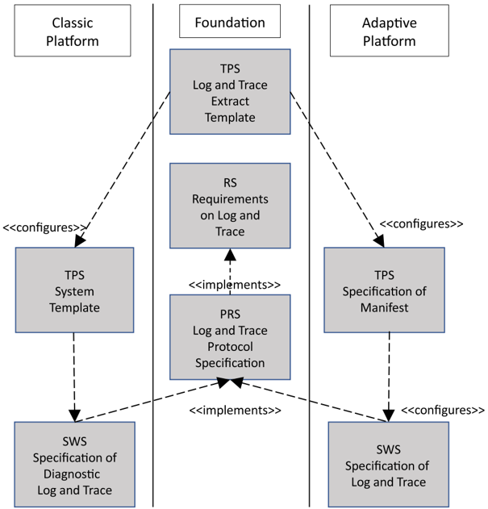
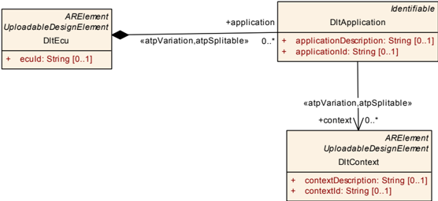
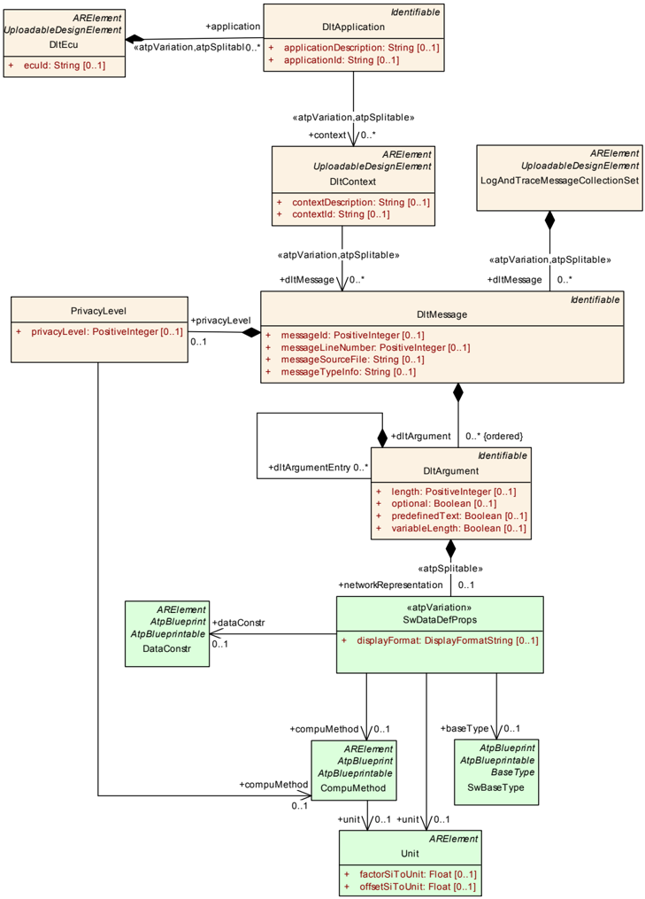

<!-- 源文档 AUTOSAR_FO_TPS_LogAndTraceExtract（R23-11），模板规范（TPS），不受 Type A 七章骨架约束；章节结构镜像源文档自身编号（1–3 与附录 A–B）。封面表格、Disclaimer、Contents 属于文档框架信息，不译；源文档开头的 References 列表保留为文末不编号的「参考文献」注册表。规范项 [TPS_DLTXT_xxxxx] 与约束 [constr_xxxx] 按 2026-11-03 决议丢弃 ID 与图元分隔符，仅保留并翻译条文内容；源文档正文中显式引用的 ID（如 constr_5302/constr_5364 的互引）保留。R23-11 markdown 转换缺失 TPS_DLTXT_00009–00014、constr_5098/5302/5303/5304 的正文（仅存在于附录 A 表中），这些条文按 ASWS 先例从语料库 PDF（第 9/13–16 页）恢复并翻译。类表采用两表形式（属性|值 + 属性|类型|多重性|种类|备注）；ARXML 示例清单按伪代码规则从 PDF 碎片重排为可读格式。 -->

## 1. 引言

AUTOSAR 中的日志与跟踪（**Log and Trace**, DLT）功能允许经典平台的 SWC/模块、自适应平台的应用/功能簇将日志与跟踪信息转发到外部 Dlt 日志查看器（如果底层平台支持）。

DLT 报文的格式在日志与跟踪协议规范（**Log and Trace Protocol Specification**）[\[1\]](#ref-1) 中有更详细的描述。

请注意，日志与跟踪消息源（产生日志信息的应用或模块）的配置在第 [2](#2-dltecudlt-ecu) 章中描述。

DltMessage 的 ARXML 格式在第 [3](#3-dltmessagedlt-消息) 章中描述。该格式可用于经典平台系统模板 [\[2\]](#ref-2) 描述和自适应平台清单 [\[3\]](#ref-3) 描述，以定义经典平台 SW-C/模块或自适应平台应用/功能簇发出的日志与跟踪消息。

DltMessage 的描述对于支持日志与跟踪协议的非冗余（**NonVerbose**）模式尤为重要。为了减少总线上的流量，非冗余模式下不在通信总线上传输关于 DltMessage 解释的元数据。取而代之，描述 DltMessage 的 ARXML 文件保存关于 DltMessage 解释的信息。

下图展示了日志与跟踪提取在 AUTOSAR 方法论中的位置。



### 1.1. 文档约定

技术术语以等宽字体排版，例如 PortPrototype。作为一般规则，技术术语的复数形式通过在单数形式后加"s"构成，例如 PortPrototypes。以此方式，本文档类似于 AUTOSAR XML 模式中使用的术语。

本文档包含以文本形式给出的约束，它们通过唯一的数字约束 ID、一个标题以及从图元字符开始、以结束图元字符终止的约束正文与文本的其余部分区分。

这些约束的目的是字面意义上约束对 AUTOSAR 元模型的解释，使得能够检测元模型实例（即在 M1 层级）中实现的标准化行为的违规。

鼓励 AUTOSAR 工具的制造者将与 M1 建模问题对应的约束的数字 ID 作为工具发出的诊断消息的一部分加入。

本文档引入的类的属性以类表的形式列出。它们具有顶层元素 AUTOSAR 示例中所示的形式：

请注意，约束并不要求在 AUTOSAR 工作流的任何给定时间点都可强制执行。在模型的开发过程中，约束可能被合理地违反，因为不完整的模型显然会表现出不一致。

然而，在工作流的特定时点，约束应被强制执行，以作为防止错误配置的保障。

工作流中约束应被强制执行的时点（有时也称为约束的"绑定时间"（**binding time**））因模型类别而异：例如在经典平台上，为软件组件定义的约束通常在生成 RTE 之前强制执行，而针对 ECU 提取定义的约束应在为通信协议栈创建 ECU 配置时应用。

每个文档都定义了约束可能的绑定时间，绑定时间通常在约束本身中提及，以便为 AUTOSAR 编写工具的实现者提供正确的方向。

以 AUTOSAR 作为一个典型类表的例子。表的前几行具有以下含义：

Class：UML 模型中定义的类名。

Package：定义该类的 UML 包。列出它只是为了帮助在整体元模型中定位该类。

Note：建模者为该类给出的注释（类注释）。类的构造型（**Stereotype**）与 UML 标签（**Tag**）也在此标注。

Base Classes：如适用，为直接基类清单。

表中的表头具有以下含义：

Attribute：类属性名。注意 AUTOSAR 不区分类属性与拥有的关联端。

Type：类属性的类型。

Mul.：属性被指派的多重性，即与该属性关联的给定数据类型的实例数量。

Kind：说明该属性是在类中聚合的（aggr 聚合）、类中的 UML 属性（attr 原始属性），还是仅被类引用（ref 引用）。实例引用也在此字段中指示（iref 实例引用）。

Note：建模者为该类属性给出的注释（角色注释）。构造型与 UML 标签也在此标注。

请注意，以字母而非数字开头的章代表文档的附录。附录的目的是支持对文档某些方面的解释，不代表标准的有约束力的约定。

## 2. DltEcu（Dlt Ecu）

本章描述 DltEcu，它表示部署了产生 DltMessage 的 DltApplication 的经典平台"ECU"或自适应平台"机器（**Machine**）"。DltApplication 与 DltContext 用于识别日志与跟踪消息的源。



**表2.1：DltEcu（DltEcu）**

| 属性 | 值 |
|---|---|
| Class | DltEcu |
| Package | M2::AUTOSARTemplates::LogAndTraceExtract |
| Note | 该元素表示产生日志与跟踪信息的 Ecu 或 Machine。标签：atp.recommendedPackage=DltEcus |
| Base | ARElement、ARObject、CollectableElement、Identifiable、MultilanguageReferrable、PackageableElement、Referrable、UploadableDesignElement、UploadablePackageElement |
| Aggregated by | ARPackage.element |

| 属性 | 类型 | 多重性 | 种类 | 备注 |
|---|---|---|---|---|
| application | DltApplication | * | aggr | DltEcu 上提供日志或跟踪数据的应用。构造型：atpSplitable; atpVariation。标签：atp.Splitkey=application.shortName, application.variationPoint.shortLabel；vh.latestBindingTime=systemDesignTime |
| ecuId | String | 0..1 | attr | 该属性定义在 Dlt 协议中使用的 ECU 名称。 |

**表2.2：DltApplication（DltApplication）**

| 属性 | 值 |
|---|---|
| Class | DltApplication |
| Package | M2::AUTOSARTemplates::LogAndTraceExtract |
| Note | 该元类表示日志与跟踪消息的来源应用。 |
| Base | ARObject、Identifiable、MultilanguageReferrable、Referrable |
| Aggregated by | DltEcu.application |

| 属性 | 类型 | 多重性 | 种类 | 备注 |
|---|---|---|---|---|
| applicationDescription | String | 0..1 | attr | 该属性可用于更详细地描述日志与跟踪消息中使用的 applicationId。 |
| applicationId | String | 0..1 | attr | 该属性标识日志与跟踪消息中的 SW-C/BSW 模块。 |
| context | DltContext | * | ref | 应用的 ContextId 定义。构造型：atpSplitable; atpVariation。标签：atp.Splitkey=context.dltContext, context.variationPoint.shortLabel；vh.latestBindingTime=systemDesignTime |

**表2.3：DltContext（DltContext）**

| 属性 | 值 |
|---|---|
| Class | DltContext |
| Package | M2::AUTOSARTemplates::LogAndTraceExtract |
| Note | 该元类表示将由某个应用产生的日志与跟踪消息分组的 Context。标签：atp.recommendedPackage=DltContexts |
| Base | ARElement、ARObject、CollectableElement、Identifiable、MultilanguageReferrable、PackageableElement、Referrable、UploadableDesignElement、UploadablePackageElement |
| Aggregated by | ARPackage.element |

| 属性 | 类型 | 多重性 | 种类 | 备注 |
|---|---|---|---|---|
| contextDescription | String | 0..1 | attr | 该属性可用于更详细地描述日志与跟踪消息中使用的 contextId。 |
| contextId | String | 0..1 | attr | 该属性用于将某个应用产生的日志与跟踪消息分组，以区分功能。 |
| dltMessage | DltMessage | * | ref | 指派给该 Dlt Context 的日志与跟踪消息组。构造型：atpSplitable; atpVariation。标签：atp.Splitkey=dltMessage.dltMessage, dltMessage.variationPoint.shortLabel；vh.latestBindingTime=systemDesignTime |

**约束：DltEcu.ecuId 的存在性**：对于每个 DltEcu，在创建日志与跟踪提取时，属性 ecuId 应当存在。

**约束：DltApplication.context 的存在性**：每个 DltApplication 在创建日志与跟踪提取时，应在角色 context 中引用至少一个 DltContext。

**约束：DltApplication.applicationId 的存在性**：对于每个 DltApplication，在创建日志与跟踪提取时，属性 applicationId 应当存在。

**约束：DltApplication.applicationDescription 的存在性**：对于每个 DltApplication，在创建日志与跟踪提取时，属性 applicationDescription 应当存在。

**约束：DltContext.contextId 的存在性**：对于每个 DltContext，在创建日志与跟踪提取时，属性 contextId 应当存在。

**约束：DltContext.contextDescription 的存在性**：对于每个 DltContext，在创建日志与跟踪提取时，属性 contextDescription 应当存在。

**约束：DltContext.dltMessage 的存在性**：每个 DltContext 在创建日志与跟踪提取时，应在角色 dltMessage 中引用至少一个 DltMessage。

## 3. DltMessage（Dlt 消息）

本章描述 DltMessage 的建模。请注意，[\[1\]](#ref-1) 中描述的 DLT 报文格式的某些信息（如 Message Info 与 Number of Arguments）可以从 DltMessage 本身派生。DLT 报文格式中的其他部分表示日志或跟踪消息的源（例如 ecuId、applicationId、contextId），这些信息可以从 DltEcu、由 DltEcu 聚合的 DltApplication 以及由 DltApplication 引用的 DltContext 派生。



**表3.1：LogAndTraceMessageCollectionSet（LogAndTraceMessageCollectionSet）**

| 属性 | 值 |
|---|---|
| Class | LogAndTraceMessageCollectionSet |
| Package | M2::AUTOSARTemplates::LogAndTraceExtract |
| Note | DltMessage 的集合。标签：atp.recommendedPackage=LogAndTraceMessageCollectionSets |
| Base | ARElement、ARObject、CollectableElement、Identifiable、MultilanguageReferrable、PackageableElement、Referrable、UploadableDesignElement、UploadablePackageElement |
| Aggregated by | ARPackage.element |

| 属性 | 类型 | 多重性 | 种类 | 备注 |
|---|---|---|---|---|
| dltMessage | DltMessage | * | aggr | DltMessageCollectionSet 中的 DltMessage 集合。构造型：atpSplitable; atpVariation。标签：atp.Splitkey=dltMessage.shortName, dltMessage.variationPoint.shortLabel；vh.latestBindingTime=systemDesignTime |

**表3.2：DltMessage（DltMessage）**

| 属性 | 值 |
|---|---|
| Class | DltMessage |
| Package | M2::AUTOSARTemplates::LogAndTraceExtract |
| Note | 该元素定义一个 DltMessage。 |
| Base | ARObject、Identifiable、MultilanguageReferrable、Referrable |
| Aggregated by | LogAndTraceMessageCollectionSet.dltMessage |

| 属性 | 类型 | 多重性 | 种类 | 备注 |
|---|---|---|---|---|
| dltArgument（有序） | DltArgument | * | aggr | DltMessage 中 DltArgument 的有序集合。 |
| messageId | PositiveInteger | 0..1 | attr | 该属性为 DltMessage 定义唯一的 Id。 |
| messageLineNumber | PositiveInteger | 0..1 | attr | 该属性描述调用此日志消息时在源文件中的位置。 |
| messageSourceFile | String | 0..1 | attr | 该属性描述调用此日志消息的源文件。 |
| messageTypeInfo | String | 0..1 | attr | 该属性描述消息类型。 |
| privacyLevel | PrivacyLevel | 0..1 | aggr | 隐私级别（**Privacy Level**）帮助按照私密程度标识日志与跟踪内容。 |

**规范项：日志或跟踪消息的表示**：一条日志或跟踪消息由一个 DltMessage 元素表示。

**约束：DltMessage.messageId 的存在性**：对于每个 DltMessage，在创建日志与跟踪提取时，属性 messageId 应当存在。

**规范项：DLT 消息**：DltMessage 以下列信息描述：

- 消息类型（**MSTP**）——应从 DltMessage.messageTypeInfo 派生
- 消息信息（**MSIN**）——应从 DltMessage.messageTypeInfo 派生
- 源文件——应从 DltMessage.messageSourceFile 派生
- 行号——应从 DltMessage.messageLineNumber 派生

请注意，[TPS_DLTXT_00002] 中描述的源文件与行号不适用于标准化的 DltMessage 或打算在多个位置复用的 DltMessage。

**表3.3：DltArgument（DltArgument）**

| 属性 | 值 |
|---|---|
| Class | DltArgument |
| Package | M2::AUTOSARTemplates::LogAndTraceExtract |
| Note | 该元素定义 DltMessage 中的一个参数（**Argument**）。 |
| Base | ARObject、Identifiable、MultilanguageReferrable、Referrable |
| Aggregated by | DltArgument.dltArgumentEntry、DltMessage.dltArgument |

| 属性 | 类型 | 多重性 | 种类 | 备注 |
|---|---|---|---|---|
| dltArgumentEntry | DltArgument | * | aggr | 该聚合用于描述定义结构体（**Structure**）的 DltArgument 的子元素。 |
| length | PositiveInteger | 0..1 | attr | 对于数组（**Array**）与字符串（**String**），以 BaseType 数量描述 DltArgument 的长度。 |
| networkRepresentation | SwDataDefProps | 0..1 | aggr | DltArgument 的 networkRepresentation 的定义。构造型：atpSplitable。标签：atp.Splitkey=networkRepresentation |
| optional | Boolean | 0..1 | attr | 该属性定义该参数是否可选。若设为 true，该参数可从 DLT 报文的有效载荷中省略。 |
| predefinedText | Boolean | 0..1 | attr | 该属性定义该 DltArgument 是否为 predefinedText（静态数据）。 |
| variableLength | Boolean | 0..1 | attr | 该属性定义 DltArgument 的长度是否可变（在运行期确定）。 |

**规范项：日志或跟踪消息的用户数据**：日志或跟踪消息的用户数据应由在 DltMessage 中排序的 DltArgument 表示。

**规范项：DltArgument 的种类**：每个 DltArgument 可以是：

- 预定义文本（静态）（**predefined text**）
- 组装数据（**assembled data**）

请注意，日志与跟踪协议规范 [\[1\]](#ref-1) 使用术语"StaticData"表示预定义文本，"Non-Static-Data"表示组装数据。

**规范项：预定义文本 DltArgument**：如果 DltArgument 是预定义文本，则该 DltArgument 应只包含 shortName、desc 与 predefinedText。文本应放入 desc 字段。DltArgument 的 predefinedText 属性应设为 true。

**规范项：组装数据 DltArgument**：如果 DltArgument 表示组装数据，则应定义 DltArgument.networkRepresentation.unit 与 DltArgument.networkRepresentation.baseType。

**约束：constr_5098 DltArgument.networkRepresentation 允许的 SwDataDefProps 属性**：

| SwDataDefProps 属性 | networkRepresentation |
|---|---|
| annotation | N/A |
| baseType | D |
| compuMethod | D |
| dataConstr | D |
| displayFormat | D |
| displayPresentation | N/A |
| invalidValue | N/A |
| swComparisonVariable | N/A |
| swHostVariable | N/A |
| swTextProps | N/A |
| unit | D |

[constr_5098] 中所列 SwDataDefProps 属性集合表示在 AUTOSAR Foundation 中可见的子集。

[constr_5098] 中的设置含义：D——属性可以在该元素的作用域内定义；N/A——属性不适用于该元素的作用域。

请注意，即使 DltArgument 定义了 networkRepresentation，DltMessage 也不一定经由网络传输。日志信息可以提供到通信总线、控制台或文件系统。

dataConstr 属性可用于描述 DltArgument 的取值范围。关于数据约束的更多细节见软件组件模板 [\[4\]](#ref-4)。请注意，数据约束与 DLT 协议无关。

displayFormat 属性定义用于在工具中显示值的格式说明符。关于可能的取值设置的更多细节见通用结构模板 [\[5\]](#ref-5)。

**约束：DltArgument.networkRepresentation 中的 CompuMethod**：在 DltArgument 的 networkRepresentation 中使用的 CompuMethod 限于 TEXTTABLE 类别。

通过 TEXTTABLE CompuMethod 可以将枚举定义为 DltArgument 的 networkRepresentation。更多细节见软件组件模板 [\[4\]](#ref-4)。

**规范项：将字符串描述为 DltArgument 的 networkRepresentation**：如果 DltArgument 的 networkRepresentation 是字符串，则可以用两个 SwBaseType 元素描述：

- baseTypeEncoding（按照 [TPS_SWCT_01845] [\[4\]](#ref-4)）
- baseTypeSize

**规范项：DltMessage.messageTypeInfo 的标准化取值**：AUTOSAR 对 DltMessage.messageTypeInfo 属性标准化了以下取值：

- DLT_LOG_OFF
- DLT_LOG_FATAL
- DLT_LOG_ERROR
- DLT_LOG_WARN
- DLT_LOG_INFO
- DLT_LOG_DEBUG
- DLT_LOG_VERBOSE
- DLT_TRACE_VARIABLE
- DLT_TRACE_FUNCTION_IN
- DLT_TRACE_FUNCTION_OUT
- DLT_TRACE_STATE
- DLT_TRACE_VFB
- DLT_NW_TRACE_IPC
- DLT_NW_TRACE_CAN
- DLT_NW_TRACE_FLEXRAY
- DLT_NW_TRACE_MOST
- DLT_NW_TRACE_ETHERNET
- DLT_NW_TRACE_SOMEIP
- DLT_NW_TRACE_0x7
- DLT_NW_TRACE_0x8
- DLT_NW_TRACE_0x9
- DLT_NW_TRACE_0x10
- DLT_NW_TRACE_0x11
- DLT_NW_TRACE_0x12
- DLT_NW_TRACE_0x13
- DLT_NW_TRACE_0x14
- DLT_NW_TRACE_0x15
- DLT_CONTROL_REQUEST
- DLT_CONTROL_RESPONSE

请注意，只有 [TPS_DLTXT_00008] 中定义的取值才允许用于 DltMessage.messageTypeInfo。目前不允许自定义取值。

**表3.4：PrivacyLevel（PrivacyLevel）**

| 属性 | 值 |
|---|---|
| Class | PrivacyLevel |
| Package | M2::AUTOSARTemplates::LogAndTraceExtract |
| Note | 该元类定义日志与跟踪内容的隐私级别。 |
| Base | ARObject |
| Aggregated by | DltMessage.privacyLevel |

| 属性 | 类型 | 多重性 | 种类 | 备注 |
|---|---|---|---|---|
| compuMethod | CompuMethod | 0..1 | ref | 对 TEXTTABLE 类别 CompuMethod 的引用，该 CompuMethod 定义受支持的用户自定义隐私级别。 |
| privacyLevel | PositiveInteger | 0..1 | attr | 表示隐私级别并在扩展头中传输的值。 |

**约束：DltMessage.privacyLevel.privacyLevel 的取值范围**：DltMessage.privacyLevel.privacyLevel 的值应在 0 到 255 之间。

**约束：PrivacyLevel.compuMethod 的取值范围**：PrivacyLevel 在角色 compuMethod 中引用的 CompuMethod 应具有 TEXTTABLE 类别。

**规范项：DltArgument.optional 的语义**：optional 属性定义 DltArgument 在 DLT 有效载荷中是可选的（true）还是强制的（false）。

请注意，只有 DltMessage 的组装数据被发送到外部 Dlt 日志查看器。"预定义文本"只在 ARXML 文件中可用。

**约束：DltArgument.optional 属性的使用限制**：在表示数组维度（**array dimension**）的 DltArgument 中不得设置 optional 属性。

[constr_5302] 中"数组维度"一词的含义参见 [constr_5364]。

**规范项：DltArgument.length 的语义**：length 属性定义数组或字符串类型的 DltArgument 的长度。如果 DltArgument.variableLength 设为 true，该属性定义 DltArgument 的最大长度。

请注意，对于布尔、有符号整数、无符号整数和浮点等原始类型，DltArgument 的长度应从 baseTypeSize 派生。

**约束：DltArgument 的 baseTypeSize 限制**：DltArgument 的 networkRepresentation 中的 baseTypeSize 限于 8、16、32 和 64 位。

**规范项：字符串情形下 DltArgument.length 的语义**：如果 DltArgument 的 networkRepresentation 是用具有 String baseTypeEncoding 的 SwBaseType 描述的字符串，则 length 属性规定以字符计的文本大小。请注意，以字节计的大小取决于相应 SwBaseType 中的编码。

**规范项：一维数组类型 DltArgument 的描述**：具有一维数组类型的 DltArgument 由一个设置了 length 属性取值的 DltArgument 描述。数组的数据类型由 networkRepresentation 中的 SwBaseType 描述。

请注意，字符串类型的 DltArgument 被描述为字符数组。

**规范项：n 维数组类型 DltArgument 的描述**：具有 n 维数组类型的 DltArgument 由一个在角色 dltArgumentEntry 中聚合了更多 DltArgument、且所有被聚合的 DltArgument 都设置了 length 属性取值的 DltArgument 描述。每个 dltArgumentEntry 定义由该聚合 DltArgument 表示的数组中的一个维度。

聚合 DltArgument 的 length 属性定义维度的数量。

dltArgumentEntry 中的 length 属性定义该维度中条目的数量。

数组的数据类型由聚合 DltArgument 的 networkRepresentation 中的 SwBaseType 描述。

**约束：数组的数据类型**：由设置了 length 属性取值（表示数组）的 DltArgument 聚合的 dltArgumentEntry 不应在 networkRepresentation 中定义 SwBaseType，因为数组的数据类型由聚合 DltArgument 的 networkRepresentation 中的 SwBaseType 描述。

**规范项：结构体类型 DltArgument 的描述**：具有结构体类型的 DltArgument 由一个在角色 dltArgumentEntry 中聚合了更多 DltArgument、且未设置 length 属性取值的 DltArgument 描述。

下表汇总了不同有效载荷数据类型的建模方式：

**约束：constr_5363 有效载荷数据类型描述允许的属性用法**：

| 类型 | length | dltArgumentEntry | 顶层 DltArgument 的 SwBaseType |
|---|---|---|---|
| Predefined Text | NA | NA | NA |
| primitive Type | NA | NA | D |
| String | D | NA | D |
| 1-dimensional Array | D | NA | D |
| n-dimensional Array | D | D | D |
| Struct | NA | D | NA |

下表汇总了 dltArgumentEntry 的用法：

**约束：constr_5364 dltArgumentEntry 情形下允许的属性用法**：

| DltArgumentEntry 类型 | length | dltArgumentEntry | DltArgumentEntry 的 SwBaseType |
|---|---|---|---|
| Struct member | NA | D | D |
| Array dimension | D | D | NA |

[constr_5363] 与 [constr_5364] 中的设置含义：D——属性可以在该元素的作用域内定义；NA——属性不适用于该元素的作用域。

以下示例展示了一个 ARXML 文件，它定义了一个带有单个 DltMessage 的 LogAndTraceMessageCollectionSet。接收方可以基于 messageId 重新组装该 DLT 报文的所有预定义数据：

- 源代码中的位置（demo.c 中的第 72 行）
- 预定义文本："Temperature measurement"
- 组装数据 1 与单位：measurement_point（无单位）
- 组装数据 2 与单位：reading（开尔文）
- 组装数据 3 与单位：描述房间内温度分布的三维数组（开尔文）

清单3.1：LogAndTraceMessageCollectionSet 的定义示例

```xml
<?xml version="1.0" encoding="utf-8"?>
<AUTOSAR xsi:schemaLocation="http://autosar.org/schema/r4.0 AUTOSAR_00052.xsd"
         xmlns="http://autosar.org/schema/r4.0"
         xmlns:xsi="http://www.w3.org/2001/XMLSchema-instance">
  <AR-PACKAGES>
    <AR-PACKAGE>
      <SHORT-NAME>Dlt_Example</SHORT-NAME>
      <ELEMENTS>
        <DLT-ECU>
          <SHORT-NAME>ECU1</SHORT-NAME>
          <APPLICATIONS>
            <DLT-APPLICATION>
              <SHORT-NAME>App1</SHORT-NAME>
              <APPLICATION-DESCRIPTION>Application 1</APPLICATION-DESCRIPTION>
              <APPLICATION-ID>APPL</APPLICATION-ID>
              <CONTEXTS>
                <DLT-CONTEXT-REF-CONDITIONAL>
                  <DLT-CONTEXT-REF DEST="DLT-CONTEXT">/Dlt_Example/CTX1</DLT-CONTEXT-REF>
                </DLT-CONTEXT-REF-CONDITIONAL>
              </CONTEXTS>
            </DLT-APPLICATION>
          </APPLICATIONS>
          <ECU-ID>ECU1</ECU-ID>
        </DLT-ECU>
        <DLT-CONTEXT>
          <SHORT-NAME>CTX1</SHORT-NAME>
          <CONTEXT-DESCRIPTION>Context 1</CONTEXT-DESCRIPTION>
          <CONTEXT-ID>CTX1</CONTEXT-ID>
          <DLT-MESSAGES>
            <DLT-MESSAGE-REF-CONDITIONAL>
              <DLT-MESSAGE-REF DEST="DLT-MESSAGE">/Dlt_Example/DltMessageCollectionSetExample/DltMessageWithID_1</DLT-MESSAGE-REF>
            </DLT-MESSAGE-REF-CONDITIONAL>
          </DLT-MESSAGES>
        </DLT-CONTEXT>
        <LOG-AND-TRACE-MESSAGE-COLLECTION-SET>
          <SHORT-NAME>DltMessageCollectionSetExample</SHORT-NAME>
          <DLT-MESSAGES>
            <DLT-MESSAGE>
              <SHORT-NAME>DltMessageWithID_1</SHORT-NAME>
              <DLT-ARGUMENTS>
                <DLT-ARGUMENT>
                  <SHORT-NAME>Temperature_measurement</SHORT-NAME>
                  <DESC><L-2 L="EN">Temperature measurement</L-2></DESC>
                  <PREDEFINED-TEXT>true</PREDEFINED-TEXT>
                </DLT-ARGUMENT>
                <DLT-ARGUMENT>
                  <SHORT-NAME>measurement_point</SHORT-NAME>
                  <DESC><L-2 L="EN">Temperature measurement</L-2></DESC>
                  <NETWORK-REPRESENTATION>
                    <SW-DATA-DEF-PROPS-VARIANTS>
                      <SW-DATA-DEF-PROPS-CONDITIONAL>
                        <BASE-TYPE-REF DEST="SW-BASE-TYPE">/AUTOSAR_Platform/BaseTypes/uint8</BASE-TYPE-REF>
                        <UNIT-REF DEST="UNIT">/AISpecification/Units/NoUnit</UNIT-REF>
                      </SW-DATA-DEF-PROPS-CONDITIONAL>
                    </SW-DATA-DEF-PROPS-VARIANTS>
                  </NETWORK-REPRESENTATION>
                </DLT-ARGUMENT>
                <DLT-ARGUMENT>
                  <SHORT-NAME>reading</SHORT-NAME>
                  <DESC><L-2 L="EN">reading</L-2></DESC>
                  <NETWORK-REPRESENTATION>
                    <SW-DATA-DEF-PROPS-VARIANTS>
                      <SW-DATA-DEF-PROPS-CONDITIONAL>
                        <BASE-TYPE-REF DEST="SW-BASE-TYPE">/AUTOSAR_Platform/BaseTypes/float32</BASE-TYPE-REF>
                        <UNIT-REF DEST="UNIT">/AISpecification/Units/Kelvin</UNIT-REF>
                      </SW-DATA-DEF-PROPS-CONDITIONAL>
                    </SW-DATA-DEF-PROPS-VARIANTS>
                  </NETWORK-REPRESENTATION>
                </DLT-ARGUMENT>
                <DLT-ARGUMENT>
                  <!-- n 维数组示例："房间内的温度分布"；
                       房间内分布有若干温度探头：
                       沿房间高度方向有 4 层（z 坐标）；
                       每层沿房间深度方向有 5 行（y 坐标）；
                       每行沿房间宽度方向有 6 个探头（x 坐标）；
                       共 120 个探头 -->
                  <SHORT-NAME>My_3dim_Array_4x5x6</SHORT-NAME>
                  <DESC><L-2 L="EN">Heat distribution map of MyRoom</L-2></DESC>
                  <DLT-ARGUMENT-ENTRYS>
                    <DLT-ARGUMENT>
                      <SHORT-NAME>FirstDim_ArrayOfLayers</SHORT-NAME>
                      <DESC><L-2 L="EN">HeatMap_z</L-2></DESC>
                      <LENGTH>4</LENGTH>
                      <!-- dltArgumentEntry 中的 length 属性定义该维度中的条目数量 -->
                    </DLT-ARGUMENT>
                    <DLT-ARGUMENT>
                      <SHORT-NAME>SecondDim_ArrayOfRows</SHORT-NAME>
                      <DESC><L-2 L="EN">HeatMap_y</L-2></DESC>
                      <LENGTH>5</LENGTH>
                      <!-- dltArgumentEntry 中的 length 属性定义该维度中的条目数量 -->
                    </DLT-ARGUMENT>
                    <DLT-ARGUMENT>
                      <SHORT-NAME>ThirdDim_ArrayOfProbes</SHORT-NAME>
                      <DESC><L-2 L="EN">HeatMap_x</L-2></DESC>
                      <LENGTH>6</LENGTH>
                      <!-- dltArgumentEntry 中的 length 属性定义该维度中的条目数量 -->
                    </DLT-ARGUMENT>
                  </DLT-ARGUMENT-ENTRYS>
                  <LENGTH>3</LENGTH>
                  <!-- DltArgument 中的 length 属性定义维度的数量 -->
                  <NETWORK-REPRESENTATION>
                    <SW-DATA-DEF-PROPS-VARIANTS>
                      <SW-DATA-DEF-PROPS-CONDITIONAL>
                        <BASE-TYPE-REF DEST="SW-BASE-TYPE">/AUTOSAR_Platform/BaseTypes/float32</BASE-TYPE-REF>
                        <UNIT-REF DEST="UNIT">/AISpecification/Units/Kelvin</UNIT-REF>
                      </SW-DATA-DEF-PROPS-CONDITIONAL>
                    </SW-DATA-DEF-PROPS-VARIANTS>
                  </NETWORK-REPRESENTATION>
                </DLT-ARGUMENT>
              </DLT-ARGUMENTS>
              <MESSAGE-ID>1</MESSAGE-ID>
              <MESSAGE-LINE-NUMBER>72</MESSAGE-LINE-NUMBER>
              <MESSAGE-SOURCE-FILE>demo.c</MESSAGE-SOURCE-FILE>
              <MESSAGE-TYPE-INFO>DLT_LOG_DEBUG</MESSAGE-TYPE-INFO>
            </DLT-MESSAGE>
          </DLT-MESSAGES>
        </LOG-AND-TRACE-MESSAGE-COLLECTION-SET>
      </ELEMENTS>
    </AR-PACKAGE>
  </AR-PACKAGES>
</AUTOSAR>
```

以下示例展示了一个 ARXML 文件，其中一个 DltArgument 表示字符串，第二个 DltArgument 表示枚举。

清单3.2：字符串与枚举 DltArgument 的示例

```xml
<?xml version="1.0" encoding="utf-8"?>
<AUTOSAR xsi:schemaLocation="http://autosar.org/schema/r4.0 AUTOSAR_00052.xsd"
         xmlns="http://autosar.org/schema/r4.0"
         xmlns:xsi="http://www.w3.org/2001/XMLSchema-instance">
  <AR-PACKAGES>
    <AR-PACKAGE>
      <SHORT-NAME>TraceMessageExample</SHORT-NAME>
      <ELEMENTS>
        <LOG-AND-TRACE-MESSAGE-COLLECTION-SET>
          <SHORT-NAME>TraceMessages</SHORT-NAME>
          <DLT-MESSAGES>
            <DLT-MESSAGE>
              <SHORT-NAME>ExecutionManagerProcessStateChangeMsg</SHORT-NAME>
              <DLT-ARGUMENTS>
                <DLT-ARGUMENT>
                  <SHORT-NAME>ProcessId</SHORT-NAME>
                  <DESC><L-2 L="EN">Process id as given by the OS</L-2></DESC>
                  <NETWORK-REPRESENTATION>
                    <SW-DATA-DEF-PROPS-VARIANTS>
                      <SW-DATA-DEF-PROPS-CONDITIONAL>
                        <BASE-TYPE-REF DEST="SW-BASE-TYPE">/AUTOSAR_Platform/BaseTypes/uint32</BASE-TYPE-REF>
                        <UNIT-REF DEST="UNIT">/AISpecification/Units/NoUnit</UNIT-REF>
                      </SW-DATA-DEF-PROPS-CONDITIONAL>
                    </SW-DATA-DEF-PROPS-VARIANTS>
                  </NETWORK-REPRESENTATION>
                </DLT-ARGUMENT>
                <DLT-ARGUMENT>
                  <SHORT-NAME>ProcessName</SHORT-NAME>
                  <DESC><L-2 L="EN">Process name</L-2></DESC>
                  <LENGTH>32</LENGTH>
                  <NETWORK-REPRESENTATION>
                    <SW-DATA-DEF-PROPS-VARIANTS>
                      <SW-DATA-DEF-PROPS-CONDITIONAL>
                        <BASE-TYPE-REF DEST="SW-BASE-TYPE">/BaseTypes/Utf8BaseType</BASE-TYPE-REF>
                        <UNIT-REF DEST="UNIT">/AISpecification/Units/NoUnit</UNIT-REF>
                      </SW-DATA-DEF-PROPS-CONDITIONAL>
                    </SW-DATA-DEF-PROPS-VARIANTS>
                  </NETWORK-REPRESENTATION>
                </DLT-ARGUMENT>
                <DLT-ARGUMENT>
                  <SHORT-NAME>State</SHORT-NAME>
                  <DESC><L-2 L="EN">Process State Change</L-2></DESC>
                  <NETWORK-REPRESENTATION>
                    <SW-DATA-DEF-PROPS-VARIANTS>
                      <SW-DATA-DEF-PROPS-CONDITIONAL>
                        <BASE-TYPE-REF DEST="SW-BASE-TYPE">/AUTOSAR_Platform/BaseTypes/uint32</BASE-TYPE-REF>
                        <COMPU-METHOD-REF DEST="COMPU-METHOD">/CompuMethods/ProcessState</COMPU-METHOD-REF>
                        <UNIT-REF DEST="UNIT">/AISpecification/Units/NoUnit</UNIT-REF>
                      </SW-DATA-DEF-PROPS-CONDITIONAL>
                    </SW-DATA-DEF-PROPS-VARIANTS>
                  </NETWORK-REPRESENTATION>
                </DLT-ARGUMENT>
              </DLT-ARGUMENTS>
              <MESSAGE-ID>1</MESSAGE-ID>
              <MESSAGE-TYPE-INFO>DLT_TRACE_STATE</MESSAGE-TYPE-INFO>
            </DLT-MESSAGE>
          </DLT-MESSAGES>
        </LOG-AND-TRACE-MESSAGE-COLLECTION-SET>
      </ELEMENTS>
    </AR-PACKAGE>
    <AR-PACKAGE>
      <SHORT-NAME>CompuMethods</SHORT-NAME>
      <ELEMENTS>
        <COMPU-METHOD>
          <SHORT-NAME>ProcessState</SHORT-NAME>
          <LONG-NAME><L-4 L="EN">Process state enumeration</L-4></LONG-NAME>
          <CATEGORY>TEXTTABLE</CATEGORY>
          <UNIT-REF DEST="UNIT">/AISpecification/Units/NoUnit</UNIT-REF>
          <COMPU-INTERNAL-TO-PHYS>
            <COMPU-SCALES>
              <COMPU-SCALE>
                <DESC><L-2 L="EN">Idle Process state</L-2></DESC>
                <LOWER-LIMIT INTERVAL-TYPE="CLOSED">0</LOWER-LIMIT>
                <UPPER-LIMIT INTERVAL-TYPE="CLOSED">0</UPPER-LIMIT>
                <COMPU-CONST><VT>Idle</VT></COMPU-CONST>
              </COMPU-SCALE>
              <COMPU-SCALE>
                <DESC><L-2 L="EN">Starting Process state</L-2></DESC>
                <LOWER-LIMIT INTERVAL-TYPE="CLOSED">1</LOWER-LIMIT>
                <UPPER-LIMIT INTERVAL-TYPE="CLOSED">1</UPPER-LIMIT>
                <COMPU-CONST><VT>Starting</VT></COMPU-CONST>
              </COMPU-SCALE>
              <COMPU-SCALE>
                <DESC><L-2 L="EN">Running Process state</L-2></DESC>
                <LOWER-LIMIT INTERVAL-TYPE="CLOSED">2</LOWER-LIMIT>
                <UPPER-LIMIT INTERVAL-TYPE="CLOSED">2</UPPER-LIMIT>
                <COMPU-CONST><VT>Running</VT></COMPU-CONST>
              </COMPU-SCALE>
              <COMPU-SCALE>
                <DESC><L-2 L="EN">Terminating Process state</L-2></DESC>
                <LOWER-LIMIT INTERVAL-TYPE="CLOSED">3</LOWER-LIMIT>
                <UPPER-LIMIT INTERVAL-TYPE="CLOSED">3</UPPER-LIMIT>
                <COMPU-CONST><VT>Terminating</VT></COMPU-CONST>
              </COMPU-SCALE>
              <COMPU-SCALE>
                <DESC><L-2 L="EN">Terminated Process state</L-2></DESC>
                <LOWER-LIMIT INTERVAL-TYPE="CLOSED">4</LOWER-LIMIT>
                <UPPER-LIMIT INTERVAL-TYPE="CLOSED">4</UPPER-LIMIT>
                <COMPU-CONST><VT>Terminated</VT></COMPU-CONST>
              </COMPU-SCALE>
            </COMPU-SCALES>
          </COMPU-INTERNAL-TO-PHYS>
        </COMPU-METHOD>
      </ELEMENTS>
    </AR-PACKAGE>
    <AR-PACKAGE>
      <SHORT-NAME>BaseTypes</SHORT-NAME>
      <ELEMENTS>
        <SW-BASE-TYPE>
          <SHORT-NAME>Utf8BaseType</SHORT-NAME>
          <CATEGORY>FIXED_LENGTH</CATEGORY>
          <BASE-TYPE-SIZE>8</BASE-TYPE-SIZE>
          <BASE-TYPE-ENCODING>UTF-8</BASE-TYPE-ENCODING>
        </SW-BASE-TYPE>
      </ELEMENTS>
    </AR-PACKAGE>
  </AR-PACKAGES>
</AUTOSAR>
```

## A. 约束与规范项历史

请注意，本章中的清单也包括在后续版本中已从规范中移除的约束与规范项。这些约束与规范项在文档中不再以超链接形式出现。

### A.1. 按照 AUTOSAR 发布 R21-11 的本文档约束与规范项历史

#### A.1.1. R21-11 中新增的规范项

| 标题 |
|---|
| 日志或跟踪消息的表示（Log or trace message representation） |
| DLT 消息（DLT message） |
| 日志或跟踪消息的用户数据（User data of the log or trace message） |
| DltArgument 的种类（DltArgument kinds） |
| 预定义文本 DltArgument（predefined text DltArgument） |
| 组装数据 DltArgument（assembled data DltArgument） |
| 将字符串描述为 DltArgument 的 networkRepresentation（Description of a String as networkRepresentation of a DltArgument） |
| DltMessage.messageTypeInfo 的标准化取值（Standardized values of DltMessage.messageTypeInfo） |
| DltArgument.length 的语义（Semantics of DltArgument.length） |
| 字符串情形下 DltArgument.length 的语义（Semantics of DltArgument.length in case of a String） |
| 一维数组类型 DltArgument 的描述（Description of DltArgument with one-dimensional Array type） |
| n 维数组类型 DltArgument 的描述（Description of DltArgument with n-dimensional Array type） |
| 结构体类型 DltArgument 的描述（Description of DltArgument with Structure type） |
| DltArgument.optional 的语义（Semantics of DltArgument.optional） |

#### A.1.2. R21-11 中变更的规范项

无

#### A.1.3. R21-11 中删除的规范项

无

#### A.1.4. R21-11 中新增的约束

| 标题 |
|---|
| DltArgument.networkRepresentation 的用法（Usage of DltArgument.networkRepresentation） |
| DltEcu.ecuId 的存在性（Existence of DltEcu.ecuId） |
| DltApplication.context 的存在性（Existence of DltApplication.context） |
| DltApplication.applicationId 的存在性（Existence of DltApplication.applicationId） |
| DltApplication.applicationDescription 的存在性（Existence of DltApplication.applicationDescription） |
| DltContext.contextId 的存在性（Existence of DltContext.contextId） |
| DltContext.contextDescription 的存在性（Existence of DltContext.contextDescription） |
| DltContext.dltMessage 的存在性（Existence of DltContext.dltMessage） |
| DltMessage.messageId 的存在性（Existence of DltMessage.messageId） |
| DltArgument.optional 属性的使用限制（Restriction in usage of DltArgument.optional attribute） |
| DltArgument 的 baseTypeSize 限制（Restriction of baseTypeSize of a DltArgument） |
| 数组的数据类型（Datatype of an Array） |
| DltArgument.networkRepresentation 中的 CompuMethod（CompuMethod in DltArgument.networkRepresentation） |

#### A.1.5. R21-11 中变更的约束

无

#### A.1.6. R21-11 中删除的约束

无

### A.2. 按照 AUTOSAR 发布 R22-11 的本文档约束与规范项历史

#### A.2.1. R22-11 中新增的规范项

无

#### A.2.2. R22-11 中变更的规范项

无

#### A.2.3. R22-11 中删除的规范项

无

#### A.2.4. R22-11 中新增的约束

| 标题 |
|---|
| DltMessage.privacyLevel.privacyLevel 的取值范围（Range of DltMessage.privacyLevel.privacyLevel） |
| PrivacyLevel.compuMethod 的取值范围（Range of PrivacyLevel.compuMethod） |

#### A.2.5. R22-11 中变更的约束

| 标题 |
|---|
| DltArgument.networkRepresentation 允许的 SwDataDefProps 属性（Allowed SwDataDefProps attributes for DltArgument.networkRepresentation） |
| DltArgument.optional 属性的使用限制（Restriction in usage of DltArgument.optional attribute） |

#### A.2.6. R22-11 中删除的约束

无

### A.3. 按照 AUTOSAR 发布 R23-11 的本文档约束与规范项历史

#### A.3.1. R23-11 中新增的规范项

无

#### A.3.2. R23-11 中变更的规范项

无

#### A.3.3. R23-11 中删除的规范项

无

#### A.3.4. R23-11 中新增的约束

| 标题 |
|---|
| 有效载荷数据类型描述允许的属性用法（Allowed usage of attributes for description of payload data types） |
| dltArgumentEntry 情形下允许的属性用法（Allowed usage of attributes in case of a dltArgumentEntry） |

#### A.3.5. R23-11 中变更的约束

无

#### A.3.6. R23-11 中删除的约束

无

## B. 所提及的类表

为完整起见，本章包含一组类表，它们表示本文档语境中所提及、但不直接包含在描述特定元模型语义范围之内的元类。

**表B.1：AUTOSAR（AUTOSAR）**

| 属性 | 值 |
|---|---|
| Class | AUTOSAR |
| Package | M2::AUTOSARTemplates::AutosarTopLevelStructure |
| Note | AUTOSAR 描述的根元素，也是相应 XML 文档中的根元素。标签：xml.globalElement=true |
| Base | ARObject |

| 属性 | 类型 | 多重性 | 种类 | 备注 |
|---|---|---|---|---|
| adminData | AdminData | 0..1 | aggr | 这表示 Autosar 文件的管理数据。构造型：atpSplitable。标签：atp.Splitkey=adminData、xml.sequenceOffset=10 |
| arPackage | ARPackage | * | aggr | 这是 AUTOSAR 模型中的顶层包。构造型：atpSplitable; atpVariation。标签：atp.Splitkey=arPackage.shortName, arPackage.variationPoint.shortLabel；vh.latestBindingTime=blueprintDerivationTime、xml.sequenceOffset=30 |
| fileInfoComment | FileInfoComment | 0..1 | aggr | 这表示在 AUTOSAR 文件中提供结构化注释的可能性。构造型：atpStructuredComment。标签：xml.roleElement=true、xml.sequenceOffset=-10、xml.typeElement=false |
| introduction | DocumentationBlock | 0..1 | aggr | 这表示 Autosar 文件的引言。例如用于表示免责声明与法律注释。标签：xml.sequenceOffset=20 |

**表B.2：BaseTypeDirectDefinition（BaseTypeDirectDefinition）**

| 属性 | 值 |
|---|---|
| Class | BaseTypeDirectDefinition |
| Package | M2::MSR::AsamHdo::BaseTypes |
| Note | 该 BaseType 是直接定义的（与派生的 BaseType 相对） |
| Base | ARObject、BaseTypeDefinition |
| Aggregated by | BaseType.baseTypeDefinition |

| 属性 | 类型 | 多重性 | 种类 | 备注 |
|---|---|---|---|---|
| baseTypeEncoding | BaseTypeEncoding String | 0..1 | attr | 这规定当前 BaseType 的对象如何编码，例如在 ECU 内的报文序列中。标签：xml.sequenceOffset=90 |
| baseTypeSize | PositiveInteger | 0..1 | attr | 描述容器中规定的数据类型的长度（以位计）。标签：xml.sequenceOffset=70 |
| byteOrder | ByteOrderEnum | 0..1 | attr | 该属性规定基类型的字节序。标签：xml.sequenceOffset=110 |
| memAlignment | PositiveInteger | 0..1 | attr | 该属性描述内存对象的对齐（以位计）。例如"8"表示所论对象按字节对齐，而"32"表示按四字节对齐。如果取值为"0"，其含义应解释为"未规定"。标签：xml.sequenceOffset=100 |
| nativeDeclaration | NativeDeclarationString | 0..1 | attr | 该属性描述此类基类型在原生编程语言（主要是 C 语言）中的声明。代码生成器可以用它将必要的声明包含到头文件中。例如 BaseType 的 shortName 为"MyUnsignedInt"、nativeDeclaration 为"unsigned short"，将产生 typedef unsigned short MyUnsignedInt;。如果未定义该属性，则被引用的 Implementation Data Type 将不会由 RTE 生成为 typedef。如果给出了 nativeDeclaration，它应满足由 baseTypeEncoding 与 baseTypeSize 给定的特性。这是确保软件组件、RTE、COM 与 MCM 系统一致处理与解释所必需的。标签：xml.sequenceOffset=120 |

**表B.3：CompuMethod（CompuMethod）**

| 属性 | 值 |
|---|---|
| Class | CompuMethod |
| Package | M2::MSR::AsamHdo::ComputationMethod |
| Note | 该元类表示表达物理值与数学表示之间关系的能力。注意这仍然独立于数据类型中的技术实现。它只规定内部值与其物理对应值之间对应的公式。标签：atp.recommendedPackage=CompuMethods |
| Base | ARElement、ARObject、AtpBlueprint、AtpBlueprintable、CollectableElement、Identifiable、MultilanguageReferrable、PackageableElement、Referrable |
| Aggregated by | ARPackage.element |

| 属性 | 类型 | 多重性 | 种类 | 备注 |
|---|---|---|---|---|
| compuInternalToPhys | Compu | 0..1 | aggr | 这规定从内部值到物理值的计算。构造型：atpSplitable。标签：atp.Splitkey=compuInternalToPhys、xml.sequenceOffset=80 |
| compuPhysToInternal | Compu | 0..1 | aggr | 这表示从物理值到内部值的计算。构造型：atpSplitable。标签：atp.Splitkey=compuPhysToInternal、xml.sequenceOffset=90 |
| displayFormat | DisplayFormatString | 0..1 | attr | 该属性规定物理值应如何显示，例如在文档或测量与标定工具中。标签：xml.sequenceOffset=20 |
| unit | Unit | 0..1 | ref | 这是该 CompuMethod 所适用的物理值的物理单位。标签：xml.sequenceOffset=30 |

**表B.4：Identifiable（Identifiable）**

| 属性 | 值 |
|---|---|
| Class | Identifiable（抽象） |
| Package | M2::AUTOSARTemplates::GenericStructure::GeneralTemplateClasses::Identifiable |
| Note | 本类的实例可以通过其标识符（在命名空间边界内）被引用。除此之外，Identifiable 是对 AUTOSAR 描述的整体结构有显著贡献的对象。特别地，Identifiable 可以包含 Identifiable。 |
| Base | ARObject、MultilanguageReferrable、Referrable |
| Subclasses | ARPackage, AbstractDoIpLogicAddressProps, AbstractEvent, AbstractImplementationDataTypeElement, AbstractSecurityEventFilter, AbstractSecurityIdsmInstanceFilter, AbstractServiceInstance, ApplicationEndpoint, ApplicationError, AppliedStandard, ArtifactChecksum, AtpBlueprint, AtpBlueprintable, AtpClassifier, AtpFeature, AutosarOperationArgumentInstance, AutosarVariableInstance, BlockState, BuildActionEntity, BuildActionEnvironment, Chapter, ClassContentConditional, ClientIdDefinition, ClientServerOperation, Code, CollectableElement, ComManagementMapping, CommConnectorPort, CommunicationConnector, CommunicationController, Compiler, ConsistencyNeeds, ConsumedEventGroup, CouplingPort, CouplingPortStructuralElement, CryptoKeySlot, CryptoServiceMapping, DataPrototypeGroup, DataTransformation, DdsCpDomain, DdsCpPartition, DdsCpQosProfile, DdsCpTopic, DependencyOnArtifact, DiagEventDebounceAlgorithm, DiagnosticAuthTransmitCertificateEvaluation, DiagnosticConnectedIndicator, DiagnosticDataElement, DiagnosticDebounceAlgorithmProps, DiagnosticFunctionInhibitSource, DiagnosticParameterElement, DiagnosticRoutineSubfunction, DltApplication, DltArgument, DltMessage, DoIpInterface, DoIpLogicAddress, DoIpRoutingActivation, EndToEndProtection, EthernetWakeupSleepOnDatalineConfig, EventHandler, ExclusiveArea, ExecutableEntity, ExecutionTime, FMAttributeDef, FMFeatureMapAssertion, FMFeatureMapCondition, FMFeatureMapElement, FMFeatureRelation, FMFeatureRestriction, FMFeatureSelection, FlexrayArTpNode, FlexrayTpPduPool, FrameTriggering, GeneralParameter, GlobalTimeGateway, GlobalTimeMaster, GlobalTimeSlave, HeapUsage, HwAttributeDef, HwAttributeLiteralDef, HwPin, HwPinGroup, IEEE1722TpAcfBus, IEEE1722TpAcfBusPart, IPSecRule, IPv6ExtHeaderFilterList, ISignalToIPduMapping, ISignalTriggering, IdentCaption, ImpositionTime, InternalTriggeringPoint, Keyword, LifeCycleState, Linker, MacMulticastGroup, MacSecKayParticipant, McDataInstance, MemorySection, ModeDeclaration, ModeDeclarationMapping, ModeSwitchPoint, NetworkEndpoint, NmCluster, NmNode, PackageableElement, ParameterAccess, PduActivationRoutingGroup, PduToFrameMapping, PduTriggering, PerInstanceMemory, PhysicalChannel, PortGroup, PortInterfaceMapping, PossibleErrorReaction, ResourceConsumption, RootSwCompositionPrototype, RptComponent, RptContainer, RptExecutableEntity, RptExecutableEntityEvent, RptExecutionContext, RptProfile, RptServicePoint, RunnableEntityGroup, SdgAttribute, SdgClass, SecureCommunicationAuthenticationProps, SecureCommunicationFreshnessProps, SecurityEventContextProps, ServiceNeeds, SignalServiceTranslationEventProps, SignalServiceTranslationProps, SocketAddress, SomeipTpChannel, SpecElementReference, StackUsage, StaticSocketConnection, StructuredReq, SwGenericAxisParamType, SwServiceArg, SwcServiceDependency, SystemMapping |

| 属性 | 类型 | 多重性 | 种类 | 备注 |
|---|---|---|---|---|
| adminData | AdminData | 0..1 | aggr | 这表示可标识对象的管理数据。构造型：atpSplitable。标签：atp.Splitkey=adminData、xml.sequenceOffset=-40 |
| annotation | Annotation | * | aggr | 在定义模型元素（例如 ECU 配置参数值）时提供附加注释的可能性。这些并非用作文档，而只是设计注记。标签：xml.sequenceOffset=-25 |
| category | CategoryString | 0..1 | attr | category 是一个特化 Identifiable 语义的关键字。它影响属性预期是否存在以及约束的适用性。标签：xml.sequenceOffset=-50 |
| desc | MultiLanguageOverviewParagraph | 0..1 | aggr | 这表示关于所论对象是什么的一般而简短（单段落）的描述。它只有一个段落！desc 旨在被收集到概览表中。该属性帮助人类读者识别所论对象。更详尽的文档（特别是对象如何构建或使用）应放入"introduction"。标签：xml.sequenceOffset=-60 |
| introduction | DocumentationBlock | 0..1 | aggr | 这表示关于所论对象如何构建或如何使用的更多信息，因此它是一个 DocumentationBlock。 |
| uuid | String | 0..1 | attr | 该属性的目的是为元类的实例提供全局唯一标识符。该属性的取值应是全局唯一的字符串，并以标识符类型作为前缀。例如，要包含 The Open Group 定义的 DCE UUID，UUID 将以"DCE:"开头。该属性的取值可用于支持不同 AUTOSAR 模型之间的合并。UUID（通用唯一标识符）的形式取自 The Open Group（原 Open Software Foundation）定义的标准。该标准被广泛使用，包括 Microsoft 将其用于 COM（GUID）以及许多公司将其用于基于 CORBA 的 DCE。这些 128 位 ID 的生成方法已在标准中公布，其 ID 的有效性和唯一性在实践中没有争议。如果省略 id 命名空间，则假定为 DCE。一个例子是"DCE:2fac1234-31f8-11b4-a222-08002b34c003"。uuid 属性对 AUTOSAR 模型没有语义含义，也不要求 AUTOSAR 工具管理时间戳。 |

**表B.5：PortPrototype（PortPrototype）**

| 属性 | 值 |
|---|---|
| Class | PortPrototype（抽象） |
| Package | M2::AUTOSARTemplates::SWComponentTemplate::Components |
| Note | AUTOSAR 软件组件端口的基类。PortPrototype 的聚合可具有变体性，目的是支持端口的条件性存在。 |
| Base | ARObject、AtpBlueprintable、AtpFeature、AtpPrototype、Identifiable、MultilanguageReferrable、Referrable |
| Subclasses | AbstractProvidedPortPrototype、AbstractRequiredPortPrototype |
| Aggregated by | AtpClassifier.atpFeature、SwComponentType.port |

**表B.6：Referrable（Referrable）**

| 属性 | 值 |
|---|---|
| Class | Referrable（抽象） |
| Package | M2::AUTOSARTemplates::GenericStructure::GeneralTemplateClasses::Identifiable |
| Note | 本类的实例可以通过其标识符（在命名空间边界内）被引用。 |
| Base | ARObject |
| Subclasses | AtpDefinition, BswDistinguishedPartition, BswModuleCallPoint, BswModuleClientServerEntry, BswVariableAccess, CouplingPortTrafficClassAssignment, DiagnosticEnvModeElement, EthernetPriorityRegeneration, ExclusiveAreaNestingOrder, HwDescriptionEntity, ImplementationProps, ModeTransition, MultilanguageReferrable, PncMappingIdent, SingleLanguageReferrable, SoConIPduIdentifier, SocketConnectionBundle, TimeSyncServerConfiguration, TpConnectionIdent |

| 属性 | 类型 | 多重性 | 种类 | 备注 |
|---|---|---|---|---|
| shortName | Identifier | 1 | attr | 这规定对象的标识性 shortName。它在其上下文中必须唯一，面向人类但更面向技术引用。构造型：atpIdentityContributor。标签：xml.enforceMinMultiplicity=true、xml.sequenceOffset=-100 |
| shortNameFragment | ShortNameFragment | * | aggr | 这规定 Referrable.shortName 如何由若干 shortNameFragment 组成。标签：xml.sequenceOffset=-90 |

**表B.7：SwBaseType（SwBaseType）**

| 属性 | 值 |
|---|---|
| Class | SwBaseType |
| Package | M2::MSR::AsamHdo::BaseTypes |
| Note | 该元类表示 ECU 软件中使用的基类型。标签：atp.recommendedPackage=BaseTypes |
| Base | ARElement、ARObject、AtpBlueprint、AtpBlueprintable、BaseType、CollectableElement、Identifiable、MultilanguageReferrable、PackageableElement、Referrable |
| Aggregated by | ARPackage.element |

**表B.8：SwDataDefProps（SwDataDefProps）**

| 属性 | 值 |
|---|---|
| Class | &lt;&lt;atpVariation&gt;&gt; SwDataDefProps |
| Package | M2::MSR::DataDictionary::DataDefProperties |
| Note | 该类是与数据对象在各种方面相关的属性的集合。可以将该类视为"通过聚合实现的继承模式"。这些属性可应用于聚合了 SwDataDefProps 的所有类的所有对象。标签：vh.latestBindingTime=codeGenerationTime |
| Base | ARObject |
| Aggregated by | AutosarDataType.swDataDefProps、CompositeNetworkRepresentation.networkRepresentation、DataPrototype.swDataDefProps、DataPrototypeTransformationProps.networkRepresentationProps、DiagnosticDataElement.swDataDefProps、DiagnosticEnvDataElementCondition.swDataDefProps、DltArgument.networkRepresentation、FlatInstanceDescriptor.swDataDefProps、ImplementationDataTypeElement.swDataDefProps、InstantiationDataDefProps.swDataDefProps、ISignal.networkRepresentationProps、McDataInstance.resultingProperties、ParameterAccess.swDataDefProps、PerInstanceMemory.swDataDefProps、ReceiverComSpec.networkRepresentation、SenderComSpec.networkRepresentation、SomeipDataPrototypeTransformationProps.networkRepresentation、SwPointerTargetProps.swDataDefProps、SwServiceArg.swDataDefProps、SwSystemconst.swDataDefProps、SystemSignal.physicalProps |

| 属性 | 类型 | 多重性 | 种类 | 备注 |
|---|---|---|---|---|
| annotation | Annotation | * | aggr | 该聚合允许添加与当前数据对象相关的注释（黄色便签等）。标签：xml.roleElement=true、xml.roleWrapperElement=true、xml.sequenceOffset=20、xml.typeElement=false、xml.typeWrapperElement=false |
| baseType | SwBaseType | 0..1 | ref | 与包含它的数据对象关联的基类型。标签：xml.sequenceOffset=50 |
| compuMethod | CompuMethod | 0..1 | ref | 与该数据对象的语义关联的计算方法。标签：xml.sequenceOffset=180 |
| dataConstr | DataConstr | 0..1 | ref | 该数据对象的数据约束。标签：xml.sequenceOffset=190 |
| displayFormat | DisplayFormatString | 0..1 | attr | 该属性描述数字应如何呈现，例如在文档或测量与标定系统中。 |
| displayPresentation | DisplayPresentationEnum | 0..1 | attr | 该属性控制相关数据对测量与标定工具的呈现。 |
| invalidValue | ValueSpecification | 0..1 | aggr | 表达实际数据元素无效性的可选值。 |
| swComparisonVariable | SwVariableRefProxy | * | aggr | 在 MCD 过程中用于比较的变量。标签：xml.sequenceOffset=255、xml.sequenceOffset=170、xml.typeElement=false |
| swHostVariable | SwVariableRefProxy | 0..1 | aggr | 包含对一个变量的引用，该变量充当位变量的宿主变量。仅适用于位对象。标签：xml.sequenceOffset=220、xml.typeElement=false |
| swTextProps | SwTextProps | 0..1 | aggr | 数据对象为文本对象时的特定属性。标签：xml.sequenceOffset=120 |
| unit | Unit | 0..1 | ref | 与该数据对象的语义关联的物理单位。该属性在未指定 compuMethod 时适用。如果两个单位（本属性以及经由 compuMethod）都被指定，则两个单位应兼容。标签：xml.sequenceOffset=350 |

## 参考文献

<a id="ref-1"></a>[1] Log and Trace Protocol Specification
> AUTOSAR_FO_PRS_LogAndTraceProtocol

<a id="ref-2"></a>[2] System Template
> AUTOSAR_CP_TPS_SystemTemplate

<a id="ref-3"></a>[3] Specification of Manifest
> AUTOSAR_AP_TPS_ManifestSpecification

<a id="ref-4"></a>[4] Software Component Template
> AUTOSAR_CP_TPS_SoftwareComponentTemplate

<a id="ref-5"></a>[5] Generic Structure Template
> AUTOSAR_FO_TPS_GenericStructureTemplate
