<!-- 源文档 AUTOSAR_FO_TPS_SecurityExtractTemplate（R23-11），模板规范（TPS），不受 Type A 七章骨架约束；章节编号镜像源文档 ch.1–ch.4 + 附录 B–H。
     文档框架信息（封面/状态/变更历史表、Contents、Disclaimer）不译；附录 A（Reference Material / Requirements Tracing，需求可追溯性表）按需求可追溯性可省略集合（STANDARD.md §1，用户决定 2026-10-25）省略。
     130 个规范项 [TPS_SECXT_xxxxx]：ID / glyph 定界符 / (RS_…) 回引按批项决策（2026-11-03）丢弃、标题翻译为粗体段；源文自身点名的 ID 按惯例保留（[TPS_STDT_00053]、[TPS_STDT_00078]、01040 文中点名的 [TPS_SECXT_01016]）；[ECUC_IdsM_*] 为附录 C 映射表的数据列，保留。
     {DRAFT} 标记丢弃。132 个图引用 = 18 张内容图（Figure 3.1、4.1–4.16，43–219 KB）+ 114 张页面装饰图丢弃。
     附录 C 的 39 个映射块在 markdown 转换中被压碎为多列重复单元格与扁平标题（## BSW Description 等），已按逻辑块重组为「属性|值」表（每块 11 行）；附录 B 的 23 张类表同理拆分/合并 PDF 分页碎片；PortPrototype 的说明单元格在 markdown 中被截断，已从语料库 PDF 第 65 页恢复完整句。 -->

## 参考文献

- [\[1\]](#ref-1) Specification of Intrusion Detection System Manager — AUTOSAR\_CP\_SWS\_IntrusionDetectionSystemManager
- [\[2\]](#ref-2) Diagnostic Extract Template — AUTOSAR\_CP\_TPS\_DiagnosticExtractTemplate
- [\[3\]](#ref-3) System Template — AUTOSAR\_CP\_TPS\_SystemTemplate
- [\[4\]](#ref-4) Specification of Manifest — AUTOSAR\_AP\_TPS\_ManifestSpecification
- [\[5\]](#ref-5) Standardization Template — AUTOSAR\_FO\_TPS\_StandardizationTemplate
- [\[6\]](#ref-6) Standardized M1 Models used for the Definition of AUTOSAR — AUTOSAR\_FO\_MOD\_GeneralDefinitions
- [\[7\]](#ref-7) Specification of Cryptography — AUTOSAR\_AP\_SWS\_Cryptography
- [\[8\]](#ref-8) Specification of Basic Software Mode Manager — AUTOSAR\_CP\_SWS\_BSWModeManager
- [\[9\]](#ref-9) Security Extract Template — AUTOSAR\_FO\_TPS\_SecurityExtractTemplate
- [\[10\]](#ref-10) Generic Structure Template — AUTOSAR\_FO\_TPS\_GenericStructureTemplate

## 1. 简介

### 1.1. 概述

安全提取模板（**Security Extract Template**，**SECXT**）是入侵检测系统（**Intrusion Detection System**，**IDS**）的组成部分。IDS 的各元素在文档 SWS\_IntrusionDetectionSystemManager [\[1\]](#ref-1) 中描述。在 ECU 开发项目的上下文中，SECXT 服务于多种用例，见章节[2](#2-用例)。

入侵检测系统管理器（**Intrusion Detection System Manager**，**IdsM**）是一个基础软件模块（对于 AUTOSAR 经典平台）或平台服务（对于 AUTOSAR 自适应平台），它收集并集中聚合可能由针对车辆软件、通信或电子系统的恶意攻击引发的安全事件（**security incident**）。在车辆内的每个安全相关 ECU 或机器（**machine**）中，一个 IdSM 模块或服务实例收集并过滤安全事件（可选地包含附加数据），以便将其存储在本地安全事件存储器（**Security Event Memory**，**Sem**）中，和/或通过车辆网络将其转发给中央入侵检测系统报告器（**Intrusion Detection System Reporter**，**IdsR**）。该 IdsR 例如可以位于远程信息处理单元（**telematics unit**）中，从而能够通过蜂窝网络向整车厂（**OEM**）的安全运营中心（**Security Operations Center**，**SOC**）发送安全报告及相关数据。这些信息随后由安全事件与事件管理（**Security Incident and Event Management**，**SIEM**）分析，并在必要时用于制定和决定适当的防御或缓解措施以对抗攻击。

SECXT 在系统层面为整车规定安全事件及其属性。与诊断提取（**Diagnostic Extract**） [\[2\]](#ref-2) 类似，它扩展了系统模板（**System Template**） [\[3\]](#ref-3) 和清单（**Manifest**） [\[4\]](#ref-4)，以支持在 OEM 与其各家供应商之间对安全事件定义进行形式化交换。安全提取（**Security Extract**）作为安全事件定义的特定「独立」文件尤为有用，因为可以合理预期：在车辆 SOP（**start of production**）之后会发现新的攻击方式或攻击类型。由此产生的新的或变更的安全事件会导致一个更新后的 SECXT 文件，随后可随软件更新一起部署到受影响的车辆 ECU 或机器上。此外，SECXT 文件还可能被 SIEM 和 SOC 用于解释来自在役车辆 IdsR 实例的传入报告。

概括而言，安全提取模板定义了一种标准化的 AUTOSAR 交换格式，用于定义安全事件及其属性。安全提取（**SECXT**）被形式化为 ARXML 文件，并以与诊断提取文件类似的方式同时适用于 AUTOSAR 自适应平台和 AUTOSAR 经典平台。

### 1.2. 文档约定

技术术语以等宽字体排版，例如 `PortPrototype`。作为一般规则，技术术语的复数形式通过在单数形式后加「s」构成，例如 `PortPrototypes`。借此，本文档与 AUTOSAR XML Schema 中使用的术语保持一致。

本文档包含文本形式的约束（**constraint**），它们通过唯一的数值约束 ID、一个标题和约束正文（以引述起始字符开始、以引述结束字符终止）与正文其余部分区分开来。

这些约束的目的是字面上约束 AUTOSAR 元模型的解释，使得能够检测元模型实例（即 M1 层）中实现的标准化行为的违例。

鼓励 AUTOSAR 工具的制作者在工具发出的诊断消息中附上与 M1 建模问题相对应的约束的数值 ID。

本文档引入的类的属性以类表（**class table**）的形式列出。它们具有顶层元素 AUTOSAR 示例所示的形式。

请注意，约束并不要求在 AUTOSAR 工作流的任意给定时刻都被强制执行。在模型开发期间，约束可以被合法地违反，因为一个不完整的模型显然会表现出不一致性。

然而，在工作流的特定时点，约束应当被强制执行，以防止错误配置。

约束应当被强制执行的工作流时点（有时也称为约束的「绑定时间（**binding time**）」）因模型类别而异，例如在经典平台上，为软件组件定义的约束通常在 RTE 生成之前强制执行，而针对 ECU 提取定义的约束应在创建 Com 栈的 ECU 配置时应用。

对于每份文档，约束的可能绑定时间都有定义，并且绑定时间通常在约束自身中提及，以便为 AUTOSAR 编写工具的实现者提供适当的方向。

设 AUTOSAR 为典型类表的一个示例。表中的前几行含义如下：

类（**Class**）：在 UML 模型中定义的类的名称。

包（**Package**）：定义该类的 UML 包。列出此项只是为了帮助在整体元模型中定位该类。

说明（**Note**）：建模者对该类的注释（类注释）。类的构造型（**stereotype**）和 UML 标签（**tag**）也在此处注明。

基类（**Base**）：如适用，直接基类的列表。

表中的表头含义如下：

属性（**Attribute**）：类的属性名。注意 AUTOSAR 不区分类属性和所拥有的关联端。

类型（**Type**）：类属性的类型。

多重性（**Mul.**）：分配给该属性的多重性，即有多少个给定数据类型的实例与该属性关联。

种类（**Kind**）：指定该属性是在类中聚合的（aggr 聚合）、类中的 UML 属性（attr 原始属性），还是仅被类引用（ref 引用）。实例引用（iref 实例引用）也在此字段中标示。

备注（**Note**）：建模者对该类属性给出的注释（角色注释）。构造型和 UML 标签也在此处注明。

请注意，以字母而非数字开头的章节代表文档的附录。附录的目的是支持对文档某些方面的解释，不代表标准的约束性约定。

[TPS\_STDT\_00053] 中规定的表达义务的言语形式（**verbal forms for the expression of obligation**）应用于标示需求，见标准化模板（**Standardization Template**）的可追溯性支持章（ [\[5\]](#ref-5) ）。

AUTOSAR 文档中需求的表示遵循 [TPS\_STDT\_00078] 中规定的表格，见标准化模板的可追溯性支持章（ [\[5\]](#ref-5) ）。

## 2. 用例

安全提取主要用作安全事件定义及其系统相关属性的收集与交换格式。此外，SECXT 还可用于规定 IdsM 模块的实例及其系统级配置。

安全提取模板的定义方式使其能够同时适用于 AUTOSAR 的经典平台和自适应平台。这意味着同一个安全提取文件可以包含既可应用于运行于经典平台的 IdsM、也可应用于运行于自适应平台的 IdsM 的定义。

此外，SECXT 还在 AUTOSAR 标准化工作中用作标准化安全事件（**standardized security events**）的收集格式。

### 2.1. SECXT 作为收集与交换格式

在 ECU 的开发过程中，由于新的法规要求（「网络安全工程」），还必须考虑安全方面。这一安全工程过程通常与功能开发过程并行开展，并且通常也会识别出特定威胁的可能指示，这些指示在车辆投入运行后应被识别、过滤，并在必要时作为合格安全事件（**qualified security events**，**QSEv**）经由 IdsR 发送给中央 SIEM 做进一步分析和处理。

IdsR、SIEM 或任何其他需要安全事件信息的实体，也可能使用安全提取文件作为其所需处理的安全事件的配置输入。

### 2.2. SECXT 作为 IdsM 的配置格式

作为 AUTOSAR 标准化的入侵检测系统的一部分，安全提取模板包含额外的元素，用于规定 IdsM 实例及其系统级属性，例如在要发送给 IdsR 的 QSEv 消息中提供时间戳或认证（即签名）信息。

### 2.3. SECXT 作为标准化格式

一部分 BSW 模块（经典平台）和功能集群（**Functional Cluster**，自适应平台）的标准化安全事件在 ARXML 文件 AUTOSAR\_MOD\_GeneralDefinition\_SecurityEvents.arxml 中定义，该文件基于安全提取模板，并作为 AUTOSAR\_MOD\_GeneralDefinitions.zip 的一部分分发。

## 3. 概念背景

本章提供关于安全提取文件格式整体概念的更多背景信息，以便为理解章节[4](#4-安全提取建模的描述)所述的元模型奠定更好的基础。

### 3.1. IDS 的主要开发阶段

典型地，入侵检测系统（**IDS**）基于 IdsM、IdsR 和安全运营中心（**Security Operation Center**，**SOC**）等系统部件，如图 3.1 所示例。

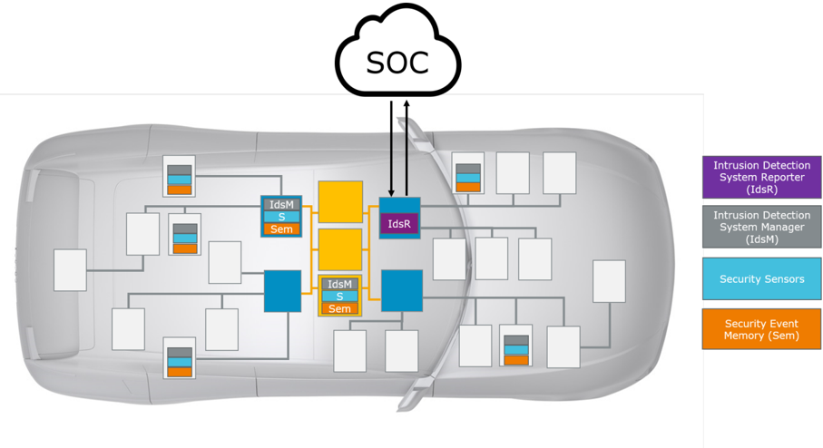

这种 IDS 的开发可以分为以下主要阶段：

1. 安全分析阶段
2. IDS 设计阶段
3. IDS 部署阶段
4. IDS 运行阶段

安全提取模板支持所有这四个阶段，既可用于 OEM 及其供应商之间的 IDS 相关定义的规格说明，也可用于其交换。因此，一个安全提取文件可能具有大量的发布周期，从安全分析开始，到特定车辆的「支持结束（**end of support**）」结束。

#### 3.1.1. 安全分析阶段

在安全分析阶段，安全专家检查并分析车辆的电子和软件系统，以识别和评估可能针对系统组件发起、并可能导致安全漏洞的攻击途径。第二步，基于这些潜在攻击途径，识别并定义与系统正常行为偏离的可检测事件，即安全事件（**Security Events**）。

这类安全事件的一个例子是接收到的端到端受保护网络消息中 CRC 校验失败。虽然一次这样的 CRC 失败可以由随机传输错误（例如电磁干扰）解释，但在短时间内大量出现该安全事件的报告、特别是仅针对某一类网络消息时，就会引起对网络系统遭受恶意攻击的怀疑。

安全提取模板通过形式化这些安全事件及其属性（例如 ID）的定义来支持该阶段。此外，AUTOSAR 还以安全提取格式提供标准化安全事件（已在第 [2.3](#23-secxt-作为标准化格式) 章提及）。

#### 3.1.2. IDS 设计阶段

IDS 设计阶段结合上一阶段识别出的安全事件，将通用的 IDS 组件分发、定制并适配到具体的车辆电子和软件系统。例如，为相关 ECU 定义 IdsM 实例，并将相应的安全事件与这些 IdsM 实例关联，同时定义过滤器以防止（例如）单个因而无害的安全事件被上报（如上面的 CRC 失败示例）。

在该阶段，安全提取模板被丰富以纳入设计决策，例如 IdsM 实例的定义、安全事件到这些实例的映射以及过滤器的配置。

#### 3.1.3. IDS 部署阶段

IDS 部署阶段包括将上一步的 IDS 设计在硬件和软件上向真实系统的落实。

安全提取模板通过定义 IdsM 实例向特定 ECU 硬件的部署、以及为经典平台上的 IdsM 模块派生 ECU 配置参数的可能性（即上游映射（**Upstream Mapping**）规则的定义，另见附录 C）来支持该阶段。

#### 3.1.4. IDS 运行阶段

IDS 运行阶段指最终客户使用车辆时在役运行的 IDS。

该阶段仍被视为开发过程的一部分，因为它通常涉及 IDS 更新过程，以使 IDS 与应用和平台软件的新版本以及新识别的攻击途径（从而新的安全事件）保持同步。

在 IDS 更新过程（**IDS update process**）中，安全提取文件可用于重新配置 IDS 的 IdsM 实例，并使 IdsR 知晓这些重新配置。

这与其他 AUTOSAR（M2 层）交换文件（例如系统描述）相比是一个显著差异；后者通常在车辆 ECU 硬件设备的最终配置为 SOP 确定之后不再演进。另一方面，由于安全提取文件参与 IDS 更新过程，它预计在其所关联的车辆 SOP 之后仍会被维护和进一步扩展。

## 4. 安全提取建模的描述

本章详细描述安全提取模板的元模型。

### 4.1. 主要模型元素概览

安全提取模板包含如图 4.1 所示的主要元素。

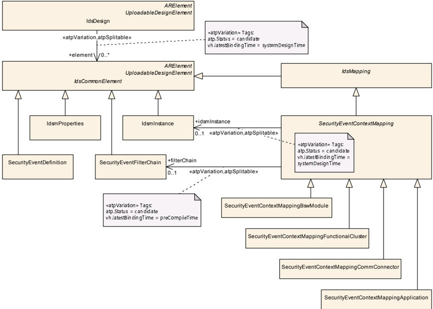

这些元素的用途如下：

- IdsDesign 是「总纲」元类，即根元素，它把所有相关的安全提取元素链接在一起，以构成并定义正在设计和实现的 IDS 的范围。
- 抽象元类 IdsCommonElement 用作安全提取元素的基类。它存在的唯一目的是被 IdsDesign 的单一角色 element 引用。
- 元类 SecurityEventDefinition 派生自 IdsCommonElement，定义一个安全事件及其一般属性。SecurityEventDefinitions 可以由开发项目的不同参与方在多个安全提取文件中提供。
- IdsmInstance 派生自 IdsCommonElement，规定一个 IdsM 实例及其系统级配置参数。
- IdsmProperties 派生自 IdsCommonElement，提供一个容器，用于定义与 IdsmInstances 相关的功能属性，这些属性可以通过相应的引用以可复用的方式应用。一个例子是对 IdsM 实例产生的网络带宽的限制。
- SecurityEventFilterChain 派生自 IdsCommonElement，定义可应用于被上报的 SecurityEventDefinitions 的各类过滤器的适用性和属性。成功通过整个过滤器链的被上报 SecurityEventDefinition 成为合格安全事件（但仍受 IdsM 的限制过滤器约束）。特定的 SecurityEventFilterChain 应用于特定的 SecurityEventDefinition 集合，由映射定义（见第 [4.4.1](#441-securityeventfilterchain-概览) 章）。
- 抽象元类 IdsMapping 派生自 IdsCommonElement，用作 SecurityEventContextMapping 以及未来版本中可能的其他映射类的基类。
- 派生自 IdsMapping 的抽象元类 SecurityEventContextMapping 用作安全事件的各类上下文相关映射定义元素的基类。它存在的唯一目的是通过在角色 element 中被引用而纳入 IdsDesign。以下具体元类派生自 SecurityEventContextMapping：
  - SecurityEventContextMappingBswModule 将 SecurityEventDefinitions 映射到 IdsmInstance，定义它们在 BSW 模块内发生的执行上下文。
  - SecurityEventContextMappingFunctionalCluster 将 SecurityEventDefinitions 映射到 IdsmInstance，定义它们在功能集群内发生的执行上下文。
  - SecurityEventContextMappingCommConnector 将 SecurityEventDefinitions 映射到 IdsmInstance，定义它们与 CommunicationConnector 相关的发生执行上下文。
  - SecurityEventContextMappingApplication 将 SecurityEventDefinitions 映射到 IdsmInstance，定义它们在应用软件内发生的执行上下文。

### 4.2. IdsDesign

**IdsDesign 的语义**：元类 IdsDesign 表示一个结构化容器，它通过角色 element 中的引用将所有相关的安全提取元素链接在一起，从而定义 IDS 设计与实现的范围（进而定义系统边界）。

将所有相关安全提取元素链接在一起的 IdsDesign 如图 4.1 所示。

表4.1：IdsDesign（**IdsDesign**）

| 属性 | 值 |
|---|---|
| 类 | IdsDesign |
| 包 | M2::AUTOSARTemplates::SecurityExtractTemplate |
| 说明 | 该元类表示 IDS 开发的 SecurityExtract 文件的根元素。它通过引用所有需要纳入 IDS 开发过程的 SecurityExtract 元类，定义要设计和实现的 IDS 的范围。Tags: atp.Status=candidate atp.recommendedPackage=IdsDesigns |
| 基类 | ARElement, ARObject, CollectableElement, Identifiable, MultilanguageReferrable, PackageableElement, Referrable, UploadableDesignElement, UploadablePackageElement |
| 聚合于 | ARPackage.element |

| 属性 | 类型 | 多重性 | 种类 | 备注 |
|---|---|---|---|---|
| element | IdsCommonElement | * | ref | 该引用将一个包含 IDS 相关定义的元素纳入 IdsDesign。Stereotypes: atpSplitable; atpVariation Tags: atp.Splitkey=element.idsCommonElement, element.variationPoint.shortLabel atp.Status=candidate vh.latestBindingTime=systemDesignTime |

请注意，被 IdsDesign 直接引用的元类同样继承自通用抽象元类 ARElement，因此允许在任何 ARPackage 内以自包含的方式实例化。这种建模使得尚未与具体 IdsDesign 关联的安全提取内容的定义和交换成为可能（例如仅与特定功能相关、作为对开发中 IDS 的贡献的 SecurityEventDefinitions）。这类与具体 IdsDesign 无关的安全提取内容的一个例子，是通用定义 [\[6\]](#ref-6) 中 AUTOSAR 标准化安全事件的规格说明。

### 4.3. 安全事件的定义

**SecurityEventDefinition 的语义**：SecurityEventDefinition 表示一个具有预定义属性的、安全相关事件的原子单元，它由安全传感器上报并由 IdsM 进一步处理。

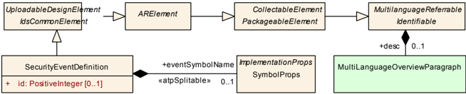

表4.2：SecurityEventDefinition（**SecurityEventDefinition**）

| 属性 | 值 |
|---|---|
| 类 | SecurityEventDefinition |
| 包 | M2::AUTOSARTemplates::SecurityExtractTemplate |
| 说明 | 该元类将一个安全相关事件定义为入侵检测系统的一部分。Tags: atp.Status=candidate atp.recommendedPackage=SecurityEventDefinitions |
| 基类 | ARElement, ARObject, CollectableElement, Identifiable, IdsCommonElement, MultilanguageReferrable, PackageableElement, Referrable, UploadableDesignElement, UploadablePackageElement |
| 聚合于 | ARPackage.element |

| 属性 | 类型 | 多重性 | 种类 | 备注 |
|---|---|---|---|---|
| eventSymbolName | SymbolProps | 0..1 | aggr | 该聚合为 SecurityEventDefinition 可选地定义一个替代事件名（**Event Name**），用于 shortName 冲突的情况。Stereotypes: atpSplitable Tags: atp.Splitkey=eventSymbolName.shortName atp.Status=candidate |
| id | PositiveInteger | 0..1 | attr | 该属性表示所定义安全事件的数值标识。该标识在 IDS 范围内必须唯一。Tags: atp.Status=candidate |

#### 4.3.1. 安全事件的属性

**SecurityEventDefinition 的 EventName**：SecurityEventDefinition 应由一个符号化的 EventName 命名和引用，该 EventName 由大写字母和下划线字符组成，并带有指示该安全事件来源 BSW 模块（经典平台）或来源功能集群（自适应平台）的缩写前缀（例如 KEYM\_CERTIFICATE\_FAILED）。在安全提取中，SecurityEventDefinition 的实例应使用该 EventName 作为其 shortName。

**SecurityEventDefinition 的替代 EventName**：如果合并来自不同来源的 SecurityEventDefinitions 时检测到其 shortName 冲突，则应使用聚合的 SymbolProps（在角色 eventSymbolName 中）为冲突的 SecurityEventDefinition 定义一个替代 EventName。通过角色 eventSymbolName 定义的 EventName 优先于由 shortName 定义的 EventName。

SecurityEventDefinition 的实例需要能够通过其 id 唯一标识（即在 IDS 范围内）：

**属性 SecurityEventDefinition.id 的语义**：属性 id 应为 SecurityEventDefinition 定义用于外部标识（即 IdsM 实例之外）的数值。

**约束：属性 SecurityEventDefinition.id 的有效区间**：属性 SecurityEventDefinition.id 的有效区间为 0..65535。

**约束：SecurityEventDefinition.id 的唯一性**：在 IDS 范围内，即对于被同一 IdsDesign 引用的所有 SecurityEventDefinitions，不得存在任何其他 SecurityEventDefinition 的属性 id 与其取值相同。

**SecurityEventDefinition 的文本描述**：SecurityEventDefinition 在角色 desc 中聚合的 MultiLanguageOverviewParagraph 应用于该安全事件的简要文本描述。

这些 SecurityEventDefinitions 的简要文本描述可以（例如）被汇总为概览表。

#### 4.3.2. 被映射安全事件的属性

除了第 [4.3.1](#431-安全事件的属性) 章描述的 SecurityEventDefinition 的一般属性之外，SecurityEventDefinition 还有一些只能在其实际使用的具体上下文中定义的属性，特别是在其到 IdsmInstance 的映射已定义时（见第 [4.6](#46-安全事件映射概览) 章）。依赖于映射的 SecurityEventDefinition 附加属性由元类 SecurityEventContextProps 定义，并在第 [4.6.1](#461-安全事件到-idsm-实例的映射) 章中详细描述。

### 4.4. 安全事件的过滤

一般而言，被上报的安全事件不会立即成为合格安全事件，而是需要通过一组明确定义的条件检查才能变为合格。

这些条件检查按以下顺序依次执行：

- 默认上报模式（见第 [4.6.1.2](#4612-默认上报模式定义) 章）
- 过滤器链（见第 [4.4.1](#441-securityeventfilterchain-概览) 章）

在合格安全事件成功通过这些安全事件特定的过滤器之后，还会应用对 IdsM 实例通用的一些附加过滤器，以减少可能非常高的安全事件传入速率：

- 限制过滤器（见第 [4.5](#45-限制过滤器) 章）

上报模式和过滤器链检查（上述前两步）围绕抽象元类 SecurityEventContextMapping 建模，只影响被引用的 SecurityEventDefinitions；而限制过滤器（第三步）单独建模，因为它应用于整个 IdsM 实例及其所有 SecurityEventDefinitions。

**预合格安全事件的定义**：预合格安全事件——例如由智能安全传感器（即具备高级检测和处理能力的传感器）上报、并由 IdsM 实例立即作为合格安全事件处理——应定义为具有空过滤器链的安全事件。

请注意，这些预合格安全事件仍受限制过滤器的约束。

#### 4.4.1. SecurityEventFilterChain 概览

SecurityEventFilterChain 包含可按标准化顺序应用于安全事件发生的过滤算法定义。

**SecurityEventFilterChain 的过滤语义**：SecurityEventFilterChain 为其包含的每个过滤算法定义该算法是应当以指定的过滤算法参数应用，还是不应用。所包含过滤算法的应用顺序是标准化的。

**SecurityEventFilterChain 对 SecurityEventDefinitions 的适用性**：特定的 SecurityEventFilterChain 只应应用于通过抽象元类 SecurityEventContextMapping 的派生元类映射到该 SecurityEventFilterChain 的那些 SecurityEventDefinitions。

该映射在第 [4.6](#46-安全事件映射概览) 章中详细描述。

图 4.3 给出安全事件过滤器链建模的概览。

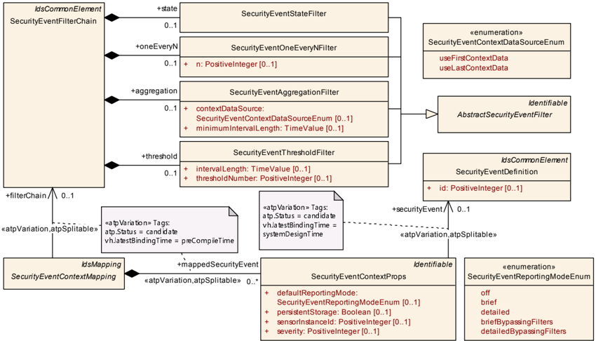

表4.3：SecurityEventFilterChain（**SecurityEventFilterChain**）

| 属性 | 值 |
|---|---|
| 类 | SecurityEventFilterChain |
| 包 | M2::AUTOSARTemplates::SecurityExtractTemplate |
| 说明 | 该元类表示用于合格化安全事件的可配置过滤器链。该过滤器链的各个过滤器按以下顺序应用：SecurityEventStateFilter、SecurityEventOneEveryNFilter、SecurityEventAggregationFilter、SecurityEventThresholdFilter。Tags: atp.Status=candidate atp.recommendedPackage=SecurityFilterChains |
| 基类 | ARElement, ARObject, CollectableElement, Identifiable, IdsCommonElement, MultilanguageReferrable, PackageableElement, Referrable, UploadableDesignElement, UploadablePackageElement |
| 聚合于 | ARPackage.element |

| 属性 | 类型 | 多重性 | 种类 | 备注 |
|---|---|---|---|---|
| aggregation | SecurityEventAggregationFilter | 0..1 | aggr | 该聚合表示过滤器链中的聚合过滤器。Tags: atp.Status=candidate |
| oneEveryN | SecurityEventOneEveryNFilter | 0..1 | aggr | 该聚合表示过滤器链中的采样过滤器。Tags: atp.Status=candidate |
| state | SecurityEventStateFilter | 0..1 | aggr | 该聚合表示事件链中的状态过滤器。Tags: atp.Status=candidate |
| threshold | SecurityEventThresholdFilter | 0..1 | aggr | 该聚合表示过滤器链中的阈值过滤器。Tags: atp.Status=candidate |

注意：AbstractSecurityEventFilter 用作抽象元类，表示明确定义的过滤算法的具体元类均派生自它。这些明确定义的过滤器构成过滤器链。

表4.4：AbstractSecurityEventFilter（**AbstractSecurityEventFilter**）

| 属性 | 值 |
|---|---|
| 类 | AbstractSecurityEventFilter（抽象） |
| 包 | M2::AUTOSARTemplates::SecurityExtractTemplate |
| 说明 | 该元类用作安全事件过滤器的基类。Tags: atp.Status=candidate |
| 基类 | ARObject, Identifiable, MultilanguageReferrable, Referrable |
| 子类 | SecurityEventAggregationFilter, SecurityEventOneEveryNFilter, SecurityEventStateFilter, SecurityEventThresholdFilter |

| 属性 | 类型 | 多重性 | 种类 | 备注 |
|---|---|---|---|---|
| – | – | – | – | – |

#### 4.4.2. SecurityEventStateFilter

**SecurityEventStateFilter 的语义**：SecurityEventStateFilter 定义功能「State Filter」的阻断过滤器，同时适用于经典平台和自适应平台。如果（分别为 CP 和 AP）引用的任一状态处于活动状态，则被上报的 SecurityEventDefinition 应被 IdsM 丢弃。对于经典平台，可能的活动状态由 blockIfStateActiveCp 引用。对于自适应平台，可能的活动状态由 blockIfStateActiveAp 引用。

请注意，指示当前活动状态的状态机在经典平台和自适应平台上的定义方式不同。

**约束：SecurityEventStateFilter 在 CP 或 AP 上的无歧义定义**：对于 SecurityEventStateFilter，应定义角色 blockIfStateActiveCp 中的引用或角色 blockIfStateActiveAp 中的引用之一，以确保 SecurityEventStateFilter 对经典平台或自适应平台的适用性无歧义。

**约束：SecurityEventStateFilter 在 CP 上对 BlockState 的引用限制**：对于经典平台上的 SecurityEventStateFilter，角色 blockIfStateActiveCp 中的引用应只引用那些由（通过 SecurityEventContextMapping）映射到该 SecurityEventFilterChain 的 IdsmInstance 在角色 blockState 中聚合的 BlockState，而该 SecurityEventStateFilter 是该过滤器链的一部分。

换言之，如果某个 BlockState 不属于该 SecurityEventStateFilter（通过外层 SecurityEventFilterChain 和 SecurityEventContextMapping 的映射）所应用的那个 IdsmInstance，则经典平台上的 SecurityEventStateFilter 不应在角色 blockIfStateActiveCp 中引用该 BlockState。

请注意，SecurityEventContextMapping 还定义了 mappedSecurityEvents。这意味着在给定的 IdsmInstance 上，SecurityEventDefinition 总是（通过 SecurityEventContextMapping）与零个或一个特定的 SecurityEventFilterChain 关联。在后一种情况下，如果 SecurityEventStateFilter 是该 SecurityEventFilterChain 的一部分，则该 SecurityEventDefinition 最终被映射到可能不同的一组 BlockState，这些 BlockState 中的任何一个处于活动状态都会导致该 SecurityEventDefinition 在过滤器求值期间被丢弃。

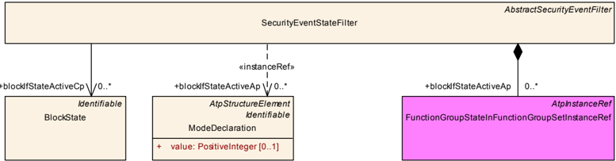

表4.5：SecurityEventStateFilter（**SecurityEventStateFilter**）

| 属性 | 值 |
|---|---|
| 类 | SecurityEventStateFilter |
| 包 | M2::AUTOSARTemplates::SecurityExtractTemplate |
| 说明 | 该元类表示安全事件状态过滤器的配置。被引用的状态表示一个阻止列表（**block list**），即当被引用状态是相关状态机（取决于 IdsM 实例运行于经典平台还是自适应平台）中的活动状态时，安全事件被丢弃。Tags: atp.Status=candidate |
| 基类 | ARObject, AbstractSecurityEventFilter, Identifiable, MultilanguageReferrable, Referrable |
| 聚合于 | SecurityEventFilterChain.state |

| 属性 | 类型 | 多重性 | 种类 | 备注 |
|---|---|---|---|---|
| blockIfStateActiveAp | ModeDeclaration | * | iref | 对于 AP，该引用定义阻止列表的机器状态。也就是说，当机器处于阻止列表中的某个状态时，如果（映射到 SecurityEventStateFilter 所属过滤器链的）安全事件被上报，IdsM 应丢弃被上报的安全事件。Tags: atp.Status=candidate InstanceRef implemented by: FunctionGroupStateInFunctionGroupSetInstanceRef |
| blockIfStateActiveCp | BlockState | * | ref | 对于 CP，该引用定义阻止列表的状态。也就是说，当 IdsM 中当前活动的阻断状态是被引用的阻止列表状态之一时，如果（映射到 SecurityEventStateFilter 所属过滤器链的）安全事件被上报，IdsM 应丢弃被上报的安全事件。Tags: atp.Status=candidate |

##### 4.4.2.1. 经典平台的 SecurityEventStateFilter

**CP 的 SecurityEventStateFilter 语义**：对于经典平台，如果（映射到 SecurityEventStateFilter 所属 SecurityEventFilterChain 的）SecurityEventDefinition 被上报给 IdsM，而 IdsM 中当前活动的 BlockState 与角色 blockIfStateActiveCp 中引用的某个 BlockState 匹配，则 IdsM 应丢弃被上报的 SecurityEventDefinition。

##### 4.4.2.2. 自适应平台的 SecurityEventStateFilter

**AP 的 SecurityEventStateFilter 语义**：对于自适应平台，如果（映射到 SecurityEventStateFilter 所属 SecurityEventFilterChain 的）SecurityEventDefinition 被上报给 IdsM，而当前活动的机器状态与角色 blockIfStateActiveAp 中引用的某个机器状态匹配，则 IdsM 应丢弃被上报的 SecurityEventDefinition。

#### 4.4.3. SecurityEventOneEveryNFilter

**SecurityEventOneEveryNFilter 的语义**：SecurityEventOneEveryNFilter 定义功能「Forward Every Nth」的采样过滤器，其中 N 由属性 n 定义。每第 n 个安全事件通过该过滤器进入过滤器链的下一级。

**约束：属性 SecurityEventOneEveryNFilter.n 的有效区间**：属性 SecurityEventOneEveryNFilter.n 的有效区间为 1..65535。

表4.6：SecurityEventOneEveryNFilter（**SecurityEventOneEveryNFilter**）

| 属性 | 值 |
|---|---|
| 类 | SecurityEventOneEveryNFilter |
| 包 | M2::AUTOSARTemplates::SecurityExtractTemplate |
| 说明 | 该元类表示安全事件采样（即每 n 个事件采样一个）过滤器的配置。Tags: atp.Status=candidate |
| 基类 | ARObject, AbstractSecurityEventFilter, Identifiable, MultilanguageReferrable, Referrable |
| 聚合于 | SecurityEventFilterChain.oneEveryN |

| 属性 | 类型 | 多重性 | 种类 | 备注 |
|---|---|---|---|---|
| n | PositiveInteger | 0..1 | attr | 该属性表示采样过滤器的配置，即它配置参数「n」，控制在一个采样事件之后应丢弃多少个事件（n-1 个）才创建新的采样。Tags: atp.Status=candidate |

#### 4.4.4. SecurityEventAggregationFilter

**SecurityEventAggregationFilter 的语义**：SecurityEventAggregationFilter 定义功能「aggregation filter」的累积过滤器。它对每个连续时间区间 minimumIntervalLength 统计特定 SecurityEventDefinition 的出现次数。如果在一个时间区间结束时该数字大于零，则包含该数字和可选上下文数据的聚合安全事件被传递到过滤器链的下一级。

**约束：属性 SecurityEventAggregationFilter.minimumIntervalLength 的有效区间**：属性 SecurityEventAggregationFilter.minimumIntervalLength 的有效区间为 ]0..INF[ 秒。

**属性 SecurityEventAggregationFilter.contextDataSource 的语义**：属性 contextDataSource 定义——当 SecurityEventAggregationFilter 的合格条件满足时——应将该时间区间内第一个还是最后一个被上报的 SecurityEventDefinition 的上下文数据附加到由此产生的聚合安全事件上。

表4.7：SecurityEventAggregationFilter（**SecurityEventAggregationFilter**）

| 属性 | 值 |
|---|---|
| 类 | SecurityEventAggregationFilter |
| 包 | M2::AUTOSARTemplates::SecurityExtractTemplate |
| 说明 | 该元类表示聚合过滤器，它将在配置的时间窗口内发生的所有安全事件聚合为一个（即最后上报的）安全事件。Tags: atp.Status=candidate |
| 基类 | ARObject, AbstractSecurityEventFilter, Identifiable, MultilanguageReferrable, Referrable |
| 聚合于 | SecurityEventFilterChain.aggregation |

| 属性 | 类型 | 多重性 | 种类 | 备注 |
|---|---|---|---|---|
| contextDataSource | SecurityEventContextDataSourceEnum | 0..1 | attr | 该属性定义应使用第一个还是最后一个时间聚合安全事件的上下文数据作为由此产生的合格安全事件。 |
| minimumIntervalLength | TimeValue | 0..1 | attr | 该属性表示聚合过滤器最小时间窗口（秒）的配置。Tags: atp.Status=candidate |

表4.8：SecurityEventContextDataSourceEnum（**SecurityEventContextDataSourceEnum**）

| 属性 | 值 |
|---|---|
| 枚举 | SecurityEventContextDataSourceEnum |
| 包 | M2::AUTOSARTemplates::SecurityExtractTemplate |
| 说明 | 该枚举控制用于生成由此产生的合格安全事件的元素 Tags: atp.Status=candidate |
| 聚合于 | SecurityEventAggregationFilter.contextDataSource |

| 字面值 | 描述 |
|---|---|
| useFirstContextData | 第一个接收到的安全事件的上下文数据应用于由此产生的合格安全事件。Tags: atp.EnumerationLiteralIndex=0 atp.Status=candidate |
| useLastContextData | 最后一个接收到的安全事件的上下文数据应用于由此产生的合格安全事件。Tags: atp.EnumerationLiteralIndex=1 atp.Status=candidate |

#### 4.4.5. SecurityEventThresholdFilter

**SecurityEventThresholdFilter 的语义**：SecurityEventThresholdFilter 定义功能「threshold filter」的累积过滤器。它在每个连续时间区间 intervalLength 内丢弃特定 SecurityEventDefinition 的前 thresholdNumber-1 次出现。同一时间区间内后续上报的所有安全事件都被传递到过滤器链的下一级。

**约束：属性 SecurityEventThresholdFilter.intervalLength 的有效区间**：属性 SecurityEventThresholdFilter.intervalLength 的有效区间为 ]0..INF[ 秒。

**约束：属性 SecurityEventThresholdFilter.thresholdNumber 的有效区间**：属性 SecurityEventThresholdFilter.thresholdNumber 的有效区间为 1..INF[。

表4.9：SecurityEventThresholdFilter（**SecurityEventThresholdFilter**）

| 属性 | 值 |
|---|---|
| 类 | SecurityEventThresholdFilter |
| 包 | M2::AUTOSARTemplates::SecurityExtractTemplate |
| 说明 | 该元类表示阈值过滤器，它（在每个可配置时间区间的开始处反复）丢弃可配置数量的安全事件。所有随后到达的安全事件（在配置的时间区间内）都通过该过滤器。Tags: atp.Status=candidate |
| 基类 | ARObject, AbstractSecurityEventFilter, Identifiable, MultilanguageReferrable, Referrable |
| 聚合于 | SecurityEventFilterChain.threshold |

| 属性 | 类型 | 多重性 | 种类 | 备注 |
|---|---|---|---|---|
| intervalLength | TimeValue | 0..1 | attr | 该属性为一次阈值过滤器操作配置时间区间（秒）。Tags: atp.Status=candidate |
| thresholdNumber | PositiveInteger | 0..1 | attr | 该属性配置阈值数量，即在配置的时间窗口内应丢弃多少个安全事件，后续事件才开始通过过滤器。Tags: atp.Status=candidate |

#### 4.4.6. 被上报安全事件的最终合格化

**SecurityEventDefinition 的最终合格化**：未被 defaultReportingMode 阻断、并已按配置成功通过某个 SecurityEventFilterChain 的所有过滤器的被上报 SecurityEventDefinition，成为合格安全事件（**QSEv**）。

注意：在发送到网络之前，该 QSEv 仍受限制过滤（如果已配置）的约束。请参见第 [4.5](#45-限制过滤器) 章。

### 4.5. 限制过滤器

安全事件可能在短时间内大量出现。因此，如果需要限制发送合格安全事件（**QSEv**）消息的网络带宽，以免对剩余的网络通信造成显著的负面影响，则可以应用限制过滤器（**limitation filters**）。

由于限制过滤器的属性通常需要依赖于运行 IdsM 实例的 ECU 的网络连接属性来定义，因此具体配置的限制过滤器与 IdsmInstance 关联，而不是与 SecurityEventDefinitions 关联。

因此，表示限制过滤器的元类 IdsmRateLimitation 和 IdsmTrafficLimitation 聚合在 IdsmProperties 中，如图 4.5 所示。

IdsmInstance 可以通过分别在角色 rateLimitationFilter 或 trafficLimitationFilter 中引用一个或两者，来使用特定的 IdsmRateLimitation 和/或 IdsmTrafficLimitation 过滤器。

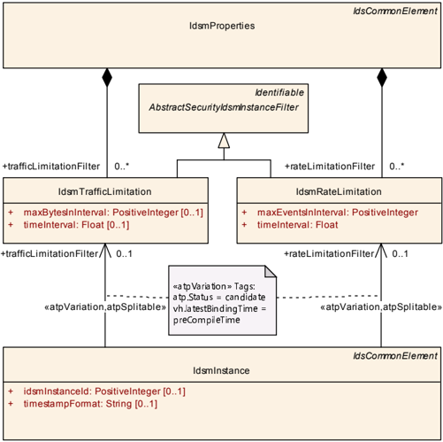

#### 4.5.1. 速率限制过滤器

**IdsmRateLimitation 的语义**：IdsmRateLimitation 定义速率限制过滤器。在每个连续时间区间 timeInterval 内，当已发送 QSEv 消息的累计数量超过 maxEventsInInterval 时，同一时间区间内的所有后续 QSEv 消息都不再发送到网络，而是被丢弃。

**约束：属性 IdsmRateLimitation.timeInterval 的有效区间**：属性 IdsmRateLimitation.timeInterval 的有效区间为 0..65535 秒。

**约束：属性 IdsmRateLimitation.maxEventsInInterval 的有效区间**：属性 IdsmRateLimitation.maxEventsInInterval 的有效区间为 0..(2^64^-1)。

表4.10：IdsmRateLimitation（**IdsmRateLimitation**）

| 属性 | 值 |
|---|---|
| 类 | IdsmRateLimitation |
| 包 | M2::AUTOSARTemplates::SecurityExtractTemplate |
| 说明 | 该元类表示安全事件速率限制过滤器的配置。这意味着如果在可配置的时间窗口内处理的事件数量（任何类型）大于可配置的阈值，则安全事件被丢弃。Tags: atp.Status=candidate |
| 基类 | ARObject, AbstractSecurityIdsmInstanceFilter, Identifiable, MultilanguageReferrable, Referrable |
| 聚合于 | IdsmProperties.rateLimitationFilter |

| 属性 | 类型 | 多重性 | 种类 | 备注 |
|---|---|---|---|---|
| maxEventsInInterval | PositiveInteger | 1 | attr | 该属性配置在相应时间区间内所有被处理安全事件的数量超过阈值时丢弃安全事件的阈值。Tags: atp.Status=candidate |
| timeInterval | Float | 1 | attr | 该属性配置相应时间区间内所有被处理安全事件的数量超过可配置阈值时丢弃安全事件的时间区间长度（秒）。Tags: atp.Status=candidate |

#### 4.5.2. 流量限制过滤器

**IdsmTrafficLimitation 的语义**：IdsmTrafficLimitation 定义流量限制过滤器。在每个连续时间区间 timeInterval 内，当已发送 QSEv 消息的累计大小超过 maxBytesInInterval 时，同一时间区间内的所有后续 QSEv 消息都不再发送到网络，而是被丢弃。

**约束：属性 IdsmTrafficLimitation.timeInterval 的有效区间**：属性 IdsmTrafficLimitation.timeInterval 的有效区间为 0..65535 秒。

**约束：属性 IdsmTrafficLimitation.maxBytesInInterval 的有效区间**：属性 IdsmTrafficLimitation.maxBytesInInterval 的有效区间为 0..(2^64^-1)。

表4.11：IdsmTrafficLimitation（**IdsmTrafficLimitation**）

| 属性 | 值 |
|---|---|
| 类 | IdsmTrafficLimitation |
| 包 | M2::AUTOSARTemplates::SecurityExtractTemplate |
| 说明 | 该元类表示安全事件流量限制过滤器的配置。这意味着如果在可配置的时间窗口内处理的安全事件（任何类型）的大小（带宽方面）大于可配置的阈值，则安全事件被丢弃。Tags: atp.Status=candidate |
| 基类 | ARObject, AbstractSecurityIdsmInstanceFilter, Identifiable, MultilanguageReferrable |
| 聚合于 | IdsmProperties.trafficLimitationFilter |

| 属性 | 类型 | 多重性 | 种类 | 备注 |
|---|---|---|---|---|
| maxBytesInInterval | PositiveInteger | 0..1 | attr | 该属性配置在相应时间区间内所有被处理安全事件的大小超过阈值时丢弃安全事件的阈值。Tags: atp.Status=candidate |
| timeInterval | Float | 0..1 | attr | 该属性配置相应时间区间内所有被处理安全事件的大小超过可配置阈值时丢弃安全事件的时间区间长度（秒）。Tags: atp.Status=candidate |

### 4.6. 安全事件映射概览

SecurityEventDefinitions 的映射服务于以下三个主要目的：

1. 将 SecurityEventDefinition 与应当能够上报它的 IdsmInstance 关联起来；
2. 将 SecurityEventDefinition 与适用于它的 SecurityEventFilterChain 关联起来；
3. 添加 SecurityEventDefinition 可能发生的执行上下文的信息。

为满足这三个目的，抽象元类 SecurityEventContextMapping 具有以下派生的具体元类（另见图 4.6）：

- SecurityEventContextMappingBswModule
- SecurityEventContextMappingFunctionalCluster
- SecurityEventContextMappingCommConnector
- SecurityEventContextMappingApplication

这些具体元类将它们各自的执行上下文信息添加到 SecurityEventDefinitions 到 IdsmInstance 的映射中。

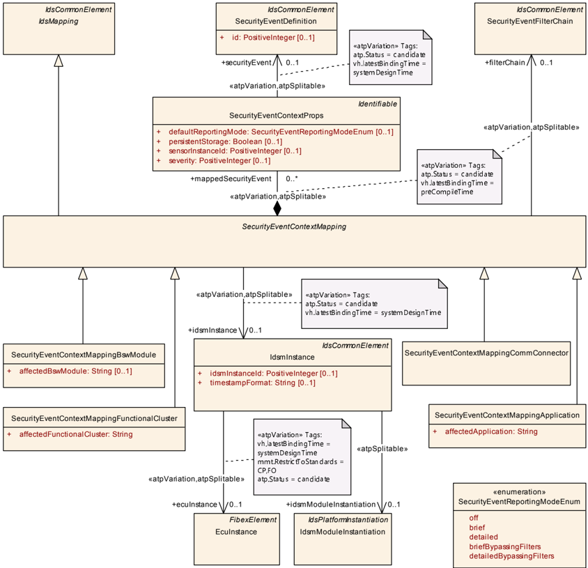

#### 4.6.1. 安全事件到 IdsM 实例的映射

**SecurityEventContextMapping 的语义**：抽象元类 SecurityEventContextMapping 将（分别在角色 securityEvent 中被聚合在角色 mappedSecurityEvent 中的 SecurityEventContextProps 所引用的）SecurityEventDefinitions 映射到角色 idsmInstance 中引用的 IdsmInstance。

由于 IdsmInstance 自身引用 EcuInstance（经典平台）或 IdsmModuleInstantiation（自适应平台），而后者又聚合于 Machine，因此 SecurityEventDefinitions 到 IdsmInstance 的映射隐含地也定义了这些 SecurityEventDefinitions 到 EcuInstance 或 Machine 的映射（分别对应 CP 和 AP）。

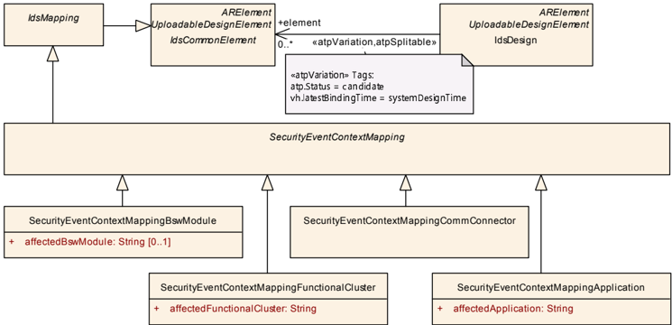

表4.12：SecurityEventContextMapping（**SecurityEventContextMapping**）

| 属性 | 值 |
|---|---|
| 类 | SecurityEventContextMapping（抽象） |
| 包 | M2::AUTOSARTemplates::SecurityExtractTemplate |
| 说明 | 该元类表示在安全事件集合、处理这些安全事件的 IdsM 实例以及适用于这些安全事件的过滤器链之间建立关联的能力。Tags: atp.Status=candidate |
| 基类 | ARElement, ARObject, CollectableElement, Identifiable, IdsCommonElement, IdsMapping, MultilanguageReferrable, PackageableElement, Referrable, UploadableDesignElement, UploadablePackageElement |
| 子类 | SecurityEventContextMappingApplication, SecurityEventContextMappingBswModule, SecurityEventContextMappingCommConnector, SecurityEventContextMappingFunctionalCluster |
| 聚合于 | ARPackage.element |

| 属性 | 类型 | 多重性 | 种类 | 备注 |
|---|---|---|---|---|
| filterChain | SecurityEventFilterChain | 0..1 | ref | 该引用定义应用于每个被引用安全事件的过滤器链（取决于上报模式）。Stereotypes: atpSplitable; atpVariation Tags: atp.Splitkey=filterChain.securityEventFilterChain, filterChain.variationPoint.shortLabel atp.Status=candidate vh.latestBindingTime=preCompileTime |
| idsmInstance | IdsmInstance | 0..1 | ref | 该引用定义安全事件映射到其上的 IdsmInstance。Stereotypes: atpSplitable; atpVariation Tags: atp.Splitkey=idsmInstance.idsmInstance, idsmInstance.variationPoint.shortLabel atp.Status=candidate vh.latestBindingTime=systemDesignTime |
| mappedSecurityEvent | SecurityEventContextProps | * | aggr | 该聚合表示（通过进一步的引用）要映射到 IdsmInstance 的、带有额外映射相关属性的 SecurityEventDefinitions。Stereotypes: atpSplitable; atpVariation Tags: atp.Splitkey=mappedSecurityEvent.shortName, mappedSecurityEvent.variationPoint.shortLabel atp.Status=candidate vh.latestBindingTime=preCompileTime |

**SecurityEventContextProps 的语义**：SecurityEventContextMapping 在角色 mappedSecurityEvent 中聚合的元类 SecurityEventContextProps 包含适用于角色 securityEvent 中引用的 SecurityEventDefinition 的映射相关属性。因此，这些属性仅在 [TPS\_SECXT\_01016] 规定的该 SecurityEventDefinition 到 IdsmInstance 的映射上下文中相关。

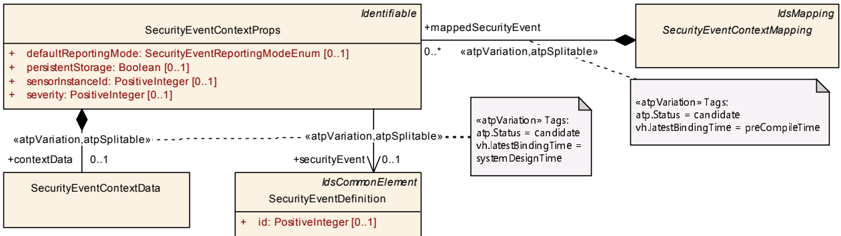

表4.13：SecurityEventContextProps（**SecurityEventContextProps**）

| 属性 | 值 |
|---|---|
| 类 | SecurityEventContextProps |
| 包 | M2::AUTOSARTemplates::SecurityExtractTemplate |
| 说明 | 该元类规定要映射到 IdsmInstance 的 SecurityEventDefinition，并为该安全事件添加仅对此特定映射有效的映射相关属性。Tags: atp.Status=candidate |
| 基类 | ARObject, Identifiable, MultilanguageReferrable, Referrable |
| 聚合于 | SecurityEventContextMapping.mappedSecurityEvent |

| 属性 | 类型 | 多重性 | 种类 | 备注 |
|---|---|---|---|---|
| contextData | SecurityEventContextData | 0..1 | aggr | 该聚合表示安全事件的可选上下文数据的定义。Stereotypes: atpSplitable; atpVariation Tags: atp.Splitkey=contextData, contextData.variationPoint.shortLabel atp.Status=candidate vh.latestBindingTime=systemDesignTime |
| defaultReportingMode | SecurityEventReportingModeEnum | 0..1 | attr | 该属性定义被引用安全事件的默认上报模式。Tags: atp.Status=candidate |
| persistentStorage | Boolean | 0..1 | attr | 该属性控制被引用安全事件的合格上报是否应由被映射的 IdsmInstance 持久存储。Tags: atp.Status=candidate |
| securityEvent | SecurityEventDefinition | 0..1 | ref | 该引用定义被映射并由 SecurityEventMappingProps 以映射相关属性加以丰富的安全事件。Stereotypes: atpSplitable; atpVariation Tags: atp.Splitkey=securityEvent.securityEventDefinition, securityEvent.variationPoint.shortLabel atp.Status=candidate vh.latestBindingTime=systemDesignTime |
| sensorInstanceId | PositiveInteger | 0..1 | attr | 该属性定义检测被引用安全事件的安全传感器的 ID。Tags: atp.Status=candidate |
| severity | PositiveInteger | 0..1 | attr | 该属性定义被引用安全事件的严重程度/严重性。请注意，目前特定整数值的严重级别含义并未由 AUTOSAR 规定，而是留给负责 IDS 系统设计的一方（例如 OEM）。Tags: atp.Status=candidate |

##### 4.6.1.1. 上下文数据定义

对于某些安全事件，安全传感器可以提供额外的上下文数据以向 IdsM 上报，从而更好地支持（例如）对可能安全威胁的分析。

**SecurityEventContextData 的语义**：如果可以在 SecurityEventDefinition 被上报给 IdsM 时为其添加额外的上下文数据，则 SecurityEventContextData 应由（在角色 securityEvent 中引用该 SecurityEventDefinition 的）SecurityEventContextProps 聚合。

注意：SecurityEventContextData 的聚合意味着 SecurityEventDefinition 的上下文数据可用性是与其到 IdsmInstance 的映射一起定义的，即在 IDS 设计阶段而非（按照第 [3.1](#31-ids-的主要开发阶段) 章的）安全分析阶段定义。

建模注记：选择聚合（在本版本中）没有属性的 SecurityEventContextData 作为建模方式，是为了确保更好的未来可扩展性。

##### 4.6.1.2. 默认上报模式定义

**属性 SecurityEventContextProps.defaultReportingMode 的语义**：SecurityEventContextProps 的属性 defaultReportingMode 按如下方式定义适用于角色 securityEvent 中引用的 SecurityEventDefinition 的默认上报模式：

- off：被上报的安全事件不再被 IdsM 进一步处理，因此被丢弃。
- brief：只处理主要的安全事件属性（例如其 ID）。任何额外的上下文数据（如果存在）被丢弃。
- detailed：被上报安全事件的主要属性和上下文数据（如果存在）都被进一步处理。
- briefBypassingFilters：被上报的安全事件（不含其上下文数据，如果存在）被进一步处理，但绕过 SecurityEventFilterChain。
- detailedBypassingFilter：被上报的安全事件（含其上下文数据，如果存在）被进一步处理，但绕过 SecurityEventFilterChain。

请注意，在 IdsM 运行期间，特定 SecurityEventDefinition 的上报模式可以通过诊断服务更改。

表4.14：SecurityEventReportingModeEnum（**SecurityEventReportingModeEnum**）

| 属性 | 值 |
|---|---|
| 枚举 | SecurityEventReportingModeEnum |
| 包 | M2::AUTOSARTemplates::SecurityExtractTemplate |
| 说明 | 该枚举控制安全事件的上报模式。Tags: atp.Status=candidate |
| 聚合于 | SecurityEventContextProps.defaultReportingMode |

| 字面值 | 描述 |
|---|---|
| brief | 只处理主要的安全事件属性（例如其 ID）。任何额外的上下文数据（如果存在）被丢弃。Tags: atp.EnumerationLiteralIndex=1 atp.Status=candidate |
| briefBypassingFilters | 被上报的安全事件（不含其上下文数据，如果存在）被进一步处理，但绕过过滤器链。Tags: atp.EnumerationLiteralIndex=3 atp.Status=candidate |
| detailed | 被上报安全事件的主要属性和上下文数据（如果存在）都被进一步处理。Tags: atp.EnumerationLiteralIndex=2 atp.Status=candidate |
| detailedBypassingFilters | 被上报的安全事件（含其上下文数据，如果存在）被进一步处理，但绕过过滤器链。Tags: atp.EnumerationLiteralIndex=4 atp.Status=candidate |
| off | 被上报的安全事件不再被 IdsM 进一步处理，因此被丢弃。Tags: atp.EnumerationLiteralIndex=0 atp.Status=candidate |

##### 4.6.1.3. 持久存储定义

**属性 SecurityEventContextProps.persistentStorage 的语义**：SecurityEventContextProps 的属性 persistentStorage 定义角色 securityEvent 中引用的 SecurityEventDefinition 的合格上报事件是否应由其被引用 SecurityEventDefinition 所映射到的 IdsmInstance 持久存储：

false：被映射的 IdsmInstance 不应持久存储角色 securityEvent 中引用的 SecurityEventDefinition 的合格上报事件。

true：被映射的 IdsmInstance 应持久存储角色 securityEvent 中引用的 SecurityEventDefinition 的合格上报事件。

##### 4.6.1.4. 严重级别定义

**属性 SecurityEventContextProps.severity 的语义**：SecurityEventContextProps 的属性 severity 定义应用于角色 securityEvent 中引用的 SecurityEventDefinition 的严重级别。指定的严重级别应仅在 [TPS\_SECXT\_01016] 规定的该 SecurityEventDefinition 到 IdsmInstance 的映射上下文中相关。

请注意，与属性 severity 的特定正整数值相关联的严重级别含义目前并未由 AUTOSAR 规定，而必须由负责 IDS 系统设计的一方（例如 OEM）定义。

##### 4.6.1.5. 传感器实例 ID 定义

**属性 SecurityEventContextProps.sensorInstanceId 的语义**：SecurityEventContextProps 的属性 sensorInstanceId 定义检测角色 securityEvent 中引用的 SecurityEventDefinition 的安全传感器的数值标识。指定的 sensorInstanceId 应仅在 [TPS\_SECXT\_01016] 规定的该 SecurityEventDefinition 到 IdsmInstance 的映射上下文中相关。

#### 4.6.2. 带 BSW 模块上下文的安全事件映射

**SecurityEventContextMappingBswModule 的语义**：对于经典平台，SecurityEventContextMappingBswModule 定义被映射的 SecurityEventDefinitions 可以在由属性 affectedBswModule 定义为名称的、被映射 IdsmInstance 上的 BSW 模块的执行上下文中发生。

**由 SecurityEventContextMappingBswModule 将安全事件映射到过滤器链**：通过 SecurityEventContextMappingBswModule 聚合的 SecurityEventContextProps 映射的每个 SecurityEventDefinition，都应作为同一 SecurityEventContextMappingBswModule 在角色 filterChain 中引用的 SecurityEventFilterChain 的输入。

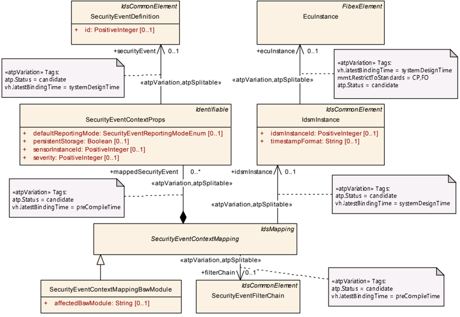

表4.15：SecurityEventContextMappingBswModule（**SecurityEventContextMappingBswModule**）

| 属性 | 值 |
|---|---|
| 类 | SecurityEventContextMappingBswModule |
| 包 | M2::AUTOSARTemplates::SecurityExtractTemplate |
| 说明 | 该元类表示将安全事件集合与 IdsM 实例、以及与该 IdsM 实例可以接收这些安全事件报告的 BSW 模块的执行上下文关联起来的能力。Tags: atp.Status=candidate atp.recommendedPackage=SecurityEventContextMappingBswModules |
| 基类 | ARElement, ARObject, CollectableElement, Identifiable, IdsCommonElement, IdsMapping, MultilanguageReferrable, PackageableElement, Referrable, SecurityEventContextMapping, UploadableDesignElement, UploadablePackageElement |
| 聚合于 | ARPackage.element |

| 属性 | 类型 | 多重性 | 种类 | 备注 |
|---|---|---|---|---|
| affectedBswModule | String | 0..1 | attr | 该属性用于标识安全事件可能在其执行上下文中发生的 BSW 模块的名称。BSW 模块名称的集合由 AUTOSAR 标准化。Tags: atp.Status=candidate |

#### 4.6.3. 带功能集群上下文的安全事件映射

**SecurityEventContextMappingFunctionalCluster 的语义**：对于自适应平台，SecurityEventContextMappingFunctionalCluster 定义被映射的 SecurityEventDefinitions 可以在由属性 affectedFunctionalCluster 定义为名称的、被映射 IdsmInstance 上的功能集群的执行上下文中发生。

**由 SecurityEventContextMappingFunctionalCluster 将安全事件映射到过滤器链**：通过 SecurityEventContextMappingFunctionalCluster 聚合的 SecurityEventContextProps 映射的每个 SecurityEventDefinition，都应作为同一 SecurityEventContextMappingFunctionalCluster 在角色 filterChain 中引用的 SecurityEventFilterChain 的输入。

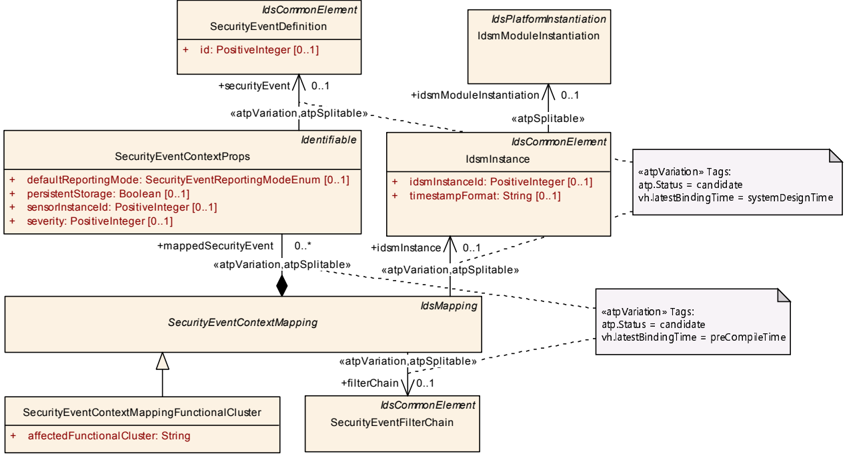

表4.16：SecurityEventContextMappingFunctionalCluster（**SecurityEventContextMappingFunctionalCluster**）

| 属性 | 值 |
|---|---|
| 类 | SecurityEventContextMappingFunctionalCluster |
| 包 | M2::AUTOSARTemplates::SecurityExtractTemplate |
| 说明 | 该元类表示将安全事件集合与 IdsM 实例、以及与该 IdsM 实例可以接收这些安全事件报告的功能集群的执行上下文关联起来的能力。Tags: atp.Status=candidate atp.recommendedPackage=SecurityEventContextMappingFunctionalClusters |
| 基类 | ARElement, ARObject, CollectableElement, Identifiable, IdsCommonElement, IdsMapping, MultilanguageReferrable, PackageableElement, Referrable, SecurityEventContextMapping, UploadableDesignElement, UploadablePackageElement |
| 聚合于 | ARPackage.element |

| 属性 | 类型 | 多重性 | 种类 | 备注 |
|---|---|---|---|---|
| affectedFunctionalCluster | String | 1 | attr | 该属性用于标识安全事件可能在其执行上下文中发生的功能集群的名称。功能集群名称的集合由 AUTOSAR 标准化。Tags: atp.Status=candidate |

#### 4.6.4. 带通信连接器上下文的安全事件映射

**SecurityEventContextMappingCommConnector 的语义**：SecurityEventContextMappingCommConnector 定义被映射的 SecurityEventDefinitions 可以在被映射 IdsmInstance 上与角色 commConnector 中引用的 CommunicationConnector 相关的执行上下文中发生。

**由 SecurityEventContextMappingCommConnector 将安全事件映射到过滤器链**：通过 SecurityEventContextMappingCommConnector 聚合的 SecurityEventContextProps 映射的每个 SecurityEventDefinition，都应作为同一 SecurityEventContextMappingCommConnector 在角色 filterChain 中引用的 SecurityEventFilterChain 的输入。

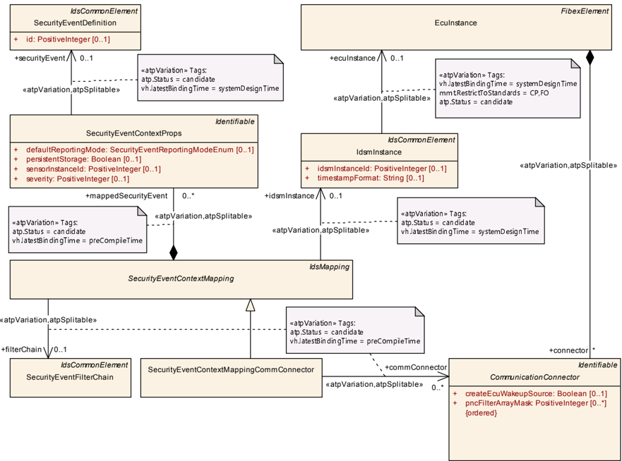 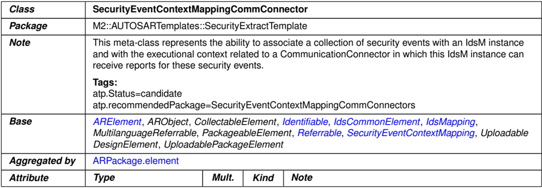

表4.17：SecurityEventContextMappingCommConnector（**SecurityEventContextMappingCommConnector**）

| 属性 | 值 |
|---|---|
| 类 | SecurityEventContextMappingCommConnector |
| 包 | M2::AUTOSARTemplates::SecurityExtractTemplate |
| 说明 | 该元类表示将安全事件集合与 IdsM 实例、以及与该 IdsM 实例可以接收这些安全事件报告的 CommunicationConnector 相关的执行上下文关联起来的能力。Tags: atp.Status=candidate atp.recommendedPackage=SecurityEventContextMappingCommConnectors |
| 基类 | ARElement, ARObject, CollectableElement, Identifiable, IdsCommonElement, IdsMapping, MultilanguageReferrable, PackageableElement, Referrable, SecurityEventContextMapping, UploadableDesignElement, UploadablePackageElement |
| 聚合于 | ARPackage.element |

| 属性 | 类型 | 多重性 | 种类 | 备注 |
|---|---|---|---|---|
| commConnector | CommunicationConnector | * | ref | 该引用标识可以上报安全事件集合的相应 CommunicationConnector。Stereotypes: atpSplitable; atpVariation Tags: atp.Splitkey=commConnector.communicationConnector, commConnector.variationPoint.shortLabel atp.Status=candidate vh.latestBindingTime=preCompileTime |

#### 4.6.5. 带应用上下文的安全事件映射

**SecurityEventContextMappingApplication 的语义**：SecurityEventContextMappingApplication 定义被映射的 SecurityEventDefinitions 可以在由属性 affectedApplication 定义为名称的、被映射 IdsmInstance 上的应用的执行上下文中发生。

**由 SecurityEventContextMappingApplication 将安全事件映射到过滤器链**：通过 SecurityEventContextMappingApplication 聚合的 SecurityEventContextProps 映射的每个 SecurityEventDefinition，都应作为同一 SecurityEventContextMappingApplication 在角色 filterChain 中引用的 SecurityEventFilterChain 的输入。

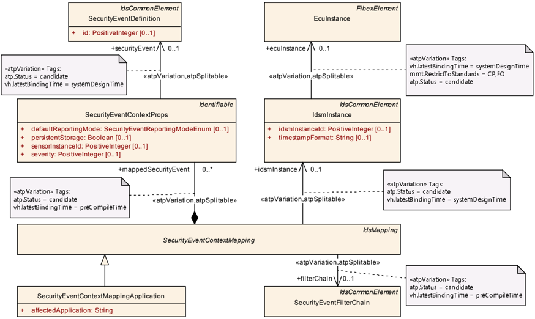

表4.18：SecurityEventContextMappingApplication（**SecurityEventContextMappingApplication**）

| 属性 | 值 |
|---|---|
| 类 | SecurityEventContextMappingApplication |
| 包 | M2::AUTOSARTemplates::SecurityExtractTemplate |
| 说明 | 该元类表示将安全事件集合与 IdsM 实例、以及与该 IdsM 实例可以接收这些安全事件报告的应用（例如 CP 上的 SWC 名称或 AP 上的 SWCL 名称）的执行上下文关联起来的能力。Tags: atp.Status=candidate atp.recommendedPackage=SecurityEventContextMappingApplications |
| 基类 | ARElement, ARObject, CollectableElement, Identifiable, IdsCommonElement, IdsMapping, MultilanguageReferrable, PackageableElement, Referrable, SecurityEventContextMapping, UploadableDesignElement, UploadablePackageElement |
| 聚合于 | ARPackage.element |

| 属性 | 类型 | 多重性 | 种类 | 备注 |
|---|---|---|---|---|
| affectedApplication | String | 1 | attr | 该属性用于标识安全事件可能在其执行上下文中发生的应用的名称。该应用例如可以是软件组件（**Software Component**，CP）的名称或软件集群（**Software Cluster**，AP）的名称。Tags: atp.Status=candidate |

### 4.7. IdsM 实例的配置

安全提取模板允许定义可单独部署在 ECU 实例（经典平台）或机器（自适应平台）上的 IdsM 实例。IdsmInstance 还可以被赋予系统级功能属性，并与该 IdsM 实例相关的 SecurityEventDefinitions 建立关系。

IdsM 实例的网络配置在经典平台和自适应平台上的处理方式不同（见 4.7.3）。

**CP 上 IdsmInstance 的语义**：在经典平台上，IdsmInstance 表示运行于角色 ecuInstance 中引用的 EcuInstance 之上的 IdsM 实例。

请注意，经典平台上 IdsmInstance 的某些 ECU 配置参数可以从安全提取的定义中派生。这些 ECU 配置参数及其到特定安全提取定义的上游映射在附录 C 中陈述。

**AP 上 IdsmInstance 的语义**：在自适应平台上，IdsmInstance 表示由角色 idsmModuleInstantiation 中引用的 IdsmModuleInstantiation 所定义的 IdsM 实例。

**约束：IdsmInstance 执行平台的无歧义定义**：对于元类 IdsmInstance，应定义角色 ecuInstance 中的引用或角色 idsmModuleInstantiation 中的引用之一，以确保 IdsmInstance 目标运行的平台（经典或自适应）被无歧义地定义。

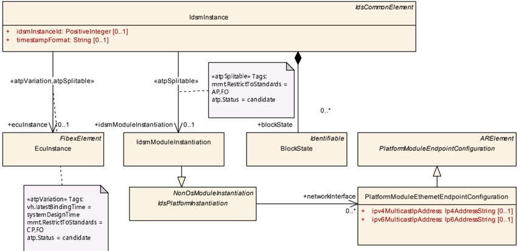

表4.19：IdsmInstance（**IdsmInstance**）

| 属性 | 值 |
|---|---|
| 类 | IdsmInstance |
| 包 | M2::AUTOSARTemplates::SecurityExtractTemplate |
| 说明 | 该元类提供在 EcuInstance 与特定类别的安全事件过滤器之间创建关系的能力，该类别过滤器应用于在所引用 EcuInstance 上上报的所有安全事件。Tags: atp.Status=candidate atp.recommendedPackage=IdsmInstanceToEcuInstanceMappings |
| 基类 | ARElement, ARObject, CollectableElement, Identifiable, IdsCommonElement, MultilanguageReferrable, PackageableElement, Referrable, UploadableDesignElement, UploadablePackageElement |
| 聚合于 | ARPackage.element |

| 属性 | 类型 | 多重性 | 种类 | 备注 |
|---|---|---|---|---|
| blockState | BlockState | * | aggr | 该引用定义 BlockStateSet 集合中的 BlockState。Tags: atp.Status=candidate |
| ecuInstance | EcuInstance | 0..1 | ref | 该引用标识其安全事件（任何类型）应受该特定类别过滤器限制的 EcuInstance。Stereotypes: atpSplitable; atpVariation Tags: atp.Splitkey=ecuInstance.ecuInstance, ecuInstance.variationPoint.shortLabel atp.Status=candidate vh.latestBindingTime=systemDesignTime |
| idsmInstanceId | PositiveInteger | 0..1 | attr | 该属性用于在安全事件上报的上下文中提供来源标识。Tags: atp.Status=candidate |
| idsmModuleInstantiation | IdsmModuleInstantiation | 0..1 | ref | 该引用标识为特定机器上的 IdsM 配置定义属性的元类。Stereotypes: atpSplitable Tags: atp.Splitkey=idsmModuleInstantiation atp.Status=candidate |
| rateLimitationFilter | IdsmRateLimitation | 0..1 | ref | 该引用标识相关 EcuInstance 上所有安全事件适用的速率限制过滤器。Stereotypes: atpSplitable; atpVariation Tags: atp.Splitkey=rateLimitationFilter.idsmRateLimitation, rateLimitationFilter.variationPoint.shortLabel atp.Status=candidate vh.latestBindingTime=preCompileTime |
| signatureSupportAp | IdsmSignatureSupportAp | 0..1 | aggr | 该聚合的存在规定 IdsM 应为其发送到网络的 QSEv 消息添加签名。用于该签名的密码算法和密钥由聚合的元类专门针对自适应平台进一步规定。Stereotypes: atpSplitable Tags: atp.Splitkey=signatureSupportAp atp.Status=candidate |
| signatureSupportCp | IdsmSignatureSupportCp | 0..1 | aggr | 该聚合的存在规定 IdsM 应为其发送到网络的 QSEv 消息添加签名。用于该签名的密码算法和密钥由聚合的元类专门针对经典平台进一步规定。Stereotypes: atpSplitable Tags: atp.Splitkey=signatureSupportCp atp.Status=candidate |
| timestampFormat | String | 0..1 | attr | 该属性的存在规定 IdsM 应为其发送到网络的 QSEv 消息添加时间戳。即如果该属性不存在，则不得为 QSEv 消息添加时间戳。该属性的内容进一步规定时间戳格式如下：- "AUTOSAR" 依照同步时基管理器（**Synchronized Time-Base Manager**）定义 AUTOSAR 标准化的时间戳格式 - 任何其他字符串定义专有的时间戳格式。注意：定义专有时间戳格式的字符串应冠以公司专属的名称片段以避免冲突。Tags: atp.Status=candidate |
| trafficLimitationFilter | IdsmTrafficLimitation | 0..1 | ref | 该引用标识相关 EcuInstance 上所有安全事件适用的流量限制过滤器。Stereotypes: atpSplitable; atpVariation Tags: atp.Splitkey=trafficLimitationFilter.idsmTrafficLimitation, trafficLimitationFilter.variationPoint.shortLabel atp.Status=candidate vh.latestBindingTime=preCompileTime |

#### 4.7.1. IdsM 实例的属性

对于两个平台，IdsmInstance 的属性进一步定义系统级功能属性。

##### 4.7.1.1. IdsM 的实例 ID

**属性 IdsmInstance.idsmInstanceId 的语义**：IdsmInstance 的属性 idsmInstanceId 定义为 IdsM 实例分配的标识符。

##### 4.7.1.2. QSEv 消息中的时间戳

**IdsmInstance 时间戳支持的定义**：IdsmInstance 的属性 timestampFormat 的存在规定该 IdsmInstance 应为其发送到网络的 QSEv 消息添加时间戳数据。这意味着，如果未定义属性 timestampFormat，则 IdsmInstance 不应为 QSEv 消息添加时间戳。

**属性 IdsmInstance.timestampFormat 的语义**：IdsmInstance 的属性 timestampFormat 的内容规定 IdsmInstance 应为其发送到网络的 QSEv 消息添加的时间戳数据的格式：

- 字符串 AUTOSAR 规定使用 AUTOSAR 标准化的时间戳格式（基于 AUTOSAR 同步时基管理器）。
- 任何其他字符串定义专有的时间戳格式。

注意：定义专有时间戳格式的字符串应冠以公司专属的名称片段以避免冲突。

##### 4.7.1.3. QSEv 消息中的签名支持

**IdsmInstance 签名支持的定义**：对于 IdsmInstance，角色 signatureSupportCp（经典平台）或角色 signatureSupportAp（自适应平台）中引用的存在，规定该 IdsmInstance 应为其发送到网络的 QSEv 消息添加签名信息（即加密认证）。这意味着，如果这两个引用角色都不存在，则 IdsmInstance 不应为 QSEv 消息添加签名信息。

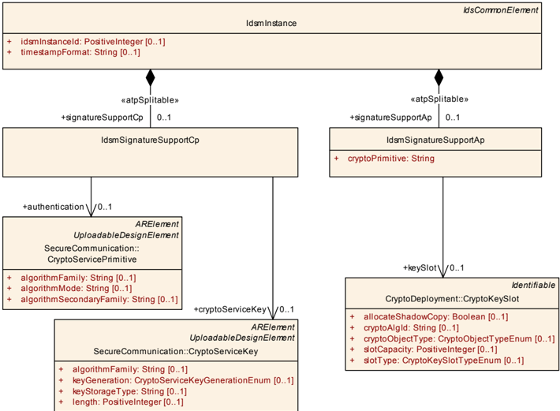

根据 IdsmInstance 部署在经典平台还是自适应平台，应分别使用 IdsmSignatureSupportCp 或 IdsmSignatureSupportAp 配置签名的计算。

**IdsmSignatureSupportCp 的语义**：对于经典平台，IdsmSignatureSupportCp 表示聚合它的 IdsmInstance 的签名支持配置：

- 角色 authentication 中到 CryptoServicePrimitive 的引用定义要使用的密码算法。
- 角色 cryptoServiceKey 中到 CryptoServiceKey 的引用定义要使用的密码密钥。

**IdsmSignatureSupportAp 的语义**：对于自适应平台，IdsmSignatureSupportAp 表示聚合它的 IdsmInstance 的签名支持配置：

- 属性 cryptoPrimitive 定义要使用的密码算法，按 [\[7\]](#ref-7) 中的密码原语命名约定（**Cryptographic Primitives Naming Convention**）规定。
- 角色 keySlot 中到 CryptoKeySlot 的引用定义要使用的密码密钥。

**约束：IdsmInstance 平台相关签名支持的无歧义配置**：对于元类 IdsmInstance，应定义 IdsmSignatureSupportCp 或 IdsmSignatureSupportAp 的聚合之一，以确保平台相关的签名支持被无歧义地配置。

#### 4.7.2. 安全事件与 IdsM 实例的关联

IdsM 实例需要就其应处理的安全事件进行配置。安全提取模板通过支持标识适用于某个 IdsmInstance 的所有 SecurityEventDefinitions 来支持该配置。

需要为特定 IdsmInstance 配置的所有 SecurityEventDefinitions，应通过 IdsmInstance 与以下 SecurityEventContextMapping 的派生具体元类的关系来标识：

- SecurityEventContextMappingBswModule（经典平台）
- SecurityEventContextMappingFunctionalCluster（自适应平台）
- SecurityEventContextMappingCommConnector（经典和自适应平台皆可）
- SecurityEventContextMappingApplication（经典和自适应平台皆可）

**CP 上通过 SecurityEventContextMappingBswModule 将 SecurityEventDefinitions 与 IdsmInstance 关联**：对于经典平台上在角色 idsmInstance 中引用同一 IdsmInstance 的所有 SecurityEventContextMappingBswModules，其各自在角色 mappedSecurityEvent 中聚合的 SecurityEventContextProps 所引用的所有 SecurityEventDefinitions 的集合，应配置在该 IdsmInstance 中并由此由该 IdsmInstance 处理。

**AP 上通过 SecurityEventContextMappingFunctionalCluster 将 SecurityEventDefinitions 与 IdsmInstance 关联**：对于自适应平台上在角色 idsmInstance 中引用同一 IdsmInstance 的所有 SecurityEventContextMappingFunctionalClusters，其各自在角色 mappedSecurityEvent 中聚合的 SecurityEventContextProps 所引用的所有 SecurityEventDefinitions 的集合，应配置在该 IdsmInstance 中并由此由该 IdsmInstance 处理。

**通过 SecurityEventContextMappingCommConnector 将 SecurityEventDefinitions 与 IdsmInstance 关联**：对于在角色 idsmInstance 中引用同一 IdsmInstance 的所有 SecurityEventContextMappingCommConnectors，其各自在角色 mappedSecurityEvent 中聚合的 SecurityEventContextProps 所引用的所有 SecurityEventDefinitions 的集合，应配置在该 IdsmInstance 中并由此由该 IdsmInstance 处理。

**通过 SecurityEventContextMappingApplication 将 SecurityEventDefinitions 与 IdsmInstance 关联**：对于在角色 idsmInstance 中引用同一 IdsmInstance 的所有 SecurityEventContextMappingApplications，其各自在角色 mappedSecurityEvent 中聚合的 SecurityEventContextProps 所引用的所有 SecurityEventDefinitions 的集合，应配置在该 IdsmInstance 中并由此由该 IdsmInstance 处理。

#### 4.7.3. IdsM 实例的网络配置

IdsM 实例的网络配置定义 IdsM 如何与 AUTOSAR 通信栈通信，以便将寻址到正确接收实体的 QSEv 消息发送到网络。

由于经典平台和自适应平台的性质不同，IdsM 实例的网络配置在两个平台上的处理方式也不同。

**约束：IdsmInstance 平台相关网络配置的无歧义定义**：对于元类 IdsmInstance，应定义 category='IDS' 的一个 GeneralPurposeIPdu 的配置（经典平台，如 [TPS\_SECXT\_01038] 所规定）或通过引用 idsmModuleInstantiation 的网络配置（自适应平台，如 [TPS\_SECXT\_01039] 所规定）之一，以确保平台相关的网络配置被无歧义地定义。

##### 4.7.3.1. 经典平台上的 IdsM 网络配置

部署在特定 EcuInstance 上的 IdsmInstance 使用 GeneralPurposeIPdu 与 PduR 通信，从而将 QSEv 消息发送到网络。

**CP 上 IdsmInstance 的网络配置**：在经典平台上，IdsmInstance 的网络配置由部署了该 IdsmInstance 的同一 EcuInstance 上两个 category='IDS' 的 GeneralPurposeIPdu 隐式定义。这两个 category='IDS' 的 GeneralPurposeIPdu 之一还应配置为供传输协议使用，而另一个不应配置。

有关这些 category='IDS' 的 GeneralPurposeIPdu 的更多信息与约束，请参见系统模板 [\[3\]](#ref-3)。

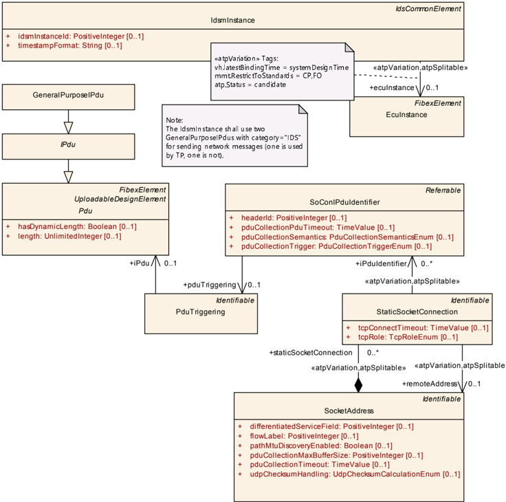

##### 4.7.3.2. 自适应平台上的 IdsM 网络配置

对于自适应平台，IdsmInstance 在特定 Machine 上的部署由清单 [\[4\]](#ref-4) 部署章节中的 IdsmModuleInstantiation 定义。

**AP 上 IdsmInstance 的网络配置**：在自适应平台上，IdsmInstance 的网络配置应通过 IdsmModuleInstantiation 在角色 networkInterface 中对 PlatformModuleEthernetEndpointConfiguration 的引用来定义，而该 IdsmModuleInstantiation 又由 IdsmInstance 在角色 idsmModuleInstantiation 中引用。

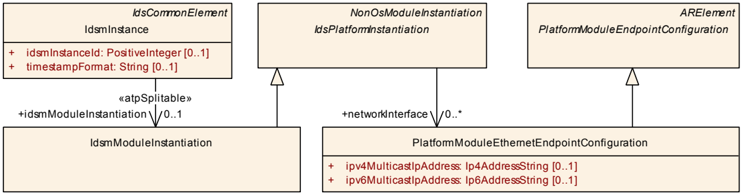

#### 4.7.4. CP 上 IdsM 实例的阻断状态

**CP 上 BlockStates 的定义**：在经典平台上，当 SecurityEventStateFilter 配置为某个 SecurityEventFilterChain 的一部分时，表示控制该 SecurityEventStateFilter 的状态机所需的 BlockStates 应被定义，并由映射到该 SecurityEventFilterChain 的 IdsmInstance 聚合。BlockState 应以其定义为 shortName 的名称来标识。

注意：由于 BlockStates 使用各自的 shortName 命名和标识，它们在 IdsmInstance 内的命名唯一性是天然成立的。

**CP 上 BlockState 的语义**：在经典平台上，SecurityEventStateFilter 在角色 blockIfStateActiveCp 中引用的 BlockState 指示该 SecurityEventStateFilter 在该 BlockState 当前处于活动状态时丢弃被上报的 SecurityEventDefinition。

**约束：IdsmInstance 聚合的 BlockStates 多重性的上界**：对于元类 IdsmInstance，角色 blockState 中聚合的 BlockStates 的最大数量应为 16。

注意：IdsmInstance 内当前活动的 BlockState 控制 SecurityEventStateFilter 是放行还是阻断被上报的安全事件。指示 IdsmInstance 活动阻断状态的状态机逻辑需要由基础软件模式管理器（**Basic Software Mode Manager**，BswM）按照 [\[8\]](#ref-8) 实现为仲裁规则。

另请参见第 [4.4.2.1](#4421-经典平台的-securityeventstatefilter) 章。

表4.20：BlockState（**BlockState**）

| 属性 | 值 |
|---|---|
| 类 | BlockState |
| 包 | M2::AUTOSARTemplates::SecurityExtractTemplate |
| 说明 | 该元类定义属于特定 IdsmInstance 的阻断状态集合中的一个阻断状态。IdsM 应丢弃任何被映射到某个过滤器链（该过滤器链包含引用当前在 IdsM 中处于活动状态的阻断状态的 SecurityEventStateFilter）的被上报安全事件。Tags: atp.Status=candidate |
| 基类 | ARObject, Identifiable, MultilanguageReferrable, Referrable |
| 聚合于 | IdsmInstance.blockState |

| 属性 | 类型 | 多重性 | 种类 | 备注 |
|---|---|---|---|---|
| – | – | – | – | – |

## B. 所提及的类表

为完整起见，本章包含一组类表，代表本文档上下文中提及、但不属于具体元模型语义描述范围的元类。

表B.1：ARElement（**ARElement**）

| 属性 | 值 |
|---|---|
| 类 | ARElement（抽象） |
| 包 | M2::AUTOSARTemplates::GenericStructure::GeneralTemplateClasses::ARPackage |
| 说明 | 可以独立定义的元素，即不需要作为另一个元素的一部分（包除外）。 |
| 基类 | ARObject, CollectableElement, Identifiable, MultilanguageReferrable, PackageableElement, Referrable |
| 子类 | AclObjectSet, AclOperation, AclPermission, AclRole, AliasNameSet, ApplicabilityInfoSet, AutosarDataType, BaseType, BlueprintMappingSet, BuildActionManifest, CalibrationParameterValueSet, ClientIdDefinitionSet, Collection, CompuMethod, ConsistencyNeedsBlueprintSet, ConstantSpecification, ConstantSpecificationMappingSet, CryptoServiceKey, CryptoServicePrimitive, CryptoServiceQueue, DataConstr, DataExchangePoint, DataTransformationSet, DataTypeMappingSet, DdsCpConfig, DiagnosticCommonElement, DiagnosticConnection, DiagnosticContributionSet, DltContext, DltEcu, Documentation, E2EProfileCompatibilityProps, EndToEndProtectionSet, EthIpProps, EthTcpIpIcmpProps, EthTcpIpProps, EvaluatedVariantSet, FMFeature, FMFeatureMap, FMFeatureModel, FMFeatureSelectionSet, FirewallRule, GeneralPurposeConnection, HwCategory, HwElement, HwType, IEEE1722TpConnection, IPSecConfigProps, IdsCommonElement, IdsDesign, ImpositionTimeDefinitionGroup, InterpolationRoutineMappingSet, KeywordSet, LifeCycleInfoSet, LifeCycleStateDefinitionGroup, LogAndTraceMessageCollectionSet, MacSecGlobalKayProps, MacSecParticipantSet, McFunction, McGroup, ModeDeclarationGroup, ModeDeclarationMappingSet, PhysicalDimension, PhysicalDimensionMappingSet, PlatformModuleEndpointConfiguration, PortInterface, PortInterfaceMappingSet, PortPrototypeBlueprint, PostBuildVariantCriterion, PostBuildVariantCriterionValueSet, PredefinedVariant, RapidPrototypingScenario, SdgDef, SignalServiceTranslationPropsSet, SomeipSdClientEventGroupTimingConfig, SomeipSdClientServiceInstanceConfig, SomeipSdServerEventGroupTimingConfig, SomeipSdServerServiceInstanceConfig, SwAddrMethod, SwAxisType, SwComponentType, SwRecordLayout, SwSystemconst, SwSystemconstantValueSet, System, SystemSignal, SystemSignalGroup, TimingExtension, TlvDataIdDefinitionSet, TransformationPropsSet, Unit, UnitGroup, UploadablePackageElement |
| 聚合于 | ARPackage.element |

表B.2：ARPackage（**ARPackage**）

| 属性 | 值 |
|---|---|
| 类 | ARPackage |
| 包 | M2::AUTOSARTemplates::GenericStructure::GeneralTemplateClasses::ARPackage |
| 说明 | AUTOSAR 包，允许创建顶层包以组织所包含的 ARElements。ARPackage 是开放集合。这意味着在基于文件的描述系统中，多个文件可以部分地描述一个包的内容。这是 MSR 的 SW-SYSTEM 的扩展版本。 |
| 基类 | ARObject, AtpBlueprint, AtpBlueprintable, CollectableElement, Identifiable, MultilanguageReferrable, Referrable |
| 聚合于 | ARPackage.arPackage, AUTOSAR.arPackage |

| 属性 | 类型 | 多重性 | 种类 | 备注 |
|---|---|---|---|---|
| arPackage | ARPackage | * | aggr | 表示 ARPackage 内的一个子包，从而允许无限的包层次。Stereotypes: atpSplitable; atpVariation Tags: atp.Splitkey=arPackage.shortName, arPackage.variationPoint.shortLabel vh.latestBindingTime=blueprintDerivationTime xml.sequenceOffset=30 |
| element | PackageableElement | * | aggr | 属于该包的元素。Stereotypes: atpSplitable; atpVariation Tags: atp.Splitkey=element.shortName, element.variationPoint.shortLabel vh.latestBindingTime=systemDesignTime xml.sequenceOffset=20 |
| referenceBase | ReferenceBase | * | aggr | 表示该包的引用基。这是该包内所有相对引用的基。基需要根据引用中的 base 属性来选择。Stereotypes: atpSplitable Tags: atp.Splitkey=referenceBase.shortLabel xml.sequenceOffset=10 |

表B.3：AUTOSAR（**AUTOSAR**）

| 属性 | 值 |
|---|---|
| 类 | AUTOSAR |
| 包 | M2::AUTOSARTemplates::AutosarTopLevelStructure |
| 说明 | AUTOSAR 描述的根元素，也是相应 XML 文档中的根元素。Tags: xml.globalElement=true |
| 基类 | ARObject |

| 属性 | 类型 | 多重性 | 种类 | 备注 |
|---|---|---|---|---|
| adminData | AdminData | 0..1 | aggr | 表示 AUTOSAR 文件的管理数据。Stereotypes: atpSplitable Tags: atp.Splitkey=adminData xml.sequenceOffset=10 |
| arPackage | ARPackage | * | aggr | AUTOSAR 模型中的顶层包。Stereotypes: atpSplitable; atpVariation Tags: atp.Splitkey=arPackage.shortName, arPackage.variationPoint.shortLabel vh.latestBindingTime=blueprintDerivationTime xml.sequenceOffset=30 |
| fileInfoComment | FileInfoComment | 0..1 | aggr | 表示在 AUTOSAR 文件中提供结构化注释的可能性。Stereotypes: atpStructuredComment Tags: xml.roleElement=true xml.sequenceOffset=-10 xml.typeElement=false |
| introduction | DocumentationBlock | 0..1 | aggr | 表示 AUTOSAR 文件的引言。例如用于表示免责声明和法律注记。Tags: xml.sequenceOffset=20 |

表B.4：CommunicationConnector（**CommunicationConnector**）

| 属性 | 值 |
|---|---|
| 类 | CommunicationConnector（抽象） |
| 包 | M2::AUTOSARTemplates::SystemTemplate::Fibex::FibexCore::CoreTopology |
| 说明 | 所引用的 ECU 与所引用的信道之间经由所引用控制器的连接。连接器（**Connector**）用于描述 ECU 的总线接口并规定发送/接收行为。每个 CommunicationConnector 都有一个对恰好一个 communicationController 的引用。注意：在一个 ECU 实例的范围内，多个 CommunicationConnector 可以分配给一个 PhysicalChannel。 |
| 基类 | ARObject, Identifiable, MultilanguageReferrable, Referrable |
| 子类 | AbstractCanCommunicationConnector, EthernetCommunicationConnector, FlexrayCommunicationConnector, UserDefinedCommunicationConnector |
| 聚合于 | EcuInstance.connector, MachineDesign.communicationConnector |

| 属性 | 类型 | 多重性 | 种类 | 备注 |
|---|---|---|---|---|
| createEcuWakeupSource | Boolean | 0..1 | attr | 如果该参数存在且设置为 true，则应为引用该 CommunicationConnector 的 PhysicalChannel 创建一个信道唤醒源。 |
| pncFilterArrayMask (ordered) | PositiveInteger | * | attr | 用于为网络管理配置 NM 过滤器掩码的 NM-Pdu 载荷位掩码。 |

表B.5：CryptoKeySlot（**CryptoKeySlot**）

| 属性 | 值 |
|---|---|
| 类 | CryptoKeySlot |
| 包 | M2::AUTOSARTemplates::AdaptivePlatform::PlatformModuleDeployment::CryptoDeployment |
| 说明 | 该元类表示定义用于密码操作的具体密钥的能力。Tags: atp.ManifestKind=MachineManifest |
| 基类 | ARObject, Identifiable, MultilanguageReferrable, Referrable |
| 聚合于 | CryptoProvider.keySlot |

| 属性 | 类型 | 多重性 | 种类 | 备注 |
|---|---|---|---|---|
| allocateShadowCopy | Boolean | 0..1 | attr | 该属性定义是否应为该 Key Slot 分配一个影子副本（**shadow copy**），以支持回滚失败的 Key Slot 更新活动（参见接口 BeginTransaction）。 |
| cryptoAlgId | String | 0..1 | attr | 该属性定义一个密码算法限制（kAlgId Any 表示无限制）。算法可以部分指定：族（**family**）和长度、模式、填充。未来的 Crypto Provider 可以支持一些当今尚未广为人知/未标准化的密码算法，因此 AUTOSAR 不提供密码算法标识符的具体列表，也不设想使用数值标识符。取而代之，提供商供应商应在随附文档中提供所支持算法的字符串名称。密码算法的名称应遵循自适应平台密码规范中定义的规则。 |
| cryptoObjectType | CryptoObjectTypeEnum | 0..1 | attr | 可以存储在槽中的对象类型。如果该字段包含「Undefined」，则必须提供 mSlotCapacity 且大于 0。Tags: atp.Status=candidate |
| keySlotAllowedModification | CryptoKeySlotAllowedModification | 0..1 | aggr | 限制该 keySlot 可以如何使用 Tags: atp.Status=candidate |
| keySlotContentAllowedUsage | CryptoKeySlotContentAllowedUsage | * | aggr | 对存储到槽中的密钥的允许用途的限制。Tags: atp.Status=candidate |
| slotCapacity | PositiveInteger | 0..1 | attr | 以字节为单位的槽容量，由栈供应商预留。一个用例是在 cryptoObjectType 未定义、且槽大小无法从 cryptoObjectType 和 cryptoAlgId 推导的情况下定义该值。「0」表示槽大小可以从 cryptoObjectType 和 cryptoAlgId 推导。 |
| slotType | CryptoKeySlotTypeEnum | 0..1 | attr | 该属性定义该 keySlot 是专供应用使用，还是由栈服务使用并由密钥管理器应用管理。Tags: atp.Status=candidate |

表B.6：CryptoServiceKey（**CryptoServiceKey**）

| 属性 | 值 |
|---|---|
| 类 | CryptoServiceKey |
| 包 | M2::AUTOSARTemplates::SystemTemplate::SecureCommunication |
| 说明 | 该元类具有表示密码密钥的能力。Tags: atp.recommendedPackage=CryptoDevelopmentKeys |
| 基类 | ARElement, ARObject, CollectableElement, Identifiable, MultilanguageReferrable, PackageableElement, Referrable, UploadableDesignElement, UploadablePackageElement |
| 聚合于 | ARPackage.element |

| 属性 | 类型 | 多重性 | 种类 | 备注 |
|---|---|---|---|---|
| algorithmFamily | String | 0..1 | attr | 该属性表示适用的密码算法族的描述。 |
| developmentValue | ValueSpecification | 0..1 | aggr | 该聚合表示在系统描述中为密码密钥分配特定值的能力。该值随后可用于相应 ECU 的开发。 |
| keyGeneration | CryptoServiceKeyGenerationEnum | 0..1 | attr | 该属性描述特定密码密钥的创建方式。 |
| keyStorageType | String | 0..1 | attr | 该属性描述外层密码密钥应存储在哪里。AUTOSAR 为该属性保留了特定值，但也可以插入自定义值。 |
| length | PositiveInteger | 0..1 | attr | 该属性描述密码密钥的长度（位）。 |

表B.7：CryptoServicePrimitive（**CryptoServicePrimitive**）

| 属性 | 值 |
|---|---|
| 类 | CryptoServicePrimitive |
| 包 | M2::AUTOSARTemplates::SystemTemplate::SecureCommunication |
| 说明 | 该元类具有表示密码原语的能力。Tags: atp.recommendedPackage=CryptoPrimitives |
| 基类 | ARElement, ARObject, CollectableElement, Identifiable, MultilanguageReferrable, PackageableElement, Referrable, UploadableDesignElement, UploadablePackageElement |
| 聚合于 | ARPackage.element |

| 属性 | 类型 | 多重性 | 种类 | 备注 |
|---|---|---|---|---|
| algorithmFamily | String | 0..1 | attr | 该属性表示密码原语实现的密码算法族（例如 AES）的描述。 |
| algorithmMode | String | 0..1 | attr | 该属性表示密码原语实现的密码算法模式的描述。 |
| algorithmSecondaryFamily | String | 0..1 | attr | 该属性表示密码原语实现的密码算法次族的进一步描述。次族用于规定签名校验（例如使用 RSA）的哈希算法。 |

表B.8：EcuInstance（**EcuInstance**）

| 属性 | 值 |
|---|---|
| 类 | EcuInstance |
| 包 | M2::AUTOSARTemplates::SystemTemplate::Fibex::FibexCore::CoreTopology |
| 说明 | ECUInstances 用于定义拓扑中使用的 ECU。ECU 的类型通过引用以 ECU 资源描述规定的 ECU 来定义。Tags: atp.recommendedPackage=EcuInstances |
| 基类 | ARObject, CollectableElement, FibexElement, Identifiable, MultilanguageReferrable, PackageableElement, Referrable |
| 聚合于 | ARPackage.element |

| 属性 | 类型 | 多重性 | 种类 | 备注 |
|---|---|---|---|---|
| associatedConsumedProvidedServiceInstanceGroup | ConsumedProvidedServiceInstanceGroup | * | ref | 通过该引用可以标识哪些 ConsumedProvidedServiceInstanceGroups 适用于哪个 ECUInstance。Stereotypes: atpSplitable; atpVariation Tags: atp.Splitkey=associatedConsumedProvidedServiceInstanceGroup.consumedProvidedServiceInstanceGroup, associatedConsumedProvidedServiceInstanceGroup.variationPoint.shortLabel vh.latestBindingTime=postBuild |
| associatedPdurIPduGroup | PdurIPduGroup | * | ref | 通过该引用可以标识哪些 PduR IPduGroups 适用于哪个 CommunicationConnector/ECU。 |
| channelSynchronousWakeup | Boolean | 0..1 | attr | 如果该参数存在且设置为 true，则一旦发生至少一个信道唤醒，所有可用信道都会被唤醒。如果配置了 PNC，则在信道唤醒时会请求所有 PNC。 |
| clientIdRange | ClientIdRange | 0..1 | aggr | 将该 ECU 的客户端标识符限制到一个允许的数值范围。事务句柄的客户端标识符由客户端 RTE 为 ECU 间的客户端/服务器通信生成。 |
| commController | CommunicationController | * | aggr | ECU 的通信控制器。Stereotypes: atpSplitable; atpVariation Tags: atp.Splitkey=commController.shortName, commController.variationPoint.shortLabel vh.latestBindingTime=postBuild |
| connector | CommunicationConnector | * | aggr | 由单个控制器控制的所有信道。Stereotypes: atpSplitable; atpVariation Tags: atp.Splitkey=connector.shortName, connector.variationPoint.shortLabel vh.latestBindingTime=postBuild |
| firewallRule | StateDependentFirewall | * | ref | 在 EcuInstance 上下文中定义的防火墙规则。Tags: atp.Status=candidate |
| pncNmRequest | Boolean | 0..1 | attr | 定义每当请求某个 PNC 时，该 EcuInstance 是否应在其所有 Nm 变体设置为 FULL 的 PhysicalChannels 上请求 Nm。 |
| pncPrepareSleepTimer | TimeValue | 0..1 | attr | PNC 状态机在 PNC\_PREPARE\_SLEEP 中等待的时间（秒）。 |
| pncSynchronousWakeup | Boolean | 0..1 | attr | 如果该参数存在且设置为 true，则一旦发生信道唤醒，所有可用 PNC 都会被唤醒。这通过在上游映射期间将所有 PNC 添加到所有信道唤醒源来确保。 |
| pnResetTime | TimeValue | 0..1 | attr | 规定复位计时器的运行时间（秒）。该复位时间对 EIRA 和 ERA 中 PN 请求的复位有效。 |

表B.9：GeneralPurposeIPdu（**GeneralPurposeIPdu**）

| 属性 | 值 |
|---|---|
| 类 | GeneralPurposeIPdu |
| 包 | M2::AUTOSARTemplates::SystemTemplate::Fibex::FibexCore::CoreCommunication |
| 说明 | 该元素用于由 PduR 路由的、不带属性的 AUTOSAR Pdu。请注意，这类 Pdu 的类别名称在 AUTOSAR 系统模板中标准化。Tags: atp.recommendedPackage=Pdus |
| 基类 | ARElement, ARObject, CollectableElement, FibexElement, IPdu, Identifiable, MultilanguageReferrable, PackageableElement, Pdu, Referrable, UploadableDesignElement, UploadablePackageElement |
| 聚合于 | ARPackage.element |

表B.10：Identifiable（**Identifiable**）

| 属性 | 值 |
|---|---|
| 类 | Identifiable（抽象） |
| 包 | M2::AUTOSARTemplates::GenericStructure::GeneralTemplateClasses::Identifiable |
| 说明 | 该类的实例可以通过其标识符（在命名空间边界内）被引用。除此之外，Identifiable 是对 AUTOSAR 描述的整体结构有显著贡献的对象。特别是，Identifiable 可能包含 Identifiable。 |
| 基类 | ARObject, MultilanguageReferrable, Referrable |
| 子类 | ARPackage, AbstractDoIpLogicAddressProps, AbstractEvent, AbstractImplementationDataTypeElement, AbstractSecurityEventFilter, AbstractSecurityIdsmInstanceFilter, AbstractServiceInstance, ApplicationEndpoint, ApplicationError, AppliedStandard, ArtifactChecksum, AtpBlueprint, AtpBlueprintable, AtpClassifier, AtpFeature, AutosarOperationArgumentInstance, AutosarVariableInstance, BlockState, BuildActionEntity, BuildActionEnvironment, Chapter, ClassContentConditional, ClientIdDefinition, ClientServerOperation, Code, CollectableElement, ComManagementMapping, CommConnectorPort, CommunicationConnector, CommunicationController, Compiler, ConsistencyNeeds, ConsumedEventGroup, CouplingPort, CouplingPortStructuralElement, CryptoKeySlot, CryptoServiceMapping, DataPrototypeGroup, DataTransformation, DdsCpDomain, DdsCpPartition, DdsCpQosProfile, DdsCpTopic, DependencyOnArtifact, DiagEventDebounceAlgorithm, DiagnosticAuthTransmitCertificateEvaluation, DiagnosticConnectedIndicator, DiagnosticDataElement, DiagnosticDebounceAlgorithmProps, DiagnosticFunctionInhibitSource, DiagnosticParameterElement, DiagnosticRoutineSubfunction, DltApplication, DltArgument, DltMessage, DoIpInterface, DoIpLogicAddress, DoIpRoutingActivation, EndToEndProtection, EthernetWakeup 等（源表以分页截断的形式给出该列表） |

| 属性 | 类型 | 多重性 | 种类 | 备注 |
|---|---|---|---|---|
| adminData | AdminData | | | |
| annotation | Annotation | | | |
| category | CategoryString | | | |
| desc | MultiLanguageOverviewParagraph | | | |
| introduction | DocumentationBlock | 0..1 | aggr | 表示关于所论对象如何构建或如何使用的更多信息，因此是一个 DocumentationBlock。Tags: xml.sequenceOffset=-30 |
| uuid | String | 0..1 | attr | 该属性的目的是为元类的实例提供全局唯一标识符。该属性的值应当是全局唯一的、冠以标识符类型的字符串。例如，要包含 The Open Group 定义的 DCE UUID，UUID 前面会冠以「DCE:」。该属性的值可用于支持不同 AUTOSAR 模型的合并。UUID（通用唯一标识符）的形式取自 Open Group（原 Open Software Foundation）定义的标准。该标准应用广泛，包括 Microsoft 将其用于 COM（GUID），以及许多公司将其用于基于 CORBA 的 DCE。这些 128 位 ID 的生成方法已在标准中发布，其有效性和唯一性在实践中没有争议。如果省略 id 命名空间，则假定为 DCE。一个例子是「DCE:2fac1234-31f8-11b4-a222-08002b34c003」。uuid 属性对 AUTOSAR 模型没有语义含义，也不要求 AUTOSAR 工具管理该时间戳。Tags: xml.attribute=true |

表B.11：IdsCommonElement（**IdsCommonElement**）

| 属性 | 值 |
|---|---|
| 类 | IdsCommonElement（抽象） |
| 包 | M2::AUTOSARTemplates::SecurityExtractTemplate |
| 说明 | 该元类表示安全提取中 IDS 相关元素的公共基类。除了能够成为引用的目标之外，它不提供任何特定功能。Tags: atp.Status=candidate |
| 基类 | ARElement, ARObject, CollectableElement, Identifiable, MultilanguageReferrable, PackageableElement, Referrable, UploadableDesignElement, UploadablePackageElement |
| 子类 | IdsMapping, IdsmInstance, IdsmProperties, SecurityEventDefinition, SecurityEventFilterChain |
| 聚合于 | ARPackage.element |

表B.12：IdsMapping（**IdsMapping**）

| 属性 | 值 |
|---|---|
| 类 | IdsMapping（抽象） |
| 包 | M2::AUTOSARTemplates::SecurityExtractTemplate |
| 说明 | 该元类用作与 IDS 设计相关的映射的抽象基类。Tags: atp.Status=candidate |
| 基类 | ARElement, ARObject, CollectableElement, Identifiable, IdsCommonElement, MultilanguageReferrable, PackageableElement, Referrable, UploadableDesignElement, UploadablePackageElement |
| 子类 | SecurityEventContextMapping |
| 聚合于 | ARPackage.element |

表B.13：IdsPlatformInstantiation（**IdsPlatformInstantiation**）

| 属性 | 值 |
|---|---|
| 类 | IdsPlatformInstantiation（抽象） |
| 包 | M2::AUTOSARTemplates::AdaptivePlatform::PlatformModuleDeployment::IntrusionDetectionSystem |
| 说明 | 该元类用作实现入侵检测系统的平台模块的抽象基类。Tags: atp.Status=candidate |
| 基类 | ARObject, AdaptiveModuleInstantiation, AtpClassifier, AtpFeature, AtpStructureElement, Identifiable, MultilanguageReferrable, NonOsModuleInstantiation, Referrable |
| 子类 | IdsmModuleInstantiation |
| 聚合于 | AtpClassifier.atpFeature, Machine.moduleInstantiation |

| 属性 | 类型 | 多重性 | 种类 | 备注 |
|---|---|---|---|---|
| networkInterface | PlatformModuleEthernetEndpointConfiguration | * | ref | 该关联包含应应用于 IDS 实体实例的网络配置。Tags: atp.Status=candidate |
| timeBase | TimeBaseResource | 0..1 | ref | 该引用标识适用的时间基资源。Stereotypes: atpSplitable; atpVariation Tags: atp.Splitkey=timeBase.timeBaseResource, timeBase.variationPoint.shortLabel atp.Status=candidate vh.latestBindingTime=systemDesignTime |

表B.14：IdsmModuleInstantiation（**IdsmModuleInstantiation**）

| 属性 | 值 |
|---|---|
| 类 | IdsmModuleInstantiation |
| 包 | M2::AUTOSARTemplates::AdaptivePlatform::PlatformModuleDeployment::IntrusionDetectionSystem |
| 说明 | 该元类为特定机器上的 IdsM 配置定义属性。Tags: atp.Status=candidate |
| 基类 | ARObject, AdaptiveModuleInstantiation, AtpClassifier, AtpFeature, AtpStructureElement, Identifiable, IdsPlatformInstantiation, MultilanguageReferrable, NonOsModuleInstantiation, Referrable |
| 聚合于 | AtpClassifier.atpFeature, Machine.moduleInstantiation |

表B.15：IdsmProperties（**IdsmProperties**）

| 属性 | 值 |
|---|---|
| 类 | IdsmProperties |
| 包 | M2::AUTOSARTemplates::SecurityExtractTemplate |
| 说明 | 该元类提供聚合安全事件过滤器的能力。Tags: atp.Status=candidate atp.recommendedPackage=IdsMPropertiess |
| 基类 | ARElement, ARObject, CollectableElement, Identifiable, IdsCommonElement, MultilanguageReferrable, PackageableElement, Referrable, UploadableDesignElement, UploadablePackageElement |
| 聚合于 | ARPackage.element |

| 属性 | 类型 | 多重性 | 种类 | 备注 |
|---|---|---|---|---|
| rateLimitationFilter | IdsmRateLimitation | * | aggr | 该聚合表示外层 SecurityFilterSet 中安全事件速率限制过滤器的集合。Tags: atp.Status=candidate |
| trafficLimitationFilter | IdsmTrafficLimitation | * | aggr | 该聚合表示外层 SecurityFilterSet 中安全事件流量限制过滤器的集合。Tags: atp.Status=candidate |

表B.16：IdsmSignatureSupportAp（**IdsmSignatureSupportAp**）

| 属性 | 值 |
|---|---|
| 类 | IdsmSignatureSupportAp |
| 包 | M2::AUTOSARTemplates::SecurityExtractTemplate |
| 说明 | 该元类为自适应平台定义 IdsM 实例在 QSEv 消息中提供签名信息所使用的密码算法和密钥。Tags: atp.Status=candidate |
| 基类 | ARObject |
| 聚合于 | IdsmInstance.signatureSupportAp |

| 属性 | 类型 | 多重性 | 种类 | 备注 |
|---|---|---|---|---|
| cryptoPrimitive | String | 1 | attr | 该属性定义在 QSEv 消息中提供认证信息所使用的密码算法。该属性的内容应符合「密码原语命名约定」。Tags: atp.Status=candidate |
| keySlot | CryptoKeySlot | 0..1 | ref | 该引用表示密码算法在 QSEv 消息中提供认证信息所使用的密码密钥。Tags: atp.Status=candidate |

表B.17：IdsmSignatureSupportCp（**IdsmSignatureSupportCp**）

| 属性 | 值 |
|---|---|
| 类 | IdsmSignatureSupportCp |
| 包 | M2::AUTOSARTemplates::SecurityExtractTemplate |
| 说明 | 该元类为经典平台定义 IdsM 实例在 QSEv 消息中提供签名信息所使用的密码算法和密钥。Tags: atp.Status=candidate |
| 基类 | ARObject |
| 聚合于 | IdsmInstance.signatureSupportCp |

| 属性 | 类型 | 多重性 | 种类 | 备注 |
|---|---|---|---|---|
| authentication | CryptoServicePrimitive | 0..1 | ref | 该引用表示在 QSEv 消息中提供认证信息的密码原语。Tags: atp.Status=candidate |
| cryptoServiceKey | CryptoServiceKey | 0..1 | ref | 该引用表示密码算法在 QSEv 消息中提供认证信息所使用的密码密钥。Tags: atp.Status=candidate |

表B.18：MultiLanguageOverviewParagraph（**MultiLanguageOverviewParagraph**）

| 属性 | 值 |
|---|---|
| 类 | MultiLanguageOverviewParagraph |
| 包 | M2::MSR::Documentation::TextModel::MultilanguageData |
| 说明 | 这是概览条目中多语言段落的内容。 |
| 基类 | ARObject |
| 聚合于 | Caption.desc, CompuScale.desc, Describable.desc, Identifiable.desc, LabeledItem.itemLabel, Modification.change, Modification.reason, ScaleConstr.desc, SdgCaption.desc, SwRecordLayoutGroup.desc, SwRecordLayoutV.desc, VariationPoint.desc |

| 属性 | 类型 | 多重性 | 种类 | 备注 |
|---|---|---|---|---|
| l2 | LOverviewParagraph | 1..* | aggr | 表示一种特定语言的文本。Tags: xml.roleElement=true xml.roleWrapperElement=false xml.sequenceOffset=20 xml.typeElement=false xml.typeWrapperElement=false |

表B.19：PlatformModuleEthernetEndpointConfiguration（**PlatformModuleEthernetEndpointConfiguration**）

| 属性 | 值 |
|---|---|
| 类 | PlatformModuleEthernetEndpointConfiguration |
| 包 | M2::AUTOSARTemplates::AdaptivePlatform::PlatformModuleDeployment::AdaptiveModuleImplementation |
| 说明 | 该元类为 VLAN 上通信的端口、协议类型和 IP 地址的配置定义属性。Tags: atp.recommendedPackage=PlatformModuleEndpointConfigurations |
| 基类 | ARElement, ARObject, CollectableElement, Identifiable, MultilanguageReferrable, PackageableElement, PlatformModuleEndpointConfiguration, Referrable |
| 聚合于 | ARPackage.element |

| 属性 | 类型 | 多重性 | 种类 | 备注 |
|---|---|---|---|---|
| communicationConnector | EthernetCommunicationConnector | 0..1 | ref | 对为其定义网络配置的 CommunicationConnector（VLAN）的引用。 |
| ipv4MulticastIpAddress | Ip4AddressString | 0..1 | attr | 消息将被传输到的组播 IPv4 地址。 |
| ipv6MulticastIpAddress | Ip6AddressString | 0..1 | attr | 消息将被传输到的组播 IPv6 地址。 |

表B.20：PortPrototype（**PortPrototype**）

| 属性 | 值 |
|---|---|
| 类 | PortPrototype（抽象） |
| 包 | M2::AUTOSARTemplates::SWComponentTemplate::Components |
| 说明 | AUTOSAR 软件组件端口的基类。PortPrototypes 的聚合受变体管理约束，目的是支持端口的条件性存在。 |
| 基类 | ARObject, AtpBlueprintable, AtpFeature, AtpPrototype, Identifiable, MultilanguageReferrable, Referrable |
| 子类 | AbstractProvidedPortPrototype, AbstractRequiredPortPrototype |
| 聚合于 | AtpClassifier.atpFeature, SwComponentType.port |

表B.21：Referrable（**Referrable**）

| 属性 | 值 |
|---|---|
| 类 | Referrable（抽象） |
| 包 | M2::AUTOSARTemplates::GenericStructure::GeneralTemplateClasses::Identifiable |
| 说明 | 该类的实例可以通过其标识符（在遵守命名空间边界的前提下）被引用。 |
| 基类 | ARObject |
| 子类 | AtpDefinition, BswDistinguishedPartition, BswModuleCallPoint, BswModuleClientServerEntry, BswVariableAccess, CouplingPortTrafficClassAssignment, DiagnosticEnvModeElement, EthernetPriorityRegeneration, ExclusiveAreaNestingOrder, HwDescriptionEntity, ImplementationProps, ModeTransition, MultilanguageReferrable, PncMappingIdent, SingleLanguageReferrable, SoConIPduIdentifier, SocketConnectionBundle, TimeSyncServerConfiguration, TpConnectionIdent |

| 属性 | 类型 | 多重性 | 种类 | 备注 |
|---|---|---|---|---|
| shortName | Identifier | 1 | attr | |
| shortNameFragment | ShortNameFragment | * | aggr | |

表B.22：SecurityEventContextData（**SecurityEventContextData**）

| 属性 | 值 |
|---|---|
| 类 | SecurityEventContextData |
| 包 | M2::AUTOSARTemplates::SecurityExtractTemplate |
| 说明 | 该元类表示可以将上下文数据附加到聚合它的 SecurityEventDefinition 的可能性。如果某个 SecurityEventDefinition 不存在该元类，则不得为该 SecurityEventDefinition 提供上下文数据。Tags: atp.Status=candidate |
| 基类 | ARObject |
| 聚合于 | SecurityEventContextProps.contextData |

表B.23：SymbolProps（**SymbolProps**）

| 属性 | 值 |
|---|---|
| 类 | SymbolProps |
| 包 | M2::AUTOSARTemplates::SWComponentTemplate::Components |
| 说明 | 应用于经典平台时：该元类表示通过 symbol 属性向另一个元类（例如 AtomicSwComponentType，它是 RTE 源代码层面潜在命名冲突的主体）附加符合 C 语言要求的符号名称的能力。应用于自适应平台时：该元类表示贡献命名空间一部分的能力。 |
| 基类 | ARObject, ImplementationProps, Referrable |
| 聚合于 | Allocator.namespace, ApApplicationErrorDomain.namespace, AtomicSwComponentType.symbolProps, CppImplementationDataType.namespace, ImplementationDataType.symbolProps, PortInterface.namespace, SecurityEventDefinition.eventSymbolName |

## C. 上游映射

本章描述 BSW 模块 IdsM 到 [\[9\]](#ref-9), Security Extract Template 的上游配置映射。

### C.1. IdsM

以下各块给出 IdsM 的 ECUC 配置参数与安全提取模板 M2 参数之间的映射关系（每块：BSW 模块、BSW 上下文、BSW 参数、BSW 类型、BSW 说明、模板说明、M2 参数、映射规则、映射类型、映射状态、ECUC 参数 ID）。

**块 C.1-1：IdsM**

| 属性 | 值 |
|---|---|
| BSW 模块 | IdsM |
| BSW 上下文 | IdsM |
| BSW 参数 | IdsM ECUC-MODULE-DEF |
| BSW 说明 | IdsM 模块的配置。 |
| 模板说明 | 该元类提供在 EcuInstance 与特定类别的安全事件过滤器之间创建关系的能力，该类别过滤器应用于在所引用 EcuInstance 上上报的所有安全事件。 |
| M2 参数 | SecurityExtractTemplate::IdsmInstance |
| 映射规则 | 如果「IdsmInstance」应运行于 CP，则需要创建一个「IdsM」EcuC 模块配置。 |
| 映射类型 | partial |
| 映射状态 | valid |
| ECUC 参数 ID | [ECUC_IdsM_00001] |

**块 C.1-2：IdsMBlockState**

| 属性 | 值 |
|---|---|
| BSW 模块 | IdsM |
| BSW 上下文 | IdsM/IdsMConfiguration |
| BSW 参数 | IdsMBlockState |
| BSW 类型 | ECUC-PARAM-CONF-CONTAINER-DEF |
| BSW 说明 | 在 IdsMStateBlockFilter 中使用的 IdsM 阻断状态的配置，用于暂停安全事件的收集。活动状态由 BswM 通过 IdsM\_BswM\_StateChanged() 上报。 |
| 模板说明 | 该元类定义属于特定 IdsmInstance 的阻断状态集合中的一个阻断状态。IdsM 应丢弃任何被映射到某个过滤器链（该过滤器链包含引用当前在 IdsM 中处于活动状态的阻断状态的 SecurityEventStateFilter）的被上报安全事件。 |
| M2 参数 | SecurityExtractTemplate::BlockState |
| 映射规则 | （M2）BlockState 由其 EventName（shortName 或 eventSymbolName）标识（该名称在外层（M2）IdsmInstance 内唯一），并应直接映射到由其 IdsMBlockStateID 标识的 IdsMBlockState。 |
| 映射类型 | full |
| 映射状态 | valid |
| ECUC 参数 ID | [ECUC_IdsM_00020] |

**块 C.1-3：IdsMContextDataBuffer**

| 属性 | 值 |
|---|---|
| BSW 模块 | IdsM |
| BSW 上下文 | IdsM/IdsMConfiguration/IdsMBufferConfiguration |
| BSW 参数 | IdsMContextDataBuffer |
| BSW 类型 | ECUC-PARAM-CONF-CONTAINER-DEF |
| BSW 说明 | 为存储 SEv 的上下文数据而保留的缓冲区。根据所处理的 SEv 类型，上下文数据的大小可能有显著差异。 |
| 模板说明 | 该元类表示可以将上下文数据附加到聚合它的 SecurityEventDefinition 的可能性。如果某个 SecurityEventDefinition 不存在该元类，则不得为该 SecurityEventDefinition 提供上下文数据。 |
| M2 参数 | SecurityExtractTemplate::SecurityEventContextData |
| 映射规则 | 在 SECXT 中，上下文数据的可用性按 SecurityEventContextProps 定义，而在 IdsM 的 EcuC 中，上下文数据缓冲区是「全局地」（即 IdsM 范围）配置的。因此，IdsM 的正确上下文数据缓冲区配置需要从映射到（M2）IdsmInstance 且聚合（M2）SecurityEventContextData 的所有（M2）SecurityEventContextProps 中派生。 |
| 映射类型 | partial |
| 映射状态 | valid |
| ECUC 参数 ID | [ECUC_IdsM_00046] |

**块 C.1-4：IdsMContextDataBufferSize**

| 属性 | 值 |
|---|---|
| BSW 模块 | IdsM |
| BSW 上下文 | IdsM/IdsMConfiguration/IdsMBufferConfiguration/IdsMContextDataBuffer |
| BSW 参数 | IdsMContextDataBufferSize |
| BSW 类型 | ECUC-INTEGER-PARAM-DEF |
| BSW 说明 | 上下文数据缓冲区的大小（字节）。建议根据所配置的 SEv 配置具有适当大小的缓冲区。 |
| 模板说明 | 该元类表示可以将上下文数据附加到聚合它的 SecurityEventDefinition 的可能性。如果某个 SecurityEventDefinition 不存在该元类，则不得为该 SecurityEventDefinition 提供上下文数据。 |
| M2 参数 | SecurityExtractTemplate::SecurityEventContextData |
| 映射规则 | 在 SECXT 中，上下文数据的可用性按 SecurityEventContextProps 定义，而在 IdsM 的 EcuC 中，上下文数据缓冲区是「全局地」（即 IdsM 范围）配置的。因此，IdsM 的正确上下文数据缓冲区配置需要从映射到（M2）IdsmInstance 且聚合（M2）SecurityEventContextData 的所有（M2）SecurityEventContextProps 中派生。 |
| 映射类型 | partial |
| 映射状态 | valid |
| ECUC 参数 ID | [ECUC_IdsM_00047] |

**块 C.1-5：IdsMNumberOfContextDataBuffers**

| 属性 | 值 |
|---|---|
| BSW 模块 | IdsM |
| BSW 上下文 | IdsM/IdsMConfiguration/IdsMBufferConfiguration/IdsMContextDataBuffer |
| BSW 参数 | IdsMNumberOfContextDataBuffers |
| BSW 类型 | ECUC-INTEGER-PARAM-DEF |
| BSW 说明 | 具有 IdsMContextDataBufferSize 所配置缓冲区大小的缓冲区数量。建议根据所配置的 SEv 配置适当数量的缓冲区。 |
| 模板说明 | 该元类表示可以将上下文数据附加到聚合它的 SecurityEventDefinition 的可能性。如果某个 SecurityEventDefinition 不存在该元类，则不得为该 SecurityEventDefinition 提供上下文数据。 |
| M2 参数 | SecurityExtractTemplate::SecurityEventContextData |
| 映射规则 | 在 SECXT 中，上下文数据的可用性按 SecurityEventContextProps 定义，而在 IdsM 的 EcuC 中，上下文数据缓冲区是「全局地」（即 IdsM 范围）配置的。因此，IdsM 的正确上下文数据缓冲区配置需要从映射到（M2）IdsmInstance 且聚合（M2）SecurityEventContextData 的所有（M2）SecurityEventContextProps 中派生。 |
| 映射类型 | partial |
| 映射状态 | valid |
| ECUC 参数 ID | [ECUC_IdsM_00048] |

**块 C.1-6：IdsMEvent**

| 属性 | 值 |
|---|---|
| BSW 模块 | IdsM |
| BSW 上下文 | IdsM/IdsMConfiguration |
| BSW 参数 | IdsMEvent |
| BSW 类型 | ECUC-PARAM-CONF-CONTAINER-DEF |
| BSW 说明 | 由传感器上报的 IdsM 事件单元及其参数的配置。 |
| 模板说明 | 该元类将一个安全相关事件定义为入侵检测系统的一部分。 |
| M2 参数 | SecurityExtractTemplate::SecurityEventDefinition |
| 映射规则 | 1:1 mapping |
| 映射类型 | full |
| 映射状态 | valid |
| ECUC 参数 ID | [ECUC_IdsM_00017] |

**块 C.1-7：IdsMExternalEventId**

| 属性 | 值 |
|---|---|
| BSW 模块 | IdsM |
| BSW 上下文 | IdsM/IdsMConfiguration/IdsMEvent |
| BSW 参数 | IdsMExternalEventId |
| BSW 类型 | ECUC-INTEGER-PARAM-DEF |
| BSW 说明 | 上报给接收器（**sink**）的外部安全事件 ID。根据引用的模块不同，存在两个不同的取值范围：标准化 SEv ID 由 AUTOSAR 规范定义。该 ID 通常从 SecXT 派生。标准 ID 范围：0x0000 - 0x8000。通用用户事件 ID 由用户定义。 |
| 模板说明 | 该属性表示所定义安全事件的数值标识。该标识在 IDS 范围内必须唯一。 |
| M2 参数 | SecurityExtractTemplate::SecurityEventDefinition.id |
| 映射规则 | 1:1 mapping |
| 映射类型 | full |
| 映射状态 | valid |
| ECUC 参数 ID | [ECUC_IdsM_00032] |

**块 C.1-8：IdsMFilterChainRef**

| 属性 | 值 |
|---|---|
| BSW 模块 | IdsM |
| BSW 上下文 | IdsM/IdsMConfiguration/IdsMEvent |
| BSW 参数 | IdsMFilterChainRef |
| BSW 类型 | ECUC-REFERENCE-DEF |
| BSW 说明 | 对一个已配置 IdsM 过滤器链的引用。 |
| 模板说明 | 该元类表示在安全事件集合、处理这些安全事件的 IdsM 实例以及适用于这些安全事件的过滤器链之间建立关联的能力。 |
| M2 参数 | SecurityExtractTemplate::SecurityEventContextMapping |
| 映射规则 | 由（M2）SecurityEventContextProps 引用的（M2）SecurityEventDefinition（对应于包含该引用的 IdsMEvent）——该 SecurityEventContextProps 又由（抽象 M2）SecurityEventContextMapping 聚合——引用（M2）SecurityEventFilterChain，其对应的 IdsMFilterChain 应为该引用的目标。 |
| 映射类型 | full |
| 映射状态 | valid |
| ECUC 参数 ID | [ECUC_IdsM_00030] |

**块 C.1-9：IdsMReportingModeFilter**

| 属性 | 值 |
|---|---|
| BSW 模块 | IdsM |
| BSW 上下文 | IdsM/IdsMConfiguration/IdsMEvent |
| BSW 参数 | IdsMReportingModeFilter |
| BSW 类型 | ECUC-ENUMERATION-PARAM-DEF |
| BSW 说明 | 上报模式过滤器定义上报的详细程度，即 SEv 应被丢弃、携带上下文数据转发还是不携带上下文数据转发。该参数决定 SEv 是：- 丢弃（OFF）- 不携带上下文数据发送（BRIEF）- 携带上下文数据发送（DETAILED）- 不携带上下文数据发送，忽略过滤器链的其余部分（BRIEF\_BYPASSING\_FILTERS）- 携带上下文数据发送，忽略过滤器链的其余部分（DETAILED\_BYPASSING\_FILTERS）。 |
| 模板说明 | 该属性定义被引用安全事件的默认上报模式。 |
| M2 参数 | SecurityExtractTemplate::SecurityEventContextProps.defaultReportingMode |
| 映射规则 | 1:1 mapping |
| 映射类型 | full |
| 映射状态 | valid |
| ECUC 参数 ID | [ECUC\_IdsM\_00036] |

**块 C.1-10：枚举字面值 BRIEF**

| 属性 | 值 |
|---|---|
| BSW 模块 | IdsM |
| BSW 上下文 | IdsM/IdsMConfiguration/IdsMEvent/IdsMReportingModeFilter |
| BSW 参数 | BRIEF |
| BSW 类型 | ECUC-ENUMERATION-LITERAL-DEF |
| 模板说明 | 只处理主要的安全事件属性（例如其 ID）。任何额外的上下文数据（如果存在）被丢弃。 |
| M2 参数 | SecurityExtractTemplate::SecurityEventReportingModeEnum.brief |
| 映射规则 | 1:1 mapping |
| 映射类型 | full |
| 映射状态 | valid |

**块 C.1-11：枚举字面值 BRIEF\_BYPASSING\_FILTERS**

| 属性 | 值 |
|---|---|
| BSW 模块 | IdsM |
| BSW 上下文 | IdsM/IdsMConfiguration/IdsMEvent/IdsMReportingModeFilter |
| BSW 参数 | BRIEF\_BYPASSING\_FILTERS |
| BSW 类型 | ECUC-ENUMERATION-LITERAL-DEF |
| 模板说明 | 被上报的安全事件（不含其上下文数据，如果存在）被进一步处理，但绕过过滤器链。 |
| M2 参数 | SecurityExtractTemplate::SecurityEventReportingModeEnum.briefBypassingFilters |
| 映射规则 | 1:1 mapping |
| 映射类型 | full |
| 映射状态 | valid |

**块 C.1-12：枚举字面值 DETAILED**

| 属性 | 值 |
|---|---|
| BSW 模块 | IdsM |
| BSW 上下文 | IdsM/IdsMConfiguration/IdsMEvent/IdsMReportingModeFilter |
| BSW 参数 | DETAILED |
| BSW 类型 | ECUC-ENUMERATION-LITERAL-DEF |
| 模板说明 | 被上报安全事件的主要属性和上下文数据（如果存在）都被进一步处理。 |
| M2 参数 | SecurityExtractTemplate::SecurityEventReportingModeEnum.detailed |
| 映射规则 | 1:1 mapping |
| 映射类型 | full |
| 映射状态 | valid |

**块 C.1-13：枚举字面值 DETAILED\_BYPASSING\_FILTERS**

| 属性 | 值 |
|---|---|
| BSW 模块 | IdsM |
| BSW 上下文 | IdsM/IdsMConfiguration/IdsMEvent/IdsMReportingModeFilter |
| BSW 参数 | DETAILED\_BYPASSING\_FILTERS |
| BSW 类型 | ECUC-ENUMERATION-LITERAL-DEF |
| 模板说明 | 被上报的安全事件（含其上下文数据，如果存在）被进一步处理，但绕过过滤器链。 |
| M2 参数 | SecurityExtractTemplate::SecurityEventReportingModeEnum.detailedBypassingFilters |
| 映射规则 | 1:1 mapping |
| 映射类型 | full |
| 映射状态 | valid |

**块 C.1-14：枚举字面值 OFF**

| 属性 | 值 |
|---|---|
| BSW 模块 | IdsM |
| BSW 上下文 | IdsM/IdsMConfiguration/IdsMEvent/IdsMReportingModeFilter |
| BSW 参数 | OFF |
| BSW 类型 | ECUC-ENUMERATION-LITERAL-DEF |
| 模板说明 | 被上报的安全事件不再被 IdsM 进一步处理，因此被丢弃。 |
| M2 参数 | SecurityExtractTemplate::SecurityEventReportingModeEnum.off |
| 映射规则 | 1:1 mapping |
| 映射类型 | full |
| 映射状态 | valid |

**块 C.1-15：IdsMSensorInstanceId**

| 属性 | 值 |
|---|---|
| BSW 模块 | IdsM |
| BSW 上下文 | IdsM/IdsMConfiguration/IdsMEvent |
| BSW 参数 | IdsMSensorInstanceId |
| BSW 类型 | ECUC-INTEGER-PARAM-DEF |
| BSW 说明 | 向 IdsM 上报安全事件的传感器的实例 ID。如果传感器只有一个实例，则默认 ID 为 0。 |
| 模板说明 | 该属性定义检测被引用安全事件的安全传感器的 ID。 |
| M2 参数 | SecurityExtractTemplate::SecurityEventContextProps.sensorInstanceId |
| 映射规则 | 1:1 mapping |
| 映射类型 | full |
| 映射状态 | valid |
| ECUC 参数 ID | [ECUC_IdsM_00031] |

**块 C.1-16：IdsMFilterChain**

| 属性 | 值 |
|---|---|
| BSW 模块 | IdsM |
| BSW 上下文 | IdsM/IdsMConfiguration |
| BSW 参数 | IdsMFilterChain |
| BSW 类型 | ECUC-PARAM-CONF-CONTAINER-DEF |
| BSW 说明 | 过滤器链是影响一个或多个 SEv 的过滤器的组合。过滤器接收一个 SEv，检查条件，并例如：- 立即/稍后转发 SEv - 丢弃 SEv - 存储 SEv - 修改 SEv。注意过滤器顺序定义如下：- 上报模式级别（按 SEv ID）- 阻断状态（按 SEv ID）- 每第 n 个转发（按 SEv ID）- 事件聚合（按 SEv ID）- 事件阈值（按 SEv ID）- 事件速率限制（按 IdsM 实例）- 流量限制（按 IdsM 实例）。 |
| 模板说明 | 该元类表示用于合格化安全事件的可配置过滤器链。该过滤器链的各个过滤器按以下顺序应用：SecurityEventStateFilter、SecurityEventOneEveryNFilter、SecurityEventAggregationFilter、SecurityEventThresholdFilter。 |
| M2 参数 | SecurityExtractTemplate::SecurityEventFilterChain |
| 映射规则 | 1:1 mapping |
| 映射类型 | full |
| 映射状态 | valid |
| ECUC 参数 ID | [ECUC_IdsM_00016] |

**块 C.1-17：IdsMBlockStateFilter**

| 属性 | 值 |
|---|---|
| BSW 模块 | IdsM |
| BSW 上下文 | IdsM/IdsMConfiguration/IdsMFilterChain |
| BSW 参数 | IdsMBlockStateFilter |
| BSW 类型 | ECUC-PARAM-CONF-CONTAINER-DEF |
| BSW 说明 | 如果 BswM 上报的当前状态处于该状态过滤器的列表中，则该状态过滤器丢弃 SEv。 |
| 模板说明 | 该元类表示安全事件状态过滤器的配置。被引用的状态表示一个阻止列表，即当被引用状态是相关状态机（取决于 IdsM 实例运行于经典平台还是自适应平台）中的活动状态时，安全事件被丢弃。 |
| M2 参数 | SecurityExtractTemplate::SecurityEventStateFilter |
| 映射规则 | 1:1 mapping |
| 映射类型 | full |
| 映射状态 | valid |
| ECUC 参数 ID | [ECUC_IdsM_00021] |

**块 C.1-18：IdsMBlockStateReference**

| 属性 | 值 |
|---|---|
| BSW 模块 | IdsM |
| BSW 上下文 | IdsM/IdsMConfiguration/IdsMFilterChain/IdsMBlockStateFilter |
| BSW 参数 | IdsMBlockStateReference |
| BSW 类型 | ECUC-REFERENCE-DEF |
| BSW 说明 | 在该状态期间 SEv 的收集将被暂停。 |
| 模板说明 | 对于 CP，该引用定义阻止列表的状态。也就是说，当 IdsM 中当前活动的阻断状态是被引用的阻止列表状态之一时，如果（映射到 SecurityEventStateFilter 所属过滤器链的）安全事件被上报，IdsM 应丢弃被上报的安全事件。 |
| M2 参数 | SecurityExtractTemplate::SecurityEventStateFilter.blockIfStateActiveCp |
| 映射规则 | 引用（M2）BlockState 的（M2）引用 blockIfStateActiveCp 应映射到引用与该（M2）BlockState 相对应的 IdsMBlockState 的 IdsMBlockStateReference。 |
| 映射类型 | full |
| 映射状态 | valid |
| ECUC 参数 ID | [ECUC_IdsM_00051] |

**块 C.1-19：IdsMEventAggregationFilter**

| 属性 | 值 |
|---|---|
| BSW 模块 | IdsM |
| BSW 上下文 | IdsM/IdsMConfiguration/IdsMFilterChain |
| BSW 参数 | IdsMEventAggregationFilter |
| BSW 类型 | ECUC-PARAM-CONF-CONTAINER-DEF |
| BSW 说明 | 该过滤器在单个聚合时间区间内接收到的某个事件 ID 的所有事件不会立即转发。而是根据「IdsMContextDataSourceSelector」的配置，仅存储最后接收或第一个接收的 SEv。SEv 的计数字段被修改，使其包含当前聚合时间区间内所有传入 SEv 的计数字段之和。在聚合时间区间结束时，缓冲的 SEv 被发出，聚合缓冲区被清空。如果直到聚合时间区间结束都没有传入的 SEv，则不发送任何消息。 |
| 模板说明 | 该元类表示聚合过滤器，它将在配置的时间窗口内发生的所有安全事件聚合为一个（即最后上报的）安全事件。 |
| M2 参数 | SecurityExtractTemplate::SecurityEventAggregationFilter |
| 映射规则 | 1:1 mapping |
| 映射类型 | full |
| 映射状态 | valid |
| ECUC 参数 ID | [ECUC_IdsM_00024] |

**块 C.1-20：IdsMContextDataSourceSelector**

| 属性 | 值 |
|---|---|
| BSW 模块 | IdsM |
| BSW 上下文 | IdsM/IdsMConfiguration/IdsMFilterChain/IdsMEventAggregationFilter |
| BSW 参数 | IdsMContextDataSourceSelector |
| BSW 类型 | ECUC-ENUMERATION-PARAM-DEF |
| BSW 说明 | 聚合过滤器产生的 SEv 包含来自以下两个来源之一的上下文数据：IDSM\_FILTERS\_CTX\_USE\_FIRST = 第一个接收的 SEv 的 ContextData 用于产生的 QSEv。IDSM\_FILTERS\_CTX\_USE\_LAST = 最后接收的 SEv 的 ContextData 用于产生的 QSEv。 |
| 模板说明 | 该属性定义应使用第一个还是最后一个时间聚合安全事件的上下文数据作为由此产生的合格安全事件。 |
| M2 参数 | SecurityExtractTemplate::SecurityEventAggregationFilter.contextDataSource |
| 映射规则 | 1:1 mapping |
| 映射类型 | full |
| 映射状态 | valid |
| ECUC 参数 ID | [ECUC_IdsM_00026] |

**块 C.1-21：IdsMEventAggregationTimeInterval**

| 属性 | 值 |
|---|---|
| BSW 模块 | IdsM |
| BSW 上下文 | IdsM/IdsMConfiguration/IdsMFilterChain/IdsMEventAggregationFilter |
| BSW 参数 | IdsMEventAggregationTimeInterval |
| BSW 类型 | ECUC-FLOAT-PARAM-DEF |
| BSW 说明 | 聚合时间区间的长度（以秒为单位的小数）。注意：应配置为 IdsM 主函数周期的倍数。 |
| 模板说明 | 该属性表示聚合过滤器最小时间窗口（秒）的配置。 |
| M2 参数 | SecurityExtractTemplate::SecurityEventAggregationFilter.minimumIntervalLength |
| 映射规则 | 1:1 mapping |
| 映射类型 | full |
| 映射状态 | valid |
| ECUC 参数 ID | [ECUC_IdsM_00025] |

**块 C.1-22：IdsMEventThresholdFilter**

| 属性 | 值 |
|---|---|
| BSW 模块 | IdsM |
| BSW 上下文 | IdsM/IdsMConfiguration/IdsMFilterChain |
| BSW 参数 | IdsMEventThresholdFilter |
| BSW 类型 | ECUC-PARAM-CONF-CONTAINER-DEF |
| BSW 说明 | 在每个时间区间「IdsMEventThresholdTimeInterval」内，该过滤器丢弃前「IdsMEventThresholdNumber - 1」个 SEv，并立即转发直到该时间区间结束之前所有其他传入的 SEv。 |
| 模板说明 | 该元类表示阈值过滤器，它（在每个可配置时间区间的开始处反复）丢弃可配置数量的安全事件。所有随后到达的安全事件（在配置的时间区间内）都通过该过滤器。 |
| M2 参数 | SecurityExtractTemplate::SecurityEventThresholdFilter |
| 映射规则 | 1:1 mapping |
| 映射类型 | full |
| 映射状态 | valid |
| ECUC 参数 ID | [ECUC_IdsM_00027] |

**块 C.1-23：IdsMEventThresholdNumber**

| 属性 | 值 |
|---|---|
| BSW 模块 | IdsM |
| BSW 上下文 | IdsM/IdsMConfiguration/IdsMFilterChain/IdsMEventThresholdFilter |
| BSW 参数 | IdsMEventThresholdNumber |
| BSW 类型 | ECUC-INTEGER-PARAM-DEF |
| BSW 说明 | 该参数为受该阈值过滤器影响的每个 SEv ID 分配阈值「p」。前「p-1」个 SEv 被丢弃，第「p」个及之后的 SEv 被转发。 |
| 模板说明 | 该属性配置阈值数量，即在配置的时间窗口内应丢弃多少个安全事件，后续事件才开始通过过滤器。 |
| M2 参数 | SecurityExtractTemplate::SecurityEventThresholdFilter.thresholdNumber |
| 映射规则 | 1:1 mapping |
| 映射类型 | full |
| 映射状态 | valid |
| ECUC 参数 ID | [ECUC_IdsM_00029] |

**块 C.1-24：IdsMEventThresholdTimeInterval**

| 属性 | 值 |
|---|---|
| BSW 模块 | IdsM |
| BSW 上下文 | IdsM/IdsMConfiguration/IdsMFilterChain/IdsMEventThresholdFilter |
| BSW 参数 | IdsMEventThresholdTimeInterval |
| BSW 类型 | ECUC-FLOAT-PARAM-DEF |
| BSW 说明 | 阈值时间区间的长度（以秒为单位的小数）。注意：应配置为 IdsM 主函数周期的倍数。 |
| 模板说明 | 该属性为一次阈值过滤器操作配置时间区间（秒）。 |
| M2 参数 | SecurityExtractTemplate::SecurityEventThresholdFilter.intervalLength |
| 映射规则 | 1:1 mapping |
| 映射类型 | full |
| 映射状态 | valid |
| ECUC 参数 ID | [ECUC_IdsM_00028] |

**块 C.1-25：IdsMForwardEveryNthFilter**

| 属性 | 值 |
|---|---|
| BSW 模块 | IdsM |
| BSW 上下文 | IdsM/IdsMConfiguration/IdsMFilterChain |
| BSW 参数 | IdsMForwardEveryNthFilter |
| BSW 类型 | ECUC-PARAM-CONF-CONTAINER-DEF |
| BSW 说明 | 在所有传入的 SEv 中，除每第 n 个之外全部丢弃。被保留的 SEv 将不加修改地转发。 |
| 模板说明 | 该元类表示安全事件采样（即每 n 个事件采样一个）过滤器的配置。 |
| M2 参数 | SecurityExtractTemplate::SecurityEventOneEveryNFilter |
| 映射规则 | 1:1 mapping |
| 映射类型 | full |
| 映射状态 | valid |
| ECUC 参数 ID | [ECUC_IdsM_00022] |

**块 C.1-26：IdsMNthParameter**

| 属性 | 值 |
|---|---|
| BSW 模块 | IdsM |
| BSW 上下文 | IdsM/IdsMConfiguration/IdsMFilterChain/IdsMForwardEveryNthFilter |
| BSW 参数 | IdsMNthParameter |
| BSW 类型 | ECUC-INTEGER-PARAM-DEF |
| BSW 说明 | 对于配置了该过滤器的每个 SEv ID，该参数分配相应的 n。每 n 个 SEv 中只有 1 个被转发。 |
| 模板说明 | 该属性表示采样过滤器的配置，即它配置参数「n」，控制在一个采样事件之后应丢弃多少个事件（n-1 个）才创建新的采样。 |
| M2 参数 | SecurityExtractTemplate::SecurityEventOneEveryNFilter.n |
| 映射规则 | 1:1 mapping |
| 映射类型 | full |
| 映射状态 | valid |
| ECUC 参数 ID | [ECUC_IdsM_00023] |

**块 C.1-27：IdsMGlobalRateLimitationFilters**

| 属性 | 值 |
|---|---|
| BSW 模块 | IdsM |
| BSW 上下文 | IdsM/IdsMGeneral |
| BSW 参数 | IdsMGlobalRateLimitationFilters |
| BSW 类型 | ECUC-PARAM-CONF-CONTAINER-DEF |
| BSW 说明 | 面向所有 SEv 的全局速率限制过滤器。 |
| 模板说明 | 该元类提供聚合安全事件过滤器的能力。 |
| M2 参数 | SecurityExtractTemplate::IdsmProperties |
| 映射规则 | 1:1 mapping |
| 映射类型 | full |
| 映射状态 | valid |
| ECUC 参数 ID | [ECUC_IdsM_00008] |

**块 C.1-28：IdsMFilterEventRateLimitation**

| 属性 | 值 |
|---|---|
| BSW 模块 | IdsM |
| BSW 上下文 | IdsM/IdsMGeneral/IdsMGlobalRateLimitationFilters |
| BSW 参数 | IdsMFilterEventRateLimitation |
| BSW 类型 | ECUC-PARAM-CONF-CONTAINER-DEF |
| BSW 说明 | 在长度为「IdsMRateLimitationTimeInterval」的可配置时间区间内，该过滤器转发所有 SEv，直到达到限制「IdsMRateLimitationMaximumEvents」。该限制以传入 SEv 的数量度量。直到该时间区间结束，所有后续 SEv 都被丢弃。这有助于限制 IdsM 施加给信息接收器（例如 IdsR）的负载。该过滤器不针对单个 SEv，而是应用于当前 IdsM 实例处理的所有 SEv。注意：每个可能的 SEv 都计为一个，无论其计数值如何。 |
| 模板说明 | 该元类表示安全事件速率限制过滤器的配置。这意味着如果在可配置的时间窗口内处理的事件数量（任何类型）大于可配置的阈值，则安全事件被丢弃。 |
| M2 参数 | SecurityExtractTemplate::IdsmRateLimitation |
| 映射规则 | 1:1 mapping |
| 映射类型 | full |
| 映射状态 | valid |
| ECUC 参数 ID | [ECUC_IdsM_00053] |

**块 C.1-29：IdsMRateLimitationMaximumEvents**

| 属性 | 值 |
|---|---|
| BSW 模块 | IdsM |
| BSW 上下文 | IdsM/IdsMGeneral/IdsMGlobalRateLimitationFilters/IdsMFilterEventRateLimitation |
| BSW 参数 | IdsMRateLimitationMaximumEvents |
| BSW 类型 | ECUC-INTEGER-PARAM-DEF |
| BSW 说明 | 该过滤器在单个速率限制时间区间内放行的 SEv 的最大数量。 |
| 模板说明 | 该属性配置在相应时间区间内所有被处理安全事件的数量超过阈值时丢弃安全事件的阈值。 |
| M2 参数 | SecurityExtractTemplate::IdsmRateLimitation.maxEventsInInterval |
| 映射规则 | 1:1 mapping |
| 映射类型 | full |
| 映射状态 | valid |
| ECUC 参数 ID | [ECUC_IdsM_00055] |

**块 C.1-30：IdsMRateLimitationTimeInterval**

| 属性 | 值 |
|---|---|
| BSW 模块 | IdsM |
| BSW 上下文 | IdsM/IdsMGeneral/IdsMGlobalRateLimitationFilters/IdsMFilterEventRateLimitation |
| BSW 参数 | IdsMRateLimitationTimeInterval |
| BSW 类型 | ECUC-FLOAT-PARAM-DEF |
| BSW 说明 | 事件速率限制过滤器的时间区间长度（以秒为单位的小数）。注意：应配置为 IdsM 主函数周期的倍数。 |
| 模板说明 | 该属性配置相应时间区间内所有被处理安全事件的数量超过可配置阈值时丢弃安全事件的时间区间长度（秒）。 |
| M2 参数 | SecurityExtractTemplate::IdsmRateLimitation.timeInterval |
| 映射规则 | 1:1 mapping |
| 映射类型 | full |
| 映射状态 | valid |
| ECUC 参数 ID | [ECUC_IdsM_00054] |

**块 C.1-31：IdsMFilterTrafficLimitation**

| 属性 | 值 |
|---|---|
| BSW 模块 | IdsM |
| BSW 上下文 | IdsM/IdsMGeneral/IdsMGlobalRateLimitationFilters |
| BSW 参数 | IdsMFilterTrafficLimitation |
| BSW 类型 | ECUC-PARAM-CONF-CONTAINER-DEF |
| BSW 说明 | 流量限制过滤器转发所有传入的 SEv，直到达到限制「IdsMTrafficLimitationMaximumBytes」。该限制以传入的字节数度量。只有当当前流量限制时间区间内截至当前 SEv 的所有传入 SEv 的累计大小小于或等于可配置的最大字节数「IdsMTrafficLimitationMaximumBytes」时，该过滤器才转发 SEv。流量限制时间区间的长度在「IdsMTrafficLimitationTimeInterval」中配置。该过滤器不针对单个 SEv，而是应用于当前 IdsM 实例处理的所有 SEv。 |
| 模板说明 | 该元类表示安全事件流量限制过滤器的配置。这意味着如果在可配置的时间窗口内处理的安全事件（任何类型）的大小（带宽方面）大于可配置的阈值，则安全事件被丢弃。 |
| M2 参数 | SecurityExtractTemplate::IdsmTrafficLimitation |
| 映射规则 | 1:1 mapping |
| 映射类型 | full |
| 映射状态 | valid |
| ECUC 参数 ID | [ECUC_IdsM_00056] |

**块 C.1-32：IdsMTrafficLimitationMaximumBytes**

| 属性 | 值 |
|---|---|
| BSW 模块 | IdsM |
| BSW 上下文 | IdsM/IdsMGeneral/IdsMGlobalRateLimitationFilters/IdsMFilterTrafficLimitation |
| BSW 参数 | IdsMTrafficLimitationMaximumBytes |
| BSW 类型 | ECUC-INTEGER-PARAM-DEF |
| BSW 说明 | IdsM 在单个流量限制时间区间内发送出的最大字节数。 |
| 模板说明 | 该属性配置在相应时间区间内所有被处理安全事件的大小超过阈值时丢弃安全事件的阈值。 |
| M2 参数 | SecurityExtractTemplate::IdsmTrafficLimitation.maxBytesInInterval |
| 映射规则 | 1:1 mapping |
| 映射类型 | full |
| 映射状态 | valid |
| ECUC 参数 ID | [ECUC_IdsM_00058] |

**块 C.1-33：IdsMTrafficLimitationTimeInterval**

| 属性 | 值 |
|---|---|
| BSW 模块 | IdsM |
| BSW 上下文 | IdsM/IdsMGeneral/IdsMGlobalRateLimitationFilters/IdsMFilterTrafficLimitation |
| BSW 参数 | IdsMTrafficLimitationTimeInterval |
| BSW 类型 | ECUC-FLOAT-PARAM-DEF |
| BSW 说明 | 流量限制时间区间的长度（以秒为单位的小数）。注意：应配置为 IdsM 主函数周期的倍数。 |
| 模板说明 | 该属性配置相应时间区间内所有被处理安全事件的大小超过可配置阈值时丢弃安全事件的时间区间长度（秒）。 |
| M2 参数 | SecurityExtractTemplate::IdsmTrafficLimitation.timeInterval |
| 映射规则 | 1:1 mapping |
| 映射类型 | full |
| 映射状态 | valid |
| ECUC 参数 ID | [ECUC_IdsM_00057] |

**块 C.1-34：IdsMInstanceId**

| 属性 | 值 |
|---|---|
| BSW 模块 | IdsM |
| BSW 上下文 | IdsM/IdsMGeneral |
| BSW 参数 | IdsMInstanceId |
| BSW 类型 | ECUC-INTEGER-PARAM-DEF |
| BSW 说明 | 发送 IdsM 实例的唯一标识符。该 ID 与 SEv 配置参数 ExternalEventId 和 IdsMSensorInstanceId 一起，帮助识别 SEv 的来源。注意：每个 ECU 只有一个（来自 AUTOSAR 经典平台的）IdsM 实例。 |
| 模板说明 | 该属性用于在安全事件上报的上下文中提供来源标识。 |
| M2 参数 | SecurityExtractTemplate::IdsmInstance.idsmInstanceId |
| 映射规则 | 1:1 mapping |
| 映射类型 | full |
| 映射状态 | valid |
| ECUC 参数 ID | [ECUC_IdsM_00007] |

**块 C.1-35：IdsMSignature**

| 属性 | 值 |
|---|---|
| BSW 模块 | IdsM |
| BSW 上下文 | IdsM/IdsMGeneral |
| BSW 参数 | IdsMSignature |
| BSW 类型 | ECUC-PARAM-CONF-CONTAINER-DEF |
| BSW 说明 | 如果该容器存在，则所有合格安全事件都由加密服务签名。 |
| 模板说明 | 该元类为经典平台定义 IdsM 实例在 QSEv 消息中提供签名信息所使用的密码算法和密钥。 |
| M2 参数 | SecurityExtractTemplate::IdsmSignatureSupportCp |
| 映射规则 | 如果角色（M2）signatureSupportCp 中的聚合存在，则应实例化（M1）子容器 IdsMSignature 以保存相应的签名配置。 |
| 映射类型 | full |
| 映射状态 | valid |
| ECUC 参数 ID | [ECUC_IdsM_00059] |

**块 C.1-36：IdsMSignatureLength**

| 属性 | 值 |
|---|---|
| BSW 模块 | IdsM |
| BSW 上下文 | IdsM/IdsMGeneral/IdsMSignature |
| BSW 参数 | IdsMSignatureLength |
| BSW 类型 | ECUC-INTEGER-PARAM-DEF |
| BSW 说明 | 该参数定义加密服务计算的签名的长度（字节）。 |
| 模板说明 | CryptoServicePrimitive：该元类具有表示密码原语的能力。CryptoServiceKey：该元类具有表示密码密钥的能力。 |
| M2 参数 | SystemTemplate::SecureCommunication::CryptoServicePrimitive, SystemTemplate::SecureCommunication::CryptoServiceKey |
| 映射规则 | （M1）IdsMSignatureLength 需要从已配置的（M2）CryptoServicePrimitive 和已配置的（M2）CryptoServiceKey（如存在）中推导。 |
| 映射类型 | full |
| 映射状态 | valid |
| ECUC 参数 ID | [ECUC_IdsM_00011] |

**块 C.1-37：IdsMSignatureSupport**

| 属性 | 值 |
|---|---|
| BSW 模块 | IdsM |
| BSW 上下文 | IdsM/IdsMGeneral |
| BSW 参数 | IdsMSignatureSupport |
| BSW 类型 | ECUC-BOOLEAN-PARAM-DEF |
| BSW 说明 | 该参数启用/禁用向网络发送带加密服务计算的签名的消息的功能。 |
| 模板说明 | 该聚合的存在规定 IdsM 应为其发送到网络的 QSEv 消息添加签名。用于该签名的密码算法和密钥由聚合的元类专门针对经典平台进一步规定。 |
| M2 参数 | SecurityExtractTemplate::IdsmInstance.signatureSupportCp |
| 映射规则 | 如果角色（M2）signatureSupportCp 中的聚合存在，则 IdsMSignatureSupport = TRUE；否则 IdsMSignatureSupport = FALSE。 |
| 映射类型 | full |
| 映射状态 | valid |
| ECUC 参数 ID | [ECUC_IdsM_00009] |

**块 C.1-38：IdsMTimestamp**

| 属性 | 值 |
|---|---|
| BSW 模块 | IdsM |
| BSW 上下文 | IdsM/IdsMGeneral |
| BSW 参数 | IdsMTimestamp |
| BSW 类型 | ECUC-PARAM-CONF-CONTAINER-DEF |
| BSW 说明 | 如果该容器存在，则会为所有合格安全事件添加一个时间戳字段。 |
| 模板说明 | 该属性的存在规定 IdsM 应为其发送到网络的 QSEv 消息添加时间戳。即如果该属性不存在，则不得为 QSEv 消息添加时间戳。该属性的内容进一步规定时间戳格式如下：- "AUTOSAR" 依照同步时基管理器定义 AUTOSAR 标准化的时间戳格式 - 任何其他字符串定义专有的时间戳格式。注意：定义专有时间戳格式的字符串应冠以公司专属的名称片段以避免冲突。 |
| M2 参数 | SecurityExtractTemplate::IdsmInstance.timestampFormat |
| 映射规则 | 如果（M2）属性 timestampFormat 存在，则应实例化（M1）子容器 IdsMTimestamp 以保存相应的时间戳配置。 |
| 映射类型 | full |
| 映射状态 | valid |
| ECUC 参数 ID | [ECUC_IdsM_00060] |

**块 C.1-39：IdsMTimestampOption**

| 属性 | 值 |
|---|---|
| BSW 模块 | IdsM |
| BSW 上下文 | IdsM/IdsMGeneral/IdsMTimestamp |
| BSW 参数 | IdsMTimestampOption |
| BSW 类型 | ECUC-ENUMERATION-PARAM-DEF |
| BSW 说明 | 该参数规定时间戳的来源是 AUTOSAR 栈还是应用（自定义时间戳）。 |
| 模板说明 | 该属性的存在规定 IdsM 应为其发送到网络的 QSEv 消息添加时间戳。即如果该属性不存在，则不得为 QSEv 消息添加时间戳。该属性的内容进一步规定时间戳格式如下：- "AUTOSAR" 依照同步时基管理器定义 AUTOSAR 标准化的时间戳格式 - 任何其他字符串定义专有的时间戳格式。注意：定义专有时间戳格式的字符串应冠以公司专属的名称片段以避免冲突。 |
| M2 参数 | SecurityExtractTemplate::IdsmInstance.timestampFormat |
| 映射规则 | 如果（M2）timestampFormat 为「AUTOSAR」，则 IdsMTimeStampOption = "AUTOSAR"；否则 IdsMTimeStampOption = "Custom"。 |
| 映射类型 | full |
| 映射状态 | valid |
| ECUC 参数 ID | [ECUC_IdsM_00012] |

## D. 本文档范围内的可拆分元素

本章包含本文档范围内带有构造型 `<atpSplitable>` 的所有模型元素的表。

表 D.1 中的每个条目由特定模型元素自身的标识和标记值 atp.Splitkey 的适用值组成。

有关可拆分模型元素的概念及其处理方式的更多信息，请参阅 [\[10\]](#ref-10)。

表D.1：可拆分元素的使用（**Usage of splitable elements**）

| 可拆分元素名称 | Splitkey |
|---|---|
| IdsDesign.element | element.idsCommonElement, element.variationPoint.shortLabel |
| IdsmInstance.ecuInstance | ecuInstance.ecuInstance, ecuInstance.variationPoint.shortLabel |
| IdsmInstance.idsmModuleInstantiation | idsmModuleInstantiation |
| IdsmInstance.rateLimitationFilter | rateLimitationFilter.idsmRateLimitation, rateLimitationFilter.variationPoint.shortLabel |
| IdsmInstance.signatureSupportAp | signatureSupportAp |
| IdsmInstance.signatureSupportCp | signatureSupportCp |
| IdsmInstance.trafficLimitationFilter | trafficLimitationFilter.idsmTrafficLimitation, trafficLimitationFilter.variationPoint.shortLabel |
| SecurityEventContextMapping.filterChain | filterChain.securityEventFilterChain, filterChain.variationPoint.shortLabel |
| SecurityEventContextMapping.idsmInstance | idsmInstance.idsmInstance, idsmInstance.variationPoint.shortLabel |
| SecurityEventContextMapping.mappedSecurityEvent | mappedSecurityEvent.shortName, mappedSecurityEvent.variationPoint.shortLabel |
| SecurityEventContextMappingCommConnector.commConnector | commConnector.communicationConnector, commConnector.variationPoint.shortLabel |
| SecurityEventContextProps.contextData | contextData, contextData.variationPoint.shortLabel |
| SecurityEventContextProps.securityEvent | securityEvent.securityEventDefinition, securityEvent.variationPoint.shortLabel |
| SecurityEventDefinition.eventSymbolName | eventSymbolName.shortName |

## E. 本文档范围内的变分点

本章包含本文档范围内带有构造型 `<atpVariation>` 的所有模型元素的表。

表 E.1 中的每个条目由模型元素自身的标识和标记值 vh.latestBindingTime 的适用值组成。

有关变分点的概念以及包含变分点的模型元素应如何处理的更多信息，请参阅 [\[10\]](#ref-10)。

表E.1：变分点的使用（**Usage of variation points**）

| 变分点 | 最晚绑定时间 |
|---|---|
| IdsDesign.element | systemDesignTime |
| IdsmInstance.ecuInstance | systemDesignTime |
| IdsmInstance.rateLimitationFilter | preCompileTime |
| IdsmInstance.trafficLimitationFilter | preCompileTime |
| SecurityEventContextMapping.filterChain | preCompileTime |
| SecurityEventContextMapping.idsmInstance | systemDesignTime |
| SecurityEventContextMapping.mappedSecurityEvent | preCompileTime |
| SecurityEventContextMappingCommConnector.commConnector | preCompileTime |
| SecurityEventContextProps.contextData | systemDesignTime |
| SecurityEventContextProps.securityEvent | systemDesignTime |

## F. AUTOSAR 可追溯项变更历史

请注意，本章中的列表还包括在后续版本中已从规范中移除的约束和规范项。这些约束和规范项在文档中不再作为超链接出现。

### F.1. 本文档 R20-11 版本的可追溯项历史

#### F.1.1. R20-11 中新增的规范项

表F.1：R20-11 中新增的规范项（**Added Specification Items in R20-11**）

| 标题 |
|---|
| Semantics of IdsDesign |
| Semantics of SecurityEventSet |
| Semantics of SecurityEventDefinition |
| EventName of SecurityEventDefinition |
| Semantics of attribute SecurityEventDefinition.id |
| Textual description of SecurityEventDefinition |
| Semantics of SecurityEventContextData |
| Filtering Semantics of SecurityEventFilterChain |
| Applicability of SecurityEventFilterChain towards SecurityEventDefinitions |
| Semantics of SecurityEventStateFilter |
| Semantics of SecurityEventOneEveryNFilter |
| Semantics of SecurityEventAggregationFilter |
| Semantics of attribute SecurityEventAggregationFilter.contextDataSource |
| Semantics of SecurityEventThresholdFilter |
| Final Qualification of a SecurityEventDefinition |
| Semantics of IdsmRateLimitation |
| Semantics of IdsmTrafficLimitation |
| Semantics of SecurityEventMapping |
| Semantics of attribute SecurityEventMapping.defaultReportingModeSecurityEventMapping |
| Semantics of SecurityEventMappingContextBswModule |
| Mapping of Security Events to Filter Chain by SecurityEventMappingContextBswModule |
| Semantics of SecurityEventMappingContextFunctionalCluster |
| Mapping of Security Events to Filter Chain by SecurityEventMappingContextFunctionalCluster |
| Semantics of SecurityEventMappingContextCommConnector |
| Mapping of Security Events to Filter Chain by SecurityEventMappingContextCommConnector |
| Semantics of SecurityEventMappingContextApplication |
| Mapping of Security Events to Filter Chain by SecurityEventMappingContextApplication |
| Semantics of IdsmInstance on CP |
| Semantics of IdsmInstance on AP |
| Semantics of attribute IdsmInstance.idsmInstanceId |
| Semantics of attribute IdsmInstance.timestampSupport |
| Semantics of attribute IdsmInstance.timestampFormat |
| Semantics of attribute IdsmInstance.signatureSupport |
| Semantics of IdsmSignatureSupportCp |
| Semantics of IdsmSignatureSupportAp |
| Association of SecurityEventDefinitions with an IdsmInstance through SecurityEventMappingContextBswModule on CP |
| Association of SecurityEventDefinitions with an IdsmInstance through SecurityEventMappingContextFunctionalCluster on AP |
| Association of SecurityEventDefinitions with an IdsmInstance through SecurityEventMappingContextCommConnector |
| Association of SecurityEventDefinitions with an IdsmInstance through SecurityEventMappingContextApplication |
| Network configuration of an IdsmInstance on CP |
| Network configuration of an IdsmInstance on AP |
| Semantics of SecurityEventMappingProps |
| Semantics of attribute SecurityEventMapping.persistentStorage |
| Semantics of attribute SecurityEventMappingProps.severity |

#### F.1.2. R20-11 中变更的规范项

无

#### F.1.3. R20-11 中删除的规范项

无

#### F.1.4. R20-11 中新增的约束

表F.2：R20-11 中新增的约束（**Added Constraints in R20-11**）

| 标题 |
|---|
| Valid interval for attribute SecurityEventDefinition.id |
| Uniqueness of SecurityEventDefinition.id |
| Valid interval for attribute SecurityEventOneEveryNFilter.n |
| Valid interval for attribute SecurityEventAggregationFilter.minimumIntervalLength |
| Valid interval for attribute SecurityEventThresholdFilter.intervalLength |
| Valid interval for attribute SecurityEventThresholdFilter.thresholdNumber |
| Valid interval for attribute IdsmRateLimitation.timeInterval |
| Valid interval for attribute IdsmRateLimitation.maxEventsInInterval |
| Valid interval for attribute IdsmTrafficLimitation.timeInterval |
| Valid interval for attribute IdsmTrafficLimitation.maxBytesInInterval |
| Unambiguous definition of execution platform for an IdsmInstance |
| Unambiguous configuration of platform-dependent signature support for an IdsmInstance |
| Unambiguous definition of platform-dependent network configuration for an IdsmInstance |

#### F.1.5. R20-11 中变更的约束

无

#### F.1.6. R20-11 中删除的约束

无

### F.2. 本文档 R22-11 版本的可追溯项历史

#### F.2.1. R22-11 中新增的规范项

表F.3：R22-11 中新增的规范项（**Added Specification Items in R22-11**）

| 标题 |
|---|
| Definition of pre-qualified security events |

#### F.2.2. R22-11 中变更的规范项

无

#### F.2.3. R22-11 中删除的规范项

无

#### F.2.4. R22-11 中新增的约束

无

#### F.2.5. R22-11 中变更的约束

无

#### F.2.6. R22-11 中删除的约束

无

### F.3. 本文档 R23-11 版本的可追溯项历史

#### F.3.1. R23-11 中新增的规范项

无

#### F.3.2. R23-11 中变更的规范项

无

#### F.3.3. R23-11 中删除的规范项

无

#### F.3.4. R23-11 中新增的约束

无

#### F.3.5. R23-11 中变更的约束

无

#### F.3.6. R23-11 中删除的约束

无

#### F.3.7. R23-11 中新增的指南（Advisories）

无

#### F.3.8. R23-11 中变更的指南（Advisories）

无

#### F.3.9. R23-11 中删除的指南（Advisories）

无

## G. 术语表——术语和缩略语

### G.1. 术语

**Filter Chain（过滤器链）**
> 应用于安全事件的连续过滤器集合。

**Intrusion Detection System（入侵检测系统）**
> 入侵检测系统是检测并处理安全事件的安全控制。

**Intrusion Detection System Manager（入侵检测系统管理器）**
> 入侵检测系统管理器处理安全传感器上报的安全事件。

**Intrusion Detection System Reporter（入侵检测系统报告器）**
> 入侵检测系统报告器处理从 IdsM 实例接收的合格安全事件。

**Security Extract（安全提取）**
> 安全提取规定哪些安全事件由 IdsM 实例处理及其配置参数。

**Security Event Type（安全事件类型）**
> 安全事件类型可以通过其安全事件类型 ID 标识。安全事件类型的实例称为安全事件，共享同一个安全事件类型 ID。

**Security Events（安全事件）**
> 车载安全事件是安全事件类型的实例，由 BSW 或 SWC 向 IdsM 上报。

**Security Event Memory（安全事件存储器）**
> 用户定义的诊断事件存储器，独立于主诊断事件存储器。

**Security Sensors（安全传感器）**
> 向 IdsM 上报安全事件的 BSW 或 SWC。

**Qualified Security Events（合格安全事件）**
> 通过其过滤器链的安全事件被视为合格安全事件。

**Security Incident and Event Management（安全事件与事件管理）**
> 处理已确认安全事件的流程。

**Security Operation Centre（安全运营中心）**
> 由安全和领域专家组成的组织，负责分析安全事件并参与威胁缓解。

### G.2. 缩略语

**ARXML**
> AUTOSAR XML，即 AUTOSAR 可扩展标记语言（**AUTOSAR Extensible Markup Language**）

**ECU**
> 电子控制单元（**Electronic Control Unit**）（在 AUTOSAR 上下文中，一个 ECU 运行经典平台的单一 AUTOSAR 基础软件）

**ECU-HW**
> 电子控制单元硬件，即一个或多个（可能是虚拟的）经典平台 ECU 和/或自适应平台机器的物理载体

**FC**
> 功能集群（**Functional Cluster**）

**IDS**
> 入侵检测系统（**Intrusion Detection System**）

**IdsM**
> 入侵检测系统管理器（**Intrusion Detection System Manager**）

**IdsR**
> 入侵检测系统报告器（**Intrusion Detection System Reporter**）

**OEM**
> 整车厂（**Original Equipment Manufacturer**）

**SECXT**
> 安全提取（**Security Extract**）

**SEv**
> 安全事件（**Security Event**）

**QSEv**
> 合格安全事件（**Qualified Security Event**）

**Sem**
> 安全事件存储器（**Security Event Memory**）

**SIEM**
> 安全事件与事件管理（**Security Incident and Event Management**）

**SOC**
> 安全运营中心（**Security Operation Centre**）

**SOP**
> 开始生产（**Start Of Production**）

**SWCL**
> 软件集群（**Software Cluster**）

## H. 使用中的安全事件

表 H.1 列出 AUTOSAR 中使用的所有 SecurityEventDefinitions。

表H.1：安全事件（**Security Events**）

| ID | 所有者 | 名称 | 描述 |
|---|---|---|---|
| 1 | KeyM | SEV\_CERT\_ROOT\_INST\_REQ | 尝试安装根证书。 |
| 2 | KeyM | SEV\_CERT\_ROOT\_UPD\_REQ | 尝试更新已有的根证书。 |
| 3 | KeyM | SEV\_CERT\_INTERMEDIATE\_INST\_REQ | 尝试安装中间证书。 |
| 4 | KeyM | SEV\_CERT\_INTERMEDIATE\_UPD\_REQ | 尝试更新中间证书。 |
| 5 | KeyM | SEV\_CERT\_VERIF\_FAILED | 针对证书链校验证书的请求未成功。 |
| 46 | IdsM | SEV\_IDSM\_NO\_EVENT\_BUFFER\_AVAILABLE | 由于没有更多事件缓冲区可用于处理该事件，SEv 无法被处理。 |
| 47 | IdsM | SEV\_IDSM\_NO\_CONTEXT\_DATA\_BUFFER\_AVAILABLE | 传入事件的上下文数据无法存储，因为没有更多上下文数据缓冲区可用。 |
| 48 | IdsM | SEV\_IDSM\_TRAFFIC\_LIMITATION\_EXCEEDED | 当前流量超过了已配置的流量限制。 |
| 49 | IdsM | SEV\_IDSM\_COMMUNICATION\_ERROR | 通过 PDU 发送 QSEv 时发生错误。 |
| 87 | IdsM | SEV\_IDSM\_NO\_QUALIFIED\_EVENT\_BUFFER\_AVAILABLE | 当 QSEv 因可用 QSEv 缓冲区不足而不得不被丢弃时引发的安全事件。 |
| 15 | EthIf | SEV\_ETH\_DROP\_UNKNOWN\_ETHERTYPE | 以太网数据报因 Ethertype 未知而被丢弃。 |
| 16 | EthIf | SEV\_ETH\_DROP\_VLAN\_DOUBLE\_TAG | 以太网数据报因双重 VLAN 标签而被丢弃。 |
| 17 | EthIf | SEV\_ETH\_DROP\_INV\_VLAN | 以太网数据报因无效的 CrtlIdx/VLAN 而被丢弃。 |
| 18 | EthIf | SEV\_ETH\_DROP\_MAC\_COLLISION | 以太网数据报被丢弃，因为本地 MAC 与传入帧中的源 MAC 相同。 |
| 19 | CANIF | SEV\_CAN\_TX\_ERROR\_DETECTED | 检测到与发送相关的错误。根据上下文数据，这可能指示可疑的 CAN 活动。 |
| 20 | CANIF | SEV\_CAN\_RX\_ERROR\_DETECTED | 检测到与接收相关的错误。根据上下文数据，这可能指示可疑的 CAN 活动。 |
| 21 | CANIF | SEV\_CAN\_ERRORSTATE\_PASSIVE | CAN 控制器转换为 passive 状态。 |
| 22 | CANIF | SEV\_CAN\_ERRORSTATE\_BUSOFF | CAN 控制器转换为 busoff 状态。 |
| 50 | SoAd | SEV\_DROP\_PDU\_RX\_TCP | SoAd 丢弃了一个 PDU。该 PDU 违反栈配置，且经由 TCP 套接字接收。 |
| 6 | SoAd | SEV\_DROP\_PDU\_RX\_UDP | SoAd 丢弃了一个 PDU。该 PDU 违反栈配置，且经由 UDP 套接字接收。 |
| 7 | SoAd | SEV\_DROP\_MSG\_RX\_UDP\_LENGTH | SoAd 丢弃了一个消息。该消息至少包含一个违反栈配置的 PDU，且经由 UDP 套接字接收。该违例与消息长度有关。 |
| 8 | SoAd | SEV\_DROP\_MSG\_RX\_UDP\_SOCKET | SoAd 接收到一个违反栈配置的 UDP 消息并将其丢弃。未找到与配置匹配的合适套接字连接。 |
| 9 | SoAd | SEV\_REJECTED\_TCP\_CONNECTION | SoAd 拒绝了一个 TCP 连接。该连接请求违反栈配置。 |
| 10 | TcpIp | SEV\_ARP\_IP\_ADDR\_CONFLICT | 在 ARP 应答中针对不同 MAC 收到了本地 IP 地址。 |
| 11 | TcpIp | SEV\_TCP\_DROP\_INV\_PORT | 因无效的目的 TCP 端口而丢弃 TCP 包。 |
| 12 | TcpIp | SEV\_UDP\_DROP\_INV\_PORT | 因无效的目的 UDP 端口而丢弃 UDP 包。 |
| 13 | TcpIp | SEV\_IPV4\_DROP\_INV\_ADDR | 因无效的 IPV4 地址而丢弃数据报。 |
| 14 | TcpIp | SEV\_IPV6\_DROP\_INV\_ADDR | 因无效的 IPV6 地址而丢弃数据报。 |
| 44 | SecOC | SEV\_SECOC\_MAC\_VERIFICATION\_FAILED | 接收到的 PDU 的 MAC 校验失败。 |
| 45 | SecOC | SEV\_SECOC\_FRESHNESS\_NOT\_AVAILABLE | 从 FvM 获取新鲜度值失败。 |
| 77 | AP\_SWS\_Fw | SEV\_FW\_PACKET\_BLOCKED\_DATALINKLAYER\_MISMATCH | 网络包因数据链路层规则不匹配而被阻断。 |
| 51 | AP\_SWS\_Fw | SEV\_FW\_PACKET\_BLOCKED\_IPV4\_MISMATCH | 网络包因 IPv4 层规则不匹配而被阻断。 |
| 52 | AP\_SWS\_Fw | SEV\_FW\_PACKET\_BLOCKED\_IPV6\_MISMATCH | 网络包因 IPv6 层规则不匹配而被阻断。 |
| 53 | AP\_SWS\_Fw | SEV\_FW\_PACKET\_BLOCKED\_ICMP\_MISMATCH | 网络包因 ICMP 协议内规则不匹配而被阻断。 |
| 54 | AP\_SWS\_Fw | SEV\_FW\_PACKET\_BLOCKED\_TCP\_MISMATCH | 网络包因 TCP 层规则不匹配而被阻断。 |
| 55 | AP\_SWS\_Fw | SEV\_FW\_PACKET\_BLOCKED\_UDP\_MISMATCH | 网络包因 UDP 层规则不匹配而被阻断。 |
| 56 | AP\_SWS\_Fw | SEV\_FW\_PACKET\_BLOCKED\_SOMEIP\_MISMATCH | 网络包因 SOME/IP 协议内规则不匹配而被阻断。 |
| 57 | AP\_SWS\_Fw | SEV\_FW\_PACKET\_BLOCKED\_SOMEIPSD\_MISMATCH | 网络包因 SOME/IP SD 协议内规则不匹配而被阻断。 |
| 58 | AP\_SWS\_Fw | SEV\_FW\_PACKET\_BLOCKED\_DDS\_MISMATCH | 网络包因 DDS-RTPS 协议内规则不匹配而被阻断。 |
| 59 | AP\_SWS\_Fw | SEV\_FW\_PACKET\_BLOCKED\_DOIP\_MISMATCH | 网络包因 DoIP 协议内规则不匹配而被阻断。 |
| 60 | AP\_SWS\_Fw | SEV\_FW\_PACKET\_BLOCKED\_GENERIC\_MISMATCH | 网络包因通用检查层规则不匹配而被阻断。 |
| 61 | AP\_SWS\_Fw | SEV\_FW\_PACKET\_BLOCKED\_TCP\_MAXCONNECTIONS | 网络包因已达到打开的 TCP 连接的最大数量而被阻断。 |
| 62 | AP\_SWS\_Fw | SEV\_FW\_PACKET\_BLOCKED\_TCP\_TIMEOUT | 网络包因 TCP 超时而被阻断。 |
| 63 | AP\_SWS\_Fw | SEV\_FW\_PACKET\_BLOCKED\_TCP\_STATETRANSITION | 网络包因无效的 TCP 状态转换而被阻断。 |
| 64 | AP\_SWS\_Fw | SEV\_FW\_PACKET\_BLOCKED\_RATELIMIT | 网络包因已达到速率限制而被阻断。 |
| 77 | CP\_SWS\_Fw | SEV\_FW\_PACKET\_BLOCKED\_DATALINKLAYER\_MISMATCH | 网络包因数据链路层规则不匹配而被阻断。 |
| 51 | CP\_SWS\_Fw | SEV\_FW\_PACKET\_BLOCKED\_IPV4\_MISMATCH | 网络包因 IPv4 层规则不匹配而被阻断。 |
| 52 | CP\_SWS\_Fw | SEV\_FW\_PACKET\_BLOCKED\_IPV6\_MISMATCH | 网络包因 IPv6 层规则不匹配而被阻断。 |
| 53 | CP\_SWS\_Fw | SEV\_FW\_PACKET\_BLOCKED\_ICMP\_MISMATCH | 网络包因 ICMP 协议内规则不匹配而被阻断。 |
| 54 | CP\_SWS\_Fw | SEV\_FW\_PACKET\_BLOCKED\_TCP\_MISMATCH | 网络包因 TCP 层规则不匹配而被阻断。 |
| 55 | CP\_SWS\_Fw | SEV\_FW\_PACKET\_BLOCKED\_UDP\_MISMATCH | 网络包因 UDP 层规则不匹配而被阻断。 |
| 56 | CP\_SWS\_Fw | SEV\_FW\_PACKET\_BLOCKED\_SOMEIP\_MISMATCH | 网络包因 SOME/IP 协议内规则不匹配而被阻断。 |
| 57 | CP\_SWS\_Fw | SEV\_FW\_PACKET\_BLOCKED\_SOMEIPSD\_MISMATCH | 网络包因 SOME/IP SD 协议内规则不匹配而被阻断。 |
| 58 | CP\_SWS\_Fw | SEV\_FW\_PACKET\_BLOCKED\_DDS\_MISMATCH | 网络包因 DDS-RTPS 协议内规则不匹配而被阻断。 |
| 59 | CP\_SWS\_Fw | SEV\_FW\_PACKET\_BLOCKED\_DOIP\_MISMATCH | 网络包因 DoIP 协议内规则不匹配而被阻断。 |
| 60 | CP\_SWS\_Fw | SEV\_FW\_PACKET\_BLOCKED\_GENERIC\_MISMATCH | 网络包因通用检查层规则不匹配而被阻断。 |
| 61 | CP\_SWS\_Fw | SEV\_FW\_PACKET\_BLOCKED\_TCP\_MAXCONNECTIONS | 网络包因已达到打开的 TCP 连接的最大数量而被阻断。 |
| 62 | CP\_SWS\_Fw | SEV\_FW\_PACKET\_BLOCKED\_TCP\_TIMEOUT | 网络包因 TCP 超时而被阻断。 |
| 63 | CP\_SWS\_Fw | SEV\_FW\_PACKET\_BLOCKED\_TCP\_STATETRANSITION | 网络包因无效的 TCP 状态转换而被阻断。 |
| 64 | CP\_SWS\_Fw | SEV\_FW\_PACKET\_BLOCKED\_RATELIMIT | 网络包因已达到速率限制而被阻断。 |
| 83 | CP\_SWS\_Fw | SEV\_FW\_PACKET\_BLOCKED\_BY\_PERSTREAMFILTERING | 网络包因交换机中的每流过滤（**per-stream filtering**）而被阻断。 |
| 66 | CanTSyn | SEV\_TSYN\_CAN\_ICV\_GENERATION\_FAILED | FUP 或 Extended OFS 消息的 ICV 生成失败。 |
| 67 | CanTSyn | SEV\_TSYN\_CAN\_ICV\_VERIFICATION\_FAILED | FUP 或 Extended OFS 消息的 ICV 校验失败。 |
| 68 | CanTSyn | SEV\_TSYN\_CAN\_FRESHNESS\_NOT\_AVAILABLE | 从 FvM 获取新鲜度值失败。 |
| 69 | CanTSyn | SEV\_TSYN\_CAN\_MSG\_SEQUENCE\_ERROR | 未能在（CanTSynGlobalTimeFollowUpTimeout）内从时间主节点收到正确的 SYNC 和 FUP 或 OFS 和 OFNS 序列。 |
| 70 | FrTSyn | SEV\_TSYN\_FR\_ICV\_GENERATION\_FAILED | Sync/OFS 消息的 ICV 生成失败。 |
| 71 | FrTSyn | SEV\_TSYN\_FR\_ICV\_VERIFICATION\_FAILED | 接收到的 Sync/OFS 消息的 ICV 校验失败。 |
| 72 | FrTSyn | SEV\_TSYN\_FR\_FRESHNESS\_NOT\_AVAILABLE | 从 FvM 获取新鲜度值失败。 |
| 73 | EthTSyn | SEV\_TSYN\_ETH\_ICV\_GENERATION\_FAILED | Follow\_Up 消息的 ICV 生成失败。 |
| 74 | EthTSyn | SEV\_TSYN\_ETH\_ICV\_VERIFICATION\_FAILED | 接收到的 Follow\_Up 消息的 ICV 校验失败。 |
| 75 | EthTSyn | SEV\_TSYN\_ETH\_FRESHNESS\_NOT\_AVAILABLE | 从 FvM 获取新鲜度值失败。 |
| 76 | EthTSyn | SEV\_TSYN\_ETH\_MSG\_SEQUENCE\_ERROR | 未能在（CanTSynGlobalTimeFollowUpTimeout）内从时间主节点收到正确的 SYNC 和 FUP 或 OFS 和 OFNS 序列。 |
| 78 | CP\_SWS\_Mka | SEV\_MKA\_AUTHENTICATION\_FAILURE | 在 MKA 通信期间认证失败（错误的 CKN/CAK）时触发的事件。 |
| 79 | CP\_SWS\_Mka | SEV\_MKA\_TIMEOUT | 在 MKA 通信的超时到期时触发的事件。 |
| 80 | CP\_SWS\_Mka | SEV\_MKA\_PORT\_NOT\_ENABLED | 在 MKA 通信的指示端口未启用时触发的事件。 |
| 81 | CP\_SWS\_Mka | SEV\_MKA\_CIPHER\_SUITE\_NOT\_SUPPORTED | 在没有受支持的密码套件（**Cipher Suite**）时触发的事件。 |
| 82 | CP\_SWS\_Mka | SEV\_MKA\_PORT\_NUMBER\_CHANGE | 在 MKA 通信期间端口号发生变化时触发的事件。 |
| 84 | Sd | SEV\_SOME\_IP\_ACL\_CHECK\_FAILED\_OFFER | 服务提供的 ACL 检查失败。 |
| 85 | Sd | SEV\_SOME\_IP\_ACL\_CHECK\_FAILED\_EVENT\_SUBSCRIPTION | 订阅事件组的 ACL 检查失败。 |
| 86 | Sd | SEV\_SOME\_IP\_ACL\_CHECK\_FAILED\_METHOD\_REQUEST | 方法请求的 ACL 检查失败。 |
| 88 | Sd | SEV\_DUPLICATE\_OFFER | SD 拒绝了某个 ServiceInstance 的 Offer，因为该实例已由另一个端点提供且 TTL 仍有效。 |
| 23 | Dcm | SEV\_UDS\_WRITE\_INVALID\_DATA | 测试仪使用 Write DataByIdentifier 服务写入无效数据。 |
| 24 | Dcm | SEV\_UDS\_SECURITY\_ACCESS\_DENIED | 测试仪在没有满足服务器对该服务的安全级别要求的情况下发送了诊断请求。返回 NRC 0x33（securityAccessDenied）。 |
| 25 | Dcm | SEV\_UDS\_COMMUNICATION\_CONTROL\_SWITCHED\_OFF | ECU 通信被 CommunicationControl 服务关闭。 |
| 26 | Dcm | SEV\_UDS\_SERVICE\_NOT\_SUPPORTED | 请求了不支持或当前会话中不支持的诊断服务。返回 NRC 0x11（serviceNotSupported）或 NRC 0x7F（serviceNotSupportedInActiveSession）。 |
| 27 | Dcm | SEV\_UDS\_SUBFUNCTION\_NOT\_SUPPORTED | 为所请求的服务请求了不受支持的诊断服务子功能。 |
| 28 | Dcm | SEV\_UDS\_INCORRECT\_MESSAGE\_LENGTH\_OR\_FORMAT | 接收到的请求消息与规定的长度不符，或参数的格式与该服务规定的不同。 |
| 29 | Dcm | SEV\_UDS\_REQUEST\_SEQUENCE\_ERROR | 以错误的序列顺序接收到诊断服务。返回 NRC 0x24（requestSequenceError）。 |
| 30 | Dcm | SEV\_UDS\_REQUEST\_OUT\_OF\_RANGE | 接收到参数超出允许范围的诊断请求。返回 NRC 0x31（requestOutOfRange）。 |
| 31 | Dcm | SEV\_UDS\_REQUESTED\_ACTIONS\_REQUIRES\_AUTHENTICATION | 在未获得执行该服务所需的认证的情况下接收到诊断请求。返回 NRC 0x34（authenticationRequired）。 |
| 32 | Dcm | SEV\_UDS\_SECURITY\_ACCESS\_NUMBER\_OF\_ATTEMPTS\_EXCEEDED | Security Access 失败，且无效尝试的次数已超限。返回 NRC 0x36（exceedNumberOfAttempts）。 |
| 33 | Dcm | SEV\_UDS\_SECURITY\_ACCESS\_INVALID\_KEY | Security Access 失败，因为测试仪向服务器发送了无效的密钥。返回 NRC 0x35（invalidKey）。 |
| 34 | Dcm | SEV\_UDS\_SECURITY\_ACCESS\_REQUIRED\_TIME\_DELAY\_NOT\_EXPIRED | 在延迟时间尚未到期时又尝试解锁 ECU。返回 NRC 0x37（requiredTimeDelayNotExpired）。 |
| 35 | Dcm | SEV\_UDS\_NUMBER\_OF\_FAILED\_AUTHENTICATION\_ATTEMPTS\_EXCEEDED | 认证失败次数超限——OEM 特定。 |
| 36 | Dcm | SEV\_UDS\_CERTIFICATE\_FAILURE | 测试仪尝试使用无效证书进行认证。 |
| 37 | Dcm | SEV\_UDS\_ECU\_UNLOCK\_SUCCESSFUL | 成功解锁 ECU（通过 Security Access $27），按级别。 |
| 38 | Dcm | SEV\_UDS\_AUTHENTICATION\_SUCCESSFUL | 成功完成认证（通过 Authentication $29）。 |
| 39 | Dcm | SEV\_UDS\_CLEAR\_DTC\_SUCCESSFUL | DTC 信息已通过 SID 0x14 ClearDTCInformation 清除。 |
| 40 | Dcm | SEV\_UDS\_ECU\_RESET | ECU 已被 SID 0x11 ResetECU 复位。 |
| 41 | Dcm | SEV\_UDS\_WRITE\_DATA | 诊断数据标识符已通过 SID 0x2E 写入。 |
| 42 | Dcm | SEV\_UDS\_REQUEST\_DOWNLOAD | 请求了诊断数据下载序列，SID 0x34。 |
| 43 | Dcm | SEV\_UDS\_DTC\_SETTING\_SWITCHED\_OFF | DTC 设置被服务 0x85（ControlDTCSetting）关闭。 |
| 23 | DM | SEV\_UDS\_WRITE\_INVALID\_DATA | 测试仪使用 Write DataByIdentifier 服务写入无效数据。 |
| 24 | DM | SEV\_UDS\_SECURITY\_ACCESS\_DENIED | 测试仪在没有满足服务器对该服务的安全级别要求的情况下发送了诊断请求。返回 NRC 0x33（securityAccessDenied）。 |
| 25 | DM | SEV\_UDS\_COMMUNICATION\_CONTROL\_SWITCHED\_OFF | ECU 通信被 CommunicationControl 服务关闭。 |
| 26 | DM | SEV\_UDS\_SERVICE\_NOT\_SUPPORTED | 请求了不支持或当前会话中不支持的诊断服务。返回 NRC 0x11（serviceNotSupported）或 NRC 0x7F（serviceNotSupportedInActiveSession）。 |
| 27 | DM | SEV\_UDS\_SUBFUNCTION\_NOT\_SUPPORTED | 为所请求的服务请求了不受支持的诊断服务子功能。 |
| 28 | DM | SEV\_UDS\_INCORRECT\_MESSAGE\_LENGTH\_OR\_FORMAT | 接收到的请求消息与规定的长度不符，或参数的格式与该服务规定的不同。 |
| 29 | DM | SEV\_UDS\_REQUEST\_SEQUENCE\_ERROR | 以错误的序列顺序接收到诊断服务。返回 NRC 0x24（requestSequenceError）。 |
| 30 | DM | SEV\_UDS\_REQUEST\_OUT\_OF\_RANGE | 接收到参数超出允许范围的诊断请求。返回 NRC 0x31（requestOutOfRange）。 |
| 31 | DM | SEV\_UDS\_REQUESTED\_ACTIONS\_REQUIRES\_AUTHENTICATION | 在未获得执行该服务所需的认证的情况下接收到诊断请求。返回 NRC 0x34（authenticationRequired）。 |
| 32 | DM | SEV\_UDS\_SECURITY\_ACCESS\_NUMBER\_OF\_ATTEMPTS\_EXCEEDED | Security Access 失败，且无效尝试的次数已超限。返回 NRC 0x36（exceedNumberOfAttempts）。 |
| 33 | DM | SEV\_UDS\_SECURITY\_ACCESS\_INVALID\_KEY | Security Access 失败，因为测试仪向服务器发送了无效的密钥。返回 NRC 0x35（invalidKey）。 |
| 34 | DM | SEV\_UDS\_SECURITY\_ACCESS\_REQUIRED\_TIME\_DELAY\_NOT\_EXPIRED | 在延迟时间尚未到期时又尝试解锁 ECU。返回 NRC 0x37（requiredTimeDelayNotExpired）。 |
| 35 | DM | SEV\_UDS\_NUMBER\_OF\_FAILED\_AUTHENTICATION\_ATTEMPTS\_EXCEEDED | 认证失败次数超限——OEM 特定。 |
| 36 | DM | SEV\_UDS\_CERTIFICATE\_FAILURE | 测试仪尝试使用无效证书进行认证。 |
| 37 | DM | SEV\_UDS\_ECU\_UNLOCK\_SUCCESSFUL | 成功解锁 ECU（通过 Security Access $27），按级别。 |
| 38 | DM | SEV\_UDS\_AUTHENTICATION\_SUCCESSFUL | 成功完成认证（通过 Authentication $29）。 |
| 39 | DM | SEV\_UDS\_CLEAR\_DTC\_SUCCESSFUL | DTC 信息已通过 SID 0x14 ClearDTCInformation 清除。 |
| 40 | DM | SEV\_UDS\_ECU\_RESET | ECU 已被 SID 0x11 ResetECU 复位。 |
| 41 | DM | SEV\_UDS\_WRITE\_DATA | 诊断数据标识符已通过 SID 0x2E 写入。 |
| 42 | DM | SEV\_UDS\_REQUEST\_DOWNLOAD | 请求了诊断数据下载序列，SID 0x34。 |
| 43 | DM | SEV\_UDS\_DTC\_SETTING\_SWITCHED\_OFF | DTC 设置被服务 0x85（ControlDTCSetting）关闭。 |
| 65 | PHM | SEV\_ACCESSVIOLATION\_PHM\_CHECKPOINT | 与检查点上报相关的访问违例。 |
