<!-- 源文档 AUTOSAR_FO_TPS_StandardizationTemplate（R23-11），模板规范（TPS），不受 Type A 七章骨架约束；章节编号镜像源文档 ch.1–ch.6 + 附录 A–E。
     文档框架信息（封面/状态/变更历史表、Contents、Disclaimer）不译；附录 A（Reference Material）仅含 A.1 Requirements Tracing（需求可追溯性表）→ 按需求可追溯性可省略集合（STANDARD.md §1，用户决定 2026-10-25）省略。
     590 个规范项 [TPS_STDT_xxxxx]/[constr_xxxx]/[SWS_FOO_…]/[RS_…]：正文中作为条目出现的 ID / glyph 定界符 / (RS_…) 回引按批项决策（2026-11-03）丢弃、标题翻译为粗体段；源文自身点名的 ID 保留（正文相互引用的 [TPS_STDT_*]、[constr_*]、[TPS_GST_*]、[TPS_SWCT_*]、[SWS_BSW_00102]、[SWS_RamTst_00192]、[RS_Main_XXXX1/2] 示例等）；附录 E 变更历史表为数据（标题列保留、Number 列丢弃，TPS_APSD 附录-F 先例）。
     {DRAFT} 标记丢弃。301 个图引用 = 50 张内容图 + 4 张清单渲染图（Listing B.8/B.14/B.15/B.21 — 这四条清单的正文在 markdown 转换中缺失或被截断，以清单渲染图补足并注记）+ 其余为页面装饰图丢弃；图 2.3/2.4/2.6/2.7 在源 markdown 中以排版文本/表格形式给出（无独立内容图），按站点表格规则以 GFM 表呈现并保留源图号。
     源文档中大量条目正文被 PDF 分页切断（closing glyph[floorright] (RS_…) 单独成行），已按上下文合并回所属条目；扁平标题（## References to other documents, models etc.、## In this pattern, the placeholders are defined as:、## A PortPrototypeBlueprint has the following characteristics: 等）按正文导语处理。
     附录 C 的 105 张类表：源 markdown 中表题位于表内容之后（转换产物），文章按表题编号为准置于表上方；示例图（Figure 2.7）的追溯表按 GFM 表呈现。
     9.5 式的公式/图形碎片段（Level 1..4、«details»、SNC/SWC 等图形标签）按图题归属丢弃。 -->

## 参考文献

- <a id="ref-1"></a>[\[1\]](#ref-1) Software Component Template — AUTOSAR\_CP\_TPS\_SoftwareComponentTemplate
- <a id="ref-2"></a>[\[2\]](#ref-2) Requirements on Standardization Template — AUTOSAR\_FO\_RS\_StandardizationTemplate
- <a id="ref-3"></a>[\[3\]](#ref-3) Predefined Names in AUTOSAR — AUTOSAR\_FO\_TR\_PredefinedNames
- <a id="ref-4"></a>[\[4\]](#ref-4) List of Basic Software Modules — AUTOSAR\_CP\_TR\_BSWModuleList
- <a id="ref-5"></a>[\[5\]](#ref-5) List of Adaptive Platform Functional Clusters — AUTOSAR\_AP\_TR\_FunctionalClusterList
- <a id="ref-6"></a>[\[6\]](#ref-6) Generic Structure Template — AUTOSAR\_FO\_TPS\_GenericStructureTemplate
- <a id="ref-7"></a>[\[7\]](#ref-7) XML Path language (XPath) — <http://www.w3.org/TR/xpath/>
- <a id="ref-8"></a>[\[8\]](#ref-8) ANTLR parser generator V3
- <a id="ref-9"></a>[\[9\]](#ref-9) Specification of ECU Configuration — AUTOSAR\_CP\_TPS\_ECUConfiguration
- <a id="ref-10"></a>[\[10\]](#ref-10) Unique Names for Documentation, Measurement and Calibration: Modeling and Naming Aspects including Automatic Generation — AUTOSAR\_CP\_TR\_AIMeasurementCalibrationDiagnostics
- <a id="ref-11"></a>[\[11\]](#ref-11) XML Specification of Application Interfaces — AUTOSAR\_CP\_MOD\_AISpecification
- <a id="ref-12"></a>[\[12\]](#ref-12) Specification of Timing Extensions for Classic Platform — AUTOSAR\_CP\_TPS\_TimingExtensions
- <a id="ref-13"></a>[\[13\]](#ref-13) Explanation of Application Interfaces of the Powertrain Engine Domain — AUTOSAR\_CP\_EXP\_AIPowertrain
- <a id="ref-14"></a>[\[14\]](#ref-14) Specification of Platform Types for Classic Platform — AUTOSAR\_CP\_SWS\_PlatformTypes
- <a id="ref-15"></a>[\[15\]](#ref-15) SW-C and System Modeling Guide — AUTOSAR\_CP\_TR\_SWCModelingGuide
- <a id="ref-16"></a>[\[16\]](#ref-16) Specification of CRC Routines — AUTOSAR\_CP\_SWS\_CRCLibrary
- <a id="ref-17"></a>[\[17\]](#ref-17) Methodology for Classic Platform — AUTOSAR\_CP\_TR\_Methodology
- <a id="ref-18"></a>[\[18\]](#ref-18) Meta Model — AUTOSAR\_FO\_MMOD\_MetaModel
- <a id="ref-19"></a>[\[19\]](#ref-19) Meta Model-generated XML Schema — AUTOSAR\_FO\_MMOD\_XMLSchema
- <a id="ref-20"></a>[\[20\]](#ref-20) AUTOSAR XML Schema Production Rules — AUTOSAR\_FO\_TPS\_XMLSchemaProductionRules

## 1. 简介

AUTOSAR 模型在很多情况下并非从零创建，而是以既有内容为基础。既有内容可以由 AUTOSAR 组织本身以标准化模型元素的形式提供。

本文档规定标准化模板（**Standardization Template**）。该模板旨在支持 AUTOSAR 及其他方向交付标准化模型元素。

AUTOSAR 4.0 已经规定了用于标准化的蓝图（**blueprint**）方法。标准化模板延续并细化了这一方法，从而取代软件组件模板（ [\[1\]](#ref-1) ）中的附录 A。

作为一个具体的例子，让我们考虑应用接口的标准化。即，就 AUTOSAR 元模型而言，标准化主要适用于为特定目的定义 PortPrototype。

由于 AUTOSAR 元模型的结构，不可能仅仅表达一个标准化的 PortPrototype，因为后者出于充分的理由并不独立存在，而总是被一个 SwComponentType 所拥有。

标准化模板规定了解决这一情况的方法。

更多细节（例如用例）请参阅 [\[2\]](#ref-2)。

### 1.1. 文档约定

技术术语以等宽字体排版，例如 `PortPrototype`。作为一般规则，技术术语的复数形式通过在单数形式后加「s」构成，例如 `PortPrototypes`。借此，本文档与 AUTOSAR XML Schema 中使用的术语保持一致。

本文档包含文本形式的约束（**constraint**），它们通过唯一的数值约束 ID、一个标题和约束正文（以引述起始字符开始、以引述结束字符终止）与正文其余部分区分开来。

这些约束的目的是字面上约束 AUTOSAR 元模型的解释，使得能够检测元模型实例（即 M1 层）中实现的标准化行为的违例。

鼓励 AUTOSAR 工具的制作者在工具发出的诊断消息中附上与 M1 建模问题相对应的约束的数值 ID。

本文档引入的类的属性以类表（**class table**）的形式列出。它们具有顶层元素 AUTOSAR 示例所示的形式。

请注意，约束并不要求在 AUTOSAR 工作流的任意给定时刻都被强制执行。在模型开发期间，约束可以被合法地违反，因为一个不完整的模型显然会表现出不一致性。

然而，在工作流的特定时点，约束应当被强制执行，以防止错误配置。

约束应当被强制执行的工作流时点（有时也称为约束的「绑定时间（**binding time**）」）因模型类别而异，例如在经典平台上，为软件组件定义的约束通常在 RTE 生成之前强制执行，而针对 ECU 提取定义的约束应在创建 Com 栈的 ECU 配置时应用。

对于每份文档，约束的可能绑定时间都有定义，并且绑定时间通常在约束自身中提及，以便为 AUTOSAR 编写工具的实现者提供适当的方向。

设 AUTOSAR 为典型类表的一个示例。表中的前几行含义如下：

类（**Class**）：在 UML 模型中定义的类的名称。

包（**Package**）：定义该类的 UML 包。列出此项只是为了帮助在整体元模型中定位该类。

说明（**Note**）：建模者对该类的注释（类注释）。类的构造型（**stereotype**）和 UML 标签（**tag**）也在此处注明。

基类（**Base**）：如适用，直接基类的列表。

表中的表头含义如下：

属性（**Attribute**）：类的属性名。注意 AUTOSAR 不区分类属性和所拥有的关联端。

类型（**Type**）：类属性的类型。

多重性（**Mul.**）：分配给该属性的多重性，即有多少个给定数据类型的实例与该属性关联。

种类（**Kind**）：指定该属性是在类中聚合的（aggr 聚合）、类中的 UML 属性（attr 原始属性），还是仅被类引用（ref 引用）。实例引用（iref 实例引用）也在此字段中标示。

备注（**Note**）：建模者对该类属性给出的注释（角色注释）。构造型和 UML 标签也在此处注明。

请注意，以字母而非数字开头的章节代表文档的附录。附录的目的是支持对文档某些方面的解释，不代表标准的约束性约定。

## 2. AUTOSAR 文档模型

### 2.1. 文档层级

AUTOSAR 为其标准化工作定义了四个需求层级：

1. AUTOSAR 项目目标（**Project Objectives**）
2. AUTOSAR 主需求（**Main Requirements**）
3. AUTOSAR 需求规范（**RS、SRS、ATR**）
4. AUTOSAR 规范（**SWS、TPS、AI、TR、MOD、ATS、EXP 等**）

所用缩写的定义见 [\[3\]](#ref-3)。

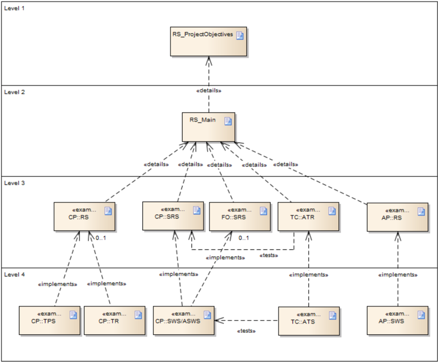

基于平台的文档的归属通过「applies to」关系实现，如图 2.2 所示。

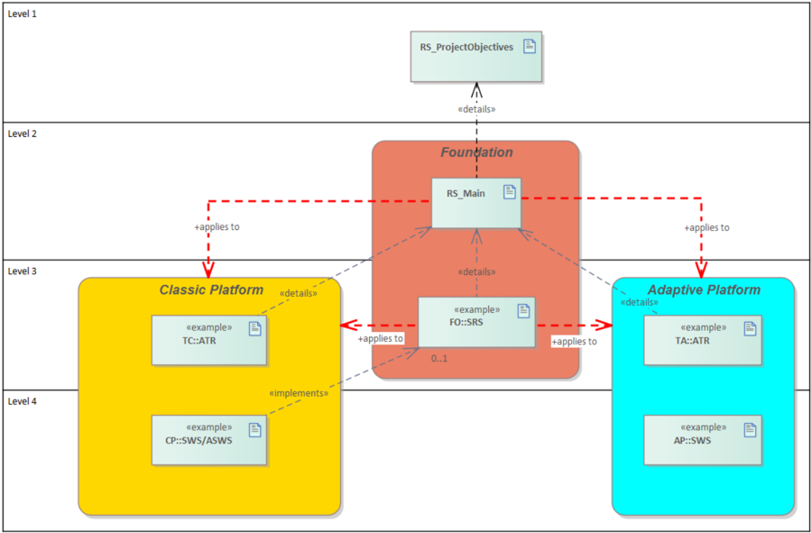

**支持自底向上追溯**：标准化模板通过元类 Traceable 支持这些层级之间的自底向上追溯。这允许表示可追溯实体并在它们之间建立追溯。这些实体驻留在 DocumentationBlock 中。一个重要的位置是 Identifiable 的 introduction 中的 DocumentationBlock.trace。

**约束：需求上溯中允许的 LifeCycleState 组合**

| （追溯自 ↓ 追溯至 →） | TraceableText.category = REQUIREMENT_ITEM：DRAFT | VALID | OBSOLETE | REMOVED |
|---|---|---|---|---|
| DRAFT | 1 | 1 | | |
| VALID | ×¹ | 1 | | |
| OBSOLETE | 1 | 1 | 1 | |
| REMOVED | 1 | 1 | 1 | 1 |

图例：1 = 允许；×¹ = 该组合按源表以脚注 1 标记（源表在 DRAFT 列以 1、VALID 行以 ×¹ 印刷，含义见源文档表注）

### 2.2. 文档可追溯项

**AUTOSAR 文档中规范项的表示**：AUTOSAR 规范项使用具有以下属性的结构表示：

- 标题由一个 Id（shortName）组成，应写在方括号内，并应遵循「标准化文档中 TraceableText 的 shortName 的 namePattern」条目。
- Id 之后是以花括号给出的 LifeCycleState。允许的取值为 VALID、DRAFT 和 OBSOLETE，应遵循 [TPS\_GST\_00051]。如果未给出 LifeCycleState 信息，则状态为 VALID。
- LifeCycleState 之后应给出可选的规范项标题（longName）以提高人类可读性。
- 下一行以起始半括号开始，随后是规范项的内容。其结束应以结束半括号标记。
- 结束半括号之后，一个起始圆括号给出由该规范项所满足的需求的逗号分隔清单。其结束应以结束圆括号标记。如果没有可用的上溯追溯，圆括号应以空内容写出。
- 规范项应描述模型的语义和语法。

注意：由于 TPS 和 TR 文档不直接促成实现，到相应需求（RS 文档）的上溯追溯是可选的。

**AUTOSAR 模板文档中约束项的表示**：AUTOSAR 模板文档中的约束项使用具有以下属性的结构表示：

- 约束标识符 shortName 由以下组成：
  - 字符串前缀："constr\_"
  - 数字后缀：4–5 位长
  - 数字后缀的首位数字应 ≥ 1

  在文档层级，这应以 [] 括号呈现。数字后缀全局唯一。
- Id 之后是以花括号给出的 LifeCycleState。允许的取值为 VALID、DRAFT 和 OBSOLETE，应遵循 [TPS\_GST\_00051]。如果未给出 LifeCycleState 信息，则状态为 VALID。
- LifeCycleState 之后是约束标题（longName）。
- 约束内容应写在起始与结束半括号内。
- 约束项进一步限制模型的有效性。
- 可选的约束 ImpositionTime（见「ImpositionTime 的语义」条目）

**AUTOSAR 模板文档中建议项（advisory item）的表示**：AUTOSAR 模板文档中的建议项使用以下格式表示：

- 建议标识符 shortName 由以下组成：
  - 字符串前缀："advisory\_"
  - 数字后缀：4–5 位长
  - 数字后缀的首位数字应 ≥ 1

  在文档层级，这应以 [] 括号呈现。数字后缀全局唯一。
- 标识符之后是以花括号给出的 LifeCycleState。允许的取值为 VALID、DRAFT 和 OBSOLETE，应遵循 [TPS\_GST\_00051]。如果未给出 LifeCycleState 信息，则状态为 VALID。
- LifeCycleState 之后是建议标题 longName。
- 建议内容应写在起始（ceil）与结束（floor）符号内。

在按「AUTOSAR 模板文档中建议项的表示」给出的建议项中，应在内容中使用术语「should（应当）」以强调该项的建议性质。

**AUTOSAR 非模板文档中约束项的表示**：AUTOSAR 非模板文档中的约束项使用具有以下属性的结构表示：

- 标题由一个 Id（shortName）组成，应写在方括号内，并应遵循「标准化文档中 TraceableText 的 shortName 的 namePattern」条目。
- Id 之后是以花括号给出的 LifeCycleState。允许的取值为 VALID、DRAFT 和 OBSOLETE，应遵循 [TPS\_GST\_00051]。如果未给出 LifeCycleState 信息，则状态为 VALID。
- LifeCycleState 之后是约束标题（longName）。
- 约束内容应写在起始与结束半括号内。

在按「AUTOSAR 非模板文档中约束项的表示」给出的约束中，应在内容中使用术语「shall（应）」以强调该项的强制性质。

**AUTOSAR 文档中需求的表示**：AUTOSAR 需求使用「StructuredReq」条目所定义的结构表示，其中以下属性以表格形式呈现：

- 标题应包含需求的 Id（shortName）、LifeCycleState（Type）和名词化的唯一简短文本（longName）。
- Type 的取值应为「valid」「draft」或「obsolete」之一，见「AUTOSAR 提供模型（M1）上应用的生命周期信息集」条目。
- 需求的描述包含使用「句式模式」条目的句式、并采用「义务的表达」条目中关键词之一的完整英文句子。可以添加理解该需求所需的附加信息。
- 理由（Rationale）可用于论证或说明该需求的合理性。
- 用例（Use Case）可用于描述该需求的用例。
- Applies to 应包含逗号分隔的标签清单，取以下值之一："CP"、"AP"、"FO"、"TC"、"TA"。
- Dependencies 可包含对本文档中该需求所依赖的其他需求的引用。
- Supporting material 可用于记录对支持该需求实现的其他文档或模型的引用。

其呈现方式见图 2.3。请注意，Type 的值在标题中以花括号显示。

表（图2.3：需求表，**Requirements Table**）

| 字段 | 内容 |
|---|---|
| 标题 | [SWS\_FOO\_07711&#123;DRAFT&#125;] 正式需求应呈现为此样式（RS\_BRF\_00123） |
| Type | valid / draft / obsolete |
| Description | 改进对需求理解的附加文本（可选）。描述不得通过使用关键词来细化或增强需求。 |
| Rationale | 为什么该需求重要，遗漏它会导致什么？我们有意协调 AUTOSAR 需求的呈现。 |
| Use Case | 使该需求必要或有用的一种场景。 |
| AppliesTo | CP、AP、FO、TC、TA |
| Supporting Material: | |

**注意：** 源图 2.3 为需求表的版式示意（含示例行 SWS\_FOO\_07711）；上表按站点表格规则以 GFM 表呈现并保留源图号。

如果某个专用字段没有数据，则保持为空。

需求的描述遵循专用的句式模式。

表（图2.4：句式模式，**Sentence Pattern**）

| 句式成分 | 含义 |
|---|---|
| &lt;Condition&gt;（可选） | &lt;Requirement Statement&gt; 应为真的条件。条件以 if 或 when 开始、以 then 结束。when 标识一个事件，即条件变为真的时间点；自然语言中可用「as soon as」表达相同含义。if 则标识与时间无关的静态条件。对静态条件，可在 &lt;Requirement Statement&gt; 之后（可选地）追加 else，以按该模式附加一个附加句子来表达替代需求。 |
| &lt;Subject&gt; | 应满足 &lt;Requirement Statement&gt; 的项。备注：主语通常代表你所开发的对象、其属性或一部分。强烈建议在规范文档的介绍性章节中维护你所规定的主体（subject）的概览。 |
| shall | 将 &lt;Subject&gt; 与 &lt;Requirement Statement&gt; 分隔，并标识（部分）需求。 |
| &lt;Requirement Statement&gt; | 一条可以被验证或证伪的陈述。若陈述为真，则 &lt;Subject&gt; 满足该需求，否则不满足。 |

**句式模式**：句式的构成如上表所示。

**约束：规范层级上下文中「applies to」的使用**：在规范层级 1 和 2，只应使用含 appliesTo 属性的需求表。在规范层级 3 和 4，只应使用不含 appliesTo 属性的需求表。例外：按规范层级 3 处理的基础标准（Foundation）文档。

理由：这避免了干扰追溯结构的无意交叉引用。

**约束：「applies to」取值上下文中允许的上溯追溯**：到上层规范文档的追溯应符合 appliesTo 所赋的值。

注意：图 2.5 中以「NOT ALLOWED」标记了不允许的上溯追溯模式。

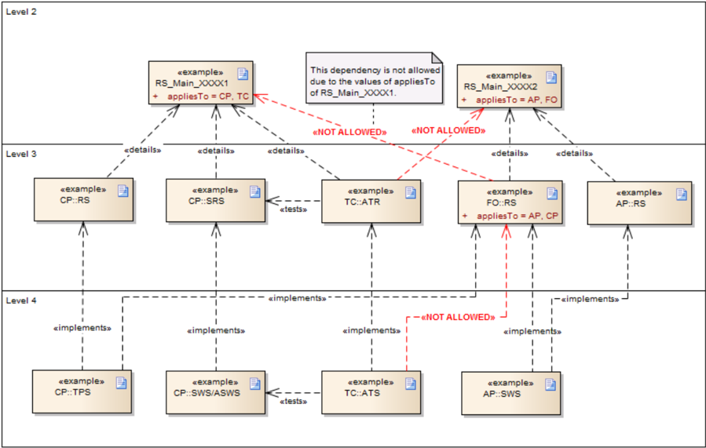

注意：AUTOSAR 需求层次第 1 至 4 层不允许可选需求。实现的可选部分仅对 AUTOSAR 的最终用户是可选的。为了提供这一选项，相应选择在相应规范中必须是强制的。这意味着，描述为「AUTOSAR should support X」的特性永远不可能是正确的，因为底层需求层始终是静态的，没有机会决定「X」是否应成为其中的一部分。正确的写法例如是「AUTOSAR shall support optional X」。

**AUTOSAR 文档中测试项的表示**：AUTOSAR 测试项使用「StructuredReq」条目所定义的结构表示，其中以下属性以表格形式呈现：

- 标题中显示 Id（shortName）与测试项（longName）。
- 测试项（longName）应是一个完整的英文句子。
- 「implements」在表尾表示上溯追溯。
- Type、Description、Rationale、Use Case、Dependencies、Supporting Material 和 Tested Items 以表行显示。
- Type 的取值应为「valid」「draft」或「obsolete」之一，见「AUTOSAR 提供模型（M1）上应用的生命周期信息集」条目。

其呈现方式见图 2.6。

表（图2.6：测试项表，**Test Item Table**）

| 字段 | 内容 |
|---|---|
| 标题 | [ATR\_FOO\_04711] 正式测试应呈现为此样式（ implements：[SWS\_FOO\_00815]、[TPS\_STDT\_00042] ） |
| Type | valid |
| Description | 改进对验收测试理解的附加文本（可选）。 |
| Rationale | 为什么该验收测试重要，遗漏它会导致什么？我们有意协调 AUTOSAR 验收测试的呈现。 |
| Use Case: | |
| Dependencies: | |
| Supporting Material: | |
| Tested Items: | |

**注意：** 半括号的 Unicode 码位为：起始半括号 0x2308，结束半括号 0x230B。

Traceable 特化为：

**TraceableText**：这表示可以在段落层级被引用以建立需求追溯的文本。它是一个抽象类，其特定特化支持特定种类的追溯，例如需求/约束。

**约束：带标签文本的类别**：TraceableText 的 category 应为以下之一：

- ADVISORY\_ITEM：文本表示一个特定的建议。此类项主要适用于模板规范。它与约束项类似，但表示的是 WARNING 而非 ERROR 的性质。
- CONSTRAINT\_ITEM：文本表示一个特定的约束。此类项主要适用于模板规范。它与规范项类似，但表示的是可以自动验证（例如由工具）的问题。
- IMPLEMENTATION\_ITEM：文本表示实现的一个简短描述。它主要适用于模型元素的引言内。
- REQUIREMENT\_ITEM：文本表示一个特定的需求。此类项主要适用于需求规范。
- SPECIFICATION\_ITEM：文本表示规范中的一个特定项。此类项是软件规范实现的一项需求。
- SRC：文本表示源代码内容。
- TEST\_ITEM：文本表示测试的一个简短描述。此类项主要适用于测试规范。

**StructuredReq**：这表示 AUTOSAR RS 文档中使用的结构化需求。

注意：由于 TraceableText 聚合在 DocumentationBlock 中，它也需要在印刷文档中有恰当的呈现方式。恰当呈现的示例见上文「支持自底向上追溯」条目。

**约束：追溯不得嵌套**：鉴于需求及规范项预期的原子性，Traceable 不得嵌套。

**标准化文档中 TraceableText 的 shortName 的 namePattern**：适用于 AUTOSAR 标准化文档中 TraceableText 的 shortName（实际上表示例如需求标签）的预期名称模式定义为：

```
[{platform}_]{keyword(TraceCategory)}_{module}_({special}[_{index}])|{index}
```

在该模式中，占位符定义如下：

- platform 为 AP、CP 或 FO 之一。
- keyword(TraceCategory) 在 [\[3\]](#ref-3) 的关键词集 InformationCategories 中定义，取分类为 TraceCategory 的条目。
- module 为 [\[4\]](#ref-4) 中的模块缩写，或 [\[3\]](#ref-3) 中分类为 DocumentAbbreviation 的关键词集 DocumentAbbreviations 的条目，或 [\[5\]](#ref-5) 中的功能集群简称。在一个文档内只应使用相同的模块缩写或关键词。
- index 是范围为 00000->99999 的 5 位数字索引。
- special 为 SPEC、NA、GEN、CONSTR 之一。注意 special 还可以带可选的索引。这允许提供带有更详细信息的多个不同特殊项。

注意，一些既有规范由于历史原因在文档内包含多个缩写，因此不遵循该模式。这些属于例外，不得应用于新文档。

**标识不适用需求**：对于那些不适用于特定规范的需求，「标准化文档中 TraceableText 的 shortName 的 namePattern」条目允许 special 取 NA。

为了应用这一点，可以创建带有 shortName（例如 [RS\_STDT\_NA] 甚至 [RS\_STDT\_NA\_00099]）的规范项，回溯到不适用的需求项。

借此，不适用需求在需求追溯表中容易被识别。需求追溯是完整的，因为它也显式表达了不适用需求。

**标识普遍满足的需求**：对于那些由通用概念满足的需求，「标准化文档中 TraceableText 的 shortName 的 namePattern」条目允许 special 取 GEN。

为了应用这一点，可以创建带有适当 shortName（例如 [RS\_STDT\_GEN] 甚至 [RS\_STDT\_GEN\_00098]）的规范项，回溯到普遍满足的需求项。

借此，被认为普遍满足的需求在需求追溯表中容易被识别。需求追溯是完整的，因为它也显式表达了普遍（或隐式）满足的需求。

**标识需要进一步特化的需求**：对于那些由通用规范中的项与个别规范中的项共同满足的需求，「标准化文档中 TraceableText 的 shortName 的 namePattern」条目允许 special 取 SPEC。

为了应用这一点，可以创建带有适当 shortName（例如 [RS\_STDT\_SPEC] 甚至 [RS\_STDT\_SPEC\_00092]）的项，回溯到需要在个别规范中附加项的需求项。

借此，可以识别通用规范中需要在个别规范中补充项的需求项。这最终使得完整的需求追溯成为可能。

图 2.7 展示了一张利用「标识不适用需求」与「标识需要进一步特化的需求」所提供特性的需求追溯表：

表（图2.7：使用 NA 与 SPEC 的追溯表示例，**Example for trace table using NA and SPEC**）

**SWS CanIf —— 到 SRS BSW General 的需求追溯**

| 需求 | 描述 | 满足者 |
|---|---|---|
| [RS\_BSW\_001] | 需求标题… | [SWS\_BSW\_0100] |
| [RS\_BSW\_002] | 需求标题… | [SWS\_CANIF\_0815]、[SWS\_CANIF\_2000]、[SWS\_BSW\_SPEC] |
| [RS\_BSW\_003] | 需求标题… | [SWS\_BSW\_0100]、[SWS\_BSW\_0105] |
| [RS\_BSW\_004] | 需求标题… | [SWS\_CANIF\_0158]、[SWS\_BSW\_0101] |
| [RS\_BSW\_005] | 需求标题… | [SWS\_CANIF\_NA]、[SWS\_BSW\_0102]、[SWS\_BSW\_SPEC] |
| [RS\_BSW\_006] | 需求标题… | [SWS\_CANIF\_NA] |
| [RS\_BSW\_007] | 需求标题… | [SWS\_CANIF\_0784]、[SWS\_BSW\_0104]、[SWS\_BSW\_SPEC] |
| [RS\_BSW\_008] | 需求标题… | [SWS\_CANIF\_NA] |
| … | … | |

**SWS CanIf —— 到 SRS CAN 的需求追溯**

| 需求 | 描述 | 满足者 |
|---|---|---|
| [RS\_CANIF\_001] | 需求标题… | [SWS\_CANIF\_0434] |
| [RS\_CANIF\_002] | 需求标题… | [SWS\_CANIF\_0435] |
| [RS\_CANIF\_003] | 需求标题… | [SWS\_CANIF\_0436] |
| … | … | |

**标识 AUTOSAR ASWS/SWS/PRS 文档中作为约束的规范项**：对于那些作为约束的规范项，「标准化文档中 TraceableText 的 shortName 的 namePattern」条目允许 special 取 CONSTR。为了应用这一点，可以创建带有适当 shortName（例如 [SWS\_Dem\_CONSTR\_06101]）的项。对于这种情况，数字索引是强制的。作为规范项的约束只允许出现在 ASWS/SWS/PRS 文档中。

**TraceableText 的特性**：TraceableText 应当<sup>1</sup>是：

> 1 「should」的这种用法表明这并不总是容易决定。例如，本条目也可以拆分为每个条目一个 TraceableText。

- 可标识的（**identifiable**）：TraceableText 应由唯一的 shortName 标识（见「标准化文档中 TraceableText 的 shortName 的 namePattern」）。应用 AUTOSAR 元模型与 schema 后即自动满足。
- 特定的（**specific**）：TraceableText 的编写应使内容无歧义且全面——即使这不会带来优雅的行文风格。
- 原子的（**atomic**）：一个 TraceableText 应覆盖一个特定的问题。
- 可验证的（**verifiable**）：TraceableText 的内容应写得具体，使其可以被验证——不一定自动验证，但至少可由人类专家验证。

特别是，应应用「义务的表达」条目规定的需求层级。

**义务的表达**：应使用以下表达义务的言语形式来标示需求。

本文档中的关键词「MUST」「MUST NOT」「REQUIRED」「SHALL」「SHALL NOT」「SHOULD」「SHOULD NOT」「RECOMMENDED」「MAY」和「OPTIONAL」应按如下方式解释。

注意，使用它们所在的文档的需求层级会修改这些词的强制力。

- MUST：这个词，或形容词「LEGALLY REQUIRED」，表示由于法律问题，该定义是规范的绝对需求。
- MUST NOT：这个短语表示由于法律问题，该定义是规范的绝对禁止。
- SHALL：这个短语，或形容词「REQUIRED」，表示该定义是规范的绝对需求。
- SHALL NOT：这个短语表示该定义是规范的绝对禁止。
- SHOULD：这个词，或形容词「RECOMMENDED」，表示在特定情形下可能存在忽略某一特定项的正当理由，但在选择不同做法之前必须理解并仔细权衡其全部影响。
- SHOULD NOT：这个短语，或短语「NOT RECOMMENDED」，表示在特定情形下可能存在该特定行为可接受甚至有用的情况，但在实现以此标签描述的任何行为之前应理解并仔细权衡其全部影响。
- MAY：这个词，或形容词「OPTIONAL」，表示某项是真正可选的。一个供应商可以选择包含该项，因为特定市场需要它，或者因为供应商认为它增强了产品；而另一个供应商可以省略同一项。

不包含某一特定选项的实现，应当（**SHALL**）准备好与包含该选项的另一实现互操作，尽管功能可能有所减少。同样，包含某一特定选项的实现，应当（**SHALL**）准备好与不包含该选项的另一实现互操作（当然，该选项提供的特性除外）。

**TraceableText 的组织**：规范中的一组 TraceableText 应具有以下性质：

- 层次结构：多个 TraceableText 应被结构化为若干连续的层级——这主要由不同种类 AUTOSAR 规范的模板保证。
- 完整性：一个层级上的 TraceableText 应完整实现上一层的所有 TraceableText。
- 外部一致性：多个 TraceableText 之间不得相互矛盾。
- 层次结构的任何层级内不重复信息：一个 TraceableText 的内容不得在该层次结构同一层级的任何其他 TraceableText 中重复。
- 可维护性：一组 TraceableText 可以被修改或扩展，例如通过引入 TraceableText 的新版本或添加/移除 TraceableText。TraceableText 的 shortName 不得被复用或更改。

上述条目中提到的层级见图 2.1。

**AUTOSAR 交付文件的 namePattern**：适用于 AUTOSAR 交付文件名的预期名称模式定义为

```
[{platform}_]AUTOSAR_{keyword(DocumentCategory)}_{DocumentName}
```

在该模式中，占位符定义如下：

- platform 为 AP、CP 或 FO 之一。
- keyword(DocumentCategory) 在 [\[3\]](#ref-3) 的关键词集 InformationCategories 中定义，取分类为 DocumentCategory 的条目。
- DocumentName 是 [\[3\]](#ref-3) 中分类为 DocumentAbbreviation 的关键词集 DocumentAbbreviation 条目的 Keyword 的 shortName，或 [\[4\]](#ref-4) 中模块的 shortName。

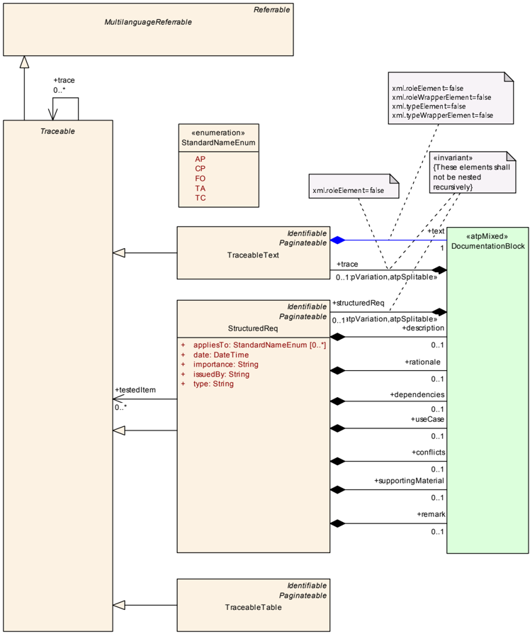

表2.1：StandardNameEnum（**StandardNameEnum**）

| 属性 | 值 |
|---|---|
| 枚举 | StandardNameEnum |
| 包 | M2::AUTOSARTemplates::GenericStructure::DocumentationOnM1 |
| 说明 | 该枚举列出所有允许的标准缩写。 |
| 聚合于 | AppliedStandard.appliesTo, StructuredReq.appliesTo |

| 字面值 | 描述 |
|---|---|
| AP | 该值表示自适应平台（Adaptive Platform）。Tags: atp.EnumerationLiteralIndex=0 |
| CP | 该值表示经典平台（Classic Platform）。Tags: atp.EnumerationLiteralIndex=1 |
| FO | 该值表示基础标准（Foundation）。Tags: atp.EnumerationLiteralIndex=2 |
| TA | 该值表示自适应平台的测试（Testing of the Adaptive Platform）。Tags: atp.EnumerationLiteralIndex=3 |
| TC | 该值表示经典平台的测试（Testing of the Classic Platform）。Tags: atp.EnumerationLiteralIndex=4 |

### 2.3. 施加时间

AUTOSAR 工具究竟应在何时强制执行模型约束/建议，在有些情况下是明确的，在另一些情况下是有条件的。因此，AUTOSAR 约束/建议可以包含一个附加的 ImpositionTime 属性，以规定工作流中应应用该约束/建议的最晚时间点<sup>2</sup>。由于 AUTOSAR 为经典平台与自适应平台定义了独立的方法论工作流，相应的 ImpositionTime 通常也依赖于平台。

> 2 通常由编写/建模工具执行。

**ImpositionTime 的语义**：AUTOSAR 模型约束/建议包含一个 ImpositionTime，它规定方法论工作流中应将相应约束/建议施加于模型的最晚时点。

**ImpositionTime 的应用**：约束/建议可以在 ImpositionTime 之前被强制执行，但不得晚于工作流中相应的时点。

**未规定 ImpositionTime 的语义**：没有 ImpositionTime 的 AUTOSAR 模型约束/建议，意味着「在工作流中的任意时点」。

## 3. AUTOSAR 定义的生命周期

为了支持标准化模型元素（如端口原型蓝图、端口接口、关键词缩写、SW-C（ASW 中）或 BSW 模块的 API 等）的演进与向后兼容，AUTOSAR 支持生命周期。元模型及该元模型应用的细节在通用结构模板 [\[6\]](#ref-6) 的「生命周期支持」一章中规定。

**生命周期支持**：STDT 能够通过来自 LifeCycleInfoSet 内部的引用来表达关于蓝图状态的信息。

**AUTOSAR 提供模型（M1）上应用的生命周期信息集**：以下 LifeCycleState 应用于 AUTOSAR 提供的模型元素：

- VALID：表示相关实体是文档的有效部分。这是默认值。
- DRAFT：表示相关实体是在模型中新引入但仍处于试验阶段的。该信息已发布，但可能在不做向后兼容管理的情况下被更改。
- OBSOLETE：表示相关实体已过时，出于兼容性原因保留在模型中。如果设置了该标签，备注应表达推荐的替代方案。
- REMOVED：表示相关实体已从模型中移除。它不应再被使用，甚至不应出现在文档中。AUTOSAR 发布版本不包含此类元素。它面向 AUTOSAR 内部开发。

即使此类已移除的元素未包含在 .arxml 中，它们仍可以在 LifeCycleInfoSet 中被引用：使用 Referrable 类型的 `&lt;atpUriDef&gt;` 属性 lcObject，或 useInstead。

如果某个对象未在 LifeCycleInfoSet 中被引用，则相关实体是当前模型的有效部分。

注意，按照「AUTOSAR 提供模型（M1）上应用的生命周期信息集」条目，如果某个元素没有生命周期信息，则定义该元素是有效的。换言之，一般而言无需定义 defaultLcState = VALID 的 LifeCycleInfoSet。不过，在某些用例中显式定义这样的 LifeCycleInfoSet 可能有用。例如：元素「x」获得 LifeCycleState = OBSOLETE，随后这被认定为一个错误，生命周期回退到 VALID。这可以记录在这样的 LifeCycleInfoSet 中。

清单 B.1 提供了依照 [TPS\_GST\_00051] 及「AUTOSAR 提供模型（M1）上应用的生命周期信息集」条目的生命周期的 ARXML 表示。

## 4. 蓝图

### 4.1. 蓝图的原则

**蓝图的原则**：本章描述 AUTOSAR 元模型对作为进一步建模基础的模型元素预定义的支持。这些预定义称为蓝图（**blueprint**）。

例如，编写工具提供这种预定义的 PortInterface，作为一种工具箱，可以从中把定义复制到项目中。

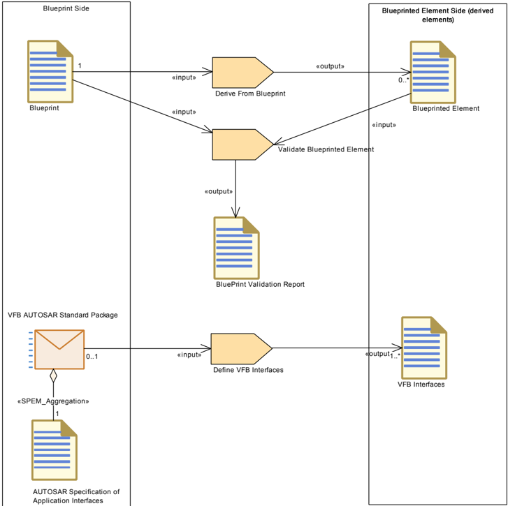

图 4.1 展示了该用例。蓝图一方面用作派生对象（DeriveFromBlueprint）的输入，之后还用于验证派生出的对象。作为示例，该图显示应用接口用于派生 VFB 接口（即 PortInterface）。

#### 4.1.1. 蓝图的抽象模式

蓝图方法由图 4.2 所示的抽象蓝图结构表示。它基于三个实体：

- 蓝图（**Blueprint**），由 AtpBlueprint 表示，充当元素的预定义。它基本上遵循与派生元素相同的结构，但可能包含支持其作为蓝图的附加元素。例如，PortPrototypeBlueprint 还规定 initValue，而 PortPrototype 则不然——后者从相应的 ComSpec 获得初始值。
- 被蓝图化的元素（**Blueprinted Element**），由 AtpBlueprintable 表示，充当从蓝图派生的元素。这些元素主要通过复制与细化（copy and refine）从蓝图派生。「细化」可以添加进一步的属性值、更新 shortName 等。可能的细化的细节针对每个蓝图单独规定。

  注意，被蓝图化元素的后续处理（例如 RTE 生成）不再引用蓝图。
- 蓝图映射（**Blueprint Mapping**），由 AtpBlueprintMapping 表示，充当蓝图与其派生元素之间的引用。该蓝图映射的主要目的是：
  - 提供对每个派生元素验证其是否符合蓝图的能力；
  - 反映派生元素属于一个共同概念这一事实。

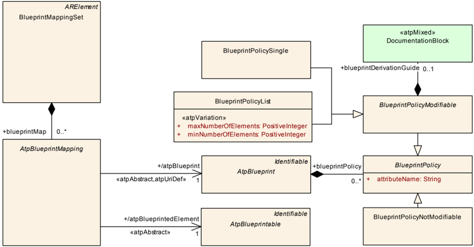

适用于蓝图化的元素的元类被定义为 AtpBlueprintable 的特化，而蓝图的元类被定义为 AtpBlueprint 的特化。示例见图 4.3。

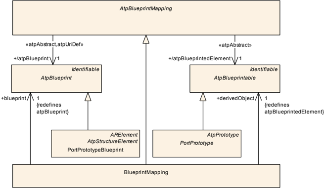

**蓝图与派生对象使用相同的元类**：对于大多数适用于蓝图化的元素，不需要额外的元类，因为同一个元类同时适用于蓝图与被蓝图化元素。这类元素的元类同时继承自 AtpBlueprint 与 AtpBlueprintable。示例见图 4.4。

**约束可能在蓝图中被违反**：对于与派生对象使用相同元类的蓝图，为这些对象定义的约束可能被蓝图违反，例如：

- 必需属性可能缺失。
- 被引用的对象可能不存在。严格地说，蓝图中的引用都可以视为 `&lt;atpUriDef&gt;`。

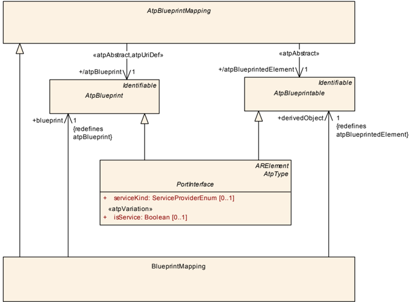

**识别蓝图**：依照通用结构模板 [\[6\]](#ref-6)，蓝图驻留在类别为「BLUEPRINT」的包中。下游 AUTOSAR 工具（例如 RTE 生成器）应忽略位于类别「BLUEPRINT」包中的元素。

蓝图是 AtpBlueprint 的特化。因此引入标准化不会给既有模板带来兼容性问题。注意，自 AUTOSAR 4.0.3 起，AtpBlueprint.shortNamePattern 被 Identifier.namePattern（或 CIdentifier.namePattern）取代。此外，自 AUTOSAR 4.4.0 起存在 blueprintValue，例如在 ARMQL（AUTOSAR 模型查询语言）的上下文中使用。

**BlueprintPolicy**：可被蓝图化的元素应以 BlueprintPolicy 表征，以指示它们是可修改的还是不可修改的。

- BlueprintPolicyNotModifiable 表示：相关属性在蓝图化过程中不可修改（见清单 B.9）。
- BlueprintPolicyList 表示：相关属性在蓝图化过程中可修改。它只适用于上多重性大于 1 的属性（见清单 B.10）。
- BlueprintPolicySingle 表示：相关属性在蓝图化过程中可修改。它只适用于上多重性等于 1 的属性（见清单 B.11）。

**约束：允许一个 BlueprintPolicy**：对蓝图的每个属性，至多允许一个 BlueprintPolicy。

**约束：BlueprintPolicyNotModifiable**：如果 BlueprintPolicyNotModifiable 被分配给某个属性，则在蓝图化过程中不允许修改该属性及其全部所含内容的值。

**约束：无 BlueprintPolicy**：如果某个属性没有分配 BlueprintPolicy，则在从蓝图派生时允许任意修改。

**约束：标识 BlueprintPolicy 所涉及属性的表达式**：标识 BlueprintPolicy 相关属性的表达式语言是 xpath 的一个子集，见 [\[7\]](#ref-7)。模型导航使用 XML 中使用的名称。

**BlueprintPolicy 允许的 XPath 表达式**

| XPath 表达式 | 描述 | 备注 |
|---|---|---|
| nodename | 选择所有名为「nodename」的节点 | |
| / | 从根节点选择（根节点是拥有该 BlueprintPolicy 的蓝图） | |
| @ | 选择属性 | |
| @&lt;attribute&gt;='&lt;value&gt;' | 选择把 &lt;attribute&gt; 设为 &lt;value&gt; 的元素节点 | |
| text()='&lt;value&gt;' | 选择包含文本 &lt;value&gt; 的元素节点 | |
| * | 匹配任意元素节点 | |
| [n] | 选择第 n 个元素节点 | 仅允许用于有序元素 |

「BlueprintPolicy 允许的 XPath 表达式」条目中的 XPath 表达式 [n] 依照 [\[7\]](#ref-7) 从 [1] 开始。一个 BlueprintPolicy 可以细化多于一个属性。

在清单 B.9 中，根节点由 nodename（COMPU-INTERNAL-TOPHYS）选择。在清单 B.10 中，根节点由 nodename/nodename/\*（COMPUINTERNAL-TO-PHYS/COMPU-SCALES/\*）选择。

#### 4.1.2. 蓝图到被蓝图化元素的映射

在很多情况下，需要在按蓝图创建被蓝图化元素（例如 PortPrototype）之后，标识该被蓝图化元素（例如 PortPrototype）与相应蓝图（例如 PortPrototypeBlueprint）的关系。

为此，理论上可以在 AtpBlueprintable 与 AtpBlueprint 之间建立标识相关模型工件对的引用。然而，这种信息只在很窄的范围内相关，并且如前所述不影响下游的模型处理。

因此，引入了同时引用 AtpBlueprintable 与 AtpBlueprint 的 AtpBlueprintMapping（见图 4.2）。AtpBlueprintMapping 又聚合在用于创建蓝图映射的容器 BlueprintMappingSet 中。

在以前的 AUTOSAR 版本中，为每个适用于蓝图化的特定元类创建了 AtpBlueprintMapping 的一个特化。这已被一个特定特化（BlueprintMapping）取代<sup>3</sup>。

> 3 出于兼容性原因，抽象模式未被更改。以前的特化 PortInterfaceBlueprintMapping 与 PortPrototypeBlueprintMapping 已被移除。

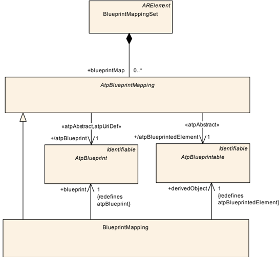

**约束：蓝图映射应映射适当的元素**：BlueprintMapping 应映射表示有效的蓝图/派生对象对的元素。在大多数情况下，这意味着 blueprint 与 derivedObject 应引用同一元类的对象。

表4.1：BlueprintMappingSet（**BlueprintMappingSet**）

| 属性 | 值 |
|---|---|
| 类 | BlueprintMappingSet |
| 包 | M2::AUTOSARTemplates::CommonStructure::StandardizationTemplate::BlueprintMapping |
| 说明 | 该元素表示「实际」模型元素与其创建时所采用的「蓝图」之间映射的容器。Tags: atp.recommendedPackage=BlueprintMappingSets |
| 基类 | ARElement, ARObject, CollectableElement, Identifiable, MultilanguageReferrable, PackageableElement, Referrable |
| 聚合于 | ARPackage.element |

| 属性 | 类型 | 多重性 | 种类 | 备注 |
|---|---|---|---|---|
| blueprintMap | AtpBlueprintMapping | * | aggr | 这表示集合中的一个特定的蓝图映射。 |

#### 4.1.3. 蓝图与被蓝图化元素符合性的一般规则

**与蓝图的符合性**：约束 constr\_2554 与「派生对象可以具有多于蓝图的属性」条目总体上适用于蓝图与派生对象的符合性。

**约束：派生对象应与蓝图匹配**：除非显式规定其他情况，蓝图的属性应出现在派生对象中。

作为例外，namePattern 与 blueprintValue 可以不被复制。

**派生对象可以具有多于蓝图的属性**：除非显式规定其他情况，派生对象可以具有多于蓝图的属性。这样的属性可以是：

- 当该属性在元模型中的上多重性大于 1 时的附加值；
- 由相关模板规定但未在蓝图中规定的属性。

**蓝图与被蓝图化元素的 longName、desc 与 introduction 的兼容性**：从蓝图派生的元素允许：

- 更改 longName
- 更改 desc
- 更改 introduction

注意，「蓝图与被蓝图化元素的 longName、desc 与 introduction 的兼容性」条目包括以进一步语言添加文本的能力。

注意，introduction 不应用于描述对象从蓝图的派生。细节见「在派生对象时表达决策」条目。

**在蓝图中规定名称模式或蓝图值**：对每个蓝图，如果 shortName（或符号）并非固定、而是打算在从蓝图派生对象时定义，则应规定 namePattern 或 blueprintValue。这用于验证派生对象的恰当命名（见约束 constr\_2553）。

**约束：shortName 应遵循蓝图中定义的模式**：派生对象的 shortName（或符号）应遵循蓝图的 namePattern 或 blueprintValue（按「在蓝图中规定名称模式或蓝图值」条目）中定义的模式。

**约束：系统描述中不得有蓝图**：系统描述中不得有蓝图。因此蓝图元素只能被蓝图与 AtpBlueprintMapping 引用。由于 `&lt;atpUriDef&gt;`，来自 AtpBlueprintMapping 的引用不需要在系统描述中被解析。

**约束：来自蓝图的出向引用**：注意，来自蓝图的出向引用基本上不受限制。实践中，不应出现对类别为 EXAMPLE 的包中对象的引用。

约束 constr\_2571 的原因在于：这些示例此后也应存在于目标系统描述中，但不能以示例的身份存在。在这种情况下，该示例将扮演蓝图的角色。

图 4.6 展示了包含标准化对象、蓝图与项目相关对象的场景。

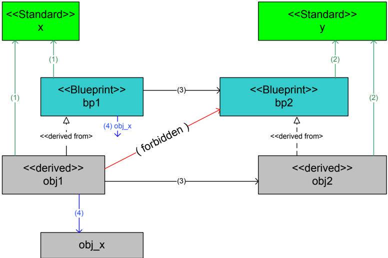

该图特别说明了应如何处理蓝图中的引用：

**从蓝图派生对象时处理引用**：

- 蓝图可以引用标准化对象。这些引用也存在于派生对象中（1）（2）。
- 蓝图可以引用其他蓝图（3）。为了满足约束 constr\_2546，这些引用需要被替换。因此，不允许从派生对象到蓝图的引用。
- 蓝图可以包含对任意对象的引用（4）。依照「约束可能在蓝图中被违反」条目，允许这些对象甚至不存在。尽管如此，为了满足约束 constr\_2554，这样的引用应被复制到派生对象，且被引用的对象应存在于目标系统描述中。

**蓝图的完整性**：蓝图的完整性可以通过应用对相关对象蓝图的引用来建立。例如，BswModuleDescription 的蓝图可以引用 BswModuleEntry 的蓝图。

**约束：派生模型元素中的引用**：从蓝图派生的模型元素绝不应引用作为蓝图的模型元素。

注意：蓝图可以引用另一个蓝图。派生对象时，这样的引用应被替换，使新的引用目标是从蓝图中相应引用目标派生的对象。

**嵌套蓝图可以用作其自身的蓝图**：如果 AtpBlueprint 的特化聚合了 AtpBlueprint 的特化，则被聚合的该 AtpBlueprint 特化自身充当蓝图，并且可以在从聚合它的 AtpBlueprint 特化派生的对象的上下文之外被派生。该定义允许创建不是 ARElement 特化的蓝图。

换言之，如果一个蓝图包含蓝图，则「内部」蓝图可以独立于「外层」蓝图的派生对象而被派生。

「嵌套蓝图可以用作其自身的蓝图」条目的用例见第 [4.2.8](#428-buildactionmanifest-的蓝图化) 章。

**在非蓝图中忽略蓝图属性**：不处理蓝图的 AUTOSAR 工具（例如 RTE 生成器）应忽略 Identifier.namePattern（或 CIdentifier.namePattern）与 blueprintValue。

从蓝图派生对象时，应移除 Identifier.namePattern（或 CIdentifier.namePattern）与 blueprintValue 属性。

**在派生对象时表达决策**：应用 VariationPoint 是表达从蓝图派生对象时拟做出决策的合适方式。在这种情况下，UML 标签 vh.latestBindingTime 的值为 blueprintDerivationTime，并且应使用 VariationPoint.blueprintCondition、VariationPoint.formalBlueprintGenerator 或 AttributeValueVariationPoint.blueprintValue 来表达预期的派生。

**在蓝图中解析 VariationPoint**：如果 VariationPoint 只有 blueprintValue、blueprintCondition 或 formalBlueprintGenerator，而没有 swSyscond 与 postBuildVariantCondition，则应在派生元素时被解析。

关于以下方面请参阅通用结构模板 [\[6\]](#ref-6)：

- 即使 BindingTimeEnum 不包含值 blueprintDerivationTime，仍然存在应在蓝图派生时绑定的 VariationPoint。这在元模型中变分点的 UML 标签 vh.latestBindingTime 中被规定为 blueprintDerivationTime。此类元素见第 [4.2](#42-autosar-元模型中定义的可蓝图化元素) 章。
- 见约束 constr\_2557：系统配置不得包含 vh.latestBindingTime 设为 blueprintDerivationTime 的 VariationPoint。
- 约束 constr\_2558：如果 vh.latestBindingTime 为 blueprintDerivationTime，则应只有 blueprintCondition、formalBlueprintGenerator 或 blueprintValue。
- 见约束 constr\_2559：VariationPoint 不得嵌套。特别地，这意味着 VariationPoint 的角色 blueprintCondition 的 DocumentationBlock 内不得存在 VariationPoint。
- 见约束 constr\_2567：属性值蓝图应包含 undefined。

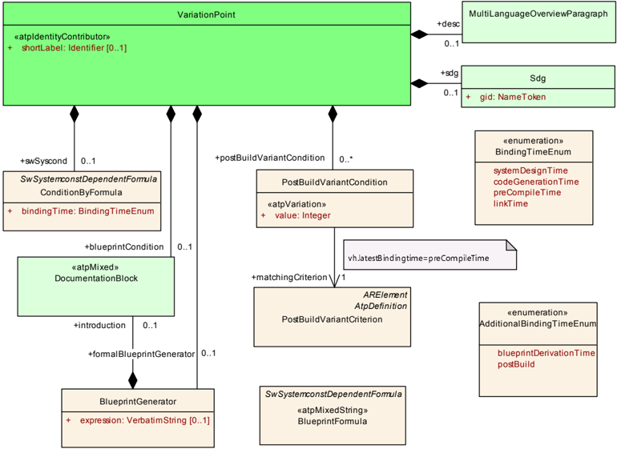

表4.2：VariationPoint（**VariationPoint**）

| 属性 | 值 |
|---|---|
| 类 | VariationPoint |
| 包 | M2::AUTOSARTemplates::GenericStructure::VariantHandling |
| 说明 | 该元类表示表达「结构变分点」的能力。如果 swSyscond 求值为 true 且每个 postBuildVariantCriterion 都得到满足，则变分点的容器属于被选择的变体。 |
| 基类 | ARObject |

| 属性 | 类型 | 多重性 | 种类 | 备注 |
|---|---|---|---|---|
| blueprintCondition | DocumentationBlock | 0..1 | aggr | 表示一个描述，记录从蓝图派生对象时如何解决该变分点。注意 blueprintCondition 内不允许变分点。Tags: xml.sequenceOffset=28 |
| desc | MultiLanguageOverviewParagraph | 0..1 | aggr | 允许简要描述变分点的用途。Tags: xml.sequenceOffset=20 |
| formalBlueprintGenerator | BlueprintGenerator | 0..1 | aggr | 表示一个描述，记录从蓝图派生对象时如何使用 ARMQL 解决该变分点。注意 formalBlueprintGenerator 内不允许变分点。Tags: atp.Status=draft xml.sequenceOffset=30 |
| postBuildVariantCondition | PostBuildVariantCondition | * | aggr | 这是后构建变体条件的集合，为了（postbuild）绑定变分点，它们全部应得到满足。Tags: xml.sequenceOffset=40 |
| sdg | Sdg | 0..1 | aggr | 每个变分点都附加一个可选的特殊数据组。外部软件系统可以用这些数据附加应用特定的数据。例如，变体管理系统可能添加标识符、URL 或特定的分类符。Tags: xml.sequenceOffset=50 |
| shortLabel | Identifier | 0..1 | attr | 为特定变分点提供一个名称，以支持 RTE 生成器。要支持可拆分聚合、以及绑定时间晚于 codeGenerationTime 的情况和某些 RTE 条件，它是必需的。它需要在具有相同 ShortName 的外层 Identifiable 内唯一。Stereotypes: atpIdentityContributor Tags: xml.sequenceOffset=10 |
| swSyscond | ConditionByFormula | 0..1 | aggr | 该条件充当变分点的绑定函数。注意多重性为 0..1 以支持纯 postBuild 变体。Tags: xml.sequenceOffset=30 |

**VariationPoint 的蓝图**：蓝图可以包含 vh.latestBindingTime 设为 blueprintDerivationTime 的 VariationPoint。这些被视为变分点的一种蓝图，应在派生对象时处理。依照所选择的蓝图派生方法，对 VariationPoint 的容器适用以下选项：

1. 如果规定了 blueprintCondition：手动解析。
2. 如果规定了 formalBlueprintGenerator：由模块生成器解析。解析器方法用 ARMQL 形式化。注意在这种情况下，模块生成器也很可能创建多个对象。

通过这些条件之一解析 VariationPoint 后，剩余的变体被转换为后续的 VariationPoint。

**传递 VariationPoint**：除非显式规定其他情况，vh.latestBindingTime 未设为 blueprintDerivationTime 的 VariationPoint 应被传递到派生对象（另见「派生对象可以具有多于蓝图的属性」条目）。由此，VariationPoint 的 shortLabel 可以依照 blueprintCondition 与 formalBlueprintGenerator 中的规定进行调整。

**约束：AUTOSAR 描述中不得有蓝图动机的 VariationPoint**：非蓝图的 AUTOSAR 描述不得具有 blueprintCondition、formalBlueprintGenerator 或 blueprintValue。

**约束：纯粹蓝图动机的 VariationPoint**：vh.latestBindingTime 设为 blueprintDerivationTime 的 VariationPoint 应只有 blueprintCondition 或 formalBlueprintGenerator 或 blueprintValue。

**一般地传递对象**：没有 VariationPoint 的对象（或引用）应被传递到派生对象。由此，被引用蓝图的 namePattern 与 blueprintValue 也适用于重写引用中的 shortName 路径。

关于 VariationPoint 的更多细节请参阅 [\[6\]](#ref-6)，所有约束都汇总在那里。

**依赖于配置的属性**：一些数据类型规定依赖于配置的属性，如界限、基类型等。这由 AttributeValueVariationPoint 中的附加属性 blueprintValue 支持。

「依赖于配置的属性」条目的一个示例是：

```
NvM_BlockIdType Range: 0..2^(16-NvMDatasetSelectionBits)-1
Dem_RatioIdType Type: uint8, uint16
```

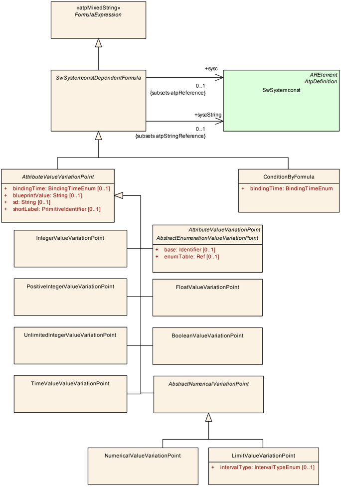

表4.3：AttributeValueVariationPoint（**AttributeValueVariationPoint**）

| 属性 | 值 |
|---|---|
| 类 | `<<atpMixedString>>` AttributeValueVariationPoint（抽象） |
| 包 | M2::AUTOSARTemplates::GenericStructure::VariantHandling::AttributeValueVariationPoints |
| 说明 | 该类表示通过 SwSystemconstDependentFormula 从系统常量派生 Attribute 取值的能力。它还提供 bindingTime。 |
| 基类 | ARObject, FormulaExpression, SwSystemconstDependentFormula |
| 子类 | AbstractEnumerationValueVariationPoint, AbstractNumericalVariationPoint, BooleanValueVariationPoint, FloatValueVariationPoint, IntegerValueVariationPoint, PositiveIntegerValueVariationPoint, TimeValueValueVariationPoint, UnlimitedIntegerValueVariationPoint |
| 聚合于 | VariationPointProxy.valueAccess |

| 属性 | 类型 | 多重性 | 种类 | 备注 |
|---|---|---|---|---|
| bindingTime | BindingTimeEnum | 0..1 | attr | 这是需要绑定属性取值的绑定时间。如果该属性缺失，则该属性不是变分点。特别地，这意味着它需要是符合纯模型中所规定类型的单一值。如果它仍然是公式，则为错误。Tags: xml.attribute=true |
| blueprintValue | String | 0..1 | attr | 表示一个描述，记录从蓝图派生对象时该如何定义该值。Tags: xml.attribute=true |
| sd | String | 0..1 | attr | 提供该特殊数据是为了允许属性值变分点与变体管理系统的同步。其使用取决于相关方之间的协议。Tags: xml.attribute=true |
| shortLabel | PrimitiveIdentifier | 0..1 | attr | 这允许标识该变分点。它也旨在支持 RTE 对 CompileTime 变分点的支持。Tags: xml.attribute=true |

#### 4.1.4. 从蓝图派生对象时定义属性的适用模式

#### 4.1.5. 名称模式

**应用 namePattern**：从蓝图派生元素时，经常需要使用特定的模式来确定对象的 shortName（或符号）。该用例由 Identifier（或 CIdentifier）中的属性 namePattern 支持。

表4.4：Identifier（**Identifier**）

| 属性 | 值 |
|---|---|
| 原始类型 | Identifier |
| 包 | M2::AUTOSARTemplates::GenericStructure::GeneralTemplateClasses::PrimitiveTypes |
| 说明 | Identifier 是对其外观有若干约束的字符串，满足典型编程语言为其标识符定义的要求。该数据类型表示一个可用作 C 标识符的字符串。它应以字母开始，可以由字母、数字和下划线组成。Tags: `xml.xsd.customType=IDENTIFIER xml.xsd.maxLength=128 xml.xsd.pattern=[a-zA-Z][a-zA-Z0-9_]* xml.xsd.type=string` |

| 属性 | 类型 | 多重性 | 种类 | 备注 |
|---|---|---|---|---|
| blueprintValue | String | 0..1 | attr | 表示一个描述，记录从蓝图派生对象时该如何定义该值。Tags: atp.Status=draft xml.attribute=true |
| namePattern | String | 0..1 | attr | 该属性表示一个模式：如果所论标识符是蓝图的一部分，则应使用它来定义该标识符的值。更多细节参阅 TPS_StandardizationTemplate。Tags: xml.attribute=true |

表4.5：CIdentifier（**CIdentifier**）

| 属性 | 值 |
|---|---|
| 原始类型 | CIdentifier |
| 包 | M2::AUTOSARTemplates::GenericStructure::GeneralTemplateClasses::PrimitiveTypes |
| 说明 | 该数据类型表示遵循 C 标识符规则的字符串。Tags: `xml.xsd.customType=C-IDENTIFIER xml.xsd.pattern=[a-zA-Z_][a-zA-Z0-9_]* xml.xsd.type=string` |

| 属性 | 类型 | 多重性 | 种类 | 备注 |
|---|---|---|---|---|
| blueprintValue | String | 1 | attr | 表示一个描述，记录从蓝图派生对象时该如何定义该值。Tags: atp.Status=draft xml.attribute=true |
| namePattern | String | 0..1 | attr | 该属性表示一个模式：如果所论的 CIdentifier 是蓝图的一部分，则应使用它来定义该 CIdentifier 的值。更多细节参阅 TPS_StandardizationTemplate。Tags: xml.attribute=true |

**名称模式的一般语法**：名称模式使用依照 ANTLR [\[8\]](#ref-8) 定义的清单 4.1 所述的语法。

```
grammar NamePattern;
options { language = Ruby; output = AST; }
namePattern   : ( fixedName | placeholder | separator )+ ;
subPattern    : '(' ( fixedName | placeholder | separator )+ ')' ('?' | '*' | '+')? ;
placeholder   : '{' ( 'anyName' | 'anyNamePart' | 'blueprintName'
                    | 'capitalizedCallbackName' | 'capitalizedMip' | 'codePeriode'
                    | 'componentName' | 'componentTypeName' | 'componentPrototypeName'
                    | 'ecucValue' '(' ecucName ')' | 'index' | 'initPolicy'
                    | 'keyword' '(' kwClass ')' | 'Mip' | 'modeName' | 'nameSpace'
                    | 'portDir' | 'typeId' | subPattern ) '}' ;
fixedName     : MyName ;
kwClass       : MyName ;
separator     : Separator ;
pathSeparator : PathSeparator ;
ecucName      : ( anyNamePart | pathSeparator )+ ;
anyNamePart   : MyName ( separator MyName )* ;
MyName        : ( 'a'..'z' | ('A'..'Z') | ('0'..'9') | '-' )* ;
Separator     : '_' ;
PathSeparator : '/' ;
```

清单4.1：名称模式的语法（**Grammar for name pattern**）

示例 4.1 展示了有效的名称模式。注意 {blueprintName} 等表示占位符。

**示例 4.1**

```
{blueprintName}_{anyName}
{portDir}_{blueprintName}_{keyword(Qualifier)}_{componentName}_{index}   --> 匹配示例：R_EngN_Max_Dem_3
{componentName}_{ecucValue(item1)}
h_b_{(a_{index}_b_{componentName}_{(x_{ecucValue(hugo)})*})*}
```

占位符的语义定义如下：

anyName：表示一个依照 Identifier 有效的 shortName 字符串。

anyNamePart：表示一个 [a-zA-Z0-9_]* 字符串，它是有效 shortName 的一部分。

提示：占位符「anyNamePart」不应在 shortName 模式的开头使用，以避免无效的 shortName。

blueprintName：表示所应用蓝图的 shortName / shortLabel / symbol。

- capitalizedCallbackName：表示回调函数的名称，含模块前缀，但以大写书写。
- capitalizedMip：表示依照 [SWS\_BSW\_00102] 的大写模块实现前缀。所有字符转换为大写。
- codePeriode：表示周期时间值与单位。单位为：US 微秒、MS 毫秒、S 秒。例如：100US、10MS、1S。
- componentName：表示与派生对象相关的 BSW 模块或 ASW SwComponentType / ASW 组件原型的 shortName。「相关」既可以是聚合也可以是引用。

**模块/组件的占位符**：占位符 componentName 特别支持在不同的软件组件类型或模块的上下文中对 PortPrototypeBlueprint 的多重派生。

componentTypeName：表示专用 SwComponentType 的 shortName。

componentPrototypeName：表示专用 SwComponentPrototype 的 shortName。

- ecucValue **ECUC 的影响**：这表示 ECU 配置的影响。该占位符接受一个参数，该参数旨在作为反映影响类型的关键字。更多细节应在 blueprintCondition 中规定，先前提到的参数可 therein 供引用。
- index：表示适用于例如数组的数字索引。
- initPolicy：表示变量依照 SectionInitializationPolicyType 的初始化策略，其中连字符替换为下划线，例如 NO\_INIT、CLEARED、POWER\_ON\_CLEARED、INIT、POWER\_ON\_INIT。
- keyword **缩写名称**：表示作为 shortName 名称部分的关键字的 abbrName。合格的关键字可以（使用参数 kwClass）分类。该分类应与所应用关键字的分类之一匹配。
- Mip：表示依照 [SWS\_BSW\_00102] 的模块实现前缀。
- modeName：表示模式的 shortName，例如 Dcm\_{modeName}ModeEntry。
- portDir：表示端口的方向。

**端口方向**：占位符 portDir 特别支持同一蓝图既用于 P-Port 又用于 R-Port 的情况。该占位符表示的值对 P-Port 为 P、对 R-Port 为 R。

- typeId：表示基于对象类型的指示符。

#### 4.1.6. 蓝图公式

**应用表达式模式**：从蓝图派生元素时，经常需要使用特定的模式来确定对象的值和/或条件。该用例由属性 blueprintValue 支持。

**表达式模式的一般语法**：表达式模式使用 [TPS\_GST\_00012] 中定义的公式语言（**Formula Language**）的语法。

**BlueprintFormula.ecuc 查询的返回值**

| 返回值 | 描述 |
|---|---|
| EcucContainerDef | Ecuc 返回 EcucContainerValue 的 shortName 的值 |
| EcucBooleanParamDef | Ecuc 返回 EcucNumericalParamValue 被赋予的值 |
| EcucIntegerParamDef | Ecuc 返回 EcucNumericalParamValue 被赋予的值 |
| EcucFloatParamDef | Ecuc 返回 EcucNumericalParamValue 被赋予的值 |
| EcucEnumerationParamDef | Ecuc 返回 EcucTextualParamValue 被赋予的值 |
| EcucAbstractStringParamDef | Ecuc 返回 EcucTextualParamValue 被赋予的值 |
| EcucReferenceDef | Ecuc 返回由 destination 属性限定的被引用容器对象 |
| EcucChoiceReferenceDef | Ecuc 返回由 destination 属性限定的被引用容器对象（清单） |
| EcucUriReferenceDef | Ecuc 返回由 destinationUri 属性限定的被引用容器对象（清单） |

如果多个 EcucContainerValue 或 EcucParameterValue 被分配给同一个 EcucContainerDef / EcucParameterDef，则返回值未定义。

**BlueprintFormula 的特化**：这些特化表达公式语言的扩展，以提供形式化的 blueprintValue：

- ecuc：对 ECUC-DEFINITION-ELEMENT 所述值的查询。依照 ECUC-DEFINITION-ELEMENT，结果是一个值、字符串或对象，见「BlueprintFormula.ecuc 查询的返回值」。
- sysc：对分配给 SW-SYSTEMCONST 的值的查询。
- syscString：指示被引用的系统常量应依照 [TPS\_SWCT\_01431] 作为字符串求值。
- &lt;VERBATIM&gt;：定义规定非公式部分的能力。
- -&gt;：引用运算符；a -> b 表示由「a」指向的对象「b」的值（依照「BlueprintFormula.ecuc 查询的返回值」中的规定）。

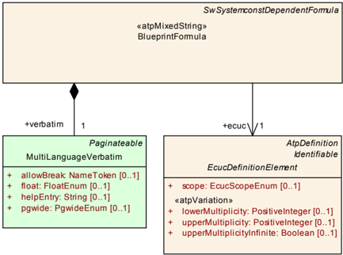

清单 4.2 展示了有效的表达式模式。注意 blueprintValue 表示一个占位符。

```
<FORMAL-BLUEPRINT-CONDITION>
  ( <ECUC-REF DEST="ECUC-ENUMERATION-PARAM-DEF">
      /AUTOSAR/EcucDefs/NvM/NvMCommon/NvMApiConfigClass </ECUC-REF> == "NVM_API_CONFIG_CLASS_2")
  ||
  ( <ECUC-REF DEST="ECUC-ENUMERATION-PARAM-DEF">
      /AUTOSAR/EcucDefs/NvM/NvMCommon/NvMApiConfigClass </ECUC-REF> == "NVM_API_CONFIG_CLASS_3")
  <VERBATIM>
    <L-5 L="EN" xml:space="preserve"> only permanent RAM block or explicit synchronization is used </L-5>
  </VERBATIM>
</FORMAL-BLUEPRINT-CONDITION>
```

清单4.2：逻辑表达式的使用（**Use of Logical Expression**）

在清单 4.3 中展示了引用运算符的使用。引用运算符作为 XML 实体插入。

```
<FORMAL-BLUEPRINT-CONDITION>
  ( <ECUC-REF DEST="ECUC-ENUMERATION-PARAM-DEF">
      /AUTOSAR/EcucDefs/Dcm/DcmConfigSet/DcmDsp/DcmDspData/DcmDspDataUsePort </ECUC-REF>
    == USE_DATA_SYNCH_CLIENT_SERVER)
  &&
  ( <ECUC-REF DEST="ECUC-REFERENCE-DEF">
      /AUTOSAR/EcucDefs/Dcm/DcmConfigSet/DcmDsp/DcmDspData/DcmDspDataInfoRef </ECUC-REF>
    -&gt;
    <ECUC-REF DEST="ECUC-BOOLEAN-PARAM-DEF">
      /AUTOSAR/EcucDefs/Dcm/DcmConfigSet/DcmDsp/DcmDspDataInfo/DcmDspDataFixedLength </ECUC-REF>
    == false)
</FORMAL-BLUEPRINT-CONDITION>
```

清单4.3：引用运算符的使用（**Use of Reference Operator**）

#### 4.1.7. ECU 配置参数与蓝图

**从 STMD 派生 VSMD 使用其自身的机制**：原则上，AUTOSAR 依照 [\[9\]](#ref-9) 规定的标准模块定义（**STMD**）也可以被视为蓝图。另一方面，供应商特定模块定义（**VSMD**）之间的关系是非常严格的，并且在蓝图一般概念引入之前就已存在。因此，出于兼容性原因，这种关系仍然使用 refinedModuleDef 维护。

尽管如此，标准化模板为公司特定的应用提供了一定的 ECU 配置支持。

更多细节见第 [4.2.13](#4213-ecucdefinitioncollection-的蓝图化) 章与第 [4.2.14](#4214-ecucmoduledef-的蓝图化) 章。

### 4.2. AUTOSAR 元模型中定义的可蓝图化元素

以下各小节规定支持蓝图的特定模型元素。

#### 4.2.1. AccessControl 的蓝图化

**AccessControl 元素的蓝图化**：AclObjectSet、AclOperation、AclPermission、AclRole 可以被蓝图化。

#### 4.2.2. AliasNameSet 的蓝图化

**AliasNameSet 的蓝图化**：AliasNameSet 可以被蓝图化。

#### 4.2.3. ApplicationDataType 的蓝图化

**ApplicationDataType 的蓝图化**：ApplicationDataType 可以被蓝图化。

#### 4.2.4. ARPackage 的蓝图化

**ARPackage 的蓝图化**：ARPackage 可以被蓝图化。主要用例是支持预定义的包结构，例如 [\[6\]](#ref-6) 中规定的那些。

#### 4.2.5. BswModuleDescription 的蓝图化

**BswModuleDescription 的蓝图化**：BswModuleDescription 可以被蓝图化。

BswModuleDescription 的蓝图特别用于描述对其他模块的依赖。注意在这种情况下，对其他模块和模块条目的所有引用都以预期模块的蓝图为目标。从 BswModuleDescription 的蓝图派生对象时，这些引用需要被替换。

BswModuleDescription 的蓝图应规定对标准 API 或蓝图 API 元素的引用，特别是：

- BswModuleDescription.implementedEntry
- BswModuleDescription.expectedEntry

尽管如此，允许派生的 BswModuleDescription 添加这些引用的更多实例。

此外，像回调这样的可选元素通常以 0..* 的多重性出现。在这种情况下，蓝图应规定一个回调引用（指向一个蓝图 BswModuleEntry），并在其 namePattern 中或在 VariationPoint.blueprintCondition / VariationPoint.formalBlueprintGenerator 中表达开放的多重性，如图 4.10 所示。

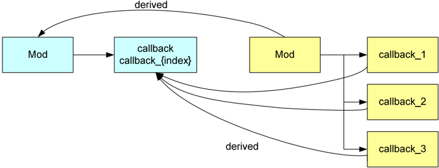

**约束：BswModuleDescription 蓝图不应有 BswInternalBehavior**：BswModuleDescription 蓝图不应有 BswInternalBehavior，因为这是实现的事务而非标准化的事务。在供应商内部应用中可能存在例外。

#### 4.2.6. BswModuleEntry 的蓝图化

**BswModuleEntry 的蓝图化**：BswModuleEntry 可以被蓝图化。

元类 BswModuleEntry 及其组合（SwServiceArg）包含从不或只在某些情况下被标准化的可选与强制元素，例如 executionContext、swServiceImplPolicy、SwServiceArg.swDataDefProps 的部分。尽管如此，标准化模板并不显式规定哪些属性应在蓝图中定义、哪些可以定义、哪些不应定义（另见下文 [4.2.17](#4217-keywordset-的蓝图化) 的派生规则与「蓝图化 KeywordSet」条目）。

#### 4.2.7. BswEntryRelationshipSet 的蓝图化

**BswEntryRelationshipSet 的蓝图化**：BswEntryRelationshipSet 可以被蓝图化。

**BswEntryRelationshipSet 的蓝图化（语义）**：BswEntryRelationshipSet 描述 BswEntryRelationship 的集合。BswEntryRelationship 描述两个 BswModuleEntry 之间的关系及关系的类型。这典型地用于表达一个具体的 BswModuleEntry 派生自一个抽象的 BswModuleEntry。此时 bswEntryRelationshipType 设为 derivedFrom，BswEntryRelationship.from 引用抽象的 BswModuleEntry，BswEntryRelationship.to 引用具体的 BswModuleEntry。

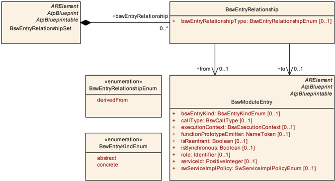

表4.6：BswEntryRelationshipSet（**BswEntryRelationshipSet**）

| 属性 | 值 |
|---|---|
| 类 | BswEntryRelationshipSet |
| 包 | M2::AUTOSARTemplates::BswModuleTemplate::BswInterfaces |
| 说明 | 描述两个 BswModuleEntry 之间关系的集合。Tags: atp.recommendedPackage=BswEntryRelationshipSets |
| 基类 | ARElement, ARObject, AtpBlueprint, AtpBlueprintable, CollectableElement, Identifiable, MultilanguageReferrable, PackageableElement, Referrable |
| 聚合于 | ARPackage.element |

| 属性 | 类型 | 多重性 | 种类 | 备注 |
|---|---|---|---|---|
| bswEntryRelationship | BswEntryRelationship | * | aggr | 两个 BswModuleEntry 之间的关系。 |

表4.7：BswEntryRelationship（**BswEntryRelationship**）

| 属性 | 值 |
|---|---|
| 类 | BswEntryRelationship |
| 包 | M2::AUTOSARTemplates::BswModuleTemplate::BswInterfaces |
| 说明 | 描述两个 BswModuleEntry 之间的关系及关系的类型。 |
| 基类 | ARObject |
| 聚合于 | BswEntryRelationshipSet.bswEntryRelationship |

| 属性 | 类型 | 多重性 | 种类 | 备注 |
|---|---|---|---|---|
| bswEntryRelationshipType | BswEntryRelationshipEnum | 0..1 | attr | 表示关系的类型。Tags: xml.sequenceOffset=5 |
| from | BswModuleEntry | 0..1 | ref | 引用抽象 BswModuleEntry 的关系类型。请注意此时 bswEntryRelationshipType 应设为 derivedFrom（源文作 drivedFrom，为源文档笔误）。 |
| to | BswModuleEntry | 0..1 | ref | 引用具体 BswModuleEntry 的关系类型。 |

表4.8：BswEntryRelationshipEnum（**BswEntryRelationshipEnum**）

| 属性 | 值 |
|---|---|
| 枚举 | BswEntryRelationshipEnum |
| 包 | M2::AUTOSARTemplates::BswModuleTemplate::BswInterfaces |
| 说明 | 定义两个 BswModuleEntry 之间的关系的类型。 |
| 聚合于 | BswEntryRelationship.bswEntryRelationshipType |

| 字面值 | 描述 |
|---|---|
| derivedFrom | 描述被引用为「to」的 BswModuleEntry 需要与被引用为「from」的「抽象」BswModuleEntry 具有相同的签名。Tags: atp.EnumerationLiteralIndex=0 |

#### 4.2.8. BuildActionManifest 的蓝图化

**BuildActionManifest 的蓝图化**：BuildActionManifest 可以被蓝图化。「嵌套蓝图可以用作其自身的蓝图」条目适用：BuildAction 与 BuildActionEnvironment 的蓝图聚合在 BuildActionManifest 的蓝图中。

#### 4.2.9. CompuMethod 的蓝图化

**CompuMethod 的蓝图化**：CompuMethod 可以被蓝图化。

有时需要用供应商特定的元素扩展标准化的枚举。

例如 [SWS\_RamTst\_00192] 规定：如果定义了供应商特定的算法，RamTst\_AlgorithmType 的枚举字段应相应地扩展。

**枚举值的蓝图化**：枚举器值的扩展应通过 CompuScale 处的 VariationPoint 在相关 CompuMethod 的蓝图中表达。

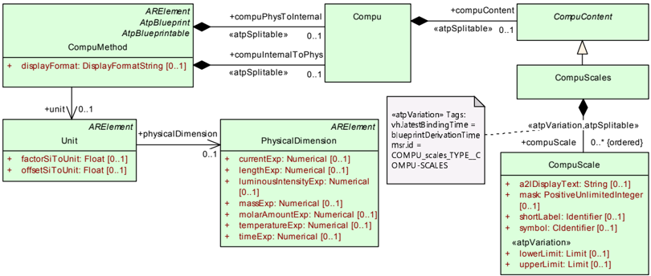

#### 4.2.10. ConsistencyNeeds 的蓝图化

**ConsistencyNeeds 的蓝图化**：ConsistencyNeeds 可以被蓝图化。但由于它不是派生自 ARElement，所有此类蓝图都聚合在 ConsistencyNeedsBlueprintSet 中。这使「蓝图与派生对象使用相同的元类」条目得以应用。

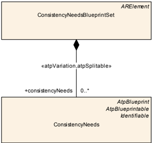

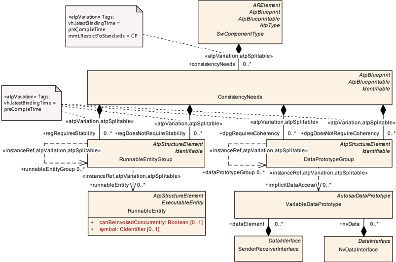

**ConsistencyNeeds 的早期定义**：在具有全部细节（数据访问点）的 RunnableEntity 已知之前，就应能对数据进行分组。在自顶向下的方法中，DataPrototype 的分组已经可以用于设计系统，使得一致性属性得到保证，并且无关的 DataPrototype 之间不要求一致性。

因此，ConsistencyNeeds（蓝图）中的 DataPrototypeGroup 可以在没有任何进一步上下文信息的情况下引用 PortInterface 的 VariableDataPrototype。

**ConsistencyNeeds 蓝图的分类**：由于 ConsistencyNeeds（蓝图）可以在软件组件的全部细节已知之前设计，因此需要标示 ConsistencyNeeds（蓝图）中 DataPrototypeGroup 与 RunnableEntityGroup 的用途。因此预定义了一组类别值，支持 ConsistencyNeeds 的「抽象」蓝图化。

**ConsistencyNeeds 蓝图中 DataPrototypeGroup 的类别**：

- ALL\_PROVIDE\_DATA\_OF\_COMPONENT：ConsistencyNeeds 的 DataPrototypeGroup 应包含在软件组件的 provide 端口中实例化的所有 VariableDataPrototype。
- ALL\_REQUIRE\_DATA\_OF\_COMPONENT：ConsistencyNeeds 的 DataPrototypeGroup 应包含在软件组件的 require 端口中实例化的所有 VariableDataPrototype。
- ALL\_PROVIDE\_AND\_REQUIRE\_DATA\_OF\_COMPONENT：ConsistencyNeeds 的 DataPrototypeGroup 应包含在软件组件的 provide 与 require 端口中实例化的所有 VariableDataPrototype。
- ALL\_PROVIDE\_DATA\_OF\_RUNNABLE\_GROUP：ConsistencyNeeds 的 DataPrototypeGroup 应包含所附 RunnableEntityGroup 中任意 RunnableEntity 对其具有隐式写访问的所有 VariableDataPrototype。
- ALL\_REQUIRE\_DATA\_OF\_RUNNABLE\_GROUP：ConsistencyNeeds 的 DataPrototypeGroup 应包含所附 RunnableEntityGroup 中任意 RunnableEntity 对其具有隐式读访问的所有 VariableDataPrototype。
- ALL\_PROVIDE\_AND\_REQUIRE\_PORTS\_OF\_RUNNABLE\_GROUP：ConsistencyNeeds 的 DataPrototypeGroup 应包含所附 RunnableEntityGroup 中任意 RunnableEntity 对其具有隐式写或读访问的所有 VariableDataPrototype。
- EXPLICIT\_DATA\_PROTOTYPE\_GROUP：ConsistencyNeeds 的 DataPrototypeGroup 应依照功能需求包含 VariableDataPrototype。

**ConsistencyNeeds 蓝图中 RunnableEntityGroup 的类别**：

- ALL\_RUNNABLES\_OF\_COMPONENT：ConsistencyNeeds 的 RunnableEntityGroup 应包含软件组件的所有 RunnableEntity。
- ALL\_RUNNABLES\_WRITING\_TO\_DATA\_PROTOTYP\_GROUP：ConsistencyNeeds 的 RunnableEntityGroup 应包含对所附 DataPrototypeGroup 中任意 VariableDataPrototype 具有隐式写访问的所有 RunnableEntity。
- ALL\_RUNNABLES\_READING\_FROM\_DATA\_PROTOTYPE\_GROUP：ConsistencyNeeds 的 RunnableEntityGroup 应包含对所附 DataPrototypeGroup 中任意 VariableDataPrototype 具有隐式读访问的所有 RunnableEntity。
- ALL\_RUNNABLES\_WRITING\_TO\_OR\_READING\_FROM\_DATA\_PROTOTYPE\_GROUP：ConsistencyNeeds 的 RunnableEntityGroup 应包含对所附 DataPrototypeGroup 中任意 VariableDataPrototype 具有隐式写或读访问的所有 RunnableEntity。
- EXPLICIT\_RUNNABLE\_ENTITY\_GROUP：ConsistencyNeeds 的 RunnableEntityGroup 应依照功能需求包含 RunnableEntity。

#### 4.2.11. DataConstr 的蓝图化

**DataConstr 的蓝图化**：DataConstr 可以被蓝图化。

#### 4.2.12. DataTypeMappingSet 的蓝图化

**DataTypeMappingSet 的蓝图化**：DataTypeMappingSet 可以被蓝图化。

#### 4.2.13. EcucDefinitionCollection 的蓝图化

**EcucDefinitionCollection 的蓝图化**：EcucDefinitionCollection 可以被蓝图化。

#### 4.2.14. EcucModuleDef 的蓝图化

**EcucModuleDef 的蓝图化**：EcucModuleDef 可以被蓝图化。

注意，这面向公司内部使用。请参阅第 [4.1.7](#417-ecu-配置参数与蓝图) 章。

#### 4.2.15. FlatMap 的蓝图化

**FlatMap 的蓝图化**：FlatMap 可以被蓝图化。

FlatMap 蓝图的用例见 [\[10\]](#ref-10)。

#### 4.2.16. ImplementationDataType 的蓝图化

**ImplementationDataType 的蓝图化**：ImplementationDataType 可以被蓝图化。

#### 4.2.17. KeywordSet 的蓝图化

**KeywordSet 的蓝图化**：KeywordSet 可以被蓝图化。适用以下派生规则：

- 不得从 KeywordSet 中移除或添加关键词。
- Keyword 的 shortName 不得更改或扩展。
- 「蓝图与被蓝图化元素的 longName、desc 与 introduction 的兼容性」条目适用，但 Keyword 的 longName 不得更改，允许以进一步的语言添加表示。
- abbrName 不得更改或扩展（AbbrName）。
- Keyword 的 classification 不得更改，但允许提供额外的 classification。

#### 4.2.18. LifeCycleStateDefinitionGroup 与 LifeCycleState 的蓝图化

**LifeCycleStateDefinitionGroup 的蓝图化**：LifeCycleStateDefinitionGroup 与 LifeCycleState 可以被蓝图化。「嵌套蓝图可以用作其自身的蓝图」条目适用：LifeCycleState 的蓝图聚合在 LifeCycleStateDefinitionGroup 的蓝图中。

#### 4.2.19. ModeDeclarationGroup 的蓝图化

**ModeDeclarationGroup 的蓝图化**：ModeDeclarationGroup 可以被蓝图化。

#### 4.2.20. PortPrototype 的蓝图化

AUTOSAR 组织的主要活动之一是应用接口的标准化。即，就 AUTOSAR 元模型而言，标准化主要适用于为特定目的定义 PortPrototype。

由于 AUTOSAR 元模型的结构，不可能仅仅表达一个标准化的 PortPrototype，因为后者出于充分的理由并不独立存在，而总是被一个 SwComponentType 所拥有。

因此，在过去，「应用接口」的标准化无意中也涉及 SwComponentType 的创建。这种不必要的复杂性可以通过使用 PortPrototypeBlueprint 来克服。

**PortPrototype 的蓝图化**：PortPrototype 可以通过特定元类 PortPrototypeBlueprint 被蓝图化。

PortPrototypeBlueprint 的映射见图 4.3。

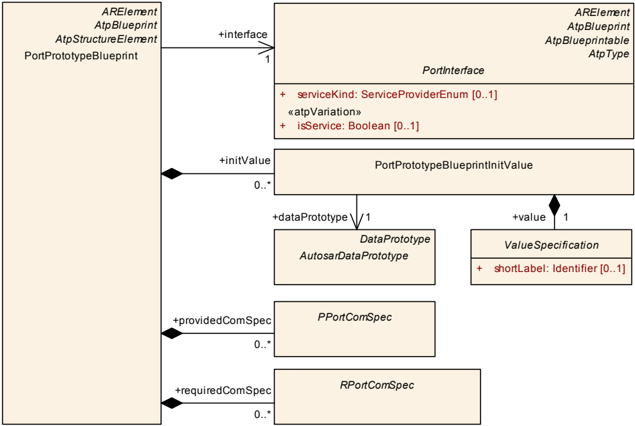

**PortPrototypeBlueprint 具有以下特性：**

- 它是一个 ARElement，因此除 ARPackage 外不需要任何其他元素作为上下文。因此，仅仅为了符合 AUTOSAR 元模型而把「辅助」模型元素卷入标准化「应用接口」的定义是没有必要的。
- 它充当创建 PortPrototype 的「蓝图」。也就是说，可能在所用编写工具的支持下，用户挑选一个特定的 PortPrototypeBlueprint 并从中创建一个 PortPrototype。创建的 PortPrototype 的结构与不以 PortPrototypeBlueprint 为蓝图创建的 PortPrototype 无法区分。一个 PortPrototypeBlueprint 可以作为所需的任意多个 PortPrototype 的蓝图。
- 可以定义附加属性并传递给创建的 PortPrototype。例如，在某些情况下，初始值<sup>4</sup>的定义是标准化「应用接口」定义的一部分。因此，PortPrototypeBlueprint 也支持 initValue 的定义，它需要被移至相应的 ComSpec。
- 它有一个对相应 PortInterface 的引用。如果被引用的 PortInterface 不是蓝图，则它可以被从 PortPrototypeBlueprint 创建的 PortPrototype 直接接管，使新的 PortPrototype 引用该 PortInterface。如果被引用的 PortInterface 是蓝图，则需要派生一个 PortInterface 并在 PortPrototype 中引用它。
- 它不对其创建的 PortPrototype 将是 PPortPrototype 还是 RPortPrototype 做任何假设。
- 它基本上可用于所有种类的 PortInterface，即不限于例如 SenderReceiverInterface，尽管这种 PortInterface 很可能占据 PortPrototypeBlueprint 使用的相当大的份额。
- 它只能用于「应用接口」的标准化。PortPrototypeBlueprint 在任何 SwComponentType 或相关模型工件的形式描述中不扮演任何角色（另见「传递 VariationPoint」条目）。

> 4 AUTOSAR 不为应用接口标准化初始值，但为供应商内部使用提供支持。

**PortPrototypeBlueprint 可以同时拥有 RPortComSpec 与 PPortComSpec**：PortPrototypeBlueprint 可以同时拥有 RPortComSpec 与 PPortComSpec。不同的 ComSpec 依照给定的通信方向适用于派生的 PPortPrototype、RPortPrototype 与 PRPortPrototype。软件组件模板（ [\[1\]](#ref-1) ）中的约束 constr\_1043（PortInterface 与 ComSpec）在此上下文中同样适用。

**PortPrototypeBlueprint 上下文中 initValue 的多重存在**：如果 NonqueuedReceiverComSpec 或 NonqueuedSenderComSpec 上存在 initValue，则应忽略 PortPrototypeBlueprint 处的 initValue。

在此上下文中，有效的蓝图还需遵守 [TPS\_SWCT\_01219]。

```
<PORT-PROTOTYPE-BLUEPRINT>
  <SHORT-NAME NAME-PATTERN="{anyName}">ALgtOnDoorAtFrntLe</SHORT-NAME>
  <LONG-NAME>
    <L-4 L="EN">Acceleration Longitudinal on Door at Front Left</L-4>
  </LONG-NAME>
  <DESC>
    <L-2 L="EN">Longitudinal high-g acceleration measured in front left door of vehicle (locking in driving direction)</L-2>
  </DESC>
  <INTERFACE-REF DEST="SENDER-RECEIVER-INTERFACE">
    /AUTOSAR/AISpecification/PortInterfaces_Blueprint/AExtForOccptPedSfty1
  </INTERFACE-REF>
  <PROVIDED-COM-SPECS>
    <NONQUEUED-SENDER-COM-SPEC>
      <NETWORK-REPRESENTATION>
        <SW-DATA-DEF-PROPS-VARIANTS>
          <SW-DATA-DEF-PROPS-CONDITIONAL>
            <BASE-TYPE-REF DEST="SW-BASE-TYPE">
              /AUTOSAR/Platform/BaseTypes_Blueprint/uint8
            </BASE-TYPE-REF>
            <COMPU-METHOD-REF DEST="COMPU-METHOD">
              /AUTOSAR/Example/CompuMethods_Blueprint/AccelerationOnBus
            </COMPU-METHOD-REF>
          </SW-DATA-DEF-PROPS-CONDITIONAL>
        </SW-DATA-DEF-PROPS-VARIANTS>
      </NETWORK-REPRESENTATION>
      <INIT-VALUE>
        <APPLICATION-VALUE-SPECIFICATION>
          <CATEGORY>VALUE</CATEGORY>
          <SW-VALUE-CONT>
            <SW-VALUES-PHYS>
              <V>42</V>
            </SW-VALUES-PHYS>
          </SW-VALUE-CONT>
        </APPLICATION-VALUE-SPECIFICATION>
      </INIT-VALUE>
    </NONQUEUED-SENDER-COM-SPEC>
  </PROVIDED-COM-SPECS>
</PORT-PROTOTYPE-BLUEPRINT>
```

清单4.4：带 ProvidedComSpecs 的 PortPrototypeBlueprint（**PortPrototypeBlueprint with ProvidedComSpecs**）

表4.9：PortPrototypeBlueprint（**PortPrototypeBlueprint**）

| 属性 | 值 |
|---|---|
| 类 | PortPrototypeBlueprint |
| 包 | M2::AUTOSARTemplates::CommonStructure::StandardizationTemplate::BlueprintDedicated::PortProtoypeBlueprint |
| 说明 | 该元类表示通过引用特定的 PortInterface 来表达 PortPrototype 蓝图的能力。该蓝图随后可用作创建按此蓝图定义的特定 PortPrototype 的指导。借此可以在不必同时标准化带有以标准化 PortInterface 定型的 PortPrototype 的软件组件的情况下，实现应用接口的标准化。Tags: atp.recommendedPackage=PortPrototypeBlueprints |
| 基类 | ARElement, ARObject, AtpBlueprint, AtpClassifier, AtpFeature, AtpStructureElement, CollectableElement, Identifiable, MultilanguageReferrable, PackageableElement, Referrable |
| 聚合于 | ARPackage.element, AtpClassifier.atpFeature |

| 属性 | 类型 | 多重性 | 种类 | 备注 |
|---|---|---|---|---|
| initValue | PortPrototypeBlueprintInitValue | * | aggr | |
| interface | PortInterface | 1 | ref | |
| providedComSpec | PPortComSpec | * | aggr | |
| requiredComSpec | RPortComSpec | * | aggr | |

表4.10：PortPrototypeBlueprintInitValue（**PortPrototypeBlueprintInitValue**）

| 属性 | 值 |
|---|---|
| 类 | PortPrototypeBlueprintInitValue |
| 包 | M2::AUTOSARTemplates::CommonStructure::StandardizationTemplate::BlueprintDedicated::PortProtoypeBlueprint |
| 说明 | 该元类表示在 PortPrototypeBlueprint 中表达初始值的能力。这些初始值充当一种蓝图，例如可从中派生适当的 ComSpec。 |
| 基类 | ARObject |
| 聚合于 | PortPrototypeBlueprint.initValue |

| 属性 | 类型 | 多重性 | 种类 | 备注 |
|---|---|---|---|---|
| dataPrototype | AutosarDataPrototype | 1 | ref | 该初始值适用的数据原型。Tags: xml.sequenceOffset=30 |
| value | ValueSpecification | 1 | aggr | 该特定数据原型的初始值。Tags: xml.sequenceOffset=40 |

由于用于下游模型处理（例如 RTE 生成）的 AUTOSAR 模型需要使用完整的 PortInterface，因此有必要从标准化过程中定义的被蓝图化的 PortInterface 派生出一个「实际的」PortInterface。

**PortPrototype 与蓝图的兼容性**：约束 constr\_2526、constr\_2527、constr\_2528 与 constr\_2529 适用于 PortPrototype 与 PortPrototypeBlueprint 的兼容性。

**约束：PortInterface 需与其蓝图兼容**：PortInterface 应依照兼容性规则与其各自的蓝图兼容。

**约束：蓝图应驻留在适当类别的包中**：如通用结构模板 [\[6\]](#ref-6) 中详细解释的，为成为蓝图而创建的模型工件（此处为 PortPrototypeBlueprint 与未完整规定的 PortInterface）应驻留在类别为 BLUEPRINT 的 ARPackage 中。

**约束：PortPrototype 不得引用 PortInterface 的蓝图**：端口 PortPrototype 不得引用驻留在类别为 BLUEPRINT 的包中的 PortInterface。

**约束：PortPrototypeBlueprint 与派生的 PortPrototype 应引用适当的 PortInterface**：PortPrototypeBlueprint 可以引用 PortInterface 的蓝图。依照约束 constr\_2570，系统描述不得包含蓝图。因此，当从蓝图派生 PortPrototype 时，可能需要重写对 PortInterface 的引用。

在这种情况下，被派生 PortPrototype 引用的 PortInterface 应与被 PortPrototypeBlueprint 引用的 PortInterface（即蓝图）兼容。

依照约束 constr\_2526，如果 PortPrototypeBlueprint 引用的 PortInterface 是相应 PortPrototype 引用的 PortInterface 的蓝图，则可以确保这一点。

注意，如果 PortPrototypeBlueprint 与派生的 PortPrototype 引用一个 STANDARD PortInterface（驻留在类别为「STANDARD」的 ARPackage 中），则约束 constr\_2529 显然也得到满足。

#### 4.2.21. PortInterface 的蓝图化

**PortInterface 的蓝图化**：PortInterface 可以被蓝图化。

**约束：PortInterface 应为同一种类**：由端口接口的蓝图映射（由 BlueprintMapping 表示）引用的两个对象（PortInterface）应为同一种类（例如都应为 SenderReceiverInterface）。换言之，两个接口应为同一元类的实例。

注意，「PortInterface 应为同一种类」是「蓝图映射应映射适当的元素」的特例。

#### 4.2.22. PortInterfaceMapping 与 PortInterfaceMappingSet 的蓝图化

**PortInterfaceMapping 与 PortInterfaceMappingSet 的蓝图化**：PortInterfaceMapping 可以被蓝图化。「嵌套蓝图可以用作其自身的蓝图」条目适用：PortInterfaceMapping 的蓝图聚合在 PortInterfaceMappingSet 的蓝图中。

蓝图化 PortInterfaceMapping 的预期用例见图 4.16。该图显示一个 PortInterface（蓝图）（M），以及分别由 PortInterface（S）与 PortInterface（R）定型的两个端口。（S）与（R）通过 PortInterfaceMapping（蓝图）（SMMap 与 RMMap）映射到蓝图（M）。由此，可以：

1. 在（S 与 R）之间派生 PortInterfaceMapping（SRMap），它派生自两个蓝图（SMMap 与 RMMap）；
2. 建议使用接口（S 与 R）的组件之间的连接器。

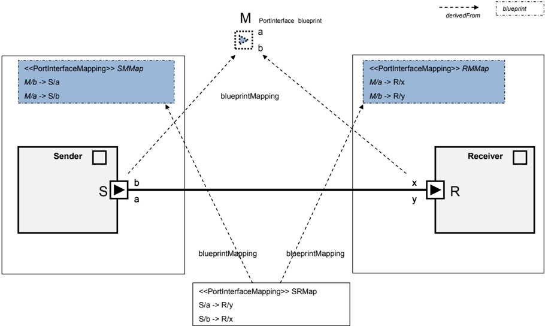

预期的派生对象可以依照以下步骤确定：

1. 在包含 S 或 R 的 PortInterface 的 BlueprintMapping 中找到所有 PortInterface（蓝图）（在我们的例子中是 M）。
2. 找到包含步骤 1 中某个 PortInterface（蓝图）以及 PortInterface S 和 R 之一的所有 PortInterfaceMapping（蓝图）（在我们的例子中是 SMMap 与 RMMap）。
3. 从步骤 2 中找到的映射在 S 与 R 之间派生一个非蓝图的 PortInterfaceMapping。注意，到目前为止找到的所有 PortInterfaceMapping 都有一个「蓝图引用」和一个「非蓝图引用」。

   取步骤 2 中 PortInterfaceMapping（蓝图）之一，把「蓝图引用」替换为另一个 PortInterfaceMapping（蓝图）的相应「非蓝图引用」。

   ```
   M/b（SMMap 中的蓝图） -> S/a   <->  M/b（RMMap 中的蓝图） -> R/y
   M/a（SMMap 中的蓝图） -> S/b   <->  M/a（RMMap 中的蓝图） -> R/x
   ```

   例如，M/b 会被 R/y 替换、M/a 会被 R/x 替换，产生最终映射（S/a → R/y、S/b → R/x）。

   如果 M/b 被 S/a 替换、M/a 被 S/b 替换，也会得到相同的结果（S/a → R/y、S/b → R/x）。

   隐式映射（即如果 PortInterface 与 PortInterface（蓝图）之间的数据元素名称相同，则不需要 PortInterfaceMapping（蓝图））也必须考虑（例如通过创建「临时」映射）。
4. 为步骤 3 中创建的 PortInterfaceMapping（SRMap）到所涉及的 PortInterfaceMapping（蓝图）（SMMap 与 RMMap）创建 BlueprintMapping。

该场景显示在以下清单中：

- 清单 B.2 展示例如由 AUTOSAR 给出的定义。
- 清单 B.3 展示 LeftCompany 的部分。
- 清单 B.4 展示 RightCompany 的部分。
- 清单 B.5 展示项目中集成的部分。

清单 B.3 显示「LeftCompany」创建了从 PortInterface（蓝图）M 派生的名为 S 的 PortInterface。由此，如何进行的描述在名为 SMMap 的适当 PortInterfaceMapping 的蓝图中给出。

清单 B.4 显示「RightCompany」创建了从 PortInterface（蓝图）M 派生的名为 R 的 PortInterface。由此，如何进行的描述在名为 RMMap 的适当 PortInterfaceMapping 的蓝图中给出。

清单 B.5 显示「Project」使用了「RightCompany」与「LeftCompany」的贡献。由此它在 PortInterfaceMapping SRMap 中把 S 映射到 R。SRMap 派生自两个蓝图（SMMap 与 RMMap）。

#### 4.2.23. SwBaseType 的蓝图化

**SwBaseType 的蓝图化**：SwBaseType 可以被蓝图化。

#### 4.2.24. SwComponentType 的蓝图化

**SwComponentType 的蓝图化**：SwComponentType 可以被蓝图化。

**约束：SwComponentType 应为同一种类**：由端口接口的蓝图映射（由 BlueprintMapping 表示）引用的两个对象（SwComponentType）应为同一种类（例如都应为 AtomicSwComponentType）。换言之，两个组件应为同一元类的实例。

注意，「SwComponentType 应为同一种类」是「蓝图映射应映射适当的元素」的特例。

#### 4.2.25. SwAddrMethod 的蓝图化

**SwAddrMethod 的蓝图化**：SwAddrMethod 可以被蓝图化。

#### 4.2.26. VfbTiming 的蓝图化

**VfbTiming 的蓝图化**：VfbTiming 可以被蓝图化。

蓝图化 VFB 时序的本质目的之一是：能够为 AUTOSAR 应用接口表 [\[11\]](#ref-11) 中规定的接口规定时间特性。特别是，人们希望为此类接口规定施加在采样率、重复性、数据年龄、延迟等上的时序约束。

图 4.17 展示了 VFB Timing Blueprint 的基本结构，以及规定的时序元素如何引用其他蓝图元素，特别是 PortPrototypeBlueprint 元素与由 PortInterface 元素引用的端口接口元素：如变量数据原型（数据元素）、客户端-服务器操作、模式声明和触发器。

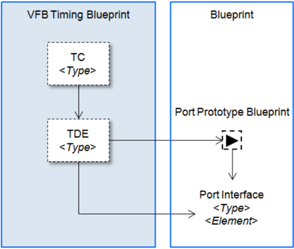

VFB Timing Blueprint 由与 AUTOSAR VFB 视图相关的时序描述事件、时序描述事件链以及「AUTOSAR 时序扩展规范」 [\[12\]](#ref-12) 中定义的时序约束组成。

VFB Timing 引用与之关联的软件组件。对于 VFB Timing Blueprint，该引用无需设置，但在派生的 VFB Timing 中，VfbTiming.component 应正确设置。此外，任何对 PortPrototypeBlueprint 的引用都应被替换为对相应 PortPrototype 的引用。

以下约束适用于 VFB Timing Blueprint，在创建此类蓝图时应予以考虑。

**约束：VFB Timing Blueprint 中 TDEventVfbPort 应引用 PortPrototypeBlueprint**：在 VFB Timing Blueprint 中，TDEventVfbPort 应引用 PortPrototypeBlueprint。换言之，VFB Timing Blueprint 中规定的 VFB 时序描述事件应始终引用一个端口原型蓝图。

##### 4.2.26.1. 示例

基于 [\[13\]](#ref-13) 给出一个 VFB Timing Blueprint 的示例。

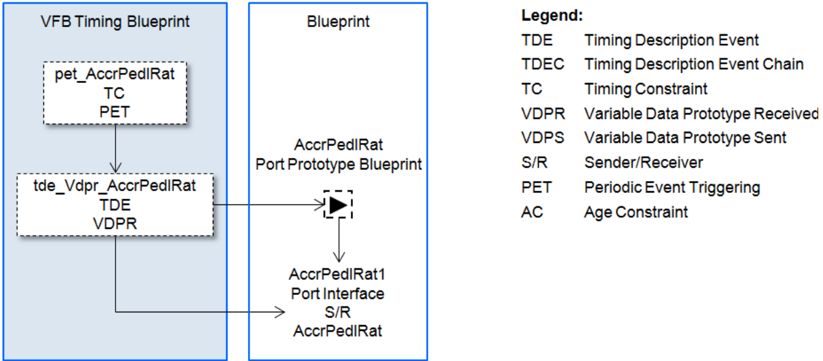

如图 4.18 所示，规定了一个 VFB Timing Blueprint。该蓝图由一个名为「tde\_Vdpr\_AccrPedlRat」的时序描述事件组成，它引用名为「AccrPedlRat」的端口原型蓝图；并且还引用名为「AccrPedlRat1」的端口接口中名为「AccrPedlRat」的变量数据原型——该端口接口同样被上述端口原型蓝图引用。此外，一个时序约束（特别是周期事件触发约束）被施加在该时序描述事件上。本质上，该时序模型规定：名为「AccrPedlRat」的变量数据原型应以周期事件触发约束给定的速率被接收。

清单 B.6 提供与图 4.18 所示示例相关的 ARXML 文件的相应内容，但包含更多的时序描述事件以及对特定变量数据原型接收施加的附加年龄时序约束。

图 4.19 展示了针对名为「SW-C\_A」的特定软件组件的 VFB Timing Blueprint 及派生的 VFB Timing。

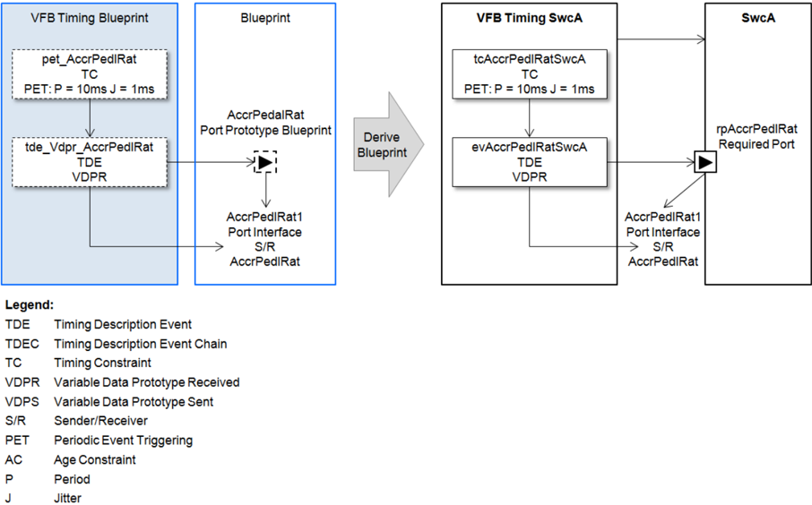

#### 4.2.27. ClientServerInterfaceToBswModuleEntryBlueprintMapping 的蓝图化

**ClientServerInterfaceToBswModuleEntryBlueprintMapping 的蓝图化**：ClientServerInterfaceToBswModuleEntryBlueprintMapping 可以被蓝图化。

**ClientServerOperationBlueprintMapping 预先确定 ClientServerOperation 的实现**：ClientServerOperationBlueprintMapping 在考虑 PortDefinedArgumentValue 的预期使用的前提下，表达由特定 BswModuleEntry 对 ClientServerOperation 的预期实现。

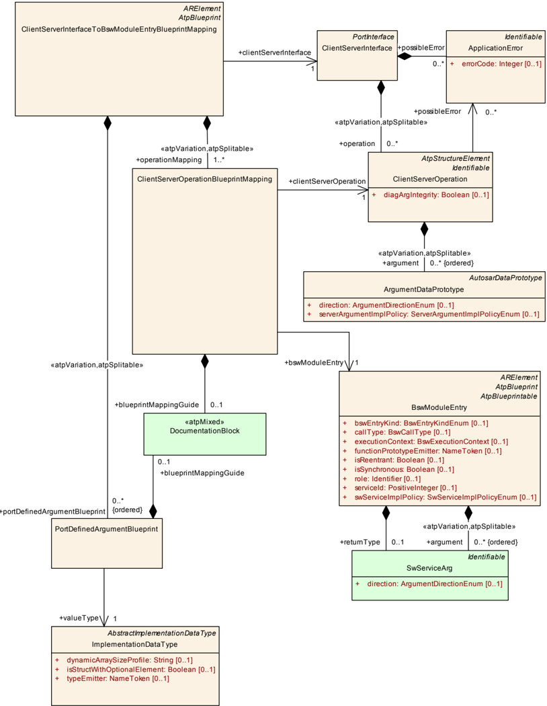

表4.11：ClientServerOperationBlueprintMapping（**ClientServerOperationBlueprintMapping**）

| 属性 | 值 |
|---|---|
| 类 | ClientServerOperationBlueprintMapping |
| 包 | M2::AUTOSARTemplates::CommonStructure::StandardizationTemplate::ClientServerInterfaceToBswModuleEntryMapping |
| 说明 | 该类描述 ClientServerInterface 蓝图中的 ClientServerOperation 与 BswModuleEntry 蓝图之间的特定映射。 |
| 基类 | ARObject |
| 聚合于 | ClientServerInterfaceToBswModuleEntryBlueprintMapping.operationMapping |

| 属性 | 类型 | 多重性 | 种类 | 备注 |
|---|---|---|---|---|
| blueprintMappingGuide | DocumentationBlock | 0..1 | aggr | 该属性提供提供有关映射的附加信息的可能性。 |
| bswModuleEntry | BswModuleEntry | 1 | ref | 被引用的 BswModuleEntry 表示该映射所面向的 BswModuleEntry。 |
| clientServerOperation | ClientServerOperation | 1 | ref | 被引用的 ClientServerOperation 表示该映射所面向的客户端服务器操作。 |

ClientServerOperationBlueprintMapping 可用于确保和/或跟踪理应实现 ClientServerOperation 的 BswModuleEntry 之间的兼容性。它已经可以在方法论早期——接口定义时——定义。由此，ClientServerOperationBlueprintMapping 可以在尚未具备后期所需的 SwComponentType、SwcInternalBehavior、BswModuleDescription、BswInternalBehavior 与 SwcBswMapping 的全部实现细节的情况下定义。

请注意，ClientServerInterfaceToBswModuleEntryBlueprintMapping 对后期生成的 RTE 没有直接影响。RTE 的设置完全由 ClientServerOperation、BswModuleEntry 的派生对象以及完成的软件组件描述与基础软件模块描述决定。

这样的映射支持形式化检查：操作的参数数量与参数的数据类型 + 附加的 PortDefinedArgumentValue 是否与 BswModuleEntry 的签名匹配。

**约束：ClientServerOperationBlueprintMapping 约束参数数量**：bswModuleEntry 所引用的 BswModuleEntry 的参数数量，应与拥有它的 ClientServerInterfaceToBswModuleEntryBlueprintMapping 的 portDefinedArgumentBlueprint 的数量加上 clientServerOperation 在角色 argument 中聚合的 ArgumentDataPrototype 的数量相同。

**约束：ClientServerOperationBlueprintMapping 约束参数的类型**：有序列表 bswModuleEntry 中的参数与 portDefinedArgumentBlueprint 加 clientServerOperation 的有序列表并集中匹配的参数，应产生相同的 C 数据类型定义。

### 4.3. 从 AUTOSAR 提供的蓝图派生

AUTOSAR 提供的模型元素主要以蓝图形式提供。这对应用接口 [\[11\]](#ref-11) 尤其成立，对 BSW 层的软件规范也是如此。这些 AUTOSAR 交付的模型元素遵循 [TPS\_GST\_00080] 规定的包结构。

图 4.21 展示为 BSW 模块定义数据类型的方法论。BSW 标准包包含蓝图。在上述场景中，应遵循「标准化元素的标准化路径」条目——当然这也适用于其他模块的数据类型。

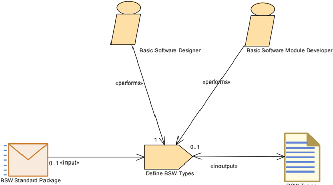

**标准化元素的标准化路径**：从标准化蓝图派生的对象应遵循 [TPS\_GST\_00083] 规定的包路径。也就是说，软件组件的提供者可以确信：所有 AUTOSAR 定义的模型元素都可以通过一个可预测的路径访问。

例如，在

```
/AUTOSAR/Platform/ImplementationDatatypes_Blueprint/uint8
```

中被蓝图化的平台类型 [\[14\]](#ref-14)，应实现于（因此可以安全地通过）：

```
/AUTOSAR_Platform/ImplementationDatatypes/uint8
```

## 5. 关键字

**定义关键字**：元类 KeywordSet 可用于定义 Keyword（关键字）的集合。关键字的作用是为 AUTOSAR 模型元素的名称贡献部分内容。

关键字被引用为第 [4.1.5](#415-名称模式) 章所规定的名称模式的一部分。

例如，shortName「CmftMngt」由 abbrName 为「Cmft」与「Mngt」的两个 Keyword 组成。

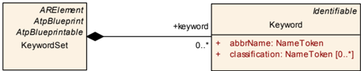

**Keyword 的属性**：元类 Keyword 派生自 Identifiable。Identifiable 的属性应如下应用于 Keyword：

- shortName 表示关键字的唯一名称。在上面的示例中是「Cmft」。注意它只用于标识关键字。贡献的名称部分取自 abbrName。
- longName 表示关键字的完整形式，通常是一个未缩写的技术术语。在上面的示例中是「Comfort」。
- desc 表示关键字的定义，即口头描述，允许判断该关键字是否适用于特定情况。在上面的示例中，描述为「This keyword is used to express something as comfortable or convenient」。
- introduction 表示用例的口头描述。这可以用于附加的解释或示例。

**关键字的分类**：属性 classification 取决于所应用的命名约定。

例如，取值可以依照 [\[15\]](#ref-15) 的表 2，例如 ActionPhysicalType、Condition-Qualifier、Index、Mean-Environment-Device、Preposition。

清单 B.7 展示了使用 Keyword 的示例。更精细的用法见 [\[3\]](#ref-3)。

**表达关键字的「词干」关系**：有些关键字基本源自同一词根。这种关系通过一个 Collection 表达，其 elementRole 命名为 DECLINATION\_OF。词根记为 sourceElement。派生词记在 element 中。词根不是其自身的派生词，因此不会再作为 element 被提及。

作为「表达关键字的「词干」关系」条目的示例，关键字 Drvr、Drvg 源自 Drv<sup>5</sup>。这依照清单 B.8 中的示例交付。

> 5 注意 Drv 不是该 Collection 的 element，因为它不是其自身的派生词。

## 6. 数据交换点

### 6.1. 概述

**数据交换点描述的动机**：数据交换点（**Data Exchange Point**）的概要（Profile）旨在通过描述在方法论中给定活动或任务所期望的数据，来改善工具之间的互操作性。（见图 6.1）

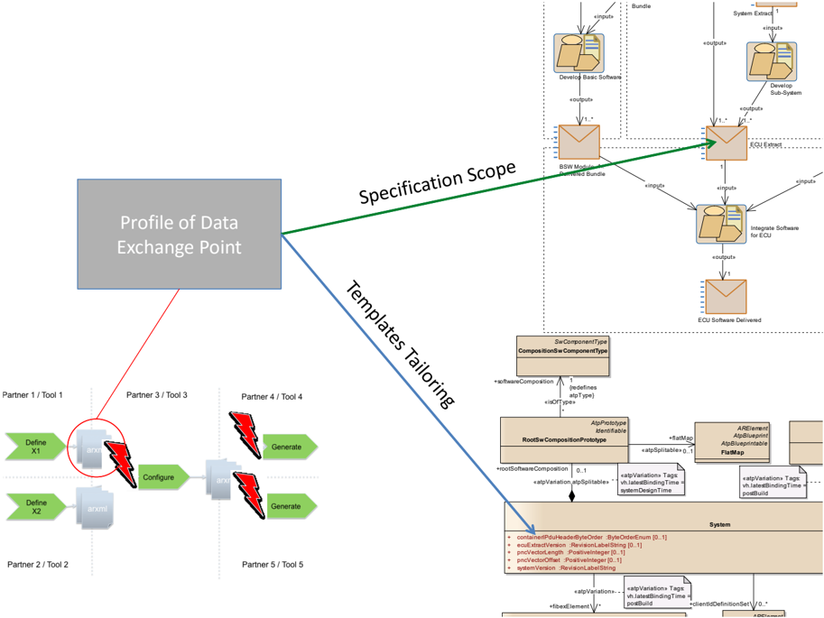

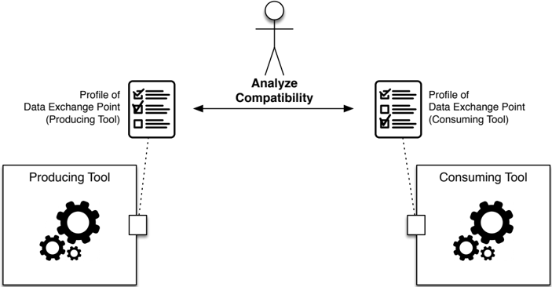

**工具兼容性分析**：数据交换点的概要支持对 AUTOSAR 标准子集的结构化文档——即某工具支持或显式不支持的部分。换言之：概要描述了工具的数据接口。概要的可用性使得在实际 AUTOSAR 模型可用之前（例如由于 IP 问题、尚未实现的新特性等）就能对工具的兼容性进行初步检查。共同点通常表明互操作性问题的风险较低。差异或未定义的信息则显示潜在的较高互操作性风险。数据交换点的形式化描述还支持用工具寻找具有高互操作性风险的位置。然而，结果的解释需要工程知识以及工具供应商与用户之间的互动。（见图 6.2）

**数据交换点概要分析的局限**：分析两个或更多数据交换点概要的兼容性的目标是识别潜在的互操作性问题。概要分析可以帮助识别一些问题。然而，该分析不能保证不存在互操作性问题。该分析不能取代其他互操作性检查机制，例如创建并处理使用预期特性的示例 AUTOSAR 模型（参考模型）。


**商定的数据交换点概要**：数据交换点概要的分析与协商的结果可以记录为商定的数据交换点概要（**Agreed Profile of Data Exchange Point**）。商定数据交换概要的使用场景包括：

- 就创建方工具生成的 AUTOSAR 模型是否符合商定契约进行验证。例如，该验证可以在实际的 AUTOSAR 模型传递给消费方工具之前作为质量门使用。
- 数据交换点概要可以用作预期未来功能的规范。工具供应商可以分析商定的数据交换概要，以识别尚未实现的特性。

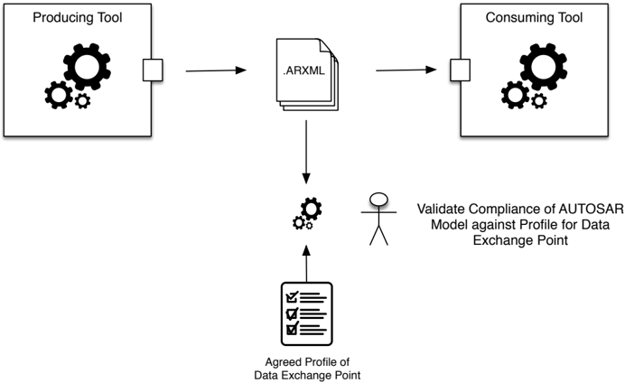

**对数据交换点概要的符合性**：数据交换点概要可以为特定的数据交换点裁剪 AUTOSAR 数据格式。这种对数据格式元素（元类、属性、约束、Sdg 用法）的裁剪规定了该特定数据交换点相关的元模型子集，并定义了必须评估哪些 AUTOSAR 与自定义验证规则。如果所有验证规则求值为 true，则 AUTOSAR 模型符合一个数据交换点概要。

注意：以下模式、元类与属性聚焦于对自包含的数据交换点概要的描述。对概要编写（例如由概要资产组合成概要）的支持尚未涵盖。

### 6.2. 通用模式

#### 6.2.1. 顶层数据结构

**DataExchangePoint 的用途**：对给定的数据交换点，DataExchangePoint 规定以下方面：

- 使用 longName、desc 与 introduction（继承自 Identifiable）对数据交换点的简短描述；
- 概要所引用的 AUTOSAR 标准的基线（**Baseline**）；
- 通过选择 AUTOSAR 规范的相关部分，对数据交换点的高层规定；
- 对 AUTOSAR 数据格式（元类、属性、约束、特殊数据组定义）的详细裁剪。

细节见第 [6.3](#63-规范的范围界定) 与第 [6.4](#64-数据格式元素的裁剪) 节。

DataExchangePoint 所描述的方面位于元层级（M2，如 [\[6\]](#ref-6) 所述）。在这一层级可以找到 AUTOSAR 元模型与 AUTOSAR XML Schema。尽管数据交换点概要在 M2 层级规定信息，我们复用 AUTOSAR 模板规范已经使用的、用于规定数据交换点概要语言的方法。使用这种方法，我们可以把数据交换点概要存储在 .arxml 文件中，并可以复用既有的元类，例如 ARPackage、Documentation、Identifiable 等。

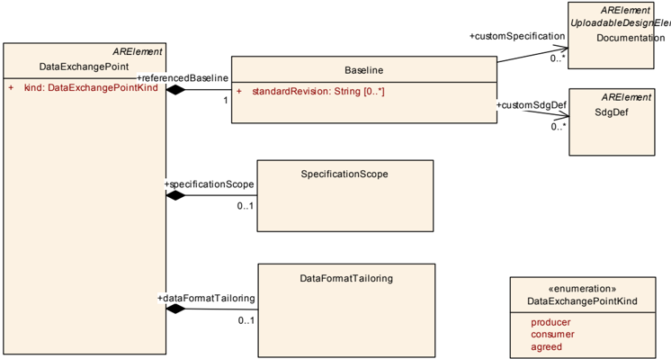

**DataExchangePoint 的高层概览描述**：高层概览描述通过其属性 longName、desc 与 introduction 提供。

**Baseline 的用途**：Baseline 规定一个 AUTOSAR 标准的基线，作为该 DataExchangePoint 中所有对 AUTOSAR 规范元素引用的参照。基线通过列出 AUTOSAR 标准及其修订版来规定。自定义的功能与偏差使用 Documentation 的 M1 文档能力描述。

**作为 Baseline 组成部分的 AUTOSAR 标准的规定**：AUTOSAR 被模块化为若干标准。通过规定每个所含标准的 standardRevision，标识特定版本的 AUTOSAR 标准组合。

注意：对 XML schema 有影响的标准标识符在 MMOD\_XMLSchema\_230 自带的 readme.txt 的「Covered Standards:」一节中被引用。

例如：

```
standardRevision[0]="FO 1.4.0", standardRevision[1]="CP 4.4.0",
standardRevision[2]="AP 18-10"
```

**约束：每个 AUTOSAR 标准单一修订版**：standardRevision 对每个 AUTOSAR 标准只能包含一个修订版。例如，允许把修订版 1.0.0 的 AUTOSAR 标准「Foundation」与修订版 4.3.0 的「Classic Platform」组合。但是，不允许在同一个 Baseline 中同时引用「Classic Platform」的修订版 [4.2.2](#422-aliasnameset-的蓝图化) 与 4.3.0。

表6.1：DataExchangePoint（**DataExchangePoint**）

| 属性 | 值 |
|---|---|
| 类 | DataExchangePoint |
| 包 | M2::AUTOSARTemplates::CommonStructure::StandardizationTemplate::DataExchangePoint |
| 说明 | 数据交换点描述工作产品与其在方法论中预期用途之间的关系，并带有对 AUTOSAR 模板的裁剪。非正式描述由 DataExchangePoint 的「desc」与「introduction」属性提供。非正式描述应当（SHOULD）包含该数据交换点所描述的主体。例如：• 工具 A 版本 x 可产生的数据 • 工具 B 版本 y 可消费的数据 • 项目 xyz 中伙伴 A 与伙伴 B 之间的商定概要。Tags: atp.recommendedPackage=DataExchangePoints |
| 基类 | ARElement, ARObject, CollectableElement, Identifiable, MultilanguageReferrable, PackageableElement, Referrable |
| 聚合于 | ARPackage.element |

| 属性 | 类型 | 多重性 | 种类 | 备注 |
|---|---|---|---|---|
| dataFormatTailoring | DataFormatTailoring | 0..1 | aggr | |
| kind | DataExchangePointKind | 1 | attr | |
| referencedBaseline | Baseline | 1 | aggr | |
| specificationScope | SpecificationScope | 0..1 | aggr | |

表6.2：Baseline（**Baseline**）

| 属性 | 值 |
|---|---|
| 类 | Baseline |
| 包 | M2::AUTOSARTemplates::CommonStructure::StandardizationTemplate::DataExchangePoint |
| 说明 | 规定该数据交换点相关的 AUTOSAR 标准的基线。基线通过列出 AUTOSAR 产品及其修订版来规定。也可以提供自定义的功能以及对标准的偏差。该数据交换点中对规范元素的所有引用都指向作为该规范基线组成部分的规范元素。 |
| 基类 | ARObject |
| 聚合于 | DataExchangePoint.referencedBaseline |

| 属性 | 类型 | 多重性 | 种类 | 备注 |
|---|---|---|---|---|
| customSdgDef | SdgDef | * | ref | 对扩展本数据交换点数据格式的自定义 SdgDef 的引用。 |
| customSpecification | Documentation | * | ref | 对扩展该基线的自定义规范的引用。 |
| standardRevision | String | * | attr | 规定 AUTOSAR 标准修订版的组合。 |

表6.3：DataExchangePointKind（**DataExchangePointKind**）

| 属性 | 值 |
|---|---|
| 枚举 | DataExchangePointKind |
| 包 | M2::AUTOSARTemplates::CommonStructure::StandardizationTemplate::DataExchangePoint |
| 说明 | 规定 DataExchangePoint 的种类。 |
| 聚合于 | DataExchangePoint.kind |

| 字面值 | 描述 |
|---|---|
| agreed | 该数据交换点描述表示在数据交换期间应使用的商定数据交换点。Tags: atp.EnumerationLiteralIndex=2 |
| consumer | 该数据交换点描述表示消费方工具的输入。Tags: atp.EnumerationLiteralIndex=1 |
| producer | 该数据交换点描述表示生产方工具的输出。Tags: atp.EnumerationLiteralIndex=0 |

```
<AR-PACKAGE>
  <SHORT-NAME>DataExchangePoints</SHORT-NAME>
  <ELEMENTS>
    <DATA-EXCHANGE-POINT>
      <SHORT-NAME>ECU_System_Description</SHORT-NAME>
      <LONG-NAME>
        <L-4 L="EN">ECU System Description for Configuration of ComStack for Unsegmented Unmultiplexed Signal-Based Communication on CAN</L-4>
      </LONG-NAME>
      <DESC>
        <L-2 L="EN">This profile describes the data that is exchanged in the deliverable "ECU System Description" and focuses on data that is required for configuring the behavior of the ECU on the CAN network with respect to unsegmented signal-based communication. The profile shows the supported input of FancyCanStackConfigurator version 1.2.2</L-2>
      </DESC>
      <INTRODUCTION>
        <P><L-1 L="EN">Consumer, Tool: FancyCanStackConfigurator version 1.2.2, invoked using "fancy -buildCar"</L-1></P>
      </INTRODUCTION>
      <KIND>CONSUMER</KIND>
      <REFERENCED-BASELINE>
        <STANDARD-REVISIONS>
          <STANDARD-REVISION>CP R4.3.0</STANDARD-REVISION>
          <STANDARD-REVISION>FO R1.0.0</STANDARD-REVISION>
        </STANDARD-REVISIONS>
        <CUSTOM-SPECIFICATION-REFS>
          <CUSTOM-SPECIFICATION-REF DEST="DOCUMENTATION">/VendorName/DataExchangePoints/CustomExtensions</CUSTOM-SPECIFICATION-REF>
        </CUSTOM-SPECIFICATION-REFS>
      </REFERENCED-BASELINE>
      <SPECIFICATION-SCOPE><!-- ... --></SPECIFICATION-SCOPE>
      <DATA-FORMAT-TAILORING><!-- ... --></DATA-FORMAT-TAILORING>
    </DATA-EXCHANGE-POINT>
    <DOCUMENTATION>
      <SHORT-NAME>CustomExtensions</SHORT-NAME>
      <DOCUMENTATION-CONTENT>
        <CHAPTER>
          <SHORT-NAME>RFCs</SHORT-NAME>
          <STRUCTURED-REQ>
            <SHORT-NAME>Example_RFC12345</SHORT-NAME>
            <DESCRIPTION>
              <P><L-1 L="EN">Description of the change request</L-1></P>
            </DESCRIPTION>
          </STRUCTURED-REQ>
        </CHAPTER>
      </DOCUMENTATION-CONTENT>
    </DOCUMENTATION>
  </ELEMENTS>
</AR-PACKAGE>
```

清单6.1：顶层数据结构示例（**Example of Top Level Structure**）

#### 6.2.2. 引用标准化的规范元素

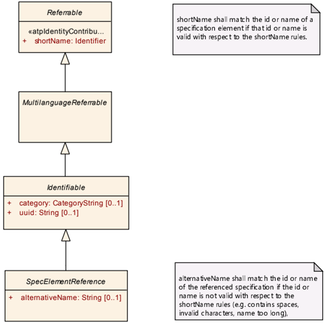

**通过 shortName 引用 AUTOSAR 规范元素**：如果 AUTOSAR 规范元素的名称符合 shortName 的规则（见 Identifier），则 SpecElementReference.shortName 应描述被引用 AUTOSAR 规范元素的名称。

**通过 alternativeName 引用 AUTOSAR 规范元素**：如果 AUTOSAR 规范元素的名称不符合 shortName 的规则（见 Identifier），则 alternativeName 应描述被引用 AUTOSAR 规范元素的名称。shortName 应包含使用以下规则创建的简化名称：

- 把所有 shortName 规则（见 Identifier）不允许的字符替换为「\_」（下划线）；
- 如果 shortName 长于 128 个字符，则适用以下算法：
  1. 取前 121 个字符。这为一个分隔符和一个 CRC 编号留出空间。
  2. 追加「\_0x」。
  3. 以十六进制格式（大写）追加原始名称的 CRC16 校验和。关于 CRC16 算法的更多信息见 [\[16\]](#ref-16)。

**约束：通过 shortName 匹配时不得有 alternativeName**：如果被引用的 AUTOSAR 规范元素符合 Identifier 的规则，则不应设置 alternativeName。

**约束：被引用的 AUTOSAR 规范元素应是 AUTOSAR 规范基线的组成部分**：如果 SpecElementReference 引用一个 AUTOSAR 规范元素，则 shortName 或 alternativeName 应与 Baseline 中规定的标准修订版所属规范中该 AUTOSAR 规范元素的名称匹配。

另见示例 B.16。

表6.4：SpecElementReference（**SpecElementReference**）

| 属性 | 值 |
|---|---|
| 类 | SpecElementReference（抽象） |
| 包 | M2::AUTOSARTemplates::CommonStructure::StandardizationTemplate::DataExchangePoint::CommonPatterns |
| 说明 | 这是对 AUTOSAR 标准中规范元素的引用。 |
| 基类 | ARObject, Identifiable, MultilanguageReferrable, Referrable |
| 子类 | DataFormatElementReference, SpecElementScope |

| 属性 | 类型 | 多重性 | 种类 | 备注 |
|---|---|---|---|---|
| alternativeName | String | 0..1 | attr | 规范元素的替代名称：当其名称不符合 shortName 时使用，例如名称包含空格。 |

#### 6.2.3. 引用自定义的规范元素

**引用自定义规范元素**：如果需要定义超出 AUTOSAR 标准化规范元素范围的自定义规范元素，则数据交换点的描述允许通过基于 AUTOSAR shortName 路径的引用来引用那些描述。如果定义了对自定义规范元素的引用，则该引用用于标识规范元素。不适用通过 alternativeName 或 shortName 对 AUTOSAR 定义规范元素的匹配。

**约束：自定义扩展应是 Baseline 所引用 Documentation 的组成部分**：如果 SpecElementReference 引用一个自定义定义的规范元素，则该规范元素应是该概要（Profile）的 Baseline 所引用的 Documentation 的组成部分。

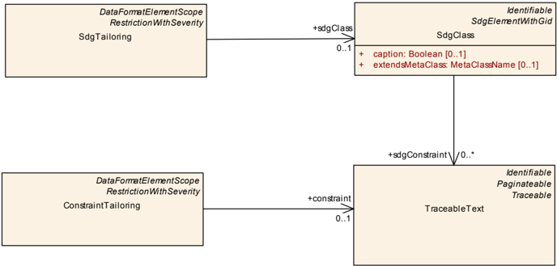

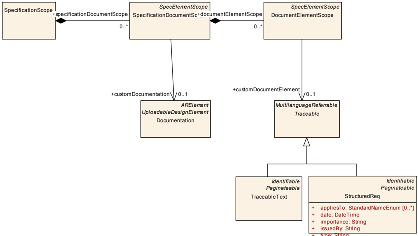

另见示例 B.16。

#### 6.2.4. 规范元素的范围界定

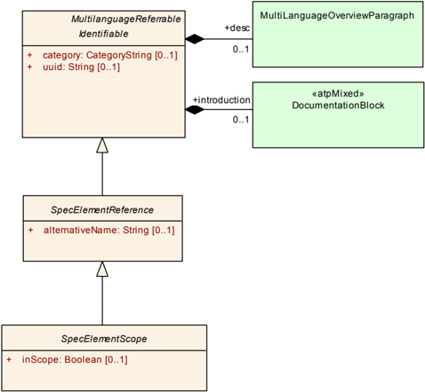

**SpecElementScope 的用途**：对所有 AUTOSAR 规范元素与自定义功能，数据交换点描述被引用的规范元素是否与该数据交换点相关。如果 inScope == true，则该规范元素相关（例如需要满足某需求、某约束被启用、某属性应存在……）。如果 inScope == false，则该规范元素不相关（例如某需求不适用、某约束被禁用、某属性是否存在无关紧要……）。

表6.5：SpecElementScope（**SpecElementScope**）

| 属性 | 值 |
|---|---|
| 类 | SpecElementScope（抽象） |
| 包 | M2::AUTOSARTemplates::CommonStructure::StandardizationTemplate::DataExchangePoint::CommonPatterns |
| 说明 | 该类定义一个规范元素在该数据交换点的上下文中是否相关。 |
| 基类 | ARObject, Identifiable, MultilanguageReferrable, Referrable, SpecElementReference |
| 子类 | DataFormatElementScope, DocumentElementScope, SpecificationDocumentScope |

| 属性 | 类型 | 多重性 | 种类 | 备注 |
|---|---|---|---|---|
| inScope | Boolean | 0..1 | attr | 指示规范元素是否与该数据交换点相关。inScope == true 则相关；inScope == false 则不相关或无所谓。 |

#### 6.2.5. 数据格式元素的裁剪

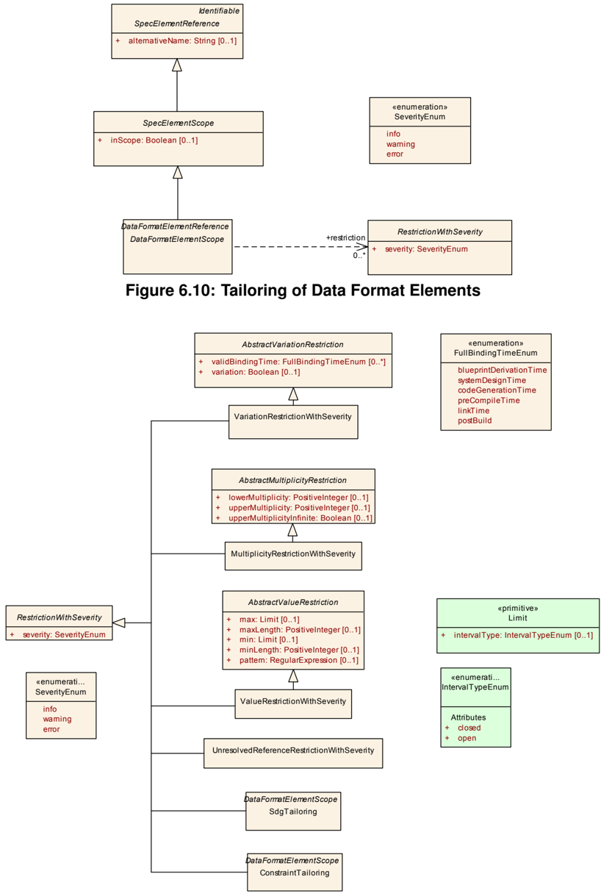

**定义：数据格式元素**：数据格式元素（**Data Format Element**）是对 AUTOSAR 数据交换格式有直接影响的元类、元属性、约束与特殊数据组定义。

**数据格式元素的范围与限制**：DataFormatElementScope 定义某个数据格式元素是否与数据交换点相关。如果 inScope == true，则带严重性的限制（restrictions with severity）规定附加的约束及其严重性。

**RestrictionWithSeverity 的用途**：RestrictionWithSeverity 定义对模型的约束。严重性描述在违反该限制时报告的严重性级别。

**ValueRestrictionWithSeverity 的用途**：ValueRestrictionWithSeverity 对简单属性（字符串、整数、浮点数）的值定义约束。

**MultiplicityRestrictionWithSeverity 的用途**：MultiplicityRestrictionWithSeverity 规定当前上下文中某元素出现的有效次数。

**VariationRestrictionWithSeverity 的用途**：VariationRestrictionWithSeverity 对变体的使用与有效绑定时间规定约束。

**上下文相关的裁剪**：元类的裁剪可以可选地依赖于：

- 聚合或引用对象所用的角色，以及
- 例如取决于属性取值（如「category」的值）的条件。

表6.6：RestrictionWithSeverity（**RestrictionWithSeverity**）

| 属性 | 值 |
|---|---|
| 类 | RestrictionWithSeverity（抽象） |
| 包 | M2::AUTOSARTemplates::CommonStructure::StandardizationTemplate::DataExchangePoint::CommonPatterns |
| 说明 | 带严重性的限制。严重性描述在违反该限制时报告的严重性级别。 |
| 基类 | ARObject |
| 子类 | ConstraintTailoring, MultiplicityRestrictionWithSeverity, SdgTailoring, UnresolvedReferenceRestrictionWithSeverity, ValueRestrictionWithSeverity, VariationRestrictionWithSeverity |

| 属性 | 类型 | 多重性 | 种类 | 备注 |
|---|---|---|---|---|
| severity | SeverityEnum | 1 | attr | 违反该限制时报告的严重性级别。 |

表6.7：SeverityEnum（**SeverityEnum**）

| 属性 | 值 |
|---|---|
| 枚举 | SeverityEnum |
| 包 | M2::AUTOSARTemplates::CommonStructure::StandardizationTemplate::DataExchangePoint |
| 说明 | 严重性级别的定义。 |
| 聚合于 | RestrictionWithSeverity.severity |

| 字面值 | 描述 |
|---|---|
| error | 某些内容不正确。互操作性问题的风险高。Tags: atp.EnumerationLiteralIndex=2 |
| info | 发现了值得提及的内容。互操作性问题的风险低。Tags: atp.EnumerationLiteralIndex=0 |
| warning | 视上下文而定某些内容可能不正确。互操作性问题的风险中等。Tags: atp.EnumerationLiteralIndex=1 |

表6.8：ValueRestrictionWithSeverity（**ValueRestrictionWithSeverity**）

| 属性 | 值 |
|---|---|
| 类 | ValueRestrictionWithSeverity |
| 包 | M2::AUTOSARTemplates::CommonStructure::StandardizationTemplate::DataExchangePoint::DataFormatTailoring |
| 说明 | 规定原始数据类型的有效取值。如果该 ValueRestriction 定义的所有规则都求值为 true，则该值有效。 |
| 基类 | ARObject, AbstractValueRestriction, RestrictionWithSeverity |
| 聚合于 | PrimitiveAttributeTailoring.valueRestriction |

表6.9：AbstractValueRestriction（**AbstractValueRestriction**）

| 属性 | 值 |
|---|---|
| 类 | AbstractValueRestriction（抽象） |
| 包 | M2::AUTOSARTemplates::GenericStructure::GeneralTemplateClasses::ModelRestrictionTypes |
| 说明 | 限制原始值。如果该限制定义的所有规则都求值为 true，则该值有效。 |
| 基类 | ARObject |
| 子类 | PrimitiveAttributeCondition, SdgAbstractPrimitiveAttribute, ValueRestrictionWithSeverity |

| 属性 | 类型 | 多重性 | 种类 | 备注 |
|---|---|---|---|---|
| max | Limit | 0..1 | attr | 规定数值的上界。 |
| maxLength | PositiveInteger | 0..1 | attr | 规定文本值的最大字符数。 |
| min | Limit | 0..1 | attr | 规定数值的下界。 |
| minLength | PositiveInteger | 0..1 | attr | 规定文本值的最小字符数。 |
| pattern | RegularExpression | 0..1 | attr | 定义可接受的字符的精确序列。 |

表6.10：MultiplicityRestrictionWithSeverity（**MultiplicityRestrictionWithSeverity**）

| 属性 | 值 |
|---|---|
| 类 | MultiplicityRestrictionWithSeverity |
| 包 | M2::AUTOSARTemplates::CommonStructure::StandardizationTemplate::DataExchangePoint::DataFormatTailoring |
| 说明 | 规定当前上下文中某元素出现的有效次数的限制。 |
| 基类 | ARObject, AbstractMultiplicityRestriction, RestrictionWithSeverity |
| 聚合于 | AttributeTailoring.multiplicityRestriction, ClassTailoring.multiplicityRestriction |

表6.11：AbstractMultiplicityRestriction（**AbstractMultiplicityRestriction**）

| 属性 | 值 |
|---|---|
| 类 | AbstractMultiplicityRestriction（抽象） |
| 包 | M2::AUTOSARTemplates::GenericStructure::GeneralTemplateClasses::ModelRestrictionTypes |
| 说明 | 规定当前上下文中某元素出现的有效次数的限制。 |
| 基类 | ARObject |
| 子类 | AttributeCondition, MultiplicityRestrictionWithSeverity, SdgAttribute |

| 属性 | 类型 | 多重性 | 种类 | 备注 |
|---|---|---|---|---|
| lowerMultiplicity | PositiveInteger | 0..1 | attr | 规定对象应出现的最小次数。如果该原始属性未设置，则该对象是可选的。 |
| upperMultiplicity | PositiveInteger | 0..1 | attr | 规定对象可出现的最大次数。如果该原始属性未设置，则对最大出现次数没有限制。 |
| upperMultiplicityInfinite | Boolean | 0..1 | attr | 显式规定上多重性不受限制。注意：「upperMultiplicityInfinite」与「upperMultiplicity」的使用互斥。 |

表6.12：VariationRestrictionWithSeverity（**VariationRestrictionWithSeverity**）

| 属性 | 值 |
|---|---|
| 类 | VariationRestrictionWithSeverity |
| 包 | M2::AUTOSARTemplates::CommonStructure::StandardizationTemplate::DataExchangePoint::DataFormatTailoring |
| 说明 | 对变体的使用与有效绑定时间定义约束。 |
| 基类 | ARObject, AbstractVariationRestriction, RestrictionWithSeverity |
| 聚合于 | AttributeTailoring.variationRestriction, ClassTailoring.variationRestriction |

| 属性 | 类型 | 多重性 | 种类 | 备注 |
|---|---|---|---|---|
| validBindingTime | FullBindingTimeEnum | * | attr | 有效绑定时间的清单。Tags: xml.sequenceOffset=20 |

表6.13：AbstractVariationRestriction（**AbstractVariationRestriction**）

| 属性 | 值 |
|---|---|
| 类 | AbstractVariationRestriction（抽象） |
| 包 | M2::AUTOSARTemplates::GenericStructure::GeneralTemplateClasses::ModelRestrictionTypes |
| 说明 | 对变体的使用与有效绑定时间定义约束。 |
| 基类 | ARObject |
| 子类 | SdgAggregationWithVariation, SdgForeignReferenceWithVariation, SdgPrimitiveAttributeWithVariation, VariationRestrictionWithSeverity |

| 属性 | 类型 | 多重性 | 种类 | 备注 |
|---|---|---|---|---|
| variation | Boolean | 0..1 | attr | 定义 AUTOSAR 模型是否可以在该位置定义变分点。Tags: xml.sequenceOffset=10 |

表6.14：FullBindingTimeEnum（**FullBindingTimeEnum**）

| 属性 | 值 |
|---|---|
| 枚举 | FullBindingTimeEnum |
| 包 | M2::AUTOSARTemplates::GenericStructure::GeneralTemplateClasses::ModelRestrictionTypes |
| 说明 | 该枚举规定 AUTOSAR 模型中可使用的绑定时间。 |
| 聚合于 | AbstractVariationRestriction.validBindingTime |

| 字面值 | 描述 |
|---|---|
| blueprintDerivationTime | 从蓝图创建对象的时点。Tags: atp.EnumerationLiteralIndex=0 |
| codeGenerationTime | • 基于需求文档手工编码。• 基于模型的工具代码生成。• 模型可以包含变体。• 实际只为所选变体生成代码。Tags: atp.EnumerationLiteralIndex=2 |
| linkTime | 根据选择了哪些变体，配置对象代码中包含什么、省略什么。例如对于以目标代码（而非源代码）交付的模块。Tags: atp.EnumerationLiteralIndex=4 |
| postBuild | PostBuild 是最晚在 ECU 启动时绑定的绑定时间。换言之，这是创建可执行程序与 ECU 启动之间的一切。Tags: atp.EnumerationLiteralIndex=5 |
| preCompileTime | 这通常是 C 预处理器。把部分代码排除在编译过程之外，例如它们不是所选变体所需的、与所选变体不兼容、或它们需要所选变体中不存在的资源。只为目标代码生成所选变体的代码。在此阶段被排除的代码在后续阶段不可用。Tags: atp.EnumerationLiteralIndex=3 |
| systemDesignTime | • 设计 VFB。• 软件组件类型（PortInterface）。• SWC 原型以及 SWC 原型之间的连接。• 设计拓扑。• ECU 与互联网络。• 设计通信矩阵与数据映射。Tags: atp.EnumerationLiteralIndex=1 |

#### 6.2.6. 生效概要与序列化概要

**序列化概要（Serialized Profile）**：数据交换点的序列化概要是数据交换点概要的 ARXML 描述。该 ARXML 表示应显式规定概要中偏离默认值的部分。它也可以显式规定不偏离默认值的值。（见第 [6.5](#65-数据交换点概要中的默认值) 节）

**生效概要（Effective Profile）**：数据交换点的生效概要是概要的一个逻辑表示，它为特定 AUTOSAR 修订版提供：

- 所有 AUTOSAR 规范及其元素的范围，以及
- 每个元类与属性、约束等的裁剪与限制。

每当给定概要未显式规定某个值时，它通过应用第 [6.5](#65-数据交换点概要中的默认值) 节描述的默认值计算得到。

细节见第 [6.5](#65-数据交换点概要中的默认值) 节。

#### 6.2.7. 理由的文档化

**理由的局部文档化**：SpecElementScope 对象的 desc 与 introduction 可用于文档化某内容为何在范围内或为何以特定方式裁剪。

**理由的共享文档化**：DocumentElementScope 可以引用多个 DataFormatElementReference，以文档化它是被引用裁剪的理由。

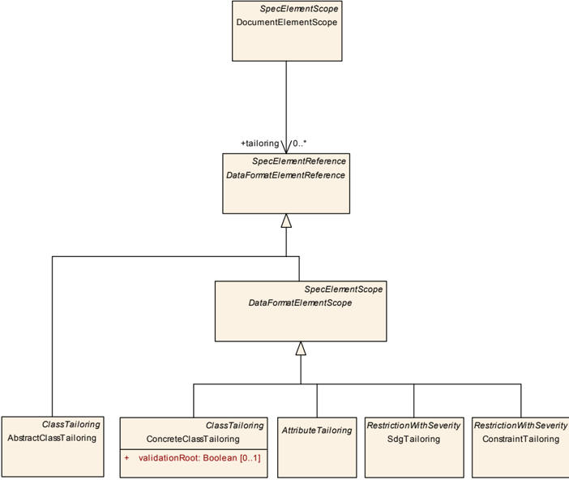

表6.15：DataFormatElementReference（**DataFormatElementReference**）

| 属性 | 值 |
|---|---|
| 类 | DataFormatElementReference（抽象） |
| 包 | M2::AUTOSARTemplates::CommonStructure::StandardizationTemplate::DataExchangePoint::CommonPatterns |
| 说明 | 对数据交换格式有直接影响的所有规范元素（元类、元属性、约束、SdgDef）引用的超类。 |
| 基类 | ARObject, Identifiable, MultilanguageReferrable, Referrable, SpecElementReference |
| 子类 | AbstractClassTailoring, DataFormatElementScope |

表6.16：DataFormatElementScope（**DataFormatElementScope**）

| 属性 | 值 |
|---|---|
| 类 | DataFormatElementScope（抽象） |
| 包 | M2::AUTOSARTemplates::CommonStructure::StandardizationTemplate::DataExchangePoint::DataFormatTailoring |
| 说明 | 该类规定某个元类、元属性、约束或 SdgDef 是否与该数据交换点相关。 |
| 基类 | ARObject, DataFormatElementReference, Identifiable, MultilanguageReferrable, Referrable, SpecElementReference, SpecElementScope |
| 子类 | AttributeTailoring, ConcreteClassTailoring, ConstraintTailoring, SdgTailoring |

#### 6.2.8. 验证语义

**验证环境**：评估 AUTOSAR 模型对概要的符合性假定：

- 模型已按照 [\[6\]](#ref-6) 定义的可拆分规则加载并合并。
- AUTOSAR 标准化的默认值依照 PrimitiveAttributeTailoring.defaultValueHandling 定义的策略应用。
- 变体已（暂时）绑定。

**inScope == true 的 DataFormatElementScope 的语义**：如果 DataFormatElementScope 的 inScope 为 true，则所有附着的限制被启用，否则被禁用。例如，如果一个元类超出范围，那么 AUTOSAR 模型可以包含该元类的实例。但该实例不属于验证的对象。

图 6.13 可视化了 DataFormatElementScope 范围的语义。

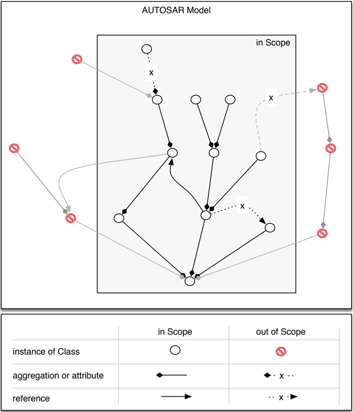

**验证的导航策略**：评估由概要启用或蕴含的限制时，聚焦于从一个或多个 validationRoot 对象出发、使用以下导航策略可达的 AUTOSAR 模型子集。与上述基于元类与属性的范围界定相比，该导航策略允许收集当前模型中实际被 inScope == true 的 ConcreteClassTailoring 实例直接或间接使用的所有对象。例如，它可以用于区分「被使用的接口」与「未被使用的接口」。未被使用的接口可能包含错误，而被使用的接口应当有效。

- 从被规定为验证根元素的元类实例开始（ConcreteClassTailoring.validationRoot == true）。如果有多个 validationRoot 元素，则验证工具应支持选择一个或多个作为验证对象的元素。
- 在以下前置条件求值为 true 时跟踪聚合：
  1. 该聚合在范围内且未被显式排除（AggregationTailoring.inScope == true 且 AggregationTailoring.multiplicityRestriction.upperMultiplicity != 0）且
  2. 被聚合的对象在范围内且未被显式排除（ConcreteClassTailoring.inScope == true 且 ConcreteClassTailoring.multiplicityRestriction.upperMultiplicity != 0）。
- 在以下前置条件求值为 true 时跟踪引用：
  1. 该引用在范围内且未被显式排除（ReferenceTailoring.inScope == true 且 ReferenceTailoring.multiplicityRestriction.upperMultiplicity != 0）且
  2. 被引用对象在范围内且未被显式排除（ConcreteClassTailoring.inScope == true 且 ConcreteClassTailoring.multiplicityRestriction.upperMultiplicity != 0）。

图 6.14 展示了应用上述导航策略的一个示例。

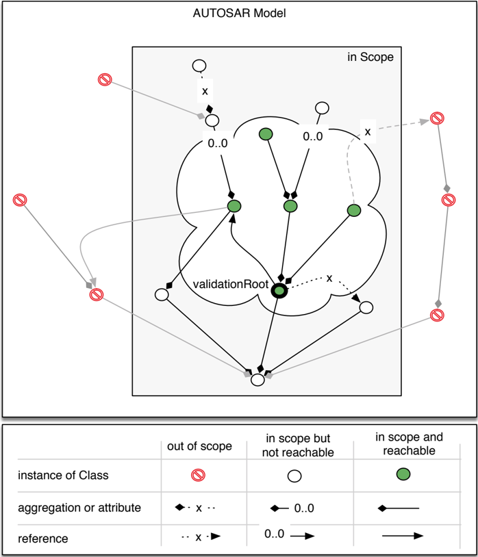

### 6.3. 规范的范围界定

**SpecificationScope 的用途**：SpecificationScope 规定与该 DataExchangePoint 相关的 AUTOSAR 规范与 AUTOSAR 规范元素的子集。（见图 6.15）

**SpecificationDocumentScope 的用途**：SpecificationDocumentScope 规定某个 AUTOSAR 或自定义规范是否在该数据交换点的范围内。AUTOSAR 规范通过其标题标识。自定义规范通过 SpecificationDocumentScope.customDocumentation 引用。

**DocumentElementScope 的用途**：DocumentElementScope 规定 AUTOSAR 或自定义规范中的某个元素是否与该数据交换点相关。AUTOSAR 规范的元素通过其 Id（例如 TPS\_STDT\_00187）标识——该 Id 依照「标准化文档中 TraceableText 的 shortName 的 namePattern」条目构成——或者，如果规范元素是方法论规范 [\[17\]](#ref-17) 中的 SPEM 工作定义或 SPEM 工作产品，则通过其名称标识。自定义元素通过 DocumentElementScope.customDocumentElement 引用。

**关于如何规定 SpecificationDocumentScope 与 DocumentElementScope 的指导**：在规定数据交换点的 SpecificationDocumentScope 与 DocumentElementScope 时，作者应聚焦于描述数据当前状态的 AUTOSAR 规范与规范元素，以及对数据交换后如何使用数据的描述。

例如，一个数据交换点概要应引用 AUTOSAR 规范「Methodology」 [\[17\]](#ref-17)，并应引用一个交付物（**deliverable**）。此外，它应描述基于该交付物打算执行哪些后续活动。

但是，作者不需要描述该交付物是如何产生的。

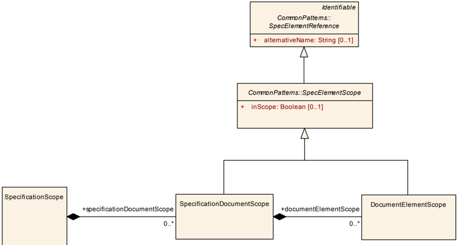

表6.17：SpecificationScope（**SpecificationScope**）

| 属性 | 值 |
|---|---|
| 类 | SpecificationScope |
| 包 | M2::AUTOSARTemplates::CommonStructure::StandardizationTemplate::DataExchangePoint::SpecificationScope |
| 说明 | AUTOSAR 规范相关子集的规定。 |
| 基类 | ARObject |
| 聚合于 | DataExchangePoint.specificationScope |

| 属性 | 类型 | 多重性 | 种类 | 备注 |
|---|---|---|---|---|
| specificationDocumentScope | SpecificationDocumentScope | * | aggr | 该数据交换点中考虑的 AUTOSAR 或自定义规范。 |

表6.18：SpecificationDocumentScope（**SpecificationDocumentScope**）

| 属性 | 值 |
|---|---|
| 类 | SpecificationDocumentScope |
| 包 | M2::AUTOSARTemplates::CommonStructure::StandardizationTemplate::DataExchangePoint::SpecificationScope |
| 说明 | 表示标准化的或自定义的规范文档，例如软件组件模板、主需求、通信规范等。AUTOSAR 规范通过其标题引用。 |
| 基类 | ARObject, Identifiable, MultilanguageReferrable, Referrable, SpecElementReference, SpecElementScope |
| 聚合于 | SpecificationScope.specificationDocumentScope |

| 属性 | 类型 | 多重性 | 种类 | 备注 |
|---|---|---|---|---|
| customDocumentation | Documentation | 0..1 | ref | 对自定义定义的规范的引用。 |
| documentElementScope | DocumentElementScope | * | aggr | 规范文档中规定了名称或 ID 的元素。 |

表6.19：DocumentElementScope（**DocumentElementScope**）

| 属性 | 值 |
|---|---|
| 类 | DocumentElementScope |
| 包 | M2::AUTOSARTemplates::CommonStructure::StandardizationTemplate::DataExchangePoint::SpecificationScope |
| 说明 | 规定某个规范元素（如需求、规范、交付物、工件、任务定义或活动）是否在该数据交换点的范围内。DocumentElementScope 可以引用所有具有名称或 ID 的规范元素。唯一的例外是元类、元属性与约束——它们在数据交换点概要的数据格式裁剪章节中处理。AUTOSAR 规范文档的元素通过其 ID（需求、规范项）或名称（交付物、工件、任务定义或活动）引用。 |
| 基类 | ARObject, Identifiable, MultilanguageReferrable, Referrable, SpecElementReference, SpecElementScope |
| 聚合于 | SpecificationDocumentScope.documentElementScope |

| 属性 | 类型 | 多重性 | 种类 | 备注 |
|---|---|---|---|---|
| customDocumentElement | Traceable | 0..1 | ref | |
| tailoring | DataFormatElementReference | * | ref | |

#### 6.3.1. 附加约束

无

### 6.4. 数据格式元素的裁剪

**DataFormatTailoring 的用途**：DataFormatTailoring 为特定的数据交换点裁剪 AUTOSAR 数据交换格式。这包括：

- 标识元类、属性、约束或 SDG 是否与数据交换点相关（inScope）；
- 限制多重性、属性取值与变体的使用；
- 在违反规则时规定严重性；
- 完整性声明；
- 关于如何处理 AUTOSAR 定义的默认值的声明；
- 特殊数据组结构的规定；
- 验证期间起始元素与导航策略的定义。

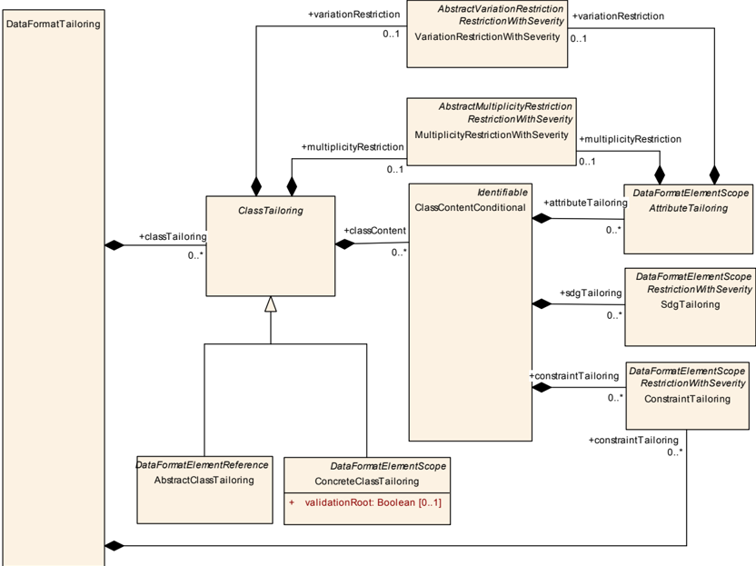

#### 6.4.1. 类的裁剪

##### 6.4.1.1. 描述

**ClassTailoring 的用途**：ClassTailoring 就相关属性、适用的约束、出现次数、变体的使用以及经由 Sdg 的可扩展性对元类进行裁剪。

**AUTOSAR 标准化的具体元类**：AUTOSAR 标准化的具体元类由 AUTOSAR 元模型 [\[18\]](#ref-18) 的子包「M2::AUTOSAR DataFormat」或「M2::MSR」中、不代表原始类型（无构造型 «primitive»、«enumeration»）的具体 UML 类（abstract=false）规定。引用通过 UML 类的名称建立。

**AUTOSAR 标准化的抽象元类**：AUTOSAR 标准化的抽象元类由 AUTOSAR 元模型 [\[18\]](#ref-18) 的子包「M2::AUTOSAR DataFormat」或「M2::MSR」中、不代表原始类型（无构造型 «primitive»、«enumeration»）的抽象 UML 类（abstract=true）规定。引用通过 UML 类的名称建立。

**全局 ClassTailoring**：直接被 DataFormatTailoring 包含的 ClassTailoring 是全局 ClassTailoring。如果全局 ConcreteClassTailoring 在范围内，则其裁剪与限制适用于该类的所有可达实例。

**角色相关的 ClassTailoring**：被 AggregationTailoring.typeTailoring 或 ReferenceTailoring.typeTailoring 包含的 ClassTailoring 是上下文相关的 ClassTailoring。它们的裁剪与限制在以下情况下适用：

- inScope == true 且
- AUTOSAR 模型中的对象由规定的角色聚合或引用。

另见示例 B.17、B.18 与 B.19。

**条件 ClassTailoring**：元类的内容模型经由一个或多个 ClassContentConditional 裁剪。多个 ClassContentConditional 可以适用于单个对象。

**不变内容模型**：如果 condition 不存在，则该 ClassContentConditional 定义的裁剪与限制应适用于当前上下文中的所有实例。

**条件内容模型**：如果定义了 condition，则当该条件求值为 true 时，该 ClassContentConditional 定义的restrictions 适用。

另见示例 B.20。

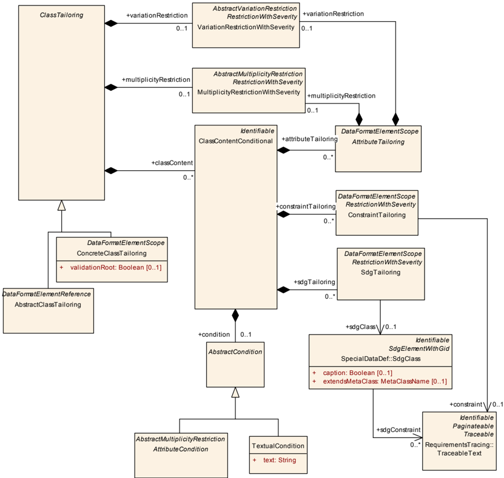

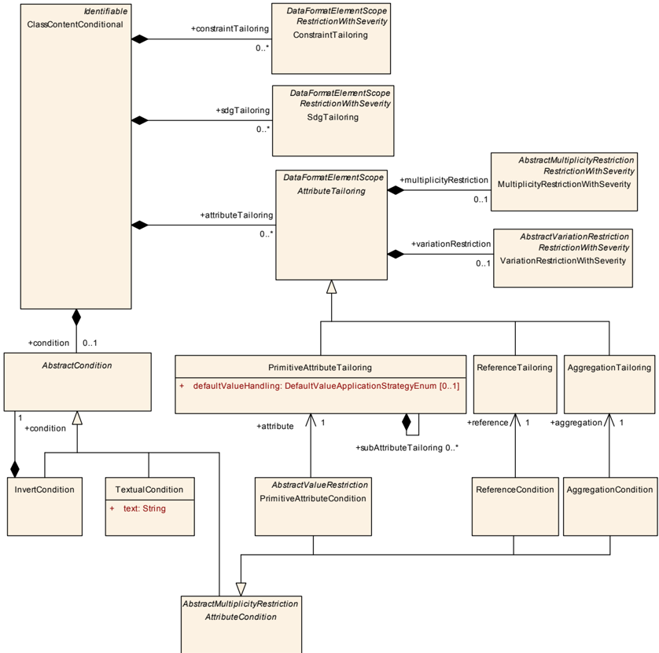

表6.20：AbstractClassTailoring（**AbstractClassTailoring**）

| 属性 | 值 |
|---|---|
| 类 | AbstractClassTailoring |
| 包 | M2::AUTOSARTemplates::CommonStructure::StandardizationTemplate::DataExchangePoint::DataFormatTailoring |
| 说明 | 对 AUTOSAR 元模型中抽象类的裁剪。 |
| 基类 | ARObject, ClassTailoring, DataFormatElementReference, Identifiable, MultilanguageReferrable, Referrable, SpecElementReference |
| 聚合于 | AggregationTailoring.typeTailoring, DataFormatTailoring.classTailoring, ReferenceTailoring.typeTailoring |

表6.21：AbstractCondition（**AbstractCondition**）

| 属性 | 值 |
|---|---|
| 类 | AbstractCondition（抽象） |
| 包 | M2::AUTOSARTemplates::CommonStructure::StandardizationTemplate::DataExchangePoint::DataFormatTailoring |
| 说明 | 协议履行所依赖的前提。 |
| 基类 | ARObject |
| 子类 | AttributeCondition, InvertCondition, TextualCondition |
| 聚合于 | ClassContentConditional.condition, InvertCondition.condition |

表6.22：AggregationCondition（**AggregationCondition**）

| 属性 | 值 |
|---|---|
| 类 | AggregationCondition |
| 包 | M2::AUTOSARTemplates::CommonStructure::StandardizationTemplate::DataExchangePoint::DataFormatTailoring |
| 说明 | 如果被引用的聚合被该条件的所有规则接受，则 AggregationCondition 求值为 true。 |
| 基类 | ARObject, AbstractCondition, AbstractMultiplicityRestriction, AttributeCondition |
| 聚合于 | ClassContentConditional.condition, InvertCondition.condition |

| 属性 | 类型 | 多重性 | 种类 | 备注 |
|---|---|---|---|---|
| aggregation | AggregationTailoring | 1 | ref | 该 AggregationCondition 的限制必须接受的聚合。 |

表6.23：AttributeCondition（**AttributeCondition**）

| 属性 | 值 |
|---|---|
| 类 | AttributeCondition（抽象） |
| 包 | M2::AUTOSARTemplates::CommonStructure::StandardizationTemplate::DataExchangePoint::DataFormatTailoring |
| 说明 | 如果被引用的属性被该条件的所有规则接受，则 AttributeCondition 求值为 true。 |
| 基类 | ARObject, AbstractCondition, AbstractMultiplicityRestriction |
| 子类 | AggregationCondition, PrimitiveAttributeCondition, ReferenceCondition |
| 聚合于 | ClassContentConditional.condition, InvertCondition.condition |

表6.24：ClassTailoring（**ClassTailoring**）

| 属性 | 值 |
|---|---|
| 类 | ClassTailoring（抽象） |
| 包 | M2::AUTOSARTemplates::CommonStructure::StandardizationTemplate::DataExchangePoint::DataFormatTailoring |
| 说明 | ClassTailoring 是一个抽象类，允许对其属性、适用的约束与 Sdg 进行裁剪。 |
| 基类 | ARObject |
| 子类 | AbstractClassTailoring, ConcreteClassTailoring |
| 聚合于 | AggregationTailoring.typeTailoring, DataFormatTailoring.classTailoring, ReferenceTailoring.typeTailoring |

| 属性 | 类型 | 多重性 | 种类 | 备注 |
|---|---|---|---|---|
| classContent | ClassContentConditional | * | aggr | 规定该类被接受/不被接受的内容。满足该 ClassContentConditional 条件的所有规则均适用。Tags: xml.sequenceOffset=30 |
| multiplicityRestriction | MultiplicityRestrictionWithSeverity | 0..1 | aggr | 规定当前上下文中该类的多重性。Tags: xml.sequenceOffset=10 |
| variationRestriction | VariationRestrictionWithSeverity | 0..1 | aggr | 对变体处理使用的限制。Tags: xml.sequenceOffset=20 |

表6.25：ClassContentConditional（**ClassContentConditional**）

| 属性 | 值 |
|---|---|
| 类 | ClassContentConditional |
| 包 | M2::AUTOSARTemplates::CommonStructure::StandardizationTemplate::DataExchangePoint::DataFormatTailoring |
| 说明 | 规定该类的有效内容。内容可以可选地取决于一个条件（例如属性「category」的值）。 |
| 基类 | ARObject, Identifiable, MultilanguageReferrable, Referrable |
| 聚合于 | ClassTailoring.classContent |

| 属性 | 类型 | 多重性 | 种类 | 备注 |
|---|---|---|---|---|
| attributeTailoring | AttributeTailoring | * | aggr | 该元类所拥有与继承属性的裁剪。Tags: xml.sequenceOffset=20 |
| condition | AbstractCondition | 0..1 | aggr | 如果该条件验证为 true，则该类内容的规则被启用。Tags: xml.sequenceOffset=10 |
| constraintTailoring | ConstraintTailoring | * | aggr | 该元类所拥有的约束的裁剪规定。Tags: xml.sequenceOffset=30 |
| sdgTailoring | SdgTailoring | * | aggr | 适用的特殊数据组的规定。Tags: xml.sequenceOffset=40 |

表6.26：ConcreteClassTailoring（**ConcreteClassTailoring**）

| 属性 | 值 |
|---|---|
| 类 | ConcreteClassTailoring |
| 包 | M2::AUTOSARTemplates::CommonStructure::StandardizationTemplate::DataExchangePoint::DataFormatTailoring |
| 说明 | 具体元类的裁剪。 |
| 基类 | ARObject, ClassTailoring, DataFormatElementReference, DataFormatElementScope, Identifiable, MultilanguageReferrable, Referrable, SpecElementReference, SpecElementScope |
| 聚合于 | AggregationTailoring.typeTailoring, DataFormatTailoring.classTailoring, ReferenceTailoring.typeTailoring |

| 属性 | 类型 | 多重性 | 种类 | 备注 |
|---|---|---|---|---|
| validationRoot | Boolean | 0..1 | attr | 规定该具体元类是否是验证的根元素。即：验证从该具体元类的对象开始，通过跟踪该数据交换点范围内所有聚合与引用继续。Tags: xml.sequenceOffset=10 |

表6.27：InvertCondition（**InvertCondition**）

| 属性 | 值 |
|---|---|
| 类 | InvertCondition |
| 包 | M2::AUTOSARTemplates::CommonStructure::StandardizationTemplate::DataExchangePoint::DataFormatTailoring |
| 说明 | 反转嵌套的条件。 |
| 基类 | ARObject, AbstractCondition |
| 聚合于 | ClassContentConditional.condition, InvertCondition.condition |

| 属性 | 类型 | 多重性 | 种类 | 备注 |
|---|---|---|---|---|
| condition | AbstractCondition | 1 | aggr | 被反转的条件。 |

表6.28：PrimitiveAttributeCondition（**PrimitiveAttributeCondition**）

| 属性 | 值 |
|---|---|
| 类 | PrimitiveAttributeCondition |
| 包 | M2::AUTOSARTemplates::CommonStructure::StandardizationTemplate::DataExchangePoint::DataFormatTailoring |
| 说明 | 如果被引用的原始属性被该条件的所有规则接受，则 PrimitiveAttributeCondition 求值为 true。 |
| 基类 | ARObject, AbstractCondition, AbstractMultiplicityRestriction, AbstractValueRestriction, AttributeCondition |
| 聚合于 | ClassContentConditional.condition, InvertCondition.condition |

| 属性 | 类型 | 多重性 | 种类 | 备注 |
|---|---|---|---|---|
| attribute | PrimitiveAttributeTailoring | 1 | ref | 该 PrimitiveAttributeCondition 的限制必须接受的原始属性。 |

表6.29：ReferenceCondition（**ReferenceCondition**）

| 属性 | 值 |
|---|---|
| 类 | ReferenceCondition |
| 包 | M2::AUTOSARTemplates::CommonStructure::StandardizationTemplate::DataExchangePoint::DataFormatTailoring |
| 说明 | 如果被引用的引用被该条件的所有规则接受，则 ReferenceCondition 求值为 true。 |
| 基类 | ARObject, AbstractCondition, AbstractMultiplicityRestriction, AttributeCondition |
| 聚合于 | ClassContentConditional.condition, InvertCondition.condition |

| 属性 | 类型 | 多重性 | 种类 | 备注 |
|---|---|---|---|---|
| reference | ReferenceTailoring | 1 | ref | 该 ReferenceCondition 的限制必须接受的引用。 |

表6.30：TextualCondition（**TextualCondition**）

| 属性 | 值 |
|---|---|
| 类 | TextualCondition |
| 包 | M2::AUTOSARTemplates::CommonStructure::StandardizationTemplate::DataExchangePoint::DataFormatTailoring |
| 说明 | 为一个或多个模型元素规定附加的条件。该条件以人类语言描述。 |
| 基类 | ARObject, AbstractCondition |
| 聚合于 | ClassContentConditional.condition, InvertCondition.condition |

| 属性 | 类型 | 多重性 | 种类 | 备注 |
|---|---|---|---|---|
| text | String | 1 | attr | 条件的人类语言描述。 |

##### 6.4.1.2. 附加约束

**约束：ConcreteClassTailoring 的 shortName 应匹配 AUTOSAR 规定的具体元类的名称**：ConcreteClassTailoring 的 shortName 应匹配 AUTOSAR 规定的具体元类的名称。

**约束：AbstractClassTailoring 的 shortName 应匹配 AUTOSAR 规定的抽象元类的名称**：AbstractClassTailoring 的 shortName 应匹配 AUTOSAR 规定的抽象元类的名称。

**约束：PrimitiveAttributeCondition.attribute 应只引用不变式所拥有的 PrimitiveAttributeTailoring**：对 PrimitiveAttributeCondition.attribute，以下条件需要求值为 true：

- 被引用的 PrimitiveAttributeTailoring 被一个没有条件的 ClassContentConditional（不变类内容）拥有，且
- 拥有被引用 PrimitiveAttributeTailoring 的 ClassContentConditional 与拥有该 PrimitiveAttributeCondition 的 ClassContentConditional 被同一个 ClassTailoring 拥有。

**约束：AggregationCondition.aggregation 应只引用不变式所拥有的 AggregationTailoring**：对 AggregationCondition.aggregation，以下条件需要求值为 true：

- 被引用的 AggregationTailoring 被一个没有条件的 ClassContentConditional（不变类内容）拥有，且
- 拥有被引用 AggregationTailoring 的 ClassContentConditional 与拥有该 AggregationCondition 的 ClassContentConditional 被同一个 ClassTailoring 拥有。

**约束：ReferenceCondition.reference 应只引用不变式所拥有的 ReferenceTailoring**：对 ReferenceCondition.reference，以下条件需要求值为 true：

- 被引用的 ReferenceTailoring 被一个没有条件的 ClassContentConditional（不变类内容）拥有，且
- 拥有被引用 ReferenceTailoring 的 ClassContentConditional 与拥有该 ReferenceCondition 的 ClassContentConditional 被同一个 ClassTailoring 拥有。

**约束：ClassTailoring.variationRestriction 只适用于 «atpVariation» 类**：如果被裁剪的元类未标记构造型 «atpVariation»，则不应定义 ClassTailoring.variationRestriction。

##### 6.4.1.3. 可达元素的附加验证语义

**ConcreteClassTailoring 的验证语义**：如果 ConcreteClassTailoring.inScope = true，则为该类定义的限制被求值。如果违反限制，则应创建一条带有规定严重性的验证消息。

**AbstractClassTailoring 的验证语义**：AbstractClassTailoring 可用于定义应适用于该类所有实例的限制。

**validationRoot == true 的全局 ConcreteClassTailoring.multiplicityRestriction 的验证语义**：如果 ConcreteClassTailoring 直接被 DataFormatTailoring.classTailoring 聚合且 ConcreteClassTailoring.validationRoot == true，则 MultiplicityRestrictionWithSeverity 针对完整模型上下文（而不仅是可达元素）中该具体元类的所有实例求值。该求值可以在可达元素集合计算之前进行。

示例 6.2 规定了一个用作 validationRoot 元素的类的 ConcreteClassTailoring。其验证语义为：完整的模型应恰好包含一个 System。

```
<DATA-EXCHANGE-POINT>
  <SHORT-NAME>MyExchangePointSystem</SHORT-NAME>
  <!-- ... -->
  <DATA-FORMAT-TAILORING>
    <CLASS-TAILORINGS>
      <CONCRETE-CLASS-TAILORING>
        <SHORT-NAME>System</SHORT-NAME>
        <DESC>
          <L-2 L="EN">The complete model shall contain exactly one 'System'</L-2>
        </DESC>
        <IN-SCOPE>true</IN-SCOPE>
        <MULTIPLICITY-RESTRICTION>
          <SEVERITY>ERROR</SEVERITY>
          <LOWER-MULTIPLICITY>1</LOWER-MULTIPLICITY>
          <UPPER-MULTIPLICITY>1</UPPER-MULTIPLICITY>
        </MULTIPLICITY-RESTRICTION>
        <VALIDATION-ROOT>true</VALIDATION-ROOT>
      </CONCRETE-CLASS-TAILORING>
    </CLASS-TAILORINGS>
  </DATA-FORMAT-TAILORING>
</DATA-EXCHANGE-POINT>
```

清单6.2：用作验证根元素的类的多重性限制示例（**Example of Multiplicity Restriction of class that is used as validation root element**）

**validationRoot == false 的全局 ConcreteClassTailoring.multiplicityRestriction 的验证语义**：如果 ConcreteClassTailoring 直接被 DataFormatTailoring.classTailoring 聚合且 ConcreteClassTailoring.validationRoot == false，则 MultiplicityRestrictionWithSeverity 对每个引用与聚合的实例单独求值。即：对所有可达的、类型与被裁剪元类相同的引用与聚合实例，确定其中是被裁剪元类实例的被引用/被包含对象的数量，并对照 MultiplicityRestrictionWithSeverity 求值。

示例 6.3 规定了一个不用作 validationRoot 元素的类的 ConcreteClassTailoring。

该示例的验证语义为：在可达元素集合中不允许存在任何对 FlexrayFrame 的引用实例。此外，不允许包含 FlexrayFrame 的聚合实例。

注意，FlexrayFrame 可能存在于模型中从所选验证根元素不可达的部分。

```
<DATA-EXCHANGE-POINT>
  <SHORT-NAME>MyExchangePointFlexray</SHORT-NAME>
  <!-- ... -->
  <DATA-FORMAT-TAILORING>
    <CLASS-TAILORINGS>
      <CONCRETE-CLASS-TAILORING>
        <SHORT-NAME>FlexrayFrame</SHORT-NAME>
        <DESC>
          <L-2 L="EN">The set of reachable elements shall not contain any FlexrayFrames. Note that FlexrayFrames might exist in parts of the model that are not reachable from the validation root element.</L-2>
        </DESC>
        <IN-SCOPE>true</IN-SCOPE>
        <MULTIPLICITY-RESTRICTION>
          <SEVERITY>ERROR</SEVERITY>
          <LOWER-MULTIPLICITY>0</LOWER-MULTIPLICITY>
          <UPPER-MULTIPLICITY>0</UPPER-MULTIPLICITY>
        </MULTIPLICITY-RESTRICTION>
        <VALIDATION-ROOT>false</VALIDATION-ROOT>
      </CONCRETE-CLASS-TAILORING>
    </CLASS-TAILORINGS>
  </DATA-FORMAT-TAILORING>
</DATA-EXCHANGE-POINT>
```

清单6.3：不用作验证根元素的类的多重性限制示例（**Example of Multiplicity Restriction of class that is not used as validation root element**）

**AbstractClassTailoring.multiplicityRestriction 的验证语义**：如果 AbstractClassTailoring 直接被 DataFormatTailoring.classTailoring 聚合，则 MultiplicityRestrictionWithSeverity 对每个引用与聚合的实例单独求值。即：对所有可达的、类型为被裁剪元类子类的引用与聚合实例，确定其中是被裁剪元类实例的被引用/被包含对象的数量，并对照 MultiplicityRestrictionWithSeverity 求值。

#### 6.4.2. 属性的裁剪

##### 6.4.2.1. 描述

**AttributeTailoring 的用途**：AttributeTailoring 规定某个所拥有或继承的 AUTOSAR 属性是否在范围内，并定义必须考虑哪些限制。

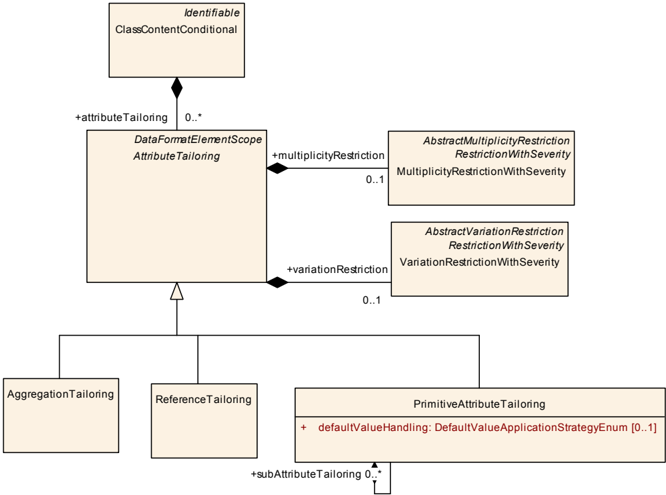

表6.31：AttributeTailoring（**AttributeTailoring**）

| 属性 | 值 |
|---|---|
| 类 | AttributeTailoring（抽象） |
| 包 | M2::AUTOSARTemplates::CommonStructure::StandardizationTemplate::DataExchangePoint::DataFormatTailoring |
| 说明 | 属性的裁剪。 |
| 基类 | ARObject, DataFormatElementReference, DataFormatElementScope, Identifiable, MultilanguageReferrable, Referrable, SpecElementReference, SpecElementScope |
| 子类 | AggregationTailoring, PrimitiveAttributeTailoring, ReferenceTailoring |
| 聚合于 | ClassContentConditional.attributeTailoring |

| 属性 | 类型 | 多重性 | 种类 | 备注 |
|---|---|---|---|---|
| multiplicityRestriction | MultiplicityRestrictionWithSeverity | 0..1 | aggr | 属性的多重性限制。Tags: xml.sequenceOffset=10 |
| variationRestriction | VariationRestrictionWithSeverity | 0..1 | aggr | 对变体处理使用的限制。Tags: xml.sequenceOffset=20 |

##### 6.4.2.2. 附加约束

**约束：AttributeTailoring 的 shortName 应匹配所拥有或继承的属性**：shortName 应匹配拥有该 AttributeTailoring 的 ClassTailoring 所标识的 AUTOSAR 元类所拥有或继承的属性名称。

**约束：派生或抽象属性不得有 AttributeTailoring**：标记构造型 `&lt;&lt;atpDerived&gt;&gt;` 或 `&lt;&lt;atpAbstract&gt;&gt;` 的属性不允许有 AttributeTailoring。

关于构造型 `&lt;&lt;atpDerived&gt;&gt;` 与 `&lt;&lt;atpAbstract&gt;&gt;` 的更多细节见 [\[6\]](#ref-6) 中的 [TPS\_GST\_00022] 与 [TPS\_GST\_00023]。

**约束：AttributeTailoring.variationRestriction 只适用于 «atpVariation» 属性**：如果被裁剪的属性未标记构造型 «atpVariation»，则不应定义 AttributeTailoring.variationRestriction。

##### 6.4.2.3. 可达元素的附加验证语义

**在范围内的属性的语义**：如果 AttributeTailoring.inScope = true，则为该 AttributeTailoring 定义的适用限制。

**ClassTailoring 与 AggregationTailoring / ReferenceTailoring 上下文中的 MultiplicityRestrictionWithSeverity**：

- 经由 AggregationTailoring.multiplicityRestriction 聚合的 MultiplicityRestrictionWithSeverity 针对被裁剪聚合的每个实例，求值所包含元素的总数。
- 经由 ReferenceTailoring.multiplicityRestriction 聚合的 MultiplicityRestrictionWithSeverity 针对被裁剪引用的每个实例，求值被引用元素的总数。
- 经由 ClassTailoring.multiplicityRestriction 聚合的 MultiplicityRestrictionWithSeverity 针对聚合或引用的每个实例，求值其中是被裁剪类实例的被聚合或被引用元素的总数。

另见「validationRoot == false 的全局 ConcreteClassTailoring.multiplicityRestriction 的验证语义」、下文 [6.4.4.3](#6443-可达元素的附加验证语义) 的验证语义与示例 B.17。

#### 6.4.3. 原始属性的裁剪

##### 6.4.3.1. 描述

**PrimitiveAttributeTailoring 的用途**：PrimitiveAttributeTailoring 规定某个所拥有或继承的原始属性是否在范围内。此外，它定义对 AUTOSAR 规定的默认值的处理。

**元类的 AUTOSAR 标准化原始属性**：在给定 AUTOSAR 元类的上下文中，所有未标记 `&lt;&lt;atpDerived&gt;&gt;` 或 `&lt;&lt;atpAbstract&gt;&gt;` 的继承与拥有的原始属性都可以被裁剪。到原始属性的引用通过原始属性的名称建立。

注意：在本规范的上下文中，原始属性是具有标记构造型 `&lt;&lt;primitive&gt;&gt;` 或 `&lt;&lt;enumeration&gt;&gt;` 类型的 UML 属性。

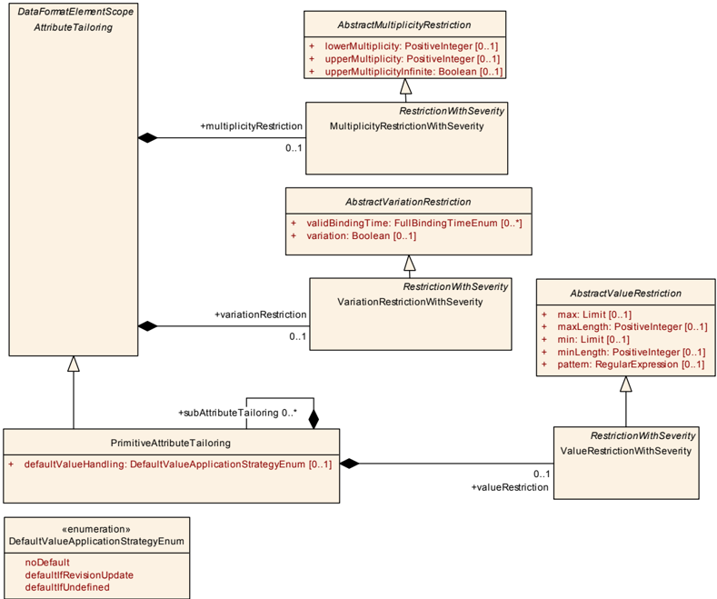

表6.32：PrimitiveAttributeTailoring（**PrimitiveAttributeTailoring**）

| 属性 | 值 |
|---|---|
| 类 | PrimitiveAttributeTailoring |
| 包 | M2::AUTOSARTemplates::CommonStructure::StandardizationTemplate::DataExchangePoint::DataFormatTailoring |
| 说明 | 原始属性的裁剪。原始属性是类型被构造型 `&lt;&lt;primitive&gt;&gt;` 或 `&lt;&lt;enumeration&gt;&gt;` 标记的属性。 |
| 基类 | ARObject, AttributeTailoring, DataFormatElementReference, DataFormatElementScope, Identifiable, MultilanguageReferrable, Referrable, SpecElementReference, SpecElementScope |
| 聚合于 | ClassContentConditional.attributeTailoring, PrimitiveAttributeTailoring.subAttributeTailoring |

| 属性 | 类型 | 多重性 | 种类 | 备注 |
|---|---|---|---|---|
| defaultValueHandling | DefaultValueApplicationStrategyEnum | 0..1 | attr | 如何处理 AUTOSAR 定义的默认值的规定。 |
| subAttributeTailoring | PrimitiveAttributeTailoring | * | aggr | 裁剪 `&lt;&lt;primitive&gt;&gt;` 数据类型的属性。 |
| valueRestriction | ValueRestrictionWithSeverity | 0..1 | aggr | 属性取值的限制。 |

表6.33：DefaultValueApplicationStrategyEnum（**DefaultValueApplicationStrategyEnum**）

| 属性 | 值 |
|---|---|
| 枚举 | DefaultValueApplicationStrategyEnum |
| 包 | M2::AUTOSARTemplates::CommonStructure::StandardizationTemplate::DataExchangePoint::DataFormatTailoring |
| 说明 | 描述如何处理 AUTOSAR 定义的默认值的枚举。如果策略要求应用 AUTOSAR 定义的默认值，则应在进一步验证或处理之前添加该值。 |
| 聚合于 | PrimitiveAttributeTailoring.defaultValueHandling |

| 字面值 | 描述 |
|---|---|
| defaultIfRevisionUpdate | 如果 AUTOSAR 模型早于数据交换点的 Baseline、且较旧的版本尚不支持该属性，则在进一步验证或处理之前应当（SHALL）应用 AUTOSAR 定义的默认值。Tags: atp.EnumerationLiteralIndex=1 |
| defaultIfUndefined | 如果 AUTOSAR 模型未显式规定取值，则在进一步验证或处理之前应用 AUTOSAR 定义的默认值。Tags: atp.EnumerationLiteralIndex=2 |
| noDefault | 不应用 AUTOSAR 定义的默认值。Tags: atp.EnumerationLiteralIndex=0 |

##### 6.4.3.2. 附加约束

**约束：PrimitiveAttributeTailoring 的 shortName 应是被引用 Baseline 中的原始属性**：PrimitiveAttributeTailoring 的 shortName 应匹配被引用 Baseline 中该元类的 AUTOSAR 规定的原始属性名称。

##### 6.4.3.3. 可达元素的附加验证语义

无附加验证语义。

#### 6.4.4. 聚合的裁剪

##### 6.4.4.1. 描述

**AggregationTailoring 的用途**：AggregationTailoring 规定某个所拥有或继承的聚合是否在范围内。

**元类的 AUTOSAR 标准化聚合**：在给定 AUTOSAR 元类的上下文中，所有未标记 `&lt;&lt;atpDerived&gt;&gt;` 或 `&lt;&lt;atpAbstract&gt;&gt;` 的继承与拥有的聚合都可以被裁剪。

注意：在本规范的上下文中，聚合是类型未标记构造型 «primitive» 或 «enumeration»、且 aggregation=AggegationKind::composite 的 UML 属性。

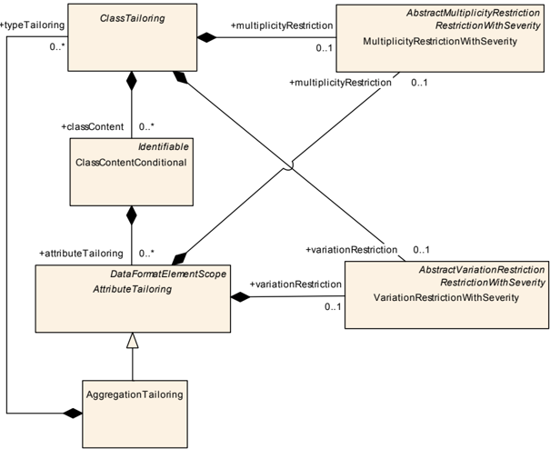

表6.34：AggregationTailoring（**AggregationTailoring**）

| 属性 | 值 |
|---|---|
| 类 | AggregationTailoring |
| 包 | M2::AUTOSARTemplates::CommonStructure::StandardizationTemplate::DataExchangePoint::DataFormatTailoring |
| 说明 | 对 AUTOSAR 元模型中聚合的裁剪。 |
| 基类 | ARObject, AttributeTailoring, DataFormatElementReference, DataFormatElementScope, Identifiable, MultilanguageReferrable, Referrable, SpecElementReference, SpecElementScope |
| 聚合于 | ClassContentConditional.attributeTailoring |

| 属性 | 类型 | 多重性 | 种类 | 备注 |
|---|---|---|---|---|
| typeTailoring | ClassTailoring | * | aggr | 当内容被该聚合包含时应用的局部类裁剪。 |

##### 6.4.4.2. 附加约束

**约束：AggregationTailoring 的 shortName 应匹配元类的 AUTOSAR 规定的聚合名称**：AggregationTailoring 的 shortName 应匹配该元类的 AUTOSAR 规定的聚合名称。

##### 6.4.4.3. 可达元素的附加验证语义

**AggregationTailoring.typeTailoring 上下文中 ClassTailoring.multiplicityRestriction 的验证语义**：如果 ClassTailoring 直接被 AggregationTailoring.typeTailoring 聚合，则 MultiplicityRestrictionWithSeverity 对被裁剪聚合的每个实例单独求值。即：对被裁剪聚合的每个实例，确定其中是被裁剪元类实例的被包含对象数量，并对照 MultiplicityRestrictionWithSeverity 求值。

另见示例 B.18。

#### 6.4.5. 引用的裁剪

##### 6.4.5.1. 描述

**ReferenceTailoring 的用途**：ReferenceTailoring 规定某个所拥有或继承的引用是否在范围内。

**元类的 AUTOSAR 标准化引用**：在给定 AUTOSAR 元类的上下文中，所有未标记 `&lt;&lt;atpDerived&gt;&gt;` 或 `&lt;&lt;atpAbstract&gt;&gt;` 的继承与拥有的引用都可以被裁剪。到引用的引用通过引用的名称建立。

注意：在本规范的上下文中，引用是类型未标记构造型 «primitive» 或 «enumeration»、且 aggregation=AggregationKind::none 的 UML 属性。

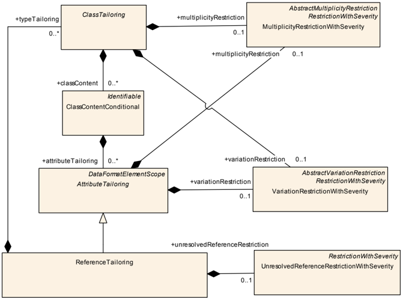

表6.35：ReferenceTailoring（**ReferenceTailoring**）

| 属性 | 值 |
|---|---|
| 类 | ReferenceTailoring |
| 包 | M2::AUTOSARTemplates::CommonStructure::StandardizationTemplate::DataExchangePoint::DataFormatTailoring |
| 说明 | 非包含引用（Non-Containment References）的裁剪。 |
| 基类 | ARObject, AttributeTailoring, DataFormatElementReference, DataFormatElementScope, Identifiable, MultilanguageReferrable, Referrable, SpecElementReference, SpecElementScope |
| 聚合于 | ClassContentConditional.attributeTailoring |

| 属性 | 类型 | 多重性 | 种类 | 备注 |
|---|---|---|---|---|
| typeTailoring | ClassTailoring | * | aggr | 被该引用引用的内容的局部类裁剪。 |
| unresolvedReferenceRestriction | UnresolvedReferenceRestrictionWithSeverity | 0..1 | aggr | 规定未解析引用的严重性。 |

##### 6.4.5.2. 附加约束

**约束：ReferenceTailoring 的 shortName 应匹配元类的 AUTOSAR 规定的引用名称**：ReferenceTailoring 的 shortName 应匹配该元类的 AUTOSAR 规定的引用名称。

##### 6.4.5.3. 可达元素的附加验证语义

**未解析引用的处理**：如果某个可达对象定义了一个被该 ReferenceTailoring 引用的未解析引用，则 unresolvedReferenceRestriction 规定该违例的严重性。

**ReferenceTailoring.typeTailoring 上下文中 ClassTailoring.multiplicityRestriction 的验证语义**：如果 ClassTailoring 直接被 ReferenceTailoring.typeTailoring 聚合，则 MultiplicityRestrictionWithSeverity 对被裁剪引用的每个实例单独求值。即：对被裁剪引用的每个实例，确定其中是被裁剪元类实例的被引用对象数量，并对照 MultiplicityRestrictionWithSeverity 求值。

另见示例 B.17。

#### 6.4.6. 约束的裁剪

##### 6.4.6.1. 描述

**ConstraintTailoring 的用途**：ConstraintTailoring 规定被引用的约束是否对该 DataExchangePoint 启用。

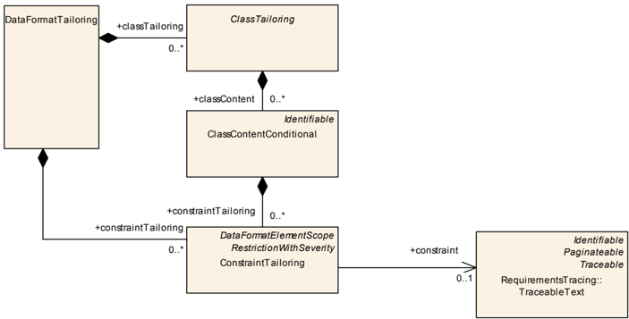

表6.36：ConstraintTailoring（**ConstraintTailoring**）

| 属性 | 值 |
|---|---|
| 类 | ConstraintTailoring |
| 包 | M2::AUTOSARTemplates::CommonStructure::StandardizationTemplate::DataExchangePoint::DataFormatTailoring |
| 说明 | 约束的裁剪。如果约束在范围内，则严重性定义其错误严重性级别。如果不在范围内，则该约束被禁用。 |
| 基类 | ARObject, DataFormatElementReference, DataFormatElementScope, Identifiable, MultilanguageReferrable, Referrable, RestrictionWithSeverity, SpecElementReference, SpecElementScope |
| 聚合于 | ClassContentConditional.constraintTailoring, DataFormatTailoring.constraintTailoring |

| 属性 | 类型 | 多重性 | 种类 | 备注 |
|---|---|---|---|---|
| constraint | TraceableText | 0..1 | ref | 对约束的自定义规范的引用。 |

##### 6.4.6.2. 附加约束

无

##### 6.4.6.3. 可达元素的附加验证语义

**超出范围的约束的语义**：如果 ConstraintTailoring.inScope = false，则被引用的约束被禁用。

**在范围内的约束的语义**：如果 ConstraintTailoring.inScope = true，则被引用的约束被求值。

**约束求值的触发器**：ConstraintTailoring 被规定的上下文定义了约束求值的触发器：

- 如果 ConstraintTailoring 经由 ClassContentConditional.constraintTailoring 聚合，则该约束只对满足条件的被裁剪元类的可达实例求值。
- 如果 ConstraintTailoring 经由 DataFormatTailoring.constraintTailoring 聚合，则没有提供关于触发求值的类实例的显式提示。由工具实现者决定正确的触发器。

因此，数据交换点概要的作者应尽可能把 ConstraintTailoring 附着到 ClassTailoring 上。

#### 6.4.7. 特殊数据组的裁剪

##### 6.4.7.1. 描述

**SdgTailoring 的用途**：SdgTailoring 规定是否可以向给定的元类添加 SdgClass（具有特定 gid 与结构的 Sdg）。

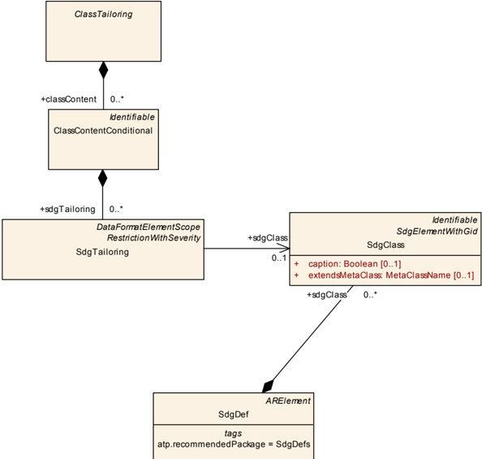

表6.37：SdgTailoring（**SdgTailoring**）

| 属性 | 值 |
|---|---|
| 类 | SdgTailoring |
| 包 | M2::AUTOSARTemplates::CommonStructure::StandardizationTemplate::DataExchangePoint::DataFormatTailoring |
| 说明 | 描述被引用的 Sdg 是否可以附着到当前类。 |
| 基类 | ARObject, DataFormatElementReference, DataFormatElementScope, Identifiable, MultilanguageReferrable, Referrable, RestrictionWithSeverity, SpecElementReference, SpecElementScope |
| 聚合于 | ClassContentConditional.sdgTailoring |

| 属性 | 类型 | 多重性 | 种类 | 备注 |
|---|---|---|---|---|
| sdgClass | SdgClass | 0..1 | ref | 特殊数据组结构的规定。 |

##### 6.4.7.2. 附加约束

**约束：被引用的 SdgClass 应是 Baseline 所引用 SdgDef 的组成部分**：被引用的 SdgClass 应是该数据交换点概要的 Baseline 所引用的某个 SdgDef 的组成部分。

##### 6.4.7.3. 可达元素的附加验证语义

**在范围内的 SdgTailoring 的语义**：如果 SdgTailoring.inScope == true，则被裁剪类实例的 Sdg 结构应对照被引用 SdgClass 规定的结构求值。

#### 6.4.8. 特殊数据组定义的描述

特殊数据组定义 SdgDef 规定特殊数据组扩展的结构。快速概览见图 6.25。更详细的信息在 [\[6\]](#ref-6) 的 [TPS\_GST\_00374]、[TPS\_GST\_00375]、[TPS\_GST\_00421] 与 [TPS\_GST\_00422] 中描述。

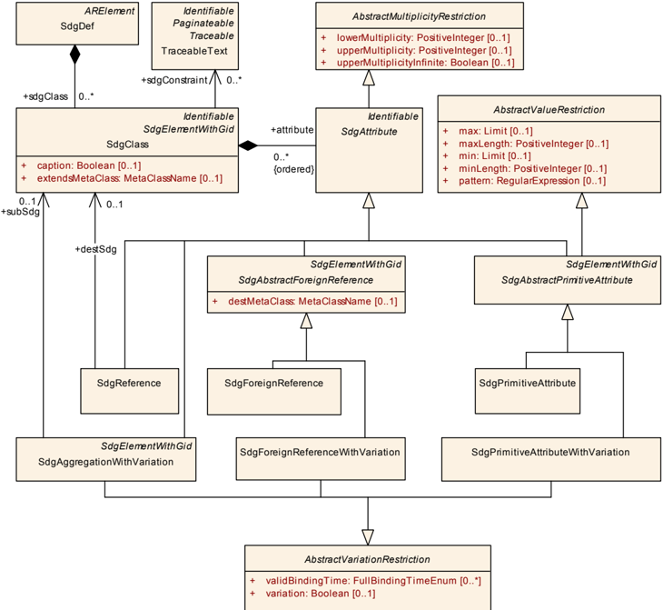

#### 6.4.9. 自定义约束的描述

##### 6.4.9.1. 描述

自定义约束以 category == CONSTRAINT\_ITEM 的 TraceableText 记录，如「TraceableText」条目与约束 constr\_2540 所定义。

##### 6.4.9.2. 附加约束

无

##### 6.4.9.3. 可达元素的附加验证语义

无

### 6.5. 数据交换点概要中的默认值

本章描述数据交换点概要中默认值的规则，这些规则在概要未显式规定相应信息时适用。除这些规则之外，AUTOSAR 还提供显式声明最新 AUTOSAR 版本默认值的基线概要（**Baseline Profile**）。

**数据交换点基线概要的用途**：数据交换点的基线概要是一个显式建模以下 ClassTailoring 默认值的数据交换点概要：

- inScope（见「具体元类的默认范围」）
- validationRoot（见「具体元类的默认验证根」）
- multiplicityRestriction（见「元类的默认 multiplicityRestriction」）
- variationRestriction（见「带 «atpVariation» 的元类的默认 variationRestriction」）

此外，它还规定 AttributeTailoring 的默认值：

- inScope（见「元属性的默认范围」）
- multiplicityRestriction（见「元属性的默认 multiplicityRestriction」）
- variationRestriction（见「元属性的默认 variationRestriction」）
- defaultValueHandling（见「默认 PrimitiveAttributeTailoring.defaultValueHandling」）

#### 6.5.1. SpecificationScope 中的默认值

以下规则定义 AUTOSAR 规范及其所含元素的默认范围。

**AUTOSAR 规范的默认范围**：如果某个 AUTOSAR 规范未显式规定 SpecificationDocumentScope.inScope，则该 AUTOSAR 规范被视为与该数据交换点不相关。

SpecificationDocumentScope.inScope 的默认值为 false。

**AUTOSAR 规范元素的默认范围**：如果 AUTOSAR 规范中的某个元素未显式规定 DocumentElementScope.inScope，则该元素与包含它的 AUTOSAR 规范具有相同的范围。

DocumentElementScope.inScope 的默认值为包含该元素的 AUTOSAR 规范的 SpecificationDocumentScope.inScope。

#### 6.5.2. DataFormatTailoring 中的默认值

以下规则定义相对于数据格式的默认范围与限制。

**具体元类的默认范围**：如果某个元类未显式规定 ConcreteClassTailoring.inScope，则默认情况下该元类的实例被视为与该数据交换点不相关。

ConcreteClassTailoring.inScope 的默认值为 false。

**具体元类的默认验证根**：如果某个元类未显式规定 ConcreteClassTailoring.validationRoot，则默认情况下该元类的实例不是验证的根元素。

ConcreteClassTailoring.validationRoot 的默认值为 false。

**元类的默认 multiplicityRestriction（未显式规定时）**

| 具体元类的 LifeCycleState（[TPS\_GST\_00051]） | .lowerMultiplicity | .upperMultiplicity | .upperMultiplicityInfinite | .severity | 描述 |
|---|---|---|---|---|---|
| VALID | 0 | n/a | true | info | 无限制。该类可出现任意多次。 |
| DRAFT | 0 | 0 | n/a | info | 使用 DRAFT 类时的信息消息 |
| OBSOLETE | 0 | 0 | n/a | warning | 使用 OBSOLETE 类时的警告消息 |
| REMOVED | 0 | 0 | n/a | error | 使用 REMOVED 类时的错误消息 |

**带 «atpVariation» 的元类的默认 variationRestriction（未显式规定时）**

| 元类的 vh.latestBindingTime（[TPS\_GST\_00182]） | .variation | .validBindingTime | .severity |
|---|---|---|---|
| blueprintDerivationTime | true | blueprintDerivationTime | error |
| systemDesignTime | true | blueprintDerivationTime、systemDesignTime | error |
| codeGenerationTime | true | blueprintDerivationTime、systemDesignTime、codeGenerationTime | error |
| preCompileTime | true | blueprintDerivationTime、systemDesignTime、codeGenerationTime、preCompileTime | error |
| linkTime | true | blueprintDerivationTime、systemDesignTime、codeGenerationTime、preCompileTime、linkTime | error |
| postBuild | true | blueprintDerivationTime、systemDesignTime、codeGenerationTime、preCompileTime、linkTime、postBuild | error |

**元属性的默认范围**：如果某个元属性未显式规定 AttributeTailoring.inScope，则默认情况下该属性的出现被视为与该数据交换点不相关。

AttributeTailoring.inScope 的默认值为 false。

**元属性的默认 multiplicityRestriction（未显式规定时）**

| 元属性的 LifeCycleState（[TPS\_GST\_00051]） | .lowerMultiplicity | .upperMultiplicity | .upperMultiplicityInfinite | .severity | 描述 |
|---|---|---|---|---|---|
| VALID | (lower) | (upper) | (upperInf) | info | 多重性不受限制。与 AUTOSAR XSD Schema [\[19\]](#ref-19) 相同的规则适用：如果属性标记为 xml.enforceMinMultiplicity=true，则 .lowerMultiplicity = 元模型中定义的属性下多重性；否则 .lowerMultiplicity = 0。如果（元模型中属性的上多重性为无穷）或（属性未标记 xml.attribute=true 且其所属类标记构造型 `&lt;&lt;atpMixed&gt;&gt;`），则 .upperMultiplicity = n/a 且 .upperMultiplicityInfinite = true；否则 .upperMultiplicity = 元模型中定义的上多重性且 .upperMultiplicityInfinite = n/a。 |
| DRAFT | 0 | 0 | n/a | info | 使用 DRAFT 属性时的信息消息 |
| OBSOLETE | 0 | 0 | n/a | warning | 使用 OBSOLETE 属性时的警告消息 |
| REMOVED | 0 | 0 | n/a | error | 使用 REMOVED 属性时的错误消息 |

> 1 见 [\[20\]](#ref-20) 中的 [TPS\_XMLSPR\_00036]、[TPS\_XMLSPR\_00046]、[TPS\_XMLSPR\_00003]。

**元属性的默认 variationRestriction（未显式规定时）**

| 元属性的 vh.latestBindingTime（[TPS\_GST\_00182]） | .variation | .validBindingTime | .severity |
|---|---|---|---|
| blueprintDerivationTime | true | {blueprintDerivationTime} | error |
| systemDesignTime | true | {blueprintDerivationTime、systemDesignTime} | error |
| codeGenerationTime | true | {blueprintDerivationTime、systemDesignTime、codeGenerationTime} | error |
| preCompileTime | true | {blueprintDerivationTime、systemDesignTime、codeGenerationTime、preCompileTime} | error |
| linkTime | true | {blueprintDerivationTime、systemDesignTime、codeGenerationTime、preCompileTime、linkTime} | error |
| postBuild | true | {blueprintDerivationTime、systemDesignTime、codeGenerationTime、preCompileTime、linkTime、postBuild} | error |

**默认 PrimitiveAttributeTailoring.valueRestriction（未显式规定时）**

| 属性 | 默认值 |
|---|---|
| pattern | 如果原始属性的类型规定 xml.xsd.pattern，则为该 xml.xsd.pattern 的值；否则为 .* |
| max | 如果原始属性的类型规定非 +INF 的 xml.xsd.maxInclusive，则为该 xml.xsd.maxInclusive 的值且 intervalType = closed；否则如果规定非 +INF 的 xml.xsd.maxExclusive，则为该 xml.xsd.maxExclusive 的值且 intervalType = open；否则为 +INF 且 intervalType = infinite |
| min | 如果原始属性的类型规定非 -INF 的 xml.xsd.minInclusive，则为该 xml.xsd.minInclusive 的值且 intervalType = closed；否则如果规定非 -INF 的 xml.xsd.minExclusive，则为该 xml.xsd.minExclusive 的值且 intervalType = open；否则为 -INF 且 intervalType = infinite |
| maxLength | 如果原始属性的类型规定 xml.xsd.maxLength，则为该 xml.xsd.maxLength 的值；否则为 +INF |
| minLength | 如果原始属性的类型规定 xml.xsd.minLength，则为该 xml.xsd.minLength 的值；否则为（空） |
| severity | error |

默认情况下，原始属性的 valueRestriction 在语义上等于其原始类型在元模型中的声明。

**默认 PrimitiveAttributeTailoring.defaultValueHandling**：如果某个原始属性未显式规定 PrimitiveAttributeTailoring.defaultValueHandling，则默认不应用任何默认值。

PrimitiveAttributeTailoring.defaultValueHandling 的默认值为 noDefault。

**默认 ReferenceTailoring.unresolvedReferenceRestriction**：如果 ReferenceTailoring.unresolvedReferenceRestriction 或 ReferenceTailoring.unresolvedReferenceRestriction.severity 未定义，则 ReferenceTailoring.unresolvedReferenceRestriction.severity 的默认值为 error。

### 6.6. 兼容性

本节描述数据交换点概要兼容性的含义，并定义评估概要兼容性的一般规则。兼容性是互操作性风险程度的度量。在评估生产方与消费方概要的兼容性时，假定一个双方都对照各自概要验证工件的工作流。兼容性分析应回答的问题是：「如果一个 AUTOSAR 模型通过了生产方的验证并被导入到消费方，可能产生哪些互操作性问题？」例如，如果消费方的概要比生产方的概要更严格，可能会出现问题。另一方面，生产方一侧的问题不一定导致消费方一侧的问题，例如当只消费数据的一个子集时。

- 注意，数据交换点概要的兼容性并不保证不存在任何互操作性问题。但该兼容性是总体互操作性风险较低的指标。
- 另一方面，数据交换点概要的不兼容不一定意味着存在互操作性问题。但该不兼容是互操作性风险较高的指标。

**潜在互操作性问题的识别**：使用以下迭代方法识别潜在的互操作性风险。该方法聚焦于尽早识别具有高互操作性问题风险的不兼容性。以下步骤针对「生效概要」条目规定的概要的生效表示。

1. 比较 DataExchangePoint.longName、DataExchangePoint.desc 与 DataExchangePoint.introduction 中的高层描述，以理解概要就 AUTOSAR 方法论的预期步骤而言是否真正相互匹配。这是一个完全手动的步骤。如果概要涉及方法论中完全不同的步骤，则需要就方法论集成进行专家讨论。
2. 依照「Baseline 的兼容性」条目定义的规则比较 Baseline。如果 Baseline 兼容，则可以继续以下步骤。否则需要特别谨慎，因为规范项、约束、元模型元素等可能在 Baseline 之间被添加、移除或更改。因此，除以下步骤中的描述之外，还需要弄清基线之间的更改是否实际影响被比较的数据交换点概要。
3. 识别匹配的 SpecElementReference 元素。标准化规范元素匹配的关键是相对于 DataExchangePoint 的相对 shortName 路径。自定义规范元素匹配的关键是被引用自定义元素的绝对 shortName 路径。
   1. 如果对方概要中没有匹配的 SpecElementReference，则需要专家讨论。例如，当比较具有不兼容 Baseline 的概要、或使用了自定义扩展时，会发生这种情况。
   2. 否则：继续下一步。
4. 识别不相关的元素：在两个概要中都不相关（SpecElementScope.inScope == false）的元素产生较低的互操作性问题风险，在进一步分析中被忽略。
5. 分析 SpecificationScope（另见 6.6.2）：
   1. 按照「SpecificationDocumentScope 的兼容性」与「DocumentElementScope 的兼容性」条目的定义比较 SpecificationDocumentScope.inScope。专家应讨论所识别的不兼容性。
6. 分析 DataFormatTailoring（另见 6.6.3）：
   1. 按照「ConcreteClassTailoring 的兼容性」条目的定义比较 ConcreteClassTailoring.inScope。专家应讨论所识别的不兼容性。可疑的 ConcreteClassTailoring 在后续步骤中分析。
   2. 比较 ConcreteClassTailoring.validationRoot。如果取值不相同，需要专家讨论。
   3. 比较 ClassTailoring.multiplicityRestriction（「MultiplicityRestrictionWithSeverity 的兼容性」条目）与 ClassTailoring.variationRestriction（「VariationRestrictionWithSeverity.variation 的兼容性」条目）。专家应讨论所识别的不兼容性。消费方概要中 severity == error 的不兼容限制应首先处理，随后是 severity == warning 与 severity == info 的限制。
   4. 比较 ClassTailoring.classContent（「ClassContentConditional 的兼容性」条目）。如果条件相等，两个 ClassContentConditional 匹配。如果对方概要中没有匹配、或识别出不兼容，专家应讨论。
   5. 比较 ClassContentConditional.attributeTailoring（「AttributeTailoring 的兼容性」「AggregationTailoring 的兼容性」「ReferenceTailoring 的兼容性」「PrimitiveAttributeTailoring 的兼容性」条目）、ClassContentConditional.constraintTailoring 与 ClassContentConditional.sdgTailoring（「SdgTailoring 的兼容性」「ConstraintTailoring 的兼容性」条目）。专家应讨论所识别的不兼容性。消费方概要中 severity == error 的不兼容限制应首先处理，随后是 severity == warning 与 severity == info 的限制。

#### 6.6.1. Baseline 的兼容性

**Baseline 的兼容性**：如果满足以下准则，则 Baseline 兼容：

- standardRevision 规定相同的 AUTOSAR 标准修订版<sup>6</sup>，且
- customSpecification 引用相同的自定义 Documentation 集合，且
- customSdgDef 引用相同的 SdgDef 集合。

否则 Baseline 不兼容，需要工程师讨论。

> 6 不同的 standardRevision 不会自动导致工具互操作性问题。特别是当数据交换点涉及在修订版之间未发生变化的标准部分时。

#### 6.6.2. SpecificationScope 的兼容性

**SpecificationDocumentScope 的兼容性**

| | 消费方 SpecificationDocumentScope.inScope：× = 兼容（inScope 等价）、– = 不兼容（inScope 不等价）、? = 可疑 | |
|---|---|---|
| 生产方 SpecificationDocumentScope.inScope | false | true |
| false | × | – |
| true | – | 被包含的 DocumentElementScope |

**DocumentElementScope 的兼容性**

| | 消费方 DocumentElementScope.inScope：× = 兼容（inScope 等价）、– = 不兼容（inScope 不等价） | |
|---|---|---|
| 生产方 DocumentElementScope.inScope | false | true |
| false | × | – |
| true | – | × |

#### 6.6.3. DataFormatTailoring 的兼容性

**ConcreteClassTailoring 的兼容性**

| | 消费方 ConcreteClassTailoring.inScope：× = 兼容（双方都认为相关类不相关，inScope == false）、– = 不兼容（ConcreteClassTailoring.inScope 不同）、? = 可疑（双方都认为相关类相关，inScope == true） | |
|---|---|---|
| 生产方 ConcreteClassTailoring.inScope | false | true |
| false | × | – |
| true | – | ? 需要进一步分析 |

**ClassContentConditional 的兼容性**：如果满足以下任一条件，则两个 ClassContentConditional 被视为不兼容：

- condition 不等价，或
- attributeTailoring 中的元素不匹配，或
- constraintTailoring 中的元素不匹配，或
- sdgTailoring 中的元素不匹配。

否则需要进一步分析。另见「AggregationTailoring 的兼容性」「ReferenceTailoring 的兼容性」「PrimitiveAttributeTailoring 的兼容性」「SdgTailoring 的兼容性」「ConstraintTailoring 的兼容性」条目。

**AttributeTailoring 的兼容性**：如果满足以下任一条件，则两个 AttributeTailoring 被视为不兼容：

- multiplicityRestriction 不兼容（「MultiplicityRestrictionWithSeverity 的兼容性」条目），或
- variationRestriction 不兼容（「VariationRestrictionWithSeverity.variation 的兼容性」条目）。

**AggregationTailoring 的兼容性**：两个 AggregationTailoring 不兼容：

- 如果它们依照「AttributeTailoring 的兼容性」条目不兼容，或
- 如果 typeTailoring 中的元素不兼容。

如果未识别出不兼容，则视为兼容。

**ReferenceTailoring 的兼容性**：两个 ReferenceTailoring 不兼容：

- 如果它们依照「AttributeTailoring 的兼容性」条目不兼容，或
- 如果 typeTailoring 中的元素不兼容，或
- 如果 unresolvedReferenceRestriction 不兼容。

如果未识别出不兼容，则视为兼容。

**PrimitiveAttributeTailoring 的兼容性**：两个 PrimitiveAttributeTailoring 不兼容：

- 如果它们依照「AttributeTailoring 的兼容性」条目不兼容，或
- 如果 defaultValueHandling 不相同，或
- 如果 valueRestriction（「ValueRestrictionWithSeverity 的兼容性」条目）不兼容。

**SdgTailoring 的兼容性**：如果两个 SdgTailoring 的 sdgClass 引用指向同一个 SdgClass，则它们被视为兼容。

注意：该兼容性定义未涵盖两个 SdgClass 定义存在于不同位置、但归结为等价 SdgClass 的情况。这是为简化验证而接受的。

**ConstraintTailoring 的兼容性**：如果某个约束在生产方概要中的严重性低于消费方概要中的严重性，则存在互操作性风险。另一个互操作性风险是：引用了自定义约束、且其文本描述在生产方与消费方概要中不相同。这两种情况都需要专家讨论。

**MultiplicityRestrictionWithSeverity 的兼容性**

| | 消费方 MultiplicityRestrictionWithSeverity：× = 兼容（生产方的 lowerMultiplicity 与 upperMultiplicity / upperMultiplicityInfinite 区间被消费方的区间完全覆盖）、– = 不兼容 | | | | |
|---|---|---|---|---|---|
| 生产方 MultiplicityRestrictionWithSeverity | 0..0 | 0..1 | 0..* | 1..1 | 1..* |
| 0..0 | × | × | × | – | – |
| 0..1 | – | × | × | – | – |
| 0..* | – | – | × | – | – |
| 1..1 | – | × | × | × | × |
| 1..* | – | – | × | – | × |

**VariationRestrictionWithSeverity.variation 的兼容性**

| | 消费方 VariationRestrictionWithSeverity.variation 的取值 | |
|---|---|---|
| 生产方 VariationRestrictionWithSeverity.variation 的取值 | false | true |
| false | 兼容 | 兼容 |
| true | 不兼容 | 需要对 VariationRestrictionWithSeverity.validBindingTime 属性做进一步求值。见「VariationRestrictionWithSeverity.validBindingTime 的兼容性」条目。 |

**VariationRestrictionWithSeverity.validBindingTime 的兼容性**：如果在生产方与消费方两侧 VariationRestrictionWithSeverity.variation 的值都为 true，则需要对 VariationRestrictionWithSeverity.validBindingTime 属性做进一步求值。如果生产方的有效绑定时间集合是消费方有效绑定时间集合的子集，则双方的有效绑定时间属性被视为兼容。否则视为不兼容。

**ValueRestrictionWithSeverity 的兼容性**：ValueRestrictionWithSeverity 的兼容性使用以下算法计算：

1. 如果生产方的 min ≥ 消费方的 min，则 min 兼容。继续下一个属性。否则 ValueRestrictionWithSeverity 不兼容。停止比较。
2. 如果生产方的 max ≤ 消费方的 max，则 max 兼容。继续下一个属性。否则 ValueRestrictionWithSeverity 不兼容。停止比较。
3. 如果生产方的 minLength ≥ 消费方的 minLength，则 minLength 兼容。继续下一个属性。否则 ValueRestrictionWithSeverity 不兼容。停止比较。
4. 如果生产方的 maxLength ≤ 消费方的 maxLength，则 maxLength 兼容。继续下一个属性。否则 ValueRestrictionWithSeverity 不兼容。停止比较。
5. 如果在生产方 pattern 属性定义的正则表达式的任何匹配，也在消费方 pattern 属性定义的正则表达式中产生匹配<sup>7</sup>，则 pattern 兼容，ValueRestrictionWithSeverity 兼容；否则 ValueRestrictionWithSeverity 不兼容。停止比较。

> 7 注意这基本上归结为计算两个正则表达式所描述语言的交集，并检查该交集是否等于生产方一侧正则表达式描述的语言。由于这是相当复杂的检查，允许验证工具简单地对两个 pattern 属性做字符串比较，并在两个字符串不相等时将其视为不兼容。

**UnresolvedReferenceRestrictionWithSeverity 的兼容性**：对已存在的引用属性，UnresolvedReferenceRestrictionWithSeverity 定义在给定引用路径无法解析时的 severity。如果生产方一侧的 UnresolvedReferenceRestrictionWithSeverity.severity 低于消费方一侧的 severity，则存在互操作性问题。

注意：未解析的引用可能是无意的，也可能是有意的。例如，如果该数据不是预期方法论步骤所需的，消费方可以容忍未解析的引用。

## B. ARXML 清单

### B.1. LifeCycleStateDefinitionGroup

AUTOSAR 中 LifeCycleStateDefinitionGroup 与 LifeCycleState 的 ARXML 表示。

```
<!-- LifeCycleStateDefinitionGroup: AutosarLifeCycleStates -->
<LIFE-CYCLE-STATE-DEFINITION-GROUP>
  <SHORT-NAME>AutosarLifeCycleStates</SHORT-NAME>
  <LONG-NAME>
    <L-4 L="EN">Life Cycle Definitions used in AUTOSAR Standards</L-4>
  </LONG-NAME>
  <DESC>
    <L-2 L="EN">This set represents the life cycle definitions used by AUTOSAR on M1 and M2 level.
    See also [TPS_GST_00051] respectively [TPS_GST_00064].</L-2>
  </DESC>
  <LC-STATES>
    <!-- LifeCycleState: valid -->
    <LIFE-CYCLE-STATE>
      <SHORT-NAME>valid</SHORT-NAME>
      <LONG-NAME><L-4 L="EN">VALID</L-4></LONG-NAME>
      <DESC>
        <L-2 L="EN">This indicates that the related entity is a valid part of the document. This is the default.</L-2>
      </DESC>
    </LIFE-CYCLE-STATE>
    <!-- LifeCycleState: draft -->
    <LIFE-CYCLE-STATE>
      <SHORT-NAME>draft</SHORT-NAME>
      <LONG-NAME><L-4 L="EN">DRAFT</L-4></LONG-NAME>
      <DESC>
        <L-2 L="EN">This indicates that the related entity is introduced newly in the (meta) model but still experimental. This information is published but is subject to be changed without backward compatibility management.</L-2>
      </DESC>
    </LIFE-CYCLE-STATE>
    <!-- LifeCycleState: candidate -->
    <LIFE-CYCLE-STATE>
      <SHORT-NAME>candidate</SHORT-NAME>
      <LONG-NAME><L-4 L="EN">CANDIDATE</L-4></LONG-NAME>
      <DESC>
        <L-2 L="EN">This indicates that the entity was introduced by a concept result and is still not validated.</L-2>
      </DESC>
    </LIFE-CYCLE-STATE>
    <!-- LifeCycleState: obsolete -->
    <LIFE-CYCLE-STATE>
      <SHORT-NAME>obsolete</SHORT-NAME>
      <LONG-NAME><L-4 L="EN">OBSOLETE</L-4></LONG-NAME>
      <DESC>
        <L-2 L="EN">This indicates that the related entity is obsolete and kept in the (meta) model for compatibility reasons.</L-2>
      </DESC>
      <INTRODUCTION>
        <P>
          <L-1 L="EN">If this life cycle state is set, the <TT TYPE="ARMetaClassRole">LifeCycleInfo.remark</TT> shall express the recommended alternative solution.</L-1>
        </P>
      </INTRODUCTION>
    </LIFE-CYCLE-STATE>
    <!-- LifeCycleState: removed -->
    <LIFE-CYCLE-STATE>
      <SHORT-NAME>removed</SHORT-NAME>
      <LONG-NAME><L-4 L="EN">REMOVED</L-4></LONG-NAME>
      <!-- ...（源清单在本状态之后结束；removed 状态的正文见第 3 章条目） -->
    </LIFE-CYCLE-STATE>
  </LC-STATES>
</LIFE-CYCLE-STATE-DEFINITION-GROUP>
```

**注意：** 源 markdown 中该清单在「removed」状态处被分页截断，removed 状态的完整描述见第 [3](#3-autosar-定义的生命周期) 章「AUTOSAR 提供模型（M1）上应用的生命周期信息集」条目。

清单B.1：AUTOSAR 标准 LifeCycleStateDefinitionGroup（**AUTOSAR Standard LifeCycleStateDefinitionGroup**）

### B.2. 蓝图示例

#### B.2.1. PortInterfaceMapping 的蓝图

```
<AR-PACKAGE>
  <SHORT-NAME>AUTOSAR</SHORT-NAME>
  <AR-PACKAGES>
    <AR-PACKAGE>
      <SHORT-NAME>PortInterfaces_Blueprint</SHORT-NAME>
      <CATEGORY>BLUEPRINT</CATEGORY>
      <ELEMENTS>
        <SENDER-RECEIVER-INTERFACE>
          <SHORT-NAME NAME-PATTERN="{anyName}">M</SHORT-NAME>
          <DATA-ELEMENTS>
            <VARIABLE-DATA-PROTOTYPE>
              <SHORT-NAME NAME-PATTERN="{anyName}">a</SHORT-NAME>
            </VARIABLE-DATA-PROTOTYPE>
            <VARIABLE-DATA-PROTOTYPE>
              <SHORT-NAME NAME-PATTERN="{anyName}">b</SHORT-NAME>
            </VARIABLE-DATA-PROTOTYPE>
          </DATA-ELEMENTS>
        </SENDER-RECEIVER-INTERFACE>
      </ELEMENTS>
    </AR-PACKAGE>
  </AR-PACKAGES>
</AR-PACKAGE>
```

清单B.2：PortInterfaceMapping 蓝图场景（1）（**Scenario for Blueprints of PortInterfaceMapping (1)**）

```
<AR-PACKAGE>
  <SHORT-NAME>LeftCompany</SHORT-NAME>
  <AR-PACKAGES>
    <AR-PACKAGE>
      <SHORT-NAME>PortInterfaces</SHORT-NAME>
      <ELEMENTS>
        <SENDER-RECEIVER-INTERFACE>
          <SHORT-NAME>S</SHORT-NAME>
          <DATA-ELEMENTS>
            <VARIABLE-DATA-PROTOTYPE><SHORT-NAME>b</SHORT-NAME></VARIABLE-DATA-PROTOTYPE>
            <VARIABLE-DATA-PROTOTYPE><SHORT-NAME>a</SHORT-NAME></VARIABLE-DATA-PROTOTYPE>
          </DATA-ELEMENTS>
        </SENDER-RECEIVER-INTERFACE>
      </ELEMENTS>
    </AR-PACKAGE>
    <AR-PACKAGE>
      <SHORT-NAME>BlueprintMappingSets</SHORT-NAME>
      <ELEMENTS>
        <BLUEPRINT-MAPPING-SET>
          <SHORT-NAME>S_isDerivedFrom_M</SHORT-NAME>
          <DESC><L-2 L="EN">This states <E>that</E> S is derived from M</L-2></DESC>
          <BLUEPRINT-MAPS>
            <BLUEPRINT-MAPPING>
              <BLUEPRINT-REF DEST="PORT-INTERFACE">/AUTOSAR/PortInterfaces_Blueprint/M</BLUEPRINT-REF>
              <DERIVED-OBJECT-REF DEST="PORT-INTERFACE">/LeftCompany/PortInterfaces/S</DERIVED-OBJECT-REF>
            </BLUEPRINT-MAPPING>
          </BLUEPRINT-MAPS>
        </BLUEPRINT-MAPPING-SET>
      </ELEMENTS>
    </AR-PACKAGE>
    <AR-PACKAGE>
      <SHORT-NAME>PortInterfaceMappingSets_Blueprint</SHORT-NAME>
      <CATEGORY>BLUEPRINT</CATEGORY>
      <ELEMENTS>
        <PORT-INTERFACE-MAPPING-SET>
          <SHORT-NAME NAME-PATTERN="{anyName}">BP</SHORT-NAME>
          <DESC><L-2 L="EN"></L-2></DESC>
          <PORT-INTERFACE-MAPPINGS>
            <VARIABLE-AND-PARAMETER-INTERFACE-MAPPING>
              <SHORT-NAME NAME-PATTERN="{anyName}">SMMap</SHORT-NAME>
              <DESC><L-2 L="EN">This defines <E>how</E> S is derived (and therefore mapped to) from M</L-2></DESC>
              <DATA-MAPPINGS>
                <DATA-PROTOTYPE-MAPPING>
                  <FIRST-DATA-PROTOTYPE-REF DEST="VARIABLE-DATA-PROTOTYPE">/AUTOSAR/PortInterfaces_Blueprint/M/a</FIRST-DATA-PROTOTYPE-REF>
                  <SECOND-DATA-PROTOTYPE-REF DEST="VARIABLE-DATA-PROTOTYPE">/LeftCompany/PortInterfaces/S/b</SECOND-DATA-PROTOTYPE-REF>
                </DATA-PROTOTYPE-MAPPING>
                <DATA-PROTOTYPE-MAPPING>
                  <FIRST-DATA-PROTOTYPE-REF DEST="VARIABLE-DATA-PROTOTYPE">/AUTOSAR/PortInterfaces_Blueprint/M/b</FIRST-DATA-PROTOTYPE-REF>
                  <SECOND-DATA-PROTOTYPE-REF DEST="VARIABLE-DATA-PROTOTYPE">/LeftCompany/PortInterfaces/S/a</SECOND-DATA-PROTOTYPE-REF>
                </DATA-PROTOTYPE-MAPPING>
              </DATA-MAPPINGS>
            </VARIABLE-AND-PARAMETER-INTERFACE-MAPPING>
          </PORT-INTERFACE-MAPPINGS>
        </PORT-INTERFACE-MAPPING-SET>
      </ELEMENTS>
    </AR-PACKAGE>
  </AR-PACKAGES>
</AR-PACKAGE>
```

清单B.3：PortInterfaceMapping 蓝图场景（2）（**Scenario for Blueprints of PortInterfaceMapping (2)**）

```
<AR-PACKAGE>
  <SHORT-NAME>RightCompany</SHORT-NAME>
  <AR-PACKAGES>
    <AR-PACKAGE>
      <SHORT-NAME>PortInterfaces</SHORT-NAME>
      <ELEMENTS>
        <SENDER-RECEIVER-INTERFACE>
          <SHORT-NAME>R</SHORT-NAME>
          <DATA-ELEMENTS>
            <VARIABLE-DATA-PROTOTYPE><SHORT-NAME>x</SHORT-NAME></VARIABLE-DATA-PROTOTYPE>
            <VARIABLE-DATA-PROTOTYPE><SHORT-NAME>y</SHORT-NAME></VARIABLE-DATA-PROTOTYPE>
          </DATA-ELEMENTS>
        </SENDER-RECEIVER-INTERFACE>
      </ELEMENTS>
    </AR-PACKAGE>
    <AR-PACKAGE>
      <SHORT-NAME>BlueprintMappingSets</SHORT-NAME>
      <ELEMENTS>
        <BLUEPRINT-MAPPING-SET>
          <SHORT-NAME>R_isDerivedFrom_M</SHORT-NAME>
          <DESC><L-2 L="EN">This states <E>that</E> S is derived from M</L-2></DESC>
          <BLUEPRINT-MAPS>
            <BLUEPRINT-MAPPING>
              <BLUEPRINT-REF DEST="PORT-INTERFACE">/AUTOSAR/PortInterfaces_Blueprint/M</BLUEPRINT-REF>
              <DERIVED-OBJECT-REF DEST="PORT-INTERFACE">/RightCompany/PortInterfaces/R</DERIVED-OBJECT-REF>
            </BLUEPRINT-MAPPING>
          </BLUEPRINT-MAPS>
        </BLUEPRINT-MAPPING-SET>
      </ELEMENTS>
    </AR-PACKAGE>
    <AR-PACKAGE>
      <SHORT-NAME>PortInterfaceMappingSets_Blueprint</SHORT-NAME>
      <CATEGORY>BLUEPRINT</CATEGORY>
      <ELEMENTS>
        <PORT-INTERFACE-MAPPING-SET>
          <SHORT-NAME NAME-PATTERN="{anyName}">BP</SHORT-NAME>
          <PORT-INTERFACE-MAPPINGS>
            <VARIABLE-AND-PARAMETER-INTERFACE-MAPPING>
              <SHORT-NAME NAME-PATTERN="{anyName}">RMMap</SHORT-NAME>
              <DESC><L-2 L="EN">This defines <E>how</E> R is derived (and therefore mapped to) from M</L-2></DESC>
              <DATA-MAPPINGS>
                <DATA-PROTOTYPE-MAPPING>
                  <FIRST-DATA-PROTOTYPE-REF DEST="VARIABLE-DATA-PROTOTYPE">/AUTOSAR/PortInterfaces_Blueprint/M/a</FIRST-DATA-PROTOTYPE-REF>
                  <SECOND-DATA-PROTOTYPE-REF DEST="VARIABLE-DATA-PROTOTYPE">/RightCompany/PortInterfaces/R/x</SECOND-DATA-PROTOTYPE-REF>
                </DATA-PROTOTYPE-MAPPING>
                <DATA-PROTOTYPE-MAPPING>
                  <FIRST-DATA-PROTOTYPE-REF DEST="VARIABLE-DATA-PROTOTYPE">/AUTOSAR/PortInterfaces_Blueprint/M/b</FIRST-DATA-PROTOTYPE-REF>
                  <SECOND-DATA-PROTOTYPE-REF DEST="VARIABLE-DATA-PROTOTYPE">/RightCompany/PortInterfaces/R/y</SECOND-DATA-PROTOTYPE-REF>
                </DATA-PROTOTYPE-MAPPING>
              </DATA-MAPPINGS>
            </VARIABLE-AND-PARAMETER-INTERFACE-MAPPING>
          </PORT-INTERFACE-MAPPINGS>
        </PORT-INTERFACE-MAPPING-SET>
      </ELEMENTS>
    </AR-PACKAGE>
  </AR-PACKAGES>
</AR-PACKAGE>
```

清单B.4：PortInterfaceMapping 蓝图场景（3）（**Scenario for Blueprints of PortInterfaceMapping (3)**）

```
<AR-PACKAGE>
  <SHORT-NAME>Project</SHORT-NAME>
  <AR-PACKAGES>
    <AR-PACKAGE>
      <SHORT-NAME>PortInterfaceMappingSets</SHORT-NAME>
      <ELEMENTS>
        <PORT-INTERFACE-MAPPING-SET>
          <SHORT-NAME>Set1</SHORT-NAME>
          <PORT-INTERFACE-MAPPINGS>
            <VARIABLE-AND-PARAMETER-INTERFACE-MAPPING>
              <SHORT-NAME>SRMap</SHORT-NAME>
              <DESC><L-2 L="EN">This defines <E>how</E> S is mapped R</L-2></DESC>
              <DATA-MAPPINGS>
                <DATA-PROTOTYPE-MAPPING>
                  <FIRST-DATA-PROTOTYPE-REF DEST="VARIABLE-DATA-PROTOTYPE">/LeftCompany/PortInterfaces/S/b</FIRST-DATA-PROTOTYPE-REF>
                  <SECOND-DATA-PROTOTYPE-REF DEST="VARIABLE-DATA-PROTOTYPE">/RightCompany/PortInterfaces/R/x</SECOND-DATA-PROTOTYPE-REF>
                </DATA-PROTOTYPE-MAPPING>
                <DATA-PROTOTYPE-MAPPING>
                  <FIRST-DATA-PROTOTYPE-REF DEST="VARIABLE-DATA-PROTOTYPE">/LeftCompany/PortInterfaces/S/a</FIRST-DATA-PROTOTYPE-REF>
                  <SECOND-DATA-PROTOTYPE-REF DEST="VARIABLE-DATA-PROTOTYPE">/RightCompany/PortInterfaces/R/y</SECOND-DATA-PROTOTYPE-REF>
                </DATA-PROTOTYPE-MAPPING>
              </DATA-MAPPINGS>
            </VARIABLE-AND-PARAMETER-INTERFACE-MAPPING>
          </PORT-INTERFACE-MAPPINGS>
        </PORT-INTERFACE-MAPPING-SET>
      </ELEMENTS>
    </AR-PACKAGE>
    <AR-PACKAGE>
      <SHORT-NAME>BlueprintMappingSets</SHORT-NAME>
      <ELEMENTS>
        <BLUEPRINT-MAPPING-SET>
          <SHORT-NAME>ProjectMap1</SHORT-NAME>
          <DESC><L-2 L="EN">This states <E>that</E> SRMap is derived from SMMap and RMMap simultaneously</L-2></DESC>
          <BLUEPRINT-MAPS>
            <BLUEPRINT-MAPPING>
              <BLUEPRINT-REF DEST="PORT-INTERFACE-MAPPING">/LeftCompany/PortInterfaceMappingSets_Blueprint/BP/SMMap</BLUEPRINT-REF>
              <DERIVED-OBJECT-REF DEST="PORT-INTERFACE-MAPPING">/Project/PortInterfaceMappingSets/Set1/SRMap</DERIVED-OBJECT-REF>
            </BLUEPRINT-MAPPING>
            <BLUEPRINT-MAPPING>
              <BLUEPRINT-REF DEST="PORT-INTERFACE-MAPPING">/RightCompany/PortInterfaceMappingSets_Blueprint/BP/RMMap</BLUEPRINT-REF>
              <DERIVED-OBJECT-REF DEST="PORT-INTERFACE-MAPPING">/Project/PortInterfaceMappingSets/Set1/SRMap</DERIVED-OBJECT-REF>
            </BLUEPRINT-MAPPING>
          </BLUEPRINT-MAPS>
        </BLUEPRINT-MAPPING-SET>
      </ELEMENTS>
    </AR-PACKAGE>
  </AR-PACKAGES>
</AR-PACKAGE>
```

清单B.5：PortInterfaceMapping 蓝图场景（4）（**Scenario for Blueprints of PortInterfaceMapping (4)**）

#### B.2.2. VfbTiming 的蓝图

```
<AR-PACKAGES>
  <AR-PACKAGE>
    <SHORT-NAME NAME-PATTERN="{anyName}">VfbTimingBlueprint</SHORT-NAME>
    <CATEGORY>BLUEPRINT</CATEGORY>
    <ELEMENTS>
      <VFB-TIMING>
        <SHORT-NAME>vfbTiming_AccrPedlRat</SHORT-NAME>
        <TIMING-DESCRIPTIONS>
          <TD-EVENT-VARIABLE-DATA-PROTOTYPE>
            <SHORT-NAME>tde_Vdps_AccrPedlRat</SHORT-NAME>
            <IS-EXTERNAL>false</IS-EXTERNAL>
            <PORT-PROTOTYPE-BLUEPRINT-REF DEST="PORT-PROTOTYPE-BLUEPRINT">/AUTOSAR/AISpecification/PortPrototypeBlueprints_Blueprint/AccrPedlRat</PORT-PROTOTYPE-BLUEPRINT-REF>
            <DATA-ELEMENT-REF DEST="VARIABLE-DATA-PROTOTYPE">/AUTOSAR/AISpecification/PortInterfaces_Blueprint/AccrPedlRat1/AccrPedlRat</DATA-ELEMENT-REF>
            <TD-EVENT-VARIABLE-DATA-PROTOTYPE-TYPE>VARIABLE-DATA-PROTOTYPE-SENT</TD-EVENT-VARIABLE-DATA-PROTOTYPE-TYPE>
          </TD-EVENT-VARIABLE-DATA-PROTOTYPE>
          <TD-EVENT-VARIABLE-DATA-PROTOTYPE>
            <SHORT-NAME>tde_Vdpr_AccrPedlRat</SHORT-NAME>
            <IS-EXTERNAL>false</IS-EXTERNAL>
            <PORT-PROTOTYPE-BLUEPRINT-REF DEST="PORT-PROTOTYPE-BLUEPRINT">/AUTOSAR/AISpecification/PortPrototypeBlueprints_Blueprint/AccrPedlRat</PORT-PROTOTYPE-BLUEPRINT-REF>
            <DATA-ELEMENT-REF DEST="VARIABLE-DATA-PROTOTYPE">/AUTOSAR/AISpecification/PortInterfaces_Blueprint/AccrPedlRat1/AccrPedlRat</DATA-ELEMENT-REF>
            <TD-EVENT-VARIABLE-DATA-PROTOTYPE-TYPE>VARIABLE-DATA-PROTOTYPE-RECEIVED</TD-EVENT-VARIABLE-DATA-PROTOTYPE-TYPE>
          </TD-EVENT-VARIABLE-DATA-PROTOTYPE>
          <TD-EVENT-VARIABLE-DATA-PROTOTYPE>
            <SHORT-NAME>tde_Vdp_AccrPedlRat</SHORT-NAME>
            <IS-EXTERNAL>false</IS-EXTERNAL>
            <PORT-PROTOTYPE-BLUEPRINT-REF DEST="PORT-PROTOTYPE-BLUEPRINT">/AUTOSAR/AISpecification/PortPrototypeBlueprints_Blueprint/AccrPedlRat</PORT-PROTOTYPE-BLUEPRINT-REF>
            <DATA-ELEMENT-REF DEST="VARIABLE-DATA-PROTOTYPE">/AUTOSAR/AISpecification/PortInterfaces_Blueprint/AccrPedlRat1/AccrPedlRat</DATA-ELEMENT-REF>
          </TD-EVENT-VARIABLE-DATA-PROTOTYPE>
        </TIMING-DESCRIPTIONS>
        <TIMING-REQUIREMENTS>
          <PERIODIC-EVENT-TRIGGERING>
            <SHORT-NAME>pet_AccrPedlRat</SHORT-NAME>
            <EVENT-REF DEST="TD-EVENT-VARIABLE-DATA-PROTOTYPE">/VfbTimingBlueprint/vfbTiming_AccrPedlRat/tde_Vdp_AccrPedlRat</EVENT-REF>
            <JITTER><CSE-CODE>0</CSE-CODE><CSE-CODE-FACTOR>1</CSE-CODE-FACTOR></JITTER>
            <PERIOD><CSE-CODE>0</CSE-CODE><CSE-CODE-FACTOR>10</CSE-CODE-FACTOR></PERIOD>
          </PERIODIC-EVENT-TRIGGERING>
          <AGE-CONSTRAINT>
            <SHORT-NAME>ac_AccrPedlRat</SHORT-NAME>
            <MAXIMUM><CSE-CODE>0</CSE-CODE><CSE-CODE-FACTOR>10</CSE-CODE-FACTOR></MAXIMUM>
            <SCOPE-REF DEST="TD-EVENT-VARIABLE-DATA-PROTOTYPE">/VfbTimingBlueprint/vfbTiming_AccrPedlRat/tde_Vdpr_AccrPedlRat</SCOPE-REF>
          </AGE-CONSTRAINT>
        </TIMING-REQUIREMENTS>
      </VFB-TIMING>
    </ELEMENTS>
  </AR-PACKAGE>
</AR-PACKAGES>
```

清单B.6：VFB 时序蓝图示例（**Example for VFB Timing Blueprint**）

### B.3. 关键字 ARXML 示例

#### B.3.1. Keyword 的 ARXML 示例

```
<AR-PACKAGE>
  <SHORT-NAME>AUTOSAR</SHORT-NAME>
  <AR-PACKAGES>
    <AR-PACKAGE>
      <SHORT-NAME>AISpecification</SHORT-NAME>
      <AR-PACKAGES>
        <AR-PACKAGE>
          <SHORT-NAME>KeywordSets</SHORT-NAME>
          <ELEMENTS>
            <KEYWORD-SET>
              <SHORT-NAME>KeywordListComfort</SHORT-NAME>
              <KEYWORDS>
                <KEYWORD>
                  <SHORT-NAME>Cmft</SHORT-NAME>
                  <LONG-NAME><L-4 L="EN">Comfort</L-4></LONG-NAME>
                  <DESC>
                    <L-2 L="EN">comfort. this keyword is used to express something as comfortable or convenient</L-2>
                  </DESC>
                  <ABBR-NAME>Cmft</ABBR-NAME>
                  <CLASSIFICATIONS>
                    <CLASSIFICATION>Condition-Qualifier</CLASSIFICATION>
                  </CLASSIFICATIONS>
                </KEYWORD>
              </KEYWORDS>
            </KEYWORD-SET>
          </ELEMENTS>
        </AR-PACKAGE>
      </AR-PACKAGES>
    </AR-PACKAGE>
  </AR-PACKAGES>
</AR-PACKAGE>
```

清单B.7：关键字示例（**example for keywords**）

#### B.3.2. Keyword 词干关系的 ARXML 示例

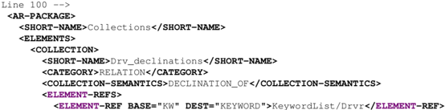

清单B.8：Keyword 词干关系示例（**Example for Stem Relation of Keywords**）

**注意：** 清单 B.8 的正文在源 markdown 转换中缺失（仅有图题），上文以源文档附带的清单渲染图呈现其内容。

#### B.3.3. BlueprintPolicyNotModifiable 的示例

```
<SW-DATA-DEF-PROPS-CONDITIONAL>
  <IMPLEMENTATION-DATA-TYPE-REF DEST="IMPLEMENTATION-DATA-TYPE">
    /AUTOSAR/Platform/ImplementationDataTypes_Blueprint/uint8
  </IMPLEMENTATION-DATA-TYPE-REF>
</SW-DATA-DEF-PROPS-CONDITIONAL>
```

清单B.9：BlueprintPolicyNotModifiable 的示例（**Example for BlueprintPolicyNotModifiable**）

**注意：** 源 markdown 中该清单在开头残留一个孤立片段「&lt;/ARRAY-SIZE&gt;」（分页产物），已按上下文归属丢弃。

#### B.3.4. BlueprintPolicyList 的示例

```
<COMPU-SCALE>
  <LOWER-LIMIT INTERVAL-TYPE="CLOSED">0x22</LOWER-LIMIT>
  <UPPER-LIMIT INTERVAL-TYPE="CLOSED">0x22</UPPER-LIMIT>
  <COMPU-CONST><VT>CNV2XMSG_TIMECONFIDENCE_000_000_000_000_5</VT></COMPU-CONST>
</COMPU-SCALE>
<COMPU-SCALE>
  <LOWER-LIMIT INTERVAL-TYPE="CLOSED">0x23</LOWER-LIMIT>
  <UPPER-LIMIT INTERVAL-TYPE="CLOSED">0x23</UPPER-LIMIT>
  <COMPU-CONST><VT>CNV2XMSG_TIMECONFIDENCE_000_000_000_000_2</VT></COMPU-CONST>
</COMPU-SCALE>
<COMPU-SCALE>
  <LOWER-LIMIT INTERVAL-TYPE="CLOSED">0x24</LOWER-LIMIT>
  <UPPER-LIMIT INTERVAL-TYPE="CLOSED">0x24</UPPER-LIMIT>
  <COMPU-CONST><VT>CNV2XMSG_TIMECONFIDENCE_000_000_000_000_1</VT></COMPU-CONST>
</COMPU-SCALE>
<COMPU-SCALE>
  <LOWER-LIMIT INTERVAL-TYPE="CLOSED">0x25</LOWER-LIMIT>
  <UPPER-LIMIT INTERVAL-TYPE="CLOSED">0x25</UPPER-LIMIT>
  <COMPU-CONST><VT>CNV2XMSG_TIMECONFIDENCE_000_000_000_000_05</VT></COMPU-CONST>
</COMPU-SCALE>
<COMPU-SCALE>
  <LOWER-LIMIT INTERVAL-TYPE="CLOSED">0x26</LOWER-LIMIT>
  <UPPER-LIMIT INTERVAL-TYPE="CLOSED">0x26</UPPER-LIMIT>
  <!-- ...（源清单在此处被分页截断） -->
</COMPU-SCALE>
```

清单B.10：BlueprintPolicyList 的示例（**Example for BlueprintPolicyList**）

#### B.3.5. BlueprintPolicySingle 的示例

清单 B.11 展示 BlueprintPolicySingle 的使用。

```
<PORT-PROTOTYPE-BLUEPRINT>
  <SHORT-NAME NAME-PATTERN="{anyName}">AFbForCmft</SHORT-NAME>
  <LONG-NAME>
    <L-4 L="EN">Acceleration Feedback for Comfort</L-4>
  </LONG-NAME>
  <DESC>
    <L-2 L="EN">Cluster of information regarding acceleration and acceleration saturation feedbacks from Vehicle Longitudinal Control (VLC) to Adaptive Cruise Control (ACC). This information is used for comfort reasons.</L-2>
  </DESC>
  <BLUEPRINT-POLICYS>
    <BLUEPRINT-POLICY-SINGLE>
      <ATTRIBUTE-NAME>INTERFACE-REF</ATTRIBUTE-NAME>
      <BLUEPRINT-DERIVATION-GUIDE>
        <P><L-1 L="EN">Shall only refer to an interface of vendor xyz with the same shortname.</L-1></P>
      </BLUEPRINT-DERIVATION-GUIDE>
    </BLUEPRINT-POLICY-SINGLE>
  </BLUEPRINT-POLICYS>
  <INTERFACE-REF DEST="SENDER-RECEIVER-INTERFACE">
    /AUTOSAR/AISpecification/PortInterfaces_Blueprint/AFbForCmft1
  </INTERFACE-REF>
</PORT-PROTOTYPE-BLUEPRINT>
```

清单B.11：BlueprintPolicySingle 的示例（**Example for BlueprintPolicySingle**）

在清单 B.12 中，BlueprintPolicySingle 选择一个属性等于规定字符串的元素节点（PORTS/P-PORT-PROTOTYPE/SHORTNAME[@NAME-PATTERN='{Name}\_AsymDecrypt']）。

```
<BLUEPRINT-POLICY-SINGLE>
  <ATTRIBUTE-NAME>PORTS/P-PORT-PROTOTYPE/SHORT-NAME[@NAME-PATTERN='{Name}_AsymDecrypt']</ATTRIBUTE-NAME>
  <BLUEPRINT-DERIVATION-GUIDE>
    <P><L-1 L="EN">Name = {ecuc(Csm/CsmAsymDecrypt/CsmAsymDecryptConfig.SHORT-NAME)}</L-1></P>
  </BLUEPRINT-DERIVATION-GUIDE>
</BLUEPRINT-POLICY-SINGLE>
```

清单B.12：带属性名称模式的 BlueprintPolicySingle 示例（**Example for BlueprintPolicySingle with attribute name pattern**）

这产生了清单 B.13 所示元素节点的选择。

```
<P-PORT-PROTOTYPE>
  <SHORT-NAME NAME-PATTERN="{Name}_AsymDecrypt">AsymDecrypt</SHORT-NAME>
  <PROVIDED-INTERFACE-TREF DEST="CLIENT-SERVER-INTERFACE">
    /AUTOSAR/Csm/ClientServerInterfaces_Blueprint/CsmAsymDecrypt
  </PROVIDED-INTERFACE-TREF>
</P-PORT-PROTOTYPE>
```

清单B.13：被选择的元素节点 &lt;SHORT-NAME&gt;（**Selected element node &lt;SHORT-NAME&gt;**）

在清单 B.14 中，BlueprintPolicySingle 选择一个包含规定文本模式的元素节点（OPERATIONS/CLIENT-SERVER-OPERATION[SHORTNAME/text()="ReadData"]/ARGUMENTS/ARGUMENT-DATA-PROTOTYPE[SHORTNAME/text()="Data"]）。


清单B.14：带文本模式的 BlueprintPolicySingle 示例（**Example for BlueprintPolicySingle with text pattern**）

**注意：** 清单 B.14 的 XML 正文在源 markdown 转换中缺失（仅有图题与说明文字），上文以源文档附带的清单渲染图呈现其内容。

这产生了元素节点（ARGUMENTS/ARGUMENT-DATAPROTOTYPE/SHORT-NAME）的选择：当（CLIENTSERVER-OPERATION/SHORT-NAME）等于「ReadData」时，其 SHORT-NAME 等于「Data」，见清单 B.15。


清单B.15：带文本模式的 BlueprintPolicySingle 示例（**Example for BlueprintPolicySingle with text pattern**）

**注意：** 清单 B.15 的 XML 正文在源 markdown 转换中缺失（仅有说明文字与图题），上文以源文档附带的清单渲染图呈现其内容。

### B.4. 数据交换点概要示例

#### B.4.1. 引用规范元素

示例 B.16 展示对标准化与自定义规范元素的引用示例。

```
<DATA-EXCHANGE-POINT>
  <SHORT-NAME>ExampleDataExchangePointWithCustomExtensions</SHORT-NAME>
  <REFERENCED-BASELINE>
    <STANDARD-REVISIONS>
      <STANDARD-REVISION>CP R4.2.2</STANDARD-REVISION>
    </STANDARD-REVISIONS>
    <CUSTOM-SPECIFICATION-REFS>
      <CUSTOM-SPECIFICATION-REF DEST="DOCUMENTATION">CustomSpecificationOfOS</CUSTOM-SPECIFICATION-REF>
      <CUSTOM-SPECIFICATION-REF DEST="DOCUMENTATION">CustomDataFormatExtensions</CUSTOM-SPECIFICATION-REF>
    </CUSTOM-SPECIFICATION-REFS>
    <CUSTOM-SDG-DEF-REFS>
      <CUSTOM-SDG-DEF-REF DEST="SDG-DEF">SafetyExtensionSdgDef</CUSTOM-SDG-DEF-REF>
    </CUSTOM-SDG-DEF-REFS>
  </REFERENCED-BASELINE>
  <SPECIFICATION-SCOPE>
    <SPECIFICATION-DOCUMENT-SCOPES>
      <SPECIFICATION-DOCUMENT-SCOPE>
        <SHORT-NAME>Methodology</SHORT-NAME>
        <IN-SCOPE>true</IN-SCOPE>
        <DOCUMENT-ELEMENT-SCOPES>
          <DOCUMENT-ELEMENT-SCOPE>
            <SHORT-NAME>Topology</SHORT-NAME>
            <DESC><L-2 L="EN">Reference to STANDARDIZED element via shortName</L-2></DESC>
            <IN-SCOPE>true</IN-SCOPE>
          </DOCUMENT-ELEMENT-SCOPE>
          <DOCUMENT-ELEMENT-SCOPE>
            <SHORT-NAME>ECU_System_Description</SHORT-NAME>
            <DESC><L-2 L="EN">Reference to STANDARDIZED deliverable via alternativeName. The name of the deliverable contains spaces and thus it is required to use the alternativeName</L-2></DESC>
            <ALTERNATIVE-NAME>ECU System Description</ALTERNATIVE-NAME>
            <IN-SCOPE>true</IN-SCOPE>
          </DOCUMENT-ELEMENT-SCOPE>
        </DOCUMENT-ELEMENT-SCOPES>
      </SPECIFICATION-DOCUMENT-SCOPE>
      <SPECIFICATION-DOCUMENT-SCOPE>
        <SHORT-NAME>Specification_of_Operating_System</SHORT-NAME>
        <DESC><L-2 L="EN">Reference to STANDARDIZED Specification via alternative name that represents the title of the specification</L-2></DESC>
        <ALTERNATIVE-NAME>Specification of Operating System</ALTERNATIVE-NAME>
        <IN-SCOPE>true</IN-SCOPE>
        <DOCUMENT-ELEMENT-SCOPES>
          <DOCUMENT-ELEMENT-SCOPE>
            <SHORT-NAME>SRS_Os_11005</SHORT-NAME>
            <DESC><L-2 L="EN">Reference to STANDARDIZED requirement via shortName</L-2></DESC>
            <IN-SCOPE>true</IN-SCOPE>
          </DOCUMENT-ELEMENT-SCOPE>
        </DOCUMENT-ELEMENT-SCOPES>
      </SPECIFICATION-DOCUMENT-SCOPE>
      <SPECIFICATION-DOCUMENT-SCOPE>
        <SHORT-NAME>CustomSpecificationOfOsScope</SHORT-NAME>
        <IN-SCOPE>true</IN-SCOPE>
        <CUSTOM-DOCUMENTATION-REF DEST="DOCUMENTATION">CustomSpecificationOfOS</CUSTOM-DOCUMENTATION-REF>
        <DOCUMENT-ELEMENT-SCOPES>
          <DOCUMENT-ELEMENT-SCOPE>
            <SHORT-NAME>Custom_SRS_Os_00001_Scope</SHORT-NAME>
            <DESC><L-2 L="EN">Reference to CUSTOM requirement via shortName path</L-2></DESC>
            <IN-SCOPE>true</IN-SCOPE>
            <CUSTOM-DOCUMENT-ELEMENT-REF DEST="STRUCTURED-REQ">CustomSpecificationOfOS/FunctionalExtensions/Custom_SRS_Os_00001</CUSTOM-DOCUMENT-ELEMENT-REF>
          </DOCUMENT-ELEMENT-SCOPE>
        </DOCUMENT-ELEMENT-SCOPES>
      </SPECIFICATION-DOCUMENT-SCOPE>
      <SPECIFICATION-DOCUMENT-SCOPE>
        <SHORT-NAME>Software_Component_Template</SHORT-NAME>
        <ALTERNATIVE-NAME>Software Component Template</ALTERNATIVE-NAME>
        <DOCUMENT-ELEMENT-SCOPES>
          <DOCUMENT-ELEMENT-SCOPE>
            <SHORT-NAME>TPS_SWCT_01251</SHORT-NAME>
            <DESC><L-2 L="EN">Reference to STANDARDIZED specItem via shortName</L-2></DESC>
            <IN-SCOPE>true</IN-SCOPE>
          </DOCUMENT-ELEMENT-SCOPE>
        </DOCUMENT-ELEMENT-SCOPES>
      </SPECIFICATION-DOCUMENT-SCOPE>
    </SPECIFICATION-DOCUMENT-SCOPES>
  </SPECIFICATION-SCOPE>
  <DATA-FORMAT-TAILORING>
    <CLASS-TAILORINGS>
      <CONCRETE-CLASS-TAILORING>
        <SHORT-NAME>StructuredReq</SHORT-NAME>
        <IN-SCOPE>true</IN-SCOPE>
        <CLASS-CONTENTS>
          <CLASS-CONTENT-CONDITIONAL>
            <SHORT-NAME>Invariant</SHORT-NAME>
            <SDG-TAILORINGS>
              <SDG-TAILORING>
                <SHORT-NAME>SafetyExtension</SHORT-NAME>
                <SEVERITY>WARNING</SEVERITY>
                <SDG-CLASS-REF DEST="SDG-CLASS">SafetyExtensionSdgDef/SafetyRequirement</SDG-CLASS-REF>
              </SDG-TAILORING>
            </SDG-TAILORINGS>
          </CLASS-CONTENT-CONDITIONAL>
        </CLASS-CONTENTS>
      </CONCRETE-CLASS-TAILORING>
      <!-- ...（源清单在此处被分页截断） -->
    </CLASS-TAILORINGS>
  </DATA-FORMAT-TAILORING>
</DATA-EXCHANGE-POINT>
<DOCUMENTATION>
  <SHORT-NAME>CustomExtensions</SHORT-NAME>
  <DOCUMENTATION-CONTENT>
    <CHAPTER>
      <SHORT-NAME>RFCs</SHORT-NAME>
      <STRUCTURED-REQ>
        <SHORT-NAME>Example_RFC12345</SHORT-NAME>
        <!-- ... -->
        <RATIONALE>
          <P><L-1 L="EN">The rationale of the custom requirement</L-1></P>
        </RATIONALE>
      </STRUCTURED-REQ>
    </CHAPTER>
  </DOCUMENTATION-CONTENT>
</DOCUMENTATION>
<DOCUMENTATION>
  <SHORT-NAME>CustomDataFormatExtensions</SHORT-NAME>
  <DOCUMENTATION-CONTENT>
    <CHAPTER>
      <SHORT-NAME>CustomConstraints</SHORT-NAME>
      <TRACE>
        <SHORT-NAME>CUSTOM_constr_0001</SHORT-NAME>
        <CATEGORY>CONSTRAINT_ITEM</CATEGORY>
        <P><L-1 L="EN">Description of the custom constraint</L-1></P>
      </TRACE>
    </CHAPTER>
  </DOCUMENTATION-CONTENT>
</DOCUMENTATION>
<SDG-DEF>
  <SHORT-NAME>SafetyExtensionSdgDef</SHORT-NAME>
  <DESC><L-2 L="EN">Sdgs used for safety extensions</L-2></DESC>
  <SDG-CLASSES>
    <SDG-CLASS>
      <SHORT-NAME>SafetyRequirement</SHORT-NAME>
      <DESC><L-2 L="EN">[TPS_SAFEX_00104] Status attribute</L-2></DESC>
      <GID>SAFEX</GID>
      <EXTENDS-META-CLASS>StructuredReq</EXTENDS-META-CLASS>
      <ATTRIBUTES>
        <SDG-PRIMITIVE-ATTRIBUTE>
          <SHORT-NAME>asil</SHORT-NAME>
          <DESC><L-2 L="EN">[TPS_SAFEX_00201] ASIL attribute of safety requirements</L-2></DESC>
          <GID>ASIL</GID>
          <PATTERN>QM|A|B|C|D|QM(A)|QM(B)|QM(C)|QM(D)|A(B)|A\(C\)|A(D)|B(B)|B(C)|B(D)|C(C)|C(D)|D(D)</PATTERN>
        </SDG-PRIMITIVE-ATTRIBUTE>
        <SDG-PRIMITIVE-ATTRIBUTE>
          <SHORT-NAME>status</SHORT-NAME>
          <DESC><L-2 L="EN">[TPS_SAFEX_00104] Status attribute</L-2></DESC>
          <GID>STATUS</GID>
        </SDG-PRIMITIVE-ATTRIBUTE>
      </ATTRIBUTES>
    </SDG-CLASS>
  </SDG-CLASSES>
</SDG-DEF>
```

清单B.16：规范元素的引用（**Referencing Specification Elements**）

#### B.4.2. 带多重性限制与取值限制的类裁剪

示例 B.17 规定了一个 ClassTailoring，它：

- 要求完整模型中恰好存在元类 System 的一个实例。
- 该 System 实例是用于确定可达元素集合的 validationRoot 元素。
- 该 System 的属性 category 的取值应为「ECU\_SYSTEM\_DESCRIPTION」。
- System.fibexElement 所引用元素的数量被限制为 100。
- 在角色 System.fibexElement 中应恰好引用一个 EcuInstance 实例。
- 在角色 System.fibexElement 中应恰好引用一个 CanCluster 实例。

```
<CONCRETE-CLASS-TAILORING>
  <SHORT-NAME>System</SHORT-NAME>
  <DESC><L-2 L="EN">The model shall contain exactly one instance.</L-2></DESC>
  <IN-SCOPE>true</IN-SCOPE>
  <MULTIPLICITY-RESTRICTION>
    <SEVERITY>ERROR</SEVERITY>
    <LOWER-MULTIPLICITY>1</LOWER-MULTIPLICITY>
    <UPPER-MULTIPLICITY>1</UPPER-MULTIPLICITY>
  </MULTIPLICITY-RESTRICTION>
  <CLASS-CONTENTS>
    <CLASS-CONTENT-CONDITIONAL>
      <SHORT-NAME>Invariant</SHORT-NAME>
      <DESC><L-2 L="EN">The category shall be set to ECU_SYSTEM_DESCRIPTION</L-2></DESC>
      <ATTRIBUTE-TAILORINGS>
        <PRIMITIVE-ATTRIBUTE-TAILORING>
          <SHORT-NAME>category</SHORT-NAME>
          <IN-SCOPE>true</IN-SCOPE>
          <MULTIPLICITY-RESTRICTION>
            <SEVERITY>ERROR</SEVERITY>
            <LOWER-MULTIPLICITY>1</LOWER-MULTIPLICITY>
          </MULTIPLICITY-RESTRICTION>
          <VALUE-RESTRICTION>
            <SEVERITY>ERROR</SEVERITY>
            <PATTERN>ECU_SYSTEM_DESCRIPTION</PATTERN>
          </VALUE-RESTRICTION>
        </PRIMITIVE-ATTRIBUTE-TAILORING>
        <REFERENCE-TAILORING>
          <SHORT-NAME>fibexElement</SHORT-NAME>
          <DESC>
            <L-2 L="EN">This reference is a collection of all elements that belong to the System.
            We expect at least one element and at most 100 elements.</L-2>
          </DESC>
          <IN-SCOPE>true</IN-SCOPE>
          <MULTIPLICITY-RESTRICTION>
            <SEVERITY>ERROR</SEVERITY>
            <LOWER-MULTIPLICITY>1</LOWER-MULTIPLICITY>
            <UPPER-MULTIPLICITY>100</UPPER-MULTIPLICITY>
          </MULTIPLICITY-RESTRICTION>
          <TYPE-TAILORINGS>
            <CONCRETE-CLASS-TAILORING>
              <SHORT-NAME>ECUInstance</SHORT-NAME>
              <DESC><L-2 L="EN">exactly one ECU instance is required</L-2></DESC>
              <IN-SCOPE>true</IN-SCOPE>
              <MULTIPLICITY-RESTRICTION>
                <SEVERITY>ERROR</SEVERITY>
                <LOWER-MULTIPLICITY>1</LOWER-MULTIPLICITY>
                <UPPER-MULTIPLICITY>1</UPPER-MULTIPLICITY>
              </MULTIPLICITY-RESTRICTION>
            </CONCRETE-CLASS-TAILORING>
            <CONCRETE-CLASS-TAILORING>
              <SHORT-NAME>CanCluster</SHORT-NAME>
              <DESC><L-2 L="EN">exactly one CanCluster is required</L-2></DESC>
              <IN-SCOPE>true</IN-SCOPE>
              <MULTIPLICITY-RESTRICTION>
                <SEVERITY>ERROR</SEVERITY>
                <LOWER-MULTIPLICITY>1</LOWER-MULTIPLICITY>
                <!-- ...（源清单在此处被分页截断） -->
              </MULTIPLICITY-RESTRICTION>
            </CONCRETE-CLASS-TAILORING>
          </TYPE-TAILORINGS>
        </REFERENCE-TAILORING>
      </ATTRIBUTE-TAILORINGS>
    </CLASS-CONTENT-CONDITIONAL>
  </CLASS-CONTENTS>
</CONCRETE-CLASS-TAILORING>
```

清单B.17：带多重性限制与取值限制的类裁剪示例（**Example of Class Tailoring With MultiplicityRestrictions and ValueRestriction**）

#### B.4.3. 带全局与局部多重性限制的类裁剪

示例 B.18 规定表达以下语义的 ClassTailoring：

- PPortPrototype 与 RPortPrototype 在范围内，且就多重性而言可以不受限制地使用。任何偏离该规则的例外都必须通过添加进一步的多重性限制来显式定义。
- 不允许 PRPortPrototype。
- 在 ParameterSwComponentType 的上下文中，附加的限制禁止在角色 port 中使用 RPortPrototype。

```
<DATA-EXCHANGE-POINT>
  <SHORT-NAME>MyExchangePointPorts</SHORT-NAME>
  <!-- ... -->
  <DATA-FORMAT-TAILORING>
    <CLASS-TAILORINGS>
      <!-- ... -->
      <CONCRETE-CLASS-TAILORING>
        <SHORT-NAME>PPortPrototype</SHORT-NAME>
        <DESC><L-2 L="EN">No restriction with respect to multiplicity of PPortPrototypes</L-2></DESC>
        <IN-SCOPE>true</IN-SCOPE>
        <MULTIPLICITY-RESTRICTION>
          <SEVERITY>INFO</SEVERITY>
          <LOWER-MULTIPLICITY>0</LOWER-MULTIPLICITY>
          <UPPER-MULTIPLICITY-INFINITE>true</UPPER-MULTIPLICITY-INFINITE>
        </MULTIPLICITY-RESTRICTION>
        <VALIDATION-ROOT>false</VALIDATION-ROOT>
      </CONCRETE-CLASS-TAILORING>
      <CONCRETE-CLASS-TAILORING>
        <SHORT-NAME>PRPortPrototype</SHORT-NAME>
        <DESC><L-2 L="EN">No PRPortPrototypes are allowed in the set of reachable elements</L-2></DESC>
        <IN-SCOPE>true</IN-SCOPE>
        <MULTIPLICITY-RESTRICTION>
          <SEVERITY>ERROR</SEVERITY>
          <LOWER-MULTIPLICITY>0</LOWER-MULTIPLICITY>
          <UPPER-MULTIPLICITY>0</UPPER-MULTIPLICITY>
        </MULTIPLICITY-RESTRICTION>
        <VALIDATION-ROOT>false</VALIDATION-ROOT>
      </CONCRETE-CLASS-TAILORING>
      <CONCRETE-CLASS-TAILORING>
        <SHORT-NAME>RPortPrototype</SHORT-NAME>
        <DESC><L-2 L="EN">No restriction with respect to multiplicity of RPortPrototypes</L-2></DESC>
        <IN-SCOPE>true</IN-SCOPE>
        <MULTIPLICITY-RESTRICTION>
          <SEVERITY>INFO</SEVERITY>
          <LOWER-MULTIPLICITY>0</LOWER-MULTIPLICITY>
          <UPPER-MULTIPLICITY-INFINITE>true</UPPER-MULTIPLICITY-INFINITE>
        </MULTIPLICITY-RESTRICTION>
        <VALIDATION-ROOT>false</VALIDATION-ROOT>
      </CONCRETE-CLASS-TAILORING>
      <CONCRETE-CLASS-TAILORING>
        <SHORT-NAME>ParameterSwComponentType</SHORT-NAME>
        <DESC>
          <L-2 L="EN">No restriction with respect to the number of used ParameterSwComponentTypes.
          In the context of the ParameterSwComponentType only PPortPrototypes are allowed. (constr_1092)</L-2>
        </DESC>
        <IN-SCOPE>true</IN-SCOPE>
        <MULTIPLICITY-RESTRICTION>
          <SEVERITY>INFO</SEVERITY>
          <LOWER-MULTIPLICITY>0</LOWER-MULTIPLICITY>
          <UPPER-MULTIPLICITY-INFINITE>true</UPPER-MULTIPLICITY-INFINITE>
        </MULTIPLICITY-RESTRICTION>
        <!-- ... -->
        <VALIDATION-ROOT>true</VALIDATION-ROOT>
      </CONCRETE-CLASS-TAILORING>
      <!-- 聚合端口（port）上的局部裁剪： -->
      <!-- 对 PRPortPrototype 无附加限制：全局定义的 ClassTailoring 适用——在所有引用与聚合的上下文中都不允许使用 PRPortPrototype -->
      <!-- 对 PPortPrototype 无附加限制：全局定义的 ClassTailoring 适用——在所有引用与聚合的上下文中允许数量不受限制的 PPortPrototype -->
      <CONCRETE-CLASS-TAILORING>
        <SHORT-NAME>RPortPrototype</SHORT-NAME>
        <DESC><L-2 L="EN">No RPortPrototypes are allowed at ParameterSwComponentTypes</L-2></DESC>
        <MULTIPLICITY-RESTRICTION>
          <SEVERITY>ERROR</SEVERITY>
          <LOWER-MULTIPLICITY>0</LOWER-MULTIPLICITY>
          <UPPER-MULTIPLICITY>0</UPPER-MULTIPLICITY>
        </MULTIPLICITY-RESTRICTION>
      </CONCRETE-CLASS-TAILORING>
      <!-- ...（该局部裁剪位于角色 port 的 AggregationTailoring.typeTailoring 内） -->
    </CLASS-TAILORINGS>
  </DATA-FORMAT-TAILORING>
</DATA-EXCHANGE-POINT>
```

清单B.18：带全局与局部多重性限制的类裁剪示例（**Example of Class Tailoring With Global and Local MultiplicityRestrictions**）

#### B.4.4. 依赖于使用角色的类裁剪

示例 B.19 规定：

- 如果 VariableDataPrototype 在 SwcInternalBehavior 的角色 explicitInterRunnableVariable 或 implicitInterRunnableVariable 中使用，则其 initValue 是可选的。
- 如果 VariableDataPrototype 在 SenderReceiverInterface 的角色 dataElement 中使用，则其 initValue 不应存在。

```
<CONCRETE-CLASS-TAILORING>
  <SHORT-NAME>SwcInternalBehavior</SHORT-NAME>
  <IN-SCOPE>true</IN-SCOPE>
  <CLASS-CONTENTS>
    <CLASS-CONTENT-CONDITIONAL>
      <SHORT-NAME>Invariant</SHORT-NAME>
      <ATTRIBUTE-TAILORINGS>
        <AGGREGATION-TAILORING>
          <SHORT-NAME>explicitInterRunnableVariable</SHORT-NAME>
          <IN-SCOPE>true</IN-SCOPE>
          <TYPE-TAILORINGS>
            <CONCRETE-CLASS-TAILORING>
              <SHORT-NAME>VariableDataPrototype</SHORT-NAME>
              <IN-SCOPE>true</IN-SCOPE>
              <CLASS-CONTENTS>
                <CLASS-CONTENT-CONDITIONAL>
                  <SHORT-NAME>Invariant</SHORT-NAME>
                  <ATTRIBUTE-TAILORINGS>
                    <AGGREGATION-TAILORING>
                      <SHORT-NAME>initValue</SHORT-NAME>
                      <DESC><L-2 L="EN">[TPS_SWCT_01268] Definition of initValue for a VariableDataPrototype or a ParameterDataPrototype</L-2></DESC>
                      <IN-SCOPE>true</IN-SCOPE>
                      <MULTIPLICITY-RESTRICTION>
                        <SEVERITY>ERROR</SEVERITY>
                        <LOWER-MULTIPLICITY>0</LOWER-MULTIPLICITY>
                        <UPPER-MULTIPLICITY>1</UPPER-MULTIPLICITY>
                      </MULTIPLICITY-RESTRICTION>
                    </AGGREGATION-TAILORING>
                  </ATTRIBUTE-TAILORINGS>
                </CLASS-CONTENT-CONDITIONAL>
              </CLASS-CONTENTS>
              <VALIDATION-ROOT>false</VALIDATION-ROOT>
            </CONCRETE-CLASS-TAILORING>
          </TYPE-TAILORINGS>
        </AGGREGATION-TAILORING>
        <AGGREGATION-TAILORING>
          <SHORT-NAME>implicitInterRunnableVariable</SHORT-NAME>
          <IN-SCOPE>true</IN-SCOPE>
          <TYPE-TAILORINGS>
            <CONCRETE-CLASS-TAILORING>
              <SHORT-NAME>VariableDataPrototype</SHORT-NAME>
              <IN-SCOPE>true</IN-SCOPE>
              <CLASS-CONTENTS>
                <CLASS-CONTENT-CONDITIONAL>
                  <SHORT-NAME>Invariant</SHORT-NAME>
                  <ATTRIBUTE-TAILORINGS>
                    <AGGREGATION-TAILORING>
                      <SHORT-NAME>initValue</SHORT-NAME>
                      <DESC><L-2 L="EN">[TPS_SWCT_01268] Definition of initValue for a VariableDataPrototype or a ParameterDataPrototype</L-2></DESC>
                      <IN-SCOPE>true</IN-SCOPE>
                      <MULTIPLICITY-RESTRICTION>
                        <SEVERITY>ERROR</SEVERITY>
                        <LOWER-MULTIPLICITY>0</LOWER-MULTIPLICITY>
                        <UPPER-MULTIPLICITY>1</UPPER-MULTIPLICITY>
                      </MULTIPLICITY-RESTRICTION>
                    </AGGREGATION-TAILORING>
                  </ATTRIBUTE-TAILORINGS>
                </CLASS-CONTENT-CONDITIONAL>
              </CLASS-CONTENTS>
              <VALIDATION-ROOT>false</VALIDATION-ROOT>
            </CONCRETE-CLASS-TAILORING>
          </TYPE-TAILORINGS>
        </AGGREGATION-TAILORING>
      </ATTRIBUTE-TAILORINGS>
    </CLASS-CONTENT-CONDITIONAL>
  </CLASS-CONTENTS>
</CONCRETE-CLASS-TAILORING>
<CONCRETE-CLASS-TAILORING>
  <SHORT-NAME>SenderReceiverInterface</SHORT-NAME>
  <IN-SCOPE>true</IN-SCOPE>
  <CLASS-CONTENTS>
    <CLASS-CONTENT-CONDITIONAL>
      <SHORT-NAME>Invariant</SHORT-NAME>
      <ATTRIBUTE-TAILORINGS>
        <AGGREGATION-TAILORING>
          <SHORT-NAME>dataElement</SHORT-NAME>
          <IN-SCOPE>true</IN-SCOPE>
          <TYPE-TAILORINGS>
            <CONCRETE-CLASS-TAILORING>
              <SHORT-NAME>VariableDataPrototype</SHORT-NAME>
              <IN-SCOPE>true</IN-SCOPE>
              <CLASS-CONTENTS>
                <CLASS-CONTENT-CONDITIONAL>
                  <SHORT-NAME>Invariant</SHORT-NAME>
                  <ATTRIBUTE-TAILORINGS>
                    <AGGREGATION-TAILORING>
                      <SHORT-NAME>initValue</SHORT-NAME>
                      <DESC><L-2 L="EN">[TPS_SWCT_01269] In PortInterfaces, initial values defined for DataPrototypes are ignored</L-2></DESC>
                      <IN-SCOPE>true</IN-SCOPE>
                      <MULTIPLICITY-RESTRICTION>
                        <!-- 源清单在此处以 0..0（不允许）结束 -->
                      </MULTIPLICITY-RESTRICTION>
                    </AGGREGATION-TAILORING>
                  </ATTRIBUTE-TAILORINGS>
                </CLASS-CONTENT-CONDITIONAL>
              </CLASS-CONTENTS>
            </CONCRETE-CLASS-TAILORING>
          </TYPE-TAILORINGS>
        </AGGREGATION-TAILORING>
      </ATTRIBUTE-TAILORINGS>
    </CLASS-CONTENT-CONDITIONAL>
  </CLASS-CONTENTS>
</CONCRETE-CLASS-TAILORING>
```

清单B.19：依赖于使用角色的类裁剪示例（**Example of Class Tailoring That Depends On the Using Role**）

#### B.4.5. 依赖于属性取值的类裁剪

示例 B.20 规定了一个 ClassTailoring，它规定 SwDataDefProps 实例的内容模型——当它附着到 category 为 VALUE 或 DATA\_REFERENCE 的 ImplementationDataType 时（如 [\[1\]](#ref-1) 中「ImplementationDataType 的允许属性与 category」表所述）。

```
<CONCRETE-CLASS-TAILORING>
  <SHORT-NAME>ImplementationDataType</SHORT-NAME>
  <DESC>
    <L-2 L="EN">Example that demonstrates how to express complex constraints as defined in [constr_1009]
    SwDataDefProps applicable to ImplementationDataTypes.</L-2>
  </DESC>
  <IN-SCOPE>true</IN-SCOPE>
  <CLASS-CONTENTS>
    <CLASS-CONTENT-CONDITIONAL>
      <SHORT-NAME>Invariant</SHORT-NAME>
      <ATTRIBUTE-TAILORINGS>
        <PRIMITIVE-ATTRIBUTE-TAILORING>
          <SHORT-NAME>category</SHORT-NAME>
          <DESC>
            <L-2 L="EN">[TPS_SWCT_01251] Limited set of values for category are applicable for ImplementationDataType.</L-2>
          </DESC>
          <IN-SCOPE>true</IN-SCOPE>
          <MULTIPLICITY-RESTRICTION>
            <LOWER-MULTIPLICITY>1</LOWER-MULTIPLICITY>
          </MULTIPLICITY-RESTRICTION>
          <DEFAULT-VALUE-HANDLING>NO-DEFAULT</DEFAULT-VALUE-HANDLING>
          <VALUE-RESTRICTION>
            <PATTERN>VALUE|DATA_REFERENCE|FUNCTION_REFERENCE|TYPE_REFERENCE|STRUCTURE|UNION|ARRAY</PATTERN>
          </VALUE-RESTRICTION>
        </PRIMITIVE-ATTRIBUTE-TAILORING>
      </ATTRIBUTE-TAILORINGS>
    </CLASS-CONTENT-CONDITIONAL>
    <CLASS-CONTENT-CONDITIONAL>
      <SHORT-NAME>VALUE</SHORT-NAME>
      <CONDITION>
        <PRIMITIVE-ATTRIBUTE-CONDITION>
          <PATTERN>VALUE</PATTERN>
          <ATTRIBUTE-REF DEST="PRIMITIVE-ATTRIBUTE-TAILORING">ExampleClassTailoring/ImplementationDataType/Invariant/category</ATTRIBUTE-REF>
        </PRIMITIVE-ATTRIBUTE-CONDITION>
      </CONDITION>
      <ATTRIBUTE-TAILORINGS>
        <AGGREGATION-TAILORING>
          <SHORT-NAME>swDataDefProps</SHORT-NAME>
          <IN-SCOPE>true</IN-SCOPE>
          <MULTIPLICITY-RESTRICTION>
            <SEVERITY>ERROR</SEVERITY>
            <LOWER-MULTIPLICITY>1</LOWER-MULTIPLICITY>
          </MULTIPLICITY-RESTRICTION>
          <TYPE-TAILORINGS>
            <CONCRETE-CLASS-TAILORING>
              <SHORT-NAME>SwDataDefProps</SHORT-NAME>
              <IN-SCOPE>true</IN-SCOPE>
              <CLASS-CONTENTS>
                <CLASS-CONTENT-CONDITIONAL>
                  <SHORT-NAME>Invariant</SHORT-NAME>
                  <ATTRIBUTE-TAILORINGS>
                    <!-- category=VALUE 时：baseType（1..1，ERROR）、compuMethod、dataConstr、displayFormat、
                         implementationDataType（不在范围内）、invalidValue、annotation、
                         additionalNativeTypeQualifier 等在范围内 -->
                    <!-- ...（源清单在此处展开完整属性清单） -->
                  </ATTRIBUTE-TAILORINGS>
                </CLASS-CONTENT-CONDITIONAL>
              </CLASS-CONTENTS>
            </CONCRETE-CLASS-TAILORING>
          </TYPE-TAILORINGS>
        </AGGREGATION-TAILORING>
      </ATTRIBUTE-TAILORINGS>
    </CLASS-CONTENT-CONDITIONAL>
    <CLASS-CONTENT-CONDITIONAL>
      <SHORT-NAME>DATA_REFERENCE</SHORT-NAME>
      <CONDITION>
        <PRIMITIVE-ATTRIBUTE-CONDITION>
          <PATTERN>DATA_REFERENCE</PATTERN>
          <ATTRIBUTE-REF DEST="PRIMITIVE-ATTRIBUTE-TAILORING">ExampleClassTailoring/ImplementationDataType/Invariant/category</ATTRIBUTE-REF>
        </PRIMITIVE-ATTRIBUTE-CONDITION>
      </CONDITION>
      <ATTRIBUTE-TAILORINGS>
        <AGGREGATION-TAILORING>
          <SHORT-NAME>swDataDefProps</SHORT-NAME>
          <IN-SCOPE>true</IN-SCOPE>
          <MULTIPLICITY-RESTRICTION>
            <SEVERITY>ERROR</SEVERITY>
            <LOWER-MULTIPLICITY>1</LOWER-MULTIPLICITY>
          </MULTIPLICITY-RESTRICTION>
          <TYPE-TAILORINGS>
            <CONCRETE-CLASS-TAILORING>
              <SHORT-NAME>SwDataDefProps</SHORT-NAME>
              <IN-SCOPE>true</IN-SCOPE>
              <CLASS-CONTENTS>
                <CLASS-CONTENT-CONDITIONAL>
                  <SHORT-NAME>Invariant</SHORT-NAME>
                  <ATTRIBUTE-TAILORINGS>
                    <!-- category=DATA_REFERENCE 时：additionalNativeTypeQualifier、annotation 在范围内；
                         baseType（1..1，ERROR，不在范围内）、compuMethod、dataConstr、displayFormat、
                         implementationDataType、invalidValue 均不在范围内 -->
                    <!-- ...（源清单在此处展开完整属性清单） -->
                  </ATTRIBUTE-TAILORINGS>
                </CLASS-CONTENT-CONDITIONAL>
              </CLASS-CONTENTS>
            </CONCRETE-CLASS-TAILORING>
          </TYPE-TAILORINGS>
        </AGGREGATION-TAILORING>
      </ATTRIBUTE-TAILORINGS>
    </CLASS-CONTENT-CONDITIONAL>
  </CLASS-CONTENTS>
</CONCRETE-CLASS-TAILORING>
```

清单B.20：依赖于属性取值的类裁剪示例（**Example of Class Tailoring That Depends On the Value of an Attribute**）

**注意：** 源 markdown 中清单 B.20 的 XML 因分页被拆散成大量交错片段（元素闭合标签与短名行穿插），无法无损复原；上表按源清单的两个 CLASS-CONTENT-CONDITIONAL（VALUE / DATA\_REFERENCE）分支与各属性的 in-SCOPE 取值以结构摘要形式重组，省略号处为源清单中被交错打断的完整属性清单。此为对源转换损坏的保守重建，非逐行原文。

#### B.4.6. 依赖于属性存在性的类裁剪

示例 B.21 规定了一个 ClassTailoring，它规定依赖于某属性存在性的类的内容模型：如果存在 NvBlockDescriptor.romBlock，则 NvBlockDescriptor.nvBlockNeeds.nRomBlocks 是强制的，且其值应大于 1。


```
<CONCRETE-CLASS-TAILORING>
  <SHORT-NAME>NvBlockDescriptor</SHORT-NAME>
  <DESC><L-2 L="EN">The input may contain a 'NvBlockDescriptor'.</L-2></DESC>
  <IN-SCOPE>true</IN-SCOPE>
  <MULTIPLICITY-RESTRICTION>
    <SEVERITY>INFO</SEVERITY>
    <LOWER-MULTIPLICITY>0</LOWER-MULTIPLICITY>
    <UPPER-MULTIPLICITY-INFINITE>true</UPPER-MULTIPLICITY-INFINITE>
  </MULTIPLICITY-RESTRICTION>
  <CLASS-CONTENTS>
    <CLASS-CONTENT-CONDITIONAL>
      <SHORT-NAME>Invariant</SHORT-NAME>
      <ATTRIBUTE-TAILORINGS>
        <AGGREGATION-TAILORING>
          <SHORT-NAME>romBlock</SHORT-NAME>
          <DESC><L-2 L="EN">The input may contain a 'romBlock'.</L-2></DESC>
          <IN-SCOPE>true</IN-SCOPE>
          <MULTIPLICITY-RESTRICTION>
            <SEVERITY>ERROR</SEVERITY>
            <LOWER-MULTIPLICITY>0</LOWER-MULTIPLICITY>
            <UPPER-MULTIPLICITY>1</UPPER-MULTIPLICITY>
          </MULTIPLICITY-RESTRICTION>
        </AGGREGATION-TAILORING>
      </ATTRIBUTE-TAILORINGS>
    </CLASS-CONTENT-CONDITIONAL>
    <CLASS-CONTENT-CONDITIONAL>
      <SHORT-NAME>UsingRomBlock</SHORT-NAME>
      <DESC><L-2 L="EN">Content that is required if romBlock is defined</L-2></DESC>
      <CONDITION>
        <AGGREGATION-CONDITION>
          <LOWER-MULTIPLICITY>1</LOWER-MULTIPLICITY>
          <AGGREGATION-REF DEST="AGGREGATION-TAILORING">ExampleClassTailoring/NvBlockDescriptor/Invariant/romBlock</AGGREGATION-REF>
        </AGGREGATION-CONDITION>
      </CONDITION>
      <ATTRIBUTE-TAILORINGS>
        <AGGREGATION-TAILORING>
          <SHORT-NAME>nvBlockNeeds</SHORT-NAME>
          <DESC><L-2 L="EN">The input may contain 'nvBlockNeeds'.</L-2></DESC>
          <IN-SCOPE>true</IN-SCOPE>
          <MULTIPLICITY-RESTRICTION>
            <SEVERITY>ERROR</SEVERITY>
            <LOWER-MULTIPLICITY>1</LOWER-MULTIPLICITY>
            <UPPER-MULTIPLICITY>1</UPPER-MULTIPLICITY>
          </MULTIPLICITY-RESTRICTION>
          <TYPE-TAILORINGS>
            <CONCRETE-CLASS-TAILORING>
              <SHORT-NAME>NvBlockNeeds</SHORT-NAME>
              <IN-SCOPE>true</IN-SCOPE>
              <MULTIPLICITY-RESTRICTION>
                <SEVERITY>ERROR</SEVERITY>
                <LOWER-MULTIPLICITY>1</LOWER-MULTIPLICITY>
                <UPPER-MULTIPLICITY>1</UPPER-MULTIPLICITY>
              </MULTIPLICITY-RESTRICTION>
              <!-- ...（源清单在此处被分页截断；上方的清单渲染图携带完整内容） -->
            </CONCRETE-CLASS-TAILORING>
          </TYPE-TAILORINGS>
        </AGGREGATION-TAILORING>
      </ATTRIBUTE-TAILORINGS>
    </CLASS-CONTENT-CONDITIONAL>
  </CLASS-CONTENTS>
</CONCRETE-CLASS-TAILORING>
```

清单B.21：依赖于属性存在性的类裁剪示例（**Example of Class Tailoring That Depends on Existence of Attribute**）

## C. 所提及的类表

为完整起见，本章包含一组类表，代表本文档上下文中提及、但不属于具体元模型语义描述范围的元类。

**注意：** 源 markdown 中多数表题位于表内容之后（转换产物），本章按表题编号为准置于各表上方；类/属性说明单元格中的描述句为译文，Stereotypes/Tags 标记为数据保持原文。

表C.1：ARElement（**ARElement**）

| 属性 | 值 |
|---|---|
| 类 | ARElement（抽象） |
| 包 | M2::AUTOSARTemplates::GenericStructure::GeneralTemplateClasses::ARPackage |
| 说明 | 可以独立定义的元素，即不需要作为另一个元素的一部分（包除外）。 |
| 基类 | ARObject, CollectableElement, Identifiable, MultilanguageReferrable, PackageableElement, Referrable |
| 子类 | （源表为分页截断的超长清单，与 Identifiable 子类清单同源，略——用户可在语料库 PDF 中查阅完整清单） |
| 聚合于 | ARPackage.element |

表C.2：ARPackage（**ARPackage**）

| 属性 | 值 |
|---|---|
| 类 | ARPackage |
| 包 | M2::AUTOSARTemplates::GenericStructure::GeneralTemplateClasses::ARPackage |
| 说明 | AUTOSAR 包，允许创建顶层包以组织所包含的 ARElements。ARPackage 是开放集合。这意味着在基于文件的描述系统中，多个文件可以部分地描述一个包的内容。这是 MSR 的 SW-SYSTEM 的扩展版本。 |
| 基类 | ARObject, AtpBlueprint, AtpBlueprintable, CollectableElement, Identifiable, MultilanguageReferrable, Referrable |
| 聚合于 | ARPackage.arPackage, AUTOSAR.arPackage |

| 属性 | 类型 | 多重性 | 种类 | 备注 |
|---|---|---|---|---|
| arPackage | ARPackage | * | aggr | 表示 ARPackage 内的一个子包，从而允许无限的包层次。Stereotypes: atpSplitable; atpVariation Tags: atp.Splitkey=arPackage.shortName, arPackage.variationPoint.shortLabel vh.latestBindingTime=blueprintDerivationTime xml.sequenceOffset=30 |
| element | PackageableElement | * | aggr | 属于该包的元素。Stereotypes: atpSplitable; atpVariation Tags: atp.Splitkey=element.shortName, element.variationPoint.shortLabel vh.latestBindingTime=systemDesignTime xml.sequenceOffset=20 |
| referenceBase | ReferenceBase | * | aggr | 表示该包的引用基。这是该包内所有相对引用的基。基需要根据引用中的 base 属性来选择。Stereotypes: atpSplitable Tags: atp.Splitkey=referenceBase.shortLabel xml.sequenceOffset=10 |

表C.3：AUTOSAR（**AUTOSAR**）

| 属性 | 值 |
|---|---|
| 类 | AUTOSAR |
| 包 | M2::AUTOSARTemplates::AutosarTopLevelStructure |
| 说明 | AUTOSAR 描述的根元素，也是相应 XML 文档中的根元素。Tags: xml.globalElement=true |
| 基类 | ARObject |

| 属性 | 类型 | 多重性 | 种类 | 备注 |
|---|---|---|---|---|
| adminData | AdminData | 0..1 | aggr | 表示 AUTOSAR 文件的管理数据。Stereotypes: atpSplitable Tags: atp.Splitkey=adminData xml.sequenceOffset=10 |
| arPackage | ARPackage | * | aggr | AUTOSAR 模型中的顶层包。Stereotypes: atpSplitable; atpVariation Tags: atp.Splitkey=arPackage.shortName, arPackage.variationPoint.shortLabel vh.latestBindingTime=blueprintDerivationTime xml.sequenceOffset=30 |
| fileInfoComment | FileInfoComment | 0..1 | aggr | 表示在 AUTOSAR 文件中提供结构化注释的可能性。Stereotypes: atpStructuredComment Tags: xml.roleElement=true xml.sequenceOffset=-10 xml.typeElement=false |
| introduction | DocumentationBlock | 0..1 | aggr | 表示 AUTOSAR 文件的引言。例如用于表示免责声明和法律注记。Tags: xml.sequenceOffset=20 |

表C.4：AclObjectSet（**AclObjectSet**）

| 属性 | 值 |
|---|---|
| 类 | AclObjectSet |
| 包 | M2::AUTOSARTemplates::GenericStructure::RolesAndRights |
| 说明 | 该元类表示为一组对象标示角色与权限（访问控制）的能力。 |
| 基类 | ARElement, ARObject, AtpBlueprint, AtpBlueprintable, CollectableElement, Identifiable, MultilanguageReferrable, PackageableElement, Referrable |
| 聚合于 | ARPackage.element |

| 属性 | 类型 | 多重性 | 种类 | 备注 |
|---|---|---|---|---|
| aclObjectClass | ReferrableSubtypesEnum | * | attr | 规定所考虑的对象为所示元类的实例。 |
| aclScope | AclScopeEnum | 1 | attr | 指示被引用对象的范围。 |
| collection | Collection | 0..1 | ref | 指示相关对象经由一个集合规定。 |
| derivedFromBlueprint | AtpBlueprint | * | ref | 该关联指示所考虑的对象是从所关联蓝图派生的对象。Stereotypes: atpUriDef |
| engineeringObject | AutosarEngineeringObject | * | aggr | 指示一个工程对象。AclPermission 关联此部分模型中的所有对象。这也意味着该集合中的其他对象应…（源单元格被截断） |
| object | Referrable | * | ref | 该关联适用于一个特定的（通常很小的）对象集合（例如单个包）。主要用途是当不想专门创建集合时…（源单元格被截断） |
| objectDefinition | AtpDefinition | * | ref | 按其定义标示对象。例如，操作特定 ecuc 参数值的权限通过引用其定义来标示。 |

表C.5：AclOperation（**AclOperation**）

| 属性 | 值 |
|---|---|
| 类 | AclOperation |
| 包 | M2::AUTOSARTemplates::GenericStructure::RolesAndRights |
| 说明 | 该元类表示标示可在 AUTOSAR 模型中的对象上执行的特定操作的能力。Tags: atp.recommendedPackage=AclOperations |
| 基类 | ARElement, ARObject, AtpBlueprint, AtpBlueprintable, CollectableElement, Identifiable, MultilanguageReferrable, PackageableElement, Referrable |
| 聚合于 | ARPackage.element |

| 属性 | 类型 | 多重性 | 种类 | 备注 |
|---|---|---|---|---|
| impliedOperation | AclOperation | * | ref | 指示相关操作也被隐含。因此权限也授予该操作。 |

表C.6：AclPermission（**AclPermission**）

| 属性 | 值 |
|---|---|
| 类 | AclPermission |
| 包 | M2::AUTOSARTemplates::GenericStructure::RolesAndRights |
| 说明 | 该元类表示表示在 AUTOSAR 模型中的对象上被授予的权限的能力。Tags: atp.recommendedPackage=AclPermissions |
| 基类 | ARElement, ARObject, AtpBlueprint, AtpBlueprintable, CollectableElement, Identifiable, MultilanguageReferrable, PackageableElement, Referrable |
| 聚合于 | ARPackage.element |

| 属性 | 类型 | 多重性 | 种类 | 备注 |
|---|---|---|---|---|
| aclContext | NameToken | * | attr | 该属性用于规定 AclPermission 适用的上下文。取值取决于相关方之间的相互协议。 |
| aclObject | AclObjectSet | * | ref | 标示 AclPermission 适用的对象。 |
| aclOperation | AclOperation | * | ref | 标示给定 AclPermission 授予的操作。 |
| aclRole | AclRole | * | ref | 标示被授予 AclPermission 的角色（个人甚至组织）。 |
| aclScope | AclScopeEnum | 1 | attr | 指示所应用权限的范围：explicit、descendant、dependent。 |

表C.7：AclRole（**AclRole**）

| 属性 | 值 |
|---|---|
| 类 | AclRole |
| 包 | M2::AUTOSARTemplates::GenericStructure::RolesAndRights |
| 说明 | 该元类表示规定用于向 AUTOSAR 模型授予访问权的特定角色的能力。该元类的目的是…（源单元格被截断） |
| 基类 | ARElement, ARObject, AtpBlueprint, AtpBlueprintable, CollectableElement, Identifiable, MultilanguageReferrable, PackageableElement, Referrable |
| 聚合于 | ARPackage.element |

| 属性 | 类型 | 多重性 | 种类 | 备注 |
|---|---|---|---|---|
| ldapUrl | UriString | 0..1 | attr | 这是一个 URL，允许表示承担该角色的用户或组织。 |

表C.8：AliasNameSet（**AliasNameSet**）

| 属性 | 值 |
|---|---|
| 类 | AliasNameSet |
| 包 | M2::AUTOSARTemplates::CommonStructure::FlatMap |
| 说明 | 该元类表示 AliasName 的集合。AliasNameSet 例如可以作为 A2L 生成器的输入。Tags: atp.recommendedPackage=AliasNameSets |
| 基类 | ARElement, ARObject, AtpBlueprint, AtpBlueprintable, CollectableElement, Identifiable, MultilanguageReferrable, PackageableElement, Referrable |
| 聚合于 | ARPackage.element |

| 属性 | 类型 | 多重性 | 种类 | 备注 |
|---|---|---|---|---|
| aliasName | AliasNameAssignment | * | aggr | AliasNameSet 中包含的 AliasName。Stereotypes: atpSplitable; atpVariation Tags: atp.Splitkey=aliasName.shortLabel, aliasName.variationPoint.shortLabel（其余 Tags 被源单元格截断） |

表C.9：ApplicationDataType（**ApplicationDataType**）

| 属性 | 值 |
|---|---|
| 类 | ApplicationDataType（抽象） |
| 包 | M2::AUTOSARTemplates::SWComponentTemplate::Datatype::Datatypes |
| 说明 | ApplicationDataType 从应用的角度定义数据类型。特别是，只要涉及「物理」内容就应使用它。ApplicationDataType…（源单元格被截断） |
| 基类 | ARElement, ARObject, AtpBlueprint, AtpBlueprintable, AtpClassifier, AtpType, AutosarDataType, CollectableElement, Identifiable, MultilanguageReferrable（其余被截断） |
| 子类 | ApplicationCompositeDataType, ApplicationPrimitiveDataType |
| 聚合于 | ARPackage.element |

表C.10：ArgumentDataPrototype（**ArgumentDataPrototype**）

| 属性 | 值 |
|---|---|
| 类 | ArgumentDataPrototype |
| 包 | M2::AUTOSARTemplates::SWComponentTemplate::PortInterface |
| 说明 | 操作的一个参数，与数据元素类似，但还携带方向信息，并归属于特定的 ClientServerOperation。 |
| 基类 | ARObject, AtpFeature, AtpPrototype, AutosarDataPrototype, DataPrototype, Identifiable, MultilanguageReferrable, Referrable |
| 聚合于 | AtpClassifier.atpFeature, ClientServerOperation.argument |

| 属性 | 类型 | 多重性 | 种类 | 备注 |
|---|---|---|---|---|
| direction | ArgumentDirectionEnum | 0..1 | attr | 该属性规定参数原型的方向。 |
| serverArgumentImplPolicy | ServerArgumentImplPolicyEnum | 0..1 | attr | 定义服务器 RunnableEntity 的参数类型如何实现。如果未定义该属性，其语义与…（源单元格被截断） |

表C.11：AtomicSwComponentType（**AtomicSwComponentType**）

| 属性 | 值 |
|---|---|
| 类 | AtomicSwComponentType（抽象） |
| 包 | M2::AUTOSARTemplates::SWComponentTemplate::Components |
| 说明 | 原子软件组件是「原子」的，因为它不能被进一步分解并分布到多个 ECU 上。 |
| 基类 | ARElement, ARObject, AtpBlueprint, AtpBlueprintable, AtpClassifier, AtpType, CollectableElement, Identifiable, MultilanguageReferrable, PackageableElement（其余被截断） |
| 子类 | ApplicationSwComponentType, ComplexDeviceDriverSwComponentType, EcuAbstractionSwComponentType, NvBlockSwComponentType, SensorActuatorSwComponentType, ServiceProxySwComponentType（其余被截断） |
| 聚合于 | ARPackage.element |

| 属性 | 类型 | 多重性 | 种类 | 备注 |
|---|---|---|---|---|
| internalBehavior | SwcInternalBehavior | 0..1 | aggr | AtomicSwComponentType 拥有的 SwcInternalBehavior 可以位于不同的物理文件中。因此该聚合是 `&lt;&lt;atpSplitable&gt;&gt;`。Stereotypes:（其余被截断） |
| symbolProps | SymbolProps | 0..1 | aggr | 表示 AtomicSwComponentType 的 SymbolProps。Stereotypes: atpSplitable Tags: atp.Splitkey=symbolProps.shortName |

表C.12：AtpBlueprint（**AtpBlueprint**）

| 属性 | 值 |
|---|---|
| 类 | AtpBlueprint（抽象） |
| 包 | M2::AUTOSARTemplates::CommonStructure::StandardizationTemplate::AbstractBlueprintStructure |
| 说明 | 该元类表示充当蓝图的能力。由于该类是抽象类，特定的蓝图元类继承自它。 |
| 基类 | ARObject, Identifiable, MultilanguageReferrable, Referrable |
| 子类 | ARPackage, AbstractImplementationDataType, AclObjectSet, AclOperation, AclPermission, AclRole, AliasNameSet, ApplicationDataType, BswEntryRelationshipSet, BswModuleDescription（其余被截断） |

| 属性 | 类型 | 多重性 | 种类 | 备注 |
|---|---|---|---|---|
| blueprintPolicy | BlueprintPolicy | * | aggr | 该角色指示可蓝图化的元素是可修改的还是不可修改的。 |

表C.13：AtpBlueprintMapping（**AtpBlueprintMapping**）

| 属性 | 值 |
|---|---|
| 类 | AtpBlueprintMapping（抽象） |
| 包 | M2::AUTOSARTemplates::CommonStructure::StandardizationTemplate::AbstractBlueprintStructure |
| 说明 | 该元类表示表达蓝图与从该蓝图派生的元素之间的特定映射的能力。特定的映射被定义为…（源单元格被截断） |
| 基类 | ARObject |
| 子类 | BlueprintMapping |
| 聚合于 | BlueprintMappingSet.blueprintMap |

| 属性 | 类型 | 多重性 | 种类 | 备注 |
|---|---|---|---|---|
| atpBlueprint | AtpBlueprint | 1 | ref | 表示蓝图。Stereotypes: atpAbstract; atpUriDef Tags: xml.sequenceOffset=50 |
| atpBlueprintedElement | AtpBlueprintable | 1 | ref | 表示应映射到蓝图的被蓝图化元素。Stereotypes: atpAbstract Tags: xml.sequenceOffset=60 |

表C.14：AtpBlueprintable（**AtpBlueprintable**）

| 属性 | 值 |
|---|---|
| 类 | AtpBlueprintable（抽象） |
| 包 | M2::AUTOSARTemplates::CommonStructure::StandardizationTemplate::AbstractBlueprintStructure |
| 说明 | 该元类表示从蓝图派生的能力。由于该类是抽象类，特定的可蓝图化元类继承自它。 |
| 基类 | ARObject, Identifiable, MultilanguageReferrable, Referrable |
| 子类 | ARPackage, AbstractImplementationDataType, AclObjectSet, AclOperation, AclPermission, AclRole, AliasNameSet, ApplicationDataType, BswEntryRelationshipSet, BswModuleDescription（其余被截断） |

表C.15：BindingTimeEnum（**BindingTimeEnum**）

| 属性 | 值 |
|---|---|
| 枚举 | BindingTimeEnum |
| 包 | M2::AUTOSARTemplates::GenericStructure::VariantHandling |
| 说明 | 该枚举规定 pre-build 变分点适用的绑定时间。 |
| 聚合于 | AttributeValueVariationPoint.bindingTime, ConditionByFormula.bindingTime, FMFeature.maximumIntendedBindingTime（其余被截断） |

| 字面值 | 描述 |
|---|---|
| codeGenerationTime | • 基于需求文档手工编码。• 基于模型的工具代码生成。• 模型可以包含变体。• 实际只为所选变体生成代码。 |
| linkTime | 根据选择了哪些变体，配置对象代码中包含什么、省略什么。例如对于以目标代码（而非源代码）交付的模块。 |
| preCompileTime | 这通常是 C 预处理器。把部分代码排除在编译过程之外，例如它们不是所选变体所需的…（源单元格被截断） |
| systemDesignTime | • 设计 VFB。• 软件组件类型（PortInterface）。• SWC 原型以及 SWC 原型之间的连接。• 设计拓扑。• ECU 与互联网络（其余被截断） |

表C.16：BlueprintFormula（**BlueprintFormula**）

| 属性 | 值 |
|---|---|
| 类 | `&lt;&lt;atpMixedString&gt;&gt;` BlueprintFormula |
| 包 | M2::AUTOSARTemplates::CommonStructure::StandardizationTemplate::BlueprintFormula |
| 说明 | 该类表达公式语言的扩展，以提供形式化的 blueprintValue 或 blueprintCondition。 |
| 基类 | ARObject, FormulaExpression, SwSystemconstDependentFormula |

| 属性 | 类型 | 多重性 | 种类 | 备注 |
|---|---|---|---|---|
| ecuc | EcucDefinitionElement | 1 | ref | EcucDefinitionElement 作为公式的参数。 |
| verbatim | MultiLanguageVerbatim | 1 | aggr | 表示表达式中作为逐字文本的非正式术语。注意其结果与公式关键字「undefined」相同。 |

表C.17：BlueprintMapping（**BlueprintMapping**）

| 属性 | 值 |
|---|---|
| 类 | BlueprintMapping |
| 包 | M2::AUTOSARTemplates::CommonStructure::StandardizationTemplate::BlueprintDedicated::GenericBlueprint |
| 说明 | 该元类表示把对象与其蓝图映射起来的能力。 |
| 基类 | ARObject, AtpBlueprintMapping |
| 聚合于 | BlueprintMappingSet.blueprintMap |

| 属性 | 类型 | 多重性 | 种类 | 备注 |
|---|---|---|---|---|
| blueprint | AtpBlueprint | 1 | ref | 表示被映射的蓝图。 |
| derivedObject | AtpBlueprintable | 1 | ref | 表示从蓝图派生的对象。 |

表C.18：BlueprintPolicy（**BlueprintPolicy**）

| 属性 | 值 |
|---|---|
| 类 | BlueprintPolicy（抽象） |
| 包 | M2::AUTOSARTemplates::CommonStructure::StandardizationTemplate::AbstractBlueprintStructure |
| 说明 | 该元类表示指示可蓝图化元素是可修改还是不可修改的能力。 |
| 基类 | ARObject |
| 子类 | BlueprintPolicyModifiable, BlueprintPolicyNotModifiable |
| 聚合于 | AtpBlueprint.blueprintPolicy |

| 属性 | 类型 | 多重性 | 种类 | 备注 |
|---|---|---|---|---|
| attributeName | String | 1 | attr | 标识 BlueprintPolicy 相关的属性。模型导航使用 xpath 表达式的子集。 |

表C.19：BlueprintPolicyList（**BlueprintPolicyList**）

| 属性 | 值 |
|---|---|
| 类 | BlueprintPolicyList |
| 包 | M2::AUTOSARTemplates::CommonStructure::StandardizationTemplate::AbstractBlueprintStructure |
| 说明 | 该类表示相关属性在蓝图化过程中可修改。它只适用于上多重性大于 1 的属性。 |
| 基类 | ARObject, BlueprintPolicy, BlueprintPolicyModifiable |
| 聚合于 | AtpBlueprint.blueprintPolicy |

| 属性 | 类型 | 多重性 | 种类 | 备注 |
|---|---|---|---|---|
| maxNumberOfElements | PositiveInteger | 1 | attr | 清单中的最大元素数。如果最大数量不受约束，应设为「undefined」。Stereotypes: atpVariation Tags: vh.latestBindingTime（其余被截断） |
| minNumberOfElements | PositiveInteger | 1 | attr | 清单中的最小元素数。如果最小数量不受约束，应设为「undefined」。Stereotypes: atpVariation Tags: vh.latestBindingTime（其余被截断） |

表C.20：BlueprintPolicyNotModifiable（**BlueprintPolicyNotModifiable**）

| 属性 | 值 |
|---|---|
| 类 | BlueprintPolicyNotModifiable |
| 包 | M2::AUTOSARTemplates::CommonStructure::StandardizationTemplate::AbstractBlueprintStructure |
| 说明 | 该类表示相关属性在蓝图化过程中不可修改。 |
| 基类 | ARObject, BlueprintPolicy |
| 聚合于 | AtpBlueprint.blueprintPolicy |

表C.21：BlueprintPolicySingle（**BlueprintPolicySingle**）

| 属性 | 值 |
|---|---|
| 类 | BlueprintPolicySingle |
| 包 | M2::AUTOSARTemplates::CommonStructure::StandardizationTemplate::AbstractBlueprintStructure |
| 说明 | 该类表示相关属性在蓝图化过程中可修改。它只适用于上多重性等于 1 的属性。 |
| 基类 | ARObject, BlueprintPolicy, BlueprintPolicyModifiable |
| 聚合于 | AtpBlueprint.blueprintPolicy |

表C.22：BswInternalBehavior（**BswInternalBehavior**）

| 属性 | 值 |
|---|---|
| 类 | BswInternalBehavior |
| 包 | M2::AUTOSARTemplates::BswModuleTemplate::BswBehavior |
| 说明 | 就 BSW 调度器可见的代码实体而言，规定 BSW 模块或 BSW 集群的行为。一个 BSW 模块描述可以有多个不同的 BswInternalBehavior…（源单元格被截断） |
| 基类 | ARObject, AtpClassifier, AtpFeature, AtpStructureElement, Identifiable, InternalBehavior, MultilanguageReferrable, Referrable |
| 聚合于 | AtpClassifier.atpFeature, BswModuleDescription.internalBehavior |

| 属性 | 类型 | 多重性 | 种类 | 备注 |
|---|---|---|---|---|
| arTypedPerInstanceMemory | VariableDataPrototype | * | aggr | 定义需要为基本软件模块的每个实例可用的 AUTOSAR 类型化存储块。 |
| bswPerInstanceMemoryPolicy | BswPerInstanceMemoryPolicy | * | aggr | arTypedPerInstanceMemory 的策略。该策略选择 Schedule Manager API 生成的选项。Stereotypes: atpSplitable; atpVariation Tags:（被截断） |
| clientPolicy | BswClientPolicy | * | aggr | requiredClientServerEntry 的策略。该策略选择 Schedule Manager API 生成的选项。Stereotypes: atpSplitable; atpVariation Tags:（被截断） |
| distinguishedPartition | BswDistinguishedPartition | * | aggr | 指示外层 BswModuleEntity 可在其中执行的抽象分区上下文。Stereotypes: atpSplitable; atpVariation Tags:（被截断） |
| entity | BswModuleEntity | * | aggr | 描述其行为的代码实体。Stereotypes: atpSplitable; atpVariation Tags:（被截断） |
| event | BswEvent | * | aggr | 该模块行为所需的事件。Stereotypes: atpSplitable; atpVariation Tags:（被截断） |
| exclusiveAreaPolicy | BswExclusiveAreaPolicy | * | aggr | 该 BswInternalBehavior 中 ExclusiveArea 的策略。该策略选择 Schedule Manager API 生成的选项。Stereotypes: atpSplitable; atpVariation |
| includedDataTypeSet | IncludedDataTypeSet | * | aggr | includedDataTypeSet 由基础软件模块用于其实现。Stereotypes: atpSplitable |
| includedModeDeclarationGroupSet | IncludedModeDeclarationGroupSet | * | aggr | 该聚合表示被包含的模式声明组。Stereotypes: atpSplitable |
| internalTriggeringPoint | BswInternalTriggeringPoint | * | aggr | 内部触发点。Stereotypes: atpSplitable; atpVariation |
| internalTriggeringPointPolicy | BswInternalTriggeringPointPolicy | * | aggr | 该 BswInternalBehavior 中 internalTriggeringPoint 的策略。该策略选择 Schedule Manager API 生成的选项。Stereotypes: atpSplitable |
| modeReceiverPolicy | BswModeReceiverPolicy | * | aggr | 模式开关接收的实现策略。Stereotypes: atpSplitable; atpVariation |
| modeSenderPolicy | BswModeSenderPolicy | * | aggr | 提供模式组的实现策略。Stereotypes: atpSplitable; atpVariation |
| parameterPolicy | BswParameterPolicy | * | aggr | 该 BswInternalBehavior 中 perInstanceParameter 的策略。该策略选择 Schedule Manager API 生成的选项。Stereotypes: atpSplitable |
| perInstanceParameter | ParameterDataPrototype | * | aggr | 描述一个只读存储对象，包含该 BswInternalBehavior 所需的特征值。 |
| receptionPolicy | BswDataReceptionPolicy | * | aggr | 跨分区和/或跨核通信的数据接收策略。Stereotypes: atpSplitable; atpVariation |
| releasedTriggerPolicy | BswReleasedTriggerPolicy | * | aggr | releasedTrigger 的策略。该策略选择 Schedule Manager API 生成的选项。Stereotypes: atpSplitable; atpVariation |
| schedulerNamePrefix | BswSchedulerNamePrefix | * | aggr | BswScheduler 要使用的一个或多个前缀的可选定义。Stereotypes: atpSplitable; atpVariation |
| sendPolicy | BswDataSendPolicy | * | aggr | providedData 的策略。该策略选择 Schedule Manager API 生成的选项。Stereotypes: atpSplitable; atpVariation |
| serviceDependency | BswServiceDependency | * | aggr | 定义特定项对 AUTOSAR 服务的要求。该聚合受变体支配，以支持条件性存在。 |
| triggerDirectImplementation | BswTriggerDirectImplementation | * | aggr | 规定经由 OS 调用直接实现的触发器。Stereotypes: atpSplitable; atpVariation |
| variationPointProxy | VariationPointProxy | * | aggr | C/C++ 实现中变分点的代理。Stereotypes: atpSplitable |

表C.23：BswModuleDescription（**BswModuleDescription**）

| 属性 | 值 |
|---|---|
| 类 | BswModuleDescription |
| 包 | M2::AUTOSARTemplates::BswModuleTemplate::BswOverview |
| 说明 | 单个 BSW 模块或 BSW 集群描述的根元素。若描述 BSW 模块，则该元素的 short name 等于…（源单元格被截断） |
| 基类 | ARElement, ARObject, AtpBlueprint, AtpBlueprintable, AtpClassifier, AtpFeature, AtpStructureElement, CollectableElement, Identifiable, MultilanguageReferrable（其余被截断） |
| 聚合于 | ARPackage.element, AtpClassifier.atpFeature |

| 属性 | 类型 | 多重性 | 种类 | 备注 |
|---|---|---|---|---|
| bswModuleDependency | BswModuleDependency | * | aggr | 描述对另一个 BSW 模块的依赖。Stereotypes: atpSplitable; atpVariation |
| bswModuleDocumentation | SwComponentDocumentation | 0..1 | aggr | 为 BSW 模块添加文档。Stereotypes: atpSplitable; atpVariation |
| expectedEntry | BswModuleEntry | * | ref | 指示该模块所需的条目。取代 outgoingCallback / requiredEntry。Stereotypes: atpSplitable; atpVariation |
| implementedEntry | BswModuleEntry | * | ref | 规定该模块提供的、可被其他模块调用的条目。这包括「main」函数、中断例程与回调。取代…（截断） |
| internalBehavior | BswInternalBehavior | * | aggr | 与 BswModuleDescription 关联的各 BswInternalBehavior 可以分布在多个物理文件中。因此该聚合是 `&lt;&lt;atpSplitable&gt;&gt;`… |
| moduleId | PositiveInteger | 0..1 | attr | 引用 AUTOSAR 标准定义的 BSW 模块标识符。对非标准化模块，可以可选地选择专有标识符。 |
| providedClientServerEntry | BswModuleClientServerEntry | * | aggr | 规定该模块提供一个可从另一分区或核调用的客户端服务器条目。该条目在此上下文中局部声明…（截断） |
| providedData | VariableDataPrototype | * | aggr | 规定该模块提供的数据原型，以便从另一分区或核读取。providedData 在此上下文中局部声明…（截断） |
| providedModeGroup | ModeDeclarationGroupPrototype | * | aggr | 由该模块或集群拥有并提供的一组模式。它可经由配置连接到其他模块或集群的 requiredModeGroups…（截断） |
| releasedTrigger | Trigger | * | aggr | 该模块或集群释放的触发器。它可经由 BswScheduler 的配置连接到其他模块或集群的 requiredTriggers。 |
| requiredClientServerEntry | BswModuleClientServerEntry | * | aggr | 规定该模块需要一个可在另一分区或核上实现的客户端服务器条目。该条目在此上下文中局部声明…（截断） |
| requiredData | VariableDataPrototype | * | aggr | 规定该模块需要的数据原型，以便由另一分区或核提供。requiredData 在此上下文中局部声明…（截断） |
| requiredModeGroup | ModeDeclarationGroupPrototype | * | aggr | 规定该模块或集群依赖某个模式组。requiredModeGroup 对此上下文局部，并将连接到 providedModeGroup…（截断） |
| requiredTrigger | Trigger | * | aggr | 规定该模块或集群对外部触发器作出反应。该 requiredTrigger 在此上下文中局部声明，并将连接到 prov…（截断） |

表C.24：BswModuleEntry（**BswModuleEntry**）

| 属性 | 值 |
|---|---|
| 类 | BswModuleEntry |
| 包 | M2::AUTOSARTemplates::BswModuleTemplate::BswInterfaces |
| 说明 | 该类表示进入 BSW 模块或集群的单个 API 条目（C 函数原型）。C 函数的名称等于该元素的 short name。 |
| 基类 | ARElement, ARObject, AtpBlueprint, AtpBlueprintable, CollectableElement, Identifiable, MultilanguageReferrable, PackageableElement, Referrable |
| 聚合于 | ARPackage.element |

| 属性 | 类型 | 多重性 | 种类 | 备注 |
|---|---|---|---|---|
| argument (ordered) | SwServiceArg | * | aggr | 属于该 BswModuleEntry 的参数。Stereotypes: atpSplitable; atpVariation |
| bswEntryKind | BswEntryKindEnum | 0..1 | attr | 描述该条目是具体的还是抽象的。如果缺少该属性，该条目被视为具体条目。Tags: xml.sequenceOffset=40 |
| callType | BswCallType | 0..1 | attr | 与该服务关联的调用类型。Tags: xml.sequenceOffset=25 |
| executionContext | BswExecutionContext | 0..1 | attr | 规定该服务所需（对该模块的条目而言）或保证（对从该模块调用的条目而言）的执行上下文。 |
| functionPrototypeEmitter | NameToken | 0..1 | attr | 该属性用于控制函数原型的生成。若设为「RTE」，RTE 在模块互连头文件中生成函数原型…（截断） |
| isReentrant | Boolean | 0..1 | attr | 从函数调用者视角的可重入性：• true：允许服务在完成之前再次被调用。• false：禁止…（截断） |
| isSynchronous | Boolean | 0..1 | attr | 从函数调用者视角的同步性：• true：调用同步服务，即调用返回时服务已完成。• false：…（截断） |
| returnType | SwServiceArg | 0..1 | aggr | 属于该 bswModuleEntry 的返回类型。Tags: xml.sequenceOffset=40 |
| role | Identifier | 0..1 | attr | 规定条目在给定上下文中的角色。它应等于服务的标准化名称，尤其是在没有 ServiceId… 的情况下。 |
| serviceId | PositiveInteger | 0..1 | attr | 引用 AUTOSAR 基础软件标准化接口的服务标识符。对非标准化接口，可以可选地用于专有…。 |
| swServiceImplPolicy | SwServiceImplPolicyEnum | 0..1 | attr | 把实现策略标示为标准函数调用、内联函数或宏。必须在接口层级规定，因为它决定了…（截断） |

表C.25：BuildAction（**BuildAction**）

| 属性 | 值 |
|---|---|
| 类 | BuildAction |
| 包 | M2::AUTOSARTemplates::GenericStructure::BuildActionManifest |
| 说明 | 该元类表示规定构建动作的能力。 |
| 基类 | ARObject, AtpBlueprint, AtpBlueprintable, BuildActionEntity, Identifiable, MultilanguageReferrable, Referrable |
| 聚合于 | BuildActionManifest.buildAction |

| 属性 | 类型 | 多重性 | 种类 | 备注 |
|---|---|---|---|---|
| createdData | BuildActionIoElement | * | aggr | 表示处理器创建的工件。 |
| followUpAction | BuildAction | * | ref | 该关联规定一组后续动作。Tags: xml.sequenceOffset=-80 |
| inputData | BuildActionIoElement | * | aggr | 表示处理器读取的工件。 |
| modifiedData | BuildActionIoElement | * | aggr | 标示被该动作修改的数据。 |
| predecessorAction | BuildAction | * | ref | 该关联规定一组前驱动作。这些动作应在此之前完成，但不一定紧接在给定动作之后…。这些动作需要…（截断） |
| requiredEnvironment | BuildActionEnvironment | 1 | ref | 表示使用规定的处理器所需的环境。 |

表C.26：BuildActionEnvironment（**BuildActionEnvironment**）

| 属性 | 值 |
|---|---|
| 类 | BuildActionEnvironment |
| 包 | M2::AUTOSARTemplates::GenericStructure::BuildActionManifest |
| 说明 | 该元类表示规定构建动作环境的能力。 |
| 基类 | ARObject, AtpBlueprint, AtpBlueprintable, Identifiable, MultilanguageReferrable, Referrable |
| 聚合于 | BuildActionManifest.buildActionEnvironment |

| 属性 | 类型 | 多重性 | 种类 | 备注 |
|---|---|---|---|---|
| sdg | Sdg | * | aggr | 表示一个通用的数据结构，用于标示 BuildActionEnvironment 的参数。 |

表C.27：BuildActionManifest（**BuildActionManifest**）

| 属性 | 值 |
|---|---|
| 类 | BuildActionManifest |
| 包 | M2::AUTOSARTemplates::GenericStructure::BuildActionManifest |
| 说明 | 该元类表示为处理工件规定清单的能力。一个示例用例是 ECUC 参数值的处理。Tags: atp…（截断） |
| 基类 | ARElement, ARObject, AtpBlueprint, AtpBlueprintable, CollectableElement, Identifiable, MultilanguageReferrable, PackageableElement, Referrable |
| 聚合于 | ARPackage.element |

| 属性 | 类型 | 多重性 | 种类 | 备注 |
|---|---|---|---|---|
| buildAction | BuildAction | * | aggr | 表示构建链中的特定动作。Stereotypes: atpSplitable; atpVariation |
| buildActionEnvironment | BuildActionEnvironment | * | aggr | 表示构建动作环境。Stereotypes: atpSplitable; atpVariation |
| dynamicAction | BuildAction | * | ref | 标示要作为动态动作集合的一部分执行的动作。 |
| startAction | BuildAction | * | ref | 规定过程开始时要执行的动作清单。Tags: xml.sequenceOffset=-90 |
| tearDownAction | BuildAction | * | ref | 规定清单中所有其他动作执行完后应执行的动作集合。Tags: xml.sequenceOffset=-80 |

表C.28：ClientServerInterfaceToBswModuleEntryBlueprintMapping（**ClientServerInterfaceToBswModuleEntryBlueprintMapping**）

| 属性 | 值 |
|---|---|
| 类 | ClientServerInterfaceToBswModuleEntryBlueprintMapping |
| 包 | M2::AUTOSARTemplates::CommonStructure::StandardizationTemplate::ClientServerInterfaceToBswModuleEntryMapping |
| 说明 | 这表示一个 ClientServerInterface 蓝图与 BswModuleEntry 蓝图之间的映射，用以表达 ClientServer… 的预期实现（截断）。 |
| 基类 | ARElement, ARObject, AtpBlueprint, CollectableElement, Identifiable, MultilanguageReferrable, PackageableElement, Referrable |
| 聚合于 | ARPackage.element |

| 属性 | 类型 | 多重性 | 种类 | 备注 |
|---|---|---|---|---|
| clientServerInterface | ClientServerInterface | 1 | ref | 被引用的 ClientServerInterface 表示该映射所面向的客户端服务器接口。 |
| operationMapping | ClientServerOperationBlueprintMapping | 1..* | aggr | 规定 ClientServerInterface 与 BswModuleEntry 之间映射所使用的操作。Stereotypes: atpSplitable; atpVariation |
| portDefinedArgumentBlueprint (ordered) | PortDefinedArgumentBlueprint | * | aggr | 规定 ClientServerInterface 与 BswModuleEntry 之间映射所使用的 PortDefinedArguments。Stereotypes: atpSplitable; atpVariation |

表C.29：ClientServerOperation（**ClientServerOperation**）

| 属性 | 值 |
|---|---|
| 类 | ClientServerOperation |
| 包 | M2::AUTOSARTemplates::SWComponentTemplate::PortInterface |
| 说明 | 在客户端/服务器接口范围内声明的一个操作。 |
| 基类 | ARObject, AtpClassifier, AtpFeature, AtpStructureElement, Identifiable, MultilanguageReferrable, Referrable |
| 聚合于 | ApplicationInterface.command, AtpClassifier.atpFeature, ClientServerInterface.operation, DiagnosticDataElementInterface.read（其余被截断） |

| 属性 | 类型 | 多重性 | 种类 | 备注 |
|---|---|---|---|---|
| argument (ordered) | ArgumentDataPrototype | * | aggr | 该 ClientServerOperation 的一个参数。Stereotypes: atpSplitable; atpVariation |
| diagArgIntegrity | Boolean | 0..1 | attr | 该属性只应在诊断例程的实现中使用，以支持输入与输出参数分配在共享缓冲区… 的情况。 |
| possibleError | ApplicationError | * | ref | 引用操作可能引发的错误。 |

表C.30：Collection（**Collection**）

| 属性 | 值 |
|---|---|
| 类 | Collection |
| 包 | M2::AUTOSARTemplates::GenericStructure::GeneralTemplateClasses::ElementCollection |
| 说明 | 该元类规定元素的集合。集合可用于为一组元素表达附加方面。注意 Collection 是…（截断） |
| 基类 | ARElement, ARObject, CollectableElement, Identifiable, MultilanguageReferrable, PackageableElement, Referrable |
| 聚合于 | ARPackage.element |

| 属性 | 类型 | 多重性 | 种类 | 备注 |
|---|---|---|---|---|
| autoCollect | AutoCollectEnum | 0..1 | attr | 该属性反映被引用对象在多大程度上属于该集合。Tags: xml.sequenceOffset=20 |
| collectedInstance | AtpFeature | * | iref | 该实例引用支持特定实例属于该集合的用例。Tags: xml.sequenceOffset=60 InstanceRef implemented by: AnyInstanceRef（截断） |
| collectionSemantics | NameToken | 0..1 | attr | 提供根据预期用例表达集合语义的能力。collectionSemantics 规定为 NameToken，必须…（截断） |
| element | Identifiable | * | ref | 集合中的一个元素。注意 Collection 本身是可收集的，因此集合可以嵌套。在 category="RELATION" 的情况下，这表示…（截断） |
| elementRole | Identifier | 0..1 | attr | 该属性允许标示集合的特定角色。注意适用的语义应由双方相互约定。特别…（截断） |
| sourceElement | Identifiable | * | ref | 仅当 Category = "RELATION"。表示关系之源。Tags: xml.sequenceOffset=50 |
| sourceInstance | AtpFeature | * | iref | 仅当 Category = "RELATION"。表示关系的源实例。Tags: xml.sequenceOffset=70 InstanceRef implemented by: AnyInstanceRef |

表C.31：CompuMethod（**CompuMethod**）

| 属性 | 值 |
|---|---|
| 类 | CompuMethod |
| 包 | M2::MSR::AsamHdo::ComputationMethod |
| 说明 | 该元类表示表达物理值与数学表示之间关系的能力。注意这仍然独立…（截断） |
| 基类 | ARElement, ARObject, AtpBlueprint, AtpBlueprintable, CollectableElement, Identifiable, MultilanguageReferrable, PackageableElement, Referrable |
| 聚合于 | ARPackage.element |

| 属性 | 类型 | 多重性 | 种类 | 备注 |
|---|---|---|---|---|
| compuInternalToPhys | Compu | 0..1 | aggr | 规定从内部值到物理值的计算。Stereotypes: atpSplitable Tags:（截断） |
| compuPhysToInternal | Compu | 0..1 | aggr | 表示从物理值到内部值的计算。Stereotypes: atpSplitable Tags:（截断） |
| displayFormat | DisplayFormatString | 0..1 | attr | 该属性规定物理值应如何显示，例如在文档或测量与标定工具中。Tags: xml.sequenceOffset=20 |
| unit | Unit | 0..1 | ref | 这是 CompuMethod 所适用的物理值的物理单位。Tags: xml.sequenceOffset=30 |

表C.32：CompuScale（**CompuScale**）

| 属性 | 值 |
|---|---|
| 类 | CompuScale |
| 包 | M2::MSR::AsamHdo::ComputationMethod |
| 说明 | 该元类表示规定分段计算方法的一个段的能力。 |
| 基类 | ARObject |
| 聚合于 | CompuScales.compuScale |

| 属性 | 类型 | 多重性 | 种类 | 备注 |
|---|---|---|---|---|
| a2lDisplayText | String | 0..1 | attr | 生成一个显示文本（特别是 A2L 中外层 CompuMethod 的 OutVal）时应取该属性的值。 |
| compuInverse | CompuConst | 0..1 | aggr | 这是约束的逆值。这支持…（截断） |
| compuScaleContents | CompuScaleContents | 0..1 | aggr | 表示该段的计算细节。Tags: xml.roleElement=false xml.roleWrapperElement=false xml.sequenceOffset=70 xml.typeElement=false |
| desc | MultiLanguageOverviewParagraph | 0..1 | aggr | `&lt;desc&gt;` 表示所论对象的一般但简短的描述。Tags: xml.sequenceOffset=30 |
| lowerLimit | Limit | 0..1 | attr | 规定该段的下限。Stereotypes: atpVariation Tags: vh.latestBindingTime=preCompileTime xml.sequenceOffset=40 |
| mask | PositiveUnlimitedInteger | 0..1 | attr | 与所有其他计算方法不同，每个 COMPU-SCALE 都将应用，包括位掩码（MASK）。因此这种 COMPU-ME… 允许…（截断） |
| shortLabel | Identifier | 0..1 | attr | Tags: xml.sequenceOffset=35 该元素为该段规定一个短名。该名称例如可用于派生编程语言标识…（截断） |
| symbol | CIdentifier | 0..1 | attr | 如果提供符号，代码生成器将使用它来获得 CompuScale 的 C 标识符。该名称将按原样用于代码生成，因此…（截断） |
| upperLimit | Limit | 0..1 | attr | 规定该段的上限。Stereotypes: atpVariation Tags: vh.latestBindingTime=preCompileTime xml.sequenceOffset=50 |

表C.33：ConsistencyNeeds（**ConsistencyNeeds**）

| 属性 | 值 |
|---|---|
| 类 | ConsistencyNeeds |
| 包 | M2::AUTOSARTemplates::SWComponentTemplate::ImplicitCommunicationBehavior |
| 说明 | 该元类表示对隐式通信行为定义要求的能力。 |
| 基类 | ARObject, AtpBlueprint, AtpBlueprintable, Identifiable, MultilanguageReferrable, Referrable |
| 聚合于 | ConsistencyNeedsBlueprintSet.consistencyNeeds, SwComponentType.consistencyNeeds |

| 属性 | 类型 | 多重性 | 种类 | 备注 |
|---|---|---|---|---|
| dpgDoesNotRequireCoherency | DataPrototypeGroup | * | aggr | 就隐式通信行为而言，该 VariableDataPrototype 组不要求一致性（coherency）。Stereotypes: atpSplitable; atpVariation |
| dpgRequiresCoherency | DataPrototypeGroup | * | aggr | 就隐式通信行为而言，该 VariableDataPrototype 组要求一致性，即对 VariableDataPrototype 的所有读写访问…（截断） |
| regDoesNotRequireStability | RunnableEntityGroup | * | aggr | 就隐式通信行为而言，该 RunnableEntity 组不要求稳定性（stability）。Stereotypes: atpSplitable; atpVariation |
| regRequiresStability | RunnableEntityGroup | * | aggr | 就隐式通信行为而言，该 RunnableEntity 组要求稳定性，即对 VariableDataPrototype 的所有读写访问…（截断） |

表C.34：ConsistencyNeedsBlueprintSet（**ConsistencyNeedsBlueprintSet**）

| 属性 | 值 |
|---|---|
| 类 | ConsistencyNeedsBlueprintSet |
| 包 | M2::AUTOSARTemplates::CommonStructure::StandardizationTemplate::BlueprintDedicated::ConsistencyNeedsBlueprintSet |
| 说明 | 该元类表示规定一组 ConsistencyNeeds 蓝图的能力。Tags: atp.recommendedPackage=ConsistencyNeedsBlueprintSets |
| 基类 | ARElement, ARObject, CollectableElement, Identifiable, MultilanguageReferrable, PackageableElement, Referrable |
| 聚合于 | ARPackage.element |

| 属性 | 类型 | 多重性 | 种类 | 备注 |
|---|---|---|---|---|
| consistencyNeeds | ConsistencyNeeds | * | aggr | 表示一个特定的 consistencyNeeds 蓝图。注意它是… Stereotypes: atpSplitable; atpVariation |

表C.35：DataConstr（**DataConstr**）

| 属性 | 值 |
|---|---|
| 类 | DataConstr |
| 包 | M2::MSR::AsamHdo::Constraints::GlobalConstraints |
| 说明 | 该元类表示对数据规定约束的能力。Tags: atp.recommendedPackage=DataConstrs |
| 基类 | ARElement, ARObject, AtpBlueprint, AtpBlueprintable, CollectableElement, Identifiable, MultilanguageReferrable, PackageableElement, Referrable |
| 聚合于 | ARPackage.element |

| 属性 | 类型 | 多重性 | 种类 | 备注 |
|---|---|---|---|---|
| dataConstrRule | DataConstrRule | * | aggr | 这是数据约束中的一个特定规则。Tags: xml.roleElement=true xml.roleWrapperElement=true xml.sequenceOffset=30 xml.typeElement=false xml.…（截断） |

表C.36：DataFormatTailoring（**DataFormatTailoring**）

| 属性 | 值 |
|---|---|
| 类 | DataFormatTailoring |
| 包 | M2::AUTOSARTemplates::CommonStructure::StandardizationTemplate::DataExchangePoint::DataFormatTailoring |
| 说明 | 该类收集为特定数据交换点裁剪 AUTOSAR 模板的所有规则。 |
| 基类 | ARObject |
| 聚合于 | DataExchangePoint.dataFormatTailoring |

| 属性 | 类型 | 多重性 | 种类 | 备注 |
|---|---|---|---|---|
| classTailoring | ClassTailoring | * | aggr | 元类裁剪的规定。Tags: xml.sequenceOffset=10 |
| constraintTailoring | ConstraintTailoring | * | aggr | 未被任何元类显式拥有的约束的裁剪规定。Tags: xml.sequenceOffset=20 |

表C.37：DataPrototypeGroup（**DataPrototypeGroup**）

| 属性 | 值 |
|---|---|
| 类 | DataPrototypeGroup |
| 包 | M2::AUTOSARTemplates::SWComponentTemplate::ImplicitCommunicationBehavior |
| 说明 | 该元类表示定义受隐式通信行为形式化定义约束的 DataPrototype 集合的能力。该…（截断） |
| 基类 | ARObject, AtpClassifier, AtpFeature, AtpStructureElement, Identifiable, MultilanguageReferrable, Referrable |
| 聚合于 | AtpClassifier.atpFeature, ConsistencyNeeds.dpgDoesNotRequireCoherency, ConsistencyNeeds.dpgRequiresCoherency |

| 属性 | 类型 | 多重性 | 种类 | 备注 |
|---|---|---|---|---|
| dataPrototypeGroup | DataPrototypeGroup | * | iref | 这表示定义 VariableDataPrototype 嵌套组的能力。Stereotypes: atpSplitable; atpVariation |
| implicitDataAccess | VariableDataPrototype | * | iref | 表示属于外层 DataPrototypeGroup 的 VariableDataPrototype 集合。Stereotypes: atpSplitable; atpVariation |

表C.38：DataTypeMappingSet（**DataTypeMappingSet**）

| 属性 | 值 |
|---|---|
| 类 | DataTypeMappingSet |
| 包 | M2::AUTOSARTemplates::SWComponentTemplate::Datatype::Datatypes |
| 说明 | 该类表示 ApplicationDataType 与 ImplementationDataType 之间映射的清单。此外，它可以包含 ImplementationDa… 之间的映射（截断）。 |
| 基类 | ARElement, ARObject, AtpBlueprint, AtpBlueprintable, CollectableElement, Identifiable, MultilanguageReferrable, PackageableElement, Referrable |
| 聚合于 | ARPackage.element |

| 属性 | 类型 | 多重性 | 种类 | 备注 |
|---|---|---|---|---|
| dataTypeMap | DataTypeMap | * | aggr | 这是 ApplicationDataType 与其 AbstractImplementationDataType 之间的一个特定关联。 |
| modeRequestTypeMap | ModeRequestTypeMap | * | aggr | 这是 ModeDeclarationGroup 与其 AbstractImplementationDataType 之间的一个特定关联。 |

表C.39：Documentation（**Documentation**）

| 属性 | 值 |
|---|---|
| 类 | Documentation |
| 包 | M2::AUTOSARTemplates::GenericStructure::DocumentationOnM1 |
| 说明 | 该元类表示处理所谓独立文档（standalone documentation）的能力。独立意味着这样的文档不嵌入在另一个 AR…（截断） |
| 基类 | ARElement, ARObject, CollectableElement, Identifiable, MultilanguageReferrable, PackageableElement, Referrable, UploadableDesignElement, UploadablePackageElement（截断） |
| 聚合于 | ARPackage.element |

| 属性 | 类型 | 多重性 | 种类 | 备注 |
|---|---|---|---|---|
| context | DocumentationContext | * | aggr | 这是特定文档的上下文。 |
| documentationContent | PredefinedChapter | 0..1 | aggr | 这是与规定上下文相关的文档内容。Tags: xml.sequenceOffset=200 |

表C.40：DocumentationBlock（**DocumentationBlock**）

| 属性 | 值 |
|---|---|
| 类 | `&lt;&lt;atpMixed&gt;&gt;` DocumentationBlock |
| 包 | M2::MSR::Documentation::BlockElements |
| 说明 | 该类表示一个文档块。它由可以在表格单元格中显示的基本文本结构元素组成。 |
| 基类 | ARObject |
| 聚合于 | ApplicabilityInfo.remark, AUTOSAR.introduction, BlueprintGenerator.introduction, BlueprintPolicyModifiable.blueprintDerivationGuide, ClientServerOperationBlue…（截断） |

| 属性 | 类型 | 多重性 | 种类 | 备注 |
|---|---|---|---|---|
| defList | DefList | 0..1 | aggr | 表示文档块中的定义清单。Stereotypes: atpSplitable; atpVariation |
| figure | MlFigure | 0..1 | aggr | 表示文档块中的插图。Stereotypes: atpSplitable; atpVariation |
| formula | MlFormula | 0..1 | aggr | 这是定义块中的公式。Stereotypes: atpSplitable; atpVariation |
| labeledList | LabeledList | 0..1 | aggr | 表示带标签的清单。Stereotypes: atpSplitable; atpVariation |
| list | List | 0..1 | aggr | 表示编号或未编号清单。Stereotypes: atpSplitable; atpVariation |
| msrQueryP2 | MsrQueryP2 | 0..1 | aggr | 表示在 DocumentationBlock 上下文中由 msrquery 自动提供的内容。 |
| note | Note | 0..1 | aggr | 表示正文流中的一个注记。Stereotypes: atpSplitable; atpVariation |
| p | MultiLanguageParagraph | 0..1 | aggr | 这是一个特定的段落。Stereotypes: atpSplitable; atpVariation |
| structuredReq | StructuredReq | 0..1 | aggr | 该聚合支持嵌入文档块中的结构化需求。Stereotypes: atpSplitable; atpVariation |
| trace | TraceableText | 0..1 | aggr | 表示文档块中的可追溯文本。这允许在任何文档块中规定需求/约束。追溯的种类由类别规定。Stereotypes: atpSplitable; atpVariation |
| verbatim | MultiLanguageVerbatim | 0..1 | aggr | 表示一个特定的逐字文本。Stereotypes: atpSplitable; atpVariation |

表C.41：EcucAbstractStringParamDef（**EcucAbstractStringParamDef**）

| 属性 | 值 |
|---|---|
| 类 | `&lt;&lt;atpVariation&gt;&gt;` EcucAbstractStringParamDef（抽象） |
| 包 | M2::AUTOSARTemplates::ECUCParameterDefTemplate |
| 说明 | 用于收集 StringParamDefs、LinkerSymbolDef、FunctionNameDef 与 MultilineStringParamDefs 公共属性的抽象类。atpVariation: [RS_ECUC_00083] Tags: vh.latestBindingTime=codeGenerationTime |
| 基类 | ARObject, AtpDefinition, EcucCommonAttributes, EcucDefinitionElement, EcucParameterDef, Identifiable, MultilanguageReferrable, Referrable |
| 子类 | EcucFunctionNameDef, EcucLinkerSymbolDef, EcucMultilineStringParamDef, EcucStringParamDef |
| 聚合于 | EcucDestinationUriPolicy.parameter, EcucParamConfContainerDef.parameter |

| 属性 | 类型 | 多重性 | 种类 | 备注 |
|---|---|---|---|---|
| defaultValue | VerbatimString | 0..1 | attr | 字符串配置参数的默认值。 |
| maxLength | PositiveInteger | 0..1 | attr | 该字符串允许的最大长度。 |
| minLength | PositiveInteger | 0..1 | attr | 该字符串允许的最小长度。 |
| regularExpression | RegularExpression | 0..1 | attr | 表示应用于验证字符串参数值的正则表达式。 |

表C.42：EcucBooleanParamDef（**EcucBooleanParamDef**）

| 属性 | 值 |
|---|---|
| 类 | EcucBooleanParamDef |
| 包 | M2::AUTOSARTemplates::ECUCParameterDefTemplate |
| 说明 | Boolean 的配置参数类型。允许的取值为 true 与 false。 |
| 基类 | ARObject, AtpDefinition, EcucCommonAttributes, EcucDefinitionElement, EcucParameterDef, Identifiable, MultilanguageReferrable, Referrable |
| 聚合于 | EcucDestinationUriPolicy.parameter, EcucParamConfContainerDef.parameter |

| 属性 | 类型 | 多重性 | 种类 | 备注 |
|---|---|---|---|---|
| defaultValue | Boolean | 0..1 | attr | 布尔配置参数的默认值。atpVariation: [RS_ECUC_00083] Stereotypes: atpVariation Tags: vh.latestBindingTime=codeGenerationTime |

表C.43：EcucChoiceReferenceDef（**EcucChoiceReferenceDef**）

| 属性 | 值 |
|---|---|
| 类 | EcucChoiceReferenceDef |
| 包 | M2::AUTOSARTemplates::ECUCParameterDefTemplate |
| 说明 | 规定替代引用：在 ECU 配置描述中实际只使用所规定引用中的一个。 |
| 基类 | ARObject, AtpDefinition, EcucAbstractInternalReferenceDef, EcucAbstractReferenceDef, EcucCommonAttributes, EcucDefinitionElement, Identifiable, MultilanguageReferrable, Referrable（截断） |
| 聚合于 | EcucDestinationUriPolicy.reference, EcucParamConfContainerDef.reference |

| 属性 | 类型 | 多重性 | 种类 | 备注 |
|---|---|---|---|---|
| destination | EcucContainerDef | * | ref | 规定了该引用所有可能的参数容器。Stereotypes: atpUriDef |

表C.44：EcucContainerDef（**EcucContainerDef**）

| 属性 | 值 |
|---|---|
| 类 | EcucContainerDef（抽象） |
| 包 | M2::AUTOSARTemplates::ECUCParameterDefTemplate |
| 说明 | 用于汇集配置容器定义公共属性的基类。 |
| 基类 | ARObject, AtpDefinition, EcucDefinitionElement, Identifiable, MultilanguageReferrable, Referrable |
| 子类 | EcucChoiceContainerDef, EcucParamConfContainerDef |
| 聚合于 | EcucDestinationUriPolicy.container, EcucModuleDef.container, EcucParamConfContainerDef.subContainer |

| 属性 | 类型 | 多重性 | 种类 | 备注 |
|---|---|---|---|---|
| destinationUri | EcucDestinationUriDef | * | ref | 可为一个 EcucContainerDef 定义多个 destinationUri。借助这样的 destinationUri，一个 EcucContainerDef 可适用于多个 EcucUriReferenceDef。Stereotypes: atpUriDef |
| multiplicityConfigClass | EcucMultiplicityConfigurationClass | * | aggr | 规定该容器对哪个 ConfigurationVariant 可用哪个 MultiplicityConfigurationClass。如果外层 EcucModuleDef 的 Category 为 STANDARDIZED_MODULE_DEFINITION，则该聚合可选。如果 EcucModuleDef 的 category 属性设为 VENDOR_SPECIFIC_MODULE_DEFINITION 且 upperMultiplicity 大于 lowerMultiplicity，则该聚合强制。Tags: xml.namePlural=MULTIPLICITY-CONFIG-CLASSES |
| origin | String | 0..1 | attr | 该属性规定该配置容器是 AUTOSAR 标准化容器还是特定于供应商的容器。 |
| postBuildVariantMultiplicity | Boolean | 0..1 | attr | 指示容器在不同的 post-build 变体（旧称 post-build 可选配置集）中是否可以有不同数量的实例。TRUE 表示是，FALSE 表示否。 |
| requiresIndex | Boolean | 0..1 | attr | 用于定义该定义的值元素是否应提供索引。 |

表C.45：EcucContainerValue（**EcucContainerValue**）

| 属性 | 值 |
|---|---|
| 类 | EcucContainerValue |
| 包 | M2::AUTOSARTemplates::ECUCDescriptionTemplate |
| 说明 | 表示 ECU 配置描述中的容器定义。 |
| 基类 | ARObject, EcucIndexableValue, Identifiable, MultilanguageReferrable, Referrable |
| 聚合于 | EcucContainerValue.subContainer, EcucModuleConfigurationValues.container |

| 属性 | 类型 | 多重性 | 种类 | 备注 |
|---|---|---|---|---|
| definition | EcucContainerDef | 0..1 | ref | 在 ECU 配置参数定义中对该容器定义的引用。Tags: xml.sequenceOffset=-10 |
| parameterValue | EcucParameterValue | * | aggr | 聚合该容器内所有 ECU 配置值。atpVariation: [RS_ECUC_00079] Stereotypes: atpSplitable; atpVariation |
| referenceValue | EcucAbstractReferenceValue | * | aggr | 聚合该容器内的所有引用。atpVariation: [RS_ECUC_00079] Stereotypes: atpSplitable; atpVariation |
| subContainer | EcucContainerValue | * | aggr | 聚合该容器内的所有子容器。atpVariation: [RS_ECUC_00078] Stereotypes: atpSplitable; atpVariation |

表C.46：EcucDefinitionCollection（**EcucDefinitionCollection**）

| 属性 | 值 |
|---|---|
| 类 | EcucDefinitionCollection |
| 包 | M2::AUTOSARTemplates::ECUCParameterDefTemplate |
| 说明 | 这表示 AUTOSAR 模板结构内 ECU 配置参数定义的锚点。Tags: atp.recommendedPackage=EcucDefinitionCollections |
| 基类 | ARElement, ARObject, AtpBlueprint, AtpBlueprintable, CollectableElement, Identifiable, MultilanguageReferrable, PackageableElement, Referrable |
| 聚合于 | ARPackage.element |

| 属性 | 类型 | 多重性 | 种类 | 备注 |
|---|---|---|---|---|
| module | EcucModuleDef | * | ref | 对各个软件模块的模块定义的引用。 |

表C.47：EcucEnumerationParamDef（**EcucEnumerationParamDef**）

| 属性 | 值 |
|---|---|
| 类 | EcucEnumerationParamDef |
| 包 | M2::AUTOSARTemplates::ECUCParameterDefTemplate |
| 说明 | Enumeration 的配置参数类型。 |
| 基类 | ARObject, AtpDefinition, EcucCommonAttributes, EcucDefinitionElement, EcucParameterDef, Identifiable, MultilanguageReferrable, Referrable |
| 聚合于 | EcucDestinationUriPolicy.parameter, EcucParamConfContainerDef.parameter |

| 属性 | 类型 | 多重性 | 种类 | 备注 |
|---|---|---|---|---|
| defaultValue | Identifier | 0..1 | attr | 枚举配置参数的默认值。该字符串需要是该枚举为它规定的字面值之一。 |
| literal | EcucEnumerationLiteralDef | * | aggr | 对用于定义该枚举参数的字面值的聚合。如果外层 EcucModuleDef 的类别为 STANDARDIZED_MODULE_DEFINITION，该聚合可选。如果 EcucModuleDef 的 category 属性设为 VENDOR_SPECIFIC_MODULE_DEFINITION，则该聚合强制。Stereotypes: atpSplitable |

表C.48：EcucFloatParamDef（**EcucFloatParamDef**）

| 属性 | 值 |
|---|---|
| 类 | EcucFloatParamDef |
| 包 | M2::AUTOSARTemplates::ECUCParameterDefTemplate |
| 说明 | Float 的配置参数类型。 |
| 基类 | ARObject, AtpDefinition, EcucCommonAttributes, EcucDefinitionElement, EcucParameterDef, Identifiable, MultilanguageReferrable, Referrable |
| 聚合于 | EcucDestinationUriPolicy.parameter, EcucParamConfContainerDef.parameter |

| 属性 | 类型 | 多重性 | 种类 | 备注 |
|---|---|---|---|---|
| defaultValue | Float | 0..1 | attr | 浮点配置参数的默认值。atpVariation: [RS_ECUC_00083] Stereotypes: atpVariation Tags: vh.latestBindingTime=codeGenerationTime |
| max | Limit | 0..1 | attr | 所定义参数允许的最大值。atpVariation: [RS_ECUC_00084] Stereotypes: atpVariation Tags: vh.latestBindingTime=codeGenerationTime |
| min | Limit | 0..1 | attr | 所定义参数允许的最小值。atpVariation: [RS_ECUC_00084] Stereotypes: atpVariation Tags: vh.latestBindingTime=codeGenerationTime |

表C.49：EcucIntegerParamDef（**EcucIntegerParamDef**）

| 属性 | 值 |
|---|---|
| 类 | EcucIntegerParamDef |
| 包 | M2::AUTOSARTemplates::ECUCParameterDefTemplate |
| 说明 | Integer 的配置参数类型。 |
| 基类 | ARObject, AtpDefinition, EcucCommonAttributes, EcucDefinitionElement, EcucParameterDef, Identifiable, MultilanguageReferrable, Referrable |
| 聚合于 | EcucDestinationUriPolicy.parameter, EcucParamConfContainerDef.parameter |

| 属性 | 类型 | 多重性 | 种类 | 备注 |
|---|---|---|---|---|
| defaultValue | UnlimitedInteger | 0..1 | attr | 整数配置参数的默认值。atpVariation: [RS_ECUC_00083] Stereotypes: atpVariation Tags: vh.latestBindingTime=codeGenerationTime |
| max | UnlimitedInteger | 0..1 | attr | 所定义参数允许的最大值。atpVariation: [RS_ECUC_00084] Stereotypes: atpVariation Tags: vh.latestBindingTime=codeGenerationTime |
| min | UnlimitedInteger | 0..1 | attr | 所定义参数允许的最小值。atpVariation: [RS_ECUC_00084] Stereotypes: atpVariation Tags: vh.latestBindingTime=codeGenerationTime |

表C.50：EcucModuleDef（**EcucModuleDef**）

| 属性 | 值 |
|---|---|
| 类 | EcucModuleDef |
| 包 | M2::AUTOSARTemplates::ECUCParameterDefTemplate |
| 说明 | 用作软件模块（包括 BSW 与 RTE 以及 ECU 基础设施）配置定义的顶层元素。Tags: atp.recommendedPackage…（截断） |
| 基类 | ARElement, ARObject, AtpBlueprint, AtpBlueprintable, AtpDefinition, CollectableElement, EcucDefinitionElement, Identifiable, MultilanguageReferrable, PackageableElement, Referrable |
| 聚合于 | ARPackage.element |

| 属性 | 类型 | 多重性 | 种类 | 备注 |
|---|---|---|---|---|
| apiServicePrefix | CIdentifier | 0..1 | attr | 对可以定义多个 VSMD 实例的模块，apiServicePrefix 定义派生实例的 API 命名空间，例如 Cdd、Xfrm（ComXf、SomeIpXf、E2EXf）。 |
| container | EcucContainerDef | * | aggr | 聚合该特定模块定义的顶层容器定义。Stereotypes: atpSplitable |
| postBuildVariantSupport | Boolean | 0..1 | attr | 指示模块是否支持不同的 post-build 变体（旧称 post-build 可选配置集）。TRUE 表示是，FALSE 表示否。 |
| refinedModuleDef | EcucModuleDef | 0..1 | ref | 从供应商特定模块定义到其细化的标准化模块定义的可选引用。若该 EcucModuleDef 的类别为 STANDARDIZED_MODULE_DEFINITION，则不应提供该引用。若类别为 VENDOR_SPECIFIC_MODULE_DEFINITION，则该引用强制。Stereotypes: atpUriDef |
| supportedConfigVariant | EcucConfigurationVariantEnum | * | attr | 规定该软件模块支持哪些 ConfigurationVariants。若 EcucModuleDef 的类别为 STANDARDIZED_MODULE_DEFINITION，该属性可选。若 EcucModuleDef 的 category 属性设为 VENDOR_SPECIFIC_MODULE_DEFINITION，则该属性强制。 |

表C.51：EcucNumericalParamValue（**EcucNumericalParamValue**）

| 属性 | 值 |
|---|---|
| 类 | EcucNumericalParamValue |
| 包 | M2::AUTOSARTemplates::ECUCDescriptionTemplate |
| 说明 | 保存受变体处理支配的取值。 |
| 基类 | ARObject, EcucIndexableValue, EcucParameterValue |
| 聚合于 | EcucContainerValue.parameterValue |

| 属性 | 类型 | 多重性 | 种类 | 备注 |
|---|---|---|---|---|
| value | Numerical | 0..1 | attr | 受变体处理支配的取值。atpVariation: [RS_ECUC_00080] Stereotypes: atpVariation Tags: vh.latestBindingTime=preCompileTime |

表C.52：EcucParameterDef（**EcucParameterDef**）

| 属性 | 值 |
|---|---|
| 类 | EcucParameterDef（抽象） |
| 包 | M2::AUTOSARTemplates::ECUCParameterDefTemplate |
| 说明 | 用于定义定义为子类的所有 ECU 配置参数类型共性的抽象类。 |
| 基类 | ARObject, AtpDefinition, EcucCommonAttributes, EcucDefinitionElement, Identifiable, MultilanguageReferrable, Referrable |
| 子类 | EcucAbstractStringParamDef, EcucAddInfoParamDef, EcucBooleanParamDef, EcucEnumerationParamDef, EcucFloatParamDef, EcucIntegerParamDef |
| 聚合于 | EcucDestinationUriPolicy.parameter, EcucParamConfContainerDef.parameter |

| 属性 | 类型 | 多重性 | 种类 | 备注 |
|---|---|---|---|---|
| derivation | EcucDerivationSpecification | 0..1 | aggr | 配置参数取值的派生可以由非正式的计算公式或可用于规定计算规则的形式化语言规定。 |
| symbolicNameValue | Boolean | 0..1 | attr | 规定该参数的取值与聚合它的容器一起用于派生符号名定义。更多细节见 ECUC 规范的「符号名的表示」一章。 |
| withAuto | Boolean | 0..1 | attr | 规定是否应允许在值一侧把该参数值规定为「AUTO」。如果 withAuto 为「true」，则应可以把相应参数的「isAutoValue」属性设为「true」。这意味着实际取值在 ECU 配置期间不被考虑，而是由代码生成器（重新）计算并随后存储在 value 属性中。这些隐式更新的值可能要求重新生成引用这些值的其他模块。如果 withAuto 为「false」，则不应可以把相应参数的「isAutoValue」属性设为「true」。如果 withAuto 不存在，默认为「false」。 |

表C.53：EcucParameterValue（**EcucParameterValue**）

| 属性 | 值 |
|---|---|
| 类 | EcucParameterValue（抽象） |
| 包 | M2::AUTOSARTemplates::ECUCDescriptionTemplate |
| 说明 | 所有类型配置值的公共类。 |
| 基类 | ARObject, EcucIndexableValue |
| 子类 | EcucAddInfoParamValue, EcucNumericalParamValue, EcucTextualParamValue |
| 聚合于 | EcucContainerValue.parameterValue |

| 属性 | 类型 | 多重性 | 种类 | 备注 |
|---|---|---|---|---|
| annotation | Annotation | * | aggr | 在定义 ECU 配置参数取值时提供附加注记的可能性。这些不是文档，只是设计注记。Tags: xml.sequenceOffset=10 |
| definition | EcucParameterDef | 0..1 | ref | 在 ECU 配置参数定义中对 EcucParameterValue 子类定义的引用。Tags: xml.sequenceOffset=-10 |
| isAutoValue | Boolean | 0..1 | attr | 如果该参数定义的 withAuto 设为「true」，则 isAutoValue 可以设为「true」。如果 isAutoValue 设为「true」，实际取值在 ECU 配置期间不被考虑，而是由代码生成器（重新）计算并随后存储在 value 属性中。这些隐式更新的值可能要求重新生成引用这些值的其他模块。如果 isAutoValue 不存在，默认为「false」。Tags: xml.sequenceOffset=20 |

表C.54：EcucReferenceDef（**EcucReferenceDef**）

| 属性 | 值 |
|---|---|
| 类 | EcucReferenceDef |
| 包 | M2::AUTOSARTemplates::ECUCParameterDefTemplate |
| 说明 | 规定 ECU 配置描述中参数容器之间的引用。 |
| 基类 | ARObject, AtpDefinition, EcucAbstractInternalReferenceDef, EcucAbstractReferenceDef, EcucCommonAttributes, EcucDefinitionElement, Identifiable, MultilanguageReferrable, Referrable（截断） |
| 聚合于 | EcucDestinationUriPolicy.reference, EcucParamConfContainerDef.reference |

| 属性 | 类型 | 多重性 | 种类 | 备注 |
|---|---|---|---|---|
| destination | EcucContainerDef | 0..1 | ref | 作为目的地，恰好允许一个对参数容器的引用。Stereotypes: atpUriDef |

表C.55：EcucTextualParamValue（**EcucTextualParamValue**）

| 属性 | 值 |
|---|---|
| 类 | EcucTextualParamValue |
| 包 | M2::AUTOSARTemplates::ECUCDescriptionTemplate |
| 说明 | 保存一个不受变体处理支配的取值。 |
| 基类 | ARObject, EcucIndexableValue, EcucParameterValue |
| 聚合于 | EcucContainerValue.parameterValue |

| 属性 | 类型 | 多重性 | 种类 | 备注 |
|---|---|---|---|---|
| value | VerbatimString | 0..1 | attr | 参数的取值，不受变体处理支配。 |

表C.56：EcucUriReferenceDef（**EcucUriReferenceDef**）

| 属性 | 值 |
|---|---|
| 类 | EcucUriReferenceDef |
| 包 | M2::AUTOSARTemplates::ECUCParameterDefTemplate |
| 说明 | 目的地经由 destinationUri 规定的引用定义。借助这样的引用，可以独立于目标容器的具体定义、引用不同模块中的 EcucContainerDef。 |
| 基类 | ARObject, AtpDefinition, EcucAbstractInternalReferenceDef, EcucAbstractReferenceDef, EcucCommonAttributes, EcucDefinitionElement, Identifiable, MultilanguageReferrable, Referrable（截断） |
| 聚合于 | EcucDestinationUriPolicy.reference, EcucParamConfContainerDef.reference |

| 属性 | 类型 | 多重性 | 种类 | 备注 |
|---|---|---|---|---|
| destinationUri | EcucDestinationUriDef | 0..1 | ref | 任何 destinationUri 与此处引用的 destinationUri 相同的 EcucContainerDef 都定义一个有效目标。Stereotypes: atpUriDef |

表C.57：FlatMap（**FlatMap**）

| 属性 | 值 |
|---|---|
| 类 | FlatMap |
| 包 | M2::AUTOSARTemplates::CommonStructure::FlatMap |
| 说明 | 包含对软件对象的引用的扁平清单。该清单用于标识实例并解决名称冲突。范围由使用它的 RootSwCompositionPrototype 给出，即它可以应用于 system、system extract 或 ECU extract。FlatMap 的实例也可以用于初步上下文，例如在集成到系统之前的软件组件范围内。此时它不被 RootSwCompositionPrototype 引用。Tags: atp.recommendedPackage=FlatMaps |
| 基类 | ARElement, ARObject, AtpBlueprint, AtpBlueprintable, CollectableElement, Identifiable, MultilanguageReferrable, PackageableElement, Referrable |
| 聚合于 | ARPackage.element |

| 属性 | 类型 | 多重性 | 种类 | 备注 |
|---|---|---|---|---|
| instance | FlatInstanceDescriptor | * | aggr | 聚合在扁平映射中的描述符实例。变分点考虑了范围内系统可能受变体支配的事实，因此某些实例的存在是可变的。该聚合被做成可拆分的，因为内容可能由不同的利益相关方在工作流的不同时间贡献。此外，总体规模可能非常大，以至于分布在多个文件中最终更易于管理。Stereotypes: atpSplitable; atpVariation |

表C.58：Identifiable（**Identifiable**）

| 属性 | 值 |
|---|---|
| 类 | Identifiable（抽象） |
| 包 | M2::AUTOSARTemplates::GenericStructure::GeneralTemplateClasses::Identifiable |
| 说明 | 该类的实例可以通过其标识符（在命名空间边界内）被引用。除此之外，Identifiable 是对 AUTOSAR 描述的整体结构有显著贡献的对象。特别是，Identifiable 可能包含 Identifiable。 |
| 基类 | ARObject, MultilanguageReferrable, Referrable |
| 子类 | （源表为分页截断的超长清单，略——用户可在语料库 PDF 中查阅完整清单） |

| 属性 | 类型 | 多重性 | 种类 | 备注 |
|---|---|---|---|---|
| adminData | AdminData | 0..1 | aggr | 表示可标识对象的管理数据。Stereotypes: atpSplitable Tags: atp.Splitkey=adminData xml.sequenceOffset=-40 |
| annotation | Annotation | * | aggr | 在定义模型元素（例如 ECU 配置参数取值）时提供附加注记的可能性。这些不是文档，只是设计注记。Tags: xml.sequenceOffset=-25 |
| category | CategoryString | 0..1 | attr | category 是专门化 Identifiable 语义的关键字。它影响属性的预期存在性和约束的适用性。Tags: xml.sequenceOffset=-50 |
| desc | MultiLanguageOverviewParagraph | 0..1 | aggr | 表示对所论对象是什么的一个一般但简短（单段）的描述。只有一个段落！desc 旨在被收集到概览表中。该属性帮助人类读者识别所论对象。更详细的文档（特别是对象如何构建或使用）应放入「introduction」。Tags: xml.sequenceOffset=-60 |
| introduction | DocumentationBlock | 0..1 | aggr | 表示关于所论对象如何构建或如何使用的更多信息，因此是一个 DocumentationBlock。Tags: xml.sequenceOffset=-30 |
| uuid | String | 0..1 | attr | 该属性的目的是为元类的实例提供全局唯一标识符。该属性的值应当是全局唯一的、冠以标识符类型的字符串。例如，要包含 The Open Group 定义的 DCE UUID，UUID 前面会冠以「DCE:」。该属性的值可用于支持不同 AUTOSAR 模型的合并。UUID（通用唯一标识符）的形式取自 Open Group（原 Open Software Foundation）定义的标准。该标准应用广泛，包括 Microsoft 将其用于 COM（GUID），以及许多公司将其用于基于 CORBA 的 DCE。这些 128 位 ID 的生成方法已在标准中发布，其有效性和唯一性在实践中没有争议。如果省略 id 命名空间，则假定为 DCE。一个例子是「DCE:2fac1234-31f8-11b4-a222-08002b34c003」。uuid 属性对 AUTOSAR 模型没有语义含义，也不要求 AUTOSAR 工具管理该时间戳。Tags: xml.attribute=true |

表C.59：ImplementationDataType（**ImplementationDataType**）

| 属性 | 值 |
|---|---|
| 类 | ImplementationDataType |
| 包 | M2::AUTOSARTemplates::CommonStructure::ImplementationDataTypes |
| 说明 | 描述实现层级上的可复用数据类型。这通常对应 C 代码中的 typedef。Tags: atp.recommendedPackage=ImplementationDataTypes |
| 基类 | ARElement, ARObject, AbstractImplementationDataType, AtpBlueprint, AtpBlueprintable, AtpClassifier, AtpType, AutosarDataType, CollectableElement, Identifiable, MultilanguageReferrable, PackageableElement, Referrable |
| 聚合于 | ARPackage.element |

| 属性 | 类型 | 多重性 | 种类 | 备注 |
|---|---|---|---|---|
| dynamicArraySizeProfile | String | 0..1 | attr | 规定该数据类型为可变长数组时数组将遵循的 profile。 |
| isStructWithOptionalElement | Boolean | 0..1 | attr | 该属性只在属性 category 设为 STRUCTURE 时有效。若设为 true，该属性指示 ImplementationDataType 的创建意图是把结构的至少一个元素定义为可选。 |
| subElement (ordered) | ImplementationDataTypeElement | * | aggr | 规定数组、结构体或联合数据类型的一个元素。ImplementationDataTypeElement 的聚合受变体支配，以支持表示结构的 ImplementationDataType 内元素的条件性存在。Stereotypes: atpSplitable; atpVariation |
| symbolProps | SymbolProps | 0..1 | aggr | 表示 ImplementationDataType 的 SymbolProps。Stereotypes: atpSplitable Tags: atp.Splitkey=symbolProps.shortName |
| typeEmitter | NameToken | 0..1 | attr | 该属性用于控制 AUTOSAR 工具链的哪一部分应触发数据类型定义。 |

表C.60：ImpositionTime（**ImpositionTime**）

| 属性 | 值 |
|---|---|
| 类 | ImpositionTime |
| 包 | M2::AUTOSARTemplates::GenericStructure::ImpositionTimes |
| 说明 | 该元类表示一个特定的施加时间。 |
| 基类 | ARObject, AtpBlueprint, AtpBlueprintable, Identifiable, MultilanguageReferrable, Referrable |
| 聚合于 | ImpositionTimeDefinitionGroup.impositionTime |

表C.61：Keyword（**Keyword**）

| 属性 | 值 |
|---|---|
| 类 | Keyword |
| 包 | M2::AUTOSARTemplates::CommonStructure::StandardizationTemplate::Keyword |
| 说明 | 该元类表示预定义关键字的能力，这些关键字随后可用于按照给定命名约定（例如 AUTOSAR 命名约定）构造名称。注意这样的名称不仅是 shortName，还可以是 symbol 甚至 longName。关键字的应用不限于特定名称。 |
| 基类 | ARObject, Identifiable, MultilanguageReferrable, Referrable |
| 聚合于 | KeywordSet.keyword |

| 属性 | 类型 | 多重性 | 种类 | 备注 |
|---|---|---|---|---|
| abbrName | NameToken | 1 | attr | 该属性规定关键字的缩写名。该缩写例如可用于按照 AUTOSAR 命名约定构造有效的 shortName。与 shortName 不同，它可以包含任何名称 token。例如它可以只由数字组成。 |
| classification | NameToken | * | attr | 该属性允许为关键字附加分类，例如 MEAN、ACTION、CONDITION、INDEX、PREPOSITION。 |

表C.62：KeywordSet（**KeywordSet**）

| 属性 | 值 |
|---|---|
| 类 | KeywordSet |
| 包 | M2::AUTOSARTemplates::CommonStructure::StandardizationTemplate::Keyword |
| 说明 | 该元类表示收集一组预定义关键字的能力。Tags: atp.recommendedPackage=KeywordSets |
| 基类 | ARElement, ARObject, AtpBlueprint, AtpBlueprintable, CollectableElement, Identifiable, MultilanguageReferrable, PackageableElement, Referrable |
| 聚合于 | ARPackage.element |

| 属性 | 类型 | 多重性 | 种类 | 备注 |
|---|---|---|---|---|
| keyword | Keyword | * | aggr | 这是关键字集中的一个特定关键字。 |

表C.63：LifeCycleInfo（**LifeCycleInfo**）

| 属性 | 值 |
|---|---|
| 类 | LifeCycleInfo |
| 包 | M2::AUTOSARTemplates::GenericStructure::LifeCycles |
| 说明 | LifeCycleInfo 描述元素的生命周期状态以及附加信息（例如用什么替代）。 |
| 基类 | ARObject |
| 聚合于 | LifeCycleInfoSet.lifeCycleInfo |

| 属性 | 类型 | 多重性 | 种类 | 备注 |
|---|---|---|---|---|
| lcObject | Referrable | 1 | ref | 元素具有 lcState 所述的生命周期。 |
| lcState | LifeCycleState | 0..1 | ref | 表示分配给对象的状态。如果未给出 lcState，则假定 LifeCycleInfoSet 的默认生命周期状态。 |
| periodBegin | LifeCyclePeriod | 0..1 | aggr | 元素具有所示生命周期状态 lcState 的周期的起点。如果未给出 periodBegin，则假定 LifeCycleInfoSet 的默认周期起点。 |
| periodEnd | LifeCyclePeriod | 0..1 | aggr | 到期日，即元素不再具有所示生命周期状态 lcState 的周期终点。如果未给出 periodEnd，则假定 LifeCycleInfoSet 的默认周期起点（源文如此，应为默认周期终点）。 |
| remark | DocumentationBlock | 0..1 | aggr | 描述例如以下内容的备注：• 为什么该元素被赋予所述生命周期 • useInstead 的语义。 |
| useInstead | Referrable | * | ref | 应用来替代 referrable 所示元素的元素。仅在 lcState 为「valid」以外的生命周期状态下相关。如果存在多个引用，则确切的语义应在备注中单独描述。 |

表C.64：LifeCycleInfoSet（**LifeCycleInfoSet**）

| 属性 | 值 |
|---|---|
| 类 | LifeCycleInfoSet |
| 包 | M2::AUTOSARTemplates::GenericStructure::LifeCycles |
| 说明 | 该元类表示把生命周期信息附着到特定元素集合的能力。信息可以针对特定周期定义。这支持转换计划的定义。如果未规定周期，则生命周期状态永远适用。Tags: atp.recommendedPackage=LifeCycleInfoSets |
| 基类 | ARElement, ARObject, CollectableElement, Identifiable, MultilanguageReferrable, PackageableElement, Referrable |
| 聚合于 | ARPackage.element |

| 属性 | 类型 | 多重性 | 种类 | 备注 |
|---|---|---|---|---|
| defaultLcState | LifeCycleState | 1 | ref | 表示默认生命周期状态。当 LifeCycleInfoSet 内的 LifeCycleInfo 元素未显式陈述生命周期状态时使用。即 defaultLcState 可以在 LifeCycleInfo 元素中被覆盖。 |
| defaultPeriodBegin | LifeCyclePeriod | 0..1 | aggr | 所有指定的 lifeCycleInfo 适用的周期的默认起点。注意默认周期可以被每个 lifeCycleInfo 单独覆盖。 |
| defaultPeriodEnd | LifeCyclePeriod | 0..1 | aggr | 默认到期日，即所有指定的 lifeCycleInfo 适用的周期的默认终点。注意默认周期可以被每个 lifeCycleInfo 单独覆盖。 |
| lifeCycleInfo | LifeCycleInfo | * | aggr | 这表示一个特定的生命周期信息。 |
| usedLifeCycleStateDefinitionGroup | LifeCycleStateDefinitionGroup | 1 | ref | 这表示适用于当前生命周期信息集的生命周期状态。 |

表C.65：LifeCycleState（**LifeCycleState**）

| 属性 | 值 |
|---|---|
| 类 | LifeCycleState |
| 包 | M2::AUTOSARTemplates::GenericStructure::LifeCycles |
| 说明 | 该元类表示生命周期中的一个特定状态。 |
| 基类 | ARObject, AtpBlueprint, AtpBlueprintable, Identifiable, MultilanguageReferrable, Referrable |
| 聚合于 | LifeCycleStateDefinitionGroup.lcState |

表C.66：LifeCycleStateDefinitionGroup（**LifeCycleStateDefinitionGroup**）

| 属性 | 值 |
|---|---|
| 类 | LifeCycleStateDefinitionGroup |
| 包 | M2::AUTOSARTemplates::GenericStructure::LifeCycles |
| 说明 | 该元类表示定义一个特定生命周期的状态与属性的能力。Tags: atp.recommendedPackage=LifeCycleStateDefintionGroups（源文如此） |
| 基类 | ARElement, ARObject, AtpBlueprint, AtpBlueprintable, CollectableElement, Identifiable, MultilanguageReferrable, PackageableElement, Referrable |
| 聚合于 | ARPackage.element |

| 属性 | 类型 | 多重性 | 种类 | 备注 |
|---|---|---|---|---|
| lcState | LifeCycleState | * | aggr | 描述该生命周期状态定义组的单个生命周期状态。 |

表C.67：Limit（**Limit**）

| 属性 | 值 |
|---|---|
| 原始类型 | Limit |
| 包 | M2::AUTOSARTemplates::GenericStructure::GeneralTemplateClasses::PrimitiveTypes |
| 说明 | 该类表示表达数值界限的能力。注意这实际上是 NumericalVariationPoint，但带有附加属性 intervalType。`Tags: xml.xsd.customType=LIMIT-VALUE xml.xsd.pattern=(0[xX][0-9a-fA-F]+)&#124;(0[0-7]+)&#124;(0[bB][0-1]+)&#124;(([+\-]?[1-9][0-9]+(\.[0-9]+)?&#124;[+\-]?[0-9](\.[0-9]+)?)([eE]([+\-]?)[0-9]+)?)&#124;\.0&#124;INF&#124;-INF&#124;NaN xml.xsd.type=string` |

| 属性 | 类型 | 多重性 | 种类 | 备注 |
|---|---|---|---|---|
| intervalType | IntervalTypeEnum | 0..1 | attr | 规定区间的类型。如果缺少该属性，区间应被视为「CLOSED」。Tags: xml.attribute=true |

表C.68：ModeDeclarationGroup（**ModeDeclarationGroup**）

| 属性 | 值 |
|---|---|
| 类 | ModeDeclarationGroup |
| 包 | M2::AUTOSARTemplates::CommonStructure::ModeDeclaration |
| 说明 | 模式声明（Mode Declaration）的集合。同时显式标识初始模式。Tags: atp.recommendedPackage=ModeDeclarationGroups |
| 基类 | ARElement, ARObject, AtpBlueprint, AtpBlueprintable, AtpClassifier, AtpType, CollectableElement, Identifiable, MultilanguageReferrable, PackageableElement, Referrable, UploadableDesignElement, UploadablePackageElement |
| 聚合于 | ARPackage.element |

| 属性 | 类型 | 多重性 | 种类 | 备注 |
|---|---|---|---|---|
| initialMode | ModeDeclaration | 0..1 | ref | ModeDeclarationGroup 的初始模式。在任何模式开关发生之前，该模式是活动的。 |
| modeDeclaration | ModeDeclaration | * | aggr | 该 ModeDeclarationGroup 中收集的 ModeDeclaration。Stereotypes: atpSplitable; atpVariation |
| modeManagerErrorBehavior | ModeErrorBehavior | 0..1 | aggr | 表示定义模式管理器在模式用户一侧出错（例如模式用户被终止）时所预期的错误行为的能力。 |
| modeTransition | ModeTransition | * | aggr | 表示 ModeDeclarationGroup 可用的 ModeTransition（源文作 avaliable，为源文档笔误）。 |
| modeUserErrorBehavior | ModeErrorBehavior | 0..1 | aggr | 表示定义模式用户在模式管理器一侧出错（例如模式管理器被终止）时所预期的错误行为。 |
| onTransitionValue | PositiveInteger | 0..1 | attr | RTE 生成器在以编程方式表示两个状态之间转换所用的值时，应考虑该属性的取值。 |

表C.69：MultilanguageReferrable（**MultilanguageReferrable**）

| 属性 | 值 |
|---|---|
| 类 | MultilanguageReferrable（抽象） |
| 包 | M2::AUTOSARTemplates::GenericStructure::GeneralTemplateClasses::Identifiable |
| 说明 | 该类的实例可以通过其标识符（在遵守命名空间边界的前提下）被引用。它们还可以有 longName。但它们不被视为对 AUTOSAR 描述的整体结构有实质贡献。特别地，它不包含其他 Referrable。 |
| 基类 | ARObject, Referrable |
| 子类 | Caption, DefItem, DocumentationContext, Identifiable, SdgCaption, TraceReferrable, Traceable |

| 属性 | 类型 | 多重性 | 种类 | 备注 |
|---|---|---|---|---|
| longName | MultilanguageLongName | 0..1 | aggr | 规定对象的长名。长名面向人类读者，作用类似标题。 |

表C.70：NonqueuedReceiverComSpec（**NonqueuedReceiverComSpec**）

| 属性 | 值 |
|---|---|
| 类 | NonqueuedReceiverComSpec |
| 包 | M2::AUTOSARTemplates::SWComponentTemplate::Communication |
| 说明 | 特定于非排队接收的通信属性。 |
| 基类 | ARObject, RPortComSpec, ReceiverComSpec |
| 聚合于 | AbstractRequiredPortPrototype.requiredComSpec, PortPrototypeBlueprint.requiredComSpec |

| 属性 | 类型 | 多重性 | 种类 | 备注 |
|---|---|---|---|---|
| aliveTimeout | TimeValue | 0..1 | attr | 规定时间量（秒）：如果相应的数据项未按规定的时序描述被接收，软件组件（经由 RTE）应在此时间后得到通知。如果 aliveTimeout 属性为 0，则不执行超时监控。 |
| enableUpdate | Boolean | 0..1 | attr | 该属性控制应用代码是否有权检查相应 VariableDataPrototype 的值是否已被更新。 |
| filter | DataFilter | 0..1 | aggr | 用于过滤相应 dataElement 取值的适用过滤算法。 |
| handleDataStatus | Boolean | 0..1 | attr | 如果该属性设为 true，则 Rte_IStatus API 应存在。如果该属性不存在或设为 false，则 Rte_IStatus API 仍可能因其他条件的存在而存在。 |
| handleNeverReceived | Boolean | 0..1 | attr | 该属性规定相应 VariableDataPrototype 是否提供「从未接收」标志。如果是，RTE 应假定最初该 VariableDataPrototype 尚未被接收过。在首次接收到相应 VariableDataPrototype 后，该标志被清除。• 若该属性取值「true」，则需要该标志。• 若设为「false」，RTE 不应为相应的 VariableDataPrototype 支持「从未接收」功能。 |
| handleTimeoutType | HandleTimeoutEnum | 0..1 | attr | 该属性控制超时处理方面的行为。 |
| initValue | ValueSpecification | 0..1 | aggr | 发送组件尚未初始化时使用的初始值。如果发送方也规定了初始值，则使用接收方的值。 |
| timeoutSubstitutionValue | ValueSpecification | 0..1 | aggr | 该属性表示超时情况下适用的替代值。 |

表C.71：NonqueuedSenderComSpec（**NonqueuedSenderComSpec**）

| 属性 | 值 |
|---|---|
| 类 | NonqueuedSenderComSpec |
| 包 | M2::AUTOSARTemplates::SWComponentTemplate::Communication |
| 说明 | 非排队发送者/接收者通信的通信属性（发送侧）。 |
| 基类 | ARObject, PPortComSpec, SenderComSpec |
| 聚合于 | AbstractProvidedPortPrototype.providedComSpec, PortPrototypeBlueprint.providedComSpec |

| 属性 | 类型 | 多重性 | 种类 | 备注 |
|---|---|---|---|---|
| dataFilter | DataFilter | 0..1 | aggr | 用于过滤相应 dataElement 取值的适用过滤算法。 |
| initValue | ValueSpecification | 0..1 | aggr | 发送组件尚未完全初始化但接收方已经需要数据时发送的初始值。 |

表C.72：PPortComSpec（**PPortComSpec**）

| 属性 | 值 |
|---|---|
| 类 | PPortComSpec（抽象） |
| 包 | M2::AUTOSARTemplates::SWComponentTemplate::Communication |
| 说明 | 提供型 PortPrototype 的通信属性。该类将包含对所有类型的提供端口都有效的属性，与客户端-服务器或发送者-接收者通信模式无关。 |
| 基类 | ARObject |
| 子类 | ModeSwitchSenderComSpec, NvProvideComSpec, ParameterProvideComSpec, SenderComSpec, ServerComSpec |
| 聚合于 | AbstractProvidedPortPrototype.providedComSpec, PortPrototypeBlueprint.providedComSpec |

表C.73：PPortPrototype（**PPortPrototype**）

| 属性 | 值 |
|---|---|
| 类 | PPortPrototype |
| 包 | M2::AUTOSARTemplates::SWComponentTemplate::Components |
| 说明 | 提供某个端口接口的组件端口。 |
| 基类 | ARObject, AbstractProvidedPortPrototype, AtpBlueprintable, AtpFeature, AtpPrototype, Identifiable, MultilanguageReferrable, PortPrototype, Referrable |
| 聚合于 | AtpClassifier.atpFeature, SwComponentType.port |

| 属性 | 类型 | 多重性 | 种类 | 备注 |
|---|---|---|---|---|
| providedInterface | PortInterface | 0..1 | tref | 该端口提供的接口。Stereotypes: isOfType |

表C.74：PRPortPrototype（**PRPortPrototype**）

| 属性 | 值 |
|---|---|
| 类 | PRPortPrototype |
| 包 | M2::AUTOSARTemplates::SWComponentTemplate::Components |
| 说明 | 这种 PortPrototype 既可以扮演需求型端口的角色，也可以扮演提供型端口的角色。 |
| 基类 | ARObject, AbstractProvidedPortPrototype, AbstractRequiredPortPrototype, AtpBlueprintable, AtpFeature, AtpPrototype, Identifiable, MultilanguageReferrable, PortPrototype, Referrable |
| 聚合于 | AtpClassifier.atpFeature, SwComponentType.port |

| 属性 | 类型 | 多重性 | 种类 | 备注 |
|---|---|---|---|---|
| providedRequiredInterface | PortInterface | 0..1 | tref | 这表示用于给 PRPortPrototype 定型的 PortInterface。Stereotypes: isOfType |

表C.75：PortDefinedArgumentValue（**PortDefinedArgumentValue**）

| 属性 | 值 |
|---|---|
| 类 | PortDefinedArgumentValue |
| 包 | M2::AUTOSARTemplates::SWComponentTemplate::SwcInternalBehavior::PortAPIOptions |
| 说明 | PortDefinedArgumentValue 被传递给处理给定 PortPrototype 所提供的 ClientServerOperations 的 RunnableEntity。注意这仅限于 ClientServerInterface 的 PPortPrototype。 |
| 基类 | ARObject |
| 聚合于 | PortAPIOption.portArgValue |

| 属性 | 类型 | 多重性 | 种类 | 备注 |
|---|---|---|---|---|
| value | ValueSpecification | 0..1 | aggr | 规定实际取值。 |
| valueType | ImplementationDataType | 0..1 | tref | 该参数取值的实现类型。它不应是组合类型或指针。Stereotypes: isOfType |

表C.76：PortInterface（**PortInterface**）

| 属性 | 值 |
|---|---|
| 类 | PortInterface（抽象） |
| 包 | M2::AUTOSARTemplates::SWComponentTemplate::PortInterface |
| 说明 | 由软件组件的端口提供或需要的接口的抽象基类。 |
| 基类 | ARElement, ARObject, AtpBlueprint, AtpBlueprintable, AtpClassifier, AtpType, CollectableElement, Identifiable, MultilanguageReferrable, PackageableElement, Referrable |
| 子类 | ClientServerInterface, DataInterface, ModeSwitchInterface, TriggerInterface |
| 聚合于 | ARPackage.element |

| 属性 | 类型 | 多重性 | 种类 | 备注 |
|---|---|---|---|---|
| isService | Boolean | 0..1 | attr | 如果 PortInterface 将用于同一 ECU 上的以下组件与 ServiceSwComponentType（即 AUTOSAR 服务）之间的通信，则设置该标志：• ApplicationSwComponentType 或 • ServiceProxySwComponentType 或 • SensorActuatorSwComponentType 或 • ComplexDeviceDriverSwComponentType • ServiceSwComponentType • EcuAbstractionSwComponentType。否则不设置该标志。Stereotypes: atpVariation Tags: vh.latestBindingTime=blueprintDerivationTime |
| serviceKind | ServiceProviderEnum | 0..1 | attr | 该属性提供有关所应用服务的性质的进一步细节。 |

表C.77：PortInterfaceMapping（**PortInterfaceMapping**）

| 属性 | 值 |
|---|---|
| 类 | PortInterfaceMapping（抽象） |
| 包 | M2::AUTOSARTemplates::SWComponentTemplate::PortInterface |
| 说明 | 规定一个 PortInterfaceMapping，以支持由两个不同 PortInterface 定型的端口的连接——其中 PortInterface 元素具有不相等的名称和/或不等的语义（分辨率或范围）。 |
| 基类 | ARObject, AtpBlueprint, AtpBlueprintable, Identifiable, MultilanguageReferrable, Referrable |
| 子类 | ClientServerInterfaceMapping, ModeInterfaceMapping, TriggerInterfaceMapping, VariableAndParameterInterfaceMapping |
| 聚合于 | PortInterfaceMappingSet.portInterfaceMapping |

表C.78：PortInterfaceMappingSet（**PortInterfaceMappingSet**）

| 属性 | 值 |
|---|---|
| 类 | PortInterfaceMappingSet |
| 包 | M2::AUTOSARTemplates::SWComponentTemplate::PortInterface |
| 说明 | 规定一组（一个或多个）PortInterfaceMapping。Tags: atp.recommendedPackage=PortInterfaceMappingSets |
| 基类 | ARElement, ARObject, AtpBlueprint, AtpBlueprintable, CollectableElement, Identifiable, MultilanguageReferrable, PackageableElement, Referrable |
| 聚合于 | ARPackage.element |

| 属性 | 类型 | 多重性 | 种类 | 备注 |
|---|---|---|---|---|
| portInterfaceMapping | PortInterfaceMapping | * | aggr | 规定一个 PortInterfaceMapping，以支持由两个不同 PortInterface 定型的端口的连接——其中 PortInterface 元素具有不相等的名称和/或不等的语义（分辨率或范围）。Stereotypes: atpSplitable; atpVariation |

表C.79：PortPrototype（**PortPrototype**）

| 属性 | 值 |
|---|---|
| 类 | PortPrototype（抽象） |
| 包 | M2::AUTOSARTemplates::SWComponentTemplate::Components |
| 说明 | AUTOSAR 软件组件端口的基类。PortPrototype 的聚合受变体支配，以支持端口的条件性存在。 |
| 基类 | ARObject, AtpBlueprintable, AtpFeature, AtpPrototype, Identifiable, MultilanguageReferrable, Referrable |
| 子类 | AbstractProvidedPortPrototype, AbstractRequiredPortPrototype |
| 聚合于 | AtpClassifier.atpFeature, SwComponentType.port |

| 属性 | 类型 | 多重性 | 种类 | 备注 |
|---|---|---|---|---|
| clientServerAnnotation | ClientServerAnnotation | * | aggr | 该 PortPrototype 关于客户端/服务器通信的注记。 |
| delegatedPortAnnotation | DelegatedPortAnnotation | 0..1 | aggr | 该委托端口上的注记。 |
| ioHwAbstractionServerAnnotation | IoHwAbstractionServerAnnotation | * | aggr | 该 IO 硬件抽象端口上的注记。 |
| modePortAnnotation | ModePortAnnotation | * | aggr | 该模式端口上的注记。 |
| nvDataPortAnnotation | NvDataPortAnnotation | * | aggr | 该非易失数据端口上的注记。 |
| parameterPortAnnotation | ParameterPortAnnotation | * | aggr | 该参数端口上的注记。 |
| senderReceiverAnnotation | SenderReceiverAnnotation | * | aggr | 该端口发送者/接收者通信的注记集合。 |
| triggerPortAnnotation | TriggerPortAnnotation | * | aggr | 该触发端口上的注记。 |

表C.80：RPortComSpec（**RPortComSpec**）

| 属性 | 值 |
|---|---|
| 类 | RPortComSpec（抽象） |
| 包 | M2::AUTOSARTemplates::SWComponentTemplate::Communication |
| 说明 | 需求型 PortPrototype 的通信属性。该类将包含对所有类型的需求端口都有效的属性，与客户端-服务器或发送者-接收者通信模式无关。 |
| 基类 | ARObject |
| 子类 | ClientComSpec, ModeSwitchReceiverComSpec, NvRequireComSpec, ParameterRequireComSpec, ReceiverComSpec |
| 聚合于 | AbstractRequiredPortPrototype.requiredComSpec, PortPrototypeBlueprint.requiredComSpec |

表C.81：RPortPrototype（**RPortPrototype**）

| 属性 | 值 |
|---|---|
| 类 | RPortPrototype |
| 包 | M2::AUTOSARTemplates::SWComponentTemplate::Components |
| 说明 | 需要某个端口接口的组件端口。 |
| 基类 | ARObject, AbstractRequiredPortPrototype, AtpBlueprintable, AtpFeature, AtpPrototype, Identifiable, MultilanguageReferrable, PortPrototype, Referrable |
| 聚合于 | AtpClassifier.atpFeature, SwComponentType.port |

| 属性 | 类型 | 多重性 | 种类 | 备注 |
|---|---|---|---|---|
| mayBeUnconnected | Boolean | 0..1 | attr | 若设为 true，该属性指示外层 RPortPrototype 可以保持未连接，并且这一方面已在软件组件的设计中被显式考虑。 |
| requiredInterface | PortInterface | 0..1 | tref | 该端口需要的接口。Stereotypes: isOfType |

表C.82：Referrable（**Referrable**）

| 属性 | 值 |
|---|---|
| 类 | Referrable（抽象） |
| 包 | M2::AUTOSARTemplates::GenericStructure::GeneralTemplateClasses::Identifiable |
| 说明 | 该类的实例可以通过其标识符（在遵守命名空间边界的前提下）被引用。 |
| 基类 | ARObject |
| 子类 | AtpDefinition, BswDistinguishedPartition, BswModuleCallPoint, BswModuleClientServerEntry, BswVariableAccess, CouplingPortTrafficClassAssignment, DiagnosticEnvModeElement, EthernetPriorityRegeneration, ExclusiveAreaNestingOrder, HwDescriptionEntity, ImplementationProps, LinSlaveConfigIdent, ModeTransition, MultilanguageReferrable, PncMappingIdent, SingleLanguageReferrable, SoConIPduIdentifier, SocketConnectionBundle, TimeSyncServerConfiguration, TpConnectionIdent |

| 属性 | 类型 | 多重性 | 种类 | 备注 |
|---|---|---|---|---|
| shortName | Identifier | 1 | attr | 规定对象的标识性 shortName。它需要在其上下文中唯一，面向人类、但更多面向技术引用。Stereotypes: atpIdentityContributor Tags: xml.enforceMinMultiplicity=true xml.sequenceOffset=-100 |
| shortNameFragment | ShortNameFragment | * | aggr | 规定 Referrable.shortName 如何由多个 shortNameFragment 组成。Tags: xml.sequenceOffset=-90 |

表C.83：RunnableEntity（**RunnableEntity**）

| 属性 | 值 |
|---|---|
| 类 | RunnableEntity |
| 包 | M2::AUTOSARTemplates::SWComponentTemplate::SwcInternalBehavior |
| 说明 | RunnableEntity 表示 AtomicSwComponentType 提供的、在 RTE 控制下执行的最小代码片段。RunnableEntity 的设立例如是为了响应数据接收或服务器上的操作调用。 |
| 基类 | ARObject, AtpClassifier, AtpFeature, AtpStructureElement, ExecutableEntity, Identifiable, MultilanguageReferrable, Referrable |
| 聚合于 | AtpClassifier.atpFeature, SwcInternalBehavior.runnable |

| 属性 | 类型 | 多重性 | 种类 | 备注 |
|---|---|---|---|---|
| argument (ordered) | RunnableEntityArgument | * | aggr | 这表示 RunnableEntity 参数的形式化定义。 |
| asynchronousServerCallResultPoint | AsynchronousServerCallResultPoint | * | aggr | 服务器调用结果点允许 runnable 获取异步服务器调用的结果。AsynchronousServerCallResultPoint 的聚合受变体支配，以支持客户端服务器 PortPrototype 的条件性存在以及实现中服务器调用结果点的变体存在。Stereotypes: atpSplitable; atpVariation |
| canBeInvokedConcurrently | Boolean | 0..1 | attr | 如果该属性取值设为「true」，外层 RunnableEntity 可以并发地被调用（即使对相应 AtomicSwComponentType 的单个实例）。这意味着 RunnableEntity 的实现负责处理这种并发形式。 |
| dataReadAccess | VariableAccess | * | aggr | RunnableEntity 对发送者-接收者 PortPrototype 的 dataElement 或 nv 数据 PortPrototype 的 nv data 具有隐式读访问。dataReadAccess 的聚合受变体支配，以支持发送者接收者端口的条件性存在或实现中 dataReadAccess 的变体存在。Stereotypes: atpSplitable; atpVariation |
| dataReceivePointByArgument | VariableAccess | * | aggr | RunnableEntity 对发送者-接收者 PortPrototype 的 dataElement 或 nv 数据 PortPrototype 的 nv data 具有显式读访问。结果经由函数签名中的参数传回应用。dataReceivePointByArgument 的聚合受变体支配，以支持发送者接收者 PortPrototype 的条件性存在或实现中数据接收点的变体存在。Stereotypes: atpSplitable; atpVariation |
| dataReceivePointByValue | VariableAccess | * | aggr | RunnableEntity 对发送者-接收者 PortPrototype 的 dataElement 或 nv 数据 PortPrototype 的 nv data 具有显式读访问。结果经由返回值传回应用。dataReceivePointByValue 的聚合受变体支配，以支持发送者接收者端口的条件性存在或实现中数据接收点的变体存在。Stereotypes: atpSplitable; atpVariation |
| dataSendPoint | VariableAccess | * | aggr | RunnableEntity 对发送者-接收者 PortPrototype 的 dataElement 或 nv 数据 PortPrototype 的 nv data 具有显式写访问。dataSendPoint 的聚合受变体支配，以支持发送者接收者 PortPrototype 的条件性存在或实现中数据发送点的变体存在。Stereotypes: atpSplitable; atpVariation |
| dataWriteAccess | VariableAccess | * | aggr | RunnableEntity 对发送者-接收者 PortPrototype 的 dataElement 或 nv 数据 PortPrototype 的 nv data 具有隐式写访问。dataWriteAccess 的聚合受变体支配，以支持发送者接收者端口的条件性存在或实现中 dataWriteAccess 的变体存在。Stereotypes: atpSplitable; atpVariation |
| externalTriggeringPoint | ExternalTriggeringPoint | * | aggr | ExternalTriggeringPoint 的聚合受变体支配，以支持触发器端口的条件性存在或实现中外部触发点的变体存在。Stereotypes: atpSplitable; atpVariation |
| internalTriggeringPoint | InternalTriggeringPoint | * | aggr | InternalTriggeringPoint 的聚合受变体支配，以支持实现中内部触发点的变体存在。Stereotypes: atpSplitable; atpVariation |
| modeAccessPoint | ModeAccessPoint | * | aggr | 该 runnable 有一个模式访问点。ModeAccessPoint 的聚合受变体支配，以支持模式端口的条件性存在或实现中模式访问点的变体存在。Stereotypes: atpSplitable; atpVariation |
| modeSwitchPoint | ModeSwitchPoint | * | aggr | 该 runnable 有一个模式开关点。ModeSwitchPoint 的聚合受变体支配，以支持模式端口的条件性存在或实现中模式开关点的变体存在。Stereotypes: atpSplitable; atpVariation |
| parameterAccess | ParameterAccess | * | aggr | ParameterAccess 的存在意味着 RunnableEntity 需要对 ParameterDataPrototype 的只读访问，后者可以是局部的或在 PortPrototype 内。ParameterAccess 的聚合受变体支配，以支持参数端口与组件局部参数的条件性存在以及实现中 ParameterAccess（点）的变体存在。Stereotypes: atpSplitable; atpVariation |
| readLocalVariable | VariableAccess | * | aggr | readLocalVariable 的存在意味着 RunnableEntity 需要对角色为 implicitInterRunnableVariable 或 explicitInterRunnableVariable 的 VariableDataPrototype 的读访问。readLocalVariable 的聚合受变体支配，以支持 implicitInterRunnableVariable 与 explicitInterRunnableVariable 的条件性存在或实现中 readLocalVariable（点）的变体存在。Stereotypes: atpSplitable; atpVariation |
| serverCallPoint | ServerCallPoint | * | aggr | RunnableEntity 有一个 ServerCallPoint。ServerCallPoint 的聚合受变体支配，以支持客户端服务器 PortPrototype 的条件性存在或实现中服务器调用点的变体存在。Stereotypes: atpSplitable; atpVariation |
| symbol | CIdentifier | 0..1 | attr | 描述该 RunnableEntity 入口的符号。它被视为 RunnableEntity 的 API，并且在 RTE 合同阶段是必需的。 |
| waitPoint | WaitPoint | * | aggr | 与 RunnableEntity 关联的 WaitPoint。 |
| writtenLocalVariable | VariableAccess | * | aggr | writtenLocalVariable 的存在意味着 RunnableEntity 需要对角色为 implicitInterRunnableVariable 或 explicitInterRunnableVariable 的 VariableDataPrototype 的写访问。writtenLocalVariable 的聚合受变体支配，以支持 implicitInterRunnableVariable 与 explicitInterRunnableVariable 的条件性存在或实现中 writtenLocalVariable（点）的变体存在。Stereotypes: atpSplitable; atpVariation |

表C.84：RunnableEntityGroup（**RunnableEntityGroup**）

| 属性 | 值 |
|---|---|
| 类 | RunnableEntityGroup |
| 包 | M2::AUTOSARTemplates::SWComponentTemplate::ImplicitCommunicationBehavior |
| 说明 | 该元类表示定义 RunnableEntity 集合的能力。该集合可以嵌套。 |
| 基类 | ARObject, AtpClassifier, AtpFeature, AtpStructureElement, Identifiable, MultilanguageReferrable, Referrable |
| 聚合于 | AtpClassifier.atpFeature, ConsistencyNeeds.regDoesNotRequireStability, ConsistencyNeeds.regRequiresStability |

| 属性 | 类型 | 多重性 | 种类 | 备注 |
|---|---|---|---|---|
| runnableEntity | RunnableEntity | * | iref | 这表示属于外层 RunnableEntityGroup 的 RunnableEntity 集合。Stereotypes: atpSplitable; atpVariation InstanceRef implemented by: RunnableEntityInCompositionInstanceRef |
| runnableEntityGroup | RunnableEntityGroup | * | iref | 这表示定义 RunnableEntity 嵌套组的能力。Stereotypes: atpSplitable; atpVariation InstanceRef implemented by: InnerRunnableEntityGroupInCompositionInstanceRef |

表C.85：SdgClass（**SdgClass**）

| 属性 | 值 |
|---|---|
| 类 | SdgClass |
| 包 | M2::AUTOSARTemplates::GenericStructure::GeneralTemplateClasses::SpecialDataDef |
| 说明 | SdgClass 规定可用于在 AUTOSAR 模型中保存专有数据的 SDG 的名称与结构。SdgClass 类似于 UML 构造型。 |
| 基类 | ARObject, Identifiable, MultilanguageReferrable, Referrable, SdgElementWithGid |
| 聚合于 | SdgDef.sdgClass |

| 属性 | 类型 | 多重性 | 种类 | 备注 |
|---|---|---|---|---|
| attribute (ordered) | SdgAttribute | * | aggr | Sdg 结构的定义。Tags: xml.sequenceOffset=30 |
| caption | Boolean | 0..1 | attr | 规定是否需要标题。注意：只有带标题的 Sdg 才能被引用。Tags: xml.sequenceOffset=20 |
| extendsMetaClass | MetaClassName | 0..1 | attr | 可被该 SdgClass 扩展的 AUTOSAR 元类。Tags: xml.sequenceOffset=10 |
| sdgConstraint | TraceableText | * | ref | 限制特殊数据组结构的语义约束。Tags: xml.sequenceOffset=40 |

表C.86：SdgDef（**SdgDef**）

| 属性 | 值 |
|---|---|
| 类 | SdgDef |
| 包 | M2::AUTOSARTemplates::GenericStructure::GeneralTemplateClasses::SpecialDataDef |
| 说明 | SdgDef 把属于同一扩展的多个 SdgClass 分组。SdgDef 的概念类似于 UML Profile。Tags: atp.recommendedPackage=SdgDefs |
| 基类 | ARElement, ARObject, CollectableElement, Identifiable, MultilanguageReferrable, PackageableElement, Referrable |
| 聚合于 | ARPackage.element |

| 属性 | 类型 | 多重性 | 种类 | 备注 |
|---|---|---|---|---|
| sdgClass | SdgClass | * | aggr | 所拥有的 sdgClass，它们定义 Sdg 的结构。Tags: xml.namePlural=SDG-CLASSES |

表C.87：SectionInitializationPolicyType（**SectionInitializationPolicyType**）

| 属性 | 值 |
|---|---|
| 原始类型 | SectionInitializationPolicyType |
| 包 | M2::AUTOSARTemplates::GenericStructure::GeneralTemplateClasses::PrimitiveTypes |
| 说明 | SectionInitializationPolicyType 描述 MemorySection 的预期初始化。以下取值在 AUTOSAR 方法论中标准化：• INIT：用于（显式或非显式）初始化的变量。• CLEARED：用于未显式初始化的变量。• POWER-ON-CLEARED：用于在正常启动期间未显式初始化（清除）的变量。这些只在掉电复位后被清除。请注意，这些取值的定义与 XML schema 中枚举类型的表示类似，以确保向后兼容。Tags: xml.xsd.customType=SECTION-INITIALIZATION-POLICY-TYPE xml.xsd.type=NMTOKEN |

表C.88：SenderReceiverInterface（**SenderReceiverInterface**）

| 属性 | 值 |
|---|---|
| 类 | SenderReceiverInterface |
| 包 | M2::AUTOSARTemplates::SWComponentTemplate::PortInterface |
| 说明 | 发送者/接收者接口声明若干要发送与接收的数据元素。Tags: atp.recommendedPackage=PortInterfaces |
| 基类 | ARElement, ARObject, AtpBlueprint, AtpBlueprintable, AtpClassifier, AtpType, CollectableElement, DataInterface, Identifiable, MultilanguageReferrable, PackageableElement, PortInterface, Referrable |
| 聚合于 | ARPackage.element |

| 属性 | 类型 | 多重性 | 种类 | 备注 |
|---|---|---|---|---|
| dataElement | VariableDataPrototype | * | aggr | 该 SenderReceiverInterface 的数据元素。 |
| invalidationPolicy | InvalidationPolicy | * | aggr | 特定 dataElement 的 InvalidationPolicy。 |
| metaDataItemSet | MetaDataItemSet | * | aggr | 该聚合定义与外层 SenderReceiverInterface 的 dataElement 关联的固定的元数据项集合。 |

表C.89：StructuredReq（**StructuredReq**）

| 属性 | 值 |
|---|---|
| 类 | StructuredReq |
| 包 | M2::MSR::Documentation::BlockElements::RequirementsTracing |
| 说明 | 这表示一个结构化需求。它适用于收集特性的特定需求的情况。注意它可以呈现为带标签的清单。 |
| 基类 | ARObject, DocumentViewSelectable, Identifiable, MultilanguageReferrable, Paginateable, Referrable, Traceable |
| 聚合于 | DocumentationBlock.structuredReq |

| 属性 | 类型 | 多重性 | 种类 | 备注 |
|---|---|---|---|---|
| appliesTo | StandardNameEnum | * | attr | 该属性表示需求被分配到的平台。Tags: xml.namePlural=APPLIES-TO-DEPENDENCIES xml.sequenceOffset=25 |
| conflicts | DocumentationBlock | 0..1 | aggr | 这表示冲突的非正式规格说明。Tags: xml.sequenceOffset=40 |
| date | DateTime | 1 | attr | 这表示需求发起的日期。Tags: xml.sequenceOffset=5 |
| dependencies | DocumentationBlock | 0..1 | aggr | 这表示依赖的非正式规格说明。注意上游追溯应在超类 Traceable 提供的 trace 属性中形式化。Tags: xml.sequenceOffset=30 |
| description | DocumentationBlock | 0..1 | aggr | 这表示需求的一般描述。Tags: xml.sequenceOffset=10 |
| importance | String | 1 | attr | 这允许表示需求的重要性。Tags: xml.sequenceOffset=8 |
| issuedBy | String | 1 | attr | 这表示发出需求的个人、组织或机构。Tags: xml.sequenceOffset=6 |
| rationale | DocumentationBlock | 0..1 | aggr | 这表示需求的理由。Tags: xml.sequenceOffset=20 |
| remark | DocumentationBlock | 0..1 | aggr | 这表示非正式的备注。注意它没有被建模为 annotation，因为该备注仍是需求的重要部分。Tags: xml.sequenceOffset=60 |
| supportingMaterial | DocumentationBlock | 0..1 | aggr | 这表示支持材料的非正式规格说明。Tags: xml.sequenceOffset=50 |
| testedItem | Traceable | * | ref | 该关联表示在同一规范层级上追溯的能力。例如支持验收测试的追溯。Tags: xml.sequenceOffset=70 |
| type | String | 1 | attr | 该属性允许标示需求的类型，例如标示它是「增强」「新特性」等。Tags: xml.sequenceOffset=7 |
| useCase | DocumentationBlock | 0..1 | aggr | 这描述相关的用例。注意用例的形式化引用应在 trace 关系中进行。Tags: xml.sequenceOffset=35 |

表C.90：SwAddrMethod（**SwAddrMethod**）

| 属性 | 值 |
|---|---|
| 类 | SwAddrMethod |
| 包 | M2::MSR::DataDictionary::AuxillaryObjects（源文如此） |
| 说明 | 用于把公共的寻址方法（例如公共存储器段）分配给数据或代码对象。这些对象实际上可以位于不同的模块或组件中。Tags: atp.recommendedPackage=SwAddrMethods |
| 基类 | ARElement, ARObject, AtpBlueprint, AtpBlueprintable, CollectableElement, Identifiable, MultilanguageReferrable, PackageableElement, Referrable |
| 聚合于 | ARPackage.element |

| 属性 | 类型 | 多重性 | 种类 | 备注 |
|---|---|---|---|---|
| memoryAllocationKeywordPolicy | MemoryAllocationKeywordPolicyType | 0..1 | attr | 规定内存分配关键字（Memory Allocation Keyword）名称模式的枚举。 |
| option | Identifier | * | attr | 该属性引入了规定相关对象应放置的 MemorySection 的进一步预期属性的能力。这些属性按「待选择」处理。预期的选项在清单中提及。在内存映射配置中，该选项清单用于确定合适的 MemMapAddressingModeSet。 |
| sectionInitializationPolicy | SectionInitializationPolicyType | 0..1 | attr | 规定变量（包括实现 VariableDataPrototype 的那些）的预期初始化。因此这是 BSW 模块（特别是 RTE）初始化代码以及把引用 SwAddrMethod 的 AutosarDataPrototype 之后映射到的存储器段进行初始化的启动代码的实现约束。如果未定义该属性，则其语义与属性值「INIT」相同。 |
| sectionType | MemorySectionType | 0..1 | attr | 定义可以与该寻址方法关联的存储器段的类型。 |

表C.91：SwBaseType（**SwBaseType**）

| 属性 | 值 |
|---|---|
| 类 | SwBaseType |
| 包 | M2::MSR::AsamHdo::BaseTypes |
| 说明 | 该元类表示 ECU 软件中使用的基类型。Tags: atp.recommendedPackage=BaseTypes |
| 基类 | ARElement, ARObject, AtpBlueprint, AtpBlueprintable, BaseType, CollectableElement, Identifiable, MultilanguageReferrable, PackageableElement, Referrable |
| 聚合于 | ARPackage.element |

表C.92：SwComponentPrototype（**SwComponentPrototype**）

| 属性 | 值 |
|---|---|
| 类 | SwComponentPrototype |
| 包 | M2::AUTOSARTemplates::SWComponentTemplate::Composition |
| 说明 | 软件组件在组合（composition）中的角色。 |
| 基类 | ARObject, AtpFeature, AtpPrototype, Identifiable, MultilanguageReferrable, Referrable |
| 聚合于 | AtpClassifier.atpFeature, CompositionSwComponentType.component |

| 属性 | 类型 | 多重性 | 种类 | 备注 |
|---|---|---|---|---|
| type | SwComponentType | 0..1 | tref | 实例的类型。Stereotypes: isOfType |

表C.93：SwComponentType（**SwComponentType**）

| 属性 | 值 |
|---|---|
| 类 | SwComponentType（抽象） |
| 包 | M2::AUTOSARTemplates::SWComponentTemplate::Components |
| 说明 | AUTOSAR 软件组件的基类。 |
| 基类 | ARElement, ARObject, AtpBlueprint, AtpBlueprintable, AtpClassifier, AtpType, CollectableElement, Identifiable, MultilanguageReferrable, PackageableElement, Referrable |
| 子类 | AtomicSwComponentType, CompositionSwComponentType, ParameterSwComponentType |
| 聚合于 | ARPackage.element |

| 属性 | 类型 | 多重性 | 种类 | 备注 |
|---|---|---|---|---|
| consistencyNeeds | ConsistencyNeeds | * | aggr | 这表示外层 SwComponentType 拥有的 ConsistencyNeeds 集合。Stereotypes: atpSplitable; atpVariation |
| port | PortPrototype | * | aggr | 该 SwComponentType 通过其进行通信的 PortPrototype。PortPrototype 的聚合受变体支配，以支持 PortPrototype 的条件性存在。Stereotypes: atpSplitable; atpVariation |
| portGroup | PortGroup | * | aggr | 属于该组件的端口组。Stereotypes: atpSplitable; atpVariation |
| swcMappingConstraint | SwComponentMappingConstraints | * | ref | 对该 SwComponentType 有效的约束的引用。 |
| swComponentDocumentation | SwComponentDocumentation | 0..1 | aggr | 为 SwComponentType 添加文档。Stereotypes: atpSplitable; atpVariation |
| unitGroup | UnitGroup | * | ref | 这允许规定在引用 SwComponentType 的上下文中哪些 UnitGroup 是相关的。 |

表C.94：SwDataDefProps（**SwDataDefProps**）

| 属性 | 值 |
|---|---|
| 类 | `&lt;&lt;atpVariation&gt;&gt;` SwDataDefProps |
| 包 | M2::MSR::DataDictionary::DataDefProperties |
| 说明 | 该类是从不同方面与数据对象相关的属性的集合。可以把它看作「经由聚合的继承模式」。这些属性可以应用于聚合了 SwDataDefProps 的所有类的所有对象。注意并非所有属性或关联元素在任何时候都有用。因此，过程定义（例如用 OCL 或文档控制实例 MSR-DCI 表达）承担实现限制的任务。SwDataDefProps 覆盖多个方面：• 用于标定用例的数据元素的结构：它是单值、曲线还是映射，还包括规定这些元素如何映射/转换到编程语言（或 AUTOSAR）中的 DataType 的 recordLayout。这主要由 swRecordLayout 与 swCalprmAxisSet 等属性表达 • 实现方面，主要由 swImplPolicy、swVariableAccessImplPolicy、swAddrMethod、swPointerTargetProps、baseType、implementationDataType 与 additionalNativeTypeQualifier 表达 • MCD 系统的访问策略，主要由 swCalibrationAccess 表达 • 数据元素的语义，主要由 compuMethod 和/或 unit、dataConstr、invalidValue 表达 • 由 swRecordLayout 提供的代码生成策略。Tags: vh.latestBindingTime=codeGenerationTime |
| 基类 | ARObject |
| 聚合于 | AutosarDataType.swDataDefProps, CompositeNetworkRepresentation.networkRepresentation, DataPrototype.swDataDefProps, DataPrototypeTransformationProps.networkRepresentationProps, DiagnosticDataElement.swDataDefProps, DiagnosticEnvDataElementCondition.swDataDefProps, DltArgument.networkRepresentation, FlatInstanceDescriptor.swDataDefProps, ImplementationDataTypeElement.swDataDefProps, InstantiationDataDefProps.swDataDefProps, ISignal.networkRepresentationProps, McDataInstance.resultingProperties, ParameterAccess.swDataDefProps, PerInstanceMemory.swDataDefProps, ReceiverComSpec.networkRepresentation, SenderComSpec.networkRepresentation, SomeipDataPrototypeTransformationProps.networkRepresentation, SwPointerTargetProps.swDataDefProps, SwServiceArg.swDataDefProps, SwSystemconst.swDataDefProps, SystemSignal.physicalProps（截断） |

| 属性 | 类型 | 多重性 | 种类 | 备注 |
|---|---|---|---|---|
| additionalNativeTypeQualifier | NativeDeclarationString | 0..1 | attr | 该属性用于声明编程语言的原生限定符，它们既不能从 baseType 推导（例如因为数据对象描述指针），也不能从其他更抽象的属性推导。示例是 C 语言的「volatile」「strict」或「enum」等限定符。所有这样的声明必须放进一个字符串。Tags: xml.sequenceOffset=235 |
| annotation | Annotation | * | aggr | 该聚合允许添加与当前数据对象相关的注记（便签……）。Tags: xml.roleElement=true xml.roleWrapperElement=true xml.sequenceOffset=20 xml.typeElement=false xml.typeWrapperElement=false |
| baseType | SwBaseType | 0..1 | ref | 与所含数据对象关联的基类型。Tags: xml.sequenceOffset=50 |
| compuMethod | CompuMethod | 0..1 | ref | 与该数据对象的语义关联的计算方法。Tags: xml.sequenceOffset=180 |
| dataConstr | DataConstr | 0..1 | ref | 该数据对象的数据约束。Tags: xml.sequenceOffset=190 |
| displayFormat | DisplayFormatString | 0..1 | attr | 该属性描述数字应如何呈现，例如在文档或测量与标定系统中。Tags: xml.sequenceOffset=210 |
| displayPresentation | DisplayPresentationEnum | 0..1 | attr | 该属性控制测量与标定工具相关数据的呈现。 |
| implementationDataType | AbstractImplementationDataType | 0..1 | ref | 该关联经由其聚合的 SwDataDefProps 标示数据声明的 ImplementationDataType。每当数据声明不直接引用基类型时使用。特别是：• 经由对另一个 ImplementationDataType 的「typedef」重定义 ImplementationDataType • 指针的目标类型（见 SwPointerTargetProps），如果它不直接引用基类型 • ImplementationDataType 中数组或记录元素的数据类型，如果它不直接引用基类型 • SwServiceArg 的数据类型，如果它不直接引用基类型。Tags: xml.sequenceOffset=215 |
| invalidValue | ValueSpecification | 0..1 | aggr | 表达实际数据元素无效性的可选值。 |
| stepSize | Float | 0..1 | attr | 该属性可用于定义在标定时使用上/下键时加到 DataPrototype 值上或从其减去的值。 |
| swAddrMethod | SwAddrMethod | 0..1 | ref | 与该数据对象相关的寻址方法。经由到同一 SwAddrMethod 的关联，可以规定多个 DataPrototype 应位于同一存储器中，而无需已经规定存储器段本身。 |
| swAlignment | AlignmentType | 0..1 | attr | 该属性描述 DataPrototype 的预期典型对齐。如果未定义该属性，对齐由 swBaseType 大小与被引用 SwAddrMethod 的 memoryAllocationKeywordPolicy 决定。Tags: xml.sequenceOffset=33 |
| swBitRepresentation | SwBitRepresentation | 0..1 | aggr | 位变量情况下的二进制表示的描述。 |
| swCalibrationAccess | SwCalibrationAccessEnum | 0..1 | attr | 规定 MCD 工具对该数据对象的读或写访问。Tags: xml.sequenceOffset=70 |
| swCalprmAxisSet | SwCalprmAxisSet | 0..1 | aggr | 这规定曲线或映射等情况下轴的属性。这主要适用于标定参数。 |
| swComparisonVariable | SwVariableRefProxy | * | aggr | 在 MCD 过程中用于比较的变量。Tags: xml.sequenceOffset=170 xml.typeElement=false |
| swDataDependency | SwDataDependency | 0..1 | aggr | 描述数据对象的值必须如何从另一个数据对象的值计算（由 MCD 系统）。Tags: xml.sequenceOffset=200 |
| swHostVariable | SwVariableRefProxy | 0..1 | aggr | 包含对作为位变量的宿主变量的变量的引用。只适用于位对象。Tags: xml.sequenceOffset=220 xml.typeElement=false |
| swImplPolicy | SwImplPolicyEnum | 0..1 | attr | 该数据对象的实现策略。Tags: xml.sequenceOffset=230 |
| swIntendedResolution | Numerical | 0..1 | attr | 该元素的目的是在设计过程的早期描述数据对象所要求的量化。最终的量化经由现存的转换公式（compuMethod）产生，它规定从物理世界到标准化世界（以及反向）的转换（这里「每比特斜率」隐含在转换公式中）。在还没有固定转换公式的开发阶段，可以通过 swIntendedResolution 进行预规定。分辨率依照属性「unit」在物理域中规定。Tags: xml.sequenceOffset=240 |
| swInterpolationMethod | Identifier | 0..1 | attr | 这是标识插值应应用的数学方法的关键字。该关键字需要与需要调用的插值例程相关。Tags: xml.sequenceOffset=250 |
| swIsVirtual | Boolean | 0..1 | attr | 该元素区分虚拟对象。虚拟对象不出现在存储器中，它们的推导更加依赖其他对象，因此它们应有一个 swDataDependency。 |
| swPointerTargetProps | SwPointerTargetProps | 0..1 | aggr | 规定所含数据对象是指向另一个数据对象的指针。注意：这个 atpSplitable 属性由于 atpVariation（PropertySetPattern）而没有 atp.Splitkey。Stereotypes: atpSplitable Tags: xml.sequenceOffset=280 |
| swRecordLayout | SwRecordLayout | 0..1 | ref | 该数据对象的记录布局。Tags: xml.sequenceOffset=290 |
| swRefreshTiming | MultidimensionalTime | 0..1 | aggr | 该元素规定所涉及对象应被或正被调用或计算的频率。该时序可以从对变量执行写访问进程所在的任务收集。但 MCD 系统无法做到。因此该属性可以在早期阶段用于表达期望的刷新时序，之后用于规定真实的刷新时序。 |
| swTextProps | SwTextProps | 0..1 | aggr | 数据对象为文本对象时的特定属性。Tags: xml.sequenceOffset=120 |
| swValueBlockSize | Numerical | 0..1 | attr | 这表示值块（Value Block）的大小。Stereotypes: atpVariation Tags: vh.latestBindingTime=preCompileTime xml.sequenceOffset=80 |
| swValueBlockSizeMult (ordered) | Numerical | * | attr | 该属性用于规定值块（VAL_BLK）的维度——当该值块具有多于一个维度时。该属性中给出的维度是有序的：第一个条目表示第一维，第二个条目表示第二维，依此类推。对一维值块应使用属性 swValueBlockSize，且该属性不应存在。Stereotypes: atpVariation Tags: vh.latestBindingTime=preCompileTime |
| unit | Unit | 0..1 | ref | 与该数据对象语义关联的物理单位。如果未规定 compuMethod，该属性适用。如果两个单位（本属性以及经由 compuMethod 的）都被规定，则单位应兼容。Tags: xml.sequenceOffset=350 |
| valueAxisDataType | ApplicationPrimitiveDataType | 0..1 | ref | 被引用的 ApplicationPrimitiveDataType 表示复合原始类型（例如曲线、映射）内值轴的原始数据类型。它取代 CompuMethod、Unit 与 BaseType。Tags: xml.sequenceOffset=355 |

表C.95：SwServiceArg（**SwServiceArg**）

| 属性 | 值 |
|---|---|
| 类 | SwServiceArg |
| 包 | M2::MSR::DataDictionary::ServiceProcessTask |
| 说明 | 规定在 SwService 调用期间交换的数据对象的属性，例如参数或返回值。SwServiceArg 也可以用于 C 宏的参数清单。为此，category 应设为「MACRO」。如果实际参数有 implementationDataType，可以可选地添加对 implementationDataType 的引用。 |
| 基类 | ARObject, Identifiable, MultilanguageReferrable, Referrable |
| 聚合于 | BswModuleEntry.argument, BswModuleEntry.returnType |

| 属性 | 类型 | 多重性 | 种类 | 备注 |
|---|---|---|---|---|
| direction | ArgumentDirectionEnum | 0..1 | attr | 规定数据传输的方向。方向应指示被调用者和/或调用者所消费的实际信息的方向，而不是 C 中形式参数的方向。出于向后兼容的原因该属性是可选的。例如，如果使用指针传递期望结果的内存地址，方向应为「out」。如果使用指针传递带有要被调用者读取的内容的内存地址，其方向应为「in」。Tags: xml.sequenceOffset=10 |
| swArraysize | ValueList | 0..1 | aggr | 这把服务的参数转变为数组。Tags: xml.sequenceOffset=20 |
| swDataDefProps | SwDataDefProps | 0..1 | aggr | 该 SwServiceArg 的数据属性。Stereotypes: atpSplitable Tags: atp.Splitkey=swDataDefProps xml.sequenceOffset=30 |

表C.96：SwTextProps（**SwTextProps**）

| 属性 | 值 |
|---|---|
| 类 | SwTextProps |
| 包 | M2::MSR::DataDictionary::DataDefProperties |
| 说明 | 该元类表示适用于变量或标定参数中字符串的特定属性。 |
| 基类 | ARObject |
| 聚合于 | SwDataDefProps.swTextProps |

| 属性 | 类型 | 多重性 | 种类 | 备注 |
|---|---|---|---|---|
| arraySizeSemantics | ArraySizeSemanticsEnum | 0..1 | attr | 该属性控制 ImplementationDataType 中表示字符串的数组的数组大小语义。它是为了支持 ApplicationDataType 与 ImplementationDataType 之间的安全转换，即使是可变长字符串（例如支持 SAE J1939 所要求的）。 |
| baseType | SwBaseType | 0..1 | ref | 这是字符串中一个字符的基类型。特别地，该 baseType 表示 ApplicationDataType 层级上字符串中字符的预期编码。Tags: xml.sequenceOffset=30 |
| swFillCharacter | Integer | 0..1 | attr | 文本参数的填充字符，填充到最大长度 swMaxTextSize。该值将按照相关联的数据对象基类型规定的编码解释，例如 0x30（十六进制）表示 ASCII 字符零作为填充字符，0（十进制）表示字符串结束作为填充字符。填充字符的使用取决于 arraySizeSemantics。Tags: xml.sequenceOffset=40 |
| swMaxTextSize | Integer | 0..1 | attr | 规定以字符为单位的最大文本大小。注意以字节为单位的大小取决于相应 baseType 中的编码。Stereotypes: atpVariation Tags: vh.latestBindingTime=preCompileTime xml.sequenceOffset=20 |

表C.97：SwcBswMapping（**SwcBswMapping**）

| 属性 | 值 |
|---|---|
| 类 | SwcBswMapping |
| 包 | M2::AUTOSARTemplates::CommonStructure::SwcBswMapping |
| 说明 | 把 SwcInternalBehavior 映射到 BswInternalBehavior。这需要由 RTE 与 BSW 调度机制协调 AUTOSAR 服务组件、ECU 抽象组件与复杂驱动组件的 API 生成与调度。Tags: atp.recommendedPackage=SwcBswMappings |
| 基类 | ARElement, ARObject, AtpClassifier, AtpFeature, AtpStructureElement, CollectableElement, Identifiable, MultilanguageReferrable, PackageableElement, Referrable |
| 聚合于 | ARPackage.element, AtpClassifier.atpFeature |

| 属性 | 类型 | 多重性 | 种类 | 备注 |
|---|---|---|---|---|
| bswBehavior | BswInternalBehavior | 0..1 | ref | 被映射的 BswInternalBehavior。 |
| runnableMapping | SwcBswRunnableMapping | * | aggr | SWC runnable 与 BSW runnable 对之间的映射。Stereotypes: atpSplitable; atpVariation |
| swcBehavior | SwcInternalBehavior | 0..1 | ref | 被映射的 SwcInternalBehavior。 |
| synchronizedModeGroup | SwcBswSynchronizedModeGroupPrototype | * | aggr | 要由调度器同步的 SWC 与 BSW 模式组原型的配对。Stereotypes: atpSplitable; atpVariation |
| synchronizedTrigger | SwcBswSynchronizedTrigger | * | aggr | 要由调度器同步的 SWC 与 BSW 触发器的配对。Stereotypes: atpSplitable; atpVariation |

表C.98：SwcInternalBehavior（**SwcInternalBehavior**）

| 属性 | 值 |
|---|---|
| 类 | SwcInternalBehavior |
| 包 | M2::AUTOSARTemplates::SWComponentTemplate::SwcInternalBehavior |
| 说明 | AtomicSwComponentType 的 SwcInternalBehavior 就 RTE 而言描述软件组件的相关方面，即 RunnableEntity 与它们响应的 RTEEvent。 |
| 基类 | ARObject, AtpClassifier, AtpFeature, AtpStructureElement, Identifiable, InternalBehavior, MultilanguageReferrable, Referrable |
| 聚合于 | AtomicSwComponentType.internalBehavior, AtpClassifier.atpFeature |

| 属性 | 类型 | 多重性 | 种类 | 备注 |
|---|---|---|---|---|
| arTypedPerInstanceMemory | VariableDataPrototype | * | aggr | 定义需要为 SW 组件的每个实例可用的 AUTOSAR 类型化存储块。这通常只在 supportsMultipleInstantiation 设为「true」或组件经由永久块定义 NVRAM 访问时才有用。该聚合受变体支配，以支持软件组件实现中的可变性。通常实现中不同的算法需要不同数量的存储对象。Stereotypes: atpSplitable; atpVariation |
| event | RTEEvent | * | aggr | 这是为特定 SwcInternalBehavior 规定的 RTEEvent。RTEEvent 的聚合受变体支配，以支持 RTE 事件的条件性存在。注意 RTE 事件的数量可能因使用 DataReceivedEvents 的 PortPrototype 的条件性存在或算法的不同调度需求而变化。Stereotypes: atpSplitable; atpVariation |
| exclusiveAreaPolicy | SwcExclusiveAreaPolicy | * | aggr | 如何生成 ExclusiveArea 相关 API 的选项。当某个 ExclusiveArea 没有指定 SwcExclusiveAreaPolicy 时，应用默认值。Stereotypes: atpSplitable; atpVariation |
| explicitInterRunnableVariable | VariableDataPrototype | * | aggr | 实现状态消息语义，以在同一组件的 runnable 之间建立通信。该聚合受变体支配，以支持软件组件实现中的可变性。通常实现中不同的算法需要不同数量的存储对象。Stereotypes: atpSplitable; atpVariation |
| implicitInterRunnableVariable | VariableDataPrototype | * | aggr | 实现状态消息语义，以在同一组件的 runnable 之间建立通信。该聚合受变体支配，以支持软件组件实现中的可变性。通常实现中不同的算法需要不同数量的存储对象。Stereotypes: atpSplitable; atpVariation |
| includedDataTypeSet | IncludedDataTypeSet | * | aggr | includedDataTypeSet 由软件组件用于其实现。Stereotypes: atpSplitable |
| includedModeDeclarationGroupSet | IncludedModeDeclarationGroupSet | * | aggr | 该聚合表示被包含的模式声明组。Stereotypes: atpSplitable |
| instantiationDataDefProps | InstantiationDataDefProps | * | aggr | 其目的是：在给定 SwComponentType 的上下文中，可以修改各个实例化的一些数据定义属性。InstantiationDataDefProps 的聚合受变体支配，以支持 PortPrototype 与组件局部存储（如「perInstanceParameter」或「arTypedPerInstanceMemory」）的条件性存在。Stereotypes: atpSplitable; atpVariation |
| perInstanceMemory | PerInstanceMemory | * | aggr | 定义该软件组件所需的每实例存储对象。PerInstanceMemory 的聚合受变体支配，以支持软件组件实现中的可变性。通常实现中不同的算法需要不同数量的存储对象。Stereotypes: atpSplitable; atpVariation |
| perInstanceParameter | ParameterDataPrototype | * | aggr | 定义软件组件的每个实例需要可用的参数或特征值。这通常只在 supportsMultipleInstantiation 设为「true」时才有用。该聚合受变体支配，以支持软件组件实现中的可变性。通常实现中不同的算法需要不同数量的存储对象。Stereotypes: atpSplitable; atpVariation |
| portAPIOption | PortAPIOption | * | aggr | 生成从 runnable 到 RTE（以及反向）的端口相关调用的签名的选项。PortPrototype 的聚合受变体支配，以支持端口的条件性存在。Stereotypes: atpSplitable; atpVariation |
| runnable | RunnableEntity | * | aggr | 这是为特定 SwcInternalBehavior 规定的 RunnableEntity。RunnableEntity 的聚合受变体支配，以支持 RunnableEntity 的条件性存在。注意 RunnableEntity 的数量可能因使用 DataReceivedEvents 的 PortPrototype 的条件性存在或算法的不同调度需求而变化。Stereotypes: atpSplitable; atpVariation |
| serviceDependency | SwcServiceDependency | * | aggr | 定义特定项对 AUTOSAR 服务的要求。SwcServiceDependency 的聚合受变体支配，以支持端口的条件性存在以及 ServiceNeeds 的条件性存在。SwcInternalBehavior 拥有的 SwcServiceDependency 可以位于不同的物理文件中，以支持 SwcServiceDependency 可能在后续开发步骤中、甚至由不同的专家领域（例如与 OBD 相关的 Service Needs 的 OBD 专家）工具提供。因此该聚合是 `&lt;&lt;atpSplitable&gt;&gt;`。Stereotypes: atpSplitable; atpVariation |
| sharedParameter | ParameterDataPrototype | * | aggr | 定义同一 SwComponentType 的 SwComponentPrototype 之间共享的参数或特征值。sharedParameter 的聚合受变体支配，以支持软件组件实现中的可变性。通常实现中不同的算法需要不同数量的存储对象。Stereotypes: atpSplitable; atpVariation |
| supportsMultipleInstantiation | Boolean | 0..1 | attr | 指示相应的软件组件是否可以在一个 ECU 上多次实例化。在这种情况下，该属性将产生编程语言层级上适当的组件 API（带或不带实例句柄）。 |
| variationPointProxy | VariationPointProxy | * | aggr | C/C++ 实现中变分点的代理。Stereotypes: atpSplitable |

表C.99：TDEventVfbPort（**TDEventVfbPort**）

| 属性 | 值 |
|---|---|
| 类 | TDEventVfbPort（抽象） |
| 包 | M2::AUTOSARTemplates::CommonStructure::Timing::TimingDescription::TimingDescriptionEvents::TDEventVfb |
| 说明 | 这是描述虚拟功能总线（VFB）层级特定时序事件类型的抽象父类。 |
| 基类 | ARObject, Identifiable, MultilanguageReferrable, Referrable, TDEventVfb, TimingDescription, TimingDescriptionEvent |
| 子类 | TDEventModeDeclaration, TDEventOperation, TDEventTrigger, TDEventVariableDataPrototype |
| 聚合于 | TimingExtension.timingDescription |

| 属性 | 类型 | 多重性 | 种类 | 备注 |
|---|---|---|---|---|
| isExternal | Boolean | 0..1 | attr | 该属性用于引用与虚拟功能总线（VFB）层级上硬件 I/O（例如物理传感器与执行器）相关的对外事件。 |
| port | PortPrototype | 0..1 | ref | TimingEvent 应应用于其上的端口。 |
| portPrototypeBlueprint | PortPrototypeBlueprint | 0..1 | ref | TimingEvent 应应用于其上的端口（在 AUTOSAR 蓝图的上下文中）。 |

表C.100：Traceable（**Traceable**）

| 属性 | 值 |
|---|---|
| 类 | Traceable（抽象） |
| 包 | M2::MSR::Documentation::BlockElements::RequirementsTracing |
| 说明 | 该元类表示在 AUTOSAR 模型中成为追溯对象的能力。注意预期其子类要么继承自 MultilanguageReferrable，要么继承自 Identifiable。不过它也从 MultilanguageReferrable 继承，以便为所有 Traceable 提供一个公共的引用目标。 |
| 基类 | ARObject, MultilanguageReferrable, Referrable |
| 子类 | StructuredReq, TimingConstraint, TraceableTable, TraceableText |

| 属性 | 类型 | 多重性 | 种类 | 备注 |
|---|---|---|---|---|
| trace | Traceable | * | ref | 该关联表示向上游需求/约束追溯的能力。这例如支持自底向上的追溯 ProjectObjectives &lt;- MainRequirements &lt;- Features &lt;- RequirementSpecs &lt;- BSW/AI。Tags: xml.sequenceOffset=20 |

表C.101：TraceableText（**TraceableText**）

| 属性 | 值 |
|---|---|
| 类 | TraceableText |
| 包 | M2::MSR::Documentation::BlockElements::RequirementsTracing |
| 说明 | 该元类表示标示可追溯文本项（例如需求等）的能力。适用以下方式：• shortName 表示用于追溯的标签 • longName 表示标题行 • category 表示带标签文本的种类（见约束 constr_2540）。 |
| 基类 | ARObject, DocumentViewSelectable, Identifiable, MultilanguageReferrable, Paginateable, Referrable, Traceable |
| 聚合于 | DocumentationBlock.trace |

| 属性 | 类型 | 多重性 | 种类 | 备注 |
|---|---|---|---|---|
| text | DocumentationBlock | 1 | aggr | 这表示标签适用的文本。Tags: xml.roleElement=false xml.roleWrapperElement=false xml.sequenceOffset=30 xml.typeElement=false xml.typeWrapperElement=false |

表C.102：UnresolvedReferenceRestrictionWithSeverity（**UnresolvedReferenceRestrictionWithSeverity**）

| 属性 | 值 |
|---|---|
| 类 | UnresolvedReferenceRestrictionWithSeverity |
| 包 | M2::AUTOSARTemplates::CommonStructure::StandardizationTemplate::DataExchangePoint::DataFormatTailoring |
| 说明 | 该限制定义未解析引用的严重性级别。 |
| 基类 | ARObject, RestrictionWithSeverity |
| 聚合于 | ReferenceTailoring.unresolvedReferenceRestriction |

表C.103：ValueList（**ValueList**）

| 属性 | 值 |
|---|---|
| 类 | `&lt;&lt;atpMixed&gt;&gt;` ValueList |
| 包 | M2::MSR::DataDictionary::DataDefProperties |
| 说明 | 这是一个数值的通用清单。 |
| 基类 | ARObject |
| 聚合于 | RuleBasedAxisCont.swArraysize, RuleBasedValueCont.swArraysize, SwAxisCont.swArraysize, SwServiceArg.swArraysize, SwValueCont.swArraysize |

| 属性 | 类型 | 多重性 | 种类 | 备注 |
|---|---|---|---|---|
| v | Numerical | 0..1 | attr | 这是一个没有变体的特定数值。Tags: xml.sequenceOffset=30 |
| vf (ordered) | Numerical | * | attr | 这是数值清单中的一个条目。Stereotypes: atpVariation Tags: vh.latestBindingTime=preCompileTime xml.roleElement=true xml.roleWrapperElement=false xml.typeElement=false xml.typeWrapperElement=false |

表C.104：VariableDataPrototype（**VariableDataPrototype**）

| 属性 | 值 |
|---|---|
| 类 | VariableDataPrototype |
| 包 | M2::AUTOSARTemplates::SWComponentTemplate::Datatype::DataPrototypes |
| 说明 | VariableDataPrototype 表示一块形式化的通用信息，通常可由应用软件层修改。VariableDataPrototype 用于各种上下文，特定上下文赋予本来通用的 VariableDataPrototype 专门的语义。 |
| 基类 | ARObject, AtpFeature, AtpPrototype, AutosarDataPrototype, DataPrototype, Identifiable, MultilanguageReferrable, Referrable |
| 聚合于 | ApplicationInterface.indication, AtpClassifier.atpFeature, BswInternalBehavior.arTypedPerInstanceMemory, BswModuleDescription.providedData, BswModuleDescription.requiredData, BulkNvDataDescriptor.bulkNvBlock, InternalBehavior.staticMemory, NvBlockDescriptor.ramBlock, NvDataInterface.nvData, SenderReceiverInterface.dataElement, ServiceInterface.event, SwcInternalBehavior.arTypedPerInstanceMemory, SwcInternalBehavior.explicitInterRunnableVariable, SwcInternalBehavior.implicitInterRunnableVariable |

| 属性 | 类型 | 多重性 | 种类 | 备注 |
|---|---|---|---|---|
| initValue | ValueSpecification | 0..1 | aggr | 规定 VariableDataPrototype 的初始值。 |

表C.105：VfbTiming（**VfbTiming**）

| 属性 | 值 |
|---|---|
| 类 | VfbTiming |
| 包 | M2::AUTOSARTemplates::CommonStructure::Timing::TimingExtensions |
| 说明 | 用于在 VFB 层级定义时序描述与约束的模型元素。VfbTiming 聚合的 TimingDescription 限于引用从类 TDEventVfb 派生的事件的事件链。Tags: atp.recommendedPackage=TimingExtensions |
| 基类 | ARElement, ARObject, AtpBlueprint, AtpBlueprintable, CollectableElement, Identifiable, MultilanguageReferrable, PackageableElement, Referrable, TimingExtension |
| 聚合于 | ARPackage.element |

| 属性 | 类型 | 多重性 | 种类 | 备注 |
|---|---|---|---|---|
| component | SwComponentType | 0..1 | ref | 这定义 VfbTiming 的范围。所有相应的时序描述与约束都应在该范围内定义。 |

**注意：** 附录 C 各表中以「（源单元格被截断）」标注的备注为源 PDF→markdown 转换在分页处截断的单元格；为避免臆造，保留可见部分并标注截断，完整原文可在语料库 PDF 中核对。

## D. 本模板中的变分点

本章包含元模型中所有标记构造型 `&lt;atpVariation&gt;` 的模型元素的表。

表中的每个条目由模型元素自身的标识和标记值 vh.latestBindingTime 的适用值组成。

表D.1：变分点的使用（**Usage of variation points**）

| 变分点 | 最晚绑定时间 |
|---|---|
| BlueprintPolicyList.maxNumberOfElements | blueprintDerivationTime |
| BlueprintPolicyList.minNumberOfElements | blueprintDerivationTime |
| ClientServerInterfaceToBswModuleEntryBlueprintMapping.operationMapping | preCompileTime |
| ClientServerInterfaceToBswModuleEntryBlueprintMapping.portDefinedArgumentBlueprint | preCompileTime |
| ConsistencyNeedsBlueprintSet.consistencyNeeds | preCompileTime |
| SwDataDefProps | codeGenerationTime |
| SwDataDefProps.swValueBlockSize | preCompileTime |
| SwDataDefProps.swValueBlockSizeMult | preCompileTime |
| SwTextProps.swMaxTextSize | preCompileTime |
| ValueList.vf | preCompileTime |

## E. 变更历史

请注意，本章中的清单还包括在后续版本中已从规范中移除的约束与规范项。这些约束与规范项在文档中不再作为超链接出现。

**注意：** 依照 TPS_APSD 附录先例，以下变更历史表仅保留译出的标题列（Number 列按批项决策丢弃）。

### E.1. 本文档 R4.2.1 版本的变更历史

#### E.1.1. 4.2.1 中新增的规范项

表E.1：[4.2.1](#421-accesscontrol-的蓝图化) 中新增的规范项（**Added Specification Items in 4.2.1**）

| 标题 |
|---|
| Representation of test items in AUTOSAR documents |
| BlueprintPolicy |
| Xpath Expressions for BlueprintPolicy |
| PortPrototypeBlueprint can own both RPortComSpecs and PPortComSpecs |
| Multiple existence of initValue in the context of a PortPrototypeBlueprint |

#### E.1.2. 4.2.1 中变更的规范项

表E.2：[4.2.1](#421-accesscontrol-的蓝图化) 中变更的规范项（**Changed Specification Items in 4.2.1**）

| 标题 |
|---|
| Abbreviated Name |
| Defining Keywords |
| Specialization of BlueprintFormula |
| Constraints may be violated in Blueprints |
| Standardized Path for Standardized Elements |
| Expressing "stem"-Relation of Keywords |
| Attributes of Keyword |
| Classification of Keywords |

#### E.1.3. 4.2.1 中删除的规范项

无

#### E.1.4. 4.2.1 中新增的约束

表E.3：[4.2.1](#421-accesscontrol-的蓝图化) 中新增的约束（**Added Constraints in 4.2.1**）

| 标题 |
|---|
| One BlueprintPolicy is allowed |
| BlueprintPolicyNotModifiable |
| No BlueprintPolicy |
| Expression for identifying the attribute a BlueprintPolicy relates to |

#### E.1.5. 4.2.1 中变更的约束

表E.4：[4.2.1](#421-accesscontrol-的蓝图化) 中变更的约束（**Changed Constraints in 4.2.1**）

| 标题 |
|---|
| Tagged text category |

#### E.1.6. 4.2.1 中删除的约束

无

### E.2. 本文档 R4.2.2 版本的变更历史

#### E.2.1. 4.2.2 中新增的规范项

无

#### E.2.2. 4.2.2 中变更的规范项

表E.5：[4.2.2](#422-aliasnameset-的蓝图化) 中变更的规范项（**Changed Specification Items in 4.2.2**）

| 标题 |
|---|
| Xpath Expressions for BlueprintPolicy |
| Blueprinting KeywordSet |
| Representation of specification items in AUTOSAR documents |
| Representation of constraint items in AUTOSAR documents |

#### E.2.3. 4.2.2 中删除的规范项

无

#### E.2.4. 4.2.2 中新增的约束

无

#### E.2.5. 4.2.2 中变更的约束

表E.6：[4.2.2](#422-aliasnameset-的蓝图化) 中变更的约束（**Changed Constraints in 4.2.2**）

| 标题 |
|---|
| No BlueprintPolicy |

#### E.2.6. 4.2.2 中删除的约束

无

### E.3. 本文档 R4.3.0 版本的变更历史

#### E.3.1. 4.3.0 中新增的规范项

表E.7：4.3.0 中新增的规范项（**Added Specification Items in 4.3.0**）

| 标题 |
|---|
| Blueprinting ClientServerInterfaceToBswModuleEntryBlueprintMapping |
| ClientServerOperationBlueprintMapping predetermines the implementation of an ClientServerOperation |
| Compatibility of longName, desc and introduction of blueprint and blueprinted element |
| Specify a name pattern in blueprints |
| Derived objects may have more attributes than the blueprints |
| Representation of constraint items in AUTOSAR non template documents |
| Identifying specification items which are constraints in AUTOSAR non template documents |
| Blueprinting BswEntryRelationshipSet |
| Blueprinting BswEntryRelationshipSet（源表中 E.3.1 包含两条同名标题 [TPS_STDT_00090]/[TPS_STDT_00091]，按源保留） |
| Motivation of Description of Data Exchange Points |
| Compatibility of ConcreteClassTailorings |
| Referencing AUTOSAR Specification Elements via shortName |
| Referencing AUTOSAR Specification Elements via alternativeName |
| Referencing Custom Specification Elements |
| Serialized Profile |
| Effective Profile |
| Validation Semantics of global ConcreteClassTailoring.multiplicityRestriction with validationRoot ==true |
| Validation Semantics of global ConcreteClassTailoring.multiplicityRestriction with validationRoot ==false |
| AUTOSAR Standardized Concrete Meta-Classes |
| Identification of Potential Interoperability Issues |
| AUTOSAR Standardized Constraints |
| Validation Semantics of ClassTailoring.multiplicityRestriction in the context of AggregationTailoring.typeTailoring |
| Validation Semantics of AbstractClassTailoring.multiplicityRestriction |
| MultiplicityRestrictionWithSeverity in the context of ClassTailoring vs. AggregationTailoring / ReferenceTailoring |
| Analysis of Tool Compatibility |
| Limitation of Analysis of Profile of Data Exchange Points |
| Agreed Profile of Data Exchange Point |
| Compliance with Profile of Data Exchange Point |
| Validation Semantics of ClassTailoring.multiplicityRestriction in the context of ReferenceTailoring.typeTailoring |
| Purpose of DataExchangePoint |
| High-level Overview Description of DataExchangePoint |
| Purpose of Baseline |
| Guidance on how to specify SpecificationDocumentScope and DocumentElementScope |
| Purpose of SpecElementScope |
| Trigger for Evaluation of Constraints |
| Definition: Data Format Elements |
| Validation Environment |
| Compatibility of SpecificationDocumentScopes |
| Semantics of DataFormatElementScope with inScope ==true |
| Navigation strategy for validation |
| Compatibility of AggregationTailoring |
| Purpose of SdgTailoring |
| Compatibility of ReferenceTailoring |
| Compatibility of PrimitiveAttributeTailoring |
| Compatibility of ClassContentConditional |
| Compatibility of AttributeTailoring |
| Purpose of ReferenceTailoring |
| AUTOSAR Standardized References of Meta-Class |
| Purpose of AggregationTailoring |
| AUTOSAR Standardized Aggregations of Meta-Class |
| Purpose of PrimitiveAttributeTailoring |
| AUTOSAR Standardized Primitive Attributes of Meta-Class |
| Purpose of AttributeTailoring |
| Purpose of ClassTailoring |
| AUTOSAR Standardized Abstract Meta-Classes Purpose of ConstraintTailoring（源表此行将两条标题并置：[TPS_STDT_00146] 与 [TPS_STDT_00147]，按源保留并注记） |
| Purpose of SpecificationScope |
| Semantics of Attribute that is in Scope |
| Validation Semantics of ConcreteClassTailoring |
| Semantics of a Constraint that is out of Scope |
| Semantics of Constraint that is in Scope |
| Semantics of SdgTailoring that is in scope |
| Share documentation of Rationale |
| Handling of unresolved references |
| Local documentation of Rationale |
| Purpose of RestrictionWithSeverity |
| Purpose of ValueRestrictionWithSeverity |
| Purpose of VariationRestrictionWithSeverity |
| Context specific Tailoring |
| Global ClassTailoring |
| Conditional ClassTailoring |
| Invariant Content Model |
| Conditional Content Model |
| Validation Semantics of AbstractClassTailoring |
| Compatibility of Baselines |
| Scope and Restrictions of Data Format Elements |
| Purpose of DocumentElementScope |
| Purpose of SpecificationDocumentScope |
| Default Scope of concrete Meta Classes |
| Purpose of Baseline Profile of Data Exchange Point |
| Default Scope of AUTOSAR Specifications |
| Default Scope of AUTOSAR Specification Elements |
| Default Scope of Meta Attributes |
| Default Validation Root of concrete Meta Classes |
| Default multiplicityRestriction of Meta Classes |
| Default multiplicityRestriction of Meta Attributes |
| Default variationRestriction of Meta Attributes |
| Default variationRestriction of Meta Classes |
| Compatibility of VariationRestrictionWithSeverity.variation |
| Compatibility of VariationRestrictionWithSeverity.validBindingTime |
| Default PrimitiveAttributeTailoring.valueRestriction |
| Default PrimitiveAttributeTailoring.defaultValueHandling |
| Compatibility of ValueRestrictionWithSeverity |
| Compatibility of UnresolvedReferenceRestrictionWithSeverity |
| Default ReferenceTailoring.unresolvedReferenceRestriction |
| Compatibility of ConstraintTailorings |
| Compatibility of SdgTailorings |
| Compatibility of MultiplicityRestrictionWithSeverity |

#### E.3.2. 4.3.0 中变更的规范项

表E.8：4.3.0 中变更的规范项（**Changed Specification Items in 4.3.0**）

| 标题 |
|---|
| Applying namePattern |
| Compliance with Blueprints |
| Representation of test items in AUTOSAR documents |
| namePattern for shortNames of TraceableText in Standardization Documents |
| Transferring VariationPoint |
| namePattern for AUTOSAR delivered Files |
| General Syntax for Name Patterns |
| Attributes of Keyword |
| Blueprinting KeywordSet |
| Representation of requirements in AUTOSAR documents |
| Representation of specification items in AUTOSAR documents |
| Representation of constraint items in AUTOSAR template documents |

#### E.3.3. 4.3.0 中删除的规范项

无

#### E.3.4. 4.3.0 中新增的约束

表E.9：4.3.0 中新增的约束（**Added Constraints in 4.3.0**）

| 标题 |
|---|
| ClientServerOperationBlueprintMapping constrains number of arguments |
| ClientServerOperationBlueprintMapping constrains the types of arguments |
| Use of "applies to" in context of the specification level |
| Allowed uptraces in context of "applies to" values |
| Custom extensions shall be part of the Documentation that is referenced by the Baseline |
| Single revision per AUTOSAR standard |
| No alternativeName if matching via shortName |
| Referenced AUTOSAR Specification Elements shall be part of the AUTOSAR Specification Baseline |
| shortName of ConcreteClassTailoring shall match the name of an AUTOSAR specified concrete meta-class |
| shortName of AbstractClassTailoring shall match the name of an AUTOSAR specified abstract meta-class |
| PrimitiveAttributeCondition.attribute shall reference invariant owned PrimitiveAttributeTailoring, only |
| AggregationCondition.aggregation shall reference invariant owned AggregationTailoring, only |
| ReferenceCondition.reference shall reference invariant owned ReferenceTailoring, only |
| ClassTailoring.variationRestriction only applicable for «atpVariation» classes |
| ShortName of AttributeTailoring shall match owned or inherited attributes |
| No AttributeTailoring for Derived or Abstract Attributes |
| shortName of PrimitiveAttributeTailoring shall be a primitive attribute in the referenced Baseline |
| The shortName of AggregationTailoring shall match the name of an AUTOSAR specified aggregation of the meta-class |
| The shortName of ReferenceTailoring shall match the name of an AUTOSAR specified reference of the meta-class |
| Referenced SdgClass shall be part of a SdgDef that is referenced by the Baseline |
| AttributeTailoring.variationRestriction only applicable for «atpVariation» attributes |

#### E.3.5. 4.3.0 中变更的约束

表E.10：4.3.0 中变更的约束（**Changed Constraints in 4.3.0**）

| 标题 |
|---|
| References in derived model elements |
| shortName shall follow the pattern defined in the Blueprint |

#### E.3.6. 4.3.0 中删除的约束

表E.11：4.3.0 中删除的约束（**Deleted Constraints in 4.3.0**）

| 标题 |
|---|
| Compatibility of longName, desc and introduction of blueprint and blueprinted element |
| Specify a name pattern in blueprints |
| Derived objects may have more attributes than the blueprints |

### E.4. 本文档 R4.3.1 版本的变更历史

无条目（源文档该节为空）。

### E.5. 本文档 R4.4.0 版本的变更历史

#### E.5.1. 4.4.0 中新增的规范项

表E.12：4.4.0 中新增的规范项（**Added Specification Items in 4.4.0**）

| 标题 |
|---|
| Return values of the BlueprintFormula.ecuc query |
| Specification of the AUTOSAR Standards that are part of the Baseline |

#### E.5.2. 4.4.0 中变更的规范项

表E.13：4.4.0 中变更的规范项（**Changed Specification Items in 4.4.0**）

| 标题 |
|---|
| Applying Expression Pattern |
| Specialization of BlueprintFormula |
| Transferring Objects in General |
| Ignore Blueprint Attributes in Non Blueprints |
| Specify a name pattern or a blueprint value in blueprints |

#### E.5.3. 4.4.0 中删除的规范项

无

#### E.5.4. 4.4.0 中新增的约束

表E.14：4.4.0 中新增的约束（**Added Constraints in 4.4.0**）

| 标题 |
|---|
| Allowed uptraces wrt. life cycles |

#### E.5.5. 4.4.0 中变更的约束

表E.15：4.4.0 中变更的约束（**Changed Constraints in 4.4.0**）

| 标题 |
|---|
| shortName shall follow the pattern defined in the Blueprint |
| Derived objects shall match the blueprints |
| Purely Blueprint Motivated VariationPoints |

#### E.5.6. 4.4.0 中删除的约束

无

### E.6. 本文档 R19-11 版本的变更历史

#### E.6.1. 19-11 中新增的规范项

无

#### E.6.2. 19-11 中变更的规范项

表E.16：19-11 中变更的规范项（**Changed Specification Items in 19-11**）

| 标题 |
|---|
| Applying Expression Pattern |
| Specialization of BlueprintFormula |
| Resolving VariationPoint in Blueprints |
| Blueprint of VariationPoint |
| Transferring VariationPoint |
| Configuration dependent properties |
| Express Decisions when Deriving Objects |

#### E.6.3. 19-11 中删除的规范项

无

#### E.6.4. 19-11 中新增的约束

无

#### E.6.5. 19-11 中变更的约束

表E.17：19-11 中变更的约束（**Changed Constraints in 19-11**）

| 标题 |
|---|
| No Blueprint Motivated VariationPoints in AUTOSAR Descriptions |
| Purely Blueprint Motivated VariationPoints |

#### E.6.6. 19-11 中删除的约束

无

### E.7. 本文档 R20-11 版本的变更历史

#### E.7.1. R20-11 中新增的规范项

无

#### E.7.2. R20-11 中变更的规范项

无

#### E.7.3. R20-11 中删除的规范项

无

#### E.7.4. R20-11 中新增的约束

无

#### E.7.5. R20-11 中变更的约束

表E.18：R20-11 中变更的约束（**Changed Constraints in R20-11**）

| 标题 |
|---|
| Tagged text category |

#### E.7.6. R20-11 中删除的约束

无

### E.8. 本文档 R21-11 版本的变更历史

#### E.8.1. R21-11 中新增的规范项

无

#### E.8.2. R21-11 中变更的规范项

表E.19：R21-11 中变更的规范项（**Changed Specification Items in R21-11**）

| 标题 |
|---|
| Blueprinting BswModuleEntry |
| Blueprinting BswModuleDescription |
| Applied Life Cycle Information Sets on AUTOSAR provided Models (M1) |
| Representation of constraint items in AUTOSAR template documents |
| Blueprinting BswEntryRelationshipSet |
| Blueprinting BswEntryRelationshipSet（源表含两条同名标题，按源保留） |
| Return values of the BlueprintFormula.ecuc query |
| Validation Semantics of global ConcreteClassTailoring.multiplicityRestriction with validationRoot ==true |
| Analysis of Tool Compatibility |
| Purpose of DataFormatTailoring |

#### E.8.3. R21-11 中删除的规范项

无

#### E.8.4. R21-11 中新增的约束

无

#### E.8.5. R21-11 中变更的约束

无

#### E.8.6. R21-11 中删除的约束

无

### E.9. 本文档 R22-11 版本的变更历史

#### E.9.1. R22-11 中新增的规范项

表E.20：R22-11 中新增的规范项（**Added Specification Items in R22-11**）

| 标题 |
|---|
| Representation of advisory items in AUTOSAR template documents |
| Sentence pattern |

#### E.9.2. R22-11 中变更的规范项

表E.21：R22-11 中变更的规范项（**Changed Specification Items in R22-11**）

| 标题 |
|---|
| namePattern for shortNames of TraceableText in Standardization Documents |
| namePattern for AUTOSAR delivered Files |
| Representation of requirements in AUTOSAR documents |

#### E.9.3. R22-11 中删除的规范项

无

#### E.9.4. R22-11 中新增的约束

无

#### E.9.5. R22-11 中变更的约束

无

#### E.9.6. R22-11 中删除的约束

无

### E.10. 本文档 R23-11 版本的变更历史

#### E.10.1. R23-11 中新增的规范项

表E.22：R23-11 中新增的规范项（**Added Specification Items in R23-11**）

| 标题 |
|---|
| Semantics of an ImpositionTime |
| Application of an ImpositionTime |
| Semantics of an unspecified ImpositionTime |

#### E.10.2. R23-11 中变更的规范项

表E.23：R23-11 中变更的规范项（**Changed Specification Items in R23-11**）

| 标题 |
|---|
| Specialization of BlueprintFormula |
| namePattern for shortNames of TraceableText in Standardization Documents |
| Representation of constraint items in AUTOSAR template documents |
| Identifying specification items which are constraints in AUTOSAR ASWS/SWS/PRS documents |
| Return values of the BlueprintFormula.ecuc query |
| Default multiplicityRestriction of Meta-Attributes (when not explicitly specified) |
| Default PrimitiveAttributeTailoring.valueRestriction (when not explicitly specified) |

#### E.10.3. R23-11 中删除的规范项

表E.24：R23-11 中删除的规范项（**Deleted Specification Items in R23-11**）

| 标题 |
|---|
| AUTOSAR Standardized Constraints |

#### E.10.4. R23-11 中新增的约束

无

#### E.10.5. R23-11 中变更的约束

表E.25：R23-11 中变更的约束（**Changed Constraints in R23-11**）

| 标题 |
|---|
| Tagged text category |

#### E.10.6. R23-11 中删除的约束

无
