<!-- 源文档 AUTOSAR_FO_TPS_XMLSchemaProductionRules（R23-11），模板规范（TPS），不受 Type A 七章骨架约束；章节结构镜像源文档自身编号（1–5 与附录 A）。封面表格、Disclaimer、Contents 属于文档框架信息，不译；源文档开头的 References 列表保留为文末不编号的「参考文献」注册表。规范项 [TPS_XMLSPR_xxxxx] 按 2026-11-03 决议丢弃 ID，渲染为粗体标题条文；源文档正文中规则之间的相互引用 ID（[TPS_XMLSPR_0000x] 等）保留。每条生成规则按源文档自身的说明字段渲染为「字段|内容」表（适用对象/前置条件/目标模式/说明/XML 模式示例/XML 实例示例）；目标模式中的 <% %>= 模板脚本保持原样。规则 00008（1111）与 00023（1100）的目标模式/说明行在 markdown 转换中被扁平化，按 ASWS 先例从语料库 PDF（第 59–66 页）恢复。38 张内容图按出现顺序嵌入（Figure11-01..38），图号与标题以源文档最近处的标题文字为图注；4.4.1–[4.4.10](#4410-创建复合属性表示0011) 各规则内的示意图在源 markdown 中无编号标题，按其所属规则命名；图 4.5/4.7/4.8/4.10 的插图在源 markdown 中缺失（无对应内容图）。 -->

## 1. 引言

AUTOSAR 元模型描述了可用于描述 AUTOSAR 系统的所有信息实体。XML 被选为交换 AUTOSAR 系统形式化描述的基础。本文档描述如何从 AUTOSAR 元模型 [\[2\]](#ref-2) 编译出符合 W3C XML 模式规范 [\[1\]](#ref-1) 的 XML 模式。使用这些生成规则，每当元模型更新时，就可以自动生成新的 XML 模式。本文档定义的模式生成规则超出了 XMI [\[3\]](#ref-3) [\[4\]](#ref-4) 等同类方法的配置可能性，并能够从结构良好的 UML 模型中通用地重现各种既有的 XML 模式。本规范中出现的括号中的数字标识规范项。

图 1.1 在整体上下文中描述了 XML 模式生成规则。AUTOSAR 建模方法的元层级位于图像左侧：

- UML2.0 语言的语法与语义在元元层级（**M3**）上描述。AUTOSAR 模板构造型 [\[2\]](#ref-2) 定义了 AUTOSAR 元模型中允许使用 UML2.0 的哪些部分。
- AUTOSAR 元模型 [\[2\]](#ref-2) 是一个 UML2.0 [\[5\]](#ref-5) 模型，它定义了描述 AUTOSAR 系统的语言。AUTOSAR 元模型是模板的图形化表示。UML2.0 类图用于描述属性及其相互关系。构造型与 OCL [\[6\]](#ref-6)（对象约束语言）用于定义特定的语义与约束。
- AUTOSAR 模型是 AUTOSAR 元模型的一个实例。AUTOSAR 模型中包含的信息可以是任何可以按照 AUTOSAR 元模型表示的内容。

XML 语言的元层级位于图 1.1 的右侧：

- W3C XML 模式规范 [\[1\]](#ref-1) 定义了如何定义 W3C XML 模式。
- AUTOSAR XML 模式是一个 W3C XML 模式，它定义了交换 AUTOSAR 模型的语言。该 XML 模式按照本文档定义的规则从 AUTOSAR 元模型派生。AUTOSAR XML 模式定义了 AUTOSAR 数据交换格式。
- AUTOSAR XML 描述描述 AUTOSAR 模型的 XML 表示。AUTOSAR XML 描述可以由若干片段（例如文件）组成。每个单独的片段必须能够针对 AUTOSAR XML 模式成功通过校验。

本文档描述如何通过 XML 模式生成规则将 AUTOSAR 元模型映射到 AUTOSAR XML 模式。

AUTOSAR 用户模型与 AUTOSAR XML 描述之间的映射在 ARXML 序列化规则 [\[7\]](#ref-7) 中描述。

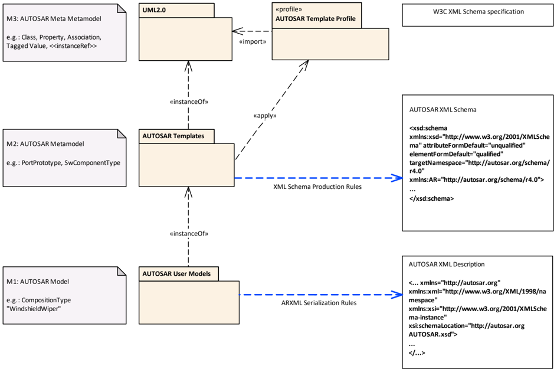

本文档的结构如下：

- 第 [1](#1-引言) 章（本章）在 AUTOSAR 元模型与 XML 语言的整体上下文中描述 XML 模式生成规则。
- 第 [2](#2-xml-模式设计原则xml-schema-design-principles) 章描述 XML 模式设计原则。首先给出关于关联、属性、引用与属性的 UML2.0 语义的一些说明，随后讨论基本原则，包括 XML 元素名称、传输不完整数据、链接等方面。
- 第 [3](#3-xml-模式生成的配置configuration-of-xml-schema-production) 章描述如何通过标记值（**tagged value**）对 XML 模式生成规则进行参数化。此外还给出了将 AUTOSAR 元模型映射到 AUTOSAR XML 模式的默认配置。
- 第 [4](#4-xml-模式生成规则xml-schema-production-rules) 章更详细地描述 XML 模式生成规则。规则之间的关系以图形方式说明。

注意：本文档包含用于说明 XML 模式生成规则的示例。一些示例取自 AUTOSAR 元模型，并为了更好的可读性进行了简化。因此，这些示例可能与 AUTOSAR 元模型的最新版本不同步。

## 2. XML 模式设计原则（XML Schema design principles）

本章首先描述关于 XML 模式以及 AUTOSAR 元模型的 UML2.0 语义的一些说明，然后简要描述一些基本原则，包括 XML 名称、XML 元素顺序与链接的简短描述。

### 2.1. AUTOSAR 元模型的 UML2.0 语义说明（Notes on UML2.0 semantics of the AUTOSAR meta-model）

在 UML2.0 [\[5\]](#ref-5) 中，属性与可导航的关联端表示为属性（**property**）。由于 AUTOSAR 模板构造型只支持具有两个关联端的关联，因此对于 XML 模式生成规则而言，属性与关联可以视为等价。因此，XML 模式生成规则可以专注于类与属性。

以下四节提供关于这些概念的 UML2.0 语义的更多信息。每章包含一张图，该图以 UML 图形表示法显示该概念（图的上半部分），以及它如何表示为 UML2.0 元模型的实例（图的下半部分）。

请注意，在 UML2.0 中，组合（**composition**）与引用（**reference**）都通过关联来描述。唯一的区别是关联端的"aggregation"属性的取值。关于 UML2.0 语义的更详细描述，请参见 UML2.0 superstructure 规范 [\[5\]](#ref-5)。

在以下各节中，可导航关联端的"aggregation"属性取值显示在关联后面的括号中。

在以下各节中，术语"属性（**Property**）"始终指类的原始属性（**primitive attribute**），或者是作为引用（aggregation = none）或组合（aggregation = composite）的关联的目标端。

#### 2.1.1. 关联的表示（aggregation = composite）（Representation of association (aggregation = composite)）

图 2.1 描述了组合关联如何通过 UML2.0 元模型的实例来表示。关联端'theC'可以从类 A 导航，并表示为由类'A'拥有的属性。不可导航的关联端由关联本身拥有。

由匿名关联与不可导航属性表示的信息与 XML 模式生成规则无关：从生成规则的角度看，组合关联与属性没有区别（另见下一节）。

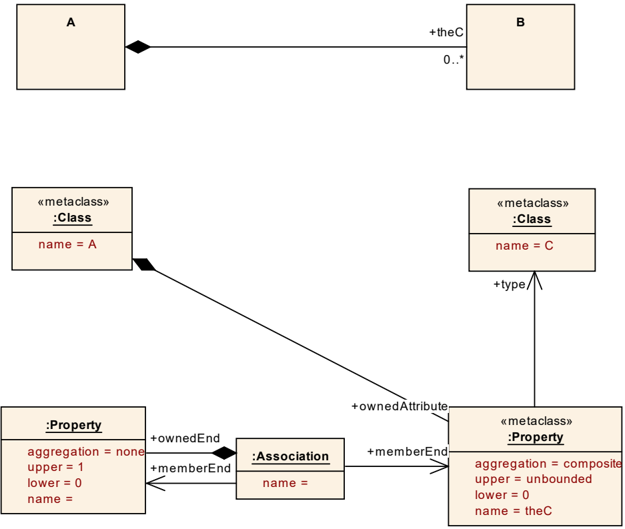

#### 2.1.2. 属性的表示（aggregation = composite）（Representation of attribute (aggregation = composite)）

图 2.2 描述了属性如何通过 UML2.0 元模型的实例来表示。属性'theC'表示为由类'A'拥有的属性。

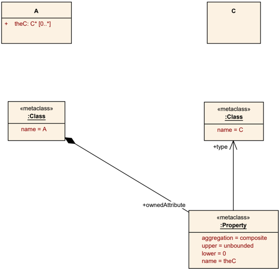

#### 2.1.3. 关联的表示（aggregation = none）（Representation of associations (aggregation = none)）

图 2.3 描述了引用（aggregation = none 的关联）如何通过 UML2.0 元模型的实例来表示。关联端'theB'可以从类 D 导航，并表示为由类'D'拥有的属性。

由匿名关联与不可导航属性表示的信息与 XML 模式生成规则无关。从生成规则的角度看，引用与 aggregation=none 的属性没有区别（另见下一节）。但是，AUTOSAR 元模型允许为引用应用构造型。特殊的语义按 [3.2.3](#323-引用的映射配置mapping-configuration-for-references) 小节所述单独处理。

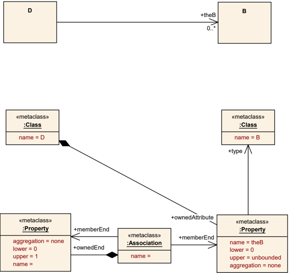

#### 2.1.4. 属性的表示（aggregation = none）（Representation of attributes (aggregation = none)）

图 2.4 描述了 aggregation = none 的属性如何通过 UML2.0 元模型的实例来表示。属性'theB'表示为由类'D'拥有的属性。

注意：

- 具有'aggregation = none'的属性在 UML2.0 图形表示中由一个"*"表示（属性：theB: B*[0..*]）。
- 按照 AUTOSAR 模板构造型，只允许 aggregation=composite 的属性。然而，XML 模式生成规则也涵盖这些属性，因为它们不增加复杂性：对于 XML 模式生成规则而言，aggregation=none 的属性（本节所述）等价于 aggregation=none 的关联（[2.1.3](#213-关联的表示aggregation-nonerepresentation-of-associations-aggregation-none) 小节所述）。

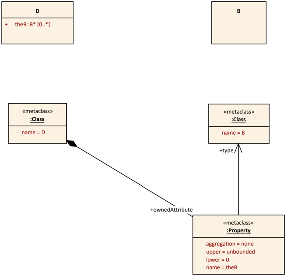

### 2.2. W3C XML 模式使用的说明（Notes on use of W3C XML schema）

W3C XML 模式提供了使校验型 XML 解析器能够校验 XML 描述的语法与部分语义的手段。

XML 校验可以确定例如：

- 所需的 XML 元素是否存在，
- 是否使用了不允许的附加 XML 属性或 XML 元素，
- 或某些取值是否匹配给定的正则表达式。

尽管可以进行一些检查，但不可能仅依赖 XML 校验来验证所表示的模型是否满足模型的全部语义约束。

**规范项：W3C XML 模式版本 1.0**：AUTOSAR XML 模式符合 W3C XML 模式版本 1.0（见 [\[1\]](#ref-1)）。

本文档描述的生成规则确保对于 AUTOSAR 元模型中表示的每个类、属性与关联，在 AUTOSAR XML 模式中都存在一个表示。此外，它们确保 AUTOSAR 元模型与 AUTOSAR 模式之间的映射是无歧义的。

换句话说：

- AUTOSAR 元模型的一个实例无歧义地映射到一个 AUTOSAR XML 描述，并且
- 一个相对于 AUTOSAR XML 模式有效的 AUTOSAR XML 描述无歧义地映射到一个 AUTOSAR 元模型的实例。

这也适用于不完整的 XML 描述。

例如：XML 元素 ATOMIC-SOFTWARE-COMPONENT-TYPE 始终表示由类 AtomicSoftwareComponentType 所描述的内容。

### 2.3. 继承的处理（Handling Inheritance）

**规范项：AUTOSAR XML 模式中的继承**：AUTOSAR 元模型中的继承通过以下机制映射到 XML 模式：

- 对于 AUTOSAR 元模型中的每个类，创建一些组（**group**），它们包含表示由该类直接定义的属性的 XML 元素与 XML 属性。对于其属性均不具有 xml.attribute=false 的类，将产生空的组。
- 此外，创建一个表示该具体类的完整内容的 xsd:complexType。该 xsd:complexType 的结构通过引用定义该类自身属性的组，以及定义其超类属性的 xsd:group 来定义。表示最一般类（继承树的根）的组最先被引用，表示该类自身的组最后被引用。

该概念允许在 XML 层级使用多态：最一般的属性总是可以在 XML 元素的开头找到，更具体的属性被附加在描述的末尾。

此外，由一个类直接定义的属性被分组在一起。（关于 XML 元素与组的顺序的更多细节见 [2.7](#27-xml-元素的顺序order-of-xml-elements) 节。）

### 2.4. 通用方法（Generic Approach）

AUTOSAR XML 模式生成规则超出了 XMI 等同类方法的配置可能性。这使得能够通用地重现各种既有的 XML 格式，例如 MSR-SW [\[8\]](#ref-8) 与 XHTML [\[9\]](#ref-9)。

### 2.5. XML 元素与属性（XML element versus attribute）

按照 MSR-TR-CAP，生成规则将所有与内容相关的信息映射到 XML 元素。这一默认规则可以通过为相应的属性指派标记值'xml.attribute=true'来覆盖。如果'xml.attribute=true'，则该属性被翻译为一个 XML 属性。（关于该标记值的更多细节见 3.1.2.1。）

### 2.6. XML 名称（XML names）

**规范项：XML 名称**：AUTOSAR XML 模式中使用的所有 XML 元素、XML 属性、XML 组与 XML 类型都以大写字母书写。为了提高 XML 名称的可读性，在 XML 名称中插入连字符，将名称的各部分分开。

本文档将通过本节所述方式翻译的名称称为 XML 名称（**XML-name**）。

UML 名称中不得使用非字母数字字符。

形式上，以下算法描述了从 UML 名称到 XML 名称的翻译：

1. 从 UML 名称中移除所有非字母数字字符。如果存在此类字符，则报告错误。
2. 从左到右将 UML 名称切分为记号（**token**）。每当遇到大写字母或数字时，开始一个新记号。

   TestECUClass12ADC -> [Test, E, C, U, Class, 1, 2, A, D, C]

3. 从最后一个元素开始遍历该列表，将相邻的单个大写字母合并，并将相邻的数字合并。

   例如：

   [Test, E, C, U, Class, 1, 2, A, D, C] ->

   [Test, E, C, U, Class, 1, 2, A, DC] ->

   [Test, E, C, U, Class, 1, 2, ADC] ->

   [Test, E, C, U, Class, 1, 2, ADC] ->

   [Test, E, C, U, Class, 12, ADC] ->

   [Test, E, CU, Class, 12, ADC] ->

   [Test, ECU, Class, 12, ADC]

4. 将所有记号转换为大写：

   例如：[TEST, ECU, CLASS, 12, ADC]

5. 使用连字符连接各记号：

   例如：TEST-ECU-CLASS-12-ADC

如果默认映射不合适，可以通过为相应的 UML 模型元素指定标记值'xml.name'来显式定义 XML 名称。在这种情况下，xml.name 的取值不得为空，只能使用字母数字字符与连字符作为 xml.name 的取值，并且该取值的第一个与最后一个字符必须是字母数字字符。

**规范项：XML 名称复数**：复数 XML 名称通过在单数 XML 名称后附加"S"创建。

如果该规则不合适，则可以通过为相应的 UML 模型元素指定标记值'xml.namePlural'来显式定义复数 XML 名称。

**示例：元素、类型、组与属性的 XML 名称**

下表展示了一些从元模型名称到 XML 模式中使用的名称的翻译示例：

表2.1：AUTOSAR 元模型名称到 XML 名称的映射示例（**Examples for mapping of AUTOSAR meta-model names to XML names**）

| AUTOSAR 元模型中的名称 | XML 名称 |
|---|---|
| SystemConstraintTemplate | SYSTEM-CONSTRAINT-TEMPLATE |
| ECUResourceTemplate | ECU-RESOURCE-TEMPLATE |
| HardwarePowerMode | HARDWARE-POWER-MODE |
| Min | MIN |
| TestECUClass12ADC | TEST-ECU-CLASS-12-ADC |
| Uuid | UUID |
| testECU | TEST-ECU |
| MlData1 | ML-DATA-1 |

### 2.7. XML 元素的顺序（Order of XML-elements）

为了降低读取 AUTOSAR XML 描述的工具的复杂性并提高其性能，定义了可预测的 XML 元素顺序。此外，XML 元素的顺序还提高了 XML 描述的人类可读性。

#### 2.7.1. XML 元素的顺序（Order of xml elements）

**规范项：XML 元素的顺序**：AUTOSAR 元模型中类所拥有的属性被映射为 XML 元素。默认情况下，AUTOSAR XML 模式在 XML 元素上定义了遵循字母顺序的特定序列<sup>1</sup>。

> 1 字母顺序适用于 XML 名称。

这一默认规则可以通过使用标记值'xml.sequenceOffset'覆盖。该取值可以是 -999 到 999 之间的所有整数。xml.sequenceOffset 的默认值为 0。

如果 offsetA 是元素 A 的偏移量，offsetB 是元素 B 的偏移量，则：

```
offsetA < offsetB ⇒ elementA is listed before elementB
```

具有相同偏移量的元素按字母顺序排序。

#### 2.7.2. 派生的 uml:properties 的 XML 元素顺序（Order of xml elements of derived uml:properties）

[2.7.1](#271-xml-元素的顺序order-of-xml-elements) 章描述了不考虑继承时的 XML 元素顺序。在存在继承的情况下，不仅需要考虑由类直接定义的属性生成的 XML 元素，还需要考虑由超类定义的 XML 元素。

**规范项：带继承时 XML 元素的顺序**：表示某个类直接拥有的 XML 元素的那些 XML 元素被分组在一起，并按 [TPS_XMLSPR_00032] 所述排序。各组 XML 元素按下方伪代码所述排序：

```c
// global variables
int index = 1;
Hashtable sequenceIndexTable = new Hashtable();

// method setSequenceIndex is invoked recursively
void setSequenceIndex(Class class) {
  List directBaseClasses = getDirectBaseClasses(class);
  // if class has baseclasses
  If ( !directBaseClasses.isEmpty() ) {
    // split up set of baseclasses into two groups
    List classesWithSupertypeIdentifiable =
        getClassesWithSupertypeIdentifiable(directBaseClasses);
    List classesWithoutSupertypeIdentifiable =
        getClassesWithoutSupertypeIdentifiable(directBaseClasses);
    // sort each group as defined above
    sort(classesWithSupertypeIdentifiable);
    sort(classesWithoutSupertypeIdentifiable);
    // for all classes with supertype identifiable do
    for (int i=0; i<classesWithSupertypeIdentifiable ; i++) {
      setSequenceIndex(classesWithSupertypeIdentifiable[i]);
    }
    // for all classes without supertype identifiable do
    for (int i=0; i<classesWithoutSupertypeIdentifiable ; i++) {
      setSequenceIndex(classesWithoutSupertypeIdentifiable[i]);
    }
  } // end if
  // if sequence index is not already set, assign a new one.
  If (sequenceIndexTable.contains(class)) {
    // the sequence is already set. This can result from diamond
    // inheritance
    return;
  } else {
    // the sequence index is not yet set
    sequenceIndexTable.put(class, index);
    index++;
  }
}
```

图 2.5 展示了 XML 模式内 XML 元素顺序的一个示例。类 Identifiable 旁边的数字表示直接拥有的属性的 sequenceOffset。注释表示各组 XML 元素的顺序。

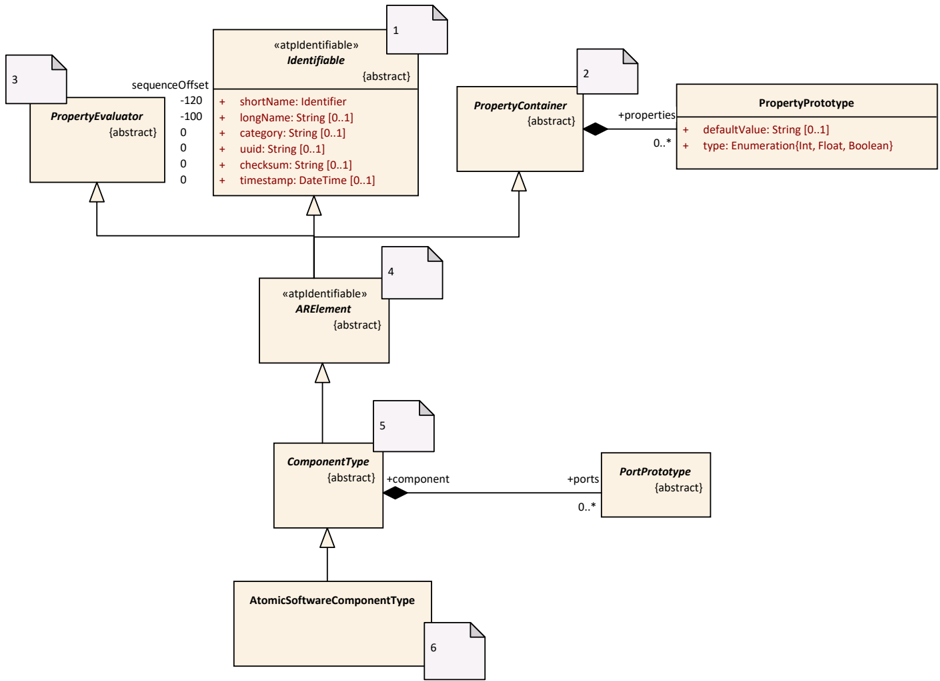

首先，Identifiable 的属性被映射到 XML 模式。之后，PropertyContainer、PropertyEvaluator、ARElement、ComponentType 与 AtomicSoftwareComponentType 的属性被映射。

为所有类创建一个 xsd:group。每个 xsd:group 中的 XML 元素按 [2.7.1](#271-xml-元素的顺序order-of-xml-elements) 节的定义排序（在本例中所有属性都映射为 XML 元素）：

- Identifiable 的 xsd:group：

```xml
<xsd:group name="IDENTIFIABLE">
  <xsd:sequence>
    <xsd:element name="SHORT-NAME" type="AR:IDENTIFIER"/>
    <xsd:element name="LONG-NAME" type="xsd:string" minOccurs="0"/>
    <xsd:element name="CATEGORY" type="xsd:string" minOccurs="0"/>
    <xsd:element name="CHECKSUM" type="xsd:string" minOccurs="0"/>
    <xsd:element name="TIMESTAMP" type="xsd:string" minOccurs="0"/>
    <xsd:element name="UUID" type="xsd:string" minOccurs="0"/>
  </xsd:sequence>
</xsd:group>
```

SHORT-NAME 排在第一位，因为它具有最小的 sequenceOffset（-120）。其后是 LONG-NAME（sequenceOffset=-100）。所有其他属性的 sequenceOffset=0，并按字母顺序排序。

- PropertyContainer 的 xsd:group：

```xml
<xsd:group name="PROPERTY-CONTAINER">
  <xsd:sequence>
    <xsd:element name="PROPERTIES" minOccurs="0" maxOccurs="unbounded">
      ...
    </xsd:element>
  </xsd:sequence>
</xsd:group>
```

- ComponentType 的 xsd:group：

```xml
<xsd:group name="COMPONENT-TYPE">
  <xsd:sequence>
    <xsd:element name="PORTS" minOccurs="0" maxOccurs="unbounded" ...>
    </xsd:element>
  </xsd:sequence>
</xsd:group>
```

按照继承情形下元素顺序的规则，这些 xsd:group 按以下顺序组合：

```xml
<xsd:complexType name="ATOMIC-SOFTWARE-COMPONENT-TYPE" abstract="false" mixed="false">
  <xsd:sequence>
    <xsd:group ref="AR:IDENTIFIABLE"/>
    <xsd:group ref="AR:PROPERTY-CONTAINER"/>
    <xsd:group ref="AR:PROPERTY-EVALUATOR"/>
    <xsd:group ref="AR:AR-ELEMENT"/>
    <xsd:group ref="AR:COMPONENT-TYPE"/>
    <xsd:group ref="AR:ATOMIC-SOFTWARE-COMPONENT-TYPE"/>
  </xsd:sequence>
</xsd:complexType>
```

### 2.8. 链接（Linking）

**规范项：元类引用的 XML 表示**：元类之间的引用由后缀为 &lt;...-REF&gt; 或 &lt;...-TREF&gt; 的 XML 元素表示。

关于 XML 描述中关联表示的更多细节，请参见通用结构模板 [\[10\]](#ref-10)。

### 2.9. 传输不完整的数据（Transmitting incomplete Data）

**规范项：可选的 XML 元素**：为了允许交换不完整的 AUTOSAR 描述，默认情况下所有 XML 元素都是可选的。

这一默认规则可以通过用标记值'xml.enforceMinimumMultiplicity=true'标记元模型元素来覆盖。在这种情况下，多重性的下值将用作 AUTOSAR XML 模式中 XML 元素的最小出现次数。

### 2.10. 在 XML 描述中标识 XML 模式版本（Identification of XML schema version in XML descriptions）

**规范项：XML 模式版本**：AUTOSAR 发布的版本被编码到 AUTOSAR XML 模式的命名空间中。命名空间的格式由 http://autosar.org/schema/r&lt;major&gt;.&lt;minor&gt; 定义。

这允许并行使用不同版本的 AUTOSAR XML 模式与 AUTOSAR XML 描述。例如，与 AUTOSAR 发布 4.0 一起发布的 AUTOSAR XML 模式的命名空间是 http://autosar.org/schema/r4.0。

## 3. XML 模式生成的配置（Configuration of XML schema production）

为了降低映射规则的复杂性，并提高元模型类及其属性与关联同 XML 元素之间映射的透明度，映射规则不直接作用于 AUTOSAR 元模型。而是分两步翻译：

- 第 1 步：配置 XML 模式生成。

  在第一步中，AUTOSAR 元模型被翻译为一个简化的中间模型<sup>1</sup>。AUTOSAR 元模型中与内容相关的信息被映射到类、属性、枚举、原始数据类型与标记值。除非另有说明，缺失的标记值被设置为 [3.1.1](#311-概述overview) 节及以下所述的默认值。一些更复杂的映射在第 [3.2](#32-xml-模式生成的默认配置default-configuration-of-xml-schema-production) 章中描述。

- 第 2 步：模式生成。

  模式生成规则以该中间模型为输入。规则由第 1 步中定义的标记值参数化。关于模式生成规则的更多细节见第 [4](#4-xml-模式生成规则xml-schema-production-rules) 章。

> 1 该中间模型只使用 EMOF [\[11\]](#ref-11) 中可用的概念。

### 3.1. 裁剪模式生成（Tailoring schema production）

#### 3.1.1. 概述（Overview）

**规范项：裁剪 XML 模式生成**：

表3.1：用于裁剪映射规则的标记值（Tagged values that can be used for tailoring the mapping rules）

| 标记名称 | 取值类型 | 默认值 | 适用于 | 说明 |
|---|---|---|---|---|
| extensionPoint | Boolean | False | 类 | 如果设为 true，则该类按照它具有子类的方式进行映射。这允许以后添加子类而不失去与较旧 XML 描述的兼容性。 |
| xml.attribute | Boolean | False | 属性：仅属性 | 如果为 true，则将该属性序列化为一个 XML 属性。默认情况下，所有属性都映射为 XML 元素。 |
| xml.attributeRef | Boolean | False | 属性 | 如果为 true，则将该属性序列化为一个 XML 属性引用（例如 &lt;xsd:attribute ref="xml:space"&gt;）。命名空间取自 xml.nsPrefix 的取值，xml.name 的取值必须是该命名空间中的有效名称。 |
| xml.enforceMaxMultiplicity | Boolean | True | 属性 | 如果为 true，则强制最大多重性；否则为"unbounded"。默认情况下 xml.enforceMaxMultiplicity 为 true。 |
| xml.enforceMinMultiplicity | Boolean | False | 属性 | 如果为 true，则强制最小多重性；否则为"0"。为了允许传输部分信息，默认情况下不强制最小多重性。 |
| xml.globalElement | Boolean | False | 类 | 如果为 true，则为被标记的类创建一个全局 xsd:element。该 xsd:element 可以用作模式实例的根元素。该标记需要在 AUTOSAR 元模型中显式定义。通常只有元类 AUTOSAR 由一个全局定义的 XML 元素表示。 |
| xml.mds.type | 字符串 | 空 | 具有«primitive»构型的类 | 该标记标识表示元模型中原始数据类型的 xsd:simpleType 或 xsd:complexType。与'xml.xsd.customType'标记不同，该标记值指示一个在模式生成器内预定义的模式片段。因此，以'xml.mds.type'标记的类型不会基于模型中被标记的类生成到模式中。因此，使用该标记需要了解模式生成过程；必须确保只有生成过程中创建的类型才被该标记引用。 |
| xml.name | 字符串 | 见"说明"列 | 属性、类 | 提供表示该角色或类的模式片段（元素、属性、组等）的名称。如果未在 AUTOSAR 元模型中显式定义，则按 [TPS_XMLSPR_00030] 所述计算该值。 |
| xml.namePlural | 字符串 | 见"说明"列 | 属性、类 | 提供表示该角色或类的模式片段（元素、属性、组等）的复数名称。如果未在 AUTOSAR 元模型中显式定义，则按 [TPS_XMLSPR_00031] 所述计算该值。 |
| xml.nsPrefix | 字符串 | AR | 包、类、属性 | 默认情况下，所有 XML 元素都被指派命名空间前缀"AR"。如果该命名空间前缀应用于一个包，则它隐式应用于所有未定义自己命名空间的所属类与包。 |
| xml.nsURI | 字符串 | http://autosar.org/schema/r&lt;major&gt;.&lt;minor&gt; | 包、类 | 默认情况下，所有 XML 元素都被指派命名空间 http://autosar.org/schema/r&lt;major&gt;.&lt;minor&gt;。如果该命名空间应用于一个包，则它隐式应用于所有未定义自己命名空间的所属类与包。 |
| xml.ordered | Boolean | True | 类 | 如果为 true，则表示类的属性的 XML 元素的顺序按固定顺序定义。如果为 false，则表示类的属性的 XML 元素的顺序按任意顺序定义。此外，所有 XML 元素都可以出现多次。请注意，标记值'xml.ordered'适用于该类的完整 XML 表示：所有 XML 元素都被排序，无论它们是否被继承。 |
| xml.roleElement | Boolean | 见"说明"列 | 属性 | 如果设为 true，则角色的 xml.name 显示为一个 XML 元素。如果未在 AUTOSAR 元模型中显式定义，则应用 [TPS_XMLSPR_00056] 所述的默认规则。 |
| xml.roleWrapperElement | Boolean | 见"说明"列 | 属性 | 如果设为 true，则角色的 xml.namePlural 显示为一个 XML 元素。该 XML 元素通常用于将多个角色元素或类型元素分组。如果未在 AUTOSAR 元模型中显式定义，则应用 [TPS_XMLSPR_00056] 所述的默认规则。 |
| xml.sequenceOffset | 整数 | 0 | 属性、泛化 | sequenceOffset 用于定义表示拥有的与派生的属性的 XML 元素的顺序。sequenceOffset 的范围从 -999 到 999。具有最小 sequenceOffset 的元素最先创建。具有相同 sequenceOffset 的元素按字母顺序排序。如果未在 AUTOSAR 元模型中显式定义，则 xml.sequenceOffset 被设置为 0。 |
| xml.text | Boolean | False | 类 | 如果为 true，则在表示属性的 XML 元素之间允许出现文本。默认情况下，属性之间不允许出现文本。请注意，标记值'xml.text'适用于该类的完整 XML 表示：可以在所有 XML 元素之间书写文本，无论它们是否被继承。 |
| xml.typeElement | Boolean | 见"说明"列 | 属性 | 如果设为 true，则类型的 xml.name 显示为一个 XML 元素。如果未在 AUTOSAR 元模型中显式定义，则应用 [TPS_XMLSPR_00056] 所述的默认规则。 |
| xml.typeWrapperElement | Boolean | false，另见"说明"列 | 属性 | 如果设为 true，则类型的 xml.namePlural 显示为一个 XML 元素。该类型包装器包装同一类型的多次出现。如果未在 AUTOSAR 元模型中显式定义，则应用 [TPS_XMLSPR_00056] 所述的默认规则。 |
| xml.xsd.customType | 字符串 | 空 | 具有«primitive»构型的类 | 该标记适用于«primitive»。它规定表示该原始类型的 xsd:simpleType 的名称。 |
| xml.xsd.maxLength | 整数 | 空 | 具有«primitive»构型的类 | 基于字符串类型定义自定义原始类型时的长度限制。xml.xsd.type 必须为 string。 |
| xml.xsd.pattern | 字符串 | 空 | 具有«primitive»构型的类 | 正则表达式，用作基于字符串类型定义自定义原始类型时的限制。xml.xsd.type 必须为 string。 |
| xml.xsd.type | 字符串 | 空 | 具有«primitive»构型的类 | 该标记标识表示元模型中原始数据类型的 xsd:simpleType。该取值指一个 W3C XML 模式数据类型。该标记值的取值不应包含 W3C 模式的命名空间。例如：请使用'string'而不是'xsd:string'。 |
| xml.xsd.whitespace | 字符串 | 空 | 具有«primitive»构型的类 | 标志，指示是否需要保留原始类型取值中的空白。有效取值为 {preserve, default}。 |

#### 3.1.2. 标记上的约束（Constraints on tags）

某些标记不允许与其他标记组合使用。这些约束列在接下来的两个子章中。

表3.2：可应用于«primitive»的标记（Tagged values that can be used for primitive types）

（见 [3.1.1](#311-概述overview) 表中 xml.xsd.* 各行——源文档将其作为 [3.1.1](#311-概述overview) 表格的延续部分排版。）

##### 3.1.2.1. 应用于属性的标记上的约束（Constraints on tags applied to properties）

**规范项：应用于属性的标记上的约束**：

| 应用于属性的标记上的约束 | xml.name | xml.namePlural | xml.roleElement | xml.roleWrapperElement | xml.typeElement | xml.typeWrapperElement | xml.attribute | xml.enforceMaxMultiplicity | xml.enforceMinMultiplicity | xml.sequenceOffset |
|---|---|---|---|---|---|---|---|---|---|---|
| xml.name | / |  |  |  |  |  |  |  |  |  |
| xml.namePlural |  | / |  |  |  |  |  |  |  |  |
| xml.roleElement |  |  | / |  |  |  | o |  |  |  |
| xml.roleWrapperElement |  |  |  | / |  |  | o |  |  |  |
| xml.typeElement |  |  |  |  | / |  | o |  |  |  |
| xml.typeWrapperElement |  |  |  |  |  | / | o |  |  |  |
| xml.attribute |  |  | o | o | o | o | / | o |  | o |
| xml.enforceMaxMultiplicity |  |  |  |  |  |  | o | / |  |  |
| xml.enforceMinMultiplicity |  |  |  |  |  |  |  |  | / |  |
| xml.sequenceOffset |  |  |  |  |  |  | o |  |  | / |

如果标记值'xml.attribute'被设为 true，则为相应属性创建一个 XML 属性。该 XML 属性的名称由标记值'xml.name'定义。如果属性多重性的下值大于 0 且'xml.enforceMinMultiplicity'被设为 true，则 XML 属性的'use'被设为'required'。如果标记值'xml.attribute'被设为 true，则标记值'xml.roleElement'、'xml.roleWrapperElement'、'xml.typeElement'、'xml.typeWrapperElement'、'xml.enforceMaxMultiplicity'与'xml.sequenceOffset'被忽略。

请注意，只有当属性的上多重性为 1 且属性的类型是枚举或原始数据类型时，才允许标记值'xml.attribute'。

##### 3.1.2.2. 应用于类的标记上的约束（Constraints on tags applied to classes）

**规范项：应用于类的标记上的约束**：

| 应用于类的标记上的约束 | xml.name | xml.namePlural | xml.ordered | xml.text | xml.globalElement | xml.xsd.type | xml.mds.type |
|---|---|---|---|---|---|---|---|
| xml.name | / |  |  |  |  | o | o |
| xml.namePlural |  | / |  |  |  | o | o |
| xml.ordered |  |  | / |  |  | o | o |
| xml.text |  |  |  | / |  | o | o |
| xml.globalElement |  |  |  |  | / | o | o |
| xml.xsd.type | o | o | o | o | o | / | o |
| xml.mds.type | o | o | o | o | o | o | / |

标记值'xml.xsd.type'与'xml.mds.type'用于规定一个预定义的数据类型，该数据类型定义在 W3C XML 模式规范或通用结构模板 [\[10\]](#ref-10) 中。如果应用了这些标记值，则所有其他标记值都被忽略。

##### 3.1.2.3. xml.*Element 标记取值上的约束（Constraints on values of xml.*Element tagged values）

下表描绘了 xml.*Element 标记的哪些取值组合是允许的。"用法"列定义一个组合是首选、备选、"需谨慎使用"还是不允许。前两个类别总是产生一致、无歧义的 XML 模式。"需谨慎使用"类别描述可能导致无效 XML 模式的映射规则。允许这些映射规则是为了能够支持某些 MSR-TR-CAP 概念。

**规范项：xml.*Element 标记取值上的约束**：

| xml.roleWrapperElement | xml.roleElement | xml.typeWrapperElement | xml.typeElement | 说明 | 用法（P=首选，A=备选，H=需谨慎使用，N=不允许） | 在标准中使用 |
|---|---|---|---|---|---|---|
| 0 | 0 | 0 | 0 | 需谨慎使用：产生的模式将导致无歧义的 XML 模式 | H | MSR |
| 0 | 0 | 0 | 1 | 需谨慎使用：缺少角色信息——如果两个角色具有相同类型，可能导致无歧义的 XML 模式 | H | MSR |
| 0 | 0 | 1 | 0 | 不允许：typeWrapperElement 没有 typeElement | N |  |
| 0 | 0 | 1 | 1 | 需谨慎使用：缺少角色信息——如果两个角色具有相同类型，可能导致无歧义的描述 | H | MSR |
| 0 | 1 | 0 | 0 | 对于无继承且上多重性 = 1 的属性为首选；与继承一起使用时需谨慎 | P | XMI2.0、XMI2.1、MSR |
| 0 | 1 | 0 | 1 | 对于有继承且上多重性 = 1 的属性为首选。 | P | XMI1.2 |
| 0 | 1 | 1 | 0 | 不允许：typeWrapperElement 没有 typeElement | N |  |
| 0 | 1 | 1 | 1 | 如果 typeElements 需要被 typeWrapperElements 包装，则它是 0101 的备选方案。 | A | MSR |
| 1 | 0 | 0 | 0 | 需谨慎使用：缺少类型元素与角色信息——与上多重性 > 1 和/或继承一起使用时可能导致无歧义的描述。它是多态的一种捷径，适用于非常特定的用例。 | H |  |
| 1 | 0 | 0 | 1 | 对于上多重性 > 1 的属性为首选 | P | MSR |
| 1 | 0 | 1 | 0 | 不允许：typeWrapperElement 没有 typeElement | N |  |
| 1 | 0 | 1 | 1 | 如果 typeElements 需要被 typeWrapperElements 包装，则它是 (1001) 的备选映射。 | A | MSR |
| 1 | 1 | 0 | 0 | 对于无继承且上多重性 > 1 的属性为备选；与继承一起使用时需谨慎 | A | MSR |
| 1 | 1 | 0 | 1 | 对于有继承且上多重性 > 1 的属性（1001）的备选方案 | A | MSR |
| 1 | 1 | 1 | 0 | 不允许：typeWrapperElement 没有 typeElement | N |  |
| 1 | 1 | 1 | 1 | (1001) 的备选方案 | A | MSR |

### 3.2. XML 模式生成的默认配置（Default configuration of XML schema production）

本章描述为了将 AUTOSAR 元模型映射到 AUTOSAR XML 模式，XML 模式生成规则是如何配置的。已在 AUTOSAR 元模型中定义的标记值不会被覆盖：本章定义的配置规则添加缺失的标记值。如果产生的标记值组合无效，则需要指示错误。该错误需要通过编辑 AUTOSAR 元模型中的标记值来解决。

#### 3.2.1. 多重性的配置（Configuration of multiplicities）

**规范项：多重性的 XML 配置**：如果未在 AUTOSAR 元模型中显式定义，标记值'xml.enforceMinMultiplicity'与'xml.enforceMaxMultiplicity'被设置为默认值（见 [TPS_XMLSPR_00036]）。此外，所有属性的多重性按照以下规则更新：

- 如果'xml.enforceMinMultiplicity = false'，则将属性的"下多重性"设置为 0。
- 如果'xml.enforceMinMultiplicity = true'，则属性的"下多重性"不变。
- 如果'xml.enforceMaxMultiplicity = false'，则将属性的"上多重性"设置为 unbounded。
- 如果'xml.enforceMaxMultiplicity = true'，则属性的"上多重性"不变。

#### 3.2.2. 属性的映射配置（Mapping configuration for properties）

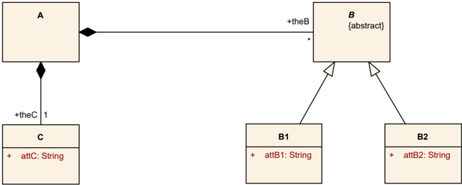

在配置 AUTOSAR 元模型中属性的映射时，区分五种情形：

1. **规范项：属性的 XML 配置（上多重性 1，无子类）**：属性的上多重性 = 1 且属性的类型没有子类：

   - xml.roleWrapperElement = false。注意：属性的上多重性 = 1，不需要包装器。
   - xml.roleElement = true
   - xml.typeWrapperElement = false。注意：属性的上多重性 = 1，不需要包装器。
   - xml.typeElement = false。注意：roleElement 为 true，不需要类型信息——每个角色只出现一次，且映射是无歧义的。

2. **规范项：属性的 XML 配置（上多重性大于 1，无子类）**：属性的上多重性 > 1 且属性的类型没有子类：

   - xml.roleWrapperElement = true。注意：属性的上多重性 > 1，按照 MSR-TR-CAP 需要包装器。
   - xml.roleElement = false。注意：属性可以由 roleWrapperElement 确定，不需要额外的 roleElement。
   - xml.typeWrapperElement = false。注意：roleWrapperElement 为 true，不需要额外的包装器。
   - xml.typeElement = true。注意：每个出现多于一次的类型的内容模型需要被封装在一个 XML 元素中。可以选择 roleElement 或 typeElement。我们选择了 typeElement，因为产生的模式允许向属性的类型添加子类（另见情形 4）。

3. **规范项：属性的 XML 配置（上多重性 1，有子类）**：属性的上多重性 = 1 且属性的类型具有子类：

   - xml.roleWrapperElement = false。注意：属性的上多重性 = 1，不需要包装器。
   - xml.roleElement = true
   - xml.typeWrapperElement = false。注意：属性的上多重性 = 1，不需要包装器。
   - xml.typeElement = true

   注意：如果不给出类型信息，并不总是能够将 XML 描述中的元素无歧义地映射到元模型的实例。

4. **规范项：属性的 XML 配置（上多重性大于 1，有子类）**：属性的上多重性 > 1 且属性的类型具有子类：

   - xml.roleWrapperElement = true。注意：属性的上多重性 > 1，按照 MSR-TR-CAP 需要包装器。
   - xml.roleElement = false。注意：属性可以由 roleWrapperElement 确定，不需要额外的 roleElement。
   - xml.typeWrapperElement = false。注意：roleWrapperElement 为 true，不需要额外的包装器。
   - xml.typeElement = true。注意：如果不给出类型信息，并不总是能够将 XML 描述中的元素无歧义地映射到元模型的实例。

5. **规范项：属性的默认 XML 配置**：

   | AUTOSAR 适用 | 上多重性 | 目标是抽象类 | 属性种类 | xml.RoleWrapperElement | xml.roleElement | xml.typeElement | 包装器名称（通常为 xml.namePlural） | 内部名称（通常为 xml.name） | 备注 |
   |---|---|---|---|---|---|---|---|---|---|
   | 是 | =1 | 否 | 组合（**Composition**） | 0 | 1 | 0 |  | {role} |  |
   | 是 | =1 | 否 | 引用（**Reference**） | 0 | 1 | 0 |  | {role}Ref | 子类化表示在 dest 中 |
   | 是 | =1 | 否 | 实例引用（**InstanceRef**） | 0 | 1 | 0 |  | {role}Iref | 子类化表示在 atpTarget 的 dest 中 |
   | 是 | =1 | 否 | IsOfType | 0 | 1 | 0 |  | {role}Tref | 子类化表示在 dest 中 |
   | 否 | =1 | 否 | 属性（**Attribute**） | 0 | 1 | 0 |  | {role} |  |
   | 是 | >1 | 否 | 组合 | 1 | 0 | 1 | {role}s | {type} |  |
   | 是 | >1 | 否 | 引用 | 1 | 1 | 0 | {role}Refs | {role}Ref |  |
   | 是 | >1 | 否 | 实例引用 | 1 | 1 | 0 | {role}Irefs | {role}Iref |  |
   | 否 | >1 | 否 | IsOfType | 1 | 1 | 0 | {role}Trefs | {role}Tref |  |
   | 是 | >1 | 否 | 属性 | 1 | 1 | 0 | {role}s | {role} |  |
   | 是 | >1 | 是 | 组合 | 1 | 0 | 1 | {role}s | {type} |  |
   | 是 | >1 | 是 | 引用 | 1 | 1 | 0 | {role}Refs | {role}Ref | 子类化表示在 dest 中 |
   | 是 | >1 | 是 | 实例引用 | 1 | 1 | 0 | {role}Irefs | {role}Iref | 子类化表示在 atpTarget 的 dest 中 |
   | 否 | >1 | 是 | IsOfType | 1 | 1 | 0 | {role}Trefs | {role}Tref | 子类化表示在 dest 中 |
   | 否 | >1 | 是 | 属性 | 1 | 1 | 0 | {role}s | {role} |  |

#### 3.2.3. 引用的映射配置（Mapping configuration for references）

除了上一节定义的配置之外，以下配置应用于引用（aggregation = none 的关联）。

##### 3.2.3.1. 不带构型的引用（References without stereotypes）

**规范项：不带构型的引用的 XML 配置**：对于引用，我们基本区分以下两种情形：

1. 引用的上多重性 = 1
   - Xml.RoleWrapperElement = false
   - xml.roleElement = true
   - xml.typeWrapperElement = false
   - xml.typeElement = false
2. 引用的上多重性 > 1
   - Xml.RoleWrapperElement = true
   - xml.roleElement = true
   - xml.typeWrapperElement = false
   - xml.typeElement = false

此外，表示引用的可导航关联端的属性的'xml.name'被设置为默认'xml.name'并附加"-REF"（默认'xml.name'在 [TPS_XMLSPR_00030] 中定义）。'xml.namePlural'被设置为默认'xml.name'并附加"-REFS"。

##### 3.2.3.2. 实例引用（Instance references）

AUTOSAR 模板 UML 构型要求实例引用的所有细节都在 AUTOSAR 元模型中正确建模。

**规范项：实例引用的 XML 配置**：应用以下标记值：

- 实例引用的源与包含到上下文及目标的引用的元类之间的组合引用：
  - xml.name = 附加'-IREF'后缀的 xml-name
  - xml.namePlural = 附加'-IREFS'后缀的 xml-name
  - xml.roleElement = true
  - xml.typeWrapperElement = false
  - xml.typeElement = false
- instanceRef 元类：
  - xml.name = 附加"-IREF"后缀的 xml-name。此外，为了保证 xml 名称的唯一性，"\_"被替换为"--"。
- 从 instanceRef 元类到目标的引用（对目标的引用是强制的）：
  - xml.enforceMinMultiplicity = false（因此，由于 InstanceRef 应始终指向一个目标，本应设为 true。然而，为了不破坏向后兼容性，它必须保持为 false。）
  - xml.enforceMaxMultiplicity = true
  - xml.sequenceOffset = 9999（目标是引用清单中的最后一个元素）
- 从 instanceRef 元类到上下文的引用。对于每个上下文引用：
  - xml.enforceMinMultiplicity = false（对上下文的引用可以在以后添加）
  - xml.enforceMaxMultiplicity = true
  - xml.roleWrapperElement = false
  - xml.roleElement = true
  - xml.typeElement = false
  - xml.typeWrapperElement = false

**示例**

图 3.2 展示了 AUTOSAR 元模型中实例引用的详细表示的示例。

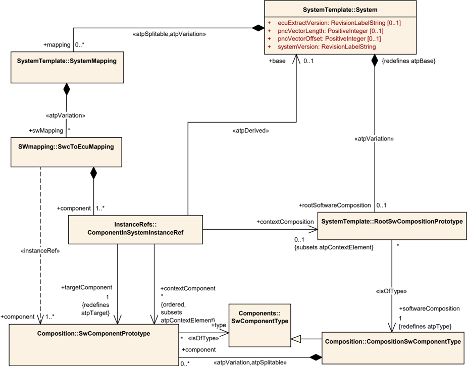

以下 XML 片段展示了该实例引用在 XML 模式中的表示：

```xml
<!-- 类 InstanceRefs::ComponentInCompositionInstanceRef 的复杂类型 -->
<xsd:complexType name="COMPONENT-IN-COMPOSITION-INSTANCE-REF" abstract="false" mixed="false">
  <xsd:annotation>
    <xsd:documentation>
      The ComponentInCompositionInstanceRef points to a concrete
      SwComponentPrototype within a CompositionSwComponentType.
    </xsd:documentation>
    <xsd:appinfo source="tags">
      mmt.qualifiedName="ComponentInCompositionInstanceRef"
    </xsd:appinfo>
    <xsd:appinfo source="stereotypes">atpObject,instanceRef</xsd:appinfo>
  </xsd:annotation>
  <xsd:sequence>
    <xsd:group ref="AR:AR-OBJECT"/>
    <xsd:group ref="AR:ATP-INSTANCE-REF"/>
    <xsd:group ref="AR:COMPONENT-IN-COMPOSITION-INSTANCE-REF"/>
  </xsd:sequence>
  <xsd:attributeGroup ref="AR:AR-OBJECT"/>
</xsd:complexType>

<!-- 类 InstanceRefs::ComponentInSystemInstanceRef 的元素组 -->
<xsd:group name="COMPONENT-IN-SYSTEM-INSTANCE-REF">
  <xsd:annotation>
    <xsd:appinfo source="tags">
      mmt.qualifiedName="ComponentInSystemInstanceRef"
    </xsd:appinfo>
    <xsd:appinfo source="stereotypes">atpObject,instanceRef</xsd:appinfo>
  </xsd:annotation>
  <xsd:sequence>
    <!-- 关联 <<atpDerived>> base 被跳过 -->
    <xsd:element name="CONTEXT-COMPOSITION-REF" minOccurs="0">
      <xsd:annotation>
        <xsd:appinfo source="tags">
          mmt.qualifiedName="ComponentInSystemInstanceRef.contextComposition";
          pureMM.maxOccurs="1";pureMM.minOccurs="0";xml.sequenceOffset="20"
        </xsd:appinfo>
      </xsd:annotation>
      <xsd:complexType>
        <xsd:simpleContent>
          <xsd:extension base="AR:REF">
            <xsd:attribute name="DEST" type="AR:ROOT-SW-COMPOSITION-PROTOTYPE--SUBTYPES-ENUM" use="required"/>
          </xsd:extension>
        </xsd:simpleContent>
      </xsd:complexType>
    </xsd:element>
    <xsd:element name="CONTEXT-COMPONENT-REF" minOccurs="0" maxOccurs="unbounded">
      <xsd:annotation>
        <xsd:appinfo source="tags">
          mmt.qualifiedName="ComponentInSystemInstanceRef.contextComponent";
          pureMM.maxOccurs="-1";pureMM.minOccurs="0";xml.sequenceOffset="30"
        </xsd:appinfo>
      </xsd:annotation>
      <xsd:complexType>
        <xsd:simpleContent>
          <xsd:extension base="AR:REF">
            <xsd:attribute name="DEST" type="AR:SW-COMPONENT-PROTOTYPE-SUBTYPES-ENUM" use="required"/>
          </xsd:extension>
        </xsd:simpleContent>
      </xsd:complexType>
    </xsd:element>
    <xsd:element name="TARGET-COMPONENT-REF" minOccurs="0">
      <xsd:annotation>
        <xsd:appinfo source="tags">
          mmt.qualifiedName="ComponentInSystemInstanceRef.targetComponent";
          pureMM.maxOccurs="1";pureMM.minOccurs="1";xml.sequenceOffset="40"
        </xsd:appinfo>
      </xsd:annotation>
      <xsd:complexType>
        <xsd:simpleContent>
          <xsd:extension base="AR:REF">
            <xsd:attribute name="DEST" type="AR:SW-COMPONENT-PROTOTYPE-SUBTYPES-ENUM" use="required"/>
          </xsd:extension>
        </xsd:simpleContent>
      </xsd:complexType>
    </xsd:element>
  </xsd:sequence>
</xsd:group>
```

一个实例引用的示例类似于：

```xml
<...>
  <COMPONENT-IREFS>
    <COMPONENT-IREF>
      <CONTEXT-COMPOSITION-REF DEST="ROOT-SW-COMPOSITION-PROTOTYPE">/theSystem/aVehicle</CONTEXT-COMPOSITION-REF>
      <CONTEXT-COMPONENT-REF DEST="SW-COMPONENT-PROTOTYPE">/vendor/theEngine</CONTEXT-COMPONENT-REF>
      <TARGET-COMPONENT-REF DEST="SW-COMPONENT-PROTOTYPE">/theEngineVendor/engineSpeedDetermination</TARGET-COMPONENT-REF>
    </COMPONENT-IREF>
  </COMPONENT-IREFS>
</...>
```

##### 3.2.3.3. 带构型«isOfType»的引用（References with stereotype «isOfType»）

**规范项：类型引用的 XML 配置**：如果构型«isOfType»应用于 AUTOSAR 元模型中的关联，则该可导航关联端的标记值'xml.name'被设置为默认 xml.name 并附加"-TREF"。按照 AUTOSAR 模板构型，带构型«isOfType»的关联的上多重性限制为 1。因此不需要多重性包装器，也不需要定义 xml.namePlural。

#### 3.2.4. 应用于类的构型（Stereotypes applied to classes）

##### 3.2.4.1. 构型«atpMixed»（Stereotype «atpMixed»）

如果构型«atpMixed»应用于 AUTOSAR 元模型中的类，则属性由任意顺序、无界多重性的 XML 元素表示。这只适用于未通过将'xml.attribute'标记设为'true'而显式映射为属性的属性。

**规范项：带«atpMixed»的类的 XML 配置**：以下取值应用于带构型«atpMixed»的类（元模型中规定的其他取值被忽略）：

- 被构型化的元类的取值：
  - xml.ordered=false

##### 3.2.4.2. 构型«atpMixedString»（Stereotype «atpMixedString»）

**规范项：带«atpMixedString»的类的 XML 配置**：以下取值应用于带构型«atpMixedString»的类（元模型中规定的其他取值被忽略）：

- 被构型化的元类的取值：
  - xml.ordered=false
  - xml.text=true

## 4. XML 模式生成规则（XML Schema production rules）

以下各节描述从中间元模型自动生成 AUTOSAR XML 模式的映射规则。请注意，在中间元模型中，所有标记值与多重性都按照第 [3](#3-xml-模式生成的配置configuration-of-xml-schema-production) 章的定义设置。

每条规则由以下信息描述：

- 适用对象（**Applies to**）：该规则适用的元元模型（UML2.0）元素。
- 前置条件（**Precondition**）：只有当前置条件求值为 true 时才能应用该规则。
- 目标模式（**Target pattern**）：目标模式描述相应的元模型元素如何映射到 XML 模式。需要从 AUTOSAR 元模型中读取的值以脚本标签"&lt;%"与"%&gt;"表示，例如：&lt;%=my variable %&gt;。
- 说明（**Description**）：说明解释目标模式及其参数化方式。
- UML 示例、XML 模式示例与 XML 实例示例：这些示例说明规则的应用。

### 4.1. 创建模型表示（Create model representation）

图 4.1 描述了模型如何映射到 XML 模式。首先创建模式头，随后为每个类创建 XML 表示。之后创建预定义数据类型与模式尾。

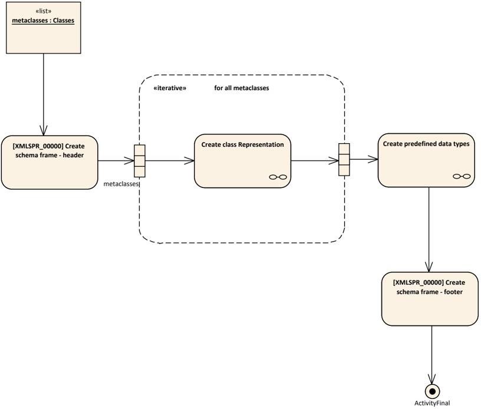

#### 4.1.1. 创建 xsd:schema（Create xsd:schema）

**规范项：XML 模式生成规则：xsd:schema**

| 字段 | 内容 |
|---|---|
| 适用对象 | 包（**Package**） |
| 前置条件 | 不适用（**n/a**） |
| 目标模式 | 见下方代码 |
| 说明 | 该规则创建 XML 模式的头与尾。默认情况下 xmlNsPrefix 被设置为"AR"，xmlNsUri 被设置为 http://autosar.org/schema/r&lt;realease_number&gt;。XML 模式的主体由 XML 命名空间的命名空间导入以及每个类（包括其属性）的表示组成。 |
| XML 模式示例 | 见下方代码 |
| XML 实例示例 | 见下方代码 |

目标模式：

```xml
<xsd:schema xmlns:<%=xmlNsPrefix%>="<%=xmlNsUri%>"
            xmlns:xsd="http://www.w3.org/2001/XMLSchema"
            targetNamespace="<%=xmlNsUri%>"
            elementFormDefault="qualified"
            attributeFormDefault="unqualified">
  <xsd:import namespace="http://www.w3.org/XML/1998/namespace"
              schemaLocation="http://www.w3.org/2001/03/xml.xsd"/>
  <% for all classes { %>
  <% call class representation %>
  <% } %>
</xsd:schema>
```

XML 模式示例：

```xml
<xsd:schema xmlns:AR="http://autosar.org/schema/r4.0"
            xmlns:xsd="http://www.w3.org/2001/XMLSchema"
            targetNamespace="http://autosar.org/schema/r4.0"
            elementFormDefault="qualified"
            attributeFormDefault="unqualified">
  ...
</xsd:schema>
```

XML 实例示例：

```xml
<... xmlns="http://autosar.org/schema/r4.0"
     xmlns:xsi="http://www.w3.org/2001/XMLSchema-instance"
     xsi:schemaLocation="http://autosar.org/schema/r4.0 autosar.xsd">
  ...
</...>
```

### 4.2. 创建类表示（Create class representation）

图 4.2 描绘了为每个类创建的 XML 模式片段：

- 如果应用了构型«enumeration»，则该类映射为一个 xsd:enumeration [TPS_XMLSPR_00007]。
- 如果应用了构型«primitive»，则由标记值'xml.mds.type'或'xml.xsd.type'表示的数据类型用于在模式中表示该类 [TPS_XMLSPR_00006]。
- 否则：
  - 如果该类拥有'xml.attribute=true'的属性，则创建一个 xsd:attributeGroup [TPS_XMLSPR_00002]。
  - 此外，如果该类拥有'xml.attribute=false'的属性，则创建一个 xsd:group [TPS_XMLSPR_00001]。
  - 此外，如果该类不是抽象的，则创建一个 xsd:complexType [TPS_XMLSPR_00003]。如果标记值'xml.globalElement'被设为 true，则创建一个全局 XML 元素声明。
  - 此外，如果 uml:class 被引用，则创建一个 xsd:simpleType，表示该 uml:class 的可能具体实例清单 [TPS_XMLSPR_00025]。

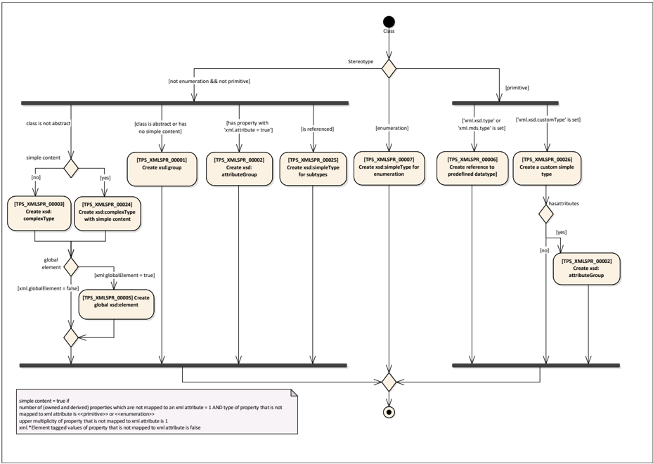

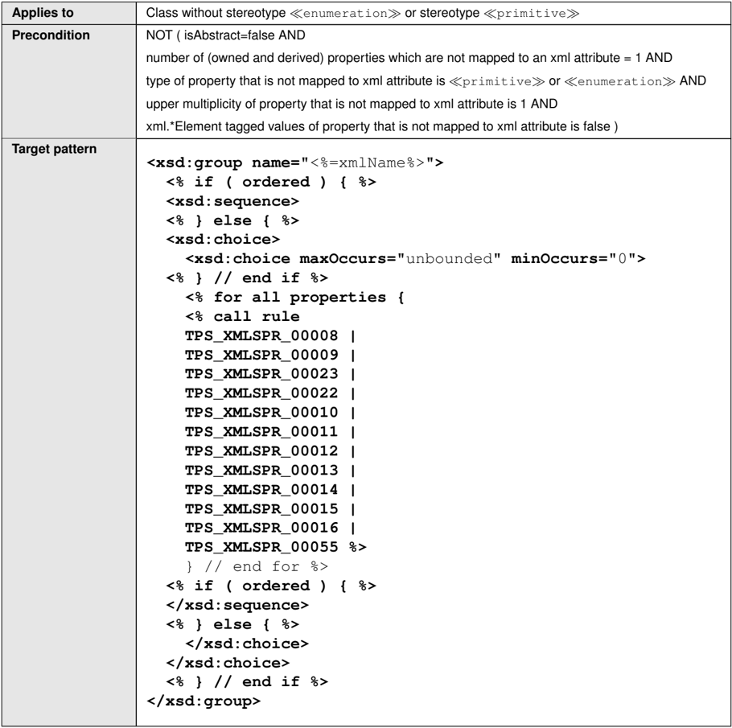

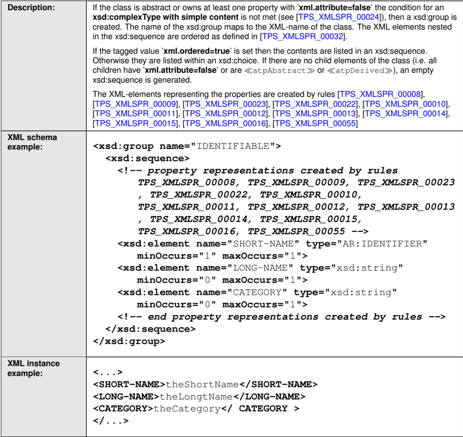

#### 4.2.1. 创建 xsd:group（Create xsd:group）

**规范项：XML 模式生成规则：xsd:group**

| 字段 | 内容 |
|---|---|
| 适用对象 | 不带构型«enumeration»或构型«primitive»的类 |
| 前置条件 | NOT ( isAbstract=false AND 拥有的及派生的、未映射为 xml 属性的属性数量 = 1 AND 未映射为 xml 属性的属性的类型为«primitive»或«enumeration» AND 未映射为 xml 属性的属性的上多重性为 1 AND 未映射为 xml 属性的属性的 xml.*Element 标记值为 false ) |
| 目标模式 | 见下方代码 |
| 说明 | 如果类是抽象的，或者它至少拥有一个'xml.attribute=false'的属性——即不满足 xsd:complexType with simple content 的条件（见 [TPS_XMLSPR_00024]）——则创建一个 xsd:group。xsd:group 的名称映射到该类的 XML 名称。嵌套在 xsd:sequence 中的 XML 元素按 [TPS_XMLSPR_00032] 的定义排序。如果标记值'xml.ordered=true'被设置，则内容列在 xsd:sequence 中；否则列在 xsd:choice 中。如果该类没有子元素（即所有子元素都具有'xml.attribute=false'或为«atpAbstract»或«atpDerived»），则生成一个空的 xsd:sequence。表示属性的 XML 元素由规则 [TPS_XMLSPR_00008]、[TPS_XMLSPR_00009]、[TPS_XMLSPR_00023]、[TPS_XMLSPR_00022]、[TPS_XMLSPR_00010]、[TPS_XMLSPR_00011]、[TPS_XMLSPR_00012]、[TPS_XMLSPR_00013]、[TPS_XMLSPR_00014]、[TPS_XMLSPR_00015]、[TPS_XMLSPR_00016]、[TPS_XMLSPR_00055] 创建。 |
| XML 模式示例 | 见下方代码 |
| XML 实例示例 | 见下方代码 |

目标模式：

```xml
<xsd:group name="<%=xmlName%>">
  <% if ( ordered ) { %>
  <xsd:sequence>
  <% } else { %>
  <xsd:choice>
    <xsd:choice maxOccurs="unbounded" minOccurs="0">
  <% } // end if %>
  <% for all properties { %>
  <% call rule TPS_XMLSPR_00008 | TPS_XMLSPR_00009 | TPS_XMLSPR_00023 |
     TPS_XMLSPR_00022 | TPS_XMLSPR_00010 | TPS_XMLSPR_00011 |
     TPS_XMLSPR_00012 | TPS_XMLSPR_00013 | TPS_XMLSPR_00014 |
     TPS_XMLSPR_00015 | TPS_XMLSPR_00016 | TPS_XMLSPR_00055 %>
  <% } // end for %>
  <% if ( ordered ) { %>
  </xsd:sequence>
  <% } else { %>
    </xsd:choice>
  </xsd:choice>
  <% } // end if %>
```

XML 模式示例：

```xml
<xsd:group name="IDENTIFIABLE">
  <xsd:sequence>
    <!-- 由规则 TPS_XMLSPR_00008、00009、00023、00022、00010、00011、
         00012、00013、00014、00015、00016、00055 创建的属性表示 -->
    <xsd:element name="SHORT-NAME" type="AR:IDENTIFIER" minOccurs="1" maxOccurs="1">
    <xsd:element name="LONG-NAME" type="xsd:string" minOccurs="0" maxOccurs="1">
    <xsd:element name="CATEGORY" type="xsd:string" minOccurs="0" maxOccurs="1">
    <!-- 由规则创建的属性表示结束 -->
  </xsd:sequence>
</xsd:group>
```

XML 实例示例：

```xml
<...>
  <SHORT-NAME>theShortName</SHORT-NAME>
  <LONG-NAME>theLongtName</LONG-NAME>
  <CATEGORY>theCategory</CATEGORY>
</...>
```

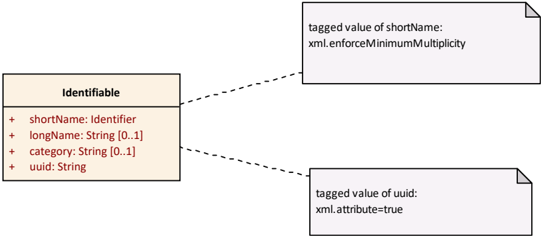

#### 4.2.2. 创建 xsd:attributeGroup（Create xsd:attributeGroup）

**规范项：XML 模式生成规则：xsd:attributeGroup**

| 字段 | 内容 |
|---|---|
| 适用对象 | 不带构型«enumeration»的类 |
| 前置条件 | 存在"xml.attribute=true"的属性 |
| 目标模式 | 见下方代码 |
| 说明 | 如果至少一个属性被标记值'xml.attribute=true'标记，则创建一个 xsd:attributeGroup。xsd:attributeGroup 的名称由拥有该属性的类的 XML 名称定义。 |
| XML 模式示例 | 见下方代码 |
| XML 实例示例 | 不适用（**n/a**） |

目标模式：

```xml
<xsd:attributeGroup name="<%=xmlName%>">
  <% for all properties represented as XML attributes { %>
  <% call rule TPS_XMLSPR_00019 %>
  <% } %>
</xsd:attributeGroup>
```

XML 模式示例：

```xml
<xsd:attributeGroup name="IDENTIFIABLE">
  <!-- 由规则 TPS_XMLSPR_00019 定义的属性 -->
</xsd:attributeGroup>
```

（UML 示例——创建 xsd:attributeGroup，图 4.4）

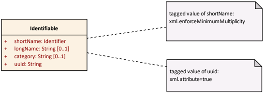

#### 4.2.3. 创建 xsd:complexType（Create xsd:complexType）

**规范项：XML 模式生成规则：xsd:complexType**

| 字段 | 内容 |
|---|---|
| 适用对象 | 不带构型«enumeration»或构型«primitive»的类 |
| 前置条件 | isAbstract=false |
| 目标模式 | 见下方代码 |
| 说明 | 如果类不是抽象的，则创建一个 xsd:complexType。xsd:complexType 的名称由该类的 XML 名称定义。所创建的 xsd:complexType 不直接定义属性的 XML 表示，而是引用为该类及其所有超类创建的 xsd:group 与 xsd:attributeGroup（见规则 [TPS_XMLSPR_00001] 与 [TPS_XMLSPR_00002]）。组按 [TPS_XMLSPR_00033] 的定义排序。如果标记值'xml.ordered=true'被设置，则 xsd:group 列在 xsd:sequence 中；否则列在 xsd:choice 中。如果'xml.text=true'，则 xsd:complexType 的属性'mixed'被设置为'true'。 |
| XML 模式示例 | 见下方代码 |
| XML 实例示例 | 不适用（**n/a**） |

目标模式：

```xml
<xsd:complexType name="<%=xmlName%>" mixed="<%=xmlText%>">
  <% if ( ordered ) { %>
  <xsd:sequence>
  <% } else { %>
  <xsd:choice minOccurs="0" maxOccurs="unbounded">
  <% }
  <% for (myclass in {class and all baseclasses}) { %>
    <xsd:group ref="<%=baseclassNsPrefix%>:<%=myclassXmlName%>"/>
  <% } %>
  <% if ( ordered ) { %>
  </xsd:sequence>
  <% } else { %>
  </xsd:choice>
  <% } %>
  <% for (class and all baseclasses) { %>
  <xsd:attributeGroup ref="<%=baseclassNsPrefix%>:<%=baseclassXmlName%>"/>
  <% } // for (class and all baseclasses) %>
</xsd:complexType>
```

XML 模式示例：

```xml
<xsd:complexType name="AUTOSAR">
  <xsd:sequence>
    <xsd:group ref="AR:AUTOSAR"/>
  </xsd:sequence>
  <xsd:attributeGroup ref="AR:AUTOSAR"/>
</xsd:complexType>
```

#### 4.2.4. 创建带简单内容的 xsd:complexType（Create xsd:complexType with simple content）

**规范项：XML 模式生成规则：带简单内容的 xsd:complexType**

| 字段 | 内容 |
|---|---|
| 适用对象 | 不带构型«enumeration»或构型«primitive»的类 |
| 前置条件 | isAbstract=false AND 拥有的及派生的、未映射为 xml 属性的属性数量 = 1 AND 未映射为 xml 属性的属性的类型为«primitive»或«enumeration» AND 未映射为 xml 属性的属性的上多重性为 1 AND 未映射为 xml 属性的属性的 xml.*Element 标记值为 false |
| 目标模式 | 见下方代码 |
| 说明 | 如果类不是抽象的，并且它恰好包含一个未映射为 xml.attribute 的（派生的或拥有的）属性、且该属性不由任何 XML 元素表示（标记值 xml.*Element=false），则生成一个带 simpleContent 的 xsd:complexType。该 simpleContent 包含未映射为 xml.attribute 的属性的数据。如果表示为属性的属性的类型本身拥有属性，则这些属性不能映射到 simpleContent。在这种情况下应报告错误。 |
| XML 模式示例 | 见下方代码 |
| XML 实例示例 | 见下方代码 |

目标模式：

```xml
<xsd:complexType name="<%=xmlName%>" mixed="<%=xmlText%>">
  <xsd:simpleContent>
    <xsd:extension base="<%=propertyTypeNsPrefix%>:<%=propertyTypeXmlName%>">
      <% for (class and all baseclasses) { %>
      <xsd:attributeGroup ref="<%=baseclassNsPrefix%>:<%=baseclassXmlName%>"/>
      <% } // for (class and all baseclasses) %>
    </xsd:extension>
  </xsd:simpleContent>
</xsd:complexType>
```

XML 模式示例：

```xml
<xsd:complexType name="LIMIT">
  <xsd:simpleContent>
    <xsd:extension base="AR:INTEGER">
      <xsd:attributeGroup ref="AR:LIMIT"/>
    </xsd:extension>
  </xsd:simpleContent>
</xsd:complexType>
```

XML 实例示例：

```xml
<... LIMIT-TYPE="CLOSED">1000</...>
```

（UML 示例——创建带简单内容的 xsd:complexType，图 4.6）

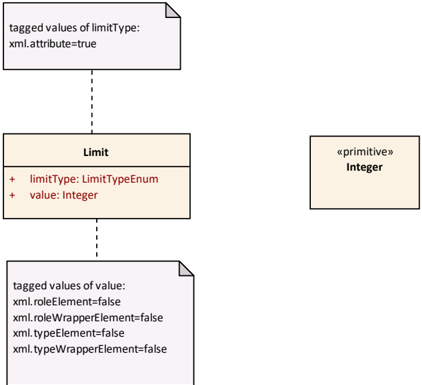

#### 4.2.5. 创建全局 xsd:element（Create global xsd:element）

**规范项：XML 模式生成规则：全局 xsd:element**

| 字段 | 内容 |
|---|---|
| 适用对象 | 类 |
| 前置条件 | xml.globalElement=true |
| 目标模式 | `&lt;xsd:element name="&lt;%=typeXmlName%&gt;" type="&lt;% typeXmlNsPrefix%&gt;:&lt;%=typeXmlName%&gt;" /&gt;` |
| 说明 | 如果类被标记值'xml.globalElement=true'标记，则创建一个全局 xsd:element。xsd:element 的名称由该类的 XML 名称定义，类型由 [TPS_XMLSPR_00003] 定义的 xsd:complexType 定义。命名空间前缀由标记值'xml.nsPrefix'定义。 |
| XML 模式示例 | `&lt;xsd:element name="AUTOSAR" type="AR:AUTOSAR" /&gt;` |
| XML 实例示例 | `&lt;AUTOSAR&gt; ... &lt;/AUTOSAR&gt;` |

#### 4.2.6. 创建子类型枚举（Create enumeration of subtypes）

**规范项：XML 模式生成规则：子类型枚举**

| 字段 | 内容 |
|---|---|
| 适用对象 | 不带构型«enumeration»或构型«primitive»的类 |
| 前置条件 | 类被引用 |
| 目标模式 | 见下方代码 |
| 说明 | 创建一个枚举，表示该类及其所有子类型的 XML 名称。该枚举是描述引用的潜在目标类型所必需的。 |
| XML 模式示例 | 见下方代码 |
| XML 实例示例 | `&lt;THE-B-REF DEST="B-1"&gt; /shortname &lt;/THE-B-REF&gt;` |

目标模式：

```xml
<xsd:simpleType name="<%=xmlName%>--SUBTYPES-ENUM">
  <xsd:restriction base="xsd:string">
    <% for type and all subtypes { %>
    <xsd:enumeration value="<%=typeXmlName%>"/>
    <% } // for type and all subtypes %>
  </xsd:restriction>
</xsd:simpleType>
```

XML 模式示例：

```xml
<xsd:element name="B--SUBTYPES-ENUM">
  <xsd:restriction base="xsd:string">
    <xsd:enumeration value="B-1"/>
    <xsd:enumeration value="B-2"/>
  </xsd:restriction>
</xsd:element>
```

#### 4.2.7. 创建到 XML 预定义数据类型的引用（Create reference to XML predefined data type）

**规范项：XML 模式生成规则：到 XML 预定义数据类型的引用**

| 字段 | 内容 |
|---|---|
| 适用对象 | 带«primitive»构型的类 |
| 前置条件 | 定义了标记值'xml.xsd.type=...'或'xml.mds.type=...' |
| 目标模式 | `... type="&lt;%=typeXmlNsPrefix%&gt;:&lt;%=xmlXsdType%&gt;" ...` |
| 说明 | 每个带«primitive»构型的类都由标记值'xml.xsd.type'或'xml.mds.type'定义的 xsd:simpleType 表示，除非由标记值'xml.xsd.customType'定义了自定义的 xsd:simpleType——在后一种情况下应用规则 [TPS_XMLSPR_00026]。如果使用 xml.xsd.type，则该类型定义在 W3C xml 模式中，typeXmlNsPrefix 对应"xsd"。如果使用 xml.mds.type，则该类型定义在所生成 XML 模式的命名空间（"AR"）中。 |
| XML 模式示例 | 预定义的 W3C XML 模式数据类型 string 被用于表示原始类 String。 |
| XML 实例示例 | `&lt;... type="xsd:string" ...&gt;` |

（UML 示例——创建到 XML 预定义数据类型的引用，图 4.8）

#### 4.2.8. 创建自定义简单类型（Create a custom simple type）

**规范项：XML 模式生成规则：自定义简单类型**

| 字段 | 内容 |
|---|---|
| 适用对象 | 带«primitive»构型的类 |
| 前置条件 | 定义了标记值'xml.xsd.customType=...' |
| 目标模式 | 见下方代码 |
| 说明 | 每个带«primitive»构型且设置了标记值 xml.xsd.customType 的类在模式中由两个元素表示：一个自定义的 xsd:simpleType 和一个带 simpleContent 的 xsd:complexType。xsd:simpleType 的名称映射到该类的 XML 名称并附加后缀"--SIMPLE"，xsd:complexType 的名称映射到该类的 XML 名称。简单类型的基类型是标记值 xml.xsd.type 中定义的类型。限制模式取自标记值 xml.xsd.pattern。 |
| XML 模式示例 | 见下方代码 |
| XML 实例示例 | `&lt;... type="AR:POSITIVE-INTEGER" ...&gt;` |

目标模式：

```xml
<xsd:simpleType name="<%=xmlName%>--SIMPLE">
  <xsd:restriction base="<%=xmlXsdType%>">
    <xsd:pattern value="<%=xmlXsdPattern%>"/>
  </xsd:restriction>
</xsd:simpleType>
<xsd:complexType name="<%=xmlName%>">
  <xsd:simpleContent>
    <xsd:extension base="AR:<%=xmlName%>--SIMPLE">
      <xsd:attributeGroup ref="AR:AR-OBJECT"/>
      <% if (class has attributes) { %>
      <xsd:attributeGroup ref="<%=xmlName%>"/>
      <% } // end if (class has attributes) %>
    </xsd:extension>
  </xsd:simpleContent>
</xsd:complexType>
```

XML 模式示例：

```xml
<xsd:simpleType name="POSITIVE-INTEGER--SIMPLE">
  <xsd:restriction base="xsd:string">
    <xsd:pattern value="[1-9][0-9]*|0x[0-9a-f]*|0[0-7]*|0b[0-1]*"/>
  </xsd:restriction>
</xsd:simpleType>
<xsd:complexType name="POSITIVE-INTEGER">
  <xsd:simpleContent>
    <xsd:extension base="AR:POSITIVE-INTEGER--SIMPLE">
      <xsd:attributeGroup ref="AR:AR-OBJECT"/>
    </xsd:extension>
  </xsd:simpleContent>
</xsd:complexType>
```

（UML 示例——创建自定义简单类型，图 4.9）

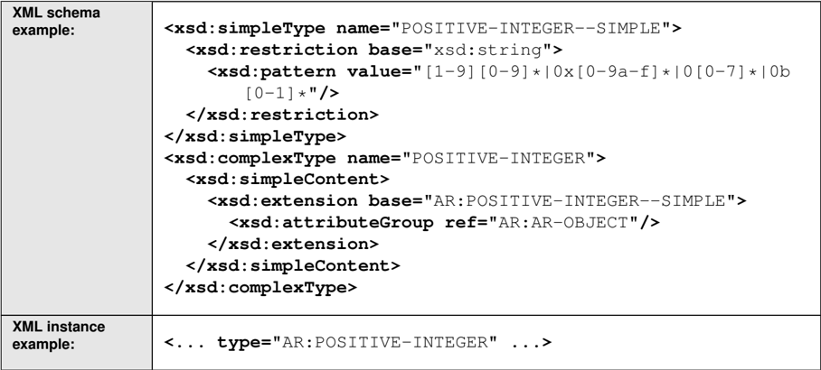

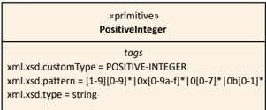

#### 4.2.9. 为枚举创建 xsd:simpleType（Create xsd:simpleType for enumeration）

**规范项：XML 模式生成规则：为枚举创建 xsd:simpleType**

| 字段 | 内容 |
|---|---|
| 适用对象 | 带«enumeration»构型的类 |
| 前置条件 | 不适用（**n/a**） |
| 目标模式 | 见下方代码 |
| 说明 | 每个带«enumeration»构型的类在模式中由两个元素表示：一个自定义的 xsd:simpleType 和一个带 simpleContent 的 xsd:complexType。xsd:simpleType 的名称映射到该类的 XML 名称并附加后缀"--SIMPLE"，xsd:complexType 的名称映射到该类的 XML 名称。xsd:simpleType 定义一个枚举。枚举字面量由该类的属性名称定义。 |
| XML 模式示例 | 见下方代码 |
| XML 实例示例 | `"data"` |

目标模式：

```xml
<xsd:simpleType name="<%=xmlName%>--SIMPLE">
  <xsd:restriction base="xsd:string">
    <% for all attributes { %>
    <xsd:enumeration value="<%=attributeXmlName%>"/>
    <% } // end for all attributes %>
  </xsd:restriction>
</xsd:simpleType>
<xsd:complexType name="<%=xmlName%>">
  <xsd:simpleContent>
    <xsd:extension base="AR:<%=xmlName%>--SIMPLE">
      <xsd:attributeGroup ref="AR:AR-OBJECT"/>
    </xsd:extension>
  </xsd:simpleContent>
</xsd:complexType>
```

XML 模式示例：

```xml
<xsd:simpleType name="ENUMERATION-INFO-TYPE--SIMPLE">
  <xsd:restriction base="xsd:string">
    <xsd:enumeration value="DATA"/>
    <xsd:enumeration value="EVENT"/>
  </xsd:restriction>
</xsd:simpleType>
<xsd:complexType name="ENUMERATION-INFO-TYPE">
  <xsd:simpleContent>
    <xsd:extension base="AR:ENUMERATION-INFO-TYPE--SIMPLE">
      <xsd:attributeGroup ref="AR:AR-OBJECT"/>
    </xsd:extension>
  </xsd:simpleContent>
</xsd:complexType>
```

### 4.3. 创建复合属性表示（映射到 XML 属性）（Create composite property representation (mapping to XML attributes)）

按照 [TPS_XMLSPR_00036]，本节中的规则仅适用于属性，因为属性是类中唯一可以标记为 xml.attribute=true 的属性。

#### 4.3.1. 创建 xsd:attribute（Create xsd:attribute）

**规范项：XML 模式生成规则：xsd:attribute**

| 字段 | 内容 |
|---|---|
| 适用对象 | 属性 |
| 前置条件 | xml.attribute=true；属性的上多重性 = 1 |
| 目标模式 | 见下方代码 |
| 说明 | 为每个带标记值'xml.attribute=true'的属性创建一个 xsd:attribute。xsd:attribute 的名称由所表示属性的 XML 名称定义。如果属性的下多重性大于 0，则该属性的使用是必需的（**required**）；否则是可选的（**optional**）。 |
| XML 模式示例 | `&lt;xsd:attribute name="UUID" type="xsd:string" use="optional" /&gt;` |
| XML 实例示例 | `&lt;... UUID="12343-23342-12345-2333" /&gt;` |

目标模式：

```xml
<xsd:attribute name="<%=xmlName%>" type="<%=typeXmlNsPrefix%>:<%=typeXmlName%>"
  <% if lowerMultiplicity > 0 { %> use="required"
  <% } else { %> use="optional"
  <% } %> />
```

（UML 示例——创建 xsd:attribute，图 4.11）

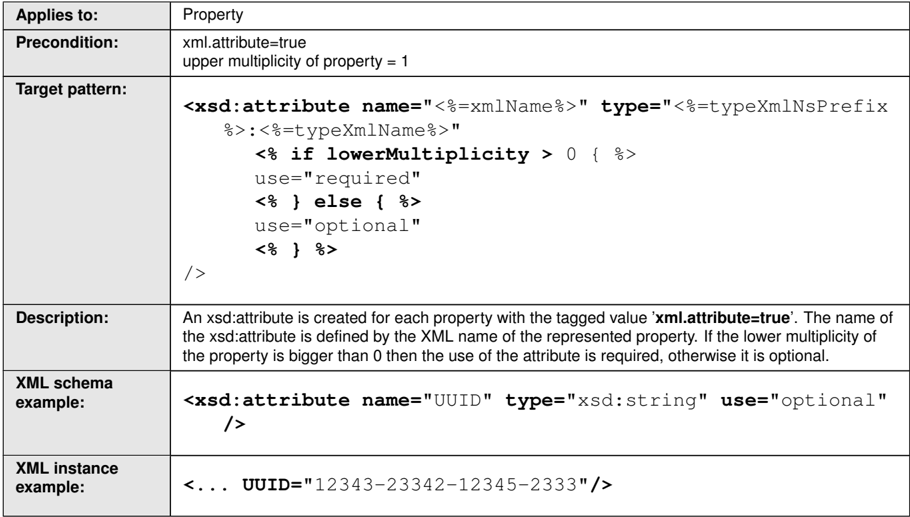

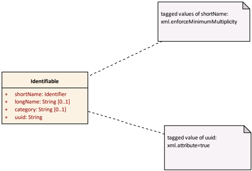

### 4.4. 创建复合属性表示（映射到 XML 元素）（Create composite property representation (mapping to XML elements)）

复合属性是具有'aggregation=composite'的属性（属性与组合目标端）。如果标记值'xml.attribute=false'（默认值），则这些属性被映射为 XML 元素。根据标记值'xml.roleWrapperElement'、'xml.roleElement'、'xml.typeWrapperElement'与'xml.typeElement'的取值，选择以下规则之一。所有将复合属性映射到 XML 元素的规则都称为"复合属性表示"（**Composite Property Representation**），并附加一个表示上述标记值设置的数字。第一位数字反映'xml.roleWrapperElement'的取值，第二位数字反映'xml.roleElement'的取值，第三位数字反映'xml.typeWrapperElement'的取值，最后一位数字反映'xml.typeElement'的取值。

图 4.12 说明了如何基于标记值选择规则。

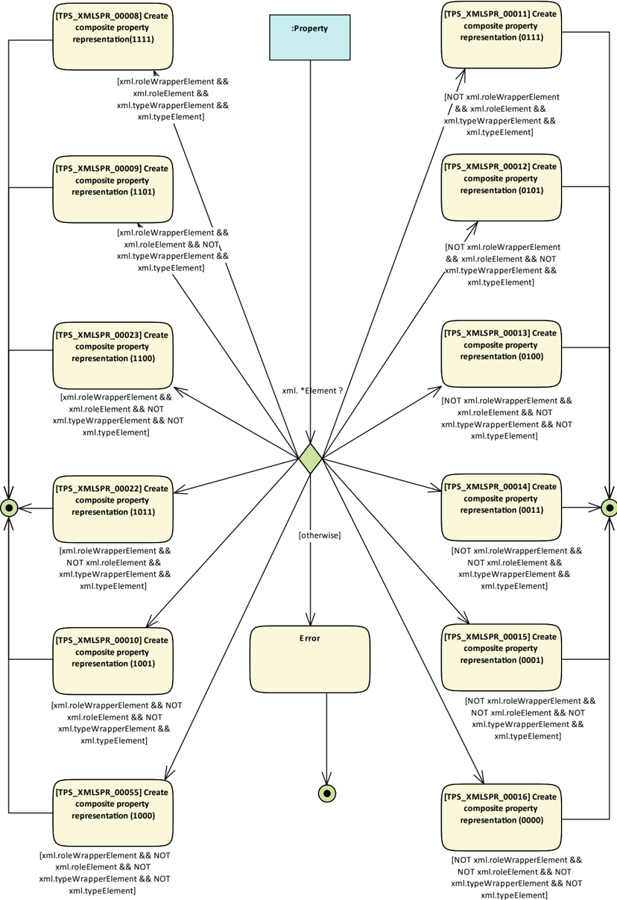

图 4.13 展示了一个示例元模型，它用作以下映射规则的示例。类'A'拥有一个名为'theB'的属性，其类型为'B'。该属性的多重性为 0..*。此外，类'A'拥有一个名为'theC'的属性，其类型为'C'。'theC'的上多重性为 1，下多重性为 1。

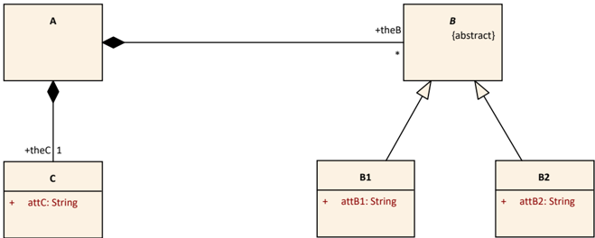

图 4.14 展示了图 4.13 所示元模型的一个示例实例。该实例用作以下规则的 XML 实例示例的基础。

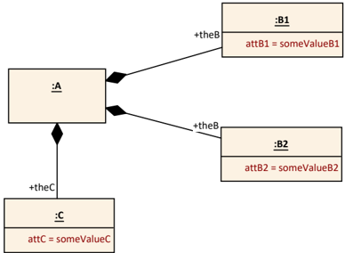

#### 4.4.1. 创建复合属性表示（1111）

**规范项：XML 模式生成规则：复合属性表示（1111）**

| 字段 | 内容 |
|---|---|
| 适用对象 | 属性 |
| 前置条件 | xml.roleWrapperElement == true && xml.roleElement == true && xml.typeWrapperElement == true && xml.typeElement == true |
| 目标模式 | 见下方代码 |
| 说明 | 创建一组表示该属性的 XML 元素：• 一个 maxOccurs=1 的角色包装器 XML 元素。该 XML 元素的名称由属性的 xml.namePlural 定义。 • 角色包装器元素内嵌套角色 XML 元素。这些 XML 元素的名称由属性的 xml.name 定义。这些元素的最小出现次数是属性的下多重性；最大出现次数是属性的上多重性。 • 为属性的每个类型与子类型创建一个类型包装器 XML 元素。该 XML 元素的名称由属性类型的 xml.namePlural 定义。 • 嵌套在这些类型包装器中的只允许表示与该类型包装器相同类型的元素。 |
| XML 模式示例 | 见下方代码 |
| XML 实例示例 | 见下方代码 |

目标模式：

```xml
<xsd:element name="<%=roleXmlNamePlural%>"
             minOccurs="<%if (lowerMultiplicity.equals("0"))  else %>"
             maxOccurs="1">
  <xsd:complexType>
    <xsd:choice minOccurs="<%=lowerMultiplicity%>" maxOccurs="<%=upperMultiplicity%>">
      <xsd:element name="<%=roleXmlName%>">
        <xsd:complexType>
          <xsd:all minOccurs="<%if (lowerMultiplicity.equals("0"))  else %>">
            <% for all types { %>
            <xsd:element name="<%=typeXmlNamePlural%>" minOccurs="0" maxOccurs="1">
              <xsd:complexType>
                <xsd:choice minOccurs="<%=lowerMultiplicity%>" maxOccurs="<%=upperMultiplicity%>">
                  <xsd:element name="<%=typeXmlName%>" type="<%=typeXmlNsPrefix%>:<%=typeXmlName%>"/>
                </xsd:choice>
              </xsd:complexType>
            </xsd:element>
            <% } // end for all types %>
          </xsd:all>
        </xsd:complexType>
      </xsd:element>
    </xsd:choice>
  </xsd:complexType>
</xsd:element>
```

XML 模式示例：

```xml
<xsd:element name="THE-BS" minOccurs="0" maxOccurs="1">
  <xsd:complexType>
    <xsd:choice minOccurs="0" maxOccurs="unbounded">
      <xsd:element name="THE-B" minOccurs="0" maxOccurs="unbounded">
        <xsd:complexType>
          <xsd:all minOccurs="0">
            <xsd:element name="B1S" minOccurs="0" maxOccurs="1">
              <xsd:complexType>
                <xsd:choice minOccurs="0" maxOccurs="unbounded">
                  <xsd:element name="B1" type="AR:B1"/>
                </xsd:choice>
              </xsd:complexType>
            </xsd:element>
            <xsd:element name="B2S" minOccurs="0" maxOccurs="1">
              <xsd:complexType>
                <xsd:choice minOccurs="0" maxOccurs="unbounded">
                  <xsd:element name="B2" type="AR:B2"/>
                </xsd:choice>
              </xsd:complexType>
            </xsd:element>
          </xsd:all>
        </xsd:complexType>
      </xsd:element>
    </xsd:choice>
  </xsd:complexType>
</xsd:element>
<xsd:element name="THE-CS" minOccurs="0" maxOccurs="1">
  <xsd:complexType>
    <xsd:choice minOccurs="0" maxOccurs="1">
      <xsd:element name="THE-C" minOccurs="0" maxOccurs="1">
        <xsd:complexType>
          <xsd:all minOccurs="0">
            <xsd:element name="CS" minOccurs="0" maxOccurs="1">
              <xsd:complexType>
                <xsd:choice minOccurs="0" maxOccurs="1">
                  <xsd:element name="C" type="AR:C"/>
                </xsd:choice>
              </xsd:complexType>
            </xsd:element>
          </xsd:all>
        </xsd:complexType>
      </xsd:element>
    </xsd:choice>
  </xsd:complexType>
</xsd:element>
```

XML 实例示例：

```xml
<...>
  <THE-BS>
    <THE-B>
      <B1S><B1><ATT-B1>someValueB1</ATT-B1></B1></B1S>
      <B2S><B2><ATT-B2>someValueB2</ATT-B2></B2></B2S>
    </THE-B>
  </THE-BS>
  <THE-CS>
    <THE-C>
      <CS><C><ATT-C>someValueC</ATT-C></C></CS>
    </THE-C>
  </THE-CS>
</...>
```

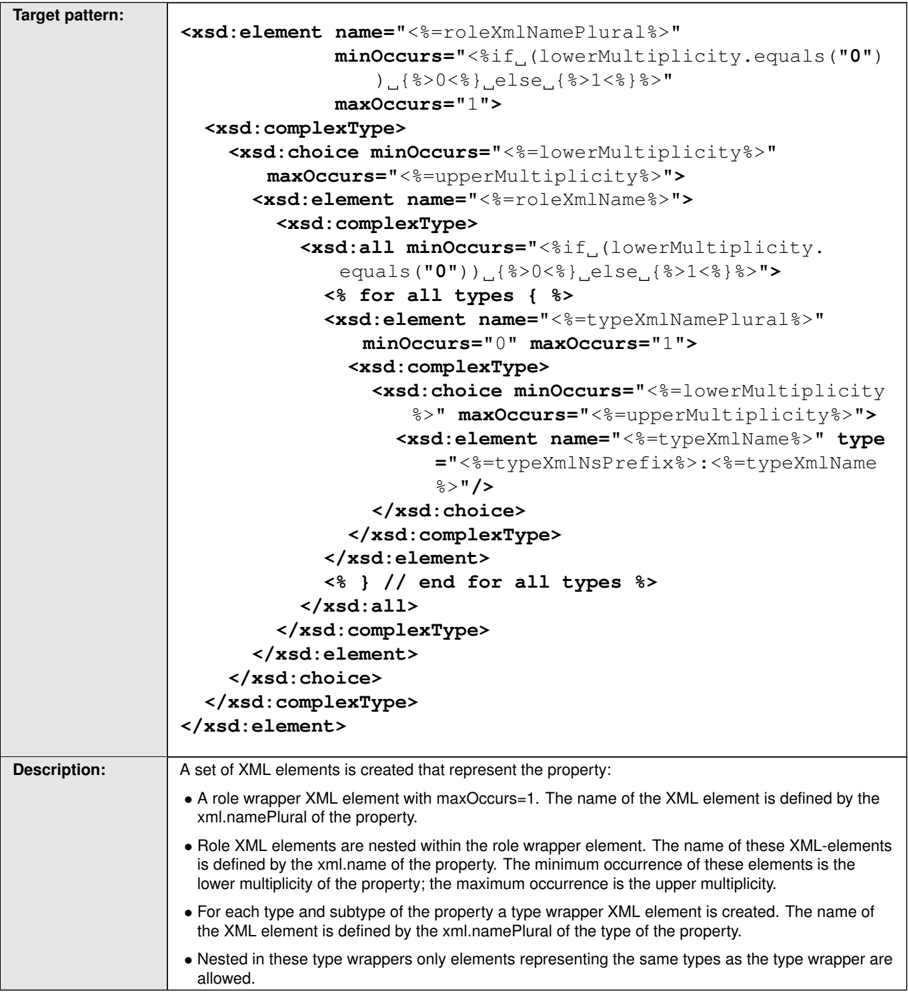

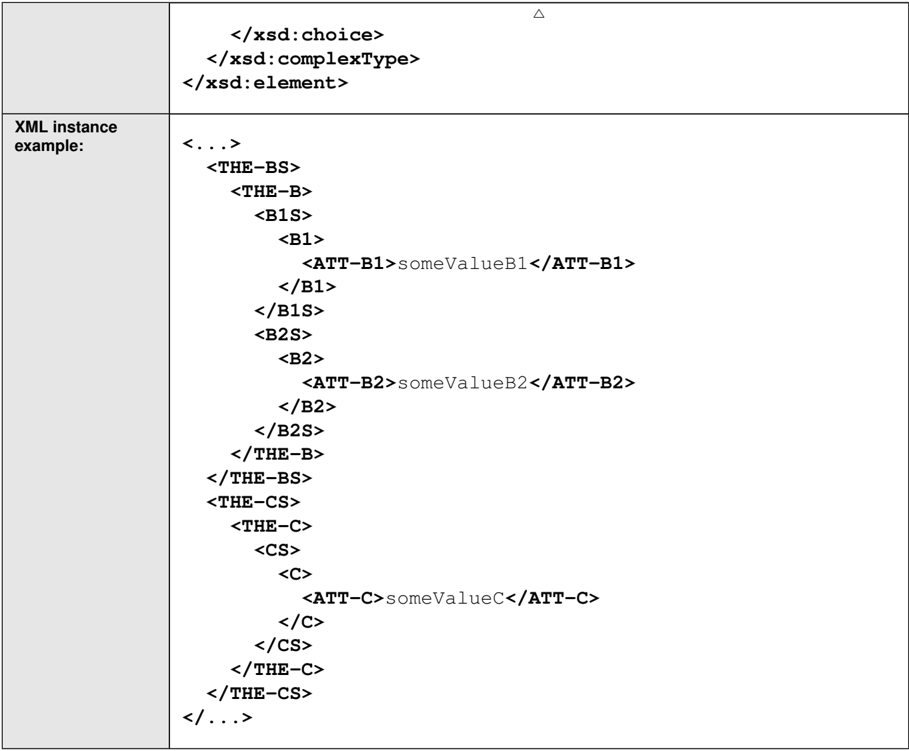

#### 4.4.2. 创建复合属性表示（1101）

**规范项：XML 模式生成规则：复合属性表示（1101）**

| 字段 | 内容 |
|---|---|
| 适用对象 | 属性 |
| 前置条件 | xml.roleWrapperElement == true && xml.roleElement == true && xml.typeWrapperElement == false && xml.typeElement == true |
| 目标模式 | 见下方代码 |
| 说明 | 创建一组表示该属性的 XML 元素：• 一个 maxOccurs=1 的角色包装器 XML 元素。该 XML 元素的名称由属性的 xml.namePlural 定义。 • 角色包装器元素内嵌套角色 XML 元素。这些元素的最小出现次数是属性的下多重性；最大出现次数是属性的上多重性。 • 嵌套在角色元素中的、表示类型的 XML 元素至多允许一个。 |
| XML 模式示例 | 见下方代码 |
| XML 实例示例 | 见下方代码 |

目标模式：

```xml
<xsd:element name="<%=roleXmlNamePlural%>"
             minOccurs="<%if (lowerMultiplicity.equals("0"))  else %>"
             maxOccurs="1">
  <xsd:complexType>
    <xsd:choice minOccurs="<%=lowerMultiplicity%>" maxOccurs="<%=upperMultiplicity%>">
      <xsd:element name="<%=roleXmlName%>">
        <xsd:complexType>
          <xsd:choice minOccurs="0" maxOccurs="1">
            <% for all types { %>
            <xsd:element name="<%=typeXmlName%>" type="<%=typeXmlNsPrefix%>:<%=typeXmlName%>"/>
            <% } // end for all types %>
          </xsd:choice>
        </xsd:complexType>
      </xsd:element>
    </xsd:choice>
  </xsd:complexType>
</xsd:element>
```

XML 模式示例：

```xml
<xsd:element name="THE-BS" minOccurs="0" maxOccurs="1">
  <xsd:complexType>
    <xsd:choice minOccurs="0" maxOccurs="unbounded">
      <xsd:element name="THE-B">
        <xsd:complexType>
          <xsd:choice minOccurs="0" maxOccurs="1">
            <xsd:element name="B1" type="AR:B1"/>
            <xsd:element name="B2" type="AR:B2"/>
          </xsd:choice>
        </xsd:complexType>
      </xsd:element>
    </xsd:choice>
  </xsd:complexType>
</xsd:element>
<xsd:element name="THE-CS" minOccurs="0" maxOccurs="1">
  <xsd:complexType>
    <xsd:choice minOccurs="0" maxOccurs="1">
      <xsd:element name="THE-C">
        <xsd:complexType>
          <xsd:choice minOccurs="0" maxOccurs="1">
            <xsd:element name="C" type="AR:C"/>
          </xsd:choice>
        </xsd:complexType>
      </xsd:element>
    </xsd:choice>
  </xsd:complexType>
</xsd:element>
```

XML 实例示例：

```xml
<...>
  <THE-BS>
    <THE-B>
      <B1><ATT-B1>someValueB1</ATT-B1></B1>
      <B2><ATT-B2>someValueB2</ATT-B2></B2>
    </THE-B>
  </THE-BS>
  <THE-CS>
    <THE-C><C><ATT-C>someValueC</ATT-C></C></THE-C>
  </THE-CS>
</...>
```

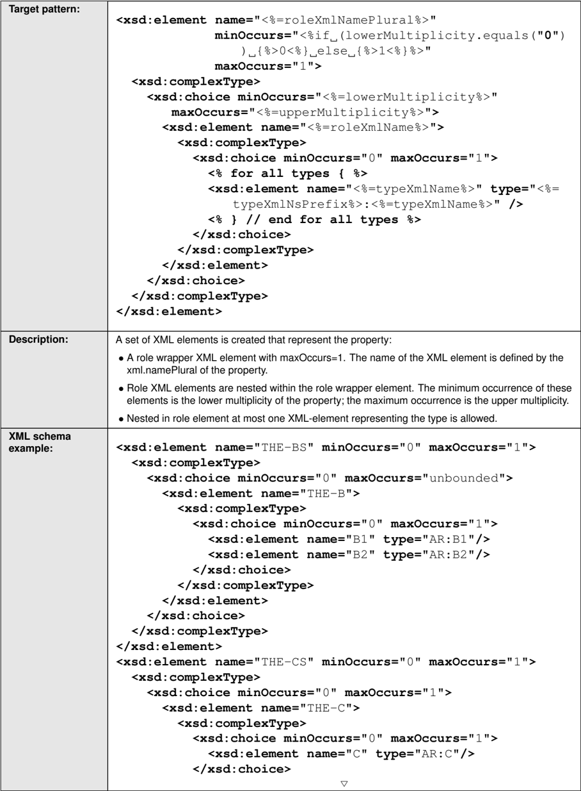

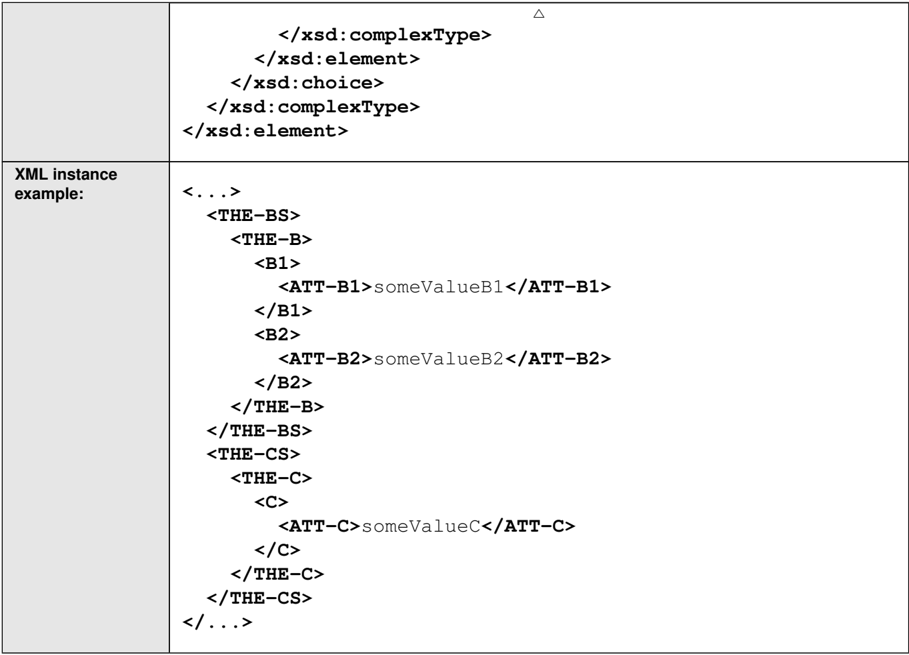

#### 4.4.3. 创建复合属性表示（1100）

**规范项：XML 模式生成规则：复合属性表示（1100）**

| 字段 | 内容 |
|---|---|
| 适用对象 | 属性 |
| 前置条件 | xml.roleWrapperElement == true && xml.roleElement == true && xml.typeWrapperElement == false && xml.typeElement == false |
| 目标模式 | 见下方代码 |
| 说明 | 创建一组表示该属性的 XML 元素：• 一个 maxOccurs=1 的角色包装器 XML 元素。该 XML 元素的名称由属性的 xml.namePlural 定义。 • 角色包装器元素内嵌套角色 XML 元素。 • 如果类型没有子类，则角色的内容模型直接显示在该元素声明中；如果存在多个类型，则角色元素内嵌套引用这些类型组的 choice。 |
| XML 模式示例 | 见下方代码 |
| XML 实例示例 | 见下方代码 |

目标模式：

```xml
<% if ( types.length > 1 ) { %>
<xsd:element name="<%=roleXmlNamePlural%>"
             minOccurs="<% if (lowerMultiplicity>0)  else { %>0<%}%>"
             maxOccurs="1">
  <xsd:complexType>
    <xsd:choice minOccurs="<%=lowerMultiplicity%>" maxOccurs="<%=upperMultiplicity%>">
      <xsd:element name="<%=roleXmlName%>">
        <xsd:complexType>
          <xsd:choice minOccurs="<% if (lowerMultiplicity>0)  else { %>0<%}%>"
                      maxOccurs="1">
            <% for all types { %>
            <xsd:group ref="<%=typeXmlNsPrefix%>:<%=typeXmlName%>"/>
            <% } // end for all types %>
          </xsd:choice>
        </xsd:complexType>
      </xsd:element>
    </xsd:choice>
  </xsd:complexType>
</xsd:element>
<% } else { %>
<xsd:element name="<%=roleXmlNamePlural%>"
             minOccurs="<% if (lowerMultiplicity>0)  else { %>0<%}%>"
             maxOccurs="1">
  <xsd:complexType>
    <xsd:choice minOccurs="<%=lowerMultiplicity%>" maxOccurs="<%=upperMultiplicity%>">
      <xsd:element name="<%=roleXmlName%>" type="<%=typeXmlNsPrefix%>:<%=typeXmlName%>"/>
    </xsd:choice>
  </xsd:complexType>
</xsd:element>
<% } %>
```

XML 模式示例：

```xml
<xsd:element name="THE-BS" minOccurs="0" maxOccurs="1">
  <xsd:complexType>
    <xsd:choice minOccurs="0" maxOccurs="unbounded">
      <xsd:element name="THE-B">
        <xsd:complexType>
          <xsd:choice minOccurs="0" maxOccurs="1">
            <xsd:group ref="AR:B1"/>
            <xsd:group ref="AR:B2"/>
          </xsd:choice>
        </xsd:complexType>
      </xsd:element>
    </xsd:choice>
  </xsd:complexType>
</xsd:element>
<xsd:element name="THE-CS" minOccurs="0" maxOccurs="1">
  <xsd:complexType>
    <xsd:choice minOccurs="0" maxOccurs="1">
      <xsd:element name="THE-C" minOccurs="0" maxOccurs="1">
        <xsd:complexType>
          <xsd:choice minOccurs="0" maxOccurs="1">
            <xsd:group ref="AR:C"/>
          </xsd:choice>
        </xsd:complexType>
      </xsd:element>
    </xsd:choice>
  </xsd:complexType>
</xsd:element>
```

XML 实例示例：

```xml
<...>
  <THE-BS>
    <THE-B><ATT-B1>someValueB1</ATT-B1></THE-B>
    <THE-B><ATT-B2>someValueB2</ATT-B2></THE-B>
  </THE-BS>
  <THE-CS>
    <THE-C><ATT-C>someValueC</ATT-C></THE-C>
  </THE-CS>
</...>
```

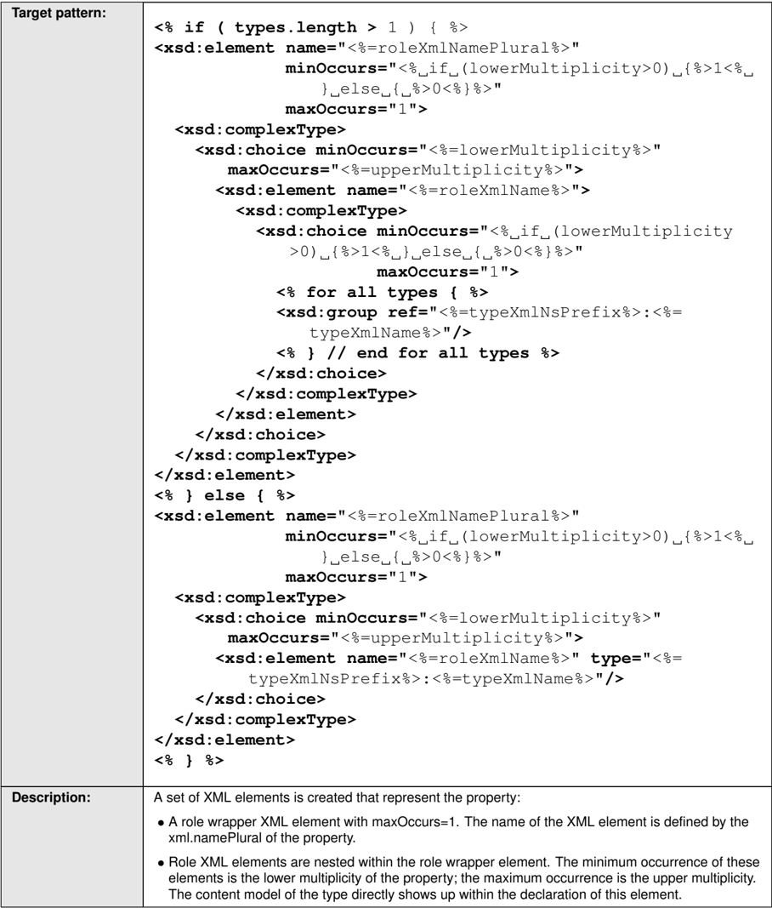

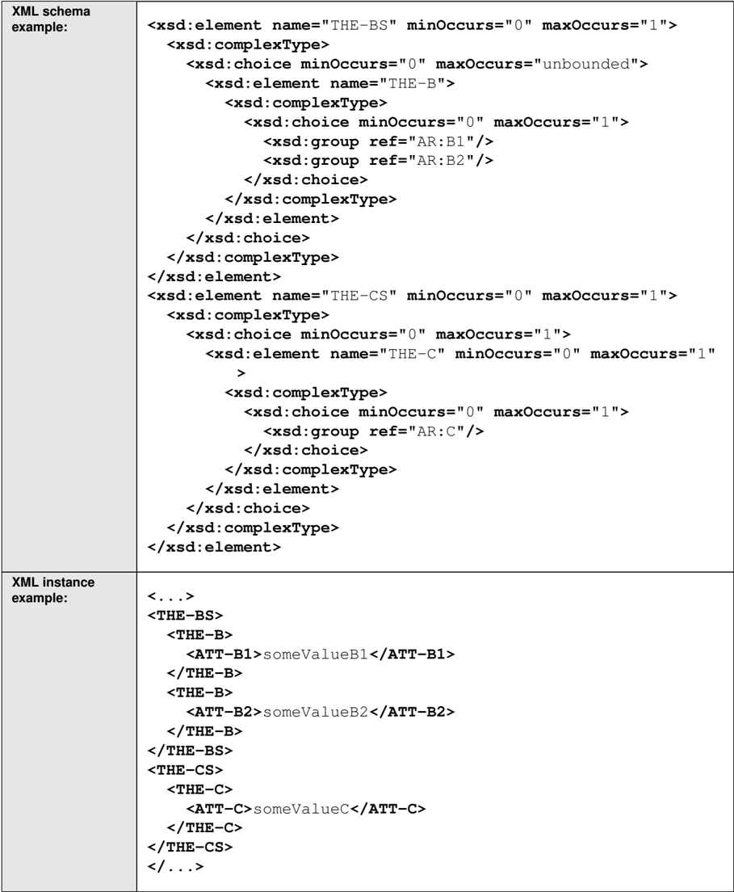

#### 4.4.4. 创建复合属性表示（1011）

**规范项：XML 模式生成规则：复合属性表示（1011）**

| 字段 | 内容 |
|---|---|
| 适用对象 | 属性 |
| 前置条件 | xml.roleWrapperElement == true && xml.roleElement == false && xml.typeWrapperElement == true && xml.typeElement == true |
| 目标模式 | 见下方代码 |
| 说明 | 创建一组表示该属性的 XML 元素：• 一个 maxOccurs=1 的角色包装器 XML 元素。该 XML 元素的名称由属性的 xml.namePlural 定义。 • 为属性的每个类型与子类型创建一个类型包装器 XML 元素。 • 嵌套在这些类型包装器中的只允许表示与该类型包装器相同类型的元素。 |
| XML 模式示例 | 见下方代码 |
| XML 实例示例 | 见下方代码 |

目标模式：

```xml
<xsd:element name="<%=roleXmlNamePlural%>"
             minOccurs="<%if (lowerMultiplicity>0)  else %>"
             maxOccurs="1">
  <xsd:complexType>
    <xsd:all minOccurs="<%if (lowerMultiplicity>0)  else %>"
             maxOccurs="<%=types.length%>">
      <% for all types { %>
      <xsd:element name="<%=typeXmlNamePlural%>" minOccurs="0" maxOccurs="1">
        <xsd:complexType>
          <xsd:choice minOccurs="<%=lowerMultiplicity%>" maxOccurs="<%=upperMultiplicity%>">
            <xsd:element name="<%=typeXmlName%>" type="<%=typeXmlNsPrefix%>:<%=typeXmlName%>"/>
          </xsd:choice>
        </xsd:complexType>
      </xsd:element>
      <% } // end for all types %>
    </xsd:all>
  </xsd:complexType>
</xsd:element>
```

XML 模式示例：

```xml
<xsd:element name="THE-BS" minOccurs="0" maxOccurs="1">
  <xsd:complexType>
    <xsd:all minOccurs="0" maxOccurs="2">
      <xsd:element name="B1S" minOccurs="0" maxOccurs="1">
        <xsd:complexType>
          <xsd:choice minOccurs="0" maxOccurs="unbounded">
            <xsd:element name="B2" type="AR:B2"/>
          </xsd:choice>
        </xsd:complexType>
      </xsd:element>
      <xsd:element name="B2S" minOccurs="0" maxOccurs="1">
        <xsd:complexType>
          <xsd:choice minOccurs="0" maxOccurs="unbounded">
            <xsd:element name="B2" type="AR:B2"/>
          </xsd:choice>
        </xsd:complexType>
      </xsd:element>
    </xsd:all>
  </xsd:complexType>
</xsd:element>
<xsd:element name="THE-CS" minOccurs="0" maxOccurs="1">
  <xsd:complexType>
    <xsd:all minOccurs="0" maxOccurs="1">
      <xsd:element name="CS" minOccurs="0" maxOccurs="1">
        <xsd:complexType>
          <xsd:choice minOccurs="0" maxOccurs="1">
            <xsd:element name="C" type="AR:C"/>
          </xsd:choice>
        </xsd:complexType>
      </xsd:element>
    </xsd:all>
  </xsd:complexType>
</xsd:element>
```

XML 实例示例：

```xml
<...>
  <THE-BS>
    <B1S><B1><ATT-B1>someValueB1</ATT-B1></B1></B1S>
    <B2S><B2><ATT-B2>someValueB2</ATT-B2></B2></B2S>
  </THE-BS>
  <THE-CS>
    <CS><C><ATT-C>someValueC</ATT-C></C></CS>
  </THE-CS>
</...>
```

#### 4.4.5. 创建复合属性表示（1000）

**规范项：XML 模式生成规则：复合属性表示（1000）**

| 字段 | 内容 |
|---|---|
| 适用对象 | 属性 |
| 前置条件 | xml.roleWrapperElement == true && xml.roleElement == false && xml.typeWrapperElement == false && xml.typeElement == false |
| 目标模式 | 见下方代码 |
| 说明 | 创建一个表示该属性的 XML 元素：一个 maxOccurs=1 的角色包装器 XML 元素。该 XML 元素的名称由属性的 xml.namePlural 定义。类型的内容模型直接显示在该元素的声明内。 |
| XML 模式示例 | 见下方代码 |
| XML 实例示例 | 见下方代码 |

目标模式：

```xml
<xsd:element name="<%=roleXmlNamePlural%>"
             minOccurs="<% if (lowerMultiplicity>0)  else %>"
             maxOccurs="1">
  <xsd:complexType>
    <xsd:choice minOccurs="<%=lowerMultiplicity%>" maxOccurs="<%=upperMultiplicity%>">
      <% for all types { %>
      <xsd:group ref="<%=typeXmlNsPrefix%>:<%=typeXmlName%>"/>
      <% } // end for all types %>
    </xsd:choice>
  </xsd:complexType>
</xsd:element>
```

XML 模式示例：

```xml
<xsd:element name="THE-BS" minOccurs="0" maxOccurs="1">
  <xsd:complexType>
    <xsd:choice minOccurs="0" maxOccurs="unbounded">
      <xsd:group ref="AR:B1"/>
      <xsd:group ref="AR:B2"/>
    </xsd:choice>
  </xsd:complexType>
</xsd:element>
<xsd:element name="THE-CS" minOccurs="0" maxOccurs="1">
  <xsd:complexType>
    <xsd:choice minOccurs="0" maxOccurs="unbounded">
      <xsd:group ref="AR:C"/>
    </xsd:choice>
  </xsd:complexType>
</xsd:element>
```

XML 实例示例：

```xml
<...>
  <THE-BS>
    <ATT-B1>someValueB1</ATT-B1>
    <ATT-B2>someValueB2</ATT-B2>
  </THE-BS>
  <THE-CS>
    <ATT-C>someValueC</ATT-C>
  </THE-CS>
</...>
```

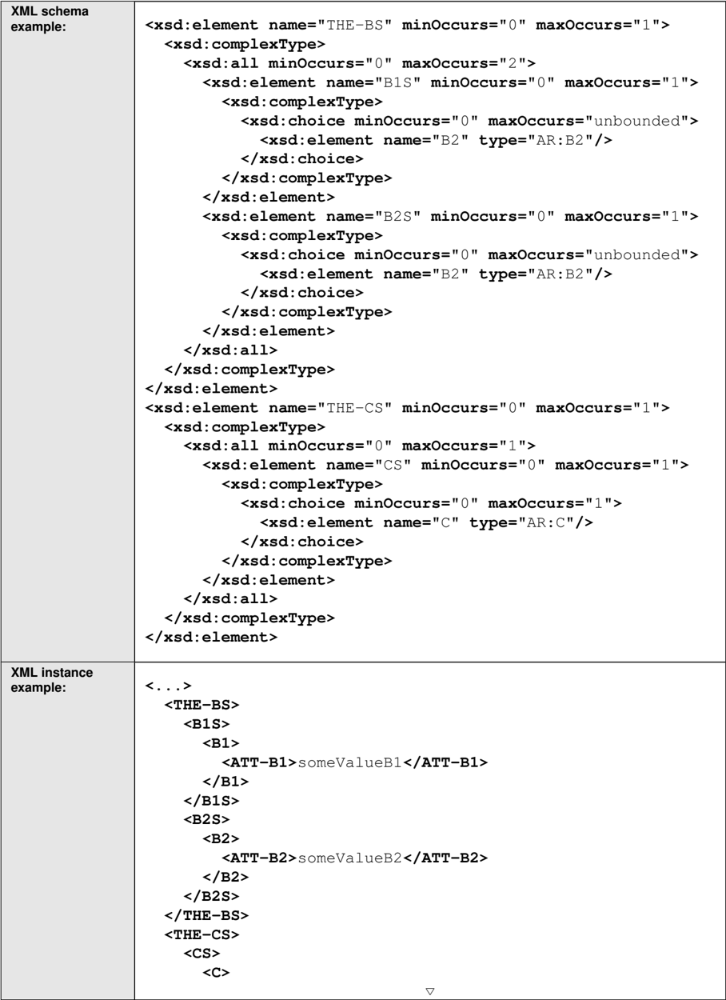

#### 4.4.6. 创建复合属性表示（1001）

**规范项：XML 模式生成规则：复合属性表示（1001）**

| 字段 | 内容 |
|---|---|
| 适用对象 | 属性 |
| 前置条件 | xml.roleWrapperElement == true && xml.roleElement == false && xml.typeWrapperElement == false && xml.typeElement == true |
| 目标模式 | 见下方代码 |
| 说明 | 创建一组表示该属性的 XML 元素：• 一个 maxOccurs=1 的角色包装器 XML 元素。该 XML 元素的名称由属性的 xml.namePlural 定义。 • 一个表示属性的类型或子类型的 XML 元素。该元素的名称由属性类型的 xml.name 定义。 |
| XML 模式示例 | 见下方代码 |
| XML 实例示例 | 见下方代码 |

目标模式：

```xml
<xsd:element name="<%=roleXmlNamePlural%>"
             minOccurs="<%if (lowerMultiplicity>0)  else %>"
             maxOccurs="1">
  <xsd:complexType>
    <xsd:choice minOccurs="<%=lowerMultiplicity%>" maxOccurs="<%=upperMultiplicity%>">
      <% for all types { %>
      <xsd:element name="<%=typeXmlName%>" type="<%=typeXmlNsPrefix%>:<%=typeXmlName%>"/>
      <% } // end for all types %>
    </xsd:choice>
  </xsd:complexType>
</xsd:element>
```

XML 模式示例：

```xml
<xsd:element name="THE-BS" minOccurs="0" maxOccurs="1">
  <xsd:complexType>
    <xsd:choice minOccurs="0" maxOccurs="unbounded">
      <xsd:element name="B1" type="AR:B1"/>
      <xsd:element name="B2" type="AR:B2"/>
    </xsd:choice>
  </xsd:complexType>
</xsd:element>
<xsd:element name="THE-CS" minOccurs="0" maxOccurs="1">
  <xsd:complexType>
    <xsd:choice minOccurs="0" maxOccurs="1">
      <xsd:element name="C" type="AR:C"/>
    </xsd:choice>
  </xsd:complexType>
</xsd:element>
```

XML 实例示例：

```xml
<...>
  <THE-BS>
    <B1><ATT-B1>someValueB1</ATT-B1></B1>
    <B2><ATT-B2>someValueB2</ATT-B2></B2>
  </THE-BS>
  <THE-CS>
    <C><ATT-C>someValueC</ATT-C></C>
  </THE-CS>
</...>
```

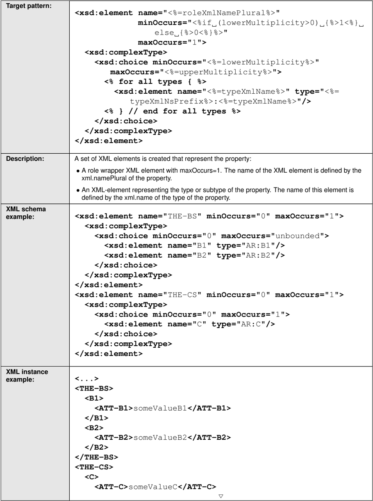

#### 4.4.7. 创建复合属性表示（0111）

**规范项：XML 模式生成规则：复合属性表示（0111）**

| 字段 | 内容 |
|---|---|
| 适用对象 | 属性 |
| 前置条件 | xml.roleWrapperElement == false && xml.roleElement == true && xml.typeWrapperElement == true && xml.typeElement == true |
| 目标模式 | 见下方代码 |
| 说明 | 创建一组表示该属性的 XML 元素：• 表示属性名称的 XML 元素。这些 XML 元素的名称由属性的 xml.name 定义。这些元素的最小出现次数是属性的下多重性；最大出现次数是属性的上多重性。 • 为属性的每个类型与子类型创建一个类型包装器 XML 元素。该 XML 元素的名称由属性类型的 xml.namePlural 定义。 • 嵌套在这些类型包装器中的只允许表示与该类型包装器相同类型的元素。 |
| XML 模式示例 | 见下方代码 |
| XML 实例示例 | 见下方代码 |

目标模式：

```xml
<xsd:element name="<%=roleXmlName%>"
             minOccurs="<%=lowerMultiplicity%>" maxOccurs="<%=upperMultiplicity%>">
  <xsd:complexType>
    <xsd:all minOccurs="<%if (lowerMultiplicity.equals("0"))  else %>">
      <% for all types { %>
      <xsd:element name="<%=typeXmlNamePlural%>" minOccurs="0" maxOccurs="1">
        <xsd:complexType>
          <xsd:choice minOccurs="<%=lowerMultiplicity%>" maxOccurs="<%=upperMultiplicity%>">
            <xsd:element name="<%=typeXmlName%>" type="<%=typeXmlNsPrefix%>:<%=typeXmlName%>"/>
          </xsd:choice>
        </xsd:complexType>
      </xsd:element>
      <% } // end for all types %>
    </xsd:all>
  </xsd:complexType>
</xsd:element>
```

XML 模式示例：

```xml
<xsd:element name="THE-B" minOccurs="0" maxOccurs="unbounded">
  <xsd:complexType>
    <xsd:all minOccurs="0">
      <xsd:element name="B1S" minOccurs="0" maxOccurs="1">
        <xsd:complexType>
          <xsd:choice minOccurs="0" maxOccurs="unbounded">
            <xsd:element name="B1" type="AR:B1"/>
          </xsd:choice>
        </xsd:complexType>
      </xsd:element>
      <xsd:element name="B2S" minOccurs="0" maxOccurs="1">
        <xsd:complexType>
          <xsd:choice minOccurs="0" maxOccurs="unbounded">
            <xsd:element name="B2" type="AR:B2"/>
          </xsd:choice>
        </xsd:complexType>
      </xsd:element>
    </xsd:all>
  </xsd:complexType>
</xsd:element>
<xsd:element name="THE-C" minOccurs="0" maxOccurs="1">
  <xsd:complexType>
    <xsd:all minOccurs="0">
      <xsd:element name="CS" minOccurs="0" maxOccurs="1">
        <xsd:complexType>
          <xsd:choice minOccurs="0" maxOccurs="1">
            <xsd:element name="C" type="AR:C"/>
          </xsd:choice>
        </xsd:complexType>
      </xsd:element>
    </xsd:all>
  </xsd:complexType>
</xsd:element>
```

XML 实例示例：

```xml
<...>
  <THE-B>
    <B1S><B1><ATT-B1>someValueB1</ATT-B1></B1></B1S>
    <B2S><B2><ATT-B2>someValueB2</ATT-B2></B2></B2S>
  </THE-B>
  <THE-C>
    <CS><C><ATT-C>someValueC</ATT-C></C></CS>
  </THE-C>
</...>
```

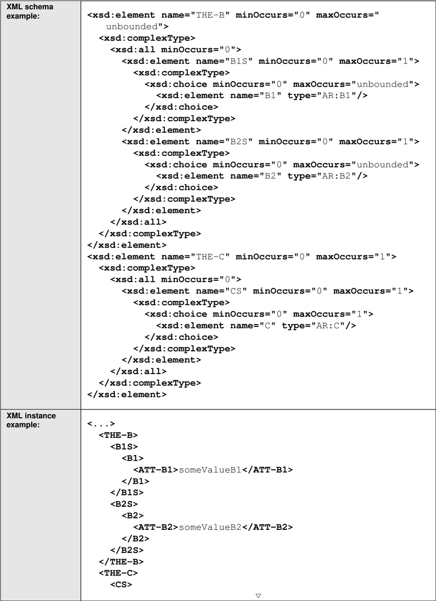

#### 4.4.8. 创建复合属性表示（0101）

**规范项：XML 模式生成规则：复合属性表示（0101）**

| 字段 | 内容 |
|---|---|
| 适用对象 | 属性 |
| 前置条件 | xml.roleWrapperElement == false && xml.roleElement == true && xml.typeWrapperElement == false && xml.typeElement == true |
| 目标模式 | 见下方代码 |
| 说明 | 创建一组表示该属性的 XML 元素：• 表示属性名称的 XML 元素。这些 XML 元素的名称由属性的 xml.name 定义。这些元素的最小出现次数是属性的下多重性；最大出现次数是属性的上多重性。 • 嵌套在角色 XML 元素中的、表示类型的 XML 元素至多允许一个。 |
| XML 模式示例 | 见下方代码 |
| XML 实例示例 | 见下方代码 |

目标模式：

```xml
<xsd:element name="<%=roleXmlName%>"
             minOccurs="<%=lowerMultiplicity%>" maxOccurs="<%=upperMultiplicity%>">
  <xsd:complexType>
    <xsd:choice minOccurs="<%=lowerMultiplicity%>" maxOccurs="1">
      <% for all types { %>
      <xsd:element name="<%=typeXmlName%>" type="<%=typeXmlNsPrefix%>:<%=typeXmlName%>"/>
      <% } // end for all types %>
    </xsd:choice>
  </xsd:complexType>
</xsd:element>
```

XML 模式示例：

```xml
<xsd:element name="THE-B" minOccurs="0" maxOccurs="unbounded">
  <xsd:complexType>
    <xsd:choice minOccurs="0" maxOccurs="1">
      <xsd:element name="B1" type="AR:B1"/>
      <xsd:element name="B2" type="AR:B2"/>
    </xsd:choice>
  </xsd:complexType>
</xsd:element>
<xsd:element name="THE-C" minOccurs="0" maxOccurs="1">
  <xsd:complexType>
    <xsd:choice minOccurs="0" maxOccurs="1">
      <xsd:element name="C" type="AR:C"/>
    </xsd:choice>
  </xsd:complexType>
</xsd:element>
```

XML 实例示例：

```xml
<...>
  <THE-B><B1><ATT-B1>someValueB1</ATT-B1></B1></THE-B>
  <THE-B><B2><ATT-B2>someValueB2</ATT-B2></B2></THE-B>
  <THE-C><C><ATT-C>someValueC</ATT-C></C></THE-C>
</...>
```

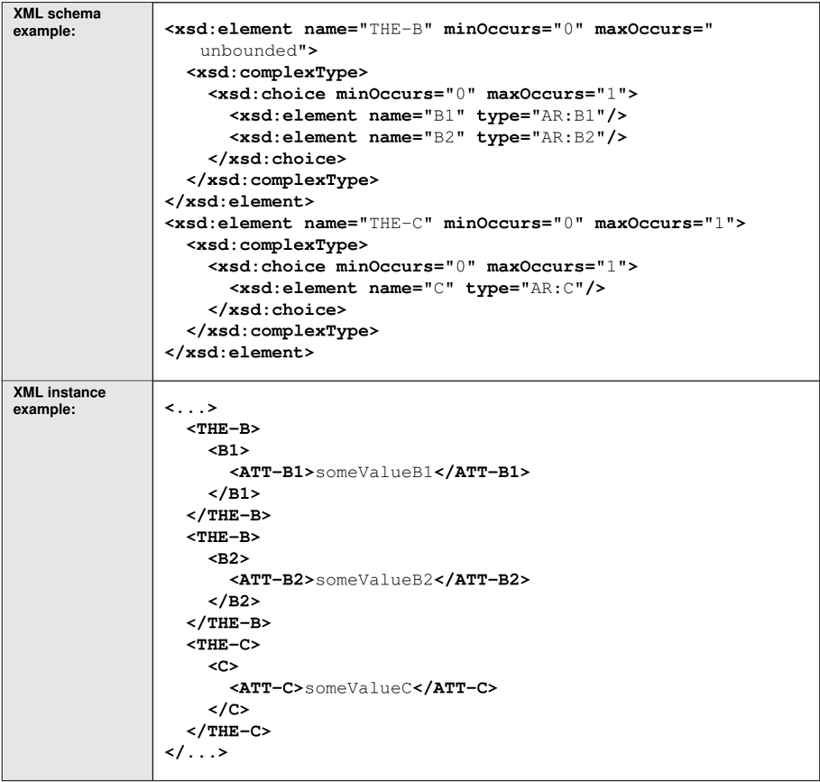

#### 4.4.9. 创建复合属性表示（0100）

**规范项：XML 模式生成规则：复合属性表示（0100）**

| 字段 | 内容 |
|---|---|
| 适用对象 | 属性 |
| 前置条件 | xml.roleWrapperElement == false && xml.roleElement == true && xml.typeWrapperElement == false && xml.typeElement == false |
| 目标模式 | 见下方代码 |
| 说明 | 创建一个表示该属性的 XML 元素：该 XML 元素的名称由属性的 xml.name 定义。该元素的最小出现次数是属性的下多重性；最大出现次数是属性的上多重性。类型的内容模型直接显示在该元素的声明内。 |
| XML 模式示例 | 见下方代码 |
| XML 实例示例 | 见下方代码 |

目标模式：

```xml
<% if (types.length > 1) { %>
<xsd:element name="<%=roleXmlName%>"
             minOccurs="<%=lowerMultiplicity%>" maxOccurs="<%=upperMultiplicity%>">
  <xsd:complexType>
    <xsd:choice minOccurs="0" maxOccurs="1">
      <% for all types { %>
      <xsd:group ref="<%=typeXmlNsPrefix%>:<%=typeXmlName%>"/>
      <% } // end for all types %>
    </xsd:choice>
  </xsd:complexType>
</xsd:element>
<% } else { // NOT type.length > 1 %>
<xsd:element name="<%=roleXmlName%>" type="<%=typeXmlNsPrefix%>:<%=typeXmlName%>"
             minOccurs="<%=lowerMultiplicity%>" maxOccurs="<%=upperMultiplicity%>"/>
<% } %>
```

XML 模式示例：

```xml
<xsd:element name="THE-B" minOccurs="0" maxOccurs="unbounded">
  <xsd:complexType>
    <xsd:choice minOccurs="0" maxOccurs="1">
      <xsd:group ref="AR:B1"/>
      <xsd:group ref="AR:B2"/>
    </xsd:choice>
  </xsd:complexType>
</xsd:element>
<xsd:element name="THE-C" type="AR:C" minOccurs="0" maxOccurs="1"/>
```

XML 实例示例：

```xml
<...>
  <THE-B><ATT-B1>someValueB1</ATT-B1></THE-B>
  <THE-B><ATT-B2>someValueB2</ATT-B2></THE-B>
  <THE-C><ATT-C>someValueC</ATT-C></THE-C>
</...>
```

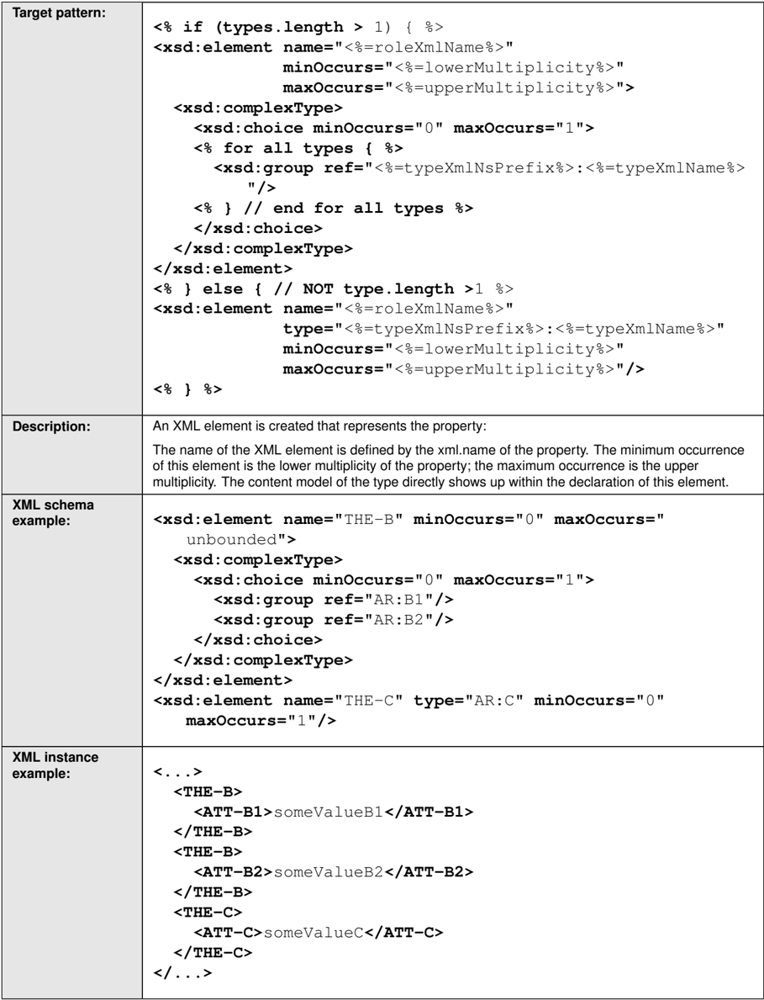

#### 4.4.10. 创建复合属性表示（0011）

**规范项：XML 模式生成规则：复合属性表示（0011）**

| 字段 | 内容 |
|---|---|
| 适用对象 | 属性 |
| 前置条件 | xml.roleWrapperElement == false && xml.roleElement == false && xml.typeWrapperElement == true && xml.typeElement == true |
| 目标模式 | 见下方代码 |
| 说明 | 创建一组表示该属性的 XML 元素：• 为属性的每个类型与子类型创建一个类型包装器 XML 元素。该 XML 元素的名称由属性类型的 xml.namePlural 定义。 • 嵌套在这些类型包装器中的只允许表示与该类型包装器相同类型的元素。 |
| XML 模式示例 | 见下方代码 |
| XML 实例示例 | 见下方代码 |

目标模式：

```xml
<% for all types { %>
<xsd:element name="<%=typeXmlNamePlural%>"
             minOccurs="<%if (lowerMultiplicity>0)  else %>"
             maxOccurs="1">
  <xsd:complexType>
    <xsd:choice minOccurs="<%=lowerMultiplicity%>" maxOccurs="<%=upperMultiplicity%>">
      <xsd:element name="<%=typeXmlName%>" type="<%=typeXmlNsPrefix%>:<%=typeXmlName%>"/>
    </xsd:choice>
  </xsd:complexType>
</xsd:element>
```

XML 模式示例：

```xml
<xsd:element name="B1S" minOccurs="0" maxOccurs="1">
  <xsd:complexType>
    <xsd:choice minOccurs="0" maxOccurs="unbounded">
      <xsd:element name="B1" type="AR:B1"/>
    </xsd:choice>
  </xsd:complexType>
</xsd:element>
<xsd:element name="B2S" minOccurs="0" maxOccurs="1">
  <xsd:complexType>
    <xsd:choice minOccurs="0" maxOccurs="unbounded">
      <xsd:element name="B2" type="AR:B2"/>
    </xsd:choice>
  </xsd:complexType>
</xsd:element>
<xsd:element name="CS" minOccurs="0" maxOccurs="1">
  <xsd:complexType>
    <xsd:choice minOccurs="0" maxOccurs="1">
      <xsd:element name="C" type="AR:C"/>
    </xsd:choice>
  </xsd:complexType>
</xsd:element>
```

XML 实例示例：

```xml
<...>
  <B1S><B1><ATT-B1>someValueB1</ATT-B1></B1></B1S>
  <B2S><B2><ATT-B2>someValueB2</ATT-B2></B2></B2S>
  <CS><C><ATT-C>someValueC</ATT-C></C></CS>
</...>
```

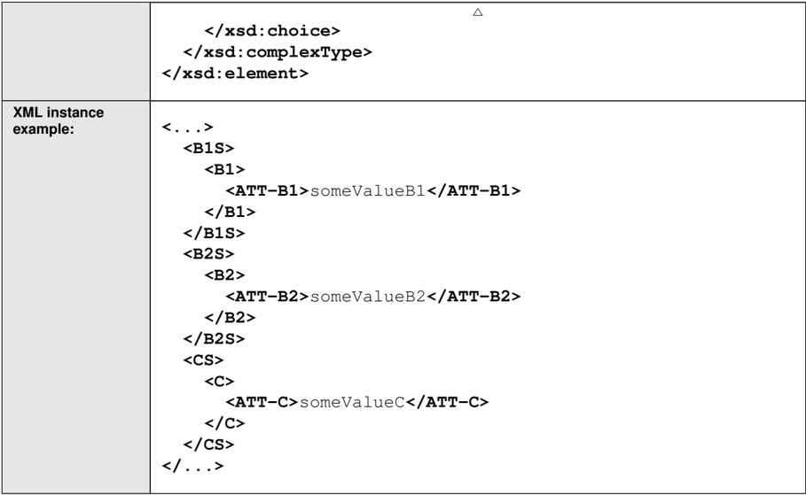

#### 4.4.11. 创建复合属性表示（0001）

**规范项：XML 模式生成规则：复合属性表示（0001）**

| 字段 | 内容 |
|---|---|
| 适用对象 | 属性 |
| 前置条件 | xml.roleWrapperElement == false && xml.roleElement == false && xml.typeWrapperElement == false && xml.typeElement == true |
| 目标模式 | 见下方代码 |
| 说明 | 创建一个表示该属性的 XML 元素：该 XML 元素的名称由属性类型的 xml.name 定义。该元素的最小出现次数是属性的下多重性；最大出现次数是属性的上多重性。类型的内容模型直接显示在该元素的声明内。 |
| XML 模式示例 | 见下方代码 |
| XML 实例示例 | 见下方代码 |

目标模式：

```xml
<xsd:choice minOccurs="<%=lowerMultiplicity%>" maxOccurs="<%=upperMultiplicity%>">
  <% for all types { %>
  <xsd:element name="<%=typeXmlName%>" type="<%=typeXmlNsPrefix%>:<%=typeXmlName%>"/>
  <% } // end for all types %>
</xsd:choice>
```

XML 模式示例：

```xml
<xsd:choice minOccurs="0" maxOccurs="unbounded">
  <xsd:element name="B1" type="AR:B1"/>
  <xsd:element name="B2" type="AR:B2"/>
</xsd:choice>
<xsd:choice minOccurs="0" maxOccurs="1">
  <xsd:element name="C" type="AR:C"/>
</xsd:choice>
```

XML 实例示例：

```xml
<...>
  <B1><ATT-B1>someValueB1</ATT-B1></B1>
  <B2><ATT-B2>someValueB2</ATT-B2></B2>
  <C><ATT-C>someValueC</ATT-C></C>
</...>
```

#### 4.4.12. 创建复合属性表示（0000）

**规范项：XML 模式生成规则：复合属性表示（0000）**

| 字段 | 内容 |
|---|---|
| 适用对象 | 属性 |
| 前置条件 | xml.roleWrapperElement == false && xml.roleElement == false && xml.typeWrapperElement == false && xml.typeElement == false |
| 目标模式 | 见下方代码 |
| 说明 | 不为该属性定义 XML 元素。属性的类型及其所有子类型的内容模型直接插入到表示拥有该属性的类的 xsd:group 中。 |
| XML 模式示例 | 见下方代码 |
| XML 实例示例 | 见下方代码 |

目标模式：

```xml
<xsd:choice minOccurs="<%=lowerMultiplicity%>" maxOccurs="<%=upperMultiplicity%>">
  <% for all types { %>
  <xsd:group ref="<%=typeXmlNsPrefix%>:<%=typeXmlName%>"/>
  <% } // end for all types %>
</xsd:choice>
```

XML 模式示例：

```xml
<xsd:choice minOccurs="0" maxOccurs="unbounded">
  <xsd:group ref="AR:B1"/>
  <xsd:group ref="AR:B2"/>
</xsd:choice>
<xsd:choice minOccurs="0" maxOccurs="1">
  <xsd:group ref="AR:C"/>
</xsd:choice>
```

XML 实例示例：

```xml
<...>
  <ATT-B1>someValueB1</ATT-B1>
  <ATT-B2>someValueB2</ATT-B2>
  <ATT-C>someValueC</ATT-C>
</...>
```

### 4.5. 创建引用表示（Create reference representation）

图 4.15 展示了引用（aggregation=none 的属性）的映射规则概览。引用总是被映射为 XML 元素。如果标记值 xml.propertyWrapperElement=true 应用于该属性，则为该引用创建一个包装器元素。

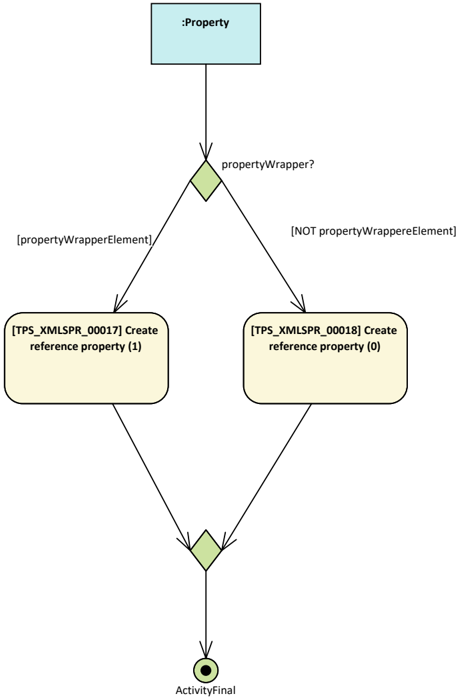

图 4.16 展示了一个使用引用的示例元模型。该示例用于说明以下两条映射规则。

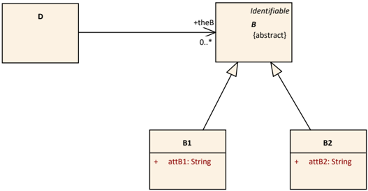

图 4.17 展示了引用的一个示例实例。该示例用于说明以下两条映射规则。

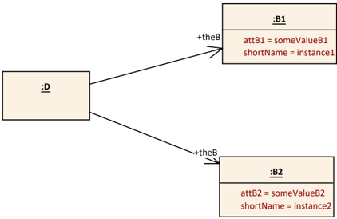

#### 4.5.1. 创建引用属性表示（1）（Create reference property representation (1)）

**规范项：XML 模式生成规则：带角色包装器元素的引用属性表示**

| 字段 | 内容 |
|---|---|
| 适用对象 | 属性 |
| 前置条件 | xml.roleWrapperElement=true |
| 目标模式 | 见下方代码 |
| 说明 | 以下 XML 元素表示一个属性（aggregation=none 时）：• 一个包装多个同名 XML 元素的 XML 元素。包装器的名称由属性的 xml.namePlural 定义。请注意，默认的 xml.namePlural 由默认的单数 XML 名称附加"-REFS"、"-TREFS"定义（见 [TPS_XMLSPR_00043] 与 [TPS_XMLSPR_00045]）。 • 表示引用本身的 XML 元素。该元素的名称由属性的 xml.name 定义。请注意，默认的 xml.name 由默认的单数 XML 名称附加"-REF"、"-TREF"定义（见 [TPS_XMLSPR_00043] 与 [TPS_XMLSPR_00045]）。 |
| XML 模式示例 | 见下方代码 |
| XML 实例示例 | 见下方代码 |

目标模式：

```xml
<xsd:element name="<%=roleXmlNamePlural%>"
             minOccurs="<%=lowerMultiplicity%>" maxOccurs="1">
  <xsd:complexType>
    <xsd:choice minOccurs="<%=lowerMultiplicity%>" maxOccurs="<%=upperMultiplicity%>">
      <xsd:element name="<%=roleXmlName%>">
        <xsd:complexType>
          <xsd:simpleContent>
            <xsd:extension base="AR:REF">
              <xsd:attribute name="DEST" type="<%=typeXmlNsPrefix%>:<%=typeXmlName%>--SUBTYPE-ENUM" use="required"/>
            </xsd:extension>
          </xsd:simpleContent>
        </xsd:complexType>
      </xsd:element>
    </xsd:choice>
  </xsd:complexType>
</xsd:element>
```

XML 模式示例：

```xml
<xsd:element name="THE-B-REFS">
  <xsd:complexType>
    <xsd:choice minOccurs="0" maxOccurs="unbounded">
      <xsd:element name="THE-B-REF">
        <xsd:complexType>
          <xsd:simpleContent>
            <xsd:extension base="AR:REF">
              <xsd:attribute name="DEST" type="B--SUBTYPES-ENUM" use="required"/>
            </xsd:extension>
          </xsd:simpleContent>
        </xsd:complexType>
      </xsd:element>
    </xsd:choice>
  </xsd:complexType>
</xsd:element>
```

XML 实例示例：

```xml
<...>
  <THE-B-REFS>
    <THE-B-REF DEST="B-1">instance1</THE-B-REF>
    <THE-B-REF DEST="B-2">instance2</THE-B-REF>
  </THE-B-REFS>
</...>
```

#### 4.5.2. 创建引用属性表示（0）（Create reference property representation (0)）

**规范项：XML 模式生成规则：不带角色包装器元素的引用属性表示**

| 字段 | 内容 |
|---|---|
| 适用对象 | 属性 |
| 前置条件 | xml.roleWrapperElement=false |
| 目标模式 | 见下方代码 |
| 说明 | 一个 XML 元素表示该引用。该元素的名称由属性的 xml.name 定义。请注意，默认的 xml.name 由默认的单数 XML 名称附加"-REF"、"-TREF"定义（见 [TPS_XMLSPR_00043] 与 [TPS_XMLSPR_00045]）。 |
| XML 模式示例 | 见下方代码 |
| XML 实例示例 | 见下方代码 |

目标模式：

```xml
<xsd:element name="<%=roleXmlName%>"
             minOccurs="<%=lowerMultiplicity%>" maxOccurs="<%=upperMultiplicity%>">
  <xsd:complexType>
    <xsd:simpleContent>
      <xsd:extension base="AR:REF">
        <xsd:attribute name="DEST" type="<%=typeXmlNsPrefix%>:<%=typeXmlName%>--SUBTYPES-ENUM" use="required"/>
      </xsd:extension>
    </xsd:simpleContent>
  </xsd:complexType>
</xsd:element>
```

XML 模式示例：

```xml
<xsd:element name="THE-B-REF" type="AR:REF" minOccurs="0" maxOccurs="unbounded">
  <xsd:complexType>
    <xsd:simpleContent>
      <xsd:extension base="AR:REF">
        <xsd:attribute name="DEST" type="B--SUBTYPES-ENUM" use="required"/>
      </xsd:extension>
    </xsd:simpleContent>
  </xsd:complexType>
</xsd:element>
```

XML 实例示例：

```xml
<...>
  <THE-B-REF DEST="B-1">instance1</THE-B-REF>
  <THE-B-REF DEST="B-2">instance2</THE-B-REF>
</...>
```

备注：如果应用了 [TPS_GST_00351] 中规定的转换，则不会出现该模式。

#### 4.5.3. 创建到外部命名空间中属性的引用（Create a reference to attributes in foreign namespaces）

**规范项：XML 模式生成规则：到外部命名空间中属性的引用**

| 字段 | 内容 |
|---|---|
| 适用对象 | 属性 |
| 前置条件 | xml.attributeRef=true |
| 目标模式 | `&lt;xsd:attribute ref="&lt;%=nsPrefix%&gt;:&lt;%=xmlName%&gt;" /&gt;` |
| 说明 | 一个引用外部命名空间（例如 XML 命名空间）属性的 XML 属性。该引用的名称由属性的 xml.name 在命名空间前缀之后串联定义。目前，只允许 XML 命名空间（nsPrefix=xml）。 |
| XML 模式示例 | 见下方代码 |
| XML 实例示例 | 见下方代码 |

XML 模式示例：

```xml
<xsd:attributeGroup name="WHITESPACE-CONTROLLED">
  <xsd:attribute ref="xml:space" use="required">
    <xsd:annotation>
      <xsd:documentation>
        This attribute is used to signal an intention that in that element,
        white space should be preserved by applications. It is defined
        according to xml:space as declared by W3C.
      </xsd:documentation>
    </xsd:annotation>
  </xsd:attribute>
</xsd:attributeGroup>
```

XML 实例示例：

```xml
<ADMIN-DATA>
  <LANGUAGE>EN</LANGUAGE>
  <USED-LANGUAGES>
    <L-10 L="EN" xml:space="default">English</L-10>
  </USED-LANGUAGES>
</ADMIN-DATA>
```

（UML 示例——创建到外部命名空间中属性的引用，图 4.18）

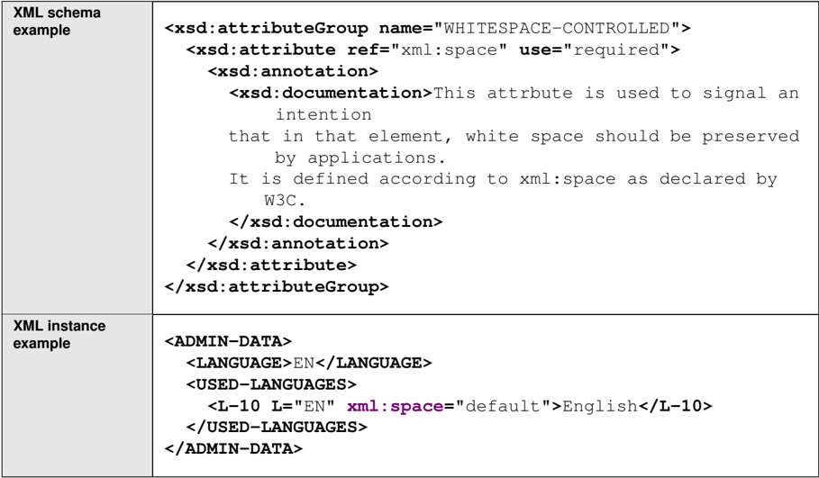

## 5. AUTOSAR XML 模式的符合性（AUTOSAR XML schema compliance）

AUTOSAR XML 模式必须与本文档规定的 AUTOSAR XML 模式生成规则所生成的那些模式等价。等价意味着：

- 在 AUTOSAR XML 模式下有效的 XML 文档，在符合要求的 XML 模式下也有效；
- 并且在 AUTOSAR XML 模式下无效的 XML 文档，在符合要求的 XML 模式下也无效。

## A. AUTOSAR 可追溯项变更历史

### A.1. 规范项映射：文档从 TR 迁移到 TPS

在本文档从技术报告（**TR**）迁移到模板规范（**TPS**）的过程中，规范项 ID 从 TR_APRXML_XXXXX 变更为 TPS_XMLSPR_XXXXX。规范项 ID 的确切映射如下表所示。

| 先前 ID | 生效 ID |
|---|---|
| TR_APRXML_00000 | TPS_XMLSPR_00000 |
| TR_APRXML_00001 | TPS_XMLSPR_00001 |
| TR_APRXML_00002 | TPS_XMLSPR_00002 |
| TR_APRXML_00003 | TPS_XMLSPR_00003 |
| TR_APRXML_00005 | TPS_XMLSPR_00005 |
| TR_APRXML_00006 | TPS_XMLSPR_00006 |
| TR_APRXML_00007 | TPS_XMLSPR_00007 |
| TR_APRXML_00008 | TPS_XMLSPR_00008 |
| TR_APRXML_00009 | TPS_XMLSPR_00009 |
| TR_APRXML_00010 | TPS_XMLSPR_00010 |
| TR_APRXML_00011 | TPS_XMLSPR_00011 |
| TR_APRXML_00012 | TPS_XMLSPR_00012 |
| TR_APRXML_00013 | TPS_XMLSPR_00013 |
| TR_APRXML_00014 | TPS_XMLSPR_00014 |
| TR_APRXML_00015 | TPS_XMLSPR_00015 |
| TR_APRXML_00016 | TPS_XMLSPR_00016 |
| TR_APRXML_00017 | TPS_XMLSPR_00017 |
| TR_APRXML_00018 | TPS_XMLSPR_00018 |
| TR_APRXML_00019 | TPS_XMLSPR_00019 |
| TR_APRXML_00022 | TPS_XMLSPR_00022 |
| TR_APRXML_00023 | TPS_XMLSPR_00023 |
| TR_APRXML_00024 | TPS_XMLSPR_00024 |
| TR_APRXML_00025 | TPS_XMLSPR_00025 |
| TR_APRXML_00026 | TPS_XMLSPR_00026 |
| TR_APRXML_00027 | TPS_XMLSPR_00027 |
| TR_APRXML_00028 | TPS_XMLSPR_00028 |
| TR_APRXML_00029 | TPS_XMLSPR_00029 |
| TR_APRXML_00030 | TPS_XMLSPR_00030 |
| TR_APRXML_00031 | TPS_XMLSPR_00031 |
| TR_APRXML_00032 | TPS_XMLSPR_00032 |
| TR_APRXML_00033 | TPS_XMLSPR_00033 |
| TR_APRXML_00034 | TPS_XMLSPR_00034 |
| TR_APRXML_00035 | TPS_XMLSPR_00035 |
| TR_APRXML_00036 | TPS_XMLSPR_00036 |
| TR_APRXML_00037 | TPS_XMLSPR_00037 |
| TR_APRXML_00038 | TPS_XMLSPR_00038 |
| TR_APRXML_00039 | TPS_XMLSPR_00039 |
| TR_APRXML_00040 | TPS_XMLSPR_00040 |
| TR_APRXML_00041 | TPS_XMLSPR_00041 |
| TR_APRXML_00042 | TPS_XMLSPR_00042 |
| TR_APRXML_00043 | TPS_XMLSPR_00043 |
| TR_APRXML_00044 | TPS_XMLSPR_00044 |
| TR_APRXML_00045 | TPS_XMLSPR_00045 |
| TR_APRXML_00046 | TPS_XMLSPR_00046 |
| TR_APRXML_00047 | TPS_XMLSPR_00047 |
| TR_APRXML_00054 | TPS_XMLSPR_00054 |
| TR_APRXML_00055 | TPS_XMLSPR_00055 |
| TR_APRXML_00056 | TPS_XMLSPR_00056 |
| TR_APRXML_00057 | TPS_XMLSPR_00057 |
| TR_APRXML_00058 | TPS_XMLSPR_00058 |
| TR_APRXML_00059 | TPS_XMLSPR_00059 |

### A.2. 按照 AUTOSAR 发布 R21-11 的本文档可追溯项历史

#### A.2.1. R21-11 中新增的规范项

无

#### A.2.2. R21-11 中变更的规范项

| 标题 |
|---|
| XML 模式生成规则：自定义简单类型（XML Schema production rule: custom simple type） |
| 可选的 XML 元素（Optional XML elements） |
| 实例引用的 XML 配置（XML Configuration of instance references） |

#### A.2.3. R21-11 中删除的规范项

无

### A.3. 按照 AUTOSAR 发布 R22-11 的本文档可追溯项历史

#### A.3.1. R22-11 中新增的规范项

无

#### A.3.2. R22-11 中变更的规范项

| 标题 |
|---|
| XML 模式生成规则：xsd:group（XML Schema production rule: xsd:group） |
| XML 模式生成规则：xsd:attributeGroup（XML Schema production rule: xsd:attributeGroup） |
| XML 模式生成规则：xsd:complexType（XML Schema production rule: xsd:complexType） |
| XML 模式生成规则：带简单内容的 xsd:complexType（XML Schema production rule: xsd:complexType with simple content） |
| XML 模式生成规则：子类型枚举（XML Schema production rule: enumeration of subtypes） |

#### A.3.3. R22-11 中删除的规范项

无

### A.4. 按照 AUTOSAR 发布 R23-11 的本文档可追溯项历史

#### A.4.1. R23-11 中新增的规范项

| 标题 |
|---|
| 应用于属性的标记上的约束（Constraints on tags applied to properties） |
| 应用于类的标记上的约束（Constraints on tags applied to classes） |
| xml.*Element 标记取值上的约束（Constraints on values of xml.*Element tagged values） |

#### A.4.2. R23-11 中变更的规范项

无

#### A.4.3. R23-11 中删除的规范项

无

## 参考文献

<a id="ref-1"></a>[1] XML Schema 1.0 http://www.w3.org/TR/xmlschema-1

<a id="ref-2"></a>[2] Meta Model
> AUTOSAR_FO_MMOD_MetaModel

<a id="ref-3"></a>[3] XML Metadata Interchange (XMI) Specification version 2.1 http://www.omg.org/cgi-bin/apps/doc?formal/05-09-01.pdf

<a id="ref-4"></a>[4] XML Metadata Interchange (XMI) Specification version 1.2 http://www.omg.org/cgi-bin/apps/doc?formal/02-01-01.pdf

<a id="ref-5"></a>[5] Unified Modeling Language: Superstructure, Version 2.0, OMG Available Specification, ptc/05-07-04

<a id="ref-6"></a>[6] Unified Modeling Language OCL, Version 2.0, OMG Available Specification, ptc/05-06-06 http://www.omg.org/cgi-bin/apps/doc?ptc/05-06-06.pdf

<a id="ref-7"></a>[7] ARXML Serialization Rules
> AUTOSAR_FO_TPS_ARXMLSerializationRules

<a id="ref-8"></a>[8] MSR-SW http://www.msr-wg.de/medoc/download/msrsw/v230/msrsw_v230-eadoc-

<a id="ref-9"></a>[9] XHTML http://www.w3.org/TR/xhtml11/

<a id="ref-10"></a>[10] Generic Structure Template
> AUTOSAR_FO_TPS_GenericStructureTemplate

<a id="ref-11"></a>[11] Meta-Object Facility MOF, Version 2.0, OMG Available Specification, ptc/04-10-15 http://www.omg.org/cgi-bin/apps/doc?ptc/04-10-15.pdf
