<!-- 源文档 AUTOSAR_FO_PRS_E2EProtocol（R23-11），协议规范（PRS），不受 Type A 七章骨架约束；章节结构镜像源文档自身编号。规范项 ID [PRS_E2E_*]（1,173 项）按 2026-11-03 批次决议整体省略（项正文照常翻译，有标题的项以粗体标题行 + 正文段落呈现，无标题的项以正文段落呈现）；RS_E2E_* 回引、(RS_…) 追溯行与 glyph 标记随项一并省略；PRS_E2E_UC_*/PRS_E2E_CONSTR_*/PRS_E2E_USE_* 形式的正文名义引用去括号以标识符形式保留。源第 5 章「Requirements Tracing」为纯 ID 追溯表（整章），按 2026-11-03 决议整章省略，后续章节重编号（源 6→5、7→6、8→7、9→8）；正文中的章节交叉引用已随之重编号，而图号与表号保留源编号（图 6.x/表 6.x 对应文章 §5.x）。源第 1 章的 1 处内容图（图1.1）与第 6–9 章的 147 张内容图按源图号嵌入（图 6.8、6.23、6.48、6.95 各为两段式图，两段均嵌入并按 -2 后缀命名）；源表 6.112（Profile 4m 报文头）与表 6.139（Profile 44m 报文头）在 markdown 转换中仅为图片、无 GFM 表——已依据语料 PDF 第 187/200 页逐格转写为 GFM 表（两表布局相同）；附件 A 的图 A.1–A.13 全部嵌入。其余 ~287 处图引用为页面装饰条（15 种重复哈希，~345×36 px）与 4 个字形图标，丢弃；图表标签散落（CF1/CF2/App data element/E2E Header 等）按转换噪声丢弃。封面元数据表、免责声明与目录按 EXP 流程省略。附件 B 变更历史为跨 5 个版本的 ID 枚举表（R19-11…R23-11），ID 按批次决议不可出现，以条目数陈述并保留带有标题的行（此为运行决策，请用户在确认关核验）。 -->

## 1. 引言和功能概述

E2E 通信保护的概念假定：安全相关 [\[1\]](#ref-1) 数据交换应在运行时受到保护，免受通信链路上故障的影响（见图 1.1）。使用 E2E 通信保护的发送方与接收方之间检测到的故障包括系统性软件故障（例如由发送方或接收方的较低通信层引入的故障），以及由 MCU 硬件、通信外设、收发器、通信线路或其他通信基础设施引入的随机硬件故障。

此类故障的例子有随机硬件故障（例如 CAN 收发器的寄存器损坏）、干扰（例如由 EMC 引起）以及较低通信层的系统性故障（例如 RTE、IOC、COM 和网络协议栈）。

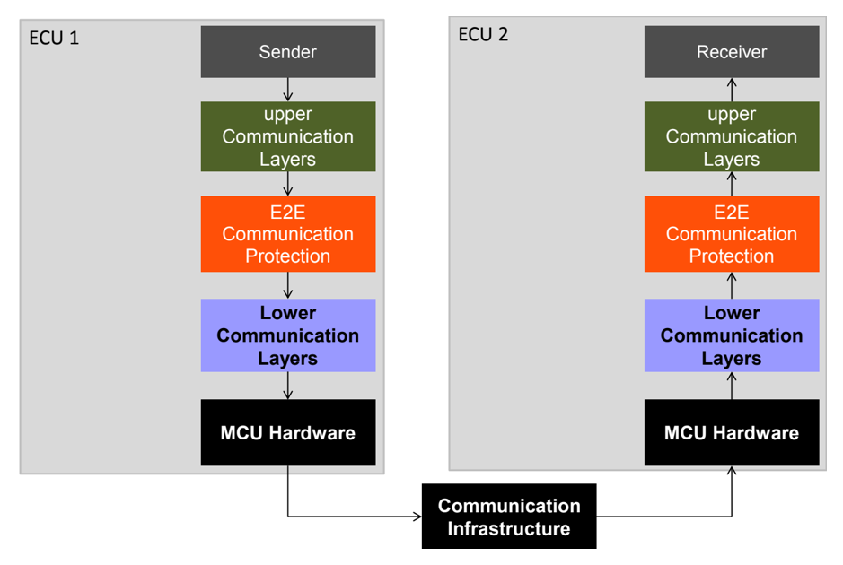

通过使用 E2E 通信保护机制，较低软件层和硬件层中的故障可以在运行时被检测和处理。E2E 监督（**E2E Supervision**）为 E2E 通信保护提供机制，适用于具有最高至 ASIL D 要求的安全相关通信。

保护机制的算法在 E2E 监督中实现。E2E 监督的调用方负责正确使用 E2E 监督，特别是为 E2E 监督例程提供正确的参数。

E2E 通信保护允许以下操作：

1. 通过添加控制数据来保护要发送的安全相关数据；
2. 使用该控制数据验证接收到的安全相关数据；以及
3. 将检查结果提供给接收方，接收方随后必须对其充分处理。

为了提供兼顾灵活性与标准化的适当解决方案，AUTOSAR 规定了一组灵活的 E2E 配置文件（**E2E Profile**），它们实现了 E2E 通信保护机制的适当组合。每个规定的 E2E 配置文件都具有一组固定的机制，以及用于配置协议报文头布局和接收侧状态评估的配置选项。

E2E 监督可以从通信中间件调用，例如从自适应平台的 ara::com 或经典平台的 RTE 调用。它也可以以非标准化的方式从其他软件调用，例如非易失性存储器管理器、本地 IPC 或 ECU 内总线协议栈。

要利用 E2E 监督来满足通信的特定安全需求，其恰当使用取决于多个方面。所规定的配置文件能够以很高的概率检测多种多样的通信故障。然而，使用特定的 E2E 配置文件要求用户证明所选配置文件针对所考虑的用例提供了充分的错误检测能力（考虑到各种影响因素，例如硬件失效率、误码率、网络中的节点数量、消息的重复频率、网关的使用、通信信道上潜在的软件故障），以及对检测到的故障的适当反应（例如撤销重复消息、判定通信超时，或通过发起安全反应来应对损坏的消息）。

本规范还规定了 CRC 例程的功能、API 和配置。

规定了以下用于 CRC 计算的例程：

- CRC8：SAEJ1850
- CRC8H2F：CRC8 0x2F 多项式
- CRC16
- CRC32
- CRC32P4：CRC32 0xF4ACFB13 多项式
- CRC64：CRC-64-ECMA

对于所有例程（CRC8、CRC8H2F、CRC16、CRC32、CRC32P4 和 CRC64），可以采用以下计算方法：

- 基于表的计算：执行速度快，但代码规模较大（ROM 表）
- 运行时计算：执行较慢，但代码规模小（无 ROM 表）
- 硬件支持的 CRC 计算（设备特定）：执行快，占用 CPU 时间少

所有例程都是可重入的，可以同时被多个应用使用。硬件支持的 CRC 计算未来可能会被某些设备支持。

## 2. 缩略语和简称

以下术语表包含了与通信管理相关的、未包含在 [2, AUTOSAR 术语表] 中的缩略语和简称。

表2.1：缩略语和简称

**Data ID（数据 ID）**
> 唯一地标识消息/数据元素/数据的标识符。

**Source ID（源 ID）**
> 唯一地标识消息/数据元素/数据的来源的标识符（即：当不同的来源产生相同的消息/数据元素/数据时——例如不同的客户端调用服务器上的同一方法）。

**Repetition（重复）**
> 同一条消息被接收了不止一次。

**Loss（丢失）**
> 一条消息未被接收到。

**Delay（延迟）**
> 一条消息晚于预期被接收到。

**Insertion（插入）**
> 插入了意外的信息或一条额外的消息。

**Masquerade（伪装）**
> 非真实信息被接收方当作真实信息接受。

**Incorrect addressing（错误寻址）**
> 信息被从错误的发送方接受，或被错误的接收方接受。

**Corruption（损坏）**
> 改变信息的通信故障。

**Asymmetric information（不对称信息）**
> 接收方从同一发送方接收到不同的信息。

**Subset（子集）**
> 来自某个发送方的信息仅被接收方的一个子集接收到。

**Blocking（阻塞）**
> 阻塞对通信信道的访问。

**FTTI**
> 故障容忍时间间隔（**Fault tolerant time interval**），故障在危险发生之前可以处于活动状态的最长时间。

**tFD**
> 故障检测时间间隔（**Fault detection time interval**）。故障发生与其被检测到之间的时间。

**tFR**
> 故障反应时间间隔（**Fault reaction time interval**）。故障检测与对故障作出反应（切换到安全状态或启动紧急运行）之间的时间。

## 3. 相关文档

### 3.1. 输入文件

<a id="ref-1"></a>[1] ISO 26262:2018（所有部分）- Road vehicles - Functional Safety，电子版见 https://www.iso.org

<a id="ref-2"></a>[2] Glossary，AUTOSAR_FO_TR_Glossary

<a id="ref-3"></a>[3] Specification of CRC Routines，AUTOSAR_CP_SWS_CRCLibrary

<a id="ref-4"></a>[4] Specification of SW-C End-to-End Communication Protection Library，AUTOSAR_CP_SWS_E2ELibrary

### 3.2. 标准和规范

1. SAE-J1850 8 位 CRC
2. CCITT-FALSE 16 位 CRC。参见：

ITU-T Recommendation X.25 (1096)（先前为 'CCITT Recommendation'）SERIES X: DATA NETWORKS AND OPEN SYSTEM COMMUNICATION Public data networks - Interfaces

Interface between Data Terminal Equipment (DTE) and Data Circuit-terminating Equipment (DCE) for terminals operating in the packet mode and connected to public data networks by dedicated circuit

Section 2.2.7.4 'Frame Check Sequence (FCS) field' and Appendix I 'Examples of data link layer transmitted bit patterns by the DCE and the DTE'，http://www.itu.int/rec/dologin_pub.asp?lang=e&amp;id=T-REC-X.25-199610-I!!PDF-E&amp;type=items

3. IEEE 802.3 Ethernet 32 位 CRC
4. '32-Bit Cyclic Redundancy Codes for Internet Applications' [Koopman 2002]
5. Philip Koopman（卡内基梅隆大学）对 CRC 多项式的收集与评估，https://users.ece.cmu.edu/~koopman/crc/

## 4. 约束和假设

### 4.1. 限制

E2E 通信保护的能力取决于所使用的通信类型。从 E2E 的角度区分以下类型：

- 基于信号的通信
- 带事件的服务导向通信
- 客户端/服务器架构中的服务导向通信
- 信号到服务的转换

一般而言，E2E 保护机制的行为应当是相同的。但是，依据通信类型的不同，存在一些限制。

#### 4.1.1. 一般限制

- 在较低层检测到的通信错误（例如通过以太网 FCS、IP 报文头校验和、UDP 校验和、SOME/IP 报文头异常检测到）将导致丢弃相关消息。因此，这些消息可能根本不会到达应用。

#### 4.1.2. 基于信号的通信中的限制

这也称为发送方/接收方通信。

- E2E 通信保护仅限于周期性或半周期性的数据通信范式，其中接收方对数据的定期接收存在预期，并且在通信丢失/超时或错误的情况下执行错误处理。
- 如果保护（发送方）或检查（接收方）的 E2E 函数之一未被周期性地调用，则某些通信失效模式（丢失、延迟）可能无法被检测到。
- 如果在数据元素级别调用 E2E 保护（例如从 SW-C 或从 E2E 保护包装器调用），并且使用 1:N 通信模型，且数据元素通过多个 I-PDU 发送，则所有这些 I-PDU 应具有相同的布局。
- 目前 AUTOSAR 未提供描述和处理同一数据元素的多个布局的功能（例如在 RTE 内根据 ECU 内和 ECU 间通信使用不同的保护机制）。因此，对于 1:N 的发送方-接收方关系，E2E 保护的使用者有责任为要保护的数据元素选择一个合适的布局。例如，对于 1:N 的发送方-接收方关系，消息布局可用于向位于 ECU 内部和外部的接收方传输受保护的数据元素。
- 如果给定的发送方-接收方通信仅是 ECU 内的（在微控制器内部），则配置中未定义序列化数据的布局应是什么。另一方面，由于该通信是 ECU 内的，两侧的软件很可能由同一个 RTE 生成器生成，因此布局的决定可以是生成器特定的。建议对数据进行序列化，使 CRC 位于 CRC 的配置文件特定位置、计数器位于计数器的配置文件特定位置（如同 ECU 间通信那样）。
- 仅考虑排队发送方-接收方通信的非阻塞特性（不支持排队通信的阻塞特性）。

#### 4.1.3. 带事件的服务导向通信中的限制

这也称为事件通信。（注意，这里的名称「事件」有些令人困惑，因为周期性通信是必需的。该名称取自 SOME/IP 事件。）

- E2E 通信保护仅限于周期性或半周期性的数据通信范式，其中接收方对数据的定期接收存在预期，并且在通信丢失/超时或错误的情况下执行错误处理。
- 如果保护（发送方）或检查（接收方）数据的 E2E 函数之一未被周期性地调用，则某些通信失效模式（丢失、延迟）可能无法被检测到。

#### 4.1.4. 客户端/服务器架构中服务导向通信的限制

所规定的针对方法（method）的 E2E 通信保护仅限于：

- N 个客户端与一个专用服务器之间的通信（N:1）；这意味着，一个受 E2E 保护的服务在整个系统中恰好由一个服务器提供。换言之，如果在数据元素级别调用 E2E 保护，则不支持 N:1 之外的多种性、隐式通信和其余的通信模型（特别是客户端-服务器模型）。

所规定的针对方法的 E2E 通信保护可能无法检测所有通信失效模式：

- 如果方法请求未被周期性地调用，则服务器处接收到的请求的某些通信失效模式（丢失、延迟）可能无法被检测到。
- 由于所定义的 E2E 保护机制假定服务器对请求数据的客户端没有先验知识（N:1 通信），因此客户端特定的通信失效模式（重复、插入）在服务器处接收到的请求中可能无法被检测到。在这种情况下，需要在应用层实施额外的措施来应对那些未检测到的失效模式并完善 E2E 保护，或者提供论据表明这些失效模式对特定项目不相关。

以下 E2E 参数的值由标准定义，不得更改：

- dataIdMode
- counterOffset
- crcOffset
- dataIdNibbleOffset
- offset

不建议在客户端-服务器通信中使用 E2E Profile 1、2、11 和 22。

#### 4.1.5. 信号到服务的转换

信号到服务的转换仅限于发送方/接收方通信与带事件的服务导向通信之间的转换。

### 4.2. 汽车域的适用性

E2E 监督适用于实现安全相关汽车系统，这些系统由分布在车辆中不同 ECU 上的各种 SW-C 实现，并通过通信链路交互。该监督也可用于 ECU 内通信（例如同一微控制器中的存储器分区、进程、操作系统/虚拟机之间，或 CPU 核心之间、微控制器之间）。

## 5. 功能规格

本章包含 E2E 监督内部功能行为的规范，其中包括：E2E 报文头的布局如何定义、E2E 报文头如何创建、E2E 报文头如何求值，以及 E2E 状态机如何定义。关于 E2E 监督的一般性介绍，参见第 [1](#1-引言和功能概述) 章。

像 PRS_E2E_UC_xxx 这样的用例条目表示关于如何使用 E2E 协议的一般性提示。但是，它们不应被读作需求或限制。

### 5.1. 通信保护概览

通信保护机制的一个重要方面是它的标准化以及面向不同目的的灵活性。这通过拥有一组 E2E 配置文件来解决：每个配置文件定义了一种保护机制的组合、一种消息格式和一组配置参数。

此外，一些 E2E 配置文件具有标准的 E2E 变体（**E2E variant**）。E2E 变体只是一组与给定 E2E 配置文件配合使用的配置选项。例如，在 E2E Profile 1 中，CRC 和计数器的位置是可配置的。E2E 变体 1A 要求 CRC 从位 0 开始、计数器从位 8 开始。

E2E 通信保护的工作方式如下：

- 发送方：向传输的数据添加控制字段，如 CRC 或计数器；
- 接收方：对来自所接收数据的控制字段求值、计算控制字段（例如对所接收数据进行 CRC 计算），并将计算出的控制字段与期望/接收到的内容进行比较。

图6.1：安全协议概念（含 E2E 报文头的示例位置）

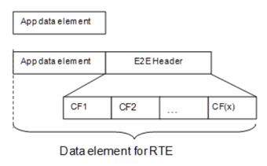

每个 E2E 配置文件都具有一组特定的控制字段，具有特定的功能行为和用于检测通信故障的特定属性。

### 5.2. E2E 配置文件概览

E2E 配置文件提供了一套一致的数据保护机制，用于针对故障模型中所考虑的故障进行保护。

每个 E2E 配置文件通过不同的算法提供一种保护通信的替代方式。但是，各 E2E 配置文件具有相似的接口和行为。

每个 E2E 配置文件使用以下数据保护机制的一个子集：

1. 一个 CRC，由 CRC 监督提供；
2. 一个序列计数器（**Sequence Counter**），在每次传输请求时递增，接收侧检查其值是否正确递增；
3. 一个存活计数器（**Alive Counter**），在每次传输请求时递增，接收侧只检查其值是否发生变化，而不检查是否正确递增；
4. 一个针对通过端口发送的每个端口数据元素的特定 ID，或针对每个消息组的特定 ID（对系统全局，系统可能包含多个 ECU）；
5. 一个针对数据元素或消息组的每个来源（例如客户端）的特定 ID；
6. 一个消息类型，在针对方法的 E2E 通信保护中区分请求与响应；
7. 一个消息结果，在针对方法的 E2E 通信保护中区分正常响应与错误响应；
8. 超时检测：
9. (a) 接收方通信超时。
10. (b) 发送方确认超时。

根据所使用的通信和网络协议栈，这些机制的适当子集被定义为 E2E 通信配置文件。

上述机制中的一部分在 RTE、COM 和/或通信协议栈中实现。但是，为了减少或避免向这些模块分配安全需求，它们不被纳入考虑：E2E 监督在内部提供所有机制（仅使用 CRC 监督）。

E2E 配置文件既可用于 ECU 间通信，也可用于 ECU 内通信。E2E 配置文件是为特定的通信基础设施规定的，例如 CAN、CAN FD、FlexRay、LIN、以太网。

用户根据系统从 E2E 监督提供的 E2E 配置文件中选择要使用的 E2E 配置文件。

#### 5.2.1. 错误检测

内部监督机制的错误检测与报告应按照本文档规定的预定义 E2E 配置文件实现。

AUTOSAR E2E 协议使用以下错误代码（见表 6.1）：

表6.1：错误代码

| 错误或状态类型 | 相应代码 |
|---|---|
| 至少一个指针参数是 NULL 指针 | E2E_E_INPUTERR_NULL |
| 至少一个输入参数错误，例如超出范围 | E2E_E_INPUTERR_WRONG |
| 函数成功完成 | E2E_E_OK |

#### 5.2.2. E2E 配置文件的公共类型

一些 E2E 配置文件使用了在不同配置文件之间共享的公共数据类型——这些共享类型在本节中引入，而不是放在各个配置文件特定的小节中。

##### 5.2.2.1. Profile Xm 消息类型枚举

E2E_PXXmProtect、E2E_PXXmForward 和 E2E_PXXmCheck 函数的 MessageType 参数应被设置为以下枚举值之一（见表 6.2）：

表6.2：E2E Profile Xm 消息类型枚举

| 名称 | 值 | 说明 |
|---|---|---|
| STD_MESSAGETYPE_REQUEST | 0 | 消息的类型是从客户端发送到服务器的请求消息 |
| STD_MESSAGETYPE_RESPONSE | 1 | 消息的类型是从服务器发送到客户端的响应消息 |

##### 5.2.2.2. Profile Xm 消息结果枚举

E2E_PXXmProtect、E2E_PXXmForward 和 E2E_PXXmCheck 函数的 MessageResult 参数应被设置为以下枚举值之一（见表 6.3）：

表6.3：E2E Profile Xm 消息结果枚举

| 名称 | 值 | 说明 |
|---|---|---|
| STD_MESSAGERESULT_OK | 0 | 响应消息中的结果类型是正常（即无错误）结果。该值也用于请求消息，请求消息中该字段的值固定为此值 |
| STD_MESSAGERESULT_ERROR | 1 | 响应消息中的结果类型是错误（即有错误）结果 |

#### 5.2.3. E2E 配置文件的一般功能

每个 E2E 配置文件提供以下 3 种功能：

1. 保护（Protect）
2. 转发（Forward）
3. 检查（Check）

「保护」功能，简称「保护函数」，创建 E2E 报文头，从而保护要通过通信介质发送的数据。

「转发」功能，简称「转发函数」，与保护函数类似，为要传输的数据创建报文头，但允许额外复制一个已接收的 E2E 状态。该函数的主要用例是信号到服务的转换（**SignalService-Translation**），例如接收到一个受 E2E 保护的信号，并且需要在输出侧复制该 E2E 状态。

「检查」功能，简称「检查函数」，对所接收消息的 E2E 报文头求值，并检查已发生的通信故障。这些故障反映在返回的 E2E 状态中。

除了单个 E2E 配置文件之外，E2E 状态机（**E2E-Statemachine**）会在更长的时间段内对返回的 E2E 状态进行评估。

##### 5.2.3.1. 计数器的功能

在接收侧，通过将所接收数据的计数器与先前所接收数据的计数器进行对比，可以检测到以下情况：

1. 重复（Repetition）：
   - a. 自上次调用 E2E 监督检查函数以来没有新数据到达，
   - b. 数据被重复发送
2. 正常（OK）：
   - a. 计数器递增 1（即没有数据丢失），
   - b. 计数器递增超过 1，但仍在允许的限度内（即有一些数据丢失），
3. 错误（Error）：计数器递增超过允许值（即丢失了太多数据）。

情况 1 对应于未通过的存活计数器检查，情况 3 对应于未通过的序列计数器检查。

上述要求由后续文档小节中的 UML 图更详细地规定。

##### 5.2.3.2. 超时检测

前面提到的机制（例如 Profile 5 的 CRC、计数器、Data ID）使得在接收方独立于数据传输运行时——即接收方不被阻塞地等待数据元素或消息，而是读取当前可用的数据（即检查是否有新数据可用）——能够检查所接收数据元素的有效性。这样，借助计数器，接收方可以检测到通信丢失和超时。

属性 State-&gt;NewDataAvailable == FALSE 表示传输介质（例如 RTE）报告传输介质上没有新的数据元素可用。属性 State-&gt;Status = E2E_PXXSTATUS_REPEATED 表示传输介质（例如 RTE）提供了新的有效数据元素，但该数据元素与前一个有效数据元素具有相同的计数器。这两种情况都表示自上一个周期以来有效数据不可用。

##### 5.2.3.3. 循环冗余校验

循环冗余校验（Cyclic Redundancy Check），简称 CRC，用于判定比特是否在消息传输过程中发生了翻转。

与基于计数器求值所指示的错误相反——CRC 错误不太可能是「误报」（例如，当使用良好的 CRC 多项式时，检测到的 CRC 错误表明发生了数据损坏）。考虑到这一事实，一个未检测到任何 CRC 错误的数据流中包含大量未检测到的损坏数据是难以置信的。

因此，针对 CRC 错误采取更严格的反应是恰当的。在检测到第一个 CRC 错误之后，后续的数据流可能包含大量未检测到的损坏数据。

接收方能够容忍的 CRC 错误的最大数量应当受到限制，因为在其错误检测和确认时间间隔内接收到多于一个未检测到的错误消息的概率不可忽略。错误的 CRC 表明通信信道的完整性已受到影响。

由此可能产生的后果是超出接收方所设计的故障容忍能力（参见 UC_E2E_00170）。

### 5.3. E2E 配置文件规范——通用部分

本章包含在多于一个配置文件规范中使用的 E2E 配置文件规范部分。E2E 配置文件的行为独立于特定配置文件进行描述。正文和图使用诸如 'XX' 的占位符，它们被替换为配置文件特定的值或文本。所有配置文件特定的内容（包括这些占位符）在相应的配置文件特定小节中定义。本章不适用于方法配置文件。本章仅适用于 DataID 字段和 Length 字段属于配置文件报文头的配置文件。E2E 机制可以检测以下故障或故障的影响：

表6.4：可检测的通信故障

| 故障 | 主要安全机制 |
|---|---|
| 信息的重复 | 计数器 |
| 信息的丢失 | 计数器 |
| 信息的延迟 | 计数器 |
| 信息的插入 | Data ID |
| 伪装 | Data ID、CRC |
| 错误寻址 | Data ID |
| 信息的错误序列 | 计数器 |
| 信息的损坏 | CRC |
| 从一个发送方向多个接收方发送的不对称信息 | CRC（检测任一接收方处的损坏） |
| 来自一个发送方的信息仅被接收方的一个子集接收到 | 计数器（特定接收方上的丢失） |
| 对通信信道的访问被阻塞 | 计数器（丢失或超时） |

#### 5.3.1. 计数器

在 E2E 配置文件中，计数器由 E2E 配置文件初始化、递增、重置和检查。计数器不被 E2E 监督的调用方操纵或使用。

在 E2E 配置文件中，在发送侧，对于数据元素的第一次传输请求，计数器应初始化为 0，并且对之后的每次发送请求递增 1。当计数器达到最大值时，它应在下一次发送请求时从 0 重新开始。计数器的最大值取决于计数器的大小：0xFF（8 位计数器）、0xFF'FF（16 位计数器）或 0xFF'FF'FF'FF（32 位）。

#### 5.3.2. Data ID（数据 ID）

唯一的 Data ID 用于验证每一条传输的安全相关数据元素的身份。

**用例**：在 E2E 配置文件中，Data ID 应当在通信系统（由多个各自发送不同数据的 ECU 组成）的网络内全局唯一。

在使用 E2E 监督保护数据元素的情况下（即从 RTE 调用），由于通信的多种性（1:1 或 1:N），数据元素的消费者只期望一个特定的数据元素，E2E 监督使用 Data ID 对其进行检查。

在使用 E2E 监督保护消息的情况下（即从 COM 调用），接收方 COM 在接收时只期望一条特定的消息，E2E 监督使用 Data ID 对其进行检查。

#### 5.3.3. 长度

引入 Length 字段是为了支持可变长度——存储序列化数据的 Data[] 数组在每个周期可能具有不同的长度。Length 包括用户数据 + E2E 报文头（CRC + 计数器 + Length + DataID）。

#### 5.3.4. CRC

E2E 配置文件根据消息的长度使用不同长度的 CRC，以确保高检测率和高汉明距离（**Hamming Distance**）。

E2E 配置文件应使用第 [5.7](#57-e2e-profile-4-规范) 节、第 [5.10](#510-e2e-profile-7-规范) 节、第 [5.11](#511-e2e-profile-8-规范) 节、第 [5.14](#514-e2e-profile-44-规范) 节中列出的 CRC 函数来计算 CRC。

**注意：**Crc_CalculateCRC32P4() 与 FlexRay、CAN 和 TCP/IP 所使用的 32 位 CRC 不同。它也由不同的软件模块提供（FlexRay、CAN 和 TCP/IP 协议栈的 CRC/校验和由通信控制器的硬件支持或通信协议栈软件提供，而不是由 CRC 监督提供）。

CRC 应对整个 E2E 报文头（不包括 CRC 字节）和用户数据计算。

#### 5.3.5. 超时检测

前面提到的机制（CRC、计数器、Data ID、Length）使得在接收方独立于数据传输运行时——即接收方不被阻塞地等待数据元素或消息，而是读取当前可用的数据（即检查是否有新数据可用）——能够检查所接收数据元素的有效性。这样，借助计数器，接收方可以检测到通信丢失和超时。

#### 5.3.6. E2E 报文头的创建

##### 5.3.6.1. E2E_PXXProtect()

函数 E2E_PXXProtect() 执行本节后续各图所规定的步骤。

函数 E2E_PXXProtect() 应具有如图 6.2 所示的整体行为。

图6.2：E2E_PXXProtect() 的行为

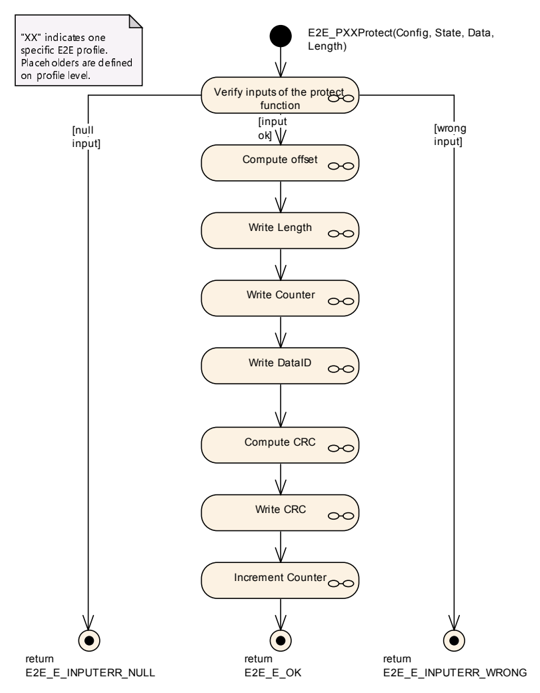

E2E_PXXProtect() 中的「验证保护函数的输入」步骤应如图 6.3 所示运行。

图6.3：E2E_PXXProtect() 的「验证保护函数的输入」步骤

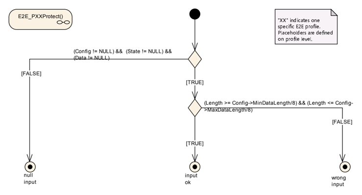

图6.4：E2E_PXXProtect()、E2E_PXXForward() 和 E2E_PXXCheck() 的「计算偏移」步骤

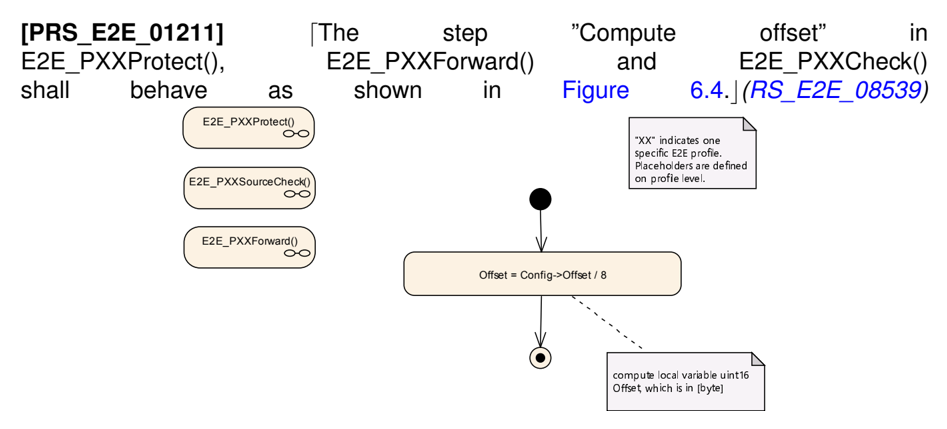

图6.8：E2E_PXXProtect()、E2E_PXXCheck() 和 E2E_PXXForward() 的「计算 CRC」步骤

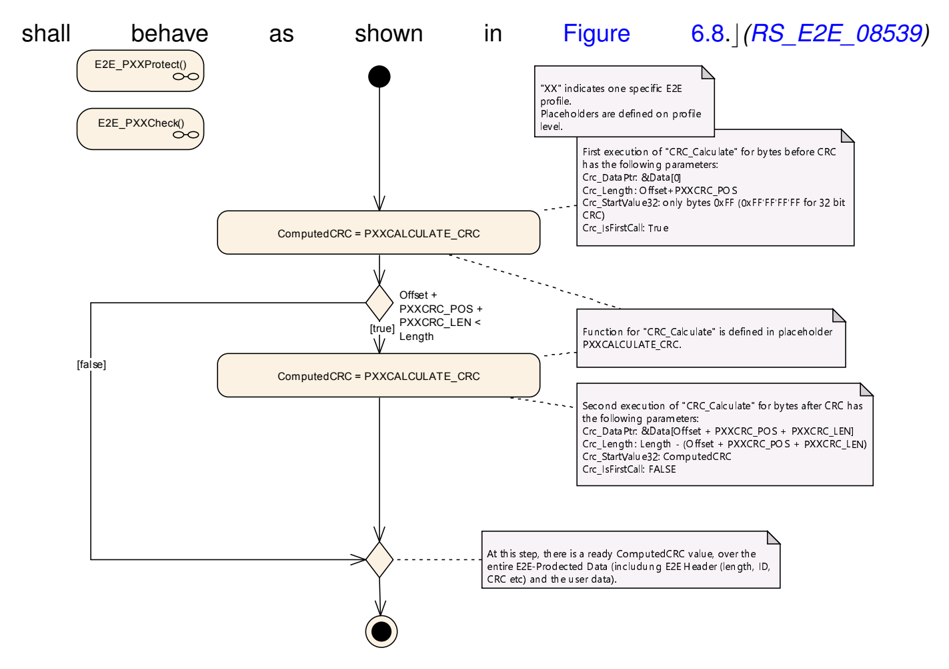

图6.9：E2E_PXXProtect() 和 E2E_PXXForward() 的「写 CRC」步骤

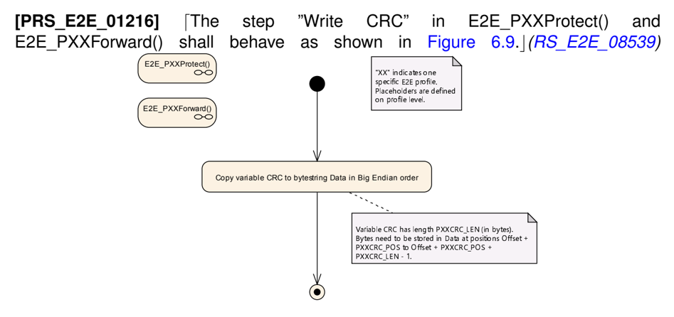

E2E_PXXProtect() 和 E2E_PXXForward() 中的「递增计数器」步骤应如图 6.10 所示运行。

图6.10：E2E_PXXProtect() 和 E2E_PXXForward() 的「递增计数器」步骤

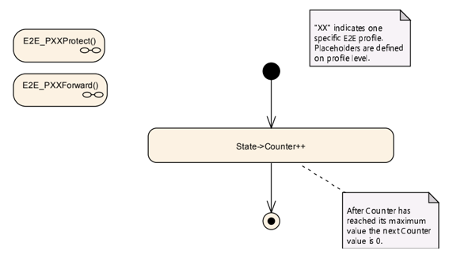

##### 5.3.6.2. E2E_PXXForward()

E2E 配置文件的 E2E_PXXForward() 函数由 SW-C 调用，用于保护其应用数据并转发一个已接收的 E2E 状态，适用用例如基于信号通信到服务导向通信的转换。如果接收到的 E2E 状态等于 E2E_P_OK，则该函数的行为应与 E2E_PXXProtect() 相同。函数 E2E_PXXForward() 执行本节后续各图所规定的步骤。

函数 E2E_PXXForward() 应具有如图 6.11 所示的整体行为。

图6.11：E2E_PXXForward() 的行为

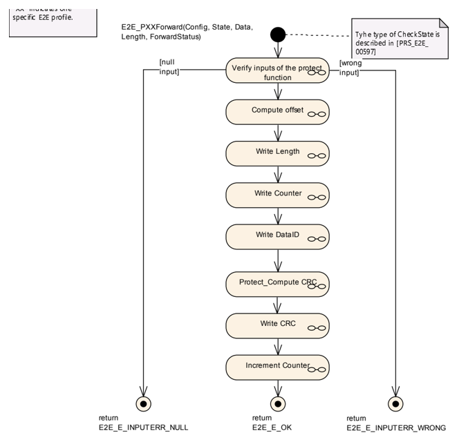

以下步骤在第 [5.3.6.1](#5361-e2e_pxxprotect) 节中描述：

- 「计算偏移」参见 PRS_E2E_01211
- 「写长度」参见 PRS_E2E_01212
- 「计算 CRC」参见 PRS_E2E_01215
- 「写 CRC」参见 PRS_E2E_01216
- 「递增计数器」参见 PRS_E2E_01217

E2E_PXXForward() 中的「验证转发函数的输入」步骤应如图 6.12 所示运行。

图6.12：E2E_PXXForward() 的「验证转发函数的输入」步骤

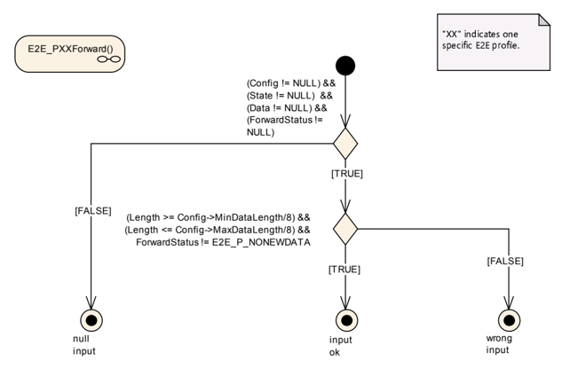

E2E_PXXForward() 中的「写计数器」步骤应如图 6.13 所示运行。

图6.13：E2E_PXXForward() 的「写计数器」步骤

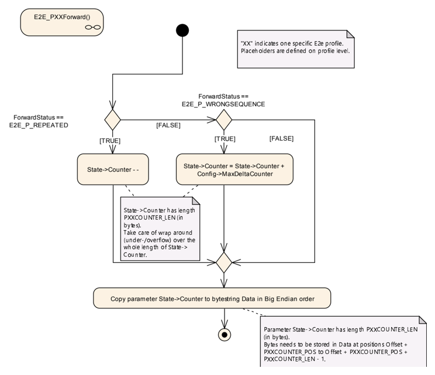

E2E_PXXForward() 中的「写 DataID」步骤应如图 6.14 所示运行。

图6.14：E2E_PXXForward() 的「写 DataID」步骤

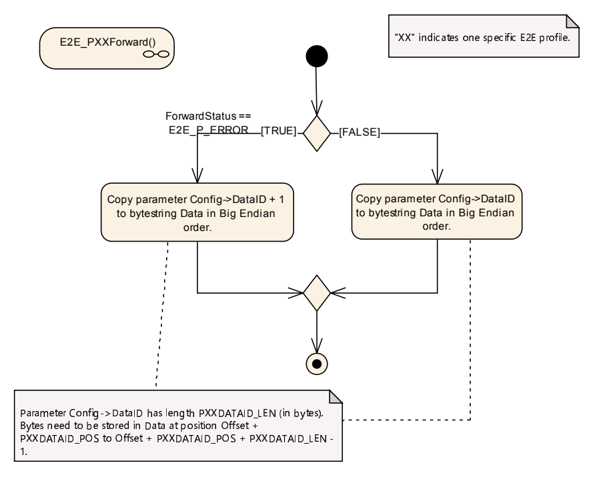

### 5.3.7. E2E 报文头的求值

#### 5.3.7.1. E2E_PXXCheck()

函数 E2E_PXXCheck() 按照本节后续各图以及图 6.15 所规定的方式执行动作。

函数 E2E_PXXCheck() 应具有如图 6.15 所示的整体行为。

图6.15：E2E_PXXCheck() 的行为

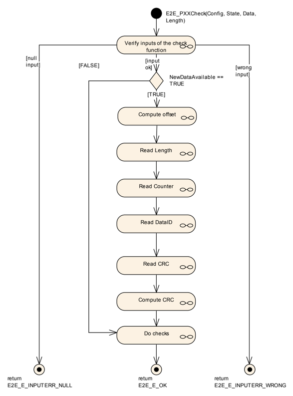

以下步骤在第 [5.3.6.1](#5361-e2e_pxxprotect) 节中描述：

- 「计算偏移」参见 PRS_E2E_01211
- 「计算 CRC」参见 PRS_E2E_01215

E2E_PXXCheck() 中的「验证检查函数的输入」步骤应如图 6.16 所示运行。

图6.16：E2E_PXXCheck() 的「验证检查函数的输入」步骤

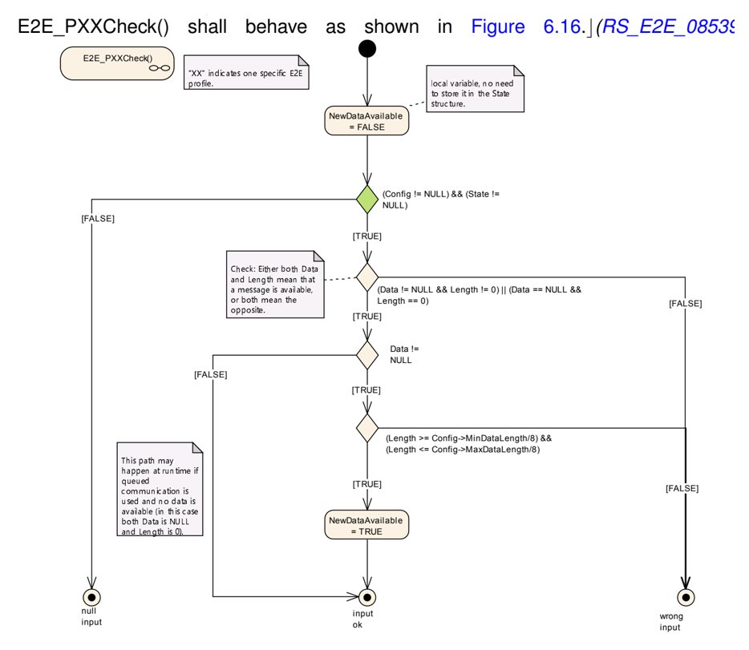

图6.17：E2E_PXXCheck() 的「读长度」步骤

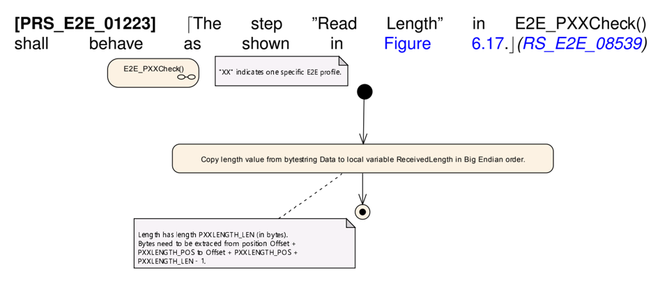

图6.18：E2E_PXXCheck() 的「读计数器」步骤

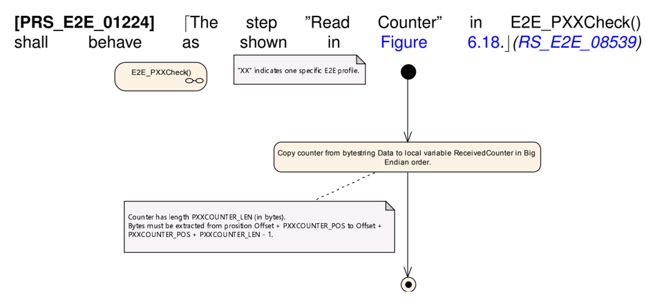

图6.19：E2E_PXXCheck() 的「读 DataID」步骤

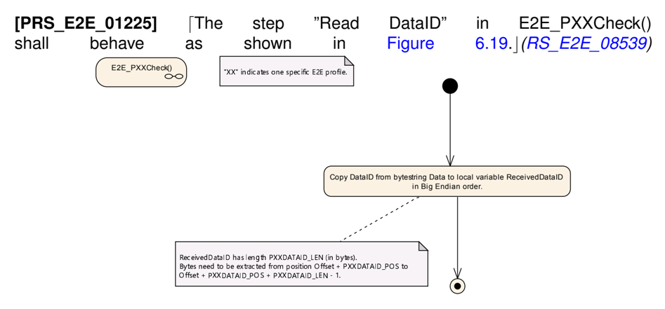

图6.20：E2E_PXXCheck() 的「读 CRC」步骤

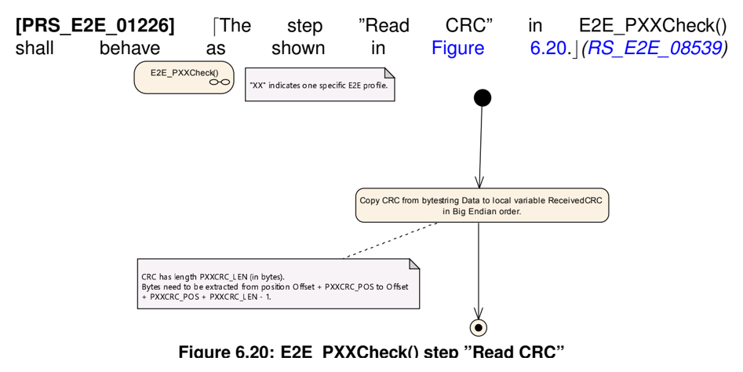

图6.21：E2E_PXXCheck() 的「执行检查」步骤

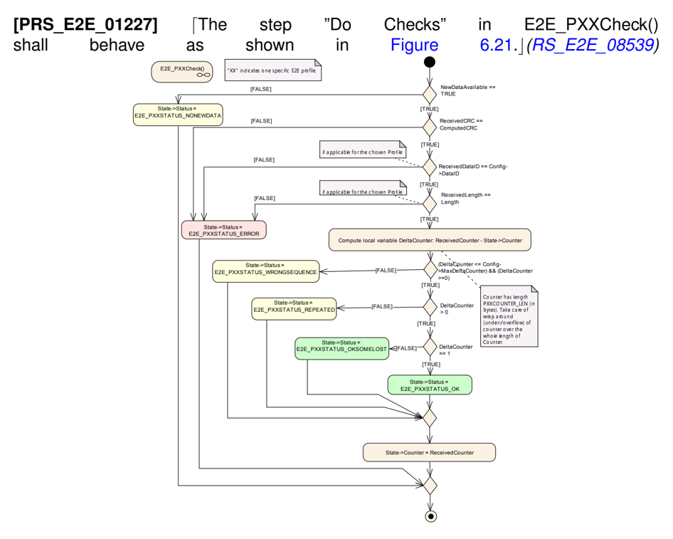

#### 5.3.8. 配置文件数据类型

##### 5.3.8.1. Profile Protect State 类型

E2E_PXXProtect 和 E2E_PXXForward 函数的 'state' 应具有（见表 6.5）所定义的成员。

表6.5：E2E Profile Protect State 类型

| 名称 | 类型 | 说明 |
|---|---|---|
| Counter | Unsigned Integer | 用于保护下一个 Data 的计数器。初始值为 0，这意味着在第一个周期中 Counter 为 0。每次调用 E2E_PXXProtect() 时，它将计数器递增，直至最大值（8 位计数器为 0xFF，16 位计数器为 0xFF'FF，32 位计数器为 0xFF'FF'FF'FF）。达到最大值之后，下一个值为 0x0。溢出不向调用方报告 |

##### 5.3.8.2. Profile Check Status 类型

E2E_PXXCheck 函数的 'State' 应具有（见表 6.6）所定义的成员。

表6.6：E2E Profile XX Check State 类型

| 名称 | 类型 | 说明 |
|---|---|---|
| Counter | Unsigned Integer | 上一周期数据的计数器 |
| Status | Enumeration | 由 Check 函数确定的本周期的 Data 验证结果 |

##### 5.3.8.3. Profile Check Status 枚举

E2E_PXXCheck 函数的 'State-&gt;Status' 枚举类型应由以下枚举值组成（见表 6.7）。

表6.7：E2E Profile Check Status 枚举

| 名称 | 状态类型 | 说明 |
|---|---|---|
| E2E_PXXSTATUS_OK | OK | 本周期对 Data 的检查成功（包括递增了 1 的计数器检查） |
| E2E_PXXSTATUS_NONEWDATA | Error | 根据通信介质（例如 RTE、COM），自上次调用以来 Check 函数已被调用但没有新数据可用。因此未执行对 Data 的任何 E2E 检查。这可以被视为类似于 E2E_PXXSTATUS_REPEATED |
| E2E_PXXSTATUS_ERROR | Error | 发生了与计数器无关的错误（例如 CRC 错误、长度错误、选项错误、Data ID 错误） |
| E2E_PXXSTATUS_REPEATED | Error | 本周期对 Data 的检查成功，但存在重复的例外 |
| E2E_PXXSTATUS_OKSOMELOST | OK | 本周期对 Data 的检查成功（包括在允许的已配置增量内递增的计数器检查） |
| E2E_PXXSTATUS_WRONGSEQUENCE | Error | 本周期对 Data 的检查成功，但存在计数器跳变的例外，其变化超过了允许的增量 |

### 5.4. 针对方法的 E2E 配置文件规范——通用部分

本章包含在多于一个方法配置文件规范中使用的 E2E 配置文件规范部分。E2E 配置文件的行为独立于特定配置文件进行描述。正文和图使用诸如 'XXm' 的占位符，它们被替换为配置文件特定的值或文本。所有配置文件特定的内容（包括这些占位符）在相应的配置文件特定小节中定义。本章适用于 DataID 字段和 Length 字段属于配置文件报文头的所有方法配置文件。

E2E 机制可以检测以下故障或故障的影响：

表6.8：使用方法配置文件可检测的通信故障

| 故障 | 主要安全机制 |
|---|---|
| 信息的重复 | 计数器 |
| 信息的丢失 | 计数器 |
| 信息的延迟 | 计数器 |
| 信息的插入 | Data ID、消息类型、消息结果、Source ID |
| 伪装 | Data ID、消息类型、消息结果、Source ID、CRC |
| 错误寻址 | Data ID、消息类型、消息结果、Source ID |
| 信息的错误序列 | 计数器 |
| 信息的损坏 | CRC |

#### 5.4.1. 计数器

在针对方法的 E2E 配置文件中，计数器由 E2E 配置文件初始化、递增、重置和检查。计数器不被 E2E 监督的调用方操纵或使用。

在针对方法的 E2E 配置文件中，发送侧的计数器对于数据元素的第一次传输请求应初始化为 0，并且对之后的每次发送请求递增 1。当计数器达到最大值（16 位计数器为 0xFF'FF，32 位计数器为 0xFF'FF'FF'FF，64 位计数器为 0xFF'FF'FF'FF'FF'FF'FF）时，它应在下一次发送请求时从 0 重新开始。

注意，最大计数值（16 位计数器为 0xFF'FF，32 位计数器为 0xFF'FF'FF'FF，64 位计数器为 0xFF'FF'FF'FF'FF'FF'FF）并不保留为特殊的无效值，而是作为一个正常的计数值使用。

在针对方法的 E2E 配置文件中，在接收侧通过将所接收数据的计数器与先前所接收数据的计数器进行对比，可以检测到以下情况：

1. 重复（Repetition）：
   - a. 自上次调用 E2E 监督检查函数以来没有新数据到达，
   - b. 数据被重复发送
2. 正常（OK）：
   - a. 计数器递增 1（即没有数据丢失），
   - b. 计数器递增超过 1，但仍在允许的限度内（即有一些数据丢失），

情况 1 对应于未通过的存活计数器检查，情况 2 对应于通过的正常计数器检查。

上述要求由后续文档小节中的 UML 图更详细地规定。

#### 5.4.2. Data ID（数据 ID）

唯一的 Data ID 用于验证每一条传输的安全相关数据元素的身份。

在针对方法的 E2E 配置文件中，Data ID 应被显式传输，即它应是所传输 E2E 报文头的一部分。

在针对方法的 E2E 配置文件中，Data ID 应在通信系统（由多个各自发送不同数据的 ECU 组成）的网络内全局唯一。

在使用 E2E 监督保护数据元素的情况下（即从 RTE 调用），由于通信的多种性（1:1 或 1:N），数据元素的消费者只期望一个特定的数据元素，E2E 监督使用 Data ID 对其进行检查。

在使用 E2E 监督保护消息的情况下（即从 COM 调用），接收方 COM 在接收时只期望一条特定的消息，E2E 监督使用 Data ID 对其进行检查。

#### 5.4.3. 长度

引入 Length 字段是为了支持可变长度——存储序列化数据的 Data[] 数组在每个周期可能具有不同的长度。Length 包括用户数据 + E2E 报文头（CRC + 计数器 + Length + DataID）。

#### 5.4.4. CRC

针对方法的 E2E 配置文件使用合适的 CRC，以确保高检测率和高汉明距离。

针对方法的 E2E 配置文件应使用 SWS CRC 监督中 PXXM-CALCULATE_CRC 所定义的函数来计算 CRC。

**注意：**针对方法的 E2E 配置文件所使用的 CRC 与 FlexRay、CAN 和 TCP/IP 所使用的 CRC 不同。它也由不同的软件模块提供（FlexRay、CAN 和 TCP/IP 协议栈的 CRC/校验和由通信控制器的硬件支持或通信协议栈软件提供，而不是由 CRC 监督提供）。

在针对方法的 E2E 配置文件中，CRC 应对整个 E2E 报文头（不包括 CRC 字节）和用户数据计算。

#### 5.4.5. 消息类型

消息类型（Message Type）字段用于在方法通信中区分请求消息与响应消息。

在针对方法的 E2E 配置文件中，消息类型字段应被显式传输，即它应是所传输 E2E 报文头的一部分。

取值为 0 的消息类型字段表示请求消息。

取值为 1 的消息类型字段表示响应消息。

#### 5.4.6. 消息结果

消息结果（Message Result）字段用于在方法通信中区分正常响应消息与错误响应消息。

在针对方法的 E2E 配置文件中，消息结果字段应被显式传输，即它应是所传输 E2E 报文头的一部分。

取值为 0 的消息结果字段表示正常响应消息。

取值为 1 的消息结果字段表示错误响应消息。

对于请求消息（即消息类型字段被设置为 0 的情况），消息结果字段应被设置为 0。

#### 5.4.7. Source ID（源 ID）

唯一的 Source ID 用于验证每一条传输的安全相关数据元素来源的身份。在方法通信的情况下，Source ID 标识执行方法调用的客户端。

在针对方法的 E2E 配置文件中，Source ID 应被显式传输，即它应是所传输 E2E 报文头的一部分。

在针对方法的 E2E 配置文件中，Source ID 应在通信系统（由多个 ECU 组成）的网络内全局唯一。

#### 5.4.8. 超时检测

前面提到的机制（CRC、计数器、Data ID、Length、消息类型、消息结果和 Source ID）使得在接收方独立于数据传输运行时——即接收方不被阻塞地等待消息，而是读取当前可用的数据（即检查是否有新数据可用）——能够检查所接收消息的有效性。这样，借助计数器，接收方可以检测到通信丢失和超时。

#### 5.4.9. E2E 报文头的创建

##### 5.4.9.1. E2E_PXXmProtect()

函数 E2E_PXXmProtect() 执行本节后续各图所规定的步骤。

图6.22：E2E_PXXmProtect() 的行为

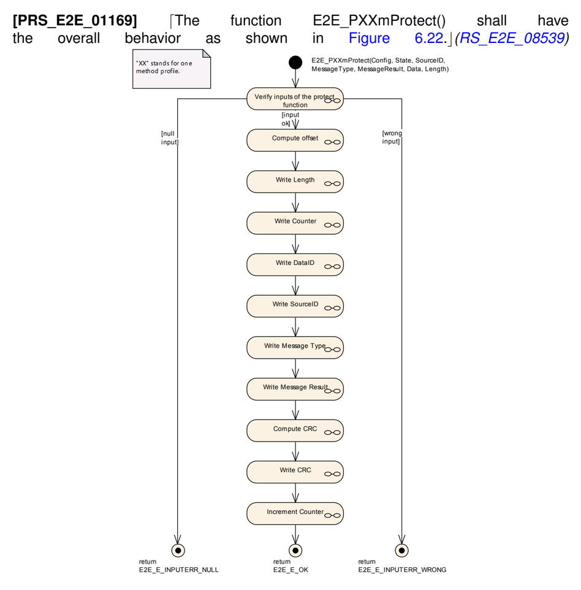

E2E_PXXmProtect() 中的「验证保护函数的输入」步骤应如图 6.23 所示运行。

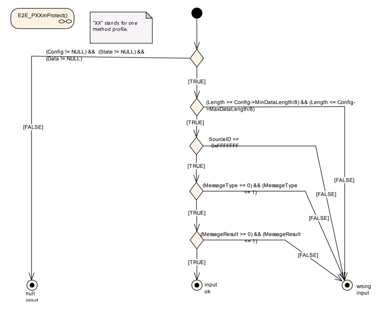

E2E_PXXmProtect()、E2E_PXXmForward()、E2E_PXXmSourceCheck() 和 E2E_PXXmSinkCheck() 中的「计算偏移」步骤应如图 6.24 所示运行。

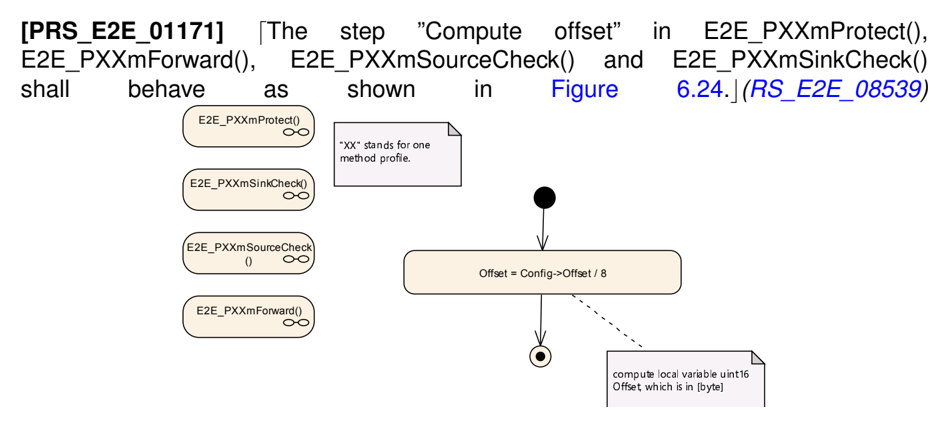

E2E_PXXmProtect() 和 E2E_PXXmForward() 中的「写长度」步骤应如图 6.25 所示运行。

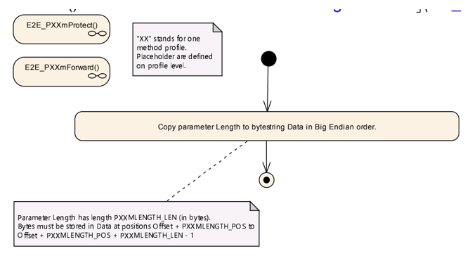

图6.26：E2E_PXXmProtect() 的「写计数器」步骤

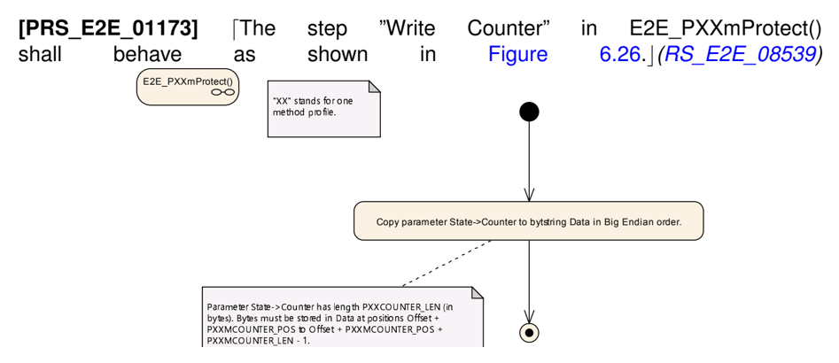

图6.27：E2E_PXXmProtect() 的「写 DataID」步骤

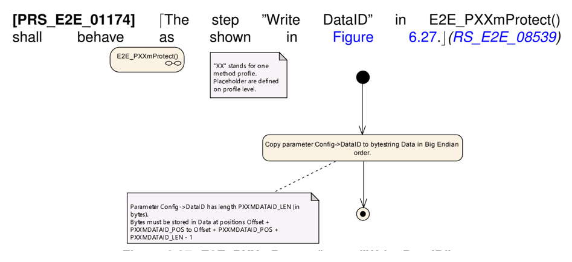

图6.28：E2E_PXXmProtect() 的「写 SourceID」步骤

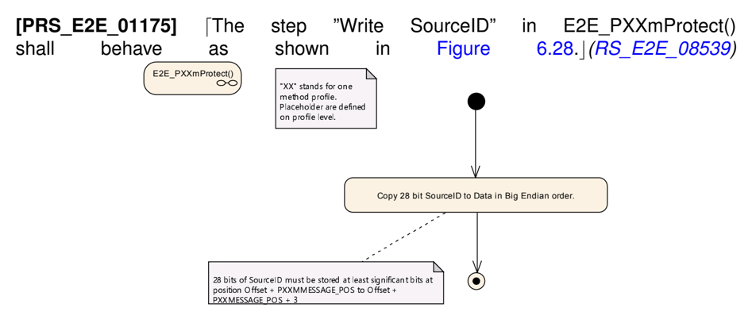

图6.29：E2E_PXXmProtect() 的「写消息类型」步骤

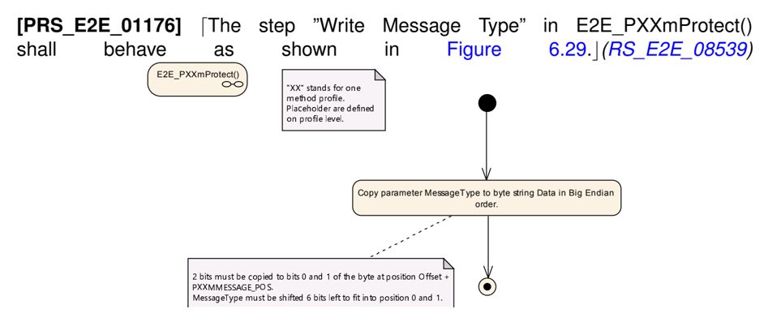

图6.30：E2E_PXXmProtect() 的「写消息结果」步骤

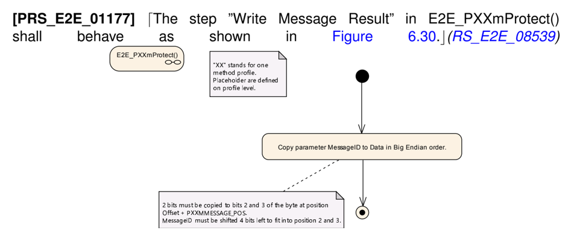

E2E_PXXmProtect()、E2E_PXXmForward()、E2E_PXXmSourceCheck() 和 E2E_PXXmSinkCheck() 中的「计算 CRC」步骤应如图 6.31 所示运行。

图6.31：E2E_PXXmProtect()、E2E_PXXmForward()、E2E_PXXmSourceCheck() 和 E2E_PXXmSinkCheck() 的「计算 CRC」步骤

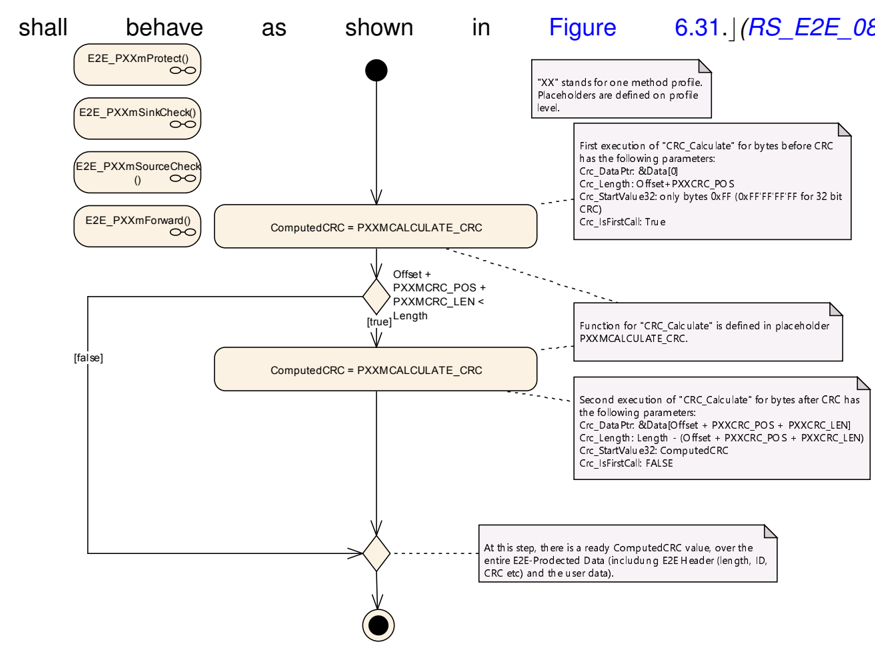

图6.32：E2E_PXXmProtect() 和 E2E_PXXmForward() 的「写 CRC」步骤

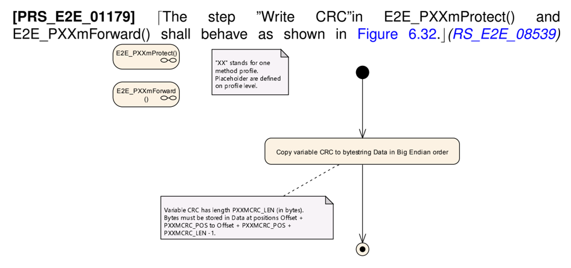

E2E_PXXmProtect() 和 E2E_PXXmForward() 中的「递增计数器」步骤应如图 6.33 所示运行。

图6.33：E2E_PXXmProtect() 和 E2E_PXXmForward() 的「递增计数器」步骤

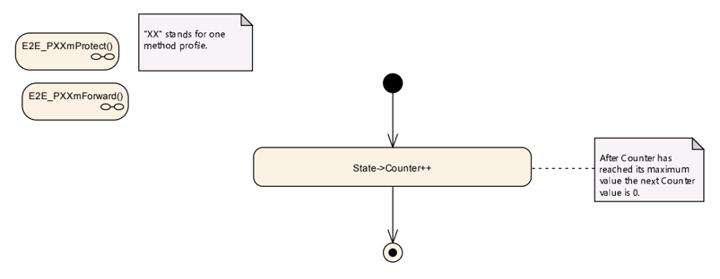

##### 5.4.9.2. E2E_PXXmForward()

针对方法的 E2E 配置文件的 E2E_PXXmForward() 函数由 SW-C 调用，用于保护其应用数据并转发一个已接收的 E2E 状态，适用用例如基于信号通信到服务导向通信的转换。如果接收到的 E2E 状态等于 E2E_P_OK，则该函数的行为应与 E2E_PXXmProtect() 相同。函数 E2E_PXXmForward() 执行本节后续各图所规定的步骤。

函数 E2E_PXXmForward() 应具有如图 6.34 所示的整体行为。

图6.34：E2E_PXXmForward() 的行为

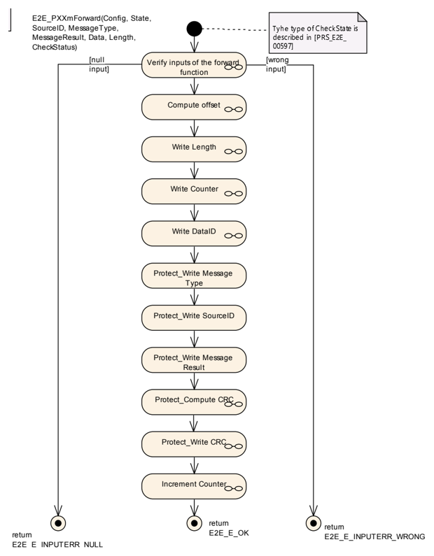

以下步骤在第 [5.4.9.1](#5491-e2e_pxxmprotect) 节中描述：

- 「计算偏移」参见 PRS_E2E_01171
- 「写长度」参见 PRS_E2E_01172
- 「写 SourceID」参见 PRS_E2E_01175
- 「写消息类型」参见 PRS_E2E_01176
- 「写消息结果」参见 PRS_E2E_01177
- 「计算 CRC」参见 PRS_E2E_01178
- 「写 CRC」参见 PRS_E2E_01179
- 「递增计数器」参见 PRS_E2E_01180

E2E_PXXmForward() 中的「验证转发函数的输入」步骤应如图 6.35 所示运行。

图6.35：E2E_PXXmForward() 的「验证转发函数的输入」步骤

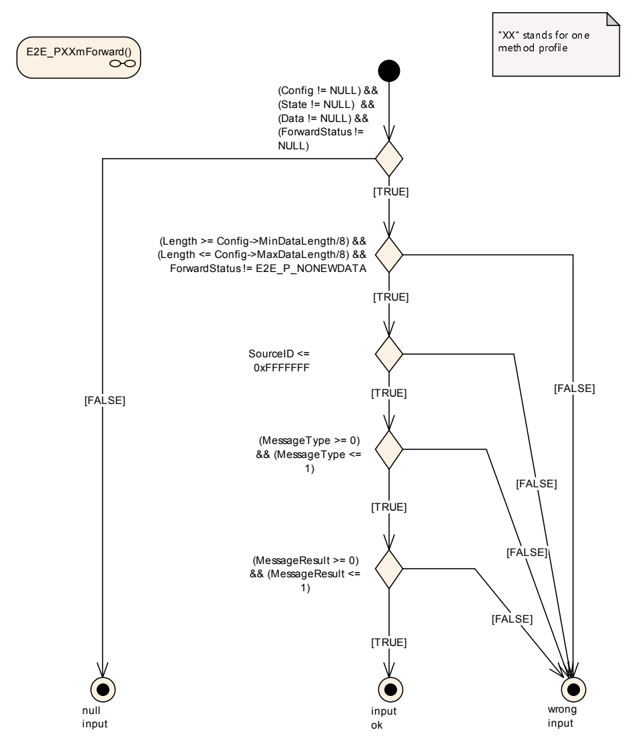

E2E_PXXmForward() 中的「写计数器」步骤应如图 6.36 所示运行。

图6.36：E2E_PXXmForward() 的「写计数器」步骤

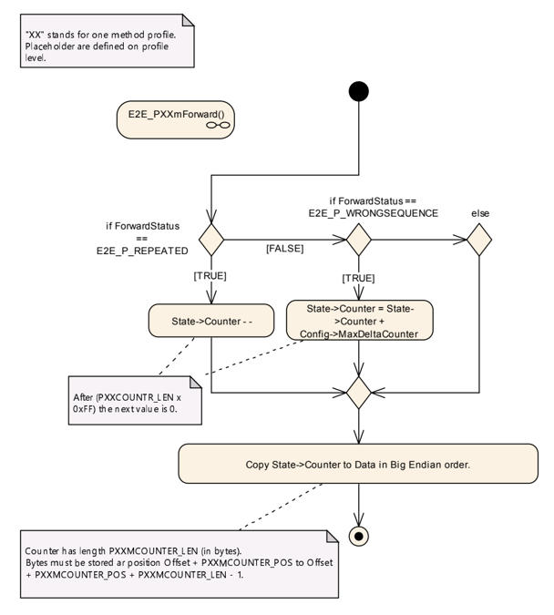

图6.37：E2E_PXXmForward() 的「写 DataID」步骤

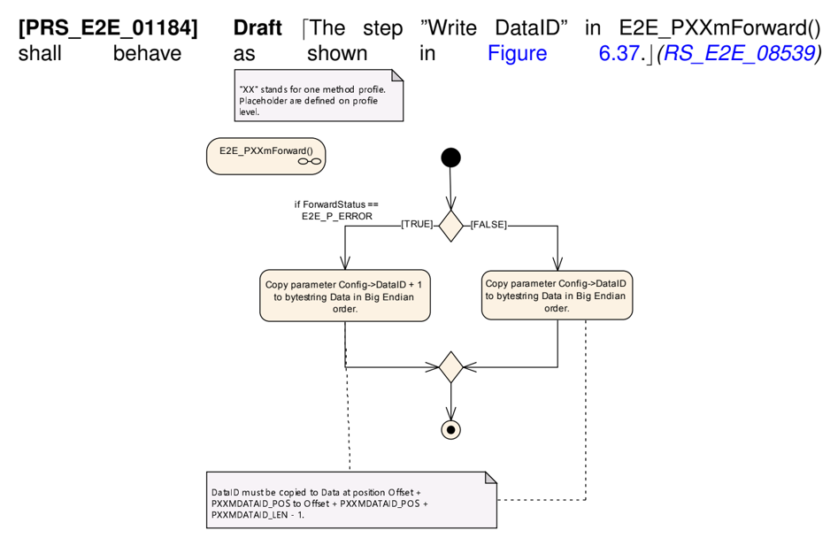

#### 5.4.10. E2E 报文头的求值

存在两个检查函数：用于客户端侧的 E2E_PXXmSourceCheck() 和用于服务器侧的 E2E_PXXmSinkCheck()。

##### 5.4.10.1. E2E_PXXmSourceCheck()

用于客户端侧的函数 E2E_PXXmSourceCheck() 执行本节后续各图所规定的动作。

用于客户端侧的函数 E2E_PXXmSourceCheck() 应具有如图 6.38 所示的整体行为。

图6.38：E2E_PXXmSourceCheck() 的行为

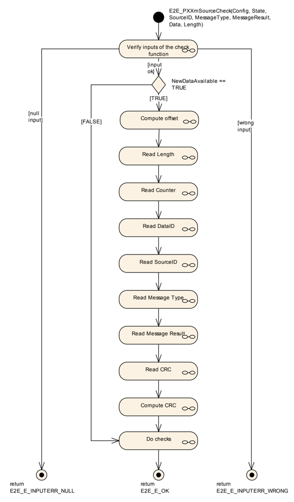

E2E_PXXmSourceCheck() 中的「验证函数的输入」步骤应如图 6.39 所示运行。

图6.39：E2E_PXXmSourceCheck() 的「验证检查函数的输入」步骤

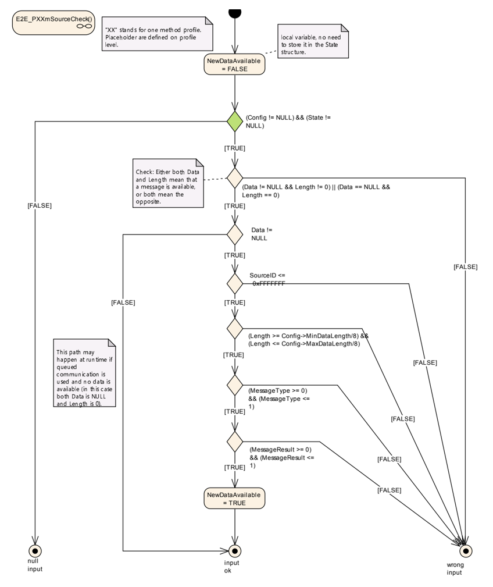

E2E_PXXmSourceCheck() 和 E2E_PXXmSinkCheck() 中的「读长度」步骤应如图 6.40 所示运行。

图6.40：E2E_PXXmSourceCheck()/E2E_PXXmSinkCheck() 的「读长度」步骤

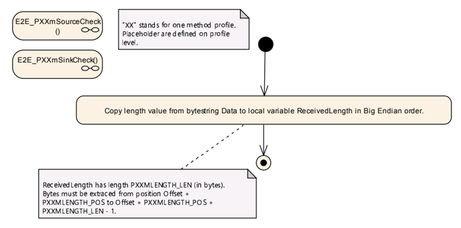

E2E_PXXmSourceCheck() 和 E2E_PXXmSinkCheck() 中的「读计数器」步骤应如图 6.41 所示运行。

图6.41：E2E_PXXmSourceCheck()/E2E_PXXmSinkCheck() 的「读计数器」步骤

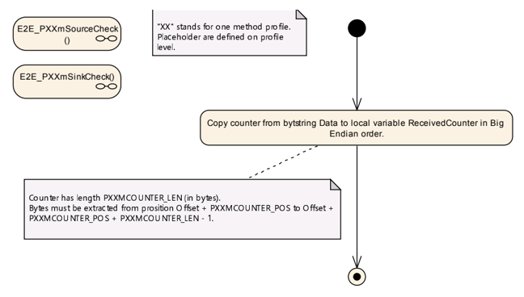

E2E_PXXmSourceCheck() 和 E2E_PXXmSinkCheck() 中的「读 DataID」步骤应如图 6.42 所示运行。

图6.42：E2E_PXXmSourceCheck()/E2E_PXXmSinkCheck() 的「读 DataID」步骤

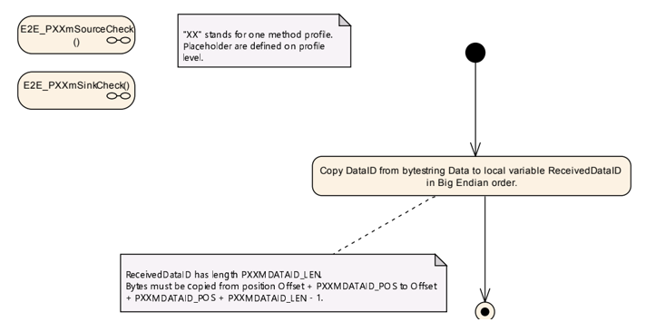

图6.43：E2E_PXXmSourceCheck() 的「读 SourceID」步骤

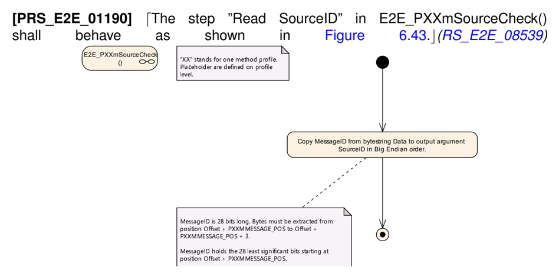

E2E_PXXmSourceCheck() 和 E2E_PXXmSinkCheck() 中的「读消息类型」步骤应如图 6.44 所示运行。

图6.44：E2E_PXXmSourceCheck()/E2E_PXXmSinkCheck() 的「读消息类型」步骤

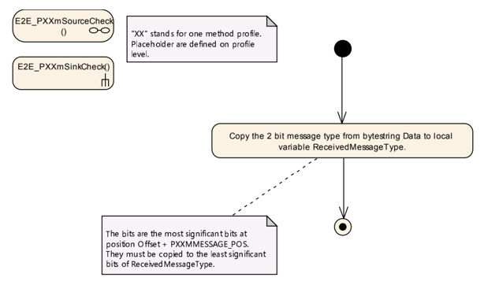

E2E_PXXmSourceCheck() 和 E2E_PXXmSinkCheck() 中的「读消息结果」步骤应如图 6.45 所示运行。

图6.45：E2E_PXXmSourceCheck()/E2E_PXXmSinkCheck() 的「读消息结果」步骤

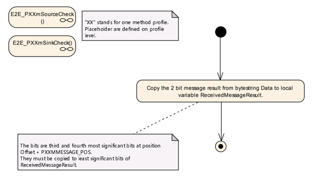

E2E_PXXmSourceCheck() 和 E2E_PXXmSinkCheck() 中的「读 CRC」步骤应如图 6.46 所示运行。

图6.46：E2E_PXXmSourceCheck()/E2E_PXXmSinkCheck() 的「读 CRC」步骤

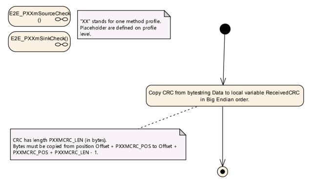

图6.47：E2E_PXXmSourceCheck() 的「执行检查」步骤

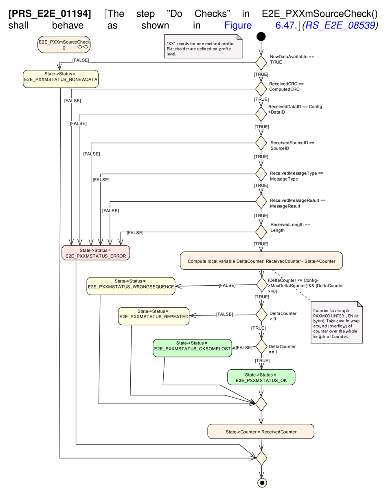

##### 5.4.10.2. E2E_PXXmSinkCheck()

用于服务器侧的函数 E2E_PXXmSinkCheck() 执行本节后续各图所规定的动作。

用于服务器侧的函数 E2E_PXXmSinkCheck() 应具有如图 6.48 所示的整体行为。

图6.48：E2E_PXXmSinkCheck() 的行为

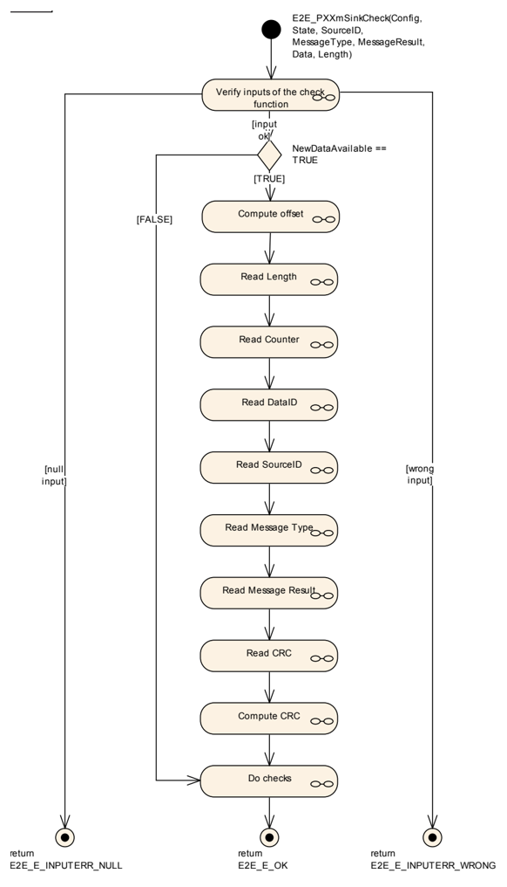


以下步骤与客户端侧相同，因此已在前面描述：

- 「读长度」参见 PRS_E2E_01187
- 「读计数器」参见 PRS_E2E_01188
- 「读 DataID」参见 PRS_E2E_01189
- 「读消息类型」参见 PRS_E2E_01191
- 「读消息结果」参见 PRS_E2E_01192
- 「读 CRC」参见 PRS_E2E_01193
- 「递增计数器」参见 PRS_E2E_01180

E2E_PXXmSinkCheck() 中的「验证检查函数的输入」步骤应如图 6.49 所示运行。

图6.49：E2E_PXXmSinkCheck() 的「验证检查函数的输入」步骤

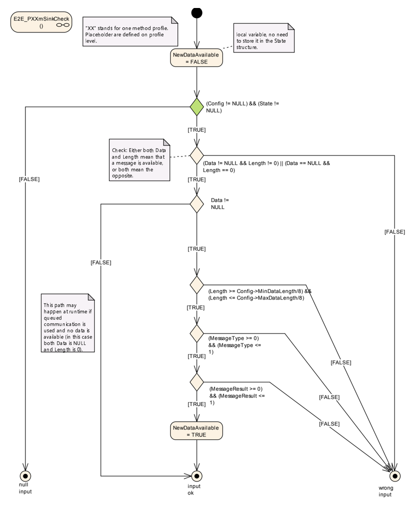

图6.50：E2E_PXXmSinkCheck() 的「读 SourceID」步骤

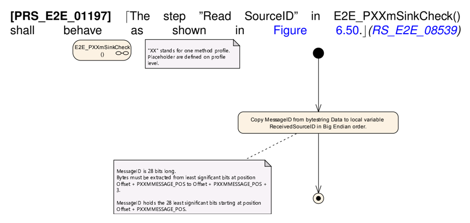

图6.51：E2E_PXXmSinkCheck() 的「执行检查」步骤

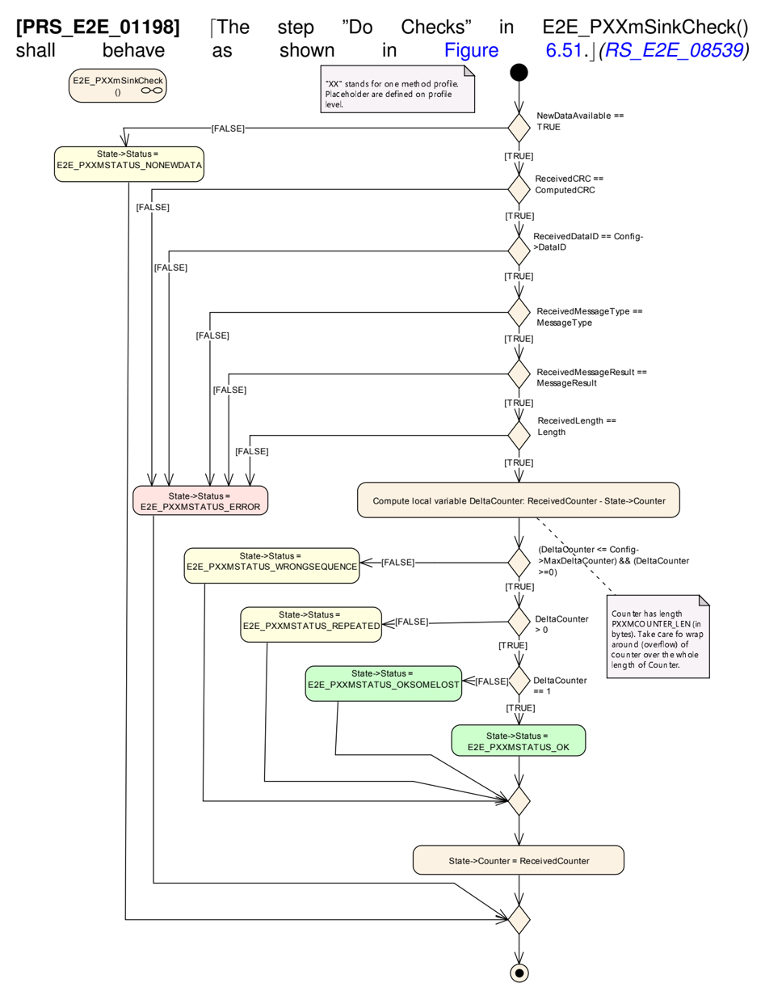

#### 5.4.11. 配置文件数据类型

##### 5.4.11.1. Profile XXm Protect State 类型

E2E_PXXmProtect() 和 E2E_PXXmForward() 函数的 'state' 应具有表 6.9 所定义的成员。

表6.9：E2E Profile XXm Protect State 类型

| 名称 | 类型 | 说明 |
|---|---|---|
| Counter | Unsigned Integer | 用于保护下一个 Data 的计数器。初始值为 0，这意味着在第一个周期中 counter 为 0。每次调用 E2E_PXXmProtect() 时，它将计数器递增，直至其最大值（16 位计数器为 0xFF'FF，32 位计数器为 0xFF'FF'FF'FF，64 位计数器为 0xFF'FF'FF'FF'FF'FF'FF）。达到最大值之后，下一个值为 0x0。溢出不向调用方报告 |

##### 5.4.11.2. Profile XXm Check State 类型

E2E_PXXmSourceCheck() 和 E2E_PXXmSinkCheck() 函数的 'state' 应具有表 6.10 所定义的成员。

表6.10：E2E Profile XXm Check State 类型

| 名称 | 类型 | 说明 |
|---|---|---|
| Counter | Unsigned Integer | 上一周期数据的计数器 |
| Status | Enumeration | 由 Check 函数确定的本周期的 Data 验证结果 |

##### 5.4.11.3. Profile XXm Check Status 枚举

E2E_PXXmSourceCheck() 和 E2E_PXXmSinkCheck() 中的「执行检查」步骤应将 State-&gt;Status 设置为以下枚举值之一（见表 6.11）。

表6.11：E2E Profile XXm Check Status 枚举

| 名称 | 状态类型 | 说明 |
|---|---|---|
| E2E_PXXMSTATUS_OK | OK | 本周期对 Data 的检查成功（包括递增了 1 的计数器检查） |
| E2E_PXXMSTATUS_NONEWDATA | Error | 根据通信介质（例如 RTE、COM），自上次调用以来 Check 函数已被调用但没有新数据可用。因此未执行对 Data 的任何 E2E 检查。这可以被视为类似于 E2E_PXXMSTATUS_REPEATED |
| E2E_PXXMSTATUS_ERROR | Error | 发生了与计数器无关的错误（例如 CRC 错误、长度错误、选项错误、Data ID 错误） |
| E2E_PXXMSTATUS_REPEATED | Error | 本周期对 Data 的检查成功，但存在重复的例外 |
| E2E_PXXMSTATUS_OKSOMELOST | OK | 本周期对 Data 的检查成功（包括在允许的已配置增量内递增的计数器检查） |
| E2E_PXXMSTATUS_WRONGSEQUENCE | Error | 本周期对 Data 的检查成功，但存在计数器跳变的例外，其变化超过了允许的增量 |

### 5.5. E2E Profile 1 规范

Profile 1 是一个遗留（Legacy）配置文件，仅为兼容性原因而维护。新项目应使用 Profile 11。

Profile 1 应提供以下机制：计数器、超时监视、Data ID、CRC（见表 6.12）。

表6.12：E2E Profile 1 机制

| 机制 | 说明 |
|---|---|
| Counter | 4 位（显式发送），表示 0 到 14 的数字，在每次发送请求时递增。存活计数器和序列计数器两种机制都由 E2E Profile 1 提供，二者求值相同的 4 位 |
| Timeout monitoring | 超时由 E2E 监督通过对计数器的求值来确定，方式是在接收方进行非阻塞读取。超时由 E2E 监督通过 E2E_P01CheckStatusType 中的状态标志报告给调用方 |
| Data ID | 16 位唯一编号，包含在 CRC 计算中。对于 dataIdMode 等于 0、1 或 2 的情况，Data ID 不被传输，但包含在 CRC 计算中（隐式传输）。对于 dataIdMode 等于 3 的情况：DataID 高字节的高半字节不使用（为 0x0），因为 DataID 限制为 12 位；DataID 高字节的低半字节被显式传输，并且在对 Data 计算 CRC 时被 CRC 计算覆盖；低字节不被传输，但作为第一个值包含在 CRC 计算中（隐式传输，如同 dataIdMode 等于 0、1 或 2 时那样） |
| CRC | CRC-8-SAE J1850 - 0x1D（x8 + x4 + x3 + x2 + 1），但使用不同的起始值和 XOR 值（起始值和 XOR 值均为 0x00）。该 CRC 由 CRC 监督提供。从 AUTOSAR R4.0 开始，CRC 监督的 SAE8 CRC 函数使用 0xFF 作为起始值和 XOR 值。为了补偿 CRC 监督的不同行为，从 R4.0 开始 E2E 监督应用额外的 XOR 0xFF 操作，以得到 0x00 作为起始值和 XOR 值。注意：此 CRC 多项式与 FlexRay、CAN 和 LIN 所使用的 CRC 多项式不同 |

E2E 机制可以检测以下故障或故障的影响：

表6.13：使用 Profile 1 可检测的通信故障

| E2E 机制 | 检测到的通信故障 |
|---|---|
| Counter | 重复、丢失、插入、错误序列、阻塞 |
| 定期传输 + 使用 E2E 监督的超时监视 <sup>1</sup> | 丢失、延迟、阻塞 |
| Data ID + CRC | 伪装和错误寻址、插入 |
| CRC | 损坏、不对称信息 <sup>2</sup> |

> 1 由使用 E2E 监督的发送方和接收方实现
>
> 2 对于由同一 CRC 保护的一组数据

#### 5.5.1. 报文头布局

在 E2E Profile 1 中，布局总体上可由用户自由定义，只要遵循信号对齐的基本限制：

- 长度 &lt; 8 位的信号应分配到一个 I-PDU 的单个字节内，即它们不应跨越两个字节。
- 长度 &gt;= 8 位的信号应在消息的字节边界处开始或结束。

但是，预定义的 E2E Profile 1 变体针对协议数据字段定义了特定的数据布局，见第 [5.3.6](#536-e2e-报文头的创建) 节。

##### 5.5.1.1. 计数器

在 E2E Profile 1 中，计数器由 E2E 配置文件初始化、递增、重置和检查。

在 E2E Profile 1 中，在发送侧，对于数据元素的第一次传输请求，计数器应初始化为 0，并且对之后的每次发送请求（来自发送方 SW-C）递增 1。当计数器达到值 14（0xE）时，它应在下一次发送请求时从 0 重新开始（即跳过值 0xF）。所有这些动作应由 E2E 监督执行。

在 E2E Profile 1 中，在接收侧，通过将所接收数据的计数器与先前所接收数据的计数器进行对比，E2E 监督应检测到以下情况：（1）自上次调用 E2E 监督检查函数以来没有新数据到达；（2）自接收方启动以来没有新数据到达；（3）数据被重复发送；（4）计数器递增 1（即没有数据丢失）；（5）计数器递增超过 1，但仍在允许的限度内（即有一些数据丢失）；（6）计数器递增超过允许值（即丢失了太多数据）。

情况 3 对应于未通过的存活计数器检查，情况 6 对应于未通过的序列计数器检查。

上述要求由后续文档小节中的 UML 图更详细地规定。

##### 5.5.1.2. Data ID（数据 ID）

唯一的 Data ID 用于验证每一条传输的安全相关数据元素的身份。

两字节的 Data ID 被纳入单字节 CRC 计算应有以下四种包含模式：

1. E2E_P01_DATAID_BOTH：两个字节（双重 ID 配置）都包含在 CRC 中，先低字节后高字节（见变体 1A - PRS_E2EProtocol_00227）；或者
2. E2E_P01_DATAID_ALT：根据计数器的奇偶性（交替 ID 配置）包含高字节或低字节（见变体 1B - PRS_E2EProtocol_00228）。对于偶数计数值包含低字节，对于奇数计数值包含高字节。
3. E2E_P01_DATAID_LOW：只包含低字节，高字节从不使用。这等同于 Data ID（在给定应用中）只有 8 位的情况。
4. E2E_P01_DATAID_NIBBLE：
   - DataID 高字节的高半字节不使用（为 0x0），因为 DataID 限制为 12 位；
   - DataID 高字节的低半字节被显式传输，并且在对 Data 计算 CRC 时被 CRC 计算覆盖；
   - 低字节不被传输，但作为起始值包含在 CRC 计算中（隐式传输，如同包含模式 _BOTH、_ALT 和 _LOW 那样）。

在 E2E Profile 1 中，当 E2E_P01DataIDMode 等于 E2E_P01_DATAID_BOTH 或 E2E_P01_DATAID_ALT 时，Data ID 的长度应为 16 位（即 2 字节）。

在 E2E Profile 1 中，当 E2E_P01DataIDMode 等于 E2E_P01_DATAID_LOW 时，Data ID 的高字节应被设置为 0x00。

上述要求意味着：当 Data ID 的高字节不被使用时，它被设置为 0x00。

在 E2E Profile 1 中，当 E2E_P01DataIDMode 等于 E2E_P01_DATAID_NIBBLE 时，高字节的高半字节应为 0x0。

上述要求意味着 E2E_P01_DATAID_NIBBLE 的地址空间限制为 12 位。

在使用 E2E 监督保护数据元素的情况下，由于通信的多种性（1:1 或 1:N），数据元素的接收方只从唯一一个发送方接收它。在使用 E2E 监督保护消息的情况下，由于每条消息具有唯一的 Data ID，消息的接收方 COM 只从唯一一个发送方 COM 接收它。因此（无论保护是在数据元素级别还是在消息级别），接收方只期望具有唯一一个 Data ID 的数据。接收方使用期望的 Data ID 来计算 CRC。如果 CRC 匹配，则意味着发送方使用的 Data ID 与接收方期望的 Data ID 相同。

##### 5.5.1.3. CRC 计算

E2E Profile 1 使用 CRC-8-SAE J1850，但使用不同的起始值和 XOR 值。该校验和已由 AUTOSAR CRC 监督提供，后者通常相当高效并可能使用硬件支持。

E2E Profile 1 应使用 CRC-8-SAE J1850 的多项式，即多项式 0x1D（x8 + x4 + x3 + x2 + 1），但起始值和 XOR 值等于 0x00。

**注意：**要使用 CRCLib 函数 Crc_CalculateCRC8() 以起始值 = 0x00 计算 CRC，必须以第三个参数（Crc_StartValue8）等于预期起始值的补码来调用该函数。对于起始值 = 0x00，该参数必须等于 0xFF。

另见表 6.1（E2E Profile 1 机制）和图 6.7（由 E2E_P01Protect() 和 E2E_P01Check() 使用的子图 'getDataIDCRC'）。**注意：**此处的源文档引用沿用旧编号（对应本文章中的表 6.12 与图 6.56）。

关于 CRC 计算、起始值与 XOR 值用法的细节，另见 SWS_CRCLibrary [\[3\]](#ref-3)。

E2E Profile 1 应使用 SWS CRC 监督的 Crc_CalculateCRC8() 函数来计算 CRC 校验和。

**注意：**E2E Profile 1 所使用的 CRC 与 FlexRay 和 CAN 所使用的 CRC 不同，并由不同的软件模块提供（FlexRay 和 CAN 的 CRC 由通信控制器的硬件支持提供，而不是由 CRC 监督提供）。

CRC 计算由以下两个示例说明。

图 6.2 和图 6.3 展示了针对基于信号的通信如何计算 CRC。**注意：**此处源文档引用沿用旧编号（对应本文章中的图 6.52 与图 6.53）。图 6.52 使用以下配置：

1. CRC 是消息中的第 0 字节（即从位偏移 0 开始）
2. 存活计数器位于第 1 字节的最低 4 位（即从位偏移 8 开始）
3. E2E_P01DataIDMode = E2E_P01_DATAID_BOTH
4. unusedBitPattern = 0xFF。

图6.52：E2E Profile 1 变体 1A 的 CRC 计算示例

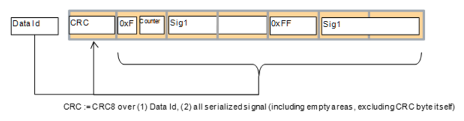

图 6.53 使用以下配置：

1. CRC 是消息中的第 0 字节（即从位偏移 0 开始）
2. 存活计数器位于第 1 字节的最低 4 位（即从位偏移 8 开始）
3. Data ID 半字节位于第 1 字节的最高 4 位（即从位偏移 12 开始）
4. E2E_P01DataIDMode = E2E_P01_DATAID_NIBBLE
5. unusedBitPattern = 0xFF。

图6.53：E2E Profile 1 变体 1C 的 CRC 计算示例


Data ID 可以以不同方式编码进 CRC，参见 PRS_E2E_00163。

在 E2E Profile 1 中，CRC 的计算方式为：

1. 先对 Data ID 的一个或两个字节计算（取决于 Data ID 配置），
2. 然后对安全相关复杂数据元素/信号组的所有传输字节计算（CRC 字节除外）。

如果 DataIDMode 被设置为 E2E_P01_DATAID_NIBBLE，CRC 计算应先对 Data ID 的低字节计算，然后对一个零字节（0x00）计算，然后对用户数据计算。

#### 5.5.2. E2E 报文头的创建

##### 5.5.2.1. E2E_P01Protect

函数 E2E_P01Protect() 应：

1. 将 Counter 写入 Data，
2. 如果使用 E2E_P01_DATAID_NIBBLE 配置，则将 DataID 半字节写入 Data
3. 计算 CRC
4. 将 CRC 写入 Data
5. 递增 Counter（将在下一次调用 E2E_P01Protect() 时使用），如图 6.54 和图 6.55 所规定

图6.54：E2E_P01Protect()


##### 5.5.2.2. 计算 CRC

函数 E2E_P01Protect()（见上文章节）、E2E_P01Forward() 和 E2E_P01Check()（见下文章节）的图具有一个规定 CRC 计算的子图：

图6.55：由 E2E_P01Protect()、E2E_P01Forward() 和 E2E_P01Check() 使用的子图「对 Data ID 和 Data 计算 CRC」


「对 Data ID 和 Data 计算 CRC」函数的图具有一个规定 DataID CRC 计算的子图，如图 6.56 所示。

图6.56：由 E2E_P01Protect() 和 E2E_P01Check() 使用的子图「getDataIDCRC」


值得注意的是，CRC 监督/CRC 例程的函数 Crc_CalculateCRC8 自 R4.0 起改变了其功能，即它在 R3.2 与 &gt;=R4.0 中不同：

1. 有一个额外的参数 Crc_IsFirstCall
2. 该函数具有不同的起始值和不同的 XOR 值（从 0x00 改为 0xFF）。

这会导致对给定缓冲区计算出的 CRC 值不同。

为了在使用功能不同的 CRC 监督的情况下，使函数 E2E_P01Protect() 和 E2E_P01Check() 在 &gt;=R4.0 与 R3.2 中得到相同的结果，E2E「补偿」了 CRC 监督的不同行为。这导致 E2E 监督对 CRC 监督的调用在 &gt;=R4.0 与 R3.2 中有所不同（图 6.55）。这意味着图 6.55 在 &gt;=R4.0 与 R3.2 中是不同的。

##### 5.5.2.3. E2E_P01Forward

函数 E2E_P01Forward() 应基于 IN 参数 ForwardStatus 的当前值计算 E2E 报文头数据。

E2E_P01Forward() 对 E2E_P01Protect() 有额外要求，因为它应用于在输出消息上重建一个 E2E 状态。

如果 ForwardStatus 等于 E2E_P_OK，函数 E2E_P01Forward() 应：

1. 将 Counter 写入 Data
2. 如果使用 E2E_P01_DATAID_NIBBLE 配置，则将 DataID 半字节写入 Data
3. 对 DataID 和 Data 计算 CRC
4. 将 CRC 写入 Data
5. 递增 Counter（将在下一次调用 E2E_P01Forward() 时使用），如图 6.57 和图 6.55 所规定

如果 ForwardStatus 等于 E2E_P_REPEATED，函数 E2E_P01Forward() 应：

1. 递减 Counter
2. 将 Counter 写入 Data
3. 如果使用 E2E_P01_DATAID_NIBBLE 配置，则将 DataID 半字节写入 Data
4. 对 DataID 和 Data 计算 CRC
5. 将 CRC 写入 Data
6. 递增 Counter（将在下一次调用 E2E_P01Forward() 时使用），如图 6.57 和图 6.55 所规定

如果 ForwardStatus 等于 E2E_P_WRONGSEQUENCE，函数 E2E_P01Forward() 应使用 counter + MaxDeltaCounterInit：

1. 计算 Counter = Counter + MaxDeltaCounterInit
2. 将 Counter 写入 Data
3. 如果使用 E2E_P01_DATAID_NIBBLE 配置，则将 DataID 半字节写入 Data
4. 对 DataID 和 Data 计算 CRC
5. 将 CRC 写入 Data
6. 递增 Counter（将在下一次调用 E2E_P01Forward() 时使用），如图 6.57 和图 6.55 所规定

如果 ForwardStatus 等于 E2E_P_ERROR，函数 E2E_P01Forward() 应使用 DataID + 1：

1. DataID = DataID + 1
2. 将 Counter 写入 Data
3. 如果使用 E2E_P01_DATAID_NIBBLE 配置，则将 DataID 半字节写入 Data
4. 对 DataID 和 Data 计算 CRC
5. 将 CRC 写入 Data
6. 递增 Counter（将在下一次调用 E2E_P01Forward() 时使用），如图 6.57 和图 6.55 所规定

图6.57：E2E_P01Forward()


#### 5.5.3. E2E 报文头的求值

##### 5.5.3.1. E2E_P01Check

函数 E2E_P01Check 应：

1. 检查 CRC
2. 检查 Data ID 半字节，即将期望值与接收到的值进行比较（仅适用于 E2E_P01_DATAID_NIBBLE 配置）
3. 检查 Counter
4. 判定检查状态，如图 6.58 和图 6.55 所规定

图6.58：E2E_P01Check()


函数 E2E_P01Check() 的图具有一个子图 E2E_P01_CRCAndDataIDNibble，规定 CRC 的计算及其与所接收 CRC 的比较，如图 6.55 所示。图 6.59 的子例程在图 6.55 和图 6.56 中描述。

图6.59：E2E Profile Check 步骤「E2E_P01_CRCAndDataIDNibble」


函数 E2E_P01Check() 的图具有一个子图 E2E_P01_process_NoNewOrRepeatedDataCounter，规定对不同计数器状态的求值，如图 6.60 所示。

图6.60：E2E Profile Check 步骤「E2E_P01_process_counter」


函数 E2E_P01Check() 和「E2E_P01_process_counter」的图具有一个子图 E2E_P01_process_NoNewOrRepeatedDataCounter，规定对重复消息接收和无消息接收的处理，如图 6.61 所示。

图6.61：E2E Profile Check 步骤「E2E_P01_process_NoNewOrRepeatedDataCounter」


步骤「E2E_P01_process_counter」的图具有一个子图「E2E_P01_handle_wrongSequence」，规定对所接收消息的计数器超过两条消息之间最大值情形的处理，如图 6.62 所示。

图6.62：E2E Profile Check 步骤「E2E_P01_handle_wrongSequence」


步骤「E2E_P01_process_counter」的图具有一个子图「E2E_P01_handle_ok_and_okSomeLost」，规定对以下情形的处理：接收到的有效消息中未检测到故障、有些消息丢失但本条消息有效、或配置文件正在同步计数器，如图 6.63 所示。

图6.63：E2E Profile Check 步骤「E2E_P01_handle_ok_and_okSomeLost」


#### 5.5.4. 配置文件数据类型

##### 5.5.4.1. Profile 1 Protect State 类型

E2E_P01Protect 和 E2E_P01Forward 函数的 'state' 应具有表 6.14 所定义的成员。

表6.14：Profile 1 Protect State 类型

| 名称 | 类型 | 说明 |
|---|---|---|
| Counter | Unsigned Integer | 用于保护下一个 Data 的计数器。初始值为 0，这意味着第一个 Data 的计数器为 0。在用 Counter 完成保护之后，Counter 以模 0xF 递增。值 0xF 被跳过（0xE 之后是 0x0），因为值 0xF 表示错误值。四个高位始终为 0 |

##### 5.5.4.2. Profile 1 Check Status 类型

E2E_P01Check 函数的 'State' 应具有（见表 6.15）所定义的成员。

表6.15：E2E Profile 1 Check Status 类型成员

| 成员名称 | 类型 | 说明 |
|---|---|---|
| LastValidCounter | Unsigned Integer | 最近接收到的计数值。如果尚未接收到任何数据，则该值为 0x0。每次接收后，该计数器用接收到的值更新 |
| MaxDeltaCounter | Unsigned Integer | MaxDeltaCounter 规定连续接收到的两条有效消息的计数器值之间允许的最大差值 |
| WaitForFirstData | Boolean | 若为 true，表示在接收方初始化或重新初始化之后尚未接收到正确数据（具有正确的 Data ID 和 CRC） |
| NewDataAvailable | Boolean | 指示有新数据可供检查。该属性必须由 E2E_P01Check 函数的调用方设置 |
| LostData | Unsigned Integer | 自上次接收到有效数据以来丢失的数据（消息）数量。仅当 Status 等于 E2E_P01STATUS_OK 或 E2E_P01STATUS_OKSOMELOST 时才设置该属性。对于其他 Status 值，LostData 的值未定义 |
| Status | Enumeration | 由 Check 函数确定的 Data 验证结果 |
| SyncCounter | Unsigned Integer | 在检测到所接收计数器的意外行为之后，验证计数器一致性所需的数据数量，这些数据必须以有效计数器（即处于允许的锁定范围内的计数器）被接收 |
| NoNewOrRepeatedData | Unsigned Integer | 下述连续接收周期的数量：要么（1）没有新数据，要么（2）数据被重复发送 |

##### 5.5.4.3. Profile 1 Check Status 枚举

E2E_P01Check 函数的 'State-&gt;Status' 枚举类型应具有以下枚举值（见表 6.16）。

表6.16：E2E Profile 1 Check Status 枚举

| 名称 | 状态类型 | 说明 |
|---|---|---|
| E2E_P01STATUS_OK | OK | 按照通信介质接收到新数据，CRC 正确，相对于最近以 _INITIAL、_OK 或 _OKSOMELOST 状态接收的 Data，Counter 递增了 1。这意味着自上次正确数据接收以来没有丢失任何 Data |
| E2E_P01STATUS_NONEWDATA | Error | 根据通信介质（例如 RTE、COM），自上次调用以来 Check 函数已被调用但没有新数据可用。因此未执行对 Data 的任何 E2E 检查 |
| E2E_P01STATUS_WRONGCRC | Error | 按照通信介质接收到了数据，但是：1. CRC 不正确（适用于所有 E2E Profile 1 配置）；或 2. Data ID 高字节的低半字节不正确（仅适用于 E2E_P01DataIDMode = E2E_P01_DATAID_NIBBLE 的 E2E Profile 1）。上述两个错误可能是损坏、错误寻址或伪装的结果 |
| E2E_P01STATUS_SYNC | Not Valid | 在检测到计数器的意外行为之后接收到新数据。该数据具有正确的 CRC，且其计数器相对于最近接收的 Data 处于预期范围内，但针对计数器确定的连续性检查尚未完成 |
| E2E_P01STATUS_INITIAL | Initial | 按照通信介质接收到新数据，CRC 正确，但这是接收方初始化或重新初始化之后的第一个 Data，因此尚不能验证 Counter |
| E2E_P01STATUS_REPEATED | Error | 按照通信介质接收到新数据，CRC 正确，但 Counter 与最近以 _INITIAL、_OK 或 _OKSOMELOST 状态接收的 Data 相同 |
| E2E_P01STATUS_OKSOMELOST | OK | 按照通信介质接收到新数据，CRC 正确，相对于最近以 _INITIAL、_OK 或 _OKSOMELOST 状态接收的 Data，Counter 递增了 DeltaCounter（1 &lt; DeltaCounter &lt;= MaxDeltaCounter）。这意味着自上次正确/初始接收以来序列中可能丢失了一些 Data，但这在已配置的容差范围内 |
| E2E_P01STATUS_WRONGSEQUENCE | Error | 按照通信介质接收到新数据，CRC 正确，但相对于最近以 _INITIAL、_OK 或 _OKSOMELOST 状态接收的 Data，Counter 增量过大（DeltaCounter &gt; MaxDeltaCounter）。这意味着自上次正确/初始接收以来序列中可能丢失了过多 Data |

##### 5.5.4.4. Profile 1 Configuration 类型

E2E_P01Protect、E2E_P01Forward 和 E2E_P01Check 函数的 'Config' 应具有（见表 6.17）所定义的成员。

表6.17：E2E Profile 1 Configuration 类型

| 成员名称 | 类型 | 说明 |
|---|---|---|
| CounterOffset | Unsigned Integer | Counter 的位偏移（MSB 在前）。CounterOffset 应为 4 的倍数。在变体 1A、1B 和 1C 中，CounterOffset 为 8 |
| CRCOffset | Unsigned Integer | CRC 的位偏移（即自 *Data 起，MSB 在前）。该偏移应为 8 的倍数。在变体 1A、1B 和 1C 中，CRCOffset 为 0 |
| DataID | Unsigned Integer | 唯一标识符，用于防止伪装。ID 值的选择存在一些约束，在「Data ID 的配置约束」一节中描述 |
| DataIDNibbleOffset | Unsigned Integer | Data ID 高字节低半字节的位偏移 |
| DataIDMode | Enumeration | ID 纳入 CRC 计算的包含模式（包含两个字节、交替，或仅包含 ID 的低字节） |
| DataLength | Unsigned Integer | 数据长度（位）。该值应为 8 的倍数且应 &lt;= 256 |
| MaxDeltaCounterInit | Unsigned Integer | 连续接收到的两个有效 Data 的两个计数值之间初始允许的最大间隔。例如，如果接收方接收到 counter 为 1 的 Data 且 MaxDeltaCounterInit 为 1，则在下次接收时接收方可以接受值为 2 和 3 的 Counter，但不能接受 4。注意：如果接收方在连续读取时未接收到新 Data，则接收方将容差加 1 |
| MaxNoNewOrRepeatedData | Unsigned Integer | 在正常通信条件下接收方不期望被超过的丢失或重复 Data 的最大数量 |
| SyncCounterInit | Unsigned Integer | 在检测到所接收计数器的意外行为之后，验证计数器一致性所需的数据数量，这些数据必须以有效计数器（即处于允许的锁定范围内的计数器）被接收 |

#### 5.5.5. E2E Profile 1 协议示例

以下示例假设的默认配置（除非另有说明为不同取值）：

表6.18：E2E Profile 1 协议示例配置

| E2E_P01ConfigType 字段 | 值 |
|---|---|
| CounterOffset | 8 |
| CRCOffset | 0 |
| DataID | 0x123 |
| DataIDNibbleOffset | 12 |
| DataIDMode | E2E_P01_DATAID_BOTH |
| DataLength | 64 |
| MaxDeltaCounterInit | 1 |
| MaxNoNewOrRepeatedData | 15 |
| SyncCounterInit | 0 |

表6.19：E2E Profile 1 示例状态初始化

| E2E_P01ProtectStateType 字段 | 值 |
|---|---|
| Counter | 0 |

data 等于全零（0x00）、counter = 0 时 E2E_P01Protect() 的结果数据：

表6.20：E2E Profile 1 保护结果 DataIDMode = E2E_P01_DATAID_BOTH，counter 0

| 字节 0 | 字节 1 | 字节 2 | 字节 3 | 字节 4 | 字节 5 | 字节 6 | 字节 7 |
|---|---|---|---|---|---|---|---|
| 0xcc | 0x00 | 0x00 | 0x00 | 0x00 | 0x00 | 0x00 | 0x00 |

data 等于全零（0x00）、counter = 1 时 E2E_P01Protect() 的结果数据：

表6.21：E2E Profile 1 保护结果 DataIDMode = E2E_P01_DATAID_BOTH，counter 1

| 字节 0 | 字节 1 | 字节 2 | 字节 3 | 字节 4 | 字节 5 | 字节 6 | 字节 7 |
|---|---|---|---|---|---|---|---|
| 0x91 | 0x01 | 0x00 | 0x00 | 0x00 | 0x00 | 0x00 | 0x00 |

##### 5.5.5.1. DataIDMode 设置为 E2E_P01_DATAID_ALT

data 等于全零（0x00）、counter = 0 时 E2E_P01Protect() 的结果数据：

表6.22：E2E Profile 1 保护结果 DataIDMode = E2E_P01_DATAID_ALT，counter 0

| 字节 0 | 字节 1 | 字节 2 | 字节 3 | 字节 4 | 字节 5 | 字节 6 | 字节 7 |
|---|---|---|---|---|---|---|---|
| 0xCE | 0x00 | 0x00 | 0x00 | 0x00 | 0x00 | 0x00 | 0x00 |

data 等于全零（0x00）、counter = 1 时 E2E_P01Protect() 的结果数据：

表6.23：E2E Profile 1 保护结果 DataIDMode = E2E_P01_DATAID_ALT，counter 1

| 字节 0 | 字节 1 | 字节 2 | 字节 3 | 字节 4 | 字节 5 | 字节 6 | 字节 7 |
|---|---|---|---|---|---|---|---|
| 0x02 | 0x01 | 0x00 | 0x00 | 0x00 | 0x00 | 0x00 | 0x00 |

##### 5.5.5.2. DataIDMode 设置为 E2E_P01_DATAID_LOW

data 等于全零（0x00）、counter = 0 时 E2E_P01Protect() 的结果数据：

表6.24：E2E Profile 1 保护结果 DataIDMode = E2E_P01_DATAID_LOW，counter 0

| 字节 0 | 字节 1 | 字节 2 | 字节 3 | 字节 4 | 字节 5 | 字节 6 | 字节 7 |
|---|---|---|---|---|---|---|---|
| 0xCE | 0x00 | 0x00 | 0x00 | 0x00 | 0x00 | 0x00 | 0x00 |

data 等于全零（0x00）、counter = 1 时 E2E_P01Protect() 的结果数据：

表6.25：E2E Profile 1 保护结果 DataIDMode = E2E_P01_DATAID_LOW，counter 1

| 字节 0 | 字节 1 | 字节 2 | 字节 3 | 字节 4 | 字节 5 | 字节 6 | 字节 7 |
|---|---|---|---|---|---|---|---|
| 0x93 | 0x01 | 0x00 | 0x00 | 0x00 | 0x00 | 0x00 | 0x00 |

##### 5.5.5.3. DataIDMode 设置为 E2E_P01_DATAID_NIBBLE

data 等于全零（0x00）、counter = 0 时 E2E_P01Protect() 的结果数据：

表6.26：E2E Profile 1 保护结果 DataIDMode = E2E_P01_DATAID_NIBBLE，counter 0

| 字节 0 | 字节 1 | 字节 2 | 字节 3 | 字节 4 | 字节 5 | 字节 6 | 字节 7 |
|---|---|---|---|---|---|---|---|
| 0x77 | 0x10 | 0x00 | 0x00 | 0x00 | 0x00 | 0x00 | 0x00 |

data 等于全零（0x00）、counter = 1 时 E2E_P01Protect() 的结果数据：

表6.27：E2E Profile 1 保护结果 DataIDMode = E2E_P01_DATAID_NIBBLE，counter 1

| 字节 0 | 字节 1 | 字节 2 | 字节 3 | 字节 4 | 字节 5 | 字节 6 | 字节 7 |
|---|---|---|---|---|---|---|---|
| 0x2A | 0x11 | 0x00 | 0x00 | 0x00 | 0x00 | 0x00 | 0x00 |

### 5.6. E2E Profile 2 规范

Profile 2 是一个遗留（Legacy）配置文件，仅为兼容性原因而维护。新项目应使用 Profile 22。

Profile 2 应提供以下机制：序列号（Counter）、用于 CRC 计算的消息密钥（Data ID）、Data ID + CRC、安全码（CRC）（见表 6.28）。

表6.28：E2E Profile 2 机制

| 机制 | 说明 |
|---|---|
| Counter（序列号） | 4 位（显式发送），表示 0 到 15 的数字，在发送侧每次发送请求时递增 1（Data[1] 的位 0:3）。计数器在每次调用 E2E_P02Protect() 函数时递增，即 SW-C 的每次传输请求时递增 |
| Data ID（用于 CRC 计算的消息密钥） | 8 位（不显式发送）。用于计算 CRC 的特定 Data ID 取决于 Counter 的值，并且是预定义 Data ID 集合中的一个元素（以计数器的值作为索引来选择用于保护的特定 Data ID）。对于每个数据元素，依据每个计数器取值的 Data ID 列表是唯一的 |
| Data ID + CRC | 伪装和错误寻址、插入 |
| Safety Code（CRC（Safety Code）） | 8 位显式发送（Data[0]）。多项式：0x2F（x8 + x5 + x3 + x2 + x + 1）；起始值：0xFF；最终 XOR 值：0xFF。注意：此 CRC 多项式与 FlexRay 和 CAN 所使用的 CRC 多项式不同 |
| Timeout monitoring | 超时由 E2E 监督通过对计数器的求值来确定，方式是在接收方进行非阻塞读取。超时由 E2E 监督通过 E2E_P02CheckStatusType 中的状态标志报告给调用方 |

Profile 2 提供的机制能够检测除消息延迟之外的所有相关失效模式（细节见表 6.28）：

由于该配置文件在一个监督中实现，监督的 E2E_P02Check() 函数本身无法确保以周期性方式被调用。因此，针对未检测到的消息延迟（例如超时）的所需保护机制必须在调用方中实现。

E2E 机制可以检测以下故障或故障的影响：

表6.29：使用 Profile 2 可检测的通信故障

| E2E 机制 | 检测到的通信故障 |
|---|---|
| Counter | 重复、丢失、插入、错误序列、阻塞 |
| 定期传输 + 使用 E2E 库的超时监视 <sup>3</sup> | 丢失、延迟、阻塞 |
| Data ID + CRC | 伪装和错误寻址、插入 |
| CRC | 损坏、不对称信息 <sup>4</sup> |

> 3 由使用 E2E 监督的发送方和接收方实现
>
> 4 对于由同一 CRC 保护的一组数据

#### 5.6.1. 报文头布局

在 E2E Profile 2 中，数据缓冲区（Data）的布局应如图 6.64 所描绘。

图6.64：E2E Profile 2 数据缓冲区布局


##### 5.6.1.1. Counter（计数器）

在 E2E Profile 2 中，Counter 应为 Data[1] 的低半字节（位 0…位 3）。

在 E2E Profile 2 中，Counter 的取值范围应为 [0...15]。

当 Counter 达到其上限 15（0xF）时，它应在发送方 SW-C 下一次调用 E2E_P02Protect() 时从 0 重新开始。

##### 5.6.1.2. DataID

在 E2E Profile 2 中，用于计算特定 CRC 的特定 Data ID 的长度应为 8 位。

在 E2E Profile 2 中，用于 CRC 计算的特定 Data ID 应使用 Counter 的值作为索引、从预定义的 DataIDList[16] 中选择。

每个受 CRC 保护的数据都拥有一个专用的 DataIDList，它存放于发送方站点和所有接收方站点。

预定义的 DataIDList[16] 离线生成。一般而言，有几个因素会影响 DataIDList 的内容，例如：

1. 受保护数据的长度
2. 受保护数据元素的数量
3. 必须检测出伪装故障的周期数
4. 发送方和接收方的数量
5. CRC 多项式的特性

由于 8 位多项式的长度有限，在求值所接收的 CRC 值时，可能无法在特定周期中检测出伪装故障。借助 DataIDList 中恰当的 Data ID，伪装故障可以在后续的某个通信周期中被检测到。

由于 DataIDList 的底层规则，应用的系统设计必须考虑到：伪装故障要到对一定数量的通信周期求值之后才能被检测出来。

##### 5.6.1.3. CRC

E2E Profile 2 应使用 SWS CRC 监督的 Crc_CalculateCRC8H2F() 函数来计算 CRC 校验和。

E2E Profile 2 应使用 0xFF 作为起始值 CRC_StartValue8 进行 CRC 计算。

在 E2E Profile 2 中，CRC 应为 Data[0]。

#### 5.6.2. E2E 报文头的创建

在 E2E Profile 2 中，E2E_P02Protect() 和 E2E_P02Forward() 函数都不得修改 Data 中除表示 CRC 和 Counter 的位之外的任何位。

##### 5.6.2.1. E2E_P02Protect

E2E Profile 2 的 E2E_P02Protect() 函数由 SW-C 调用，以保护其应用数据免受表 6.28 所示的失效模式影响。为此，E2E_P02Protect() 计算 Counter，然后计算 CRC，并将两者放入数据缓冲区（Data）。函数 E2E_P02Protect() 的可视化描述流程图描绘于图 6.65 和图 6.66。

在 E2E Profile 2 中，E2E_P02Protect() 函数应执行图 6.65 和图 6.66 所规定的活动。

图6.65：E2E_P02Protect()


图6.66：递增计数器


在 E2E Profile 2 中，E2E_P02Protect() 函数应在每次来自发送方 SW-C 的传输请求时（即每次调用 E2E_P02Protect() 时）将状态（E2E_P02ProtectStateType）的 Counter 递增 1。

在 E2E Profile 2 中，E2E_P02Protect() 函数应在递增 Counter 之后更新数据缓冲区（Data）中的 Counter（即 Data 字节 1 的低半字节（位 0…位 3））。

然后，用于本次发送请求的特定 Data ID 依据 Counter 的值从 DataIDList[] 中确定（Counter 用作从 DataIDList[] 中选择 Data ID 的索引）。DataIDList[] 定义于 E2E_P02ConfigType。

在 E2E Profile 2 中，在确定特定 Data ID 之后，E2E_P02Protect() 和 E2E_P02Forward() 函数应对以 Data ID 扩展的数据缓冲区（Data）的 Data[1]、Data[2]、… Data[Config-&gt;DataLength/8-1] 计算 CRC。

在 E2E Profile 2 中，E2E_P02Protect() 和 E2E_P02Forward() 函数应在计算 CRC 之后更新数据缓冲区（Data）中的 CRC（即 Data[0]）。

特定 Data ID 本身不在总线上传输。它只是用于 CRC 计算的虚拟消息密钥。

##### 5.6.2.2. E2E_P02Forward

E2E Profile 2 的 E2E_P02Forward() 函数由 SW-C 调用，用于保护其应用数据并转发一个已接收的 E2E 状态，适用用例如基于信号通信到服务导向通信的转换。如果接收到的 E2E 状态等于 E2E_P_OK，则该函数的行为应与 E2E_P02Protect() 相同。函数 E2E_P02Forward() 的可视化描述流程图描绘于图 6.67 和图 6.68。

在 E2E Profile 2 中，E2E_P02Forward() 函数应执行图 6.67 和图 6.66 所规定的活动。

图6.67：E2E_P02Forward()


在 E2E Profile 2 中，E2E_P02Forward() 函数应按照图 6.68 递增 Counter。

图6.68：递增计数器


#### 5.6.3. E2E 检查的求值

在 E2E Profile 2 中，E2E_P02Check() 函数不得修改 Data 中的任何位。

##### 5.6.3.1. E2E_P02Check

E2E_P02Check() 函数由调用方用作错误检测机制，以检查所接收的数据针对配置文件概述中提到的失效模式而言是否正确。

函数 E2E_P02Check() 的可视化描述流程图描绘于图 6.69、图 6.70 和图 6.71。

在 E2E Profile 2 中，E2E_P02Check() 函数应执行图 6.69、图 6.70 和图 6.71 所规定的活动。

图6.69：E2E_P02Check


图6.70：校验和正常（Checksum OK）


图6.71：计算增量计数器（Calculate Delta Counter）


图6.72：E2E Profile Check 步骤「E2E_P02_process_counter」


图6.73：E2E Profile Check 步骤「E2E_P02_process_counter」


图6.74：E2E Profile Check 步骤「E2E_P02_process_NoNewOrRepeatedDataCounter」


图6.75：E2E Profile Check 步骤「E2E_P02_handle_wrongSequence」


图6.76：E2E Profile Check 步骤「E2E_P02_handle_ok_and_okSomeLost」


首先，E2E_P02Check() 函数将 MaxDeltaCounter 的值递增 1，直至最大值 15。MaxDeltaCounter 规定连续接收到的两条有效消息的 Counter 值之间允许的最大差值。注意：MaxDeltaCounter 用于针对「重新排序」（re-sequencing）失效模式执行合理性检查。如果标志 NewDataAvailable 被置位，则 E2E_P02Check() 函数继续进行 CRC 的求值；否则它返回，且 Status 被设置为 E2E_P02STATUS_NONEWDATA。为求值 CRC 的正确性，执行以下动作：

- 使用 Data 中提供的 Counter 值确定特定的 Data ID。
- 然后对以 Data ID 作为最后一个字节扩展的 Data 载荷计算 CRC：CalculatedCRC = Crc_CalculateCRC8H2F() 对 Data[1]、Data[2]、… Data[Config-&gt;DataLength/8-1]、Data ID 计算
- 最后，通过比较 CalculatedCRC 与存储在 Data 中的 CRC 值来检查所接收数据的正确性。

如果 Data 中的 CRC 与 CalculatedCRC 不匹配，E2E_P02Check() 函数返回且 Status 为 E2E_P02STATUS_WRONGCRC，否则它继续执行进一步的求值步骤。

标志 WaitForFirstData 规定 SW-C 是否期望启动后或超时错误后的第一条消息。如果 SW-C 期望第一条消息（例如在启动后或在错误处理引起的重新初始化后），该标志应由 SW-C 设置。该标志只允许由 E2E_P02Check() 函数复位。第一条消息的接收是一个特殊事件，因为不会针对先前接收到的消息执行合理性检查。

如果 SW-C 置位了标志 WaitForFirstData，E2E_P02Check() 不会对 Data 的 Counter 求值，并返回 Status E2E_P02STATUS_INITIAL。但是，如果标志 WaitForFirstData 被复位（SW-C 不期望第一条消息），E2E_P02Check() 函数会对 Data 中 Counter 的值求值。

对于所接收 Counter 值处于有效范围内的消息，E2E_P02Check() 函数返回 E2E_P02STATUS_OK 或 E2E_P02STATUS_OKSOMELOST。在 LostData 中，向 SW-C 提供自最近接收到的有效消息以来丢失消息的数量。

对于所接收 Counter 值处于有效范围之外的消息，E2E_P02Check() 返回以下状态之一：E2E_P02STATUS_WRONGSEQUENCE 或 E2E_P02STATUS_REPEATED。

在 E2E Profile 2 中，局部变量 DeltaCounter 应通过从 Data 中的 Counter 减去 LastValidCounter 来计算，计算时考虑 [0...15] 取值范围导致的溢出。

关于 DeltaCounter 计算的细节描绘于图 7-12。**注意：**此处的源文档引用沿用旧编号（对应本文章中的图 6.71）。

在 E2E Profile 2 中，MaxDeltaCounter 应规定连续接收到的两条有效消息的 Counter 值之间允许的最大差值。

在 E2E Profile 2 中，每次调用 E2E_P02Check() 函数时 MaxDeltaCounter 应递增 1，直至最大值 15（0xF）。

在 E2E Profile 2 中，如果属性 NewDataAvailable 为 FALSE，E2E_P02Check() 函数应将 Status 设置为 E2E_P02STATUS_NONEWDATA。

在 E2E Profile 2 中，E2E_P02Check() 函数应使用所接收 Data 的 Counter 作为索引、从 DataIDList 中确定特定的 Data ID。

在 E2E Profile 2 中，E2E_P02Check() 函数应对以所确定的 Data ID 扩展的数据缓冲区（Data）的 Data[1]、Data[2]、… Data[Config-&gt;DataLength/8-1] 计算 CalculatedCRC。

在 E2E Profile 2 中，如果计算出的 CalculatedCRC 值与 Data 中 CRC 的值不同，E2E_P02Check() 函数应将 Status 设置为 E2E_P02STATUS_WRONGCRC。

在 E2E Profile 2 中，如果标志 WaitForFirstData 为 TRUE，E2E_P02Check() 函数应将 Status 设置为 E2E_P02STATUS_INITIAL。

在 E2E Profile 2 中，如果 E2E_P02Check() 函数以 Status E2E_P02STATUS_INITIAL 返回，它应清除标志 WaitForFirstData。

对于启动后的第一条消息，无法对 Counter 进行合理性检查。因此，至少需要接收到最小数量的消息，才能对 Counter 值执行检查，并保证至少接收到一条正确的消息。

E2E_P02Check() 函数应在计算出的 DeltaCounter 值超过 MaxDeltaCounter 的值时：

- 将 Status 设置为 E2E_P02STATUS_WRONGSEQUENCE；并且
- 用 SyncCounterInit 重新初始化 SyncCounter。

E2E_P02Check() 函数应在计算出的 DeltaCounter 等于 0 时将 Status 设置为 E2E_P02STATUS_REPEATED。

E2E_P02Check() 函数应在以下条件全部成立时将 Status 设置为 E2E_P02STATUS_OK：

- 计算出的 DeltaCounter 等于 1；并且
- NoNewOrRepeatedDataCounter 的值小于或等于 MaxNoNewOrRepeatedData（即 State-&gt;NoNewOrRepeatedDataCounter &lt;= Config-&gt;MaxNoNewOrRepeatedData）；并且
- SyncCounter 等于 0。

E2E_P02Check() 函数应在以下条件全部成立时：

- 用 SyncCounterInit 重新初始化 SyncCounter；并且
- 将 Status 设置为 E2E_P02STATUS_SYNC：
- 计算出的 DeltaCounter 处于 1 和 MaxDeltaCounter 之间（即 1 &lt;= DeltaCounter &lt;= MaxDeltaCounter）；并且
- NoNewOrRepeatedDataCounter 的值超过 MaxNoNewOrRepeatedData（即 State-&gt;NoNewOrRepeatedDataCounter &gt; Config-&gt;MaxNoNewOrRepeatedData）。

E2E_P02Check() 函数应在以下条件全部成立时将 SyncCounter 递减 1 并将 Status 设置为 E2E_P02STATUS_SYNC：

- 计算出的 DeltaCounter 处于 1 和 MaxDeltaCounter 之间（即 1 &lt;= DeltaCounter &lt;= MaxDeltaCounter）；并且
- NoNewOrRepeatedDataCounter 的值小于或等于 MaxNoNewOrRepeatedData（即 State-&gt;NoNewOrRepeatedDataCounter &lt;= Config-&gt;MaxNoNewOrRepeatedData）；并且
- SyncCounter 超过 0。

E2E_P02Check() 函数应在以下条件全部成立时将 Status 设置为 E2E_P02STATUS_OKSOMELOST：

- 计算出的 DeltaCounter 大于 1 且小于或等于 MaxDeltaCounter（即 1 &lt; DeltaCounter &lt;= MaxDeltaCounter）；并且
- NoNewOrRepeatedDataCounter 小于或等于 MaxNoNewOrRepeatedData（即 State-&gt;NoNewOrRepeatedDataCounter &lt;= Config-&gt;MaxNoNewOrRepeatedData）；并且
- SyncCounter 等于 0。

如果计算出的 DeltaCounter 大于 1 且小于或等于 MaxDeltaCounter，E2E_P02Check() 函数应将 LostData 的值设置为（DeltaCounter - 1）。

如果 E2E_P02Check() 函数返回以下状态之一，它应用 MaxDeltaCounterInit 重新初始化 MaxDeltaCounter：

- E2E_P02STATUS_OK；或
- E2E_P02STATUS_OKSOMELOST；或
- E2E_P02STATUS_INITIAL；或
- E2E_P02STATUS_SYNC；或
- E2E_P02STATUS_WRONGSEQUENCE，条件是 SyncCounter 超过 0（即 SyncCounter &gt; 0）。

如果 E2E_P02Check() 函数返回以下状态之一，它应将 LastValidCounter 设置为 Data 的 Counter：

- E2E_P02STATUS_OK；或
- E2E_P02STATUS_OKSOMELOST；或
- E2E_P02STATUS_INITIAL；或
- E2E_P02STATUS_SYNC；或
- E2E_P02STATUS_WRONGSEQUENCE，条件是 SyncCounter 超过 0（即 SyncCounter &gt; 0）。

如果 E2E_P02Check() 函数返回以下状态之一，它应将 NoNewOrRepeatedDataCounter 重置为 0：

- E2E_P02STATUS_OK；或
- E2E_P02STATUS_OKSOMELOST；或
- E2E_P02STATUS_SYNC；或
- E2E_P02STATUS_WRONGSEQUENCE

如果 E2E_P02Check() 函数返回 Status E2E_P02STATUS_NONEWDATA 或 E2E_P02STATUS_REPEATED，它应将 NoNewOrRepeatedDataCounter 递增 1，直至 Counter 的最大值（即 15 或 0xF）。

#### 5.6.4. 配置文件数据类型

##### 5.6.4.1. Profile 2 Protect State 类型

E2E_P02Protect 和 E2E_P02Forward 函数的 'state' 应具有（见表 6.30）所定义的成员。

表6.30：E2E Profile 2 Protect State 类型

| 名称 | 状态类型 | 说明 |
|---|---|---|
| Counter | Unsigned Integer | 用于保护 Data 的计数器。初始值为 0。由于计数器在发送前递增，第一个 Data 的计数值将为 1 |

##### 5.6.4.2. Profile 2 Check Status 类型

E2E_P02Check 函数的 'State' 应具有（见表 6.31）所定义的成员。

表6.31：E2E Profile 2 Check Status 类型

| 成员名称 | 类型 | 说明 |
|---|---|---|
| LastValidCounter | Unsigned Integer | 最后一条有效接收消息的 Counter |
| MaxDeltaCounter | Unsigned Integer | MaxDeltaCounter 规定连续接收到的两条有效消息的计数器值之间允许的最大差值 |
| WaitForFirstData | Boolean | 若为 true，表示在接收方初始化或重新初始化之后尚未接收到正确数据（具有正确的 Data ID 和 CRC） |
| NewDataAvailable | Boolean | 指示有新数据可供检查。该属性由 E2E_P02Check 函数的调用方设置，而不是由函数自身设置 |
| LostData | Unsigned Integer | 自上次接收到有效数据以来丢失的数据（消息）数量 |
| Status | Enumeration | 由 Check 函数确定的 Data 验证结果 |
| SyncCounter | Unsigned Integer | 在检测到所接收计数器的意外行为之后，验证计数器一致性所需的数据数量，这些数据必须以有效计数器（即处于允许的锁定范围内的计数器）被接收 |
| NoNewOrRepeatedData | Unsigned Integer | 下述连续接收周期的数量：要么（1）没有新数据，要么（2）数据被重复发送 |

##### 5.6.4.3. Profile 2 Check Status 枚举

E2E_P02Check 函数的 'State-&gt;Status' 枚举类型应由以下枚举值组成（见表 6.32）。

表6.32：E2E Profile 2 Check Status 枚举

| 名称 | 状态类型 | 说明 |
|---|---|---|
| E2E_P02STATUS_OK | OK | 按照通信介质接收到新数据，CRC 正确，相对于最近以 _INITIAL、_OK 或 _OKSOMELOST 状态接收的 Data，Counter 递增了 1。这意味着自上次正确数据接收以来没有丢失任何 Data |
| E2E_P02STATUS_NONEWDATA | Error | 根据通信介质（例如 RTE、COM），自上次调用以来 Check 函数已被调用但没有新数据可用。因此未执行对 Data 的任何 E2E 检查 |
| E2E_P02STATUS_WRONGCRC | Error | 按照通信介质接收到了数据，但 CRC 不正确 |
| E2E_P02STATUS_SYNC | Not Valid | 在检测到计数器的意外行为之后接收到新数据。该数据具有正确的 CRC，且其计数器相对于最近接收的 Data 处于预期范围内，但针对计数器确定的连续性检查尚未完成 |
| E2E_P02STATUS_INITIAL | Initial | 按照通信介质接收到新数据，CRC 正确，但这是接收方初始化或重新初始化之后的第一个 Data，因此尚不能验证 Counter |
| E2E_P02STATUS_REPEATED | Error | 按照通信介质接收到新数据，CRC 正确，但 Counter 与最近以 _INITIAL、_OK 或 _OKSOMELOST 状态接收的 Data 相同 |
| E2E_P02STATUS_OKSOMELOST | OK | 按照通信介质接收到新数据，CRC 正确，相对于最近以 _INITIAL、_OK 或 _OKSOMELOST 状态接收的 Data，Counter 递增了 DeltaCounter（1 &lt; DeltaCounter &lt;= MaxDeltaCounter）。这意味着自上次正确/初始接收以来序列中可能丢失了一些 Data，但这在已配置的容差范围内 |
| E2E_P02STATUS_WRONGSEQUENCE | Error | 按照通信介质接收到新数据，CRC 正确，但相对于最近以 _INITIAL、_OK 或 _OKSOMELOST 状态接收的 Data，Counter 增量过大（DeltaCounter &gt; MaxDeltaCounter）。这意味着自上次正确/初始接收以来序列中可能丢失了过多 Data |

##### 5.6.4.4. Profile 2 Configuration 类型

E2E_P02Protect、E2E_P02Forward 和 E2E_P02Check 函数的 'Config' 应具有（见表 6.33）所定义的成员。

表6.33：E2E Profile 2 Configuration 类型

| 成员名称 | 类型 | 说明 |
|---|---|---|
| DataLength | Unsigned Integer | Data 的长度（位）。该值应为 8 的倍数 |
| DataIDList | Unsigned Integer Array | 为防止伪装而恰当选择的一组 Data ID 数组 |
| MaxDeltaCounterInit | Unsigned Integer | 连续接收到的两个有效 Data 的两个计数值之间初始允许的最大间隔 |
| MaxNoNewOrRepeatedData | Unsigned Integer | 在正常通信条件下接收方不期望被超过的丢失或重复 Data 的最大数量 |
| SyncCounterInit | Unsigned Integer | 在检测到所接收计数器的意外行为之后，验证计数器一致性所需的数据数量，这些数据必须以有效计数器（即处于允许的锁定范围内的计数器）被接收 |
| Offset | Unsigned Integer | Data[] 数组中 E2E 报文头的偏移（位）。应为：0 &lt;= Offset &lt;= DataLength-(2*8)。注意：如果接收方在连续读取时未接收到新 Data，则接收方将容差加 1 |

#### 5.6.5. E2E Profile 2 协议示例

表6.34：E2E Profile 2 协议示例配置

| E2E_P02ConfigType 字段 | 值 |
|---|---|
| DataLength | 64 |
| DataIDList | 0x01, 0x02, 0x03, 0x04, 0x05, 0x06, 0x07, 0x08, 0x09, 0x0a, 0x0b, 0x0c, 0x0d, 0x0e, 0x0f, 0x10 |
| MaxDeltaCounterInit | 1 |
| MaxNoNewOrRepeatedData | 15 |
| SyncCounterInit | 0 |
| Offset | 0 |

表6.35：E2E Profile 2 示例状态初始化

| E2E_P02ProtectStateType 字段 | 值 |
|---|---|
| Counter | 0 |

data 等于全零（0x00）、counter 从 1 开始时 E2E_P02Protect() 的结果数据（注意：首次使用的 counter 是 1，尽管 counter 字段以 0 初始化，因为 counter 在使用前递增）：

表6.36：E2E Profile 2 保护结果示例

| Counter | DataID | 字节 0 | 字节 1 | 字节 2 | 字节 3 | 字节 4 | 字节 5 | 字节 6 | 字节 7 |
|---|---|---|---|---|---|---|---|---|---|
| 1 | 0x02 | 0x1b | 0x01 | 0x00 | 0x00 | 0x00 | 0x00 | 0x00 | 0x00 |
| 2 | 0x03 | 0x98 | 0x02 | 0x00 | 0x00 | 0x00 | 0x00 | 0x00 | 0x00 |
| 3 | 0x04 | 0x31 | 0x03 | 0x00 | 0x00 | 0x00 | 0x00 | 0x00 | 0x00 |
| 4 | 0x05 | 0x0d | 0x04 | 0x00 | 0x00 | 0x00 | 0x00 | 0x00 | 0x00 |
| 5 | 0x06 | 0x18 | 0x05 | 0x00 | 0x00 | 0x00 | 0x00 | 0x00 | 0x00 |
| 6 | 0x07 | 0x9b | 0x06 | 0x00 | 0x00 | 0x00 | 0x00 | 0x00 | 0x00 |
| 7 | 0x08 | 0x65 | 0x07 | 0x00 | 0x00 | 0x00 | 0x00 | 0x00 | 0x00 |
| 8 | 0x09 | 0x08 | 0x08 | 0x00 | 0x00 | 0x00 | 0x00 | 0x00 | 0x00 |
| 9 | 0x0a | 0x1d | 0x09 | 0x00 | 0x00 | 0x00 | 0x00 | 0x00 | 0x00 |
| 10 | 0x0b | 0x9e | 0x0a | 0x00 | 0x00 | 0x00 | 0x00 | 0x00 | 0x00 |
| 11 | 0x0c | 0x37 | 0x0b | 0x00 | 0x00 | 0x00 | 0x00 | 0x00 | 0x00 |
| 12 | 0x0d | 0x0b | 0x0c | 0x00 | 0x00 | 0x00 | 0x00 | 0x00 | 0x00 |
| 13 | 0x0e | 0x1e | 0x0d | 0x00 | 0x00 | 0x00 | 0x00 | 0x00 | 0x00 |
| 14 | 0x0f | 0x9d | 0x0e | 0x00 | 0x00 | 0x00 | 0x00 | 0x00 | 0x00 |
| 15 | 0x10 | 0xcd | 0x0f | 0x00 | 0x00 | 0x00 | 0x00 | 0x00 | 0x00 |
| 0 | 0x01 | 0x0e | 0x00 | 0x00 | 0x00 | 0x00 | 0x00 | 0x00 | 0x00 |
| | | CRC | 4 位 Data + 4 位 Counter | Data | Data | Data | Data | Data | Data |

### 5.7. E2E Profile 4 规范

Profile 4 应提供以下在运行时与受保护数据一起传输的控制字段：Length、Counter、CRC、Data ID（见表 6.37）。

表6.37：E2E Profile 4 机制

| 控制字段 | 说明 |
|---|---|
| Length | 16 位，用于支持动态大小的数据 |
| Counter | 16 位 |
| CRC | 32 位，正常形式的多项式 0xF4ACFB13，由 CRC 库提供。注意：此 CRC 多项式与 FlexRay、CAN、LIN 和 TCPIP 所使用的 CRC 多项式不同 |
| Data ID | 32 位，系统范围内唯一 |

关于 CRC 计算、起始值与 XOR 值用法的细节，见 SWS_CRCLibrary [\[3\]](#ref-3)。

该配置文件的规范使用以下占位符：

表6.38：Profile 4 特定的数据

| 占位符 | 替换值 |
|---|---|
| P04LENGTH_POS | 0 |
| P04LENGTH_LEN | 2 |
| P04COUNTER_POS | 2 |
| P04COUNTER_LEN | 2 |
| P04DATAID_POS | 4 |
| P04DATAID_LEN | 4 |
| P04CRC_POS | 8 |
| P04CRC_LEN | 4 |
| P04CALCULATE_CRC | Crc_CalculateCRC32P4() |

E2E Profile 04 的行为和流程图见第 [5.3](#53-e2e-配置文件规范通用部分) 节。

#### 5.7.1. 报文头布局

在 E2E Profile 4 中，（要保护的数据的）用户数据布局不受 E2E Profile 4 的约束——唯一的要求是要保护的数据的长度是 1 字节的倍数。

E2E Profile 4 的报文头具有一种固定布局，如下所示：

图6.77：E2E Profile 4 报文头


上图所示的位编号表示位的传输顺序。E2E 报文头字段（例如 E2E Counter）的编码方式为：

1. 大端序（最高有效字节在前）——由配置文件规定
2. LSB 在前（字节内最低有效位在前）——由 TCPIP 总线规定

可以通过配置整个 E2E 报文头的偏移量，将报文头放置在受保护数据中的特定位置。

#### 5.7.2. Profile 4 Configuration 类型

E2E_P04Protect、E2E_P04Forward 和 E2E_P04Check 函数的 'Config' 应具有（见表 6.39）所定义的成员。

表6.39：E2E Profile 4 Configuration 类型

| 成员名称 | 类型 | 说明 |
|---|---|---|
| DataID | Unsigned Integer | Data 的系统唯一标识符 |
| Offset | Unsigned Integer | E2E 报文头第一个位相对 Data 起始处的位偏移（位编号：位 0 是最不重要的位）。该偏移应为 8 的倍数且 0 &lt;= Offset &lt;= MaxDataLength-(12*8)。示例：如果 Offset 等于 8，则 E2E Length（16 位）的高字节被写入字节 1，低字节被写入字节 2 |
| MinDataLength | Unsigned Integer | Data 的最小长度（位）。E2E 检查 DataLength 是否 &gt;= MinDataLength。该值应 &lt;= MaxDataLength 且应 &gt;= 12*8 |
| MaxDataLength | Unsigned Integer | Data 的最大长度（位）。E2E 检查 DataLength 是否 &lt;= MaxDataLength。该值应 &lt;= 4096*8（4KB）且应 &gt;= MinDataLength（另见 PRS_E2E_UC_00351） |
| MaxDeltaCounter | Unsigned Integer | 连续接收到的两个有效 Data 的两个计数值之间允许的最大间隔 |

#### 5.7.3. E2E Profile 4 协议示例

以下示例假设的默认配置（除非另有说明为不同取值）：

表6.40：E2E Profile 4 协议示例配置

| E2E_P04ConfigType 字段 | 值 |
|---|---|
| DataID | 0x0a0b0c0d |
| Offset | 0x0000 |
| MinDataLength | 96 |
| MaxDataLength | 32768 |
| MaxDeltaCounter | 1 |

表6.41：E2E Profile 4 示例状态初始化

| E2E_P04ProtectStateType 字段 | 值 |
|---|---|
| Counter | 0 |

短数据长度（长度 16 字节，即 4 个实际数据字节）、offset = 0、counter = 0 时 E2E_P04Protect() 的结果数据：

表6.42：E2E Profile 4 短数据示例

| | 字节 0 | 字节 1 | 字节 2 | 字节 3 | 字节 4 | 字节 5 | 字节 6 | 字节 7 |
|---|---|---|---|---|---|---|---|---|
| Data | 0x10 | 0x00 | 0x00 | 0x00 | 0x0a | 0x0b | 0x0c | 0x0d |
| 字段 | Length | Length | Counter | Counter | DataID | DataID | DataID | DataID |
| | 字节 8 | 字节 9 | 字节 10 | 字节 11 | 字节 12 | 字节 13 | 字节 14 | 字节 15 |
| Data | 0x86 | 0x2b | 0x05 | 0x56 | 0x00 | 0x00 | 0x00 | 0x00 |
| 字段 | CRC | CRC | CRC | CRC | Data | Data | Data | Data |

最小数据长度（4 个数据字节）、offset = 64（如同 SOME/IP 报文头用例）、datalength = 24、counter = 0 时 E2E_P04Protect() 的结果数据：

表6.43：E2E Profile 4 短数据示例（SOME/IP 用例）

| | 字节 0 | 字节 1 | 字节 2 | 字节 3 | 字节 4 | 字节 5 | 字节 6 | 字节 7 |
|---|---|---|---|---|---|---|---|---|
| Data | 0x00 | 0x00 | 0x00 | 0x00 | 0x00 | 0x00 | 0x00 | 0x00 |
| 字段 | Data (upper header) | Data (upper header) | Data (upper header) | Data (upper header) | Data (upper header) | Data (upper header) | Data (upper header) | Data (upper header) |
| | 字节 8 | 字节 9 | 字节 10 | 字节 11 | 字节 12 | 字节 13 | 字节 14 | 字节 15 |
| Data | 0x00 | 0x18 | 0x00 | 0x00 | 0x0a | 0x0b | 0x0c | 0x0d |
| 字段 | Length | Length | Counter | Counter | DataID | DataID | DataID | DataID |
| | 字节 16 | 字节 17 | 字节 18 | 字节 19 | 字节 20 | 字节 21 | 字节 22 | 字节 23 |
| Data | 0x69 | 0xd7 | 0x50 | 0x2e | 0x00 | 0x00 | 0x00 | 0x00 |
| 字段 | CRC | CRC | CRC | CRC | Data | Data | Data | Data |

**注意：**表 6.42 与表 6.43 的数据行在源 markdown 转换中存在单元格错位/空单元格（PDF 分页伪影）；上表依据 E2E 报文头语义（P04LENGTH_POS=0、P04COUNTER_POS=2、P04DATAID_POS=4、P04CRC_POS=8）与表 6.38 的占位符定义重建，请在确认关核验。

### 5.8. E2E Profile 5 规范

Profile 5 应提供以下在运行时与受保护数据一起传输的控制字段：Counter、CRC、Data ID（见表 6.44）。

表6.44：E2E Profile 5 机制

| 控制字段 | 说明 |
|---|---|
| Counter | 8 位（显式发送） |
| CRC | 16 位，正常形式的多项式 0x1021（AUTOSAR 记法），由 CRC 库提供（显式发送） |
| Data ID | 16 位，系统范围内唯一（隐式发送） |

E2E 机制可以检测以下故障或故障的影响：

表6.45：使用 Profile 5 可检测的通信故障

| 故障 | 主要安全机制 |
|---|---|
| 信息的重复 | 计数器 |
| 信息的丢失 | 计数器 |
| 信息的延迟 | 计数器 |
| 信息的插入 | Data ID、CRC |
| 伪装 | Data ID、CRC |
| 错误寻址 | Data ID |
| 信息的错误序列 | 计数器 |
| 信息的损坏 | CRC |
| 从一个发送方向多个接收方发送的不对称信息 | CRC（检测任一接收方处的损坏） |
| 来自一个发送方的信息仅被接收方的一个子集接收到 | 计数器（特定接收方上的丢失） |
| 对通信信道的访问被阻塞 | 计数器（丢失或超时） |

关于 CRC 计算、起始值与 XOR 值用法的细节，见 SWS_CRCLibrary [\[3\]](#ref-3)。

该配置文件的规范使用以下占位符：

表6.46：Profile 5 特定的数据

| 占位符 | 替换值 |
|---|---|
| P05LENGTH_POS | 0 |
| P05LENGTH_LEN | 0 |
| P05COUNTER_POS | 2 |
| P05COUNTER_LEN | 1 |
| P05DATAID_POS | 0 |
| P05DATAID_LEN | 0 |
| P05CRC_POS | 0 |
| P05CRC_LEN | 2 |
| P05CALCULATE_CRC | Crc_CalculateCRC16() |

#### 5.8.1. 报文头布局

在 E2E Profile 5 中，（要保护的数据的）用户数据布局不受 E2E Profile 5 的约束——唯一的要求是要保护的数据的长度是 1 字节的倍数。

E2E Profile 5 的报文头具有一种固定布局，如下所示：

图6.78：E2E Profile 5 报文头


上图所示的位编号表示位的传输顺序。E2E 报文头字段（例如 CRC）的编码方式如同 CAN 和 FlexRay，即：

1. 小端序（最低有效字节在前），适用于隐式和显式报文头字段——由配置文件规定
2. MSB 在前（字节内最高有效位在前）——由 FlexRay/CAN 总线规定

##### 5.8.1.1. 计数器

在 E2E Profile 5 中，计数器由 E2E 配置文件初始化、递增、重置和检查。计数器不被 E2E 监督的调用方操纵或使用。

在 E2E Profile 5 中，在发送侧，对于数据元素的第一次传输请求，计数器应初始化为 0，并且对之后的每次发送请求递增 1。当计数器达到最大值（0xFF）时，它应在下一次发送请求时从 0 重新开始。

**注意：**计数值 0xFF 不保留为特殊的无效值，而是作为一个正常的计数值使用。

##### 5.8.1.2. Data ID（数据 ID）

唯一的 Data ID 用于验证每一条传输的安全相关数据元素的身份。

在 E2E Profile 5 中，Data ID 应通过在 CRC 计算中将 Data ID 附加在用户数据之后来隐式传输。

Data ID 不是所传输 E2E 报文头的一部分（类似于 Profile 2 和 6）。

**用例**：在 E2E Profile 5 中，Data ID 应当在通信系统（由多个各自发送不同数据的 ECU 组成）的网络内全局唯一。

在使用 E2E 监督保护数据元素的情况下（即从 RTE 调用），由于通信的多种性（1:1 或 1:N），数据元素的消费者只期望一个特定的数据元素，E2E 监督使用 Data ID 对其进行检查。

在使用 E2E 监督保护消息的情况下（即从 COM 调用），接收方 COM 在接收时只期望一条特定的消息，E2E 监督使用 Data ID 对其进行检查。

##### 5.8.1.3. 长度

在 Profile 5 中，长度不被显式传输。

##### 5.8.1.4. CRC

E2E Profile 5 使用 16 位 CRC，以确保足够的检测率和足够的汉明距离。

E2E Profile 5 应使用 SWS CRC 监督的 Crc_CalculateCRC16() 函数来计算 CRC（多项式：0x1021，AUTOSAR 记法）。

在 E2E Profile 5 中，CRC 应对整个 E2E 报文头（不包括 CRC 字节）计算，包括在末尾以 Data ID 扩展的用户数据。

#### 5.8.2. E2E 报文头的创建

##### 5.8.2.1. E2E_P05Protect

函数 E2E_P05Protect() 执行后续各图所规定的步骤（另见第 [5.3](#53-e2e-配置文件规范通用部分) 节）。

图6.79：E2E Profile 5 Protect


E2E_P05Protect() 中的「验证保护函数的输入」步骤应如图 6.3 所示运行。

E2E_P05Protect()、E2E_P05Forward() 和 E2E_P05Check() 中的「计算偏移」步骤应如图 6.4 所示运行。

E2E_P05Protect() 中的「写计数器」步骤应如图 6.6 所示运行。

E2E_P05Protect() 和 E2E_P05Check 中的「计算 CRC」步骤应如图 6.80 所示运行。

图6.80：E2E Profile 5 Protect 和 Check 步骤「计算 CRC」


E2E_P05Protect() 和 E2E_P05Forward() 中的「写 CRC」步骤应如图 6.9 所示运行。

E2E_P05Protect() 和 E2E_P05Forward() 中的「递增计数器」步骤应如图 6.10 所示运行。

##### 5.8.2.2. E2E_P05Forward

E2E Profile 5 的 E2E_P05Forward() 函数由 SW-C 调用，用于保护其应用数据并转发一个已接收的 E2E 状态，适用用例如基于信号通信到服务导向通信的转换。如果接收到的 E2E 状态等于 E2E_P_OK，则该函数的行为应与 E2E_P05Protect() 相同。函数 E2E_P05Forward() 执行后续各图所规定的步骤（另见第 [5.3](#53-e2e-配置文件规范通用部分) 节）。

函数 E2E_P05Forward() 应具有如图 6.81 所示的整体行为。

图6.81：E2E Profile 5 Forward


以下步骤在第 [5.8.2.1](#5821-e2e_p05protect) 节中描述：

- 「计算偏移」参见 PRS_E2E_00469
- 「写 CRC」参见 PRS_E2E_00407
- 「递增计数器」参见 PRS_E2E_00409

E2E_P05Forward() 中的「验证转发函数的输入」步骤应如图 6.12 所示运行。

E2E_P05Forward() 中的「写计数器」步骤应如图 6.13 所示运行。

图6.82：E2E Profile 5 Forward 步骤「计算 CRC」


#### 5.8.3. E2E 报文头的求值

##### 5.8.3.1. E2E_P05Check

函数 E2E_P05Check() 执行后续各图所规定的动作（另见第 [5.3](#53-e2e-配置文件规范通用部分) 节）。

函数 E2E_P05Check() 应具有如图 6.83 所示的整体行为。

图6.83：E2E Profile 5 Check


E2E_P05Check() 中的「验证检查函数的输入」步骤应如图 6.16 所示运行。

E2E_P05Check() 中的「读计数器」步骤应如图 6.18 所示运行。

E2E_P05Check() 中的「读 CRC」步骤应如图 6.20 所示运行。

E2E_P05Check() 中的「执行检查」步骤应如图 6.21 所示运行。

#### 5.8.4. 配置文件数据类型

##### 5.8.4.1. Profile 5 Protect State 类型

E2E_P05Protect 和 E2E_P05Forward 函数的 'state' 应具有（见表 6.47）所定义的成员。

表6.47：E2E Profile 5 Protect State 类型

| 名称 | 状态类型 | 说明 |
|---|---|---|
| Counter | Unsigned Integer | 用于保护下一个 Data 的计数器。初始值为 0，这意味着在第一个周期中 Counter 为 0。每次调用 E2E_P05Protect() 时，它将计数器递增，直至 0xFF |

##### 5.8.4.2. Profile 5 Check Status 类型

E2E_P05Check 函数的 'State' 应具有（见表 6.48）所定义的成员。

表6.48：E2E Profile 5 Check Status 类型

| 成员名称 | 状态类型 | 说明 |
|---|---|---|
| Counter | Unsigned Integer | 上一周期数据的计数器 |
| Status | Enumeration | 由 Check 函数确定的本周期的 Data 验证结果 |

##### 5.8.4.3. Profile 5 Check Status 枚举

E2E_P05Check 函数的 'State-&gt;Status' 枚举类型应由以下枚举值组成（见表 6.49）。

表6.49：E2E Profile 5 Check Status 枚举

| 名称 | 状态类型 | 说明 |
|---|---|---|
| E2E_P05STATUS_OK | OK | 本周期对 Data 的检查成功（包括递增了 1 的计数器检查） |
| E2E_P05STATUS_NONEWDATA | Error | 根据通信介质（例如 RTE、COM），自上次调用以来 Check 函数已被调用但没有新数据可用。因此未执行对 Data 的任何 E2E 检查。这可以被视为类似于 E2E_P05STATUS_REPEATED |
| E2E_P05STATUS_ERROR | Error | 发生了与计数器无关的错误（例如 CRC 错误、长度错误、选项错误、Data ID 错误） |
| E2E_P05STATUS_REPEATED | Error | 本周期对 Data 的检查成功，但存在重复的例外 |
| E2E_P05STATUS_OKSOMELOST | OK | 本周期对 Data 的检查成功（包括在允许的已配置增量内递增的计数器检查） |
| E2E_P05STATUS_WRONGSEQUENCE | Error | 本周期对 Data 的检查成功，但存在计数器跳变的例外，其变化超过了允许的增量 |

##### 5.8.4.4. Profile 5 Configuration 类型

E2E_P05Protect、E2E_P05Forward 和 E2E_P05Check 函数的 'Config' 应具有（见表 6.50）所定义的成员。

表6.50：E2E Profile 5 Configuration 类型

| 成员名称 | 类型 | 说明 |
|---|---|---|
| DataID | Unsigned Integer | Data 的系统唯一标识符 |
| Offset | Unsigned Integer | E2E 报文头第一个位相对 Data 起始处的位偏移（位编号：位 0 是最不重要的位）。该偏移应为 8 的倍数且 0 &lt;= Offset &lt;= DataLength-(3*8)。示例：如果 Offset 等于 8，则 E2E Crc（16 位）的低字节被写入字节 1，高字节被写入字节 2 |
| DataLength | Unsigned Integer | Data 的长度（位）。该值应 &lt;= 4096*8（4kB）且应 &gt;= 3*8 |
| MaxDeltaCounter | Unsigned Integer | 连续接收到的两个有效 Data 的两个计数值之间允许的最大间隔 |

#### 5.8.5. E2E Profile 5 协议示例

以下示例假设的默认配置（除非另有说明为不同取值）：

表6.51：E2E Profile 5 协议示例配置

| E2E_P05ConfigType 字段 | 值 |
|---|---|
| DataID | 0x1234 |
| Offset | 0x0000 |
| DataLength | 24 |
| MaxDeltaCounter | 1 |

表6.52：E2E Profile 5 示例状态初始化

| E2E_P05ProtectStateType 字段 | 值 |
|---|---|
| Counter | 0 |

短数据长度（长度 8 字节，含 5 个实际数据字节）、offset = 0、counter = 0 时 E2E_P05Protect() 的结果数据：

表6.53：E2E Profile 5 短数据示例

| | 字节 0 | 字节 1 | 字节 2 | 字节 3 | 字节 4 | 字节 5 | 字节 6 | 字节 7 |
|---|---|---|---|---|---|---|---|---|
| Data | 0x1c | 0xca | 0x00 | 0x00 | 0x00 | 0x00 | 0x00 | 0x00 |
| 字段 | CRC | CRC | Counter | Data | Data | Data | Data | Data |

**注意：**源 markdown 中表 6.53 字节 0 的值写为「0x01c」（3 位十六进制）；依据表 6.54 的对应用例（同为 CRC 高字节在前、低字节在后）与 CRC16 字节序，按「0x1c」呈现，请在确认关核验。

短数据长度（长度 16 字节，含 5 个实际数据字节）、offset = 64（如同 SOME/IP 报文头用例）、counter = 0 时 E2E_P05Protect() 的结果数据：

表6.54：E2E Profile 5 短数据示例（SOME/IP 用例）

| | 字节 0 | 字节 1 | 字节 2 | 字节 3 | 字节 4 | 字节 5 | 字节 6 | 字节 7 |
|---|---|---|---|---|---|---|---|---|
| Data | 0x00 | 0x00 | 0x00 | 0x00 | 0x00 | 0x00 | 0x00 | 0x00 |
| 字段 | Data (upper header) | Data (upper header) | Data (upper header) | Data (upper header) | Data (upper header) | Data (upper header) | Data (upper header) | Data (upper header) |
| | 字节 8 | 字节 9 | 字节 10 | 字节 11 | 字节 12 | 字节 13 | 字节 14 | 字节 15 |
| Data | 0x28 | 0x91 | 0x00 | 0x00 | 0x00 | 0x00 | 0x00 | 0x00 |
| 字段 | CRC | CRC | Counter | Data | Data | Data | Data | Data |

**注意：**表 6.54 的 Data（upper header）行在源 markdown 转换中存在重复/空缺单元格（PDF 分页伪影），按 8 个 0x00 重建，请在确认关核验。

### 5.9. E2E Profile 6 规范

Profile 6 应提供以下在运行时与受保护数据一起传输的控制字段：Length、Counter、CRC、Data ID（见表 6.55）。

表6.55：E2E Profile 6 机制

| 控制字段 | 说明 |
|---|---|
| Length | 16 位，用于支持动态大小的数据（显式发送） |
| Counter | 8 位（显式发送） |
| CRC | 16 位，正常形式的多项式 0x1021（AUTOSAR 记法），由 CRC 库提供（显式发送） |
| Data ID | 16 位，系统范围内唯一（隐式发送） |

E2E 机制可以检测以下故障或故障的影响：

表6.56：使用 Profile 6 可检测的通信故障

| 故障 | 主要安全机制 |
|---|---|
| 信息的重复 | 计数器 |
| 信息的丢失 | 计数器 |
| 信息的延迟 | 计数器 |
| 信息的插入 | Data ID |
| 伪装 | Data ID、CRC |
| 错误寻址 | Data ID |
| 信息的错误序列 | 计数器 |
| 信息的损坏 | CRC |
| 从一个发送方向多个接收方发送的不对称信息 | CRC（检测任一接收方处的损坏） |
| 来自一个发送方的信息仅被接收方的一个子集接收到 | 计数器（特定接收方上的丢失） |
| 对通信信道的访问被阻塞 | 计数器（丢失或超时） |

关于 CRC 计算、起始值与 XOR 值用法的细节，见 SWS_CRCLibrary [\[3\]](#ref-3)。

该配置文件的规范使用以下占位符：

表6.57：Profile 6 特定的数据

| 占位符 | 替换值 |
|---|---|
| P06LENGTH_POS | 2 |
| P06LENGTH_LEN | 2 |
| P06COUNTER_POS | 4 |
| P06COUNTER_LEN | 1 |
| P06DATAID_POS | 0 |
| P06DATAID_LEN | 0 |
| P06CRC_POS | 0 |
| P06CRC_LEN | 2 |
| P06CALCULATE_CRC | Crc_CalculateCRC16() |

#### 5.9.1. 报文头布局

在 E2E Profile 6 中，（要保护的数据的）用户数据布局不受 E2E Profile 6 的约束——唯一的要求是要保护的数据的长度是 1 字节的倍数。

E2E Profile 6 的报文头具有一种固定布局，如下所示：

图6.84：E2E Profile 6 报文头


上图所示的位编号表示位的传输顺序。E2E 报文头字段（例如 E2E Counter）的编码方式为：

1. 大端序（最高有效字节在前），适用于隐式和显式报文头字段——由配置文件规定
2. LSB 在前（字节内最低有效位在前）——由 TCP/IP 总线规定

##### 5.9.1.1. 计数器

在 E2E Profile 6 中，计数器由 E2E 配置文件初始化、递增、重置和检查。计数器不被 E2E 监督的调用方操纵或使用。

在 E2E Profile 6 中，在发送侧，对于数据元素的第一次传输请求，计数器应初始化为 0，并且对之后的每次发送请求递增 1。当计数器达到最大值（0xFF）时，它应在下一次发送请求时从 0 重新开始。

注意，计数值 0xFF 不保留为特殊的无效值，而是作为一个正常的计数值使用。

上述要求由后续文档小节中的 UML 图更详细地规定。

##### 5.9.1.2. Data ID（数据 ID）

唯一的 Data ID 用于验证每一条传输的安全相关数据元素的身份。

在 E2E Profile 6 中，Data ID 应通过在 CRC 计算中将 Data ID 附加在用户数据之后来隐式传输。

Data ID 不是所传输 E2E 报文头的一部分（类似于 Profile 2 和 5）。

**用例**：在 E2E Profile 6 中，Data ID 应当在通信系统（由多个各自发送不同数据的 ECU 组成）的网络内全局唯一。

在使用 E2E 监督保护数据元素的情况下（即从 RTE 调用），由于通信的多种性（1:1 或 1:N），数据元素的消费者只期望一个特定的数据元素，E2E 监督使用 Data ID 对其进行检查。

在使用 E2E 监督保护消息的情况下（即从 COM 调用），接收方 COM 在接收时只期望一条特定的消息，E2E 监督使用 Data ID 对其进行检查。

##### 5.9.1.3. 长度

在 Profile 6 中，引入长度字段是为了支持可变长度——存储序列化数据的 Data[] 数组在每个周期可能具有不同的长度。在 Profile 6 中，长度被显式传输。Length 包括用户数据 + E2E 报文头（CRC + Counter + Length）。

##### 5.9.1.4. CRC

E2E Profile 6 使用 16 位 CRC，以确保足够的检测率和足够的汉明距离。

E2E Profile 6 应使用 SWS CRC 监督的 Crc_CalculateCRC16() 函数来计算 CRC（多项式：0x1021，AUTOSAR 记法）。

在 E2E Profile 6 中，CRC 应对整个 E2E 报文头（不包括 CRC 字节）计算，包括以 Data ID 扩展的用户数据。

#### 5.9.2. E2E 报文头的创建

##### 5.9.2.1. E2E_P06Protect

函数 E2E_P06Protect() 执行后续各图所规定的步骤（另见第 [5.3](#53-e2e-配置文件规范通用部分) 节）。

图6.85：E2E Profile 6 Protect


E2E_P06Protect() 中的「验证保护函数的输入」步骤应如图 6.3 所示运行。

E2E_P06Protect()、E2E_P06Forward() 和 E2E_P06Check() 中的「计算偏移」步骤应如图 6.4 所示运行。

E2E_P06Protect() 和 E2E_P06Forward() 中的「写长度」步骤应如图 6.5 所示运行。

E2E_P06Protect() 中的「写计数器」步骤应如图 6.6 所示运行。

E2E_P06Protect() 和 E2E_P06Check() 中的「计算 CRC」步骤应如图 6.86 所示运行。

图6.86：E2E Profile 6 Protect 和 Check 步骤「计算 CRC」


E2E_P06Protect() 和 E2E_P06Forward() 中的「写 CRC」步骤应如图 6.9 所示运行。

E2E_P06Protect() 和 E2E_P06Forward() 中的「递增计数器」步骤应如图 6.10 所示运行。

##### 5.9.2.2. E2E_P06Forward

E2E Profile 6 的 E2E_P06Forward() 函数由 SW-C 调用，用于保护其应用数据并转发一个已接收的 E2E 状态，适用用例如基于信号通信到服务导向通信的转换。如果接收到的 E2E 状态等于 E2E_P_OK，则该函数的行为应与 E2E_P06Protect() 相同。函数 E2E_P06Forward() 执行后续各图所规定的步骤（另见第 [5.3](#53-e2e-配置文件规范通用部分) 节）。

函数 E2E_P06Forward() 应具有如图 6.87 所示的整体行为。

图6.87：E2E Profile 6 Forward


以下步骤在第 [5.9.2.1](#5921-e2e_p06protect) 节中描述：

- 「计算偏移」参见 PRS_E2E_00470
- 「写长度」参见 PRS_E2E_00425
- 「写 CRC」参见 PRS_E2E_00428
- 「递增计数器」参见 PRS_E2E_00429

E2E_P06Forward() 中的「验证转发函数的输入」步骤应如图 6.12 所示运行。

E2E_P06Forward() 中的「写计数器」步骤应如图 6.13 所示运行。

图6.88：E2E Profile 6 Forward 步骤「计算 CRC」


#### 5.9.3. E2E 报文头的求值

##### 5.9.3.1. E2E_P06Check

函数 E2E_P06Check() 执行后续各图所规定的动作（另见第 [5.3](#53-e2e-配置文件规范通用部分) 节）。

函数 E2E_P06Check() 应具有如图 6.89 所示的整体行为。

图6.89：E2E Profile 6 Check


E2E_P06Check() 中的「验证输入」步骤应如图 6.16 所示运行。

E2E_P06Check() 中的「读长度」步骤应如图 6.17 所示运行。

E2E_P06Check() 中的「读计数器」步骤应如图 6.18 所示运行。

E2E_P06Check() 中的「读 CRC」步骤应如图 6.20 所示运行。

E2E_P06Check() 中的「执行检查」步骤应如图 6.21 所示运行。

#### 5.9.4. 配置文件数据类型

##### 5.9.4.1. Profile 6 Protect State 类型

E2E_P06Protect 和 E2E_P06Forward 函数的 'state' 应具有（见表 6.58）所定义的成员。

表6.58：E2E Profile 6 Protect State 类型

| 名称 | 类型 | 说明 |
|---|---|---|
| Counter | Unsigned Integer | 用于保护下一个 Data 的计数器。初始值为 0，这意味着在第一个周期中 Counter 为 0。每次调用 E2E_P06Protect() 时，它将计数器递增，直至 0xFF。达到最大值之后，下一个值为 0x0。溢出不向调用方报告 |

##### 5.9.4.2. Profile 6 Check Status 类型

E2E_P06Check 函数的 'State' 应具有（见表 6.59）所定义的成员。

表6.59：E2E Profile 6 Check Status 类型

| 成员名称 | 类型 | 说明 |
|---|---|---|
| Counter | Unsigned Integer | 上一周期数据的计数器 |
| Status | Enumeration | 由 Check 函数确定的本周期的 Data 验证结果 |

##### 5.9.4.3. Profile 6 Check Status 枚举

E2E_P06Check 函数的 'State-&gt;Status' 枚举类型应由以下枚举值组成（见表 6.60）。

表6.60：E2E Profile 6 Check Status 枚举

| 名称 | 状态类型 | 说明 |
|---|---|---|
| E2E_P06STATUS_OK | OK | 本周期对 Data 的检查成功（包括递增了 1 的计数器检查） |
| E2E_P06STATUS_NONEWDATA | Error | 根据通信介质（例如 RTE、COM），自上次调用以来 Check 函数已被调用但没有新数据可用。因此未执行对 Data 的任何 E2E 检查。这可以被视为类似于 E2E_P06STATUS_REPEATED |
| E2E_P06STATUS_ERROR | Error | 发生了与计数器无关的错误（例如 CRC 错误、长度错误、选项错误、Data ID 错误） |
| E2E_P06STATUS_REPEATED | Error | 本周期对 Data 的检查成功，但存在重复的例外 |
| E2E_P06STATUS_OKSOMELOST | OK | 本周期对 Data 的检查成功（包括在允许的已配置增量内递增的计数器检查） |
| E2E_P06STATUS_WRONGSEQUENCE | Error | 本周期对 Data 的检查成功，但存在计数器跳变的例外，其变化超过了允许的增量 |

##### 5.9.4.4. Profile 6 Configuration 类型

E2E_P06Protect、E2E_P06Forward 和 E2E_P06Check 函数的 'Config' 应具有（见表 6.61）所定义的成员。

表6.61：E2E Profile 6 Configuration 类型

| 成员名称 | 状态类型 | 说明 |
|---|---|---|
| DataID | Unsigned Integer | Data 的系统唯一标识符 |
| Offset | Unsigned Integer | E2E 报文头第一个位相对 Data 起始处的位偏移（位编号：位 0 是最不重要的位）。该偏移应为 8 的倍数且 0 &lt;= Offset &lt;= MaxDataLength-(5*8)。示例：如果 Offset 等于 8，则 E2E Length（16 位）的高字节被写入字节 1，低字节被写入字节 2 |
| MinDataLength | Unsigned Integer | Data 的最小长度（位）。E2E 检查 DataLength 是否 &gt;= MinDataLength。该值应 &lt;= MaxDataLength 且应 &gt;= 5*8 |
| MaxDataLength | Unsigned Integer | Data 的最大长度（位）。E2E 检查 DataLength 是否 &lt;= MaxDataLength。该值应 &lt;= 4096*8（4KB）且应 &gt;= MinDataLength（另见 PRS_E2E_UC_00351） |
| MaxDeltaCounter | Unsigned Integer | 连续接收到的两个有效 Data 的两个计数值之间允许的最大间隔。例如，如果接收方接收到 counter 为 1 的 Data 且 MaxDeltaCounter 为 3，则在下次接收时接收方可以接受值为 2、3 或 4 的 Counter |

**注意：**源 markdown 中 Offset 单元格的末尾残留了一句「This may be considered similar to E2E_P06STATUS_REPEATED.」（属于上一枚举行的转换串扰），已按上下文剔除。

#### 5.9.5. E2E Profile 6 协议示例

以下示例假设的默认配置（除非另有说明为不同取值）：

表6.62：E2E Profile 6 协议示例配置

| E2E_P06ConfigType 字段 | 值 |
|---|---|
| DataID | 0x1234 |
| Offset | 0x0000 |
| MinDataLength | 40 |
| MaxDataLength | 32768 |
| MaxDeltaCounter | 1 |

表6.63：E2E Profile 6 示例状态初始化

| E2E_P06ProtectStateType 字段 | 值 |
|---|---|
| Counter | 0 |

短数据长度（长度 8 字节，含 3 个实际数据字节）、offset = 0、counter = 0 时 E2E_P06Protect() 的结果数据：

表6.64：E2E Profile 6 短数据示例

| | 字节 0 | 字节 1 | 字节 2 | 字节 3 | 字节 4 | 字节 5 | 字节 6 | 字节 7 |
|---|---|---|---|---|---|---|---|---|
| Data | 0xb1 | 0x55 | 0x00 | 0x08 | 0x00 | 0x00 | 0x00 | 0x00 |
| 字段 | CRC | CRC | Length | Length | Counter | Data | Data | Data |

短数据长度（长度 16 字节，含 3 个实际数据字节）、offset = 64（如同 SOME/IP 报文头用例）、counter = 0 时 E2E_P06Protect() 的结果数据：

表6.65：E2E Profile 6 短数据示例（SOME/IP 用例）

| | 字节 0 | 字节 1 | 字节 2 | 字节 3 | 字节 4 | 字节 5 | 字节 6 | 字节 7 |
|---|---|---|---|---|---|---|---|---|
| Data | 0x00 | 0x00 | 0x00 | 0x00 | 0x00 | 0x00 | 0x00 | 0x00 |
| 字段 | Data (upper header) | Data (upper header) | Data (upper header) | Data (upper header) | Data (upper header) | Data (upper header) | Data (upper header) | Data (upper header) |
| | 字节 8 | 字节 9 | 字节 10 | 字节 11 | 字节 12 | 字节 13 | 字节 14 | 字节 15 |
| Data | 0x4e | 0xb7 | 0x00 | 0x10 | 0x00 | 0x00 | 0x00 | 0x00 |
| 字段 | CRC | CRC | Length | Length | Counter | Data | Data | Data |

**注意：**表 6.65 的 Data（upper header）行在源 markdown 转换中存在重复/空缺单元格（PDF 分页伪影），按 8 个 0x00 重建，请在确认关核验。

### 5.10. E2E Profile 7 规范

Profile 7 应提供以下在运行时与受保护数据一起传输的控制字段：Length、Counter、CRC、Data ID（见表 6.66）。

表6.66：E2E Profile 7 机制

| 控制字段 | 说明 |
|---|---|
| Length | 32 位，用于支持动态大小的数据 |
| Counter | 32 位 |
| CRC | 64 位，正常形式的多项式 0x42F0E1EBA9EA3693，由 CRC 库提供。注意：此 CRC 多项式也被称为「CRC-64 (ECMA)」 |
| Data ID | 32 位，系统范围内唯一 |

关于 CRC 计算、起始值与 XOR 值用法的细节，见 SWS_CRCLibrary [\[3\]](#ref-3)。

该配置文件的规范使用以下占位符：

表6.67：Profile 7 特定的数据

| 占位符 | 替换值 |
|---|---|
| P07LENGTH_POS | 8 |
| P07LENGTH_LEN | 4 |
| P07COUNTER_POS | 12 |
| P07COUNTER_LEN | 4 |
| P07DATAID_POS | 16 |
| P07DATAID_LEN | 4 |
| P07CRC_POS | 0 |
| P07CRC_LEN | 8 |
| P07CALCULATE_CRC | Crc_CalculateCRC64() |

E2E Profile 07 的行为和流程图见第 [5.3](#53-e2e-配置文件规范通用部分) 节。

#### 5.10.1. 报文头布局

在 E2E Profile 7 中，（要保护的数据的）用户数据布局不受 E2E Profile 7 的约束——唯一的要求是要保护的数据的长度是 1 字节的倍数。

E2E Profile 7 的报文头具有一种固定布局，如下所示：

图6.90：Profile 7 报文头


上图所示的位编号表示位的传输顺序。E2E 报文头字段（例如 E2E Counter）的编码方式为：

1. 大端序（最高有效字节在前）——由配置文件规定
2. LSB 在前（字节内最低有效位在前）——由 TCPIP 总线规定

可以通过配置整个 E2E 报文头的偏移量，将报文头放置在受保护数据中的特定位置。

#### 5.10.2. Profile 7 Configuration 类型

E2E_P07Protect、E2E_P07Forward 和 E2E_P07Check 函数的 'Config' 应具有（见表 6.68）所定义的成员。

表6.68：E2E Profile 7 Configuration 类型

| 成员名称 | 类型 | 说明 |
|---|---|---|
| DataID | Unsigned Integer | Data 的系统唯一标识符 |
| Offset | Unsigned Integer | E2E 报文头第一个位相对 Data 起始处的位偏移（位编号：位 0 是最不重要的位）。该偏移应为 8 的倍数且 0 &lt;= Offset &lt;= MaxDataLength-(20*8)。示例：如果 Offset 等于 8，则 E2E Length（32 位）的第一个字节被写入字节 1，下一个字节被写入字节 2，依此类推 |
| MinDataLength | Unsigned Integer | Data 的最小长度（位）。E2E 检查 DataLength 是否 &gt;= MinDataLength。该值应 &gt;= 20*8 且 &lt;= MaxDataLength |
| MaxDataLength | Unsigned Integer | Data 的最大长度（位）。E2E 检查 DataLength 是否 &lt;= MaxDataLength。该值应 &gt;= MinDataLength，且应 &lt;= 4194304*8（另见 PRS_E2E_UC_00316） |
| MaxDeltaCounter | Unsigned Integer | 连续接收到的两个有效 Data 的两个计数值之间允许的最大间隔 |

#### 5.10.3. E2E Profile 7 协议示例

以下示例假设的默认配置（除非另有说明为不同取值）：

表6.69：E2E Profile 7 协议示例配置

| E2E_P07ConfigType 字段 | 值 |
|---|---|
| DataID | 0x0a0b0c0d |
| Offset | 0x0000 |
| MinDataLength | 160 |
| MaxDataLength | 32768 |
| MaxDeltaCounter | 1 |

表6.70：E2E Profile 7 示例状态初始化

| E2E_P07ProtectStateType 字段 | 值 |
|---|---|
| Counter | 0 |

短数据长度（长度 24 字节，即 4 个实际数据字节）、offset = 0、counter = 0 时 E2E_P07Protect() 的结果数据：

表6.71：E2E Profile 7 短数据示例

| | 字节 0 | 字节 1 | 字节 2 | 字节 3 | 字节 4 | 字节 5 | 字节 6 | 字节 7 |
|---|---|---|---|---|---|---|---|---|
| Data | 0x1f | 0xb2 | 0xe7 | 0x37 | 0xfc | 0xed | 0xbc | 0xd9 |
| 字段 | CRC | CRC | CRC | CRC | CRC | CRC | CRC | CRC |
| | 字节 8 | 字节 9 | 字节 10 | 字节 11 | 字节 12 | 字节 13 | 字节 14 | 字节 15 |
| Data | 0x00 | 0x00 | 0x00 | 0x18 | 0x00 | 0x00 | 0x00 | 0x00 |
| 字段 | Length | Length | Length | Length | Counter | Counter | Counter | Counter |
| | 字节 16 | 字节 17 | 字节 18 | 字节 19 | 字节 20 | 字节 21 | 字节 22 | 字节 23 |
| Data | 0x0a | 0x0b | 0x0c | 0x0d | 0x00 | 0x00 | 0x00 | 0x00 |
| 字段 | DataID | DataID | DataID | DataID | Data | Data | Data | Data |

短数据长度（长度 32，即 4 个实际数据字节）、offset = 64（如同 SOME/IP 报文头用例）、counter = 0 时 E2E_P07Protect() 的结果数据：

表6.72：E2E Profile 7 短数据示例（SOME/IP 用例）

| | 字节 0 | 字节 1 | 字节 2 | 字节 3 | 字节 4 | 字节 5 | 字节 6 | 字节 7 |
|---|---|---|---|---|---|---|---|---|
| Data | 0x00 | 0x00 | 0x00 | 0x00 | 0x00 | 0x00 | 0x00 | 0x00 |
| 字段 | Data (upper header) | Data (upper header) | Data (upper header) | Data (upper header) | Data (upper header) | Data (upper header) | Data (upper header) | Data (upper header) |
| | 字节 8 | 字节 9 | 字节 10 | 字节 11 | 字节 12 | 字节 13 | 字节 14 | 字节 15 |
| Data | 0x17 | 0xf7 | 0xc8 | 0x17 | 0x32 | 0x38 | 0x65 | 0xa8 |
| 字段 | CRC | CRC | CRC | CRC | CRC | CRC | CRC | CRC |
| | 字节 16 | 字节 17 | 字节 18 | 字节 19 | 字节 20 | 字节 21 | 字节 22 | 字节 23 |
| Data | 0x00 | 0x00 | 0x00 | 0x20 | 0x00 | 0x00 | 0x00 | 0x00 |
| 字段 | Length | Length | Length | Length | Counter | Counter | Counter | Counter |
| | 字节 24 | 字节 25 | 字节 26 | 字节 27 | 字节 28 | 字节 29 | 字节 30 | 字节 31 |
| Data | 0x0a | 0x0b | 0x0c | 0x0d | 0x00 | 0x00 | 0x00 | 0x00 |
| 字段 | DataID | DataID | DataID | DataID | Data | Data | Data | Data |

**注意：**表 6.71 与表 6.72 的数据行在源 markdown 转换中存在单元格错位/空单元格（PDF 分页伪影）；上表依据 E2E 报文头语义（P07CRC_POS=0 LEN=8、P07LENGTH_POS=8、P07COUNTER_POS=12、P07DATAID_POS=16）与表 6.67 的占位符定义重建，请在确认关核验。

### 5.11. E2E Profile 8 规范

Profile 8 应提供以下在运行时与受保护数据一起传输的控制字段：Length、Counter、CRC、Data ID（见表 6.73）。

表6.73：E2E Profile 8 机制

| 控制字段 | 说明 |
|---|---|
| Length | 32 位，用于支持动态大小的数据 |
| Counter | 32 位 |
| CRC | 32 位，正常形式的多项式 0xF4ACFB13，由 CRC 库提供。注意：此 CRC 多项式与 FlexRay、CAN、LIN 和 TCPIP 所使用的 CRC 多项式不同 |
| Data ID | 32 位，系统范围内唯一 |

关于 CRC 计算、起始值与 XOR 值用法的细节，见 SWS_CRCLibrary [\[3\]](#ref-3)。

该配置文件的规范使用以下占位符：

表6.74：Profile 8 特定的数据

| 占位符 | 替换值 |
|---|---|
| P08LENGTH_POS | 4 |
| P08LENGTH_LEN | 4 |
| P08COUNTER_POS | 8 |
| P08COUNTER_LEN | 4 |
| P08DATAID_POS | 12 |
| P08DATAID_LEN | 4 |
| P08CRC_POS | 0 |
| P08CRC_LEN | 4 |
| P08CALCULATE_CRC | Crc_CalculateCRC32P4() |

E2E Profile 08 的行为和流程图见第 [5.3](#53-e2e-配置文件规范通用部分) 节。

#### 5.11.1. 报文头布局

在 E2E Profile 8 中，（要保护的数据的）用户数据布局不受 E2E Profile 8 的约束——唯一的要求是要保护的数据的长度是 1 字节的倍数。

E2E Profile 8 的报文头具有一种固定布局，如下所示：

图6.91：Profile 8 报文头


E2E 报文头字段（例如 E2E Counter）的编码方式为：

1. 大端序（最高有效字节在前）——由配置文件规定
2. LSB 在前（字节内最低有效位在前）——由 TCPIP 总线规定

可以通过配置整个 E2E 报文头的偏移量，将报文头放置在受保护数据中的特定位置。

#### 5.11.2. Profile 8 Configuration 类型

E2E_P08Protect、E2E_P08Forward 和 E2E_P08Check 函数的 'Config' 应具有（见表 6.75）所定义的成员。

表6.75：E2E Profile 8 Configuration 类型

| 成员名称 | 类型 | 说明 |
|---|---|---|
| DataID | Unsigned Integer | Data 的系统唯一标识符 |
| Offset | Unsigned Integer | E2E 报文头第一个位相对 Data 起始处的位偏移（位编号：位 0 是最不重要的位）。该偏移应为 8 的倍数且 0 &lt;= Offset &lt;= MaxDataLength-(16*8)。示例：如果 Offset 等于 8，则 E2E Length（32 位）的第一个字节被写入字节 1，下一个字节被写入字节 2，依此类推 |
| MinDataLength | Unsigned Integer | Data 的最小长度（位）。E2E 检查 DataLength 是否 &gt;= MinDataLength。该值应 &gt;= 16*8 且 &lt;= MaxDataLength |
| MaxDataLength | Unsigned Integer | Data 的最大长度（位）。E2E 检查 DataLength 是否 &lt;= MaxDataLength。该值应 &lt;= 4294967295 且 &gt;= MinDataLength |
| MaxDeltaCounter | Unsigned Integer | 连续接收到的两个有效 Data 的两个计数值之间允许的最大间隔 |

#### 5.11.3. E2E Profile 8 协议示例

以下示例假设的默认配置（除非另有说明为不同取值）：

表6.76：E2E Profile 8 协议示例配置

| E2E_P08ConfigType 字段 | 值 |
|---|---|
| DataID | 0x0a0b0c0d |
| Offset | 0x0000 0000 |
| MinDataLength | 128 |
| MaxDataLength | 4294967295 |
| MaxDeltaCounter | 1 |

表6.77：E2E Profile 8 示例状态初始化

| E2E_P08ProtectStateType 字段 | 值 |
|---|---|
| Counter | 0 |

短数据长度（长度 20 字节，即 4 个实际数据字节）、offset = 0、counter = 0 时 E2E_P08Protect() 的结果数据：

表6.78：E2E Profile 8 短数据示例

| | 字节 1 | 字节 2 | 字节 3 | 字节 4 | 字节 5 | 字节 6 | 字节 7 | 字节 8 |
|---|---|---|---|---|---|---|---|---|
| Data | 0x41 | 0x49 | 0x4e | 0x52 | 0x00 | 0x00 | 0x00 | 0x14 |
| 字段 | CRC32 | CRC32 | CRC32 | CRC32 | Length | Length | Length | Length |
| | 字节 9 | 字节 10 | 字节 11 | 字节 12 | 字节 13 | 字节 14 | 字节 15 | 字节 16 |
| Data | 0x00 | 0x00 | 0x00 | 0x00 | 0x0a | 0x0b | 0x0c | 0x0d |
| 字段 | Counter | Counter | Counter | Counter | DataID | DataID | DataID | DataID |
| | 字节 17 | 字节 18 | 字节 19 | 字节 20 | | | | |
| Data | 0x00 | 0x00 | 0x00 | 0x00 | | | | |
| 字段 | Data | Data | Data | Data | | | | |

**注意：**源文档中该示例表的字节编号从 1 开始（而非 0）——为源文档自身的呈现方式，按源保留。

最小数据长度（4 个数据字节）、offset = 64（如同 SOME/IP 报文头用例）、datalength = 28、counter = 0 时 E2E_P08Protect() 的结果数据：

表6.79：E2E Profile 8 短数据示例（SOME/IP 用例）

| | 字节 1 | 字节 2 | 字节 3 | 字节 4 | 字节 5 | 字节 6 | 字节 7 | 字节 8 |
|---|---|---|---|---|---|---|---|---|
| Data | 0x00 | 0x00 | 0x00 | 0x00 | 0x00 | 0x00 | 0x00 | 0x00 |
| 字段 | Data (upper header) | Data (upper header) | Data (upper header) | Data (upper header) | Data (upper header) | Data (upper header) | Data (upper header) | Data (upper header) |
| | 字节 9 | 字节 10 | 字节 11 | 字节 12 | 字节 13 | 字节 14 | 字节 15 | 字节 16 |
| Data | 0xe8 | 0x91 | 0xe5 | 0xa8 | 0x00 | 0x00 | 0x00 | 0x1c |
| 字段 | CRC32 | CRC32 | CRC32 | CRC32 | Length | Length | Length | Length |
| | 字节 17 | 字节 18 | 字节 19 | 字节 20 | 字节 21 | 字节 22 | 字节 23 | 字节 24 |
| Data | 0x00 | 0x00 | 0x00 | 0x00 | 0x0a | 0x0b | 0x0c | 0x0d |
| 字段 | Counter | Counter | Counter | Counter | DataID | DataID | DataID | DataID |
| | 字节 25 | 字节 26 | 字节 27 | 字节 28 | | | | |
| Data | 0x00 | 0x00 | 0x00 | 0x00 | | | | |
| 字段 | Data | Data | Data | Data | | | | |

**注意：**表 6.78 与表 6.79 的数据行在源 markdown 转换中存在单元格错位/空单元格（PDF 分页伪影）；上表依据 E2E 报文头语义（P08CRC_POS=0 LEN=4、P08LENGTH_POS=4、P08COUNTER_POS=8、P08DATAID_POS=12）与表 6.74 的占位符定义重建，请在确认关核验。

### 5.12. E2E Profile 11 规范

Profile 11 在总线上与 Profile 1 兼容，但在接收侧提供类似于 Profile 4 至 7 的「新」配置文件行为。此外，以下遗留的 DataIDModes 现已废弃并省略：E2E_P11_DATAID_LOW、E2E_P11_DATAID_ALT。

Profile 11 应提供以下在运行时与受保护数据一起传输的控制字段：Counter、CRC、Data ID（见表 6.80）。

表6.80：E2E Profile 11 机制

| 控制字段 | 说明 |
|---|---|
| Counter | 4 位（显式发送） |
| CRC | 8 位，CRC-8-SAE J1850，由 CRC 库提供（显式发送） |
| Data ID | 16 位或 12 位，系统范围内唯一（要么隐式发送（16 位），要么部分显式发送（12 位；4 位显式发送、8 位隐式发送）） |

E2E 机制可以检测以下故障或故障的影响：

表6.81：使用 Profile 11 可检测的通信故障

| 故障 | 主要安全机制 |
|---|---|
| 信息的重复 | 计数器 |
| 信息的丢失 | 计数器 |
| 信息的延迟 | 计数器 |
| 信息的插入 | Data ID |
| 伪装 | Data ID、CRC |
| 错误寻址 | Data ID |
| 信息的错误序列 | 计数器 |
| 信息的损坏 | CRC |
| 从一个发送方向多个接收方发送的不对称信息 | CRC（检测任一接收方处的损坏） |
| 来自一个发送方的信息仅被接收方的一个子集接收到 | 计数器（特定接收方上的丢失） |
| 对通信信道的访问被阻塞 | 计数器（丢失或超时） |

关于 CRC 计算、起始值与 XOR 值用法的细节，见 SWS_CRCLibrary [\[3\]](#ref-3)。

#### 5.12.1. 报文头布局

在 E2E Profile 11 中，（要保护的数据的）用户数据布局不受 E2E Profile 11 的约束——唯一的要求是要保护的数据的长度是 1 字节的倍数。

Profile 11 向后兼容 Profile 1 的总线布局。这意味着虽然所有报文头字段都是可配置的，但 Profile 1 的配置文件变体同样适用，即 Profile 1 的变体 1A 和变体 1C。

图6.92：E2E Profile 11 变体 C


上图展示了 Profile 11 变体 11C，其配置为：E2E 报文头字段（例如 CRC）的编码方式如同 CAN 和 FlexRay，即：

1. CRCOffset = 0
2. CounterOffset = 8
3. DataIDNibbleOffset = 12

对于 Profile 11 变体 11A，不使用 DataIDNibble。取而代之，用户数据可以放在那里。

E2E Profile 变体 11A 的定义如下：

1. CRC 是信号组中的第 0 字节（即从位偏移 0 开始）
2. 存活计数器位于第 1 字节的最低 4 位（即从位偏移 8 开始）
3. E2E_P11DataIDMode = E2E_P11_DATAID_BOTH
4. SignalIPdu.unusedBitPattern = 0xFF。

下面是一个符合 11A 的示例：

图6.93：E2E Profile 11 变体 A


E2E Profile 变体 11C 的定义如下：

1. CRC 是信号组中的第 0 字节（即从位偏移 0 开始）
2. 存活计数器位于第 1 字节的最低 4 位（即从位偏移 8 开始）
3. Data ID 半字节位于第 1 字节的最高 4 位（即从位偏移 12 开始）
4. E2E_P11DataIDMode = E2E_P11_DATAID_NIBBLE
5. SignalIPdu.unusedBitPattern = 0xFF

E2E Profile 变体 11A 和 11C 对应于系统模板中 E2E Profile 11 配置设置 11A 和 11C 的推荐配置（系统模板更为具体）。

为了与 Profile 1 的图保持可比性，给出了位顺序。E2E 报文头字段（例如 CRC）的编码方式如同 CAN 和 FlexRay，即：

1. 小端序（最低有效字节在前），适用于隐式和显式报文头字段——由配置文件规定
2. MSB 在前（字节内最高有效位在前）——由 FlexRay/CAN 总线规定

##### 5.12.1.1. 计数器

在 E2E Profile 11 中，计数器由 E2E 配置文件初始化、递增、重置和检查。计数器不被 E2E 监督的调用方操纵或使用。

在 E2E Profile 11 中，在发送侧，对于数据元素的第一次传输请求，计数器应初始化为 0，并且对之后的每次发送请求递增 1。当计数器达到最大值（0x0E）时，它应在下一次发送请求时从 0 重新开始。

注意，计数值 0x0F 保留为特殊的无效值，E2E Profile 11 不得使用它。

上述要求由后续文档小节中的 UML 图更详细地规定。

##### 5.12.1.2. Data ID（数据 ID）

唯一的 Data ID 用于验证每一条传输的安全相关数据元素的身份。

应支持以下两种 Data ID 模式：

1. E2E_P11_DATAID_BOTH：16 位 Data ID 的两个字节都用于 CRC 计算：先低字节，然后高字节。
2. E2E_P11_DATAID_NIBBLE：
   - DataID 高字节的高半字节不使用（为 0x0），因为 DataID 限制为 12 位；DataID 高字节的低半字节被显式传输，并且在对 Data 计算 CRC 时被 CRC 计算覆盖；
   - 低字节不被传输，但作为起始值包含在 CRC 计算中。

在 E2E Profile 11 中，Data ID 应在通信系统（由多个各自发送不同数据的 ECU 组成）的网络内全局唯一。

在使用 E2E 监督保护数据元素的情况下（即从 RTE 调用），由于通信的多种性（1:1 或 1:N），数据元素的消费者只期望一个特定的数据元素，E2E 监督使用 Data ID 对其进行检查。

在使用 E2E 监督保护消息的情况下（即从 COM 调用），接收方 COM 在接收时只期望一条特定的消息，E2E 监督使用 Data ID 对其进行检查。

##### 5.12.1.3. 长度

在 Profile 11 中，长度不被显式传输。

##### 5.12.1.4. CRC

E2E Profile 11 使用 8 位 CRC，以确保足够的检测率和足够的汉明距离。

E2E Profile 11 应使用 SWS CRC 监督的 Crc_CalculateCRC8 函数来计算 CRC（CRC-8-SAE J1850）。

在 DataIDMode 设置为 E2E_P11_DATAID_BOTH 的 E2E Profile 11 中，Data ID 应通过在 CRC 计算中、在用户数据之前先附加 Data ID 低字节、然后附加 Data ID 高字节来隐式传输。

在 DataIDMode 设置为 E2E_P11_DATAID_NIBBLE 的 E2E Profile 11 中，DataID 高字节的低半字节应被放置在传输数据的位位置 DataIDNibbleOffset 处，并且 CRC 计算应先对 Data ID 的低字节计算，然后对一个 0 字节计算，然后对用户数据计算。

**注意：**包含 CRC 的字节始终被排除在 CRC 计算之外。

#### 5.12.2. E2E 报文头的创建

##### 5.12.2.1. E2E_P11Protect

函数 E2E_P11Protect() 执行本节后续七张图所规定的步骤。

函数 E2E_P11Protect() 应具有如图 6.94 所示的整体行为。

图6.94：E2E Profile 11 Protect


E2E_P11Protect() 中的「验证保护函数的输入」步骤应如图 6.95 所示运行。

图6.95：E2E Profile 11 Protect 步骤「验证保护函数的输入」


图6.96：E2E Profile 11 Protect 步骤「写 DataIDNibble」


图6.97：E2E Profile 11 Protect 步骤「写计数器」


E2E_P11Protect() 和 E2E_P11Check 中的「计算 CRC」步骤应如图 6.98 所示运行。

图6.98：E2E Profile 11 Protect 和 Check 步骤「计算 CRC」


E2E_P11Protect() 和 E2E_P11Forward() 中的「写 CRC」步骤应如图 6.99 所示运行。

图6.99：E2E Profile 11 Protect 和 Forward 步骤「写 CRC」


E2E_P11Protect() 和 E2E_P11Forward() 中的「递增计数器」步骤应如图 6.100 所示运行。

图6.100：E2E Profile 11 Protect 和 Forward 步骤「递增计数器」


##### 5.12.2.2. E2E_P11Forward

E2E Profile 11 的 E2E_P11Forward() 函数由 SW-C 调用，用于保护其应用数据并转发一个已接收的 E2E 状态，适用用例如基于信号通信到服务导向通信的转换。如果接收到的 E2E 状态等于 E2E_P_OK，则该函数的行为应与 E2E_P11Protect() 相同。函数 E2E_P11Forward() 执行本节后续五张图所规定的步骤。

函数 E2E_P11Forward() 应具有如图 6.101 所示的整体行为。

图6.101：E2E Profile 11 Forward


以下步骤在第 [5.12.2.1](#51221-e2e_p11protect) 节中描述：

- 「写 CRC」参见 PRS_E2E_00514
- 「递增计数器」参见 PRS_E2E_00515

E2E_P11Forward() 中的「验证转发函数的输入」步骤应如图 6.102 所示运行。

图6.102：E2E Profile 11 Forward 步骤「验证转发函数的输入」


图6.103：E2E Profile 11 Forward 步骤「写 DataIDNibble」


E2E_P11Forward() 中的「写计数器」步骤应如图 6.104 所示运行。

图6.104：E2E Profile 11 Forward 步骤「写计数器」


图6.105：E2E Profile 11 Forward 步骤「计算 CRC」


#### 5.12.3. E2E_P11Check

函数 E2E_P11Check 执行本节后续六张图所规定的动作。

函数 E2E_P11Check() 应具有如图 6.106 所示的整体行为。

图6.106：E2E Profile 11 Check


图6.107：E2E Profile 11 Check 步骤「验证检查函数的输入」


图6.108：E2E Profile 11 Check 步骤「读 DataIDNibble」


图6.109：E2E Profile 11 Check 步骤「读计数器」


**注意：**源 markdown 转换缺失图 6.109 的内容图（仅剩标签散落）；上图依据语料 PDF 第 160 页裁剪恢复。

图6.110：E2E Profile 11 Check 步骤「读 CRC」


图6.111：E2E Profile 11 Check 步骤「执行检查」


**注意：**源 markdown 转换中条目 00516 的正文被列乱序（"The as function shown … in Figure shall have the overall behavior … 6.106."），已依据语料 PDF 重构为「The function E2E_P11Check() shall have the overall behavior as shown in Figure 6.106.」。

#### 5.12.4. Profile 11 数据类型

##### 5.12.4.1. Profile 11 Protect State 类型

E2E_P11Protect 和 E2E_P11Forward 函数的 'State' 应具有（见表 6.82）所定义的成员。

表6.82：E2E Profile 11 Protect State 类型

| 名称 | 类型 | 说明 |
|---|---|---|
| Counter | Unsigned Integer | 用于保护下一个 Data 的计数器。初始值为 0，这意味着在第一个周期中 Counter 为 0。每次调用 E2E_P11Protect() 时，它将计数器递增，直至 0xFF |

##### 5.12.4.2. Profile 11 Check Status 类型

E2E_P11Check 函数的 'State' 应具有（见表 6.83）所定义的成员。

表6.83：E2E Profile 11 Check Status 类型

| 成员名称 | 类型 | 说明 |
|---|---|---|
| Counter | Unsigned Integer | 上一周期数据的计数器 |
| Status | Enumeration | 由 Check 函数确定的本周期的 Data 验证结果 |

##### 5.12.4.3. Profile 11 Check Status 枚举

E2E_P11Check 函数的 'State-&gt;Status' 应由以下枚举值组成（见表 6.84）。

表6.84：E2E Profile 11 Check Status 枚举

| 名称 | 状态类型 | 说明 |
|---|---|---|
| E2E_P11STATUS_OK | OK | 本周期对 Data 的检查成功（包括递增了 1 的计数器检查） |
| E2E_P11STATUS_NONEWDATA | Error | 根据通信介质（例如 RTE、COM），自上次调用以来 Check 函数已被调用但没有新数据可用。因此未执行对 Data 的任何 E2E 检查。这可以被视为类似于 E2E_P11STATUS_REPEATED |
| E2E_P11STATUS_ERROR | Error | 发生了与计数器无关的错误（例如 CRC 错误、长度错误、选项错误、Data ID 错误） |
| E2E_P11STATUS_REPEATED | Error | 本周期对 Data 的检查成功，但存在重复的例外 |
| E2E_P11STATUS_OKSOMELOST | OK | 本周期对 Data 的检查成功（包括在允许的已配置增量内递增的计数器检查） |
| E2E_P11STATUS_WRONGSEQUENCE | Error | 本周期对 Data 的检查成功，但存在计数器跳变的例外，其变化超过了允许的增量 |

##### 5.12.4.4. Profile 11 Configuration 类型

E2E_P11Protect、E2E_P11Forward 和 E2E_P11Check 函数的 'Config' 应具有（见表 6.85）所定义的成员。

表6.85：E2E Profile 11 Configuration 类型

| 成员名称 | 类型 | 说明 |
|---|---|---|
| CounterOffset | Unsigned Integer | Counter 的位偏移（MSB 在前）。在变体 1A 和 1B 中，CounterOffset 为 8。该偏移应为 4 的倍数 |
| CRCOffset | Unsigned Integer | CRC 的位偏移（即自 *Data 起，MSB 在前）。该偏移应为 8 的倍数。在变体 11A 和 11C 中，CRCOffset 为 0 |
| DataID | Unsigned Integer | 唯一标识符，用于防止伪装。ID 值的选择存在一些约束，在「Data ID 的配置约束」一节中描述 |
| DataIDNibbleOffset | Unsigned Integer | Data ID 高字节低半字节的位偏移 |
| DataIDMode | Enumeration | ID 纳入 CRC 计算的包含模式（包含两个字节、交替，或仅包含 ID 的低字节） |
| MaxDeltaCounter | Unsigned Integer | 连续接收到的两个有效 Data 的两个计数值之间允许的最大间隔。例如，如果接收方接收到 counter 为 1 的 Data 且 MaxDeltaCounter 为 3，则在下次接收时接收方可以接受值为 2、3 或 4 的 Counter |
| DataLength | Unsigned Integer | 数据长度（位）。该值应为 8 的倍数且应 &lt;= 256 |

#### 5.12.5. E2E Profile 11 协议示例

以下示例假设的默认配置（除非另有说明为不同取值）：

表6.86：E2E Profile 11 协议示例配置

| E2E_P11ConfigType 字段 | 值 |
|---|---|
| CounterOffset | 8 |
| CRCOffset | 0 |
| DataID | 0x123 |
| DataIDNibbleOffset | 12 |
| DataIDMode | E2E_P11DATAID_BOTH |
| DataLength | 64 |
| MaxDeltaCounter | 1 |
| MaxNoNewOrRepeatedData | 15 |
| SyncCounterInit | 0 |

表6.87：E2E Profile 11 示例状态初始化

| E2E_P11ProtectStateType 字段 | 值 |
|---|---|
| Counter | 0 |

data 等于全零（0x00）、counter = 0 时 E2E_P11Protect() 的结果数据：

表6.88：E2E Profile 11 保护结果 DataIDMode = E2E_P11DATAID_BOTH，counter 0

| 字节 0 | 字节 1 | 字节 2 | 字节 3 | 字节 4 | 字节 5 | 字节 6 | 字节 7 |
|---|---|---|---|---|---|---|---|
| 0xcc | 0x00 | 0x00 | 0x00 | 0x00 | 0x00 | 0x00 | 0x00 |

data 等于全零（0x00）、counter = 1 时 E2E_P11Protect() 的结果数据：

表6.89：E2E Profile 11 保护结果 DataIDMode = E2E_P11DATAID_BOTH，counter 1

| 字节 0 | 字节 1 | 字节 2 | 字节 3 | 字节 4 | 字节 5 | 字节 6 | 字节 7 |
|---|---|---|---|---|---|---|---|
| 0x91 | 0x01 | 0x00 | 0x00 | 0x00 | 0x00 | 0x00 | 0x00 |

##### 5.12.5.1. DataIDMode 设置为 E2E_P11DATAID_NIBBLE

data 等于全零（0x00）、counter = 0 时 E2E_P11Protect() 的结果数据：

表6.90：E2E Profile 11 保护结果 DataIDMode = E2E_P11DATAID_NIBBLE，counter 0

| 字节 0 | 字节 1 | 字节 2 | 字节 3 | 字节 4 | 字节 5 | 字节 6 | 字节 7 |
|---|---|---|---|---|---|---|---|
| 0x77 | 0x10 | 0x00 | 0x00 | 0x00 | 0x00 | 0x00 | 0x00 |

data 等于全零（0x00）、counter = 1 时 E2E_P11Protect() 的结果数据：

表6.91：E2E Profile 11 保护结果 DataIDMode = E2E_P11DATAID_NIBBLE，counter 1

| 字节 0 | 字节 1 | 字节 2 | 字节 3 | 字节 4 | 字节 5 | 字节 6 | 字节 7 |
|---|---|---|---|---|---|---|---|
| 0x2A | 0x11 | 0x00 | 0x00 | 0x00 | 0x00 | 0x00 | 0x00 |

##### 5.12.5.2. DataIDMode 设置为 E2E_P11DATAID_NIBBLE，Offset 设置为 64

这是使用 P11 配合 SOME/IP 序列化器的典型用例，序列化器在序列化的用户数据前面放置一个 8 字节的报文头。CRC 计算包括 8 字节报文头，然后是载荷数据（CRC 字节本身除外）。「Offset 64」意味着 CRCOffset 设置为 64、CounterOffset 设置为 72、DataIDNibbleOffset 设置为 76。data 等于全零（0x00）、counter = 0 时 E2E_P11Protect() 的结果数据：

表6.92：E2E Profile 11 短数据 + SOME/IP 的保护结果示例

| | 字节 0 | 字节 1 | 字节 2 | 字节 3 | 字节 4 | 字节 5 | 字节 6 | 字节 7 |
|---|---|---|---|---|---|---|---|---|
| Data | 0x00 | 0x00 | 0x00 | 0x00 | 0x00 | 0x00 | 0x00 | 0x00 |
| 字段 | Data (upper header) | Data (upper header) | Data (upper header) | Data (upper header) | Data (upper header) | Data (upper header) | Data (upper header) | Data (upper header) |
| | 字节 8 | 字节 9 | 字节 10 | 字节 11 | 字节 12 | 字节 13 | 字节 14 | 字节 15 |
| Data | 0x7d | 0x10 | 0x00 | 0x00 | 0x00 | 0x00 | 0x00 | 0x00 |
| 字段 | CRC | DataID-Nibble \| Counter | Data | Data | Data | Data | Data | Data |

**注意：**表 6.92 的数据行在源 markdown 转换中存在空单元格（PDF 分页伪影），依据字段布局（CRC + DataID-Nibble|Counter + 6 字节 Data）重建，请在确认关核验。

### 5.13. E2E Profile 22 规范

Profile 22 应提供以下在运行时与受保护数据一起传输的控制字段：Counter、CRC、Data ID（见表 6.93）。

表6.93：E2E Profile 22 机制

| 控制字段 | 说明 |
|---|---|
| Counter | 4 位（显式发送） |
| CRC | 8 位，正常形式的多项式 0x2F（AUTOSAR 记法），由 CRC 库提供（显式发送） |
| Data ID List | 16 个 8 位值，与 Counter 值关联。实际上为 16 个不同的值，每个计数值对应一个。Data ID List 应在系统范围内唯一 |

E2E 机制可以检测以下故障或故障的影响：

表6.94：使用 Profile 22 可检测的通信故障

| E2E 机制 | 检测到的通信故障 |
|---|---|
| Counter | 重复、丢失、插入、错误序列、阻塞 |
| 定期传输 + 使用 E2E 库的超时监视 <sup>5</sup> | 丢失、延迟、阻塞 |
| Data ID + CRC | 伪装和错误寻址、插入 |
| CRC | 损坏、不对称信息 <sup>6</sup> |

> 5 由发送方和接收方实现
>
> 6 对于由同一 CRC 保护的一组数据

关于 CRC 计算、起始值与 XOR 值用法的细节，见 SWS_CRCLibrary [\[3\]](#ref-3)。

#### 5.13.1. 报文头布局

在 E2E Profile 22 中，（要保护的数据的）用户数据布局不受 E2E Profile 22 的约束。传输数据的总长度应为 8 位（完整字节）的倍数。此外，由于报文头只使用 12 位，在放置 Counter 的 4 位的那个字节中，还有 4 位未使用、可供用户数据使用。

Profile 22 向后兼容 Profile 2 的总线布局。此外，配置字段 offset 可用于偏移报文头字段，但这会破坏与 Profile 2 总线布局的向后兼容性。

图6.112：偏移为 0 的 E2E Profile 22 报文头


上图展示了 offset 配置为 0 的 Profile 22。Offset 始终以位为单位给出，并且是 8 的倍数（完整字节）。

为了与 Profile 2 的图保持可比性，给出了位顺序。E2E 报文头字段（例如 CRC）的编码方式如同 CAN 和 FlexRay，即：

1. 小端序（最低有效字节在前），适用于隐式和显式报文头字段——由配置文件规定
2. MSB 在前（字节内最高有效位在前）——由 FlexRay/CAN 总线规定

##### 5.13.1.1. 计数器

在 E2E Profile 22 中，计数器由 E2E 配置文件的检查和保护函数初始化、递增、重置和检查。计数器不被 E2E 监督的调用方操纵或使用。

在 E2E Profile 22 中，在发送侧，对于数据元素的第一次传输请求，计数器应初始化为 0，并且对之后的每次发送请求递增 1。当计数器达到最大值（0x0F）时，它应在下一次发送请求时从 0 重新开始。

注意，计数值 0x0F 不保留为特殊的无效值。

上述要求由后续文档小节中的 UML 图更详细地规定。

##### 5.13.1.2. Data ID（数据 ID）

唯一的 Data ID List 用于验证每一条传输的安全相关数据元素的身份。

在 E2E Profile 22 中，Data ID 应通过在 CRC 计算中将 Data ID 附加在用户数据之后来隐式传输。

在 E2E Profile 2 和 22 中，Data ID List 应在通信系统（由多个各自发送不同数据的 ECU 组成）的网络内全局唯一。

在使用 E2E 监督保护数据元素的情况下（即从 RTE 调用），由于通信的多种性（1:1 或 1:N），数据元素的消费者只期望一个特定的数据元素，E2E 监督使用 Data ID 对其进行检查。

在使用 E2E 监督保护消息的情况下（即从 COM 调用），接收方 COM 在接收时只期望一条特定的消息，E2E 监督使用 Data ID 对其进行检查。

##### 5.13.1.3. 长度

在 Profile 22 中，长度不被显式传输。

##### 5.13.1.4. CRC

E2E Profile 22 使用 8 位 CRC，以确保足够的检测率和足够的汉明距离。CRC 多项式与 Profile 2 中使用的相同。

E2E Profile 22 应使用 SWS CRC 监督的 Crc_CalculateCRC8H2F() 函数来计算 CRC（多项式 0x2F，另见 SWS_E2E_00117）。

在 E2E Profile 22 中，CRC 应对整个 E2E 报文头（不包括 CRC 字节）计算，包括在末尾以 Data ID List 中对应的 Data ID 扩展的用户数据。

#### 5.13.2. E2E 报文头的创建

##### 5.13.2.1. E2E_P22Protect

函数 E2E_P22Protect() 执行本节后续各图所规定的步骤。

图6.113：E2E Profile 22 Protect


E2E_P22Protect() 中的「验证保护函数的输入」步骤应如图 6.114 所示运行。

图6.114：E2E Profile 22 Protect 步骤「验证保护函数的输入」


E2E_P22Protect() 和 E2E_P22Forward() 中的「写计数器」步骤应如图 6.115 所示运行。

图6.115：E2E Profile 22 Protect 步骤「写计数器」


E2E_P22Protect() 和 E2E_P22Check 中的「计算 CRC」步骤应如图 6.116 所示运行。

图6.116：E2E Profile 22 Protect 和 Check 步骤「计算 CRC」


E2E_P22Protect() 和 E2E_P22Forward() 中的「写 CRC」步骤应如图 6.117 所示运行。

图6.117：E2E Profile 22 Protect 和 Forward 步骤「写 CRC」


图6.118：E2E Profile 22 Protect 步骤「递增计数器」


##### 5.13.2.2. E2E_P22Forward

E2E Profile 22 的 E2E_P22Forward() 函数由 SW-C 调用，用于保护其应用数据并转发一个已接收的 E2E 状态，适用用例如基于信号通信到服务导向通信的转换。如果接收到的 E2E 状态等于 E2E_P_OK，则该函数的行为应与 E2E_P22Protect() 相同。函数 E2E_P22Forward() 执行本节后续四张图所规定的步骤。

函数 E2E_P22Forward() 应具有如图 6.119 所示的整体行为。

图6.119：E2E Profile 22 Forward


以下步骤在第 [5.13.2.1](#51321-e2e_p22protect) 节中描述：

- 「写长度」参见 PRS_E2E_00530
- 「写 CRC」参见 PRS_E2E_00532

E2E_P22Forward() 中的「验证转发函数的输入」步骤应如图 6.120 所示运行。

图6.120：E2E Profile 22 Forward 步骤「验证转发函数的输入」


E2E_P22Forward() 中的「递增计数器」步骤应如图 6.121 所示运行。

图6.121：E2E Profile 22 Forward 步骤「递增计数器」


图6.122：E2E Profile 22 Forward 步骤「计算 CRC」


#### 5.13.3. E2E 报文头的求值

##### 5.13.3.1. E2E_P22Check

函数 E2E_P22Check 执行本节后续六张图所规定的动作。

函数 E2E_P22Check() 应具有如图 6.123 所示的整体行为。

图6.123：E2E Profile 22 Check


图6.124：E2E Profile 22 Check 步骤「验证检查函数的输入」


图6.125：E2E Profile 22 Check 步骤「读计数器」


图6.126：E2E Profile 22 Check 步骤「读 CRC」


图6.127：E2E Profile 22 Check 步骤「执行检查」


**注意：**源 markdown 转换中条目 00534 的正文被列乱序（与 00516 同样的转换缺陷），已依据语料 PDF 重构为「The function E2E_P22Check() shall have the overall behavior as shown in Figure 6.123.」。

#### 5.13.4. Profile 22 数据类型

##### 5.13.4.1. Profile 22 Protect State 类型

E2E_P22Protect 和 E2E_P22Forward 函数的 'State' 应具有（见表 6.95）所定义的成员。

表6.95：E2E Profile 22 Protect State 类型

| 名称 | 类型 | 说明 |
|---|---|---|
| Counter | Unsigned Integer | 用于保护 Data 的计数器。初始值为 0，这意味着第一个 Data 的计数器为 0。在用计数器完成保护之后，计数器以模 16 递增 |

##### 5.13.4.2. Profile 22 Check Status 类型

E2E_P22Check 函数的 'State' 应具有（见表 6.96）所定义的成员。

表6.96：E2E Profile 22 Check Status 类型

| 成员名称 | 类型 | 说明 |
|---|---|---|
| Counter | Unsigned Integer | 上一周期数据的计数器 |
| Status | Enumeration | 由 Check 函数确定的本周期的 Data 验证结果 |

##### 5.13.4.3. Profile 22 Check Status 枚举

E2E_P22Check 函数的 'State-&gt;Status' 应由以下枚举值组成（见表 6.97）。

表6.97：E2E Profile 22 Check Status 枚举

| 名称 | 状态类型 | 说明 |
|---|---|---|
| E2E_P22STATUS_OK | OK | 按照通信介质接收到新数据，CRC 正确，相对于最近以 _INITIAL、_OK 或 _OKSOMELOST 状态接收的 Data，Counter 递增了 1。这意味着自上次正确数据接收以来没有丢失任何 Data |
| E2E_P22STATUS_NONEWDATA | Error | 根据通信介质（例如 RTE、COM），自上次调用以来 Check 函数已被调用但没有新数据可用。因此未执行对 Data 的任何 E2E 检查 |
| E2E_P22STATUS_ERROR | Error | 按照通信介质接收到了数据，但 CRC 不正确 |
| E2E_P22STATUS_REPEATED | Error | 按照通信介质接收到新数据，CRC 正确，但 Counter 与最近以 _INITIAL、_OK 或 _OKSOMELOST 状态接收的 Data 相同 |
| E2E_P22STATUS_OKSOMELOST | OK | 按照通信介质接收到新数据，CRC 正确，相对于最近以 _INITIAL、_OK 或 _OKSOMELOST 状态接收的 Data，Counter 递增了 DeltaCounter（1 &lt; DeltaCounter &lt;= MaxDeltaCounter）。这意味着自上次正确/初始接收以来序列中可能丢失了一些 Data，但这在已配置的容差范围内 |
| E2E_P22STATUS_WRONGSEQUENCE | Error | 按照通信介质接收到新数据，CRC 正确，但相对于最近以 _INITIAL、_OK 或 _OKSOMELOST 状态接收的 Data，Counter 增量过大（DeltaCounter &gt; MaxDeltaCounter）。这意味着自上次正确/初始接收以来序列中可能丢失了过多 Data |

##### 5.13.4.4. Profile 22 Configuration 类型

E2E_P22Protect、E2E_P22Forward 和 E2E_P22Check 函数的 'Config' 应具有（见表 6.98）所定义的成员。

表6.98：E2E Profile 22 Configuration 类型

| 成员名称 | 类型 | 说明 |
|---|---|---|
| DataLength | Unsigned Integer | Data 的长度（位）。该值应为 8 的倍数 |
| DataIDList | Unsigned Integer Array | 为防止伪装而恰当选择的一组 Data ID 数组 |
| MaxDeltaCounter | Unsigned Integer | 连续接收到的两个有效 Data 的两个计数值之间初始允许的最大间隔 |
| Offset | Unsigned Integer | Data[] 数组中 E2E 报文头的偏移（位）。应为：0 &lt;= Offset &lt;= DataLength-(2*8) |

#### 5.13.5. E2E Profile 22 协议示例

表6.99：E2E Profile 22 协议示例配置

| E2E_P22ConfigType 字段 | 值 |
|---|---|
| DataLength | 64 |
| DataIDList | 0x01, 0x02, 0x03, 0x04, 0x05, 0x06, 0x07, 0x08, 0x09, 0x0a, 0x0b, 0x0c, 0x0d, 0x0e, 0x0f, 0x10 |
| MaxDeltaCounter | 1 |
| MaxNoNewOrRepeatedData | 15 |
| SyncCounterInit | 0 |
| Offset | 0 |

表6.100：E2E Profile 22 示例状态初始化

| E2E_P22ProtectStateType 字段 | 值 |
|---|---|
| Counter | 0 |

data 等于全零（0x00）、counter 从 1 开始时 E2E_P22Protect() 的结果数据（注意：首次使用的 counter 是 1，尽管 counter 字段以 0 初始化，因为 counter 在使用前递增）：

表6.101：E2E Profile 22 保护结果示例

| Counter | 字节 0 | 字节 1 | 字节 2 | 字节 3 | 字节 4 | 字节 5 | 字节 6 | 字节 7 |
|---|---|---|---|---|---|---|---|---|
| 1 | 0x1b | 0x01 | 0x00 | 0x00 | 0x00 | 0x00 | 0x00 | 0x00 |
| 2 | 0x98 | 0x02 | 0x00 | 0x00 | 0x00 | 0x00 | 0x00 | 0x00 |
| 3 | 0x31 | 0x03 | 0x00 | 0x00 | 0x00 | 0x00 | 0x00 | 0x00 |
| 4 | 0x0d | 0x04 | 0x00 | 0x00 | 0x00 | 0x00 | 0x00 | 0x00 |
| 5 | 0x18 | 0x05 | 0x00 | 0x00 | 0x00 | 0x00 | 0x00 | 0x00 |
| 6 | 0x9b | 0x06 | 0x00 | 0x00 | 0x00 | 0x00 | 0x00 | 0x00 |
| 7 | 0x65 | 0x07 | 0x00 | 0x00 | 0x00 | 0x00 | 0x00 | 0x00 |
| 8 | 0x08 | 0x08 | 0x00 | 0x00 | 0x00 | 0x00 | 0x00 | 0x00 |
| 9 | 0x1d | 0x09 | 0x00 | 0x00 | 0x00 | 0x00 | 0x00 | 0x00 |
| 10 | 0x9e | 0x0a | 0x00 | 0x00 | 0x00 | 0x00 | 0x00 | 0x00 |
| 11 | 0x37 | 0x0b | 0x00 | 0x00 | 0x00 | 0x00 | 0x00 | 0x00 |
| 12 | 0x0b | 0x0c | 0x00 | 0x00 | 0x00 | 0x00 | 0x00 | 0x00 |
| 13 | 0x1e | 0x0d | 0x00 | 0x00 | 0x00 | 0x00 | 0x00 | 0x00 |
| 14 | 0x9d | 0x0e | 0x00 | 0x00 | 0x00 | 0x00 | 0x00 | 0x00 |
| 15 | 0xcd | 0x0f | 0x00 | 0x00 | 0x00 | 0x00 | 0x00 | 0x00 |
| 0 | 0x0e | 0x00 | 0x00 | 0x00 | 0x00 | 0x00 | 0x00 | 0x00 |
| | CRC | 4 位 Data + 4 位 Counter | Data | Data | Data | Data | Data | Data |

##### 5.13.5.1. Offset 设置为 64

这是使用 P22 配合 SOME/IP 序列化器的典型用例，序列化器在序列化的用户数据前面放置一个 8 字节的报文头。data 等于全零（0x00）、counter = 1 时 E2E_P22Protect() 的结果数据：

表6.102：E2E Profile 2 短数据 + SOME/IP 的保护结果示例

| | 字节 0 | 字节 1 | 字节 2 | 字节 3 | 字节 4 | 字节 5 | 字节 6 | 字节 7 |
|---|---|---|---|---|---|---|---|---|
| Data | 0x00 | 0x00 | 0x00 | 0x00 | 0x00 | 0x00 | 0x00 | 0x00 |
| 字段 | Data (upper header) | Data (upper header) | Data (upper header) | Data (upper header) | Data (upper header) | Data (upper header) | Data (upper header) | Data (upper header) |
| | 字节 8 | 字节 9 | 字节 10 | 字节 11 | 字节 12 | 字节 13 | 字节 14 | 字节 15 |
| Data | 0x14 | 0x01 | 0x00 | 0x00 | 0x00 | 0x00 | 0x00 | 0x00 |
| 字段 | CRC | DataID \| Counter | Data | Data | Data | Data | Data | Data |

**注意：**源文档中表 6.102 的表题为「E2E Profile 2 example protect result…」而其内容为 Profile 22 的用例——表题中的配置文件编号为源文档自身的笔误，按源保留。

### 5.14. E2E Profile 44 规范

Profile 44 应提供以下在运行时与受保护数据一起传输的控制字段：Length、Counter、CRC、Data ID（见表 6.103）。

表6.103：E2E Profile 44 机制

| 控制字段 | 说明 |
|---|---|
| Length | 16 位，用于支持动态大小的数据 |
| Counter | 16 位 |
| CRC | 32 位，正常形式的多项式 0xF4ACFB13，由 CRC 库提供。注意：此 CRC 多项式与 FlexRay、CAN、LIN 和 TCPIP 所使用的 CRC 多项式不同 |
| Data ID | 32 位，系统范围内唯一 |

关于 CRC 计算、起始值与 XOR 值用法的细节，见 SWS_CRCLibrary [\[3\]](#ref-3)。

该配置文件的规范使用以下占位符：

表6.104：Profile 44 特定的数据

| 占位符 | 替换值 |
|---|---|
| P44LENGTH_POS | 0 |
| P44LENGTH_LEN | 2 |
| P44COUNTER_POS | 2 |
| P44COUNTER_LEN | 2 |
| P44DATAID_POS | 4 |
| P44DATAID_LEN | 4 |
| P44CRC_POS | 8 |
| P44CRC_LEN | 4 |
| P44CALCULATE_CRC | Crc_CalculateCRC32P4() |

E2E Profile 44 的行为和流程图见第 [5.3](#53-e2e-配置文件规范通用部分) 节。

#### 5.14.1. 报文头布局

在 E2E Profile 44 中，（要保护的数据的）用户数据布局不受 E2E Profile 44 的约束——唯一的要求是要保护的数据的长度是 1 字节的倍数。

E2E Profile 44 的报文头具有一种固定布局，如下所示：

图6.128：E2E Profile 44 报文头


上图所示的位编号表示位的传输顺序。E2E 报文头字段（例如 E2E Counter）的编码方式为：

1. 大端序（最高有效字节在前）——由配置文件规定
2. LSB 在前（字节内最低有效位在前）——由 TCPIP 总线规定

可以通过配置整个 E2E 报文头的偏移量，将报文头放置在受保护数据中的特定位置。

#### 5.14.2. Profile 44 Configuration 类型

E2E_P44Protect、E2E_P44Forward 和 E2E_P44Check 函数的 'Config' 应具有表 6.105 所定义的成员。当前的 DataLength 应为 8 的倍数，MaxDataLength 与 MinDataLength 同样如此。

表6.105：E2E Profile 44 Configuration 类型

| 成员名称 | 类型 | 说明 |
|---|---|---|
| DataID | Unsigned Integer | Data 的系统唯一标识符 |
| Offset | Unsigned Integer | E2E 报文头第一个位相对 Data 起始处的位偏移（位编号：位 0 是最不重要的位）。该偏移应为 8 的倍数且 0 &lt;= Offset &lt;= MaxDataLength-(12*8)。示例：如果 Offset 等于 8，则 E2E Length（16 位）的高字节被写入字节 1，低字节被写入字节 2 |
| MinDataLength | Unsigned Integer | Data 的最小长度（位）。E2E 检查 DataLength 是否 &gt;= MinDataLength。该值应 &gt;= 12*8 且 &lt;= MaxDataLength |
| MaxDataLength | Unsigned Integer | Data 的最大长度（位）。E2E 检查 DataLength 是否 &lt;= MaxDataLength。该值应 &lt;= 65535*8 且 &gt;= MinDataLength |
| MaxDeltaCounter | Unsigned Integer | 连续接收到的两个有效 Data 的两个计数值之间允许的最大间隔 |

#### 5.14.3. E2E Profile 44 协议示例

以下示例假设的默认配置（除非另有说明为不同取值）：

表6.106：E2E Profile 44 协议示例配置

| E2E_P44ConfigType 字段 | 值 |
|---|---|
| DataID | 0x0a0b0c0d |
| Offset | 0x0000 0000 |
| MinDataLength | 96 |
| MaxDataLength | 524280 |
| MaxDeltaCounter | 1 |

表6.107：E2E Profile 44 示例状态初始化

| E2E_P44ProtectStateType 字段 | 值 |
|---|---|
| Counter | 0 |

短数据长度（长度 16 字节，即 4 个实际数据字节）、offset = 0、counter = 0 时 E2E_P44Protect() 的结果数据：

表6.108：E2E Profile 44 短数据示例

| | 字节 1 | 字节 2 | 字节 3 | 字节 4 | 字节 5 | 字节 6 | 字节 7 | 字节 8 |
|---|---|---|---|---|---|---|---|---|
| Data | 0x10 | 0x00 | 0x00 | 0x00 | 0x0a | 0x0b | 0x0c | 0x0d |
| 字段 | Length | Length | Counter | Counter | DataID | DataID | DataID | DataID |
| | 字节 9 | 字节 10 | 字节 11 | 字节 12 | 字节 13 | 字节 14 | 字节 15 | 字节 16 |
| Data | 0x86 | 0x2b | 0x05 | 0x56 | 0x00 | 0x00 | 0x00 | 0x00 |
| 字段 | CRC | CRC | CRC | CRC | Data | Data | Data | Data |

**注意：**源文档中该示例表的字节编号从 1 开始（而非 0）——为源文档自身的呈现方式，按源保留；数据行在源 markdown 转换中存在单元格错位/空单元格，依据 E2E 报文头语义（P44LENGTH_POS=0、P44COUNTER_POS=2、P44DATAID_POS=4、P44CRC_POS=8）重建。

最小数据长度（4 个数据字节）、offset = 64（如同 SOME/IP 报文头用例）、datalength = 24、counter = 0 时 E2E_P44Protect() 的结果数据：

表6.109：E2E Profile 44 短数据示例（SOME/IP 用例）

| | 字节 1 | 字节 2 | 字节 3 | 字节 4 | 字节 5 | 字节 6 | 字节 7 | 字节 8 |
|---|---|---|---|---|---|---|---|---|
| Data | 0x00 | 0x00 | 0x00 | 0x00 | 0x00 | 0x00 | 0x00 | 0x00 |
| 字段 | Data (upper header) | Data (upper header) | Data (upper header) | Data (upper header) | Data (upper header) | Data (upper header) | Data (upper header) | Data (upper header) |
| | 字节 9 | 字节 10 | 字节 11 | 字节 12 | 字节 13 | 字节 14 | 字节 15 | 字节 16 |
| Data | 0x00 | 0x18 | 0x00 | 0x00 | 0x0a | 0x0b | 0x0c | 0x0d |
| 字段 | Length | Length | Counter | Counter | DataID | DataID | DataID | DataID |
| | 字节 17 | 字节 18 | 字节 19 | 字节 20 | 字节 21 | 字节 22 | 字节 23 | 字节 24 |
| Data | 0x69 | 0xd7 | 0x50 | 0x2e | 0x00 | 0x00 | 0x00 | 0x00 |
| 字段 | CRC | CRC | CRC | CRC | Data | Data | Data | Data |

**注意：**表 6.108 与表 6.109 的数据行在源 markdown 转换中存在单元格错位/空单元格（PDF 分页伪影）；上表依据 E2E 报文头语义与表 6.104 的占位符定义重建，请在确认关核验。

### 5.15. E2E Profile 4m 规范

Profile 4m 应提供以下在运行时与受保护数据一起传输的控制字段：Length、Counter、CRC、Data ID、Source ID、消息类型、消息结果（见表 6.110）。

表6.110：E2E Profile 4m 机制

| 控制字段 | 说明 |
|---|---|
| Length | 16 位，用于支持动态大小的数据 |
| Counter | 16 位 |
| CRC | 32 位，正常形式的多项式 0xF4ACFB13，由 CRC 库提供。注意：此 CRC 多项式与 FlexRay、CAN、LIN 和 TCPIP 所使用的 CRC 多项式不同 |
| Data ID | 32 位，系统范围内唯一 |
| 消息类型 | 2 位，请求（0）与响应（1） |
| 消息结果 | 2 位，正常（0）与错误（1）——对于消息类型「请求」固定为正常（0） |
| Source ID | 28 位，系统范围内唯一 |

关于 CRC 计算、起始值与 XOR 值用法的细节，见 SWS_CRCLibrary [\[3\]](#ref-3)。

该配置文件的规范使用以下占位符：

表6.111：Profile 4m 特定的数据

| 占位符 | 替换值 |
|---|---|
| P04MLENGTH_POS | 0 |
| P04MLENGTH_LEN | 2 |
| P04MCOUNTER_POS | 2 |
| P04MCOUNTER_LEN | 2 |
| P04MDATAID_POS | 4 |
| P04MDATAID_LEN | 4 |
| P04MCRC_POS | 8 |
| P04MCRC_LEN | 4 |
| P04MMESSAGE_POS | 12 |
| P04MCALCULATE_CRC | Crc_CalculateCRC32P4() |

E2E 方法配置文件 4m 的行为和流程图见第 [5.4](#54-针对方法的-e2e-配置文件规范通用部分) 节。

#### 5.15.1. 报文头布局

在 E2E Profile 4m 中，（要保护的数据的）用户数据布局不受 E2E Profile 4m 的约束——唯一的要求是要保护的数据的长度是 1 字节的倍数。

E2E Profile 4m 的报文头具有一种固定布局，如下所示：

表6.112：E2E Profile 4m 报文头

| 字节\位 | 0（位 00-07） | 1（位 08-15） | 2（位 16-23） | 3（位 24-31） |
|---|---|---|---|---|
| 0 | E2E Length（位 00-15） | | E2E Counter（位 16-31） | |
| 4 | E2E Data ID | | | |
| 8 | E2E CRC | | | |
| 12 | T（位 00） | R（位 01） | E2E Source ID（位 02-31） | |

其中「T」表示 E2E 消息类型，「R」表示 E2E 消息结果。上图所示的位编号表示位的传输顺序。E2E 报文头字段（例如 E2E Counter）的编码方式为：

1. 大端序（最高有效字节在前）——由配置文件规定
2. LSB 在前（字节内最低有效位在前）——由 TCP/IP 网络规定

可以通过配置整个 E2E 报文头的偏移量，将报文头放置在受保护数据中的特定位置。

**注意：**源 markdown 中表 6.112 仅为图片（无 GFM 表）；上表依据语料 PDF 第 187 页逐格转写，请在确认关核验。

#### 5.15.2. Profile 4m Configuration 类型

E2E_P04mProtect、E2E_P04mForward、E2E_P04mSourceCheck 和 E2E_P04mSinkCheck 函数的 'Config' 应具有表 6.113 所定义的成员。

表6.113：E2E Profile 4m Configuration 类型

| 名称 | 类型 | 说明 |
|---|---|---|
| DataID | Unsigned Integer | Data 的系统唯一标识符 |
| Offset | Unsigned Integer | E2E 报文头第一个位相对 Data 起始处的位偏移（位编号：位 0 是最不重要的位）。该偏移应为 8 的倍数且 0 &lt;= Offset &lt;= MaxDataLength-(16*8)。示例：如果 Offset 等于 8，则 E2E Length（16 位）的高字节被写入字节 1，低字节被写入字节 2 |
| MinDataLength | Unsigned Integer | Data 的最小长度（位）。E2E 检查 DataLength 是否 &gt;= MinDataLength。该值应 &lt;= MaxDataLength 且应 &gt;= 16*8 |
| MaxDataLength | Unsigned Integer | Data 的最大长度（位）。E2E 检查 DataLength 是否 &lt;= MaxDataLength。该值应 &lt;= 4096*8（4KB）且应 &gt;= MinDataLength（另见 PRS_E2E_UC_00351） |
| MaxDeltaCounter | Unsigned Integer | 连续接收到的两个有效 Data 的两个计数值之间允许的最大间隔 |

#### 5.15.3. E2E Profile 4m 协议示例

以下示例假设的默认配置（除非另有说明为不同取值）：

表6.114：E2E Profile 4m 协议示例配置

| E2E_P04mConfigType 字段 | 值 |
|---|---|
| DataID | 0x0a0b0c0d |
| Offset | 0x0000 |
| MinDataLength | 128 |
| MaxDataLength | 32768 |
| MaxDeltaCounter | 1 |

表6.115：E2E Profile 4m 示例状态初始化

| E2E_P04mProtectStateType 字段 | 值 |
|---|---|
| Counter | 0 |

#### 5.15.4. 请求示例

短数据长度（长度 20 字节，即 4 个实际数据字节）、offset = 0、counter = 0、Source ID = 0x0123456、Message Type = STD_MESSAGETYPE_REQUEST、Message Result = STD_MESSAGERESULT_OK 的 E2E_P04mProtect() 调用结果数据描绘于表 6.116。

表6.116：E2E Profile 4m 短数据示例——请求（Message Type = STD_MESSAGETYPE_REQUEST；Message Result = STD_MESSAGERESULT_OK）

| | 字节 0 | 字节 1 | 字节 2 | 字节 3 | 字节 4 | 字节 5 | 字节 6 | 字节 7 |
|---|---|---|---|---|---|---|---|---|
| Data | 0x00 | 0x14 | 0x00 | 0x00 | 0x0a | 0x0b | 0x0c | 0x0d |
| 字段 | Length | Length | Counter | Counter | DataID | DataID | DataID | DataID |
| | 字节 8 | 字节 9 | 字节 10 | 字节 11 | 字节 12 | 字节 13 | 字节 14 | 字节 15 |
| Data | 0xae | 0x67 | 0x4c | 0xa0 | 0x00 | 0x12 | 0x34 | 0x56 |
| 字段 | CRC | CRC | CRC | CRC | 消息类型、消息结果、Source ID | 消息类型、消息结果、Source ID | 消息类型、消息结果、Source ID | 消息类型、消息结果、Source ID |
| | 字节 16 | 字节 17 | 字节 18 | 字节 19 | 不适用 | 不适用 | 不适用 | 不适用 |
| Data | 0x00 | 0x00 | 0x00 | 0x00 | | | | |
| 字段 | Data | Data | Data | Data | 不适用 | 不适用 | 不适用 | 不适用 |

#### 5.15.5. 响应示例

短数据长度（长度 20 字节，即 4 个实际数据字节）、offset = 0、counter = 0、Source ID = 0x0123456、Message Type = STD_MESSAGETYPE_RESPONSE、Message Result = STD_MESSAGERESULT_OK 的 E2E_P04mProtect() 调用结果数据描绘于表 6.117。

表6.117：E2E Profile 4m 短数据示例——正常响应（Message Type = STD_MESSAGETYPE_RESPONSE；Message Result = STD_MESSAGERESULT_OK）

| | 字节 0 | 字节 1 | 字节 2 | 字节 3 | 字节 4 | 字节 5 | 字节 6 | 字节 7 |
|---|---|---|---|---|---|---|---|---|
| Data | 0x00 | 0x14 | 0x00 | 0x00 | 0x0a | 0x0b | 0x0c | 0x0d |
| 字段 | Length | Length | Counter | Counter | DataID | DataID | DataID | DataID |
| | 字节 8 | 字节 9 | 字节 10 | 字节 11 | 字节 12 | 字节 13 | 字节 14 | 字节 15 |
| Data | 0x85 | 0x25 | 0x76 | 0x19 | 0x40 | 0x12 | 0x34 | 0x56 |
| 字段 | CRC | CRC | CRC | CRC | 消息类型、消息结果、Source ID | 消息类型、消息结果、Source ID | 消息类型、消息结果、Source ID | 消息类型、消息结果、Source ID |
| | 字节 16 | 字节 17 | 字节 18 | 字节 19 | 不适用 | 不适用 | 不适用 | 不适用 |
| Data | 0x00 | 0x00 | 0x00 | 0x00 | | | | |
| 字段 | Data | Data | Data | Data | 不适用 | 不适用 | 不适用 | 不适用 |

#### 5.15.6. 错误响应示例

短数据长度（长度 20 字节，即 4 个实际数据字节）、offset = 0、counter = 0、Source ID = 0x0123456、Message Type = STD_MESSAGETYPE_RESPONSE、Message Result = STD_MESSAGERESULT_ERROR 的 E2E_P04mProtect() 调用结果数据描绘于表 6.118。

表6.118：E2E Profile 4m 短数据示例——错误响应（Message Type = STD_MESSAGETYPE_RESPONSE；Message Result = STD_MESSAGERESULT_ERROR）

| | 字节 0 | 字节 1 | 字节 2 | 字节 3 | 字节 4 | 字节 5 | 字节 6 | 字节 7 |
|---|---|---|---|---|---|---|---|---|
| Data | 0x00 | 0x14 | 0x00 | 0x00 | 0x0a | 0x0b | 0x0c | 0x0d |
| 字段 | Length | Length | Counter | Counter | DataID | DataID | DataID | DataID |
| | 字节 8 | 字节 9 | 字节 10 | 字节 11 | 字节 12 | 字节 13 | 字节 14 | 字节 15 |
| Data | 0x23 | 0x45 | 0x57 | 0x0f | 0x50 | 0x12 | 0x34 | 0x56 |
| 字段 | CRC | CRC | CRC | CRC | 消息类型、消息结果、Source ID | 消息类型、消息结果、Source ID | 消息类型、消息结果、Source ID | 消息类型、消息结果、Source ID |
| | 字节 16 | 字节 17 | 字节 18 | 字节 19 | 不适用 | 不适用 | 不适用 | 不适用 |
| Data | 0x00 | 0x00 | 0x00 | 0x00 | | | | |
| 字段 | Data | Data | Data | Data | 不适用 | 不适用 | 不适用 | 不适用 |

**注意：**源文档中表 6.118 的表题写为「ERROR reponse」（应为 response）——源文档自身的笔误，按源保留。表 6.116–6.118 的数据行在源 markdown 转换中存在单元格错位/空单元格，依据 E2E 报文头语义（表 6.111 的占位符定义）重建。

### 5.16. E2E Profile 7m 规范

Profile 7m 应提供以下在运行时与受保护数据一起传输的控制字段：Length、Counter、CRC、Data ID、Source ID、消息类型、消息结果（见表 6.119）。

表6.119：E2E Profile 7m 机制

| 控制字段 | 说明 |
|---|---|
| Length | 32 位，用于支持动态大小的数据 |
| Counter | 32 位 |
| CRC | 64 位，正常形式的多项式 0x42F0E1EBA9EA3693，由 CRC 库提供。注意：此 CRC 多项式也被称为「CRC-64 (ECMA)」 |
| Data ID | 32 位，系统范围内唯一 |
| 消息类型 | 2 位，请求（0）与响应（1） |
| 消息结果 | 2 位，正常（0）与错误（1）——对于消息类型「请求」固定为正常（0） |
| Source ID | 28 位，系统范围内唯一 |

关于 CRC 计算、起始值与 XOR 值用法的细节，见 SWS_CRCLibrary [\[3\]](#ref-3)。

该配置文件的规范使用以下占位符：

表6.120：Profile 8m 特定的数据

| 占位符 | 替换值 |
|---|---|
| P07MLENGTH_POS | 8 |
| P07MLENGTH_LEN | 4 |
| P07MCOUNTER_POS | 12 |
| P07MCOUNTER_LEN | 4 |
| P07MDATAID_POS | 16 |
| P07MDATAID_LEN | 4 |
| P07MCRC_POS | 0 |
| P07MCRC_LEN | 8 |
| P07MMESSAGE_POS | 20 |
| P07MCALCULATE_CRC | Crc_CalculateCRC64() |

**注意：**源文档中该表的表题为「Profile 8m-specific data」而其内容为 Profile 7m 的占位符——表题中的配置文件编号为源文档自身的笔误，按源保留。

E2E 方法配置文件 7m 的行为和流程图见第 [5.4](#54-针对方法的-e2e-配置文件规范通用部分) 节。

#### 5.16.1. 报文头布局

在 E2E Profile 7m 中，（要保护的数据的）用户数据布局不受 E2E Profile 7m 的约束——唯一的要求是要保护的数据的长度是 1 字节的倍数。

E2E Profile 7m 的报文头具有一种固定布局，如下所示：

表6.121：E2E Profile 7m 报文头

| 字节\位 | 0（位 00-07） | 1（位 08-15） | 2（位 16-23） | 3（位 24-31） |
|---|---|---|---|---|
| 0 | E2E CRC（位 00-31） | | | |
| 4 | E2E CRC（位 32-63） | | | |
| 8 | E2E Length | | | |
| 12 | E2E Counter | | | |
| 16 | E2E Data ID | | | |
| 20 | T（位 00） | R（位 01） | E2E Source ID（位 02-31） | |

其中「T」表示 E2E 消息类型，「R」表示 E2E 消息结果。上图所示的位编号表示位的传输顺序。E2E 报文头字段（例如 E2E Counter）的编码方式为：

1. 大端序（最高有效字节在前）——由配置文件规定
2. LSB 在前（字节内最低有效位在前）——由 TCP/IP 网络规定

可以通过配置整个 E2E 报文头的偏移量，将报文头放置在受保护数据中的特定位置。

#### 5.16.2. Profile 7m Configuration 类型

E2E_P07mProtect、E2E_P07mForward、E2E_P07mSourceCheck 和 E2E_P07mSinkCheck 函数的 'Config' 应具有表 6.122 所定义的成员。

表6.122：E2E Profile 7m Configuration 类型

| 名称 | 类型 | 说明 |
|---|---|---|
| DataID | Unsigned Integer | Data 的系统唯一标识符 |
| Offset | Unsigned Integer | E2E 报文头第一个位相对 Data 起始处的位偏移（位编号：位 0 是最不重要的位）。该偏移应为 8 的倍数且 0 &lt;= Offset &lt;= MaxDataLength-(24*8)。示例：如果 Offset 等于 8，则 E2E Length（32 位）的第一个字节被写入字节 1，下一个字节被写入字节 2，依此类推 |
| MinDataLength | Unsigned Integer | Data 的最小长度（位）。E2E 检查 DataLength 是否 &gt;= MinDataLength。该值应 &lt;= MaxDataLength 且应 &gt;= 24*8 |
| MaxDataLength | Unsigned Integer | Data 的最大长度（位）。E2E 检查 DataLength 是否 &lt;= MaxDataLength。该值应 &gt;= MinDataLength，且应 &lt;= 4194304*8（4MB）（另见 PRS_E2E_UC_00316） |
| MaxDeltaCounter | Unsigned Integer | 连续接收到的两个有效 Data 的两个计数值之间允许的最大间隔 |

#### 5.16.3. E2E Profile 7m 协议示例

以下示例假设的默认配置（除非另有说明为不同取值）：

表6.123：E2E Profile 7m 协议示例配置

| E2E_P07mConfigType 字段 | 值 |
|---|---|
| DataID | 0x0a0b0c0d |
| Offset | 0x0000 |
| MinDataLength | 192 |
| MaxDataLength | 32768 |
| MaxDeltaCounter | 1 |

表6.124：E2E Profile 7m 示例状态初始化

| E2E_P07mProtectStateType 字段 | 值 |
|---|---|
| Counter | 0 |

#### 5.16.4. 请求示例

短数据长度（长度 28 字节，即 4 个实际数据字节）、offset = 0、counter = 0、Source ID = 0x0123456、Message Type = STD_MESSAGETYPE_REQUEST、Message Result = STD_MESSAGERESULT_OK 的 E2E_P07mProtect() 调用结果数据描绘于表 6.125。

表6.125：E2E Profile 7m 短数据示例——请求（Message Type = STD_MESSAGETYPE_REQUEST；Message Result = STD_MESSAGERESULT_OK）

| | 字节 0 | 字节 1 | 字节 2 | 字节 3 | 字节 4 | 字节 5 | 字节 6 | 字节 7 |
|---|---|---|---|---|---|---|---|---|
| Data | 0xae | 0x96 | 0xa7 | 0xd0 | 0xa5 | 0x01 | 0x75 | 0x94 |
| 字段 | CRC | CRC | CRC | CRC | CRC | CRC | CRC | CRC |
| | 字节 8 | 字节 9 | 字节 10 | 字节 11 | 字节 12 | 字节 13 | 字节 14 | 字节 15 |
| Data | 0x00 | 0x00 | 0x00 | 0x1c | 0x00 | 0x00 | 0x00 | 0x00 |
| 字段 | Length | Length | Length | Length | Counter | Counter | Counter | Counter |
| | 字节 16 | 字节 17 | 字节 18 | 字节 19 | 字节 20 | 字节 21 | 字节 22 | 字节 23 |
| Data | 0x0a | 0x0b | 0x0c | 0x0d | 0x00 | 0x12 | 0x34 | 0x56 |
| 字段 | DataID | DataID | DataID | DataID | 消息类型、消息结果、Source ID | 消息类型、消息结果、Source ID | 消息类型、消息结果、Source ID | 消息类型、消息结果、Source ID |
| | 字节 24 | 字节 25 | 字节 26 | 字节 27 | 不适用 | 不适用 | 不适用 | 不适用 |
| Data | 0x00 | 0x00 | 0x00 | 0x00 | | | | |
| 字段 | Data | Data | Data | Data | 不适用 | 不适用 | 不适用 | 不适用 |

#### 5.16.5. 响应示例

短数据长度（长度 28 字节，即 4 个实际数据字节）、offset = 0、counter = 0、Source ID = 0x0123456、Message Type = STD_MESSAGETYPE_RESPONSE、Message Result = STD_MESSAGERESULT_OK 的 E2E_P07mProtect() 调用结果数据描绘于表 6.126。

表6.126：E2E Profile 7m 短数据示例——正常响应（Message Type = STD_MESSAGETYPE_RESPONSE；Message Result = STD_MESSAGERESULT_OK）

| | 字节 0 | 字节 1 | 字节 2 | 字节 3 | 字节 4 | 字节 5 | 字节 6 | 字节 7 |
|---|---|---|---|---|---|---|---|---|
| Data | 0xa6 | 0x2d | 0x64 | 0x86 | 0xe8 | 0x3f | 0x2c | 0xaf |
| 字段 | CRC | CRC | CRC | CRC | CRC | CRC | CRC | CRC |
| | 字节 8 | 字节 9 | 字节 10 | 字节 11 | 字节 12 | 字节 13 | 字节 14 | 字节 15 |
| Data | 0x00 | 0x00 | 0x00 | 0x1c | 0x00 | 0x00 | 0x00 | 0x00 |
| 字段 | Length | Length | Length | Length | Counter | Counter | Counter | Counter |
| | 字节 16 | 字节 17 | 字节 18 | 字节 19 | 字节 20 | 字节 21 | 字节 22 | 字节 23 |
| Data | 0x0a | 0x0b | 0x0c | 0x0d | 0x40 | 0x12 | 0x34 | 0x56 |
| 字段 | DataID | DataID | DataID | DataID | 消息类型、消息结果、Source ID | 消息类型、消息结果、Source ID | 消息类型、消息结果、Source ID | 消息类型、消息结果、Source ID |
| | 字节 24 | 字节 25 | 字节 26 | 字节 27 | 不适用 | 不适用 | 不适用 | 不适用 |
| Data | 0x00 | 0x00 | 0x00 | 0x00 | | | | |
| 字段 | Data | Data | Data | Data | 不适用 | 不适用 | 不适用 | 不适用 |

#### 5.16.6. 错误响应示例

短数据长度（长度 28 字节，即 4 个实际数据字节）、offset = 0、counter = 0、Source ID = 0x0123456、Message Type = STD_MESSAGETYPE_RESPONSE、Message Result = STD_MESSAGERESULT_ERROR 的 E2E_P07mProtect() 调用结果数据描绘于表 6.127。

表6.127：E2E Profile 7m 短数据示例——错误响应（Message Type = STD_MESSAGETYPE_RESPONSE；Message Result = STD_MESSAGERESULT_ERROR）

| | 字节 0 | 字节 1 | 字节 2 | 字节 3 | 字节 4 | 字节 5 | 字节 6 | 字节 7 |
|---|---|---|---|---|---|---|---|---|
| Data | 0x09 | 0xd9 | 0xe8 | 0x0c | 0x47 | 0x34 | 0x32 | 0x02 |
| 字段 | CRC | CRC | CRC | CRC | CRC | CRC | CRC | CRC |
| | 字节 8 | 字节 9 | 字节 10 | 字节 11 | 字节 12 | 字节 13 | 字节 14 | 字节 15 |
| Data | 0x00 | 0x00 | 0x00 | 0x1c | 0x00 | 0x00 | 0x00 | 0x00 |
| 字段 | Length | Length | Length | Length | Counter | Counter | Counter | Counter |
| | 字节 16 | 字节 17 | 字节 18 | 字节 19 | 字节 20 | 字节 21 | 字节 22 | 字节 23 |
| Data | 0x0a | 0x0b | 0x0c | 0x0d | 0x50 | 0x12 | 0x34 | 0x56 |
| 字段 | DataID | DataID | DataID | DataID | 消息类型、消息结果、Source ID | 消息类型、消息结果、Source ID | 消息类型、消息结果、Source ID | 消息类型、消息结果、Source ID |
| | 字节 24 | 字节 25 | 字节 26 | 字节 27 | 不适用 | 不适用 | 不适用 | 不适用 |
| Data | 0x00 | 0x00 | 0x00 | 0x00 | | | | |
| 字段 | Data | Data | Data | Data | 不适用 | 不适用 | 不适用 | 不适用 |

**注意：**表 6.125–6.127 的数据行在源 markdown 转换中存在单元格错位/空单元格（PDF 分页伪影）；上表依据 E2E 报文头语义（表 6.120 的占位符定义）重建，请在确认关核验。

### 5.17. E2E Profile 8m 规范

Profile 08m 应提供以下在运行时与受保护数据一起传输的控制字段：Length、Counter、CRC、Data ID（见表 6.128）。

表6.128：E2E Profile 8m 机制

| 控制字段 | 说明 |
|---|---|
| Length | 32 位，用于支持动态大小的数据 |
| Counter | 32 位 |
| CRC | 32 位，正常形式的多项式 0x1F4ACFB13，由 CRC 库提供。注意：此 CRC 多项式与 FlexRay、CAN、LIN 和 TCPIP 所使用的 CRC 多项式不同 |
| Data ID | 32 位，系统范围内唯一 |
| 消息类型 | 2 位，请求（0）与响应（1） |
| 消息结果 | 2 位，正常（0）与错误（1）——对于消息类型「请求」固定为正常（0） |
| Source ID | 28 位，系统范围内唯一 |

**注意：**源文档中 CRC 多项式写为「0x1F4ACFB13」（9 位十六进制；Profile 4/8/44/44m 的同款多项式均为 0xF4ACFB13）——按源保留，请在确认关核验。

关于 CRC 计算、起始值与 XOR 值用法的细节，见 SWS_CRCLibrary [\[3\]](#ref-3)。

该配置文件的规范使用以下占位符：

表6.129：Profile 8m 特定的数据

| 占位符 | 替换值 |
|---|---|
| P08MLENGTH_POS | 4 |
| P08MLENGTH_LEN | 4 |
| P08MCOUNTER_POS | 8 |
| P08MCOUNTER_LEN | 4 |
| P08MDATAID_POS | 12 |
| P08MDATAID_LEN | 4 |
| P08MCRC_POS | 0 |
| P08MCRC_LEN | 4 |
| P08MMESSAGE_POS | 16 |
| P08MCALCULATE_CRC | Crc_CalculateCRC32P4() |

E2E 方法配置文件 8m 的行为和流程图见第 [5.4](#54-针对方法的-e2e-配置文件规范通用部分) 节。

#### 5.17.1. 报文头布局

在 E2E Profile 8m 中，（要保护的数据的）用户数据布局不受 E2E Profile 8m 的约束——唯一的要求是要保护的数据的长度是 1 字节的倍数。

E2E Profile 8m 的报文头具有一种固定布局，如下所示：

表6.130：E2E Profile 8m 报文头

| 字节\位 | 0（位 00-07） | 1（位 08-15） | 2（位 16-23） | 3（位 24-31） |
|---|---|---|---|---|
| 0 | E2E CRC | | | |
| 4 | E2E Length | | | |
| 8 | E2E Counter | | | |
| 12 | E2E Data ID | | | |
| 16 | T（位 00） | R（位 01） | E2E Source ID（位 02-31） | |

上图所示的位编号表示位的传输顺序。E2E 报文头字段（例如 E2E Counter）的编码方式为：

1. 大端序（最高有效字节在前）——由配置文件规定
2. LSB 在前（字节内最低有效位在前）——由 TCPIP 总线规定

例如，E2E Counter 的 32 位按以下顺序传输（数字越大表示重要性越高）：24 25 26 27 28 29 30 31 16 17 18 19 20 21 22 23 8 9 10 11 12 13 14 15 0 1 2 3 4 5 6 7。

可以通过配置整个 E2E 报文头的偏移量，将报文头放置在受保护数据中的特定位置。

#### 5.17.2. Profile 8m Configuration 类型

E2E_P08mProtect、E2E_P08mForward 和 E2E_P08mCheck 函数的 'Config' 应具有表 6.131 所定义的成员。

表6.131：E2E Profile 8m Configuration 类型

| 名称 | 类型 | 说明 |
|---|---|---|
| DataID | Unsigned Integer | Data 的系统唯一标识符 |
| Offset | Unsigned Integer | E2E 报文头第一个位相对 Data 起始处的位偏移（位编号：位 0 是最不重要的位）。该偏移应为 8 的倍数且 0 &lt;= Offset &lt;= MaxDataLength-(20*8)。示例：如果 Offset 等于 8，则 E2E Length（32 位）的第一个字节被写入字节 1，下一个字节被写入字节 2，依此类推 |
| MinDataLength | Unsigned Integer | Data 的最小长度（位）。E2E 检查 DataLength 是否 &gt;= MinDataLength。该值应 &gt;= 20*8 且 &lt;= MaxDataLength |
| MaxDataLength | Unsigned Integer | Data 的最大长度（位）。E2E 检查 DataLength 是否 &lt;= MaxDataLength。该值应 &lt;= 4294967295 且 &gt;= MinDataLength |
| MaxDeltaCounter | Unsigned Integer | 连续接收到的两个有效 Data 的两个计数值之间允许的最大间隔 |

#### 5.17.3. E2E Profile 8m 协议示例

以下示例假设的默认配置（除非另有说明为不同取值）：

表6.132：E2E Profile 8m 协议示例配置

| E2E_P08mConfigType 字段 | 值 |
|---|---|
| DataID | 0x0a0b0c0d |
| Offset | 0x0000 |
| MinDataLength | 160 |
| MaxDataLength | 32768 |
| MaxDeltaCounter | 1 |

表6.133：E2E Profile 8m 示例状态初始化

| E2E_P08mProtectStateType 字段 | 值 |
|---|---|
| Counter | 0 |

#### 5.17.4. 请求示例

短数据长度（长度 24 字节，即 4 个实际数据字节）、offset = 0、counter = 0、Source ID = 0x0123456、Message Type = STD_MESSAGETYPE_REQUEST、Message Result = STD_MESSAGERESULT_OK 的 E2E_P08mProtect() 调用结果数据描绘于表 6.134。

表6.134：E2E Profile 8m 短数据示例——请求（Message Type = STD_MESSAGETYPE_REQUEST；Message Result = STD_MESSAGERESULT_OK）

| | 字节 0 | 字节 1 | 字节 2 | 字节 3 | 字节 4 | 字节 5 | 字节 6 | 字节 7 |
|---|---|---|---|---|---|---|---|---|
| Data | 0x6d | 0xf0 | 0x5e | 0xba | 0x00 | 0x00 | 0x00 | 0x18 |
| 字段 | CRC | CRC | CRC | CRC | Length | Length | Length | Length |
| | 字节 8 | 字节 9 | 字节 10 | 字节 11 | 字节 12 | 字节 13 | 字节 14 | 字节 15 |
| Data | 0x00 | 0x00 | 0x00 | 0x00 | 0x0a | 0x0b | 0x0c | 0x0d |
| 字段 | Counter | Counter | Counter | Counter | DataID | DataID | DataID | DataID |
| | 字节 16 | 字节 17 | 字节 18 | 字节 19 | 字节 20 | 字节 21 | 字节 22 | 字节 23 |
| Data | 0x00 | 0x12 | 0x34 | 0x56 | 0x00 | 0x00 | 0x00 | 0x00 |
| 字段 | 消息类型、消息结果、Source ID | 消息类型、消息结果、Source ID | 消息类型、消息结果、Source ID | 消息类型、消息结果、Source ID | Data | Data | Data | Data |

#### 5.17.5. 响应示例

短数据长度（长度 24 字节，即 4 个实际数据字节）、offset = 0、counter = 0、Source ID = 0x0123456、Message Type = STD_MESSAGETYPE_RESPONSE、Message Result = STD_MESSAGERESULT_OK 的 E2E_P08mProtect() 调用结果数据描绘于表 6.135。

表6.135：E2E Profile 8m 短数据示例——正常响应（Message Type = STD_MESSAGETYPE_RESPONSE；Message Result = STD_MESSAGERESULT_OK）

| | 字节 0 | 字节 1 | 字节 2 | 字节 3 | 字节 4 | 字节 5 | 字节 6 | 字节 7 |
|---|---|---|---|---|---|---|---|---|
| Data | 0x46 | 0xb2 | 0x64 | 0x03 | 0x00 | 0x00 | 0x00 | 0x18 |
| 字段 | CRC | CRC | CRC | CRC | Length | Length | Length | Length |
| | 字节 8 | 字节 9 | 字节 10 | 字节 11 | 字节 12 | 字节 13 | 字节 14 | 字节 15 |
| Data | 0x00 | 0x00 | 0x00 | 0x00 | 0x0a | 0x0b | 0x0c | 0x0d |
| 字段 | Counter | Counter | Counter | Counter | DataID | DataID | DataID | DataID |
| | 字节 16 | 字节 17 | 字节 18 | 字节 19 | 字节 20 | 字节 21 | 字节 22 | 字节 23 |
| Data | 0x40 | 0x12 | 0x34 | 0x56 | 0x00 | 0x00 | 0x00 | 0x00 |
| 字段 | 消息类型、消息结果、Source ID | 消息类型、消息结果、Source ID | 消息类型、消息结果、Source ID | 消息类型、消息结果、Source ID | Data | Data | Data | Data |

#### 5.17.6. 错误响应示例

短数据长度（长度 24 字节，即 4 个实际数据字节）、offset = 0、counter = 0、Source ID = 0x0123456、Message Type = STD_MESSAGETYPE_RESPONSE、Message Result = STD_MESSAGERESULT_ERROR 的 E2E_P08mProtect() 调用结果数据描绘于表 6.136。

表6.136：E2E Profile 8m 短数据示例——错误响应（Message Type = STD_MESSAGETYPE_RESPONSE；Message Result = STD_MESSAGERESULT_ERROR）

| | 字节 0 | 字节 1 | 字节 2 | 字节 3 | 字节 4 | 字节 5 | 字节 6 | 字节 7 |
|---|---|---|---|---|---|---|---|---|
| Data | 0xe0 | 0xd2 | 0x45 | 0x15 | 0x00 | 0x00 | 0x00 | 0x18 |
| 字段 | CRC | CRC | CRC | CRC | Length | Length | Length | Length |
| | 字节 8 | 字节 9 | 字节 10 | 字节 11 | 字节 12 | 字节 13 | 字节 14 | 字节 15 |
| Data | 0x00 | 0x00 | 0x00 | 0x00 | 0x0a | 0x0b | 0x0c | 0x0d |
| 字段 | Counter | Counter | Counter | Counter | DataID | DataID | DataID | DataID |
| | 字节 16 | 字节 17 | 字节 18 | 字节 19 | 字节 20 | 字节 21 | 字节 22 | 字节 23 |
| Data | 0x50 | 0x12 | 0x34 | 0x56 | 0x00 | 0x00 | 0x00 | 0x00 |
| 字段 | 消息类型、消息结果、Source ID | 消息类型、消息结果、Source ID | 消息类型、消息结果、Source ID | 消息类型、消息结果、Source ID | Data | Data | Data | Data |

**注意：**源文档中表 6.136 的表题写为「example short -normal response … STD_MESSAGERESULT_OK」而其内容为错误响应（Message Result = STD_MESSAGERESULT_ERROR）——表题为源文档自身的复制粘贴错误，按内容修正表题、并在源表题保留说明。表 6.134–6.136 的数据行存在少量单元格错位，已按字段布局重建。

### 5.18. E2E Profile 44m 规范

Profile 44m 应提供以下在运行时与受保护数据一起传输的控制字段：Length、Counter、CRC、Data ID、Source ID、消息类型、消息结果（见表 6.137）。

表6.137：E2E Profile 44m 机制

| 控制字段 | 说明 |
|---|---|
| Length | 16 位，用于支持动态大小的数据 |
| Counter | 16 位 |
| CRC | 32 位，正常形式的多项式 0x1F4ACFB13，由 CRC 库提供。注意：此 CRC 多项式与 FlexRay、CAN、LIN 和 TCPIP 所使用的 CRC 多项式不同 |
| Data ID | 32 位，系统范围内唯一 |
| 消息类型 | 2 位，请求（0）与响应（1） |
| 消息结果 | 2 位，正常（0）与错误（1）——对于消息类型「请求」固定为正常（0） |
| Source ID | 28 位，系统范围内唯一 |

**注意：**源文档中 CRC 多项式写为「0x1F4ACFB13」（9 位十六进制）——同 Profile 8m，按源保留，请在确认关核验。

关于 CRC 计算、起始值与 XOR 值用法的细节，见 SWS_CRCLibrary [\[3\]](#ref-3)。

该配置文件的规范使用以下占位符：

表6.138：Profile 44m 特定的数据

| 占位符 | 替换值 |
|---|---|
| P44MLENGTH_POS | 0 |
| P44MLENGTH_LEN | 2 |
| P44MCOUNTER_POS | 2 |
| P44MCOUNTER_LEN | 2 |
| P44MDATAID_POS | 4 |
| P44MDATAID_LEN | 4 |
| P44MCRC_POS | 8 |
| P44MCRC_LEN | 4 |
| P44MMESSAGE_POS | 12 |
| P44MCALCULATE_CRC | Crc_CalculateCRC32P4() |

E2E 方法配置文件 44m 的行为和流程图见第 [5.4](#54-针对方法的-e2e-配置文件规范通用部分) 节。

#### 5.18.1. 报文头布局

在 E2E Profile 44m 中，（要保护的数据的）用户数据布局不受 E2E Profile 44m 的约束——唯一的要求是要保护的数据的长度是 1 字节的倍数。

E2E Profile 44m 的报文头具有一种固定布局，如下所示：

表6.139：E2E Profile 44m 报文头

| 字节\位 | 0（位 00-07） | 1（位 08-15） | 2（位 16-23） | 3（位 24-31） |
|---|---|---|---|---|
| 0 | E2E Length（位 00-15） | | E2E Counter（位 16-31） | |
| 4 | E2E Data ID | | | |
| 8 | E2E CRC | | | |
| 12 | T（位 00） | R（位 01） | E2E Source ID（位 02-31） | |

其中「T」表示 E2E 消息类型，「R」表示 E2E 消息结果。上图所示的位编号表示位的传输顺序。E2E 报文头字段（例如 E2E Counter）的编码方式为：

1. 大端序（最高有效字节在前）——由配置文件规定
2. LSB 在前（字节内最低有效位在前）——由 TCP/IP 网络规定

可以通过配置整个 E2E 报文头的偏移量，将报文头放置在受保护数据中的特定位置。

**注意：**源 markdown 中表 6.139 仅为图片（无 GFM 表）；上表依据语料 PDF 第 200 页逐格转写（与表 6.112 布局相同），请在确认关核验。

#### 5.18.2. Profile 44m Configuration 类型

E2E_P44mProtect、E2E_P44mForward 和 E2E_P44mCheck 函数的 'Config' 应具有表 6.140 所定义的成员。

表6.140：E2E Profile 44m Configuration 类型

| 名称 | 类型 | 说明 |
|---|---|---|
| DataID | Unsigned Integer | Data 的系统唯一标识符 |
| Offset | Unsigned Integer | E2E 报文头第一个位相对 Data 起始处的位偏移（位编号：位 0 是最不重要的位）。该偏移应为 8 的倍数且 0 &lt;= Offset &lt;= MaxDataLength-(16*8)。示例：如果 Offset 等于 8，则 E2E Length（16 位）的高字节被写入字节 1，低字节被写入字节 2 |
| MinDataLength | Unsigned Integer | Data 的最小长度（位）。E2E 检查 DataLength 是否 &gt;= MinDataLength。该值应 &lt;= MaxDataLength 且应 &gt;= 16*8 |
| MaxDataLength | Unsigned Integer | Data 的最大长度（位）。E2E 检查 DataLength 是否 &lt;= MaxDataLength。该值应 &lt;= 65536*8 且应 &gt;= MinDataLength |
| MaxDeltaCounter | Unsigned Integer | 连续接收到的两个有效 Data 的两个计数值之间允许的最大间隔 |

#### 5.18.3. E2E Profile 44m 协议示例

以下示例假设的默认配置（除非另有说明为不同取值）：

表6.141：E2E Profile 44m 协议示例配置

| E2E_P44mConfigType 字段 | 值 |
|---|---|
| DataID | 0x0a0b0c0d |
| Offset | 0x0000 |
| MinDataLength | 128 |
| MaxDataLength | 32768 |
| MaxDeltaCounter | 1 |

表6.142：E2E Profile 44m 示例状态初始化

| E2E_P44mProtectStateType 字段 | 值 |
|---|---|
| Counter | 0 |

#### 5.18.4. 请求示例

短数据长度（长度 20 字节，即 4 个实际数据字节）、offset = 0、counter = 0、Source ID = 0x0123456、Message Type = STD_MESSAGETYPE_REQUEST、Message Result = STD_MESSAGERESULT_OK 的 E2E_P44mProtect() 调用结果数据描绘于表 6.143。

表6.143：E2E Profile 44m 短数据示例——请求（Message Type = STD_MESSAGETYPE_REQUEST；Message Result = STD_MESSAGERESULT_OK）

| | 字节 0 | 字节 1 | 字节 2 | 字节 3 | 字节 4 | 字节 5 | 字节 6 | 字节 7 |
|---|---|---|---|---|---|---|---|---|
| Data | 0x00 | 0x14 | 0x00 | 0x00 | 0x0a | 0x0b | 0x0c | 0x0d |
| 字段 | Length | Length | Counter | Counter | DataID | DataID | DataID | DataID |
| | 字节 8 | 字节 9 | 字节 10 | 字节 11 | 字节 12 | 字节 13 | 字节 14 | 字节 15 |
| Data | 0x2e | 0x82 | 0xb4 | 0x56 | 0x00 | 0x12 | 0x34 | 0x56 |
| 字段 | CRC | CRC | CRC | CRC | 消息类型、消息结果、Source ID | 消息类型、消息结果、Source ID | 消息类型、消息结果、Source ID | 消息类型、消息结果、Source ID |
| | 字节 16 | 字节 17 | 字节 18 | 字节 19 | 不适用 | 不适用 | 不适用 | 不适用 |
| Data | 0x00 | 0x00 | 0x00 | 0x00 | | | | |
| 字段 | Data | Data | Data | Data | 不适用 | 不适用 | 不适用 | 不适用 |

#### 5.18.5. 响应示例

短数据长度（长度 20 字节，即 4 个实际数据字节）、offset = 0、counter = 0、Source ID = 0x0123456、Message Type = STD_MESSAGETYPE_RESPONSE、Message Result = STD_MESSAGERESULT_OK 的 E2E_P44mProtect() 调用结果数据描绘于表 6.144。

表6.144：E2E Profile 44m 短数据示例——正常响应（Message Type = STD_MESSAGETYPE_RESPONSE；Message Result = STD_MESSAGERESULT_OK）

| | 字节 0 | 字节 1 | 字节 2 | 字节 3 | 字节 4 | 字节 5 | 字节 6 | 字节 7 |
|---|---|---|---|---|---|---|---|---|
| Data | 0x00 | 0x14 | 0x00 | 0x00 | 0x0a | 0x0b | 0x0c | 0x0d |
| 字段 | Length | Length | Counter | Counter | DataID | DataID | DataID | DataID |
| | 字节 8 | 字节 9 | 字节 10 | 字节 11 | 字节 12 | 字节 13 | 字节 14 | 字节 15 |
| Data | 0x1c | 0xc0 | 0x8e | 0xef | 0x40 | 0x12 | 0x34 | 0x56 |
| 字段 | CRC | CRC | CRC | CRC | 消息类型、消息结果、Source ID | 消息类型、消息结果、Source ID | 消息类型、消息结果、Source ID | 消息类型、消息结果、Source ID |
| | 字节 16 | 字节 17 | 字节 18 | 字节 19 | 不适用 | 不适用 | 不适用 | 不适用 |
| Data | 0x00 | 0x00 | 0x00 | 0x00 | | | | |
| 字段 | Data | Data | Data | Data | 不适用 | 不适用 | 不适用 | 不适用 |

#### 5.18.6. 错误响应示例

短数据长度（长度 20 字节，即 4 个实际数据字节）、offset = 0、counter = 0、Source ID = 0x0123456、Message Type = STD_MESSAGETYPE_RESPONSE、Message Result = STD_MESSAGERESULT_ERROR 的 E2E_P44mProtect() 调用结果数据描绘于表 6.145。

表6.145：E2E Profile 44m 短数据示例——错误响应（Message Type = STD_MESSAGETYPE_RESPONSE；Message Result = STD_MESSAGERESULT_ERROR）

| | 字节 0 | 字节 1 | 字节 2 | 字节 3 | 字节 4 | 字节 5 | 字节 6 | 字节 7 |
|---|---|---|---|---|---|---|---|---|
| Data | 0x00 | 0x14 | 0x00 | 0x00 | 0x0a | 0x0b | 0x0c | 0x0d |
| 字段 | Length | Length | Counter | Counter | DataID | DataID | DataID | DataID |
| | 字节 8 | 字节 9 | 字节 10 | 字节 11 | 字节 12 | 字节 13 | 字节 14 | 字节 15 |
| Data | 0x83 | 0xb1 | 0xed | 0x25 | 0x50 | 0x12 | 0x34 | 0x56 |
| 字段 | CRC | CRC | CRC | CRC | 消息类型、消息结果、Source ID | 消息类型、消息结果、Source ID | 消息类型、消息结果、Source ID | 消息类型、消息结果、Source ID |
| | 字节 16 | 字节 17 | 字节 18 | 字节 19 | 不适用 | 不适用 | 不适用 | 不适用 |
| Data | 0x00 | 0x00 | 0x00 | 0x00 | | | | |
| 字段 | Data | Data | Data | Data | 不适用 | 不适用 | 不适用 | 不适用 |

**注意：**表 6.143–6.145 的数据行在源 markdown 转换中存在单元格错位/空单元格（PDF 分页伪影）；上表依据 E2E 报文头语义（表 6.138 的占位符定义）重建，请在确认关核验。

### 5.19. E2E 状态机规范

E2E 配置文件的 check() 函数验证单个周期内接收到的数据。该函数只判定该周期内的数据是否正确。与此相反，状态机在一个接收窗口内根据 check() 函数的多个结果建立起一个状态，然后通过中间件接口（例如 RTE API）将其提供给消费应用。

E2E 状态机适用于所有 E2E 配置文件。它可以通过参数进行配置（见表 8.1）。E2E 状态机的使用由参数 disableEndToEndStateMachine 启用/禁用。

配置参数 "disableEndToEndStateMachine" 决定是否使用状态机。如果该参数设置为 TRUE，则不应使用状态机。在这种情况下，应用应只接收最新一次 E2E 检查的结果，而不接收任何状态信息。

#### 5.19.1. 状态机概览

本章给出状态机功能的概述，并包含状态机行为的简化表示。其中完整地包含了状态和转换，但为了便于理解，转换条件做了泛化。

状态机通过以下状态信息提供关于通信信道状态的汇总结果——E2E_SM_DEINIT、E2E_SM_INIT、E2E_SM_NODATA、E2E_SM_VALID、E2E_SM_INVALID（参见 PRS_E2E_00596）。

状态转换取决于 E2E 配置文件 check() 当前的 ProfileStatus 以及先前检查的 ProfileStatus 值。

状态机可以借助参数 TransitToInvalidExtended 进行调整。

当 TransitToInvalidExtended==0（false）时：状态机应按照图 6.129 运行。不存在从 E2E_SM_NODATA 到 E2E_SM_INVALID 的直接转换，也不存在因计数器相关故障而从 E2E_SM_INIT 到 E2E_SM_INVALID 的转换（AUTOSAR R19-11 或更早的行为）。

当 TransitToInvalidExtended==1（true）时：状态机应按照图 6.130 运行。涵盖从 E2E_SM_NODATA 到 E2E_SM_INVALID 的直接转换，以及因计数器相关故障而从 E2E_SM_INIT 到 E2E_SM_INVALID 的转换（状态机扩展）。

图6.129：E2E 状态机概览 - [TransitToInvalid == 0]


图6.130：E2E 状态机概览 - [TransitToInvalid == 1]


#### 5.19.2. 状态机规范

本章包含状态机行为的详细描述。所有转换条件都完整描述。

E2E 状态机应由函数 E2E_SMCheck() 和 E2E_SMCheckInit() 实现。

依据配置参数 TransitToInvalidExtended 的取值，E2E 状态机针对函数 E2E_SMCheck() 应表现出如图 6.131 或图 6.132 所示的行为：

1. 当 TransitToInvalidExtended==0（false）时：E2E_SMCheck() 应按照图 6.131 运行。
2. 当 TransitToInvalidExtended==1（true）时：E2E_SMCheck() 应按照图 6.132 运行。
3. 当前状态（例如 E2E_SM_VALID）存储在 State-&gt;SMState 中。
4. 在 E2E_SMCheck 的每次调用中，ProfileStatus 都可以被处理（如逻辑步骤 E2E_SMAddStatus() 所示）。
5. 之后，对两个计数器进行检查：State-&gt;ErrorCount 和 State-&gt;OKCount（在所有不同状态中持续使用）。依据它们的值，会发生到新状态的转换，新状态存储在 State-&gt;SMState 中。

图6.131：E2E 状态机检查 - [TransitToInvalid == 0]


图6.132：E2E 状态机检查 - [TransitToInvalid == 1]


状态之间转换的条件已包含在图 6.131 和图 6.132 的图形表示中。但是，为了便于理解，下面补充了状态转换的文字说明。

任何转换都基于 E2E 检查函数的结果和当前 E2E 状态机状态触发。E2E 检查函数的结果可以归纳为以下之一：

- 有效数据——E2E 检查给出值 E2E_P_OK。
- 损坏数据——E2E 检查给出值 E2E_P_ERROR。
- 无新数据——E2E 检查给出值 E2E_P_NONEWDATA。

大多数转换与 TransitToInvalidExtended 的设置值无关。仅对特定 TransitToInvalidExtended 设置有效的转换在末尾以（if TransitToInvalidExtended=1）或（if TransitToInvalidExtended=0）标记。

##### 5.19.2.1. 从 E2E_SM_NODATA 的转换

只要最新接收到的数据从 E2E 角度来看不是损坏数据，就会触发从 E2E_SM_NODATA 到 E2E_SM_INIT 的转换。

只要在 WindowSizeInit 个消息周期的区间内检测到无新数据、损坏数据或两者的混合，就会触发从 E2E_SM_NODATA 到 E2E_SM_INVALID 的转换。（if TransitToInvalidExtended=1）

##### 5.19.2.2. 从 E2E_SM_INIT 的转换

只要在 WindowSizeInit 个消息周期的区间内检测到的损坏数据少于配置的数量、且有效数据大于或等于配置的数量，就会触发从 E2E_SM_INIT 到 E2E_SM_VALID 的转换。

只要在 WindowSizeInit 个消息周期的区间内检测到的损坏数据多于配置的数量，就会触发从 E2E_SM_INIT 到 E2E_SM_INVALID 的转换。（if TransitToInvalidExtended=0）

只要在 WindowSizeInit 个消息周期的区间内检测到的损坏数据多于配置的数量、或有效数据少于配置的数量，就会触发从 E2E_SM_INIT 到 E2E_SM_INVALID 的转换。（if TransitToInvalidExtended=1）

##### 5.19.2.3. 从 E2E_SM_VALID 的转换

只要在 WindowSizeValid 个消息周期的区间内检测到的损坏数据多于配置的数量、或有效数据少于配置的数量，就会触发从 E2E_SM_VALID 到 E2E_SM_INVALID 的转换。

##### 5.19.2.4. 从 E2E_SM_INVALID 的转换

只要在 WindowSizeInvalid 个消息周期的区间内检测到的损坏数据少于配置的数量、且有效数据多于配置的数量，就会触发从 E2E_SM_INVALID 到 E2E_SM_VALID 的转换。

状态机中使用了若干函数：

- E2E_SMAddStatus()
- E2E_SMCheckInit()
- E2E_SMClearStatus()
- E2E_SMClearRemainingStatus()

E2E_SMAddStatus 只是算法中的一个逻辑步骤，它可以（但不必）实现为一个单独的函数。它不是模块 API 函数。值 State-&gt;OKCount 表示接收到的 E2E_P_OK 状态的数量。值 State-&gt;ErrorCount 表示 E2E_P_ERROR 状态的数量。其余状态值表示计数器错误，它们不计入 State-&gt;OKCount 或 State-&gt;ErrorCount。

E2E_SMCheck() 中的步骤 E2E_SMAddStatus(ProfileStatus, State) 应如图 6.133 所示运行。

图6.133：E2E 状态机步骤 E2E_SMAddStatus


E2E_SMCheckInit() 用于依据所选配置初始化状态机。

E2E 状态机针对函数 E2E_SMCheckInit() 应具有如图 6.134 所示的行为。

图6.134：E2E 状态机步骤 E2E_SMCheckInit


E2E_SMClearStatus() 将整个监视窗口（ProfileStatusWindow）初始化为从一个已清空的窗口开始。

E2E_SMCheck() 中的步骤 E2E_SMClearStatus(State, Config) 应如图 6.135 所示运行。

图6.135：E2E 状态机步骤 E2E_SMCheck


E2E_SMClearRemainingStatus() 在 WindowSize 因状态转换而增大时初始化监视窗口（ProfileStatusWindow）的一部分。在这种情况下，窗口开头新增的条目通过将它们设置为 E2E_P_NOTAVALABLE 来清空。

E2E_SMCheck() 中的步骤 E2E_SMClearRemainingStatus(Config, State, NextState) 应具有以下行为：图 6.136。

图6.136：E2E 状态机步骤 E2E_SMClearRemainingStatus


当触发到 E2E_SM_INVALID 的转换时，E2E_SMClearStatus() 和 E2E_SMClearRemainingStatus() 都会被应用。参数 Config-&gt;ClearToInvalid 指示应应用哪个函数：

Config-&gt;ClearToInvalid = True：E2E_SMClearStatus()

Config-&gt;ClearToInvalid = False：E2E_SMClearRemainingStatus()

#### 5.19.3. 状态机类型

##### 5.19.3.1. E2E 状态机 Configuration 类型

E2E 状态机的 'Config' 对象应具有（见表 6.146）所定义的成员。

表6.146：E2E State Machine Configuration 类型

| 名称 | 类型 | 说明 |
|---|---|---|
| WindowSizeValid | Unsigned Integer | 状态 VALID 期间状态机监视窗口的大小 |
| WindowSizeInit | Unsigned Integer | 状态 INIT 期间状态机监视窗口的大小 |
| WindowSizeInvalid | Unsigned Integer | 状态 INVALID 期间状态机监视窗口的大小 |
| MaxErrorStateInit | Unsigned Integer | 在最近 WindowSize 次检查中（针对状态 E2E_SM_INIT），ProfileStatus 等于 E2E_P_ERROR 的检查的最大次数 |
| MinOkStateValid | Unsigned Integer | 在最近 WindowSize 次检查中（针对状态 E2E_SM_VALID），为保持在状态 E2E_SM_VALID 所需的、ProfileStatus 等于 E2E_P_OK 的检查的最少次数 |
| MaxErrorStateValid | Unsigned Integer | 在最近 WindowSize 次检查中（针对状态 E2E_SM_VALID），ProfileStatus 等于 E2E_P_ERROR 的检查的最大次数 |
| MinOkStateInvalid | Unsigned Integer | 在最近 WindowSize 次检查中（针对状态 E2E_SM_INVALID），为转换到状态 E2E_SM_VALID 所需的、ProfileStatus 等于 E2E_P_OK 的检查的最少次数 |
| MaxErrorStateInvalid | Unsigned Integer | 在最近 WindowSize 次检查中（针对状态 E2E_SM_INVALID），ProfileStatus 等于 E2E_P_ERROR 的检查的最大次数 |
| ClearToInvalid | Boolean | 在转换到状态 INVALID 时清空监视窗口数据 |

##### 5.19.3.2. E2E 状态机 State 类型

E2E 状态机的 'State' 对象应具有（见表 6.147）所定义的成员。

表6.147：E2E State Machine State 类型

| 名称 | 类型 | 说明 |
|---|---|---|
| ProfileStatusWindow | Unsigned Integer Array | 存储最近 E2E 检查的 ProfileStatus 值的数组。数组大小应为 WindowSizeValid |
| WindowTopIndex | Unsigned Integer | 数组中的索引，下一个 ProfileStatus 将写入该位置 |
| OkCount | Unsigned Integer | 在最近 WindowSize 次检查中，ProfileStatus 等于 E2E_P_OK 的检查次数 |
| ErrorCount | Unsigned Integer | 在最近 WindowSize 次检查中，ProfileStatus 等于 E2E_P_ERROR 的检查次数 |
| SMState | Enumeration | 状态机中的当前状态。该值在状态机的伪代码中未被显式使用，因为它在 UML 中以 UML 状态表达 |

##### 5.19.3.3. E2E 状态机 Status 枚举

E2E 状态机使用以下枚举值来指示其当前状态（见表 6.148）。

表6.148：E2E State Machine Check Status 枚举

| 名称 | 说明 |
|---|---|
| E2E_SM_VALID | 按照 E2E 通信功能正常，数据可以使用 |
| E2E_SM_DEINIT | 调用 E2E_SMCheckInit() 之前的状态，数据不可使用 |
| E2E_SM_NODATA | 自初始化以来发送方没有数据可用，数据不可使用 |
| E2E_SM_INIT | 自启动以来已接收到一些数据，但尚不能使用，数据不可使用 |
| E2E_SM_INVALID | 通信功能不正常，数据不可使用 |

##### 5.19.3.4. 各配置文件特定的 Check Status 到状态机 Check Status 的映射

本节针对每个配置文件特定的检查状态到 E2E 状态机所使用的检查状态之间的一一映射。

E2E 状态机使用以下枚举值作为来自配置文件特定检查函数的输入（见表 6.149）。

表6.149：E2E State Machine Check Status 枚举

| 名称 | 说明 |
|---|---|
| E2E_P_OK | 消息检查成功且未发现错误 |
| E2E_P_ERROR | 在接收到的消息中检测到错误 |
| E2E_P_REPEATED | 接收到重复的计数器 |
| E2E_P_NONEWDATA | 未接收到新消息 |
| E2E_P_WRONGSEQUENCE | 接收到的消息包含错误的计数器 |

**Profile 1 到状态机的映射**：R4.2 起 Profile 1 特定检查状态到 E2E 状态机输入的映射见表 6.150。

表6.150：R4.2 起 E2E Profile 1 特定的 Check Status 映射

| 配置文件特定状态 | 状态机状态 |
|---|---|
| E2E_P01STATUS_OK、E2E_P01STATUS_OKSOMELOST、E2E_P01STATUS_SYNC | E2E_P_OK |
| E2E_P01STATUS_WRONGCRC | E2E_P_ERROR |
| E2E_P01STATUS_REPEATED | E2E_P_REPEATED |
| E2E_P01STATUS_NONEWDATA | E2E_P_NONEWDATA |
| E2E_P01STATUS_WRONGSEQUENCE、E2E_P01STATUS_INITIAL | E2E_P_WRONGSEQUENCE |

**Profile 1 到状态机的映射**：R4.2 之前 Profile 1 特定检查状态到 E2E 状态机输入的映射见表 6.151。

表6.151：R4.2 之前 E2E Profile 1 特定的 Check Status 映射

| 配置文件特定状态 | 状态机状态 |
|---|---|
| E2E_P01STATUS_OK、E2E_P01STATUS_OKSOMELOST、E2E_P01STATUS_INITIAL | E2E_P_OK |
| E2E_P01STATUS_WRONGCRC | E2E_P_ERROR |
| E2E_P01STATUS_REPEATED | E2E_P_REPEATED |
| E2E_P01STATUS_NONEWDATA | E2E_P_NONEWDATA |
| E2E_P01STATUS_WRONGSEQUENCE、E2E_P01STATUS_SYNC | E2E_P_WRONGSEQUENCE |

**Profile 2 到状态机的映射**：R4.2 起 Profile 2 特定检查状态到 E2E 状态机输入的映射见表 6.152。

表6.152：R4.2 起 E2E Profile 2 特定的 Check Status 映射

| 配置文件特定状态 | 状态机状态 |
|---|---|
| E2E_P02STATUS_OK、E2E_P02STATUS_OKSOMELOST、E2E_P02STATUS_SYNC | E2E_P_OK |
| E2E_P02STATUS_WRONGCRC | E2E_P_ERROR |
| E2E_P02STATUS_REPEATED | E2E_P_REPEATED |
| E2E_P02STATUS_NONEWDATA | E2E_P_NONEWDATA |
| E2E_P02STATUS_WRONGSEQUENCE、E2E_P02STATUS_INITIAL | E2E_P_WRONGSEQUENCE |

**Profile 2 到状态机的映射**：R4.2 之前 Profile 2 特定检查状态到 E2E 状态机输入的映射见表 6.153。

表6.153：R4.2 之前 E2E Profile 2 特定的 Check Status 映射

| 配置文件特定状态 | 状态机状态 |
|---|---|
| E2E_P02STATUS_OK、E2E_P02STATUS_OKSOMELOST、E2E_P02STATUS_SYNC | E2E_P_OK |
| E2E_P02STATUS_WRONGCRC | E2E_P_ERROR |
| E2E_P02STATUS_REPEATED | E2E_P_REPEATED |
| E2E_P02STATUS_NONEWDATA | E2E_P_NONEWDATA |
| E2E_P02STATUS_WRONGSEQUENCE、E2E_P02STATUS_INITIAL | E2E_P_WRONGSEQUENCE |

**Profile 4,5,6,7,8,11,22,44,4m,7m,8m,44m 到状态机的映射**：Profile 4 特定检查状态到 E2E 状态机输入的映射见表 6.154（yy 是配置文件 04、05、06、07、08、11、22、44、04m、07m、08m、44m 之一）。

表6.154：E2E Profile 特定的 Check Status 映射

| 配置文件特定状态 | 状态机状态 |
|---|---|
| E2E_PyySTATUS_OK、E2E_PyySTATUS_OKSOMELOST | E2E_P_OK |
| E2E_PyySTATUS_ERROR | E2E_P_ERROR |
| E2E_PyySTATUS_REPEATED | E2E_P_REPEATED |
| E2E_PyySTATUS_NONEWDATA | E2E_P_NONEWDATA |
| E2E_PyySTATUS_WRONGSEQUENCE | E2E_P_WRONGSEQUENCE |

#### 5.19.4. FTTI 与 E2E 参数

考虑到通过 INVALID 切换到安全状态的建议，可以选择 E2E 状态机参数使得 E2E 故障的 FTTI 得到满足。通常，FTTI = tFD + tFR，其中 tFD 是故障检测时间（E2E 故障去抖时间），tFR 是故障反应时间（在故障检测之后软件/硬件故障反应切换到安全状态所需的时间）。当 tFR 可忽略时，FTTI = tFD。

在确定 E2E 参数时可以考虑以下提示：

1. WindowSizeInit-1 &lt;= tFD/cycleTime。例如，在状态 E2E_SM_NODATA 时，如果 NoNewData 的数量达到 WindowSizeInit，状态机将切换到 E2E_SM_INVALID，持续时间为 (WindowSizeInit-1)*CycleTime。在状态 E2E_SM_INIT 时，故障检测时间为 (WindowSizeInit-MinOkStateInit)*CycleTime。在从 E2E_SM_NODATA 到 E2E_SM_INIT、再到 E2E_SM_INVALID 的状态转换中（例如先是 NoNewData，然后是 WrongSequence），总持续时间可能超过 tFD。如果这与应用相关，则可以使用以下计算：2 * WindowSizeInit-2 &lt;= tFD/cycleTime。
2. WindowSizeValid-MinOkStateValid &lt;= tFD/cycleTime。例如，在状态 E2E_SM_VALID 时，如果 WrongSequence 的数量达到 (WindowSizeValid-MinOkStateValid+1)，状态机将切换到 E2E_SM_INVALID，持续时间为 (WindowSizeValid-MinOkStateValid)*CycleTime。

## 6. E2E API 规范

本章定义 E2E 监督的抽象 API。E2E 应由中间件调用，但检查的结果对应用可见，因此本章分为两部分。

像 PRS_E2E_UC_xxx 这样的用例条目表示关于如何使用 E2E 协议的一般性提示。但是，它们不应被读作需求或限制。

### 6.1. 中间件到应用的 API

面向应用的 API 由中间件（例如 RTE 或 ara::com）规定。E2E 提供一个额外的输出对象，用于提供 E2E 检查结果。

**用例**：中间件应为每个交换的 dataRecord 提供一组函数：

- middleware_send(in dataRecord)
- middleware_receive(out dataRecord, out e2eResult)

e2eResult 应包含信息：

- e2eStatus：单个周期内对单个 Data 接收的与配置文件无关的状态。可能的值为：OK、REPEATED、WRONGCRC、WRONGSEQUENCE、NOTAVAILABLE、NONEWDATA。

e2eResult 应包含信息：

- e2eState：交换数据的通信信道的状态。如果状态机被启用（disableEndToEndStateMachine = FALSE），可能的值为：VALID、DEINIT、NODATA、INIT、INVALID。

如果状态机被禁用，则 e2eResult 不应包含通信信道的状态信息。

与配置文件无关的状态和配置文件特定的状态之间的映射应如下表（表 7.1）所述：（yy 是配置文件 01、02、04、05、06、07、08、11、22、44、04m、07m、08m、44m 之一）

表7.1：与配置文件无关的状态和特定状态之间的映射

| 与配置文件无关的结果 | 配置文件特定的结果（yy 为配置文件 01,02,04,05,06,07,08,11,22,44,04m,07m,08m,44m 之一） |
|---|---|
| OK | E2E_PyySTATUS_OK |
| OK | E2E_PyySTATUS_OKSOMELOST |
| WRONGCRC | E2E_PyySTATUS_ERROR |
| REPEATED | E2E_PyySTATUS_REPEATED |
| NONEWDATA | E2E_PyySTATUS_NONEWDATA |
| WRONGSEQUENCE | E2E_PyySTATUS_WRONGSEQUENCE |

通信信道状态与状态机状态之间的映射应如下表（表 7.2）所述：

表7.2：通信信道与状态机状态之间的映射

| 通信信道状态 | E2E_SMCheck 的结果 |
|---|---|
| VALID | E2E_SM_VALID |
| NODATA | E2E_SM_NODATA |
| DEINIT | E2E_SM_DEINIT |
| INIT | E2E_SM_INIT |
| INVALID | E2E_SM_INVALID |

### 6.2. E2E 的 API

E2E 接口独立于任何中间件。它的设计考虑了 SOME/IP，但它也适用于任何其他中间件或软件服务，例如请求数据保护的数据库。

中间件与 E2E 之间的接口在序列化数据上操作，其中：E2E 在发送侧添加 E2E 报文头，在接收侧检查 E2E 报文头。

E2E 协议应提供以下接口：

- E2E_check(in dataID, inout serializedData): e2eResult
- E2E_protect(in dataID, inout serializedData)
- E2E_forward(in dataID, inout serializedData)

其中：

- dataID 是所交换数据/信息的唯一标识符。在多重实例化的情况下，即使传输的是相同类型的信息，每个单一实例通常也获得一个单独的 dataID
- serializedData——序列化数据的向量/数组，E2E 报文头位于序列化数据旁边
- e2eResult——E2E 检查的结果，定义见上一节。

对于 C/S（方法）通信，E2E 协议应提供以下接口：

- E2E_check(in dataID, in messageType, in messageResult, in sourceID, in serializedData): e2eResult
- E2E_check(in dataID, in messageType, in messageResult, out sourceID, in serializedData): e2eResult
- E2E_protect(in dataID, in messageType, in messageResult, in sourceID, inout serializedData)
- E2E_forward(in dataID, in messageType, in messageResult, in sourceID, inout serializedData)

其中：

- dataID 是所交换数据/信息的唯一标识符。在多重实例化的情况下，即使传输的是相同类型的信息，每个单一实例通常也获得一个单独的 dataID
- messageType 用于区分请求消息与响应消息
- messageResult 用于区分正常响应消息与错误响应消息
- sourceID 是所交换数据/信息来源的唯一标识符。在 C/S（方法）通信的情况下，每个单一客户端获得一个单独的 sourceID
- serializedData——序列化数据的向量/数组，E2E 报文头位于序列化数据旁边
- e2eResult——E2E 检查的结果，定义见上一节。

注意，E2E_check() 有两个重载，它们在 sourceID 的方向上有所不同。在源侧（即 C/S 通信中的客户端侧），sourceID 应由调用方提供给 E2E_check()，以便将 E2E 报文头中的 sourceID 与传入的值进行核对。在汇侧（即 C/S 通信中的服务器侧），sourceID 应由 E2E_check() 从 E2E 报文头中提取并提供给调用方。

中间件负责提供到 E2E 功能接口的适配。

中间件应确定当前交换信息的 DataID、消息类型、消息结果和 SourceID。

例如，对于 SOME/IP 事件，需要基于 serviceid/eventid/instanceid 元组来确定 DataID。

中间件调用 E2E 函数，向它们提供 DataID、消息类型、消息结果和 SourceID 以及数据。

在接收侧，中间件应将 E2E 判定的 e2eResult 提供给接收方。

## 7. 配置参数

E2E 监督对每条受保护的数据具有以下配置选项。注意，中间件如何将中间件通信信道与 E2E 通信保护关联是平台特定的。

对于唯一地表示所交换数据的每个 DataID，存在一组配置选项。

受 E2E 保护的数据的选项应如表 8.1、表 8.2 和表 8.3 所定义。

表8.1：E2E 禁用/启用配置参数

| 参数 | 说明 |
|---|---|
| disableEndToEndCheck | 禁用/启用 E2E 检查。无论该属性的设置如何，E2E 报文头都会从载荷中移除 |
| disableEndToEndStateMachine | 禁用/启用 E2E 状态机。无论该属性的设置如何，E2E 检查都会被应用。如果设置了 disableEndToEndCheck，则也应设置 disableEndToEndStateMachine |

表8.2：E2E 配置文件特定的配置参数

| 参数 | 配置文件 | 说明 |
|---|---|---|
| profileName | 全部 | 这表示具体 E2E 配置文件的标识。可能的配置文件：1（仅 CP）、2（仅 CP）、4、5、6、7、8、11、22、44、4m、7m、8m、44m |
| dataID | 1, 4, 5, 6, 7, 8, 11, 44, 4m, 7m, 8m, 44m | 这表示一个唯一的数字标识符。注意：ID 用于防止伪装。适用于该属性的、关于最大值数量（该信息对每个 E2E 配置文件是特定的）的细节由一个取决于 EndToEndProtection 类别的语义约束控制。dataId 用作配置对象的唯一标识符。一个 dataId 在配置中只能出现一次 |
| sourceID | 4m, 7m, 8m, 44m | 这表示一个唯一的数字标识符。注意：ID 用于针对 dataID 相同的、产生相同数据的不同来源之间的伪装防护。sourceId 用作产生特定数据的来源的唯一标识符。一个 sourceId 在配置中只能出现一次 |
| dataLength | 1, 2, 5, 11, 22 | 对于固定大小的数据：数据的长度（位） |
| minDataLength | 4, 6, 7, 8, 44, 4m, 7m, 8m, 44m | 对于可变大小的数据：数据的最小长度（位） |
| maxDataLength | 4, 6, 7, 8, 44, 4m, 7m, 8m, 44m | 对于可变大小的数据：数据的最大长度（位） |
| dataIdList | 2, 22 | 16 个 dataID 值的列表，依据计数值传输不同的值 |
| dataIdMode | 1, 11 | 该属性描述用于将两字节 Data ID 纳入 E2E 通信保护的包含模式 |
| offset | 2, 4, 5, 6, 7, 8, 22, 44, 4m, 7m, 8m, 44m | Data[] 数组中 E2E 报文头的偏移（位） |
| counterOffset | 1, 11 | Data[] 数组中计数器的偏移（位）。对 AP 固定为 8 |
| crcOffset | 1, 11 | Data[] 数组中 CRC 的偏移（位）。对 AP 固定为 0 |
| dataIdNibbleOffset | 1, 11 | Data[] 数组中 dataID 半字节的偏移（位）。对 AP 固定为 12 |
| maxDeltaCounter | 4, 5, 6, 7, 8, 11, 22, 44, 4m, 7m, 8m, 44m | 当前消息与上一条有效消息的计数值之间允许的最大差值 |
| 遗留配置文件的参数（仅 CP） | | |
| maxDeltaCounterInit | 1, 2 | 连续接收到的两个有效 Data 的两个计数值之间初始允许的最大间隔。maxDeltaCounter 在每次接收尝试时递增，但仅在接收到有效消息时重置。这是为了补偿和容忍丢失的消息 |
| maxNoNewOrRepeatedData | 1, 2 | 在正常通信条件下接收方不期望被超过的丢失或重复 Data 的最大数量 |
| syncCounterInit | 1, 2 | 超过 maxNoNewOrRepeatedData 阈值之后，验证计数器一致性所需的消息数量 |
| profileBehavior | 1, 2 | 特定配置文件状态值到统一 profileStatus 的映射。False：遗留行为，如同 AUTOSAR Classic Platform Release 4.2 之前；True：按照新配置文件（Profile 4 及更新）的状态解释进行映射，引入于 AUTOSAR Classic Platform Release 4.2 |

表8.3：E2E 状态机配置参数

| 参数 | 说明 |
|---|---|
| TransitToInvalidExtended | E2E 状态机关于从 E2E_SM_NODATA 或 E2E_SM_INIT 到 E2E_SM_INVALID 转换的行为。值=0（false）：不存在从 E2E_SM_NODATA 到 E2E_SM_INVALID 的直接转换，也不存在因计数器相关故障而从 E2E_SM_INIT 到 E2E_SM_INVALID 的转换（行为如同 AUTOSAR R19-11 或更早）；值=1（true）：涵盖从 E2E_SM_NODATA 到 E2E_SM_INVALID 的直接转换，以及因计数器相关故障而从 E2E_SM_INIT 到 E2E_SM_INVALID 的转换（状态机扩展） |
| windowSizeValid | E2E 状态机状态 Valid 的监视窗口大小 |
| windowSizeInvalid | E2E 状态机状态 Invalid 的监视窗口大小 |
| windowSizeInit | E2E 状态机状态 Init 的监视窗口大小 |
| clearFromValidToInvalid | 在从状态 Valid 转换到状态 Invalid 时清空监视窗口 |
| maxErrorStateInit | 在最近 WindowSizeInit 次检查中（针对状态 E2E_SM_INIT），ProfileStatus 等于 E2E_P_ERROR 的检查的最大次数 |
| maxErrorStateInvalid | 在最近 WindowSizeInvalid 次检查中（针对状态 E2E_SM_INVALID），ProfileStatus 等于 E2E_P_ERROR 的检查的最大次数 |
| maxErrorStateValid | 在最近 WindowSizeValid 次检查中（针对状态 E2E_SM_VALID），ProfileStatus 等于 E2E_P_ERROR 的检查的最大次数 |
| minOkStateInit | 在最近 WindowSizeInit 次检查中（针对状态 E2E_SM_INIT），ProfileStatus 等于 E2E_P_OK 的检查的最少次数 |
| minOkStateInvalid | 在最近 WindowSizeInvalid 次检查中（针对状态 E2E_SM_INVALID），ProfileStatus 等于 E2E_P_OK 的检查的最少次数 |
| minOkStateValid | 在最近 WindowSizeValid 次检查中（针对状态 E2E_SM_VALID），ProfileStatus 等于 E2E_P_OK 的检查的最少次数 |

### 7.1. 一般约束

本节包含一般的平台无关约束。这些约束属于表 8.3 中提到的配置参数。

#### 7.1.1. E2E 状态机设置

**windowSizeValid 的取值范围**：windowSizeValid 属性的值应大于或等于 1。

**windowSizeInvalid 与 windowSizeValid 之间的依赖**：应遵循以下限制：windowSizeInvalid &lt;= windowSizeValid

**windowSizeInit 与 windowSizeValid 之间的依赖**：应遵循以下限制：windowSizeInit &lt;= windowSizeValid

**maxErrorStateValid 之间的依赖**：应遵循以下限制：maxErrorStateValid &gt;= maxErrorStateInit &gt;= maxErrorStateInvalid &gt;= 0

**minOkStateValid、minOkStateInit 和 minOkStateInvalid 之间的依赖**：应遵循以下限制：1 &lt;= minOkStateValid &lt;= minOkStateInit &lt;= minOkStateInvalid

**minOkStateInit、maxErrorStateInit 和 windowSizeInit 之间的依赖**：应遵循以下限制：minOkStateInit + maxErrorStateInit &lt;= windowSizeInit

**minOkStateValid、maxErrorStateValid 和 windowSizeValid 之间的依赖**：应遵循以下限制：minOkStateValid + maxErrorStateValid &lt;= windowSizeValid

**minOkStateInvalid、maxErrorStateInvalid 和 windowSizeInvalid 之间的依赖**：应遵循以下限制：minOkStateInvalid + maxErrorStateInvalid &lt;= windowSizeInvalid

**注意：**源文档中约束 03177 的条目标题为「Dependency between maxErrorStateValid」，但其正文实际规定 maxErrorStateValid、maxErrorStateInit 与 maxErrorStateInvalid 三者之间的依赖——按源保留并在此说明。

## 8. 协议使用和指南

本章包含在设计和实现依赖于 E2E 通信保护的安全相关系统时，对 E2E 监督使用的需求，这些需求与某个特定功能没有直接关系。注意，第 [5](#5-功能规格) 章也提供了若干关于使用的需求。

像 PRS_E2E_UC_xxx 这样的用例条目表示关于如何使用 E2E 协议的一般性提示。但是，它们不应被读作需求或限制。

### 8.1. E2E 与 SOME/IP

对于 E2E 通信保护与 SOME/IP 的组合，需要对线上协议有一个共同的定义。依据架构属性，需要相应地配置和使用实现组件。

一般而言，所有可用的 E2E 配置文件都可以与 SOME/IP 组合使用。但是，它们可能存在限制，例如数据的最大可用长度，或仅限于固定长度的消息。

E2E 报文头的大小取决于所选的 E2E 配置文件。

**用例**：对于配置文件 1、2、4、5、6、7、11 和 22，E2E CRC 应对序列化 SOME/IP 消息的以下部分计算：

1. Request ID（Client ID / Session ID）[32 位]
2. Protocol Version [8 位]
3. Interface Version [8 位]
4. Message Type [8 位]
5. Return Code [8 位]
6. Payload [可变大小]

**使用**：对于配置文件 4m、7m、8m 和 44m，E2E CRC 应对序列化 SOME/IP 消息的以下部分计算：

1. Payload [可变大小]

**用例**：E2E 报文头应依据所选的 Offset 值放置在 Return Code 之后。默认 Offset 为 64 位，这恰好将 E2E 报文头置于 Return Code 之后。

### 8.2. 客户端-服务器通信

**用例**：当客户端向服务器发送请求时，服务器应使用接收到的计数器作为响应的序列计数器，无论是正常响应还是错误响应。

为客户端-服务器通信创建了一些特殊的配置文件。这些配置文件的名称中以字母 "m" 标识。它们包含用于客户端-服务器通信的特殊功能（见第 [5.4](#54-针对方法的-e2e-配置文件规范通用部分) 节）。

但是，所有其他配置文件也可以用于客户端-服务器通信。在这种情况下，必须考虑以下事项：

**客户端-服务器通信的 MaxDeltaCounter（服务器）**：对于客户端-服务器通信，服务器侧的 MaxDeltaCounter 应设置为序列计数器取值范围的最大值。

**客户端-服务器通信的 MaxDeltaCounter（客户端）**：对于客户端-服务器通信，客户端侧的 MaxDeltaCounter 应设置为 1。

由于各客户端的发送间隔不同，所使用的计数器将以不同的速率递增，因此计数器跳变是不可避免的。由于使用了计数器范围的最大值，所有可能的跳变都是有效的。

尽管如此，服务器可能从两个或更多客户端接收到相同的计数器，这将在服务器侧引发 E2E_P_REPEATED 错误。由于客户端-服务器通信的 E2E 保护无法在服务器侧可靠地检测计数器相关错误，检查函数可能引发的 E2E_P_REPEATED 状态码可以解释为 E2E_P_OK。

为了检测特定的通信失效模式（例如丢失），需要在客户端侧进行截止时间监视。由于请求计数器与响应计数器必须相等，无法通过 E2E 协议进行截止时间监视，这必须由 E2E 协议的使用者实现。

### 8.3. E2E 检查的周期性使用

**用例**：E2E 检查函数应至少在 FTTI 内被调用一次（FTTI 是指从中推导出本 E2E 检查需求的安全目标）。

### 8.4. 错误处理

E2E 监督本身不处理检测到的通信错误。它只对单个接收到的数据元素检测此类错误，并将该信息返回给调用方（例如 SW-C），后者必须做出适当的反应。对应用的错误处理进行一般性的标准化通常是不可能的。

**用例**：E2E 监督的使用者（调用方），特别是接收方，应为 E2E 监督检测到的故障提供错误处理机制。

### 8.5. 数据的最大长度、通信总线

消息的长度与给定 CRC 所达到的汉明距离相关。为确保所需的诊断覆盖率，需要恰当地选择受 CRC 保护的数据元素的最大长度。E2E 配置文件旨在保护长度如表 9.1 所列的 ECU 间通信。

本节中陈述的所有长度值都基于对特定场景适用的汉明距离的假设，而没有显式列出这些假设。因此，实际适用的值可能因用例场景而异。

表9.1：E2E 最大数据长度

| E2E 配置文件 | 针对 ECU 间通信建议的最大适用长度（包括控制字段） |
|---|---|
| E2E Profile 1 和 11 | 32B |
| E2E Profile 2 和 22 | 32B |
| E2E Profile 4 和 4m | 4 kB |
| E2E Profile 5 | 4 kB |
| E2E Profile 6 | 4 kB |
| E2E Profile 7 和 7m | 4 MB |

在 E2E Profile 1 和 2 中，直至给定长度，汉明距离为 2。由于使用 8 位 CRC，突发错误检测最多可达 8 位。

**用例**：对于通过 FlexRay 的 ECU 间通信，受 E2E Profiles 1、2、11 或 22 保护的完整 Data（包括应用数据、CRC 和计数器）的长度不应超过 32 字节。

该需求只包含在 E2E 配置文件设计期间评估出的一个合理最大长度。确保针对特定系统所实现的、使用 E2E 监督的 E2E 通信保护的充分性的责任仍由使用者承担。

**用例**：对于通过 FlexRay、CAN、CAN FD、以太网的 ECU 间通信，如果能够通过对特定用例或网络架构的分析加以论证，建议的最大数据长度可以被采用（延长或缩短）。

**用例**：对于 CAN 或 LIN，受 E2E Profiles 1 或 11 保护的完整数据元素（包括应用数据、CRC 和计数器）的长度不应超过 8 字节。

**用例**：受 E2E Profiles 4、5、6 或 4m 保护的完整 Data（包括应用数据和 E2E 报文头）的长度不应超过 4kB。

**用例**：受 E2E Profile 7 或 7m 保护的完整 Data（包括应用数据和 E2E 报文头）的长度不应超过 4MB。

### 8.6. 功能安全需求

**用例**：在使用 E2E 监督时，使用 E2E 监督的特定系统的功能安全概念或技术安全概念的设计者应评估该系统中受保护 Data 的最大允许长度，以确保适当的错误检测能力。

因此，针对特定系统的具体最大长度可能短于（或者在少数情况下甚至长于）为 E2E 配置文件定义的建议的最大适用长度。

如果受保护的数据长度超过网络总线帧限制（或载荷限制），数据可以在发送侧于 E2E 通信保护之后进行分段，并在接收侧于 E2E 求值之前进行重组。分段/重组期间可能发生的故障可以视为「信息的损坏」。

**用例**：在设计特定系统的功能安全概念或技术安全概念时，E2E 的任何使用者应确保：对于由配置文件 1、11、2、22 保护的、发送方与接收方之间的数据元素序列，其中一条未被检测到的错误数据元素的传输不会直接导致该系统安全目标的违反。

换言之，SW-C 应能够容忍接收到一个其错误未被 E2E 监督检测到的错误数据元素。不要求 SW-C 容忍两个连续的未被检测到的错误数据元素，因为两个连续的 Data 同时出错、且两者的错误都未被 E2E 监督检测到的情况足够不太可能发生。

当使用 LIN 作为底层通信网络时，在总线上相同的误码率下，协议层面的残余错误率比（FlexRay 和 CAN）高出几个数量级。与 FlexRay（CRC-24）和 CAN（CRC-15）的协议 CRC 相比，LIN 校验和具有不同的属性（例如汉明距离），导致来自总线的未检测错误数量更多（例如由 EMV 引起）。为了在应用层达到最大允许的残余错误率，可能需要应用 CRC 具有不同的错误检测能力，这取决于总线协议层面保护的强度。

E2E Profile 1（E2E_P01DataIDMode = E2E_P01_DATAID_BOTH）和 E2E Profile 11（E2E_P11DataIDMode = E2E_P11_DATAID_BOTH）使用隐式的 2 字节 Data ID，并在其上计算 CRC8。由于两个不同的 2 字节数字的 CRC 可能相同，使用者必须采取一些预防措施。参见 SWS_E2ELibrary 条目 PRS_E2E_UC_00072 和 PRS_E2E_UC_00073 [\[4\]](#ref-4)。

**用例**：E2E 监督的任何使用者应确保：在一个通信网络的实现内，每个受 E2E 监督保护的安全相关 Data 的来源都具有唯一的 Source ID（E2E Profiles 4m、7m）。

### 8.7. 消息布局

本章提供关于应如何或可以如何定义安全相关消息的一些需求和建议。这些建议也可以扩展到非安全相关的数据传输。

#### 8.7.1. 信号到字节边界的对齐

本章提供关于应如何或可以如何定义安全相关数据结构的一些需求和建议。如果发现合适，它们也可以扩展到非安全相关的数据结构。

**用例**：在使用 E2E 配置文件时，长度 &lt; 8 位的消息应分配到消息的一个字节内，即它们不应跨越两个字节。

**用例**：在使用 E2E 配置文件时，长度 &gt;= 8 位的消息应在消息的字节边界处开始或结束。

**用例**：在使用 E2E 配置文件时，要保护的数据的长度应为 8 位的倍数。

前面的建议使得 uint8、uint16 和 uint32 类型的信号恰好分别适配消息的一个、两个或四个字节。这些建议还使得对于 uint8、uint16 和 uint32，位偏移是 8 的倍数。

图 9.1 是未对齐到字节边界的信号（CRC、Alive 和 Sig1）的示例。

图9.1：未遵循建议的对齐示例


#### 8.7.2. 未使用的位

受保护的数据结构中的某些位可能未被使用。在这种情况下，发送方不发送由这些位表示的信号，接收方也不期望接收由这些位表示的信号。为了具有系统化定义的数据结构和发送方-接收方行为，未使用的位在计算 CRC 之前被设置为定义的默认值。

**用例**：任何使用 E2E 配置文件的发送方，都应将消息的所有未使用区域填充为为该消息配置的默认值。

对于 I-PDU 的基于信号的通信，这在系统模板参数 ISignalIpdu.unusedBitPattern 中定义。属性 unusedBitPattern 实际上是一个 8 位的字节模式。它可以取 0x00 到 0xFF 之间的任何值。通常使用 0xFF。

#### 8.7.3. 字节序（Endianness）

对于每个长于 1 字节的信号（例如 uint16、uint32），信号的字节需要按照关联的字节序放置。有两种方式：

1. 先放最低有效字节——字节的重要性随字节序号增加而增加。这称为小端序（little Endian，即「小端在前」）。
2. 先放最高有效字节——字节的重要性随字节序号增加而降低。这称为大端序（big Endian，即「大端在前」）。

对于信号通信，底层的 COM 协议栈相反地负责将每个信号复制到 I-PDU 中/从 I-PDU 中复制出来（即将一组变量序列化到数组中）。I-PDU 在网络上传输时不做任何改变。在将信号放入 I-PDU 之前，如有需要，COM 可以改变该值的字节序：

1. 发送方转换数据的字节序
2. 发送方将转换后的数据复制到 I-PDU 上（序列化信号），同时只从信号中复制已使用的位，
3. 发送方 COM 将未经改变的 I-PDU 交付给接收方 COM（I-PDU 只是一个字节数组，不被网络栈的较低层改变），
4. 接收方 COM 转换所接收 I-PDU 中信号的字节序（如果已配置）。它还可以进行符号扩展（如果已配置），
5. 接收方 COM 返回转换后的信号。

为了实现高度的互操作性，汽车网络推荐一种特定的字节顺序，如表 9.2 所描绘。

表9.2：网络及其字节序

| 网络 | 字节序 |
|---|---|
| FlexRay | Little Endian |
| CAN | Little Endian |
| LIN | Little Endian |
| TCP/IP | Big Endian |
| Byteflight | Big Endian |
| MOST | Big Endian |

E2E 最初针对的网络——FlexRay、CAN 和 LIN——都是小端序，这产生了以下需求：

**用例**：E2E 配置文件的任何使用者应将多字节数据按照与底层通信网络相同的字节顺序放置。

### 8.8. Data ID 的配置约束

#### 8.8.1. Data ID（数据 ID）

为了能够验证数据元素或信号组的身份，在一个由相互通信的 ECU 组成的系统内，任何两个数据元素都不允许具有相同的 Data ID（E2E Profiles 1、4、5、6、7、11、4m、7m）或相同的 DataIDList[]（E2E Profile 2、22）。

建议 Data ID 的值由一个中央机构分配，而不是由软件组件的开发者分配。Data ID 在软件组件模板中定义，然后在 E2E_PXXConfig 结构中实现。

**用例**：E2E 协议的任何使用者应确保：在一个通信网络的实现内，每个受 E2E 协议保护的安全相关数据元素都具有唯一的 Data ID（E2E Profiles 1、4、5、6、7、11、4m、7m）或唯一的 DataIDList[]（对于 E2E Profile 2、22）。

**注意：**对于 Profile 1，需求（PRS_E2E_UC_00071）在某些情况下可能不充分，因为 Data ID 比 CRC 长，这产生了额外的需求 PRS_E2E_UC_00072 和 PRS_E2E_UC_00073。对于 Profile 1，ID 可以通过双重 Data ID 配置（每次都将 Data ID 的两个字节都包含在 CRC 中）或交替 Data ID 配置（依据 Counter 的奇偶性，将 Data ID 的高字节或低字节交替放入 CRC）编码进 CRC；下文的小节描述了不同的额外需求/约束。

#### 8.8.2. E2E Profile 1 和 11 的双重 Data ID 配置

在 E2E Profiles 1 和 11 中，CRC 为 8 位，而 Data ID 为 16 位。在双重 Data ID 配置中（每次都将 Data ID 的两个字节都包含在 CRC 中），如同 E2E 变体 1A 那样，全部 16 位总是被包含在 CRC 计算中。因此，数据元素 DE1 和 DE2 的两个不同的 16 位 Data ID DI1 和 DI2 可能具有相同的 8 位 CRC 值。此时，一种可能的失效模式是：网关错误地将安全相关信号 DE1 路由到 DE2 的接收方。DE2 的接收方接收到 DE1，但由于 DI1 和 DI2 相同，接收方可能接受该消息（这假设计数器恰好也正确，且 DE1 与 DE2 的数据长度可能相同）。

为了解决这个问题，存在限制 ID 空间使用的额外需求。具有 ASIL B 及以上等级的数据元素应在其 Data ID 上具有唯一的 CRC，而具有 ASIL A 需求的信号应针对给定的数据元素/信号长度在其 Data ID 上具有唯一的 CRC。

**用例**：在双重 Data ID 配置下使用 Profile 1 或 11 的任何使用者应确保：假设同一系统（车辆）上存在两个数据元素 DE1 和 DE2：对于任何具有 Data ID DI1、且具有 ASIL B、ASIL C 或 ASIL D 需求的数据元素 DE1，不应存在任何其他具有 Data ID DI2 的数据元素 DE2（无论其 ASIL 等级），使得：

```
Crc_CalculateCRC8( start value: 0x00, data[2]: {lowbyte (DI1), highbyte(DI1)} ) = Crc_CalculateCRC8( start value: 0x00, data[2]: {lowbyte (DI2), highbyte(DI2)} )
```

上述需求将具有 ASIL B、C、D 的数据在一个给定 ECU 内可使用的 Data ID 限制为 255 个不同取值，但保留了在 16 位命名空间内定义 Data ID 的灵活性。

对于具有 ASIL A 需求的数据元素，需求较弱——它要求相同长度的 ASIL A 信号之间不存在 CRC 碰撞：

**用例**：在双重 Data ID 配置下使用 Profile 1 或 11 的任何使用者应确保：假设同一系统（车辆）上存在两个数据元素 DE1 和 DE2：对于任何具有 Data ID DI1、且具有 ASIL A 需求的数据元素 DE1，不应存在任何其他具有 Data ID DI2、且与 DE1 长度相同的数据元素 DE2（具有 ASIL A 需求），使得：

```
Crc_CalculateCRC8( start value: 0x00, data[2]: {lowbyte (DI1), highbyte(DI1)} ) = Crc_CalculateCRC8( start value: 0x00, data[2]: {lowbyte (DI2), highbyte(DI2)} )
```

上述两个需求 PRS_E2E_UC_00072 和 PRS_E2E_UC_00073 假定 DE1 和 DE2 位于同一系统上。如果 DE1 和 DE2 是互斥的（即要么使用 DE1，要么使用 DE2，但在同一系统/车辆配置中从不同时使用两者，例如 DI1 在轿跑配置中可用而 DI2 在旅行车配置中可用），则允许 CRC(DI1) = CRC(DI2)。

#### 8.8.3. E2E Profile 1 和 11 的交替 Data ID 配置

在交替 Data ID 配置中，依据 Counter 的奇偶性，Data ID 的高字节或低字节交替放入 CRC。在这种配置中，需要两个连续的 Data 来验证数据身份。这与校验和或软件的可靠性无关，而确实是算法上的约束：每条单个 Data 只传输 Data ID 的单个字节，因此需要两次连续接收才能验证所接收 Data 的 Data ID。

#### 8.8.4. E2E Profile 1 和 11 的半字节配置

在 E2E Profile 1 和 11 的半字节 Data ID 配置中，低字节不被传输，但被包含在 CRC 中。由于低字节的长度为 8 位，与 CRC 相同。因此，如果两个 Data ID 在低字节上不同，这会导致 Data ID 低字节上的 CRC 不同。

**用例**：在半字节 Data ID 配置下使用 Profile 1 或 11 的任何使用者应确保：

1. Data ID 高字节的高半字节等于 0
2. Data ID 高字节的低半字节处于范围 0x1..0xE 内（以避免与在该半字节上取 0x0 的其他 E2E Profile 1 配置发生碰撞，并排除无效值 0xF）。
3. Data ID 的低字节应不同于同一总线上使用双重 Data ID 配置的 E2E Profile 的任何 Data ID 的低字节。

**用例**：当在一条总线/一个系统中同时使用 E2E Profile 变体 1/11A 和 1/11C 时，应遵循以下事项：

1. 1/11A 数据应使用 &lt; 256 的 ID（这意味着高字节应始终 = 0）
2. 1/11C 数据应使用 &gt;= 256 的 ID（这意味着高字节始终 != 0）且 &lt; 4'096（0x10'00——即它们适配 12 位）。
3. 1/11C 数据 ID 的任何低字节应不同于 1/11A 数据 ID 的任何低字节。

得益于依据上述需求进行的 Data ID 分配，可以检测到寻址错误：特别地，可以检测到 1/11C 消息到达 1/11A 目的地的情况。如果 1/11C 消息到达 1/11A 目的地，那么当所发送的 1/11C 消息的低字节等于预期的 1/11A 地址时，CRC 检查将通过——而上述需求排除了这种情况。

示例：1A 可以使用地址 0 到 199，而 1C 可以使用低字节为 200 到 255、高字节介于 1 和 15 之间的地址。这允许使用额外的 (256-200)*15 = 840 个 Data ID。一旦确定了这一点，就应使用相应的 E2E 库 CRC 例程。

## A. 针对 E2E profile 2 和 22 的 DataID 列表的使用与生成

为 E2E Profiles 2 和 22 的 DataIDList 恰当地选择 DataID，可以增加能够检测出伪装的消息数量。DataID 在计算消息的 CRC 校验和时使用，而 DataID 不是所传输消息本身的一部分，即接收方接收到的消息不包含该信息。

预期消息的任何接收方都需要先验地知道该 DataID。在接收侧对所接收 CRC 执行的检查只有当且仅当接收方假定的 DataID 与发送方使用的 DataID 相同时才会匹配。因此，DataID 可以保护消息免受伪装。重要的是，所使用的 DataID 应仅由预期的发送方和预期的接收方知晓。

使用恒定的 DataID（与 Counter 无关）时，可以使用 E2E Profile 2 独立保护的消息数量受 CRC 长度的限制（即 CRC 长度为 8 位时，独立 DataID 的数量为 2 * 8 = 256，这等同于可检测伪装的独立消息的最大数量）。

但是，E2E Profiles 2 和 22 使用一种方法，利用「单条错误接收的消息内容不会违反安全目标」这一前提（这是接收方 SW-C 应用设计中的一个基本假设），使更多消息能够受到伪装防护。

E2E Profiles 2 和 22 的基本思想是使用一个包含多个 DataID 的 DataIDList，以动态行为选择其中一个用于 CRC 校验和的计算。DataID 通过使用 Counter 的值作为索引、从 DataIDList 中选择一个元素来确定（详细描述见 E2E profile 2）。

下面给出的示例用于展示两个典型的用例。它演示了如何执行伪装检测。

尽管这些示例对配置做了一些假设，该论证在不失一般性的前提下是有效的。为简单起见，这些附加约束不在以下示例中解释。

### A.1. 示例 A（持续性路由错误）

#### A.1.1. 假设

考虑一个网络，其中一个或多个节点作为发送方（消息 A 到 F），一个节点作为安全相关消息（消息 B）的预期接收方。这些消息被配置为使用如图 A.1 和图 A.2 所示的 DataIDList。

图A.1：未遵循建议的对齐示例 -&gt; 发送方 ECU ID


图A.2：未遵循建议的对齐示例 -&gt; 接收方 ECU ID


在图 A.3 的示例中，假设在特定时间点发生了一个路由错误。所有消息的长度相同。该路由错误持续存在，直到被检测到。例如，网关中路由表的位翻转可能导致这种恒定的错误路由。进一步假设消息 B 和消息 E 的发送方具有相同的序列计数器（对接收方检测而言的最坏情况）。

接收方应该只接收消息 B，因此期望消息 B 的 DataIDList 的 DataID。每当期望的 DataID 与受 CRC 保护的消息中使用的 DataID 匹配时，CRC 检查的结果将为有效。在任何其他情况下，消息中的 CRC 校验和与期望的 CRC 结果不同，CRC 检查的结果无效。

#### A.1.2. 解决方案

如图所示，当两个发送方都达到 Counter = 6 时发生第一次路由错误。由于两个发送方的 DataIDList 在 Counter = 6 时都有 DataID = 18，接收方将不会检测到发送方 E 的错误路由消息。但是，对于任何其他 Counter，DataID 的值都不匹配，因此接收方的 CRC 检查将无效。这样，显而易见的是，至少对于第二条被错误路由的接收消息，会检测到该错误路由（即使有些消息根本没有被接收到）。

图A.3：示例 A 配置

| | 发送方 B | | 发送方 E | | 接收方期望消息 B | | | | |
|---|---|---|---|---|---|---|---|---|---|
| Counter | DataID | Counter | DataID | Counter | 使用的 DataID | 检查 | 期望的 DataID | CRC 检查结果 | |
| 0 | 146 | 0 | 181 | 0 | 146 | = | 146 | 有效 | |
| 1 | 41 | 1 | 112 | 1 | 41 | = | 41 | 有效 | |
| 2 | 187 | 2 | 43 | 2 | 187 | = | 187 | 有效 | |
| 3 | 82 | 3 | 225 | 3 | 82 | = | 82 | 有效 | |
| 4 | 228 | 4 | 156 | 4 | 228 | = | 228 | 有效 | |
| 5 | 123 | 5 | 87 | 5 | 123 | = | 123 | 有效 | |
| 6 | 18 | 6 | 18 | 6 | 18 | = | 18 | 未被检测到（有效）！ | 此处为第 1 个路由错误 |
| 7 | 164 | 7 | 200 | 7 | 164 | ≠ | 200 | 检测到错误（无效） | |
| 8 | 59 | 8 | 131 | 8 | 59 | ≠ | 131 | 检测到错误（无效） | |
| 9 | 205 | 9 | 62 | 9 | 205 | ≠ | 62 | 检测到错误（无效） | |
| 10 | 100 | 10 | 244 | 10 | 100 | ≠ | 244 | 检测到错误（无效） | |
| 11 | 246 | 11 | 175 | 11 | 246 | ≠ | 175 | 检测到错误（无效） | |
| 12 | 141 | 12 | 106 | 12 | 141 | ≠ | 106 | 检测到错误（无效） | |
| 13 | 36 | 13 | 37 | 13 | 36 | ≠ | 37 | 检测到错误（无效） | |
| 14 | 182 | 14 | 219 | 14 | 182 | ≠ | 219 | 检测到错误（无效） | |
| 15 | 77 | 15 | 150 | 15 | 77 | ≠ | 150 | 检测到错误（无效） | |
| … | … | … | … | … | … | … | … | … | |
| 5 | 123 | 5 | 87 | 5 | 87 | ≠ | 123 | 检测到错误（无效） | |

**注意：**源 markdown 转换中图 A.3 的表存在严重的列错位；上表依据语料 PDF 第 238 页逐格转写，请在确认关核验。

#### A.1.3. 示例 B（禁止的配置）

并非每个 DataIDList 都允许用于每种消息长度。本示例给出一个简短的说明来演示这一点。

考虑一条总长度为 8 字节的消息 G。发送方和接收方都被配置为使用图 A.4 所描绘的 DataIDList。

图A.4：示例 B 配置（禁止的配置）


不失一般性，假设载荷为 [22,33,44,55,66,77]。

对于 profile 2 和 22 中定义的 CRC 生成多项式，CRC 校验和如下：

```
Counter Data                                  DataID  CRC-结果
CRC( 0,22,33,44,55,66,77, 73) = 114
CRC( 1,22,33,44,55,66,77,144) = 197
CRC( 2,22,33,44,55,66,77,215) =  66
CRC( 3,22,33,44,55,66,77, 35) =  66
CRC( 4,22,33,44,55,66,77,106) = 207
CRC( 5,22,33,44,55,66,77,177) =  38
CRC( 6,22,33,44,55,66,77,248) =  20
CRC( 7,22,33,44,55,66,77, 68) = 165
CRC( 8,22,33,44,55,66,77,139) = 120
CRC( 9,22,33,44,55,66,77,210) =  44
CRC(10,22,33,44,55,66,77, 30) = 110
CRC(11,22,33,44,55,66,77,101) =  23
CRC(12,22,33,44,55,66,77,172) = 121
CRC(13,22,33,44,55,66,77,243) = 207
CRC(14,22,33,44,55,66,77, 63) = 141
CRC(15,22,33,44,55,66,77,134) = 175
```

可以看到，Counter = 2 时的 DataID = 215 与 Counter = 3 时的 DataID = 35 得到相同的 CRC 校验和。此外，Counter = 4 时的 DataID = 106 与 Counter = 13 时的 DataID = 243 得到相同的 CRC 校验和。

如果满足以下条件之一，具有恒定载荷和序列计数器的非 CRC 保护消息的路由错误可能在接收侧不被检测到：

1. 第一次路由错误发生在 Counter = 2 且是持续性的；或者
2. 路由错误仅发生在 Counter = 4 和 Counter = 13。

在这两种情况下，第二个伪装错误都不会被检测到。

因此，图 A.4 中消息 G 所考虑的 DataIDList 不得用于总长度为 8 字节的消息。（记住：DataID 本身从不在总线上传输）。

### A.2. 结论

所提出的用于 CRC 计算的动态 DataID 方法，能够比静态 DataID 保护多得多的（几个数量级）消息免受伪装。

DataIDList 的集合需要以恰当的谨慎来生成，以发挥所示方法的优势。每个 DataIDList 在网络/系统内只允许被分配给一条消息。在分配过程中需要考虑消息长度，因为并非每个 DataIDList 都允许用于每种消息长度。

### A.3. DataID 列表示例

本节展示了一个示范性 DataIDList 的一部分。该示例有 500 行，这意味着它可以标识 500 个不同的数据。

这个由 9 个子表组成的 DataIDList 已经以恰当的谨慎进行了选择和测试，以符合现行的安全标准。所提供 DataIDList 的每个使用者都有责任检查以下列表是否适合满足其目标网络的约束。

对于每种计数值，给出要使用的 DataID 值；对于每种消息长度（字节）："*" 表示尚未分配，"X" 表示不允许。

图A.5：DataID 列表示例（子表 1）


图A.6：DataID 列表示例（子表 2）


图A.7：DataID 列表示例（子表 3）


图A.8：DataID 列表示例（子表 4）


图A.9：DataID 列表示例（子表 5）


图A.10：DataID 列表示例（子表 6）


图A.11：DataID 列表示例（子表 7）


图A.12：DataID 列表示例（子表 8）


图A.13：DataID 列表示例（子表 9）


**注意：**源文档将 A.3 的 9 个 DataID 列表子表以「图 A.5」至「图 A.13」呈现（源 markdown 中仅存图片与散落的数字噪声）；本文章按源以图片形式嵌入。图 A.6 的说明文字在源转换中无标题行，按其在图序列中的位置命名。此外，源正文的引导句在转换中存在笔误「For for a message with length [bytes)」（应为「For a message with length [bytes]」），已按语义修正。

## B. 变更历史

请注意，本章中的列表还包括在后续版本中已从规范中移除的规范项。这些规范项在文档中不作为超链接出现。

**注意：**依据 2026-11-03 批次决议（条目 ID 整体省略），变更历史表中的 Number 列省略，仅保留条目标题列（标题按源保留为数据）；ID 枚举以条目数陈述。标题为「Draft」的行不含标题（Draft 为生命周期标记，随决议一并省略），仅计入条目数。此为运行决策，请用户在确认关核验。

### B.1. 依据 AUTOSAR 版本 R19-11 的约束历史

#### B.1.1. R19-11 中新增的约束

表B.1：R19-11 中新增的约束

| 位置 | 标题 |
|---|---|
| Constraint 03176，第 8.1.1 章「E2E State Machine Settings」 | Value range of windowSizeValid |
| Constraint 03177，第 8.1.1 章「E2E State Machine Settings」 | Dependency between maxErrorStateValid, maxErrorStateInit and maxErrorStateInvalid |
| Constraint 03178，第 8.1.1 章「E2E State Machine Settings」 | Dependency between minOkStateValid, minOkStateInit and minOkStateInvalid |
| Constraint 03179，第 8.1.1 章「E2E State Machine Settings」 | Dependency between minOkStateInit, maxErrorStateInit and windowSizeInit |
| Constraint 03180，第 8.1.1 章「E2E State Machine Settings」 | Dependency between minOkStateValid, maxErrorStateValid and windowSizeValid |
| Constraint 03181，第 8.1.1 章「E2E State Machine Settings」 | Dependency between minOkStateInvalid, maxErrorStateInvalid and windowSizeInvalid |
| Constraint 06300，第 9.2 章「Client-Server Communication」 | MaxDeltaCounter for Client-Server Communication |
| Constraint 06301，第 8.1.1 章「E2E State Machine Settings」 | Dependency between windowSizeInvalid and windowSizeValid |
| Constraint 06302，第 8.1.1 章「E2E State Machine Settings」 | Dependency between windowSizeInit and windowSizeValid |

**注意：**源 markdown 中 03180 与 03181 两行在分页处被合并串扰；上表依据语料 PDF 拆分重建，章节号按源保留（对应本文章的 §[7.1.1](#711-e2e-状态机设置) 与 §8.2）。

#### B.1.2. R19-11 中变更的约束

不适用

#### B.1.3. R19-11 中删除的约束

不适用

#### B.1.4. 新增的规范项

不适用

#### B.1.5. 变更的规范项

不适用

#### B.1.6. 删除的规范项

不适用

### B.2. 依据 AUTOSAR 版本 R20-11 的变更历史

#### B.2.1. R20-11 中新增的约束

无

#### B.2.2. R20-11 中变更的约束

无

#### B.2.3. R20-11 中删除的约束

无

#### B.2.4. R20-11 中新增的规范项

194 项

其中带有条目标题的条目如下：

| 标题 |
|---|
| Mapping Profile 1 to State Machine |
| Mapping Profile 2 to State Machine |
| Mapping Profile 44 to State Machine |
| Mapping Profile 4m to State-Machine |
| Mapping Profile 7m to State-Machine |
| Mapping Profile 8 to State Machine |

#### B.2.5. R20-11 中变更的规范项

80 项

其中带有条目标题的条目如下：

| 标题 |
|---|
| Mapping Profile 1 to State Machine |
| Mapping Profile 2 to State Machine |
| Mapping Profile 4 to State Machine |
| Mapping Profile 5 to State Machine |
| Mapping Profile 6 to State Machine |
| Mapping Profile 7 to State Machine |
| Mapping Profile 11 to State Machine |
| Mapping Profile 22 to State Machine |

#### B.2.6. R20-11 中删除的规范项

9 项

### B.3. 依据 AUTOSAR 版本 R21-11 的变更历史

#### B.3.1. R21-11 中新增的约束

无

#### B.3.2. R21-11 中变更的约束

无

#### B.3.3. R21-11 中删除的约束

9 项，标题如下：

| 标题 |
|---|
| Value range of windowSizeValid |
| Dependency between maxErrorStateValid, maxErrorStateInit and maxErrorStateInvalid |
| Dependency between minOkStateValid, minOkStateInit and minOkStateInvalid |
| Dependency between minOkStateInit, maxErrorStateInit and windowSizeValid |
| Dependency between minOkStateValid, maxErrorStateValid and windowSizeValid |
| Dependency between minOkStateInvalid, maxErrorStateInvalid and windowSizeValid |
| MaxDeltaCounter for Client-Server Communication |
| Dependency between windowSizeInvalid and windowSizeValid |
| Dependency between windowSizeInit and windowSizeValid |

**注意：**源文档中 B.3.3 删除表的 03179/03181/06300 行标题与其在 B.1.1 新增表及 §8.1.1 正文中的标题存在措辞差异（如 03179 此处为「…and windowSizeValid」而正文为「…and windowSizeInit」）——按源保留，请在确认关核验。

#### B.3.4. R21-11 中新增的规范项

69 项

#### B.3.5. R21-11 中变更的规范项

125 项

#### B.3.6. R21-11 中删除的规范项

1 项

### B.4. 依据 AUTOSAR 版本 R22-11 的变更历史

#### B.4.1. R22-11 中新增的约束

无

#### B.4.2. R22-11 中变更的约束

无

#### B.4.3. R22-11 中删除的约束

无

#### B.4.4. R22-11 中新增的规范项

28 项

#### B.4.5. R22-11 中变更的规范项

37 项

#### B.4.6. R22-11 中删除的规范项

222 项

### B.5. 依据 AUTOSAR 版本 R23-11 的变更历史

#### B.5.1. R23-11 中新增的约束

无

#### B.5.2. R23-11 中变更的约束

4 项，标题如下：

| 标题 |
|---|
| Dependency between minOkStateInit, maxErrorStateInit and windowSizeInit |
| Dependency between minOkStateInvalid, maxErrorStateInvalid and windowSizeInvalid |
| Dependency between windowSizeInvalid and windowSizeValid |
| Dependency between windowSizeInit and windowSizeValid |

#### B.5.3. R23-11 中删除的约束

无

#### B.5.4. R23-11 中新增的规范项

1 项

#### B.5.5. R23-11 中变更的规范项

10 项

其中带有条目标题的条目如下：

| 标题 |
|---|
| Mapping Profile 4,5,6,7,8,11,22,44,4m,7m,8m,44m to State Machine |

#### B.5.6. R23-11 中删除的规范项

9 项

其中带有条目标题的条目如下：

| 标题 |
|---|
| Mapping Profile 5 to State Machine |
| Mapping Profile 6 to State Machine |
| Mapping Profile 7 to State Machine |
| Mapping Profile 11 to State Machine |
| Mapping Profile 22 to State Machine |
| Mapping Profile 44 to State Machine |
| Mapping Profile 4m to State-Machine |
| Mapping Profile 7m to State-Machine |
| Mapping Profile 8 to State Machine |
