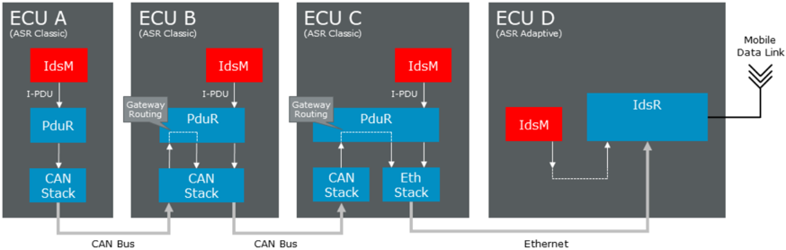
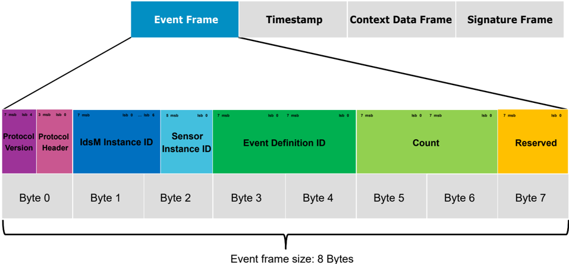
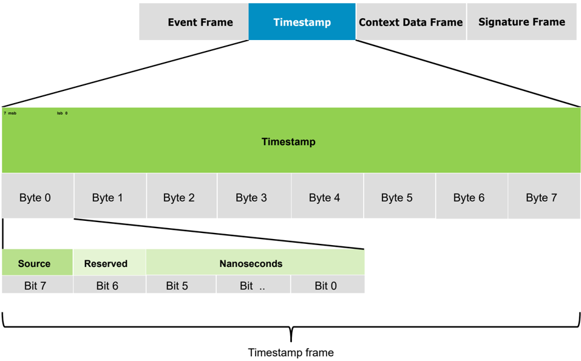
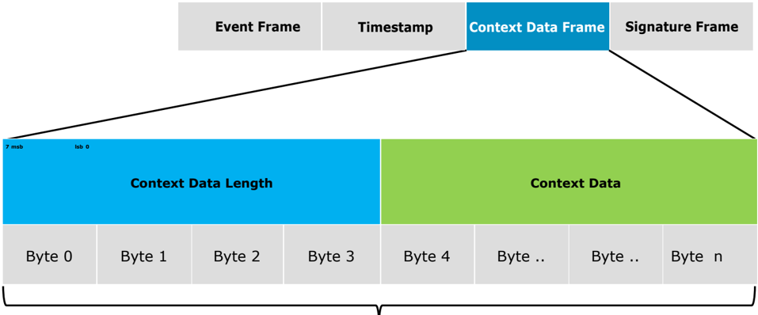
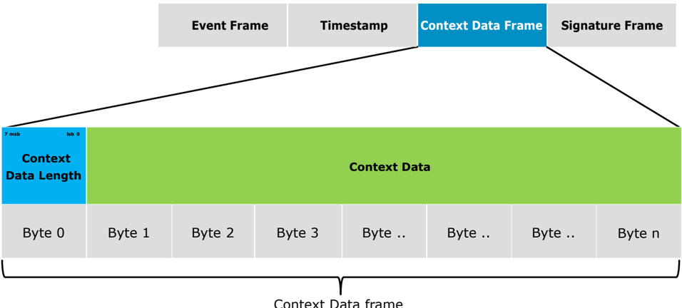
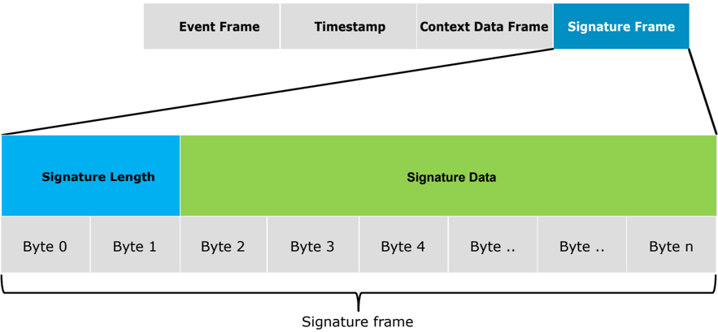
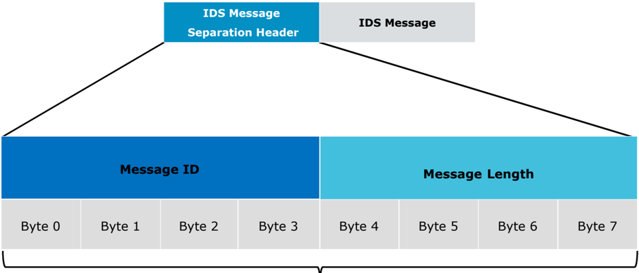

<!-- 源文档 AUTOSAR_FO_PRS_IntrusionDetectionSystem（R23-11），协议规范（PRS），不受 Type A 七章骨架约束；章节结构镜像源文档自身编号（参考文献为源文档末尾的无编号章，镜像保留在附录之后）。协议项 ID [PRS_Ids_*] 按 2026-11-03 批次决议整体省略（项正文照常翻译，为内联段落/编号列表）；RS_Ids 回引随追溯章一并省略。源第 3 章「Protocol Requirements」仅含 Requirements Traceability 一节（纯 ID 追溯表），按 2026-11-03 决议整章省略并将后续章节重编号（源 4→3、5→4、6→5、7→6），正文内的章节交叉引用（refer to 5.1.5 等）随之重编号。附录 A 的三个变更历史表标题列均为空（占位），按占位规则以条目数陈述（新增 2 项/变更 3 项/删除 1 项）——与 SecOC 行同一运行决策。封面元数据表、免责声明与目录按 EXP 流程省略；8 处内容图（图2.1、图5.1、图5.3–图5.8，均按源图号命名嵌入；源文档无图5.2——其内容为概览表格），其余图引用为页面装饰；架构图与帧图的图内标签散落（ECU A、IdsM、I-PDU 等）按转换噪声丢弃；§5.1 配置选项编号列表的 5./6. 两条乱码行（第 4 项的延续句）已按源语义合并回第 4 项。 -->

## 1. 引言和概述

本协议需求规范规定 **AUTOSAR** 协议入侵检测系统（**IDS**）的格式、消息序列和语义。

文档 **RS** 入侵检测系统 [\[1\]](#ref-1) 描述了分布式入侵检测系统（**IDS**）的元素。**IDS** 元素的概览请参见 [1]。

**PRS IDS** 通过提供用于将合格安全事件（**QSEv**）从入侵检测系统管理器（**IdsM**）实例传输到入侵检测系统报告器（**IdsR**）实例的协议，为 **IDS** 作出贡献。

### 1.1. 协议目的和目标

如 [1] 所述，**QSEv** 可以本地持久化在安全事件被鉴定的 **ECU** 上。作为替代，**QSEv** 也可以发送给 **IdsR**。**IDS** 协议涵盖从 **IdsM** 实例向 **IdsR** 实例发送 **QSEv** 的过程。

### 1.2. 协议的适用性

**IDS** 协议支持 **QSEv** 的推送接口。**IdsM** 实例将相应配置的 **QSEv** 推送给 **IdsR**。拉取接口不在本协议的覆盖范围内。它可以通过将 **QSEv** 本地存储在适当的组件中，然后经由常规诊断接口访问本地存储的 **QSEv** 来实现。

#### 1.2.1. 约束和假设

使用 **IDS** 协议没有特定的假设和约束。它被设计为适用于所有总线系统。软件栈必须能够发送和接收 **I-PDU**。**IdsM** 不支持 **QSEv** 的接收。

#### 1.2.2. 限制

上下文数据的大小没有定义限制。建议将单个完整 **QSEv** 的限制设置为 16 kByte。

### 1.3. 依赖

#### 1.3.1. 对其他协议层的依赖

根据所使用的网络，**IdsM** 对其他协议层（例如 **TCP**、**UDP** 或 **CAN**）存在依赖。

#### 1.3.2. 对其他标准和规范的依赖

如果 **SOC** 需要，**IdsR** 可以将 **IDS** 协议的元素映射到 syslog 格式。

#### 1.3.3. 对应用层的依赖

**IDS** 协议不依赖应用层。应用层组件可以通过使用 **IdsM** 的 **API** 发出安全事件。

## 2. 用例

**AUTOSAR IDS** 的架构和功能在 [1] 中描述。因此本章只是该协议用例的简要总结。

表2.1：IDS 协议的用例（**Usecases for IDS protocols**）

| ID | 名称 | 描述 |
| --- | --- | --- |
| 0001 | QSEv 的传输 | 将合格安全事件从 **IdsM** 实例传输到 **IdsR** 实例 |

### 2.1. UC_0001「将 QSEv 转发到具有 SOC 连接的 ECU」

**IDS** 协议的主要用例是以独立于 **ECU** 类型或所用通信机制的方式传播合格安全事件 **QSEv** 到 **IdsR**。**IdsM** 实例可以部署到车辆架构中所有安全相关的节点。该决策通常基于车辆 **E/E** 架构的安全分析。其结果是，一个 **IdsM** 实例可以经由多种不同的总线系统间接连接到 **IdsR**，如图2.1 所示，其中给出了 **AP** 和 **CP** 的示例。

## 3. 术语与缩略语的定义

### 3.1. 缩略语和缩写

**AP**
> **AUTOSAR** 自适应平台（**AUTOSAR Adaptive Platform**）

**API**
> 应用编程接口（**Application Programming Interface**）

**BSW**
> 标准化的 **AUTOSAR** 软件模块，提供电子控制单元通常需要的基础功能。

**CAN**
> 控制器局域网，一种汽车网络通信协议。

**CAN FD**
> 带 弹性数据率的控制器局域网（**Controller Area Network with Flexible Data-Rate**）

**CDD**
> 复杂设备驱动（**Complex Device Driver**）

**Context Data**
> 上下文数据：与安全事件（**SEv**）相关的信息。它是可选数据，提供对安全事件的更广泛理解（例如被损坏的数据）。上下文数据的内容和编码由传感器外部定义，**IdsM** 模块不知晓。

**Context Data Buffer**
> 上下文数据缓冲区：大小可变的缓冲区，以适配 **SEv** 上下文数据的需要。

**CP**
> **AUTOSAR** 经典平台（**AUTOSAR Classic Platform**）

**ECU**
> 电子控制单元：在汽车的电子系统中提供功能的单元，例如制动系统或车窗升降器。

**Event Buffer**
> 事件缓冲区：临时存储已上报 **SEv** 的缓冲区。

**Event Frame**
> 事件帧：**IDS** 协议的主帧，包含安全事件 ID 等基本信息。

**Filter Chain**
> 过滤器链：施加于安全事件的一组连续过滤器。其输出是合格安全事件。

**FlexRay**
> 一种汽车网络通信协议。

**General Purpose I-Pdu**
> 通用交互层协议数据单元（**General Purpose Interaction Layer Protocol Data Unit**）。

**ID**
> 标识符（**Identifier**）

**IDS**
> 入侵检测系统：检测并处理安全事件的安全控制。

**I-PDU**
> 交互层协议数据单元（**Interaction Layer Protocol Data Unit**）

**I-PDU Multiplexer**
> **I-PDU** 复用器：一个 **AUTOSAR** 基础软件模块，规定用一个协议控制信息复用多个 **PDU** 的协议。

**IdsM**
> 入侵检测系统管理器：处理由安全传感器上报的安全事件。

**IDS Message**
> **IDS** 消息：由 **IdsM** 使用 **IDS** 协议发送的消息。

**IdsR**
> 入侵检测系统报告器：处理从 **IdsM** 实例接收到的合格安全事件。

**IDS protocol**
> **IDS** 协议：入侵检测系统协议，规定 **IDS** 使用的消息格式。

**LIN**
> 局部互联网络（**Local Interconnect Network**）：用于连接传感器和执行器的串行通信总线。

**ms**
> 毫秒（**Miliseconds**）

**N-PDU**
> 网络层协议数据单元（**Network Layer Protocol Data Unit**）

**OEM**
> 原始设备制造商（**Original Equipment Manufacturer**）

**PDU Router**
> **PDU** 路由器：协议数据单元路由器，是一个 **AUTOSAR** 组件，负责独立于底层通信网络的消息路由。

**PRS IDS**
> 协议需求规范入侵检测系统：描述 **IDS** 协议全部元素的规范文档。

**QSEv**
> 通过过滤器链的安全事件被视为合格安全事件，并被发送到所配置的接收端。

**SecXT**
> 安全提取：规定哪些安全事件由 **IdsM** 实例处理及其配置参数。

**SEv**
> 安全事件：由 **BSW**、**CDD**、**SWC** 或其他软件组件或应用上报给 **IdsM**。

**Sem**
> 安全事件存储器：独立于主诊断事件存储器的用户定义诊断事件存储器。

**Security Sensors**
> 安全传感器：向 **IdsM** 上报安全事件的 **BSW**、**CDD**、**SWC** 或其他软件组件或应用。

**SIEM**
> 安全事件与事件管理：收集、关联和分析安全事件以检测威胁的技术概念。

**Sensor**
> 传感器：告知 **IdsM** 模块 **SEv** 的上报身份。它可以是 **BSW** 模块、专有 **CDD** 或 **SWC** 应用。

**SOC**
> 安全运营中心：**IDS** 的后台，在其中可以处理和分析数据。

**SoAd**
> 套接字适配器（**Socket Adaptor**）：**AUTOSAR** 的一个基础软件模块，它在服务层基于 **PDU** 的通信与基于套接字的 **TCP/IP** 之间创建接口。

**SOME/IP**
> 面向互联网协议的可扩展服务导向中间件（**Scalable service-Oriented MiddlewarE over Internet Protocol**）

**SWC**
> 软件组件（**Software Component**）

**TCP**
> 传输控制协议（**Transmission Control Protocol**）

**UDP**
> 用户数据报协议（**User Datagram Protocol**）

## 4. 协议规范

**IDS** 协议的主要目的是将合格安全事件（**QSEv**）从入侵检测系统管理器（**IdsM**）实例传输到入侵检测系统报告器（**IdsR**）实例。

### 4.1. IDS 消息格式

**IDS** 协议如图5.1 所示。

**IDS** 协议由标准事件帧和最多三个可选字段组成。它提供了多种选项，既可以只发送合格安全事件 **QSEv** 的最少数据，也可以用更多细节扩展这些数据。

除附加时间戳或上下文数据的扩展之外，还可以通过为每条 **QSEv** 添加签名来保护数据传输。下面的列表给出配置的示例并解释各选项。

所有选项都可以彼此独立地配置或关闭，因此所有选项的子集或组合都是可能的。

1. 不带进一步数据的标准合格安全事件 **QSEv**。
2. 带时间戳的合格安全事件 **QSEv**：如果除了例如 **IdsR** 提供的时间戳之外还需要更精确的时间戳，传感器或 **IdsM** 可以为每条 **QSEv** 附加时间戳。该选项必须通过协议报头中相应的配置位设置。（参见 [4.1.5 时间戳](#415-时间戳)）
3. 带上下文数据的合格安全事件 **QSEv**：上下文数据包含仅转发给接收端的传感器特定信息。**IdsM** 不知晓这些数据的内容或结构。该选项必须通过协议报头中相应的配置位设置。（参见 [4.1.6 上下文数据](#416-上下文数据)）
4. 带签名的合格安全事件 **QSEv**：如果安全事件的通信需要更高的安全性，可以为每条 **QSEv** 添加签名。该选项必须通过协议报头中相应的配置位设置。（参见 [4.1.8 签名](#418-签名)）

#### 4.1.1. IDS 协议概览

图5.2 给出了 **IDS** 协议全部元素的概览。

表5.2：入侵检测系统协议概览（**Intrusion Detection System Protocol Overview**）

| 字段名 | 长度 | 数据描述 |
| --- | --- | --- |
| Protocol Version | 4 位 | **IdsM** 协议的版本 |
| Protocol Header | 4 位 | **IdsM** 协议报头信息：Bit[0]：0——不含上下文数据，1——含上下文数据；Bit[1]：0——不含时间戳，1——含时间戳；Bit[2]：0——不含签名，1——含签名；Bit[3]：保留 |
| IdsM Instance | 10 位 | 发送方 **IdsM** 实例的唯一标识符 0-1023 |
| Id Module Instance Id | 6 位 | 用于区分模块的多个实例的标识符 |
| Event Id | 16 位 | 安全事件的唯一标识符：**AUTOSAR** 内部 ID 范围：0…0x7FFF；客户特定 ID 范围：0x8000…0xFFFF |
| Count | 16 位 | 经过所配置过滤器（例如事件聚合）处理后，产生当前事件的 **IdsM** 调用次数 |
| Reserve | 8 位 | 保留供将来使用 |
| Timestamp | 8 字节 | 检测到事件时的时间戳/滴答时间戳：（可选）Byte[0] Bit[7]=0：**AUTOSAR** 标准；Byte[0] Bit[6]：保留；Byte[0] Bit[7]=1：**OEM** 特定/自定义时间戳。分辨率为 ms。并非每种事件类型都需要。如未设置，该字段由 **IdsR** 填充。如时间不真实，**IdsR** 可能重新计算时间并插入新值 |
| Context Data Length | 1 或 4 字节 | 1…(2^31)-1。上下文数据的长度信息。仅在存在上下文数据时可用。（可选）第一个字节上下文数据的最高有效位指示上下文数据长度以 7 位还是 31 位编码：Context Data Byte[0] Bit[7]=0：长度以 7 位编码——Byte[0] Bit[0..6]——有效值：1..127 字节；Context Data Byte[0] Bit[7]=1：长度以 31 位编码——Byte[0] Bit[0..6]、Byte[1..3] Bit[0..7]——有效值：1..(2^31) - 1 字节 |
| Context Data | 1…(2^31) -1 字节 | 由传感器附着的二进制数据块：（可选） |
| Signature Length | 2 字节 | 签名的长度信息。仅在存在签名时可用。（可选）Signature Byte[0..1]：签名长度 1..65535 字节 |
| Signature | 1..65535 字节 | 用于安全事件认证的签名：（可选）签名以事件帧 + 可选时间戳 + 可选上下文数据计算。Signature Byte[2..n]：签名数据——可通过元模型配置 |

#### 4.1.2. 字节序——字节顺序

**IDS** 协议使用大端字节序（big endianess）作为字节顺序，也称为 **Motorola** 格式。这等同于网络字节序，例如以太网所使用的。在本节的表格和描述中，字节编号按照字节在 **IDS** 消息中的传输顺序递增，从 0 开始。

第一个字节是最高有效字节（**MSB**），通常为字节 0；最后一个字节是最低有效字节（**LSB**）。位编号递减，一个字节的最高有效位（msb）为位 7，最低有效位（lsb）为 0。

#### 4.1.3. 通信接口的独立性

**IDS** 协议独立于所使用的硬件和底层通信接口（例如 **CAN**、以太网、**FlexRay**）。它被优化为以安全事件所需的最少信息适配标准 **CAN** 总线通信。以太网通信同样适用。

#### 4.1.4. IDS 事件帧

图5.3 展示了 **IDS** 协议的事件帧。

**IDS** 事件帧由 8 字节组成，如上所述。

**注意：** 时间戳、上下文数据帧和签名帧是可选的。

##### 4.1.4.1. 协议版本与报头

表5.1：协议版本与报头的布局（**Layout of Protocol Version and Header**）

| Byte 0 | Byte 0 | Byte 0 | Byte 0 | Byte 0 | Byte 0 | Byte 0 | Byte 0 |
| --- | --- | --- | --- | --- | --- | --- | --- |
| Bit 7 | Bit 6 | Bit 5 | Bit 4 | Bit 3 | Bit 2 | Bit 1 | Bit 0 |
| 协议版本 | 协议版本 | 协议版本 | 协议版本 | 协议保留 | 签名 | 时间戳 | 上下文数据 |

###### 4.1.4.1.1. 协议版本

**IDS** 协议的版本信息：

- Bit[7..4]：0-15

计算公式：

`ProtocolVersion = (BYTE0 & 0xF0) >> 4`

本 **IDS** 协议规范使用的版本号应为 1。

###### 4.1.4.1.2. 协议报头

**IDS** 协议报头信息，包含用于开启或关闭特定功能的配置位：

- Bit[0]：包含上下文数据

  0：不含上下文数据

  1：含上下文数据

- Bit[1]：包含时间戳

  0：不含时间戳

  1：含时间戳

- Bit[2]：包含签名

  0：不含签名

  1：含签名

- Bit[3]：保留

计算公式：

`ProtocolHeader = (BYTE0 & 0x0F)`

**注意：** 仅当时间戳、上下文数据或签名可用时，相应的协议报头位才置 1。上下文数据或签名永远不会以长度 0 传输。

**注意：** 保留位应预置为值 0。接收侧应忽略这些位。

##### 4.1.4.2. IdsM 实例 ID 与传感器实例 ID

表5.2：IdsM 实例 ID、传感器实例 ID（**IdsM Instance ID, Sensor Instance ID**）

| Byte 1 | Byte 1 | Byte 1 | Byte 1 | Byte 1 | Byte 1 | Byte 1 | Byte 1 | Byte 2 | Byte 2 | Byte 2 | Byte 2 | Byte 2 | Byte 2 | Byte 2 | Byte 2 |
| --- | --- | --- | --- | --- | --- | --- | --- | --- | --- | --- | --- | --- | --- | --- | --- |
| Bit 7 | Bit 6 | Bit 5 | Bit 4 | Bit 3 | Bit 2 | Bit 1 | Bit 0 | Bit 7 | Bit 6 | Bit 5 | Bit 4 | Bit 3 | Bit 2 | Bit 1 | Bit 0 |
| IDS 实例 ID | IDS 实例 ID | IDS 实例 ID | IDS 实例 ID | IDS 实例 ID | IDS 实例 ID | IDS 实例 ID | IDS 实例 ID | IDS 实例 ID | IDS 实例 ID | 传感器实例 ID | 传感器实例 ID | 传感器实例 ID | 传感器实例 ID | 传感器实例 ID | 传感器实例 ID |

该表展示了 **IdsM** 实例 ID 与传感器实例 ID 的组合元素。

###### 4.1.4.2.1. IdsM 实例 ID

发送安全事件的 **IdsM** 实例的唯一标识符。

**IdsM** 实例 ID 范围：0-1023。

通常一个 **ECU** 中有一个 **IdsM** 实例。在带多核或多处理器设备的复杂 **ECU** 情形下，可能存在多个 **IdsM**。在这种配置中，所有 **IdsM** 必须配置不同的 **IDS** 实例 ID。计算公式：

`IdsM Instance ID (10 Bits) = ((BYTE2 & 0xC0) >> 6) | (BYTE1 << 2)`

###### 4.1.4.2.2. 传感器实例 ID

区分同类传感器模块多个实例的标识符。

传感器实例 ID 范围：0-63。

例如，一个 **ECU** 中的多个 **CanDrv** 可以发出「相同的」安全事件。为区分它们，使用传感器实例 ID。

如果配置中只有一个传感器实例，传感器实例 ID 的值默认应设置为 0。

**注意：** 传感器实例 ID 应在相应实例的配置中设置。

计算公式：

`Sensor Instance ID (6 Bits) = (BYTE2 & 0x3F)`

##### 4.1.4.3. 事件定义 ID

事件定义 ID 如表5.3 所示。

表5.3：事件定义 ID（**Event Definition ID**）

| Byte 3 | Byte 4 |
| --- | --- |
| 事件定义 ID | 事件定义 ID |

事件定义 ID 是安全事件的唯一标识符。它描述安全事件的种类。

如果一个传感器产生多个同种类的安全事件，则称为事件实例。

事件定义 ID 的范围分为三个区段：

1. **AUTOSAR** 内部 ID：0-0x7FFF（最多 32768 个安全事件）
2. 客户特定 ID：0x8000-0xFFFE（最多 32767 个安全事件）
3. 无效 ID：0xFFFF

##### 4.1.4.4. 计数

表5.4 展示了 **IDS** 元素计数。

表5.4：计数（**Count**）

| Byte 5 | Byte 6 |
| --- | --- |
| 计数 | |

计数表示产生当前合格安全事件的 **IdsM** API 调用次数。当创建事件时，其计数初始化为 1。然而，诸如事件聚合之类的过滤器可能将多个事件合并为一个。该事件的计数被设置为所有被聚合事件计数之和。如果安全事件由一个已经过滤并预设计数值的智能传感器发送，该预设值只是被加到 **IdsM** 的计数上。因此最终计数是传感器计数与 **IdsM** 处理结果之和。

##### 4.1.4.5. 保留

保留字节如表5.5 所示。

表5.5：保留（**Reserved**）

| Byte 7 |
| --- |
| 保留 |

**IDS** 协议事件帧的 Byte[7] 保留供将来使用。

**注意：** 保留字节应预置为值 0。接收侧应忽略这些字节。

#### 4.1.5. 时间戳

时间戳的细节如图5.4 所示。

**IDS** 协议将时间戳作为可配置选项提供。

记录安全事件第一次被检测到的时间（首次出现）。

要求分辨率为 ms。时间戳应以总共 64 位编码，以适配单个 **CAN** 帧。

**IDS** 协议中可以配置不同的时间戳来源。

- Bit[7]：时间戳来源
  - 0：**AUTOSAR** 标准。**CP**：**StbM**——**AP**：ara::tsync
  - 1：辅助 / **OEM** 特定时间戳
- Bit[6]：保留

##### 4.1.5.1. AUTOSAR 时间戳

表5.6：时间戳来源与纳秒（**Timestamp Source and Nanoseconds**）

| Timestamp | Timestamp | Timestamp | Timestamp | Timestamp | Timestamp |
| --- | --- | --- | --- | --- | --- |
| Byte 0 | Byte 0 | Byte 0 | Byte 1 | Byte 2 | Byte 3 |
| Bit 7 | Bit 6 | Bit 5..0 | | | |
| 来源 | 保留 | 纳秒 | 纳秒 | 纳秒 | 纳秒 |

表5.7：时间戳秒（**Timestamp Seconds**）

| Timestamp | Timestamp | Timestamp | Timestamp |
| --- | --- | --- | --- |
| Byte 4 | Byte 5 | Byte 6 | Byte 7 |
| 秒 | 秒 | 秒 | 秒 |

对于 **IDS** 协议，**AUTOSAR** 时间格式将 30 位的纳秒时间戳与 32 位的秒时间戳组合在一起。

###### 4.1.5.1.1. 纳秒

对于纳秒，只需 30 位即可编码 0..999 999 999 ns = 10^-9 秒。

**注意：** **AUTOSAR** 时间同步协议（例如 **CP** 中的 **StbM**）对纳秒使用 32 位。**IDS** 协议对纳秒的截断不会限制时间戳的分辨率。

###### 4.1.5.1.2. 秒

秒以 32 位编码，这产生约 127 年的分辨率。

**注意：** 细节请参见时间同步协议 **SWS-TimeSynchronisation** [\[2\]](#ref-2)。

##### 4.1.5.2. OEM 时间戳

表5.8：OEM 时间戳格式（**OEM Timestamp format**）

| Timestamp | Timestamp | Timestamp | Timestamp | Timestamp |
| --- | --- | --- | --- | --- |
| Byte 0 | Byte 0 | Byte 1 | Byte 2 | Byte 3 |
| Bit 7 | Bit 6..0 | | | |
| 来源 | **OEM** 时间戳 | **OEM** 时间戳 | **OEM** 时间戳 | **OEM** 时间戳 |

**OEM** 时间源提供了使用其他时间协议的选项。长度限于 63 位。需要与 **OEM** 应用的接口。精度由 **OEM** 定义。

#### 4.1.6. 上下文数据

**IDS** 协议提供一个可选特性，用更详细的信息充实事件帧中传输的标准安全事件。为此可以附加上下文数据。它是由传感器附着的二进制数据块。这些数据包含关于安全事件的特定详细信息，**SOC** 可用其改进对安全事件的分析，例如由通信传感器检测到的畸形消息。

**IdsM** 不知晓这些数据的内容或结构。只有发出数据的传感器以及后台或 **SOC** 知晓。

有两种不同大小的上下文数据变体：

##### 4.1.6.1. 上下文数据——长尺寸

图5.5 展示了带 4 字节长度字段的「上下文数据长尺寸」。

「上下文数据长尺寸」包含一个 4 字节长度字段。最多可传输 2^31-1 字节的上下文数据。

##### 4.1.6.2. 上下文数据——短尺寸

「上下文数据短尺寸」是带 1 字节长度字段、最多 127 字节上下文数据的替代版本。

#### 4.1.7. 上下文数据长度编码

表5.9：上下文数据长度编码（**Context Data Length Encoding**）

| Context Data | Context Data | Context Data | Context Data | Context Data | Context Data | Context Data | Context Data |
| --- | --- | --- | --- | --- | --- | --- | --- |
| Byte 0 | Byte 0 | Byte 0 | Byte 0 | Byte 0 | Byte 0 | Byte 0 | Byte 0 |
| Bit 7 | Bit 6 | Bit 5 | Bit 4 | Bit 3 | Bit 2 | Bit 1 | Bit 0 |
| 长度格式 | 上下文数据长度 | 上下文数据长度 | 上下文数据长度 | 上下文数据长度 | 上下文数据长度 | 上下文数据长度 | 上下文数据长度 |

第一个字节上下文数据（**MSB**）的最高有效位（msb）指示长度以 7 位（1 字节）还是 31 位（4 字节）编码。

长度格式 = 上下文数据 Byte[0] Bit[7]：

0：7 位长度信息编码于上下文数据 Byte[0] Bit[0..6]：1-127 字节
1：31 位长度信息编码于上下文数据 Byte[0..3] Bit[0..30]：1..(2^31 -1) 字节

#### 4.1.8. 签名

**IDS** 协议提供一个可选特性，使 **QSEv** 的传输更安全。可以为 **IDS** 消息添加数字签名。它可用于确保真实性，以及证明从 **IdsM** 经由所有通信系统直至到达后台或 **SOC** 的已签名消息的完整性（端到端安全）。

图5.7 展示了 **IDS** 协议的签名选项。

##### 4.1.8.1. 签名长度

签名长度以 2 字节编码：

- Signature Length Byte[0..1]：签名长度 1..65535

##### 4.1.8.2. 签名数据

表5.10：签名（**Signature**）

| Signature | Signature | Signature | Signature | Signature | Signature | Signature | Signature |
| --- | --- | --- | --- | --- | --- | --- | --- |
| Byte 2 | Byte 3 | Byte 4 | Byte 5 | Byte 5 | Byte .. | Byte .. | Byte n |
| 签名数据 | 签名数据 | 签名数据 | 签名数据 | 签名数据 | 签名数据 | 签名数据 | 签名数据 |

表5.10 展示了签名数据。

Signature Data Byte[2..65537]：签名数据

安全事件签名的密码学值以以下数据的序列化形式计算：事件帧 + 可选时间戳 + 可选上下文数据。

使用哪种密码算法取决于系统。**IDS** 协议不规定任何特定算法或格式。（另请参见 [4.1.4 IDS 事件帧](#414-ids-事件帧)、[4.1.5 时间戳](#415-时间戳)和 [4.1.6 上下文数据](#416-上下文数据)。）

#### 4.1.9. IDS 消息分隔

在以太网上，**IDS** 消息分隔报头是强制性的。它用于无歧义地寻址 **IDS** 消息。除了经由以太网传输单条 **IDS** 消息之外，还可以将多条 **IDS** 消息收集并在单个以太网帧内发送。

应使用唯一的以太网端口地址进行 **IDS** 通信。

**SOME/IP** 和 **IDS** 消息不应在同一端口上混用，因为接收方无法正确区分它们。

**注意：** **IdsR** 通常经由以太网连接。但如前所述，也支持其他汽车通信总线和协议。关于消息分隔报头，应考虑以下内容：

- **CAN FD**：**I-Pdu** 复用器 [\[3\]](#ref-3) 支持在一条消息中收集多条 **IDS** 消息。由于 **CAN** 上的大小限制，**I-Pdu** 复用器通常使用短报头或无报头选项。因此 **IDS** 消息分隔报头通常不用于 **CAN** 总线。
- **FlexRay**：**PDU** 打包（**PDU Packing**）特性支持在一条消息中收集多条 **IDS** 消息。它不使用分隔报头，而是使用更新位来标识可用部分。更多细节请参见 **SWS FlexRay Interface** [\[4\]](#ref-4)。
- **CAN**（标准）：**IDS** 帧在不带 **IDS** 消息分隔报头的情况下传输。
- **LIN**：**IDS** 帧在不带 **IDS** 消息分隔报头的情况下传输。

##### 4.1.9.1. IDS 消息分隔报头

图5.8 展示了 **IDS** 消息分隔报头。

**IDS** 消息分隔报头帧大小：8 字节

**IDS** 消息分隔报头由一个用于在接收方唯一标识的 4 字节 ID 字段和一个规定数据长度的 4 字节长度字段组成。两者均为大端字节序。

##### 4.1.9.2. IDS 消息分隔报头 ID

**IDS** 消息分隔报头 ID 以 4 字节编码。它是一个任意数字，宜为 0。

**注意：** 在 **AUTOSAR CP** 中，**IDS** 消息分隔报头 ID 应在套接字适配器（**Socket Adapter**）和 **I-PDU** 复用器的配置中设置。细节请参见 **SWS-Socket Adaptor** [\[5\]](#ref-5) 和 **SWS-IPDUMultiplexer** [\[3\]](#ref-3)。

##### 4.1.9.3. IDS 消息分隔报头长度

**IDS** 消息分隔报头长度等于 **IDS** 消息长度。它以 4 字节编码。

可能的范围为：

Message Length Byte[0..3]：8..2.147.549.212 字节。

最小长度为 8 字节，等于最小的 **IDS** 消息，即未配置任何选项的事件帧（8 字节）。另请参见 [4.1.11.2 最小尺寸的示例 IDS 消息](#41112-最小尺寸的示例-ids-消息)。

最大长度取决于所配置的选项。如果所有选项都以最大尺寸配置且使用了 **IDS** 消息分隔报头，则消息总大小为 2.147.549.212 字节。细节请参见 [4.1.11.1 最大尺寸的示例 IDS 消息](#41111-最大尺寸的示例-ids-消息)。

**注意：** **AUTOSAR** 平台：

- **CP**：**IDS** 消息分隔报头对应于 SocketAdaptor/**I-PDU** 复用器 [\[5\]](#ref-5)/[\[3\]](#ref-3) 支持的 **N-PDU** 机制。
- **AP**：**IDS** 消息分隔报头必须由 **IdsM** 生成。

#### 4.1.10. PDU 类型

**注意：**

在 **CP** 中，**IDS** 协议使用 **IDS** 类型的 GeneralPurposeIPdu（交互层协议数据单元）传输合格安全事件 **QSEv**。

细节请参见系统模板 [\[6\]](#ref-6) 的「Communication」章。

#### 4.1.11. IDS 消息示例

##### 4.1.11.1. 最大尺寸的示例 IDS 消息

**IDS** 协议的所有选项都以最大尺寸配置：

- 配置了选项「时间戳 **AUTOSAR**」。
- 配置了选项「上下文数据长尺寸」。
- 配置了选项「签名」。

事件帧：8 字节

时间戳：8 字节

上下文数据长尺寸：2^31 -1 字节 = 2.147.483.647 字节

上下文数据长尺寸长度编码：4 字节

签名：65535 字节

签名长度编码：2 字节

**IDS** 消息 = 8 + 8 + 2.147.483.647 + 4 + 65535 + 2 = 2.147.549.204 字节

对于 **CAN** 总线：

**CAN TP** 的最大消息大小 = 2^32 -1 = 4.294.967.295

对于以太网：

必须附加 8 字节的 **IDS** 消息分隔报头：

带 **IDS** 分隔报头的最大 **IDS** 消息：8 字节 + 2.147.549.204 字节 = 2.147.549.212 字节

**IDS** 消息分隔报头用 4 字节可编码的最大尺寸：

4 字节 = 2^32 = 4.294.967.296

这确保了最大尺寸的 **IDS** 消息可以经由标准汽车总线系统传输！

##### 4.1.11.2. 最小尺寸的示例 IDS 消息

**IDS** 协议的任何选项都未配置——最小尺寸：

事件帧：8 字节

**IDS** 消息 = 8 字节

### 4.2. 消息类型

当前不用于 **IDS** 协议。

### 4.3. 服务/命令

当前不用于 **IDS** 协议。

### 4.4. 序列（下层）

当前不用于 **IDS** 协议。

### 4.5. 错误消息

**IDS** 协议不发送特定的错误消息。

## 5. 配置参数

当前不用于 **IDS** 协议。

## 6. 协议使用和指南

当前不用于 **IDS** 协议。

## A. AUTOSAR 可追溯项变更历史

请注意，本章中的列表还包括在后续版本中已从规范中移除的可追溯项。这些可追溯项在文档中不作为超链接出现。

### A.1. 本文档依据 AUTOSAR 版本 R23-11 的可追溯项变更历史

#### A.1.1. R23-11 中新增的规范项

2 项

#### A.1.2. R23-11 中变更的规范项

3 项

#### A.1.3. R23-11 中删除的规范项

1 项

## 参考文献

[1] Requirements on Intrusion Detection System
> AUTOSAR_FO_RS_IntrusionDetectionSystem

[2] Specification of Time Synchronization
> AUTOSAR_AP_SWS_TimeSynchronization

[3] Specification of I-PDU Multiplexer
> AUTOSAR_CP_SWS_IPDUMultiplexer

[4] Specification of FlexRay Interface
> AUTOSAR_CP_SWS_FlexRayInterface

[5] Specification of Socket Adaptor
> AUTOSAR_CP_SWS_SocketAdaptor

[6] System Template
> AUTOSAR_CP_TPS_SystemTemplate
