<!-- 源文档 AUTOSAR_FO_PRS_LogAndTraceProtocol（R23-11），协议规范（PRS），不受 Type A 七章骨架约束；章节结构镜像源文档自身编号。规范项 ID [PRS_Dlt_*] 按 2026-11-03 批次决议整体省略（项正文照常翻译，有标题的项以粗体标题行 + 正文段落呈现，无标题的项以正文段落呈现）；RS_LT_* 回引与 glyph 标记随项一并省略。源 §3.2「Requirements Traceability」为纯 ID 追溯表（子章节而非章节，无需重编号），按 ASWS 先例整节省略——请用户在确认关核验。源 §5.5.1「States」正文为「N/A - The Dlt Protocol does not specify any states.」——含协议无状态的事实陈述，按正文翻译保留（与整节占位省略规则的区别已在注记中说明）。封面元数据表、免责声明与目录按 EXP 流程省略；12 张内容图（图1.1、图2.1–2.4、图5.1、图5.2、图5.4–5.8）按源图号嵌入，其余 ~99 处图引用为页面装饰条与字形图标，丢弃；图内标签散落（Application、ECU、MSIN、NOAR、(DLT or ara::log) 等）按转换噪声丢弃。异常与重建，请在确认关核验：(1) 源图 5.3「Extension Header」在 markdown 转换中损坏为串列混淆的表格，上表依据语料 PDF 第 30 页逐格转写重建为 GFM 表；(2) 表 5.18（Type Info 有效设置组合矩阵）在 markdown 转换中列对齐丢失，依据语料 PDF 第 57 页按变量类型逐行转写，TYLE/TYFM/TYPR 的子列并为一列；(3) 表 5.10 下方 FLOA 小节 00371 的「as shown in Table 5-4」为源文档自身的引用错误（实际表号为 5.11），按源保留并加注意；(4) SetLogLevelLong 的 Service ID「0x000000025」与 SetTraceStatusLong 的「0x0000026」位数错误、BufferOverflowNotification 的「unit32」、GetLogChannelNames 的「4*uin8[]」、§5.6.1.3 清单中的「GetIseECUID」均为源 PDF 自身笔误，按源保留；(5) SetTraceStatusLong/GetTraceStatusLong/SetLogChannelAssignmentLong 的 Description 单元格沿用了日志级别命令的文案（「Set the pass through range for log messages …」），为源文档自身的复制粘贴错误，按源保留；(6) §5.1.3.2.3.9 类型字符串的载荷组装表在源转换中无表题编号，按无表题呈现；(7) 源 ch.2 图内散落的「(DLT or ara::log)」「DIt module」等标签为转换噪声丢弃；(8) 参考文献 [2] 的条目行在转换中断行错乱（"ence Model … Basic Refer"），按 ISO/IEC 7498-1:1994 的完整标题重接。 -->

## 1. 引言和概述

本协议规范定义了 AUTOSAR 协议 **Dlt** 的格式、消息序列和语义。

该协议允许将诊断、日志和跟踪信息发送到通信总线上。

为此，**Dlt** 模块从应用或其他软件模块收集调试信息，为调试信息添加元数据，并将其发送到通信总线。

此外，**Dlt** 协议允许根据严重级别（例如 "fatal"、"error" 或 "information"）对调试信息进行过滤。该过滤器可以在运行时通过外部日志工具发送给 **Dlt** 模块的 **Dlt** 控制消息进行修改。

还可以直接通知应用新的过滤器级别，使其只针对所选的严重级别生成调试信息、在运行时将消息分配到另一条通信总线，或者将修改后的 **Dlt** 配置非易失性地存储（如果硬件支持）。

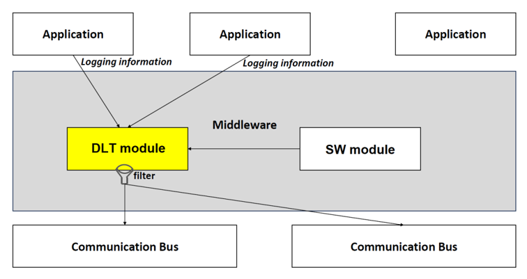

协议版本 "1" 仍然保持有效（参见 [1, PRS LogAndTrace Protocol-R20-11]，R20-11 的日志与跟踪协议规范），而本文档所规定的协议版本 "2" 提高了所需用例的灵活性，并引入了无法再以向后兼容的方式加入先前协议版本的新特性。这些特性是：

- 用于消息过滤的标签（**Tags**）和隐私标志（**Privacy Flags**）。
- 改进的时间戳，具有纳秒分辨率和可能跨越数千年的时间跨度。与此相关，ServiceID/命令 0x24/"SyncTimeStamp" 不再需要并被移除。
- ECU、应用和上下文名称的长 ID 现在已经在日志与跟踪消息的报文头部分得到支持。
- 可能的源文件名和行号信息也是如此。

所采用的「标志-长度-值」（"flag-length-value"）方法为协议的未来扩展留出了空间，而不会破坏与现有特性的兼容性。

此外，日志与跟踪消息中的字符串不再需要空终止符，因为其长度值已经足够。

### 1.1. 协议目的和目标

**Dlt** 协议可以在 ECU 开发阶段用于将调试信息记录并存储到外部的日志设备上。

### 1.2. 协议的适用性

计划在 ECU 的开发阶段使用 **Dlt** 协议。假定使用外部的日志和跟踪工具来存储 ECU 生成的调试信息。

如果需要，该日志和跟踪工具也用于在运行时修改过滤器设置，或将 ECU 当前的 **Dlt** 配置持久化存储。

#### 1.2.1. 安全性考虑

强烈建议在开发阶段结束后停用 **Dlt** 功能。特别是，注入特性（**Injection-Feature**）在任何情况下都应被停用！

**Dlt** 功能的激活与停用应通过安全机制完成。

#### 1.2.2. 约束和假设

**Dlt** 协议被设计为以「无连接」方式工作。这意味着使用 **Dlt** 协议不需要任何外部通信或其他刺激。另见 [2, ISO/IEC 7498-1]；

尽管不需要连接外部日志工具，但配备一个能够存储并解释所接收调试消息的工具是有意义的。该设备还可用于生成 **Dlt** 控制消息以影响 ECU，例如修改过滤器设置（即更改调试信息的严重级别）。

#### 1.2.3. 限制

应当考虑通信总线的可用（空闲）带宽，以免对常规通信造成过大的影响。

### 1.3. 依赖

#### 1.3.1. 对应用层的依赖

为了传输 **Dlt** 消息，应用需要知道是使用详细模式还是非详细模式来发送 **Dlt** 消息。

此外，应用可以提供在过滤器设置变更时获得通知的途径。为此，应用应在 **Dlt** 模块处注册自身。

## 2. 用例

本章描述了由实现了 **Dlt** 协议的 ECU 环境所能实现的用例。

尽管 **Dlt** 协议与总线无关，仍建议使用以太网等具有更高带宽的通信总线。但它并不局限于以太网。

### 2.1. 通过 Dlt 进行一般日志记录的用例

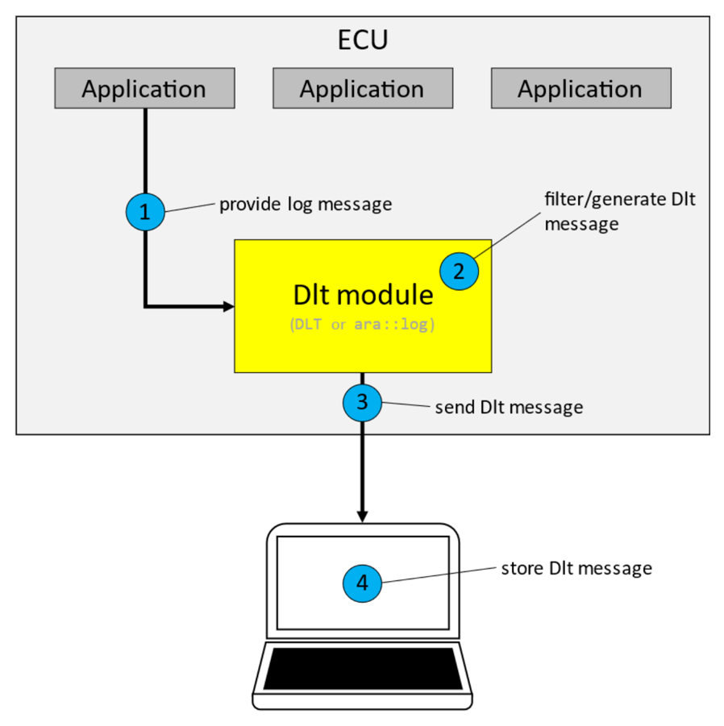

- (1) 一个应用/**SW-C** 向 **Dlt** 模块提供日志消息。
- (2) 该日志消息或者被过滤掉，或者由实现了 **Dlt** 协议的 **Dlt** 模块创建 **Dlt** 消息。（取决于日志级别。）
- (3) **Dlt** 模块将该 **Dlt** 消息发送到通信总线。
- (4) 外部客户端接收并存储该 **Dlt** 消息。

### 2.2. VFB 跟踪的用例

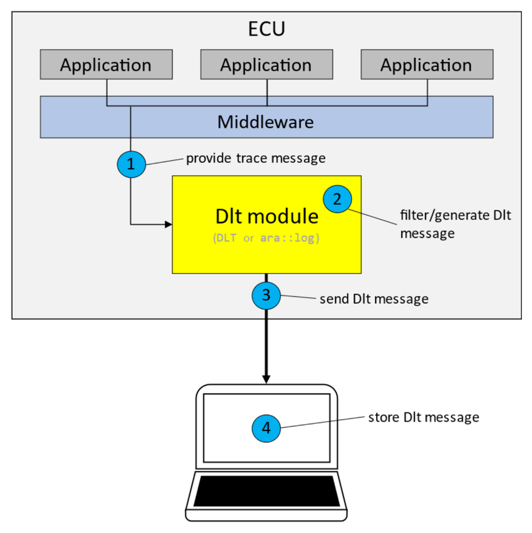

- (1) 中间件调用 **Dlt** 模块提供的宏，该宏调用 **Dlt** API 生成跟踪消息。
- (2) 实现了 **Dlt** 协议的 **Dlt** 模块将跟踪消息发送到所实现的 **Dlt** 通信模块接口。
- (3) **Dlt** 通信模块将跟踪消息转发到网络。
- (4) 外部客户端接收并存储这些跟踪消息。

### 2.3. Dlt 运行时配置的用例

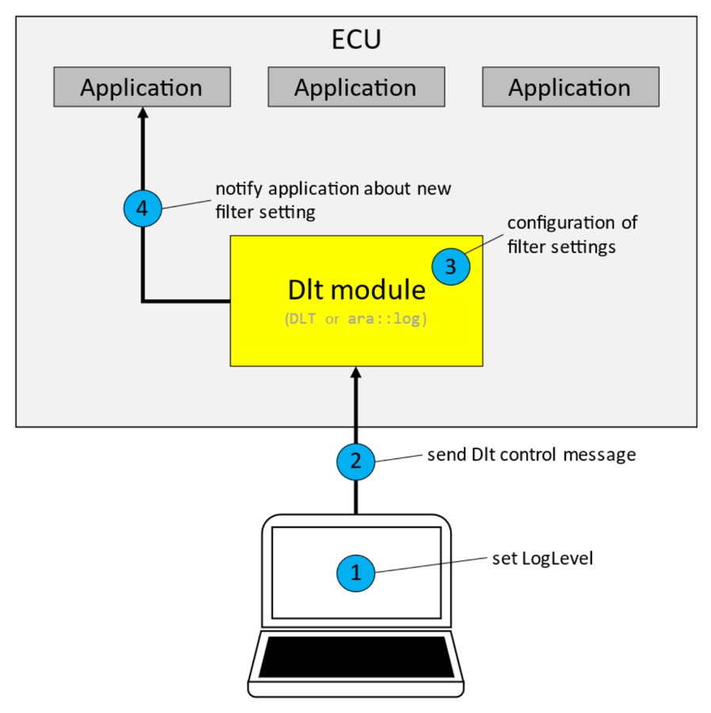

- (1) 外部客户端设置日志和跟踪级别，并将更改发送给实现了 **Dlt** 协议的 **Dlt** 模块。
- (2) 通过一条 **Dlt** 控制消息，该更改被发送到实现了 **Dlt** 协议的 **Dlt** 模块。
- (3) **Dlt** 模块相应地调整其过滤器设置配置。
- (4) **Dlt** 模块将新的日志级别通知应用。

### 2.4. 非详细模式的用例

为了减少总线上的流量，可以避免在通信总线上发送关于变量的元数据。

取而代之，由一个外部文件保存载荷应如何解释的信息。外部 **Dlt** 客户端将这些元数据与接收到的参数值合并并存储。

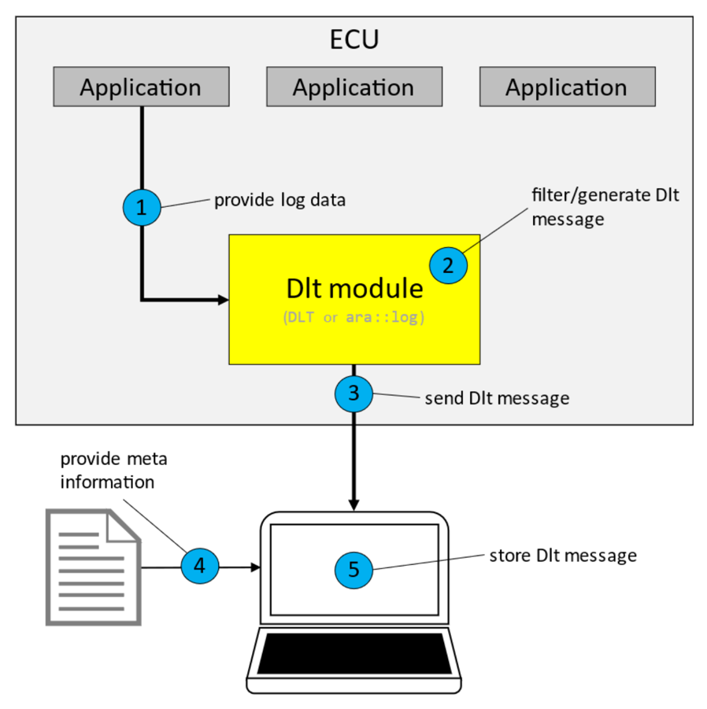

- (1) 一个应用/**SW-C** 向 **Dlt** 模块提供非详细模式的日志数据。
- (2) **Dlt** 模块过滤并生成 **Dlt** 消息。
- (3) **Dlt** 模块将该 **Dlt** 消息发送到通信总线。
- (4) 外部客户端从外部文件获取元信息。
- (5) 合并后的信息由外部客户端存储。

## 3. 相关文档

### 3.1. 输入文件和相关标准与规范

[1] 日志与跟踪协议规范（协议版本 "1"），AUTOSAR_PRS_LogAndTraceProtocol，R20-11 版本

[2] Information processing systems - Open Systems Interconnection - Basic Reference Model，ISO/IEC 7498-1:1994，电子版见 https://www.iso.org

[3] Log And Trace Extract Template，AUTOSAR_FO_TPS_LogAndTraceExtract

[4] IEEE Standard for Floating-Point Arithmetic（IEEE Std 754-2008）

## 4. 术语和缩略语定义

**APID**
> 应用 ID（**Application ID**）。

**CNTI**
> 内容信息（**Content Information**）。

**CTID**
> 上下文 ID（**Context ID**）。

**Dlt**
> 诊断日志与跟踪（**Diagnostic Log and Trace**）。

**HTYP**
> 报文头类型（**Header Type**）。

**LEN**
> 整条消息长度（**Overall Message Length**）。

**MCNT**
> 消息计数器（**Message Counter**）。

**MSID**
> 消息 ID（**Message ID**）。

**MSIN**
> 消息信息（**Message Info**）。

**MSTP**
> 消息类型（**Message Type**）。

**MTIN**
> 消息类型信息（**Message Type Info**）。

**NOAR**
> 参数个数（**Number of Arguments**）。

**TMSP**
> 时间戳（**Timestamp**）。

**VERB**
> 详细（**Verbose**）。

**VERS**
> 版本号（**Version Number**）。

**WACID**
> 携带应用与上下文 ID（**With App- and Context ID**）。

**WEID**
> 携带 ECU ID（**With ECU ID**）。

**WPVL**
> 携带隐私级别（**With Privacy Level**）。

**WSFLN**
> 携带源文件名和行号（**With Source File Name and Line Number**）。

**WSID**
> 携带会话 ID（**With Session ID**）。

**WSGM**
> 携带分段信息（**With Segmentation**）。

**WTGS**
> 携带标签（**With Tags**）。

### 4.1. 术语定义

**Log and trace message（日志和跟踪消息）**
> 一条日志和跟踪消息包含描述软件中一个日志和跟踪事件的所有数据和选项。日志和跟踪消息由报文头和载荷组成。

**Dlt User（Dlt 用户）**
> **Dlt** 用户代表一个生成的 **Dlt** 消息的来源。可能的用户是应用、RTE 或其他软件模块。

**Log Message（日志消息）**
> 日志消息包含诸如状态变化或值变化之类的调试信息。

**Trace Message（跟踪消息）**
> 跟踪消息包含已经过 **VFB** 的信息。

**ECU ID**
> ECU ID 是一个 ECU 的名称，由 8 位 ASCII 字符组成（例如 "ABS0" 或 "InstrumentCluster"）。

**Session（会话）**
> 会话是日志或跟踪消息来源的逻辑实体。如果一个 **SW-C**/应用被多次实例化，则会为每个实例使用一个具有全局唯一会话 ID 的会话。

**Session ID（会话 ID）**
> 会话 ID 是一个日志或跟踪会话的标识编号。

**Application ID（应用 ID）**
> 应用 ID 是一个 **SW-C**/应用的名称（或其缩写）。它标识日志和跟踪消息所来自的 **SW-C**/应用。

**Context ID（上下文 ID）**
> 上下文 ID 是一个用户定义的 ID，用于对一个 **SW-C**/应用生成的日志和跟踪消息进行分组。适用以下规则：
> - 每个 Application ID 可以拥有多个 Context ID。
> - Context ID 按 Application ID 分组。
> - Context ID 在一个 Application ID 内应当唯一。
> - 日志和跟踪消息的来源通过「Application ID」和「Context ID」这一元组来标识。
> - 8 位 ASCII 字符组成 Context ID。

**Message ID（消息 ID）**
> 消息 ID 是用于表征消息自身所传输信息的 ID。消息 ID 唯一地标识一条日志或跟踪消息。它可用于标识消息的来源（在源代码中），也可用于表征消息的载荷。消息 ID 在开发或配置时静态固定，并与「非详细模式」（见后文）结合使用。

**Log level（日志级别）**
> 日志级别为日志消息的严重程度定义了一种分类。

**Trace status（跟踪状态）**
> 跟踪状态提供是否应发送跟踪消息的信息。

**Log Channel（日志通道）**
> 用于传输 **Dlt** 消息的物理通信总线。

**External client（外部客户端）**
> 外部客户端是一种对使用 **Dlt** 模块的 ECU 所提供的日志/跟踪信息进行控制、监视和存储的工具。

**string（字符串）**
> 对于日志与跟踪协议，「字符串」定义了一个字符序列。其长度或者由本文档在此预先定义，或者在其前面有一个长度说明符。字符串只包含其所表示文本的字符数据，不含像 NUL 字符（/0）那样的特殊终止项。

**Verbose Mode（详细模式）**
> 当 **Dlt** 模块将日志和跟踪信息发送到通信信道上时，所发送的数据消息还包含预定义的静态数据元素，如名称、单位、格式信息、长度等。

**Non-Verbose Mode（非详细模式）**
> 为了减少通信信道上的网络负载，日志和跟踪数据消息尽可能少地包含此类元数据。元数据之一是消息 ID，它唯一地标识该消息及其全部内容。上述所有元数据通过一个单独的提取文件交给接收方：结合消息 ID，非详细模式消息的接收方可以重组出完整内容，就像详细模式消息中发送的那样。

## 5. 协议规范

### 5.1. 消息格式

对于调试数据和控制信息，均使用相同的 **Dlt** 消息格式。

它由一个「基础报文头」（**Base Header**）、一个可选的「扩展报文头」（**Extension Header**）和一个载荷（**Payload**）段组成。

表5.1：Dlt 消息格式

| 基础报文头 | 扩展报文头（可选） | 载荷 |
|---|---|---|

基础报文头和扩展报文头应始终使用网络字节序。

**注意：**「网络字节序」（**Network Byte Order**）即「大端序」（**Big Endian**）。

### 5.1.1. 基础报文头

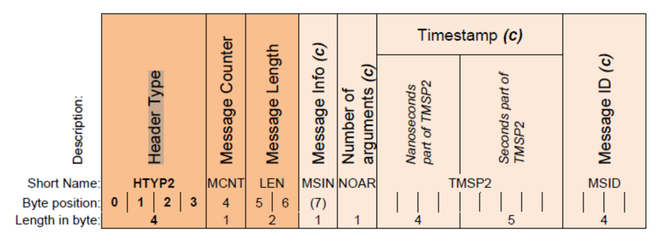

基础报文头应始终由以下字段按以下顺序组成：

- 字节 0 - 3：HTYP2（协议版本 "2" 的报文头类型）
- 字节 4：MCNT（消息计数器）
- 字节 5 - 6：LEN（消息长度）

基础报文头的以下字段仅在满足特定条件时才包含。这些条件在本小节的后续部分定义。

此外，基础报文头还应有条件地由以下字段按以下顺序组成：

- MSIN（消息信息）：长度 = 1 字节
- NOAR（参数个数）：长度 = 1 字节
- TMSP2（版本 "2" 的时间戳）：长度 = 9 字节
- MSID（消息 ID）：长度 = 4 字节

每个元素应添加在基础报文头中最后一个现有元素之后。元素之间不得存在间隙。

**注意：**由于上述元素是条件性的，这里无法给出绝对字节位置，因为这些条件字段的激活/停用会使位置发生偏移（见上文）。

如果该日志与跟踪消息是详细模式的数据消息或控制消息，则 MSIN（消息信息）和 NOAR（参数个数）应被添加到基础报文头中。

**注意：**关于日志与跟踪消息是详细模式或非详细模式的数据消息还是控制消息的信息，位于 HTYP2 字段的子元素「CNTI」（Content Info）中；更多细节见下一个小节。

如果该日志与跟踪消息是数据消息（详细模式或非详细模式），则应将具有纳秒分辨率的 TMSP2（时间戳）添加到基础报文头中。

如果该日志与跟踪消息是非详细模式的数据消息，则应将 MSID（消息 ID）添加到基础报文头中。

#### 5.1.1.1. 报文头类型

协议版本 '2' 的「报文头类型」字段（HTYP2）包含关于该日志与跟踪消息的一般信息。

除「版本号」信息的三个位之外，所有其他标志都用于指示该日志与跟踪消息中后续的条件内容或可选内容。

在本文语境中：

- 「条件性的」（conditional）意味着其所需用法由本文档规定。
- 「可选的」（optional）意味着其用法由应用决定。

报文头类型字段（HTYP2）应是任何日志与跟踪消息的第一个元素。

报文头类型字段（HTYP2）的大小应为 32 位。

报文头类型（HTYP2）应包含以下信息，并应按以下方式编码：

- 位 0 - 1：CNTI（Content Information，内容信息）
- 位 2：WEID（With ECU ID，携带 ECU ID）
- 位 3：WACID（With App- and Context ID，携带应用与上下文 ID）
- 位 4：WSID（With Session ID，携带会话 ID）
- 位 5-7：VERS（Version Number，版本号）
- 位 8：WSFLN（With Source File Name and Line Number，携带源文件名和行号）
- 位 9：WTGS（With Tags，携带标签）
- 位 10：WPVL（With Privacy Level，携带隐私级别）
- 位 11：WSGM（With Segmentation，携带分段信息）
- 位 12 - 31：保留（由 AUTOSAR 保留供未来使用）

表5.2：报文头类型的编码

| 字节\位 | 7 | 6 | 5 | 4 | 3 | 2 | 1 | 0 |
|---|---|---|---|---|---|---|---|---|
| 0 | VERS | VERS | VERS | WSID | WACID | WEID | CNTI | CNTI |
| 1 | reserved | reserved | reserved | reserved | WSGM | WPVL | WTGS | WSFLN |
| 2 | reserved | reserved | reserved | reserved | reserved | reserved | reserved | reserved |
| 3 | reserved | reserved | reserved | reserved | reserved | reserved | reserved | reserved |

两个「CNTI」位（Content Info；HTYP2 中的位 0 - 1）应是一个 2 位无符号整数，并应按以下方式编码：

- 0x0：详细模式数据消息；
- 0x1：非详细模式数据消息；
- 0x2：控制消息；
- 0x3：保留；

「VERS」位（版本号；HTYP2 中的位 5 - 7）应是一个 3 位无符号整数，并应包含 AUTOSAR 所定义的日志与跟踪协议版本。本规范版本有效的版本号为 "2"。

**注意：**「VERS」位与协议版本 "1" 中的位置相同。因此接收方始终能够区分协议版本。

如果置位了以下位之一，则「扩展报文头」应被添加在「基础报文头」之后：

- 位 2：WEID（携带 ECU ID）
- 位 3：WACID（携带应用与上下文 ID）
- 位 4：WSID（携带会话 ID）
- 位 8：WSFLN（携带源文件名和行号）
- 位 9：WTGS（携带标签）
- 位 10：WPVL（携带隐私级别）
- 位 11：WSGM（携带分段信息）

**注意：**关于「扩展报文头」的细节及其与上述位的相关性，在后面的小节中规定。

位 12 - 31（当前「由 AUTOSAR 保留供未来使用」）同样旨在未来要求使用「扩展报文头」。

#### 5.1.1.2. 消息计数器

消息计数器（MCNT）对发送到所选日志通道的 **Dlt** 消息进行计数。每个日志通道需要维护自己的消息计数器。在接收侧，可以评估消息计数器的值，以在一定程度上识别丢失的消息。

消息计数器是一个无符号 8 位（0-255）整数。

在 **Dlt** 模块初始化之后，消息计数器（MCNT）应被置为 '0'。

对于每条发送到所分配日志通道的 **Dlt** 消息，消息计数器应递增 1。

如果消息计数器达到 255，该计数器应回绕，并在下一条要发送的日志与跟踪消息中从值 '0' 重新开始。

#### 5.1.1.3. 消息长度

基础报文头中完整日志与跟踪消息的消息长度（LEN）字段应是一个 16 位无符号整数。

基础报文头中的消息长度（LEN）字段应被设置为完整日志与跟踪消息的总字节长度，即以下各项之和：

- 基础报文头自身的字节长度，
- 可选扩展报文头的字节长度，以及
- 可选载荷的字节长度。

该消息长度（LEN）包含单条简单日志与跟踪消息（LogAndTraceMessage）的长度，并且独立于任何分段功能（后文规定，参见第 [5.1.2.7](#5127-可选的消息分段信息) 节「可选的消息分段信息」）。因此，单条简单日志与跟踪消息的上限要么受底层通信协议/介质的限制，要么受 LEN 字段最大值（16 位）的限制：65535。

#### 5.1.1.4. 条件字段「消息信息」

如上所述（参见 PRS_Dlt_01003），当该日志与跟踪消息是详细模式的数据消息或控制消息时，MSIN（消息信息）才被添加到基础报文头中；否则 MSIN 不是基础报文头的一部分。

消息信息字段（MSIN）应按以下顺序包含以下信息：

- 位 0：保留（reserved）
- 位 1-3：MSTP（消息类型）
- 位 4-7：MTIN（消息类型信息）

表5.3：消息信息字段的编码

| 名称 | 位 | 字节 |
|---|---|---|
| MTIN | 7 - 4 | 0 |
| MSTP | 3 - 1 | 0 |
| reserved | 0 | 0 |

消息类型（MSTP）应是一个 3 位无符号整数。

消息类型（MSTP）应具有以下值之一：

- 0x0：DLT_TYPE_LOG（**Dlt** 日志消息）
- 0x1：DLT_TYPE_APP_TRACE（**Dlt** 跟踪消息）
- 0x2：DLT_TYPE_NW_TRACE（**Dlt** 网络消息）
- 0x3：DLT_TYPE_CONTROL（**Dlt** 控制消息）
- 0x4 - 0x7：保留

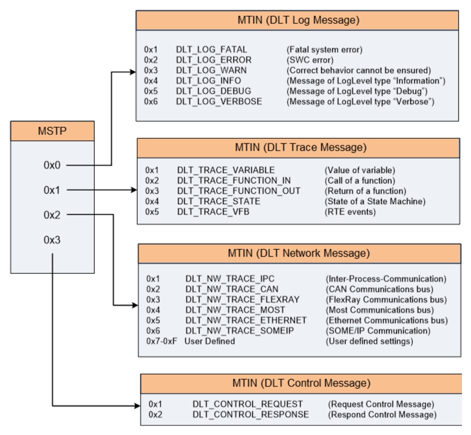

消息类型信息字段（MTIN）应是一个 4 位无符号整数。

如果 MSTP 字段被设置为 0x0（即 **Dlt** 日志消息），消息类型信息字段（MTIN）应具有以下值之一，并具有以下含义：

- 0x1：DLT_LOG_FATAL（致命系统错误）
- 0x2：DLT_LOG_DLT_ERROR（应用错误）
- 0x3：DLT_LOG_WARN（无法确保正确行为）
- 0x4：DLT_LOG_INFO（LogLevel 类型为 "Information" 的消息）
- 0x5：DLT_LOG_DEBUG（LogLevel 类型为 "Debug" 的消息）
- 0x6：DLT_LOG_VERBOSE（LogLevel 类型为 "Verbose" 的消息）
- 0x7 - 0xF：保留

如果 MSTP 字段被设置为 0x1（即 **Dlt** 跟踪消息），消息类型信息字段（MTIN）应具有以下值之一，并具有以下含义：

- 0x1：DLT_TRACE_VARIABLE（变量的值）
- 0x2：DLT_TRACE_FUNCTION_IN（函数的调用）
- 0x3：DLT_TRACE_FUNCTION_OUT（函数的返回）
- 0x4：DLT_TRACE_STATE（状态机的状态）
- 0x5：DLT_TRACE_VFB（RTE 事件）
- 0x6 - 0xF：保留

如果 MSTP 字段被设置为 0x2（即 **Dlt** 网络消息），消息类型信息字段（MTIN）应具有以下值之一，并具有以下含义：

- 0x1：DLT_NW_TRACE_IPC（进程间通信）
- 0x2：DLT_NW_TRACE_CAN（CAN 通信总线）
- 0x3：DLT_NW_TRACE_FLEXRAY（FlexRay 通信总线）
- 0x4：DLT_NW_TRACE_MOST（Most 通信总线）
- 0x5：DLT_NW_TRACE_ETHERNET（以太网通信总线）
- 0x6：DLT_NW_TRACE_SOMEIP（SOME/IP 间通信）
- 0x7-0xF：用户自定义（用户自定义的设置）

如果 MSTP 字段被设置为 0x3（即 **Dlt** 控制消息），消息类型信息字段（MTIN）应具有以下值之一，并具有以下含义：

- 0x1：DLT_CONTROL_REQUEST（请求控制消息）
- 0x2：DLT_CONTROL_RESPONSE（响应控制消息）
- 0x3-0xF：保留

#### 5.1.1.5. 条件字段「参数个数」

如上所述（参见 PRS_Dlt_01003），当该日志与跟踪消息是详细模式的数据消息或控制消息时，NOAR（参数个数）才被添加到基础报文头中。否则 NOAR 不是基础报文头的一部分。

参数个数表示一条 **Dlt** 消息的载荷段中连续参数的数目或连续控制命令的数目。

参数个数字段（NOAR）应是一个 8 位无符号整数。

参数个数字段（NOAR）应包含载荷中所提供的参数或控制命令的数目。

#### 5.1.1.6. 条件字段「ns 时间戳」

如上所述（参见 PRS_Dlt_01004），当该日志与跟踪消息是数据消息（详细模式或非详细模式）时，TMSP2（ns 时间戳）才被添加到基础报文头中；否则 TMSP2 不是基础报文头的一部分。

该条件时间戳用于添加 **Dlt** 消息生成时刻的时序信息。

**ns 时间戳的格式**：ns 时间戳的长度应为 9 字节：

- 低 4 字节 / uint32 应是时间戳的纳秒部分。
- 高 5 字节 / 40 位应是时间戳的秒部分。

时间应从 1970-01-01, 00:00:00,00000 开始，即该时间戳应派生自一个具有同步时基的绝对/全局时间。

**注意：**

- 0 至 1.099.511.627.776 s ≈ 34.841 年
- 0 至 999999999 ns [0x3B9A C9FF]；
- 纳秒无效值：[0x3B9A CA00] 至 [0x3FFF FFFF]；此时位 30 和位 31 保留。

**无法提供同步时基的 ECU 的 ns 时间戳格式**：如果某个特定 ECU 无法提供从 1970-01-01, 00:00:00,00000 开始的绝对时间，则应置位纳秒字段中的位 31，且时间应从该 ECU 启动开始计。

**ns 时间戳的实质内容**：ns 时间戳的值应保存 LT 用户调用 LT 模块并递交其 LT 内容那一刻的时间。

#### 5.1.1.7. 条件字段「消息 ID」

如上所述（参见 PRS_Dlt_01005），当该日志与跟踪消息是非详细模式的数据消息时，MSID（消息 ID）才被添加到基础报文头中；否则 MSID 不是基础报文头的一部分。

消息 ID 应是一个 32 位无符号整数。

**注意：**更多细节见第 [5.1.3.1](#5131-非详细模式下的载荷) 节「非详细模式下的载荷」。

### 5.1.2. 扩展报文头

扩展报文头包含便于解释纯 LT 内容的附加数据。因此，LT 内容的进一步属性（例如确切的来源）在此传输。

当基础报文头的「HTYP2」字段中置位了以下位之一时，将传输由扩展报文头格式定义的附加信息：

- 位 2：WEID（携带 ECU ID）
- 位 3：WACID（携带应用与上下文 ID）
- 位 4：WSID（携带会话 ID）
- 位 8：WSFLN（携带源文件名和行号）
- 位 9：WTGS（携带标签）
- 位 10：WPVL（携带隐私级别）
- 位 11：WSGM（携带分段信息）

扩展报文头的基本设计原则是：

- 其所有字段都是可选的，因此整个扩展报文头也是可选的。
- 某个特定字段是否需要添加到扩展报文头中，由基础报文头「HTYP2」字段中的上述位（「标志」）指示。
- 扩展报文头中字段的顺序由基础报文头「HTYP2」字段中对应标志的顺序定义。
- 一个字段由一个长度说明符和值本身组成（存在少数例外）。

表5.4：扩展报文头的模式

| | 字段 1（可选） | 字段 2（可选） | 字段 &lt;n&gt;（可选） |
|---|---|---|---|
| 名称 | FLD1 | FLD2 | FLD&lt;n&gt; |
| 子元素说明 | 长度 FLD1 = 2；值 FLD1 | 长度 FLD2 = 6；值 FLD2 | 长度 FLD&lt;n&gt; = 4；值 FLD&lt;n&gt; |
| 长度 | 1；2 | 1；6 | 1；4 |

某个特定字段的长度信息也可以是 '0'。在这种情况下，不提供字段值，该字段在长度字节之后即结束。

为了在不破坏向后兼容性的前提下允许扩展报文头的未来扩展，未来所有新增字段都必须以 1 字节的长度信息开头。这样，按照当前规范实现的接收方总能够从一个字段移动到下一个字段（从而最终也能到达报文头的末尾），即使它无法解释所有字段的值。

扩展报文头中未来的字段元素通过使用基础报文头「HTYP2」字段中的保留标志来启用：当前为位 11 - 31（标记为「由 AUTOSAR 保留供未来使用」）。

由此对所有未来新字段/所有当前「保留」标志的推论是：「HTYP2」中置为 "1" 的标志数量必须与添加到扩展报文头中的长度信息的数量相等。

**将扩展报文头置于基础报文头之后**：如果使用了扩展报文头，它应直接紧接在基础报文头字段之后。

**扩展报文头中字段的顺序**：字段应依据基础报文头「HTYP2」字段中对应标志的顺序，可选地添加到扩展报文头中。

包含当前定义的全部可选字段的扩展报文头如下所示：

图5.3：扩展报文头（**Extension Header**）

| 字段 | 字节 | 内容 |
|---|---|---|
| ECU | 0 | ECU-ID 的 8 位长度；（字节数） |
| | 1 2 …dyn | ECU-ID 的 ASCII 字符 |
| APID | dyn1 | Application-ID 的 8 位长度；（字节数） |
| | dyn1 + 1 dyn1 + 2 dyn1 + … | Application-ID 的 ASCII 字符 |
| CTID | dyn2 | Context-ID 的 8 位长度；（字节数） |
| | dyn2 + 1 dyn2 + 2 dyn2 + … | Context-ID 的 ASCII 字符 |
| SEID | dyn3 dyn3 + 1 dyn3 + 2 dyn3 + 3 | Session ID：32 位无符号整数 |
| FINA | dyn4 | 源文件名的 8 位长度；（UTF-8 代码单元数） |
| | dyn4 + 1 dyn4 + 2 dyn4 + … | 源文件名的 UTF-8 代码单元 |
| LINR | dyn5 dyn5 + 1 dyn5 + 2 dyn5 + 3 | 行号：32 位无符号整数 |
| TAGS | dyn6 | NOTG：uint8 标签数量 |
| | dyn6 + 1 | Tag_1 名称的 8 位长度；（字节数） |
| | dyn6 + 2 dyn6 + 3 dyn6 + … | Tag_1 名称的 ASCII 字符 |
| | dyn7 | Tag_2 名称的 8 位长度；（字节数） |
| | dyn7 + 1 dyn7 + 2 dyn7 + … | Tag_2 名称的 ASCII 字符 |
| | dyn8 dyn8 + 1 dyn8 + 2 dyn8 + … | Tag_&lt;n&gt; 名称的 8 位长度（字节数）；Tag_&lt;n&gt; 名称的 ASCII 字符 |
| PRLV | | PrivacyLevel 的值 |
| SGMT | dyn10 | 分段信息（Segmentation-Info）的 8 位长度（字节数） |
| | dyn10 + 1 | 8 位帧类型 :=（**FirstFrame**，**ConsecutiveFrame**，**LastFrame**，**AbortFrame**） |
| | dyn10 + 2 … dyn10 + 9 | 帧类型详情（&lt;n&gt; 位）：**FirstFrame**：64 位 TotalLength；**ConsecutiveFrame**：32 位 SequenceCounter；**LastFrame**：0 位；**AbortFrame**：8 位 Abort-Reason |
| | dyn11 dyn11 + 1 dyn11 + 2 dyn11 + … | &lt;future_field&gt; 的长度；&lt;future_field&gt; 的值（（未来扩展的模板）） |

#### 5.1.2.1. 可选的 ECU-ID

可选的 ECU ID 用于标识是哪个 ECU 发送了一条日志与跟踪消息。因此，强烈建议 ECU ID 在整车范围内唯一。

**发送 ECU ID 的可能性**：如果基础报文头「HTYP2」字段中的位 2（WEID，"With ECU ID"）被置位，则该 LT 消息应包含长度字节和 ECU ID 的字符串值，并添加到扩展报文头中。

**长度信息**：该长度字节应是 ECU ID 字段中的第一个字节，并应统计 ECU ID 所使用的字符数。

**ECU ID 格式**：ECU ID 的编码应只包含 ASCII 字符，末尾不得有像 NUL 字符（\0）那样的特殊终止项。

**注意：**字符串的结束仅由 ECU-ID 的长度信息给出。

#### 5.1.2.2. 可选的应用 ID 和上下文 ID

应用 ID 是生成 **Dlt** 消息的应用的缩写。

上下文 ID 是一个用户定义的 ID，用于（逻辑上）对某个应用生成的 **Dlt** 消息进行分组。

**发送应用 ID 和上下文 ID 的可能性**：如果基础报文头「HTYP2」字段中的位 3（WACID，"With App- and Context ID"）被置位，则该 LT 消息应包含长度字节以及应用 ID 和上下文 ID 的字符串值，并添加到扩展报文头中。

**应用 ID 和上下文 ID 的顺序**：如果应用 ID 和上下文 ID 被添加到扩展报文头中，应用 ID 字段应为第一个，上下文 ID 字段应为第二个。

**应用 ID 和上下文 ID 的长度信息**：对于这两个字段（应用 ID 和上下文 ID）中的每一个，长度字节应是该 ID 字段中的第一个字节，并应统计该 ID 所使用的字符数。

**应用 ID 和上下文 ID 格式**：应用 ID 和上下文 ID 的编码应只包含 ASCII 字符，不得有像 NUL 字符（\0）那样的特殊终止项。

**注意：**应用 ID 和上下文 ID 的字符串结束仅由各自前面的长度说明给出。

"#"（U+0023）作为上下文 ID 的前缀，应为 AUTOSAR 标准化的模型化日志与跟踪消息保留。

由协议栈供应商定义的日志与跟踪消息的上下文 ID 应带有 "+"（U+002B）前缀，后跟按照 PRS_Dlt_01056 转换为字符串的供应商数值标识符，再后跟供应商自定义的其余部分。

16 位供应商 ID 使用 Base62 编码转换为 2 字符的 ASCII 字符串，数字序列为字符串 "0123456789ABCDEFGHIJKLMNOPQRSTUVWXYZabcdefghijklmnopqrstuvwxyz"。

**注意：**用 Base62 在两个字符内无损编码的最高供应商 ID 是 3843（0x0f03），它将被编码为字符串 "zz"。示例：使用供应商 ID 0x07bb 时，上下文 ID 以字符串 "+Vv" 开头，其中 "Vv" 是 0x07bb 的 Base62 编码字符串。

#### 5.1.2.3. 可选的会话 ID

可选的会话 ID 用于标识 ECU 内日志或跟踪消息的来源。

如果基础报文头「HTYP2」字段中的位 4（WSID，"With Session ID"）被置位，则该 LT 消息应包含会话 ID，并添加到扩展报文头中。

**注意：**由于会话 ID 被定义为 32 位长度，扩展报文头中的该会话 ID 字段不包含额外的长度字节。

会话 ID 字段应是一个 32 位无符号整数。

#### 5.1.2.4. 可选的源文件名和源行号

为了标识日志或跟踪内容的来源，应向日志与跟踪消息中添加一些用于在源代码中定位的信息。

因此：

- 源文件名（字符串）以及
- 源文件中的行号（无符号整数）

可以添加到扩展报文头中。

更一般地说，源文件名也称为「源文件标识符」：「源文件标识符」构成一种标识日志消息所源自的源代码文件的手段。它通常是一个文件名或文件名主干，但也可以是完整（或相对）路径，甚至可以是完全不同的种类，例如在文件名被视为敏感数据时的哈希和。

**发送源文件标识符和源行号的可能性**：如果基础报文头「HTYP2」字段中的位 8（WSFLN："With Source File Name and Line Number"）被置位，则该 LT 消息应包含源文件标识符字符串的长度字节、字符串值本身，以及该 LT 消息所源自的源行号，并添加到扩展报文头中。

**扩展报文头中源文件标识符和源行号的内容**：如果在扩展报文头中传输源文件标识符和源行号，应使用以下顺序：

- 源文件标识符字符串的长度字节；
- 源文件标识符字符串的值本身；
- 源行号

**注意：**由于源行号被定义为 32 位，因此不包含源行号的额外长度字节。

**长度信息的定义**：该长度字段应统计源文件标识符所占用的字节数。该数值也等于 UTF-8 代码单元的数量。

**源文件标识符格式**：源文件标识符的编码应采用 UTF-8 代码单元，不带 BOM，不带终止字符。

**源文件标识符的实质内容**：源文件标识符应包含日志或跟踪内容源自何处的指示。

**注意：**该指示可以由文件名主干（不带扩展名的文件名）构成，也可以额外包含文件扩展名和/或指向该文件的（完整或部分）路径。

或者，在日志和跟踪内容的来源被视为敏感数据的情况下，源文件标识符也可以是其他内容，例如哈希和或任何其他编码的标识。

**注意：**最多可以使用 255 字节（即 UTF-8 代码单元）。

**源行号格式**：源行号的长度应为四字节，解释为一个 32 位无符号整数。

**注意：**源行号从 '1' 开始计数，即值 '0' 不使用。由于行号的长度被静态定义为 32 位无符号整数，因此不应向扩展报文头添加单独的长度字节。

#### 5.1.2.5. 可选的标签

为了避免总线流量——特别是在使用详细模式进行日志记录和进行跟踪时——标签可以帮助应用或功能集群按主题更细粒度地对消息进行分类。

**出于过滤目的发送标签的可能性**：如果基础报文头「HTYP2」字段中的位 9（WTGS："With Tags"）被置位，则该 LT 消息应按给定顺序包含以下元素：

- 所附标签的数量（NOTG）；
- 对于每个所附标签：
- - 标签名字符串的长度字节
- - 标签名的字符串值

并添加到扩展报文头中。

**标签数量（Number of Tags）的定义**：「NOTG」（Number of Tags）字段应是一个 8 位无符号整数值，并应统计扩展报文头中后续标签的数量。因此，一条 LT 消息最多可以添加 255 个标签。

**每个标签长度信息的定义**：该长度字段应统计标签名所占用的字节数。

**标签名格式**：标签名的编码应采用 ASCII 字符，不得有像 NUL 字符（\0）那样的特殊终止项。

**注意：**字符串的结束仅由标签名的长度信息给出。

#### 5.1.2.6. 可选的隐私级别

隐私级别有助于标识日志与跟踪内容及其隐私程度。无论在 ECU 内还是 ECU 外，日志客户端都可以在处理日志与跟踪消息时考虑该隐私级别，以确保对消息进行预期的、被允许的处理。

**为所包含的日志与跟踪消息添加隐私级别的可能性**：如果基础报文头「HTYP2」字段中的位 10（WPVL："With Privacy Level"）被置位，则该 LT 消息应包含当前 LT 消息的隐私级别值，并添加到扩展报文头中。

**隐私级别的格式**：隐私级别的长度应为一个字节的无符号整数。

**注意：**由于隐私级别的长度被定义为一个字节，因此不在扩展报文头的隐私级别字段中添加额外的长度信息。

**注意：**对于隐私级别的每个单一取值的含义，没有全局定义。

**注意：**由解释或转发该消息的外部查看工具或任何其他实例来满足这一隐私要求。

#### 5.1.2.7. 可选的消息分段信息

消息分段可用于传输较大量的载荷数据，否则这些数据将无法容纳在单条简单 LT 消息中。请记住：一条正常的、单条简单 LT 消息的总长度要么受底层通信协议/介质的限制，要么受其基础报文头中「LEN」字段最大值（16 位无符号整数）的限制：65535。在这两种情况下，载荷的可用剩余空间都更小，因为还需要包含消息报文头。

**使用消息分段的准则**：基于对下层帧长度限制或基础报文头中「LEN」字段限制的了解，L&amp;T 模块应决定是否需要使用分段。

**注意：**对于同样能放入单条简单 LT 消息的较小载荷数据量，不应使用分段。

**消息分段的指示**：如果使用了消息分段，应置位基础报文头「HTYP2」字段中的位 11（WSGM，"With Segmentation"），且该 LT 消息应包含分段信息，并添加到扩展报文头中。

**扩展报文头中分段信息的内容**：分段信息应按给定顺序包含以下元素：

- 该分段信息（即帧类型和分段详情）的长度字节（以字节为单位）；
- 8 位帧类型（FrameType），可以为：
- - 0 := "FirstFrame"；
- - 1 := "ConsecutiveFrame"；
- - 2 := "LastFrame"；
- - 3 := "AbortFrame"；
- 取决于帧类型的 x 位分段详情：
- - "FirstFrame"：
- ∗ 64 位无符号整数 "TotalLength"；
- - "ConsecutiveFrame"：
- ∗ 32 位无符号整数 "SequenceCounter"；
- - "LastFrame"：
- ∗ 0 位：不适用；没有分段详情；
- - "AbortFrame"：
- ∗ 8 位无符号整数 "AbortReason"；
- ∗ 0 - 无错误/无原因
- ∗ 1 - 通信超时
- ∗ 2 - 资源不足
- ∗ 3 - 序列/协议错误

**分段消息传输的帧类型序列**：分段序列应为：

- 1 个 "FirstFrame"；
- 0 … 4.294.967.295 个 "ConsecutiveFrames"：取决于分段数据的 TotalLength。
- 1 个 "LastFrame"；

**注意：**"FirstFrame" 和 "ConsecutiveFrame" 使用常规 LT 消息可用的最大尺寸。"LastFrame" 可以更短。

**中止该序列**：在 "FirstFrame" 之后、"LastFrame" 之前，可以存在一个 "AbortFrame"，以便在发生问题时停止该序列。已传输的部分应被丢弃。在发送了 "AbortFrame" 之后，下一个允许的帧类型是 "FirstFrame"。

**"TotalLength" 信息的内容**："TotalLength" 信息应包含需要以分段方式传输的载荷数据的总字节数。

**分段 "SequenceCounter" 的使用**：分段 SequenceCounter 只应在 "ConsecutiveFrame(s)" 中使用（如果有的话）。在每个 FirstFrame 之后，SequenceCounter 应从 '0' 开始，并且最多可以在 "LastFrame" 之前的最后一个 "ConsecutiveFrame" 中达到 '4.294.967.295'。不得发生回绕（'4.294.967.295' -&gt; '0', '1' ...）。

**载荷数据块的传输**：当帧类型等于 {FirstFrame 或 ConsecutiveFrame 或 LastFrame} 时，LT 消息的载荷段应按顺序填充数据块，作为总用户数据的分片。数据分片的顺序必须与所传输的 LT 消息一致：

（其中：FirstFrame：FF；ConsecutiveFrame：CF；LastFrame：LF；SequenceCounter：SqCntr）

FF [DataSlice_0], CF_0[SqCntr = 0; DataSlice1], CF_1 [, SqCntr = 1; DataSlice2], CF_&lt;n&gt; [SqCntr = &lt;n&gt;; DataSlice&lt;n+1&gt;], LF [DataSlice&lt;n+2&gt;]。

### 5.1.3. 主体/载荷格式

载荷紧接在基础报文头之后（如果使用了扩展报文头，则紧接在扩展报文头之后）。载荷包含被记录或被跟踪的参数，或者包含控制信息。

如果使用了扩展报文头，载荷应紧接在扩展报文头之后。

如果未使用扩展报文头，载荷应紧接在基础报文头之后。

**注意：**请比较第 [5.1.2](#512-扩展报文头) 节「扩展报文头」，以确定是否使用了扩展报文头。

#### 5.1.3.1. 非详细模式下的载荷

为了能够只传输参数值——而不需要任何关于它们的元信息——且不带诸如参数名或类型之类的附加属性，可以使用非详细模式。

为了能够正确拆解所接收 **Dlt** 消息中包含的参数值，一个专用的消息 ID 被添加到基础报文头中。

一个单独的外部文件按照对应的消息 ID 保存载荷布局的描述。

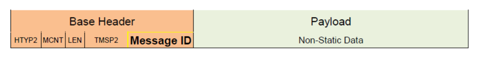

对于单一静态数据组合，消息 ID 应被赋予唯一的取值。

**AUTOSAR 消息 ID 范围**：位 #31 置为 '1' 且位 #30 置为 '0' 的消息 ID，应为 AUTOSAR 标准化的模型化日志与跟踪消息保留。

**供应商定义的消息 ID 范围**：位 #31 置为 '1' 且位 #30 置为 '1' 的消息 ID，应为框架提供方/协议栈供应商规定的模型化日志与跟踪消息保留。

消息 ID 的位 #27..#12 应保存供应商的数值标识符，位 #11..#0 可由每个供应商用于其特定的日志消息标识符。

**注意：**假设 VendorID 为 0x0123，则一个供应商定义的消息 ID 可以是：0xC012 3A98。

借助消息 ID 与外部描述的组合，应可恢复出以下信息：

- Type Info（类型信息）
- Type Length（类型长度）
- Data Type（数据类型）
- TypeFormat（类型格式）
- TypePrecision（类型精度）
- Variable Info（变量信息）
- Fixed Point（定点数）

**注意：**如果改用详细模式（参见第 [7.1.6](#716-日志级别-verbosedlt_log_verbose) 节「日志级别 VERBOSE」），则这些参数直接包含在 **Dlt** 消息载荷中。

借助消息 ID 与外部描述的组合，应可恢复出以下原本在消息报文头中提供的信息：

- 消息类型（MSTP）
- 消息信息（MSIN）
- 参数个数（NOAR）

在消息 ID 与日志与跟踪提取文件（Log and Trace Extract）中的上下文 ID 和应用 ID 不是唯一关联的情况下，这些字段必须随非详细模式消息一起传输。

即使这些静态数据已经在外部文件中规定（更多细节见后续章节），因而不再作为消息的必要部分，在少数情况下仍应允许在非详细模式消息中发送不同的静态数据值。

在消息 ID 与日志与跟踪提取文件中的上下文 ID 和应用 ID 不是唯一关联的情况下，上下文 ID 和应用 ID 字段必须通过非详细模式消息在扩展报文头中单独传输。这对于标准化日志与跟踪而言尤其如此。

如果消息 ID 的唯一性仍然成立，则上下文 ID 和应用 ID 应可从外部描述中恢复，无需单独传输。

非详细模式消息中的静态数据应优先于日志与跟踪提取文件中规定的数据。

**注意：**这种情况应保持为例外，否则整个非详细模式将变得自相矛盾。

##### 5.1.3.1.1. 非静态数据的组装

本示例将演示非静态数据是如何被组装、传输和解释的。

通过发送一条日志消息，将向外部客户端传输以下信息：

- 静态文本："Temperature measurement"
- 8 位无符号整数：measurement_point = 1（无单位）
- 32 位浮点数：reading = 295.3 Kelvin

存在一个唯一的消息 ID，它在源代码中的这一特定位置表征该日志消息调用。与该消息 ID 关联的信息如下：

- 源代码中的位置：源文件 "temp_meas.c"，行号 42
- 静态文本："Temperature measurement"
- 期望一个 8 位无符号整数的值，变量名 = "measurement_point"，单位 = ""
- 期望一个 32 位浮点数的值，变量名 = "reading"，单位 = "Kelvin"

所有静态数据都已经与消息 ID 关联，只有非静态数据会被传输：

表5.5：非详细模式下非静态数据的组装

| 位长 | 值 | 说明 |
|---|---|---|
| 8 | 1 | 8 位无符号整数 |
| 32 | 295.3 | 32 位浮点数 |

基于该消息 ID，接收方可以重组该 **Dlt** 消息的所有静态数据（源代码中的位置、静态文本、变量名和单位）。非静态数据将被一致地打包传输。借助与消息 ID 关联的信息即可完成解释。参数的顺序同样与消息 ID 关联。

非静态数据应被一致地打包并按字节对齐传输。

**注意：**在详细模式下，参数个数的最大值可以是 '255'，因为字段「NOAR」（NumberOfArguments）被定义为 uint8。与此相反，在非详细模式下，参数个数的最大值本身不受此限制。其上限是完整日志与跟踪消息（报文头 + 载荷）的总最大长度，即 65535 字节，因为「LEN」字段被定义为 uint16。

##### 5.1.3.1.2. 已传输数据的描述格式

一个外部文件保存载荷应如何解释的信息。对于描述以非详细模式传输的消息，应使用 ARXML 系统描述（ARXML System Description）。

细节请参见 [3, FO TPS LogAndTraceExtract]。

应用或中间件的软件供应商应提供该描述文件。

#### 5.1.3.2. 详细模式下的载荷

以详细模式发送的 **Dlt** 消息在参数值本身之外还包含参数的完整描述。

这一方面意味着拆解时不需要外部文件；另一方面，总线上发送的数据量更大。

详细模式可用于具有足够内存和高网络带宽的 ECU。由于自带描述，外部客户端上存储的数据在任何时候都可以解释，无需任何进一步的外部信息。

##### 5.1.3.2.1. Dlt 消息格式概述

在详细模式下，最多可以传输 255 个参数。关于载荷的信息在消息自身内提供。载荷通常紧接在扩展报文头之后，由一个或多个参数（argument）组成。但由于扩展报文头是可选的，它可以被省略，此时载荷紧接在基础报文头之后。载荷中的参数个数在基础报文头的参数个数字段（NOAR）中规定。

详细模式下的 **Dlt** 消息应由以下部分组成：

- 基础报文头
- 扩展报文头（可选）
- 带有 n 个参数的载荷，每个参数由一个 Type Info 和 Data Payload 的元组组成

表5.6：详细模式消息

| 基础报文头 | 扩展报文头（可选） | 载荷 | | | |
|---|---|---|---|---|---|
| | | 参数 1 | 参数 1 | 参数 n | 参数 n |
| | | Type Info | Data Payload | Type Info | Data Payload |

各参数及所有继承的数据应被一致地打包传输。

##### 5.1.3.2.2. 数据载荷

数据载荷包含变量的值（即应用或中间件的调试信息），该值将在通信总线上传输。除变量值本身之外，还需要提供诸如变量大小和类型之类的信息。该信息包含在 Type Info 字段中。

##### 5.1.3.2.3. 类型信息

Type Info 字段包含关于数据载荷的元数据。

Type Info 是一个 32 位字段，当要以详细模式发送 **Dlt** 日志或跟踪消息时，它必须是载荷段的一部分。

| 位 0 - 3 | Type Length（TYLE） |
|---|---|
| 位 4 | Type Bool（BOOL） |
| 位 5 | Type Signed（SINT） |
| 位 6 | Type Unsigned（UINT） |
| 位 7 | Type Float（FLOA） |
| 位 8 | Type Array（ARAY） |
| 位 9 | Type String（STRG） |
| 位 10 | Type Raw（RAWD） |
| 位 11 | Variable Info（VARI） |
| 位 12 | Fixed Point（FIXP） |
| 位 13 | Trace Info（TRAI） |
| 位 14 | Type Struct（STRU） |
| 位 15 - 17 | Type Format（TYFM） |
| 位 18 - 23 | Type Precision（TYPR） |
| 位 24 - 31 | 保留供未来使用 |

Type Info 是一个 32 位字段，应按以下方式编码。

表5.7：Type Info 位字段的编码

| Type Info（4 字节） | | | | | | | | | | | | | | | |
|---|---|---|---|---|---|---|---|---|---|---|---|---|---|---|---|
| 名称 | Type Length（TYLE） | Type Bool（Bool） | Type Signed（SINT） | Type Unsigned（UINT） | Type Float（FLOA） | Type Array（ARAY） | Type String（STRG） | Type Raw（RAWD） | Variable Info（VARI） | Fixed Point（FIXP） | Trace Info（TRAI） | Type Struct（STRU） | Type Format（TYFM） | Type Precision（TYPR） | 保留 |
| 位 | 0-3 | 4 | 5 | 6 | 7 | 8 | 9 | 10 | 11 | 12 | 13 | 14 | 15-17 | 18-23 | 24-31 |

Type Info 字段的位 0-3（即 Type Length）定义了相邻数据载荷的长度。Type Length（TYLE）位字段应按以下方式编码：

- 0x00：未定义
- 0x01：8 位
- 0x02：16 位
- 0x03：32 位
- 0x04：64 位
- 0x05：128 位
- 0x06 - 0x0F：保留

Type Info 字段的位 15-17（即 Type Format（TYFM））定义了后续给定数据载荷的编码，即期望的表示格式。这三位的编码取决于所使用的类型，并且仅限于以下四种类型：

- STRG
- SINT
- UINT
- FLOA

**注意：**类型 STRG 的 Type Format（TYFM）与先前定义的字符串编码（String Coding，SCOD）相同且完全兼容，SCOD 曾位于相同的位置（位 15-17）。与先前的 SCOD 相比，TYFM 现在将使用范围扩展到了类型 SINT、UINT 和 FLOA。

| 所用类型 | TYFM | 含义 |
|---|---|---|
| STRG | 0x00 | ASCII |
| STRG | 0x01 | UTF-8 |
| STRG | 其他所有值 | 保留，不得使用 |
| SINT 或 UINT | 0x00 | 以十进制（base10）表示 |
| SINT 或 UINT | 0x01 | 以八进制（base8）表示 |
| SINT 或 UINT | 0x02 | 以十六进制（base16）表示 |
| SINT 或 UINT | 0x03 | 以二进制（base2）表示 |
| SINT 或 UINT | 其他所有值 | 保留，不得使用 |
| FLOA | 0x00 | 由实现定义 |
| FLOA | 0x01 | 以十进制浮点数表示，类似 printf "%f" |
| FLOA | 0x02 | 以科学计数法（尾数、指数）表示，类似 printf "%e" |
| FLOA | 0x03 | 以十六进制浮点数表示，类似 printf "%a" |
| FLOA | 0x04 | 以最短方式表示，也称为「通用格式」（general format）：十进制浮点数或科学计数法，类似 printf "%g" |
| FLOA | 其他所有值 | 保留，不得使用 |

根据所使用的类型，相邻的 Data 字段分别按以下方式编码或解释。

**注意：**上述提示「类似 printf」旨在指 C 函数 "printf()" 及其转换说明符 'f'、'e'、'a' 和 'g'，它们由 C 标准库 &lt;stdio.h&gt; 定义。

**注意：**FLOA 的 TYFM '0x04'（即浮点数的「通用格式」）旨在类似于 C 函数 "printf()" 的转换说明符 'g'。对转换说明符 'g' 的详细描述比上表中简单写的「使用 %e 或 %f 中较短的一个」更为复杂。确切细节请参见 C11 标准。

Type Info 字段的位 18-23（即 Type Precision（TYPR））定义了后续给定数据载荷的期望精度。这六位的编码取决于所使用的类型，并且仅限于以下三种类型：

- SINT
- UINT
- FLOA

| 所用类型 | TYPR | 含义 |
|---|---|---|
| SINT 或 UINT | 0 | 使用写出该值所需的位数（类似 printf "%d"） |
| SINT 或 UINT | 1..63 | 最少出现位数 +1（例如 TYPR = 3 等价于 printf "%.4d"） |
| SINT 或 UINT | | 无法指定更大的最少出现位数（例如 128 位整数以 BIN 格式输出时可能需要的位数） |
| FLOA | 0 | 使用由实现定义的精度 |
| FLOA | 1..62 | 精度位数 -1（例如 TYPR = 3 等价于 printf "%.2f"） |
| FLOA | 63 | 使用对该类型无损打印所需的精度，例如 Float64 的 "%.17e"（仅当 TYFM 为 '2'、'3' 或 '4' 时） |
| FLOA | | 无法指定更大的精度位数（例如非常小的浮点数以十进制浮点数打印时可能需要的位数，printf "%.*f"） |

根据所使用的类型，相邻的 Data 字段应按以下方式获得精度。

下表展示了 Type Info 的简化组装：

表5.8：Type Info 的简化组装

| | 字段名 | 位 7 | 位 6 | 位 5 | 位 4 | 位 3 | 位 2 | 位 1 | 位 0 |
|---|---|---|---|---|---|---|---|---|---|
| 0 | Type Info | FLOA | UINT | SINT | BOOL | TYLE | TYLE | TYLE | TYLE |
| 1 | Type Info | TYFM | STRU | TRAI | FIXP | VARI | RAWD | STRG | ARAY |
| 2 | Type Info | TYPR | TYPR | TYPR | TYPR | TYPR | TYPR | TYFM | TYFM |
| 3 | Type Info | - | - | - | - | - | - | - | - |

Type Info 的各条目在后续小节中详细规定。

关于 Type Info 字段各数据类型的细节在后续章节中描述。

###### 5.1.3.2.3.1. 位 Type Length（TYLE）

Type Length 规定了标准数据类型的长度。

Type Length 是一个 4 位的位字段。

Type Length 包含：

- 字符串（STRG）、结构体（STRU）、原始数据（RAWD）和跟踪信息（TRAI）取 0
- 布尔数据（BOOL）取 1（8 位）
- 有符号整数（SINT）和无符号整数（UINT）数据取 1（8 位）或 2（16 位）或 3（32 位）或 4（64 位）或 5（128 位）
- 浮点数据（FLOA）取 2（16 位）或 3（32 位）或 4（64 位）或 5（128 位）

###### 5.1.3.2.3.2. 位 Variable Info（VARI）

如果置位了 Variable Info（VARI），则变量的名称和单位可以添加在数据载荷字段的开头。两者都包含一个长度信息字段和一个文本字段（名称或单位）。长度字段包含关联的名称或单位字段的字符数。单位信息只在某些数据类型中添加。

与数据类型无关，如果不需要，名称或单位可以通过将相应的长度信息字段置为 0 而省略。

Variable Info（VARI）中所有文本的编码应采用 8 位字符，且每个字符都在 ASCII 字符集的有效范围内。

VARI 中的字符串不得带有像 NUL 字符（\0）那样的特殊终止项。

如果名称或单位的长度信息字段被置为 0，则相应的文本字段应被省略。

###### 5.1.3.2.3.3. 位 Fixed Point（FIXP）

如果在协议层使用定点值（SINT 或 UINT）传输、但该值最终应表示一个浮点数，则应置位 Fixed Point（FIXP）位。此时 Data 字段表示定点变量的物理值。为了解释该定点变量，必须计算该变量的逻辑值。逻辑值由物理值、定点变量的量化（quantization）和偏移（offset）计算得出。如果置位了 Fixed Point（FIXP）位，则量化值和偏移值将添加在数据载荷字段的开头。

以下等式定义了逻辑值（log_v）与物理值（phy_v）、偏移量和量化值之间的关系：

`log_v = phy_v * quantization + offset`

位 Fixed Point（FIXP）只应与类型 Signed（SINT）或类型 Unsigned（UINT）组合置位。

###### 5.1.3.2.3.4. 位 Type Format（TYFM）

Type Format 只规定数据字段为类型 String（STRG）、类型 Signed（SINT）、类型 Unsigned（UINT）和类型 Float（FLOA）时的编码。

所有其他协议元素保持其默认格式，例如：

- 参数名、单位和描述的字符串以 8 位字符编码，且每个字符都在 ASCII 字符集的有效范围内；

或者

- 用于长度信息或定点数换算的整数和浮点数不在表示格式信息的范围之内。

Type Format 是一个 3 位的位字段。

当所用类型为 String（STRG）时，应使用以下 Type Format 值来编码、解码并解释相邻的 Data 字段：

- 0x00：ASCII（8 位字符，每个字符都在 ASCII 字符集的有效范围内）
- 0x01：UTF-8
- 0x02 - 0x07：保留供未来使用

**注意：**对于这种情况，TypeFormat（TYFM）是先前字符串编码（SCOD）位的兼容替代。

当所用类型为 Signed（SINT）或 Unsigned（UINT）时，应使用以下 Type Format 值来请求并解释相邻 Data 字段所请求的显示表示形式：

- 0x00：以十进制（base10）写出
- 0x01：以八进制（base8）写出
- 0x02：以十六进制（base16）写出
- 0x03：以二进制（base2）写出
- 0x04 - 0x07：保留供未来使用

当所用类型为 Float（FLOA）时，应使用以下 Type Format 值来请求并解释相邻 Data 字段所请求的显示表示形式：

- 0x00：由实现定义；（出于与先前字符串编码（SCOD）向后兼容的原因而使用。）
- 0x01：类似 printf "%f" =&gt; 以 "[-]ddd.ddd" 格式显示该值，

即以十进制浮点数显示；例如：'123.45'；

- 0x02：类似 printf "%e" =&gt; 以 "[-]d.ddde ± dd" 格式显示该值，

即以带尾数和指数的科学计数法显示；例如：'1.2345e+2'；

- 0x03：类似 printf "%a" =&gt; 以 "[-]0xh.hhhhp ± d" 格式显示该值，即以十六进制浮点数显示；例如：'0x1.edccccp+6'；

- 0x04：类似 printf "%g" =&gt; 使用最短的表示形式：%e 或 %f，也称为浮点数的「通用格式」。
- 0x05 - 0x07：保留供未来使用

如果置位了类型 String（STRG）、类型 Signed（SINT）、类型 Unsigned（UINT）或类型 Float（FLOA），则应设置 Type Format 并将其用于解释。

如果置位了 Trace Info（TRAI），则应设置 Type Format 并将其用于解释跟踪数据字符串，如同类型 String（STRG）那样。

如果在类型 Signed（SINT）、类型 Unsigned（UINT）或类型 Float（FLOA）的组合下置位了类型 Array（ARAY），则应设置 Type Format 并将其用于解释。

如果置位了类型 Struct（STRU），当所寻址的 Data 字段为类型 String（STRG）、类型 Signed（SINT）、类型 Unsigned（UINT）或类型 Float（FLOA）时，应在每个单独的子结构 Type Info 字段中设置 Type Format 并将其用于解释。

对于以下数据字段类型：

- 类型 String（STRG）、类型 Signed（SINT）、类型 Unsigned（UINT）或类型 Float（FLOA）以外的类型，或
- 类型 Signed（SINT）、类型 Unsigned（UINT）或类型 Float（FLOA）的数组以外的数组，或
- Struct 中类型 String（STRG）、类型 Signed（SINT）、类型 Unsigned（UINT）或类型 Float（FLOA）以外的子元素

Type Format 应填入 '0' 并被忽略。

###### 5.1.3.2.3.5. 位 Type Precision（TYPR）

Type Precision 只适用于类型 Signed（SINT）、类型 Unsigned（UINT）和类型 Float（FLOA）的数据。

Type Precision（TYPR）是一个 6 位的位字段。

当所用类型为 Signed（SINT）或类型 Unsigned（UINT）时，应使用以下 Type Precision（TYPR）值来请求并解释相邻 Data 字段在所请求的 TYFM 数制（例如 "base2" 或 "base16"）下最少出现的位数：

- 0：使用打印该值所需的位数（类似 printf "%d"）；至少应打印一位；这样，字符 '0' 也会被写出，且该位不会为空。不使用填充。
- 1 - 63：最少出现位数 +1（例如 TYPR = 3 等价于 printf "%.4d"）；

如果转换后的值需要更多位，则忽略 TYPR 并写出完整的数值。

如果转换后的值需要更少的位，则该值在左侧填充。

**注意：**对于等于 "base16"、"base8" 或 "base2" 的 Type Format，可以使用 '0' 填充；否则（"base10"）在最少位数长于要写出的值时可以使用空格填充。

当所用类型为 Float（FLOA）且 TYFM 等于 '0'（「由实现定义」）或 '1'（「十进制浮点数」/ printf %f）时，应使用以下 Type Precision（TYPR）值来请求并解释相邻 Data 字段在小数点后出现的位数：

- 0：使用由实现定义的、在小数点后出现的位数；
- 1 - 63：小数点后出现的位数 -1（例如 TYPR = 3 等价于 printf "%.2f"）

当所用类型为 Float（FLOA）且 TYFM 等于 '2'（「科学计数法」/ printf %e）或 '3'（「十六进制浮点数」/ printf %a）时，应使用以下 Type Precision（TYPR）值来请求并解释相邻 Data 字段在小数点后出现的位数：

- 0：使用由实现定义的精度；
- 1 - 62：小数点后出现的位数 -1（例如 TYPR = 3 等价于 printf "%.2e"）
- 63：使用对该类型无损打印所需的精度，例如 Float64 的 "%.17e"

**注意：**如果 TYPR 等于 '63'，即请求对该浮点值进行「无损打印」：根据相关浮点值的类型长度，所需的精度有所不同：

| Type Length（TYLE） | 长度 | 无损打印所需的十进制位数 |
|---|---|---|
| 2 | 16 位 | 5 |
| 3 | 32 位 | 9 |
| 4 | 64 位 | 17 |
| 5 | 128 位 | 36 |

由于「十进制浮点数」的特性（参见 PRS_Dlt_00797），当 TYFM 等于 '0' 或 '1' 时不提供「无损打印」选项。

当所用类型为 Float（FLOA）且 TYFM 等于 '4'（浮点数的「通用格式」）时，应使用以下 Type Precision（TYPR）值来请求并解释相邻 Data 字段的有效数字位数：

- 0：使用由实现定义的精度；
- 1 - 62：有效数字位数（例如 TYPR = 3 等价于 printf "%.3g"）
- 63：使用对该类型无损打印所需的精度，例如 Float64 的 "%.17g"

如果置位了类型 Signed（SINT）、类型 Unsigned（UINT）或类型 Float（FLOA），则应设置 Type Precision 并将其用于解释。

如果在类型 Signed（SINT）、类型 Unsigned（UINT）或类型 Float（FLOA）的组合下置位了类型 Array（ARAY），则应设置 Type Precision 并将其用于解释。

如果置位了类型 Struct（STRU），当所寻址的 Data 字段为类型 Signed（SINT）、类型 Unsigned（UINT）或类型 Float（FLOA）时，应在每个单独的子结构 Type Info 字段中设置 Type Precision 并将其用于解释。

对于以下数据字段类型：

- 类型 Signed（SINT）、类型 Unsigned（UINT）或类型 Float（FLOA）以外的类型，或
- 类型 Signed（SINT）、类型 Unsigned（UINT）或类型 Float（FLOA）的数组以外的数组，或
- Struct 中类型 Signed（SINT）、类型 Unsigned（UINT）或类型 Float（FLOA）以外的子元素

Type Precision 应填入 '0' 并被忽略。

###### 5.1.3.2.3.6. 类型 Bool（BOOL）

如果置位了 BOOL 位，数据载荷应至少由一个 8 位无符号整数参数组成。

如果 Data 字段等于 0x0，应将其解释为 FALSE。在所有其他情况下，应将其解释为 TRUE。

Type Length（TYLE）应为 1。

如果置位了 Variable Info（VARI），则应添加 Length of Name 字段和 Name 字段。

表5.9：类型 Bool（BOOL）的数据载荷

| 位长 | 名称 | 说明 |
|---|---|---|
| 如果 Type Info 中置位了 Variable Info（VARI） | | |
| 16 | Length of Name | 无符号 16 位整数 |
| x | Name | 字符串（变量名） |
| 8 | Data | 若值为 FALSE 则为 0x0，若值为 TRUE 则为 0x1 |

类型 Bool（BOOL）的数据载荷应按下表所示组装。

###### 5.1.3.2.3.7. 类型 Signed（SINT）与类型 Unsigned（UINT）

SINT 和 UINT 的数据载荷以相同方式组装。唯一的区别在于 Data 字段的解释。

如果置位了 SINT 位，数据载荷至少由一个有符号整数的 Data 字段组成。

表5.10：类型 Signed（SINT）与类型 Unsigned（UINT）的数据载荷

| 位长 | | 名称 | 说明 |
|---|---|---|---|
| 如果 Type Info 中置位了 Variable Info（VARI） | | | |
| | 16 | Length of Name | 无符号 16 位整数 |
| | 16 | Length of Unit | 无符号 16 位整数 |
| | x | Name | 字符串（变量名） |
| | x | Unit | 字符串（变量的单位） |
| 如果 Type Info 中置位了 Fixed Point（FIXP） | | | |
| | 32 | Quantization | 依据 [4, IEEE-754-2008] 的二进制表示的 32 位浮点数 |
| | 32 / 64 / 128 | Offset | 有符号整数——长度至少为 32 位。长度应为：当 Type Length（TYLE）等于 1、2 或 3 时为 32 位；当 Type Length（TYLE）等于 4 时为 64 位；当 Type Length（TYLE）等于 5 时为 128 位 |
| 8/16/32/64/128 | 8/16/32/64/128 | Data | 长度取决于 TYLE |

如果置位了 UINT 位，数据载荷至少由一个无符号整数的 Data 字段组成。Variable Info（VARI）和 Fixed Point（FIXP）是可选的。

Type Length（TYLE）应被设置为 1、2、3、4 或 5。

如果置位了 Variable Info（VARI），则应添加「Length of Name」「Length of Unit」「Name」和「Unit」字段。

如果置位了 FIXP，则应添加 Quantization 字段和 Offset 字段。

Quantization 字段应是一个依据 [4, IEEE-754-2008] 的二进制表示的 32 位浮点值。

Offset 字段是一个至少 32 位的有符号整数字段。如果 TYLE 等于 4，Offset 字段应为 64 位有符号整数字段；如果 TYLE 等于 5，Offset 字段应为 128 位有符号整数字段。

Data 的长度应取决于 Type Length（TYLE）。

类型 Signed（SINT）和类型 Unsigned（UINT）的数据载荷应按 PRS_Dlt_00386 所示组装。

###### 5.1.3.2.3.8. 类型 Float（FLOA）

表5.11：类型 Float（FLOA）的数据载荷

| 位长 | | 名称 | 说明 |
|---|---|---|---|
| 如果 Type Info 中置位了 Variable Info（VARI） | | | |
| | 16 | Length of Name | 无符号 16 位整数 |
| | 16 | Length of Unit | 无符号 16 位整数 |
| | x | Name | 字符串（变量名） |
| | x | Unit | 字符串（变量的单位） |
| 16 / 32 / 64 / 128 | | Data | 浮点数据长度取决于 TYLE |

如果置位了类型 Float（FLOA）位，数据载荷应至少由一个 Data 字段组成，该字段应被解释为依据 [4, IEEE-754-2008] 的二进制表示的浮点值。Variable Info（VARI）是可选的。

表5.12：依据 IEEE 754:2008 的类型长度定义

| Type Length（TYLE） | 类型 | 长度 | 尾数 | 指数 |
|---|---|---|---|---|
| 2 | 16 位 | 16 位 | 10 位 | 5 |
| 3 | 32 位（单精度） | 32 位 | 23 位 | 8 |
| 4 | 64 位（双精度） | 64 位 | 52 位 | 11 |
| 5 | 128 位 | 128 位 | 112 位 | 15 |

Type Length（TYLE）应被设置为 2、3、4 或 5，如 [4, IEEE-754-2008] 所规定。

如果置位了 Variable Info（VARI），则应添加「Length of Name」「Length of Unit」「Name」和「Unit」字段。

Data 的长度应取决于 Type Length（TYLE）。

类型 Float（FLOA）的参数应按表 5-4 所示组装。

**注意：**此处源文档写明「如表 5-4 所示」，而实际的表号为表 5.11——这是源文档自身的引用错误，按源保留。

###### 5.1.3.2.3.9. 类型 String（STRG）

如果置位了类型 String（STRG）位，数据载荷应至少由一个 Data 字段组成，该字段应被解释为一个字符串变量。

在数据载荷的开头，一个 16 位无符号整数规定了 Data 字段中所提供字符串的长度（以字节为单位）。

**注意：**字符串的结束仅由该长度信息定义。

如果置位了 Variable Info（VARI），则应添加「Length of Name」和「Name」字段。

| 位长 | 名称 | 说明 |
|---|---|---|
| 16 | 字符串长度 | 无符号 16 位整数 |
| 如果 Type Info 中置位了 Variable Info（VARI） | | |
| 16 | 名称长度 | 无符号 16 位整数 |
| x | Name | 字符串（变量名） |
| x | 数据字符串 | 不带像 NUL 字符（\0）那样的特殊终止项的数据字符串 |

类型 String（STRG）的数据载荷应按下表所示组装。

**注意：**数据字符串的结束仅由「字符串长度」信息给出。

###### 5.1.3.2.3.10. 类型 Array（ARAY）

如果置位了类型 Array 位，数据载荷应由一个 n 维数组组成，其元素为一个或多个布尔（BOOL）、有符号整数（SINT）、无符号整数（UINT）或浮点（FLOA）数据类型。TYLE 字段和 FIXP 字段应按标准数据类型解释。

在数据载荷的开头，一个 16 位无符号整数应规定数组的维数。

如果置位了 Variable Info（VARI），则应描述数组的名称。

在对维数的循环内，一个 16 位无符号整数应规定当前维度中的条目数。

如果置位了 Variable Info（VARI），则应添加「Length of Name」「Length of Unit」「Name」和「Unit」字段。

如果 Type Info 中置位了 Fixed Point（FIXP）位，则应添加数组条目的量化值和偏移值。

只能对所有数组条目使用相同的定点计算。

表5.13：类型 Array（ARAY）的数据载荷

| 位长 | 名称 | 说明 |
|---|---|---|
| 16 | 维数 | 无符号 16 位整数 |
| 对维数的循环 | | |
| 16 | 当前维度中的条目数 | 无符号 16 位整数 |
| 循环结束 | | |
| 如果当前维度的 Type Info 中置位了 Variable Info（VARI） | | |
| 16 | Length of Name | 无符号 16 位整数 |
| 16 | Length of Unit | 无符号 16 位整数 |
| x | Name | 字符串（当前维度的名称） |
| x | Unit | 字符串（当前维度的单位） |
| 如果当前维度的 Type Info 中置位了 Fixed Point（FIXP） | | |
| 32 | Quantization | 32 位浮点数 |
| 32 / 64 / 128 | Offset | 有符号整数：当 Type Length（TYLE）&lt;= 3 时为 32 位，当 Type Length（TYLE）= 4 时为 64 位，当 Type Length（TYLE）= 5 时为 128 位 |
| x | 整个数组的数据。数据应采用与 C90 标准所定义相同的结构/顺序 | 整个数组的数据。数据应采用与 C90 标准所定义相同的结构/顺序 |

类型 Array（ARAY）的数据载荷应按下表所示组装。

###### 5.1.3.2.3.11. 类型 Struct（STRU）

如果置位了该位，则传输结构化数据。

在数据载荷的开头，一个 16 位无符号整数应规定该结构体或对象的条目数。

如果置位了 Variable Info（VARI），则应添加「Length of Name」和「Name」字段。

条目列表包含一个或多个带有 Type Info 和数据载荷的标准参数。允许所有标准参数类型。

表5.14：类型 Struct（STRU）的数据载荷

| 位长 | | 名称 | 说明 |
|---|---|---|---|
| 16 | 16 | 结构体/对象中的条目数 | 无符号 16 位整数 |
| 如果 Type Info 中置位了 Variable Info（VARI） | | | |
| | 16 | 名称长度 | 无符号 16 位整数 |
| | x | Name | 字符串（变量名） |
| 条目列表（每个条目由一个上文描述的标准参数类型组成） | | | |
| | | 条目 1 | 条目 1 |
| | 4 | Type Info | 解释数据载荷所需的基本信息 |
| | x | Data Payload | 数据和可选的附加参数（如变量信息） |
| | | 条目 n | 条目 n |
| | 4 | Type Info | 解释数据载荷所需的基本信息 |
| | x | Data Payload | 数据和可选的附加参数（如变量信息） |
| 条目列表结束 | | | |

类型 Struct（STRU）的数据载荷应按下表所示组装。

###### 5.1.3.2.3.12. 类型 Raw（RAWD）

如果置位了该位，数据载荷描述原始数据。Variable Info（VARI）是可选的。

如果置位了 Variable Info（VARI），名称的编码应采用 8 位字符，且每个字符都在 ASCII 字符集的有效范围内。

在数据载荷的开头，一个 16 位无符号整数应规定原始数据的长度（以字节为单位）。

如果置位了 Variable Info（VARI），则应添加「Length of Name」和「Name」字段。

对于 Raw 参数，无法对 Data 字段进行解释。某些工具可以通过用户自定义的数据类型来显示这些数据。

表5.15：类型 Raw（RAWD）的数据载荷

| 位长 | 名称 | 说明 |
|---|---|---|
| 16 | 原始数据长度（字节） | 无符号 16 位整数 |
| 如果 Type Info 中置位了 Variable Info（VARI） | | |
| 16 | Length of Name | 无符号 16 位整数 |
| x | Name | 字符串（变量的描述） |
| x | Data | 原始数据 |

类型 Raw（RAWD）的数据载荷应按下表所示组装。

###### 5.1.3.2.3.13. 类型 Trace Info（TRAI）

跟踪信息是 **Dlt** 消息中的一个独立参数。

如果置位了 Trace Info（TRAI）位，则跟踪信息（如模块名/函数）应在该参数中传输。

在数据载荷的开头，一个 16 位无符号整数应规定跟踪数据字符串的长度（以字节为单位）。

其后应跟有不带像 NUL 字符（\0）那样的特殊终止项的跟踪数据字符串。

**注意：**Type Format（TYFM）规定了跟踪数据字符串的编码。

表5.16：Trace Info（TRAI）的数据载荷

| 位长 | 名称 | 说明 |
|---|---|---|
| 16 | 字符串长度（字节） | 无符号 16 位整数 |
| x | 跟踪数据字符串 | 字符串（如报文中的模块名/函数名） |

Trace Info（TRAI）的数据载荷应按下表所示组装。

##### 5.1.3.2.4. 自然数据类型参数表示示例

以下示例展示了在详细模式下组装一个置位了 Variable Info（VARI）位的 8 位无符号整数参数。

Type Info 是一个描述 Data 的 32 位字段。在本例中，它定义了变量类型（无符号整数）、其长度（8 位）以及 Variable Info（VARI）的存在，后者描述变量的名称和单位。

Variable Info 之后跟着两个 16 位无符号整数，分别描述变量 Name 和 Unit 的长度。

随后是两个描述 Name 和 Unit 的字符串。

最后是变量值。Data 字段的长度为 8 位。

表5.17：详细模式下载荷组装示例

| 位长 | 名称 | 值 | 说明 |
|---|---|---|---|
| 32 | Type Info | 0001 0010 0001 0000 0000 0000 0000 0000 | Type Length（TYLE）= 0x1（8 位）；Type Unsigned（UINT）= 0x1；Variable Info（VARI）= 0x1 |
| 如果 Type Info 中置位了 Variable Info（VARI） | | | |
| 16 | 名称长度 | 11 | 无符号 16 位整数 |
| 16 | 单位长度 | 7 | 无符号 16 位整数 |
| 88（11*8） | Name | temperature | 字符串（变量名） |
| 56 | Unit | Celsius | 字符串（变量的单位） |
| 8 | Data | 25 | |

不同 Type Info 字段位组合的列表

下表按 Type Info 中的位位置排序，展示了 Type Info 中所有有效设置的组合。请注意：

- x - 该类型必需，
- x(1) - 当数组由 TYFM 或 TYPR 对其必需的类型组成时必需，
- x(2) - 当结构体子元素由 TYFM 或 TYPR 对其必需的类型组成时，在 TypeInfo 中必需，
- (x) - 必需：ARAY 由这些类型之一的元素组成；
- o - 可选，
- 空 - （该类型不允许）

表5.18：Type Info 中有效设置的组装

| 变量类型 | 0-3 TYLE | 4 BOOL | 5 SINT | 6 UINT | 7 FLOA | 8 ARAY | 9 STRG | 10 RAWD | 11 VARI | 12 FIXP | 13 TRAI | 14 STRU | 15-17 TYFM | 18-23 TYPR | 24-31 保留 |
|---|---|---|---|---|---|---|---|---|---|---|---|---|---|---|---|
| Type Bool（BOOL） | x | x | | | | | | | o | | | | | | |
| Type Signed Integer（SINT） | x | | x | | | | | | o | o | | | x | x | |
| Type Unsigned Integer（UINT） | x | | | x | | | | | o | o | | | x | x | |
| Type Float（FLOA） | x | | | | x | | | | o | | | | x | x | |
| Type String（STRG） | | | | | | | x | | o | | | | x | | |
| Type Raw（RAWD） | | | | | | | | x | o | | | | | | |
| Trace Info（TRAI） | | | | | | | | | | | x | | x | | |
| Type Array（ARAY） | x | (x) | (x) | (x) | (x) | x | | | o | o | | | x(1) | x(1) | |
| Type Struct（STRU） | | | | | | | | | o | | | | x(2) | x(2) | |

**注意：**源文档中该表为一个 28 列的位位置矩阵（TYLE/TYFM/TYPR 各带子列），markdown 转换丢失了列对齐；上表依据语料 PDF 第 57 页按变量类型逐行转写并将子列并为一列。此外，PDF 中该表 STRU 行的 TYFM 为 x(2)，而下方的表 5.19 中 STRU 行的 TYFM 为空——这是源文档内部的不一致，按各自原样保留，请在确认关核验。

下表展示了按所用变量类型的必需（标记为 x）和可选（标记为 o）设置：

表5.19：o - 可选，x - 该类型必需，x(1) 与 x(2)

| 有效设置的变量类型 | Type Length（TYLE） | Variable Info（VARI） | Fixed Point（FIXP） | Type Format（TYFM） | Type Precision（TYPR） |
|---|---|---|---|---|---|
| Type Bool（BOOL） | x | o | | | |
| Type Signed Integer（SINT） | x | o | o | x | x |
| Type Unsigned Integer（UINT） | x | o | o | x | x |
| Type Float（FLOA） | x | o | | x | x |
| Type Array（ARAY） | x | o | | | x(1) |
| Type String（STRG） | | o | | x | |
| Type Raw（RAWD） | | o | | | |
| Trace Info（TRAI） | | | | x | |
| Type Struct（STRU） | | o | | | x(2) |

（参见表 5.18「Type Info 中有效设置的组装」；空 - 该类型不允许）

使用详细模式有助于理解、分析和调试应用。

### 5.2. 消息类型

#### 5.2.1. 数据消息

**Dlt** 数据消息按照第 [5.1](#51-消息格式) 节「消息格式」所述进行组装。

#### 5.2.2. 控制消息

**Dlt** 控制消息主要用于在运行时修改 **Dlt** 模块的行为。它们允许诸如更改发送 **Dlt** 数据消息的通信总线、修改过滤级别、触发配置的非易失性存储等操作。

### 5.3. 服务/命令

以下章节描述已定义的 **Dlt** 命令，包括唯一的 ID（服务 ID）、格式和所需的参数。

以下 **Dlt** 命令应使用以下服务 ID 提供支持：

| 服务 ID | Dlt 命令名称 | 说明 |
|---|---|---|
| 0x01 | SetLogLevel | 设置日志级别 |
| 0x02 | SetTraceStatus | 启用/禁用跟踪消息 |
| 0x03 | GetLogInfo | 返回应用的日志级别 |
| 0x04 | GetDefaultLogLevel | 返回通配符的日志级别 |
| 0x05 | StoreConfiguration | 非易失性地存储当前配置 |
| 0x06 | ResetToFactoryDefault | 将配置恢复为默认值 |
| 0x0A | SetMessageFiltering | 启用/禁用消息过滤 |
| 0x11 | SetDefaultLogLevel | 设置通配符的日志级别 |
| 0x12 | SetDefaultTraceStatus | 启用/禁用通配符的跟踪消息 |
| 0x13 | GetSoftwareVersion | 获取 ECU 软件版本 |
| 0x15 | GetDefaultTraceStatus | 获取通配符当前的跟踪级别 |
| 0x17 | GetLogChannelNames | 返回日志通道的名称 |
| 0x1F | GetTraceStatus | 返回当前的跟踪状态 |
| 0x20 | SetLogChannelAssignment | 将给定的日志通道添加/移除为输出路径 |
| 0x21 | SetLogChannelThreshold | 为给定的日志通道设置过滤阈值 |
| 0x22 | GetLogChannelThreshold | 返回给定日志通道当前的日志级别 |
| 0x23 | BufferOverflowNotification | 报告发生了缓冲区溢出 |

**注意：**建议所定义的 **Dlt** 命令既可以通过接收相应的 **Dlt** 控制消息触发，也可以通过单独的 C API 触发。

控制消息是普通的 **Dlt** 消息，带有一个基础报文头、一个可选的扩展报文头和一个载荷。载荷由一个或多个「服务 ID（以 32 位无符号整数传输）+ 所包含的参数」的元组组成。

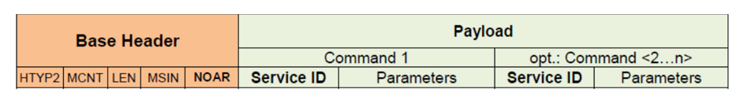

**注意：**对于大多数命令，不需要扩展报文头（5.5）。例如 "Call SWC Injection" 命令则需要扩展报文头。

**控制消息中 NOAR 的使用**：如果发送一条控制消息，基础报文头字段「NOAR」（参数个数）应包含该控制消息中发送的服务 ID/命令的数量。

**避免单个服务 ID 的请求或响应重叠**：如果对某个请求/服务 ID 存在规定的响应，则每条请求应先被响应，然后才允许发出针对同一服务 ID 的下一条请求。

**请求执行与响应的顺序**：如果发送的控制消息带有多个服务 ID/命令（"NOAR" &gt; 1），则这些请求应按控制消息中的相同顺序执行。一条请求的响应应在其下一条请求被处理之前生成。各命令的响应应按请求控制消息中的相同顺序发送。

**注意：**生成的响应可以再次全部放在一条控制消息中发送（"NOAR" &gt; 1），也可以拆分到多条控制消息中。

例如，如果一条控制消息包含：

1. 请求 "GetLevel_x"；
2. 请求 "SetLevel_x"；
3. 请求 "GetLevel_x"；

则响应中的结果需要为：

1. 响应 "GetLevel_x = old level"；
2. 响应 "SetLevel_x = OK for new level"；
3. 响应 "GetLevel_x = new level"；

#### 5.3.1. 设置日志级别

**SetLogLevelLong**

| 属性 | 值 |
|---|---|
| 服务名称 | SetLogLevelLong |
| Service ID [hex] | 0x000000025 |
| 同步/异步 | 同步 |
| 可重入性 | 不可重入 |

请求参数：

| 序号 | 名称 | 类型 | 说明 |
|---|---|---|---|
| 1 | applIdLength | uint8 | 一字节长度信息：Application-ID 的字符数；如果该字段等于 0，则忽略该命令 |
| 2 | applicationId | uint8 | Application ID 的表示 |
| 3 | contextIdLength | uint8 | 一字节长度信息：Context-ID 的字符数；如果该字段等于 0，则忽略该命令 |
| 4 | contextId | uint8 | Context ID 的表示 |
| 5 | newLogLevel | sint8 | 要设置的新日志级别：可以取 DLT_LOG_FATAL 到 DLT_LOG_VERBOSE 范围内的值以设置直通范围；如果设置为 0，则阻止来自该 Context ID 的所有消息；如果设置为 -1，则将使用该 ECU 的默认日志级别 |
| 6 | contextId | 4*uint8 | 保留——这 4 字节应被忽略（即 "don't care"）。该字段应以零填充 |

响应参数：

| 序号 | 名称 | 类型 | 说明 |
|---|---|---|---|
| 1 | status | uint8 | 0 == OK；1 == NOT_SUPPORTED；2 == ERROR |

**说明**：为给定的 Application ID/Context ID 组合设置日志消息的直通范围。

**注意：**源文档中 SetLogLevelLong 的 Service ID 写为「0x000000025」（9 位十六进制，应为 0x00000025），且其第 6 个请求参数名与第 4 个重复（contextId）——均为源文档自身的笔误，按源保留。

**SetLogLevel**

| 属性 | 值 |
|---|---|
| 服务名称 | SetLogLevel |
| Service ID [hex] | 0x00000001 |
| 同步/异步 | 同步 |
| 可重入性 | 不可重入 |

请求参数：

| 序号 | 名称 | 类型 | 说明 |
|---|---|---|---|
| 1 | applicationId | 4*uint8 | Application ID 的表示。如果该字段填入 NULL，则设置该 ECU 上所有 Context ID 的所有日志级别 |
| 2 | contextId | 4*uint8 | Context ID 的表示：如果该字段填入 NULL，则设置属于给定 Application ID 的所有 Context ID；仅当 Application ID 不为 NULL 时才被解释 |
| 3 | newLogLevel | sint8 | 要设置的新日志级别：可以取 DLT_LOG_FATAL 到 DLT_LOG_VERBOSE 范围内的值以设置直通范围；如果设置为 0，则阻止来自该 Context ID 的所有消息；如果设置为 -1，则将使用该 ECU 的默认日志级别 |
| 4 | reserved | 4*uint8 | 保留——这 4 字节应被忽略（即 "don't care"）。该字段应以零填充 |

响应参数：

| 序号 | 名称 | 类型 | 说明 |
|---|---|---|---|
| 1 | status | uint8 | 0 == OK；1 == NOT_SUPPORTED；2 == ERROR |

**说明**：为给定的 Application ID/Context ID 组合设置日志消息的直通范围。

**待处理的操作**：

更新 **Dlt** 模块内的日志级别设置，并通知所有已注册的、带有 Dlt_SetLogLevel 服务所提供的应用 ID 的应用。

#### 5.3.2. 设置跟踪状态

**SetTraceStatus**

| 属性 | 值 |
|---|---|
| 服务名称 | SetTraceStatus |
| Service ID [hex] | 0x00000002 |
| 同步/异步 | 同步 |
| 可重入性 | 不可重入 |

请求参数：

| 序号 | 名称 | 类型 | 说明 |
|---|---|---|---|
| 1 | applicationId | 4*uint8 | Application ID 的表示：如果该字段填入 NULL，则设置该 ECU 上所有 Context ID 的所有跟踪状态 |
| 2 | contextId | 4*uint8 | Context ID 的表示：如果该字段填入 NULL，则设置属于给定 Application ID 的所有 Context ID；仅当 Application ID 不为 NULL 时才被解释 |
| 3 | newTraceStatus | sint8 | 要设置的新跟踪状态：可以取 1——开启（On）和 0——关闭（Off）；如果设置为 -1，则将使用该 ECU 的默认跟踪状态 |
| 4 | reserved | 4 字节 | 保留——这 4 字节应被忽略（即 "don't care"）。该字段应以零填充 |

响应参数：

| 序号 | 名称 | 类型 | 说明 |
|---|---|---|---|
| 1 | status | uint8 | 0 == OK；1 == NOT_SUPPORTED；2 == ERROR |

**说明**：被调用以针对给定的 Application ID / Context ID 元组启用或禁用跟踪消息。

**SetTraceStatusLong**

| 属性 | 值 |
|---|---|
| 服务名称 | SetTraceStatusLong |
| Service ID [hex] | 0x0000026 |
| 同步/异步 | 同步 |
| 可重入性 | 不可重入 |

请求参数：

| 序号 | 名称 | 类型 | 说明 |
|---|---|---|---|
| 1 | applIdLength | uint8 | 一字节长度信息：Application-ID 的字符数；如果该字段等于 0，则忽略该命令 |
| 2 | applicationId | uint8 | Application ID 的表示 |
| 3 | contextIdLength | uint8 | 一字节长度信息：Context-ID 的字符数；如果该字段等于 0，则忽略该命令 |
| 4 | contextId | uint8 | Context ID 的表示 |
| 5 | newTraceStatus | sint8 | 要设置的新跟踪状态：可以取 1——开启（On）和 0——关闭（Off）；如果设置为 -1，则将使用该 ECU 的默认跟踪状态 |
| 6 | reserved | 4 字节 | 保留——这 4 字节应被忽略（即 "don't care"）。该字段应以零填充 |

响应参数：

| 序号 | 名称 | 类型 | 说明 |
|---|---|---|---|
| 1 | status | uint8 | 0 == OK；1 == NOT_SUPPORTED；2 == ERROR |

**说明**：为给定的 Application ID/Context ID 组合设置日志消息的直通范围。

**注意：**源文档中 SetTraceStatusLong 的 Service ID 写为「0x0000026」（7 位十六进制，应为 0x00000026），且其 Description 单元格沿用了日志级别命令的文案——均为源文档自身的错误，按源保留。

#### 5.3.3. 获取日志信息

**GetLogInfo**

| 属性 | 值 |
|---|---|
| 服务名称 | GetLogInfo |
| Service ID [hex] | 0x00000003 |
| 同步/异步 | 同步 |
| 可重入性 | 不可重入 |

请求参数：

| 序号 | 名称 | 类型 | 说明 |
|---|---|---|---|
| 1 | options | uint8 | 1 - 保留；2 - 保留；3 - 保留；4 - 保留；5 - 未使用——无法请求关于未注册 Application ID 和 Context ID 的信息；6 - 关于已注册 Application ID 和 Context ID 的信息（带日志级别和跟踪状态信息）；7 - 关于已注册 Application ID 和 Context ID 的信息（带日志级别和跟踪状态信息，以及每个 Application ID 和 Context ID 的全部文本描述） |
| 2 | applicationId | 4*uint8 | Application ID 的表示：如果该字段填入 NULL，则请求该 ECU 上已注册的所有 Application ID 及其所有 Context ID |
| 3 | contextId | 4*uint8 | Context ID 的表示：如果该字段填入 NULL，则请求属于给定 Application ID 的所有 Context ID；仅当 Application ID 不为 NULL 时才被解释 |
| 4 | reserved | 4*uint8 | 保留——这 4 字节应被忽略（即 "don't care"）。该字段应以零填充 |

响应参数：

| 序号 | 名称 | 类型 | 说明 |
|---|---|---|---|
| 1 | status | uint8 | 1 - NOT_SUPPORTED；2 - DLT_ERROR；3 - 保留；4 - 保留；5 - 关于未注册 Application ID 和 Context ID 的信息；6 - 关于已注册 Application ID 和 Context ID 的信息（带日志级别和跟踪状态信息）；7 - 关于已注册 Application ID 和 Context ID 的信息（带日志级别和跟踪状态信息，以及每个 Application ID 和 Context ID 的全部文本描述）。注意：在这种情况下控制消息应处于详细模式；8 - 无匹配的 Context ID；9 - RESPONSE DATA OVERFLOW——如果生成的响应过大。如果响应状态不是 1、2、8 或 9，则它应与请求的 "options" 条目中所用的值相同 |
| 2 | applicationIds | LogInfo- Type | 若 status == 1 或 2 则为 NULL。对于状态 6 或 7（7 带前缀 '）：appIdCount (uint16)、appIdInfo[] (struct[])、appID (uint8[4])、contextIdCount (uint16)、contextIdInfoList[] (struct[])、contextId (uint8[4])、logLevel (enum 0x00 .. 0x06)、traceStatus (uint8)、contextDescLen (uint8)、contextDesc[] (uint8[])、appDescLen (uint8)、appDesc[] (uint8[]) |
| 3 | reserved | 4*uint8 | 保留——这 4 字节应被忽略（即 "don't care"）。该字段应以零填充 |

**说明**：被调用以请求关于已注册应用及其上下文的信息，包括对应的 ID、日志级别、跟踪状态以及（如被请求的）描述。也用于报告 Application ID 和 Context ID 注册的新增或删除。如果 Get LogInfo 命令以某个「保留的」options 值被请求，则应返回 NOT_SUPPORTED。

**GetLogInfoLong**

| 属性 | 值 |
|---|---|
| 服务名称 | GetLogInfoLong |
| Service ID [hex] | 0x00000027 |
| 同步/异步 | 同步 |
| 可重入性 | 不可重入 |

请求参数：

| 序号 | 名称 | 类型 | 说明 |
|---|---|---|---|
| 1 | options | uint8 | 1 - 保留；2 - 保留；3 - 保留；4 - 保留；5 - 未使用——无法请求关于未注册 Application ID 和 Context ID 的信息；6 - 关于已注册 Application ID 和 Context ID 的信息（带日志级别和跟踪状态信息）；7 - 关于已注册 Application ID 和 Context ID 的信息（带日志级别和跟踪状态信息，以及每个 Application ID 和 Context ID 的全部文本描述） |
| 2 | applicationIdLength | uint8 | 一字节长度信息：Application-ID 的字符数；如果该字段等于 0，则忽略该命令 |
| 3 | applicationId | uint8 | Application ID 的表示 |
| 4 | contextIdLength | uint8 | 一字节长度信息：Context-ID 的字符数；如果该字段等于 0，则忽略该命令 |
| 5 | contextId | uint8 | Context ID 的表示 |

响应参数：

| 序号 | 名称 | 类型 | 说明 |
|---|---|---|---|
| 1 | status | uint8 | 1 - NOT_SUPPORTED；2 - DLT_ERROR；3 - 保留；4 - 保留；5 - 关于未注册 Application ID 和 Context ID 的信息；6 - 关于已注册 Application ID 和 Context ID 的信息（带日志级别和跟踪状态信息）；7 - 关于已注册 Application ID 和 Context ID 的信息（带日志级别和跟踪状态信息，以及每个 Application ID 和 Context ID 的全部文本描述）。注意：在这种情况下控制消息应处于详细模式；8 - 无匹配的 Context ID；9 - RESPONSE DATA OVERFLOW——如果生成的响应过大。如果响应状态不是 1、2、8 或 9，则它应与请求的 "options" 条目中所用的值相同 |
| 2 | applicationIds | LogInfo- Type | 若 status == 1 或 2 则为 NULL。对于状态 6 或 7（7 带前缀 '）：appIdCount (uint16)、appIdInfo[] (struct[])、appIdLen (uint8)、appID (uint8[4])、contextIdCount (uint16)、contextIdInfoList[] (struct[])、contextIdLen (uint8)、contextId (uint8[4])、logLevel (enum 0x00 .. 0x06)、traceStatus (uint8)、contextDescLen (uint8)、contextDesc[] (uint8[])、appDescLen (uint8)、appDesc[] (uint8[]) |
| 3 | reserved | 4*uint8 | 保留——这 4 字节应被忽略（即 "don't care"）。该字段应以零填充 |

**说明**：被调用以请求关于已注册应用及其上下文的信息，包括对应的 ID、日志级别、跟踪状态以及（如被请求的）描述。也用于报告 Application ID 和 Context ID 注册的新增或删除。如果 GetLogInfo 命令以某个「保留的」options 值被请求，则应返回 NOT_SUPPORTED。

#### 5.3.4. 获取默认日志级别

**GetDefaultLogLevel**

| 属性 | 值 |
|---|---|
| 服务名称 | GetDefaultLogLevel |
| Service ID [hex] | 0x00000004 |
| 同步/异步 | 同步 |
| 可重入性 | 不可重入 |

请求参数：

| 序号 | 名称 | 类型 | 说明 |
|---|---|---|---|
| 无 | | | |

响应参数：

| 序号 | 名称 | 类型 | 说明 |
|---|---|---|---|
| 1 | status | uint8 | 0 == OK；1 == NOT_SUPPORTED；2 == ERROR |
| 2 | logLevel | uint8 | 实际的日志级别 |

**说明**：返回当前的默认日志级别。

#### 5.3.5. 存储配置

**StoreConfiguration**

| 属性 | 值 |
|---|---|
| 服务名称 | StoreConfiguration |
| Service ID [hex] | 0x00000005 |
| 同步/异步 | 同步 |
| 可重入性 | 不可重入 |

请求参数：

| 序号 | 名称 | 类型 | 说明 |
|---|---|---|---|
| 无 | | | |

响应参数：

| 序号 | 名称 | 类型 | 说明 |
|---|---|---|---|
| 1 | status | uint8 | 0 == OK；1 == NOT_SUPPORTED；2 == ERROR |

**说明**：被调用以将当前的 **Dlt** 配置非易失性地存储。如果不支持，则响应应为 NOT_SUPPORTED。

#### 5.3.6. 恢复出厂默认设置

**ResetToFactoryDefault**

| 属性 | 值 |
|---|---|
| 服务名称 | ResetToFactoryDefault |
| Service ID [hex] | 0x00000006 |
| 同步/异步 | 同步 |
| 可重入性 | 不可重入 |

请求参数：

| 序号 | 名称 | 类型 | 说明 |
|---|---|---|---|
| 无 | | | |

响应参数：

| 序号 | 名称 | 类型 | 说明 |
|---|---|---|---|
| 1 | status | uint8 | 0 == OK；1 == NOT_SUPPORTED；2 == ERROR |

**说明**：被调用以将 **Dlt** 配置恢复为出厂默认设置。如果不支持，则响应应为 NOT_SUPPORTED。

#### 5.3.7. SetMessageFiltering

**SetMessageFiltering**

| 属性 | 值 |
|---|---|
| 服务名称 | SetMessageFiltering |
| Service ID [hex] | 0x0000000A |
| 同步/异步 | 同步 |
| 可重入性 | 不可重入 |

请求参数：

| 序号 | 名称 | 类型 | 说明 |
|---|---|---|---|
| 1 | newstatus | uint8 | 0 - 关闭（OFF）；1 - 开启（ON） |

响应参数：

| 序号 | 名称 | 类型 | 说明 |
|---|---|---|---|
| 2 | status | uint8 | 0 == OK；1 == NOT_SUPPORTED；2 == ERROR |

**说明**：被调用以开启/关闭 **Dlt** 模块的消息过滤。如果不支持，则响应应为 NOT_SUPPORTED。

**注意：**源文档中该命令响应参数的序号为「2」而请求参数序号为「1」——按源保留。

#### 5.3.8. 设置默认日志级别

**SetDefaultLogLevel**

| 属性 | 值 |
|---|---|
| 服务名称 | SetDefaultLogLevel |
| Service ID [hex] | 0x00000011 |
| 同步/异步 | 同步 |
| 可重入性 | 不可重入 |

请求参数：

| 序号 | 名称 | 类型 | 说明 |
|---|---|---|---|
| 1 | newLogLevel | sint8 | 要设置的新日志级别：可以取 DLT_LOG_FATAL 到 DLT_LOG_VERBOSE 范围内的值以设置直通范围；如果设置为 0，则阻止所有消息；如果设置为 -1，则所有消息都通过过滤器 |
| 2 | Reserved | 4*uint8 | 保留——这 4 字节应被忽略（即 "don't care"）。该字段应以零填充 |

响应参数：

| 序号 | 名称 | 类型 | 说明 |
|---|---|---|---|
| 1 | status | uint8 | 0 == OK；1 == NOT_SUPPORTED；2 == ERROR |

**说明**：被调用以修改所有未显式设置的 Context ID 的日志消息直通范围。

**待处理的操作**：按照所提供的新日志级别更新所有通配符条目的日志级别过滤器。

#### 5.3.9. 设置默认跟踪状态

**SetDefaultTraceStatus**

| 属性 | 值 |
|---|---|
| 服务名称 | SetDefaultTraceStatus |
| Service ID [hex] | 0x00000012 |
| 同步/异步 | 同步 |
| 可重入性 | 不可重入 |

请求参数：

| 序号 | 名称 | 类型 | 说明 |
|---|---|---|---|
| 1 | newTraceStatus | sint8 | 要设置的新跟踪状态：可以取 1——开启（On）和 0——关闭（Off） |
| 2 | reserved | 4 字节 | 这 4 字节应被忽略（即 "don't care"）。该字段应以零填充 |

响应参数：

| 序号 | 名称 | 类型 | 说明 |
|---|---|---|---|
| 1 | status | uint8 | 0 == OK；1 == NOT_SUPPORTED；2 == ERROR |

**说明**：被调用以针对所有未显式设置的 Context ID 启用或禁用跟踪消息。

#### 5.3.10. 获取 ECU 软件版本

**GetSoftwareVersion**

| 属性 | 值 |
|---|---|
| 服务名称 | GetSoftwareVersion |
| Service ID [hex] | 0x00000013 |
| 同步/异步 | 同步 |
| 可重入性 | 不可重入 |

请求参数：

| 序号 | 名称 | 类型 | 说明 |
|---|---|---|---|
| 无 | | | |

响应参数：

| 序号 | 名称 | 类型 | 说明 |
|---|---|---|---|
| 1 | status | uint8 | 0 == OK；1 == NOT_SUPPORTED；2 == ERROR |
| 2 | Length | uint32 | 字符串 swVersion 的长度 |
| 3 | swVersion | char[] | 包含 ECU 软件版本的字符串 |

**说明**：获取 ECU 的软件版本。

#### 5.3.11. 获取默认跟踪状态

**GetDefaultTraceStatus**

| 属性 | 值 |
|---|---|
| 服务名称 | GetDefaultTraceStatus |
| Service ID [hex] | 0x00000015 |
| 同步/异步 | 同步 |
| 可重入性 | 不可重入 |

请求参数：

| 序号 | 名称 | 类型 | 说明 |
|---|---|---|---|
| 无 | | | |

响应参数：

| 序号 | 名称 | 类型 | 说明 |
|---|---|---|---|
| 1 | status | uint8 | 0 == OK |
| 2 | traceStatus | uint8 | 实际的跟踪状态：0 - 关闭，1 - 开启 |

**说明**：返回当前的默认跟踪状态。如果不支持，则响应应为 NOT_SUPPORTED。

#### 5.3.12. 获取日志通道名称

**GetLogChannelNames**

| 属性 | 值 |
|---|---|
| 服务名称 | GetLogChannelNames |
| Service ID [hex] | 0x00000017 |
| 同步/异步 | 同步 |
| 可重入性 | 不可重入 |

请求参数：

| 序号 | 名称 | 类型 | 说明 |
|---|---|---|---|
| 无 | | | |

响应参数：

| 序号 | 名称 | 类型 | 说明 |
|---|---|---|---|
| 1 | status | uint8 | 0 == OK；1 == NOT_SUPPORTED；2 == ERROR |
| 2 | countIf | uint8 | 所传输接口（即日志通道）名称的数量 |
| 3 | logChannelNames | 4*uin8[] | 日志通道名称的列表。每 4 字节一个数组元素 |

**说明**：被调用以获取所有可用的通信接口。

**注意：**源文档中该字段的类型写为「4*uin8[]」（应为 4*uint8[]）——源 PDF 自身的笔误，按源保留。

#### 5.3.13. 获取跟踪状态

**GetTraceStatus**

| 属性 | 值 |
|---|---|
| 服务名称 | GetTraceStatus |
| Service ID [hex] | 0x0000001F |
| 同步/异步 | 同步 |
| 可重入性 | 不可重入 |

请求参数：

| 序号 | 名称 | 类型 | 说明 |
|---|---|---|---|
| 1 | applicationId | 4*uint8 | 所寻址的 Application ID |
| 2 | contextId | 4*uint8 | 所寻址的 Context ID |

响应参数：

| 序号 | 名称 | 类型 | 说明 |
|---|---|---|---|
| 1 | status | uint8 | 0 == OK；1 == NOT_SUPPORTED；2 == ERROR |
| 2 | traceStatus | uint8 | 实际的跟踪状态：0 - 关闭，1 - 开启 |

**说明**：返回所寻址的 Application ID/Context ID 元组的实际跟踪状态。如果不支持，则响应应为 NOT_SUPPORTED。

**GetTraceStatusLong**

| 属性 | 值 |
|---|---|
| 服务名称 | GetTraceStatusLong |
| Service ID [hex] | 0x00000028 |
| 同步/异步 | 同步 |
| 可重入性 | 不可重入 |

请求参数：

| 序号 | 名称 | 类型 | 说明 |
|---|---|---|---|
| 1 | applicationIdLength | uint8 | 一字节长度信息：Application-ID 的字符数 |
| 2 | applicationId | uint8 | 所寻址的 Application ID |
| 3 | contextIdLength | uint8 | 一字节长度信息：Context-ID 的字符数 |
| 4 | contextId | uint8 | 所寻址的 Context ID |

响应参数：

| 序号 | 名称 | 类型 | 说明 |
|---|---|---|---|
| 1 | status | uint8 | 0 == OK；1 == NOT_SUPPORTED；2 == ERROR |
| 2 | traceStatus | uint8 | 实际的跟踪状态：0 - 关闭，1 - 开启 |

**说明**：返回所寻址的 Application ID/Context ID 元组的实际跟踪状态。如果不支持，则响应应为 NOT_SUPPORTED。

**注意：**源文档中 SetTraceStatusLong（见 §5.3.2）的 Description 沿用了日志级别命令的文案——为源文档自身的复制粘贴错误，按源保留；本命令（GetTraceStatusLong）的 Description 则已正确描述跟踪状态。

#### 5.3.14. 设置日志通道分配

**SetLogChannelAssignment**

| 属性 | 值 |
|---|---|
| 服务名称 | SetLogChannelAssignment |
| Service ID [hex] | 0x00000020 |
| 同步/异步 | 同步 |
| 可重入性 | 不可重入 |

请求参数：

| 序号 | 名称 | 类型 | 说明 |
|---|---|---|---|
| 1 | applicationId | 4*uint8 | 所寻址的 Application ID |
| 2 | contextId | 4*uint8 | 所寻址的 Context ID |
| 3 | logChannelName | 4*uint8 | 所寻址日志通道的名称 |
| 4 | addRemoveOp | uint8 | 0：从所寻址的日志通道中移除所寻址的 Application ID/Context ID 元组；1：将所寻址的 Application ID/Context ID 元组添加到所寻址的日志通道 |

响应参数：

| 序号 | 名称 | 类型 | 说明 |
|---|---|---|---|
| 1 | status | uint8 | 0 == OK；1 == NOT_SUPPORTED；2 == ERROR |

**说明**：将所寻址的 Application ID/Context ID 元组从所寻址的日志通道中添加或移除。

**SetLogChannelAssignmentLong**

| 属性 | 值 |
|---|---|
| 服务名称 | SetLogChannelAssignmentLong |
| Service ID [hex] | 0x00000029 |
| 同步/异步 | 同步 |
| 可重入性 | 不可重入 |

请求参数：

| 序号 | 名称 | 类型 | 说明 |
|---|---|---|---|
| 1 | applicationIdLength | uint8 | 一字节长度信息：Application-ID 的字符数 |
| 2 | applicationId | uint8 | 所寻址的 Application ID |
| 3 | contextIdLength | uint8 | 一字节长度信息：Context-ID 的字符数 |
| 4 | contextId | uint8 | 所寻址的 Context ID |
| 5 | logChannelName | uint8 | 所寻址日志通道的名称 |
| 6 | addRemoveOp | uint8 | 0：从所寻址的日志通道中移除所寻址的 Application ID/Context ID 元组；1：将所寻址的 Application ID/Context ID 元组添加到所寻址的日志通道 |

响应参数：

| 序号 | 名称 | 类型 | 说明 |
|---|---|---|---|
| 1 | status | uint8 | 0 == OK；1 == NOT_SUPPORTED；2 == ERROR |

**说明**：将所寻址的 Application ID/Context ID 元组从所寻址的日志通道中添加或移除。如果不支持，则响应应为 NOT_SUPPORTED。

#### 5.3.15. 设置日志通道阈值

**SetLogChannelThreshold**

| 属性 | 值 |
|---|---|
| 服务名称 | SetLogChannelThreshold |
| Service ID [hex] | 0x00000021 |
| 同步/异步 | 同步 |
| 可重入性 | 不可重入 |

请求参数：

| 序号 | 名称 | 类型 | 说明 |
|---|---|---|---|
| 1 | logChannelName | 4*uint8 | 所寻址日志通道的名称 |
| 2 | logLevelThreshold | uint8 | 0 - DLT_LOG_OFF；1 - DLT_LOG_FATAL；2 - DLT_LOG_ERROR；3 - DLT_LOG_WARN；4 - DLT_LOG_INFO；5 - DLT_LOG_DEBUG |
| 3 | traceStatus | uint8 | 0：跟踪消息被阻止；1：跟踪消息可以通过 |

响应参数：

| 序号 | 名称 | 类型 | 说明 |
|---|---|---|---|
| 1 | status | uint8 | 0 == OK；1 == NOT_SUPPORTED；2 == ERROR |
| 2 | traceStatus | uint8 | 实际的跟踪状态：0 - 关闭，1 - 开启 |

**说明**：为所寻址的日志通道设置日志级别和跟踪状态。

#### 5.3.16. 获取日志通道阈值

**GetLogChannelThreshold**

| 属性 | 值 |
|---|---|
| 服务名称 | GetLogChannelThreshold |
| Service ID [hex] | 0x00000022 |
| 同步/异步 | 同步 |
| 可重入性 | 不可重入 |

请求参数：

| 序号 | 名称 | 类型 | 说明 |
|---|---|---|---|
| 1 | logChannelName | 4*uint8 | 所寻址日志通道的名称 |

响应参数：

| 序号 | 名称 | 类型 | 说明 |
|---|---|---|---|
| 1 | status | uint8 | 0 == OK；1 == NOT_SUPPORTED；2 == ERROR |
| 2 | logLevelThreshold | uint8 | 0 == DLT_LOG_OFF；1 == DLT_LOG_FATAL；2 == DLT_LOG_ERROR；3 == DLT_LOG_WARN；4 == DLT_LOG_INFO；5 == DLT_LOG_DEBUG；6 == DLT_LOG_VERBOSE |
| 3 | traceStatus | uint8 | 0 == 跟踪消息被阻止；1 == 跟踪消息可以通过 |

**说明**：返回所寻址日志通道的日志级别和跟踪状态。

#### 5.3.17. 缓冲区溢出通知

**BufferOverflowNotification**

| 属性 | 值 |
|---|---|
| 服务名称 | BufferOverflowNotification |
| Service ID [hex] | 0x00000023 |
| 同步/异步 | 同步 |
| 可重入性 | 不可重入 |

请求参数：

| 序号 | 名称 | 类型 | 说明 |
|---|---|---|---|
| 无 | | | |

响应参数：

| 序号 | 名称 | 类型 | 说明 |
|---|---|---|---|
| 1 | status | uint8 | 0 == OK；1 == NOT_SUPPORTED；2 == ERROR |
| 2 | overflowCounter | unit32 | 自上次发送 MessageBufferOverflow 消息以来丢失的 **Dlt** 消息数量的计数器 |

**说明**：当 **Dlt** 消息缓冲区溢出时，**Dlt** 模块发送此消息。

**注意：**源文档中 overflowCounter 字段的类型写为「unit32」（应为 uint32）——源 PDF 自身的笔误，按源保留。

#### 5.3.18. 调用 SWC 注入

CallSWCInjection 消息应被转发到相应的应用。服务 ID 0xFFF 至 0xFFFFFFFF 为此目的保留。该值由用户定义，可由应用自由使用。

在 CallSWCInjection 消息的情况下，应用 ID（APID）、上下文 ID（CTID）和会话 ID（SEID）应填入报文头。APID 与 CTID 的组合连同 SEID 标识了应用/可运行体（runnable）的一个唯一客户端-服务器接口，该接口在接收到带有所提供数据的此消息时被调用。

如果无法进行唯一标识（该组合不存在，或尚未注册），则响应应为 NOT_SUPPORTED。

**CallSWCInjection**

| 属性 | 值 |
|---|---|
| 服务名称 | CallSWCInjection |
| Service ID [hex] | 0x00000FFF ... 0xFFFFFFFF |
| 同步/异步 | 同步 |
| 可重入性 | 不可重入 |

请求参数：

| 序号 | 名称 | 类型 | 说明 |
|---|---|---|---|
| 1 | dataLength | uint32 | 所提供数据的长度 |
| 2 | data[] | uint8[] | 提供给应用的数据 |

响应参数：

| 序号 | 名称 | 类型 | 说明 |
|---|---|---|---|
| 1 | status | uint8 | 0 == OK；1 == NOT_SUPPORTED；2 == ERROR；3 == PENDING |

**说明**：用于调用应用中的函数。

#### 5.3.19. DLT 命令（已废弃）

以下 **Dlt** 命令已被废弃，不再支持：

- 0x07 SetComInterfaceStatus
- 0x08 SetComInterfaceMaxBandwidth
- 0x09 SetVerboseMode
- 0x0C GetLocalTime
- 0x0D SetUseECUID
- 0x0E SetUseSessionID
- 0x0F SetUseTimestamp
- 0x10 SetUseExtendedHeader
- 0x14 MessageBufferOverflow
- 0x16 GetComInterfacelStatus
- 0x18 GetComInterfaceMaxBandwidth
- 0x19 GetVerboseModeStatus
- 0x1A GetMessageFilteringStatus
- 0x1B GetUseECUID
- 0x1C GetUseSessionID
- 0x1D GetUseTimestamp
- 0x1E GetUseExtendedHeader
- 0x24 SyncTimeStamp

### 5.4. 外部客户端/工具

#### 5.4.1. 用于存储到数据库/文件的扩展

**Dlt** 模块可以在报文头中省略某些信息（例如 ECU ID）。因此，由接收方外部客户端存储一些附加信息非常重要。

为了额外存储诸如接收方时间戳和 ECU ID 之类的有用信息，应在每条接收到的 **Dlt** 消息前面添加一个存储报文头（**Storage Header**）。

由于发送侧的 **Dlt** 可以省略 ECU ID，接收方应在接收时添加该信息。时间戳同样是为了让诊断和可视化工具能够更好地计算序列和时间依赖关系。

此外，在存储报文头的开头应附加一个模式（pattern）。该模式用于在字节流或文件损坏时进行某些错误恢复。

表5.20：存储在 **Dlt** 消息前面的存储报文头

| 偏移 | 长度（字节） | 名称 | 说明 |
|---|---|---|---|
| | Dlt 日志或跟踪存储扩展 | | |
| 0 | 4 | DLT-Pattern | "DLT"+0x02，十六进制为 0x 44 4C 54 02 |
| 4 | 9 | Timestamp | |
| 4 | 5 | seconds | 无符号整数，40 位，自 1970 年 1 月 1 日（Unix 时间）起的秒数 |
| 4 | 4 | nanoseconds | 有符号整数，32 位，一秒内的纳秒数（介于 0 - 999.999.999 之间） |
| 13 | 1 + n | ECU ID | |
| 13 | 1 | ECU ID 的长度 | 一字节长度信息：ECU-ID 的字符数 |
| 13 | n | ECU ID | ECU-ID 的 &lt;n&gt; 个 ASCII 字符 |
| 14 + n | Dlt 日志或跟踪消息 | | |
| | | 基础报文头 | |
| | | 扩展报文头 | （如果消息中包含） |
| | | 载荷 | |

外部客户端应在存储接收到的 **Dlt** 消息之前，先将存储报文头添加到该消息上。

**注意：**存储报文头既应用于数据消息（详细模式和非详细模式），也应用于控制消息。

存储报文头中的第一个条目应是一个模式 0x 44 4C 54 02（"DLT"+0x2）。

如果外部客户端接收到一条消息，除了消息本身之外，它还应在存储报文头中存储其接收到该消息的时间。

如果外部客户端接收到一条消息，除了消息本身之外，它还应在存储报文头中存储该消息的 ECU ID。

### 5.5. 序列（下层）

#### 5.5.1. 状态

N/A——**Dlt** 协议未规定任何状态。

#### 5.5.2. 控制流/转换

##### 5.5.2.1. Dlt 数据消息的传输

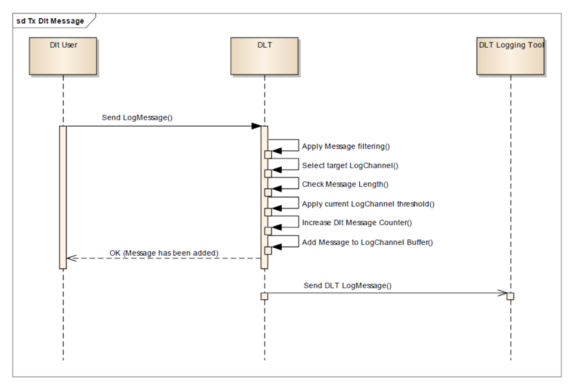

##### 5.5.2.2. 设置日志级别过滤器

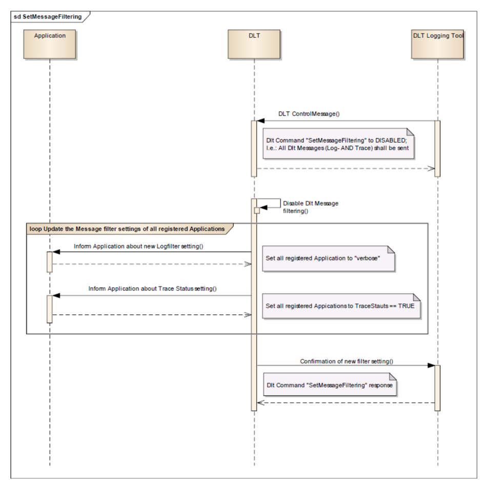

##### 5.5.2.3. 缓冲区溢出

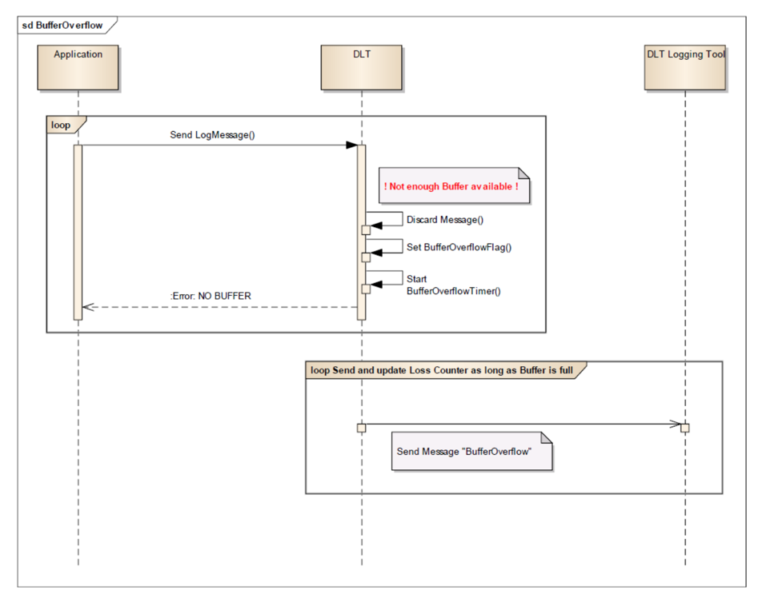

### 5.6. 错误处理

#### 5.6.1. 错误消息

##### 5.6.1.1. 缓冲区溢出

如果发生 **Dlt** 消息缓冲区溢出，应发送服务 ID 为 0x23（BufferOverflowNotification）的控制消息。

**注意：**服务 BufferOverflowNotification 定义于第 [5.3.17](#5317-缓冲区溢出通知) 节。

**Dlt** 消息缓冲区的状态应被周期性地检查。

发送 **Dlt** 溢出消息的最小时间间隔应是可配置的，即：在所配置的时间跨度内不得发送多于一条的 **Dlt** 溢出消息。

##### 5.6.1.2. 以 "ERROR" 应答命令

在以下情况之一发生时，**Dlt** 模块应以 "ERROR" 应答一条 **Dlt** 命令：

- 所接收的参数值中至少有一个无法与当前配置匹配
- 当前有另一条 **Dlt** 命令正在处理中

如果 **Dlt** 模块接收到一条使用某个服务 ID 的 **Dlt** 命令，而该服务 ID 既未在第「Dlt 命令」章中规定、也未在第「DLT 命令（已废弃）」章中规定，则 **Dlt** 模块应以 "ERROR" 应答。

##### 5.6.1.3. 以 "NOT SUPPORTED" 应答命令

如果 **Dlt** 模块接收到以下 **Dlt** 命令之一，它应以 "DLT_NOT_SUPPORTED" 响应：

- 0x07 SetComInterfaceStatus
- 0x08 SetComInterfaceMaxBandwidth
- 0x09 SetVerboseMode
- 0x0A SetMessageFiltering
- 0x0C GetLocalTime
- 0x0D SetUseECUID
- 0x0E SetUseSessionID
- 0x0F SetUseTimestamp
- 0x10 SetUseExtendedHeader
- 0x14 MessageBufferOverflow
- 0x16 GetComInterfacelStatus
- 0x18 GetComInterfaceMaxBandwidth
- 0x19 GetVerboseModeStatus
- 0x1A GetMessageFilteringStatus
- 0x1B GetIseECUID
- 0x1C GetUseSessionID
- 0x1D GetUseTimestamp
- 0x1E GetUseExtendedHeader

**注意：**源文档中该清单的 0x1B 写为「GetIseECUID」（应为 GetUseECUID）——源 PDF 自身的笔误，按源保留。

#### 5.6.2. 错误解决

##### 5.6.2.1. 传输重试

如果在尝试将 **Dlt** 消息发送到总线时发生错误，**Dlt** 模块应重试发送。传输重试的最大次数应是可配置的。

**注意：**这不是 **Dlt** 协议本身的一部分，而是对 **Dlt** 模块实现的建议。

## 6. 配置规范

本章列出 **Dlt** 协议使用的所有参数。

### 6.1. 基础报文头

| 长名称 | 短名称 | 说明 |
|---|---|---|
| Header Type 2 | HTYP2 | 关于各报文头的元信息 |
| Message Counter | MCNT | **Dlt** 消息的消息计数器 |
| Length | LEN | **Dlt** 消息的长度 |
| Message Info (c) | MSIN | 关于载荷的元信息 |
| Number of Arguments (c) | NOAR | 载荷中包含的参数个数 |
| ns-Timestamp (c) | TMSP2 | 具有纳秒分辨率的时间戳 |
| Message ID (c) | MSID | 唯一消息 ID，用于（源单元格被截断） |

### 6.1.1. 报文头类型 2（HTYP2）

| 长名称 | 短名称 | 说明 |
|---|---|---|
| Content Information | CNTI | 详细/非详细数据消息或控制消息 |
| With ECU ID | WEID | ECU ID 字段使用标志 |
| With App- and Context ID | WACID | 应用与上下文 ID 字段使用标志 |
| With Session ID | WSID | 会话 ID 字段使用标志 |
| Version number | VERS | 包含所使用的 **Dlt** 协议版本 |
| With Source File Name and Line Number | WSFLN | 源文件名和行号字段使用标志 |
| With Tags | WTGS | 标签字段使用标志 |
| With Privacy Level | WPVL | 隐私级别字段使用标志 |

### 6.1.2. 消息信息（MSIN）

| 长名称 | 短名称 | 说明 |
|---|---|---|
| Message Type | MSTP | **Dlt** 消息类型的标识 |
| Message Type Info | MTIN | 消息类型的附加信息 |

### 6.2. 扩展报文头

| 长名称 | 短名称 | 说明 |
|---|---|---|
| ECU ID (optional) | ECU | ECU 的名称 |
| Application ID (optional) | APID | 应用 ID |
| Context ID (optional) | CTID | 上下文 ID |
| Session ID (optional) | SEID | 会话 ID |
| File Name | FINA | LT 消息来源：源文件名 |
| Line Number | LINR | LT 消息来源：文件中的行号 |
| Tags | TAGS | 用于过滤目的的标签 |
| Privacy Level | PRLV | 消息内容的隐私级别 |

### 6.3. 发布信息

发布信息包含由软件模块实现者定义的数据，这些数据在协议适配（即配置）到实际硬件/软件环境时不会改变。因此它包含版本和制造商信息。

如适用，下面列出了其他模块特定的发布参数。

## 7. 协议使用和指南

### 7.1. 日志级别使用建议

第 5.1.1.4 节「条件字段『消息信息』」中由 PRS_Dlt_00619 所定义的日志级别带有一种隐含的语义。本节就如何使用不同的日志级别给出建议，即哪类事件应由哪个日志级别报告。但是，本节纯粹是信息性的。也就是说，日志消息的生产者应（SHOULD）遵循本节，但可以（MAY）选择采用不同的语义。此外，日志消息的消费者不得（SHALL NOT）在没有额外约定的情况下（例如通过其他方式协商一个共同配置文件）就从某些日志级别的消息推导出动作。

#### 7.1.1. 日志级别 FATAL（DLT_LOG_FATAL）

致命的、不可恢复的错误。因此，这些消息应当只在极少数情况下出现。整个（子）系统的稳定性可能受到威胁。应在（子）系统进入故障安全状态（例如紧急停机）之前使用，或者当它遇到极有可能导致即将发生的崩溃的错误时使用。这通常是一个（子）系统最后能记录的消息。

示例：

- 损坏的引导环境
- 对（子）系统启动至关重要的硬件组件发生故障或缺失
- 关键应用、服务或其他软件组件意外退出
- 当应用因致命错误而退出时也可使用

#### 7.1.2. 日志级别 ERROR（DLT_LOG_ERROR）

错误表示将导致（子）系统停止正常工作、但可能可以恢复的状况。

示例：

- 非关键服务、应用或其他软件组件缺失或失效
- 应用所依赖的硬件不可访问
- 正常功能所需的网络连接发生故障
- 所需文件缺失、不可访问或损坏

#### 7.1.3. 日志级别 WARNING（DLT_LOG_WARNING）

在无法确保正确行为时使用。某种令人担忧但尚未导致操作中止的情况。该状况将来可能演变为错误，也可能不会。不理想的、出乎意料的、并可能导致错误或引发应用异常的运行时状况，但一切仍在控制之中。存在从该状况自动恢复的机制（例如一个被处理的异常），应用可以继续运行。警告可以为后续错误的根本原因提供线索。

示例：

- 失败的登录尝试
- 导入作业期间出现的意外数据
- 从主服务器切换到备份服务器
- 短暂的网络或数据库连接丢失（只要它不必然导致错误行为）
- 资源池中的资源数量偏低
- 操作中出现异常但在预期之内的超时
- 没有足够的磁盘空间存放核心转储
- 进程超出规范规定的最大执行时间

#### 7.1.4. 日志级别 INFO（DLT_LOG_INFO）

应给出主要状态变化的概览，为理解同时出现的任何警告或错误提供高层次的上下文。它可用于正常但某种程度上重要的运行时事件。

示例：

- 启动/关闭时的关键系统和硬件信息
- 应用的启动/关闭
- 成功的初始化
- 一个长时间运行的作业正在开始和结束
- 重要事务的成功完成
- 进入和离开应用的关键区域
- 外部设备的连接/断开（例如 USB 驱动器）
- 不影响系统稳定性的已连接设备的错误或连接丢失（例如手机、多媒体设备……）
- 对确定关键绩效指标（KPI）至关重要的信息

#### 7.1.5. 日志级别 DEBUG（DLT_LOG_DEBUG）

细粒度的调试级别消息。详细的、对诊断有帮助的、面向程序员的信息，通常只在调试程序时有用。这一级别及以下的日志级别应只用于开发和测试，并在生产系统中禁用。

示例：

- 函数的进入和退出点
- 传递的函数参数
- 关键变量的值、值变化或状态变化（但通常不包括完整的数组转储）
- 返回值
- 关于所接收事件的信息
- 网络连接信息
- 所连接硬件的调试信息
- 用于重建系统中控制流的其他重要信息

#### 7.1.6. 日志级别 VERBOSE（DLT_LOG_VERBOSE）

比 DEBUG 更细粒度的信息。应用于深入的调试信息。

示例：

- 缓冲区、数组或内存段的转储
- 关于循环和迭代的信息
- 详细的网络信息
- 详细的硬件状态信息

## A. AUTOSAR 可追溯项变更历史

请注意，本章中的列表还包括在后续版本中已从规范中移除的规范项。这些规范项在文档中不作为超链接出现。

### A.1. 本文档依据 AUTOSAR 版本 R23-11 的变更历史

#### A.1.1. R23-11 中新增的规范项

194 项

其中带有条目标题的条目如下（Number 列按批次决议丢弃，标题按源保留）：

| 标题 |
|---|
| SetLogLevel |
| Format of ns-Timestamp |
| Format of ns-Timestamp for ECUs without a synchronized time base |
| Substance of the ns-Timestamp |
| Locate Extension Header after Base Header |
| Sequence of the fields in the Extension Header |
| Possibility to send the ECU ID |
| Length information |
| ECU ID format |
| Possibility to send the Application ID and Context ID |
| Sequence of Application ID and Context ID |
| Length information of Application ID and Context ID |
| Application ID and Context ID format |
| Possibility to send the source file identifier and the source line number |
| Content in the Extension Header for the source file identifier and the source line number |
| Definition of the length information |
| Source file identifier format |
| Substance of the source file identifier |
| Source Line Number format |
| Possibility to send tags for filtering purposes |
| Definition of the Number of tags |
| Definition of the length information for each tag |
| Tag name format |
| Possibility to add a privacy level for the containing Log and Trace message |
| Format of the Privacy Level |
| Usage of NOAR in Control Messages |
| Avoid overlapping requests or responses for a single Service ID |
| Order of request execution and response |
| Criteria to use Message Segmentation |
| Indication of Message Segmentation |
| Content of the Segmentation-Information in the Extension Header |
| FrameType sequence for transmission of a Segmented Message |
| Aborting the sequence |
| Content of the "TotalLength" information |
| Usage of the segmentation "SequenceCounter" |
| Transfer of Payload data blocks |
| Vendor-defined Message ID range |
| SetLogLevelLong |
| AUTOSAR Message ID range |

**注意：**附录 A 的「Added Specification Items」表在源转换中为跨 6 个分页片段的 ID 枚举（多数行的标题列为空），ID 按批次决议不可出现，故以条目总数陈述（194 项）并保留带有标题的行；此为运行决策，请用户在确认关核验。

#### A.1.2. R23-11 中变更的规范项

无

#### A.1.3. R23-11 中删除的规范项

无
