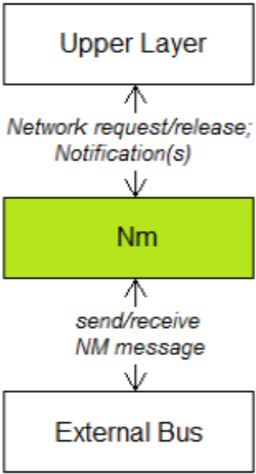
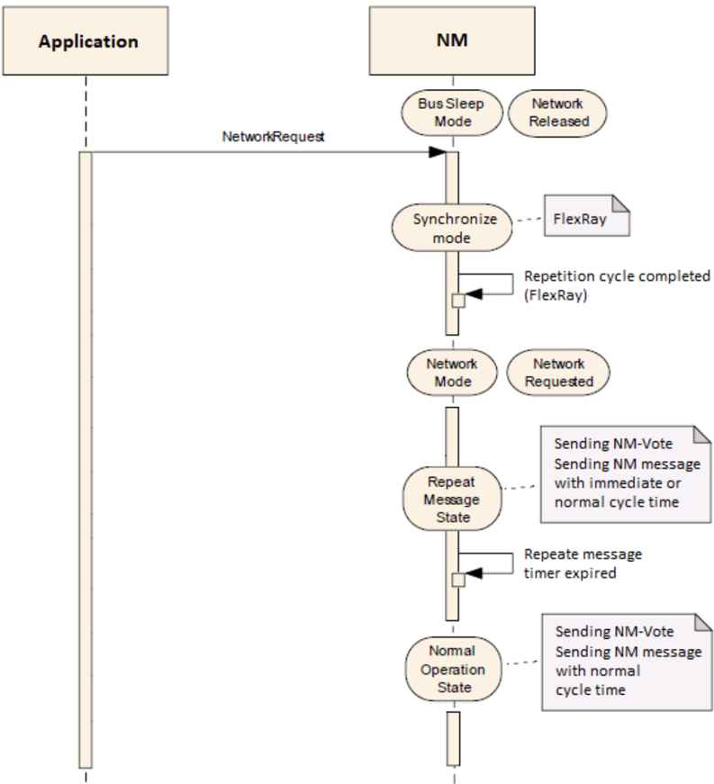
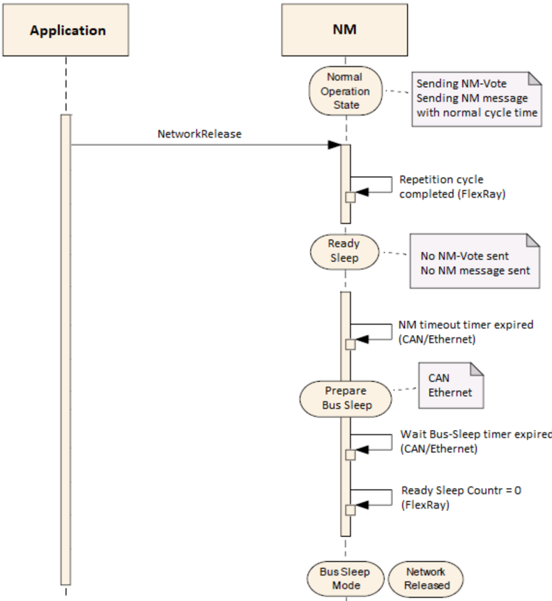

<!-- 源文档 AUTOSAR_FO_PRS_NetworkManagementProtocol（R23-11），协议规范（PRS），不受 Type A 七章骨架约束；章节结构镜像源文档自身编号。规范项 ID [PRS_Nm_*] 与 {DRAFT} 标记按 2026-11-03 批次决议整体省略（项正文照常翻译，为内联段落）；RS_Nm 回引随追溯章一并省略；方括号包住的配置参数名（[NmMessageLength] 等）改为行内代码。源第 3 章「Protocol Requirements」仅含 Requirements Traceability 一节（纯 ID 追溯表），按 2026-11-03 决议整章省略并将后续章节重编号（源 4→3、5→4、6→5、7→6、8→7）；源 §1.3.2「Dependencies to other standards and norms」为「N/A」占位节，按占位规则省略并将 §1.3.3 重编号为 §1.3.2。封面元数据表、免责声明与目录按 EXP 流程省略；3 处内容图（图1.1 NM 接口、图5.1 通信请求、图5.2 通信释放）按源图号嵌入，其余图引用为页面装饰；图 1.1/5.1/5.2 的图内标签散落（Application、NM、NetworkRequest 等）按转换噪声丢弃。附录 A.1.1/A.1.2 表的标题列为空（占位），按占位规则以条目数陈述（新增 3 项/变更 2 项/删除 0 项）——与 SecOC 行同一运行决策。 -->

## 1. 引言和概述

本协议规范规定 **AUTOSAR** 网络管理（**NM**）协议的格式、消息序列和语义。

**NM** 旨在与底层通信栈协同工作，与所用通信系统的物理层无关。

**AUTOSAR** 网络管理是一种硬件无关协议（限制见 [1.2.2 节](#122-限制)）。

下图展示 **NM** 如何与上层（见 [1.3.2 节](#132-对应用层的依赖)）和下层（总线）层交互。



### 1.1. 协议目的和目标

**NM** 协议的主要目的是协调一组或多组 **ECU** 同步唤醒和关闭其通信栈。

**NM** 算法基于周期性的 **NM** 消息，**NM** 集群中的所有节点都会接收这些消息。**NM** 消息的接收表明发送节点希望保持 **NM** 集群唤醒。如果任何节点不再需要通信，它停止发送 **NM** 消息；但如果接收到来自其他节点的 **NM** 消息，它会推迟向睡眠模式的转换。最后，如果因为不再接收到 **NM** 消息而使专用定时器超时，每个节点都会发起向睡眠模式的转换，**NM** 节点发起相应网络的关闭。

如果 **NM** 集群中的任何节点需要总线通信，它可以通过发送 **NM** 消息保持 **NM** 集群唤醒。

### 1.2. 协议的适用性

#### 1.2.1. 约束和假设

网络中可能存在遵循协议但从不主动发送 **NM** 消息的 **NM** 节点（称为 **NM** 被动节点）。

#### 1.2.2. 限制

1. 一个 **NM** 实例只与一个网络中的一个 **NM** 集群关联。一个 **NM** 集群在一个节点中只能有一个 **Nm** 实例。
2. **NM** 消息的最大大小受所用通信总线的限制。
3. **NM** 协调器（**NM Coordinator**）只用于 **AUTOSAR** 经典平台。细节见 [\[1\]](#ref-1)。

### 1.3. 依赖

#### 1.3.1. 对其他协议层的依赖

**NM** 算法使用底层通信栈模块的服务来发送和接收 **NM** 消息。

#### 1.3.2. 对应用层的依赖

上层（例如应用）使用 **NM** 服务来请求或释放网络，即激活或去激活 **NM** 消息的发送。

此外，上层/模块可以使用获知 **NM** 操作模式变更的可能性。

## 2. 用例

**PRS** 网络管理协议的用例在 **RS** 自适应网络管理 [\[2\]](#ref-2) 的「用例」章中列出并描述。

## 3. 术语和缩略语的定义

### 3.1. 缩略语和缩写

以下收录与网络管理规范相关、且未被 [3, AUTOSAR glossary] 收录的缩略语和缩写。

**CBV**
> 控制位向量（**Control Bit Vector**）

**FR**
> FlexRay

**NM**
> 网络管理（**Network Management**）

**PN**
> 部分网络（**Partial Network**）

**PNC**
> 部分网络集群（**Partial Network Cluster**）

**PNI**
> 部分网络信息（**Partial Network Information**）

**PNL**
> 部分网络学习（**Partial Network Learning**）

### 3.2. 术语的定义

**Network Mode**
> 网络模式：在该状态下网络被请求或处于活动状态。

**Prepare Bus-Sleep Mode**
> 准备总线睡眠模式：在该状态下网络被释放或不活动。

**Bus-Sleep Mode**
> 总线睡眠模式：在该状态下网络被释放或不活动。在该状态下不发送 **NM** 消息。

**FlexRay communication cycle**
> **FlexRay** 通信周期：**FlexRay** 通信调度的一部分，由时隙（静态或动态）组成。每条 **FlexRay** 消息被分配到一个通信周期中的特定时隙。

**NM cluster**
> **NM** 集群：使用 **NM** 算法协调的 **NM** 节点集合。

**NM Message**
> **NM** 消息：指在总线上传输的载荷。它包含**用户数据**（**User Data**）以及**控制位向量**（**Control Bit Vector**），并且可以包含**源节点标识符**（**Source Node Identifier**）。

**Normal Operation**
> 正常运行状态：在该状态下节点发送周期性 **NM** 消息以保持 **NM** 集群唤醒。

**Repeat Message State**
> 重复消息状态：该状态通过重复传输 **NM** 消息，确保向正常运行的转换对总线上的其他节点可见。

**Repeat Message Request**
> 重复消息请求：转换回重复消息状态的请求（经由 **NM** 消息在内部或外部接收）。

**NM Node**
> **NM** 节点：连接到一个或多个 **NM** 集群的 **ECU**（电子控制单元）。

**NM instance**
> **NM** 实例：一个 **NM** 实例表示一个 **NM** 节点内一个 **NM** 集群的当前状态。

**External Request**
> 外部请求：经由接收到的 **NM** 消息发出的通信请求。

**Internal Request**
> 内部请求：经由 **NM** 节点内部的通信请求（由应用/上层请求）。

**Passive wakeup**
> 被动唤醒：由外部请求触发的唤醒。

**Active wakeup**
> 主动唤醒：由内部请求触发的唤醒。

**PNC Bit Vector**
> **PNC** 位向量：表示 **NM** 帧中的部分网络信息。

**PNC Bit Vector Length**
> **PNC** 位向量长度：表示部分网络信息的字节长度。

**PNC bit**
> **PNC** 位：在部分网络位向量中表示特定部分网络的一个位。

**Top-level PNC coordinator**
> 顶层 **PNC** 协调器：**ECU** 在所有被指派信道上主动协调的那些 **PNC** 中充当顶层 **PNC** 协调器。该 **ECU** 启用了 **PNC** 网关功能。如果网络中没有其他 **ECU** 请求这些 **PNC** 且同步 **PNC** 关闭已启用，顶层 **PNC** 协调器会针对这些 **PNC** 触发同步 **PNC** 关闭。**注意：** 对于不同的 **PNC**，可以有不同的顶层 **PNC** 协调器。但对于同一个 **PNC**，只支持一个顶层协调器。

**Intermediate PNC coordinator**
> 中间 **PNC** 协调器：**ECU** 在至少一个信道上被动协调的那些 **PNC** 中充当中中间 **PNC** 协调器。该 **ECU** 启用了 **PNC** 网关功能。如果同步 **PNC** 关闭已启用，中间 **PNC** 协调器将针对被动协调的 **PNC** 向主动协调的信道转发同步 **PNC** 关闭。

**PNC leaf node**
> **PNC** 叶节点：**PNC** 叶节点是既不充当顶层 **PNC** 协调器也不充当中中间 **PNC** 协调器的 **ECU**。它在网络中充当没有 **PNC** 网关的 **ECU**，并将 **PN** 关闭消息按普通 **NM** 消息处理。

**PN shutdown message**
> **PN** 关闭消息：顶层 **PNC** 协调器发送 **PN** 关闭消息以指示跨 **PN** 拓扑的同步 **PNC** 关闭。**PN** 关闭消息是这样一条 **NM** 消息：其中 **PNSR** 位（位于控制位向量中）以及指示进行同步关闭的所有 **PNC** 位（位于 **PNC** 位向量中）均被置为「1」。接收到 **PN** 关闭消息的中中间 **PNC** 协调器将 **PNC** 位向量作为 **PN** 关闭消息在被影响的信道上转发。**注意：** 中中间 **PNC** 协调器必须尽快转发接收到的 **PN** 关闭消息的 **PNC** 位向量，以确保受影响的 **PNC** 跨 **PN** 拓扑在几乎相同的时间点同步关闭。

**PNC Gateway**
> **PNC** 网关：**PNC** 网关用于跨总线/通信信道边界跨越（逻辑）部分网络集群，将 **PNC** 请求从一个总线/网络「网关」到其他总线/网络。因此，**PNC** 网关需要连接到多个物理通信信道。**PNC** 网关从其所有所谓的「主动」（**active**）协调信道收集 **PNC** 请求。**PNC** 网关将网络中聚合的 **PNC** 状态发送到其所有主动信道，使所有节点对全局 **PNC** 请求状态持有与网关相同的视图。如果 **PNC** 网关不是网络层级中最顶层的 **PNC** 网关，它还会将所有下级节点的聚合 **PNC** 请求状态加上其自身的内部请求状态，发送给其上级 **PNC** 协调器（经由所谓的「被动」（**passive**）协调信道连接）。

**Active coordinated channel**
> 主动协调信道：**PNC** 网关具有必须就 **PNC** 请求进行协调的通信信道。**PNC** 网关从其所有主动协调信道收集 **PNC** 请求，聚合它们并转发到所有信道（无论主动还是被动协调）。主动协调信道由该 **PNC** 网关主动保持唤醒。

**Passive coordinated channel**
> 被动协调信道：**PNC** 网关具有必须就 **PNC** 请求进行协调的通信信道。**PNC** 网关从其所有被动协调信道收集 **PNC** 请求，聚合它们并转发到所有主动协调信道。被动协调信道由连接到同一信道并主动协调该信道的另一个 **PNC** 网关远程保持唤醒。

## 4. 协议规范

### 4.1. NM 消息格式

**Nm** 消息的内容：**Nm** 消息应包含以下元素：

- 长度为 1 字节的**控制位向量**（**CBV**）（可选）
- 长度为 1 字节的**源节点 ID**（**SNI**）（可选）
- n 字节的**用户数据**（可选，可以包含 n 字节的 **PN** 请求向量）

**注意：** 还有一个附加选项，即使用「车辆唤醒」（**Car Wakeup**）位。

**Nm** 消息的格式：**用户数据**和/或 **PN** 请求向量应位于 **CBV**/**SNI** 之后。

**注意：** **UserData** 和 **PN** 请求向量可以重叠。

下表展示 **NM** 消息的示例布局：

表5.1：NM 消息布局示例（**NM message layout example**）

| | Bit 7 | Bit 6 | Bit 5 | Bit 4 | Bit 3 | Bit 2 | Bit 1 | Bit 0 |
| --- | --- | --- | --- | --- | --- | --- | --- | --- |
| Byte 0 | 控制位向量（默认） | 控制位向量（默认） | 控制位向量（默认） | 控制位向量（默认） | 控制位向量（默认） | 控制位向量（默认） | 控制位向量（默认） | 控制位向量（默认） |
| Byte 1 | 源节点标识符（默认） | 源节点标识符（默认） | 源节点标识符（默认） | 源节点标识符（默认） | 源节点标识符（默认） | 源节点标识符（默认） | 源节点标识符（默认） | 源节点标识符（默认） |
| Byte 2 | 用户数据 0 | 用户数据 0 | 用户数据 0 | 用户数据 0 | 用户数据 0 | 用户数据 0 | 用户数据 0 | 用户数据 0 |
| Byte 3 | 用户数据 1 | 用户数据 1 | 用户数据 1 | 用户数据 1 | 用户数据 1 | 用户数据 1 | 用户数据 1 | 用户数据 1 |
| Byte 4 | 用户数据 2 | 用户数据 2 | 用户数据 2 | 用户数据 2 | 用户数据 2 | 用户数据 2 | 用户数据 2 | 用户数据 2 |
| Byte 5 | 用户数据 3 | 用户数据 3 | 用户数据 3 | 用户数据 3 | 用户数据 3 | 用户数据 3 | 用户数据 3 | 用户数据 3 |
| ... | ... | ... | ... | ... | ... | ... | ... | ... |
| Byte n | 用户数据 n-2 | 用户数据 n-2 | 用户数据 n-2 | 用户数据 n-2 | 用户数据 n-2 | 用户数据 n-2 | 用户数据 n-2 | 用户数据 n-2 |

**NM** 消息的长度不应超过底层物理传输层的 **MTU**。

**NM** 消息的长度（字节）应通过 `NmMessageLength` 配置。

**注意：** 用户数据的长度可以由 `NmMessageLength` −（已用系统字节数）计算得出。

#### 4.1.1. 源节点标识符

源节点标识符的位置应可配置为字节 0 或字节 1 或关闭（默认：字节 1）。对于 **FlexRay**，源节点标识符只应可配置为字节 1 或关闭（默认：字节 1）。

源节点标识符应可用（设置为可配置的值），除非源节点标识符的位置设置为关闭。

#### 4.1.2. 控制位向量

控制位向量的位置应可配置为字节 0 或字节 1 或关闭（默认：字节 0）。对于 **FlexRay**，控制位向量应不可配置并始终设置为字节 0。

控制位向量应包含：

- 位 0：重复消息请求（**Repeat Message Request**）

  0：未请求重复消息状态

  1：已请求重复消息状态

- 位 1：**PN** 关闭请求位（**PNSR**）

  0：**NM** 消息不包含同步部分网络关闭请求

  1：**NM** 消息包含针对至少一个 **PNC** 的同步部分网络关闭请求

- 位 3：**NM** 协调器睡眠就绪位（**NM Coordinator Sleep Ready**）

  0：主协调器未请求启动同步关闭

  1：主协调器已请求启动同步关闭

- 位 4：主动唤醒位（**Active Wakeup**）

  0：节点尚未唤醒网络（被动唤醒）

  1：节点已唤醒网络（主动唤醒）

- 位 5：部分网络学习位（**PNL**）

  0：未请求 **PNC** 学习

  1：已请求 **PNC** 学习

- 位 6：部分网络信息位（**PNI**）

  0：**NM** 消息不包含部分网络请求信息

  1：**NM** 消息包含部分网络请求信息

- 位 2、7 保留用于未来扩展

  0：禁用/保留供将来使用

表5.2：CBV 布局（**CBV layout**）

| | Bit 7 | Bit 6 | Bit 5 | Bit 4 | Bit 3 | Bit 2 | Bit 1 | Bit 0 |
| --- | --- | --- | --- | --- | --- | --- | --- | --- |
| Byte 0/1 | 保留 | 部分网络信息 | 部分网络学习 | 主动唤醒 | NM 协调器睡眠就绪 | 保留 | PN 关闭请求位 | 重复消息请求 |

**注意：** 对于 **FlexRay**，在某些调度变体中位 7 用作表决位（**Vote**）。

**注意：** 位 1 和 2 曾在 **R3.2** 中用作 **NM** 协调器 ID（低位）。

#### 4.1.3. 用户数据

不属于 **CBV** 和 **NID** 的所有数据都被视为用户数据。

应可以启用或禁用 **NM** 用户数据的支持（**NM** 用户数据是可选的）。

### 4.2. 部分网络

应可以启用或禁用 **PN** 支持（**PN** 特性是可选的）。

应可以启用或禁用同步 **PNC** 关闭的处理（处理是可选的）。如果处理被启用，则 **PN** 支持也应被启用。

如果 **PN** 支持被启用，**NM** 消息内 **PNC** 位向量的布局应通过 `PnInfoOffset` 和 `PnInfoLength`（字节）预先配置。

**注意：**

**PNC** 位向量长度中的每一位（**PNC** 位）表示一个部分网络。必须考虑以下解释：

- **PNI** 位 =「1」且 **PNSR** =「0」：如果 **PNC** 位置 1，则该部分网络被请求。如果该位置 0，则对该 **PN** 无请求。
- **PNI** 位 =「1」且 **PNSR** =「1」（由顶层 **PNC** 协调器接收）：忽略 **PNSR** 位并按普通 **NM** 消息处理该消息。顶层 **PNC** 协调器不应接收到 **PN** 关闭请求。这是错误情形——中中间 **PNC** 协调器或 **PNC** 叶节点意外地在 **Nm** 消息中置位了 **PNSR** 位。
- **PNI** 位 =「1」且 **PNSR** =「1」（由中中间 **PNC** 协调器接收）：**PNC** 位向量中相应 **PNC** 位置 1 的所有部分网络被指示释放。其余部分网络（相应 **PNC** 位为 0）不受影响。
- **PNI** 位 =「1」且 **PNSR** =「1」（由 **PNC** 叶节点接收）：与 **PNI** 位 =「1」且 **PNSR** =「0」的情形相同。

**注意：** **PNC** 位向量的每一位（**PNC** 位）表示一个特定 **PNC**。一个 **PNC** 位在 **PNC** 位向量中的 byteIndex 和 bitIndex 可按如下方式确定：byteIndex = (PncId div 8)；bitIndex = (PncId mod 8)。

如果 **PN** 支持被启用，且接收到包含 **PNC** 位置 1 的消息，且 **ECU** 关注该 **PNC**，则该 **PNC** 应被视为「外部请求」（**externally requested**）。

如果 **PN** 支持被启用，且接收到包含 **PNC** 位置 0 的消息，且 **ECU** 关注该 **PNC**，则该 **PNC** 应被视为「外部释放」（**externally released**）。

如果 **PN** 支持被启用，且一个或多个应用正在请求某个 **PNC**，且 **ECU** 关注该 **PNC**，则该 **PNC** 应被视为「内部请求」（**internally requested**）。

如果 **PN** 支持被启用，且 **ECU** 的应用不再请求某个 **PNC**，则该 **PNC** 应被视为「内部释放」（**internally released**）。

#### 4.2.1. Rx NM 消息的处理

如果 **PN** 支持被禁用，则其 **NM** 应忽略接收消息中包含的任何部分网络信息。

如果 **PN** 支持被启用，且接收到的 **NM** 消息中 **PNI** 位为 0，节点的 **NM** 应忽略消息的部分网络信息字节。

如果 **PN** 支持被启用，且接收到的 **NM** 消息中 **PNI** 位置 1 且 **PNSR** 位置 0，**NM** 应处理 **NM** 消息的部分网络信息。

如果同步 **PNC** 关闭被启用，**NM** 消息以顶层 **PNC**/中中间 **PNC** 协调器的角色在主动协调信道上被接收，且 **PNI** 位和 **PNSR** 位置 1，则 **NM** 应忽略 **PNSR** 位并按普通 **NM** 消息处理该消息。

**注意：** **PN** 关闭消息（**PNI** 位 = 1 且 **PNSR** 位 = 1）不应被主动协调信道上的顶层/中中间 **PNC** 协调器接收，因为只有专用 **PNC** 的顶层 **PNC** 协调器才能发起 **PN** 关闭消息。这是中中间 **PNC** 协调器意外在主动协调信道上发送 **PN** 关闭消息的错误情形。接收方的顶层/中中间 **PNC** 协调器应将该消息按普通 **NM** 消息处理。

如果 **PN** 同步关闭错误反应被启用，且接收到的 **NM** 消息因前一条规则而被丢弃，则顶层 **PNC** 协调器应立即发送一条 **NM** 消息，将所有「内部请求」和「外部请求」的 **PNC** 作为部分网络信息。

如果同步 **PNC** 关闭被启用，**NM** 消息以中中间 **PNC** 协调器的角色在被动协调信道上被接收，且 **PNI** 位和 **PNSR** 位置 1，则 **NM** 应释放所指示的 **PNC**（**PNC** 位向量中置 1 的 **PNC** 位）、复位 **PN** 复位定时器，并将接收到的 **NM** 消息（**PNI** 位和 **PNSR** 位置 1、相应 **PNC** 置 1）转发给所有下级 **ECU**。

**注意：**

- 中中间 **PNC** 协调器必须将接收到的 **NM** 消息转发到所有其余通信信道。
- 下级 **ECU** 可以是进一步的中中间 **PNC** 协调器和/或 **PNC** 叶节点。
- **PNC** 叶节点在接收到 **PN** 关闭消息时没有特殊处理。它只按部分网络信息处理规则处理接收到的 **NM** 消息。

如果 **PN** 支持被启用，且某个 **PNC** 未在 `PnResetTime` 内被再次请求（相关 **PNC** 位未再次置 1），则该 **PN** 应被视为「未请求」。

**注意：** `PnResetTime` 配置为大于 `NmMsgCycleTime` 的值。

#### 4.2.2. Tx NM 消息的处理

如果 **PN** 支持被启用，其 **NM** 应将发送的 **CBV** 中 **PNI** 位的值置 1。

如果 **PN** 支持被禁用，其 **NM** 应将发送的 **CBV** 中 **PNI** 位的值置 0。

如果 **PN** 支持被启用，对于「内部请求」的 **PNC**，在发送 **NM** 消息之前应将 **PNC** 请求位向量中的相应位置 1。

约束：在使用部分网络时，**CBV** 的使用是强制性的。这必须通过相应平台中的配置来确保。

如果 **PN** 支持被启用，对于「内部请求」或「外部请求」的 **PNC**，在以顶层 **PNC** 协调器或中中间 **PNC** 协调器的角色发送 **NM** 消息之前，应将 **PNC** 请求位向量中的相应位置 1。

如果同步 **PNC** 关闭被启用，且 **NM** 检测到 **PNC** 从「请求」到「释放」的转换（无论外部还是内部请求），则在发送 **PN** 关闭消息之前，应将那些已释放 **PNC** 的相应位置 1、其余置 0，并将 **CBV** 中的 **PNSR** 位置 1。

### 4.3. 时序行为

#### 4.3.1. 发送 NM 消息

如果需要（即请求）总线上的通信，则发送 **NM** 消息。如果不需要（即释放）通信，则停止发送 **NM** 消息。

在「重复消息」（**Repeat Message**）和「正常运行」（**Normal Operation**）状态中，应使用配置的 **NM** 消息周期时间（`NmMsgCycleTime`）周期性地发送 **NM** 消息。

如果因网络请求而未进入「重复消息」状态，或 **NM** 传输次数为零（见 `NmImmediateNmTransmissions`），则在进入「重复消息」状态后，**NM** 消息的传输应被 **NM** 周期偏移（**NM Cycle Offset**）（见 `NmMsgCycleOffset`）延迟。

当因网络请求或重复消息请求而进入「重复消息」状态，且配置的直接 **NM** 传输次数大于零（见 `NmImmediateNmTransmissions`）时，这些直接 **NM** 消息应使用直接 **NM** 周期时间（**Immediate NM Cycle Time**）（见 `NmImmediateNmCycleTime`）传输。此时不应应用 **NM** 周期偏移（见 `NmMsgCycleOffset`）。

#### 4.3.2. 向总线睡眠模式的转换

当 **NM** 节点不需要总线上的通信时，它不会立即关闭（即切换到总线睡眠模式）。相反，它会首先切换到所谓的**就绪睡眠**（**Ready Sleep**）状态。该状态确保 **NM** 集群中的任何 **NM** 节点只要其他节点保持 **NM** 集群唤醒，就等待向总线睡眠模式转换。

如果总线通信被释放，**NM** 算法应在可配置的就绪睡眠时间（**Ready Sleep Time**）到期、期间没有新的通信请求发生且没有接收到 **NM** 消息之后，执行向总线睡眠模式的转换。

**注意：** 就绪睡眠时间取决于所使用的网络，参见 4.4 节。

### 4.4. 网络特定行为

#### 4.4.1. CAN 与 Ethernet

在从网络模式到总线睡眠模式的转换路径上，**CAN NM** 和 **UDP NM** 引入了准备总线睡眠模式（**Prepare Bus Sleep Mode**）。该状态的目的是确保所有节点在进入总线睡眠状态之前有时间停止其网络活动。

如果 `NmStayInPbsEnabled` 被禁用，且 **NM** 集群中的总线通信被释放，并且在由 **NM** 超时时间（`NmTimeOutTime`）+ 等待总线睡眠时间（`NmWaitBusSleepTime`）确定的可配置时间内总线上没有网络管理 **PDU**，则应执行向总线睡眠模式（**BusSleep Mode**）的转换。

如果 `NmStayInPbsEnabled` 被禁用，**NM** 应在准备总线睡眠模式中停留由等待总线睡眠时间确定的时间。该时间到期后，应离开准备总线睡眠模式，并进入总线睡眠模式。

**注意：** 因此就绪睡眠时间被等待总线睡眠时间（`NmWaitBusSleepTime`）延长。**CAN** 和 **Ethernet** 上的就绪睡眠时间从总线通信被释放时开始，并在总线上最后一条 **NM** 消息被发送或接收之后的 **NM** 超时时间（`NmTimeOutTime`）结束。

当处于准备总线睡眠模式时，如果接收到 **NM** 消息，或 **NM** 被请求通信，则 **NM** 应进入网络模式。

以下需求涉及提前关闭。它只适用于 **CAN** 和 **Ethernet**，因为在 **FlexRay** 上始终必须考虑所有消息（**FlexRay** 无法提前关闭节点）：

应可以启用或禁用「所有 **Nm** 消息保持唤醒」（**All Nm Messages Keep Awake**）功能。

如果 **PN** 支持被启用，且「所有 **Nm** 消息保持唤醒」功能被禁用，**NM** 算法应只在消息的 **PNC** 请求位向量中至少有一位对应于 **ECU** 相关的 **PNC** 且被置 1 时才处理消息。

#### 4.4.2. FlexRay

除了包含数据的 **NM** 消息（见图5.1）之外，**FlexRay NM** 还规定了所谓的 **NM** 表决消息（**NM-Vote**）。

实际上，**FlexRay NM** 算法基于集群中所有节点接收的周期性 **NM** 表决消息。**NM** 表决消息的接收表明发送节点希望保持 **NM** 集群唤醒。

表5.3：NM-Vote 消息布局（**NM-Vote message layout**）

| | Bit 7 | Bit 6 | Bit 5 | Bit 4 | Bit 3 | Bit 2 | Bit 1 | Bit 0 |
| --- | --- | --- | --- | --- | --- | --- | --- | --- |
| Byte 0 | Vote | | | | 置「0」 | | | |

**NM** 表决消息格式应包含一个表决位（**Vote**），含义如下：

```
0 - vote against keeping awake
1 - vote for keeping awake
```

**FlexRay NM** 应能够分别传输 **NM** 数据和 **NM** 表决，或将它们组合在一条 **NM** 消息中（在静态或动态时隙中均可）。传输格式应可配置（调度变体（**Schedule Variant**））。

当 **NM** 表决和 **NM** 数据（通过按位或（**OR**）运算）组合在一条 **NM** 消息中时，**NM** 表决的内容将与控制位向量字节的内容组合。

表5.4：组合的 NM-Vote 与 CBV（**Combined NM-Vote and CBV**）

| | Bit 7 | Bit 6 | Bit 5 | Bit 4 | Bit 3 | Bit 2 | Bit 1 | Bit 0 |
| --- | --- | --- | --- | --- | --- | --- | --- | --- |
| Byte 0 | Vote | 部分网络信息 | 部分网络学习 | 主动唤醒 | NM 协调器睡眠就绪 | 保留 | 保留 | 重复消息请求 |

参与 **FlexRay NM** 的每个 **ECU** 都基于 **FlexRay** 通信周期的周期性重复而同步到一个全局时间。为确保 **NM** 集群中所有 **ECU** 的同步行为，**FlexRay NM** 将状态变更对齐到 **NM** 重复周期（**NM Repetition Cycle**），后者与 **FlexRay** 通信周期对齐。

每个转换都绑定到重复周期（参见配置参数 `NmRepetitionCycle`）。因此，就绪睡眠时间定义为：从总线通信被释放后新重复周期开始时起，到没有 **NM** 表决的 `NmReadySleepCnt`+1 个重复周期结束的时间。

**FlexRay NM** 应规定以下周期配置参数：

- 表决周期（**Voting Cycle**）——至少传输一次每个节点的 **NM** 表决所需的周期数
- 数据周期（**Data Cycle**）——至少传输一次每个节点的 **NM** 数据所需的周期数
- 重复周期（**Repetition Cycle**）——表决周期的重复次数

**注意：** 更多细节见 **AUTOSAR SWS FlexRay** 规范。

### 4.5. 序列

#### 4.5.1. 通信请求



#### 4.5.2. 通信释放



## 5. 配置参数

本章列出 **NM** 协议使用的所有参数。

### 5.1. NM 消息布局

| 参数 | 描述 |
| --- | --- |
| NmNidPosition | 定义源节点标识符（如使用）在 **NM** 消息内的位置 |
| NodeId | 本地节点的节点标识符 |
| NmCbvPosition | 定义控制位向量（如使用）在 **NM** 消息内的位置 |
| UserDataEnabled | 启用/禁用用户数据支持 |
| NmMessageLength | 规定 **NM** 消息的长度（字节） |
| PnEnabled | 启用/禁用部分网络支持 |
| PnInfoOffset | **NM** 消息中 **PN** 请求信息的偏移。到 **PNC** 数据的偏移只能配置为紧跟系统字节之后或用户数据之后。 |
| PnInfoLength | **NM** 消息中 **PN** 请求信息的长度 |

### 5.2. 超时参数

| 参数 | 描述 |
| --- | --- |
| NmTimeOutTime | 节点从接收到使其保持唤醒的最后一条 **NM** 消息起，到转换为总线睡眠的时间 |
| NmMsgCycleTime | 节点发送 **NM** 消息的周期 |
| NmMsgCycleOffset | 重复消息状态中 **Nm** 消息传输的启动延迟 |
| NmRepeatMessageTime | 节点在重复消息状态中停留的时间 |
| NmWaitBusSleepTime | 总线平静阶段超时。表示 **NM** 在进入总线睡眠模式之前应在准备总线睡眠模式中停留的秒数（仅 **CAN NM**、**UDP NM**）。 |
| NmReadySleepCnt | 就绪睡眠计数器。在没有 **NM** 表决的 `NmReadySleepCnt`+1 个重复周期后，**NM** 进入总线睡眠（仅 **FR NM**）。 |
| NmImmediateNmCycleTime | 定义重复消息状态中使用的直接 **NM** 消息周期时间（秒）（仅 **CAN NM**、**UDP NM**） |
| NmImmediateNmTransmissions | 重复消息状态中应发送的直接 **NM** 消息数量（仅 **CAN NM**、**UDP NM**） |
| NmDataCycle | 传输所有 **ECU** 的 **NM** 数据所需的 **FlexRay** 调度周期数（仅 **FR NM**） |
| NmVotingCycle | 传输所有 **ECU** 的 **NM** 表决所需的 **FlexRay** 调度周期数（仅 **FR NM**） |
| NmRepetitionCycle | 不可能改变表决行为的 **NM** 表决周期数（仅 **FR NM**） |
| NmScheduleVariant | 定义发送 **NM** 表决和 **NM** 数据的传输调度变体 |
| PnResetTime | 在接收到最后一条包含相应位置 1 的消息之后，**PNC** 被视为外部请求的时间 |

### 5.3. NM 本地配置

| 参数 | 描述 |
| --- | --- |
| SynchronizedPncShutdownEnabled | 启用/禁用同步 **PNC** 关闭 |
| NmStayInPbsEnabled | 如果该参数被禁用，准备总线睡眠模式在 `NmWaitBusSleepTime` 之后离开。如果该参数被启用，准备总线睡眠模式只有在 **ECU** 断电或任何重启原因适用时才能离开。 |

## 6. 协议使用和指南

没有面向实现者的附加指南或操作说明。

所有相关信息已在前面章节提供。

## 7. 参考文献

<a id="ref-1"></a>[1] Specification of Network Management Interface
> AUTOSAR_CP_SWS_NetworkManagementInterface

<a id="ref-2"></a>[2] Requirements on AUTOSAR Network Management
> AUTOSAR_FO_RS_NetworkManagement

<a id="ref-3"></a>[3] Glossary
> AUTOSAR_FO_TR_Glossary

## A. AUTOSAR 可追溯项变更历史

请注意，本章中的列表还包括在后续版本中已从规范中移除的可追溯项。这些可追溯项在文档中不作为超链接出现。

### A.1. 本文档依据 AUTOSAR 版本 R23-11 的可追溯项变更历史

#### A.1.1. R23-11 中新增的规范项

3 项

#### A.1.2. R23-11 中变更的规范项

2 项

#### A.1.3. R23-11 中删除的规范项

无
