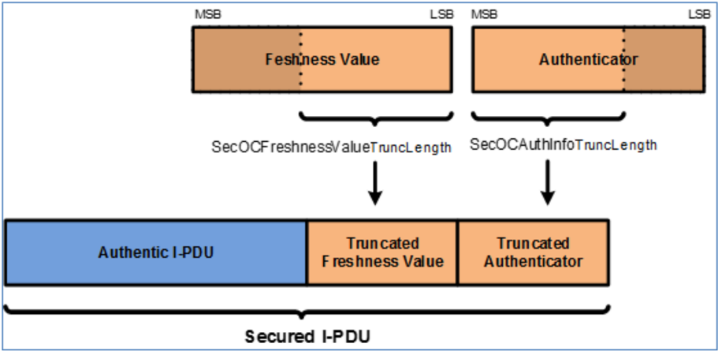
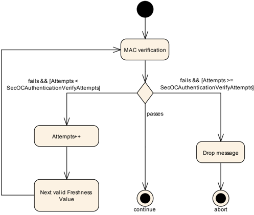

<!-- 源文档 AUTOSAR_FO_PRS_SecOcProtocol（R23-11），协议规范（PRS），不受 Type A 七章骨架约束；章节结构镜像源文档自身编号。规范项 ID [PRS_SecOc_*] 按 2026-11-03 批次决议整体省略（项正文照常翻译，为内联段落）；SRS/RS_Main 回引随追溯章一并省略。源第 3 章「Protocol Requirements」仅含 Requirements Traceability 一节（纯 ID 追溯表 + 一张表格截图形式的 PDF 装饰图），按 2026-11-03 决议整章省略并将后续章节重编号（源 4→3、5→4、6→5、7→6、8→7）；附录 A 的变更历史为裸 ID 枚举列表（无标题），ID 按 2026-11-03 决议不可出现，故以条目数陈述（新增 3 项/变更 9 项/删除 24 项）——此为运行决策，请用户在确认关核验。源第 7 章「Protocol usage and guidelines」整章内容仅为「This chapter has no content.」，按占位规则省略。封面元数据表、免责声明与目录按 EXP 流程省略；3 处内容图（图5.1、图5.2、图5.3）按源图号嵌入，其余图引用为页面装饰；图 5.1/5.2 的图内标签散落（Authentic I-PDU、MSB/LSB 等）按转换噪声丢弃。§5.3.4 正文引用的 [UC_SecOC_00202] 为本文档未定义的外部用例 ID，去括号以标识符形式保留。 -->

## 1. 引言和概述

敏感数据的认证和完整性保护对于保护车辆系统的正确和安全功能是必需的——这确保接收到的数据来自正确的 **ECU** 并具有正确的值。

本文档所述的 **SecOC** 协议提供了一种机制，用于验证车辆架构内 **ECU** 之间基于 **PDU** 的通信的真实性和新鲜度。该方法要求发送 **ECU** 和接收 **ECU** 都实现一个 **SecOC** 模块。

为了提供消息新鲜度，发送侧和接收侧的 **SecOC** 模块为每个可唯一标识的**安全 I-PDU**（**Secured I-PDU**）（即每个安全通信链路）从外部**新鲜度管理器**（**Freshness Manager**）获取新鲜度。

在发送侧，**SecOC** 模块通过向输出的**真实 I-PDU**（**Authentic I-PDU**）添加认证信息来创建**安全 I-PDU**。认证信息包括一个**认证器**（**Authenticator**）（例如消息认证码）和可选的**新鲜度值**（**Freshness Value**）。无论**新鲜度值**是否包含在安全 I-PDU 载荷中，它在生成**认证器**时都会被考虑。当使用**新鲜度计数器**（**Freshness Counter**）而非时间戳时，**新鲜度管理器**应在向接收侧提供认证信息之前递增**新鲜度计数器**。在接收侧，**SecOC** 模块通过验证由发送侧 **SecOC** 模块附加的认证信息来检查**真实 I-PDU** 的新鲜度和真实性。为了验证**真实 I-PDU** 的真实性和新鲜度，提供给接收侧 **SecOC** 的**安全 I-PDU** 应与发送侧 **SecOC** 提供的**安全 I-PDU** 相同，并且接收侧 **SecOC** 应知晓发送侧 **SecOC** 在创建**认证器**时使用的**新鲜度值**。

### 1.1. 协议目的和目标

**SecOC** 协议旨在为 **PDU** 层级的关键数据提供资源高效且适当的认证机制。认证机制应与当前的 **AUTOSAR** 通信系统无缝集成。在资源消耗方面的影响应尽可能小，以便为既有系统提供作为附加组件的保护。本规范基于主要使用带消息认证码（**MAC**）的对称认证方法的假设。与非对称方法相比，它们以小得多的密钥实现相同级别的安全性，并且可以在软件和硬件中紧凑高效地实现。不过，本规范提供了必要的抽象层级，使对称方法与非对称认证方法都可以使用。

### 1.2. 协议的适用性

**SecOC** 协议用于所有需要安全通信的 **ECU**。

#### 1.2.1. 约束和假设

##### 1.2.1.1. 非对称方法情形下的适配

尽管本文档一致地使用对称密码学的术语和概念，**SecOC** 协议同时支持对称和非对称密码算法。在使用数字签名替代全文所述 **MAC** 方法的非对称方法情形下，必须做出一些适配：

1. 使用由公钥和私钥组成的密钥对，替代发送方与（所有）接收方之间的共享秘密。发送方使用私钥（或称私有密钥）生成签名，（所有）接收方使用相应的公钥验证签名。私钥必须无法从公钥可行地计算得出，且不应可被接收方获取。
2. 为了验证消息，接收方需要访问签名生成算法的完整签名/输出。因此，**MAC** 情形下提出的签名截断是不可能的。参数 `SecOCAuthInfoTruncLength` 必须设置为签名的完整长度。
3. 签名验证使用的算法与签名生成不同。因此，接收方/验证方不是像前文所述那样在接收侧「重建」**MAC** 并将其与接收到的（截断的）**MAC** 比较，而是使用 `DataToAuthenticator`（包括完整计数器）和签名作为输入执行验证算法，并得到布尔值输出，判定验证通过还是失败。

#### 1.2.2. 限制

本协议规范旨在确保 **AP** 与 **CP** 之间的兼容性，并假设通信通过以太网实现。

取决于 **AP** 与 **CP** 之间的通信范式，协议的功能会受到限制。在 **SOME/IP** 的情形下，协议将不支持**真实 PDU**（**Authentic PDU**）与**密码 PDU**（**Cryptographic PDU**）的分离传输，也不支持使用载荷的一部分作为新鲜度信息（细节在配置参数章中描述）。

### 1.3. 依赖

#### 1.3.1. 对其他协议层的依赖

**SecOC** 与通信栈下层的交互取决于平台架构（**AP** 或 **CP**），在 **CP** 实现的情形下，还取决于传输类型：直接传输、触发传输或传输协议。这些设计特定的依赖不属于本协议规范。

#### 1.3.2. 对其他标准和规范的依赖

- [1] **IEC** 7498-1 The Basic Model，**IEC** 标准，1994
- [2] 美国国家标准与技术研究院（**NIST**）：FIPS-180-4，安全哈希标准（**SHS**），2012 年 3 月，电子版见 http://csrc.nist.gov/publications/fips/fips180-4/fips-180-4.pdf
- [3] FIPS Pub 197：高级加密标准（**AES**），美国商务部、信息技术实验室（**ITL**）、**NIST**，美国马里兰州盖瑟斯堡，联邦信息处理标准出版物，2001，电子版见 http://csrc.nist.gov/publications/fips/fips197/fips-197.pdf

#### 1.3.3. 对应用层的依赖

**SecOC** 协议不依赖于典型的汽车应用。但是，它依赖于提供新鲜度信息的软件组件的存在。此外，还可能存在触发 **SecOC** 行为变更的专用应用（例如出于开发目的），或监控验证结果的应用。

## 2. 用例

| ID | 名称 | 描述 |
| --- | --- | --- |
| UC_001 | SecOC SOME/IP | 使用 **SOME/IP** 的 **AP** 与 **CP** 之间的安全通信 |
| UC_002 | SecOC SignalBased | 使用基于信号的通信和 SignalToService 转换的 **AP** 与 **CP** 之间的安全通信 |

## 3. 术语和缩略语的定义

### 3.1. 缩略语和缩写

**SecOC**
> 安全车载通信（**Secure Onboard Communication**）

**MAC**
> 消息认证码（**Message Authentication Code**）

**FV**
> 新鲜度值（**Freshness Value**）

**FM**
> 新鲜度管理器（**Freshness Manager**）

### 3.2. 术语的定义

**Authentic I-PDU**
> **真实 I-PDU** 是任意的 **AUTOSAR I-PDU**，其内容在网络传输期间通过**安全 I-PDU** 的方式加以保护。被保护的内容包括完整的 **I-PDU** 或 **I-PDU** 的一部分。

**Authentication**
> 认证（**Authentication**）是与标识相关的服务。该功能既适用于实体也适用于信息本身。进入通信的双方应相互标识。经由信道传递的信息应就其来源、产生日期、数据内容、发送时间等进行认证。出于这些原因，密码学的这一方面通常再细分为两大类：实体认证和数据源认证。数据源认证隐含地提供数据完整性（因为若消息被修改，其来源即已改变）。

**Authentication Information**
> 认证信息（**Authentication Information**）由**新鲜度值**（或其一部分）和**认证器**（或其一部分）组成。认证信息是 **SecOC** 为实现**安全 I-PDU** 而添加的附加信息。

**Authenticator**
> **认证器**是用于提供消息认证的数据。一般而言，术语消息认证码（**MAC**）用于对称方法，而术语签名（**Signature**）或数字签名（**Digital Signature**）指具有不同属性和约束的非对称方法。

**Data integrity**
> 数据完整性（**Data integrity**）是这样一种特性：数据自其被授权源创建、传输或存储之时起，未曾以未经授权的方式被更改。为确保数据完整性，应能够检测未经授权方的数据操纵。数据操纵包括插入、删除和替换等。

**Data origin authentication**
> 数据源认证（**Data origin authentication**）是这样一种认证类型：在过去的某个（通常未指定的）时间，一方被证实为特定数据的（原始）来源。按定义，数据源认证包括数据完整性。

**Distinction unilateral / bilateral authentication**
> 单向认证与双向认证的区别（**Distinction unilateral / bilateral authentication**）：在单向认证中，一方证明其身份。请求方甚至不被认证到证明其被允许请求认证的程度。在双向认证中，请求方也至少（见下文）被认证以证明其请求的特权。存在一种基于上述双向认证的高效且更安全的端点双向认证方式：在（第二条消息中）最初由接收方（在第一条消息中）请求认证的同时，发送方也请求一次认证。接收方发送第三条消息，提供发送方所请求的认证。这只需三条消息（相比之下，两条单向认证消息需要四条）。

**Entity authentication**
> 实体认证（**Entity authentication**）是这样一种过程：一方（通过获取佐证证据）确信协议中涉及的另一方的身份，并且确信另一方确实参与了协议（即，在证据获取时或紧接其前是活动的）。**注意：** 实体认证意味着证明通信端点的存在和运行就绪。这通常通过证明对密码密钥的访问和对秘密的知晓来完成。必须在不泄露密钥或秘密的情况下做到这一点。实体认证可用于防止记录-重放攻击。消息的新鲜度只会因需要记录生存期并破坏发送方或接收方的（实时）时钟而使问题复杂化。实体认证由接收方（即需要被说服的一方）触发，而发送方必须通过说服作出反应。对实体认证的记录和重放攻击通常通过让接收方对认证过程拥有一定控制来防止。为了防止接收方利用这种控制将发送方引向恶意目的或确定密钥或秘密（「预言机攻击」（**oracle attack**）），发送方可以增加更多的随机性。如果不仅要证明对密钥的访问（意味着属于特权组），还要证明个体性，发送方还会附加并认证其唯一标识。

**Message authentication**
> 消息认证（**Message authentication**）：与数据源认证类比使用的术语。它就原始消息来源提供数据源认证（以及数据完整性，但没有唯一性和时效性保证）。

**Secured I-PDU**
> **安全 I-PDU** 是一个 **AUTOSAR I-PDU**，包含**真实 I-PDU** 的载荷，并辅以附加的**认证信息**。

**Transaction authentication**
> 交易认证（**Transaction authentication**）：指消息认证的增强形式，额外为数据提供唯一性和时效性保证（从而防止不可检测的消息重放）。

## 4. 协议规范

### 4.1. 安全解决方案的规范

本文档所述的 **SecOC** 协议提供了一种机制，用于验证车辆架构内 **ECU** 之间基于 **PDU** 的通信的真实性和新鲜度。该方法要求发送 **ECU** 和接收 **ECU** 都实现一个 **SecOC** 模块。

为了提供消息新鲜度，发送侧和接收侧的 **SecOC** 模块为每个可唯一标识的**安全 I-PDU**（即每个安全通信链路）从外部**新鲜度管理器**获取新鲜度。

在发送侧，**SecOC** 模块通过向输出的**真实 I-PDU** 添加**认证信息**来创建**安全 I-PDU**。认证信息包括一个**认证器**（例如消息认证码）和可选的**新鲜度值**。无论**新鲜度值**是否包含在**安全 I-PDU** 载荷中，它在生成**认证器**时都会被考虑。当使用**新鲜度计数器**而非时间戳时，**新鲜度管理器**应在向接收侧提供**认证信息**之前递增**新鲜度计数器**。

在接收侧，**SecOC** 模块通过验证由发送侧 **SecOC** 模块附加的**认证信息**来检查**真实 I-PDU** 的新鲜度和真实性。为了验证**真实 I-PDU** 的真实性和新鲜度，提供给接收侧 **SecOC** 的**安全 I-PDU** 应与发送侧 **SecOC** 提供的**安全 I-PDU** 相同，并且接收侧 **SecOC** 应知晓发送侧 **SecOC** 在创建**认证器**时使用的**新鲜度值**。

#### 4.1.1. 安全解决方案的基本实体

术语**真实 I-PDU** 指需要防范未经授权的操纵和重放攻击的 **AUTOSAR I-PDU**。

**安全 I-PDU** 的载荷由**真实 I-PDU** 和一个**认证器**（例如消息认证码）组成。**安全 I-PDU** 的载荷可以可选地包括用于创建**认证器**（例如 **MAC**）的**新鲜度值**。各内容在**安全 I-PDU** 中的结构顺序符合图5.1。

**安全 I-PDU** 中**真实 I-PDU**、**新鲜度值**和**认证器**的长度随各个可唯一标识的**安全 I-PDU** 而不同。

**认证器**（例如 **MAC**）指使用密钥、**安全 I-PDU** 的数据标识符（**Data Identifier**）、认证载荷和**新鲜度值**生成的唯一认证数据字符串。**认证器**提供了高度的可信度，确信**真实 I-PDU** 中的数据由合法来源生成，并在预期的时间提供给接收 **ECU**。

根据用于生成**认证器**的认证算法，可能可以截断由认证算法生成的**认证器**（例如在 **MAC** 的情形下）。当消息载荷长度受限、没有足够空间容纳完整的**认证器**时，截断可能是期望的。

**安全 I-PDU** 中包含的**认证器**长度（参数 `SecOCAuthInfoTruncLength`）特定于一个可唯一标识的**安全 I-PDU**。通过为每个**安全 I-PDU** 细粒度配置 **MAC** 截断长度，这为整个系统提供了灵活性（即两个独立的唯一**安全 I-PDU** 在其载荷中可以包含不同的**认证器**长度）。

如果可以截断，**认证器**应只截断到由认证算法生成的结果的最高有效位。图5.2 展示了遵循参数 `SecOCFreshnessValueTruncLength` 和 `SecOCAuthInfoTruncLength` 截断**认证器**和**新鲜度值**的示例。

**注意：** 对于参与者静态、资源受限的嵌入式用例，我们建议使用消息认证码（**MAC**）作为认证的基础（例如基于 **AES** [\[3\]](#ref-3)、具有足够密钥长度的 **CMAC** [\[4\]](#ref-4)）。

**注意：** 在使用 **MAC** 的情形下，可以只传输和比较 **MAC** 的一部分。这称为 **MAC** 截断（**MAC truncation**）。然而，这至少会导致单个 **MAC** 伪造方面的安全级别降低。虽然我们建议始终使用至少 128 位的密钥长度，**MAC** 截断可能是有益的。当然，每个用例的 **MAC** 实际长度必须仔细选择。关于指导，我们参考 [\[4\]](#ref-4) 的附录 A。一般而言，**NIST** 认为 64 位及以上的 **MAC** 大小足以提供针对猜测攻击的保护。根据用例的不同，不同的 **MAC** 大小可能是合适的，但这需要安全专家的仔细判断。

直接或间接传输到通信链路另一侧的所有 **SecOC** 数据（例如**新鲜度值**、**认证器**、数据标识符、**SecOC** 消息链路数据等）都应以大端字节序编码，使每个 **SecOC** 模块以相同的方式解释数据。

**安全 I-PDU 报头**应指示**真实 I-PDU** 的字节长度。报头的长度应可通过参数 `SecOCAuthPduHeaderLength` 配置。

每个**安全 I-PDU** 至少配置有一个**新鲜度值**。**新鲜度值**指用于确保**安全 I-PDU** 新鲜度的单调计数器。这样的单调计数器可以通过称为**新鲜度计数器**的单独消息计数器实现，也可以通过称为**新鲜度时间戳**（**Freshness Timestamp**）的时间戳值实现。**新鲜度值**应从**新鲜度管理器**派生。

如果参数 `SecOCFreshnessValueTruncLength` 配置为小于实际新鲜度值的长度，**SecOC** 应在**安全 I-PDU** 中只包含**新鲜度值**的最低有效位，直至 `SecOCFreshnessValueTruncLength`。如果参数 `SecOCFreshnessValueTruncLength` 配置为 0，则**新鲜度值**不应包含在**安全 I-PDU** 中。

如果 `SecOCUseAuthDataFreshness` 设置为 TRUE，**SecOC** 应使用**真实 I-PDU** 的一部分作为新鲜度。此时，`SecOCAuthDataFreshnessStartPosition` 确定**真实 I-PDU** 内新鲜度的位起始位置，`SecOCAuthDataFreshnessLen` 确定其位长度。

**注意：** 这允许复用载荷中既有、且保证在**新鲜度时间戳**有效期内唯一的新鲜度值，例如 4 位 **E2E** 计数器。此时 **SecOC** 无需生成任何附加的计数器值。

**新鲜度管理器**在接口函数中以字节数组的形式提供或接收新鲜度信息。新鲜度始终对齐到数组第一个字节的最高有效位（**MSB**）。新鲜度的第 15 位是第二个字节的最高有效位，依此类推。新鲜度数组中未使用的位必须置 0。相关联的长度信息必须以位为单位给出。

#### 4.1.2. I-PDU 的认证

**安全 I-PDU** 的创建由以下按顺序执行的步骤组成：

1. 生成**认证器**。
2. 构造**安全 I-PDU**。
3. 递增**新鲜度计数器**。

应确保在**新鲜度计数器**递增之前生成**认证器**。

如果**新鲜度值**计算或**认证器**计算失败，且参数 `SecOCDefaultAuthenticationInformationPattern` 配置了默认模式（**Pattern**），则**安全 I-PDU** 应对**新鲜度值**和**认证器**的所有字节使用该默认模式。

如果**新鲜度值**计算或**认证器**计算失败，且参数 `SecOCDefaultAuthenticationInformationPattern` 未配置默认模式，则应丢弃该**安全 I-PDU**。

**注意：**

**示例：**

SecOCFreshnessValueTxLength = 4 bits

SecOCAuthInfoTxLength = 20 bits

SecOCDefaultAuthenticationInformationPattern = 0xA5

安全 PDU 中得到的默认认证信息将为 0x05（截断的**新鲜度值**）| 0xA5 0xA5 0xA0（截断的**认证器**）。「|」表示串联。

**安全 I-PDU** 的数据标识符（`SecOCDataId`）的大小为 16 位。

用于计算**认证器**的数据由 `SecOCDataId`、**真实 I-PDU** 数据和完整的**新鲜度值**按给定顺序组成。它们分别串联在一起，构成传入认证算法用于**认证器**生成/验证的位数组。

`DataToAuthenticator` = 数据标识符 | **真实 I-PDU** 的被保护部分 | 完整的**新鲜度值**。

**注意：**

「|」表示串联。

**认证器**应截断至参数 `SecOCAuthInfoTruncLength` 指定的位数。

**安全 I-PDU** 应通过向**真实 I-PDU** 添加**安全 I-PDU 报头**（可选）、**新鲜度值**（可选）和**认证器**来构造。

**安全 I-PDU** 的方案（包括各内容在**安全 I-PDU** 中的结构顺序）应符合下式：

`SecuredPDU = SecuredIPDUHeader (optional) | AuthenticIPDU | FreshnessValue [SecOCFreshnessValueTruncLength] (optional) | Authenticator [SecOCAuthInfoTruncLength]`

**注意：** 作为**安全 I-PDU** 一部分包含的**新鲜度计数器**和**认证器**可以按特定于该**安全 I-PDU** 标识符的配置进行截断。此外，**新鲜度值**可以是**真实 I-PDU** 的一部分。

**注意：** 这意味着上层与下层 **PDU** 接口的 IF/TP 配置之间没有依赖关系。

如果使用 `SecOCTxSecuredPduCollection`，则 **SecOC** 应将**安全 I-PDU** 作为两条消息传输：原始的**真实 I-PDU** 和一条单独的**密码 I-PDU**（**Cryptographic I-PDU**）。**密码 I-PDU** 应包含**安全 I-PDU** 的全部**认证信息**，使得**真实 I-PDU** 与**密码 I-PDU** 一起包含重构**安全 I-PDU** 所需的全部信息。

如果使用 `SecOCTxSecuredPduCollection`，则 **SecOC** 应在**密码 I-PDU** 内部重复**真实 I-PDU** 的一部分作为**消息链接器**（**Message Linker**），且**密码 I-PDU** 应构造为：**密码 I-PDU** = 认证数据 | **消息链接器**。

**注意：** 「|」表示串联。

如果使用 `SecOCUseMessageLink`，则 **SecOC** 应使用**真实 I-PDU** 内位于位位置 `SecOCMessageLinkPos`、长度为 `SecOCMessageLinkLen` 位的值作为**消息链接器**。

对于 `SecOCAuthPduHeaderLength` > 0 的 Tx **安全 I-PDU**，**SecOC** 模块应向**安全 I-PDU** 添加**安全 I-PDU 报头**（其内**真实 I-PDU** 的长度），以处理动态**真实 I-PDU**。

#### 4.1.3. I-PDU 的验证

**安全 I-PDU** 的验证由以下 3 个步骤组成：

1. 计算预期的**新鲜度值**。
2. 构造用于认证的数据。
3. 验证**认证信息**。

如果**认证器**的验证可以成功执行但验证失败（例如 **MAC** 验证失败或密钥无效），则认证验证尝试计数器应递增，且**新鲜度值**应更新为下一个有效值。

如果认证验证尝试计数器在一次失败的验证尝试后达到 `SecOCAuthenticationVerifyAttempts` 的阈值，则接收到的 **PDU** 应被丢弃。

如果参数 `SecOCEnableForcedPassOverride` 为 true，则 **SecOC** 应提供一种机制，允许接收认证失败的 **PDU**。

如果使用 `SecOCRxSecuredPduCollection`，则 **SecOC** 在接收到构成**安全 I-PDU** 的**真实 I-PDU** 和**密码 I-PDU** 两者之前不得执行任何验证。只有在两者都接收到之后，**SecOC** 才应尝试验证由此得到的**安全 I-PDU**。如果使用 `SecOC_VerifyStatusOverride`，验证结果和 **I-PDU** 按照 overrideStatus 值处理。

**注意：** 这适用于 **SecOC** 从下层接收到**安全 I-PDU** 的所有实例——在使用 `SecOCRxSecuredPduCollection` 时如前所述分段发生。为避免重复和杂乱，本文档的其余部分不再作进一步区分。

如果使用 `SecOCRxSecuredPduCollection`，则 **SecOC** 在接收到并缓冲了具有匹配**消息链接器**值的**真实 I-PDU** 和**密码 I-PDU** 之前，不应尝试验证**安全 I-PDU**。如果使用 `SecOC_VerifyStatusOverride`，验证结果和 **I-PDU** 按照 overrideStatus 值处理。

**注意：** 如果 `SecOCUseMessageLink` 的多重性为 0，意味着 `SecOCMessageLinkLen` 为 0，且**消息链接器**值始终匹配。

在接收到**安全 I-PDU** 时，**SecOC** 应从中解析出**真实 I-PDU**、**新鲜度值**和**认证器**。

接收侧用于计算**认证器**的数据（`DataToAuthenticator`）应被构造。该数据由 `SecOCDataId` | AuthenticIPDU | FreshnessVerifyValue 组成。

**SecOC** 模块应通过将 `DataToAuthenticator`、`DataToAuthenticator` 的长度、从**安全 I-PDU** 解析出的**认证器**以及 `SecOCAuthInfoTruncLength` 传入与所配置密码服务对应的认证算法来验证**认证器**。如果使用 `SecOC_VerifyStatusOverride`，验证结果和 **I-PDU** 按照 overrideStatus 值处理。

**注意：** 如果**新鲜度管理器**需要**安全 I-PDU** 是否被成功验证的状态（例如为了同步时间或计数器），则该状态应取自 **SecOC** 提供的 VerificationStatus 服务。

##### 4.1.3.1. I-PDU 的成功验证

如果**安全 I-PDU** 的验证成功或状态覆盖被相应设置，**SecOC** 模块应使用通信栈的下层接口将**真实 I-PDU** 传递给上层通信模块。

##### 4.1.3.2. 在 SecOC 处跳过安全 I-PDU 的认证

对于 Rx **安全 I-PDU**，应有跳过验证的配置选项。此时 **SecOC** 模块应不经认证地提取**真实 I-PDU**。

##### 4.1.3.3. 错误处理与接收丢弃

如果下层传输协议模块在接收**安全 I-PDU** 期间报告错误，**SecOC** 模块应丢弃该**安全 I-PDU** 并释放所有相应的缓冲区。

如果 **Crypto** 模块在**安全 I-PDU** 的验证期间报告错误（无法执行验证），**SecOC** 模块不应提供**真实 I-PDU**。它应保留该**安全 I-PDU**（如果未被同类型的传入**安全 I-PDU** 覆盖），并在下一次调度的主函数调用时重新开始验证。

如果 **SecOC** 已同时接收到**真实 I-PDU** 和**密码 PDU**，且由此得到的**安全 I-PDU** 验证失败，则**真实 I-PDU** 和**密码 I-PDU** 都应保持缓冲，并且每当其中任一者的新数据被接收时都应重新尝试验证。

**注意：** 本条与前一条需求共同确保：即使**真实 I-PDU** 或**密码 I-PDU** 在传输中丢失，一旦**真实 I-PDU** 及其对应的**密码 I-PDU** 相继被接收，**SecOC** 仍将按预期工作。

### 4.2. 错误检测

**SecOC** 模块应能够上报以下情形的错误：模块在初始化之前被调用、无法提供新鲜度值、或验证检查没有配置密码操作。

### 4.3. 安全 Profile

#### 4.3.1. 安全 Profile 概述

安全车载通信协议允许多种密码算法和模式用于 **MAC** 计算，以及 **MAC** 和新鲜度值（如适用）的截断方式。安全 Profile（**security profiles**）为与安全车载通信配置相关的一部分配置参数提供一致的价值集。

每个安全 Profile 应提供以下配置值：认证算法（`CryptoServicePrimitive` 中的参数 `algorithmFamily`、`algorithmMode` 和 `algorithmSecondaryFamily`）、**新鲜度值**的长度（如适用）（参数 `SecOCFreshnessValueLength`）、截断**新鲜度值**的长度（参数 `SecOCFreshnessValueTruncLength`）、截断 **MAC** 的长度（参数 `SecOCAuthInfoTruncLength`），以及该 Profile 的描述。

#### 4.3.2. SecOC Profile 1（或 24Bit-CMAC-8Bit-FV）

使用依据 **NIST** SP 800-38B、基于 **AES**-128 的 **CMAC** 算法计算 **MAC**，使用**新鲜度值**的 8 个最低有效位作为截断的新鲜度值，使用 **MAC** 的 24 个最高有效位作为截断的 **MAC**。

| 参数 | 配置值 |
| --- | --- |
| 用于 **MAC** 的算法（参数 `algorithmFamily`） | CRYPTO_ALGOFAM_AES |
| **MAC** 的算法模式（参数 `algorithmMode`） | CRYPTO_ALGOMODE_CMAC |
| 附加算法族配置（参数 `algorithmSecondaryFamily`，本 Profile 未使用） | CRYPTO_ALGOFAM_NOT_SET |
| **新鲜度值**长度（参数 `SecOCFreshnessValueLength`） | Not Specified |
| 截断**新鲜度值**的长度（参数 `SecOCFreshnessValueTruncLength`） | 8 位 |
| 截断 **MAC** 的长度（参数 `SecOCAuthInfoTruncLength`） | 24 位 |

#### 4.3.3. SecOC Profile 2（或 24Bit-CMAC-No-FV）

使用依据 **NIST** SP 800-38B、基于 **AES**-128 的 **CMAC** 算法计算 **MAC**，完全不使用任何新鲜度值，使用 **MAC** 的 24 个最高有效位作为截断的 **MAC**。本 Profile 只应在未建立同步的新鲜度值时使用。对特定总线没有限制。

| 参数 | 配置值 |
| --- | --- |
| 用于 **MAC** 的算法（参数 `algorithmFamily`） | CRYPTO_ALGOFAM_AES |
| **MAC** 的算法模式（参数 `algorithmMode`） | CRYPTO_ALGOMODE_CMAC |
| 附加算法族配置（参数 `algorithmSecondaryFamily`，本 Profile 未使用） | CRYPTO_ALGOFAM_NOT_SET |
| **新鲜度值**长度（参数 `SecOCFreshnessValueLength`） | 0 |
| 截断**新鲜度值**的长度（参数 `SecOCFreshnessValueTruncLength`） | 0 位 |
| 截断 **MAC** 的长度（参数 `SecOCAuthInfoTruncLength`） | 24 位 |

#### 4.3.4. SecOC Profile 3（或 JASPAR）

本 Profile 描述了 JasPar 基于计数器的基础 **FV** 配合主从（**Master-Slave**）同步方法的一种配置和用法。它使用依据 **NIST** SP 800-38B 附录 A、基于 **AES**-128 的 **CMAC** 算法计算 **MAC**。使用**新鲜度值**的 4 个最低有效位作为截断的新鲜度值，使用 **MAC** 的 28 个最高有效位作为截断的 **MAC**。提供给 **SecOC** 的**新鲜度值**应按照 UC\_SecOC\_00202 构造。本 Profile 应用于 **CAN**。

| 参数 | 配置值 |
| --- | --- |
| 用于 **MAC** 的算法（参数 `algorithmFamily`） | CRYPTO_ALGOFAM_AES |
| **MAC** 的算法模式（参数 `algorithmMode`） | CRYPTO_ALGOMODE_CMAC |
| 附加算法族配置（参数 `algorithmSecondaryFamily`，本 Profile 未使用） | CRYPTO_ALGOFAM_NOT_SET |
| **新鲜度值**长度（参数 `SecOCFreshnessValueLength`） | 64 位 |
| 截断**新鲜度值**的长度（参数 `SecOCFreshnessValueTruncLength`） | 4 位 |
| 截断 **MAC** 的长度（参数 `SecOCAuthInfoTruncLength`） | 24 位 |

## 5. 配置参数

下表描述该协议的配置参数。对于使用 **SOME/IP** 网络绑定或原始数据流的 **AP** 与 **CP** 之间的通信，协议具有缩减的功能，因此某些参数在 **AP** 中不可用或属于实现特定。这些在「对 AP SOME/IP 网络绑定的适用性」列中描述。因此，引用这些参数的需求也不适用。参数不可用的原因在于以下功能不可用：

- 不可能使用**真实 PDU** 的一部分来构造新鲜度信息
- 不可能将**安全 PDU** 拆分为两个不同的 **PDU**：真实 PDU 和密码 PDU
- 由 **FM** 预先截断的**新鲜度值**提供（截断始终由 **SecOC** 完成）

| 参数 | 描述 | 对 AP SOME/IP 网络绑定的适用性 |
| --- | --- | --- |
| SecOCAuthPduHeaderLength | 该参数指示**安全 I-PDU** 中**安全 I-PDU 报头**的长度（字节）。长度为零表示 **PDU** 中没有报头。 | no |
| SecOCFreshnessValueTruncLength | 该参数定义**安全 I-PDU** 载荷中包含的**新鲜度值**的位长度。该长度特定于完整**新鲜度计数器**的最低有效位。如果该参数为 0，则**安全 I-PDU** 中不包含**新鲜度值**。 | yes |
| SecOCUseAuthDataFreshness | 布尔值，指示是否将**真实 I-PDU** 的一部分传递给验证和生成新鲜度的 **SWC**。如果设置为 TRUE，必须设置 `SecOCAuthDataFreshnessStartPosition` 和 `SecOCAuthDataFreshnessLen` 以指定**真实 I-PDU** 内的位位置和长度。 | no |
| SecOCAuthDataFreshnessStartPosition | 该值确定应传递给新鲜度 **SWC** 的**真实 PDU** 的位（uint16）起始位置。 | no |
| SecOCAuthDataFreshnessLen | 该属性定义传递给验证和生成新鲜度的 **SWC** 的**真实 PDU** 数据的位长度。 | no |
| SecOCProvideTxTruncatedFreshnessValue | 该参数指定 Tx 查询新鲜度函数是否提供已截断的新鲜度信息，而非由 **SecOC** 生成；此时 **SecOC** 应将该数据添加到**真实 PDU**，而不是截断**新鲜度值**。 | no |
| SecOCAuthenticationBuildAttempts | 该参数规定认证构建尝试的次数。 | Implementation specific |
| SecOCDefaultAuthenticationInformationPattern | 该参数描述当认证构建计数器达到配置值 `SecOCAuthenticationBuildAttempts`，或新鲜度查询函数返回不可恢复的错误（例如由新鲜度值配置导致的系统性失败），或**认证器**计算返回不可恢复的错误（例如由错误密码配置或缺失密钥导致的系统性失败）时 **SecOC** 的行为。如果该配置参数不存在，**SecOC** 模块应从其内部缓冲区移除**真实 I-PDU** 并取消传输请求；如果该配置参数存在，**SecOC** 在构建**认证信息**时将对**新鲜度值**和**认证器**的每个字节使用该值，并且不取消传输请求。 | Implementation specific |
| SecOCDataId | 该参数为**安全 I-PDU** 定义唯一的数字标识符。 | yes |
| SecOCFreshnessValueID | 该参数定义**新鲜度值**的 ID。 | yes |
| SecOCTxAuthServiceConfigRef | 该引用用于定义认证时调用哪个密码服务函数。 | Implementation specific |
| SecOCAuthInfoTruncLength | 该参数定义**安全 I-PDU** 载荷中包含的认证码的位长度。 | yes |
| SecOC_VerifyStatusOverride | 当该配置选项设置为 TRUE 时，启用函数 `SecOC_VerifyStatusOverride` 中独立于验证结果向上层发送 **I-PDU** 的功能。 | Implementation specific |
| SecOCTxSecuredPduCollection | 两条单独的 **PDU** 被传输给下层：**真实 I-PDU** 和**密码 I-PDU**。 | no |
| SecOCFreshnessValueLength | 该参数定义**新鲜度值**的完整位长度。只要密钥不变，计数器不得溢出。计数器的长度应根据相应密钥的预期生存期和计数器的使用频率确定。 | yes |
| SecOCTxPduUnusedAreasDefault | **AUTOSAR** **SecOC** 模块用该字节模式填充发送的**安全 PDU** 中未使用的区域。该属性是强制性的，以避免未定义行为。 | Implementation specific |
| SecOCUseMessageLink | **SecOC** 通过在**密码 I-PDU** 中重复**真实 I-PDU** 的特定部分（**消息链接器**）将**真实 I-PDU** 与**密码 I-PDU** 链接在一起。 | no |
| SecOCMessageLinkPos | **消息链接器**在**真实 I-PDU** 内的位位置。位计数按照 01068 进行，位排序按照 TPS\_SYST\_01069 进行。 | no |
| SecOCMessageLinkLen | **消息链接器**在**真实 I-PDU** 内的位长度。 | no |
| SecOCSecuredRxPduVerification | 该参数定义是否对该**安全 I-PDU** 执行签名认证或 **MAC** 验证。如果设置为 false，**SecOC** 模块不经验证地从**安全 I-PDU** 中提取**真实 I-PDU**。 | yes |
| SecOCUseTxConfirmation | 布尔值，指示是否为该 **PDU** 调用函数 `SecOC_SPduTxConfirmation`。 | no |
| SecOCVerificationStatusPropagationMode | 该参数用于描述每次验证尝试的状态从 **SecOC** 模块向 **SWC** 的传播。 | no |
| SecOCIgnoreVerificationResult | 认证过程（例如 **MAC** 验证）的结果在首次尝试后被忽略，**SecOC** 像结果为成功一样继续进行。**认证器**的计算仍然执行，只是其结果被忽略。true：启用（验证结果被忽略）。false：禁用（验证结果不被忽略）。 | no |
| SecOCEnableForcedPassOverride | 当该配置选项设置为 TRUE 时，启用函数 `SecOC_VerifyStatusOverride` 中独立于验证结果向上层发送 **I-PDU** 的功能。 | no |
| SecOCPropagateOnlyFinalVerificationStatus | 该参数用于指定验证状态是只在最终确定验证状态之后（TRUE）上报，还是每次验证尝试都（FALSE）上报。 | no |
| SecOCAuthenticationVerifyAttempts | 该参数规定当给定**安全 I-PDU** 的认证信息验证失败时，要执行的认证验证尝试次数。如果设置为零，则只进行一次认证验证尝试。 | yes |

## 6. 参考文献

[1] **IEC**：The Basic Model，**IEC** 标准

[2] **NIST**：Secure Hash Standard (SHS)
> http://csrc.nist.gov/publications/fips/fips180-4/fips-180-4.pdf

[3] **NIST**：Announcing the Advanced Encryption Standard (AES)
> http://csrc.nist.gov/publications/fips/fips197/fips-197.pdf

[4] **NIST** Special Publication 800-38B：Recommendation for Block Cipher Modes of Operation：The CMAC Mode for Authentication
> https://nvlpubs.nist.gov/nistpubs/SpecialPublications/NIST.SP.800-38b.pdf

## A. AUTOSAR 可追溯项变更历史

请注意，本章中的列表还包括在后续版本中已从规范中移除的规范项。这些规范项在文档中不作为超链接出现。

### A.1. 本文档依据 AUTOSAR 版本 R23-11 的变更历史

#### A.1.1. R23-11 中新增的规范项

3 项

#### A.1.2. R23-11 中变更的规范项

9 项

#### A.1.3. R23-11 中删除的规范项

24 项
