<!-- 源文档 AUTOSAR_FO_PRS_SOMEIPProtocol（R23-11），协议规范（PRS），不受 Type A 七章骨架约束；章节结构镜像源文档自身编号。协议项 ID 标记与源文档的草稿标志（Draft 类标记）按 2026-11-03 批次决议整体省略（标题仅翻译，协议项以加粗标题行 + 段落形式呈现）；协议项中的 ⌋(…) 追溯行随 ID 一并省略；协议项之间的交叉引用（PRS_SOMEIP_*）以不带方括号的标识符原样保留。源第 2 章「Protocol Requirements / Requirements Traceability」为纯 ID 追溯表，按 2026-11-03 决议整章省略并将后续章节重编号（源 3→2、4→3、5→4、6→5）；源 References 章为正文之后的无编号章，镜像为无编号「参考文献」并带引用锚点。封面元数据表、免责声明与目录按 EXP 流程省略。95 处图引用中 21 处为内容图（图4.1、4.3–4.22），按源图号嵌入；图4.2（SOME/IP 报头与 E2E 报头格式）的图在源转换中丢失（仅剩图内标签散落文本），按转换噪声丢弃——请用户在确认关核验；其余为页面装饰。图内标签散落（bit offset 刻度行、SOME/IP Header、Lengthfield、UDP/TCP 提示等）按转换噪声丢弃；图4.15 的两个 Magic Cookie 字节布局乱表（列错排）由图4.15 的图替代呈现；图4.17–4.20 的 TP 示例字节布局乱表同理由图替代。源 §1.4 的两个无编号小节标题（wire-format 序列化规范、Event/RPC 协议规范）保留为无编号小节。表4.12（Payload 兼容性规则）在源转换中存在行合并/错排（如「Change of the name…」行同时含 X），已按上下文重组。附录 A 变更表按批次决议省略 Number 列（R22-11 各表标题列大多为空，按 SecOC 先例以数量呈现；R23-11 保留有标题的行）。本文档无新增站点术语表条目（术语表条目与 TR Glossary/Dlt 既有条目相同或不适合收录）。 -->

## 1. 简介和概述

本协议规范规定 **AUTOSAR** 协议「基于 IP 的可扩展面向服务中间件（**Scalable service-Oriented MiddlewarE over IP**，**SOME/IP**）」的格式、消息序列和语义。

**SOME/IP** 是一种汽车/嵌入式通信协议，它支持远程过程调用、事件通知以及底层的序列化/线上格式。唯一有效的缩写是 **SOME/IP**。其他缩写（例如 Some/IP）是错误的，不得使用。

### 1.1. 协议目的和目标

规定「又一种 RPC 机制」而不是使用现有的基础设施/技术，其基本动机是获得一种能够满足以下目标的技术：

- 满足嵌入式世界对资源消耗的苛刻要求
- 在尽可能多的用例和通信伙伴之间保持兼容
- 至少在线上格式层面与 **AUTOSAR** 兼容；即能够与 **AUTOSAR** 无需修改 **AUTOSAR** 标准即可接收和发送的 **PDU** 通信。**AUTOSAR** 内的映射应按照 **SOME/IP** 规范选择
- 提供汽车用例所需的特性
- 可从小型平台扩展到大型平台

### 1.2. 协议的适用性

**SOME/IP** 应实现于不同的操作系统（即 **AUTOSAR**、**GENIVI** 和 **OSEK**），甚至实现于不带操作系统的嵌入式设备。**SOME/IP** 应用于 **ECU** 间的客户端/服务器序列化。**SOME/IP** 的一个实现允许 **AUTOSAR** 解析 **RPC PDU** 并将信号传输给应用。

#### 1.2.1. 约束和假设

「对可扩展数据结构的序列化支持」已被引入——基于 **AUTOSAR** 基础标准 1.0.0（**AUTOSAR** 经典标准 4.3.0）的 **SOME/IP** 序列化器无法处理它。为了指示这一互操作性问题，PRS_SOMEIP_00220 要求提高相应序列化数据的主接口版本。

#### 1.2.2. 限制

本文档给出 **SOME/IP** 的整体概貌，但对任何 **BSW** 模块的实现不陈述任何需求。

请注意，**SOME/IP** 的并非所有部分都可能被实现在 **AUTOSAR** 中。

### 1.3. 依赖性

与 **AUTOSAR** SWS 模块没有依赖性。

### 1.4. 文档结构

**SOME/IP** **PRS** 将描述 **SOME/IP** 的以下两个方面。

#### SOME/IP 线上格式（序列化）的规范

- 报头格式的结构
- 不同数据类型如何按 **SOME/IP** 序列化

#### 面向事件和基于 RPC 的通信的协议规范

- 传输协议
- 管辖 **SOME/IP** 的 **RPC** 的规则

## 2. 缩略语和缩写

以下词汇表包含与 **SOME/IP** 规范相关、且未包含在 [\[1\]](#ref-1)（AUTOSAR 术语表）中的缩略语和缩写。

**Byte Order Mark**
> 字节序标记（**BOM**）是一个 Unicode 字符 U+FEFF，它作为幻数出现在文本流的开头，用于指示所使用的编码。

**Method**
> 被调用/调用的方法、过程、函数或子例程。

**Parameters**
> 方法或事件的输入、输出或输入/输出参数。

**Remote Procedure Call (RPC)**
> 从一个 **ECU** 到另一个 **ECU**、通过消息传输的方法调用。

**Request**
> 客户端发给服务器、调用某个方法的消息。

**Response**
> 服务器发给客户端、传输方法调用结果的消息。

**Request/Response communication**
> 由请求和响应组成的 **RPC**。

**Event**
> 一种单向数据传输，只在变化时或周期性地被触发，从数据的生产者发送给消费者。

**Field**
> 字段表示一种状态，因此始终有一个有效值，getter、setter 和 notifier 作用于该值。

**Notification Event**
> 字段的 notifier 的事件消息。

**Getter**
> 允许对字段进行读访问的请求/响应调用。

**Setter**
> 允许对字段进行写访问的请求/响应调用。

**Notifier**
> 按配置在变化时、在 ε 变化时或周期性地发送带有字段值的事件消息。

**Service**
> 零个或多个方法、零个或多个事件以及零个或多个字段的逻辑组合。

**Service Interface**
> 服务的形式化规范，包括其方法、事件和字段。

**Eventgroup**
> 服务内部事件和字段的通知事件的逻辑分组，以允许订阅。

**Service Instance**
> 服务的一个实现，它可以在车辆中存在多次，也可以在一台 **ECU** 上存在多次。

**Server**
> 在该服务实例的上下文中，提供服务实例的 **ECU** 被称为服务器。

**Client**
> 在该服务实例的上下文中，使用服务器的服务实例的 **ECU** 被称为客户端。

**Fire and Forget**
> 不带响应消息的请求被称为 fire & forget。

**User Datagram Protocol**
> 使用简单无连接通信模型的标准网络协议。

**Union**
> 动态采用不同数据类型的数据结构。

**non-extensible (standard) struct**
> 不带标签序列化的结构体。最多只能在结构体末尾以兼容的方式添加新成员，且不可能有可选成员。

**extensible struct**
> 带标签序列化的结构体。新成员可以在任意位置以兼容的方式添加，且可以有可选成员。

**TLV**
> 标签-长度-值（**Tag Length Value**）。

## 3. 协议规范

**SOME/IP** 通过网络提供面向服务的通信。它基于服务定义，服务定义列出服务提供的功能。服务可以由零个或多个事件、方法和字段的组合构成。

事件提供从提供者向订阅者周期性或变化时发送的数据。

方法为订阅者提供发出远程过程调用的可能性，这些调用在提供者侧执行。

字段是以下三者中的一个或多个的组合：

- 一个 notifier，它按配置在变化时、在 ε 变化时或周期性地将数据从提供者发送给订阅者。
- 一个 getter，订阅者可以调用它来显式地向提供者查询该值。
- 一个 setter，当订阅者想改变提供者侧的值时可以调用它。

字段的 notifier 与事件之间的主要区别是：事件只在变化时被发送，而字段的 notifier 还会在订阅之后直接发送数据。

### 3.1. SOME/IP 消息格式（序列化）的规范

序列化描述数据在协议数据单元（**PDU**）中表示为 **UDP** 或 **TCP** 消息载荷、通过基于 **IP** 的汽车车载网络传输的方式。

#### 3.1.1. 限制

不支持对 **SOME/IP** 消息的乱序分段进行重新排序。

#### 3.1.2. 报头

**报头布局的结构应由以下部分组成：**

- Message ID（Service ID/Method ID）[32 位]
- Length [32 位]
- Request ID（Client ID/Session ID）[32 位]
- Protocol Version [8 位]
- Interface Version [8 位]
- Message Type [8 位]
- Return Code [8 位]

PRS_SOMEIP_00030 如图4.1 所示。

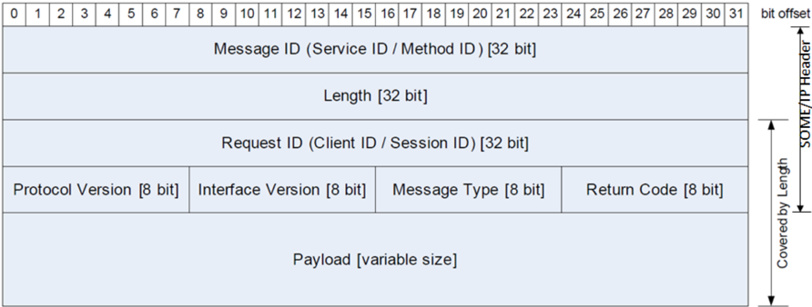

**在应用 **E2E** 通信保护的情形下，根据为 **E2E** 报头选择的 Offset 值，**E2E** 报头被放置在 Return Code 之后。默认的 Offset 值为 64 位，它恰好把 **E2E** 报头放在 Return Code 和 Payload 之间。**

如图4.2 所示。

图4.2：SOME/IP 报头与 E2E 报头格式（**SOME/IP Header and E2E header Format**）
（该图的图形在源文档转换中丢失，字段布局为：Message ID [32 bit]、Length [32 bit]、Request ID [32 bit]、Protocol Version [8 bit]、Interface Version [8 bit]、Message Type [8 bit]、Return Code [8 bit]、E2E Header [大小可变 / 取决于所选 E2E profile]、Payload [大小可变]。）

**出于互操作性的原因，报头布局对所有 **SOME/IP** 实现应当相同。各字段按传输顺序呈现，即左上角的字段最先传输。**

##### 3.1.2.1. Message ID [32 Bit]（消息 ID）

**Message ID 应是一个 32 位的标识符，用于：**

- 标识对应用的某个方法的 **RPC** 调用
- 或标识一个事件。

**注意：** Message ID 的分配取决于用户/系统设计者。然而，Message ID 被假定对整个系统（即整车）唯一。

##### 3.1.2.2. Method ID [16 Bit]（方法 ID）

**Message ID 报头字段应被结构化为一个 16 位的 Service ID 报头字段（用于区分最多 2^16 个服务）和一个 16 位的 Method ID 报头字段（用于区分最多 2^16 个服务元素，即方法和/或事件）。Message ID 报头字段的这种结构化如 PRS_SOMEIP_00755 所示。**

**注意：** 通常做法并推荐将 Method ID 的 **ID** 空间在方法与事件/通知之间划分。方法位于 0x0000 - 0x7FFF 范围（Method-ID 的第一位为 0），事件/通知使用 0x8000 - 0x8FFF 范围（Method-ID 的第一位为 1）。

**Message ID 报头字段**

表4.1：Message ID 报头字段的结构

| Service ID [16 Bit] | Method ID [16 Bit] |
| --- | --- |

Eventgroup 是服务内部事件和字段的通知事件的逻辑分组，以允许订阅。

**一个 **SOME/IP** Eventgroup 应至少包含一个事件。**

**事件以及字段 notifier 应被映射到至少一个 **SOME/IP** Eventgroup。**

##### 3.1.2.3. Length [32 Bit]（长度）

**Length 字段应以字节为单位包含从 Request ID/Client ID 开始直到 **SOME/IP** 消息末尾的长度。**

##### 3.1.2.4. Request ID [32 Bit]（请求 ID）

Request ID 允许服务器和客户端区分同一方法、getter 或 setter 的多个并行使用。

**Request ID 对于一个请求-响应对应当唯一，以区分同一方法的多次调用。**

**在生成响应消息时，提供者应将 Request ID 从请求复制到响应消息。**

**注意：**

这使客户端即使在有多个未完成请求的情形下，也能将响应映射到所发出的请求。

**在响应已到达或预期不再到达（超时）之前，Request ID 不得被复用。**

Request ID 的结构

**Request ID**

表4.2：Request ID 的结构

| Client ID [16 Bits] | Session ID [16 Bits] |
| --- | --- |

**注意：**

这意味着一台 **ECU** 的实现者可以按其实现的需要定义 Client-ID，而提供者不需要知道这种布局或定义，因为它只需在响应中复制完整的 Request-ID。

**Client ID 是 **ECU** 内部调用客户端的唯一标识符。Client ID 允许一台 **ECU** 区分多个客户端对同一方法的调用。**

**Session ID 是一个唯一标识符，它允许将来自同一发送方的顺序消息或请求彼此区分开。**

**Client ID 还应支持通过一个可配置的前缀或固定值（例如 Client ID 的最高有效字节是诊断地址，或是为给定应用/**SWC** 配置的 Client ID）在整车范围内保持唯一。**

例如：

表4.3：Client ID 示例

| Client ID Prefix [8 Bits] | Client ID [8 Bits] | Session ID [16 Bits] |
| --- | --- | --- |

**在会话处理（Session Handling）未激活的情形下，Session ID 应被设置为 0x00。**

**在会话处理激活的情形下，Session ID 应被设置为 [0x1, 0xFFFF] 范围内的值。**

**在会话处理激活的情形下，Session ID 应按相应的用例递增（关于专门用例的详细信息包含在单独的规范项中，例如 PRS_SOMEIP_00533）。**

**请求/响应方法应使用带 Session ID 的会话处理。Session ID 应在每次调用之后递增。**

**当 Session ID 达到 0xFFFF 时，它应回绕并重新从 0x01 开始。**

**对于请求/响应方法，如果响应的 Session ID 与请求的 Session ID 不匹配，客户端必须忽略该响应。**

**对于通知消息，在会话处理未激活的情形下，接收方应忽略 Session ID。**

**对于通知消息，在会话处理激活的情形下，接收方应按相应的用例处理 Session ID（关于专门用例的详细信息包含在单独的规范项中，例如 PRS_SOMEIP_00741）。**

##### 3.1.2.5. Protocol Version [8 Bit]（协议版本）

Protocol Version 标识所使用的 **SOME/IP** 报头格式（不包括 Payload 格式）。

**Protocol Version 应是一个 8 位字段，包含 **SOME/IP** 协议版本。**

**对于 **SOME/IP** 报头中的所有不兼容变更，Protocol Version 应被递增。如果基于较旧 Protocol Version 的接收方不会丢弃消息并会错误地处理它，则该变更是不兼容的。**

**注意：**

消息处理和错误处理在 §3.2.6.3（错误处理概览）中定义。

**注意：**

Protocol Version 本身是 **SOME/IP** 报头的一部分，因此协议版本在报头中的位置不得改变。

**注意：**

对于只影响 Payload 格式的变更，Protocol Version 不应被递增。

**Protocol Version 应为 1。**

##### 3.1.2.6. Interface Version [8 Bit]（接口版本）

**Interface Version 应是一个 8 位字段，包含服务接口的主版本（**Major Version**）。**

##### 3.1.2.7. Message Type [8 Bit]（消息类型）

**Message Type 字段**

表4.4：消息类型

| 编号 | 值 | 描述 |
| --- | --- | --- |
| 0x00 | REQUEST | 期望一个响应（即使为空）的请求 |
| 0x01 | REQUEST_NO_RETURN | 一个 fire & forget 请求 |
| 0x02 | NOTIFICATION | 一个不期望响应的通知/事件回调请求 |
| 0x80 | RESPONSE | 响应消息 |
| 0x81 | ERROR | 包含错误的响应 |
| 0x20 | TP_REQUEST | 期望一个响应（即使为空）的 TP 请求 |
| 0x21 | TP_REQUEST_NO_RETURN | 一个 TP fire & forget 请求 |
| 0x22 | TP_NOTIFICATION | 一个不期望响应的 TP 通知/事件回调请求 |
| 0xa0 | TP_RESPONSE | TP 响应消息 |
| 0xa1 | TP_ERROR | 包含错误的 TP 响应 |

**常规请求（消息类型 0x00）在未发生错误时应由一个响应（消息类型 0x80）应答。如果发生错误，则应发送一条错误消息（消息类型 0x81）。**

也可以发送一个不带响应消息的请求（消息类型 0x01）。为了通过通知更新值，存在一个回调接口（消息类型 0x02）。

**Message Type 的第 3 高位（=0x20）应被称为 TP-Flag，并且应被置为 1 以表示当前的 **SOME/IP** 消息是一个分段。Message Type 的其他位按本节的规定设置。**

**注意：**

Message Type Request（0x00）的分段具有 Message Type（0x20），Message Type Response（0x80）的分段具有 Message Type（0xa0），依此类推。详情参见（§3.2.1.4）。

##### 3.1.2.8. Return Code [8 Bit]（返回码）

**Return Code 应被用于表示一个请求是否被成功处理。为了简化报头布局，每条消息都传输 Return Code 字段。特定消息类型允许的 Return Code 见 PRS_SOMEIP_00757。**

**Return Code**

表4.5：特定消息类型允许的 Return Code

| 消息类型 | 允许的 Return Code |
| --- | --- |
| REQUEST | 不适用，设置为 0x00（E_OK） |
| REQUEST_NO_RETURN | 不适用，设置为 0x00（E_OK） |
| NOTIFICATION | 不适用，设置为 0x00（E_OK） |
| RESPONSE | 参见 PRS_SOMEIP_00191 中的 Return Code |
| ERROR | 参见 PRS_SOMEIP_00191 中的 Return Code。不得为 0x00（E_OK）。 |

##### 3.1.2.9. Payload [variable size]（载荷，大小可变）

参数在载荷字段中承载。参数的序列化将在以下小节中规定。

**SOME/IP** 载荷字段的大小取决于所使用的传输协议。使用 **UDP** 时，**SOME/IP** 载荷应在 0 到 1400 字节之间。限制为 1400 字节是为了允许未来对协议栈的变更（例如切换到 **IPv6** 或增加信息安全手段）。由于 **TCP** 支持载荷的分段，更大的尺寸会被自动支持。

载荷可以由事件的数据元素或方法的参数组成。

#### 3.1.3. 字节序

**所有 **SOME/IP** 报头字段应以网络字节序（大端）编码。**

**SOME/IP** 消息载荷中的以下字段应以网络字节序（大端）编码：

- 可扩展结构体的可选长度字段（PRS_SOMEIP_00079）
- 带标识符和可选成员的结构化数据类型与参数的 **TLV** 标签（PRS_SOMEIP_00203）和长度字段（PRS_SOMEIP_00221）
- 定长字符串的可选长度字段（PRS_SOMEIP_00760）
- 动态长度字符串的长度字段（PRS_SOMEIP_00089）
- 可扩展定长数组的可选长度字段（PRS_SOMEIP_00944）
- 动态长度数组的长度字段（PRS_SOMEIP_00376）
- 联合体的长度字段（PRS_SOMEIP_00126）
- 以及联合体的类型字段（PRS_SOMEIP_00129）。

**载荷中参数的字节序应由配置定义。一个例外是 **TLV** 的标签（按 PRS_SOMEIP_00202 和 PRS_SOMEIP_00203 定义），它应具有按 PRS_SOMEIP_00204 和 PRS_SOMEIP_00759 规定的字节序。**

#### 3.1.4. 数据结构的序列化

序列化基于由接口规范定义的参数列表。接口规范定义所有数据结构在 **PDU** 中的确切位置，并且必须考虑内存对齐。

对齐用于通过对齐数据之后插入填充元素来对齐数据的起始位置，以确保被对齐的数据从特定的内存地址开始。

存在一些处理器架构，当数据从某个数的倍数（例如 32 位的倍数）的地址开始时，它们可以更高效地访问数据（即主节点）。

**如果可变大小数据不是序列化数据流中的最后一个元素，则应通过在可变大小数据之后插入填充元素来实现数据的对齐。**

**注意：**

请注意，填充值未定义。

示例：含 5 个成员的结构体

- Member1：UINT16
- Member2：带 uint8 元素的一维可变大小数组
- Member3：UINT32
- Member4：UINT64
- Member5：带 uint8 元素的一维可变大小数组

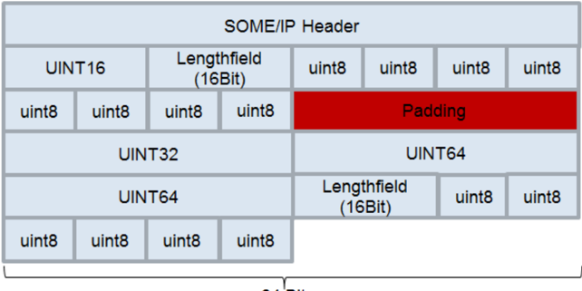

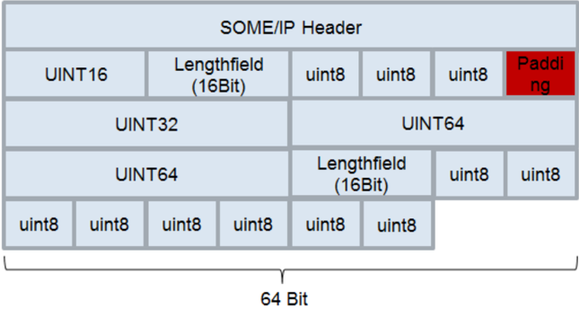

**对齐应始终从 **SOME/IP** 消息的起点开始计算。**

**定长数据元素之后不得有填充，以确保后续数据的对齐。**

**注意：**

如果定长数据元素之后的数据需要填充，这必须在数据类型定义中显式考虑。

**可变长度数据元素之后的数据的对齐应为 8、16、32、64、128 或 256 位。**

##### 3.1.4.1. 基本数据类型

**支持的基本数据类型**

表4.6：支持的基本数据类型

| 类型 | 描述 | 大小 [位] | 备注 |
| --- | --- | --- | --- |
| boolean | TRUE/FALSE 值 | 8 | FALSE（0）、TRUE（1） |
| uint8 | 无符号整数 | 8 | |
| uint16 | 无符号整数 | 16 | |
| uint32 | 无符号整数 | 32 | |
| uint64 | 无符号整数 | 64 | |
| sint8 | 有符号整数 | 8 | |
| sint16 | 有符号整数 | 16 | |
| sint32 | 有符号整数 | 32 | |
| sint64 | 有符号整数 | 64 | |
| float32 | 浮点数 | 32 | IEEE 754 binary32（单精度） |
| float64 | 浮点数 | 64 | IEEE 754 binary64（双精度） |

每个参数的字节序由配置规定。

**对于布尔值的求值，只解释 uint8 的最低位，其余位被忽略。**

##### 3.1.4.2. 结构化数据类型（structs）

结构体的序列化应接近内存中的布局。这意味着，只应将参数按顺序序列化到缓冲区中。特别是对于结构体，考虑正确的内存对齐非常重要。

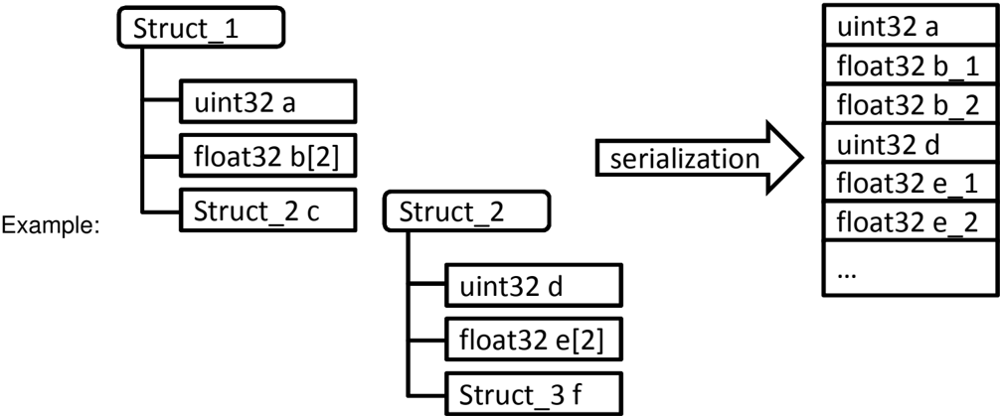

**SOME/IP** 实现不得自动插入哑元/填充数据。

**根据配置，可以在结构体前面插入一个 8、16 或 32 位的可选长度字段。**

**结构体的长度字段应描述该结构体为 **SOME/IP** 传输所占用的字节数。**

**如果该长度大于数据类型定义中规定的结构体长度，则只应解释数据类型中规定的字节，其他字节应基于长度字段被跳过。**

**如果该长度小于所有结构体成员长度之和，且接收方无法在本地提供缺失数据的替代，则应中止反序列化，并将该消息视为格式错误。**

**结构体的序列化应遵循结构化数据类型的深度优先遍历。**

##### 3.1.4.3. 带标识符和可选成员的结构化数据类型与参数（'TLV'）

为了实现增强的前向和后向兼容性，可以在结构体成员或方法参数之前添加一个附加的 Data ID。这样接收方就可以跳过未知的成员/参数，即 Data ID 未知的成员/参数。当 Data ID 在序列化的字节流中传输时，新成员/参数可以在任意位置添加。

此外，Data ID 的使用允许描述带可选成员/参数的结构体和方法。某个成员/参数是否可选，在数据定义中定义。

某个可选成员/参数在结构体/方法中是否实际存在，必须在运行期间确定。如何实现取决于所使用的编程语言或软件平台（例如使用一个特殊的可用标志、使用一个特殊的方法、使用可能为空的指针等）。

**Data ID 在结构体的直接成员或方法的参数内应当唯一。**

**注意：**

请注意，Data ID 不需要跨不同的结构体或方法唯一。

**注意：**

请注意，目前 **AUTOSAR** 方法论、**AUTOSAR CP RTE** 和 **AUTOSAR AP** ara::com 都不支持可选方法参数的定义或使用。

**应为一个结构体同一层级的所有成员定义 Data ID，或不为它们中的任何一个定义 Data ID。**

**应为一个方法的所有参数定义 Data ID，或不为它们中的任何一个定义 Data ID。**

除了 Data ID 之外，还有一个线上类型（**wire type**）对后续成员的数据类型进行编码。Data ID 和线上类型被编码在一个所谓的标签（**tag**）中。

**标签的长度应为两个字节。**

**标签应由以下部分组成：**

- reserved（第一个字节的位 7）
- 线上类型（第一个字节的位 6-4）
- Data ID（第一个字节的位 3-0 和第二个字节的位 7-0）

标签的布局见图4.6。位 7 是字节的最高有效位，位 0 是字节的最低有效位。

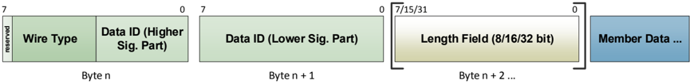

**成员的 Data ID 的较低有效部分应编码在标签第二个字节的位 7-0 中。成员的 Data ID 的较高有效部分应编码在第一个字节的位 3-0 中。**

示例：

成员的 Data ID 为 0x04F2。则第一个字节的位 3-0 被设置为 0x4。第二个字节被设置为 0xF2。

**线上类型与后续数据的类型**

表4.7：线上类型

| 线上类型 | 后续数据 |
| --- | --- |
| 0 | 8 位数据 基本数据类型 |
| 1 | 16 位数据 基本数据类型 |
| 2 | 32 位数据 基本数据类型 |
| 3 | 64 位数据 基本数据类型 |
| 4 | 复杂数据类型：Array、Struct、String、Union，带静态大小（在数据定义中配置）的长度字段 |
| 5 | 复杂数据类型：Array、Struct、String、Union，带大小为 1 字节的长度字段（忽略静态定义） |
| 6 | 复杂数据类型：Array、Struct、String、Union，带大小为 2 字节的长度字段（忽略静态定义） |
| 7 | 复杂数据类型：Array、Struct、String、Union，带大小为 4 字节的长度字段（忽略静态定义） |

**注意：**

线上类型 4 确保与当前方法（长度字段的大小被静态配置）的兼容。该方法的缺点是：在接口演进期间改变长度字段的大小总是不兼容的。因此，线上类型 5、6 和 7 允许在所传输的字节流中编码所用长度字段的大小。如果静态配置的长度字段大小不足以容纳当前数据结构的大小，序列化器可以使用它们。

**如果线上类型被设置为 5、6 或 7，则数据定义中定义的长度字段的大小应被忽略，长度字段的大小应根据线上类型选择。**

**如果为结构体的成员/方法的参数配置了 Data ID，则应在序列化的字节流中插入一个标签。**

**注意：**

关于 Data ID 的存在性，参见 PRS_SOMEIP_00230 和 PRS_SOMEIP_00231。

**如果所序列化成员/参数的数据类型是基本数据类型（线上类型 0-3）且配置了 Data ID，则标签应直接插入在该成员/参数之前。序列化流中不得插入长度字段。**

**如果所序列化成员/参数的数据类型不是基本数据类型（线上类型 4-7）且配置了 Data ID，则标签应插入在长度字段之前。**

**如果所序列化成员/参数的数据类型不是基本数据类型且配置了 Data ID，则应始终在该成员/参数之前插入一个长度字段。**

理由：

反序列化期间需要长度字段来跳过未知的成员/参数。

**长度字段应始终包含到结构体下一个标签为止的长度。**

**如果成员本身是 struct 类型，则应恰好有一个长度字段。该长度字段按照需求 PRS_SOMEIP_00079 和 PRS_SOMEIP_00370 添加。**

**如果成员本身是动态长度字符串类型，则应恰好有一个长度字段。该长度字段按照需求 PRS_SOMEIP_00089、PRS_SOMEIP_00090、PRS_SOMEIP_00093、PRS_SOMEIP_00094 和 PRS_SOMEIP_00095 添加。**

**如果成员本身是定长字符串类型，则应恰好有一个与动态长度字符串对应的长度字段。**

**注意：**

不带标签序列化时，定长字符串没有长度字段。对于带标签的序列化，定长字符串也需要一个长度字段，其方式与动态长度字符串相同。

**如果成员本身是动态长度数组类型，则应恰好有一个长度字段。该长度字段按照需求 PRS_SOMEIP_00376、PRS_SOMEIP_00107、PRS_SOMEIP_00377 添加，大小为 8、16 或 32 位。**

**如果成员本身是定长数组类型，则应恰好有一个与动态长度数组对应的长度字段。**

**如果成员本身是联合体类型，则应恰好有一个长度字段。该长度字段按照需求 PRS_SOMEIP_00119、PRS_SOMEIP_00121 添加，大小为 8、16 或 32 位。**

**如果成员本身是联合体类型，则长度字段应覆盖类型字段、数据和填充字节的大小。**

**注意：**

对于不带标签的序列化，联合体的长度字段不覆盖类型字段（参见 PRS_SOMEIP_00126）。对于带标签的序列化，要求长度字段覆盖所序列化联合体的全部内容。

**非可扩展（标准）结构体中一个可扩展结构体类型的成员，应按照可扩展结构体的需求进行序列化。**

**可扩展结构体中一个非可扩展（标准）结构体类型的成员，应按照标准结构体的需求进行序列化。**

**按照 PRS_SOMEIP_00611 的可变长度数据的对齐应始终为 8 位。**

理由：

当使用大于 8 位的对齐时，序列化器可能会在可变长度数据之后添加填充字节。这些填充字节不被长度字段覆盖。如果接收方不知道该成员的 Data ID，它也不知道这是可变长度数据、可能存在填充字节。

**如果使用 **TLV**，则数组、结构体、联合体和字符串的长度字段的大小应大于 0。**

理由：

**TLV** 序列化要求使用长度字段。当使用线上类型 4 时，长度字段的大小必须是静态配置的。当使用线上类型 5-7（动态长度字段大小）时，长度字段大小的静态配置也必须存在，因为并非所有长度字段前面都有标签，例如数组中包含的结构体或 **SOME/IP** 事件中包含的顶层结构体。在此不使用长度字段会导致歧义。

**数组、结构体、联合体和字符串的长度字段的配置大小应当相同。**

理由：

在未知成员或参数的情形下，当使用线上类型 4 时，反序列化器无法确定该成员/参数的实际数据类型。

**长度字段的大小应为顶层结构体或方法请求/响应配置。结构体内使用的所有数组、联合体、结构体和字符串，或方法内使用的所有参数，应从顶层定义继承长度字段的大小。**

理由：

在未知成员或参数的情形下，当使用线上类型 4 时，反序列化器需要知道长度字段的大小。最简单的方式是长度字段的大小只在顶层元素定义。

**不允许在从属的数组、联合体、结构体或字符串处、或在单个方法参数处覆盖长度字段的大小。**

**序列化器不得将标记为不可用的可选成员/参数包含在序列化的字节流中。**

**反序列化器应忽略序列化字节流中不可用的可选成员/参数。**

**如果反序列化器读取到一个未知的 Data ID（即未包含在其数据定义中），它应使用线上类型和长度字段的信息跳过该未知成员/参数。**

**如果反序列化器在序列化字节流中找不到其数据定义中要求的（即非可选的）成员/参数，则应中止反序列化，并将该消息视为格式错误。**

**如果将为一个尚未使用标签的既有服务接口引入带标签的序列化，则主接口版本应被递增并用于指示这一点。**

**注意：**

接收方只处理与 Message ID、Protocol Version、Interface Version 和 Message Type 的所有配置值都匹配的接收消息（参见 PRS_SOMEIP_00195）。

带标签序列化结构体的示例

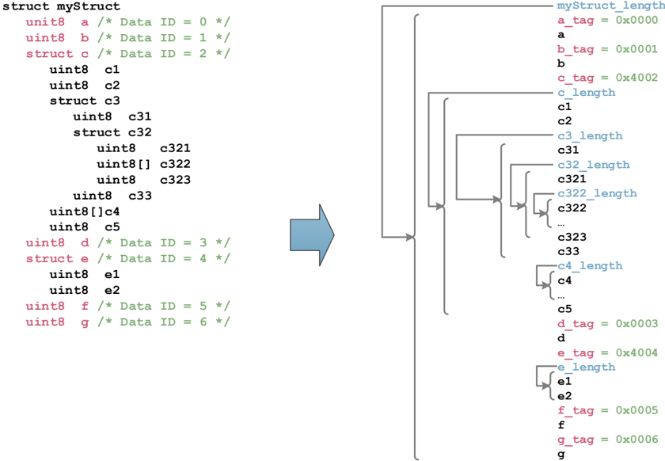

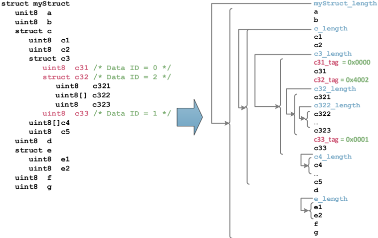

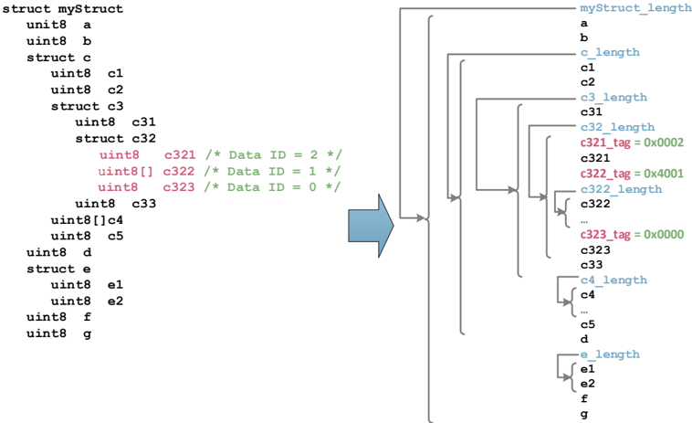

带标签序列化参数的示例

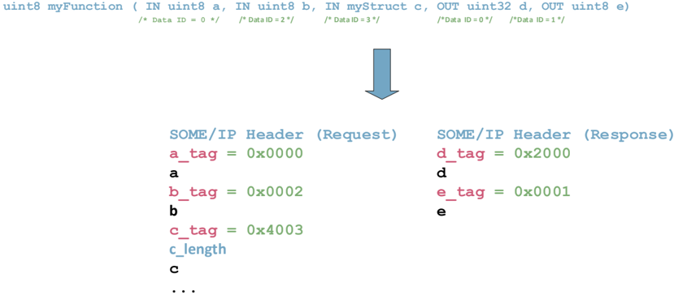

**注意：**

在示例图4.10 中，**SOME/IP** 报头末尾与第一个标签之间没有附加的长度字段。这相对于 **SOME/IP** 报头中的消息长度字段是冗余的。

##### 3.1.4.4. 字符串

以下需求对定长和动态长度字符串都适用。

**应支持不同的 Unicode 编码，包括 UTF-8、UTF-16BE 和 UTF-16LE。**

**UTF-8 字符串应以一个 "\0" 字符零终止。这意味着它们应以一个 0x00 字节结束。**

**UTF-16LE 和 UTF-16BE 字符串应以一个 "\0" 字符零终止。这意味着它们应以（至少）两个 0x00 字节结束。**

**UTF-16LE 和 UTF-16BE 字符串应具有偶数长度。**

**长度为奇数的 UTF-16LE 和 UTF-16BE 字符串，其最后一个字节应被忽略。**

**所有字符串应始终以待序列化数组的前三个（UTF-8）或两个（UTF-16）字节中的字节序标记（**BOM**）开始，数组中包含该字符串。BOM 应包含在定长字符串和动态长度字符串中。BOM 允许检测所使用的编码。**

###### 3.1.4.4.1. 字符串（定长）

**定长字符串可以以一个可选的长度字段开始。**

**尽管具有固定长度，字符串应以一个 "\0" 字符终止。**

**字符串的长度（包括 "\0"）以字节为单位，必须在数据类型定义中规定。**

**如果定长字符串的长度大于预期（预期应基于数据类型定义），则应中止反序列化，并将该消息视为格式错误。**

**如果定长字符串的长度小于预期（预期应基于数据类型定义）且使用 "\0" 正确终止，则应接受它。**

**如果定长字符串的长度小于预期（预期应基于数据类型定义）且未使用 "\0" 正确终止，则应中止反序列化，并将该消息视为格式错误。**

除了将应用字符串作为带 **BOM** 和 "\0" 终止的 **SOME/IP** 字符串传输之外，字符串也可以作为不带 **BOM** 和 "\0" 终止的普通动态长度数组传输（参见 §3.1.4.5.2）。请注意，这要求完整的字符串处理（例如字节序转换）在应用中完成。

###### 3.1.4.4.2. 字符串（动态长度）

**动态长度字符串应以一个长度字段开始。长度以字节为单位测量。**

**长度字段被放置在 **BOM** 之前，且 **BOM** 包含在长度中。**

**字符串以一个 "\0" 终止。**

**注意：**

字符串的最大字节数（包括 "\0" 终止）也应从数据类型定义中导出。

**PRS_SOMEIP_00084、PRS_SOMEIP_00085 和 PRS_SOMEIP_00086 也应对动态长度字符串有效。**

**动态长度字符串应具有 8、16 或 32 位的长度字段。这应由配置确定。**

**如果未配置，则添加在字符串前面的长度字段的长度为 32 位（长度字段的默认长度）。**

**字符串长度字段的长度不计入长度字段的值中；即长度字段不计它自身。**

**如果可变长度字符串的长度大于预期（预期应基于数据类型定义），则应中止反序列化，并将该消息视为格式错误。**

##### 3.1.4.5. 数组

###### 3.1.4.5.1. 数组（定长）

定长数组更易于在非常小的设备中使用。动态长度数组在 **ECU** 上使用时可能需要更多资源。

**定长数组可以以一个可选的长度字段开始。**

**如果定长数组的长度大于预期（预期应基于数据类型定义），则只应解释数据类型中规定的元素，其他字节应基于长度字段被跳过。**

**如果定长数组的长度小于预期（预期应基于数据类型定义）且接收方无法在本地提供缺失数据的替代，则应中止反序列化，并将该消息视为格式错误。**

**注意：** 定长数组的越界只能通过长度字段检测。

一维

**具有固定长度 "n" 的一维数组应恰好携带 "n" 个相同类型的元素。一个可选的长度字段可以在第一个元素之前（参见 PRS_SOMEIP_00944）。**

**注意：** 如果为一个特定的定长数组定义了长度字段，则该数组在总线上表示为长度字段与 n 个相同数据类型元素的集合的复合。

PRS_SOMEIP_00099 的布局如图4.11 所示。

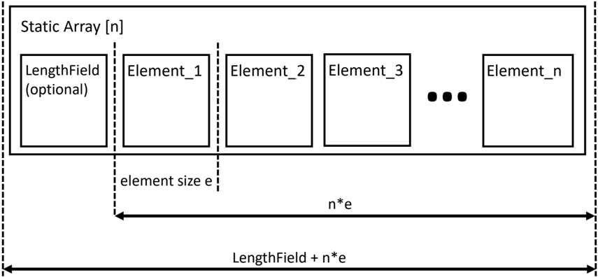

多维

**多维数组的序列化遵循 **C**/**C++** 编程语言中多维数组的内存布局（行主序，**row-major order**）。**

**注意：** 如果为一个特定的多维定长数组定义了长度字段，则该数组在总线上表示为一个长度字段与 n 个集合（每个集合由一个长度字段和 m 个相同数据类型的元素组成）的复合。

PRS_SOMEIP_00101 的布局如图4.12 所示。

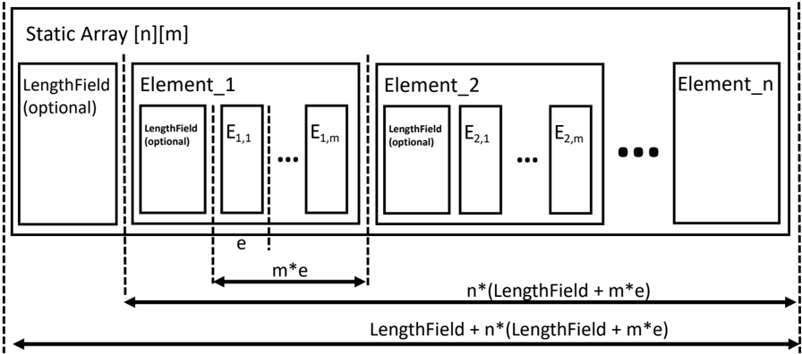

###### 3.1.4.5.2. 动态长度数组

**动态长度数组的布局应基于定长数组的布局。**

**动态长度数组开头的长度字段应用于规定数组以字节为单位的长度。**

**动态长度数组应具有长度为 8、16 或 32 位的长度字段。这应由配置确定。**

**该长度不包括长度字段的大小。**

**注意：**

如果长度字段的长度被设置为 0 位，则数组中元素的数量必须是固定的；即成为一个定长数组。

动态数组的布局如图4.13 和图4.14 所示。

在一维数组中使用一个长度字段，它携带该数组所用的字节数。

静态长度元素的数量可以简单地通过除以元素的大小来计算。

在动态长度元素的情形下，元素的数量无法计算，但必须按顺序解析这些元素。

图4.14 展示了动态长度的多维数组的结构。

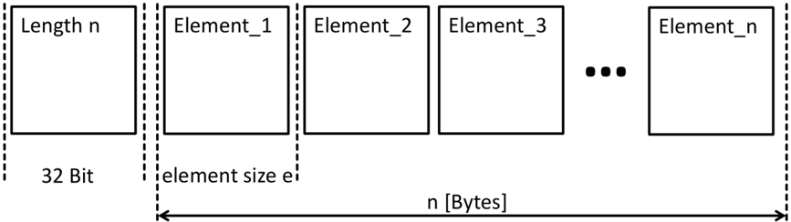

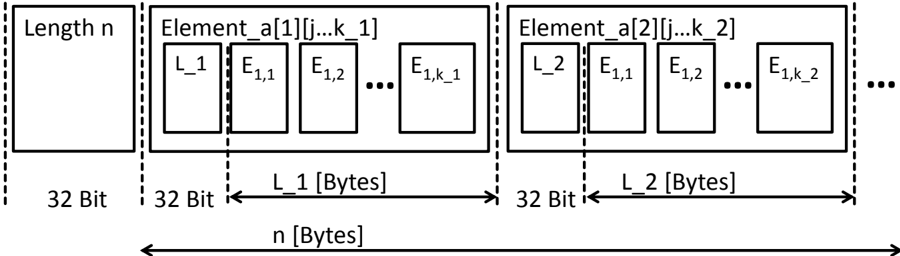

**在多维数组中，不同维度的每个子数组应有自己的长度字段。**

如果需要静态缓冲区大小分配，数据类型定义应定义每个维度的最大长度。

理由：当以字节为单位测量长度时，反序列化中可以跳过复杂的多维数组。

**SOME/IP** 还支持同一维度中不同的列长度和不同的行长度。参见图4.14 中的 k_1 和 k_2。每个动态长度数组之前都需要一个长度指示符。这适用于外层数组和所有内层/嵌套数组。

**如果可变长度数组的长度大于预期（预期应基于数据类型定义），则只应解释数据类型中规定的元素，其他字节应基于长度字段被跳过。**

**如果未配置，则添加在动态长度数组前面的长度字段的长度为 32 位（长度字段的默认长度）。**

##### 3.1.4.6. 枚举

**枚举在 **SOME/IP** 中不予考虑。枚举应作为无符号整数数据类型传输。**

##### 3.1.4.7. 位域

**位域应作为无符号数据类型 uint8/uint16/uint32/uint64 传输。**

数据类型定义将能够定义每个位的名称和值。

##### 3.1.4.8. 联合体 / 变体

存在将数据在网络上定义为联合体的用例，此时载荷可以是不同的数据类型。

联合体（也称为变体，**variant**）是这样一种参数：它可以包含不同类型的数据。例如，如果定义了一个 uint8 类型和 uint16 类型的联合体，则该联合体应携带 uint8 或 uint16 的数据。

载荷中将传输哪种数据类型只能在执行期间决定。然而，在这种情形下，不仅需要发送数据本身，还需要向传输中添加关于适用数据类型的信息，作为一种「元数据」。

借助所附加的元数据，发送方可以识别联合体适用的数据类型，接收方可以相应地正确访问数据。

**联合体应用于在网络上传输具有替代数据类型的数据。**

**联合体（长度字段、类型选择器和载荷）**

表4.8：联合体的默认序列化

| 长度字段 [32 位] |
| --- |
| 类型字段 [32 位] |
| 数据（含填充）[sizeof(padding) = length - sizeof(data)] |

**长度字段应以字节为单位定义数据和填充的大小，并且不包括长度字段和类型字段的大小。**

**注意：**

如果进行了相应配置，填充可用于对齐序列化数据流中的后续数据。

**长度字段的长度应由配置定义，并且应为 32、16、8 或 0 位。**

**长度字段的长度为 0 位意味着不向 **PDU** 写入任何长度字段。**

**如果长度字段的长度为 0 位，则联合体中的所有类型应具有相同的长度。**

**类型字段应规定数据的数据类型。**

**类型字段的长度应由配置定义，并且应为 32、16 或 8 位。**

**类型字段的可能取值应由每个联合体的配置分别定义。**

**类型字段的值 0 应保留给 **NULL** 类型。**

**注意：**

这表示一个空联合体。

**联合体是否允许 **NULL** 应由配置定义。**

**载荷根据类型字段中的类型进行序列化。**

在以下示例中，长度字段的长度被规定为 32 位。联合体应支持 uint8 和 uint16 作为数据。两者都被填充到 32 位边界（长度 = 4 字节）。

uint8 将按表4.9 所示序列化。

表4.9：示例：uint8

| Length = 4 字节 |
| --- |
| Type = 1 |
| uint8、Padding 0x00、Padding 0x00、Padding 0x00 |

uint16 将按表4.10 所示序列化。

表4.10：示例：uint16

| Length = 4 字节 |
| --- |
| Type = 2 |
| uint16、Padding 0x00、Padding 0x00 |

**如果联合体的长度大于预期（预期应基于数据类型定义），则只应解释数据类型中规定的字节，其他字节应基于长度字段被跳过。**

**如果联合体的长度小于预期（预期应基于数据类型定义），则取决于内部数据类型是否能够反序列化出有效数据，否则应中止反序列化，并将该消息视为格式错误。**

### 3.2. SOME/IP 协议的规范

本章描述 **SOME/IP** 的远程过程调用（**RPC**）、事件通知和错误处理。

#### 3.2.1. 传输协议绑定

为了传输 **SOME/IP** 消息，可以使用不同的传输协议。**SOME/IP** 目前支持 **UDP** 和 **TCP**。它们的绑定将在以下小节中解释，而第 5 章讨论选择哪种传输协议。

**如果一台服务器运行同一服务的不同实例，则属于不同服务实例的消息应由服务器侧的传输协议端口映射到服务实例。**

详情参见 §3.2.1.3。

**所有传输协议绑定应支持在一个传输层 **PDU**（即 **UDP** 数据报或 **TCP** 分段）中传输多于一条 **SOME/IP** 消息。**

**接收方 **SOME/IP** 实现应能够接收通过 **UDP** 或 **TCP** 传输的未对齐的 **SOME/IP** 消息。**

理由：

在 **UDP** 或 **TCP** 中传输多个 **SOME/IP** 载荷时，只有当每个载荷的长度是对齐大小（例如 32 位）的倍数时，才能保证载荷的对齐。

**报头格式允许在单个数据包中传输多于一条 **SOME/IP** 消息。**SOME/IP** 实现应通过 **SOME/IP** 长度字段识别一条 **SOME/IP** 消息的结束。基于数据包长度字段，**SOME/IP** 应判定数据包中是否还有其他 **SOME/IP** 消息。这应适用于 **UDP** 和 **TCP** 传输。**

**每个 **SOME/IP** 载荷应有自己的 **SOME/IP** 报头。**

**一个 Service-Instance 的所有方法、事件和通知的通信可以使用以下设置：**

- 最多一个 **TCP** 连接
- 最多一个 **UDP** 单播连接
- 最多一个 **UDP** 组播连接

##### 3.2.1.1. UDP 绑定

**SOME/IP** 的 **UDP** 绑定应通过在 **UDP** 数据报中传输 **SOME/IP** 消息来实现。

**SOME/IP** 协议不应限制 **UDP** 分片的使用。

**客户端和服务器应为配置为使用 **UDP** 单播通信的 Service-Instance 的所有方法、事件和通知使用单一 **UDP** 单播连接。**

**客户端和服务器可以为每个配置为使用 **UDP** 组播通信的 Service-Instance 使用单一的 **UDP** 组播地址。**

##### 3.2.1.2. TCP 绑定

**SOME/IP** 的 **TCP** 绑定在很大程度上基于 **UDP** 绑定。与 **UDP** 绑定相比，**TCP** 绑定允许大得多的 **SOME/IP** 消息，并使用 **TCP** 的鲁棒性特性（应对丢失、重排、重复等）。

为了降低延迟和反应时间，应关闭 Nagle 算法（TCP_NODELAY）。

**当 **TCP** 连接丢失时，未完成的请求应作为超时处理。**

由于 **TCP** 处理可靠性，不需要额外的可靠性手段。

**客户端和服务器应为配置为使用 **TCP** 通信的 Service-Instance 的所有方法、事件和通知使用单一 **TCP** 连接。**

**当第一条方法调用需要传输或客户端尝试接收第一批通知时，**TCP** 连接应由客户端打开。**

客户端负责在 **TCP** 连接失效时重建它。

**当不再需要 **TCP** 连接时，**TCP** 连接应由客户端关闭。**

**当使用这些 **TCP** 连接的所有服务不再可用（停止或超时）时，**TCP** 连接应由客户端关闭。**

**服务器在停止所有服务时不应停止 **TCP** 连接。给客户端足够的时间处理控制数据以自行关闭 **TCP** 连接。**

理由：

如果服务器在客户端识别出不再需要 **TCP** 之前关闭 **TCP** 连接，客户端将尝试重建 **TCP** 连接。

允许通过 Magic Cookie 重新同步到 TCP 流

**为了允许测试工具识别通过 **TCP** 传输的 **SOME/IP** 消息的边界，**SOME/IP** Magic Cookie 消息可以在 **TCP** 消息流中的 **SOME/IP** 消息之间以规则的间隔插入。**

**Magic Cookie 消息的布局应由以下字段组成：**

- 用于从客户端到服务器的通信：
  - Message ID（Service ID/Method ID）：0xFFFF 0000
  - Length：0x0000 0008
  - Request ID（Client ID/Session ID）：0xDEAD BEEF
  - Protocol Version：0x01
  - Interface Version：0x01
  - Message Type：0x01
  - Return Code：0x00
- 用于从服务器到客户端的通信：
  - Message ID（Service ID/Method ID）：0xFFFF 8000
  - Length：0x0000 0008
  - Request ID（Client ID/Session ID）：0xDEAD BEEF
  - Protocol Version：0x01
  - Interface Version：0x01
  - Message Type：0x02
  - Return Code：0x00

Magic Cookie 消息的布局如图4.15 所示。

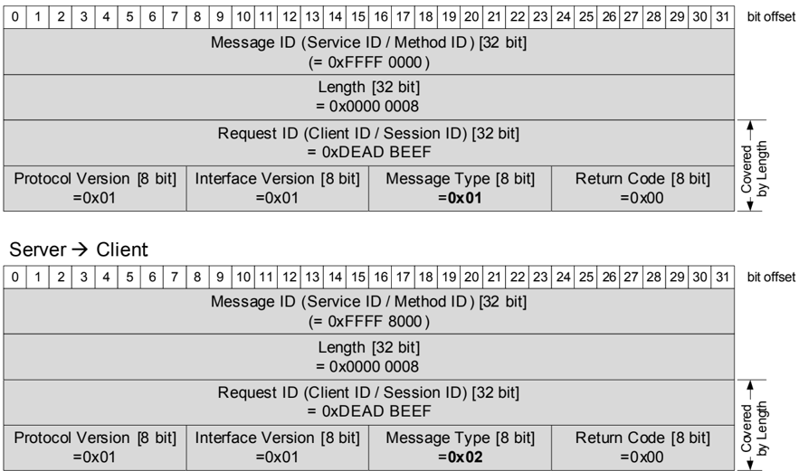

##### 3.2.1.3. 多个服务实例

**同一服务的 Service-Instance 通过不同的 Instance ID 标识。应支持多个 Service-Instance 位于不同 **ECU** 上，以及一个或多个服务的多个 Service-Instance 位于同一台 **ECU** 上。**

**虽然不同服务的多个 Service-Instance 应当能够在提供/服务器侧和消费/客户端侧共享相同的传输层协议端口号，但同一服务在单台 **ECU** 的提供/服务器侧的多个 Service-Instance 应为每个 Service-Instance 使用不同的端口号。同一服务在单台 **ECU** 的需求/客户端侧的多个 Service-Instance 可以为每个 Service-Instance 使用相同的端口号。**

理由：普通 **SOME/IP**（非 **SOME/IP-SD**）消息不在 **SOME/IP** 报头中携带 ServiceInstance ID 作为专门字段。因此需要使用端口号（或许还有传输协议）来区分单台 **ECU** 上同一服务的不同 Service-Instance。这样，Service-Instance 可以通过 Service **ID** 与端点信息（即 **IP** 地址、传输协议（**UDP**/**TCP**）和端口号）的组合来标识。在 4 元组 &lt;src IP, src port, dst IP, dst port&gt; 中只有一个差异就足以作为区分标准，因此在服务器侧或客户端侧为同一服务的不同 Service-Instance 使用不同的端口号就足够了。由于服务器是实际提供不同 Service-Instance 的一方，服务器也是处理这种区分的自然位置。=&gt; 服务器应为提供同一服务的不同 Service-Instance 使用不同的端口号。

建议：建议实例为 **UDP** 和 **TCP** 使用相同的端口号。如果一个 Service-Instance 使用 **UDP** 端口 x，则该服务的这个 Service-Instance（而不是同一服务的另一个 Service-Instance）应恰好使用 **TCP** 端口 x 来提供服务。

##### 3.2.1.4. 通过 UDP 传输大型 SOME/IP 消息（SOME/IP-TP）

**SOME/IP** 的 **UDP** 绑定只能传输能直接放入一个 **IP** 数据包的 **SOME/IP** 消息。如果需要在 **UDP** 上传输更大的 **SOME/IP** 消息（例如 32 KB），则应使用 **SOME/IP** 传输协议（**SOME/IP-TP**）。过大而无法用 **UDP** 绑定直接传输的 **SOME/IP** 消息应被称为「原始」**SOME/IP** 消息。在 **SOME/IP-TP** 消息中传输的原始 **SOME/IP** 消息载荷的「片段」应被称为「分段（**segments**）」。

只有当需要传输非常大的数据块（&gt; 1400 字节）且在出错情形下没有苛刻的延迟要求时才使用 **TCP**。

**使用 **SOME/IP-TP** 的 **SOME/IP** 消息应激活会话处理（Session ID 对原始消息必须唯一）。**

**所有 **SOME/IP-TP** 分段应携带原始消息的 Session ID；因此它们具有全部相同的 Session-ID。**

**SOME/IP-TP** 分段应将 Message Type 的 TP-Flag 置为 1。

**SOME/IP-TP 分段应在 **SOME/IP** 报头之后（即在 **SOME/IP** 载荷之前）带有一个 **TP** 报头，其结构如下（位从最高到最低）：**

- Offset [28 位]
- Reserved Flag [1 位]
- Reserved Flag [1 位]
- Reserved Flag [1 位]
- More Segments Flag [1 位]

SOME-IP-TP 报头如图4.16 所示。

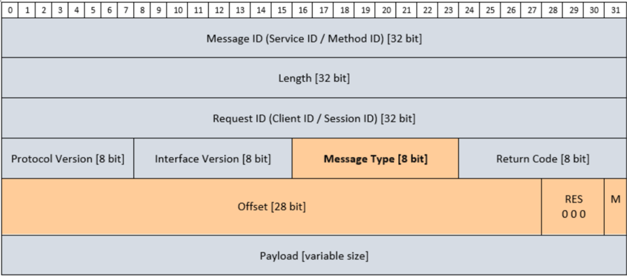

**SOME/IP-TP** 报头应以网络字节序（大端）编码。

**Offset 字段应传输一个 uint32 的高 28 位。低 4 位应始终被解释为 0。**

**注意：**

这意味着 offset 字段只能传输 16 字节倍数的偏移值。

**TP** 报头的 Offset 字段应被设置为所传输分段在原始消息中以字节为单位的偏移。

**Reserved Flags 应由发送方置为 0，并且应被接收方忽略（且不检查）。**

**除最后一个分段外，所有分段的 More Segments Flag 应被置为 1。对最后一个分段它应被置为 0。**

**SOME/IP** 长度字段应按之前的规定使用。这意味着它覆盖 **SOME/IP** 报头的前 8 个字节及其之后的所有字节。**注意：**

这意味着对于传输一个分段的 **SOME/IP-TP** 消息，**SOME/IP** 长度覆盖 **SOME/IP** 报头的 8 个字节、**TP** 报头的 4 个字节以及分段本身。

**分段的长度必须反映基于 offset 字段的下一个分段的对齐。因此，除最后一个分段外，所有分段的长度都应是 16 字节的倍数。**

**SOME/IP-TP** 消息应使用与原始消息相同的 Message ID（即 Service **ID** 和 Method **ID**）、Request ID（即 Client **ID** 和 Session **ID**）、Protocol Version、Interface Version 和 Return Code。**注意：**

如上所述，Length、Message Type 和 Payload 由 **SOME/IP-TP** 调整。

示例

本示例描述如何传输一条载荷为 5880 字节的原始 **SOME/IP** 消息。该原始 **SOME/IP** 消息的 Length 字段被设置为 8 + 5880 字节。

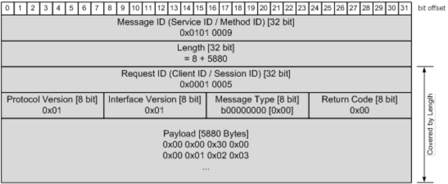

这条原始 **SOME/IP** 消息现在将被分段为 5 个连续的 **SOME/IP** 分段。在本示例中，每个分段的载荷最多携带 1392 字节。

对于这些分段，**SOME/IP TP** 模块添加附加的 **TP** 字段（标红）。**SOME/IP** 的 Length 字段携带 **SOME/IP** 分段的整体长度，包括 Request ID、Protocol Version、Interface Version、Message Type 和 Return Code 的 8 个字节。由于添加了 **TP** 字段（4 字节），该长度信息扩展了 4 个附加的 **SOME/IP TP** 字节。

下图给出了每个 **SOME/IP** 分段的相关 **SOME/IP** 报头设置的概貌：

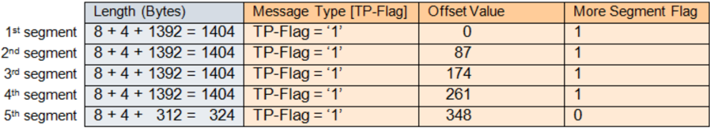

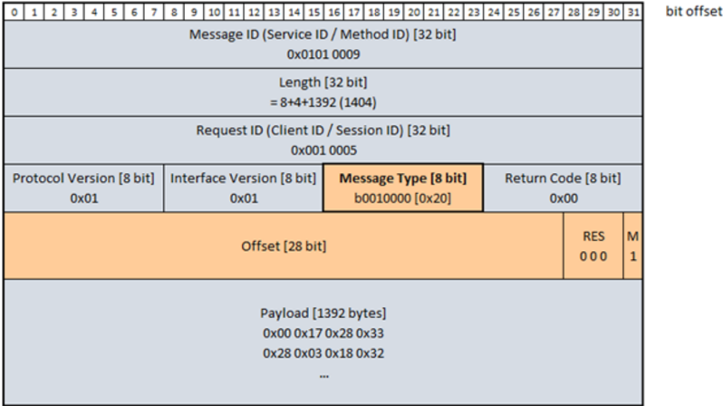

**注意：**

请注意到 Offset 字段中提供的值以 16 字节为单位，即：Offset 值 87 对应 1392 字节载荷。

**SOME/IP** 分段消息的完整 **SOME/IP** 报头细节如下：

- 前 4 个分段各包含 1392 个载荷字节，「More Segments Flag」被置为 '1'：
- 最后一个分段（即第 5 个）包含原始 5880 字节载荷中剩余的 312 个载荷字节。该最后一段被标记为「More Segments flag」置为 '0'。

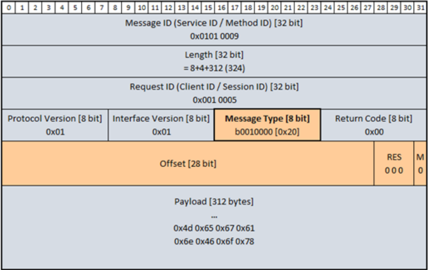

发送方特定行为

**发送方应只对被配置为分段的那些消息进行分段。**

**发送方应以升序发送分段。**

**发送方的分段方式应使 More Segment Flag 置为 1 的所有分段具有相同的大小。**

**发送方应在本规范施加的限制内尽量最大化分段的大小。**

**发送方不得发送重叠或重复的分段。**

接收方特定行为

**接收方应基于 Message-ID、Protocol-Version、Interface-Version 和 Message-Type（不含 TP Flag）的配置值来匹配用于重组的分段。**

**应支持并行重组多条具有相同 Message **ID** 但来自不同客户端（发送方 **IP**、发送方端口或 Client **ID** 有差异）的消息。这应由配置控制，并决定「重组缓冲区」的数量。**

**Session ID 应用于检测下一个要重组的原始消息。**

**如果接收到一条具有不同 Session-ID 的新分段，则接收方应启动一次新的重组（并可以丢弃未成功重组的旧分段）。**

**接收方应只重组到其配置的缓冲区大小为止，并跳过消息的其余部分。**

**只有被正确重组的、不超过配置大小的消息才应被传递给应用。**注意：**

这意味着实现必须确保消息的所有字节都是被正确接收并重组的字节。统计不重叠、不重复的字节数并将其与长度比较可能是一种有效的检查。

**用于重组的最后一个分段的 Return Code 应被用于重组后的消息。**

**在将 **SOME/IP TP** 分段重组为一条大的未分段消息期间，应调整 Message Type，TP Flag 应被复位为 0。**

**接收方应支持对以升序和降序接收的分段的重组。**

**当在 **SOME/IP** 消息的组装期间检测到缺失的分段时，应取消当前的组装过程。**注意：**

这意味着不支持重新排序。

**不支持使用相同缓冲区的不同分段消息的交错（例如只有 Session-ID 和载荷不同）。**

**注意：**

这禁止了相等事件（相同的 Message-ID、**IP** 地址、端口号和传输协议）在其部分分段被重排时以错误的顺序到达。

**完全不同的原始消息的分段重排（例如 Message **ID** 不同）不在考虑范围内，因为这些分段进入不同的缓冲区。**

**接收方应通过基于最后接收到的分段覆写的方式，正确地重组重叠和重复的分段。**

**如果重叠或重复的分段改变了缓冲区中已写入的字节，则接收方可以取消重组，前提是该特性可以通过配置关闭。**

**接收方应能够优雅地检测并处理明显的错误。例如，如果 MS=1 的分段的分段长度不是 16 的倍数，则取消重组。**注意：**

这意味着接收代码应防止缓冲区溢出或其他故障。

#### 3.2.2. 请求/响应通信

最常见的通信模式之一是请求/响应模式。一个通信伙伴（客户端）发送一条请求消息，由另一个通信伙伴（服务器）应答。

**对于 **SOME/IP** 请求消息，客户端必须对载荷和报头执行以下操作：**

- 构建载荷
- 根据客户端想调用的方法设置 Message ID
- 将 Length 字段设置为 8 字节（**SOME/IP** 报头中长度字段之后的部分）+ 序列化载荷的长度
- 可选地将 Request ID 设置为一个唯一编号（应仅对客户端唯一）
- 按 PRS_SOMEIP_00052 设置 Protocol Version
- 按照接口定义设置 Interface Version
- 将 Message Type 设置为 REQUEST（即 0x00）
- 将 Return Code 设置为 0x00

**为构建请求消息的载荷，该方法的所有输入或输入/输出参数应按照参数在方法签名中的顺序序列化。**

**服务器基于客户端请求的报头构建响应的报头，并额外执行以下操作：**

- 构建载荷
- 从相应的请求接管 Message ID
- 将长度设置为 8 字节 + 新的载荷大小
- 从相应的请求接管 Request ID
- 将 Message Type 设置为 RESPONSE（即 0x80）或 ERROR（即 0x81）
- 将 Return Code 设置为 PRS_SOMEIP_00191 中的一个返回码。

有效返回码见表4.11。

**为构建响应消息的载荷，该方法的所有输出或输入/输出参数应按照参数在方法签名中的顺序序列化。**

**对于带有特定 Request ID 的请求，在相应的请求消息被接收之前，服务器不得发送响应消息。**

**当相应的请求消息尚未被完整发送时，客户端应忽略对带有特定 Request ID 的响应消息的接收。**

#### 3.2.3. Fire & Forget 通信

不带响应消息的请求被称为 fire & forget。

**对于 **SOME/IP** 的 request-no-return 消息，客户端必须对载荷和报头执行以下操作：**

- 构建载荷
- 根据客户端想调用的方法设置 Message ID
- 将 Length 字段设置为 8 字节（**SOME/IP** 报头中长度字段之后的部分）+ 序列化载荷的长度
- 可选地将 Request ID 设置为一个唯一编号（应仅对客户端唯一）
- 按 PRS_SOMEIP_00052 设置 Protocol Version
- 按照接口定义设置 Interface Version
- 将 Message Type 设置为 REQUEST_NO_RETURN（即 0x01）
- 将 Return Code 设置为 0x00

**Fire & Forget 消息不应返回错误。错误处理和返回码应在需要时由应用实现。**

#### 3.2.4. 通知事件

通知描述一种通用的发布/订阅概念。通常，服务器发布一个服务，客户端订阅该服务。在某些情形下，服务器将向客户端发送一个事件，例如一个更新的值或一个已发生的事件。

**SOME/IP** 仅用于传输更新的值，而不用于发布和订阅机制。这些机制由 **SOME/IP-SD** 实现。

**对于 **SOME/IP** 通知消息，服务器必须对载荷和报头执行以下操作：**

- 构建载荷
- 根据服务器想发送的事件设置 Message ID
- 将 Length 字段设置为 8 字节（**SOME/IP** 报头中长度字段之后的部分）+ 序列化载荷的长度
- 将 Client ID 设置为 0x00。按 PRS_SOMEIP_00932、PRS_SOMEIP_00933 和 PRS_SOMEIP_00521 设置 Session ID。在会话处理激活的情形下，Session ID 应在每次传输时递增。
- 按 PRS_SOMEIP_00052 设置 Protocol Version
- 按照接口定义设置 Interface Version
- 将 Message Type 设置为 NOTIFICATION（即 0x02）
- 将 Return Code 设置为 0x00

**通知消息的载荷应由事件的序列化数据组成。**

**当同一台 **ECU** 上存在多于一个已订阅的客户端时，系统应处理通知的复制，以节省通信介质上的传输。**

当通知使用组播消息传输时，这一点尤其重要。

##### 3.2.4.1. 发送通知的策略

对于不同的用例，可能存在不同的通知发送策略。以下示例是常见的：

- 周期性更新——以固定间隔发送更新的值（例如带存活消息的安全相关消息每 100 ms 一次）
- 变化时更新——一旦「值」发生变化就发送更新（例如车门打开）
- ε 变化——只有当与最后一个值的差异大于某个 ε 时才发送更新。该概念可以是自适应的，即预测基于历史数据；因此，只有当预测值与当前值之间的差异大于 ε 时才传输更新。

#### 3.2.5. 字段

字段表示一个状态并拥有一个有效值。订阅字段的消费者在订阅之后立即作为初始事件获得字段值。

**字段应是 getter、setter 和通知事件的组合。**

**没有 setter、没有 getter 且没有 notifier 的字段不应存在。字段应至少包含一个 getter、一个 setter 或一个 notifier。**

**字段的 getter 应是一个请求/响应调用：请求消息的载荷为空，响应消息的载荷中为该字段的值。**

**字段的 setter 应是一个请求/响应调用：请求消息的载荷中为该字段的期望值，响应消息的载荷中为被设置到字段的值。**

**注意：**

如果请求载荷的值被调整（例如因为超出限制），则调整后的值将在响应载荷中传输。

**notifier 应在客户端订阅该字段时，向客户端发送一条携带该字段值的事件消息。**

**notifier 应发送携带字段值的事件消息，并应遵循事件的规则。发送策略包括变化时发送、ε 变化时发送和周期性发送。**

#### 3.2.6. 错误处理

错误处理可以在应用中或下方的通信层中进行。因此 **SOME/IP** 支持两种不同的机制：

- 方法响应消息中的返回码
- 显式错误消息

使用两者中的哪一个取决于配置。

**方法响应消息中的返回码应用于将应用错误和方法的响应数据从提供者传输给方法的调用者。**

**注意：**

请注意，从 **SOME/IP** 的角度看，请求和响应方法的返回码不被视为错误。这意味着即使请求/响应方法以不等于 0x00 的返回码退出（**AUTOSAR** ClientServerOperation 的 ApplicationError 不同于 E_OK），消息类型仍为 0x80。

**显式错误消息应用于将应用错误和响应数据或通用 **SOME/IP** 错误从提供者传输给方法的调用者。**

**如果需要传输更详细的错误信息，则错误消息（Message Type 0x81）的载荷应填充错误特定的数据，例如一个异常字符串。错误消息应替代响应消息发送。**

这可用于处理服务器中可能发生的所有不同应用错误。此外，通信介质或中间组件（例如交换机）可能出现问题，必须例如通过可靠的传输来处理。

所有消息的报头中都有一个返回码字段。（参见 §3.1.2）

**只有响应（响应消息（消息类型 0x80）和错误消息（消息类型 0x81））应使用返回码字段向其应答的请求（消息类型 0x00）携带返回码。**

**除 0x80 和 0x81 之外的所有其他消息应将该字段设置为 0x00。**

消息类型参见 §3.1.2.7。

##### 3.2.6.1. 返回码

**返回码应为 UINT8。**

**返回码**

| ID | 名称 | 描述 |
| --- | --- | --- |
| 0x00 | E_OK | 未发生错误 |
| 0x01 | E_NOT_OK | 发生了未指定的错误 |
| 0x02 | E_UNKNOWN_SERVICE | 所请求的 Service **ID** 未知。 |
| 0x03 | E_UNKNOWN_METHOD | 所请求的 Method **ID** 未知。Service **ID** 已知。 |
| 0x04 | E_NOT_READY | Service **ID** 和 Method **ID** 已知。应用未运行。 |
| 0x05 | E_NOT_REACHABLE | 运行该服务的系统不可达（仅限内部错误码）。 |
| 0x06 | E_TIMEOUT | 发生了超时（仅限内部错误码）。 |
| 0x07 | E_WRONG_PROTOCOL_VERSION | 不支持该 **SOME/IP** 协议版本 |
| 0x08 | E_WRONG_INTERFACE_VERSION | 接口版本不匹配 |
| 0x09 | E_MALFORMED_MESSAGE | 反序列化错误，导致载荷无法被反序列化。 |
| 0x0a | E_WRONG_MESSAGE_TYPE | 接收到一个意外的消息类型（例如为定义为 REQUEST 的方法收到 REQUEST_NO_RETURN）。 |
| 0x0b | E_E2E_REPEATED | 重复的 **E2E** 计算错误 |
| 0x0c | E_E2E_WRONG_SEQUENCE | 错误的 **E2E** 序列错误 |
| 0x0d | E_E2E | 未进一步规定的 **E2E** 错误 |
| 0x0e | E_E2E_NOT_AVAILABLE | **E2E** 不可用 |
| 0x0f | E_E2E_NO_NEW_DATA | 没有用于 **E2E** 计算的新数据。 |
| 0x10 - 0x1f | RESERVED | 保留给通用 **SOME/IP** 错误。这些错误将在本文档的未来版本中规定。 |
| 0x20 - 0x5E | RESERVED | 保留给服务和方法的特定错误。这些错误由接口规范规定。 |

表4.11：返回码

返回码的生成和处理应是可配置的。

**一条 **SOME/IP** 错误消息（即返回码 0x01 - 0x1f）不应被一条错误消息应答。**

##### 3.2.6.2. 错误消息

为了更灵活的错误处理，**SOME/IP** 允许一种专门针对错误消息的消息布局，而不是使用响应消息的消息布局。

推荐的异常消息布局如下：

- 特定异常的联合体。至少必须存在一个不带字段的通用异常。
- 用于异常描述的动态长度字符串。

理由：联合体提供了以类型安全的方式在未来添加新异常的灵活性。字符串用于传输人类可读的异常描述，以便于测试和调试。

**SOME/IP** 消息的接收方不应为事件/通知返回错误消息。

**SOME/IP** 消息的接收方不应为 fire & forget 方法返回错误消息。

**如果 Message Type 被错误地设置为 Request 或 Response，**SOME/IP** 消息的接收方不应为事件/通知和 fire & forget 方法返回错误消息。**

**对于请求/响应方法，错误消息应复制 **SOME/IP** 报头的字段（即 Message ID、Request ID 和 Interface Version），但不复制载荷。此外，Message Type 和 Return Code 必须被设置为适当的值。**

##### 3.2.6.3. 错误处理概览

**错误处理应基于所接收的消息类型（例如只有方法可以用返回码应答），并应按 PRS_SOMEIP_00195 中定义的顺序进行检查。**

**对于通过 **UDP** 接收的 **SOME/IP** 消息，应检查以下内容：**

- **UDP** 数据报的大小应至少为 16 字节（**SOME/IP** 消息的最小大小）
- 长度字段的值应小于或等于 **UDP** 数据报载荷中的剩余字节数

如果任何一项检查失败，则应报出一个格式错误（**malformed error**）。

**SOME/IP** 消息应通过错误处理进行检查。这不包括基于应用的错误处理，而只覆盖消息传递和 **RPC** 中的错误处理。

错误处理的概览如图4.21 所示。

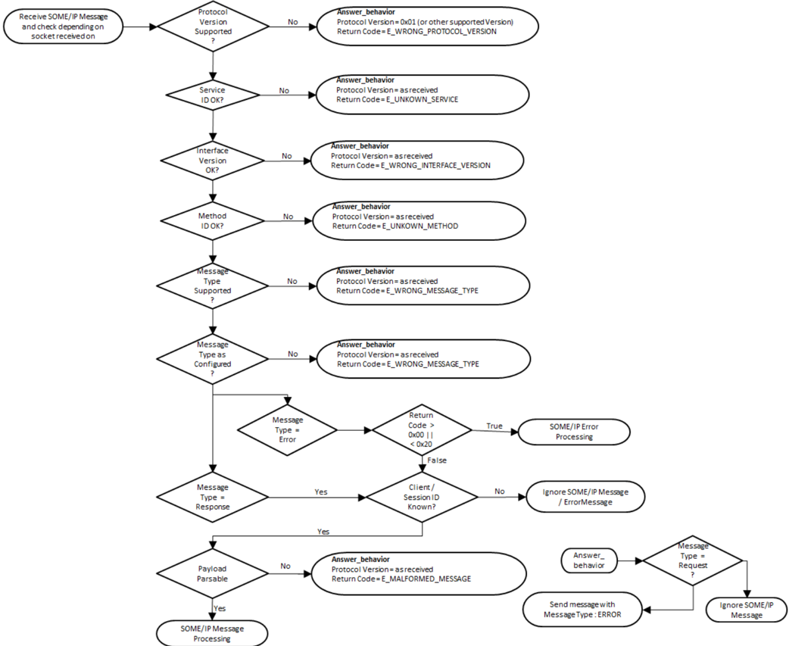

**当通过 **TCP** 接收 **SOME/IP** 消息期间发生 PRS_SOMEIP_00195 中规定的错误之一时，接收方应检查 **TCP** 连接，并在需要时重启该 **TCP** 连接。**

理由：

检查 **TCP** 连接可以包括以下内容：

- 检查是否收到例如其他 Eventgroup 的数据
- 发送一条 Magic Cookie 消息并等待 **TCP ACK**
- 重建 **TCP** 连接

##### 3.2.6.4. 通信错误及通信错误的处理

考虑到 **RPC** 消息的传输，存在不同的可靠性语义：

- Maybe——消息可能到达通信伙伴
- At least once——消息至少一次到达通信伙伴
- Exactly once——消息恰好一次到达通信伙伴

当使用上述术语时，对于请求/响应，该术语适用于两条消息（即请求和响应或错误）。

虽然不同的实现可能采用不同的方法，但 **SOME/IP** 目前在使用 **UDP** 绑定时达到「maybe」可靠性，在使用 **TCP** 绑定时达到「exactly once」可靠性。进一步的错误处理留给应用。

对于「maybe」可靠性，在请求/响应通信与 **UDP** 作为传输协议相结合时，只需要一个超时。图4.22 展示了「maybe」可靠性的状态机。客户端的 **SOME/IP** 实现必须等待响应一段规定的超时时间。如果发生超时，**SOME/IP** 应向客户端应用报告 E_TIMEOUT。

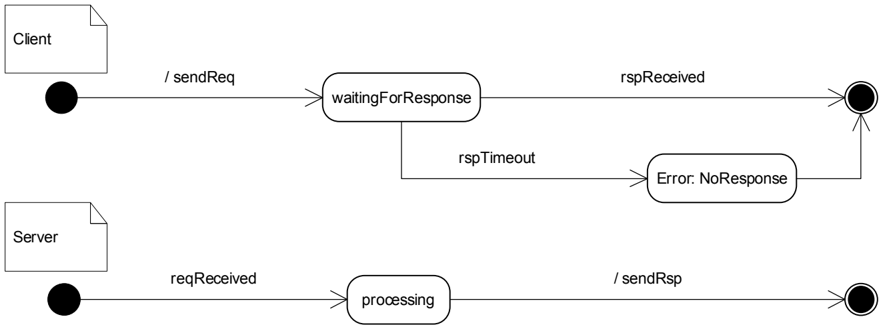

对于「exactly once」可靠性，可以使用 **TCP** 绑定，因为 **TCP** 的定义就是为了实现可靠的通信。

### 3.3. 接口版本的兼容性规则

Interface Version 标识 Payload 格式。Payload 格式受以下因素影响：

- 服务接口规范
- 序列化配置（例如可变大小数组的使用、长度字段的大小、填充、**TLV**、**SOME/IP-TP**）。

**出于以下任何原因，Interface Version 应被递增：**

- Payload 格式中的不兼容变更
- 服务行为中的不兼容变更
- 应用设计的要求

**注意：** 对于 Payload 格式中的兼容变更，Interface Version 不应被递增。

**PRS_SOMEIP_00758 中的规则应定义 Payload 格式变更的兼容性。对于复杂数据类型，这些规则应递归应用。X 表示兼容的变更，空单元格表示不兼容的变更。**

**Payload 格式变更的兼容性**

| 接口变更 | 不带长度字段的序列化（发送方） | 不带长度字段的序列化（接收方） | 带长度字段的序列化（发送方） | 带长度字段的序列化（接收方） | 带 TLV 的序列化（发送方） | 带 TLV 的序列化（接收方） | 带 TLV 和可选成员的序列化（发送方） | 带 TLV 和可选成员的序列化（接收方） |
| --- | --- | --- | --- | --- | --- | --- | --- | --- |
| 在结构体末尾之外添加结构体成员 | | | | | X | X | X | |
| 在顶层结构体末尾添加结构体成员 | X | | X | | X | X | X | |
| 在子结构体末尾添加结构体成员 | | | X | | X | X | X | |
| 在结构体末尾之外移除结构体成员 | | | | | X | X | X | |
| 从顶层结构体末尾移除结构体成员 | | X | | X | X | X | X | |
| 从子结构体末尾移除结构体成员 | | | | | X | X | X | |
| 重新排列结构体成员 | | | | X | X | X | X | |
| 使用之前未使用的类型选择器添加新的联合体成员 | | X | | X | X | | X | |
| 移除具有最高类型选择器的联合体成员 | X | | X | X | | X | | |
| 数据类型变更：变为语义上不同的类型（例如整数变结构体、整数变浮点、字符大小不同的字符串）、字节序、数组的维数 | | | | X | X | | X | |
| 添加新的枚举值 ENUM-REMARK | | X | | | | | | |
| 变更既有枚举值 ENUM-REMARK | | | X | | | | | |
| 变更定长字符串或数组的长度 | | | 不适用 | 不适用 | | 不适用 | 不适用 | |
| 减小可变大小字符串的最大长度 | 不适用 | 不适用 | X | 不适用 | X | 不适用 | X | |
| 增大可变大小字符串的最大长度 | 不适用 | 不适用 | X | X | X | X | | X |
| 变更可变大小数组的最大长度 | 不适用 | | | X | | X | X | |
| 在方法请求的参数列表末尾之外添加参数 / 在方法响应的参数列表末尾之外移除参数 | | | | | X | X | X | |
| 在方法请求的参数列表末尾添加参数 / 在方法响应的参数列表末尾移除参数 | | X | | X | X | X | | |
| 在方法请求的参数列表末尾之外移除参数 / 在方法响应的参数列表末尾之外添加参数 | X | | | X | | X | X | |
| 重新排列方法的参数 | | | | X | X | X | X | |
| 变更参数的可选性 | 不适用 | 不适用 | 不适用 | 不适用 | 不适用 | 不适用 | 不适用 | |
| 变更方法的返回类型（例如 void 变 uint8） | | | | | | | | |
| 添加方法的返回码 | | X | | X | X | X | | |
| 移除方法的返回码 | X | | X | | X | X | | |
| 变更服务接口、方法或事件的名称 | X | X | X | X | X | X | X | |
| 向事件组添加事件 | X | | X | | X | X | | |
| 从事件组移除事件 | | X | | X | X | X | | |
| 向字段添加 setter 或 getter / 从字段移除 notifier | X | | X | | X | X | | |
| 从字段移除 setter 或 getter / 向字段添加 notifier | | X | | X | X | X | | |
| 通过新方法、事件或字段扩展服务接口 | X | | X | | X | X | | |
| 从服务接口移除方法、事件或字段 | | X | | X | X | X | | |
| 变更 Method ID | | | | | | | | |
| 变更参数的 Data ID / 复用之前移除参数的 Data ID | 不适用 | 不适用 | 不适用 | 不适用 | | | | |

表4.12：Payload 兼容性规则

适用以下图例：

ENUM-REMARK——枚举的「接收方」需要知道它能接收的所有值，而「发送方」不必发送「接收方」所知的所有值。

「发送方」列指传输 **SOME/IP** 消息的一方，可以是事件的发送方（接口的提供者）、方法的调用者所使用的方法参数（接口的用户）或方法的被调用者返回的方法结果（接口的提供者）。「接收方」列指接收 **SOME/IP** 消息的一方，可以是事件的接收方（接口的用户）、转发给方法被调用者的方法参数（接口的提供者）或转发给消息调用者的方法结果（接口的用户）。对于字段，只有当「发送方」和「接收方」列都被标记为兼容时才存在兼容性，因为相同的内容将由接口的提供者（通知事件、getter 方法）和接口的用户（setter 方法）所定义的一方传输。

## 4. 配置参数

本文档不处理和描述配置参数。

## 5. 协议使用与指南

### 5.1. 传输协议的选择

**SOME/IP** 支持**用户数据报协议**（**UDP**）和**传输控制协议**（**TCP**）。**UDP** 是一种非常精简的传输协议，只支持最重要的特性（多路复用和使用校验和的错误检测），而 **TCP** 增加了实现可靠通信的附加特性。**TCP** 不仅处理位错误，还处理分段、丢失、重复、重排和网络拥塞。

在车辆内部，许多应用需要非常短的超时才能快速反应。使用 **UDP** 可以更好地满足这些要求，因为应用本身可以处理不太可能发生的错误事件。例如，在周期性数据的用例中，最好的方法通常是等待下一次数据传输，而不是试图修复上一次。**UDP** 的主要缺点是它不处理分段。因此，只能传输较小的数据块。

指南：

- 只有当需要传输非常大的数据块（&gt; 1400 字节）且在出错情形下没有苛刻的延迟要求时才使用 **TCP**
- 如果在出错情形下需要非常苛刻的延迟要求（&lt;100ms），则使用 **UDP**
- 如果需要传输非常大的数据块（&gt; 1400 字节）且在出错情形下存在苛刻的延迟要求，则将 **UDP** 与 **SOME/IP-TP** 结合使用
- 当外部传输或传送机制（网络文件系统、**APIX** 链路、**1722** 等）更适合该用例时，尝试使用它们。在这种情形下，**SOME/IP** 可以传输一个文件句柄或类似的标识符。这给设计者带来了额外的自由（例如在缓存方面）。

所使用的传输协议由接口规范按每条消息规定。方法、事件和字段通常应只使用单一的传输协议。

### 5.2. 传输 CAN 和 FlexRay 帧

**SOME/IP** 应允许隧道传输 **CAN** 和 **FlexRay** 帧。然而，Message **ID** 空间需要在这两个用例之间协调。完整的 **SOME/IP** 报头应用于传输/隧道传输 **CAN**/**FlexRay**。

### 5.3. 为结构体插入填充

如果需要填充，接口的设计者应在数据类型的定义中插入保留/填充元素（如果对齐需要），因为 **SOME/IP** 实现不得自动添加此类填充。

### 5.4. SOME/IP 的信息安全考量

**限制客户端对服务器的连接：** 服务器可以实施通信策略以保护服务器免受恶意或未授权客户端的侵害。即，服务器可以拒绝来自未授权客户端的对事件组的订阅或方法调用。

**注意：** 这些策略超出了本规范的范围。此类策略可以基于客户端的 **IP** 地址或任何其他识别客户端的手段。

**限制客户端到服务器的连接：** 客户端可以实施通信策略以保护客户端免受恶意服务器的侵害。即，客户端可以拒绝与未授权服务器的通信。

**注意：** 这些策略超出了本规范的范围。此类策略可以基于服务器的 **IP** 地址或任何其他识别客户端的手段。

## 参考文献

[1] Glossary
> AUTOSAR_FO_TR_Glossary

## A. AUTOSAR 可追溯项变更历史

请注意，本章中的列表还包括在后续版本中已从规范中移除的可追溯项。这些可追溯项在文档中不作为超链接出现。

由于本批次决议整体省略需求项 **ID**，本附录变更表的 Number 列省略；R22-11 各表的标题列在源转换中大多为空，按 SecOC 先例以数量呈现，R23-11 保留有标题的行。

### A.1. 本文档依据 AUTOSAR 版本 R22-11 的可追溯项变更历史

#### A.1.1. R22-11 中新增的规范项

新增 1 项。

#### A.1.2. R22-11 中变更的规范项

变更 12 项（其中有标题的 1 项：最大分段长度（**Maximum segment length**））。

#### A.1.3. R22-11 中删除的规范项

删除 2 项。

### A.2. 本文档依据 AUTOSAR 版本 R23-11 的可追溯项变更历史

#### A.2.1. R23-11 中新增的规范项

表A.4：R23-11 中新增的规范项

| 标题 |
| --- |
| Message ID 报头字段 |
| 返回码 |
| Payload 格式变更的兼容性 |

#### A.2.2. R23-11 中变更的规范项

表A.5：R23-11 中变更的规范项

| 标题 |
| --- |
| Request ID |
| 线上类型与后续数据的类型 |

#### A.2.3. R23-11 中删除的规范项

无。
