<!-- 源文档 AUTOSAR_FO_PRS_SOMEIPServiceDiscoveryProtocol（R23-11），协议规范（PRS），不受 Type A 七章骨架约束；章节结构镜像源文档自身编号。协议项 ID 标记与源文档的草稿标志（Draft 类标记）按 2026-11-03 批次决议整体省略（标题仅翻译，协议项以加粗标题行 + 段落形式呈现）；协议项之间的交叉引用（PRS_SOMEIPSD_*）以不带方括号的标识符原样保留。源第 3 章「Protocol Requirements / Requirements Traceability」为纯 ID 追溯表，按 2026-11-03 决议整章省略并将后续章节重编号（源 4→3、5→4、6→5、7→6、8→7；其小节 7.1/7.2 → 6.1/6.2）。封面元数据表、免责声明与目录按 EXP 流程省略。132 处图引用中 26 处为内容图（图1.1 依赖关系、图5.1–5.18 报文格式/选项/状态机/错误处理、图5.19–5.23 发布订阅示例、图5.24–5.26 发布订阅状态机），按源图号嵌入（源文档无图5.19 编号缺位问题——图5.19 存在；图5.25 的图取自 §5.1.6 前的报文格式图），其余为页面装饰。图内标签散落（bit offset 刻度、SOME/IP-SD、Server/Client、TCP.SYN 等）按转换噪声丢弃；字节布局乱表（图5.2/5.19 的报头示例、状态机转移列表）由对应图替代呈现。状态机转移文本（§4.1.4.4）在源转换中严重粘连，按图形（图5.16–5.17、5.24–5.26）替代呈现，仅保留状态/阶段清单。表5.1–5.8、6.1 按源表号以 GFM 呈现。附录 A 的纯 ID 枚举按批次决议以数量呈现。 -->

## 1. 简介和概述

本协议规范规定 **SOME/IP** 服务发现（**SOME/IP Service Discovery**，**SOME/IP-SD**）协议的格式、消息序列和语义。

服务发现协议的主要任务是在车载通信中通告被称为服务的功能实体的可用性，以及控制事件消息的发送行为。这使得只向需要这些事件消息的接收方发送事件消息（发布/订阅）。此处描述的解决方案也被称为 **SOME/IP-SD**（Scalable service-Oriented MiddlewarE over IP - Service Discovery）。

### 1.1. 协议目的和目标

**SOME/IP-SD** 用于：

- 定位服务实例。
- 检测服务实例是否正在运行。
- 实现发布/订阅处理。

### 1.2. 协议的适用性

**SOME/IP-SD** 可用于汽车车辆网络中的服务发现。

#### 1.2.1. 约束和假设

**SOME/IP-SD** 具有以下约束：

- **SOME/IP-SD** 只支持基于 **IP** 的通信。
- 如果一个客户端服务通过经由组播选项通告的客户端服务组播端点进行订阅，则网络通信设计必须考虑以下限制：
  - 基于点对点连接的通信可能无法正常工作（例如端到端相关的通信、**IPsec** 通信）
  - 初始事件必须谨慎使用，因为所有以相同组播端点向同一服务器服务订阅的客户端服务，每当一个新的客户端服务以相同组播端点向同一服务器服务订阅时，都会收到初始事件

### 1.3. 依赖性

#### 1.3.1. 对其他协议层的依赖性

**SOME/IP-SD** 依赖于 **SOME/IP**。**SOME/IP** 本身同时支持 **TCP** 和 **UDP** 通信，但 **SOME/IP-SD** 被约束为只通过 **UDP** 使用 **SOME/IP**（参见 PRS_SOMEIPSD_00220）。

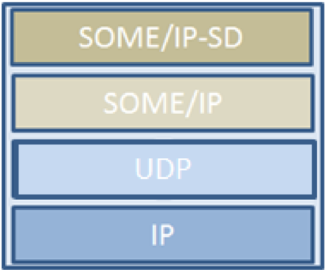

## 2. 用例

| ID | 名称 | 描述 |
| --- | --- | --- |
| UC_001 | 服务提供（**Service Offering**） | 服务器向网络提供服务，而无需在客户端侧静态配置该服务器。 |
| UC_002 | 服务订阅（**Service Subscription**） | 客户端找到期望的服务并订阅它，而无需知道发送方的位置。 |
| UC_003 | 灵活的通信路径（**Flexible communication paths**） | 开发者希望在不知道谁将接收数据或谁在发送期望数据的情况下设计其应用。服务发现使得能够在集成期间建立通信路径。 |

## 3. 缩略语和缩写

以下词汇表包含与 **SOME/IP** 规范相关、且未包含在 [\[1\]](#ref-1)（AUTOSAR 术语表）中的缩略语和缩写。

**Method**
> 被调用/调用的方法、过程、函数或子例程。

**Parameters**
> 方法或事件的输入、输出或输入/输出参数。

**Remote Procedure Call (RPC)**
> 从一个 **ECU** 到另一个 **ECU**、通过消息传输的方法调用。

**Request**
> 客户端发给服务器、调用某个方法的消息。

**Response**
> 服务器发给客户端、传输方法调用结果的消息。

**Request/Response communication**
> 由请求和响应组成的 **RPC**。

**Fire&Forget communication**
> 只由一条请求消息组成的 **RPC** 调用。

**Event**
> 一种单向数据传输，只在变化时或周期性地被触发，从数据的生产者发送给消费者。一个事件甚至可以既周期性发送又在变化时自发发送。这完全由发送应用负责，因为接收方完全没有手段区分这两种情形。

**Field**
> 字段表示一种状态，因此始终有一个有效值，getter、setter 和 notifier 作用于该值。

**Notification Event**
> 字段的 notifier 发送的事件消息。这种 notifier 的消息无法与事件消息区分；因此，当提及事件的消息时，这也应适用于字段 notifier 的消息。

**Getter**
> 允许对字段进行读访问的请求/响应调用。

**Setter**
> 允许对字段进行写访问的请求/响应调用。

**Notifier**
> 在字段的值发生变化时发送带有新值的事件消息。

**Service**
> 零个或多个方法、零个或多个事件以及零个或多个字段的逻辑组合（允许空服务，例如用于在 **SOME/IP-SD** 中通告非 **SOME/IP** 服务）。

**Eventgroup**
> 服务内部事件和字段的通知事件的逻辑分组，以允许订阅。

**Service Interface**
> 服务的形式化规范，包括其方法、事件和字段。

**Service Instance**
> 服务接口的软件实现，它可以在车辆中存在多次，也可以在一台 **ECU** 上存在多次。

**Server**
> 在该服务实例的上下文中，提供服务实例的 **ECU** 被称为服务器。

**Client**
> 在该服务实例的上下文中，使用服务器的服务实例的 **ECU** 被称为客户端。

**Union or Variant**
> 动态采用不同数据类型的数据结构。

**Offering a service instance**
> 指某台 **ECU** 实现了服务的一个实例，并通过 **SOME/IP-SD** 告知其他 **ECU** 它们可以使用它。

**Finding a service instance**
> 指发送一条 **SOME/IP-SD** 消息以找到一个所需的服务实例。

**Requiring a service instance**
> 指向实现所需服务实例的 **ECU** 发送一条 **SOME/IP-SD** 消息，表示另一台 **ECU** 需要该服务实例。即使该服务实例尚未运行（即尚未被提供），也可以发送该消息。

**Releasing a service instance**
> 指向承载该服务实例的 **ECU** 发送一条 **SOME/IP-SD** 消息，表示不再需要该服务实例。

**Server-Service-Instance-Entry**
> 本地 **ECU** 所提供的服务实例的配置和所需数据，在提供该服务（服务器）的 **ECU** 上被称为 Server-Service-Instance-Entry。

**Client-Service-Instance-Entry**
> 另一台 **ECU** 所提供的服务实例的配置和所需数据，在使用该服务（客户端）的 **ECU** 上被称为 Client-Service-Instance-Entry。

**Publishing an eventgroup**
> 指使用一条 **SOME/IP-SD** 消息向其他 **ECU** 提供服务实例的一个事件组。

**Subscribing an eventgroup**
> 指使用一条 **SOME/IP-SD** 消息请求服务实例的一个事件组。

**unicast event**
> 由承载服务器服务的 **ECU** 传输到单播端点的事件。该单播端点由已通过 SubscribeEventgroup 条目所引用的端点选项向该服务器服务订阅的特定客户端服务提供（参见客户端服务单播端点）。

**multicast event**
> 由承载服务器服务的 **ECU** 传输到组播端点的事件。组播端点可以由服务器服务（参见服务器服务组播端点）和客户端服务（参见客户端服务组播端点）提供。

**server service multicast endpoint**
> 由服务器服务提供的组播端点（包括 **IP** 组播地址、端口和协议），用于根据配置的 MULTICAST_THRESHOLD 声明服务器服务将组播事件传输到哪里。

**client service unicast endpoint**
> 由客户端服务提供的单播端点（包括 **IP** 地址、端口和协议），用于声明客户端服务期望从相应服务器服务接收事件的位置。请注意，如果在服务器服务侧已超过 MULTICAST_THRESHOLD，则服务器服务自动从客户端服务单播端点切换到服务器服务组播端点来提供事件。

**client service multicast endpoint**
> 由客户端服务提供的组播端点（包括 **IP** 组播地址、端口和协议），用于声明客户端服务期望从相应服务器服务接收事件的位置。它可以用作客户端单播端点的替代。请注意，如果在服务器服务侧已超过 MULTICAST_THRESHOLD，则服务器服务自动从客户端服务组播端点切换到服务器服务组播端点。

**Security Association**
> 在通信伙伴之间提供安全加密通信的机制。例如适用于 **IPSec**、**MACsec**、(d)**TLS** 以及可能的其他信息安全协议。

**Secured Port**
> 应用了安全关联以防范未授权通信的网络端口。

## 4. 协议规范

### 4.1. SOME/IP 服务发现（SOME/IP-SD）

#### 4.1.1. 总体

**SOME/IP-SD** 用于：

- 定位服务实例。
- 检测服务实例是否正在运行。
- 实现发布/订阅处理。

在车载网络内部，服务实例的位置通常是已知的；因此，服务实例的状态是首要关注点。服务的位置（即 **IP** 地址、传输协议和端口号）是次要关注点。

##### 4.1.1.1. 术语和定义

**如果一个服务需要在多个网络接口上提供，则应为每个网络接口使用一个单独的服务器服务实例。**

**如果一个服务被配置为通过多个不同的网络接口访问，则应为每个网络接口使用一个单独的客户端服务实例。**

#### 4.1.2. SOME/IP-SD 消息格式

##### 4.1.2.1. 总体需求

**SOME/IP-SD 消息应通过 **UDP** 发送。**

**SOME/IP-SD 报头格式应遵循：**

- Message ID（Service ID/Method ID）[32 位]：0xFFFF 8100
- Length [32 位]
- Request ID（Client ID/Session ID）[32 位]
- Protocol Version [8 位]：0x01
- Interface Version [8 位]：0x01
- Message Type [8 位]：0x02
- Return Code [8 位]：0x00
- Flags [8 位]
- Reserved [24 位]
- Length of Entries Array [32 位]
- Entries Array [大小可变]
- Length of Options Array [32 位]
- Options Array [大小可变]

**SOME/IP-SD** 报头格式如图5.1 所示。

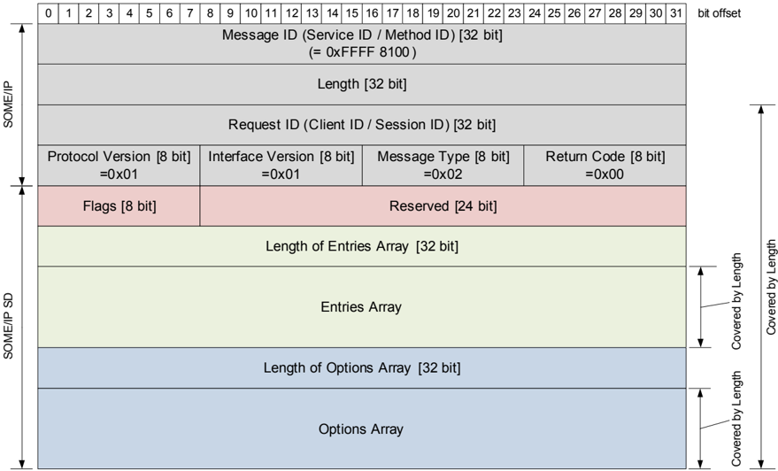

**服务发现消息应以一个 **SOME/IP** 报头开始。**

**服务发现消息应使用 0xFFFF 的 Service-ID（16 位）。**

**服务发现消息应使用 0x8100 的 Method-ID（16 位）。**

**服务发现消息应使用按 **SOME/IP** 规定的 uint32 长度字段。这意味着长度以字节为单位测量，从长度字段之后的第一个字节开始，到 **SOME/IP-SD** 消息的最后一个字节结束。**

**服务发现消息的 Client-ID（16 位）应设置为 0x0000，因为只存在一个 **SOME/IP-SD** 实例。**

**服务发现消息应有一个 Session-ID（16 位），并基于 **SOME/IP** 需求处理它。**

**（SOME/IP 报头的）Session-ID 应为每条发送的 **SOME/IP-SD** 消息递增。**

**（SOME/IP 报头的）Session-ID 应从 1 开始，并且在回绕之后仍为 1。**

**（SOME/IP 报头的）Session-ID 不应被设置为 0。**

**SOME/IP-SD 的 Session **ID** 处理按「通信关系」进行，即按对端（peer）的组播和单播分别处理（参见 PRS_SOMEIPSD_00255）。**

**服务发现消息的 ProtocolVersion（8 位）应为 0x01。**

**服务发现消息的 InterfaceVersion（8 位）应为 0x01。**

**服务发现消息的 Message Type（8 位）应为 0x02（Notification）。**

**服务发现消息的 Return Code（8 位）应为 0x00（E_OK）。**

**服务发现消息中的所有字段应为网络字节序（即大端字节序）。**

一个示例

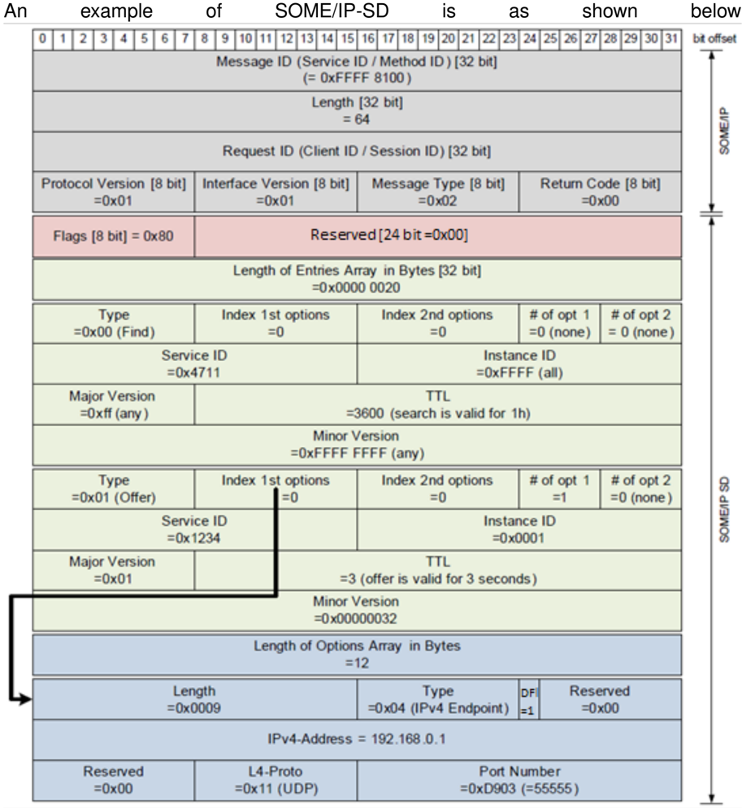

##### 4.1.2.2. SOME/IP-SD 报头

**SOME/IP-SD 应使用 **SOME/IP** 传输。** 如图5.2 所示。

**SOME/IP-SD** 报头应以一个称为 flags 的 8 位字段开始。

标志的表示见图5.3。

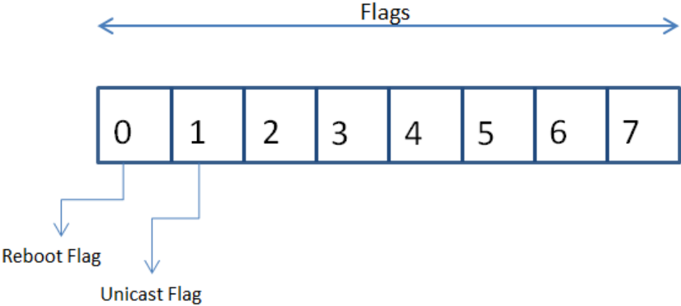

**SOME/IP-SD Flags 字段的第一个标志（最高有效位）应称为 Reboot Flag（重启标志）。**

**SOME/IP-SD 报头的 Reboot Flag 在重启之后的所有消息中应被置为 1，直到 **SOME/IP** 报头中的 Session-ID 回绕并因此重新从 1 开始。在该回绕之后，Reboot Flag 被置为 0。**

**Reboot Flag 和 Session **ID** 的信息应为组播和单播分别保存。**

**Reboot Flag 和 Session **ID** 的信息应为每个发送-接收关系（即源地址和目的地址）分别保存。**

**注意：**

这意味着发送和接收应有单独的计数器。

**发送：**

* 组播应有一个计数器。
* 单播应为每个对端有一个单独的计数器。

**接收：**

* 组播应为每个对端有一个计数器。
* 单播应为每个对端有一个计数器。

**重启的检测应按如下方式进行（new 为来自通信伙伴的当前数据包的新值，old 为之前接收到的最后一个值）：**

```text
if old.reboot==0 and new.reboot==1 then Reboot detected OR
if old.reboot==1 and new.reboot==1 and old.session_id >= new.session_id then Reboot detected
```

**注意：**

以下方式是不够的，因为我们没有可靠的通信：`if new.reboot==1 and old.session_id >= new.session_id then Reboot detected`。

**SOME/IP-SD Flags 的第二个标志（次高有效位）应称为 Unicast Flag（单播标志）。**

**由于它表示支持使用单播接收，SOME/IP-SD 报头的 Unicast Flag 应为所有 SD 消息设置为 Unicast（即 1）。**

**注意：**

Unicast Flag 是历史 **SOME/IP** 版本的遗留，仅出于兼容性原因而保留。除此之外的用途非常有限。

**Flag 字段中未定义的位在发送时应置为'0'，在接收时被忽略。**

**在 Flags 之后，SOME/IP-SD 报头应有一个称为 Reserved 的 24 位字段。**

**在 **SOME/IP-SD** 报头之后应跟随 Entries Array。**

**条目应严格按照它们到达的顺序处理。**

**在 **SOME/IP-SD** 报头的 Entries Array 之后应跟随一个 Option Array。**

**SOME/IP-SD 消息的 Entries Array 和 Options Array 应以一个 uint32 长度字段开始，该字段对后续数据的字节数进行计数；即条目或选项。**

##### 4.1.2.3. 条目格式

**服务发现应支持组合在一条服务发现消息中的多个条目。**

**注意：**

条目用于同步服务实例的状态和发布/订阅处理。

**存在两种类型的条目：用于服务的 Service Entry Type（服务条目类型）和用于事件组的 Eventgroup Entry Type（事件组条目类型）。**

**Service Entry Type 应为 16 字节大小，并按以下顺序包含以下字段：**

- Type 字段 [uint8]：编码 FindService（0x00）、OfferService（0x01）和 StopOfferService（0x01）
- Index First Option Run [uint8]：该 option run 的第一个选项在选项数组中的索引。
- Index Second Option Run [uint8]：该 option run 的第二个选项在选项数组中的索引。
- Number of Options 1 [uint4]：描述第一个 option run 使用的选项数量。
- Number of Options 2 [uint4]：描述第二个 option run 使用的选项数量。
- Service-ID [uint16]：描述该条目所涉及的服务或服务实例的 Service **ID**。
- Instance ID [uint16]：描述该条目所涉及的服务实例的 Service Instance **ID**；如果指服务的所有服务实例，则设置为 0xFFFF。
- Major Version [uint8]：编码服务（实例）的主版本。
- TTL [uint24]：描述条目的生存期（秒）。
- Minor Version [uint32]：编码服务的次版本。

PRS_SOMEIPSD_00268 如图5.4 所示。

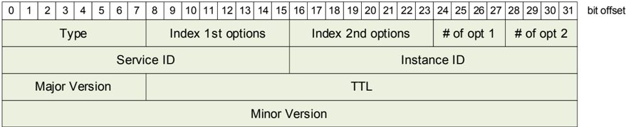

**Eventgroup Entry（类型 2）应为 16 字节大小，并按以下顺序包含以下字段：**

- Type 字段 [uint8]：编码 Subscribe（0x06）、StopSubscribeEventgroup（0x06）、SubscribeAck（0x07）和 SubscribeEventgroupNack（0x07）。
- Index of first option run [uint8]：该 option run 的第一个选项在选项数组中的索引。
- Index of second option run [uint8]：该 option run 的第二个选项在选项数组中的索引。
- Number of Options 1 [uint4]：描述第一个 option run 使用的选项数量。
- Number of Options 2 [uint4]：描述第二个 option run 使用的选项数量。
- Service-ID [uint16]：描述该条目所涉及的服务或服务实例的 Service **ID**。
- Instance ID [uint16]：描述该条目所涉及的服务实例的 Service Instance **ID**。任何实例的 Service Instance **ID** 都不得设置为 0xFFFF。
- Major Version [uint8]：编码该事件组所属服务实例的主版本。
- TTL [uint24]：描述条目的生存期（秒）。
- Reserved [uint12]：应设置为 0x000。
- Counter [uint4]：用于区分同一订阅者对相同事件组的相同订阅。未使用时设置为 0x0。
- Eventgroup ID [uint16]：传输事件组的 **ID**。

SOME/IP-SD 事件组条目类型如图5.5 所示。

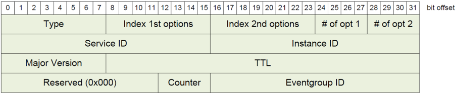

**条目的 Major Version（按照 PRS_SOMEIPSD_00268 和 PRS_SOMEIPSD_00270）应与相应服务接口的版本匹配。**

**注意：** 对于经典平台上的服务发现，SdServerService 和 SdClientService 的主版本必须与相应服务接口的 Interface Version 匹配。

###### 4.1.2.3.1. 从条目引用选项

**使用条目的以下字段，条目可以引用选项：**

- Index First Option Run：第一个 option run 在选项数组中的索引。索引 0 表示 **SOME/IP-SD** 数据包的第一个选项。
- Index Second Option Run：第二个 option run 在选项数组中的索引。索引 0 表示 **SOME/IP-SD** 数据包的第一个选项。
- Number of Options 1：第一个 option run 的长度。长度 0 表示该 option run 中没有选项。
- Number of Options 2：第二个 option run 的长度。长度 0 表示该 option run 中没有选项。

存在两种不同的 option run：First Option Run 和 Second Option Run。

支持两个 option run 的理由：预期存在两种不同类型的选项：多个 **SOME/IP-SD** 条目共有的选项，以及每个 **SOME/IP-SD** 条目不同的选项。支持两个不同的 option run 是支持这两种类型选项的最有效方式，同时保持线上格式的高效性。

**每个 option run 应引用该 run 的第一个选项和选项数量。**

**如果选项数量被设置为零，则该 option run 被视为空。**

**对于空 run，Index（即 Index First Option Run 和/或 Index Second Option Run）应被设置为零。**

**实现应接受并处理 option run 长度为零但选项索引未置零的入站 SD 消息。**

##### 4.1.2.4. 选项格式

选项用于向条目传输附加信息。这包括例如服务实例如何可达的信息（**IP** 地址、传输协议、端口号）。

**为了标识选项类型，每个选项应以以下内容开始：**

- Length [uint16]：规定选项以字节为单位的长度。
- Type [uint8]：规定选项的类型。
- Discardable Flag [1 位]：规定该选项是否可以被丢弃。
- 位 1 到位 7 保留，应为 0。

**如果选项可以被不支持该选项的接收 **ECU** 丢弃，则 discardable 标志应被置为 1。**

###### 4.1.2.4.1. 配置选项

配置选项用于传输任意的配置字符串。这允许编码附加信息，例如服务的名称或其配置。

**配置选项的格式应如下：**

- Length [uint16]：应被设置为配置选项占用的总字节数，不包括 16 位长度字段和 8 位类型标志。
- Type [uint8]：应设置为 0x01。
- Discardable Flag [1 位]：如果接收方可以丢弃该选项，则应置为 1。
- 位 1 到位 7 保留，应为 0。
- ConfigurationString [动态长度]：应承载配置字符串。

**配置选项应基于 DNS TXT 和 DNS-SD 格式规定一组「名称-值」对。**

**配置字符串的格式应以一个单字节长度字段开始，该字段描述此长度字段之后的字节数。在长度字段之后应跟随具有规定长度的字符序列。**

**在每个字符序列之后，预期跟随另一个长度字段和后续的字符序列，直到某个长度字段被设置为 0x00。**

**在某个长度字段被设置为 0x00 之后，不得跟随任何字符。**

**一个字符序列应编码一个键（key）和可选的一个值（value）。**

**字符序列应包含一个等号字符（"="，0x3D）来分隔键和值。**

**键不得包含等号字符，并且应至少有一个非空白字符。「Key」的字符应为可打印的 US-ASCII 值（0x20-0x7E），不包括 '='（0x3D）。**

**"=" 不得是序列的第一个字符。**

**对于不带 '=' 的字符序列，该键应被解释为存在。**

**对于以 '=' 结尾的字符序列，该键应被解释为存在但值为空。**

**应支持单个配置选项中具有相同键的多个条目。**

配置选项的格式如图5.6 所示。

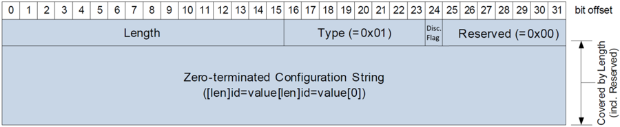

**SOME/IP-SD** 配置选项示例

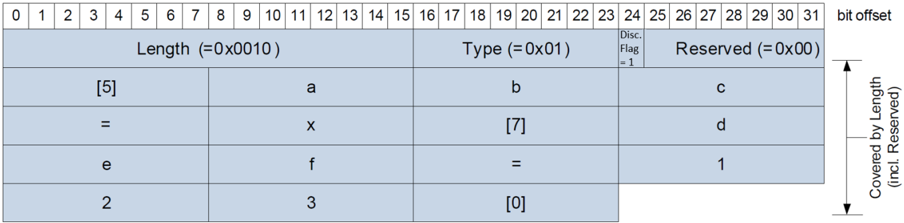

###### 4.1.2.4.2. 负载均衡选项

负载均衡选项用于对服务的不同实例进行优先级排序，使客户端基于这些设置选择服务实例。该选项将被附加到 Offer Service 条目上。

**负载均衡选项应像 DNS-SRV 记录那样携带优先级（Priority）和权重（Weight），它们应用于不同服务实例的负载均衡。**

**当查找一个服务的所有服务实例（Service Instance 设置为 0xFFFF）时，客户端应选择具有最高优先级且同时匹配客户端特定标准的服务实例。**

**注意：** 客户端特定标准可在客户端应用选择所提供服务实例之一时应用。它们不在本规范中定义，例如可以限制适当实例 **ID** 的范围。

**当存在多于一个具有最高优先级（Priority 字段中的最低值）的服务实例时，应基于各服务实例的权重随机选择服务实例。选择某个服务实例的概率应为该服务实例的权重除以所有被考虑服务实例的权重之和。**

**如果一个 Offer Service 条目未引用负载均衡选项且提供了多个服务实例，则客户端应将不带负载均衡选项的服务实例视为具有最低优先级来处理。**

**当查找一个服务的特定服务实例（Service Instance 设置为 0xFFFF 以外的任何值）时，不适用负载均衡选项的评估。**

**负载均衡选项的格式应如下：**

- Length [uint16]：应设置为 0x0005。
- Type [uint8]：应设置为 0x02。
- Discardable Flag [1 位]：如果接收方可以丢弃该选项，则应置为 1。
- 位 1 到位 7 保留，应为 0。
- Priority [uint16]：承载该实例的优先级。数值越小表示优先级越高。
- Weight [uint16]：承载该实例的权重。数值越大表示被选中的概率越高。

负载均衡选项的格式如图5.8 所示。

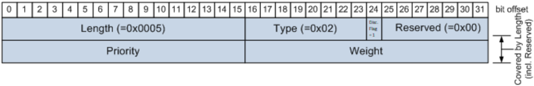

###### 4.1.2.4.3. IPv4 端点选项

**IPv4** 端点选项由 **SOME/IP-SD** 实例用于通告相关端点。端点包括本地 **IP** 地址、传输层协议（例如 **UDP** 或 **TCP**）和发送方的端口号。这些端口也用于事件和通知事件。

**IPv4** 端点选项应使用类型 0x04。

**IPv4** 端点选项应规定 **IPv4** 地址、所使用的传输层协议（**ISO/OSI** 第 4 层）及其端口号。

**IPv4** 端点选项的格式应如下：

- Length [uint16]：应设置为 0x0009。
- Type [uint8]：应设置为 0x04。
- Discardable Flag [1 位]：应设置为 0。
- 位 1 到位 7 保留，应为 0。
- IPv4-Address [uint32]：应以四个字节传输单播 **IP** 地址。
- Reserved [uint8]：应设置为 0x00。
- 传输协议（L4-Proto）[uint8]：应基于 **IANA**/**IETF** 类型设置为传输层协议（**ISO/OSI** 第 4 层）（0x06：**TCP**，0x11：**UDP**）。
- 传输协议端口号（L4-Port）[uint16]：应设置为第 4 层协议的端口。

**SOME/IP-SD IPv4** 端点选项如图5.9 所示。

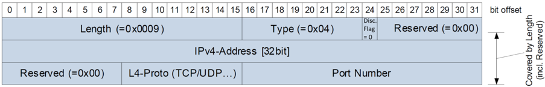

**服务器应将 **IPv4** 端点选项与 Offer Service 条目一起使用，以通告其提供服务的端点。即至多一个 **UDP** 端点和至多一个 **TCP** 端点。**

**服务器以 Offer Service 条目引用的端点也应作为事件的源。即端点选项中传输协议的源 **IP** 地址和源端口号。**

**客户端应将 **IPv4** 端点选项与 Subscribe Eventgroup 条目一起使用，以通告其准备好接收事件的 **IP** 地址和 **UDP** 和/或 **TCP** 端口号。**

**注意：** 如果套接字已经打开，并且网络安全协议（**IPsec**、**MACsec** 或其他安全协议）所需的任何安全关联已经建立并完全可用，则客户端已准备好接收事件。

**同一 **ECU** 上同一服务的不同提供服务实例应使用不同的端点，以便可以通过端点区分它们。不同的服务可以共享相同的端点。**

###### 4.1.2.4.4. IPv6 端点选项

**IPv6** 端点选项由 **SOME/IP-SD** 实例用于通告相关端点。端点包括本地 **IP** 地址、传输层协议（例如 **UDP** 或 **TCP**）和发送方的端口号。这些端口也用于事件和通知事件。

**IPv6** 端点选项应使用类型 0x06。

**IPv6** 端点选项的格式应如下：

- Length [uint16]：应设置为 0x0015。
- Type [uint8]：应设置为 0x06。
- Discardable Flag [1 位]：应设置为 0。
- 位 1 到位 7 保留，应为 0。
- IPv6-Address [uint128]：应以 16 个字节传输单播 **IP** 地址。
- Reserved [uint8]：应设置为 0x00。
- 传输协议（L4-Proto）[uint8]：应基于 **IANA**/**IETF** 类型设置为传输层协议（**ISO/OSI** 第 4 层）（0x06：**TCP**，0x11：**UDP**）。
- 传输协议端口号（L4-Port）[uint16]：应设置为传输层端口（例如 30490）。

**SOME/IP-SD IPv6** 端点选项如图5.10 所示。

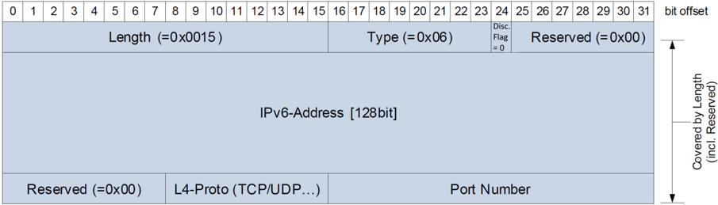

**服务器应将 **IPv6** 端点选项与 Offer Service 条目一起使用，以通告服务可用的端点。即至多一个 **UDP** 端点和至多一个 **TCP** 端点。**

**服务器以 Offer Service 条目引用的端点也应作为事件的源。即端点选项中传输协议的源 **IP** 地址和源端口号。**

**客户端应将 **IPv6** 端点选项与 Subscribe Eventgroup 条目一起使用，以通告其准备好接收事件的 **IP** 地址和 **UDP** 和/或 **TCP** 端口号。**

**注意：**

* 如果套接字已经打开，并且网络安全协议（**IPsec**、**MACsec** 或其他安全协议）所需的任何安全关联已经建立并完全可用，则客户端已准备好接收事件。
* 安全关联状态监控及其对服务发现的影响应适用于所有使用受保护端口的服务实例。

**同一 **ECU** 上同一服务的不同服务实例应使用不同的端点，以便可以通过端点区分它们。不同的服务可以共享相同的端点。**

###### 4.1.2.4.5. IPv4 组播选项

**IPv4** 组播选项要么由服务器服务（服务器服务组播端点）传输，要么由客户端服务（客户端服务组播端点）传输：

* 如果它由服务器服务传输，则服务器通告 **IPv4** 组播地址、传输层协议（**ISO/OSI** 第 4 层）和端口号，即组播事件和组播通知事件被传输到的位置。
* 如果它由客户端服务传输，则客户端指示 **IPv4** 组播地址、传输层协议（**ISO/OSI** 第 4 层）和端口号，即客户端期望接收组播事件和组播通知事件的位置。

**IPv4** 组播选项应被 SubscribeEventgroup、StopSubscribeEventgroup 或 SubscribeEventgroupAck 条目引用：

* 如果它被 SubscribeEventgroup 条目引用，则它描述客户端服务组播端点（即目的 **IP** 地址和目的端口），客户端应在该端点接收组播事件。
* 如果它被 StopSubscribeEventgroup 条目引用，则它表示停止先前通过客户端服务组播端点（即目的 **IP** 地址和目的端口）订阅了给定事件组的客户端的订阅意图。
* 如果它被 SubscribeEventgroupAck 条目引用，则它描述服务器服务组播端点（即目的 **IP** 地址和目的端口），服务器应将组播事件传输到该端点。

**IPv4** 组播选项应使用类型 0x14。

**IPv4** 组播选项应规定 **IPv4** 地址、所使用的传输层协议（**ISO/OSI** 第 4 层）及其端口号。

**IPv4** 组播选项的格式应如下：

- Length [uint16]：应设置为 0x0009。
- Type [uint8]：应设置为 0x14。
- Discardable Flag [1 位]：应设置为 0。
- 位 1 到位 7 保留，应为 0。
- IPv4-Address [uint32]：应以四个字节传输组播 **IP** 地址。
- Reserved [uint8]：应设置为 0x00。
- 传输协议（L4-Proto）[uint8]：应基于 **IANA**/**IETF** 类型设置为传输层协议（**ISO/OSI** 第 4 层）（0x11：**UDP**）。
- 传输协议端口号（L4-Port）[uint16]：应设置为第 4 层协议的端口。

**SOME/IP-SD IPv4** 组播选项如图5.11 所示。

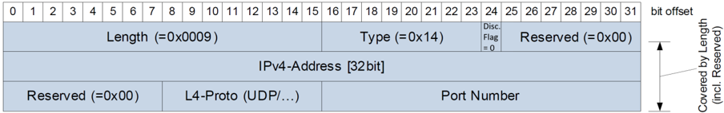

**IPv4** 组播选项的 IPv4-Address 字段 [32 位] 应按以下规则设置：

* 如果服务器服务传输 SubscribeEventgroupAck，则该字段应被设置为相应所提供事件组的已配置组播 **IP** 地址（服务器服务组播端点）。
* 如果客户端服务传输 SubscribeEventgroup 或 StopSubscribeEventgroup，则该字段应被设置为相应所消费事件组的已配置组播 **IP** 地址（客户端服务组播端点）。

**IPv4** 组播选项的 Port Number 字段 [16 位] 应按以下规则设置：

* 如果服务器服务传输 SubscribeEventgroupAck，则该字段应被设置为相应所提供事件组的已配置端口（服务器服务组播端点）。
* 如果客户端服务传输 SubscribeEventgroup 或 StopSubscribeEventgroup，则该字段应被设置为相应所消费事件组的已配置端口（客户端服务组播端点）。

###### 4.1.2.4.6. IPv6 组播选项

**IPv6** 组播选项要么由服务器服务（服务器服务组播端点）传输，要么由客户端服务（客户端服务组播端点）传输：

* 如果它由服务器服务传输，则服务器通告 **IPv6** 组播地址、传输层协议（**ISO/OSI** 第 4 层）和端口号，即组播事件和组播通知事件被传输到的位置。
* 如果它由客户端服务传输，则客户端指示 **IPv6** 组播地址、传输层协议（**ISO/OSI** 第 4 层）和端口号，即客户端期望接收组播事件和组播通知事件的位置。

**IPv6** 组播选项应使用类型 0x16。

**IPv6** 组播选项应规定 **IPv6** 地址、所使用的传输层协议（**ISO/OSI** 第 4 层）及其端口号。

**IPv6** 组播选项的格式应如下：

- Length [uint16]：应设置为 0x0015。
- Type [uint8]：应设置为 0x16。
- Discardable Flag [1 位]：应设置为 0。
- 位 1 到位 7 保留，应为 0。
- IPv6-Address [uint128]：应以 16 个字节传输组播 **IP** 地址。
- Reserved [uint8]：应设置为 0x00。
- 传输协议（L4-Proto）[uint8]：应基于 **IANA**/**IETF** 类型设置为传输层协议（**ISO/OSI** 第 4 层）（0x11：**UDP**）。
- 传输协议端口号（L4-Port）[uint16]：应设置为第 4 层协议的端口。

**SOME/IP-SD IPv6** 组播选项如图5.12 所示。

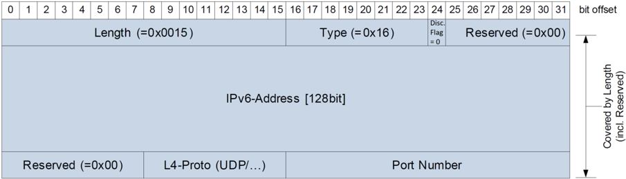

**IPv6** 组播选项的 IPv6-Address 字段 [128 位] 应按以下规则设置：

* 如果服务器服务传输 SubscribeEventgroupAck，则该字段应被设置为相应所提供事件组的已配置组播 **IP** 地址（服务器服务组播端点）。
* 如果客户端服务传输 SubscribeEventgroup 或 StopSubscribeEventgroup，则该字段应被设置为相应所消费事件组的已配置 **IP** 组播地址（客户端服务组播端点）。

**IPv6** 组播选项的 Port Number 字段 [16 位] 应按以下规则设置：

* 如果服务器服务传输 SubscribeEventgroupAck，则该字段应被设置为相应所提供事件组的已配置端口（服务器服务组播端点）。
* 如果客户端服务传输 SubscribeEventgroup 或 StopSubscribeEventgroup，则该字段应被设置为相应所消费事件组的已配置端口（客户端服务组播端点）。

**IPv6** 组播选项应被 SubscribeEventgroup、StopSubscribeEventgroup 或 SubscribeEventgroupAck 条目引用：

* 如果它被 SubscribeEventgroup 条目引用，则它描述客户端服务组播端点（即目的 **IP** 地址和目的端口），客户端应在该端点接收组播事件。
* 如果它被 StopSubscribeEventgroup 条目引用，则它表示停止先前通过客户端服务组播端点（即目的 **IP** 地址和目的端口）订阅了给定事件组的客户端的订阅意图。
* 如果它被 SubscribeEventgroupAck 条目引用，则它描述服务器服务组播端点（即目的 **IP** 地址和目的端口），服务器应将组播事件传输到该端点。

###### 4.1.2.4.7. IPv4 SD 端点选项

**IPv4** SD 端点选项用于传输发送方 SD 实现的端点（即 **IP** 地址和端口）。即使在无法使用 **IP** 地址和/或端口号的情形下，它也用于标识 **SOME/IP-SD** 实例。

**注意：**

这用于在无法使用 **IP** 地址和/或端口号的情形下标识 **SOME/IP-SD** 实例。一个用例是在一台 **ECU** 上为另一台 **ECU** 处理组播流量的代理服务发现。

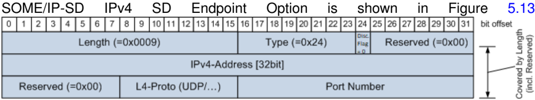

**IPv4** SD 端点选项可以在任何 SD 消息中被包含至多 1 次。

**只有当 **SOME/IP-SD** 消息通过 **IPv4** 传输时，才应包含 **IPv4** SD 端点选项。**

**接收方应忽略所有通过 **IPv6** 接收到的 **IPv4** SD 端点选项。**

**如果存在 **IPv4** SD 端点选项，则它应是选项数组中的第一个选项。**

**接收方应忽略所有位于选项数组第一个位置之后的 **IPv4** SD 端点选项。**

**IPv4** SD 端点选项不得被任何 SD 条目引用。

**接收方应忽略条目对 **IPv4** SD 端点选项的所有引用。**

**如果 SD 消息中包含了 **IPv4** SD 端点选项，则接收方 SD 服务实例应使用该选项的内容（而不是源 **IP** 地址和源端口）来应答该 SD 消息，并按照 PRS_SOMEIPSD_00631 标识用于重启检测的发送-接收关系。**

**注意：**

这对应答所接收的 SD 消息（例如 Find 之后的 Offer、Offer 之后的 Subscribe、Subscribe 之后的 Subscribe Ack）以及重启检测（基于 SD 端点选项而非外层地址的通道）都很重要。

**IPv4** SD 端点选项应使用类型 0x24。

**IPv4** SD 端点选项应规定发送方用于服务发现的 **IPv4** 地址、传输层协议（**ISO/OSI** 第 4 层）和端口号。

**IPv4** SD 端点选项的格式应如下：

- Length [uint16]：应设置为 0x0009。
- Type [uint8]：应设置为 0x24。
- Discardable Flag [1 位]：应设置为 0。
- 位 1 到位 7 保留，应为 0。
- IPv4-Address [uint32]：应以四个字节传输 **SOME/IP-SD** 的单播 **IP** 地址。
- Reserved [uint8]：应设置为 0x00。
- 传输协议（L4-Proto）[uint8]：应设置为 **SOME/IP-SD** 的传输层协议（当前：0x11 **UDP**）。
- 传输协议端口号（L4-Port）[uint16]：应设置为 **SOME/IP-SD** 的传输层端口（当前：30490）。

###### 4.1.2.4.8. IPv6 SD 端点选项

**IPv6** SD 端点选项用于传输发送方 SD 实现的端点（即 **IP** 地址和端口）。即使在无法使用 **IP** 地址和/或端口号的情形下，它也用于标识 **SOME/IP-SD** 实例。**SOME/IP-SD IPv6** SD 端点选项如图5.14 所示。

**注意：**

一个用例是在一台 **ECU** 上为另一台 **ECU** 处理组播流量的代理服务发现。

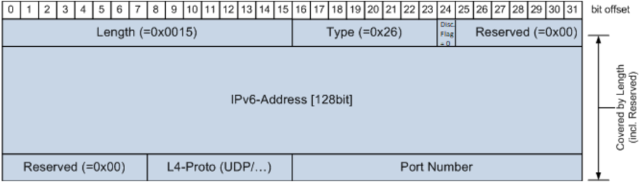

**IPv6** SD 端点选项可以在任何 SD 消息中被包含至多 1 次。

**如果存在 **IPv6** SD 端点选项，则它应是选项数组中的第一个选项。**

**接收方应忽略所有位于选项数组第一个位置之后的 **IPv6** SD 端点选项。**

**IPv6** SD 端点选项不得被任何 SD 条目引用。

**接收方应忽略条目对 **IPv6** SD 端点选项的所有引用。**

**如果 SD 消息中包含了 **IPv6** SD 端点选项，则接收方 SD 服务实例应使用该选项的内容（而不是源 **IP** 地址和源端口）来应答该 SD 消息，并按照 PRS_SOMEIPSD_00631 标识用于重启检测的发送-接收关系。**

**IPv6** SD 端点选项应使用类型 0x26。

**IPv6** SD 端点选项应规定发送方用于服务发现的 **IPv6** 地址、传输层协议（**ISO/OSI** 第 4 层）和端口号。

**IPv6** SD 端点选项的格式应如下：

- Length [uint16]：应设置为 0x0015。
- Type [uint8]：应设置为 0x26。
- Discardable Flag [1 位]：应设置为 0。
- 位 1 到位 7 保留，应为 0。
- IPv6-Address [uint128]：应以 16 个字节传输 **SOME/IP-SD** 的单播 **IP** 地址。
- Reserved [uint8]：应设置为 0x00。
- 传输协议（L4-Proto）[uint8]：应设置为 **SOME/IP-SD** 的传输层协议（当前：0x11 **UDP**）。
- 传输协议端口号（L4-Port）[uint16]：应设置为 **SOME/IP-SD** 的传输层端口（当前：30490）。

**只有当 **SOME/IP-SD** 消息通过 **IPv6** 传输时，才应包含 **IPv6** SD 端点选项。**

**接收方应忽略所有通过 **IPv4** 接收到的 **IPv6** SD 端点选项。**

##### 4.1.2.5. 服务条目

###### 4.1.2.5.1. Find Service 条目

**Find Service 条目类型应用于查找服务实例，并且只有在服务的当前状态未知（尚未接收到仍然有效的当前服务提供）时才应被发送。**

**Find Service 条目应按以下方式设置条目字段：**

- Type 应被设置为 0x00（FindService）。
- Service **ID** 应被设置为待查找服务的 Service **ID**。
- Instance **ID** 应被设置为 0xFFFF（如果应返回所有服务实例）。如果只应返回单个服务实例，则应被设置为该特定服务实例的 Instance **ID**。
- Major Version 应被设置为 0xFF，这意味着返回任何版本的服务。如果设置为 0xFF 以外的值，则只应返回具有该特定主版本的服务。
- Minor Version 应被设置为 0xFFFF FFFF，这意味着返回任何版本的服务。如果设置为 0xFFFF FFFF 以外的值，则只应返回具有该此次版本的服务。
- TTL 不用于 FindService 条目，可以设置为任意值。该字段仅为了向后兼容而定义，其值应被消息的接收方忽略。

**注意：** 预期在正常运行中客户端侧的 Major Version 被配置为一个特定值，因为客户端应查找特定的接口版本。不同的主版本彼此不兼容。

**发送方不得在 Find Service 条目中引用端点选项或组播选项。**

**接收方应忽略 Find Service 条目中的端点选项和组播选项。**

**其他选项（既非端点也非组播选项）仍允许在 Find Service 条目中使用。**

**当接收到 FindService 条目时，Service **ID**、Instance **ID**、Major Version 和 Minor Version 应与已配置的值精确匹配才能标识服务实例，除非条目中是「任意值」（即 Service **ID** 为 0xFFFF、Instance **ID** 为 0xFFFF、Major Version 为 0xFF、Minor Version 为 0xFFFFFFFF）。**

**如果在该服务器服务实例的 Initial Wait Phase 内接收到 FindService 条目，则应忽略它。**

###### 4.1.2.5.2. Offer Service 条目

**Offer Service 条目类型用于向其他通信伙伴提供服务。**

**Offer Service 条目应按以下方式设置条目字段：**

- Type 应被设置为 0x01（OfferService）。
- Service **ID** 应被设置为所提供服务实例的 Service **ID**。
- Instance **ID** 应被设置为所提供服务实例的 Instance **ID**。
- Major Version 应被设置为所提供服务实例的主版本。
- Minor Version 应被设置为所提供服务实例的次版本。
- TTL 应被设置为服务实例的生存期。在此生存期之后，该服务实例应被视为不再被提供。
- 如果 TTL 被设置为 0xFFFFFF，则 Offer Service 条目应被视为在下一次重启之前一直有效。
- 如果定义了 CYCLIC_OFFER_DELAY，则 TTL 应大于或等于 CYCLIC_OFFER_DELAY 的值。
- TTL 不得设置为 0x000000，因为那被视为 Stop Offer Service 条目。

**Offer Service 条目应始终引用一个 **IPv4** 或 **IPv6** 端点选项，以通告服务如何可达。**

**对于服务所需的每种传输层协议（即 **UDP** 和/或 **TCP**），如果支持 **IPv4**，则应添加一个 **IPv4** 端点选项。**

**对于服务所需的每种传输层协议（即 **UDP** 和/或 **TCP**），如果支持 **IPv6**，则应添加一个 **IPv6** 端点选项。**

**当接收到首个 OfferService 条目时，Service **ID**、Instance **ID**、Major Version 和 Minor Version 应与已配置的值精确匹配才能标识服务实例，除非服务配置中是「任意值」（即 Instance **ID** 为 0xFFFF、Minor Version 为 0xFFFFFFFF）。**

**当接收到后续的 OfferService 条目或 StopOfferService 条目时，Service **ID**、Instance **ID**、Major Version 应与首个 OfferService 条目中的值精确匹配才能标识服务实例。**

###### 4.1.2.5.3. Stop Offer Service 条目

**Stop Offer Service 条目类型用于停止提供服务实例。**

**Stop Offer Service 条目应与它要停止的 Offer Service 条目完全一样地设置条目字段，除了：**

- TTL 应被设置为 0x000000。

**StopOfferService（类型 0x01）应携带（即引用）与它要停止的条目相同的选项。**

###### 4.1.2.5.4. 条目中选项的使用

**表5.1：条目类型允许的选项类型**

| | 端点 | 组播 | 配置 | 负载均衡 |
| --- | --- | --- | --- | --- |
| FindService | 0 | 0 | 0-1 | 0-1 |
| OfferService | 1-2 | 0 | 0-1 | 0-1 |
| StopOffer Service | 1-2 | 0 | 0-1 | 0-1 |
| Subscribe Eventgroup | 0-2 | 0-1 | 0-1 | 0-1 |
| StopSubscribe Eventgroup | 0-2 | 0-1 | 0-1 | 0-1 |
| Subscribe EventgroupAck | 0 | 0-1 | 0-1 | 0-1 |
| Subscribe EventgroupNack | 0 | 0 | 0-1 | 0-1 |

##### 4.1.2.6. 服务与事件的端点处理

**如果静态配置的值与端点选项和组播选项中传输的值不同，服务发现应使用这些选项中传输的 **IP** 地址和端口号覆盖它们。**

**端点选项的 **IP** 地址和端口号也应用于传输事件和通知事件。**

**在 **UDP** 的情形下，端点选项应用于事件和通知事件的源地址和源端口；它也是客户端可以向其发送方法请求的地址。**

**在 **TCP** 的情形下，端点选项应用于客户端为了使用 **TCP** 接收事件而需要打开 **TCP** 连接的 **IP** 地址和端口。**

**SOME/IP** 应允许服务同时使用 **UDP** 和 **TCP**。

**哪条消息通过哪个底层传输协议发送应由配置决定：服务可以同时使用 **UDP** 和 **TCP** 端点。但服务的每个元素应配置为使用 **TCP** 还是 **UDP**。**

**注意：** 需要在配置中限制哪些方法、哪些事件通过 **TCP**/**UDP** 提供。这也意味着同一事件不能同时通过 **TCP** 和 **UDP** 提供。

###### 4.1.2.6.1. 服务端点

Offer Service 条目所引用的端点选项表示：

* 服务实例在服务器侧可达的 **IP** 地址和端口号。
* 服务实例发送事件所用的 **IP** 地址和端口号。

**该服务实例的事件不得从 Offer Service 条目的端点选项所给端点之外的任何端点发送。**

**如果一台 **ECU** 提供多个服务实例，则这些服务实例的 **SOME/IP** 消息应通过 Offer Service 条目所引用的端点选项中传输的信息来区分。**

###### 4.1.2.6.2. 事件组端点

**Subscribe Eventgroup 条目中引用的端点选项也应用于为该服务实例发送单播 **UDP** 或 **TCP SOME/IP** 事件。**

因此，Subscribe Eventgroup 条目中引用的端点选项就是客户端侧的 **IP** 地址和端口号。

**TCP 事件通过客户端在发送 Subscribe Eventgroup 条目之前打开的到服务器的 **TCP** 连接传输。**

**初始事件应使用从服务器到客户端的单播传输。**

**Subscribe Eventgroup Ack 条目应引用至多 1 个所用互联网协议（**IPv4** 或 **IPv6**）的组播选项。**

**组播选项应设置为 **UDP** 作为传输协议。**

**客户端应尽快打开 Subscribe Eventgroup Ack 条目所引用的组播选项中规定的端点，以免错过组播事件。**

示例：图5.15 展示了一个带有不同端点和一个组播选项的示例：

* 服务器在服务器 **UDP** 端点 SU 和服务器 **TCP** 端点 ST 上提供服务实例
* 客户端打开一条 **TCP** 连接
* 客户端发送一个带客户端 **UDP** 端点 CU（单播）和客户端 **TCP** 端点 CT 的 Subscribe Eventgroup 条目
* 服务器以带组播 MU 的 Subscribe Eventgroup Ack 条目应答

之后发生以下操作：

* 客户端调用服务器上的一个方法
* 请求从 CU 发送到 SU，响应从 SU 发送到 CU
* 对于 **TCP** 则是：请求从动态端口发送到 ST，RESPONSE 从 ST 发送到 CT
* 服务器发送单播 **UDP** 事件：SU 到 CU
* 服务器发送单播 **TCP** 事件：ST 到 CT
* 服务器发送组播 **UDP** 事件：SU 到 MU

请记住，组播端点在接收方（即客户端）侧使用组播 **IP** 地址，且 **TCP** 不能用于组播通信。

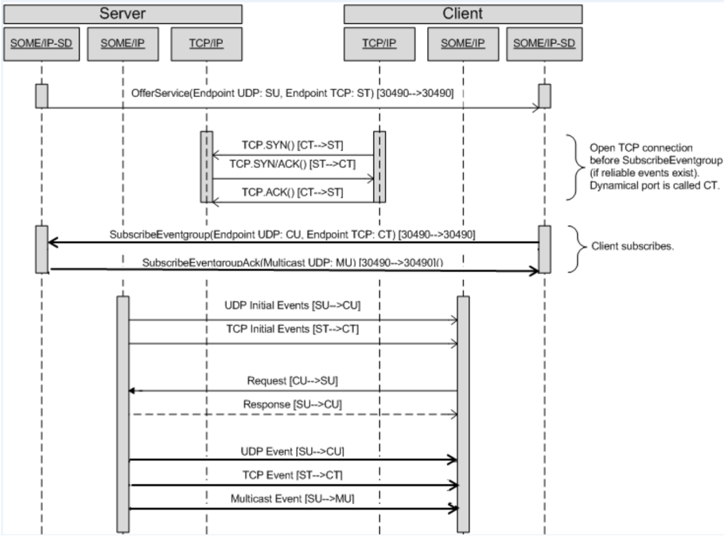

##### 4.1.3. 服务发现消息

**所有 SD 消息应被发送到 SD_PORT。**

**SD_PORT 应被用作 SD 单播/组播消息的源端口。**

**除非 SD 端点选项定义了不同的端口，所有单播 SD 消息应以 SD_PORT 作为目的端口。**

**所有 SD 组播消息应使用 SD_MULTICAST_IP 发送。**

**当接收服务发现消息时，接收方应忽略未知类型的条目。**

使用之前规定的报头格式，可以构建不同的条目以及由一个或多个条目组成的消息。特定的条目及其报头布局将在以下小节中解释。

###### 4.1.3.1.1. Subscribe Eventgroup 条目

**Subscribe Eventgroup 条目类型用于订阅一个事件组。**

**Subscribe Eventgroup 条目应按以下方式设置条目字段：**

- Type 应被设置为 0x06（SubscribeEventgroup）。
- Service **ID** 应被设置为包含所订阅事件组的服务实例的 Service **ID**。
- Instance **ID** 应被设置为包含所订阅事件组的服务实例的 Instance **ID**。
- Major Version 应被设置为所订阅事件组的服务实例的主版本。
- Eventgroup **ID** 应被设置为所订阅事件组的 Eventgroup **ID**。
- TTL 应被设置为订阅的生存期。
  - 如果设置为 0xFFFFFF，则 Subscribe Eventgroup 条目应被视为在下一次重启之前一直有效。
  - TTL 不得设置为 0x000000，因为那被视为 Stop Offer Service 条目。
- Reserved 在进一步通知之前应设置为 0x000。
- Counter 用于区分对同一服务同一事件组的并行订阅（仅端点不同）。未使用时设置为 0x0。

**SubscribeEventgroup 条目应引用客户端希望接收事件的端点（**IP** 地址、端口和协议）。客户端服务既可以用客户端单播端点、也可以用客户端组播端点订阅同一事件组：**

* 如果客户端通过一个端点选项以客户端单播端点订阅，则客户端声明其希望接收以给定单播端点为目标的单播事件。
* 如果客户端通过一个端点选项以客户端组播端点订阅，则客户端声明其希望接收以给定组播端点为目标的组播事件。

**SubscribeEventgroup 条目应按照以下规则引用选项：**

* 至多两个 **IPv4** 或至多两个 **IPv6** 端点选项（一个用于 **UDP**，一个用于 **TCP**）
* 或至多一个 **IPv4** 组播选项或至多一个 **IPv6** 组播选项（只支持 **UDP**）

**注意：**

这明确排除了单个服务实例同时通过 **IPv4** 和 **IPv6** 提供的情形。

网络通信设计必须考虑以下各点：

* 如果服务器只使用 **IP** 组播进行 **UDP** 上的事件传输，则 SubscribeEventgroup 条目不需要引用 **UDP** 端点选项。
* 如果服务器为某个事件组传输初始事件，则由于 PRS_SOMEIPSD_00487，SubscribeEventgroup 条目应引用一个相应的端点选项。
* 如果客户端服务以组播选项（客户端服务组播端点）订阅而服务器传输初始事件……

**当接收到 SubscribeEventgroup 或 StopSubscribeEventgroup 时，Service **ID**、Instance **ID**、Eventgroup **ID** 和 Major Version 应与已配置的值精确匹配才能标识服务实例的事件组。**

**如果服务器接收到一个不带 **UDP** 端点选项（参见 PRS_SOMEIPSD_00387）的 Subscribe Eventgroup 条目，且该事件组的 MULTI-CAST_THRESHOLD 未被配置为值 1，则应向客户端回送 SubscribeEventGroupNack。**

###### 4.1.3.1.2. Stop Subscribe Eventgroup 条目

**Stop Subscribe Eventgroup 条目类型用于停止订阅事件组。**

**Stop Subscribe Eventgroup 条目应与它要停止的 Subscribe Eventgroup 条目完全一样地设置条目字段，除了：**

- TTL 应被设置为 0x000000。

**Stop Subscribe Eventgroup 条目应引用该 Subscribe Eventgroup 条目所引用的相同选项。这包括但不限于端点和配置选项。**

###### 4.1.3.1.3. Subscribe Eventgroup 确认（Subscribe Eventgroup Ack）条目

**Subscribe Eventgroup 确认条目类型用于表示 Subscribe Eventgroup 条目被接受。**

**Subscribe Eventgroup 确认条目应按以下方式设置条目字段：**

- Type 应被设置为 0x07（SubscribeEventgroupAck）。
- Service **ID**、Instance **ID**、Major Version、Eventgroup **ID**、TTL、Reserved 和 Counter 应与被应答的 Subscribe Eventgroup 中的值相同。

**引用通过组播传输的事件和通知事件的 Subscribe Eventgroup Ack 条目应引用一个 **IPv4** 组播选项和/或一个 **IPv6** 组播选项。组播选项声明事件和通知事件将被发送到的组播地址和端口。**

**当接收到 SubscribeEventgroupAck 或 SubscribeEventgroupNack 时，Service **ID**、Instance **ID**、Eventgroup **ID** 和 Major Version 应与相应的 SubscribeEventgroup 条目精确匹配才能标识服务实例的事件组。**

###### 4.1.3.1.4. Subscribe Eventgroup 否定确认（Subscribe Eventgroup Nack）条目

**Subscribe Eventgroup 否定确认条目类型用于表示 Subscribe Eventgroup 条目未被接受。**

**Subscribe Eventgroup 否定确认条目应按以下方式设置条目字段：**

- Type 应被设置为 0x07（SubscribeEventgroupAck）。
- Service **ID**、Instance **ID**、Major Version、Eventgroup **ID**、Counter 和 Reserved 应与被应答的 Subscribe 中的值相同。
- TTL 应被设置为 0x000000。

**不接受 Subscribe Eventgroup 的原因包括（但不限于）：**

* Service **ID**、Instance **ID**、Eventgroup **ID** 和 Major Version 的组合未知
* 客户端未打开所需的 **TCP** 连接
* 所引用的选项出现问题
* 服务器上的资源问题
* 安全关联尚未建立

**当客户端接收到 SubscribeEventgroupNack 作为对需要 **TCP** 连接的 SubscribeEventgroup 的应答时，客户端应检查该 **TCP** 连接，并在需要时重启该 **TCP** 连接。**

**注意：** PRS_SOMEIPSD_00527 涉及检查网络安全协议的状态。

**理由：**

服务器可能已丢失 **TCP** 连接而客户端没有。

检查 **TCP** 连接可以包括以下内容：

* 检查是否收到例如其他事件组的数据
* 发送一条 Magic Cookie 消息并等待 **TCP ACK**
* 重建 **TCP** 连接

**表5.2：当前支持的条目类型概览**

| Type | TTL > 0（0x00） | TTL > 0（0x04） | TTL = 0（0x00） | TTL = 0（0x04） |
| --- | --- | --- | --- | --- |
| 0x00 | FindService | | | |
| 0x01 | OfferService | | StopOfferService | |
| 0x02 | | SubscribeEventgroup | | StopSubscribeEventgroup |
| 0x03 | | SubscribeEventgroupAck | | SubscribeEventgroupNack |

##### 4.1.4. 服务发现通信行为

**SOME/IP 服务发现应通过将可以在同一时间发送的条目打包在一起来减少服务发现消息的数量。例如：**

* 不同服务实例的多个条目
* 不同类型的多个条目（例如 Offer 条目、Subscribe EventGroup 条目的应答等）

###### 4.1.4.1. 启动行为

**对于每个服务实例，就发送条目而言，服务发现应至少有以下三个阶段：**

- Initial Wait Phase（初始等待阶段）
- Repetition Phase（重复阶段）
- Main Phase（主阶段）

**注意：**

一个实际实现的状态机将需要多于这三个阶段的状态。例如本地服务可能尚未就绪而远程服务已经已知（不再需要 Find）。

**当该服务实例所需接口上的链路已经就绪且应用已请求该客户端服务时，服务发现应为该客户端服务实例进入 Initial Wait Phase。**

**当该服务实例所需接口上的链路已经就绪且服务器服务可用时，服务发现应为该服务器服务实例进入 Initial Wait Phase。**

**注意：**

可能出现链路已就绪但服务器侧服务尚不可用的情形。

「系统已启动」在这里指所需的应用以及可能的外部传感器和执行器也已启动。基本上，该服务实例所需的功能必须已经就绪才能提供服务；在某个应用需要它之后，查找服务才是适用的。

**服务发现应在进入 Initial Wait Phase 之后、为该服务实例发送第一条消息之前，按 INITIAL_DELAY 进行等待。**

**INITIAL_DELAY 应被定义为最小和最大延迟。**

**等待时间应通过在 INITIAL_DELAY 的最小值和最大值之间选择一个随机值来确定。**

**如果 ClientService 和 ServerService 分别引用相同的 ClientServiceTimer 和 ServerServiceTimer，且能确保所引用的 ClientService 和 ServerService 分别在同一时间点被请求和释放，则服务发现应使用相同的随机值。**

**如果 ClientService 和 ServerService 分别引用自己的 ClientServiceTimer 和 ServerServiceTimer，则服务发现应为每个 ClientService 和 ServerService 使用不同的随机值。这样，当某个 ClientService 或 ServerService 进入 Initial Wait Phase 时，它们应在 Initial Wait Phase 内使用各自计算的随机值。**

**发送第一条消息之后，进入该服务实例的 Repetition Phase。**

**服务发现应在 Repetition Phase 中按 REPETITIONS_BASE_DELAY 等待。**

**在 Repetition Phase 中每发送一条消息之后，延迟加倍。**

**服务发现应在 Repetition Phase 期间只发送至多 REPETITIONS_MAX 条条目。**

**在接收到相应的 Offer 条目之后，应通过跳转到不发送 Find 条目的 Main Phase 来停止发送 Find 条目。**

**如果 REPETITIONS_MAX 被设置为 0，则应跳过 Repetition Phase，并在 Initial Wait Phase 之后为该服务实例进入 Main Phase。**

**在 Repetition Phase 之后，为该服务实例进入 Main Phase。**

**进入 Main Phase 之后，提供者应在发送第一条 Offer 条目消息之前等待 1*CYCLIC_OFFER_DELAY。**

**如果配置了 CYCLIC_OFFER_DELAY，则在 Main Phase 中应周期性发送 Offer 消息。**

**在为某个特定服务实例发送一条消息之后，服务发现等待 1*CYCLIC_OFFER_DELAY 再为该服务实例发送下一条消息。**

**对于 Find 条目（Find Service 和 Find Eventgroup），在 Main Phase 中不允许周期性消息。**

**Subscribe EventGroup 条目应由周期性发送的 Offer 条目触发。**

**示例：**

Initial Wait Phase（初始等待阶段）：

* 在范围 (INITIAL_DELAY_MIN, _MAX) 内等待随机延迟
* 发送消息（Find Service 和 Offer Service 条目）

Repetition Phase（重复阶段）（REPETITIONS_BASE_DELAY=100ms，REPETITIONS_MAX=2）：

* 等待 2^0 × 100 ms
* 发送消息（Find Service 和 Offer Service 条目）
* 等待 2^1 × 100 ms
* 发送消息（Find Service 和 Offer Service 条目）

Main Phase（主阶段）：

* 服务器：
  * 只要消息处于活动状态且定义了 CYCLIC_OFFER_DELAY
    * 等待 CYCLIC_OFFER_DELAY
    * 发送消息（Offer Service 条目）
* 客户端：
  * 只要收到 Offer Service 消息，就发送 Subscribe Eventgroup 消息

###### 4.1.4.2. 服务器应答行为

**服务发现应使用配置项 REQUEST_RESPONSE_DELAY 来延迟对在组播 **SOME/IP-SD** 消息中接收到的条目的应答。这适用于以下两种情形：**

* 在接收到（组播的）Find 条目之后的 Offer 条目（单播或组播）
* 在接收到（组播的）Offer 条目之后的 Subscribe 条目（单播）

**如果单播消息以单播消息应答，则不适用 REQUEST_RESPONSE_DELAY。**

**REQUEST_RESPONSE_DELAY 应通过最小值和最大值来规定。**

**实际延迟应在 REQUEST_RESPONSE_DELAY 的最小值和最大值之间随机选择。**

**对于基础实现，所有 Find Service 条目都应以使用单播传输的 Offer Service 条目应答。**

**出于优化的目的，应支持以下行为作为选项：**

* 在主阶段收到的、Unicast Flag 置为 1 的 Find 消息，如果最近的 Offer 是在不到 1/2 CYCLIC_OFFER_DELAY 之前发送的，应以单播响应应答。
* 在主阶段收到的、Unicast Flag 置为 1 的 Find 消息，如果最近的 Offer 是在 1/2 CYCLIC_OFFER_DELAY 或更久之前发送的，应以组播 RESPONSE 应答。

**以单播标志置为 0 接收的条目，不得以单播应答，而应被忽略。**

###### 4.1.4.3. 关停行为

**当一台 **ECU** 的服务器服务实例处于 Repetition Phase 或 Main Phase 并被停止时，应发出一条 Stop Offer Service 条目。**

**当处于 Initial Wait Phase、Repetition Phase 或 Main Phase 的服务器服务实例的链路断开时，服务发现应进入 Down Phase，并在链路恢复且服务仍然可用时重新进入 Initial Wait Phase。**

**当处于 Initial Wait Phase、Repetition Phase 或 Main Phase 的客户端服务实例的链路断开时，服务发现应进入 Down Phase，并在链路恢复且服务仍然可用时重新进入 Initial Wait Phase。**

**当服务器发出一条 Stop Offer Service 条目时，该服务实例的所有订阅应在服务器侧被删除。**

**当客户端接收到一条 Stop Offer Service 条目时，该服务实例的所有订阅应在客户端侧被删除。**

**当客户端接收到一条 Stop Offer Service 条目时，客户端不应发出 Find Service 条目，而是等待 Offer Service 条目或状态变化（应用、网络管理、以太网链路等）。**

**当一台 **ECU** 的客户端服务实例处于 Main Phase 并被停止（即服务实例被释放）时，SD 应为所有已订阅的事件组发出 Stop Subscribe Eventgroup 条目。**

**当整台 **ECU** 被关停时，应为所有服务条目发出 Stop Offer Service 条目，并为各事件组发出 Stop Subscribe Eventgroup 条目。**

###### 4.1.4.4. 状态机

**本节展示客户端和服务器的状态机。**

**SOME/IP 服务状态机服务器描述如下：**

SD Server State Machine(Service) 内的状态定义如下：

* SD Server State Machine(Service)
  * Not Ready（未就绪）
  * Ready（就绪）
    * Initial Wait Phase — Timer Set
    * Repetition Phase — Timer Set
    * Main Phase — Timer Set

SD Server State Machine(Service) 的初始入口点位于以下状态内：

* SD Server State Machine(Service)
  * Ready
    * Initial Wait Phase
    * Repetition Phase
    * Main Phase

状态机的图形化信息如图5.16 所示。

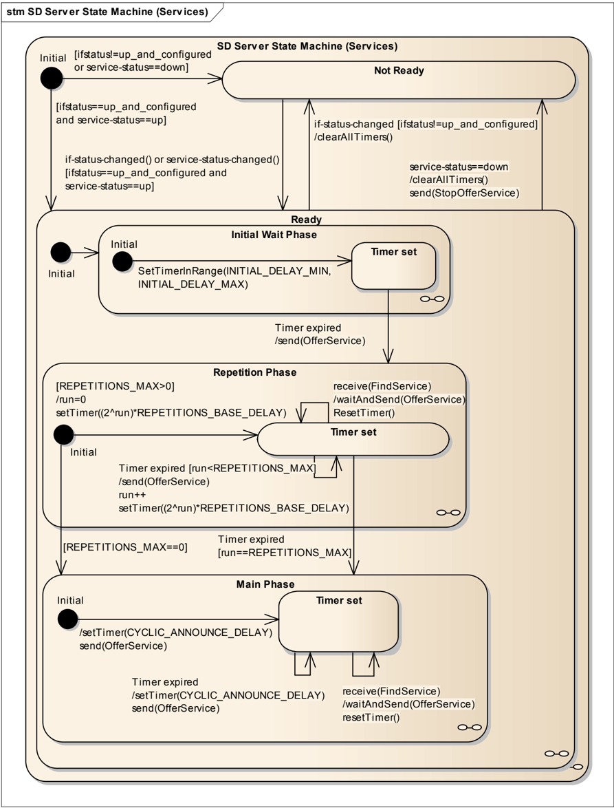

**SOME/IP 服务状态机客户端描述如下：**

SD Client State Machine(Service) 内的状态定义如下：

* SD Client State Machine(Service)
  * Not Requested（未请求）
    * Service Not Seen（未见服务）
    * Service Seen（已见服务）
  * Requested_but_not_ready（已请求但未就绪）
  * Main（主）
    * Service Ready（服务就绪）
    * Stopped（已停止）
  * Searching for Service（正在查找服务）
    * Initial Wait Phase — Timer Set
    * Repetition Phase — Timer Set

SD Client State Machine(Service) 的初始入口点位于以下状态内：

* SD Client State Machine(Service)
  * Not Requested
  * Searching for Service
    * Initial Wait Phase
    * Repetition Phase

（状态机转移的完整图形化描述见图5.17；源文档的转移列表在转换中严重粘连，以图替代呈现——运行决策，请用户在确认关核验。）

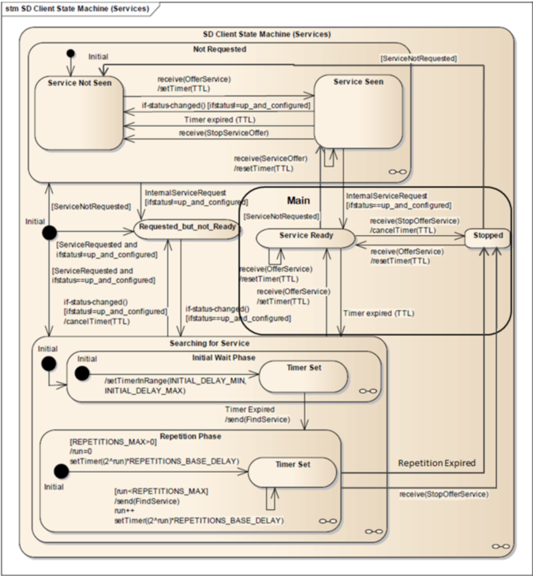

##### 4.1.4.5. SOME/IP-SD 机制与错误

本节讨论 **SOME/IP-SD** 在出错情形（例如丢失或损坏的数据包）下的行为。这也可以被理解为所用机制和可能配置的理由。

**软状态协议（Soft State Protocol）：** **SOME/IP-SD** 被设计为软状态协议，这意味着条目带有生存期，需要被刷新才能保持有效（将 TTL 设置为最大值将关闭该机制）。

**Initial Wait Phase（初始等待阶段）：** 引入初始等待阶段有两个原因：将正在启动的 **ECU** 的事件错开（deskew）以避免流量突发，以及允许 **ECU** 在 SD 消息中收集多个条目。

**Repetition Phase（重复阶段）：** 引入重复阶段是为了允许客户端和服务器的快速同步。如果客户端较晚启动，它将非常快地找到服务器；如果服务器较晚启动，客户端也能很快被找到。重复阶段将两条消息之间的时间按指数增加，以避免过载情形阻止系统同步。

**Main Phase（主阶段）：** 在主阶段中，SD 尝试稳定状态，因而通过不再发送 Find Service、只在周期性间隔（例如每 1 秒）发送 Offer 来降低数据包的速率。

**Request-Response-Delay（请求-响应延迟）：** **SOME/IP-SD** 应被配置为用请求-响应延迟来延迟对组播消息中条目的应答。这在拥有许多 **ECU** 的大型系统中很有用。当发送一条包含许多条目的 SD 消息时，来自不同 **ECU** 的许多应答会在同一时间到达，给接收所有这些应答的 **ECU** 带来很大压力。

##### 4.1.4.6. 错误处理

图5.18 展示了入站 **SOME/IP-SD** 消息错误处理的简化流程。

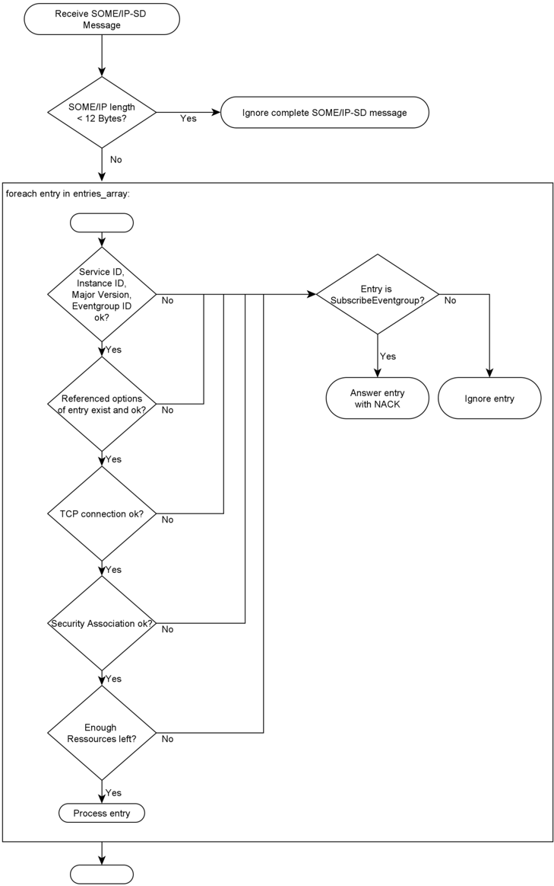

**检查是否至少存在一条空的 **SOME/IP-SD** 消息所需的字节数，即消息至少为 12 字节长。如果检查失败，应在不做进一步动作的情况下丢弃该消息。**

**如果所接收条目的 Service **ID** 未知且不是 Subscribe Eventgroup 条目，则应忽略该条目。否则应按照 PRS_SOMEIPSD_00393 返回否定确认。**

**如果所接收条目的 Instance **ID** 未知且不是 Subscribe Eventgroup 条目，则应忽略该条目。否则应按照 PRS_SOMEIPSD_00393 返回否定确认。**

**如果所接收条目的 Major Version 未知且不是 Subscribe Eventgroup 条目，则应忽略该条目。否则应按照 PRS_SOMEIPSD_00393 返回否定确认。**

**如果所接收条目的 Eventgroup **ID** 未知且不是 Subscribe Eventgroup 条目，则应忽略该条目。否则应按照 PRS_SOMEIPSD_00393 返回否定确认。这只适用于事件组条目。**

**如果 Entries Array 的长度具有无效的大小（即 entries 数组将超出消息大小），应在不做进一步动作的情况下丢弃该消息。**

**检查每个所接收条目引用的选项：**

* 所引用的选项存在。
* 该条目引用了所有必需的选项（例如使用单播的所提供事件组要求所接收的 Subscribe Eventgroup 条目中有一个单播端点选项）。
* 该条目只引用受支持的选项（例如不支持组播数据接收的所需事件组不支持 Subscribe Eventgroup ACK 条目中的组播端点选项）。
* 条目引用的选项之间没有冲突（即两个同类型但内容相互矛盾的选项）。
* 所引用选项的 Type 是已知的，或者 discardable 标志被置为 1。
* 所引用选项的 Type 对该条目是允许的（PRS_SOMEIPSD_00583），或者 discardable 标志被置为 1。
* 所引用选项的 Length 与该选项的 Type 一致。
* 端点选项具有有效的 L4-Protocol 字段。
* 该选项是有效的（例如组播端点选项应使用组播 **IP** 地址）。

**注意：**

如果某条目引用了一个服务发现实现已知但该服务不需要的选项（例如 Offer 引用了一个 **TCP** 和一个 **UDP** 选项而客户端只使用 **UDP**，或 Subscribe Eventgroup 条目引用了一个 **UDP** 端点选项而服务器只使用组播事件传输），则应处理该条目。

**检查 **TCP** 连接是否已经存在（仅当事件组配置了 **TCP** 且收到了 Subscribe Eventgroup 条目时适用）。**

**检查安全关联是否已经建立。**

**检查是否还有足够的资源剩余（例如套接字连接）。**

**如果 PRS_SOMEIPSD_00130 中的检查对所接收的 Find 条目失败，则应忽略该条目——除非它引用了端点或组播选项，此时只应按照 PRS_SOMEIPSD_00529 忽略这些选项。**

**如果 PRS_SOMEIPSD_00130 中的检查对所接收的 Offer 条目失败，则应忽略该条目。**

**如果 PRS_SOMEIPSD_00130、PRS_SOMEIPSD_00131、PRS_SOMEIPSD_00832、PRS_SOMEIPSD_00852 或 PRS_SOMEIPSD_00132 中的检查对所接收的 Subscribe Eventgroup 条目失败，则应发送 Subscribe Eventgroup NACK 条目。**

**如果 PRS_SOMEIPSD_00130 或 PRS_SOMEIPSD_00132 中的检查对所接收的 Subscribe Eventgroup ACK 条目失败，则应处理该条目，但该订阅不应被视为成功。**

**条目引用的选项在以下情形应被忽略：**

* 选项类型未知（即尚未被规定，或接收方不支持）且 discardable 标志被置为 1。
* 该选项是冗余的（即该条目引用了另一个同类型同内容的选项）。
* 该选项不是必需的（例如只使用组播的所提供事件组不需要所接收 Subscribe Eventgroup 条目中的单播端点选项，尽管它仍然是被允许的）。

**如果两个配置选项具有冲突的条目（相同的名称），则应处理所有条目。不应尝试合并重复的条目。**

**对于要求安全连接的所提供服务实例，检查在接收到订阅时相应连接的安全关联是否已经建立。**

##### 4.1.5. 使用 SOME/IP-SD 的非 SOME/IP 协议

除了 **SOME/IP** 之外，车辆内还使用其他通信协议；例如用于网络管理、诊断或刷写更新。此类通信协议可能同样需要通告服务实例或拥有事件组。

**对于非 **SOME/IP** 协议（应用协议本身不使用 **SOME/IP**，但通过 **SOME/IP SD** 发布），应使用一个特殊的 Service-ID，并使用配置选项添加进一步的信息：**

* Service-ID 应被设置为 0xFFFE（保留）
* Instance-ID 按照针对 **SOME/IP** 服务和事件组的描述使用。
* 应添加配置选项，并且它应恰好包含一个键为 "otherserv"、值为一个由系统部门确定的非空可配置值的条目。

**SOME/IP 服务不得在配置选项中使用 otherserv 字符串。**

**对于 Find Service/Offer Service/Request Service 条目，在通告非 **SOME/IP** 服务实例时应使用 otherserv 字符串。**

**有效 otherserv 字符串的示例："otherserv=internaldiag"。**

**无效 otherserv 字符串的示例："otherserv"。**

**无效 otherserv 字符串的示例："otherserv="。**

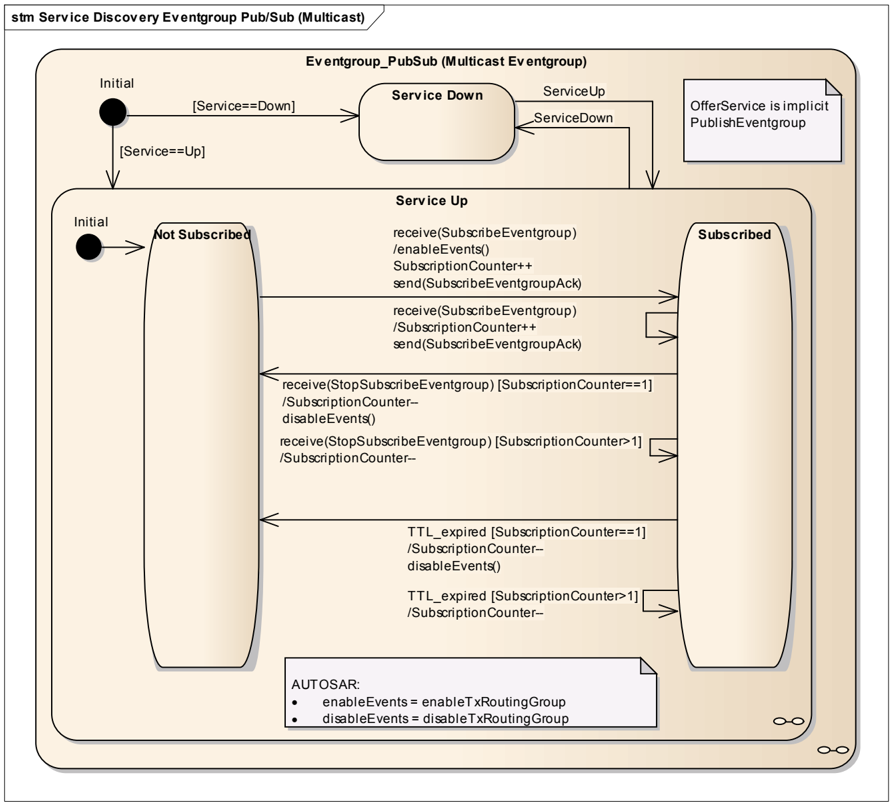

##### 4.1.6. 基于 SOME/IP 和 SOME/IP-SD 的发布/订阅

**注意：** 与 **SOME/IP** 请求/响应机制不同，可能存在这样的情形：客户端需要来自服务器的一组参数，但不想在每次需要时都请求该信息。这些被称为通知，涉及事件和字段。

**所有需要事件和/或通知事件的客户端应在运行时使用 **SOME/IP-SD** 向服务器注册。**

通知交互序列如下所示。

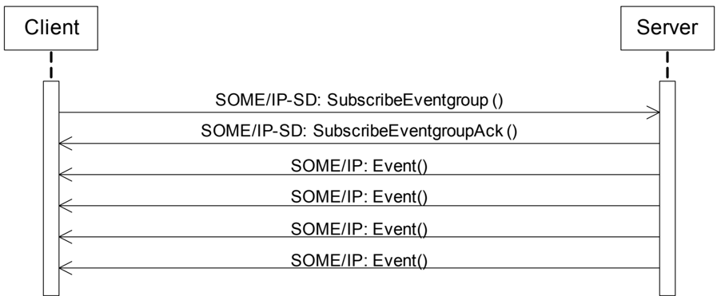

该特性与 **MOST** 通知机制相似但并不相同。

**服务器通过 **SOME/IP-SD** 条目 Offer Service 向客户端提供推送通知；因此，它应被用作订阅的触发。**

**只要客户端仍然对接收该事件组的通知/事件感兴趣，每个客户端都应以一条 **SOME/IP-SD** Subscribe Eventgroup 条目响应来自服务器的 **SOME/IP-SD** Offer Service 条目。如果客户端能够使用 **SOME/IP-SD** 消息的重启标志可靠地检测到服务器的重启，则客户端应像收到 StopOffer 条目那样处理该重启，并在 StopOffer 的所有动作完成之后继续处理所接收的条目。**

**如果客户端对相应事件组（字段而非纯事件）没有活动订阅，则客户端应通过在同一条 **SOME/IP-SD** 消息中发送一条 Stop Subscribe Eventgroup 条目和一条 Subscribe Eventgroup 条目，来显式请求字段 notifier 的初始事件。（参见 PRS_SOMEIPSD_00463）**

**不允许在订阅时请求事件的初始值（纯事件而非字段）。**

**如果客户端发出了附加的 Subscribe Eventgroup 条目且前一次 Subscribe 的 TTL 尚未过期，则客户端不应请求初始事件。**

客户端显式请求初始事件（参见 PRS_SOMEIPSD_00463）的原因包括但不限于：

* 客户端当前未订阅该事件组。
* 客户端在上一次 Subscribe Eventgroup 条目之后经历了链路断开/恢复。
* 客户端在上一次常规 Subscribe Eventgroup 之后尚未收到 Subscribe Eventgroup Ack。
* 客户端已检测到该服务服务器的重启。

**如果客户端订阅了两个或更多包含一个或多个相同事件或字段的事件组，服务器不得为该字段发送重复的事件或通知事件。这是指常规事件而非初始事件。**

**客户端侧链路丢失情形下的发布/订阅描述如下：**

1. 无先前注册 + 客户端订阅
   * (a) 服务器：OfferService()
   * (b) 客户端：SubscribeEventgroup [Session ID=x, Reboot=0]
   * (c) 服务器：updateRegistration()
   * (d) 服务器：SubscribeEventgroupAck + Events()
2. 客户端侧链路丢失
   * (a) 客户端：linkDown()
   * (b) 客户端：deleteEntries()
   * (c) 客户端：linkUp()
3. 客户端再次订阅，检测到客户端重启
   * (a) 服务器：OfferService()
   * (b) 客户端：SubscribeEventgroup [Session ID=1, Reboot=1]
   * (c) 服务器：updateRegistration()
   * (d) 服务器：SubscribeEventgroupAck + Events()

**注意：** 该描述同样见图5.21。

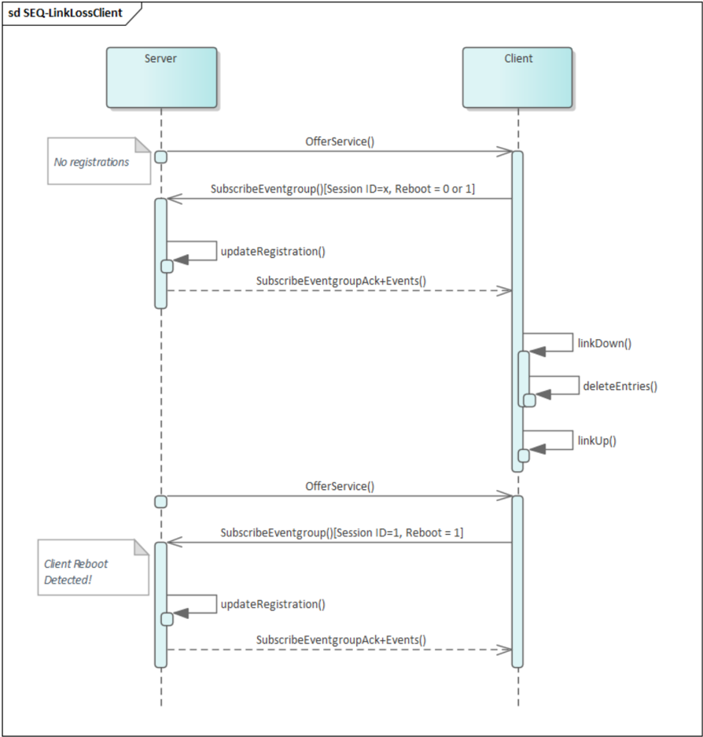

**注意：** 作为隐式发布而发送 Offer Service 条目的服务器，必须为该事件组实例保存 Subscribe Eventgroup 消息的状态，以便知道是否必须发送通知/事件。

**客户端应通过发送一条 TTL=0 的 **SOME/IP-SD** Subscribe Eventgroup 消息（Stop Subscribe Eventgroup，参见 PRS_SOMEIPSD_00389）从服务器注销。**

**发布/订阅注册/注销行为描述如下：**

1. 客户端 1 订阅
   * (a) 服务器：向客户端 1 和客户端 2 发送 OfferService()
   * (b) 客户端 1：SubscribeEventgroup()
   * (c) 服务器：updateRegistration()
   * (d) 服务器：向客户端 1 发送 SubscribeEventgroupAck + Events()
2. 客户端 2 订阅
   * (a) 客户端 2：SubscribeEventgroup()
   * (b) 服务器：updateRegistration()
   * (c) 服务器：向客户端 2 发送 SubscribeEventgroupAck + Events()
3. 客户端 2 停止订阅
   * (a) 客户端 2：StopSubscribeEventgroup()
   * (b) 服务器：updateRegistration()
4. 客户端 1 保持注册状态

**注意：** 该描述同样见图5.22。

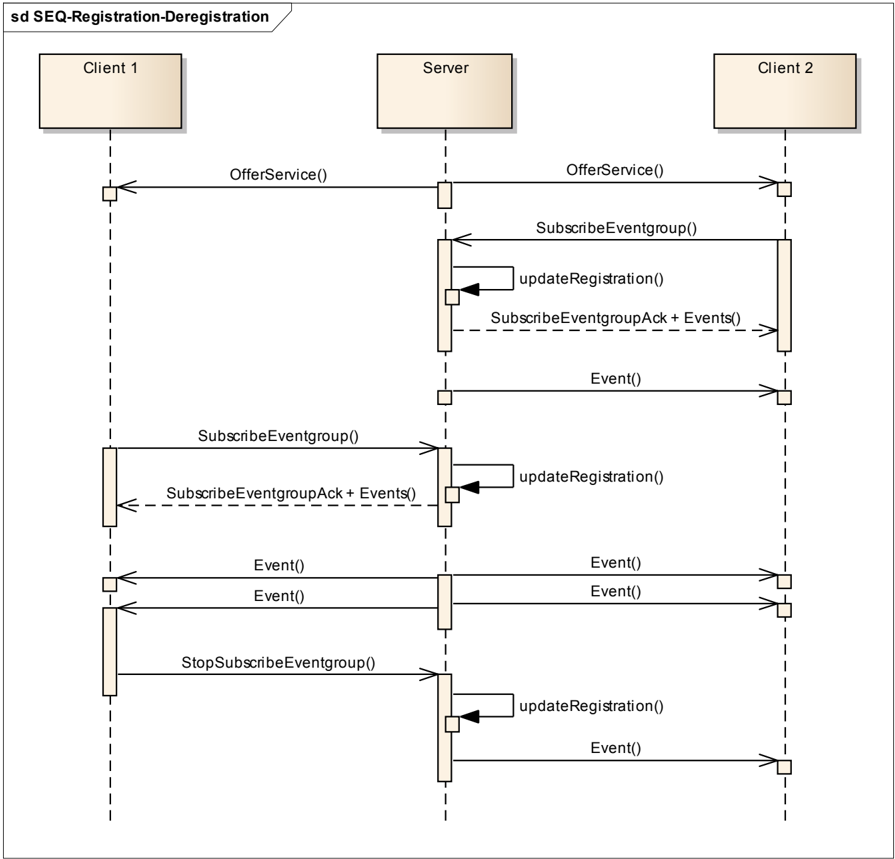

**如果发送事件或通知事件之后发生相关的 **SOME/IP** 错误，服务器上的 **SOME/IP-SD** 应删除该订阅。**

该错误包括但不限于无法到达通信伙伴以及 **TCP** 连接的错误。

**服务器侧链路丢失情形下的发布/订阅描述如下：**

1. 无先前注册 + 客户端订阅
   * (a) 服务器：OfferService()
   * (b) 客户端：SubscribeEventgroup()
   * (c) 服务器：updateRegistration()
   * (d) 服务器：SubscribeEventgroupAck + Events()
2. 服务器侧链路丢失
   * (a) 服务器：linkDown()
   * (b) 服务器：deleteRegistrations()
   * (c) 服务器：linkUp()
3. 服务器重新提供服务，客户端检测到服务器重启
   * (a) 服务器：OfferService() [Session ID=1, Reboot=1]
   * (b) 客户端：SubscribeEventgroup()
   * (c) 服务器：updateRegistration()
   * (d) 服务器：SubscribeEventgroupAck + Events()

**注意：** 该描述同样见图5.23。

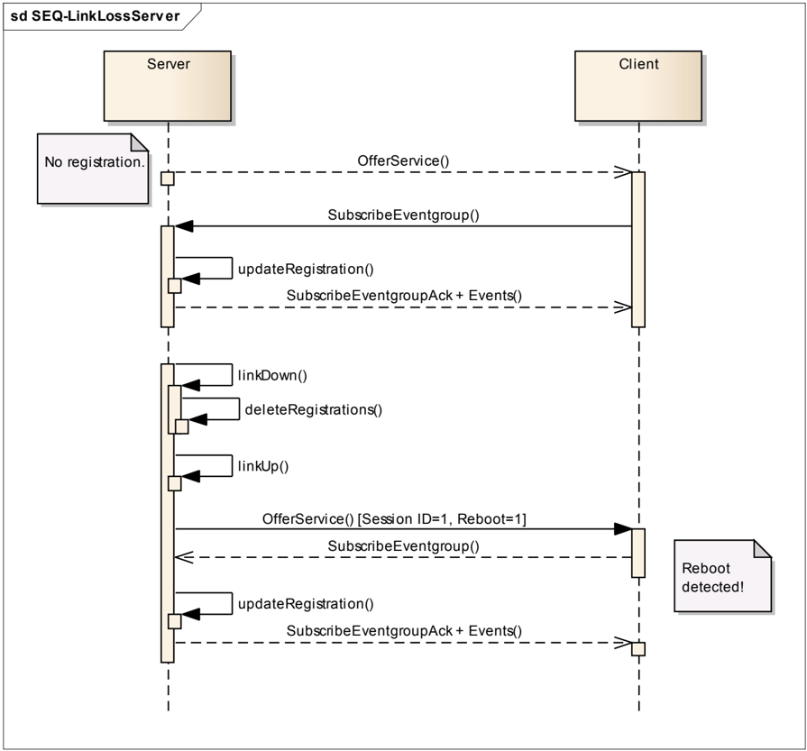

**如果服务通过 **TCP** 提供且客户端按配置请求通过 **TCP** 的某个事件组，则客户端应在发送 Subscribe Eventgroup 条目之前打开一条到服务器的 **TCP** 连接。**

**希望订阅要求安全关联的服务的客户端应（如果尚未开始）开始建立安全并等待安全关联建立完成。客户端应在安全关联建立之后为该服务发送 SubscribeEventgroup 条目。**

**对于要求只允许一方发起建立安全关联（如 (d)**TLS**）的安全关联，每台 **ECU** 应为服务器服务和客户端服务使用不同的端点，以确保该 **ECU** 对每条受保护的连接要么充当客户端（应发起安全关联的建立）、要么充当服务器。**

**在客户端发送 Subscribe Eventgroup 条目之后，服务器应发送一条 Subscribe Eventgroup Ack 条目。**

**客户端应等待确认 Subscribe Eventgroup 条目的 Subscribe Eventgroup Ack 条目。如果在该下一条 Subscribe Eventgroup 条目发出之前该 Subscribe Eventgroup Ack 条目尚未到达，客户端应执行以下操作：**

* 在原本要发送 Subscribe Eventgroup 条目的同一条 **SOME/IP-SD** 消息中，发送一条 Stop Subscribe Eventgroup 条目和一条 Subscribe Eventgroup 条目。

**注意：**

该行为用于应对短时间的通信丢失，新的初始事件会被触发，以降低消息丢失的影响。

**需求 PRS_SOMEIPSD_00463 不适用于作为对 Find Service 条目反应的 Offer Service 条目。这意味着由单播 Offer Service 条目触发的 Subscribe Eventgroup 条目，其 Subscribe Eventgroup Ack 条目不被监控；并且在单播 Offer Service 条目的情形下，不发送 Stop Subscribe Eventgroup 条目/Subscribe Eventgroup 条目。**

**理由：**

如果客户端作为对单播 Offer 的反应发送了 Subscribe Eventgroup 条目，而一条组播 Offer 在此之后立即到达——在服务器能够发送并被客户端接收 Subscribe Eventgroup Ack 条目之前——则客户端不得抱怨（即发送 Stop Subscribe/Subscribe）尚未收到的确认。

**注意：**

该行为用于应对短时间的通信丢失。Stop Subscribe Eventgroup 与 Subscribe Eventgroup 组合的接收方会发出初始事件，以降低消息丢失的影响。

**如果涉及初始值——即对字段而言——服务器应在发送 Subscribe Eventgroup Ack 之后立即发送第一批通知/事件（即初始事件）。**

**不允许在订阅时发送事件的初始值（纯事件而非字段）。**

**字段 notifier 的事件消息应在订阅时发送（字段而非纯事件）。**

**如果一个订阅已经有效并通过一条 Subscribe Eventgroup 条目被更新，则不应发送初始事件。**

**接收 Stop Subscribe / Subscribe 组合会触发字段 notifier 的初始事件。**

**初始事件应在 Subscribe Eventgroup Ack 之后发送。**

**发布/订阅状态（单播事件组的服务器行为）定义如下：**

* Eventgroup_PubSub（单播事件组）
  * Service Down（服务停机）
  * Service Up（服务运行）
    * Not Subscribed（未订阅）
    * Subscribed（已订阅）

（单播、组播与自适应单播/组播事件组的三种发布/订阅状态机的完整图形化描述见图5.24–5.26；源文档的转移列表在转换中严重粘连，以图替代呈现——运行决策，请用户在确认关核验。）

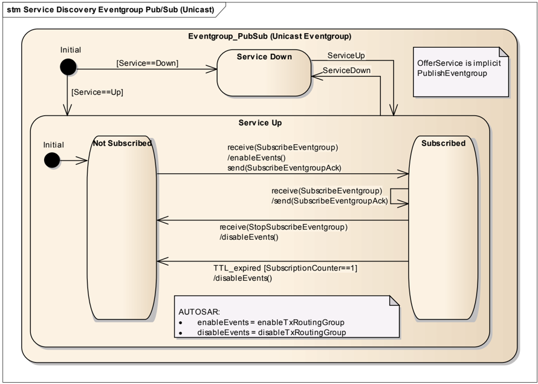

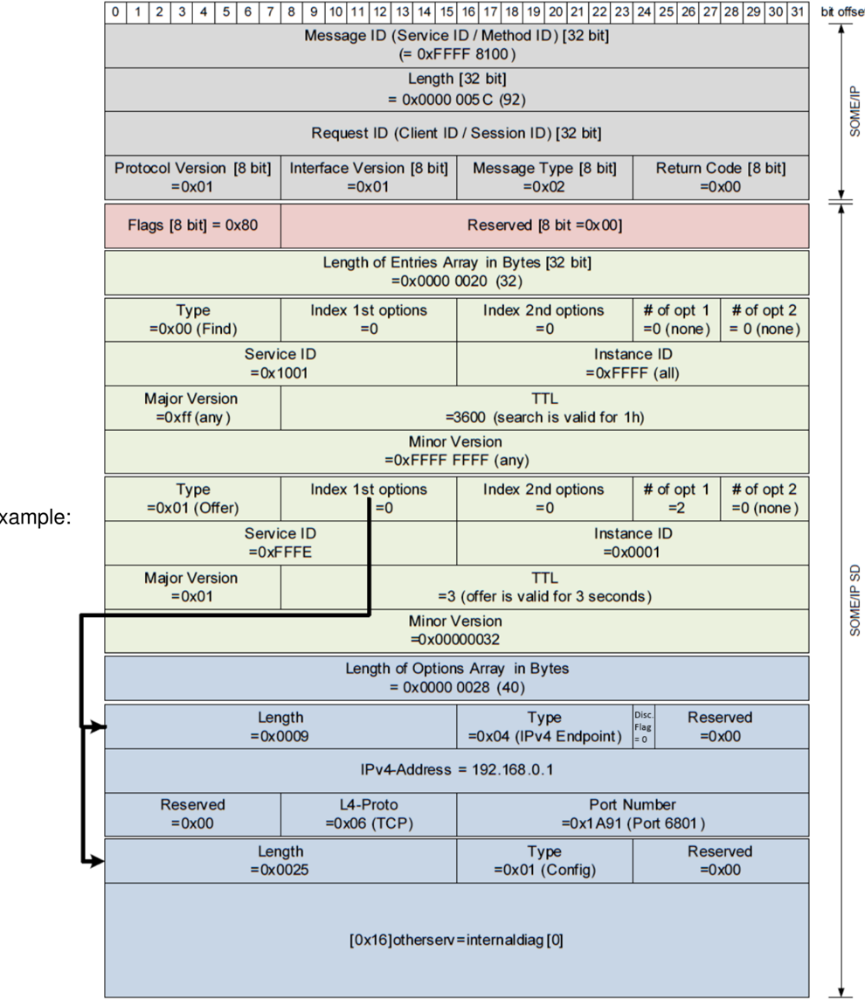

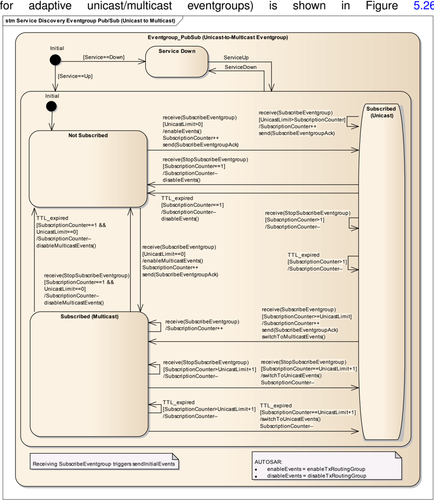

##### 4.1.7. SOME/IP 和 SOME/IP-SD 的保留和特殊标识符

本章给出保留和特殊标识符的概貌。

**表5.3：保留和特殊 Service-ID**

| Service-ID | 描述 |
| --- | --- |
| 0x0000 | 保留 |
| 0xFF00 - 0xFF1F | 保留给 **OEM** 测试 |
| 0xFF20 - 0xFF3F | 保留给一级供应商（**Tier-1**）测试 |
| 0xFF40 - 0xFF5F | 保留给 **ECU** 内部通信（一级供应商专有） |
| 0xFFFE | 保留给非 **SOME/IP** 服务实例。 |
| 0xFFFF | **SOME/IP** 和 **SOME/IP-SD** 特殊服务（Magic Cookie、**SOME/IP-SD** 等）。 |

**表5.4：保留和特殊 Instance-ID**

| Instance-ID | 描述 |
| --- | --- |
| 0x0000 | 保留 |
| 0xFFFF | 所有实例 |

**表5.5：保留和特殊 Method-ID**

| Method-ID | 描述 |
| --- | --- |
| 0x0000 | 保留 |
| 0x7FFF | 保留 |
| 0x8000 | 保留 |
| 0xFFFF | 保留 |

**表5.6：保留 Eventgroup-ID**

| Eventgroup-ID | 描述 |
| --- | --- |
| 0x0000 | 保留 |
| 0xFFFF | 所有事件组 |

**表5.7：服务 0xFFFF 的 Method-ID**

| Method-ID/Event-ID | 描述 |
| --- | --- |
| 0x0000 | **SOME/IP** Magic Cookie 消息 |
| 0x8000 | **SOME/IP** Magic Cookie 消息 |
| 0x8100 | **SOME/IP-SD** 消息（事件） |

**表5.8：保留名称**

| 名称 | 描述 |
| --- | --- |
| hostname | 用于命名主机或 **ECU**。 |
| instancename | 用于命名服务的一个实例。 |
| servicename | 用于命名一个服务。 |
| otherserv | 用于非 **SOME/IP** 服务。 |

## 5. 配置参数

以下章节汇总所使用的全部配置参数。

表6.1：配置参数（**Configuration Parameters**）

| 名称 | 描述 |
| --- | --- |
| INITIAL_DELAY_MIN | 随机延迟消息发送的最小持续时间。 |
| INITIAL_DELAY_MAX | 随机延迟消息发送的最大持续时间。 |
| REPETITIONS_BASE_DELAY | 重复的延迟时长。 |
| REPETITIONS_MAX | 最大重复次数的配置。 |
| REQUEST_RESPONSE_DELAY | 服务发现应使用该配置项延迟应答。 |
| SD_MULTICAST_IP | 定义用于服务发现消息的组播 **IP** 地址。 |
| TTL | 生存期。定义条目在必须刷新其有效期之前有效的时长。 |
| CYCLIC_OFFER_DELAY | 提供服务的周期性间隔。 |
| SD_PORT | 定义用于服务发现消息的 **UDP** 端口。 |
| MULTICAST_THRESHOLD | 定义订阅者的数量，超过该数量后事件通过组播端点发送。 |
| ETHERNET_LINK_DOWN | 定义链路状态是否改变。 |
| SdServerServiceTimer/SdClientServiceTimer | 定义计时器是否被共享。 |

## 6. 协议使用

### 6.1. 强制特性集与基本行为

本节讨论服务发现的强制特性集以及相关的配置约束。这使得可以只实现当前用例所需的基础实现，而不带可能不需要的可选或信息性特性。

以下信息被定义为符合性检查清单。如果某个特性未被实现，则该实现被视为不符合 **SOME/IP-SD** 的基本特性集。

**应实现以下条目类型：**

- Find Service（查找服务）
- Offer Service（提供服务）
- Stop Offer Service（停止提供服务）
- Subscribe Eventgroup（订阅事件组）
- Stop Subscribe Eventgroup（停止订阅事件组）
- Subscribe Eventgroup Ack（订阅事件组确认）
- Subscribe Eventgroup Nack（订阅事件组否定确认）

**当需要 **IPv4** 时，应实现以下选项类型：**

- **IPv4** 端点选项
- **IPv4** 组播选项
- 配置选项
- **IPv4** SD 端点选项（至少接收）

**当需要 **IPv6** 时，应实现以下选项类型：**

- **IPv6** 端点选项
- **IPv6** 组播选项
- 配置选项
- **IPv6** SD 端点选项（至少接收）

**服务器侧应实现以下行为/反应：**

* 服务器应根据配置提供包含 Initial Wait Phase、Repetition Phase 和 Main Phase 的服务。
* 服务器应在 SD_MULTICAST_IP 定义的组播地址上使用组播提供服务（Repetition Phase 和 Main Phase）。
* 服务器不需要应答 Repetition Phase 中的 Find Service。
* 服务器应以使用单播的 Offer Service 应答 Main Phase 中的 Find Service（不基于单播标志做优化）。
* 服务器在关停时应发送 Stop Offer Service。
* 服务器应接收 Subscribe Eventgroup 和 Stop Subscribe Eventgroup 并按本规范作出反应。
* 服务器应使用单播发送 Subscribe Eventgroup Ack 和 Subscribe Eventgroup Nack。
* 服务器应支持基于 **SOME/IP-SD** 的订阅控制 **SOME/IP** 事件消息的发送（即扇出）。这可能包括基于组播发送事件。
* 服务器应支持触发初始 **SOME/IP** 事件消息。

**客户端侧应实现以下行为/反应：**

* 客户端应只在重复阶段使用 Find Service 条目和组播（在 SD_MULTICAST_IP 定义的组播地址上）查找服务。
* 如果常规的 Offer Service 到达，客户端应停止查找服务。
* 客户端应以一条单播 SD 消息响应服务器的 Offer Service，该消息包含该客户端当前想订阅的服务器消息中所提供的服务的所有 Subscribe Eventgroup。
* 客户端应按本文档的规定解释并响应 Subscribe Eventgroup Ack 和 Subscribe Eventgroup Nack。

**客户端应支持以下行为和配置约束：**

* 客户端应能够处理只规定了 SD 时序 TTL 的事件组。这意味着在 Initial Wait Phase、Repetition Phase 和 Main Phase 的所有时序中只配置了 TTL。这意味着客户端只应对服务器的 Offer Service 作出反应。
* 客户端应以 Subscribe Eventgroup 应答 Offer Service，即使未配置请求-响应延迟，即它不应等待而应立即应答。

**客户端和服务器应实现本文档规定的重启检测并作出相应反应。这包括但不限于：**

* 按本规范设置 Session **ID** 和 Reboot Flag。
* 保存一个只用于发送组播 SD 消息的 Session **ID** 计数器。
* 为每个单播关系保存用于发送单播 SD 消息的 Session **ID** 计数器。
* 按本规范理解 Session **ID** 和 Reboot Flag。
* 为每台与本 **ECU** 交换组播 SD 消息的 **ECU** 保存一个组播 Session **ID** 计数器。
* 为每台与本 **ECU** 交换单播 SD 消息的 **ECU** 保存一个单播 Session **ID** 计数器。
* 基于本规范检测重启并作出相应反应。
* 正确解释与重启检测相关的 **IPv4** 和 **IPv6** SD 端点选项。

**客户端和服务器应实现「服务与事件的端点处理」。这包括但不限于：**

* 如果需要 **UDP**，向 Offer Service 添加 1 个端点选项 **UDP**。
* 如果需要 **TCP**，向 Offer Service 添加 1 个端点选项 **TCP**。
* 如果需要 **UDP** 事件，向 Subscribe Eventgroup 添加 1 个端点选项 **UDP**。
* 如果需要 **TCP** 事件，向 Subscribe Eventgroup 添加 1 个端点选项 **TCP**。
* 如果需要组播事件，向 Subscribe Eventgroup Ack 添加 1 个组播选项 **UDP**。
* 按如上所述理解并按照所传输的端点和组播选项行动。
* 用这些端点和组播选项的信息覆盖预配置的值（例如 **IP** 地址和端口）。
* 将入站的 **IPv4** 和 **IPv6** 端点选项解释为 SD 端点，而不是外层的地址和端口号。

**客户端和服务器应实现初始事件的显式请求。（参见 PRS_SOMEIPSD_00703）**

### 6.2. 迁移与兼容性

#### 6.2.1. 支持同一服务的多个版本。

为了支持迁移场景，**ECU** 应支持提供以及使用同一服务的不同的不兼容版本。

**为了支持一个具有多于一个版本的服务，需要以下内容：**

* 服务器应按每个主版本提供一次该服务的服务实例。
* 客户端应按每个受支持的主版本查找一次服务实例，或将 Major Version 用作 0xFF（所有版本）。
* 客户端应订阅其所需服务版本的事件。
* 所有 **SOME/IP-SD** 条目应使用相同的 Service-ID 和 Instance-ID，但使用不同的 Major Version。
* 服务器必须基于消息到达的套接字、Message-ID、主版本进行解复用，并基于这些条件在内部将其转交给正确的接收方。

**在一个 **VLAN** 中，具有相同 Service **ID**、Major Version 和 Instance **ID** 的服务实例应至多存在一个。这适用于服务器和客户端网络节点。**

**注意：** 不允许在同一网络节点上配置仅在次版本上不同的多于一个服务实例，因为它们在事件组条目中无法被区分。

## 7. 参考文献

<a id="ref-1"></a>[1] Glossary
> AUTOSAR_FO_TR_Glossary

## A. AUTOSAR 可追溯项变更历史

请注意，本章中的列表还包括在后续版本中已从规范中移除的可追溯项。这些可追溯项在文档中不作为超链接出现。

由于本批次决议整体省略需求项 **ID**，本附录源文档中的纯 **ID** 枚举列表以数量形式呈现。

### A.1. 本文档依据 AUTOSAR 版本 R23-11 的可追溯项变更历史

#### A.1.1. R23-11 中新增的规范项

新增 7 项。

#### A.1.2. R23-11 中变更的规范项

变更 12 项。

#### A.1.3. R23-11 中删除的规范项

无。
