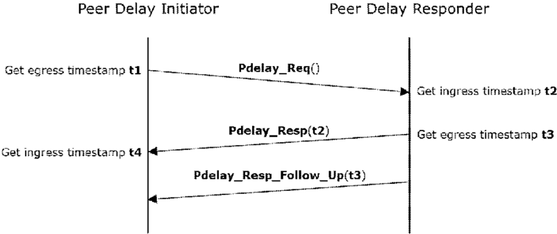
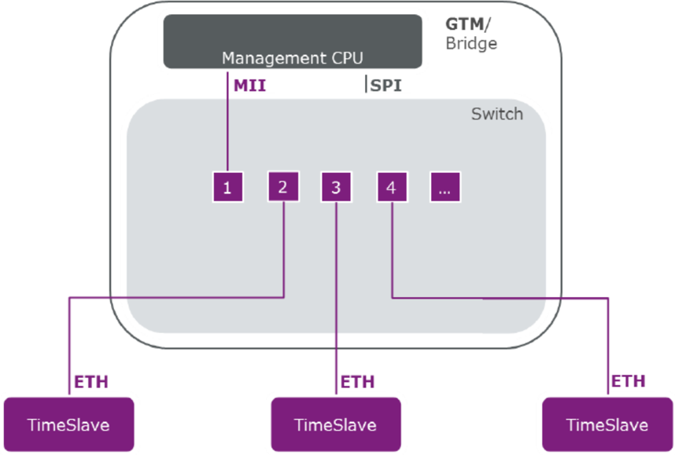
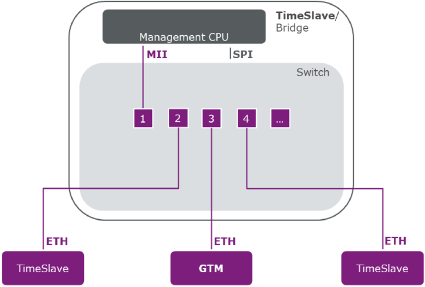
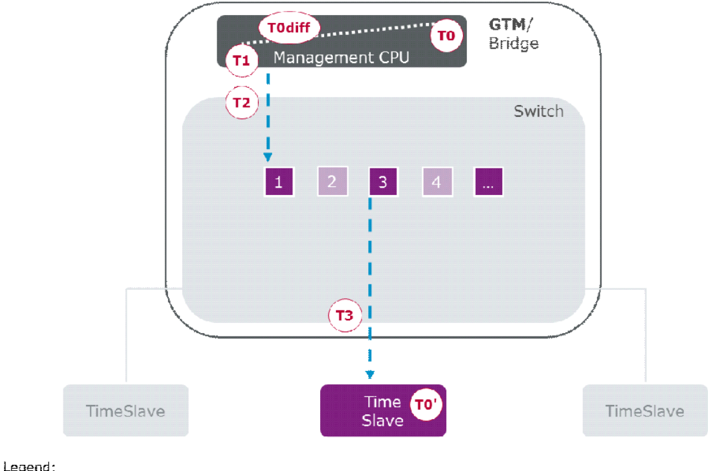
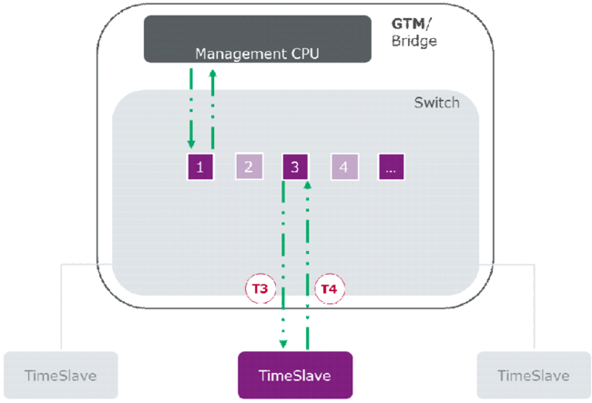
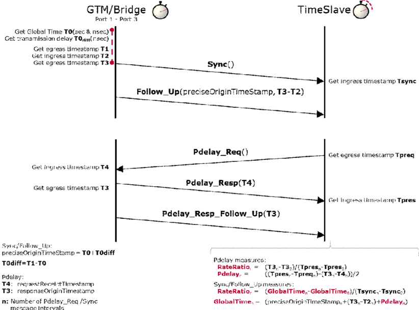
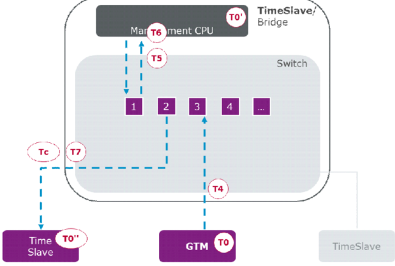
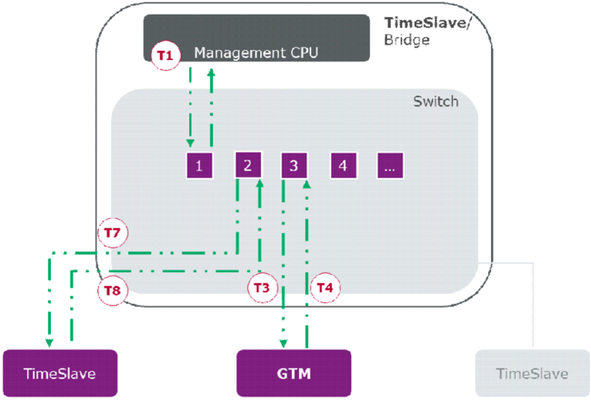

<!-- 源文档 AUTOSAR_FO_PRS_TimeSyncProtocol（R23-11），协议规范（PRS），不受 Type A 七章骨架约束；章节结构镜像源文档自身编号。协议项 ID 标记与源文档的草稿标志（Draft 类标记）按 2026-11-03 批次决议整体省略（标题仅翻译，协议项以加粗标题行 + 段落形式呈现）；协议项中的 ⌋(…) 追溯行随 ID 一并省略；协议项之间的交叉引用（PRS_TS_*）以不带方括号的标识符原样保留。源第 2 章「Protocol Requirements / Requirements Traceability」为纯 ID 追溯表，按 2026-11-03 决议整章省略并将后续章节重编号（源 3→2、4→3、5→4、6→5、7→6）；随该章一并省略的还有其内的 2 处追踪概览图。源 §4.3.2「Body/Payload format」与 §4.5「Services / Commands」整节内容均为「Placeholder for upcoming AUTOSAR releases.」，按占位规则省略（后续小节相应重编号：源 4.3.3→3.3.2、4.6→3.5、4.7→3.6、4.8→3.7、4.9→3.8、4.10→3.9、4.11→3.10、4.12→3.11）——省略项请用户在确认关核验。封面元数据表、免责声明与目录按 EXP 流程省略；75 处图引用中 8 处为内容图（图4.1 Pdelay 延迟测量、图4.2–4.8 时间感知网桥的各种报文流/时间戳序列图），按源图号嵌入，其余为页面装饰。§4.7–§4.10 正文中引用图的编号沿用了旧版的「Figure 5.x」（如 Figure 5.2 实为图4.2），正文按实际图号（图4.2 等）呈现，图号错位为源文档遗留问题。图内标签散落（Management CPU、SPI、GTM/Bridge、Legend、T1/T2、Sync/Follow_Up 图例等）按转换噪声丢弃。5 处被 PDF 转换丢失的公式（式 4.1–4.6）已从 R23-11 PDF 恢复为文本形式。报文格式字节表中跨页/错排的单元格（如 Follow_Up Message Header [AUTOSAR] 报头前两行错位、「Status Not Secured」表 Length 行）已按上下文重组。附录 A 的纯 ID 枚举按批次决议以数量呈现。 -->

## 1. 简介和概述

本协议规范规定 **AUTOSAR** 时间同步协议（**Time synchronization Protocol**）的格式、消息序列和语义。

时间同步协议处理时间信息在以太网上的分发。该以太网机制基于现有的 **PTP**（精确时间协议）机制，这些机制在 **IEEE 1588**（网络化测量和控制系统的精密时钟同步协议标准）和 **IEEE 802.1AS**（桥接局域网中时间敏感应用的定时和同步）等标准中描述。**IEEE 802.1AS**，也称为 **gPTP**（通用精确时间协议），可以看作是使用 **IEEE 1588** 的一个 profile（或子集）。然而，**IEEE 1588** 和 **IEEE 802.1AS** 在开发时都没有考虑汽车需求。因此，以太网时间同步使用 **IEEE 802.1AS** 中定义的现有机制，并带有特定的扩展和/或限制。汽车以太网网络在以下方面与商用以太网网络不同：

- **ECU** 的角色和功能是先验已知和定义的
- 网络是静态的，即 **ECU**、交换机等组件以及电缆长度等特性，在运行期间甚至在车辆熄火并重新上电之后都不会改变。当然，组件可能不可用（由于失效情形或有意的），但大多只在车辆处于维修设施时才会变化。

因此，不需要诸如在运行期间通过最佳主时钟算法（**BMCA**）确定全局时间主节点（在 **IEEE 802.1AS** 中表示为 grandmaster）之类的动态机制。由于汽车网络的静态特性，也可以省略以太网链路上链路延迟的周期性测量，并限制属于动态网络拓扑的机制。

### 1.1. 协议目的和目标

时间同步协议用于：

- 同步时基和相应的以太网消息
- 测量以太网帧之间的时间差

### 1.2. 协议的适用性

该概念的目标是支持时间关键和安全相关的汽车应用，例如安全气囊系统和制动系统。这并不意味着该概念拥有此类系统所需的全部内容，但考虑了不能推迟到实现中的关键时序相关特性。

该概念还旨在保护时基，以支持信息安全关键用例，例如数字证书有效期检查和安全日志记录。保护时间关键和安全相关汽车应用中使用的时基同样重要。

#### 1.2.1. 约束和假设

本文档规定 **AUTOSAR** 时间同步协议。它是在 **AUTOSAR** 基础标准 1.5.0 的制定期间创建的，该制定与 **AUTOSAR** 经典标准 4.4.0 的开发并行进行。它已经反映了为 **AUTOSAR** 经典平台所做的工作给 TimeSyncOverEthernet 带来的全部变更。

#### 1.2.2. 限制

- 不支持 **BMCA** 协议，如 [\[1\]](#ref-1)（IEEE 802.1 AS）所规定
- 不支持 Announce 和 Signaling 消息，如 [\[1\]](#ref-1)（IEEE 802.1 AS）所规定
- Pdelay_Req 的接收不作为开始发送 Sync 消息的前提条件
- 虽然 **IEEE 802.1AS** 指出 **IEEE 802.1AS** 消息不应带有 **VLAN** 标签或优先级标签，但时间同步协议将允许在 **VLAN** 上进行时间同步，条件是交换机硬件支持使用 01:80:C2:00:00:00 .. 0F 范围内的保留组播地址的转发
- 本文档语境中的「CRC secured」指 **CRC** 完整性保护机制，并不意味着将 **CRC** 用作信息安全解决方案
- 不支持保护 Pdelay 协议的消息

#### 1.2.3. 精度

时间同步的精度取决于多种因素（例如振荡器精度、网络路径中网桥的数量、配置等）。关于如何正确配置整个系统以获得尽可能高的精度的建议，参见 [\[2\]](#ref-2)（EXP Time Sensitive Network Features）的「时间同步的精度（**Accuracy of Time Synchronization**）」一章。

### 1.3. 依赖性

#### 1.3.1. 对其他协议层的依赖性

与其他协议没有依赖性。

#### 1.3.2. 对其他标准和规范的依赖性

**AUTOSAR** 时间同步协议派生自 [\[1\]](#ref-1)（IEEE 802.1 AS）。关于 **VLAN** 特性，参见 [\[3\]](#ref-3)（IEEE 802.1Q）。

#### 1.3.3. 对应用层的依赖性

与应用层没有依赖性。

## 2. 术语和缩略语的定义

### 2.1. 缩略语和缩写

(G)TD
> （全局）时域（**（Global）Time Domain**）

(G)TM
> （全局）时间主节点（**（Global）Time Master**）

&lt;Bus&gt;TSyn
> 总线特定的时间同步模块

AVB
> 音视频桥接（**Audio Video Bridging**）

BMCA
> 最佳主时钟算法（**Best Master Clock Algorithm**）

CID
> 公司 **ID**（**IEEE**）

CRC
> 循环冗余校验和（**Cyclic Redundancy Checksum**）

Debounce Time
> 具有相同 **PDU** 的两条发送消息之间的最小间隔

ETH
> 以太网（**Ethernet**）

EthTSyn
> 面向以太网的时间同步提供者模块

Follow_Up
> 时间传输消息（Follow-Up）

GM(C)
> Grand Master（Clock）

ICV
> 完整性校验值（**Integrity Check Value**）

IDS
> 入侵检测系统（**Intrusion Detection System**）

OFS
> 偏移同步（**Offset synchronization**）

Pdelay
> IEEE 802.1AS 中给出的传播/路径延迟

Pdelay_Req
> 传播/路径延迟请求消息

Pdelay_Resp
> 传播/路径延迟响应消息

Pdelay_Resp_Follow_Up
> 传播/路径延迟后续消息

PDU
> 协议数据单元（**Protocol Data Unit**）

PTP
> 精确时间协议（**Precision Time Protocol**）

StbM
> 同步时基管理器（**Synchronized Time-Base Manager**）

Timesync
> 时间同步（**Time Synchronization**）

Sync
> 时间同步消息（Sync）

TG
> 时间网关（**Time Gateway**）

TLV
> 多种协议（例如 **IEEE 802.1AS**）用于编码数据元素的类型/标签-长度-值（**Type/Tag-Length-Value**）编码方案

TS
> 时间从节点（**Time Slave**）

TSD
> 时子域（**Time Sub-domain**）

VLAN
> 虚拟局域网（**Virtual Local Area Network**）

linkDelay
> [\[1\]](#ref-1)（IEEE 802.1 AS）定义的 neighborPropDelay

neighborRateRatio
> Peer Delay 响应者与 Peer Delay 发起者的本地时钟之间的邻居速率比（**Neighbor Rate Ratio**），按 [\[1\]](#ref-1)（IEEE 802.1 AS）的定义（参见 PRS_TS_00259）

cumulativeScaledRateOffset
> [\[1\]](#ref-1)（IEEE 802.1 AS）定义的 cumulativeScaledRateOffset

t1
> Peer Delay 发起者侧 Pdelay_Req 消息的出口时间戳（参见图4.1）

t2
> Peer Delay 响应者侧 Pdelay_Req 消息的入口时间戳（参见图4.1）

t3
> Peer Delay 响应者侧 Pdelay_Resp 消息的出口时间戳（参见图4.1）

t4
> Peer Delay 发起者侧 Pdelay_Resp 消息的入口时间戳（参见图4.1），参见 PRS_TS_00259

## 3. 协议规范

### 3.1. 总体

时间主节点和时间从节点应使用 [\[1\]](#ref-1)（IEEE 802.1 AS）定义的默认配置值（例如 **MAC** 目的地址或以太网帧类型），除非本规范中另有规定。

时间主节点和时间从节点应在不进行 Announce 消息识别的情况下启动其协议状态机。

时间主节点和时间从节点应在接收侧忽略 Announce 消息。

### 3.2. VLAN 支持

如果 FramePrio 存在，则应使用带有优先级和 **VLAN** 标签的帧格式。否则应使用不带优先级和 **VLAN** 标签的帧格式。

### 3.3. 消息格式

需要对 [\[1\]](#ref-1)（IEEE 802.1 AS）进行一些消息扩展。这是通过一个新的 **AUTOSAR** 特定 **TLV** 实现的，该 **TLV** 使用了一个仅属于 **AUTOSAR** 的新 **IEEE CID**（0x1A75FB）。**IEEE 802.1AS TLV** 只可用于消息类型 Announce（本规范不考虑）和 Follow_Up（由本规范扩展）。新 **TLV** 的 organizationId 标识 **AUTOSAR TLV**，它后继于 **IEEE 802.1AS TLV**。

**AUTOSAR TLV** 包含 Sub-TLV，后者始终由一个 Type、一个 Length 和一个数据区组成。

**CRC** 的使用是可选的。为了确保多个时间观测单元之间的充分可变性，由配置决定如何处理受保护的 Sub-TLV 的 **CRC**。如果接收方不支持 **CRC** 计算，则接收方可能只使用给定的值，而不自行评估 **CRC**。

如果使用 **CRC** 选项，则必须考虑一个副作用。由于 Pdelay 消息不包含任何 **TLV**，对相关时间戳的 **CRC** 保护是不可能的。如果应用将 **CRC** 用于 Follow_Up，同时 Pdelay 是非静态的，则在计算相应时基的值时，未受保护的 Pdelay 时间值必须与受保护的 Follow_Up 时间值混合使用。

**ICV** 的使用是可选的。为了确保多个时间观测单元之间的充分可变性，由配置决定如何处理经过认证的 Sub-TLV 的 **ICV**。如果接收方不支持 **ICV** 验证，则接收方可能只使用给定的值，而不自行验证 **ICV**。

如果使用 **ICV** 选项，则必须考虑一个副作用。由于 Pdelay 消息不包含任何 **TLV**，对相关时间戳的 **ICV** 保护是不可能的。如果应用将 **ICV** 用于 Follow_Up，同时 Pdelay 是非静态的，则在计算相应时基的值时，未受保护的 Pdelay 时间值必须与受保护的 Follow_Up 时间值混合使用。

消息格式等应派生自 [\[1\]](#ref-1)（IEEE 802.1 AS）第 10 章「Media-independent layer specification」和第 11 章「Media-dependent layer specification for full-duplex, point-to-point links」，除非另有规定。

多字节值的字节序为大端（**Big Endian**），这与 [\[1\]](#ref-1)（IEEE 802.1 AS）定义的字节序相同。

#### 3.3.1. 报头格式

##### 3.3.1.1. IEEE 802.1AS 的 Sync 和 Follow_Up

如果 MessageCompliance 设置为 TRUE，则应按照 [\[1\]](#ref-1)（IEEE 802.1 AS）支持 Sync 和 Follow_Up 格式。

**注意：** 这意味着一个时域（0）。

下表给出了一个符合 [\[1\]](#ref-1)（IEEE 802.1 AS）的 Sync 的概貌。

Sync 消息报头 [IEEE 802.1AS]

| 高半字节 | 低半字节 | 字节数 | 偏移 | 值 |
| --- | --- | --- | --- | --- |
| transportSpecific | messageType | 1 | 0 | 0x10 |
| reserved | versionPTP | 1 | 1 | 0x02 |
| messageLength | | 2 | 2 | 44 |
| domainNumber | | 1 | 4 | (UInteger8) domainNumber = 0 |
| reserved | | 1 | 5 | 0 |
| flags | | 2 | 6 | Octet 0: 0x02, Octet 1: 0x08 |
| correctionField | | 8 | 8 | (Integer64) correctionField |
| reserved | | 4 | 16 | 0 |
| sourcePortIdentity | | 10 | 20 | (PortIdentity) 来自源时间感知终端站的 portIdentity |
| sequenceId | | 2 | 30 | (UInteger16) SyncSequenceId = (UInteger16)(prevSyncSequenceId+1) |
| control | | 1 | 32 | 0 |
| logMessageInterval | | 1 | 33 | (Integer8) currentLogSyncInterval |

Sync 消息字段 [IEEE 802.1AS]

| 高半字节 | 低半字节 | 字节数 | 偏移 | 值 |
| --- | --- | --- | --- | --- |
| PTP 消息报头 | | 34 | 0 | [参见 Sync 消息报头] |
| reserved | | 10 | 34 | 0 |

下表给出了一个符合 [\[1\]](#ref-1)（IEEE 802.1 AS）的 Follow_Up 的概貌。

Follow_Up 消息报头 [IEEE 802.1AS]

| 高半字节 | 低半字节 | 字节数 | 偏移 | 值 |
| --- | --- | --- | --- | --- |
| transportSpecific | messageType | 1 | 0 | 0x18 |
| reserved | versionPTP | 1 | 1 | 0x02 |
| messageLength | | 2 | 2 | 76 |
| domainNumber | | 1 | 4 | (UInteger8) domainNumber = 0 |
| reserved | | 1 | 5 | 0 |
| flags | | 2 | 6 | Octet 0: 0x00, Octet 1: 0x08 |
| correctionField | | 8 | 8 | 0..281474976710655ns（1ns = 2^16 = 0x0000 0000 0001 0000） |
| reserved | | 4 | 16 | 0 |
| sourcePortIdentity | | 10 | 20 | (PortIdentity) 来自源时间感知终端站的 portIdentity |
| sequenceId | | 2 | 30 | (UInteger16) SyncSequenceId |
| control | | 1 | 32 | 2 |
| logMessageInterval | | 1 | 33 | (Integer8) currentLogSyncInterval |

Follow_Up 消息字段 [IEEE 802.1AS]

| 高半字节 | 低半字节 | 字节数 | 偏移 | 值 |
| --- | --- | --- | --- | --- |
| PTP 消息报头 | | 34 | 0 | [参见 Follow_Up 消息报头] |
| preciseOriginTimestamp | | 10 | 34 | (Timestamp) preciseOriginTimestamp |
| Follow_Up information TLV | | 32 | 44 | 参见 Follow_Up information TLV |

Follow_Up information TLV [IEEE 802.1AS]

| 高半字节 | 低半字节 | 字节数 | 偏移 | 值 |
| --- | --- | --- | --- | --- |
| tlvType | | 2 | 0 | 3 |
| lengthField | | 2 | 2 | 28 |
| organizationId | | 3 | 4 | 0x0080c2 |
| organizationSubType | | 3 | 7 | 1 |
| cumulativeScaledRateOffset | | 4 | 10 | (Integer32)((RateRatio-1) * 2^41) |
| gmTimeBaseIndicator | | 2 | 14 | 0 |
| lastGmPhaseChange | | 12 | 16 | 0 |
| scaledLastGmFreqChange | | 4 | 28 | 0 |

##### 3.3.1.2. AUTOSAR 的 Sync 和 Follow_Up

如果 MessageCompliance 设置为 FALSE，则应支持按 Follow_Up Message Header [AUTOSAR] 与 Sync Message Header [AUTOSAR]（取决于配置）的 Sync 和 Follow_Up 格式。

如果 MessageCompliance 设置为 FALSE，则 Follow_Up 应包含一个 **AUTOSAR TLV**，取决于配置。

消息报头 [AUTOSAR]

Sync 消息报头 [AUTOSAR]

| 高半字节 | 低半字节 | 字节数 | 偏移 | 值 |
| --- | --- | --- | --- | --- |
| transportSpecific | messageType | 1 | 0 | 0x10 |
| reserved | versionPTP | 1 | 1 | 0x02 |
| messageLength | | 2 | 2 | 44 |
| domainNumber | | 1 | 4 | (UInteger8) domainNumber = 0..127 |
| reserved | | 1 | 5 | 0 |
| flags | | 2 | 6 | Octet 0: 0x02, Octet 1: 0x08 |
| correctionField | | 8 | 8 | (Integer64) correctionField |
| reserved | | 4 | 16 | 0 |
| sourcePortIdentity | | 10 | 20 | (PortIdentity) 来自源时间感知终端站的 portIdentity |
| sequenceId | | 2 | 30 | (UInteger16) SyncSequenceId = (UInteger16)(prevSyncSequenceId+1) |
| control | | 1 | 32 | 0 |
| logMessageInterval | | 1 | 33 | (Integer8) currentLogSyncInterval |

Sync 消息字段 [AUTOSAR]

| 高半字节 | 低半字节 | 字节数 | 偏移 | 值 |
| --- | --- | --- | --- | --- |
| PTP 消息报头 | | 34 | 0 | [参见 Sync 消息报头] |
| reserved | | 10 | 34 | 0 |

Follow_Up 消息报头 [AUTOSAR]

| 高半字节 | 低半字节 | 字节数 | 偏移 | 值 |
| --- | --- | --- | --- | --- |
| transportSpecific | messageType | 1 | 0 | 0x18 |
| reserved | versionPTP | 1 | 1 | 0x02 |
| messageLength | | 2 | 2 | 76+10+Sum（Sub-TLVs） |
| domainNumber | | 1 | 4 | (UInteger8) domainNumber = 0..127 |
| reserved | | 1 | 5 | 0 |
| flags | | 2 | 6 | Octet 0: 0x00, Octet 1: 0x08 |
| correctionField | | 8 | 8 | 0..281474976710655ns（1ns = 2^16 = 0x0000 0000 0001 0000） |
| reserved | | 4 | 16 | 0 |
| sourcePortIdentity | | 10 | 20 | (PortIdentity) 来自源时间感知终端站的 portIdentity |
| sequenceId | | 2 | 30 | (UInteger16) SyncSequenceId |
| control | | 1 | 32 | 2 |
| logMessageInterval | | 1 | 33 | (Integer8) currentLogSyncInterval |

Follow_Up 消息字段 [AUTOSAR]

| 高半字节 | 低半字节 | 字节数 | 偏移 | 值 |
| --- | --- | --- | --- | --- |
| PTP 消息报头 | | 34 | 0 | [参见 Follow_Up 消息报头] |
| preciseOriginTimestamp | | 10 | 34 | (Timestamp) preciseOriginTimestamp |
| Follow_Up information TLV | | 32 + 10 + sum（Sub-TLVs） | 44 | [参见 Follow_Up information TLV] |

Follow_Up information TLV [IEEE 802.1AS]

| 高半字节 | 低半字节 | 字节数 | 偏移 | 值 |
| --- | --- | --- | --- | --- |
| tlvType | | 2 | 0 | 3 |
| lengthField | | 2 | 2 | 28 |
| organizationId | | 3 | 4 | 0x0080C2 [IEEE 802.1AS] |
| organizationSubType | | 3 | 7 | 1 |
| cumulativeScaledRateOffset | | 4 | 10 | (Integer32)((RateRatio-1) * 2^41) |
| gmTimeBaseIndicator | | 2 | 14 | 0 |
| lastGmPhaseChange | | 12 | 16 | 0 |
| scaledLastGmFreqChange | | 4 | 28 | 0 |

Follow_Up information TLV [AUTOSAR]

| 高半字节 | 低半字节 | 字节数 | 偏移 | 值 |
| --- | --- | --- | --- | --- |
| AUTOSAR TLV 报头 |
| tlvType | | 2 | 0 | 3 |
| lengthField | | 2 | 2 | 6 + Sum（Sub-TLVs） |
| organizationId | | 3 | 4 | 0x1A75FB [AUTOSAR] |
| organizationSubType | | 3 | 7 | 0x605676 [BCD 编码的 GlobalTimeEthTSyn] |

AUTOSAR Sub-TLV:Time Secured

| 高半字节 | 低半字节 | 字节数 | 偏移 | 值 |
| --- | --- | --- | --- | --- |
| Type | | 1 | 0 | 0x28 [Time secured] |
| Length | | 1 | 1 | 3 |
| CRC_Time_Flags | | 1 | 2 | BitMask 0x01 [messageLength] BitMask 0x02 [domainNumber] BitMask 0x04 [correctionField] BitMask 0x08 [sourcePortIdentity] BitMask 0x10 [sequenceId] BitMask 0x20 [preciseOriginTimestamp] BitMask 0x40 [reserved] BitMask 0x80 [reserved] |
| CRC_Time_0 | | 1 | 3 | 0..255 |
| CRC_Time_1 | | 1 | 4 | 0..255 |

AUTOSAR Sub-TLV:Status Secured

| 高半字节 | 低半字节 | 字节数 | 偏移 | 值 |
| --- | --- | --- | --- | --- |
| Type | | 1 | 0 | 0x50 [Status secured] |
| Length | | 1 | 1 | 2 |
| Status | | 1 | 2 | BitMask 0x01 [SGW with SyncToGTM = 0 SyncToSubDomain = 1] BitMask 0x02 [reserved] BitMask 0x04 [reserved] BitMask 0x08 [reserved] BitMask 0x10 [reserved] BitMask 0x20 [reserved] BitMask 0x40 [reserved] BitMask 0x80 [reserved] |
| CRC_Status | | 1 | 3 | 0..255 |

AUTOSAR Sub-TLV:Status Not Secured

| 高半字节 | 低半字节 | 字节数 | 偏移 | 值 |
| --- | --- | --- | --- | --- |
| Type | | 1 | 0 | 0x51 [Status Not Secured] |
| Length | | 1 | 1 | 2 |
| Status | | 1 | 2 | BitMask 0x01 [SGW with SyncToGTM = 0 SyncToSubDomain = 1] BitMask 0x02 [reserved] BitMask 0x04 [reserved] BitMask 0x08 [reserved] BitMask 0x10 [reserved] BitMask 0x20 [reserved] BitMask 0x40 [reserved] BitMask 0x80 [reserved] |
| reserved | | 1 | 3 | 0 |

AUTOSAR Sub-TLV:UserData Secured

| 高半字节 | 低半字节 | 字节数 | 偏移 | 值 |
| --- | --- | --- | --- | --- |
| Type | | 1 | 0 | 0x60 [UserData secured] |
| Length | | 1 | 1 | 5 |
| UserDataLength | | 1 | 2 | 1..3 |
| UserByte_0 | | 1 | 3 | 0..255（默认：0） |
| UserByte_1 | | 1 | 4 | 0..255（默认：0） |
| UserByte_2 | | 1 | 5 | 0..255（默认：0） |
| CRC_UserData | | 1 | 6 | 0..255 |

AUTOSAR Sub-TLV:UserData Not Secured

| 高半字节 | 低半字节 | 字节数 | 偏移 | 值 |
| --- | --- | --- | --- | --- |
| Type | | 1 | 0 | 0x61 [UserData not secured] |
| Length | | 1 | 1 | 5 |
| UserDataLength | | 1 | 2 | 1..3 |
| UserByte_0 | | 1 | 3 | 0..255（默认：0） |
| UserByte_1 | | 1 | 4 | 0..255（默认：0） |
| UserByte_2 | | 1 | 5 | 0..255（默认：0） |
| reserved | | 1 | 6 | 0 |

AUTOSAR Sub-TLV:OFS Secured

| 高半字节 | 低半字节 | 字节数 | 偏移 | 值 |
| --- | --- | --- | --- | --- |
| Type | | 1 | 0 | 0x44 [OFS secured] |
| Length | | 1 | 1 | 17 |
| OfsTimeDomain | | 1 | 2 | 0..127 |
| OfsTimeSec | | 6 | 3 | 0..281474976710655s |
| OfsTimeNSec | | 4 | 9 | 0..999999999ns |
| Status | | 1 | 13 | BitMask 0x01 [SGW with SyncToGTM = 0 SyncToSubDomain = 1] BitMask 0x02 [reserved] BitMask 0x04 [reserved] BitMask 0x08 [reserved] BitMask 0x10 [reserved] BitMask 0x20 [reserved] BitMask 0x40 [reserved] |
| UserDataLength | | 1 | 14 | 0..3（默认：0） |
| UserByte_0 | | 1 | 15 | 0..255（默认：0） |
| UserByte_1 | | 1 | 16 | 0..255（默认：0） |
| UserByte_2 | | 1 | 17 | 0..255（默认：0） |
| CRC_OFS | | 1 | 18 | 0..255 |

AUTOSAR Sub-TLV:OFS Not Secured

| 高半字节 | 低半字节 | 字节数 | 偏移 | 值 |
| --- | --- | --- | --- | --- |
| Type | | 1 | 0 | 0x34 [OFS not secured] |
| Length | | 1 | 1 | 17 |
| OfsTimeDomain | | 1 | 2 | 0..127 |
| OfsTimeSec | | 6 | 3 | 0..281474976710655s |
| OfsTimeNSec | | 4 | 9 | 0..999999999ns |
| Status | | 1 | 13 | BitMask 0x01 [SGW with SyncToGTM = 0 SyncToSubDomain = 1] BitMask 0x02 [reserved] BitMask 0x04 [reserved] BitMask 0x08 [reserved] BitMask 0x10 [reserved] BitMask 0x20 [reserved] BitMask 0x40 [reserved] |
| UserDataLength | | 1 | 14 | 0..3（默认：0） |
| UserByte_0 | | 1 | 15 | 0..255（默认：0） |
| UserByte_1 | | 1 | 16 | 0..255（默认：0） |
| UserByte_2 | | 1 | 17 | 0..255（默认：0） |
| reserved | | 1 | 18 | 0 |

AUTOSAR Sub-TLV:Time Authenticated

| 高半字节 | 低半字节 | 字节数 | 偏移 | 值 |
| --- | --- | --- | --- | --- |
| Type | | 1 | 0 | 0x70 [Time Authenticated] |
| Length | | 1 | 1 | 2..216 |
| ICV_Flags | | 1 | 2 | BitMask 0x01 [ICV with FV] BitMask 0x02 [ICV generation failed] BitMask 0x04 [ICV in multiple Sub-TLV] BitMask 0x08 [reserved] BitMask 0x10 [reserved] BitMask 0x20 [reserved] BitMask 0x40 [reserved] BitMask 0x80 [reserved] |
| SequenceNumber | | 1 | 3 | 0..4 Sub-TLV:Time Authenticated 的序列号 |
| FreshnessValueLength | | 1 | 4 | 该字段可选。如果不存在，则 ICV_Flags 中的位 [ICV with FV] 为 0。0..64 位 |
| FV | FVL（以字节为单位） | 5 | | 该字段可选。如果不存在，则 ICV_Flags 中的位 [ICV with FV] 为 0。 |
| ICV | I | 4+1+FVL（以字节为单位） | | 0..205 字节（序列号为 0）；1..214 字节（序列号大于 0）。I 的值应表示该字段中的八位字节数。如果 **ICV** 计算失败，则它的值应为 0 个八位字节。 |

##### 3.3.1.3. Follow_Up 消息报头 [AUTOSAR]

Follow_Up 消息报头的 messageLength 必须根据所有现有 TLV 的长度进行调整。

##### 3.3.1.4. AUTOSAR TLV 报头

AUTOSAR TLV 报头的多重性为 1。

如果存在 **AUTOSAR TLV** 报头，则还必须至少存在一个 **AUTOSAR** 或 OEM Sub-TLV。

如果存在 **AUTOSAR TLV** 报头，则 lengthField 应根据后续 **AUTOSAR** 和 OEM Sub-TLV 的累计大小进行调整。

##### 3.3.1.5. AUTOSAR 和 OEM Sub-TLV

除了 **AUTOSAR** 定义的 Sub-TLV 之外，还允许使用 OEM 特定的 Sub-TLV。

OEM Sub-TLV 的 Type 字段应在 0xA0 到 0xFF 的范围内。**AUTOSAR** 时间同步协议应将此范围保留给 OEM 特定的 Sub-TLV。

如果存在 **AUTOSAR** 或 OEM Sub-TLV，则它应被放置在 **AUTOSAR TLV** 报头之后。

如果存在多于一个 **AUTOSAR** 或 OEM Sub-TLV，则每个 Sub-TLV 应无间隙地放置在前一个 Sub-TLV 之后。

**注意：** 如果存在多于一个 Sub-TLV，则每个 Sub-TLV 的位置是任意的，Sub-TLV:Time Authenticated 除外。假设对于给定的配置，Sub-TLV 的顺序在运行期间不会改变。

如果存在 Sub-TLV:Time Authenticated，则时间主节点应将其放置在最后一个 **AUTOSAR** Sub-TLV 之后。

**注意：** OEM Sub-TLV 可以放置在 Sub-TLV:Time Authenticated 之前或之后。如果被放置在 Sub-TLV:Time Authenticated 之后，则这些 OEM Sub-TLV 不受密码学保护（参见 PRS_TS_00238）。

所有 **AUTOSAR** 和 OEM Sub-TLV 的 Type 字段长度应为 1（字节），Length 字段长度应为 1（字节）。

理由：Length 字段出于资源效率的考虑被限制为 1 字节。

##### 3.3.1.6. AUTOSAR Sub-TLV:Time Secured（时间受保护）

AUTOSAR Sub-TLV:Time Secured 的多重性为 1，且仅在需要 **CRC** 保护时可用。

如果 MessageCompliance 为 FALSE 且 TxSubTLVTime 设置为 TRUE，则时间主节点应发送一条 Follow_Up，其中包含一个 **AUTOSAR SubTLV**:Time Secured。

##### 3.3.1.7. AUTOSAR Sub-TLV:Status Secured / Not Secured（状态受保护/不受保护）

AUTOSAR Sub-TLV:Status 的多重性为 1，且可以受 **CRC** 保护（Status Secured）或不受保护（Status Not Secured）。

如果 MessageCompliance 设置为 FALSE 且 TxSubTLVStatus 设置为 TRUE，则时间主节点应发送一条 Follow_Up，其中包含一个 **AUTOSAR Sub-TLV**:Status Secured 或 Sub-TLV:Status Not Secured。

##### 3.3.1.8. AUTOSAR Sub-TLV:UserData Secured / Not Secured（用户数据受保护/不受保护）

AUTOSAR Sub-TLV:UserData 的多重性为 1，且可以受 **CRC** 保护（UserData Secured）或不受保护（UserData Not Secured）。

如果 MessageCompliance 设置为 FALSE 且 TxSubTLVUserData 设置为 TRUE，则时间主节点应发送一条 Follow_Up，其中包含一个 **AUTOSAR Sub-TLV**:UserData Secured 或 Sub-TLV:UserData Not Secured。

##### 3.3.1.9. AUTOSAR Sub-TLV:OFS Secured / Not Secured（OFS 受保护/不受保护）

AUTOSAR Sub-TLV:OFS 的多重性为 16，且可以受 **CRC** 保护（OFS Secured）或不受保护（OFS Not Secured）。

AUTOSAR Sub-TLV:OFS 的元素 OfsTimeDomain 应包含偏移时域标识符，其范围在 0 到 127 之间。

**注意：** 与 **CAN** 和 **FlexRay** 相比，以太网在位层级上不需要对载荷字节做任何优化。

如果 MessageCompliance 设置为 FALSE 且 TxSubTLVOFS 设置为 TRUE，则时间主节点应发送一条 Follow_Up，其中包含至少一个 **AUTOSAR Sub-TLV**:OFS Secured 或 Sub-TLV:OFS Not Secured。

##### 3.3.1.10. AUTOSAR Sub-TLV:Time Authenticated（经认证的时间）

AUTOSAR Sub-TLV:Time Authenticated 的多重性应为 5。

AUTOSAR Sub-TLV:Time Authenticated 不应受 **CRC** 保护。

如果 MessageCompliance 设置为 FALSE 且 TLVFollowUpICVSubTLV 设置为 TRUE，则时间主节点应发送一条 Follow_Up，其中包含 **AUTOSAR Sub-TLV**:Time Authenticated。

AUTOSAR Sub-TLV:Time Authenticated 的 FV 字段的长度应可配置（GlobalTimeIcvFvLength）。

AUTOSAR Sub-TLV:Time Authenticated 的 ICV 字段的长度应可配置（GlobalTimeIcvLength）。

当 **ICV** 值无法放入单个 **AUTOSAR SubTLV**:Time Authenticated 时，Follow_Up 消息应包含多个 **AUTOSAR Sub-TLV**:Time Authenticated，每个 **AUTOSAR SubTLV**:Time Authenticated 中带有分段的 **ICV** 值。

理由：**ICV** 的分段允许更大的 **ICV** 值，因为单个 **AUTOSAR Sub-TLV** 的值字段的长度被限制为 255 字节（参见 PRS_TS_00220）。

当 Follow_Up 消息包含多个 **AUTOSAR Sub-TLV**:Time Authenticated 时，时间主节点应将 **ICV** 值分段为 n（n 小于或等于 5）个片段。

- 第一个片段的长度不得超过 (MAXLEN_SUBTLV_TIMEAUTH - LEN_SUBTLV_TIMEAUTH_PCI - LEN_FVL - FVL) 字节。
- 后续片段的长度不得超过 (MAXLEN_SUBTLV_TIMEAUTH - LEN_SUBTLV_TIMEAUTH_PCI) 字节。

其中：

MAXLEN_SUBTLV_TIMEAUTH = 216（参见 PRS_TS_00063 中 **AUTOSAR SubTLV**:Time Authenticated 的 'length' 字段）

LEN_SUBTLV_TIMEAUTH_PCI = 2（'ICV_Flags' 字段的长度 + 'SequenceNumber' 字段的长度）

LEN_FVL（可选 'FVL' 字段的长度）= 1，如果 ICV_Flags 的位 [ICV with FV] 被置位。否则为 0。

**注意：** Follow_Up 消息（载荷 1500 字节）将允许高达 1061 字节的 **ICV** 长度。

当 Follow_Up 消息包含多个 **AUTOSAR Sub-TLV**:Time Authenticated 时，时间主节点应按照其重要性以升序将 **ICV** 片段放入各 **AUTOSAR Sub-TLV**:Time Authenticated 中，即最重要的片段包含在序列号为 0 的 **AUTOSAR Sub-TLV**:Time Authenticated 中。

时间主节点应将 Follow_Up 消息中第一个 **AUTOSAR Sub-TLV**:Time Authenticated 的序列号设置为 0。当 Follow_Up 消息包含多个 **AUTOSAR Sub-TLV**:Time Authenticated 时，时间主节点应在后续的每个 **AUTOSAR Sub-TLV**:Time Authenticated 中将序列号加 1。

当 Follow_Up 消息包含多个 **AUTOSAR Sub-TLV**:Time Authenticated 时，时间主节点应在带有最后一个 **ICV** 分段值的 **AUTOSAR Sub-TLV**:Time Authenticated 中复位 ICV_Flags 中的位「ICV in multiple SubTLV」。该 Follow_Up 消息中的所有其他 **AUTOSAR Sub-TLV**:Time Authenticated 应置位 ICV_Flags 中的位「ICV in multiple Sub-TLV」。

当 Follow_Up 消息包含多个 **AUTOSAR Sub-TLV**:Time Authenticated 时：

- 序列号等于 0 的 **AUTOSAR Sub-TLV**:Time Authenticated 应包含 FV 字段并相应地填充 FVL 字段
- 序列号不等于 0 的 **AUTOSAR Sub-TLV**:Time Authenticated 不应包含 FV 和 FVL 字段

在以下情形中：

- 时间感知网桥，**GTM** 不作为管理 **CPU**
- 时间感知网桥，交换机设备运行的固件提供交换机管理和全局时间支持

时间主节点应添加带有值为 '0' 的 correctionField 的 **AUTOSAR Sub-TLV**:Time Authenticated。时间感知网关应使用更新后的 correctionField 值更新 **AUTOSAR SubTLV**:Time Authenticated。

在级联时间感知网桥的情形下，每个网桥应验证所接收 **AUTOSAR Sub-TLV**:Time Authenticated 中的 **ICV**。如果 **ICV** 验证成功，网桥应在更新所接收 Follow_Up 消息中的 correctionField 和 CrcCorrectionField 之后更新 **AUTOSAR Sub-TLV**:Time Authenticated。如果 **ICV** 验证失败，网桥应丢弃所接收的 Follow_Up 消息。

#### 3.3.2. 数据类型

参见 [\[1\]](#ref-1)（IEEE 802.1 AS）。

### 3.4. 消息类型

参见 [\[1\]](#ref-1)（IEEE 802.1 AS）。

#### 3.4.1. 数据消息

参见 [\[1\]](#ref-1)（IEEE 802.1 AS）。

#### 3.4.2. 控制消息

参见 [\[1\]](#ref-1)（IEEE 802.1 AS）。

### 3.5. 序列（较低层）

#### 3.5.1. 用于延迟计算的 Pdelay 协议

图4.1 展示了使用 [\[1\]](#ref-1)（IEEE 802.1AS）第 11.1.2 章「Propagation delay measurement」中定义的 Pdelay_Req、Pdelay_Resp 和 Pdelay_Resp_Follow_Up 消息的传播延迟测量（Pdelay）序列。由于 §1.2.2「限制」中给出的限制，只有时间从节点发起 Pdelay 测量就足够了。



如果 GlobalTimeTxPdelayReqPeriod 不等于 0，且 Pdelay 延迟计算结果超过 PdelayLatencyThreshold，则应丢弃测量值并保留之前的值。

如果：

- Peer Delay 发起者接收到一条 Pdelay_Resp 消息或一条 Pdelay_Resp_Follow_Up 消息
- 且该消息的 requestingPortIdentity 与 Peer Delay 请求者的 sourcePortIdentity 不匹配

则 Peer Delay 发起者应忽略所接收的消息。

理由：在多点（multidrop）拓扑（如 10BASE-T1S）中，一个节点可能接收到多于一条 Pdelay_Resp 消息，因此甚至会接收到针对「外来的」Pdelay_Req 消息（响应来自其他节点的请求）的 Pdelay_Resp 消息。为防止系统性能退化，应忽略外来的 Pdelay_Resp 消息。

Pdelay_Resp 超时或不完整的 Pdelay 协议（PRS_TS_00219 所述情形除外）应停止延迟计算算法。在这种情形下，设备应使用最近一次成功计算的延迟值。

**注意：** 在发送下一条后续 Pdelay_Req 之前尚未接收到属于前一条 Pdelay_Req 的 Pdelay_Resp 或 Pdelay_Resp_Follow_Up 时，即检测到超时。

如果已发送一条 Pdelay_Req（等待 Pdelay_Resp）或已接收到一条 Pdelay_Resp（等待 Pdelay_Resp_Follow_Up），则时间主节点和时间从节点应按 PdelayRespAndRespFollowUpTimeout 的给定值观察 Pdelay 超时。值为 0 将停用该超时观察。

如果发生接收超时（参见 PRS_TS_00164），则在发送新的 Pdelay_Req 之前，应忽略任何接收到的 Pdelay_Resp 或 Pdelay_Resp_Follow_Up。

如果 GlobalTimeTxPdelayReqPeriod 等于 0，则时间主节点和时间从节点不应测量传播延迟。时间从节点应改为使用静态值 GlobalTimePropagationDelay 作为传播延迟。

**注意：** 由于 GlobalTimeTxPdelayReqPeriod 是 **ECU** 特定的，因此时间主节点和所有时间从节点都不必测量传播延迟。**AUTOSAR** 中的全局时间同步尚未定义将重新分配时间主节点角色的动态重配置或备份策略，因此传播延迟测量目前对时间主节点没有意义（尽管时间主节点应能够处理由时间从节点发起的 Pdelay_Req）。

如果 GlobalTimeTxPdelayReqPeriod 设置为 0，则 Peer Delay 发起者应将 linkDelay 的值设置为静态值 GlobalTimePropagationDelay；否则 Peer Delay 发起者应按照 PRS_TS_00264 计算 linkDelay 的值。

**注意：** 如果 GlobalTimeTxPdelayReqPeriod 不为 0，则时间同步模块按照 [\[1\]](#ref-1)（IEEE 802.1AS）第 11.1.2 章「Propagation delay measurement」进行传播延迟（Pdelay）测量（另参见 PRS_TS_00141）。

当接收到一条有效的 Pdelay_Resp_Follow_Up 消息且已计算出新的 neighborRateRatio 时，Peer Delay 发起者应按照以下公式计算该链路的链路延迟：

```text
linkDelay = rateRatioPdelayResponder × neighborRateRatio × ((t4 − t1) − (t3 − t2)) / 2    (4.1)
```

其中：

- rateRatioPdelayResponder：按照 PRS_TS_00262 计算
- neighborRateRatio：按照 PRS_TS_00259 计算

**注意：** linkDelay 是相对于全局时间主节点的时基计算的。平均传播延迟，即

```text
neighborRateRatio × ((t4 − t1) − (t3 − t2)) / 2    (4.2)
```

（由 [\[1\]](#ref-1)（IEEE 802.1 AS）第 10.2.4.7 章「neighborPropDelay」和第 11.2.15.2.4 章「computePropTime」定义）是基于 Peer Delay 响应者的本地时钟测量的链路延迟。如上式 4.1 那样乘以 rateRatioPdelayResponder 可将其转换为全局时间主节点的时基。

如果 GlobalTimeTxPdelayReqPeriod 大于 0，则时间主节点和时间从节点应只在具有最小时域 **ID** 的时域上周期性测量传播延迟，并应使用该值来调整所有相应的时基。

**注意：** 不需要为所有时域测量传播延迟，因为预期得到的是相同的值。该需求还确保将时域 0 用于 Pdelay，以与 [\[1\]](#ref-1)（IEEE 802.1 AS）兼容。

如果 GlobalTimeTxPdelayReqPeriod 大于 0，则在测量到第一个有效的传播延迟之前，GlobalTimePropagationDelay 应被用作传播延迟的默认值。

如果 GlobalTimeTxPdelayReqPeriod 大于 0，则时间主节点和时间从节点应按 [\[1\]](#ref-1)（IEEE 802.1 AS）第 11.1.2 章「Propagation delay measurement」的定义，以周期 GlobalTimeTxPdelayReqPeriod 周期性发送用于延迟计算的 Pdelay_Req。

**注意：** GlobalTimePdelayRespEnable 允许在不预期接收 Pdelay_Req 时禁用 Pdelay_Resp 和 Pdelay_Resp_Follow_Up，即对于时间主节点（如果所有时间从节点都将 GlobalTimeTxPdelayReqPeriod 设置为 0），或对于任何时间从节点（如果时间主节点已将 GlobalTimeTxPdelayReqPeriod 设置为 0）。

如果 GlobalTimePdelayRespEnable 设置为 TRUE，则时间主节点和时间从节点应通过发送用于延迟计算的 Pdelay_Resp 来响应 Pdelay_Req，如 [\[1\]](#ref-1)（IEEE 802.1 AS）第 11.1.2 章「Propagation delay measurement」的定义。

如果 GlobalTimePdelayRespEnable 设置为 FALSE，则应省略 Pdelay_Resp 和 Pdelay_Resp_Follow_Up。

如果 GlobalTimeTxPdelayReqPeriod 大于 0，则时间主节点和时间从节点应按 [\[1\]](#ref-1)（IEEE 802.1AS）第 11.1.2 章「Propagation delay measurement」的定义，使用 Pdelay_Req、Pdelay_Resp、Pdelay_Resp_Follow_Up 周期性测量传播延迟。

#### 3.5.2. 速率比计算

基于图4.1 中给出的入口和出口时间戳 t3 和 t4，Peer Delay 发起者能够计算 neighborRateRatio。neighborRateRatio 是 Peer Delay 响应者的本地时钟频率与 Peer Delay 发起者的本地时钟频率之比。

如果 RateRatioEnable 设置为 TRUE：

当接收到一条 Pdelay_Resp_Follow_Up 消息时，Peer Delay 发起者应按照 [\[1\]](#ref-1)（IEEE 802.1 AS）第 11.2.15.2.3 章 computePdelayRateRatio()，使用以下公式跨之前 N 次连续成功的 Pdelay 测量计算当前的 neighborRateRatio 值：

```text
neighborRateRatio = (t3i − t3(i−N)) / (t4i − t4(i−N))    (4.3)
```

其中：

- N：用于计算的 Pdelay 测量次数，由配置参数 RateRatioMeasurementCount 给出
- t3i、t3(i−N)：在 Peer Delay 发起者于 Pdelay_Resp_Follow_Up 消息中接收到的 Pdelay_Resp 消息中、属于当前第 i 次和第 (i−N) 次 Pdelay 测量的、Peer Delay 响应者侧的出口时间戳（参见下方注中所引用的图）
- t4i、t4(i−N)：属于当前第 i 次和第 (i−N) 次 Pdelay 测量的、Peer Delay 发起者侧 Pdelay_Resp 消息的入口时间戳（参见下方注中所引用的图）

如果 RateRatioEnable 设置为 FALSE：

则 Peer Delay 发起者应将 neighborRateRatio 设置为 1。

**注意：** 图4.1「传播延迟测量（Pdelay）」。

如果：

- RateRatioEnable 设置为 TRUE
- 且尚未计算出任何 neighborRateRatio

则 Peer Delay 发起者应将 neighborRateRatio 值设置为 1。

基于所计算的 neighborRateRatio 和在 Follow-Up 消息中接收到的 cumulativeScaledRateOffset 值，时间从节点/时间网关可以导出 rateRatio，即全局时间主节点频率与时间从节点/时间网关本地时钟频率之比。

如果 RateRatioEnable 设置为 TRUE，当接收到一条有效的 Follow-Up 消息且已计算出新的 neighborRateRatio 时，时间从节点和时间网关应按如下方式计算 rateRatio：

```text
rateRatio = rateRatioPdelayResponder + (neighborRateRatio − 1.0)    (4.4)
```

其中：

- rateRatioPdelayResponder：按照 PRS_TS_00262 计算
- neighborRateRatio：按照 PRS_TS_00259 计算

如果 RateRatioEnable 设置为 TRUE，当接收到一条有效的 Pdelay_Resp_Follow_Up 消息时：

则 Peer Delay 发起者应按如下方式计算表示 Peer Delay 响应者相对于全局时间主节点的 rateRatio 的值 rateRatioPdelayResponder：

```text
rateRatioPdelayResponder = cumulativeScaledRateOffset / 2^41 + 1.0    (4.5)
```

如果 RateRatioEnable 设置为 FALSE，则 Peer Delay 发起者应将 rateRatioPdelayResponder 设置为 1。

如果 RateRatioEnable 设置为 TRUE，则时间网关和时间感知网桥应按照 [\[1\]](#ref-1)（IEEE 802.1 AS）第 11.4.4.3.6 章「cumulativeScaledRateOffset (Integer32)」按如下方式计算 cumulativeScaledRateOffset 的值：

```text
cumulativeScaledRateOffset = (rateRatio − 1.0) × 2^41    (4.6)
```

并将计算出的值截断到下一个更小的整数。

其中：

- rateRatio：按照 PRS_TS_00261 计算

时间网关和时间感知网桥应在 Follow-Up 消息中转发被截断的 cumulativeScaledRateOffset 值。

#### 3.5.3. 充当时间主节点

时间主节点是针对某个时基的主节点实体，它将该时基传播到通信网络某个特定区段内的一组时间从节点，是该时基的源。

如果时间主节点同时也是该时基的所有者，那么它就是全局时间主节点。时间网关通常由一个时间从节点和一个或多个时间主节点组成。将时间实体映射到真实 **ECU** 时，一台 **ECU** 可以是一个时基的时间主节点（甚至全局时间主节点），同时是另一个时基的时间从节点。

##### 3.5.3.1. 消息处理

时间主节点应支持 Sync 和 Follow_Up 按照上述规定的发送，以及 Pdelay_Req、Pdelay_Resp 和 Pdelay_Resp_Follow_Up 的发送和接收。

如果从相应时基读取的 timeBaseStatus 中的 GLOBAL_TIME_BASE 位被置位且 GlobalTimeTxPeriod 不为 0，则时间主节点应按 [\[1\]](#ref-1)（IEEE 802.1 AS）第 11.1.3 章「Transport of time-synchronization information」的定义、以周期 GlobalTimeTxPeriod 周期性发送 Sync。

上述计算得到的 preciseOriginTimestamp 应按 [\[1\]](#ref-1)（IEEE 802.1 AS）第 11.1.3 章「Transport of time-synchronization information」的定义用于 Follow_Up 的发送。

###### 3.5.3.1.1. 帧去抖

如果多条帧同时被触发，则这些帧应按以下顺序发送：

1. Sync
2. Follow_Up
3. Pdelay_Req
4. Pdelay_Resp、Pdelay_Resp_Follow_Up

##### 3.5.3.2. 消息字段的计算与组装

如果 MessageCompliance 设置为 FALSE，则时间主节点应向 Follow_Up 帧添加一个 **AUTOSAR TLV**。

如果 MessageCompliance 设置为 FALSE，则应考虑 CRC_SUPPORT。

根据 CRC_SUPPORT，Follow_Up.TLV [AUTOSAR].Sub-TLV.Type 应为：

| | CRC_SUPPORTED | CRC_NOT_SUPPORTED |
| --- | --- | --- |
| GlobalTimeTxCrcSecured | Sub-TLV.Type | Sub-TLV.Type |
| | 0x28 Sub-TLV:Time Secured 受 **CRC** 保护 | n.a. |
| | 0x50 Sub-TLV:Status 受 **CRC** 保护 | 0x51 Sub-TLV:Status 不受 **CRC** 保护 |
| | 0x60 Sub-TLV:UserData 受 **CRC** 保护 | 0x61 Sub-TLV:UserData 不受 **CRC** 保护 |
| | 0x44 Sub-TLV:OFS 受 **CRC** 保护 | 0x34 Sub-TLV:OFS 不受 **CRC** 保护 |
| | 0x70 Sub-TLV:Time Authenticated 不受 **CRC** 保护 | 0x70 Sub-TLV:Time Authenticated 不受 **CRC** 保护 |

###### 3.5.3.2.1. SGW 计算

SGW 值（时间网关同步状态）应被映射到 **AUTOSAR Sub-TLV**:Status 或 **AUTOSAR Sub-TLV**:OFS 的 Status 元素。如果 SYNC_TO_GATEWAY 被置位，则 SGW 值应为 SyncToSubDomain。否则应为 SyncToGTM。

###### 3.5.3.2.2. OFS 计算

偏移时基的时间主节点应通过相应 **AUTOSAR Sub-TLV**:OFS 的 OfsTimeSec 元素发送偏移时基值的「秒」部分，并通过相应 **AUTOSAR Sub-TLV**:OFS 的 OfsTimeNSec 元素发送偏移时基值的「纳秒」部分。

###### 3.5.3.2.3. CRC 计算

DataID 应计算为：DataID = DataIDList[Follow_Up.sequenceId mod 16]，其中 DataIDList 由 Follow_Up 的配置给出。

**注意：** 从预定义的 DataIDList 中取出的特定 **DataID** 确保了时间同步消息的数据元素的识别。

在对多字节值应用 **CRC** 计算时，字节顺序应为：包含该值最高有效位的字节首先被使用。

在对多字节消息数据应用 **CRC** 计算时，字节顺序应为八位字节的升序，即偏移量最低的八位字节首先被使用。

###### 3.5.3.2.3.1. AUTOSAR Sub-TLV:Time Secured（时间受保护）

如果 GlobalTimeTxCrcSecured 为 CRC_SUPPORTED，则时间主节点应按照以下规则将 CrcTimeFlagsTxSecured 的内容写入 CRC_Time_Flags。

| CRC_Time_Flags | CrcTimeFlagsTxSecured 的内容： | |
| --- | --- | --- |
| | Follow_Up 消息报头 | Follow_Up 消息字段 |
| BitMask 0x01 | CRCMessageLength | n.a. |
| BitMask 0x02 | CRCDomainNumber | n.a. |
| BitMask 0x04 | CrcCorrectionField | n.a. |
| BitMask 0x08 | CRCSourcePortIdentity | n.a. |
| BitMask 0x10 | CRCSequenceIdentity | n.a. |
| BitMask 0x20 | n.a. | CRCPreciseOriginTimestamp |
| BitMask 0x40 | n.a. | n.a. |
| BitMask 0x80 | n.a. | n.a. |

如果 GlobalTimeTxCrcSecured 为 CRC_SUPPORTED，则时间主节点应考虑 CRC_Time_Flags 自身的内容、按照下表中的规则在 CrcTimeFlagsTxSecured 中定义的相关字段的内容以及 **DataID**，计算 CRC_Time_0 的 **CRC**。用于 **CRC** 计算的数据元素应按以下顺序应用：

1. CRC_Time_Flags 的值
2. Follow_Up 消息报头中的 domainNumber，如果 CRC_Time_Flags 包含 BitMask 0x02
3. Follow_Up 消息报头中的 sourcePortIdentity，如果 CRC_Time_Flags 包含 BitMask 0x08
4. Follow_Up 消息字段中的 preciseOriginTimestamp，如果 CRC_Time_Flags 包含 BitMask 0x20
5. DataID

| 如果 CRC_Time_Flags 被置为 1 | 用于 CRC_Time_0 计算所考虑的内容： | |
| --- | --- | --- |
| | Follow_Up 消息报头 | Follow_Up 消息字段 |
| BitMask 0x01 | n.a. | n.a. |
| BitMask 0x02 | domainNumber | n.a. |
| BitMask 0x04 | n.a. | n.a. |
| BitMask 0x08 | sourcePortIdentity | n.a. |
| BitMask 0x10 | n.a. | n.a. |
| BitMask 0x20 | n.a. | preciseOriginTimestamp |
| BitMask 0x40 | n.a. | n.a. |
| BitMask 0x80 | n.a. | n.a. |

**注意：** CRC_Time_Flags 具有与配置项 CrcTimeFlagsTxSecured 相同的值，而相关项产生的 **CRC** 在整个网络内保持不变。

如果 GlobalTimeTxCrcSecured 设置为 CRC_SUPPORTED，则时间主节点应考虑 CRC_Time_Flags 自身的内容、按照下表中的规则在 CrcTimeFlagsTxSecured 中定义的相关字段的内容以及 **DataID**，计算 CRC_Time_1 的 **CRC**。用于 **CRC** 计算的数据元素应按以下顺序应用：

1. CRC_Time_Flags 的值
2. Follow_Up 消息报头中的 messageLength，如果 CRC_Time_Flags 包含 BitMask 0x01
3. Follow_Up 消息报头中的 correctionField，如果 CRC_Time_Flags 包含 BitMask 0x04
4. Follow_Up 消息报头中的 sequenceId，如果 CRC_Time_Flags 包含 BitMask 0x10
5. DataID

| 如果 CRC_Time_Flags 被置为 1 | 用于 CRC_Time_1 计算所考虑的内容： | |
| --- | --- | --- |
| | Follow_Up 消息报头 | Follow_Up 消息字段 |
| BitMask 0x01 | messageLength | n.a. |
| BitMask 0x02 | n.a. | n.a. |
| BitMask 0x04 | correctionField | n.a. |
| BitMask 0x08 | n.a. | n.a. |
| BitMask 0x10 | sequenceId | n.a. |
| BitMask 0x20 | n.a. | n.a. |
| BitMask 0x40 | n.a. | n.a. |
| BitMask 0x80 | n.a. | n.a. |

**注意：** CRC_Time_Flags 具有与配置项 CrcTimeFlagsTxSecured 相同的值。

###### 3.5.3.2.3.2. AUTOSAR Sub-TLV:Status secured（状态受保护）

如果 GlobalTimeTxCrcSecured 设置为 CRC_SUPPORTED，则时间主节点应考虑 Status 和 DataID 的内容（按此顺序）计算 CRC_Status 的 **CRC**。

###### 3.5.3.2.3.3. AUTOSAR Sub-TLV:UserData secured（用户数据受保护）

如果 GlobalTimeTxCrcSecured 设置为 CRC_SUPPORTED，则时间主节点应考虑 UserDataLength、UserByte_0、UserByte_1、UserByte_2 和 DataID 的内容（按此顺序）计算 CRC_UserData 的 **CRC**。

###### 3.5.3.2.3.4. AUTOSAR Sub-TLV:OFS secured（OFS 受保护）

如果 GlobalTimeTxCrcSecured 设置为 CRC_SUPPORTED，则时间主节点应考虑 OfsTimeDomain、OfsTimeSec、OfsTimeNSec、Status、UserDataLength、UserByte_0、UserByte_1、UserByte_2 和 DataID 的内容（按此顺序）计算 CRC_OFS 的 **CRC**。

###### 3.5.3.2.4. 序列计数器（sequenceId）计算

Sync 和 Pdelay_Req 消息的序列计数器（sequenceId）应以 0 初始化。

Peer Delay 发起者应在每次发出 Pdelay_Req 消息的发送请求时将 Pdelay_Req 消息的序列计数器加 1。序列计数器应在 65535 处回绕到 0。

时间主节点应在每次发出给定时域的 Sync 消息的发送请求时将该 Sync 消息的序列计数器加 1。序列计数器应在 65535 处回绕到 0。

时间主节点应将 Follow_Up 消息的序列计数器（sequenceId）值设置为相应 Sync 消息的序列计数器（sequenceId）值。

Peer Delay 响应者应将 Pdelay_Resp 和 Pdelay_Resp_Follow_Up 消息的序列计数器（sequenceId）值设置为相应 Pdelay_Req 消息的序列计数器（sequenceId）值。

###### 3.5.3.2.5. ICV 生成

每个时基都配置有至少一个新鲜度值（**FV**）。**FV** 指一个单调计数器，用于确保时基的新鲜度。这样的单调计数器可以通过称为新鲜度计数器（**Freshness Counter**）的独立消息计数器实现，也可以通过称为新鲜度时间戳（**Freshness Timestamp**）的时间戳值实现。

**ICV** 指密码学函数的结果，用于确保检测到对消息的未授权修改。密码学函数可以是带有相关密码学密钥的任何原语。

当 GlobalTimeIcvFvLength 配置为大于 0 时，时间主节点应导出 **FV** 并将 **FV** 包含在 **ICV** 生成中。

当 GlobalTimeIcvFvLength 配置为大于 0 时，时间主节点应添加 **FV** 和 **FV** 的长度（FVL），并置位 **AUTOSAR Sub-TLV**:Time Authenticated 中 ICV_Flags 的「FV in ICV」标志。

当 GlobalTimeIcvFvLength 配置为 0 时，时间主节点不应添加 **FV**，应将 **FV** 的长度（FVL）设置为 0，并复位 **AUTOSAR Sub-TLV**:Time Authenticated 中 ICV_Flags 的「FV in ICV」标志。

当 GlobalTimeIcvFvLength 配置为大于 0 且时间主节点未能导出 **FV** 时，**ICV** 生成应被视为失败。在这种情形下，时间主节点应复位 **AUTOSAR Sub-TLV**:Time Authenticated 中 ICV_Flags 的「FV in ICV」标志并置位「ICV generation failed」标志。

如果 TLVFollowUpICVSubTLV 设置为 TRUE，则时间主节点应通过将密码学原语（GlobalTimeIcvCryptoPrimitive）应用于 Follow_Up 消息的内容（即报头、消息字段和所有 TLV，**AUTOSAR Sub-TLV**:Time Authenticated 中的 **ICV** 值本身以及位于 **AUTOSAR Sub-TLV**:Time Authenticated 之后的任何 OEM Sub-TLV 除外）来生成 **ICV** 值。

如果 **ICV** 生成（包括导出 **FV**）失败或耗时超过超时值 IcvGenerationTimeout，则时间主节点应在 **AUTOSAR Sub-TLV**:Time Authenticated 的 ICV_Flags 字段中置位标志「ICV Generation Failed」。

当 **ICV** 值无法放入单个 **AUTOSAR SubTLV**:Time Authenticated 时，时间主节点应将 **ICV** 值正确地分段到多个 **AUTOSAR Sub-TLV**:Time Authenticated 中（参见 PRS_TS_00227、PRS_TS_00228、PRS_TS_00229、PRS_TS_00230、PRS_TS_00231）。

###### 3.5.3.2.6. 消息组装

对于时间同步消息的每次发送，时间同步模块应按如下方式建立消息：

1. 组装消息报头
2. 如果是 Follow_Up：计算 Follow_Up.preciseOriginTimestamp
3. 如果是 Follow_Up：组装 **IEEE TLV**
4. 如果是 Follow_Up：组装 **AUTOSAR TLV**（取决于配置），**AUTOSAR Sub-TLV**:Time Authenticated 除外。
5. 如果是 Follow_Up：组装 **AUTOSAR Sub-TLV**:Time Authenticated（取决于配置）。

**注意：** §3.5.3.2.5 提供了关于 Follow_Up 消息应如何组装 **AUTOSAR Sub-TLV**:Time Authenticated 的更多细节。

#### 3.5.4. 充当时间从节点

时间从节点是在通信网络某个特定区段内作为某个时基接收方的实体，是该时基的消费者。

##### 3.5.4.1. 消息处理

时间从节点应支持按照 [\[1\]](#ref-1)（IEEE 802.1 AS）接收 Sync 和 Follow_Up，以及发送和接收 Pdelay_Req、Pdelay_Resp 和 Pdelay_Resp_Follow_Up（PRS_TS_00140、PRS_TS_00141、PRS_TS_00004）。

对于每个已配置的时间从节点，以太网模块应观察 Sync 与其 Follow_Up 之间的接收超时 GlobalTimeFollowUpTimeout。如果在接收超时到期之前未接收到 Follow_Up，则时间从节点应复位该序列（即等待新的 Sync）。值为 0 将停用该超时观察。

在 GlobalTimeFollowUpTimeout 计时期间，如果接收到 Sync 消息，则时间从节点应丢弃该 Sync 并复位该序列（即等待新的 Sync）。

**注意：** 针对时基更新的一般超时监控位于时间同步的实现中，而不是在提供者模块中。

###### 3.5.4.1.1. 帧去抖

在 rx_debounce_time 期间接收到的任何 Sync 或 Follow_Up 消息都应被丢弃，并且该序列应被复位（即等待新的 Sync）。

理由：PRS_TS_00241 和 PRS_TS_00242 的意图是提高时间同步协议对消息序列错误的鲁棒性，特别是针对攻击者注入伪造 Sync 消息的防护。请注意，这并不能过滤掉所有可能的伪造 Sync 场景。

##### 3.5.4.2. 消息字段的验证与拆解

如果 MessageCompliance 设置为 FALSE，则应考虑 RxCrcValidated 和 RxIcvVerification。

如果 MessageCompliance 设置为 FALSE，则时间从节点应检查 Follow_Up 消息中是否存在 **AUTOSAR TLV**。

**AUTOSAR TLV** 内的 **CRC** 应被验证，取决于 RxCrcValidated 和 Follow_Up.TLV[AUTOSAR].Sub-TLV.Type：

| Sub-TLV.Type | CRC_VALIDATED | CRC_NOT_VALIDATED |
| --- | --- | --- |
| | 0x28 Sub-TLV:Time Secured 受 **CRC** 保护 | n.a. |
| | 0x50 Sub-TLV:Status 受 **CRC** 保护 | 0x51 Sub-TLV:Status 不受 **CRC** 保护 |
| | 0x60 Sub-TLV:UserData 受 **CRC** 保护 | 0x61 Sub-TLV:UserData 不受 **CRC** 保护 |
| | 0x44 Sub-TLV:OFS 受 **CRC** 保护 | 0x34 Sub-TLV:OFS 不受 **CRC** 保护 |
| | 0x70 Sub-TLV:Time Authenticated 不受 **CRC** 保护 | 0x70 Sub-TLV:Time Authenticated 不受 **CRC** 保护 |

如果 RxCrcValidated 设置为 CRC_IGNORED 且 Follow_Up.TLV[AUTOSAR].Sub-TLV.Type 包含以下任何已定义的值，则 **AUTOSAR TLV** 内的 **CRC** 应被忽略：

| RxCrcValidated | CRC_IGNORED | CRC_IGNORED |
| --- | --- | --- |
| | 0x28 Sub-TLV:Time Secured 受 **CRC** 保护 | n.a. |
| | 0x50 Sub-TLV:Status 受 **CRC** 保护 | 0x51 Sub-TLV:Status 不受 **CRC** 保护 |
| | 0x60 Sub-TLV:UserData 受 **CRC** 保护 | 0x61 Sub-TLV:UserData 不受 **CRC** 保护 |
| | 0x44 Sub-TLV:OFS 受 **CRC** 保护 | 0x34 Sub-TLV:OFS 不受 **CRC** 保护 |
| | 0x70 Sub-TLV:Time Authenticated 不受 **CRC** 保护 | 0x70 Sub-TLV:Time Authenticated 不受 **CRC** 保护 |

如果 RxCrcValidated 设置为 CRC_OPTIONAL 且 Follow_Up.TLV[AUTOSAR].Sub-TLV.Type 包含以下任何已定义的值，则 **AUTOSAR TLV** 内的 **CRC** 应被验证或不被验证：

| RxCrcValidated | CRC_OPTIONAL | CRC_OPTIONAL |
| --- | --- | --- |
| | **CRC** 应被验证 | **CRC** 不应被验证 |
| | 0x28 Sub-TLV:Time Secured 受 **CRC** 保护 | n.a. |
| | 0x50 Sub-TLV:Status 受 **CRC** 保护 | 0x51 Sub-TLV:Status 不受 **CRC** 保护 |
| | 0x60 Sub-TLV:UserData 受 **CRC** 保护 | 0x61 Sub-TLV:UserData 不受 **CRC** 保护 |
| | 0x44 Sub-TLV:OFS 受 **CRC** 保护 | 0x34 Sub-TLV:OFS 不受 **CRC** 保护 |
| | 0x70 Sub-TLV:Time Authenticated 不受 **CRC** 保护 | 0x70 Sub-TLV:Time Authenticated 不受 **CRC** 保护 |

**注意：** Follow_Up **TLV** 的 **ICV** 应取决于 RxIcvVerification 被验证。参见 §3.5.4.2.6。

###### 3.5.4.2.1. SGW 计算

如果 MessageCompliance 设置为 TRUE，则 timeBaseStatus 中的 SYNC_TO_GATEWAY 位应被置为零。

对于同步时基，如果 MessageCompliance 设置为 FALSE 且 RxSubTLVStatus 设置为 TRUE：如果 Follow_Up 消息中存在 **AUTOSAR TLV** 且 **AUTOSAR Sub-TLV**:Status Secured 或 Sub-TLV:Status Not Secured 是该 **AUTOSAR TLV** 的一部分，则 SGW 值（时间网关同步状态）应从该 **AUTOSAR Sub-TLV**:Status Secured 或 Sub-TLV:Status Not Secured 的 Status 元素中获取。如果 SGW 值设置为 SyncToSubDomain，则 timeBaseStatus 中的 SYNC_TO_GATEWAY 位应被置为一。否则应被置为零。

**注意：** 由于全局时间主节点不会将时间网关同步状态设置为 SYNC_TO_GATEWAY，在这种情形下发送 **AUTOSAR Sub-TLV**:Status 是多余的。

如果 MessageCompliance 设置为 FALSE 且 Follow_Up 消息中不存在 **AUTOSAR SubTLV**:Status，则 timeBaseStatus 中的 SYNC_TO_GATEWAY 位应被置为零。

如果 MessageCompliance 设置为 FALSE 且 RxSubTLVStatus 设置为 TRUE：如果 Follow_Up 消息中的 **AUTOSAR TLV** 不存在，或者 **AUTOSAR Sub-TLV**:Status Secured 或 Sub-TLV:Status Not Secured 不是该 **AUTOSAR TLV** 的一部分，则时间从节点应丢弃所接收的 Follow_Up 消息。

如果 MessageCompliance 设置为 FALSE 且 Follow_Up 消息中存在 **AUTOSAR TLV**，则 SGW 值（时间网关同步状态）应从属于该 **AUTOSAR TLV** 的每个 **AUTOSAR Sub-TLV**:OFS 的 Status 元素中获取。如果 SGW 值设置为 SyncToSubDomain，则 timeBaseStatus 中的 SYNC_TO_GATEWAY 位应被置为一。否则应被置为零。

###### 3.5.4.2.2. OFS 计算

偏移时基的时间从节点应从相应 **AUTOSAR Sub-TLV**:OFS Secured 或 Sub-TLV:OFS Not Secured 的 OfsTimeSec 和 OfsTimeNSec 元素计算偏移时基。如果 OfsTimeNSec 元素大于 999999999，则时间从节点应丢弃所接收的 Follow_Up 消息。

如果 MessageCompliance 设置为 FALSE 且 RxSubTLVOFS 设置为 TRUE：如果 Follow_Up 消息中的 **AUTOSAR TLV** 不存在，或者 **AUTOSAR Sub-TLV**:OFS Secured 或 Sub-TLV:OFS Not Secured 不是该 **AUTOSAR TLV** 的一部分，则时间从节点应丢弃所接收的 Follow_Up 消息。

###### 3.5.4.2.3. UserData 处理

如果 MessageCompliance 设置为 FALSE 且 RxSubTLVUserData 设置为 TRUE：如果 Follow_Up 消息中的 **AUTOSAR TLV** 不存在，或者 **AUTOSAR Sub-TLV**:UserData Secured 或 Sub-TLV:UserData Not Secured 不是该 **AUTOSAR TLV** 的一部分，则时间从节点应丢弃所接收的 Follow_Up 消息。

如果 MessageCompliance 设置为 TRUE，或如果 RxSubTLVUserData 设置为 FALSE，则时间从节点应丢弃用户数据。

###### 3.5.4.2.4. CRC 验证

DataID 应计算为：DataID = DataIDList[Follow_Up.sequenceId mod 16]，其中 DataIDList 由 Follow_Up 的配置给出。

**注意：** 从预定义的 DataIDList 中取出的特定 **DataID** 确保了时间同步消息的数据元素的识别。

在对多字节值应用 **CRC** 计算时，字节顺序应为：包含该值最高有效位的字节首先被使用。

在对多字节消息数据应用 **CRC** 计算时，字节顺序应为八位字节的升序，即偏移量最低的八位字节首先被使用。

###### 3.5.4.2.4.1. AUTOSAR Sub-TLV:Time Secured（时间受保护）

如果 MessageCompliance 设置为 FALSE 且 RxSubTLVTime 设置为 TRUE：如果 Follow_Up 消息中的 **AUTOSAR TLV** 不存在，或者 **AUTOSAR Sub-TLV**:Time Secured 不是该 **AUTOSAR TLV** 的一部分，则时间从节点应丢弃所接收的 Follow_Up 消息。

如果 RxSubTLVTime 设置为 TRUE 且 RxCrcValidated 设置为 CRC_VALIDATED 或 CRC_OPTIONAL，则时间从节点应按照以下规则验证在 CrcFlagsRxValidated 中定义的 **CRC**。

| 元素 | 当 CrcFlagsRxValidated 元素被置为 TRUE 时验证： | |
| --- | --- | --- |
| | Follow_Up 消息报头 | Follow_Up 消息字段 |
| CrcMessageLength | messageLength | n.a. |
| CrcDomainNumber | domainNumber | n.a. |
| CrcCorrectionField | correctionField | n.a. |
| CrcSourcePortIdentity | sourcePortIdentity | n.a. |
| CrcSequenceId | sequenceId | n.a. |
| CrcPreciseOriginTimestamp | n.a. | preciseOriginTimestamp |

如果 RxSubTLVTime 设置为 TRUE 且 RxCrcValidated 设置为 CRC_VALIDATED 或 CRC_OPTIONAL，则时间从节点应考虑 CRC_Time_Flags 自身的内容、按照下表中的规则在 CrcFlagsRxValidated 中定义的相关字段的内容以及 **DataID**，验证 CRC_Time_0 的 **CRC**。用于 **CRC** 计算并因此用于验证的数据元素应按以下顺序应用：

1. CRC_Time_Flags 的值
2. Follow_Up 消息报头中的 domainNumber，如果 CrcDomainNumber 被置为 TRUE
3. Follow_Up 消息字段中的 preciseOriginTimestamp，如果 CrcPreciseOriginTimestamp 被置为 TRUE
4. Follow_Up 消息报头中的 sourcePortIdentity，如果 CrcSourcePortIdentity 被置为 TRUE
5. DataID（参见 PRS_TS_00112）

| 当 CrcFlagsRxValidated 元素被置为 TRUE 时 | CRC_Time_0 验证所需的内容： | |
| --- | --- | --- |
| | Follow_Up 消息报头 | Follow_Up 消息字段 |
| CrcMessageLength | n.a. | n.a. |
| CrcDomainNumber | domainNumber | n.a. |
| CrcCorrectionField | n.a. | n.a. |
| CrcSourcePortIdentity | sourcePortIdentity | n.a. |
| CrcSequenceId | n.a. | n.a. |
| CrcPreciseOriginTimestamp | n.a. | preciseOriginTimestamp |

如果 RxSubTLVTime 设置为 TRUE 且 RxCrcValidated 设置为 CRC_VALIDATED 或 CRC_OPTIONAL，则时间从节点应考虑 CRC_Time_Flags 自身的内容、按照下表中的规则在 CrcFlagsRxValidated 中定义的相关字段的内容以及 **DataID**，验证 CRC_Time_1 的 **CRC**。用于 **CRC** 计算并因此用于验证的数据元素应按以下顺序应用：

1. CRC_Time_Flags 的值
2. Follow_Up 消息报头中的 messageLength，如果 CrcMessageLength 被置为 TRUE
3. Follow_Up 消息报头中的 CrcCorrectionField，如果 CrcCorrectionField 被置为 TRUE
4. Follow_Up 消息字段中的 sequenceId，如果 CrcSequenceId 被置为 TRUE
5. DataID（参见 PRS_TS_00112）

| 当 CrcFlagsRxValidated 元素被置为 TRUE 时 | CRC_Time_1 验证所需的内容： | |
| --- | --- | --- |
| | Follow_Up 消息报头 | Follow_Up 消息字段 |
| CrcMessageLength | messageLength | n.a. |
| CrcDomainNumber | n.a. | n.a. |
| CrcCorrectionField | correctionField | n.a. |
| CrcSourcePortIdentity | n.a. | n.a. |
| CrcSequenceId | sequenceId | n.a. |
| CrcPreciseOriginTimestamp | n.a. | n.a. |

###### 3.5.4.2.4.2. AUTOSAR Sub-TLV:Status secured（状态受保护）

如果 RxCrcValidated 设置为 CRC_VALIDATED 或 CRC_OPTIONAL，则时间从节点应考虑 Status 和 DataID 的内容（按此顺序）验证 CRC_Status 的 **CRC**。

###### 3.5.4.2.4.3. AUTOSAR Sub-TLV:UserData secured（用户数据受保护）

如果 RxCrcValidated 设置为 CRC_VALIDATED 或 CRC_OPTIONAL，则时间从节点应考虑 UserDataLength、UserByte_0、UserByte_1、UserByte_2 和 DataID 的内容（按此顺序）验证 CRC_UserData 的 **CRC**。

###### 3.5.4.2.4.4. AUTOSAR Sub-TLV:OFS secured（OFS 受保护）

如果 RxCrcValidated 设置为 CRC_VALIDATED 或 CRC_OPTIONAL，则时间从节点应考虑 OfsTimeDomain、OfsTimeSec、OfsTimeNSec、Status、UserDataLength、UserByte_0、UserByte_1、UserByte_2 和 DataID 的内容（按此顺序）验证 CRC_OFS 的 **CRC**。

###### 3.5.4.2.5. 序列计数器（sequenceId）验证

如果接收到的 Pdelay_Resp 消息的序列计数器（sequenceId）与相应 Pdelay_Req 消息的序列计数器（sequenceId）不匹配，则 Peer Delay 发起者应忽略该 Pdelay_Resp 消息。

如果 Pdelay_Resp 消息未在超时区间 GlobalTimePdelayRespAndRespFollowUpTimeout 内被接收到，则 Peer Delay 发起者应忽略该 Pdelay_Resp 消息。

如果接收到的 Pdelay_Resp_Follow_Up 消息的序列计数器（sequenceId）与已发送的 Pdelay_Req 消息的序列计数器（sequenceId）不匹配，则 Peer Delay 发起者应忽略所接收的 Pdelay_Resp_Follow_Up 消息。

如果在超时区间 GlobalTimePdelayRespAndRespFollowUpTimeout 内没有接收到具有匹配序列计数器（sequenceId）的 Pdelay_Resp_Follow_Up 消息，则 Peer Delay 发起者应丢弃 Pdelay_Resp 消息的内容。

如果接收到的 Follow_Up 消息的序列计数器（sequenceId）与之前接收到的同一时域（domainNumber）的 Sync 消息的序列计数器（sequenceId）不匹配，则时间从节点应忽略该 Follow_Up 消息。

如果在超时区间 GlobalTimeFollowUpTimeout 内没有接收到具有匹配序列计数器（sequenceId）和时域（domainNumber）的 Follow_Up 消息，则时间从节点应丢弃已接收的 Sync 消息的内容。

同一时域（domainNumber）的两条连续 Sync 消息之间的序列计数器跳变宽度应大于 0 且小于或等于 GlobalTimeSequenceCounterJumpWidth。

否则，时间从节点应丢弃该 Sync 消息。

如果 GlobalTimeSequenceCounterJumpWidth 设置为 0，则时间从节点不检查序列计数器跳变宽度。

时间从节点应按每个时域（domainNumber）将接收到的 Sync 消息的序列计数器（sequenceId）与配置的 GlobalTimeSequenceCounterJumpWidth 值进行比较检查，除非：

- GlobalTimeSequenceCounterJumpWidth 被配置为 0
- 或者它是初始化之后的第一条 Sync 消息
- 或者它是同步超时之后的第一条 Sync 消息

**注意：** 同步超时是指时间从节点由于 Sync 或 Follow_Up 消息的缺失或无效而无法在给定的超时区间内（重新）同步（timeBaseStatus 中的 TIMEOUT 位被置位）。

**注意：** 存在跳过序列计数器跳变宽度检查有意义的场景，例如在启动时（时间从节点相对于时间主节点异步启动）或在消息超时之后（以允许序列计数器（重新）同步）。在超时的情形下，错误已经被超时监控检测到，通过跳变宽度检查再产生一个后续错误没有任何好处。

**注意：** 在时基更新超时期间，序列计数器验证仍会丢弃序列计数器跳变宽度为零的消息（即卡住的序列计数器）。

当时基超时存在时（timeBaseStatus 中的 TIMEOUT 位被置位），Sync/Follow_Up 消息应被丢弃，除非它们在 n 个连续的 Sync/Follow_Up 消息对中被成功验证（参见 PRS_TS_00198）（n 由参数 GlobalTimeSequenceCounterHysteresis 给出）。在这种场景中，任何有效的消息对都会使时间从节点离开超时状态（参见 PRS_TS_00199），即使序列计数器没有被正确递增。附加的迟滞避免了这一点。

**注意：** PRS_TS_00200 提高了针对以下场景的鲁棒性：有缺陷的主节点实现或注入无效的时间主节点消息（序列计数器增量大于 GlobalTimeSequenceCounterJumpWidth）。

###### 3.5.4.2.6. ICV 验证

如果 RxIcvVerification 设置为 ICV_IGNORED，则时间从节点不应执行 **ICV** 验证。如果所接收的 Follow_Up 消息包含 **AUTOSAR Sub-TLV**:Time Authenticated，则时间从节点应忽略它。

如果 RxIcvVerification 设置为 ICV_OPTIONAL，当所接收的 Follow_Up 消息不包含 **AUTOSAR Sub-TLV**:Time Authenticated 时，时间从节点不应执行 **ICV** 验证。

如果 RxIcvVerification 设置为 ICV_OPTIONAL，当所接收的 Follow_Up 消息包含 **AUTOSAR Sub-TLV**:Time Authenticated 时，时间从节点应执行 **ICV** 验证。

如果 RxIcvVerification 设置为 ICV_VERIFIED，则时间从节点应执行 **ICV** 验证。如果所接收的 Follow_Up 消息不包含 **AUTOSAR Sub-TLV**:Time Authenticated，则 **ICV** 验证应被评估为不成功。

如果 RxIcvVerification 设置为 ICV_NOT_VERIFIED，则时间从节点不应执行 **ICV** 验证，且所接收的 Follow_Up 消息不应包含 **AUTOSAR Sub-TLV**:Time Authenticated。如果所接收的 Follow_Up 消息包含 **AUTOSAR Sub-TLV**:Time Authenticated，则时间从节点不应执行 **ICV** 验证，且 **ICV** 验证应被评估为不成功。

作为 **ICV** 验证过程的初始步骤，如果 FVL 大于 0 且所接收 Follow_Up 消息的 ICV_Flags 中「ICV with FV」位被置位，则时间从节点应导出 **FV** 并执行 **FV** 验证。如果时间从节点未能导出 **FV** 且 **FV** 验证不成功，则 **ICV** 验证不成功。

在 **ICV** 验证过程中，如果所接收 Follow_Up 消息的 ICV_Flags 中「ICV with FV」位未被置位，则时间从节点不应将 **FV** 包含在 **ICV** 验证中。

在 **ICV** 验证过程中，如果 FVL 等于 0 且所接收 Follow_Up 消息的 ICV_Flags 中「ICV with FV」位被置位，则时间从节点不应导出 **FV**，且 **ICV** 验证不成功。

当所接收的 Follow_Up 消息包含多个 **AUTOSAR Sub-TLV**:Time Authenticated 时，时间从节点应正确地聚合 **ICV** 值（参见 PRS_TS_00227、PRS_TS_00228、PRS_TS_00229、PRS_TS_00230、PRS_TS_00231）。如果时间从节点无法正确聚合 **ICV** 值（例如不正确的序列号、长度），则 **ICV** 验证不成功。

如果 **ICV** 验证（包含 **FV** 验证时间）耗时超过超时值 IcvVerificationTimeout，则 **ICV** 验证不成功。

在 **ICV** 验证过程中，如果 ICV_Flags 中的「ICV generation failed」位被置位，则 **ICV** 验证被视为不成功。

###### 3.5.4.2.7. 消息拆解

如果在接收侧无法识别某个 Sub-TLV 的 Type，则应忽略它并评估下一个后续的 Sub-TLV。

**注意：** 每个 Sub-TLV 的 Length 字段在每个 Sub-TLV 内始终处于相同的位置。它将被用于跳过未知的 Sub-TLV，到达下一个 Type 字段。

如果以下条件中有任何一条不满足，则时间从节点应认为所接收 Sync 或 Follow_Up 消息的验证不成功，丢弃所接收的 Sync 或 Follow_Up 消息并复位该序列（即等待下一条 Sync 消息）：

1. 序列计数器（sequenceId）的验证成功（参见 PRS_TS_00196、PRS_TS_00197、PRS_TS_00198、PRS_TS_00199）。
2. 如果是 Follow_Up：Follow_Up.TLV[AUTOSAR].Sub-TLV.Type 根据 RxCrcValidated 的配置匹配。
3. 时域与每个 domainNumber 的已定义时域范围相匹配，或与 **AUTOSAR Sub-TLV**:OFS 的元素 OfsTimeDomain 相匹配（取决于配置）。
4. 时域与已配置的时域之一相匹配。
5. 如果是 Follow_Up：所有 **CRC** 根据 RxCrcValidated 和 CrcFlagsRxValidated 的配置被成功验证。
6. 如果是 Follow_Up：**AUTOSAR TLV** 中包含的每个「已知的」Sub-TLV 的 Length 字段与为该 Sub-TLV 规定的值相匹配。
7. 如果是 Follow_Up：**AUTOSAR TLV** 报头的 lengthField 等于所有 Sub-TLV 的累计长度加 6。
8. 如果是 Follow_Up：**ICV** 根据 RxIcvVerification 的配置被成功验证。

**注意：** §3.5.3.2.5 提供了关于每个 Sub-TLV 的 Length 字段的更多细节。

对于每条接收到的时间同步消息，时间同步协议应在成功验证之后拆解该消息。

### 3.6. 使用交换机的时间测量

在时间感知以太网网络中，存在两种基本硬件类型的控制单元：

1. 直接工作在本地以太网控制器上的终端设备（Endpoint）
2. 时间网关或时间感知网桥（Time Aware Bridge），其本地以太网控制器连接到外部交换机设备。

「使用交换机的时间测量」这一扩展聚焦于第 2 类。交换机设备引入了额外的延迟，在计算相应时基时必须考虑这些延迟。此外，硬件中的时间戳打点支持是交换机端口特定的特性，这导致所使用的函数 **API** 的扩展。这些 **API** 在启用时支持针对交换机端口的入口和出口消息连同给定时间戳的检测。

如果交换机管理和全局时间支持被实现为运行在交换机硬件上的程序的一部分，则第 2 类不考虑这种情形。对于这种情形，其行为可以被视为如第 1 类所述。

使用交换机的时间测量支持用例「**GTM** 作为管理 **CPU** 的时间感知网桥」，如图4.2 所示的交换机。



使用交换机的时间测量支持用例「**GTM** 不作为管理 **CPU** 的时间感知网桥」，如图4.3 所示的交换机。



### 3.7. Pdelay 与时间同步测量点

路径延迟测量将始终按照 [\[1\]](#ref-1)（IEEE 802.1 AS）第 11.1.2 章「Propagation delay measurement」的规定，针对设备外部的以太网路径进行端口到端口的测量。

以太网路径的内部延迟（驻留时间，**Residence Time**）在 Sync 被接收和发送的时刻通过使用消息特定的入口和出口时间戳来确定。

**注意：** 这属于以下事实：驻留时间可能是不连续的，取决于当前总线负载（在 Sync 消息被发送/接收时）、交换机硬件架构和消息转发方法。针对通信路径这一部分的静态延迟测量方法可能导致不精确的时间测量。然而，本规范考虑了静态驻留时间参数，以提高计算全局时间（即 correctionField）时的性能，并提高支持不同交换机设备（例如不支持在每个入口或出口端口上进行时间戳打点的交换机）的灵活性。

### 3.8. GTM 作为管理 CPU 的时间感知网桥

使用交换机的时间测量支持用例「**GTM** 作为管理 **CPU** 的时间感知网桥」，遵循如图4.4 所示的给定时间戳打点点。





**注意：** 图4.4 和图4.5 展示了一个示例性的端口选择作为简化。

使用交换机的时间测量支持用例「**GTM** 作为管理 **CPU** 的时间感知网桥」，通过修改 correctionField 以及针对 requestReceiptTimestamp 和 responseOriginTimestamp 的 Pdelay 时间戳打点来考虑交换机内部延迟，如图4.6 所示。



**注意：** 图4.6 中的计算展示了一个示例性的端口选择作为简化。

如果 GlobalTimeUplinkToTxSwitchResidenceTime 设置为 0，则以太网模块应忽略该参数，并始终使用如图4.6 所示的入口（T2）和出口（T3）时间戳来测量交换机出口以太网路径的内部延迟（Uplink 到 Tx 的驻留时间（T3 - T2））。

如果 GlobalTimeUplinkToTxSwitchResidenceTime 大于 0，则以太网模块应使用该参数作为交换机出口以太网路径内部延迟（Uplink 到 Tx 的驻留时间（T3 - T2））的值，而不是使用 PRS_TS_00166 中描述的测量方法。

### 3.9. GTM 不作为管理 CPU 的时间感知网桥

使用交换机的时间测量支持用例「**GTM** 不作为管理 **CPU** 的时间感知网桥」，遵循如图4.7 和图4.8 所示的给定时间戳打点点。





使用交换机的时间测量支持用例「**GTM** 不作为管理 **CPU** 的时间感知网桥」，通过修改 correctionField 以及针对 requestReceiptTimestamp 和 responseOriginTimestamp 的 Pdelay 时间戳打点来考虑交换机内部延迟。

如果 Follow_Up 消息包含一个 **AUTOSAR TLV**，而该 **TLV** 包含一个 Sub-TLV:Time Secured，则应检查元素 CRC_Time_Flags 是否包含 BitMask 0x04（即 correctionField 的内容受 **CRC** 保护）。如果该位被置位，则应进行 CRC_Time_1 元素的验证。用于 **CRC** 计算并因此用于验证的数据元素应按以下顺序应用：

1. CRC_Time_Flags 的值
2. Follow_Up 消息报头中的消息长度，如果元素 CRC_Time_Flags 包含 BitMask 0x01
3. Follow_Up 消息报头中的 correctionField
4. Follow_Up 消息报头中的 sequenceId，如果元素 CRC_Time_Flags 包含 BitMask 0x10
5. DataID

**注意：** **CRC** 验证应按照 §3.5.4.2.4 的规定进行。

如果 **AUTOSAR TLV** 的 **CRC** 验证失败，则 Follow_Up 消息应被丢弃而不是被转发。

如果 **AUTOSAR TLV** 的 **CRC** 验证成功，则应修改 correctionField，并根据 CRC_Time_Flags 元素的内容计算 SubTLV:Time Secured 内的元素 CRC_Time_1。

如果 Follow_Up 消息包含一个 **AUTOSAR TLV**，而该 **TLV** 包含 **AUTOSAR Sub-TLV**:Time Authenticated，则时间感知网桥应验证 **ICV**。

如果 Follow_Up 消息的 **ICV** 验证失败，则该 Follow_Up 消息应被丢弃而不是被转发。

如果 Follow_Up 消息的 **ICV** 验证成功，则应执行以下操作：

1. 修改 Sub-TLV:Time Secured 内的 CrcCorrectionField
2. 为更新后的 Follow_Up 构建新的 **AUTOSAR Sub-TLV**:Time Authenticated
3. 在 Follow_Up 消息中用新的 **AUTOSAR Sub-TLV**:Time Authenticated 替换旧的 **AUTOSAR Sub-TLV**:Time Authenticated

如果 rx_residence_time 设置为 0，则以太网时间同步应忽略该参数，并始终使用入口（T4）和出口（T5）时间戳来测量交换机入口以太网路径的内部延迟（Rx 到 Uplink 的驻留时间（T5 - T4））。

如果 rx_residence_time 大于 0，则以太网时间同步应使用该参数作为交换机入口以太网路径内部延迟（Rx 到 Uplink 的驻留时间（T5 - T4））的值，而不是使用测量方法。

如果 rx_residence_time 和 tx_residence_time 都设置为 0，则以太网模块应忽略这两个参数，并始终使用入口（T4）和出口（T7）时间戳来测量交换机入口和出口以太网路径的内部延迟（Rx 到 Uplink 和 Uplink 到 Tx 的驻留时间（T7 到 T4））。

如果 rx_residence_time 和 tx_residence_time 都大于 0，则以太网模块应使用这两个参数之和作为交换机入口和出口以太网路径内部延迟（Rx 到 Uplink 和 Uplink 到 Tx 的驻留时间（T7 到 T4））的值，而不是使用测量方法。

**注意：** 使用 tx_residence_time 对 Uplink 到 Tx 的驻留时间（T7 到 TUplinkMmCpu）进行单独替换也可能是可行的，但该场景不予考虑。

### 3.10. 错误消息

IEEE 标准 802.1AS-30 [\[1\]](#ref-1) 中没有定义专门的错误消息。

### 3.11. 安全事件

安全事件的处理在相应的经典平台和自适应平台文档中规定。

## 4. 配置参数

以下章节汇总所使用的全部配置参数。

表4.1：配置参数（**Configuration Parameters**）

| 名称 | 描述 |
| --- | --- |
| RateRatioEnable | 该参数启用/禁用基于邻居速率比的速率比计算。 |
| RateRatioMeasurementCount | 该参数给出用于按照 [\[1\]](#ref-1)（IEEE 802.1 AS）计算 neighborRateRatio 的连续成功 pDelay 测量的次数。 |
| CRC_Support | 表示是否支持 **CRC** 配置。 |
| rx_residence_time | 该参数规定用于驻留时间的默认值。 |
| tx_residence_time | 该参数规定用于驻留时间的默认值。 |
| FramePrio | 该可选参数（如果存在）指示通过 **VLAN** 发送时输出消息的优先级（用于 **VLAN** 标签的 3 位 **PCP** 字段）。如果该可选参数不存在，则帧在不带优先级和 **VLAN** 字段的情况下发送。 |
| GlobalTimeTxPdelayReqPeriod | 该参数表示 Pdelay_Req 消息的发送周期配置。值为 0 将禁用周期性 Pdelay 测量。 |
| PdelayLatencyThreshold | 计算出的 Pdelay 的阈值。如果测量到的 Pdelay 超过 PdelayLatencyThreshold，则该值被丢弃。 |
| PdelayRespAndRespFollowUpTimeout | 在已发送一条 Pdelay_Req 或已接收到一条 Pdelay_Resp 之后，Pdelay_Resp 和 Pdelay_Resp_Follow_Up 的超时值。值为 0 将停用该超时观察。 |
| GlobalTimePropagationDelay | 如果启用了周期性传播延迟测量，该参数表示在第一个实际测量到的传播延迟可用之前的传播延迟默认值。如果禁用了周期性传播延迟测量，该参数用一个固定值替代测量到的传播延迟。 |
| GlobalTimePdelayRespEnable | 该参数允许在不预期 Pdelay_Req 消息时禁用 Pdelay_Resp、Pdelay_Resp_Follow_Up 的发送。FALSE：不预期 Pdelay 请求。Pdelay_Resp / Pdelay_Resp_Follow_Up 发送被禁用。TRUE：预期 Pdelay 请求。Pdelay_Resp、Pdelay_Resp_Follow_Up 发送被启用。 |
| GlobalTimeTxPeriod | 该参数表示发送周期的配置。 |
| GlobalTimeFollowUpTimeout | Follow_Up 消息（属于后续的 Sync 消息）的超时值。值为 0 将停用该超时观察。 |
| MasterSlaveConflictDetection | 启用主/从冲突检测和通知。true：启用检测和通知。false：禁用检测和通知。 |
| MessageCompliance | true：将使用符合 **IEEE 802.1AS** 的消息格式。false：将使用带 **AUTOSAR** 扩展的 **IEEE 802.1AS** 消息格式。 |
| RxCrcValidated | * CRC_IGNORED（忽略 Sub-TLV 内的任何 **CRC**）<br>* CRC_NOT_VALIDATED（如果 MessageCompliance 设置为 FALSE：以太网丢弃带有 Type 为 0x28、0x44、0x50 或 0x60 的 Sub-TLV 的 Follow_Up 消息）<br>* CRC_OPTIONAL（如果 MessageCompliance 设置为 FALSE：以太网丢弃带有 Type 为 0x28、0x44、0x50 或 0x60 的 Sub-TLV 且包含不正确 **CRC** 值的 Follow_Up 消息）<br>* CRC_VALIDATED（如果 MessageCompliance 设置为 FALSE：以太网丢弃带有 Type 为 0x28、0x44、0x50 或 0x60 的 Sub-TLV 且包含不正确 **CRC** 值的 Follow_Up 消息。以太网拒绝带有 Type 为 0x34、0x51 或 0x61 的 Sub-TLV 的 Follow_Up 消息） |
| CrcFlagsRxValidated | 该容器收集关于 Follow_Up 消息元素的哪些部分应包含在 **CRC** 验证中的定义。 |
| CrcMessageLength | Follow_Up 消息报头中的 messageLength 应包含在 **CRC** 计算中。 |
| CrcDomainNumber | Follow_Up 消息报头中的 domainNumber 应包含在 **CRC** 计算中。 |
| CrcCorrectionField | Follow_Up 消息报头中的 correctionField 应包含在 **CRC** 计算中。 |
| CrcSourcePortIdentity | Follow_Up 消息报头中的 sourcePortIdentity 应包含在 **CRC** 计算中。 |
| CrcSequenceId | Follow_Up 消息报头中的 sequenceId 应包含在 **CRC** 计算中。 |
| CrcPreciseOriginTimestamp | Follow_Up 消息字段中的 preciseOriginTimestamp 应包含在 **CRC** 计算中。 |
| GlobalTimeUplinkToTxSwitchResidenceTime | 该参数规定以太网交换机 [Uplink 到出口] 的驻留时间所用的默认值。如果驻留时间的计算失败，以太网模块使用该值。 |
| TxSubTLVTime | 该配置表示时间主节点是否应在 **AUTOSAR TLV** 内发送 Sub-TLV:Time Secured。 |
| TxSubTLVStatus | 该配置表示时间主节点是否应在 **AUTOSAR TLV** 内发送 Sub-TLV:Status Secured 或 Sub-TLV:Status Not Secured。 |
| TxSubTLVUserData | 该配置表示时间主节点是否应在 **AUTOSAR TLV** 内发送 Sub-TLV:UserData Secured 或 Sub-TLV:UserData Not Secured。 |
| TxSubTLVOFS | 该配置表示时间主节点是否应在 **AUTOSAR TLV** 内发送 Sub-TLV:OFS Secured 或 Sub-TLV:OFS Not Secured。 |
| RxSubTLVTime | 该配置表示时间从节点或时间网关是否应处理 **AUTOSAR TLV** 内的 Sub-TLV:Time Secured。 |
| RxSubTLVStatus | 该配置表示时间从节点或时间网关是否应处理 **AUTOSAR TLV** 内的 Sub-TLV:Status Secured 或 Sub-TLV:Status Not Secured。 |
| RxSubTLVUserData | 该配置表示时间从节点或时间网关是否应处理 **AUTOSAR TLV** 内的 Sub-TLV:UserData Secured 或 Sub-TLV:UserData Not Secured。 |
| RxSubTLVOFS | 该配置表示时间从节点或时间网关是否应处理 **AUTOSAR TLV** 内的 Sub-TLV:OFS Secured 或 Sub-TLV:OFS Not Secured。 |
| TLVFollowUpICVSubTLV | 该配置表示是否使用 **AUTOSAR** Follow_Up **TLV** 的 Time Authenticated Sub-TLV。 |
| CrcTimeFlagsTxSecured | 该条目收集关于 Follow_Up 消息元素的哪些部分应用于 **CRC** 计算的定义。 |
| GlobalTimeTxCrcSecured | 该配置表示是否支持 **CRC**。 |
| GlobalTimeSequenceCounterJumpWidth | GlobalTimeSequenceCounterJumpWidth 规定两条连续 Sync 消息之间序列计数器允许的最大跳变。 |
| GlobalTimePdelayRespAndRespFollowUpTimeout | 在已发送一条 Pdelay_Req 或已接收到一条 Pdelay_Resp 之后，Pdelay_Resp 和 Pdelay_Resp_Follow_Up 的超时值。 |
| IcvGenerationTimeout | 该配置表示 **ICV** 计算的超时值。 |
| IcvVerificationTimeout | 该配置表示 **ICV** 验证的超时值。 |
| RxIcvVerification | * ICV_IGNORED（所接收 Follow_Up 消息的 **ICV** 验证被忽略。如果存在 **AUTOSAR Sub-TLV**:Time Authenticated，则不执行 **ICV** 验证。）<br>* ICV_OPTIONAL（当所接收 Follow_Up 消息包含 **AUTOSAR Sub-TLV**:Time Authenticated 时执行其 **ICV** 验证。）<br>* ICV_VERIFIED（执行所接收 Follow_Up 消息的 **ICV** 验证，即所接收的 Follow_Up 消息应包含 **AUTOSAR Sub-TLV**:Time Authenticated。）<br>* ICV_NOT_VERIFIED（不执行所接收 Follow_Up 消息的 **ICV** 验证，即所接收的 Follow_Up 消息不应包含 **AUTOSAR Sub-TLV**:Time Authenticated。） |
| tx_debounce_time | 该配置表示 ptp 帧发送的超时值。 |
| rx_debounce_time | 该配置表示在接收到 Sync 之后未接收到 Follow_Up 消息的超时值。 |
| GlobalTimeIcvFvLength | 该配置表示 **AUTOSAR Sub-TLV**:Time Authenticated 中 **FV** 的长度。 |
| GlobalTimeIcvLength | 该配置表示 **AUTOSAR Sub-TLV**:Time Authenticated 中 **ICV** 的长度。 |
| GlobalTimeIcvCryptoPrimitive | 该配置表示用于 **ICV** 生成和 **ICV** 验证的密码学原语。 |

## 5. 协议使用与指南

请注意，第 4 章提供了若干关于使用的要求。

## 6. 参考文献

<a id="ref-1"></a>[1] IEEE Standard 802.1AS-2011
> IEEE

<a id="ref-2"></a>[2] Explanation of Time Sensitive Network features
> AUTOSAR_FO_EXP_TimeSensitiveNetworkFeatures

<a id="ref-3"></a>[3] IEEE 802.1Q-2011 - IEEE Standard for Local and metropolitan area networks Media Access Control (MAC) Bridges and Virtual Bridged Local Area Networks
> IEEE

## A. AUTOSAR 可追溯项变更历史

请注意，本章中的列表还包括在后续版本中已从规范中移除的可追溯项。这些可追溯项在文档中不作为超链接出现。

由于本批次决议整体省略需求项 **ID**，本附录源文档中的纯 **ID** 枚举列表以数量形式呈现。

### A.1. 本文档依据 AUTOSAR 版本 R23-11 的可追溯项变更历史

#### A.1.1. R23-11 中新增的规范项

新增 9 项。

#### A.1.2. R23-11 中变更的规范项

变更 10 项。

#### A.1.3. R23-11 中删除的规范项

无。
