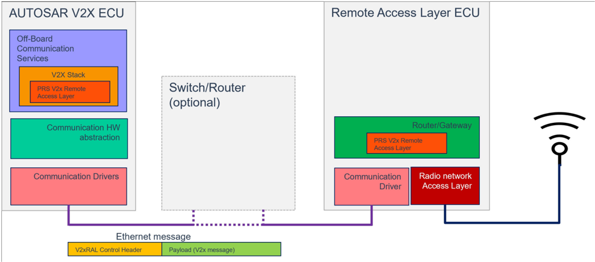
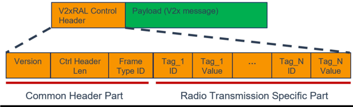

<!-- 源文档 AUTOSAR_FO_PRS_V2XRemoteAccessLayer（R23-11），协议规范（PRS），不受 Type A 七章骨架约束；章节结构镜像源文档自身编号。规范项 ID [FO_PRS_V2xRAL_*] 按 2026-11-03 批次决议整体省略（项正文照常翻译）；SRS 回引随追溯章一并省略。源第 4 章「Protocol Requirements」为纯 ID 追溯表（仅 Requirements Traceability 一节），按 2026-11-03 决议整章省略并将后续章节重编号（源 5→4、6→5、7→6、8→7）。源附录 B「Not Applicable Requirements」为不适用需求附录，按可省略集整体省略。封面元数据表、免责声明与目录按 EXP 流程省略；全部 25 处图引用中 2 处为内容图（图2.1、图6.1，按源图号命名嵌入），其余为页面装饰；图2.1 与图6.1 的图内文字标签散落在 markdown 正文中（AUTOSAR V2X ECU、Switch/Router、Tag_1 等），按转换噪声丢弃。附录 A.1.1 表的唯一行为 [FO_PRS_V2xRAL_NA] 占位（标题列为空），按占位规则记为「无」；A.1 节标题「与 AUTOSAR R22-11 对比」与其子节「R23-11」的不一致为源文档原貌，照实保留。 -->

## 1. 引言和概述

本协议规范规定了 **AUTOSAR** 协议 **V2xRAL**（**V2XRemoteAccessLayer**）的格式、消息序列和语义的交换。

该协议允许在运行 **V2x** 协议栈的节点与运行远程访问层的节点之间经由通信总线交换信息。这使得可以将用于无线传输的访问层与 **V2x** 协议栈分离。由此，可以构建带有用于智能天线的标准化接口的轻量级设备，与运行区域特定 **V2x** 协议栈的更强节点通信。

### 1.1. 协议目的和目标

访问层（**Access Layer**）用于按照无线通信网络的规范执行无线发送和接收。本协议规范支持无线传输技术 **LTE-PC5**（在 [\[1\]](#ref-1) 中规定）和 **ITS-G5**（[\[2\]](#ref-2)）。它定义了 **V2x** 协议栈与远程访问层之间交换的消息的格式。

### 1.2. 协议的适用性

**V2xRAL** 协议明确设计用于在汽车域内在 **V2x** 协议栈与远程访问层之间交换载荷和控制数据。载荷对应于通过无线网络实际发送或接收的数据，而控制数据包含在接收期间收集的或消息发送所需的信息。本协议规范适用于 **V2X** 上下文中的汽车域。

#### 1.2.1. 约束和假设

本协议规范引用了 [\[3\]](#ref-3) 中的系统需求。这是一种临时解决方案。进一步地，系统需求将转移到 **AUTOSAR Foundation** 层级。这将在下一步中完成，以便将 **V2x** 引入自适应平台。

在本协议规范中，假设 **V2x** 协议栈与 **V2x** 访问层之间的数据通信将通过以太网进行，但也可以使用任何其他通信技术。**V2xRAL** 不规定以太网通信的更多细节，例如 **VLAN**、**TCP** 或 **UDP**、端口、EtherType 或其他与媒体相关的细节。通信信道的安全考虑也不在范围之内。假设可以使用任何安全协议，例如 **MACsec**、**IPsec** 或 **TLS**，因为 **V2xRAL** 位于这些层之上。

该协议不防止 **V2x** 消息的重复。因此，如果 **V2XRemoteAccessLayer** 因任何原因从无线网络两次接收到同一条 **V2x** 消息，它也会在网络上将该帧转发两次。因此，本协议不会观察或检测用于识别先前经由本协议接收或发送的帧的序列计数器、事务 ID 或任何其他手段。

#### 1.2.2. 限制

**V2xRAL** 为汽车域而规定，专用于与 **AUTOSAR** 规定的 **V2x** 协议栈一起使用。**V2xRAL** 的使用可能无法提供足够的参数。但该协议应足够灵活，即使超出本规范也可以扩展。

### 1.3. 依赖

#### 1.3.1. 对其他协议层的依赖

**V2xRAL** 协议是一种轻量级协议，在载荷之外提供执行无线网络通信所需的最小控制数据集，不依赖任何其他协议。由于数据集最小，它可以在原始以太网帧内交换，但也可以置于 **TCP/IP** 等协议之上。如果出于安全原因需要使用 **IPsec** 或 **TLS** 等协议，则可能需要使用 **TCP/IP**。

#### 1.3.2. 对其他标准和规范的依赖

**V2x** 无线网络的发送和接收在 **SAE**、**IEEE** 和中国电信行业标准（**YD/T**）等标准中定义。细节由区域组织针对 **V2x** 上下文的应用规定，例如 **ETSI** 或中国 **GB/T**。对这些规范的引用见 [第 3.1 节](#31-输入文件和相关标准与规范)。

#### 1.3.3. 对应用层的依赖

该协议不依赖应用。这意味着不存在通过应用影响协议的必要性和可能性。

## 2. 用例

本章描述可以应用本协议规范的条件。它首先介绍使用 **V2xRAL** 的设备的典型通信设置。随后描述该协议的不同用例。

### 2.1. 通信设置

**V2xRAL** 用于在运行 **V2x** 协议栈的节点（**V2x** 协议栈节点）与运行 **V2x** 访问层的另一个节点（**V2x** 访问层节点）之间执行通信。通常，两个节点之间的通信信道是以太网信道，但也可以使用 **IPC** 等不同技术。

**V2x** 协议栈节点生成 **V2x** 消息（例如 **CAM**、**DENM** 或 **BSM**），并希望在无线网络上分发它们。由于 **V2x** 协议栈节点不具备在同一设备上运行访问层的能力，它将该消息作为载荷发送给 **V2x** 访问层节点。由于载荷本身不包含用于无线传输的足够信息，需要附加控制信息。作为控制信息发送的特定数据取决于无线技术（**LTE-PC5** 或 **ITS-G5**）及其相关规范。因此，**V2x** 协议栈节点将添加所使用无线技术所需的传输控制信息，并将控制信息和载荷发送给 **V2x** 远程访问层节点。该节点取出载荷和控制信息，并按照该无线技术的相关规范开始通过无线网络发送数据。

在相反方向上，如果 **V2x** 访问层节点从无线网络接收到消息，它将接收到的载荷发送给 **V2x** 协议栈。从无线网络设备收集的更多数据将被添加到控制信息中，例如无线传输的平均信号强度。

### 2.2. 用例定义

| ID | 名称 | 描述 |
| --- | --- | --- |
| UC_0001 | ITS-G5 | 无线网络基于 **ITS-G5**（**IEEE** 802.11.p） |
| UC_0002 | LTE-PC5 | 无线网络基于 **LTE-PC5**。 |

### 2.3. UC_0001「基于 ITS-G5 的无线网络」

如果 **ITS** 站按照 [\[4\]](#ref-4) 规定的标准进行通信，则使用本协议。本规范应用于 [\[5\]](#ref-5) 和 [\[6\]](#ref-6) 中的 **ITS** 站。特别是欧洲的 **V2x** 协议栈使用该技术，且 **AUTOSAR** 已有支持 **ITS-G5** 的规范（见 [\[7\]](#ref-7)），因此本协议的应用是适用的。它支持一种将带有天线的访问层与 **V2x** 协议栈的实际处理分离的架构。

### 2.4. UC_0002「基于 LTE-PC5 的无线网络」

如果由于车辆架构而需要分离 **V2x** 协议栈和访问层，则本协议适用。如果使用了 [\[1\]](#ref-1) 规定的无线网络技术，但访问层和 **V2x** 协议栈不在同一设备中，则本协议适用。**AUTOSAR** 已有应用本规范的规范（见 [\[8\]](#ref-8)），未来可能出现其他使用相同无线传输的规范。

## 3. 相关文档

### 3.1. 输入文件和相关标准与规范

- [1] YD/T 3707-2020：基于 **LTE** 的车联网通信网络层技术要求
> http://www.ccsa.org.cn/
- [2] EN 302 663 V1.2.1：智能交通系统（**ITS**）；工作于 5 GHz 频段的智能交通系统接入层规范
- [3] Requirements on Vehicle-2-X Communication
> AUTOSAR_CP_SRS_V2XCommunication
- [4] IEEE Part 11：无线局域网介质访问控制（**MAC**）和物理层（**PHY**）规范。修正案 6：车载环境中的无线接入（**IEEE STD 802.11p-2010**）
- [5] SAE J2735_201603：专用短程通信（**DSRC**）消息集字典
- [6] EN 302 571 V2.1.1：智能交通系统（**ITS**）；工作于 5 855 MHz 至 5 925 MHz 频段的无线通信设备；覆盖 **R&TTE** 指令第 3.2 条基本要求的协调 **EN** 标准
- [7] Specification of Vehicle-2-X Geo Networking
> AUTOSAR_CP_SWS_V2XGeoNetworking
- [8] Specification of Chinese Vehicle-2-X Network
> AUTOSAR_CP_SWS_ChineseV2XNetwork
- [9] General Specification of Basic Software Modules
> AUTOSAR_CP_SWS_BSWGeneral
- [10] EN 302 636-4-1 V1.3.1：车辆通信；地理网络；第 4 部分 面向点对点和点对多点通信的地理寻址和转发；子部分 1：媒体无关功能
- [11] TS 102 724 V1.1.1：智能交通系统（**ITS**）；工作于 5 GHz 频段的智能交通系统的协调信道规范

### 3.2. 相关规范

**AUTOSAR** 提供的基础软件模块通用规范 [9, SWS BSW General] 同样适用于 **V2XRemoteAccessLayer**。

因此，**SWS BSW General** 规范应被视为 **V2xRAL** 的附加且必需的规范。

## 4. 术语和缩略语的定义

### 4.1. 缩略语和缩写

**3GPP**
> **3GPP** 与第三代合作伙伴计划（**The 3rd Generation Partnership Project**）提供生成定义 **3GPP** 技术的报告和规范的环境。

**5GAA**
> **5GAA** 与 5G 汽车协会（**The 5G Automotive Association**）是一个开发未来出行与运输服务的全球性跨行业组织。

**C-V2X**
> 蜂窝 **V2X**（**Cellular V2X**）。通过蜂窝调制解调器进行的通信。

**BSM**
> 基本安全消息（**Basic Safety Message**）。

**CAM**
> 协同感知消息（**Cooperative Awareness Message**）。

**CBR**
> 信道繁忙率（**Channel Busy Ratio**）。

**DCC**
> 去中心化拥塞控制（**Decentralized Congestion Control**）。

**DENM**
> 去中心化环境通知消息（**Decentralized Environmental Notification Message**）。

**L2ID**
> 层 2 ID（**Layer 2 ID**）（相当于以太网的「消息认证码」）。

**MAC**
> 介质访问控制（**Medium Access Control**）。

**MDR**
> 最大数据速率（**Maximum Data Rate**）。

**PHY**
> 物理层（**Physical Layer**）。

**PPPP**
> **ProSe** 每包优先级（**ProSe Per Packet Priority**）。

**V2X**
> 车辆到车辆（**V2V**）、车辆到基础设施（**V2I**）和/或基础设施到车辆（**I2V**）。该术语用于自组织（**Ad-Hoc**）网络，不用于车辆-后台通信。

**V2xRAL**
> **V2x** 远程访问层（**V2x Remote Access Layer**）

**IPC**
> 进程间通信（**Inter Process Communication**）。

**ITS-G5**
> 基于 **IEEE** 802.11p 的无线通信技术。

**LTE-PC5**
> 通过蜂窝调制解调器的侧行链路（**Sidelink**）通信（蜂窝调制解调器之间的直接通信，无需基站介入）。

**LTE-Uu**
> 由基站控制的蜂窝通信。

**TLV**
> 标签、长度和值（**Tag, Length and Value**）。

### 4.2. 术语的定义

**V2x Stack**
> **V2x** 协议栈实现车辆与其他道路用户（例如汽车、卡车、基础设施（如交通信号灯、限速）等）之间通信的区域特定需求。中国、美国或欧洲等地区有自己的规范。因此存在多种 **V2x** 协议栈实现，每一种都是区域特定的。

**V2x Message**
> **V2x** 消息是从其他车辆或路侧单元（**RSU**）接收到的消息。该消息遵循 **V2X** 通信标准，通常以 **ASN.1 PER** 编码格式编码。**V2x** 协议栈也会不时发送 **V2x** 消息。

**V2x Remote Access Layer**
> **V2x** 远程访问层（**V2xRAL**）是一个能够通过 **LTE-PC5** 或 **ITS-G5** 与车外（**Off-Board**）单元通信的逻辑单元。远程访问层包含朝向天线的无线 **PHY** 和 **MAC**，包括信道选择、调制、拥塞控制、排队、优先级、**QoS** 等。完成这些任务所需的信息需要由上层或远程控制单元提供，例如 **MAC** 地址、单播、广播、**GeoNetwork** 地址、优先级、队列、**DSMP** 控制。这些数据位于控制报头的无线传输部分。按照（区域）标准及其媒体通信对 **V2x** 消息进行正确处理需要这些数据。载荷是包含网络层所提供 **V2x** 消息的数据，通常不包含用于媒体通信的控制信息。

## 5. 协议规范

### 5.1. 消息格式

远程访问层协议的消息格式如图6.1 所示。该消息不依赖于先前发送的任何数据，只有一个例外：必须存储假名（**pseudonym**）的值以检测假名变更。

该协议不需要任何确认或分段。

由于 **V2x** 消息载荷的限制，包含附加控制报头的 **V2xRAL** 消息将装入单个以太网帧。

#### 5.1.1. 控制报头

**V2xRAL** 消息分为两部分。第一部分应包含无线传输服务所使用的控制数据。第二部分应包含用于 **ITS** 站之间通信的载荷。

控制报头中的所有数据应以大端格式（高字节在前）发送。

##### 5.1.1.1. 公共部分

**V2xRAL** 消息的第一个字节应包含一个字节的版本信息，用于指定本协议规范的版本。第一个字节应始终包含值 0x01。值 0x00 和 0x02..0xFF 保留供将来使用。

**V2xRAL** 消息的第二个字节应包含总的**控制报头长度**（**Control Header Length**）。长度信息包括长度字节和版本字节。这将控制报头长度限制为 255 字节。长度字节的最小值为 2，因为长度字节和版本字节是必需的且始终存在。值 0 和 1 保留。

**控制报头长度**之后的字节应为**帧类型标识符**（**Frame Type Identifier**），用于指定该帧所属的无线通信网络。

在**帧类型标识符**之后，跟随若干数据对。每个对应由一个**标签标识符**（**Tag Identifier**）和一个值（**Value**）组成。标签标识符表示数据的类型，值表示该标签 ID 的控制信息。特定标签 ID 的值具有本协议定义中规定的固定大小。

**提示：** 不提供长度值（例如作为 **TLV**），以节省报头中的空间。

标签 ID 应定义属于特定帧类型的一组编号。用于特定帧类型的标签 ID 不应用于另一帧类型。

**提示：** 使标签 ID 对帧类型唯一可以降低一个帧类型的标签 ID 被另一个帧类型误用的风险。但这被视为建议，而非约束性需求。如果将来有限的标签 ID 数量（最多 256 个）被耗尽，则可能出现偏离。

表6.1：帧类型 ID 的定义（**Definition of the Frame Type ID**）

| 名称 | 帧类型 ID | 字节数 | 描述 |
| --- | --- | --- | --- |
| ITS-G5 | 0x01 | 1 字节 | 本 **V2xRAL** 消息专用于 **ITS-G5** 无线网络。 |
| LTE-PC5 | 0x02 | 1 字节 | 本 **V2xRAL** 消息专用于 **LTE-PC5** 无线网络。 |
| - | 0x80..0x8F | 1 字节 | 客户自定义。 |
| - | 0x00, 0x03..0x7F, 0x90..0xFF | 1 字节 | 保留。 |

##### 5.1.1.2. 面向 ITS-G5 的无线传输部分

**AUTOSAR** 中 **V2x** 协议栈需要支持的无线通信协议之一是 **ITS-G5**，用于 **ITS** 自组织网络中 [\[4\]](#ref-4) 规定的无连接传输服务。这是目前 **ETSI** 规定的标准通信，并由 [\[7\]](#ref-7) 使用。后续可能出现更多协议，但对这一技术的支持对于支持 **AUTOSAR** 中定义的上述规范至关重要。

**V2xRAL** 的控制报头包含关于收费区（**tolling zone**）的信息。

**提示：** 收费区信息定义为表6.2 中的一个标签 ID。

当从 **V2x** 协议栈向 **V2x** 远程访问层发送数据包时，**V2xRAL** 的控制报头包含关于 **DCC** 的信息（见下表中的标签 ID）；当从 **V2x** 远程访问层向 **V2x** 协议栈发送数据包时，包含 **CBR**。

表6.2：**ITS-G5** 的 TAG ID 和值定义（**Definition of TAG IDs and values for ITS-G5**）

| 名称 | TAG ID | 字节数 | 方向* | 描述 |
| --- | --- | --- | --- | --- |
| Packet Interval | 0x10 | 1 字节 | Tx | 以毫秒计的发送间隔（**ITS-G5** 访问层已知）。每个增量表示 10 ms。这允许发送间隔在 0..2550 ms 范围内以 10 ms 为步长取值。 |
| Channel ID | 0x11 | 1 字节 | Tx | 指定 **V2x** 消息应发送到的信道。有效值为：0 = ITS G5A CCH；1 = ITS G5A SCH1；2 = ITS G5A SCH2；3 = ITS G5B SCH3；4 = ITS G5B SCH4。值 0x05..0xFF 保留。 |
| Tx Queue ID | 0x12 | 1 字节 | Tx | 指定应使用的 Tx 队列。范围（0..5），0x06..0xFF = 保留。 |
| Tolling zone | 0x13 | 1 字节 | Tx | 指定车辆是否处于收费区内。0 = 车辆不在收费区，1 = 车辆在收费区。值 0x02..0xFF 保留。 |
| Src MAC | 0x14 | 6 字节 | Tx | 指定帧的源 **MAC** 地址。 |
| Dest MAC | 0x15 | 6 字节 | Tx | 指定目的 **MAC** 地址。若省略该标签，默认值为 FF.FF.FF.FF.FF.FF（表示广播）。 |
| CBR | 0x16 | 1 字节 | Rx | 0（=0%）至 100（=100%）范围内的信道繁忙率。101..255 = 保留。 |
| - | 0x00..0x0F, 0x17..0xFF | - | - | 保留。 |

> \*方向：帧的方向：
>
> Tx 表示由 **ITS** 站发送，指从 **V2x** 协议栈到远程访问层的通信。
>
> Rx 表示由 **ITS** 站接收，指从远程访问层到 **V2x** 协议栈的通信。

#### 消息载荷（**Message Payload**）

**V2xRAL** 消息的载荷包含由 **V2x** GeoNetworking 协议生成的数据。它由下层报头（包括 **MAC** 报头和 **LLC** 报头以及带可选安全的 **GeoNetworking** 报头）组成，其后跟随 **BTP** 数据包（包括 **BTP** 报头和 **V2x** 消息的可选载荷）（见 [\[10\]](#ref-10)）。

关于 **ITS-G5** 协议字段的协议条目的更多信息见 [\[11\]](#ref-11)。

##### 5.1.1.3. 面向 LTE-PC5 的无线传输部分

表6.3：**LTE-PC5** 的 TAG ID 和值定义（**Definition of TAG IDs and values for LTE-PC5**）

| 名称 | TAG ID | 字节数 | 方向* | 描述 |
| --- | --- | --- | --- | --- |
| MDR | 0x30 | 3 字节 | Rx | 以 bps（比特每秒）计的最大数据速率（见 [\[8\]](#ref-8)）。值在 0..1585200 范围内。1585201..16777215：保留。 |
| CBR | 0x31 | 1 字节 | Rx | 0（=0%）至 100（=100%）范围内的信道繁忙率。101..255 = 保留。 |
| Traffic Period | 0x32 | 1 字节 | Tx | 流量周期（见 [\[8\]](#ref-8)）。0 = 流量周期：20ms；1 = 流量周期：50ms；2 = 流量周期：100ms；3 = 流量周期：200ms；4 = 流量周期：300ms；5 = 流量周期：400ms；6 = 流量周期：500ms；7 = 流量周期：600ms；8 = 流量周期：700ms；9 = 流量周期：800ms；10 = 流量周期：900ms；11 = 流量周期：1000ms。值 0x0c..0xFF 保留。 |
| PPPP | 0x33 | 1 字节 | Rx/Tx | **PPPP**：**ProSe** 每包优先级，范围 1..8。1 = 最高优先级，8 = 最低优先级。值 0 和 9..255 保留。 |
| Src L2ID | 0x34 | 3 字节 | Rx/Tx | 指定帧的源 **L2ID**（相当于 Src-MAC，见 [\[8\]](#ref-8)）。 |
| Dest L2ID | 0x35 | 3 字节 | Rx/Tx | 指定帧的目的 **L2ID**（相当于 Dst-MAC，见 [\[8\]](#ref-8)）。 |
| - | 0x00..0x2F, 0x36..0xFF | - | - | 保留。 |

> \*方向：帧的方向：
>
> Tx 表示由 **ITS** 站发送，指从 **V2x** 协议栈到远程访问层的通信。
>
> Rx 表示由 **ITS** 站接收，指从远程访问层到 **V2x** 协议栈的通信。

#### 消息载荷（**Message Payload**）

**LTE-PC5** 的访问层消息载荷是用于无线传输的内容。这通常是网络层的输入/输出（见 [\[1\]](#ref-1)）。

关于 **LTE-PC5** 协议字段的协议条目的更多信息见 [\[1\]](#ref-1)。

### 5.2. 消息类型

**V2xRAL** 协议不区分任何消息类型。通常，控制报头与 **V2x** 消息的载荷一起出现，因为控制报头相当小（约 20-25 字节）。将控制和载荷信息组合到同一帧中，可确保远程访问层始终拥有用于载荷的适当控制数据。这防止了无线帧带着不需要的控制数据被发送。考虑到这一点，没有控制报头的 **V2xRAL** 消息在本协议的上下文中不可用。控制报头可以不带载荷信息发送，但这种情况很少适用。一个典型用例是假名变更：一旦被命令，**V2x** 协议栈可以立即向 **V2x** 远程访问层发送新的假名。

### 5.3. 服务/命令

**V2XRemoteAccessLayer** 协议没有定义任何服务。主要用例是在网络层与访问层之间交换 **V2x** 消息的载荷及其控制数据。

一个操作服务是假名变更。在这种情况下，**V2x** 协议栈向 **V2XRemoteAccessLayer** 发送变更假名的命令。该信息可由 **V2x** 协议栈触发，并可在有或没有 **V2x** 消息载荷的情况下传输。

### 5.4. 序列（下层）

**V2XRemoteAccessLayer** 协议是无状态的。因此，本协议内不规定任何序列。

### 5.5. 错误消息

**V2XRemoteAccessLayer** 不使用任何错误消息。

### 5.6. 向后兼容性

控制报头的布局支持向后兼容性。这通过控制报头最起始处的控制报头长度字段实现。因此，当协议层解析标签 ID 时，它可以处理所有已知的标签 ID。如果发现一个新的未知标签 ID，则所有后续标签都无法处理，因为该标签的长度未知。

因此，如果通过新标签扩展协议，且新标签信息对协议的先前版本并非必需，则新标签需要添加到标签字段的末尾（不能在中间或开头）。对于协议的任何破坏性变更，建议变更帧类型甚至协议版本。

## 6. 配置参数

**V2XRemoteAccessLayer** 协议没有配置项。

## 7. 协议使用和指南

该协议没有其他可用指南。

## A. 规范项变更历史

请注意，本章中的列表还包括在后续版本中已从规范中移除的规范项。这些规范项在文档中不作为超链接出现。

### A.1. 本文档与 AUTOSAR R22-11 对比的规范项变更历史

#### A.1.1. R23-11 中新增的规范项

无

#### A.1.2. R23-11 中变更的规范项

无

#### A.1.3. R23-11 中删除的规范项

无
