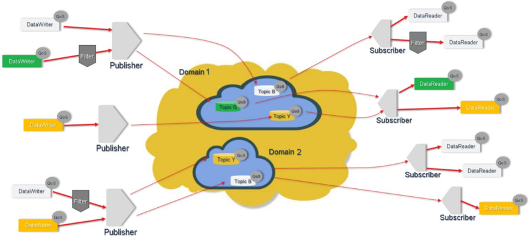

<!-- 源文档 AUTOSAR_FO_RS_DataDistributionService（R23-11），需求规范（RS），不受 Type A 七章骨架约束；章节结构镜像源文档自身编号。需求项 ID [FO_RS_Dds_*] 与 {DRAFT} 标记按 2026-11-03 批次决议整体省略（标题仅翻译），需求项按其在源文档中的出现顺序补予小节编号（4.2.1.1–4.2.1.7、4.2.2.1、4.2.3.1、4.2.4.1–4.2.4.2、4.2.5.1、4.2.6.1–4.2.6.2）。源 §2.2.1/§2.2.2 为「No content」占位节，按占位规则省略并将 §2.2.3 重编号为 §2.2.1；源 §3.2「Abbreviations: None」与源 §4.3「Non-Functional Requirements: None.」为占位节，按占位规则省略；源附录 A「Appendix」为「No content」占位，按占位规则省略。源第 5 章「Requirements Tracing」为纯 ID 追溯表，按 2026-11-03 决议整章省略并将后续章节重编号（源 6→5）。封面元数据表、免责声明与目录按 EXP 流程省略；1 处内容图（图4.1 DDS 逻辑视图）按源图号嵌入，其余图引用为页面装饰；图 4.1 的图内标签散落（DataWriter、QoS、Topic B 等）按转换噪声丢弃。§2.2 组列表中的章节引用（[4.2.1] 等）改写为本文档章节链接；00001 项被截断的用例单元格已依据 R23-11 PDF 原文恢复。 -->

## 1. 文档范围

本文档规定数据分发服务（**DDS**）[\[1\]](#ref-1) 的需求，**AUTOSAR CP** 和 **AP** 应支持该服务。

**DDS** 是由对象管理组（**OMG**）标准化的、面向数据中心连接的中间件协议和 **API** 标准，因此每一条需求都直接派生自 **OMG** 标准。

详细列表见 [第 4.2 节](#42-功能需求)。

## 2. 所用约定

### 2.1. 文档约定

**AUTOSAR** 文档中需求的表述遵循约束 TPS\_STDT\_00078 规定的表格，见 **Standardization Template** 的「Support for Traceability」章（[\[2\]](#ref-2)）。

需求的表达应使用约束 TPS\_STDT\_00053 规定的义务表达动词形式，见 **Standardization Template** 的「Support for Traceability」章（[\[2\]](#ref-2)）。

在需求中，应使用以下特定语义（基于互联网工程任务组 **IETF**）。

本文档中的关键词「**MUST**」「**MUST NOT**」「**REQUIRED**」「**SHALL**」「**SHALL NOT**」「**SHOULD**」「**SHOULD NOT**」「**RECOMMENDED**」「**MAY**」和「**OPTIONAL**」应解释为：

- **SHALL**：该词表示该定义是本规范的绝对要求。
- **SHALL NOT**：该短语表示该定义是本规范的绝对禁止。
- **MUST**：该词表示由于法律原因，该定义是本规范的绝对要求。
- **MUST NOT**：该短语表示由于法律约束，该定义是本规范的绝对禁止。
- **SHOULD**：该词，或形容词「**RECOMMENDED**」，表示在特定情形下可能存在充分的理由忽略某个特定条目，但在选择不同做法之前，必须理解其全部影响并仔细权衡。
- **SHOULD NOT**：该短语，或短语「**NOT RECOMMENDED**」，表示在特定情形下，某种特定行为是可接受甚至有用的，但在实现以此标签描述的任何行为之前，应充分理解其全部影响并仔细权衡。
- **MAY**：该词，或形容词 **OPTIONAL**，表示某个条目是真正可选的。一家供应商可以选择包含该条目，因为特定市场需要它，或者因为该供应商认为它能增强产品；而另一家供应商可能省略同一条目。不包含某个特定选项的实现，**MUST** 准备好与包含该选项的另一实现互操作，尽管功能可能有所减少。同样，包含某个特定选项的实现，**MUST** 准备好与不包含该选项的另一实现互操作（当然，该选项所提供的特性除外。）

### 2.2. 需求指南

本文档中定义的功能需求按其功能进行了分组。后续章节详述的分组为：

- 通用（**General**）：[第 4.2.1 节](#421-通用)——与 **DDS OMG** 标准相关的各类需求，以及在 **AUTOSAR CP** 和 **AP** 架构中的引入。
- 安全（**Security**）：[第 4.2.2 节](#422-安全)——保证一定程度的安全性所需的需求。
- 功能安全（**Safety**）：[第 4.2.3 节](#423-功能安全)——按照 ISO-26262 [\[3\]](#ref-3) 保证一定程度的功能安全所需的需求。
- **DDS-DCPS** 配置：[第 4.2.4 节](#424-dds-dcps-配置)——陈述与数据中心发布者/订阅者通信范式符合性的需求。
- 单向 DDS 通信的需求：[第 4.2.5 节](#425-单向-dds-通信的需求)——与所使用 **DDS** 传输协议相关的需求。
- **DDSI-RTPS**：[第 4.2.6 节](#426-ddsi-rtps-的需求)——陈述与 **OMG** DDSI-RTPS 协议 [\[4\]](#ref-4) 符合性的需求。

#### 2.2.1. 需求状态

在当前阶段，所有需求都处于 **DRAFT** 状态，直至本文档被接受并纳入。

## 3. 缩略语和缩写

### 3.1. 缩略语

缩略语和缩写参见 [5, AUTOSAR glossary]。

## 4. 需求规格

本章描述驱动 **RS DDS** 规范定义工作的全部需求。

### 4.1. 功能概述

数据分发服务（**DDS**）[\[1\]](#ref-1) 是对象管理组（**OMG**）的中间件协议和 **API** 标准。它将系统的组件集成在一起，提供低延迟的数据连接、极高的可靠性和可扩展的架构。

**DDS** 中间件是一个软件层，它将应用与操作系统、网络传输和底层数据格式的细节抽象开来。数据线上格式、发现、连接、可靠性、协议、传输选择、**QoS**、安全等底层细节都由中间件管理。

**DDS** 提供 **QoS** 受控的数据共享。应用通过发布和订阅由其主题名（**Topic name**）标识的主题（**Topic**）进行通信。订阅可以指定时间和内容过滤器，只获取在主题上发布的数据的一个子集。不同的 **DDS** 域（**Domain**）彼此完全独立。**DDS** 域之间没有数据共享。

**DDS** 独特地以数据为中心。数据中心性确保所有消息都包含应用理解其接收数据所需的上下文信息。数据中心性的本质在于 **DDS** 知道它存储什么数据，并控制如何共享该数据。使用传统以消息为中心的中间件的程序员必须编写发送消息的代码。使用以数据为中心的中间件的程序员编写指定如何以及何时共享数据的代码，然后直接共享数据值。**DDS** 直接为用户实现受控、可管理、安全的数据共享，而不是在应用（用户）代码中管理所有这些复杂性。

#### 4.1.1. 全局数据空间

**DDS** 依赖于一个独立于所用平台的数据模型。该模型定义全局数据空间（**global data space**），并规定发布者（**Publisher**）和订阅者（**Subscriber**）如何引用该空间的一部分。数据模型可以简单到只是一组互不相关的数据结构，每个由一个主题和一个类型标识。

主题提供一个唯一标识全局数据空间中某些数据项的标识符。类型提供结构信息，告诉中间件如何操纵数据。类型化接口的使用意味着需要一个生成工具，将类型描述转换为适当的接口和实现，以填补类型化接口与通用中间件之间的空隙。

以下定义可能有助于更好地理解所有需求的含义和上下文。

- **Entity**（实体）：**DDS** 的基本对象，几乎所有其他对象都是它的特化。
- **Publisher**（发布者）：该对象负责数据分发。它可以发布不同数据类型的数据。
- **DataWriter**（数据写者）：应用必须使用 **DataWriter** 向 **Publisher** 传达给定类型数据对象的存在和值。当数据对象值通过相应的数据写者传达给 **Publisher** 后，执行分发是 **Publisher** 的职责（**Publisher** 将按照其自身的 **QoS** 或附加到相应数据写者的 **QoS** 完成分发）。
- **Subscriber**（订阅者）：**Subscriber** 负责接收已发布的数据，并（按照 **Subscriber** 的 **QoS**）使其对接收应用可用。它可以接收并分发不同指定类型的数据。
- **DataReader**（数据读者）：**Subscriber** 使用 **DataReader** 向应用提供接收到的特定类型的数据。
- **Domain**（域）：域是一个分布式概念，将所有能够相互通信的应用链接起来。它表示一个通信平面：只有附加到同一域的发布者和订阅者才能交互。
- **Quality of Services (QoS)**（服务质量）：**QoS** 是用于规定实体行为的一般概念。**QoS** 由单个 **QoS** 策略（派生自 QosPolicy 的类型的对象）组成。影响多个实体的一个或多个 **QoS** 策略的特定值可以分组在 **QoS** profile（**QoS profile**）中。
- **Topic**（主题）：主题对应单一数据类型。主题对象在概念上介于发布和订阅之间。发布必须以订阅可以无歧义地引用它们的方式为人所知。主题正是为达成该目的而设：它关联一个名称（在域内唯一）、一个数据类型以及与数据本身相关的 **QoS**。除主题 **QoS** 之外，与该主题关联的 **DataWriter** 的 **QoS** 以及与该 **DataWriter** 关联的 **Publisher** 的 **QoS** 控制发布者侧行为，而相应的主题、**DataReader** 和 **Subscriber** 的 **QoS** 控制订阅者侧行为。

**DDS** 是数据中心发布/订阅（**Data-Centric Publish Subscribe**）[\[4\]](#ref-4) 协议。该协议定义应用用于发布和订阅数据对象值的功能。它允许：

- 发布应用标识它们打算发布的数据对象，然后为这些对象提供值（它们使用某个域参与者（**DomainParticipant**）中定义的一些 **Publisher**/**DataWriter**）。
- 订阅应用标识它们感兴趣的数据对象，然后访问其数据值（它们使用与发布者相同的 **DomainParticipant** 中定义的一些 **Subscriber**/**DataReader**，以便在各个主题上接收这些发布者的数据）。
- 应用定义主题、将类型信息附加到主题、创建发布者和订阅者实体、将 **QoS** 策略附加到所有这些实体，总之，使所有这些实体运转起来。

### 4.2. 功能需求

#### 4.2.1. 通用

##### 4.2.1.1. DDS 符合性

| 描述 | **AUTOSAR** 的 **DDS** 组件应符合 [1] 中定义的 **DDS** 最小 Profile（**Minimum Profile**）、[4] 中定义的 **DDS** 线上互操作协议（**DDSI-RTPS**），以及 [6] 中定义的 **DDS-XTYPES** 最小编程接口和网络互操作 Profile。 |
| --- | --- |
| 理由 | 与实现 **DDS** 的其他节点互操作 |
| 依赖项 | - |
| 用例 | • 不同类型架构之间的互通信（例如：**AP**/**CP** 通信兼容性） * 与基于 **DDS** 的仿真器或 **ADAS** 系统互通信（例如基于 **ROS2**） |
| 适用平台 | **FO**、**CP** |
| 支撑材料 | **OMG** Data Distribution Service 协议规范 [1]；**OMG** DDS Interoperability Wire Protocol [4]；**OMG** Extensible and Dynamic Topic Types for DDS [6] |

##### 4.2.1.2. DDS 标准序列化规则

| 描述 | 发送到网络的数据包应符合 [4] 中定义的 **DDS** 互操作线上协议（**DDSI-RTPS**）。 |
| --- | --- |
| 理由 | 与实现 **DDS** 的其他节点互操作 |
| 依赖项 | - |
| 用例 | • 不同类型架构之间的互通信 * 与基于 **DDS** 的仿真器或 **ADAS** 系统互通信（例如基于 **ROS2**） |
| 支撑材料 | **OMG** DDS Interoperability Wire Protocol [4] |
| 适用平台 | **FO**、**CP** |

##### 4.2.1.3. DDS 载荷序列化规则

| 描述 | 载荷的序列化应按照 [6] 中定义的 **DDS** 标准序列化规则完成。 |
| --- | --- |
| 理由 | 与实现 **DDS** 的其他节点互操作 |
| 依赖项 | - |
| 用例 | • 不同类型架构之间的互通信 * 与基于 **DDS** 的仿真器或 **ADAS** 系统互通信（例如基于 **ROS2**） |
| 支撑材料 | **OMG** Extensible and Dynamic Topic Types for DDS [6] |
| 适用平台 | **FO**、**CP** |

##### 4.2.1.4. DDS 服务质量

| 描述 | **AUTOSAR** 的 **DDS** 组件应支持 **DDS QoS** 策略。 |
| --- | --- |
| 理由 | 利用 **QoS** 策略特性 |
| 依赖项 | - |
| 用例 | • 时间敏感网络支持 * 功能安全支持 * 自定义呈现顺序 |
| 支撑材料 | **OMG** Data Distribution Service 协议规范 [1] |
| 适用平台 | **FO**、**CP** |

##### 4.2.1.5. DDS AUTOSAR 组件接收未序列化数据

| 描述 | 为了更好地集成 **DDS** 的数据中心能力，**AUTOSAR** 的 **DDS** 组件应以未序列化格式接收和产生数据。 |
| --- | --- |
| 理由 | 为了利用全部 **DDS** 功能，**DDS** 组件应使用未变换的数据工作。**DDS** 中间件应知晓其接收到的应用数据类型。 |
| 依赖项 | - |
| 用例 | - |
| 支撑材料 | **OMG** Data Distribution Service 协议规范 [1] |
| 适用平台 | **FO**、**CP** |

##### 4.2.1.6. 类型定义

| 描述 | **DDS** 中间件应为每个受支持的 **AUTOSAR** 平台，定义 **DDS** 通信中相关的 **AUTOSAR** 类型与 **DDS** 类型之间无歧义的映射。 |
| --- | --- |
| 理由 | 应用软件组件将只与 **AUTOSAR API** 和类型系统打交道，因此需要支持数据格式一致性的内部映射。 |
| 依赖项 | - |
| 用例 | - |
| 支撑材料 | **OMG** Extensible and Dynamic Topic Types for DDS [6] |
| 适用平台 | **FO**、**CP** |

##### 4.2.1.7. 定制

| 描述 | **DDS** 应允许在 **ECU** 内对 **DDS** 实体进行定制。 |
| --- | --- |
| 理由 | 与其他基于 **DDS** 的系统互操作，适配它们的数据架构和特定 **QoS** 策略。 |
| 依赖项 | - |
| 用例 | - |
| 支撑材料 | - |
| 适用平台 | **FO**、**CP** |

#### 4.2.2. 安全

##### 4.2.2.1. 安全机制

| 描述 | **DDS** 中间件应支持并实现 **DDS Security** [7] 的 **DDSI-RTPS** 线上协议扩展，以保证数据完整性和数据认证。 |
| --- | --- |
| 理由 | 由于将提供外部和混合通信，通信必须被保护 |
| 依赖项 | - |
| 用例 | • 与车辆内其他平台的安全互操作 |
| 支撑材料 | **OMG** DDS Security Specification [7] |
| 适用平台 | **FO**、**CP** |

#### 4.2.3. 功能安全

##### 4.2.3.1. 功能安全机制

| 描述 | **DDS** 中间件应支持符合 **ISO 26262** 的 **E2E** [8] 功能安全机制，且不破坏 **DDS** 与 **DDSI-RTPS** 规范的符合性。 |
| --- | --- |
| 理由 | 由于将提供外部和混合通信，通信必须纳入功能安全机制 |
| 依赖项 | - |
| 用例 | • 与车辆内其他平台的安全互操作 |
| 支撑材料 | ISO 26262 [3] |
| 适用平台 | **FO**、**CP** |

#### 4.2.4. DDS-DCPS 配置

##### 4.2.4.1. 发布

| 描述 | **DDS** **AUTOSAR** 组件应允许在特定主题上发布数据。 |
| --- | --- |
| 理由 | 发送数据 |
| 依赖项 | - |
| 用例 | 发送类型化数据 |
| 支撑材料 | **OMG** Data Distribution Service 协议规范 [1] |
| 适用平台 | **FO**、**CP** |

##### 4.2.4.2. 订阅

| 描述 | **DDS** **AUTOSAR** 组件应允许订阅特定主题。 |
| --- | --- |
| 理由 | 接收类型化数据 |
| 依赖项 | - |
| 用例 | 接收特定数据类型 |
| 支撑材料 | **OMG** Data Distribution Service 协议规范 [1] |
| 适用平台 | **FO**、**CP** |

#### 4.2.5. 单向 DDS 通信的需求

##### 4.2.5.1. 传输协议

| 描述 | **AUTOSAR DDS** 组件应支持其下层的不同传输协议。 |
| --- | --- |
| 理由 | **AUTOSAR DDS** 组件不感知传输协议。 |
| 依赖项 | - |
| 用例 | • 时间关键通信使用基于 **UDP** 的 **DDS** * 时间非关键的大数据通信使用基于 **TCP** 的 **DDS** * **ECU** 内部通信使用共享内存 |
| 支撑材料 | DDS Interoperability Wire Protocol（[4]，第 9 章） |
| 适用平台 | **FO**、**CP** |

#### 4.2.6. DDSI-RTPS 的需求

##### 4.2.6.1. RTPS 消息封装

| 描述 | **AUTOSAR** 的 **DDS** 组件应将数据封装进 **RTPS** 消息。 |
| --- | --- |
| 理由 | **DDS** 使用 **RTPS** 消息互通信 |
| 依赖项 | - |
| 用例 | **DDS** 互通信 |
| 支撑材料 | - |
| 适用平台 | **FO**、**CP** |

##### 4.2.6.2. RTPS 消息解封装

| 描述 | **AUTOSAR** 的 **DDS** 组件应从 **RTPS** 消息中解封装数据。 |
| --- | --- |
| 理由 | **DDS** 使用 **RTPS** 消息互通信 |
| 依赖项 | - |
| 用例 | **DDS** 互通信 |
| 支撑材料 | - |
| 适用平台 | **FO**、**CP** |

## 5. 参考文献

[1] Data Distribution Service (DDS), Version 1.4
> https://www.omg.org/spec/DDS/1.4

[2] Standardization Template
> AUTOSAR_FO_TPS_StandardizationTemplate

[3] ISO 26262:2018（所有部分）——道路车辆——功能安全
> https://www.iso.org

[4] DDS Interoperability Wire Protocol, Version 2.2
> http://www.omg.org/spec/DDSI-RTPS/2.2

[5] Glossary
> AUTOSAR_FO_TR_Glossary

[6] Extensible and Dynamic Topic Types for DDS, Version 1.2
> https://www.omg.org/spec/DDS-XTypes/1.2

[7] DDS Security, Version 1.1
> https://www.omg.org/spec/DDS-SECURITY/1.1

[8] Specification of SW-C End-to-End Communication Protection Library
> AUTOSAR_CP_SWS_E2ELibrary

[9] Requirements on AUTOSAR Features
> AUTOSAR_CP_RS_Features

## A. AUTOSAR 可追溯项变更历史

请注意，本章中的列表还包括在后续版本中已从规范中移除的可追溯项。这些可追溯项在文档中不作为超链接出现。

### A.1. 本文档依据 AUTOSAR 版本 R22-11 的可追溯项变更历史

#### A.1.1. R22-11 中新增的需求

表A.1：R22-11 中新增的需求

| 标题 |
| --- |
| DDS 符合性 |
| DDS 标准序列化规则 |
| DDS 载荷序列化规则 |
| DDS 服务质量 |
| 类型定义 |
| 定制 |
| 安全机制 |
| 功能安全机制 |
| 发布 |
| 订阅 |
| 传输协议 |
| RTPS 消息封装 |
| RTPS 消息解封装 |
| **DDS** **AUTOSAR** 组件接收未序列化数据 |

#### A.1.2. R22-11 中变更的需求

无

#### A.1.3. R22-11 中删除的需求

无

### A.2. 本文档依据 AUTOSAR 版本 R23-11 的可追溯项变更历史

#### A.2.1. R23-11 中新增的需求

表A.2：R23-11 中新增的需求

| 标题 |
| --- |
| DDS 符合性 |
| DDS 标准序列化规则 |
| DDS 载荷序列化规则 |
| DDS 服务质量 |
| **DDS** **AUTOSAR** 组件接收未序列化数据 |
| 类型定义 |
| 定制 |
| 安全机制 |
| 功能安全机制 |
| 发布 |
| 订阅 |
| 传输协议 |
| RTPS 消息封装 |
| RTPS 消息解封装 |

#### A.2.2. R23-11 中变更的需求

无

#### A.2.3. R23-11 中删除的需求

无
