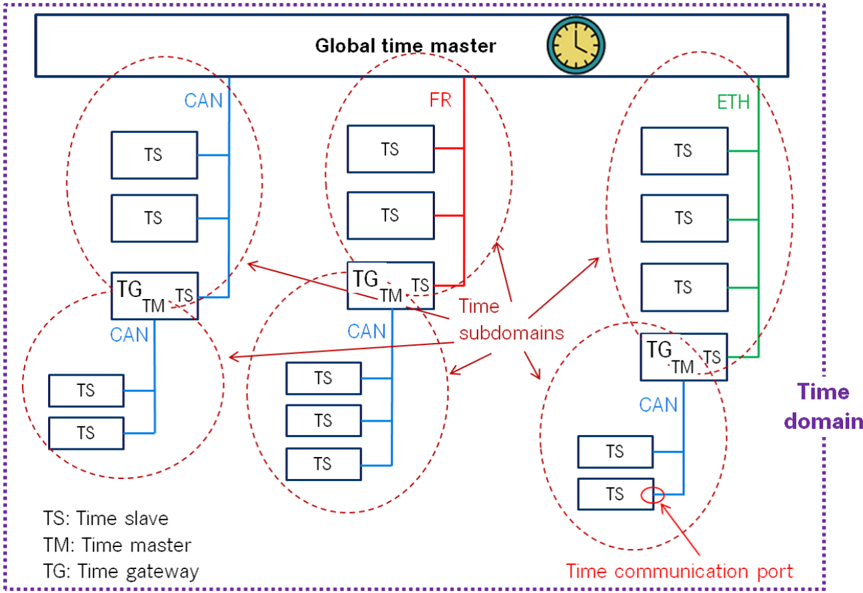
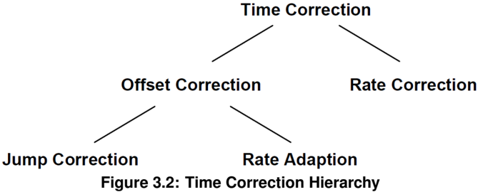
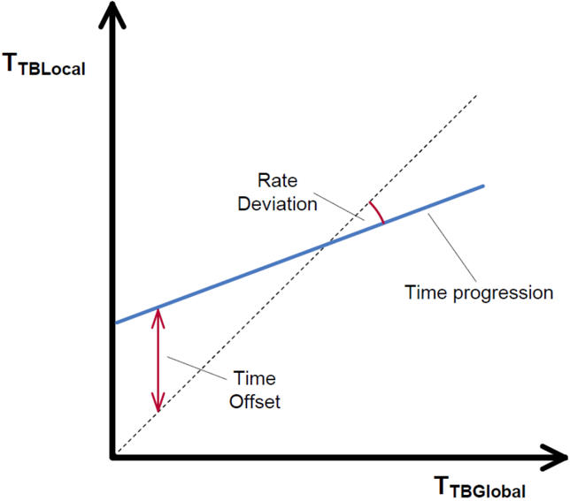

<!-- 源文档 AUTOSAR_FO_RS_TimeSync（R23-11），需求规范（RS），不受 Type A 七章骨架约束；章节结构镜像源文档自身编号。需求项 ID 标记与源文档的草稿标志（Draft 类标记）按 2026-11-03 批次决议整体省略（标题仅翻译）；条目后的 ⌋(…) 追溯行随 ID 一并省略。5.2.x 的四个需求组（Common/Ethernet/CAN/FlexRay）保留为编号小节，需求项以加粗标题行 + 字段表的形式呈现（避免深层目录标题）——运行决策，请用户在确认关核验；源文档中 6 个丢失 ## 标题标记的条目（00013/00014/00015/20036/20063/20073）已按条目恢复。§2.1 的 ID 区段说明（RS_TS_00xxx / RS_TS_20xxx）为编码模式描述，以内联代码保留。源第 6 章「Requirements Tracing」为纯 ID 追溯表，按 2026-11-03 决议整章省略并将后续章节重编号（源 7→6）。封面元数据表、免责声明与目录按 EXP 流程省略；54 处图引用中 3 处为内容图（图3.1 术语示例、图3.2 时间校正层级、图3.3 速率偏差与时间校正），按源图号嵌入，其余为页面装饰。§3.2.9/§3.2.17 等定义节的图内标签散落（TS、TM、TG、TTBLocal 等）按转换噪声丢弃。被 PDF 转换截断的字段单元格（20072/20073/20074 的理由——「这些影响降低车辆可用性/鲁棒性」一句）已从 R23-11 PDF 恢复。RS_TS_20048 中的引用标记 [6] 在源文档参考文献表中无对应条目（参考文献只有 [1]–[4]，[3] 即 IEEE 802.1AS），按未解析引用原样保留为纯文本。附录 A 变更表的 Number 列按批次决议省略，仅保留标题列；A.1.3 源文档表格为空。 -->

## 1. 文档范围

本文档的目的是定义时间同步协议（**Time Synchronization Protocol**）的功能和非功能需求。

规范状态在 1.5.0 版本中被设置为「draft（草稿）」。

## 2. 所用约定

### 2.1. 文档约定

**AUTOSAR** 文档中需求的呈现遵循 TPS_STDT_00078 中规定的表格，参见标准化模板（**Standardization Template**）的「可追溯性支持（**Support for Traceability**）」章节（[\[1\]](#ref-1)）。

应使用 TPS_STDT_00053 中规定的表达义务的言语形式来表示需求，参见标准化模板的「可追溯性支持」章节（[\[1\]](#ref-1)）。

在本文档范围内，`RS_TS_00xxx` 区段中的 **ID** 用于通用需求（参见「通用需求」一节），`RS_TS_20xxx` 区段中的 **ID** 用于总线特定需求（参见「以太网时间同步」「CAN 时间同步」「FlexRay 时间同步」各节）。

## 3. 缩略语、缩写和定义

### 3.1. 缩略语和缩写

以下词汇表包含与时间同步相关、且未包含在 **AUTOSAR** 术语表 [\[2\]](#ref-2) 中的缩略语和缩写。

**CRC**
> 循环冗余校验和（**Cyclic Redundancy Checksum**）

**FV**
> 新鲜度值（**Freshness Value**）

**FVM**
> 新鲜度值管理器（**Freshness Value Manager**）

**ICV**
> 完整性校验值（**Integrity Check Value**）

**OFS**
> 偏移同步（**Offset synchronization**）

**Pdelay**
> IEEE 802.1AS 中给出的传播/路径延迟（**Propagation / path delay**）

**Pdelay_Req**
> 传播/路径延迟请求消息（**Propagation / path delay request message**）

**Pdelay_Resp**
> 传播/路径延迟响应消息（**Propagation / path delay response message**）

**Pdelay_Resp_Follow_Up**
> 传播/路径延迟后续消息（**Propagation / path delay Follow-Up message**）

**PDU**
> 协议数据单元（**Protocol Data Unit**）

**Timesync**
> 时间同步（**Time Synchronization**）

**Sync**
> 时间同步消息（**Sync**）

**TS**
> 时间同步（**Time Syncronisation**）

**TSP**
> 时间同步提供者（**Time Synchronization Provider**）

### 3.2. 定义

#### 3.2.1. 时钟

定义：时钟（**Clock**）指由时基（无论是否与外部源同步）与能够周期性改变其输出电平状态（例如在两个不同电压电平之间翻转）的硬件组合而成的单元。这种电平状态变化的频率可以是可调的。该硬件可以是例如微控制器的一部分，或一个外部电子元件。同样，同步时基信息可以从外部源获取，例如 **RTC**、**GPS**、以太网等。

因此，在谈论时钟时，根据该术语所处的上下文，我们可能指它的质量（例如速率、精度等），也可能指它所持有的时基（例如相对于全球位置、夏令时等的时间信息）。

#### 3.2.2. 全局时间主节点

定义：全局时间主节点（**Global Time Master**）是某个时基的全局所有者和源点，位于该时基的时基层级的顶端。

#### 3.2.3. 时基

定义：时基（**Time Base**）是一个唯一的时间实体，其特征在于：

- 时间的推进，它表示时间如何推进，即速率（其本身派生自本地石英振荡器）以及时间值在某些时间点的绝对变化（例如 **NTP** 中偏移校正的影响）。
- 所有权，它表示谁是时基的所有者。例如，一个分布式 **NTP** 时基有多个所有者，速率和偏移校正方面的时间推进是涉及 **NTP** 节点子集的结果。
- 与物理世界的参照，即时基是统计 **ECU** 硬件本地运行时间的相对时基，还是表示像 **UTC** 这样的绝对时间。一个时基可以有多个参照，例如它可以是一个相对时间，与一个偏移值组合后也表示一个绝对时间。

车辆中时基的示例：

- 绝对时基，基于 **GNSS** 时间。
- 相对时基，表示车辆累计的总运行时间，即时基在车辆开始运行时并非从零值开始。
- 相对时基，在 **ECU** 硬件开始运行时从零开始。

一个时基意味着一个时钟的可用性。

**特殊情形「纯本地时基」：**

纯本地时基（**Pure Local Time Base**）是具有本地作用域的时基，它既不向其他节点传播，也不从其他节点接收。纯本地时基只在本地被设置和读取。因此，在多个节点中并行拥有多个具有相同时域编号的纯本地时基是可能的。纯本地时基的行为类似同步时基，因为它随时间推进，但它不通过 **TSP** 模块同步。行为类似偏移时基的纯本地时基不受支持。

#### 3.2.4. 同步时基

定义：同步时基（**Synchronized Time Base**）是存在于一个处理实体（分布式系统的参与者/处理器/节点）上、与不同处理实体上的时基同步的时基。同步时基可以通过时间协议或时间一致协议获得，这些协议以规定的方式从一个或多个物理时基派生出同步时基（例如网络时间协议（**NTP**）或 FlexRay 时间一致协议）。同步将作用于时钟速率，并可选地作用于时基绝对值。

同步将作用于时钟绝对值，并可选地作用于时钟速率。同步时基允许各处理单元同步地行动。同步时基通常被称为「全局时间（**Global Time**）」。

在一个处理单元上可以存在多于一个同步时基，例如一个 **NTP** 节点将拥有从网络集群的 **NTP** 获取的同步时基，但也可能拥有从 **UTC** 时间服务器（基于一组原子钟）提供的时间派生的同步时基。这两个同步时基的速率可能略有不同，并且它们的绝对值之间没有定义任何关系。

#### 3.2.5. 偏移时基

定义：偏移时基（**Offset Time Base**）是存在于一个处理实体（分布式系统的参与者/处理器/节点）上的时基。偏移时基依赖于一个特定的同步时基，因此它与作为其底层时基资源（**TBR**）的同一时基源同步。

偏移时基持有相对于其底层同步时基资源（**Synchronized TBR**）时基的偏移值。因此，它向应用提供其底层同步时基资源的值加上它所持有的偏移值的时基。由于偏移时基从与其底层同步时基资源相同的 **TSP** 接收其时间值，它将呈现相同的速率偏差和校正特性。

#### 3.2.6. 时基提供者

定义：时基提供者（**Time Base Provider**）是 **TSP** 模块针对给定时基所扮演的角色。因此，一个 **TSP** 模块可以包含一个或多个时基提供者。时基提供者的类型为导入者（**importer**）或导出者（**exporter**），导入者充当时间从节点，导出者充当时间主节点。时间网关由针对给定时基的一个时基导入者和一个或多个时基导出者组成。为了限定术语，导入者被记为从节点（**slave**），导出者被记为主节点（**master**）。

#### 3.2.7. 时间通信端口

定义：时间通信端口（**Time Communication Port**）是 **ECU** 硬件上用于传输时间信息的物理通信接口（在经典平台中可由条目「物理连接器（**Physical Connector**）」覆盖）。

#### 3.2.8. 时域

定义：时域（**Time Domain**）表示哪些组件（例如节点、通信系统）与某个时基相关联。一个时域可以包含零个或多个时子域。如果某时域的时序层级不包含时间网关，即所有节点都连接到同一总线系统，则不存在专门的时子域，否则时子域将与该时域本身等同。

TS：时间从节点（**Time slave**）
TM：时间主节点（**Time master**）
TG：时间网关（**Time gateway**）

#### 3.2.9. 时间网关

定义：时间网关（**Time Gateway**）是这样一组实体：其中一个实体针对某个时基充当时间从节点，另一个（一个或多个）实体充当时间主节点，将该时基分发给多组时间从节点。一个 Timesync **ECU** 可以包含多个时间网关。时间网关可以连接到不同类型的总线系统（例如从节点侧可以连接到 **CAN**，而主节点侧可以连接到以太网）。

#### 3.2.10. 时间层级

定义：时间层级（**Time Hierarchy**）描述某个时基是如何被分发的：从全局时间主节点开始，跨各个时间网关（如果存在）分发到各个时间从节点。

#### 3.2.11. 时间主节点

定义：时间主节点（**Time Master**）是针对某个时基的主节点实体，它将该时基传播到通信网络某个特定区段内的一组时间从节点，是该时基的源。

如果时间主节点同时也是该时基的所有者，那么它就是全局时间主节点。时间网关通常由一个时间从节点和一个或多个时间主节点组成。将时间实体映射到真实 **ECU** 时必须注意，一台 **ECU** 硬件可以是一个时基的时间主节点（甚至全局时间主节点），同时是另一个时基的时间从节点。

**特殊情形「纯本地时间主节点」：**

纯本地时间主节点（**Pure Local Time Master**）是一个作为纯本地时基主节点的实体，因此不将该时基传播给任何时间从节点。

#### 3.2.12. 时间从节点

定义：时间从节点（**Time Slave**）是在通信网络某个特定区段内作为某个时基接收方的实体，是该时基的消费者。

#### 3.2.13. 时子域

定义：时子域（**Time Sub-Domain**）表示哪些组件（例如节点）与某个时基相关联，但其作用域限于一条通信总线。

#### 3.2.14. Timesync ECU（Timesync 电子控制单元）

定义：Timesync **ECU** 是通过包含一个或多个时间从节点或时间主节点而成为某个时域一部分的 **ECU** 硬件。

#### 3.2.15. TSP 模块 / Timesync 模块

定义：**TSP** 模块（Timesync over &lt;BUS&gt; 模块）是通过应用总线特定机制在总线系统上接收或发送时间信息的总线特定模块。一个 **TSP** 模块可以服务于同一类型的多个通信总线。

#### 3.2.16. 虚拟本地时间

定义：虚拟本地时间（**Virtual Local Time**）是由 **OS** 计数器或硬件时钟驱动的时间，它进而驱动一个同步时基。关联的同步时基相对于虚拟本地时间有一个偏移。对于时间从节点，通常还存在速率上的偏差，这是由时间主节点和时间从节点使用的硬件参考时钟的不同时钟漂移引起的。

术语虚拟本地时间描述其时间单调推进、无跳变的时基。

虚拟本地时基是以下插值所必需的：

- 同步时基的本地实例（在主节点或从节点中）
- 纯本地时基
- 以及偏移时基（在速率校正的情形下）

此外，虚拟本地时基可用于测量时间跨度，即用于速率校正的测量区间或超时。

虚拟本地时基基于硬件时钟，可以从各种源派生：

- **OS** 计数器
- **GPT** 计数器
- 以太网自由运行计数器（用于入口和出口时间戳打点）

可以并行使用不同的虚拟本地时基。

尽管不同的计数器源在节拍持续时间和计数器宽度上各不相同，但每个派生的虚拟本地时基都具有相同的宽度（64 位）和节拍持续时间（1 ns）。要做到这一点，必须对计数器的溢出进行计数，并在需要时转换计数器特定的节拍持续时间。

#### 3.2.17. 时间校正

定义：在时间从节点中，时间校正（**Time Correction**）是将时基本地实例的值调整到全局时基的值的过程。在时间主节点中，时间校正是消除偏移时钟相对于其对应同步时基的偏差的过程。时间校正可以分为速率校正（**Rate Correction**），它校正速率偏差；以及偏移校正（**Offset Correction**），它校正绝对时间偏差。偏移校正还可以进一步分为（通过）跳变校正（**Jump Correction**）或（通过）速率适配（**Rate Adaption**）进行的偏移校正。

**注意：**

- 速率偏差：这意味着时基的本地实例与全局时基的时间以不同的速率推进。例如，如果本地硬件参考时钟由一个因制造公差和/或热效应而导致频率偏离的晶体管振荡器驱动，则会出现这种偏差。
- 时间偏移：这意味着时基的本地实例与全局时基没有精确同步。除了在同步时被补偿的初始偏移之外，由于本地硬件参考时钟速率的不准确性，以及影响与全局时基重新同步的抖动效应、软件延迟和计数器粒度，这种偏差会反复出现。

#### 3.2.18. 速率校正

定义：速率校正（**Rate Correction**）校正本地硬件参考时钟相对于全局时间主节点时钟速率的速率偏差。该校正通过一个乘法校正因子完成，该因子在时钟预配置速率之外使用。速率校正在一个测量的范围内确定该校正因子。然而，该校正因子并不是固定的，而是在每次成功测量之后被更新。

速率校正的工作原理不是调整本地硬件参考时钟以使其以正确的速率推进。相反，速率校正只在读取时即时校正时基本地实例的值。

#### 3.2.19. 偏移校正

定义：偏移校正（**Offset Correction**）校正绝对时间偏差（偏移）。根据偏移的大小和 **StbM** 的配置，该校正或者通过跳变校正执行，或者通过速率适配执行。偏移校正独立于速率校正。它在时基的本地实例每次与其全局时基同步时执行。

#### 3.2.20. 跳变校正

定义：跳变校正（**Jump Correction**）通过将偏移加到时基的本地实例（这等价于接管全局时基的值），一步完成绝对时间偏移的校正。

#### 3.2.21. 速率适配

定义：速率适配（**Rate Adaption**）在一个预定义的时间跨度内逐渐校正时间偏移。为此，速率适配将时基本地实例的速率临时切换到另一个值。选择该速率是为了在预配置的时间跨度内完全消除偏移。

与速率校正一样，速率适配不调整时基的本地实例（包括硬件参考时钟）。它只在读取时钟值时即时校正它们。

**注意：** 速率适配与速率校正使用类似的机制。然而，它们彼此完全独立，即速率适配可以在速率校正的基础上执行而不引起干扰。

## 4. 用例

本章描述由实现了时间同步协议的 **ECU** 硬件环境可以实现的用例。

表4.1：用例

| ID | 名称 | 描述 |
| --- | --- | --- |
| 0001 | Pdelay 测量（**Pdelay measurement**） | 测量以太网消息之间的延迟 |
| 0002 | 时间同步（**Time Synchronization**） | 不同时基的时间同步。 |

## 5. 需求规范

### 5.1. 功能概述

时间同步实现提供网络时间协议或时间一致协议之类的手段，将其本地时基与其他节点上的时基同步。

模块和应用可以通过读取时间信息来消费由时间同步实现提供和管理的时间信息。模块和应用在需要提供时间信息时，可以更新由时间同步实现维护的时基。

本规范包含面向经典平台和自适应平台的时间同步需求。经典平台将时间同步的实现拆分为 3 个总线协议特定的时间同步提供者（**TSP**）模块（SWS Time Synchronization over Ethernet、over CAN 和 over FlexRay）和一个管理时基的模块（SWS Synchronized Time-Base Manager）。自适应平台只为时间同步定义了一个模块（SWS TimeSync），它同时也包含时间同步提供者（**TSP**）部分。

### 5.2. 功能需求

#### 5.2.1. 通用需求

**时间同步实现应独立于所扮演的角色维护其自己的时基**

| 描述 | 时间同步实现应始终维护时基，使用不同的硬件时钟参照（即 **OS** 计数器、**GPT**、以太网硬件时钟等）。配置取决于硬件的能力，以及时间同步实现的特定角色是否被启用/禁用。 |
| --- | --- |
| 理由 | 时基在全局时间集群内只由一个实例管理。 |
| 依赖项 | - |
| 用例 | - |
| 支撑材料 | - |
| 适用平台 | **CP**、**AP** |

**TS 应以可配置的启动值初始化本地时基**

| 描述 | **TS** 应以可配置的启动值初始化本地时基。 |
| --- | --- |
| 理由 | 以一个已知的默认值启动。 |
| 依赖项 | - |
| 用例 | - |
| 支撑材料 | - |
| 适用平台 | **CP** |

**时间同步实现应以可配置的启动值初始化全局时基**

| 描述 | 时间同步实现应允许配置全局时基的初始化值。初始化值可以是： * 来自静态配置的值 * 来自非易失性存储器的值 |
| --- | --- |
| 理由 | 以一个专门指定的时基值启动。恢复时间冻结。 |
| 依赖项 | - |
| 用例 | - |
| 支撑材料 | - |
| 适用平台 | **CP**、**AP** |

**时间同步实现应允许客户访问同步时基**

| 描述 | 时间同步实现应允许活动客户访问同步时基。时间同步实现应为客户提供一个访问同步时基的接口，即读取当前时间和时基的状态（即时基或时钟的质量特性，例如是否已经与外部源同步、是否呈现向未来/过去的闰跳、速率偏差等）。客户应始终通过时间同步实现访问同步时基。 |
| --- | --- |
| 理由 | 时间同步实现向客户提供在需要时访问时间定义的可能性。 |
| 依赖项 | - |
| 用例 | 一个自适应应用想知道当前的时间定义，以便以与其他 **ECU** 或软件组件的任务同步的方式执行某个任务。 |
| 支撑材料 | - |
| 适用平台 | **CP**、**AP** |

**时间同步实现应向 TSP 模块提供时间信息**

| 描述 | 时间同步实现应允许「时间同步提供者」模块访问由时间同步实现模块管理的时间信息。 |
| --- | --- |
| 理由 | 关注点分离：时间同步实现不提供自己的时间一致协议/网络时间协议。时间同步实现将这一点留给 **TSP** 模块。然而，对于时间一致协议/网络时间协议，**TSP** 模块依赖于由时间同步实现管理的时间信息。 |
| 依赖项 | - |
| 用例 |  |
| 支撑材料 | - |
| 适用平台 | **CP**、**AP** |

**时间同步实现应在接收到时间主节点的值时同步时间从节点的时基**

| 描述 | 如果被配置为某时基的时间从节点，时间同步实现应在每次接收到来自 **TSP** 模块的有效时基值时，将其本地时基与该 **TSP** 模块提供的全局时间同步。一个有效的全局时基值会替换本地时基的值。 |
| --- | --- |
| 理由 | 快速的时间同步和校正。 |
| 依赖项 | - |
| 用例 |  |
| 支撑材料 | - |
| 适用平台 | **CP**、**AP** |

**时间同步实现应基于时基参考时钟持续维护其时基**

| 描述 | 时间同步实现应基于本地参考时钟维护其时基。例如，时间同步实现可以访问的参考时钟可以是： * **OS** 计数器 * **GPT** * 以太网硬件时钟 |
| --- | --- |
| 理由 | * 时基在全局时间集群内只由一个实例管理。 * 时间信息的可用性。即使在总线上同步失败（对于时间从节点），该模块仍能提供一个时间值。 |
| 依赖项 | - |
| 用例 |  |
| 支撑材料 | - |
| 适用平台 | **CP**、**AP** |

**时间同步实现应维护时基的同步状态**

| 描述 | 时间同步实现应自主维护时基的同步状态。同步状态是指关于向未来/过去的闰跳、时基是否已经与外部源同步、夏令时设置等的信息。 |
| --- | --- |
| 理由 | 允许时基资格判定。 |
| 依赖项 | - |
| 用例 |  |
| 支撑材料 | - |
| 适用平台 | **CP**、**AP** |

**时间同步实现应允许主节点侧的客户设置全局时间**

| 描述 | 如果被配置为时间主节点，时间同步实现应允许客户设置全局时基。 |
| --- | --- |
| 理由 | 允许全局时基的调整。 |
| 依赖项 | - |
| 用例 |  |
| 支撑材料 | - |
| 适用平台 | **CP**、**AP** |

**时间同步实现应允许主节点侧的客户触发 TSP 模块的时间传输**

| 描述 | 如果被配置为时间主节点，时间同步实现应允许客户立即触发 **TSP** 模块的时间传输。即，**TSP** 模块不应等待下一个周期性传输，而是强制立即传输。 |
| --- | --- |
| 理由 | 允许更快的重新同步。 |
| 依赖项 | - |
| 用例 |  |
| 支撑材料 | - |
| 适用平台 | **CP**、**AP** |

**时间同步实现应允许客户和 TSP 模块读取偏移时基的偏移值**

| 描述 | 时间同步实现应允许 **TSP** 模块读取偏移时基的偏移值。 |
| --- | --- |
| 理由 | 允许偏移时基的使用。 |
| 依赖项 | - |
| 用例 |  |
| 支撑材料 | - |
| 适用平台 | **CP**、**AP** |

**时间同步实现应允许客户和 TSP 模块设置偏移主时基的偏移值**

| 描述 | 如果被配置为时间主节点，时间同步实现应允许客户和/或 **TSP** 模块设置时基的偏移值。 |
| --- | --- |
| 理由 | 允许作为时间主节点使用偏移时基。 |
| 依赖项 | - |
| 用例 |  |
| 支撑材料 | - |
| 适用平台 | **CP**、**AP** |

**时间同步实现应允许客户读取通过 TSP 模块传播的用户数据**

| 描述 | 时间同步实现应允许客户读取通过 **TSP** 模块传播的用户数据（**User Data**）。用户数据可用于刻画时基，例如关于底层时钟源的质量、或关于时间的推进、或关于时钟源的信息安全。 |
| --- | --- |
| 理由 | 允许作为时间从节点使用用户数据。 |
| 依赖项 | - |
| 用例 | 时基的用户可以基于该时间值在安全和/或信息安全关键功能中的使用，拒绝带有质量和/或信息安全问题的时基值实例。 |
| 支撑材料 | - |
| 适用平台 | **CP**、**AP** |

**时间同步实现应允许客户设置通过 TSP 模块传播的用户数据**

| 描述 | 如果被配置为时间主节点，时间同步实现应允许客户设置通过 **TSP** 模块传播的用户数据。用户数据可用于刻画时基，例如关于底层时钟源的质量、或关于时间的推进、或时钟源的信息安全。 |
| --- | --- |
| 理由 | 允许作为时间主节点使用用户数据。 |
| 依赖项 | - |
| 用例 | 时基的提供者用质量、信息安全限定符通告时基值的每个实例。这样，时基的用户可以在需要时采取适当的行动。 |
| 支撑材料 | - |
| 适用平台 | **CP**、**AP** |

**时间同步实现应向客户通知状态事件**

| 描述 | 时间同步实现应向客户（事件通知客户）通知与时基相关的状态事件。 |
| --- | --- |
| 理由 | 即时获得状态变化的信息，以避免不必要的轮询。 |
| 依赖项 | - |
| 用例 | 在（重新）同步时向应用更新状态（由 **TSP** 模块执行）。 |
| 支撑材料 | - |
| 适用平台 | **CP**、**AP** |

**时间同步实现应向客户通知预先定义的时间跨度已经流逝**

| 描述 | 时间同步实现应在某个时间跨度（相对于给定时基、由客户先前定义/设置）已经流逝时通知客户。 |
| --- | --- |
| 理由 | 在给定时间跨度已经流逝时即时获得信息，以避免不必要的轮询。 |
| 依赖项 | - |
| 用例 | 整个网络上的动作同步（例如在特定时间打开或关闭不同的灯）。 |
| 支撑材料 | - |
| 适用平台 | **CP**、**AP** |

**时间同步实现应支持速率校正**

| 描述 | 时间同步实现应支持时基的速率测量和速率校正。 |
| --- | --- |
| 理由 | 如果测量并校正时间从节点与全局时间主节点之间（由时钟偏差引起的）速率偏差，时基的精度会得到提升。 |
| 依赖项 | - |
| 用例 |  |
| 支撑材料 | - |
| 适用平台 | **CP**、**AP** |

**时间同步实现应支持阻尼式偏移校正**

| 描述 | 时间同步实现应通过施加附加的速率校正来支持平滑的偏移校正。 |
| --- | --- |
| 理由 | 如果本地时基当前值与接收到的全局时基值之间的偏移通过添加一个附加的速率校正项来平滑地消除，而不是对本地时基施加硬跳变，则在重新同步之后可以避免本地时基内的跳变。 |
| 依赖项 | - |
| 用例 |  |
| 支撑材料 | - |
| 适用平台 | **CP**、**AP** |

**时间同步实现应提供查询同步状态的接口**

| 描述 | 时间同步实现应提供查询同步状态的接口。 |
| --- | --- |
| 理由 | 为了避免其他组件受未同步时间信息的影响，时钟的同步性应当可用并可由客户识别。 |
| 依赖项 | - |
| 用例 |  |
| 支撑材料 | - |
| 适用平台 | **CP**、**AP** |

**如果配置为时间主节点，时间同步实现应支持在关机时存储时基值**

| 描述 | 如果被配置为时间主节点，时间同步实现应支持在关机时将最后一个全局时间值存储到非易失性存储器。 |
| --- | --- |
| 理由 | 以一个专门指定的时基值启动。支持时间冻结。 |
| 依赖项 | - |
| 用例 |  |
| 支撑材料 | - |
| 适用平台 | **CP**、**AP** |

**时间同步实现应提供故障检测机制**

| 描述 | 时间同步实现应提供故障检测机制。它必须检测以下状态变化： * 同步时基的丢失/重新建立 * 客户/提供者调用期间的错误 |
| --- | --- |
| 理由 | 车辆动态子系统的组成部分必须保证其分布式功能的并发执行。如果检测到同步丢失，子系统必须触发适当的应对措施。 |
| 依赖项 | - |
| 用例 |  |
| 支撑材料 | - |
| 适用平台 | **CP**、**AP** |

**时间同步实现应按每种时基资源类型向客户提供专用 API**

| 描述 | 时间同步实现应为每种时基资源（**Time Base Resource**）类型提供一个不同的、专用的 **API**。 |
| --- | --- |
| 理由 | 将向客户提供一个专用 **API**，它按照其时基资源类型设定与该时基可能交互的边界。这样，当该时基实际上是从时基时，客户不会尝试像与主时基交互那样与该时基交互。 |
| 依赖项 | - |
| 用例 | - |
| 支撑材料 | - |
| 适用平台 | **CP**、**AP** |

**时间同步实现的配置应允许与不同类型的客户交互**

| 描述 | 时间同步实现的配置应允许与不同类型的客户交互。同步时基管理器（**Synchronized Time-Base Manager**）是一项服务，应当按如下方式提供时基（如果被请求）： * a) 它触发有接口的 **SWC** 和 **BSW**（该功能目前限于 **OS** 调度表） * b) 它在客户请求时按需提供时基 * c) 它就与时基相关的事件通知客户 客户应可以选择与同步时基管理器期望的交互方式。 |
| --- | --- |
| 理由 | 允许作为时间主节点使用偏移时基。 |
| 依赖项 | - |
| 用例 |  |
| 支撑材料 | - |
| 适用平台 | **CP** |

**时间同步实现的配置应允许实现表现为（整车范围的）时间主节点**

| 描述 | 对于每个受支持的时基，时间同步实现的配置应允许启用/禁用（整车范围的）时间主节点在全局时间同步方面的功能。 |
| --- | --- |
| 理由 | 支持给定时域中特定的通信端口角色。 |
| 依赖项 | - |
| 用例 |  |
| 支撑材料 | - |
| 适用平台 | **CP**、**AP** |

**时间同步实现的配置应允许实现表现为时间从节点**

| 描述 | 对于每个受支持的时基，时间同步实现的配置应允许启用/禁用时间从节点在全局时间同步方面的功能。 |
| --- | --- |
| 理由 | 支持给定时域中特定的通信端口角色。 |
| 依赖项 | - |
| 用例 |  |
| 支撑材料 | - |
| 适用平台 | **CP**、**AP** |

**时间同步实现的配置应允许实现表现为时间网关**

| 描述 | 如果被配置为时间网关，时基管理器（**TBM**）应将时基信息从一个车辆网络路由到另一个车辆网络。也就是说，一个车辆网络上的时间同步模块被配置为从节点，而另一个网络上的另一个时间同步模块被配置为主节点。时基管理器应将从节点侧的时基信息转发给主节点侧。 |
| --- | --- |
| 理由 | 支持给定时域中特定的通信端口角色。 |
| 依赖项 | - |
| 用例 |  |
| 支撑材料 | - |
| 适用平台 | **CP**、**AP** |

**时间同步实现应触发已注册的客户**

| 描述 | 如果 **OS** 被配置为被触发的客户，同步时基管理器应周期性地将相应的调度表同步到已配置的时基。 |
| --- | --- |
| 理由 | 允许全局时基的调整。 |
| 依赖项 | - |
| 用例 |  |
| 支撑材料 | - |
| 适用平台 | **CP** |

**时间同步实现应使用分辨率为 1 ns 的时间格式**

| 描述 | 时间同步实现应独立于 Timesync 模块地使用相同的时间格式，该格式与 IEEE 802.1AS 兼容并允许 1ns 的分辨率。**注意：** 时基时间值的实际分辨率取决于 Timesync 模块的能力。时间同步实现会根据需要调整时间值。**注意：** 某些 Timesync 模块传输的时间格式中，时间的秒部分使用 4 个字节而不是 6 个字节。 |
| --- | --- |
| 理由 | 在全局/本地时基的设计方面，所有总线之间的时基统一化。 |
| 依赖项 | - |
| 用例 |  |
| 支撑材料 | - |
| 适用平台 | **CP** |

**时间同步实现应向应用提供测量数据**

| 描述 | 为了允许将本地时基与对应的全局时基进行详细比较，**TS** 应为时间从节点和时间主节点提供时基相关数据的记录机制。 |
| --- | --- |
| 理由 | - |
| 依赖项 | - |
| 用例 | 时基的精度 |
| 支撑材料 | - |
| 适用平台 | **CP**、**AP** |

**时间同步实现应向应用提供系统服务接口**

| 描述 | 同步时基管理器应位于 **AUTOSAR** 服务层，向应用和 **BSW** 中的客户提供服务。它通过标准化的 **AUTOSAR** 接口向应用中的客户提供服务，并通过标准化的 C 语言 **API** 向 **BSW** 中的客户提供服务。 |
| --- | --- |
| 理由 | 应用和 **BSW** 中的客户都需要同步时间。 |
| 依赖项 | - |
| 用例 | 一个应用 **SWC** 想要获知某时基的当前值。 |
| 支撑材料 | - |
| 适用平台 | **CP** |

**时间同步实现应提供总线无关的客户接口**

| 描述 | 时间同步实现应提供总线无关的客户接口和时间格式。接收到的时基的分辨率可能因源总线而异。在这种情形下，时间同步实现会适当地调整时间值。 |
| --- | --- |
| 理由 | 隐藏总线/物理层特定的细节，将应用/客户与较低层解耦。 |
| 依赖项 | - |
| 用例 |  |
| 支撑材料 | - |
| 适用平台 | **CP** |

**时间同步实现应在用户请求时复制时基信息**

| 描述 | 对于同步时基，时间同步实现应在用户请求时将时基信息（时间值、用户数据等）从源时基复制到目的时基。 |
| --- | --- |
| 理由 | 在不损失精度的情况下复制时基。 |
| 依赖项 | - |
| 用例 | 反向时间同步、本地回退 |
| 支撑材料 | - |
| 适用平台 | **CP**、**AP** |

**时间同步实现应向 TSP 模块提供保护时间信息安全所需的新鲜度值（FV）**

| 描述 | 时间同步模块的实现应允许时间同步提供者（**TSP**）模块访问由新鲜度值管理器（**FVM**）**SWC** 管理的新鲜度值（**FV**）。 |
| --- | --- |
| 理由 | 关注点分离：时间同步模块的实现不管理 **FV**。它为 **FVM SWC** 和 **TSP** 模块提供所需的接口，用于它们之间的 **FV** 通信。 |
| 依赖项 | - |
| 用例 | 将 **FV** 加入完整性校验值（**ICV**）计算中，可以保护时间信息免受重放攻击。 |
| 支撑材料 | - |
| 适用平台 | **CP**、**AP** |

**同步过程监控的监控**

| 描述 | 时间同步实现应以完整性监控同步过程，并报告在时间同步过程中检测到的故障。补充信息：完整性等级通常至少需要 **ASIL B**。 |
| --- | --- |
| 理由 |  |
| 依赖项 | - |
| 用例 |  |
| 支撑材料 | ISO 26262; IEEE 802.1AS |
| 适用平台 | **CP**、**AP** |

**全局时间推进监控**

| 描述 | 时间同步实现应以完整性监控全局时间的推进，并报告在时间推进中检测到的故障。补充信息：完整性等级通常至少需要 **ASIL B**。 |
| --- | --- |
| 理由 |  |
| 依赖项 | - |
| 用例 |  |
| 支撑材料 | ISO 26262 |
| 适用平台 | **CP**、**AP** |

**错误情形下的连续时间推进保证**

| 描述 | 如果检测到经验证的时基的时间同步或推进中的故障，时间同步实现应切换到一个回退时基，该回退时基能够无缝地继续对经验证的时基进行外推。 |
| --- | --- |
| 理由 |  |
| 依赖项 | - |
| 用例 |  |
| 支撑材料 | IEEE 802.1AS |
| 适用平台 | **CP**、**AP** |

**向 SWC/自适应应用提供相关信息**

| 描述 | 时间同步实现应将经验证时基的 * 完整性信息 * 以及同步时间 原子地提供给具有完整性的 **SWC**/应用。补充信息：完整性等级通常至少需要 **ASIL B**。 |
| --- | --- |
| 理由 |  |
| 依赖项 | - |
| 用例 |  |
| 支撑材料 | ISO 26262 |
| 适用平台 | **CP**、**AP** |

#### 5.2.2. 以太网时间同步

**以太网 Timesync 模块应触发时基同步传输**

| 描述 | 如果被配置为某时基的时间主节点，以太网 Timesync 模块应支持两种触发时间同步协议序列传输的方式： * 周期性触发 * 按需立即触发 |
| --- | --- |
| 理由 | 时间同步协议。 |
| 依赖项 | - |
| 用例 |  |
| 支撑材料 | - |
| 适用平台 | **CP**、**AP** |

**以太网 Timesync 模块应支持 IEEE 802.1AS 以及 AUTOSAR 扩展**

| 描述 | 以太网 Timesync 模块应支持 IEEE 802.1AS [6] 第 11 章中的 Sync、Follow_Up（时间同步）和 Pdelay_Req、Pdelay_Resp、Pdelay_Resp_Follow_Up（延迟测量），以及属于寻址方案和消息格式的 **AUTOSAR** 扩展。 |
| --- | --- |
| 理由 | 时间同步协议。 |
| 依赖项 | - |
| 用例 |  |
| 支撑材料 | - |
| 适用平台 | **CP**、**AP** |

**以太网 TimeSync 模块应提供对总线协议特定参数的读/写访问**

| 描述 | 对于每个受支持的同步时基，时间同步实现应提供对总线协议特定参数的读/写访问。 |
| --- | --- |
| 理由 | 某些应用需要访问协议特定的参数。 |
| 依赖项 | - |
| 用例 | 运行带 IEEE 1733 的 **RTP** 的应用需要访问 IEEE 802.1AS 协议参数。 |
| 支撑材料 | - |
| 适用平台 | **CP** |

**以太网 Timesync 模块应支持使用 IEEE 802.1AS 点对点延迟机制测量点对点延迟**

| 描述 | 以太网 Timesync 模块应支持使用 IEEE 802.1AS 点对点延迟机制测量点对点延迟。以太网 Timesync 模块应将点对点延迟设置为一个静态（可配置的）值， * 在不使用点对点延迟机制时应使用该值 * 或者在使用 IEEE 802.1AS 点对点延迟机制时作为初始值使用 |
| --- | --- |
| 理由 | 时间同步协议。 |
| 依赖项 | - |
| 用例 |  |
| 支撑材料 | - |
| 适用平台 | **CP**、**AP** |

**以太网 Timesync 模块应检测并处理同步协议/通信中的错误**

| 描述 | 以太网 Timesync 模块应检测并处理同步协议/通信中的错误（例如收发器链路状态丢失）。 |
| --- | --- |
| 理由 | 同步协议的错误处理/检测。 |
| 依赖项 | - |
| 用例 |  |
| 支撑材料 | - |
| 适用平台 | **CP**、**AP** |

**以太网时间同步模块的配置应允许模块作为时间主节点工作**

| 描述 | 对于每个受支持的时域，时间同步实现的配置应允许启用/禁用时间主节点在全局时间同步方面的功能。 |
| --- | --- |
| 理由 | 支持给定时域中特定的通信端口角色。 |
| 依赖项 | - |
| 用例 |  |
| 支撑材料 | - |
| 适用平台 | **CP**、**AP** |

**以太网时间同步模块的配置应允许模块作为时间从节点工作**

| 描述 | 对于每个受支持的时域，时间同步配置的实现应允许启用/禁用时间从节点在全局时间同步方面的功能。 |
| --- | --- |
| 理由 | 支持给定时域中特定的通信端口角色。 |
| 依赖项 | - |
| 用例 |  |
| 支撑材料 | - |
| 适用平台 | **CP**、**AP** |

**时间同步的实现应评估并传播时间网关相关信息**

| 描述 | 如果被配置为时间网关的一部分，以太网时间同步模块应评估并传播时间网关相关信息。 |
| --- | --- |
| 理由 | 支持给定时域中特定的通信端口角色。 |
| 依赖项 | - |
| 用例 |  |
| 支撑材料 | - |
| 适用平台 | **CP** |

**以太网 Timesync 模块应提供同步时基的精度**

| 描述 | 以太网 Timesync 模块应采集并提供与时间同步相关参数（例如链路延迟）的测量数据。 |
| --- | --- |
| 理由 | 允许对时间同步机制进行详细分析。 |
| 依赖项 | - |
| 用例 |  |
| 支撑材料 | - |
| 适用平台 | **CP**、**AP** |

**以太网 Timesync 模块应访问属于时间同步的所有通信端口**

| 描述 | 以太网 Timesync 模块应访问属于每个通信端口的、与时间同步相关的数据。这包括本地以太网控制器以及本地和外部交换机的所有端口。 |
| --- | --- |
| 理由 | 允许沿着时间同步消息经过的硬件路径进行详细计算。 |
| 依赖项 | - |
| 用例 |  |
| 支撑材料 | - |
| 适用平台 | **CP**、**AP** |

**以太网 Timesync 模块应在接收到有效协议信息后提供时基**

| 描述 | 如果被配置为时间从节点，以太网 Timesync 模块应在接收到有效协议信息（Sync + Follow_Up 消息）后提供一个时基。该时基被转发给时间同步实现以更新本地时基。 |
| --- | --- |
| 理由 | 本地时基向全局时基的同步。 |
| 依赖项 | - |
| 用例 |  |
| 支撑材料 | - |
| 适用平台 | **CP**、**AP** |

**以太网 Timesync 模块应支持保护时间同步协议的手段**

| 描述 | 以太网 Timesync 模块应支持手段（例如序列计数器、**CRC**）来保护时间同步协议免受时间信息损坏的影响。 |
| --- | --- |
| 理由 | 检测错误的协议序列和数据。 |
| 依赖项 | - |
| 用例 |  |
| 支撑材料 | - |
| 适用平台 | **CP**、**AP** |

**以太网 Timesync 模块应支持时间测量和同步协议中的用户特定数据**

| 描述 | 以太网时间同步提供者模块应支持通过时间测量和同步协议发送/接收用户特定数据。 |
| --- | --- |
| 理由 | 允许用户特定数据的使用。 |
| 依赖项 | - |
| 用例 |  |
| 支撑材料 | - |
| 适用平台 | **CP**、**AP** |

**以太网 Timesync 模块应使用同步时基的时间同步协议来发送和接收偏移时基**

| 描述 | 除了同步时基的传输之外，以太网 Timesync 模块还应支持通过时间同步协议发送/接收偏移时基值。 |
| --- | --- |
| 理由 | 附加的偏移时间同步机制。 |
| 依赖项 | - |
| 用例 |  |
| 支撑材料 | - |
| 适用平台 | **CP**、**AP** |

**以太网 Timesync 模块应在点对点和多点（multidrop）拓扑上启用时间同步**

| 描述 | 以太网 Timesync 模块应在 802.1AS 最初面向的点对点拓扑上启用时间同步，也应在汽车领域相关的多点拓扑（例如 10BASE-T1S）上启用时间同步。 |
| --- | --- |
| 理由 | - |
| 依赖项 | - |
| 用例 |  |
| 支撑材料 | - |
| 适用平台 | **CP**、**AP** |

**以太网 Timesync 模块应支持保护时间同步协议信息安全性的手段**

| 描述 | 以太网 Timesync 模块应支持保护时间同步协议免受时间信息篡改（完整性、真实性）的手段。 |
| --- | --- |
| 理由 | 全局时间的完整性和真实性失效会导致： * 错误的时间 * 精度下降 这些影响会降低车辆的可用性/鲁棒性。 |
| 依赖项 | - |
| 用例 | * 保护以太网总线上时间信息的真实性和完整性。 * 检测并报告以太网总线上非真实和被篡改的时间信息。 |
| 支撑材料 | - |
| 适用平台 | **CP**、**AP** |

**速率比计算**

| 描述 | 以太网 Timesync 协议的时间从节点应计算本地时钟相对于时间主节点时钟的速率比（**rate ratio**）。 |
| --- | --- |
| 理由 | 本地时钟向主节点时钟的准确频率同步（**syntonization**）/同步。 |
| 依赖项 | - |
| 用例 |  |
| 支撑材料 | * 第 10.2.4.6 章 "neighborRateRatio" * 第 11.2.15.2.3 章 "computePdelayRateRatio" * 第 11.4.4.3.6 章 "cumulativeScaledRateOffset" |
| 适用平台 | **CP**、**AP** |

#### 5.2.3. CAN 时间同步

**CAN Timesync 模块应触发时基同步传输**

| 描述 | 如果被配置为某时基的时间主节点，**CAN** Timesync 模块应支持两种触发时间同步协议序列传输的方式： * 周期性触发 * 按需立即触发 |
| --- | --- |
| 理由 | 时间同步协议。 |
| 依赖项 | - |
| 用例 |  |
| 支撑材料 | - |
| 适用平台 | **CP** |

**CAN Timesync 模块应在接收到有效的 Timesync/TS 消息后提供时基**

| 描述 | 如果被配置为时间从节点，**CAN** Timesync 模块应在接收到有效的 Timesync/TS 消息后提供时基。该时基被转发给时间同步实现以更新本地时基。 |
| --- | --- |
| 理由 | 本地时基向全局时基的同步。 |
| 依赖项 | - |
| 用例 |  |
| 支撑材料 | - |
| 适用平台 | **CP** |

**CAN Timesync 模块应支持保护时间同步协议的手段**

| 描述 | **CAN** Timesync 模块应支持手段（例如序列计数器、**CRC**）来保护时间同步协议免受时间信息损坏的影响。 |
| --- | --- |
| 理由 | 检测错误的协议序列和数据。 |
| 依赖项 | - |
| 用例 |  |
| 支撑材料 | - |
| 适用平台 | **CP** |

**CAN Timesync 模块应检测并处理时间同步协议中的超时和完整性错误**

| 描述 | **CAN** Timesync 模块应监控时间同步协议的超时和完整性（例如序列计数器、**CRC**）。 |
| --- | --- |
| 理由 | 时间同步协议的错误处理/检测。 |
| 依赖项 | - |
| 用例 |  |
| 支撑材料 | - |
| 适用平台 | **CP** |

**CAN Timesync 模块应支持通过 CAN 进行精确时间测量和同步的协议**

| 描述 | **CAN** Timesync 模块应支持通过 **CAN** 进行精确时间测量和同步的协议，该协议由 SYNC（同步）和 FUP（后续）消息的序列组成，以实现更高的精度。 |
| --- | --- |
| 理由 | 基本的时间同步机制。 |
| 依赖项 | - |
| 用例 |  |
| 支撑材料 | - |
| 适用平台 | **CP** |

**CAN Timesync 模块应使用时间测量和同步协议来发送和接收偏移值**

| 描述 | 除了实际的时间戳之外，**CAN** Timesync 模块还应支持通过时间测量和同步协议发送/接收一个偏移值，该协议由 OFS（偏移同步）和 OFNS（偏移调整）消息的序列组成。**注意：** 对于 **CAN FD**，该序列可以只包含发送一条扩展的 OFS 消息。 |
| --- | --- |
| 理由 | 附加的偏移时间同步机制。 |
| 依赖项 | - |
| 用例 |  |
| 支撑材料 | - |
| 适用平台 | **CP** |

**CAN Timesync 模块应支持时间测量和同步协议中的用户特定数据**

| 描述 | **CAN** Timesync 模块应支持通过时间测量和同步协议发送/接收用户特定数据。 |
| --- | --- |
| 理由 | 允许用户特定数据的使用。 |
| 依赖项 | - |
| 用例 |  |
| 支撑材料 | - |
| 适用平台 | **CP** |

**CAN Timesync 模块的配置应允许面向 CAN 的时间同步实现支持时基的不同角色**

| 描述 | **CAN** Timesync/TS 配置应允许面向 **CAN** 的时间同步实现履行 3 种不同的角色： * 时间主节点 * 时间从节点 * 时间网关 （相对于全局（整车范围）时间同步）。在每种角色中，特定的功能被启用/禁用。 |
| --- | --- |
| 理由 | 支持给定时域中特定的通信端口角色。 |
| 依赖项 | - |
| 用例 |  |
| 支撑材料 | - |
| 适用平台 | **CP** |

**CAN Timesync 模块应支持经典 CAN 和 CAN FD**

| 描述 | **CAN** Timesync 模块应对经典 **CAN** 使用消息格式，对 **CAN FD** 使用扩展消息格式，后者允许在一条 **CAN** 帧中传输多于 8 个字节。通过为 **CAN FD** 使用扩展消息格式，应能够在单条扩展的 Timesync/TS 消息中传输一个偏移时基，而不必将它分布到两条连续的 Timesync 消息中。 |
| --- | --- |
| 理由 | 通过使用更长的 **CAN** 消息对 **CAN FD** 进行优化。 |
| 依赖项 | - |
| 用例 |  |
| 支撑材料 | - |
| 适用平台 | **CP** |

**CAN Timesync 模块应支持硬件和软件时间戳打点**

| 描述 | **CAN** Timesync 模块应支持在 **CAN** 硬件提供硬件时间戳打点支持和不提供该支持两种情形下的时间同步。 |
| --- | --- |
| 理由 | 硬件时间戳打点可以提高全局时间的精度，但并非所有 **CAN** 硬件都支持硬件时间戳打点。 |
| 依赖项 | - |
| 用例 | **CAN** 上的时间同步 |
| 支撑材料 | CIA 603 standard |
| 适用平台 | **CP** |

**CAN Timesync 模块应支持保护时间同步协议信息安全性的手段**

| 描述 | **CAN** Timesync 模块应支持保护时间同步协议免受时间信息篡改（完整性、真实性）的手段。 |
| --- | --- |
| 理由 | 全局时间的完整性和真实性失效会导致： * 错误的时间 * 精度下降 这些影响会降低车辆的可用性/鲁棒性。 |
| 依赖项 | - |
| 用例 | * 保护 **CAN** 总线上时间信息的真实性和完整性。 * 检测并报告 **CAN** 总线上非真实和被篡改的时间信息。 |
| 支撑材料 | - |
| 适用平台 | **CP** |

#### 5.2.4. FlexRay 时间同步

**FlexRay Timesync 模块应触发时基同步传输**

| 描述 | 如果被配置为某时基的时间主节点，FlexRay Timesync 模块应支持两种触发时间同步协议序列传输的方式： * 周期性触发 * 按需立即触发 |
| --- | --- |
| 理由 | 时间同步协议。 |
| 依赖项 | - |
| 用例 |  |
| 支撑材料 | - |
| 适用平台 | **CP** |

**FlexRay Timesync 模块应在接收到有效协议信息后提供时基**

| 描述 | 如果被配置为时间从节点，FlexRay Timesync 模块应在接收到有效协议信息（**SYNC** 消息）后提供一个时基。该时基被转发给时间同步实现以更新本地时基。 |
| --- | --- |
| 理由 | 本地时基向全局时基的同步。 |
| 依赖项 | - |
| 用例 |  |
| 支撑材料 | - |
| 适用平台 | **CP** |

**FlexRay Timesync 模块应支持保护时间同步协议的手段**

| 描述 | FlexRay Timesync 模块应支持手段（例如序列计数器、**CRC**）来保护时间同步协议免受时间信息损坏的影响。 |
| --- | --- |
| 理由 | 检测错误的协议序列和数据。 |
| 依赖项 | - |
| 用例 |  |
| 支撑材料 | - |
| 适用平台 | **CP** |

**FlexRay Timesync 模块应检测并处理时间同步协议中的超时和完整性错误**

| 描述 | FlexRay Timesync 模块应监控时间同步协议的超时和完整性（例如序列计数器、**CRC**）。 |
| --- | --- |
| 理由 | 同步协议的错误处理/检测。 |
| 依赖项 | - |
| 用例 |  |
| 支撑材料 | - |
| 适用平台 | **CP** |

**FlexRay Timesync 模块应支持通过 FlexRay 进行精确时间测量和同步的协议**

| 描述 | FlexRay Timesync 模块应支持通过 **FlexRay** 进行精确时间测量和同步的协议，该协议由 **SYNC**（同步）消息的序列组成。 |
| --- | --- |
| 理由 | 基本的时间同步机制。 |
| 依赖项 | - |
| 用例 |  |
| 支撑材料 | - |
| 适用平台 | **CP** |

**FlexRay Timesync 模块应使用时间测量和同步协议来发送和接收偏移值**

| 描述 | 除了实际的时间戳之外，FlexRay Timesync 模块还应支持通过时间测量和同步协议发送/接收一个偏移值，该协议由 **OFS**（偏移同步）消息的序列组成。 |
| --- | --- |
| 理由 | 附加的偏移时间同步机制。 |
| 依赖项 | - |
| 用例 |  |
| 支撑材料 | - |
| 适用平台 | **CP** |

**FlexRay Timesync 模块应支持时间测量和同步协议中的用户特定数据**

| 描述 | FlexRay Timesync 模块应支持通过时间测量和同步协议发送/接收用户特定数据。 |
| --- | --- |
| 理由 | 允许用户特定数据的使用。 |
| 依赖项 | - |
| 用例 |  |
| 支撑材料 | - |
| 适用平台 | **CP** |

**FlexRay 时间同步的配置应允许 FlexRay 时间同步模块支持时基的不同角色**

| 描述 | FlexRay 时间同步的配置应允许时间同步的实现履行 3 种不同的角色： * 时间主节点 * 时间从节点 * 时间网关 （相对于全局（整车范围）时间同步）。在每种角色中，特定的功能被启用/禁用。 |
| --- | --- |
| 理由 | 支持给定时域中特定的通信端口角色。 |
| 依赖项 | - |
| 用例 |  |
| 支撑材料 | - |
| 适用平台 | **CP** |

**FlexRay Timesync 模块应支持保护时间同步协议信息安全性的手段**

| 描述 | FlexRay Timesync 模块应支持保护时间同步协议免受时间信息篡改（完整性、真实性）的手段。 |
| --- | --- |
| 理由 | 全局时间的完整性和真实性失效会导致： * 错误的时间 * 精度下降 这些影响会降低车辆的可用性/鲁棒性。 |
| 依赖项 | - |
| 用例 | * 保护 **FlexRay** 总线上时间信息的真实性和完整性。 * 检测并报告 **FlexRay** 总线上非真实和被篡改的时间信息。 |
| 支撑材料 | - |
| 适用平台 | **CP** |

### 5.3. 非功能需求（质量）

**TS 应提供总线无关的客户接口**

| 描述 | **TS** 应提供总线无关的客户接口和时间格式。接收到的时基的分辨率可能因源总线而异。在这种情形下，**TS** 会适当地调整时间值。如果 **ECU** 硬件被配置为时间主节点，还可以进一步读取时基值。 |
| --- | --- |
| 理由 | 隐藏总线/物理层特定的细节，将应用/客户与较低层解耦。 |
| 依赖项 | **TSP** 模块将完成到总线无关时间格式的转换。 |
| 用例 |  |
| 支撑材料 | - |
| 适用平台 | **CP**、**AP** |

## 6. 参考文献

[1] Standardization Template
> AUTOSAR_FO_TPS_StandardizationTemplate

[2] Glossary
> AUTOSAR_FO_TR_Glossary

[3] IEEE Standard 802.1AS-2011
> IEEE

[4] Main Requirements
> AUTOSAR_FO_RS_Main

## A. 变更历史

请注意，本章中的列表还包括在后续版本中已从规范中移除的约束和规范项。这些约束和规范项在文档中不作为超链接出现。

由于本批次决议整体省略需求项 **ID**，本附录变更表的 Number 列省略，仅保留标题列。

### A.1. 本文档依据 AUTOSAR 版本 R23-11 的变更历史

#### A.1.1. R23-11 中新增的需求

表A.1：R23-11 中新增的需求

| 标题 |
| --- |
| 同步过程监控的监控 |
| 全局时间推进监控 |
| 错误情形下的连续时间推进保证 |
| 向 SWC/自适应应用提供相关信息 |
| 速率比计算 |

#### A.1.2. R23-11 中变更的需求

表A.2：R23-11 中变更的需求

| 标题 |
| --- |
| 以太网 Timesync 模块应支持使用 IEEE 802.1AS 点对点延迟机制测量点对点延迟 |

#### A.1.3. R23-11 中删除的需求

无。
