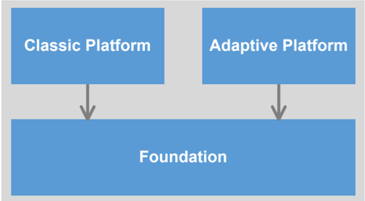
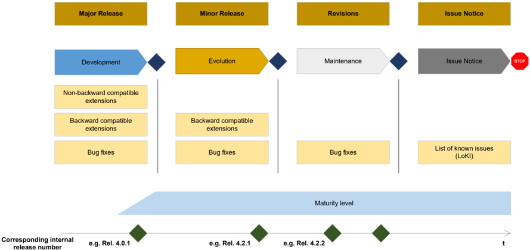

<!-- 源文档 AUTOSAR_FO_TR_ReleaseOverview（R23-11），技术报告（TR），不受 Type A 七章骨架约束；章节结构镜像源文档自身编号（1–5）。封面表格、Disclaimer、Contents 属于文档框架信息，不译；源文档开头的 References 列表保留为文末不编号的「参考文献」注册表。表 2.1（概念的影响）被 PDF 分页切为三个片段，已按行序合并为一张表；因列宽被拆断的规范名（Requirements on Operating / System Interface）与文件名中的换行已按其原意拼接；被 PDF 纵向合并的单元格（概念名、标准、生命周期）按源文档版式保留空单元格。表 3 中的簇标题行与被拆断的 Standardization Template 行同样处理；「Document ID 781」页脚属文档框架信息，不译。 -->

## 1. 引言

### 1.1. 本文档的范围

本文档提供 AUTOSAR 标准 Foundation 发布 R23-11 的概览。

### 1.2. 术语与许可

#### 1.2.1. 术语声明

AUTOSAR 已经确认先前常用术语中存在可被视为压迫性或种族歧视性的用法，例如 master/slave 和 black/white list，或在其他语境中带有性别或年龄等有害内涵的用法。AUTOSAR 已与所有工作组展开讨论以替换这些术语。AUTOSAR 致力于在即将到来和未来的发布中提供不含这些术语的全部规范文档。尽管如此，完全替换这些术语可能需要数个发布的时间，因为 AUTOSAR 必须继续其运作，同时需要审查和更新数千页的既有规范。

#### 1.2.2. W3C XML 模式的使用

AUTOSAR XML 模式需要 XML 命名空间定义文件 xml.xsd。

本发布中有多处使用"xml.xsd"文件。对所有这些使用，适用 W3C 许可，该许可可在 https://www.w3.org/Consortium/Legal/2015/copyright-software-and-document 查阅。

**许可**

通过获取和/或复制本作品，您（被许可方）同意您已阅读、理解并将遵守以下条款和条件。

特此授予为任何目的、免费且无版税地复制、修改和分发本作品（无论是否修改）的许可，前提是您在本作品或其任何部分（包括修改）的所有副本上包含以下内容：本通知的全文，置于重新分发或衍生作品的用户可见的位置；任何既有的知识产权免责声明、通知或条款和条件（如果不存在，则应包含 W3C Software and Document Short Notice）；以及通过新代码或文档上的版权声明注明任何变更或修改，例如"本软件或文档包含复制自或派生自 [W3C 文档的标题和 URI] 的材料。Copyright © [年份] W3C®（MIT、ERCIM、Keio、Beihang）。"

**免责声明**

本作品"按原样"提供，版权持有者不作出任何明示或默示的陈述或保证，包括但不限于对适销性、对特定用途的适用性、或软件或文档的使用不会侵犯任何第三方专利、版权、商标或其他权利的保证。

版权持有者对因使用本软件或文档而产生的任何直接、间接、特殊或后果性损害不承担责任。

未经事先明确的书面许可，版权持有者的名称和商标不得用于与本作品相关的广告或宣传。本作品的版权在任何时候均归版权持有者所有。

### 1.3. AUTOSAR 标准

#### 1.3.1. 引言

AUTOSAR 用其标准应对汽车软件开发中的广泛用例。这些用例有不同的需求，并导致不同的技术解决方案。

将其交付物打包为不同的"标准"：

- 便于用户使用 AUTOSAR 解决方案，并且
- 使 AUTOSAR 能够随市场需求扩展。

#### 1.3.2. 定义

AUTOSAR 标准是同时发布的一组一致的 AUTOSAR 交付物。AUTOSAR 交付物可以是但不限于以下种类：

- 文字说明
- 文字规范
- 测试规范
- 源代码
- 其他形式化或半形式化的文本格式（例如 ARXML、UML 模型、XML 模式）

在发布时，AUTOSAR 确保依赖关系得到满足。

#### 1.3.3. AUTOSAR 标准概览

AUTOSAR 交付以下标准：

| 标准 | 缩写 |
|---|---|
| Adaptive Platform | AP |
| Classic Platform | CP |
| Foundation | FO |

##### 1.3.3.1. 自适应平台（Adaptive Platform）

自适应平台是 AUTOSAR 面向高性能计算 ECU 的解决方案，用于构建高度自动驾驶与自动驾驶等用例的安全相关系统。

##### 1.3.3.2. 经典平台（Classic Platform）

经典平台是 AUTOSAR 面向具有硬实时与安全约束的嵌入式系统的解决方案。

##### 1.3.3.3. 基础标准（Foundation）

Foundation 标准的目的是确保 AUTOSAR 各平台之间的互操作性。

Foundation 包含 AP 和 CP 通用的制品，以确保以下二者之间的兼容性：

- 经典平台与自适应平台
- 非 AUTOSAR 平台与 AUTOSAR 平台

#### 1.3.4. 文件与规范项的命名方案

AUTOSAR 扩展了文件和规范项的命名方案。目标是在名称中一致地包含文件或规范项所属的 AUTOSAR 标准。这一补充还为三个 AUTOSAR 标准提供了命名空间，避免不同 AUTOSAR 标准中同一主题的规范发生命名冲突。按照新的命名方案，AUTOSAR 标准的缩写（AP、CP 或 FO）被添加为规范项 ID 的第一部分和文件名的第二部分。详情请参见 [\[1\]](#ref-1)。

从 R23-11 开始，发布中所有文件的名称都遵循新的命名方案。既有规范项的 ID 不作更改，以避免对内部使用这些 ID 的 AUTOSAR 合作伙伴造成问题与迁移负担。

#### 1.3.5. 标准之间的依赖关系

经典平台与自适应平台的每个发布都依赖一个专门的 Foundation 版本。具体的依赖关系记录在 [1.4.5](#145-autosar-发布与对应-autosar-模式版本概览) 章中。

### 1.4. 发布编号与生命周期

#### 1.4.1. 大版本的发布生命周期

每个大版本在其生命周期中经历四个连续步骤（示例基于内部发布编号方案）：

1. 开发（**Development**）：从生命周期开始到初始发布之间（例如 R4.0.1）。
2. 演进（**Evolution**）：初始发布之后，包含零个、一个或多个小版本和/或修订版（例如 R4.0.2、R4.1.1）。
3. 维护（**Maintenance**）：不再向大版本添加新内容，仅对既有内容提供维护性的零个、一个或多个修订版（例如 R3.2.2）。
4. 问题通告（**Issue Notice**）：不再有修订版，只有零个、一个或多个问题通告（即已知问题清单的更新），直至生命周期结束。

#### 1.4.2. 规范项与需求的生命周期状态

规范项的生命周期状态位于规范项 ID 之后、由花括号包围。这些状态是：

- {Valid}：表示相关实体是文档的有效部分。这是默认值，当相关实体未标注专门的生命周期状态时也适用。
- {Draft}：表示相关实体是新引入的、仍处于试验阶段。该信息会发布，但可能在不保证向后兼容的情况下变更。
- {Obsolete}：表示相关实体将在后续某个发布中被移除，不再另行通知。

需求的生命周期状态位于属性"type"中。其状态与规范项状态相同。

#### 1.4.3. 平台发布编号

AUTOSAR 采用四位数编号方案 Ryy-mm 标识发布。标识符"yy"和"mm"表示发布日期的年份和月份，例如 R20-11 表示 2020 年 11 月的发布。

#### 1.4.4. 内部发布编号

AUTOSAR 还出于不同目的（例如在经典平台的 BSW 模块中使用）维护一个内部发布编号。

内部发布编号用于所有平台，并接续经典平台的发布编号。在自适应平台中这是新引入的；在 Foundation 中，这导致先前的编号模式（例如 R1.5.0）中止使用。

平台发布与对应内部发布编号之间的映射清单见 [1.4.5](#145-autosar-发布与对应-autosar-模式版本概览) 章。内部发布编号采用三位数编号方案 R&lt;major&gt;.&lt;minor&gt;.&lt;revision&gt; 标识发布。其主要目的是将发布标识为：

- 大版本（**major release**）：Valid 和 draft 规范部分可以不向后兼容地变更。
- 小版本（**minor release**）：Valid 规范部分只能向后兼容地变更；draft 规范部分可以不向后兼容地变更。
- 修订版（**revision**）：不包含扩展，只包含向后兼容的缺陷修复。

#### 1.4.5. AUTOSAR 发布与对应 AUTOSAR 模式版本概览

在 CP R4.4.0 与 AP R19-03 发布之前，AUTOSAR 分别发布各平台，每个平台发布都伴随一个 Foundation 发布。由于平台之间的兼容性对于在同一车辆项目中同时使用 AP 和 CP ECU 至关重要，需要一个能配合不同发布使用的 XML 模式。下表概述了不同的模式版本及其可配合使用的平台发布。

AUTOSAR 模式对 Foundation 没有影响。列出 Foundation 发布只是为了完整性。

| 模式版本 | 经典平台发布 | 自适应平台发布 | Foundation 发布 |
|---|---|---|---|
| AUTOSAR_00042 | R4.3.0 | R17-03 | R1.1.0 |
| AUTOSAR_00043 | R4.3.0 | R17-10 | R1.2.0 |
| AUTOSAR_00044 | R4.3.1 | R17-10 | R1.3.0 |
| AUTOSAR_00045 | R4.3.1 | R18-03 | R1.4.0 |
| AUTOSAR_00046 | R4.4.0 | R18-10 | R1.5.0 |
| AUTOSAR_00047 | R4.4.0 | R19-03 | R1.5.1 |

从 R19-11 发布开始，所有平台作为一个 AUTOSAR 发布一起发布，因此伴随一个模式版本。

| 模式版本 | 平台发布 | 内部发布编号 |
|---|---|---|
| AUTOSAR_00048 | R19-11 | R4.5.0 |
| AUTOSAR_00049 | R20-11 | R4.6.0 |
| AUTOSAR_00050 | R21-11 | R4.7.0 |
| AUTOSAR_00051 | R22-11 | R4.8.0 |
| AUTOSAR_00052 | R23-11 | R4.9.0 |

按照 AUTOSAR 的发布生命周期，发布 R23-11 是一个小版本。

### 1.5. 各章内容

本文档的结构如下：

- 第 [1](#1-引言) 章介绍 AUTOSAR 的发布策略及其标准化方法。
- 第 [2](#2-r23-11-发布的变更摘要) 章给出自 Foundation 上一个发布以来的变更摘要。
- 第 [3](#3-规范概览) 章包含构成 AUTOSAR Foundation 发布的规范概览。本章按照 AUTOSAR Foundation 发布中使用的簇进行组织。
- 第 [4](#4-已知技术缺陷的说明) 章包含关于已知技术缺陷的说明。
- 第 [5](#5-发布历史) 章包含所有已发布规范的详细修订历史。

## 2. R23-11 发布的变更摘要

本章包含自上一个发布 R22-11 以来所实施变更的摘要。Foundation 标准的目的是确保 AUTOSAR 各平台之间的互操作性，因此包含 AUTOSAR 各平台共享的通用需求与技术规范（例如协议）。

### 2.1. 概念

#### 2.1.1. 引入的概念

[2.1.1.1](#2111-自适应平台的跟踪tracing-for-adaptive-platform) 至 [2.1.1.6](#2116-时间验证time-validation) 中引入了以下概念。

##### 2.1.1.1. 自适应平台的跟踪（Tracing for Adaptive Platform）

该概念引入一种捕获软件时序信息的跟踪方法。它提供一种在功能簇或应用中规定跟踪点（**trace point**）的机制。跟踪数据可以由跟踪工具以最小的运行时开销收集。跟踪点可在编译期配置，并且一般可以通过清单（**manifest**）在运行期启用或禁用跟踪。它还提供一种以最小开销在内核级对操作系统事件进行低层跟踪的机制。

##### 2.1.1.2. 安全的 SOME/IP-ACL（Secure SOME/IP-ACL）

该概念引入将 SOME/IP 通信限制为仅来自已知的、被允许的、已列出的、经过身份验证的通信伙伴，并针对特定服务实例的可能性，从而受保护的服务实例只能被已定义的伙伴访问（Offer、Subscribe 或 Consume）。

##### 2.1.1.3. 经典 AUTOSAR 中的防火墙（Firewall in Classic AUTOSAR）

该概念引入一种防火墙，基于预定义的防火墙规则检查并过滤以太网流量。防火墙支持无状态报文检查、有状态报文检查和深度报文检查，以及基于速率的网络报文过滤。此外，防火墙还通过向 IdsM 上报安全事件（**Security Event**）来支持入侵检测系统。

##### 2.1.1.4. 面向服务的车辆诊断（Service Oriented Vehicle Diagnostics）

该概念扩展诊断管理器（**Diagnostic Manager**），在既有 UDS 接口之外支持符合 ASAM SOVD 标准的 SOVD 接口。

这使得可以基于 HTTPS 协议（即 RESTful 方法）实现诊断。

##### 2.1.1.5. 基于 TSN 的确定性通信（Deterministic Communication with TSN）

"支持 PTP 物理时钟调整"概念部分专注于支持本地时钟与主时钟的频率同步/时间同步精度，这是以太网交换网络中时间敏感用例所需要的。为此引入了速率比（**rate ratio**）计算、多 PTP 硬件时钟支持以及 PTP 硬件时钟调整。此外，引入了 FO_EXP_TimeSensitiveNetworkFeatures 以解释 AUTOSAR 支持的时间敏感相关网络特性。

##### 2.1.1.6. 时间验证（Time Validation）

AUTOSAR 经典平台的时间验证用于执行所有可以在 ECU 内本地完成的检查，以验证同步时间的本地实例是安全的。

基本功能：

- 时间验证组件监控同步过程本身。
- 时间验证组件监控（本地实例的）GlobalTime 的进展。
- 时间验证组件向其他软件组件提供时基的完整性状态信息。
- 时间验证组件通过提供本地回退外推，确保被验证时基在检测到错误后的连续时间推进。

#### 2.1.2. 概念的影响

引入的概念对若干规范产生了影响。下表提供了详细的概览。

请注意，部分规范以特殊文本格式标出：

- 粗体的规范是完全源自相应概念的全新规范。
- 斜体的规范是间接受到影响的规范，因为它们为实际受影响的规范提供制品。

表2.1：概念的影响（**Impact of concepts**）

| 概念名称 | 规范长名称 | 标准 | 概念生命周期 |
|---|---|---|---|
| Service Oriented Vehicle Diagnostics | Explanation of Service-Oriented Vehicle Diagnostics | Foundation | draft |
| Service Oriented Vehicle Diagnostics | Requirements on Diagnostics | Foundation | draft |
| Service Oriented Vehicle Diagnostics | Specification of Manifest | Adaptive Platform | draft |
| Service Oriented Vehicle Diagnostics | Specification of Diagnostics | Adaptive Platform | draft |
| Deterministic Communication with TSN | Specification of Communication Stack Types | Classic Platform | draft |
|  | Specification of Ethernet Interface | Classic Platform |  |
|  | Requirements on Ethernet Support in AUTOSAR | Classic Platform |  |
|  | Specification of Synchronized Time-Base Manager | Classic Platform |  |
|  | Specification of Ethernet Driver | Classic Platform |  |
|  | Specification of Time Synchronization over Ethernet | Classic Platform |  |
|  | Requirements on Gateway | Classic Platform |  |
|  | System Template | Classic Platform |  |
|  | Specification of ECU Configuration | Classic Platform |  |
|  | Requirements on System Template | Classic Platform |  |
|  | Specification of Ethernet Switch Driver | Classic Platform |  |
|  | Specification for CAN XL Driver | Classic Platform |  |
|  | List of Basic Software Modules | Classic Platform |  |
|  | Specification of IEEE1722 Transport Protocol Module | Classic Platform |  |
|  | Specification of Linklayer Sdu Routing Module | Classic Platform |  |
|  | Time Synchronization Protocol Specification | Foundation |  |
|  | Requirements on Time Synchronization | Foundation |  |
|  | Main Requirements | Foundation |  |
|  | Glossary | Foundation |  |
|  | Explanation of Time Sensitive Network features | Foundation |  |
|  | Requirements on IEEE1722 | Foundation |  |
| Firewall in Classic AUTOSAR | Layered Software Architecture | Classic Platform | draft |
| Firewall in Classic AUTOSAR | System Template | Classic Platform | draft |
| Firewall in Classic AUTOSAR | List of Basic Software Modules | Classic Platform | draft |
| Firewall in Classic AUTOSAR | Specification of Basic Software Mode Manager | Classic Platform | draft |
| Firewall in Classic AUTOSAR | Specification of Ethernet Interface | Classic Platform | draft |
| Firewall in Classic AUTOSAR | Specification of Ethernet Switch Driver | Classic Platform | draft |
| Firewall in Classic AUTOSAR | Specification of Firewall for Classic Platform | Classic Platform | draft |
| Firewall in Classic AUTOSAR | Standardized M1 Models used for the Definition of AUTOSAR | Foundation | draft |
| Firewall in Classic AUTOSAR | Requirements on Firewall | Foundation | draft |
| Tracing for Adaptive Platform | Specification of Manifest | Adaptive Platform | draft |
| Tracing for Adaptive Platform | Requirements on Operating System Interface |  | draft |
| Tracing for Adaptive Platform | Specification of Operating System Interface |  | draft |
| Tracing for Adaptive Platform | Requirements on Execution Management |  | draft |
| Tracing for Adaptive Platform | Specification of Execution Management |  | draft |
| Tracing for Adaptive Platform | Specification of Log and Trace |  | draft |
| Tracing for Adaptive Platform | Requirements on Debugging, Tracing and Profiling support of AUTOSAR Components | Foundation | draft |
| Tracing for Adaptive Platform | Requirements on Log and Trace | Foundation | draft |
| Tracing for Adaptive Platform | Standardized M1 Models used for the Definition of AUTOSAR | Foundation | draft |
| Secure SOME/IP-ACL | Main Requirements | Foundation | draft |
| Secure SOME/IP-ACL | Standardized M1 Models used for the Definition of AUTOSAR | Foundation | draft |
| Secure SOME/IP-ACL | System Template | Classic Platform |  |
| Secure SOME/IP-ACL | Specification of Socket Adaptor | Classic Platform |  |
| Secure SOME/IP-ACL | Requirements on Ethernet Support in AUTOSAR | Classic Platform |  |
| Secure SOME/IP-ACL | Specification of Service Discovery | Classic Platform |  |
| Time Validation | Specification of Synchronized Time-Base Manager | Classic Platform | draft |

#### 2.1.3. 已验证的概念

以下概念已通过验证：

- Classic Platform Flexibility，其中仅 Classic Platform Flexibility 的 R20-11 特性集通过了验证

### 2.2. 规范

#### 2.2.1. 新增规范

以下新规范经由概念引入：

- Explanation of Time Sensitive Network features（UID 1091，EXP）
- Requirements on IEEE1722（UID 1092，RS）

除上述新规范外，R23-11 还加入了以下文档：

- 无

#### 2.2.2. 更名的规范

- 无

#### 2.2.3. 迁移的规范

本发布中，以下规范从自适应平台移至 Foundation 标准：

- 无

本发布中，以下规范从经典平台移至 Foundation 标准：

- 无

#### 2.2.4. 废弃的规范

以下规范在本发布中被置为"obsolete"状态：

- 无

#### 2.2.5. 移除的规范

以下规范在本发布中被置为"removed"状态：

- 无

#### 2.2.6. 重构的规范

以下文档在 R23-11 中被显著更改：

- 无

#### 2.2.7. 移动的规范部分

以下规范部分在 R23-11 中被移动到其他文档：

- 无

### 2.3. 发布文档

发布文档没有重大变更。

## 3. 规范概览

已发布的规范被划分为以下簇：

- 发布文档（Release Documentation）
- 通信管理（Communication Management）
- 诊断（Diagnostics）
- 通用（General）
- 健康监控（Health Monitoring）
- 方法论与模板（Methodology and Templates）
- 协议（Protocols）
- 功能安全（Safety）
- 信息安全（Security）
- 系统服务（System Services）

规范与这些簇的对应关系如下所示。

| 长名称 | 文件名 | 生命周期变更 |
|---|---|---|
| Release Documentation |  |  |
| Foundation Release Overview | AUTOSAR_FO_TR_ReleaseOverview |  |
| AUTOSAR Foundation Specification Hashes | AUTOSAR_FO_TR_SpecificationHashes |  |
| Communication Management |  |  |
| Explanation of Time Sensitive Network features | AUTOSAR_FO_EXP_TimeSensitiveNetworkFeatures | Initial release |
| Requirements on AUTOSAR Network Management | AUTOSAR_FO_RS_NetworkManagement |  |
| Requirements on Debugging, Tracing and Profiling support of AUTOSAR Components | AUTOSAR_FO_RS_DebugTraceProfile |  |
| Requirements on E2E | AUTOSAR_FO_RS_E2E |  |
| Requirements on IEEE1722 | AUTOSAR_FO_RS_IEEE1722 | Initial release |
| Requirements on Log and Trace | AUTOSAR_FO_RS_LogAndTrace |  |
| Requirements on MACsec | AUTOSAR_FO_RS_MACsec |  |
| Diagnostics |  |  |
| Requirements on Diagnostics | AUTOSAR_FO_RS_Diagnostics |  |
| General |  |  |
| Explanation of Adaptive and Classic Platform Software Architectural Decisions | AUTOSAR_FO_EXP_SWArchitecturalDecisions |  |
| Explanation of Diagram Source | AUTOSAR_FO_EXP_DiagramSource |  |
| Explanation of Safety Overview | AUTOSAR_FO_EXP_SafetyOverview |  |
| Explanation of Security Overview | AUTOSAR_FO_EXP_SecurityOverview |  |
| Glossary | AUTOSAR_FO_TR_Glossary |  |
| Main Requirements | AUTOSAR_FO_RS_Main |  |
| Predefined Names in AUTOSAR | AUTOSAR_FO_TR_PredefinedNames |  |
| Project Objectives | AUTOSAR_FO_RS_ProjectObjectives |  |
| Health Monitoring |  |  |
| Explanation of System Health Monitoring | AUTOSAR_FO_EXP_SystemHealthMonitoring |  |
| Requirements on Health Monitoring | AUTOSAR_FO_RS_HealthMonitoring |  |
| Specification of Health Monitoring | AUTOSAR_FO_ASWS_HealthMonitoring |  |
| Methodology and Templates |  |  |
| ARXML Serialization Rules | AUTOSAR_FO_TPS_ARXMLSerializationRules |  |
| AUTOSAR Feature Model Exchange Format | AUTOSAR_FO_TPS_FeatureModelExchangeFormat |  |
| AUTOSAR Feature Model Exchange Format Requirements | AUTOSAR_FO_RS_FeatureModelExchangeFormat |  |
| AUTOSAR Miscellaneous Support Files | AUTOSAR_FO_MOD_MiscSupport |  |
| AUTOSAR XML Schema Production Rules | AUTOSAR_FO_TPS_XMLSchemaProductionRules |  |
| Collection of blueprints for AUTOSAR M1 models | AUTOSAR_FO_MOD_GeneralBlueprints |  |
| Collection of constraints on AUTOSAR M1 models | AUTOSAR_FO_TR_AutosarModelConstraints |  |
| Generic Structure Template | AUTOSAR_FO_TPS_GenericStructureTemplate |  |
| Interoperability of Autosar Tools Supplement | AUTOSAR_FO_TR_InteroperabilityOfAutosarToolsSupplement |  |
| Log And Trace Extract Template | AUTOSAR_FO_TPS_LogAndTraceExtract |  |
| Meta Model | AUTOSAR_FO_MMOD_MetaModel |  |
| Meta Model-generated XML Schema | AUTOSAR_FO_MMOD_XMLSchema |  |
| Requirements on Methodology for Classic and Adaptive Platform | AUTOSAR_FO_RS_Methodology |  |
| Requirements on Security Extract Template | AUTOSAR_FO_RS_SecurityExtractTemplate |  |
| Requirements on Standardization Template | AUTOSAR_FO_RS_StandardizationTemplate |  |
| Requirements on Timing Extensions | AUTOSAR_FO_RS_TimingExtensions |  |
| Security Extract Template | AUTOSAR_FO_TPS_SecurityExtractTemplate |  |
| Specification of Abstract Platform | AUTOSAR_FO_TPS_AbstractPlatformSpecification |  |
| Standardization Template | AUTOSAR_FO_TPS_StandardizationTemplate |  |
| Standardized M1 Models used for the Definition of AUTOSAR | AUTOSAR_FO_MOD_GeneralDefinitions |  |
| Supplementary material of the AUTOSAR XML Schema | AUTOSAR_FO_TR_XMLSchemaSupplement |  |
| Protocols |  |  |
| E2E Protocol Specification | AUTOSAR_FO_PRS_E2EProtocol |  |
| Log and Trace Protocol Specification | AUTOSAR_FO_PRS_LogAndTraceProtocol |  |
| Requirements on Data Distribution Service | AUTOSAR_FO_RS_DataDistributionService |  |
| Requirements on IPsec Protocol | AUTOSAR_FO_RS_IPsecProtocol |  |
| Requirements on SOME/IP Protocol | AUTOSAR_FO_RS_SOMEIPProtocol |  |
| Requirements on SOME/IP Service Discovery Protocol | AUTOSAR_FO_RS_SOMEIPServiceDiscoveryProtocol |  |
| Requirements on Time Synchronization | AUTOSAR_FO_RS_TimeSync |  |
| SOME/IP Protocol Specification | AUTOSAR_FO_PRS_SOMEIPProtocol |  |
| SOME/IP Service Discovery Protocol Specification | AUTOSAR_FO_PRS_SOMEIPServiceDiscoveryProtocol |  |
| Specification of Intrusion Detection System Protocol | AUTOSAR_FO_PRS_IntrusionDetectionSystem |  |
| Specification of Secure Onboard Communication Protocol | AUTOSAR_FO_PRS_SecOcProtocol |  |
| Specification of the AUTOSAR Network Management Protocol | AUTOSAR_FO_PRS_NetworkManagementProtocol |  |
| Time Synchronization Protocol Specification | AUTOSAR_FO_PRS_TimeSyncProtocol |  |
| Vehicle-2-X Remote Access Layer Protocol Specification | AUTOSAR_FO_PRS_V2XRemoteAccessLayer |  |
| Safety |  |  |
| Safety Requirements for AUTOSAR Adaptive Platform and AUTOSAR Classic Platform | AUTOSAR_FO_RS_Safety |  |
| Security |  |  |
| List of known Issues of Secure Hardware Extensions | AUTOSAR_FO_TR_ListOfKnownIssuesSecureHardwareExtensions |  |
| Requirements on Firewall | AUTOSAR_FO_RS_Firewall |  |
| Requirements on Intrusion Detection System | AUTOSAR_FO_RS_IntrusionDetectionSystem |  |
| Specification of Secure Hardware Extensions | AUTOSAR_FO_TR_SecureHardwareExtensions |  |
| System Services |  |  |
| Timing Analysis and Design | AUTOSAR_FO_TR_TimingAnalysis |  |

## 4. 已知技术缺陷的说明

各规范的技术缺陷（如适用）在相应规范内目录之后的"已知限制"（**Known Limitations**）一章中说明。

以下技术缺陷需要在此说明，点击章节引用可跳转到相应文档：

表4.1：已知技术缺陷概览（**Overview of known technical deficiencies**）

| 文档 UID | 长名称 | 文档类型 | 章节引用 |
|---|---|---|---|
| 1091 | Explanation of Time Sensitive Network features | EXP | 4.1 |

### 4.1. 时间敏感网络特性说明（Explanation of Time Sensitive Network Features，UID 1091，EXP）

AUTOSAR 不支持以下 TSN 特性：

- 时间感知整形器（**time aware shapers**）
- 主动流识别（**active stream identification**）
- 帧复制（**frame replication**）

AUTOSAR 假定网络中的所有以太网交换机都是支持 VLAN 的。不支持不支持 VLAN 的以太网交换机。

## 5. 发布历史

### 5.1. 发布 R23-11

以下交付物有重大变更。

表5.1：规范发布历史概览（**Overview of specification release histories**）

| 名称 | 规范历史条目 |
|---|---|
| Specification of Health Monitoring | • 新增"History of Constraints and Specification Items"一章 • 若干编辑性变更 |
| Explanation of Safety Overview | • 编辑性变更 • 更新图 1.2 和 1.3 • 新增 3.4 章 Security • 更新 6.2.x 中的功能簇 • 更新功能簇清单 |
| Explanation of Security Overview | • 无内容变更 |
| Explanation of Adaptive and Classic Platform Software Architectural Decisions | • 新增发布 R23-11 的架构决策 • 澄清架构决策"Harmonized error handling for lost daemon connection"中对错误的预期处理 • 由于软件集群之间结构化依赖的移除，调整了架构决策"Granularity of diagnostics" |
| Explanation of System Health Monitoring | • 无内容变更 |
| Explanation of Time Sensitive Network features | • 初始发布 |
| E2E Protocol Specification | • 重写了 E2E 状态机的描述 |
| Specification of Intrusion Detection System Protocol | • 修正报文头部长度 |
| Log and Trace Protocol Specification | • 修正存储头中的偏移 • 细化 Segmentation-Information • 更新 LogLevel 类型"Information" |
| Specification of the AUTOSAR Network Management Protocol | • 为 AP 与 CP NetworkManagement 的协调进行更新 • 重新引入用例章 |
| Specification of Secure Onboard Communication Protocol | • 移除实现相关的内容 • 编辑性变更 |
| SOME/IP Protocol Specification | • 澄清 Payload 兼容性规则表 • 变更 [PRS_SOMEIP_00163] 以允许同一服务的不同需求服务实例之间共享本地端点 • 将动态数组中的长度字段改为必需 • 编辑性变更 |
| SOME/IP Service Discovery Protocol Specification | • 为兼容 AP 调整 IPv4/6 SD 端点选项处理 • 编辑性变更 |
| Time Synchronization Protocol Specification | • 集成"支持 PTP 物理时钟调整"并引入与 IEEE 1722 相关的流处理与遗留通信（CAN 与 LIN）隧道特性 • 更新 domainNumber 和 OfsTimeDomain 的取值范围 |
| Vehicle-2-X Remote Access Layer Protocol Specification | • 重新排版 FO_PRS_V2xRAL_00007（编辑性） • 列出来自 SRS V2x Communication 的不适用需求 |
| Requirements on Data Distribution Service | • 编辑性变更 |
| Requirements on Debugging, Tracing and Profiling support of AUTOSAR Components | • 编辑性变更 |
| Requirements on Diagnostics | • 新增 CP 与 AP 的需求 • 修正需求到 CP 与 AP 的指派 • 新增支持 SOVD 的进一步需求（例如软件更新与日志） |
| Requirements on E2E | • 编辑性变更 |
| AUTOSAR Feature Model Exchange Format Requirements | • 无内容变更 |
| Requirements on Firewall | • 新增对硬件加速过滤支持的需求 |
| Requirements on Health Monitoring | • 新增"History of Constraints and Specification Items"一章 |
| Requirements on IEEE1722 | • 初始发布 |
| Requirements on Intrusion Detection System | • 无内容变更 |
| Requirements on IPsec Protocol | • 无内容变更 |
| Requirements on Log and Trace | • 修正"AppliesTo: (FO) -> (CP,AP)" |
| Requirements on MACsec | • 无内容变更 |
| Main Requirements | • 引入与 IEEE 1722 相关的流处理与遗留通信（CAN 与 LIN）隧道特性，以及为 TSN 相关特性建模而扩展的方法论 • 引入 Secure SOME/IP-ACL |
| Requirements on Methodology for Classic and Adaptive Platform | • 无内容变更 • 编辑性变更——修正指向已移除主要需求的上溯 |
| Requirements on AUTOSAR Network Management | • 编辑性变更/澄清 |
| Project Objectives | • 无内容变更 |
| Safety Requirements for AUTOSAR Adaptive Platform and AUTOSAR Classic Platform | • 修正编辑性问题 • 纳入来自 AP_RS_OperatingSystemInterface 的链接需求 |
| Requirements on Security Extract Template | • 无内容变更 |
| Requirements on SOME/IP Protocol | • 无内容变更 |
| Requirements on SOME/IP Service Discovery Protocol | • 无内容变更 |
| Requirements on Standardization Template | • 无内容变更 |
| Requirements on Time Synchronization | • 纳入经典平台的时间验证 • 纳入对 PTP 物理时钟调整的支持 |
| Requirements on Timing Extensions | • 编辑性变更 |
| Specification of Abstract Platform | • 编辑性变更 |
| ARXML Serialization Rules | • 少量澄清 |
| AUTOSAR Feature Model Exchange Format | • 表格编辑性更新 |
| Generic Structure Template | • 改进 Splitable |
| Log And Trace Extract Template | • 将既有陈述改为形式化约束，详情请见变更历史 • 编辑性变更 |
| Security Extract Template | • 无内容变更 |
| Standardization Template | • 新增关于 AUTOSAR 施加时间（**Imposition Times**）的一章 • 移除 SAFEX 可追溯项类别 • 若干编辑性变更 |
| AUTOSAR XML Schema Production Rules | • 编辑性变更 |
| Glossary | • 改进 Processed Manifest 的定义 • 扩充缩略语清单 |
| List of known Issues of Secure Hardware Extensions | • 无内容变更 |
| Predefined Names in AUTOSAR | • 无内容变更 |
| Foundation Release Overview | • 发布生命周期状态：R23-11 处于演进阶段，R23-11 取代 R22-11 |
| Specification of Secure Hardware Extensions | • 无内容变更 |
| Timing Analysis and Design | • 新增系统级逻辑执行时间 • 重构第 [4](#4-已知技术缺陷的说明) 章的功能级用例 • 更新附录 B 中的 TIMEX 到 ARTI 的映射 • 用例更新与改进 |

## 参考文献

[1] Standardization Template
> AUTOSAR_FO_TPS_StandardizationTemplate
