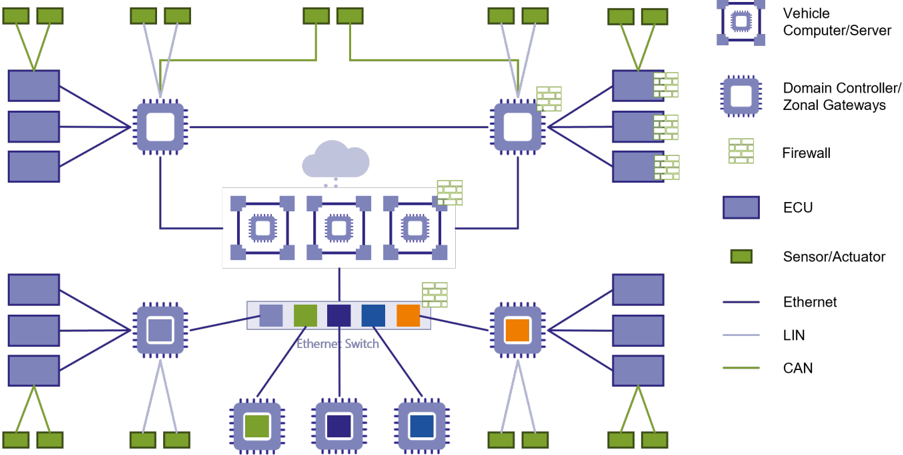
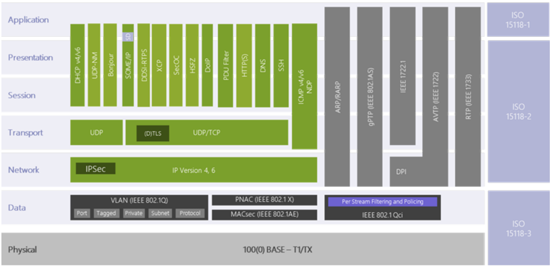
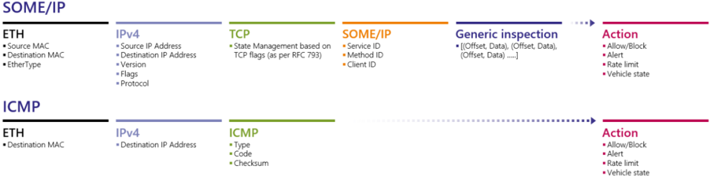
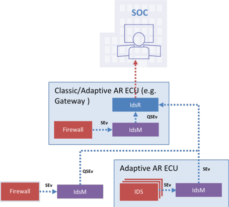

<!-- 源文档 AUTOSAR_FO_RS_Firewall（R23-11），需求规范（RS），不受 Type A 七章骨架约束；章节结构镜像源文档自身编号。需求项 ID [FO_RS_Fw_*] 按 2026-11-03 批次决议整体省略（标题仅翻译）；各 4.2.x 小节与其唯一需求项一一对应，字段表直接置于小节标题之下（4.2.11 小节标题与需求项标题不同，项标题以加粗行保留）。RS_Main 回引随追溯章一并省略。源第 5 章「Requirements Tracing」为纯 ID 追溯表，按 2026-11-03 决议整章省略并将后续章节重编号（源 6→5）。封面元数据表、免责声明与目录按 EXP 流程省略；4 处内容图（图1.1 分区 E/E 架构示例、图4.1 ISO/OSI 层中与 Ethernet 相关的协议、图4.2 含配置选项的防火墙过滤器规则、图4.3 防火墙作为 IDS 传感器的示例实现）按源图号嵌入，其余图引用为页面装饰；图 1.1/4.1/4.2/4.3 的图内标签散落（Vehicle、Bonjour、PDU Filter、IdsM、SOC 等）按转换噪声丢弃；§4.2.9 依赖项单元格的「Generation of security events for IDS」为源文档原貌，照实保留。 -->

## 1. 文档范围

本文档规定可集成到自适应 **AUTOSAR** 和经典 **AUTOSAR** 中的汽车以太网防火墙（**Automotive Ethernet Firewall**）的需求。以下章节给出防火墙的基本概述。

### 1.1. 汽车以太网防火墙概述

汽车以太网防火墙是一种网络安全设备，它监控流入和流出的网络流量，并授予或拒绝两个或多个电子控制单元（**ECU**）之间或网络区域之间（例如车辆域（**ADAS**、信息娱乐、诊断等）、受信任/非受信任区域）的网络访问。两个网络区域之间的所有网络流量只能流经防火墙。使用一种控制模型来定义访问控制机制，该机制规定：只有防火墙安全策略中定义的流量才被允许进入网络，所有其他流量必须被静默丢弃。这些安全策略或防火墙规则称为访问控制列表（**ACL**）。这些 **ACL** 定义了决定是否为网络流量授予或拒绝网络访问的基本规则。

汽车网络防火墙分为三种主要类型：

#### 1.1.1. 无状态包检查防火墙

这种类型的网络防火墙称为包过滤器（**packet filter**）。它通过检查在两个网络区域之间传输的数据包来工作。当数据包不匹配包过滤器中的一组过滤规则时，包过滤器要么丢弃（静默抛弃）该数据包，要么拒绝该数据包（丢弃它并为发送方生成通知），否则允许其通过。数据包可以基于以太网报头、**IPv4**/**v6** 报头、**TCP**/**UDP** 源/目的端口以及 **ICMP v4/v6** 类型/代码等进行过滤。

#### 1.1.2. 有状态包检查防火墙

有状态防火墙不仅可以基于端口和协议，还可以基于多个数据包属性（也称为连接状态）授予或拒绝对数据包的访问，这些属性作为状态表存储在内存中。这些状态表可以包括 **IP** 地址、协议端口、穿越连接的数据包的序列号以及 **TCP** 标志（如 **SYN**、**ACK** 和 **FIN**）等细节。对这些累计数据进行评估，使过滤决策不仅基于访问控制列表规则，还基于由先前连接以及属于同一连接的先前数据包建立的上下文。

#### 1.1.3. 深度包检查防火墙

这种防火墙超越了简单的无状态包过滤和有状态检查。它涉及在应用层对数据包的深度检查，并专门针对不同协议（例如基于 **IP** 的诊断（**DoIP**）、数据分发服务（**DDS**）和面向 IP 的可扩展服务导向中间件（**SOME/IP**）等）设计，以防止高级攻击。

### 1.2. 防火墙的部署

与域特定的 **E/E** 架构不同，跨域集中式 **E/E** 架构只使用少数几个非常强大的车辆计算机，而不是许多单独的控制单元。控制单元数量的减少带来了成本和系统复杂度的降低。这也意味着一个 **ECU** 可以参与多个域或服务于多个功能。这些车辆计算机将通过区域 **ECU** 连接到其余嵌入式控制单元以及传感器和执行器。区域 **ECU** 通过高速以太网向所连接的车辆计算机发送数据。

从网络安全的角度来看，仅在中央网关中集中部署一个防火墙是不够的，需要更多分布在小型 **ECU**、车辆计算机和以太网交换机周围的防火墙实例，以加强 **E/E** 架构的安全性。根据用例和 **E/E** 架构，可以利用下面提到的部署场景中的一部分或全部来满足防火墙需求。

图1.1 展示了包含防火墙部署场景的分区架构示例。

#### 1.2.1. 经典 AUTOSAR ECU 中的主机防火墙

小型终端 **ECU** 上的防火墙通常服务于非常特定的用例，例如为选择性的网络流量提供访问控制，例如电动汽车充电 **ECU**。

#### 1.2.2. 基于自适应 AUTOSAR 的车辆计算机与域控制器 ECU 中的主机防火墙与网络防火墙

这里的防火墙要应对大量复杂性和功能，例如提供网络隔离、访问控制、跨域流量防火墙、过滤端到端加密的通信等等。高性能 **ECU** 可用于多个应用，并且可以有一个或多个以太网端口。如果只有一个以太网端口，则适用端点防火墙的需求；但如果有多个端口可用，则端点防火墙以及网关（区域间、端口间通信）的需求都可以适用。此外，根据安全威胁，可以组合应用无状态防火墙、有状态防火墙和深度包检查。

#### 1.2.3. 以太网交换机上的网络防火墙

对于智能以太网交换机，防火墙需求既复杂又对性能要求高，因为交换机要处理大量网络流量。通常，防火墙与交换机中的路由器配对，执行网络隔离、为其他 **ECU** 提供访问控制以及跨域流量防火墙。此外，根据安全威胁，可以组合应用无状态防火墙、有状态防火墙和深度包检查。

### 1.3. 防火墙需求规范的范围

本 **RS** 文档的主要焦点是描述可在自适应和经典 **AUTOSAR** 中实现的防火墙功能的需求，焦点主要是基于主机的防火墙。

防火墙功能可以实现在主机 **ECU** 上，也可以实现在交换机上（作为网络防火墙）。两种变体都有效并已在车辆中使用，两者可以组合起来保护车载网络。虽然通常可以在交换机上运行精简版的经典 **AUTOSAR**，但 **AUTOSAR** 的主要用途是在 **ECU** 上运行。因此，本文档聚焦于主机防火墙功能，将网络防火墙功能排除在范围之外。

不过，可以使用 **AUTOSAR** 方法论将交换机按 **ECU** 建模，并使用本概念中定义的过滤规则配置交换机上的防火墙。更多细节见相应的元模型规范。

## 2. 所用约定

### 2.1. 文档约定

**AUTOSAR** 文档中需求的表述遵循约束 TPS\_STDT\_00078 规定的表格，见 **Standardization Template** 的「Support for Traceability」章（[\[1\]](#ref-1)）。

需求的表达应使用约束 TPS\_STDT\_00053 规定的义务表达动词形式，见 **Standardization Template** 的「Support for Traceability」章（[\[1\]](#ref-1)）。

## 3. 缩略语和缩写

以下收录与 **Autosar RS Firewall** 相关、且未被 **AUTOSAR** 术语表 [\[2\]](#ref-2) 收录的缩略语和缩写。

**Firewall**
> 汽车以太网防火墙是一种网络安全设备，它监控流入和流出的网络流量，并授予或拒绝两个或多个电子控制单元（**ECU**）之间或网络区域之间（例如车辆域（**ADAS**、信息娱乐、诊断等）、受信任/非受信任区域）的网络访问。

**SPI**
> 有状态包检查（**Stateful Packet Inspection**）

**DPI**
> 深度包检查（**Deep Packet Inspection**）

**SOC**
> 安全运营中心（**Security Operations Center**）或车辆安全运营中心（**Vehicle Security Operations Center**）

**IDS**
> 入侵检测系统（**Intrusion Detection System**）。入侵检测系统是检测并生成安全事件的安全传感器。

**IdsM**
> 入侵检测系统管理器（**Intrusion Detection System - Manager**）。入侵检测系统管理器处理由安全传感器生成的安全事件。

**IDPS**
> 入侵检测与防御系统（**Intrusion Detection and Prevention System**）。入侵检测与防御系统是一种安全控制，针对 **IDS** 传感器检测并上报的合格安全事件采取预定义的预防措施。

**SEv**
> 安全事件（**Security Events**）。安全事件与车载安全事件是由 **BSW** 或 **SWC** 向 **AUTOSAR IdsM** 上报的安全事件类型的实例。

**QSEv**
> 合格安全事件（**Qualified Security Events**）。通过其过滤器链的安全事件被视为合格安全事件。

## 4. 需求规范

防火墙通过检查传入的网络数据包（入口和出口流量）并检查其是否匹配预定义的模式来工作，然后根据配置采取行动：

- 允许列表（**Allow list**）：只允许指定的通信
- 阻止列表（**Block list**）：只阻止指定的通信

防火墙在 **ISO OSI** 模型的所有层建立并保持通信。这通过以下方式实现：

- 无状态包过滤器——特定层且静态：简单的无状态包过滤器只分析第 2-4 层协议的报头字段，例如 **MAC** 地址、**IP** 地址和端口号。这种类型的防火墙能够阻止未经授权的流量和可能的恶意数据到达其目的地。它还可以检测获取网络控制的攻击（通过在网络中安装或损坏设备以控制其他设备的运行）、针对网络的拒绝服务（**DoS**）攻击以及窥探或信息窃取。
- 有状态包检查（**SPI**）——多层且动态：无状态包过滤器只能基于报头执行网络访问控制，而有状态包过滤器具有额外能力，通过使用状态表跟踪连接状态。在 **TCP** 的情形下，传入数据包的 **TCP** 报头中的标志会被分析，该信息用于将该数据包识别为既有连接的一部分或新连接的开始。这种防火墙可以检测某些 **DoS** 攻击，例如 **SYN**/**ACK** 洪泛或 **ACK** 风暴。
- 深度包检查（**DPI**）——应用特定且可能有状态：深度包检查是一种有状态的应用层防火墙，额外分析 **OSI** 模型中的第 5-7 层，而其余的只支持到第 4 层。**DPI** 非常有效，因为不仅分析数据包报头，还分析载荷。防火墙越复杂，性能代价越大，导致需要在功能与性能之间找到充分权衡的问题。

除此之外，防火墙可以生成称为安全事件（**SEv**）的安全攻击警报，并将其上报给 **IdsM** 模块，**IdsM** 可以将其转发给 **SOC** 做进一步分析。**SOC** 随后可以基于这些 **SEv** 通过防火墙模块的 **FOTA** 更新部署配置更新来调整防火墙规则，和/或甚至针对入侵者采取预防措施。

以下用例驱动防火墙的需求：

- UC 1：无状态过滤
- UC 2：有状态过滤
- UC 3：深度包检查
- UC 4：过滤规则的标准化
- UC 5：可更新的配置
- UC 6：安全事件的上报

### 4.1. 功能概述

本章详细描述防火墙的功能元素：

- 网络数据包检查
- 防火墙规则实施
- 防火墙配置更新
- 作为 **IdsM** 传感器的防火墙

#### 4.1.1. 网络数据包检查

过滤规则的设计非常关键，因为这是防火墙执行网络数据包检查的唯一输入。过滤器规定要在网络流量中寻找的模式。防火墙过滤器是协议特定的，图4.1 展示了汽车领域 **ISO OSI** 各层中存在的与以太网相关的不同协议。

防火墙不是对协议本身过滤，而是对协议内定义的特定信息过滤。在大多数情况下，该信息可以在协议报头中找到，其中定义了防火墙可用于将实际值与期望值比较的特定字段。过滤字段的示例见图4.2。

#### 4.1.2. 防火墙规则实施

对于经过通信栈的每个网络数据包，防火墙基于每条过滤规则中字段的期望值执行模式匹配。防火墙按顺序检查防火墙规则的有序列表，并实施第一条匹配的规则。

防火墙规则可以单独配置为允许或阻止网络数据包的动作。应为不属于任何已配置过滤规则的所有其余网络数据包配置默认动作。除通用的允许/阻止配置选项外，还可以按规则配置以下选项：

- 安全警报：如果启用，防火墙在防火墙匹配时向 **IdsM** 上报一个 **SEv**。此外，防火墙在不匹配的情形下也上报一个 **SEv**。
- 对车辆状态的引用：网络流量取决于车辆状态，例如车辆处于诊断模式时通常与行驶时不同。因此，每条防火墙过滤规则都可以绑定到项目特定的车辆状态，并且只在车辆处于这些特定状态之一时激活。
- 速率限制：防火墙可以限制消息速率以防范 **DoS** 攻击。为此，每条防火墙过滤规则都可以配置一个速率限制，即在给定时间间隔内达到配置的匹配次数之后，匹配的网络数据包被丢弃。

含配置选项的防火墙过滤规则见图4.2。

#### 4.1.3. 防火墙配置更新

网络安全攻击日益增强。由于防火墙是基于规则的安全系统，需要建立一种更新配置的手段，以便在 **ECU**/车辆的整个生命周期内保持安全。防火墙支持以下两种更新防火墙过滤规则的机制：

- 清单（**Manifest**）部署
- 通过专用 **API** 进行运行时控制

##### 4.1.3.1. 清单部署

防火墙过滤规则将在 **AUTOSAR** 元模型中建模，这意味着防火墙过滤器配置可以包含在相应的清单（**manifest**）和 **ARXML** 中。这也意味着防火墙配置可以通过更新相应的清单来更新，例如通过 **OTA** 更新。

##### 4.1.3.2. 通过专用 API 进行运行时控制

防火墙还提供一个在运行时更新防火墙规则的接口。该接口只提供在运行时激活/去激活预定义防火墙过滤规则的功能。通过该接口无法生成全新的防火墙过滤规则。全新的规则只能通过清单部署添加。

入侵防御系统可以使用该接口，例如在允许列表防火墙中去激活过滤规则以阻止恶意流量，或切换到更严格的过滤规则集。此外，该接口还可用于只在服务发现成功之后允许服务通信。

#### 4.1.4. 作为 IDS 传感器的防火墙

防火墙可以充当 **IDS** 传感器，使用 **IdsM** 提供的接口生成安全事件（**SEv**）。**IdsM** 模块接收这些 **SEv** 并进一步处理它们以生成合格安全事件（**QSEv**），如果 **SEv** 满足配置的判据。防火墙可以在以下情形上报 **SEv**：

- 防火墙识别到某条防火墙过滤规则的匹配，且该规则配置了安全警报
- 防火墙识别到不匹配，且网络数据包因默认动作被丢弃

图4.3 展示了防火墙作为 **IDS** 传感器的示例实现。

它可以利用 **IdsM** 模块提供的接口部署在自适应和经典 **AUTOSAR** 中。根据安全模型需求，可以决定生成的 **QSEv** 是否：

- 经由 **IDS** 报告器（**IdsR**）发送到后台安全运营中心（**SOC**）做进一步处理（例如执行应用更新或部署预防措施）
- 和/或
- 存储在内存中以供后续使用，例如按要求提供分析的原始数据（例如用于司法取证分析）。

### 4.2. 功能需求

#### 4.2.1. 防火墙的初始化

| 描述 | 防火墙应在启动时初始化。 |
| --- | --- |
| 理由 | 网络数据包过滤必须在启动后立即处于活动状态，以确保系统始终安全。 |
| 依赖项 | - |
| 用例 | UC1、UC2、UC3 |
| 适用平台 | **CP**、**AP** |
| 支撑材料 | - |

#### 4.2.2. 网络流量的无状态过滤

| 描述 | 防火墙应基于对网络协议报头字段的无状态检查过滤入口/出口网络流量。 |
| --- | --- |
| 理由 | 网络访问控制 |
| 依赖项 | - |
| 用例 | UC1 |
| 适用平台 | **CP**、**AP** |
| 支撑材料 | - |

#### 4.2.3. 网络流量的有状态过滤

| 描述 | 防火墙应基于连接状态过滤入口/出口网络流量。 |
| --- | --- |
| 理由 | 防范针对有状态协议的攻击（例如 **SYN** 洪泛、**SYN-ACK** 洪泛、**Reset** 攻击、**ACK** 风暴） |
| 依赖项 | - |
| 用例 | UC2 |
| 适用平台 | **CP**、**AP** |
| 支撑材料 | |

#### 4.2.4. 网络流量的深度包检查

| 描述 | 防火墙应通过检查应用层协议的报头和载荷过滤入口/出口网络流量。 |
| --- | --- |
| 理由 | 深度包检查专门针对不同协议（例如基于 **IP** 的诊断（**DoIP**）、数据分发服务（**DDS**）和面向 **IP** 的可扩展服务导向中间件（**SOME/IP**）等）设计，以防止高级攻击。 |
| 依赖项 | - |
| 用例 | UC3 |
| 适用平台 | **CP**、**AP** |
| 支撑材料 | |

#### 4.2.5. 网络流量的基于规则的过滤

| 描述 | 防火墙应标准化防火墙过滤规则的格式，该格式可用于对网络数据包执行模式匹配以实现访问控制。 |
| --- | --- |
| 理由 | 随着越来越多的 **OEM** 在其 **EE** 架构中纳入防火墙，出现了许多基于以太网协议复杂性和多样性的定制开发，具有不同的防火墙规则、配置和集成选项。由此产生了过滤规则格式标准化的必要性。 |
| 依赖项 | - |
| 用例 | UC4 |
| 适用平台 | **CP**、**AP** |
| 支撑材料 | |

#### 4.2.6. 允许列表与阻止列表配置

| 描述 | 防火墙应支持配置两种过滤行为： * 允许列表：定义允许哪些网络数据包的过滤规则 * 阻止列表：定义阻止哪些网络数据包的过滤规则 防火墙还应支持针对不匹配任何过滤规则的消息的默认行为（允许/阻止）。 |
| --- | --- |
| 理由 | 标准过滤器通常可以基于预定义配置允许或阻止网络数据包。 |
| 依赖项 | - |
| 用例 | UC1、UC2、UC3 |
| 适用平台 | **CP**、**AP** |
| 支撑材料 | - |

#### 4.2.7. 速率限制

| 描述 | 防火墙应限制消息速率以防范 **DoS** 攻击。 |
| --- | --- |
| 理由 | 防火墙可以限制消息速率以防范 **DoS** 攻击。为此，每条防火墙过滤规则都可以配置一个速率限制，即在给定时间间隔内达到配置的匹配次数之后，（允许列表防火墙中的）匹配网络数据包被丢弃。 |
| 依赖项 | - |
| 用例 | UC4 |
| 适用平台 | **CP**、**AP** |
| 支撑材料 | - |

#### 4.2.8. 状态依赖的过滤

| 描述 | 防火墙应包括过滤规则的状态依赖激活或去激活。 |
| --- | --- |
| 理由 | 网络流量取决于车辆状态，例如车辆处于诊断模式时通常与行驶时不同。因此，每条防火墙过滤规则都可以绑定到项目特定的车辆状态，并且只在车辆处于这些特定状态之一时激活。 |
| 依赖项 | - |
| 用例 | UC4 |
| 适用平台 | **CP**、**AP** |
| 支撑材料 | - |

#### 4.2.9. 安全警报的上报

| 描述 | 防火墙应通过在观察到安全事件时向 **IdsM** 上报 **SEv** 来支持整体的 **IDPS** 策略。应可配置在哪些情形上报 **SEv**。 |
| --- | --- |
| 理由 | 应可配置在哪些情形上报 **SEv**，以便于标准化防火墙可上报的 **IDS** 安全事件。 |
| 依赖项 | 为 **IDS** 生成安全事件 |
| 用例 | UC6 |
| 适用平台 | **CP**、**AP** |
| 支撑材料 | **IDSM** 概念。 |

#### 4.2.10. 运行期间防火墙过滤规则的（去）激活

| 描述 | 应能够在运行期间激活/去激活单个防火墙过滤规则。 |
| --- | --- |
| 理由 | 动态防火墙过滤规则（去）激活是入侵防御和服务发现后的服务通信等用例所需的。添加/更改/删除防火墙过滤规则可以通过软件更新执行，即不需要显式的防火墙功能。 |
| 依赖项 | - |
| 用例 | UC5 |
| 适用平台 | **CP**、**AP** |
| 支撑材料 | - |

#### 4.2.11. 支持硬件加速过滤

**硬件加速过滤支持**

| 描述 | 如果硬件加速过滤机制可用，防火墙应支持使用它们。附加信息：例如基于 **(T)CAM** 规则。 |
| --- | --- |
| 理由 | - |
| 依赖项 | - |
| 用例 | - |
| 适用平台 | **CP**、**AP** |
| 支撑材料 | - |

## 5. 参考文献

[1] Standardization Template
> AUTOSAR_FO_TPS_StandardizationTemplate

[2] Glossary
> AUTOSAR_FO_TR_Glossary

[3] Requirements on AUTOSAR Features
> AUTOSAR_CP_RS_Features

## A. AUTOSAR 可追溯项变更历史

请注意，本章中的列表还包括在后续版本中已从规范中移除的可追溯项。这些可追溯项在文档中不作为超链接出现。

### A.1. 本文档依据 AUTOSAR 版本 R23-11 的可追溯项变更历史

#### A.1.1. R23-11 中新增的需求

表A.1：R23-11 中新增的需求

| 标题 |
| --- |
| 硬件加速过滤支持 |

#### A.1.2. R23-11 中变更的需求

表A.2：R23-11 中变更的需求

| 标题 |
| --- |
| 网络流量的无状态过滤 |
| 网络流量的有状态过滤 |
| 网络流量的深度包检查 |
| 允许列表与阻止列表配置 |
| 网络流量的基于规则的过滤 |
| 速率限制 |
| 状态依赖的过滤 |
| 安全警报的上报 |
| 运行期间防火墙过滤规则的（去）激活 |
| 防火墙的初始化 |

#### A.1.3. R23-11 中删除的需求

无
