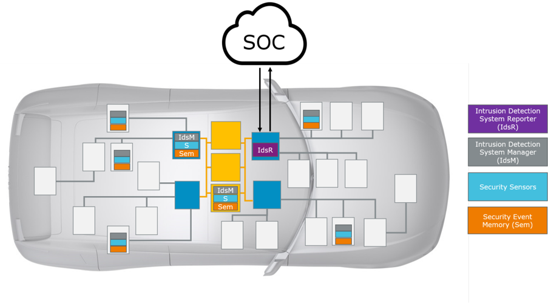
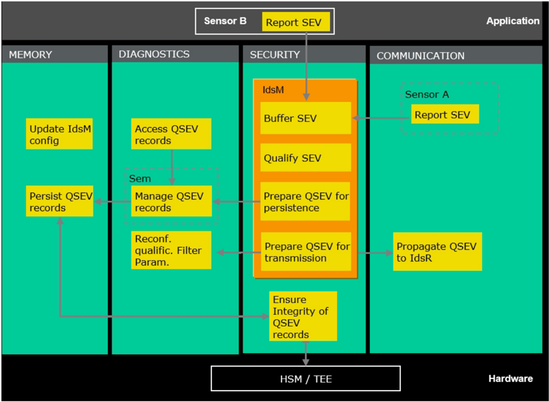

<!-- 源文档 AUTOSAR_FO_RS_IntrusionDetectionSystem（R23-11），需求规范（RS），不受 Type A 七章骨架约束；章节结构镜像源文档自身编号。需求项 ID [RS_Ids_*] 与 {DRAFT} 标记按 2026-11-03 批次决议整体省略（标题仅翻译）；由于源文档在已编号的 4.1.x 小节（含 4.1.4.x 三级小节）之间穿插无编号的需求项标题，为避免标题层级过深，需求项以加粗标题行 + 字段表的形式呈现（不作为目录标题）——运行决策，请用户在确认关核验。RS_BRF 回引随追溯章一并省略。源第 5 章「Requirements Tracing」为纯 ID 追溯表，按 2026-11-03 决议整章省略并将后续章节重编号（源 6→5）；源 §4.2「Non-Functional Requirements (Qualities)」为「No content」占位节，按占位规则省略。封面元数据表、免责声明与目录按 EXP 流程省略；2 处内容图（图1.1 分布式车载 IDS 架构、图4.1 IdsM 的抽象功能元素）按源图号嵌入，其余图引用为页面装饰；图 1.1/4.1 的图内标签散落（IdsR、MEMORY、Report SEV 等）按转换噪声丢弃。 -->

## 1. 文档范围

本文档规定 **AUTOSAR** 入侵检测系统（**IDS**）的需求。以下小节概述 **IDS** 的各元素及其在哪个 **AUTOSAR** 文档中描述。

### 1.1. 分布式车载 IDS 的一般架构

符合 **AUTOSAR** 标准的车载 **IDS** 由以下元素组成：

- 安全传感器（**Security Sensors**）
- 入侵检测系统管理器（**IdsM**）
- 安全事件存储器（**Sem**）
- 入侵检测系统报告器（**IdsR**）

图1.1 展示了分布式车载 **IDS** 的原理架构。

车载 **IDS** 的元素在以下小节中简要描述。

### 1.2. 安全传感器与安全事件

**AUTOSAR BSW** 模块、**CDD** 和 **SWC** 可以充当**安全传感器**。安全传感器向 **IdsM** 上报**安全事件**（**SEv**）。**AUTOSAR** 标准化了 **AUTOSAR BSW** 可上报的**安全事件类型**（**Security Event Type**）的一个子集。每个 **BSW SWS** 都按照 **SWS BSW General** [\[1\]](#ref-1) 中所述列出相应模块上报的安全事件类型。

**AUTOSAR** 标准化的安全事件类型概览可通过「General Definition Security Events」[\[2\]](#ref-2) 获取。

**SWC** 和 **CDD** 还可以上报 **AUTOSAR** 未标准化的自定义安全事件类型。特定 **ECU** 上报的安全事件类型的属性可以使用安全提取（**SecXT**）[\[3\]](#ref-3) 加以规定。

### 1.3. 入侵检测系统管理器

**IdsM** 缓冲上报的安全事件。此外，**IdsM** 对上报的 **SEv** 施加一组连续的过滤器。一组连续的过滤器称为**过滤器链**（**Filter Chain**）。如果 **SEv** 通过其**过滤器链**，它们被视为**合格安全事件**（**QSEv**）。

根据配置，**IdsM** 可以

- 将 **QSEv** 传递给安全事件存储器（**Sem**）以将其持久化在本地 **ECU** 上；
- 和/或序列化 **QSEv** 并将其传输给 **IdsR**。

本文档规定 **IdsM** 的系统需求。**SWS IdsM CP** [\[4\]](#ref-4) 规定经典平台 **IdsM** 的软件需求。**SWS IdsM AP** [\[5\]](#ref-5) 规定自适应平台 **IdsM** 的软件需求。

### 1.4. 入侵检测系统报告器

入侵检测系统报告器（**IdsR**）从不同 **ECU** 的 **IdsM** 实例接收 **QSEv**。**IdsM** 实例与 **IdsR** 之间的通信协议在 **IdsM** 协议规范 [\[6\]](#ref-6) 中规定。**IdsR** 通常应进一步充实接收到的数据，例如附加地理位置。根据 **OEM** 的需要，数据可以传播到 **SOC** 以在 **SIEM** 解决方案中进一步分析。**AUTOSAR** 不提供 **IdsR** 的规范。

## 2. 所用约定

### 2.1. 文档约定

**AUTOSAR** 文档中需求的表述遵循约束 TPS\_STDT\_00078 规定的表格，见 **Standardization Template** 的「Support for Traceability」章（[\[7\]](#ref-7)）。

需求的表达应使用约束 TPS\_STDT\_00053 规定的义务表达动词形式，见 **Standardization Template** 的「Support for Traceability」章（[\[7\]](#ref-7)）。

## 3. 缩略语和缩写

### 3.1. 缩略语

**Filter Chain**
> 过滤器链（**Filter Chain**）：施加于安全事件的一组连续过滤器。

**Intrusion Detection System**
> 入侵检测系统（**Intrusion Detection System**）：检测并处理安全事件的安全控制。

**Intrusion Detection System Manager**
> 入侵检测系统管理器（**Intrusion Detection System Manager**）：处理由安全传感器上报的安全事件。

**Intrusion Detection System Reporter**
> 入侵检测系统报告器（**Intrusion Detection System Reporter**）：处理从 **IdsM** 实例接收到的合格安全事件。

**Security Extract**
> 安全提取（**Security Extract**）：规定哪些安全事件由 **IdsM** 实例处理及其配置参数。

**Security Event Type**
> 安全事件类型（**Security Event Type**）：可以通过其安全事件类型 ID 标识。安全事件类型的实例称为安全事件，共享同一安全事件类型 ID。

**Security Events**
> 安全事件（**Security Events**）：车载安全事件是由 **BSW** 或 **SWC** 向 **IdsM** 上报的安全事件类型的实例。

**Security Event Memory**
> 安全事件存储器（**Security Event Memory**）：独立于主诊断事件存储器的用户定义诊断事件存储器。

**Security Sensors**
> 安全传感器（**Security Sensors**）：向 **IdsM** 上报安全事件的 **BSW** 或 **SWC**。

**Qualified Security Events**
> 合格安全事件（**Qualified Security Events**）：通过其过滤器链的安全事件被视为合格安全事件。

**Security Incident and Event Management**
> 安全事件与事件管理（**Security Incident and Event Management**）：处理已确认安全事件的过程。

**Security Operation Centre**
> 安全运营中心（**Security Operation Centre**）：分析安全事件并参与威胁缓解的安全与领域专家组织。

### 3.2. 缩写

**IDS**
> 入侵检测系统（**Intrusion Detection System**）

**IdsM**
> 入侵检测系统管理器（**Intrusion Detection System Manager**）

**IdsR**
> 入侵检测系统报告器（**Intrusion Detection System Reporter**）

**SecXT**
> 安全提取（**Security Extract**）

**SEv**
> 安全事件（**Security Event**）

**QSEv**
> 合格安全事件（**Qualified Security Event**）

**Sem**
> 安全事件存储器（**Security Event Memory**）

**SIEM**
> 安全事件与事件管理（**Security Incident and Event Management**）

**SOC**
> 安全运营中心（**Security Operation Centre**）

## 4. 需求规格

以下用例驱动车载 **IDS** 的需求：

- UC1：收集关于安全事件（**SEv**）的数据
- UC2：从安全事件数据中过滤出合格的车载安全事件（**QSEv**）
- UC3：本地存储 **QSEv** 记录
- UC4：将 **QSEv** 转发到具有 **SOC** 连接的 **ECU**
- UC5：提供对本地存储 **QSEv** 记录的访问
- UC6：运行期间重新配置鉴定参数
- UC7：更新 **IdsM** 配置
- UC8：保护 **IdsM** 配置
- UC9：保护传输中和静止中的 **IdsM** 数据

以下需求引用上述用例 ID。

图4.1 展示了 **IDS** 的抽象功能架构。功能元素的主要分配同时适用于 **CP** 和 **AP**，尽管实际技术架构如相应 **SWS** 中所述有所不同。该图展示了 **IDS** 的整体功能元素以及哪些功能元素由 **IdsM** 覆盖。

### 4.1. 功能需求

#### 4.1.1. 初始化

**IdsM 的初始化**

| 描述 | **IdsM** 的鉴定规则应在启动时初始化。 |
| --- | --- |
| 理由 | **IdsM** 需要配置信息才能执行其操作。因此，该信息应从 **NVM** 中恢复，并在开始处理操作之前完成初始化。 |
| 依赖项 | - |
| 用例 | UC8 |
| 适用平台 | **CP**、**AP** |
| 支撑材料 | - |

#### 4.1.2. SEv 的上报

**提供上报 SEv 的接口**

| 描述 | **IdsM** 应提供用于上报 **SEv** 的接口。接口应允许上报以下 **SEv** 属性： * 安全事件类型：唯一标识安全事件类型 * 上下文数据：可用于在 **SOC** 中分析安全事件的可选数据 * 时间戳：由传感器提供的可选时间戳 * 计数：由传感器提供的可选计数 |
| --- | --- |
| 理由 | 安全事件可以由基础软件、复杂设备驱动和应用软件上报给 **IdsM**。 |
| 依赖项 | - |
| 用例 | UC1 |
| 适用平台 | **CP**、**AP** |
| 支撑材料 | - |

#### 4.1.3. 已上报 Sev 的缓冲

**IdsM 应为调用者缓冲已上报的 SEv**

| 描述 | **IdsM** 应为调用者缓冲已上报的 **SEv**。 |
| --- | --- |
| 理由 | **IdsM** 应为 **SEv** 传感器缓冲 **SEv** 及其上下文数据，直至数据被 **IdsM** 完全处理。 |
| 依赖项 | - |
| 用例 | UC1 |
| 适用平台 | **CP**、**AP** |
| 支撑材料 | - |

#### 4.1.4. SEv 的鉴定

##### 4.1.4.1. 上报模式

**按安全事件类型和 IdsM 实例配置上报模式**

| 描述 | **IdsM** 应支持为由某个 **IdsM** 实例处理的每个安全事件类型配置上报模式。上报模式应包含以下选项：(a) 关闭 **SEv** 的处理，(b) 丢弃上下文数据，(c) 旁路后续过滤器。 |
| --- | --- |
| 理由 | 上报模式允许控制事件是否值得关注以及是否应进一步处理。 |
| 依赖项 | - |
| 用例 | UC2 |
| 适用平台 | **CP**、**AP** |
| 支撑材料 | - |

表4.1：上报模式过滤器值（**Reporting Mode Filter Values**）

| 上报模式级别 | 相关行为 |
| --- | --- |
| OFF | **IdsM** 应丢弃 **SEv**，不做进一步处理。 |
| BRIEF | 如果上报的 **SEv** 包含上下文数据，**IdsM** 应丢弃上下文数据，不做进一步处理、传输和存储。 |
| DETAILED | 如果上报的 **SEv** 包含上下文数据，**IdsM** 应保留上下文数据，用于 **QSEv** 的潜在传输或持久化。 |
| BRIEF_BYPASSING_FILTERS | **IdsM** 应在进一步应用任何过滤器链之前，不含上下文数据地上报或持久化 **SEv**。 |
| DETAILED_BYPASSING_FILTERS | **IdsM** 应在进一步应用任何过滤器链之前，含上下文数据（如果传感器提供）地上报或持久化 **SEv**。 |

##### 4.1.4.2. 过滤器链

**为鉴定 SEv 提供可配置的过滤器链**

| 描述 | **IdsM** 应支持通过向已上报的 **SEv** 施加可配置的过滤器链来鉴定 **SEv**。一个配置的过滤器序列称为**过滤器链**。 |
| --- | --- |
| 理由 | 并非所有单个 **SEv** 都应直接作为合格安全事件处理。根据项目特定的安全分析，可以对上报的 **SEv** 施加一个或多个过滤器。如果 **SEv** 通过所施加过滤器链的全部过滤器，则该事件被鉴定（即它是一个 **QSEv**）。随后该事件将被传输和/或持久化。 |
| 依赖项 | - |
| 用例 | UC2 |
| 适用平台 | **CP**、**AP** |
| 支撑材料 | - |

**提供多个过滤器链**

| 描述 | **IdsM** 应支持创建多个**过滤器链**，并将给定安全事件类型的每个 **SEv** 按 **IdsM** 实例单独指派到特定过滤器链。 |
| --- | --- |
| 理由 | 不同的安全事件定义可能需要不同的过滤器链。 |
| 依赖项 | - |
| 用例 | UC2 |
| 适用平台 | **CP**、**AP** |
| 支撑材料 | - |

##### 4.1.4.3. 机器状态过滤器

**支持机器状态过滤器**

| 描述 | **IdsM** 应支持依赖 **ECU**/机器状态的 **SEv** 处理。 |
| --- | --- |
| 理由 | 某些事件定义可能只在特定状态下相关，在其他状态下应被忽略。 |
| 依赖项 | - |
| 用例 | UC2 |
| 适用平台 | **CP**、**AP** |
| 支撑材料 | - |

##### 4.1.4.4. 采样过滤器

**支持采样过滤器**

| 描述 | **IdsM** 应支持对 **SEv** 的采样。 |
| --- | --- |
| 理由 | 可以降低以极高频率出现的安全事件的数据速率。 |
| 依赖项 | - |
| 用例 | UC2 |
| 适用平台 | **CP**、**AP** |
| 支撑材料 | - |

##### 4.1.4.5. 聚合过滤器

**支持聚合过滤器**

| 描述 | **IdsM** 应支持将多个 **SEv** 聚合为一个指示被聚合 **SEv** 出现频率的 **QSEv**。 |
| --- | --- |
| 理由 | 事件聚合可以降低以高频率出现的 **SEv** 的资源消耗，同时保持事件出现总次数的信息。 |
| 依赖项 | - |
| 用例 | UC2 |
| 适用平台 | **CP**、**AP** |
| 支撑材料 | - |

##### 4.1.4.6. 阈值过滤器

**支持阈值过滤器**

| 描述 | **IdsM** 应支持仅在 **SEv** 在可配置时间间隔内的出现频率超过可配置阈值时才转发它们。 |
| --- | --- |
| 理由 | **SEv** 可能由正常运行的常规操作触发，不应上报；但与正常频率的偏离可能表明应上报的事件。 |
| 依赖项 | - |
| 用例 | UC2 |
| 适用平台 | **CP**、**AP** |
| 支撑材料 | - |

#### 4.1.5. 事件的时间戳

**事件时间戳**

| 描述 | **IdsM** 应提供为 **SEv** 附加时间戳的机制。 |
| --- | --- |
| 理由 | 事件分析可能需要事件的发生时间。 |
| 依赖项 | - |
| 用例 | UC1 |
| 适用平台 | **CP**、**AP** |
| 支撑材料 | - |

**时间戳来源**

| 描述 | **IdsM** 应提供让应用或传感器软件提供时间戳的机制。 |
| --- | --- |
| 理由 | 项目特定的应用或传感器可能提供更精确的时间戳。 |
| 依赖项 | - |
| 用例 | UC1 |
| 适用平台 | **CP**、**AP** |
| 支撑材料 | - |

#### 4.1.6. QSEv 向 IdsR 的传播

**IdsM 应允许向 IdsR 传输 QSEv**

| 描述 | **IdsM** 应允许使用独立于底层总线技术的 **IDS** 协议 [6] 传输 **QSEv** 及其上下文数据。 |
| --- | --- |
| 理由 | **QSEv** 由可连接到 **E/E** 架构其余部分的各种总线系统的 **ECU** 上报。**IdsR** 可以将事件中继到 **SOC**。 |
| 依赖项 | - |
| 用例 | UC4 |
| 适用平台 | **CP**、**AP** |
| 支撑材料 | - |

#### 4.1.7. QSEv 的持久化

**持久化 QSEv 记录**

| 描述 | **IdsM** 应能够经由用户定义的诊断存储器本地持久化 **QSEv**。该用户定义的诊断存储器应与主诊断存储器分离，以便对用于存储 **QSEv** 记录的 **NVM** 块进行单独的访问控制和保护。（这样的用户定义诊断存储器也称为**安全事件存储器**。）应持久化 **QSEv** 的以下属性： * **IDS** 协议报头（指示协议版本和所用协议选项） * **IdsM** 实例的标识符 * 传感器模块实例的标识符 * 被鉴定的 **SEv** 的标识符 * 指示 **SEv** 在被鉴定之前被上报次数的计数器 * 时间戳（可选），指示 **SEv** 被鉴定的时间点 * 上下文数据（可选），提供可由 **SOC**、诊断测试仪或任何其他具有访问权限的安全分析实例评估的附加信息 * 签名（可选），支持 **IdsM** 到 **SOC** 的完整性和真实性 |
| --- | --- |
| 理由 | 持久化的 **QSEv** 可以在稍后时间点访问用于分析，而无需依赖例如网络连接。 |
| 依赖项 | - |
| 用例 | UC3、UC5 |
| 适用平台 | **CP**、**AP** |
| 支撑材料 | - |

#### 4.1.8. 配置

**SEv 的配置**

| 描述 | 哪些 **SEv** 上报给 **IdsM** 应可配置。 |
| --- | --- |
| 理由 | 根据项目特定的安全分析，一些 **SEv** 被视为相关，另一些则不相关。为避免传感器模块对 **IdsM** 的不必要调用，该属性应可按安全事件类型、按 **IdsM** 实例配置。 |
| 依赖项 | - |
| 用例 | UC1 |
| 适用平台 | **CP**、**AP** |
| 支撑材料 | - |

**SEv 鉴定过滤器的配置**

| 描述 | **IdsM** 对 **SEv** 施加哪些鉴定过滤器应可配置。 |
| --- | --- |
| 理由 | 根据项目特定的安全分析，需要施加不同的鉴定过滤器来鉴定不同的 **SEv** 类型。 |
| 依赖项 | - |
| 用例 | UC1 |
| 适用平台 | **CP**、**AP** |
| 支撑材料 | - |

**QSEv 持久化处理的配置**

| 描述 | **QSEv** 是否应本地持久化应可配置。 |
| --- | --- |
| 理由 | 将根据项目特定的安全分析和可用资源（例如 **NVM**）作出关于持久化 **QSEv** 的决策。相应属性（例如缓冲区大小）需要可配置。 |
| 依赖项 | - |
| 用例 | UC3 |
| 适用平台 | **CP**、**AP** |
| 支撑材料 | - |

**QSEv 传播处理的配置**

| 描述 | **QSEv** 是否应传播给 **IdsR** 应可配置。 |
| --- | --- |
| 理由 | 将根据项目特定的安全分析和可用资源（例如车载带宽）作出关于 **QSEv** 传播的决策。相应属性（例如用于 **QSEv** 的 **I-PDU**）需要可配置。 |
| 依赖项 | - |
| 用例 | UC6 |
| 适用平台 | **CP**、**AP** |
| 支撑材料 | - |

#### 4.1.9. 重新配置

**运行期间重新配置**

| 描述 | 支持运行期间上报模式的重新配置。 |
| --- | --- |
| 理由 | 应能够运行期间更改 **SEv** 的上报模式。**IdsM** 应提供一个接口，例如可由诊断例程使用。 |
| 依赖项 | - |
| 用例 | - |
| 适用平台 | **CP**、**AP** |
| 支撑材料 | - |

#### 4.1.10. IdsM 配置的更新

**替换完整的过滤器链配置**

| 描述 | **IdsM** 应允许替换完整的过滤器链配置。 |
| --- | --- |
| 理由 | 在诸如产线末端编程、车间 **ECU** 初始化或经 **OTA** 推出新更新的情形下，应能够替换完整的过滤器链配置。 |
| 依赖项 | - |
| 用例 | UC7 |
| 适用平台 | **CP**、**AP** |
| 支撑材料 | 实际的替换/更新可以是由 **FBL** 或 **OTA** 执行的逻辑块的标准软件更新。 |

#### 4.1.11. 安全相关需求

##### 4.1.11.1. 基础软件安全事件类型

**基础软件安全事件**

| 描述 | 被视为安全相关的基础软件模块应向 **IdsM** 上报安全事件。 |
| --- | --- |
| 理由 | 基础软件模块是否被视为安全相关由专门的 **AUTOSAR** 工作组讨论并决定。安全事件类型的规范基于相关 **AUTOSAR** 成员的需要完成。 |
| 依赖项 | - |
| 用例 | UC1 |
| 适用平台 | **CP**、**AP** |
| 支撑材料 | - |

##### 4.1.11.2. IdsM 安全事件类型

**IdsM 安全事件**

| 描述 | **IdsM** 应在以下情形上报 **IdsM** 特定的安全事件： * 如果超出 **IdsM** 流量限制 * 如果 **IdsM** 上下文缓冲区耗尽 * 如果 **IdsM** 事件缓冲区耗尽 |
| --- | --- |
| 理由 | **IdsM** 应提供支持其自身安全事件的手段。 |
| 依赖项 | - |
| 用例 | UC1 |
| 适用平台 | **CP**、**AP** |
| 支撑材料 | - |

##### 4.1.11.3. 传输 QSEv 的端到端真实性

**QSEv 的真实性**

| 描述 | **IdsM** 应支持对 **QSEv**（包括所有可选数据，例如上下文数据、时间戳）进行签名。 |
| --- | --- |
| 理由 | 可以确保事件的真实性。 |
| 依赖项 | - |
| 用例 | UC9 |
| 适用平台 | **CP**、**AP** |
| 支撑材料 | - |

##### 4.1.11.4. 存储 QSEv 记录的真实性

**支持检测 QSEv 记录的篡改**

| 描述 | 存储栈应能够可选地检测持久化 **QSEv** 记录的篡改。如果检测到 **QSEv** 记录被篡改，存储栈应引发一个安全事件。 |
| --- | --- |
| 理由 | 根据 **OEM** 的安全分析，可能需要检测 **QSEv** 记录的篡改。 |
| 依赖项 | - |
| 用例 | UC7 |
| 适用平台 | **CP**、**AP** |
| 支撑材料 | - |

##### 4.1.11.5. 可用性

**限制事件速率和流量**

| 描述 | **IdsM** 应支持限制传输给 **IdsR** 的 **QSEv** 速率以及这些传输消耗的带宽。 |
| --- | --- |
| 理由 | 限制 **IDS** 引起的网络总线负载。 |
| 依赖项 | - |
| 用例 | UC9 |
| 适用平台 | **CP**、**AP** |
| 支撑材料 | - |

## 5. 参考文献

[1] General Specification of Basic Software Modules
> AUTOSAR_CP_SWS_BSWGeneral

[2] Standardized M1 Models used for the Definition of AUTOSAR
> AUTOSAR_FO_MOD_GeneralDefinitions

[3] Security Extract Template
> AUTOSAR_FO_TPS_SecurityExtractTemplate

[4] Specification of Intrusion Detection System Manager
> AUTOSAR_CP_SWS_IntrusionDetectionSystemManager

[5] Specification of Intrusion Detection System Manager for Adaptive Platform
> AUTOSAR_AP_SWS_IntrusionDetectionSystemManager

[6] Specification of Intrusion Detection System Protocol
> AUTOSAR_FO_PRS_IntrusionDetectionSystem

[7] Standardization Template
> AUTOSAR_FO_TPS_StandardizationTemplate

[8] Requirements on AUTOSAR Features
> AUTOSAR_CP_RS_Features

## A. AUTOSAR 可追溯项变更历史

请注意，本章中的列表还包括在后续版本中已从规范中移除的可追溯项。这些可追溯项在文档中不作为超链接出现。

### A.1. 本文档依据 AUTOSAR 版本 R23-11 的可追溯项变更历史

#### A.1.1. R23-11 中新增的需求

无

#### A.1.2. R23-11 中变更的需求

无

#### A.1.3. R23-11 中删除的需求

无
