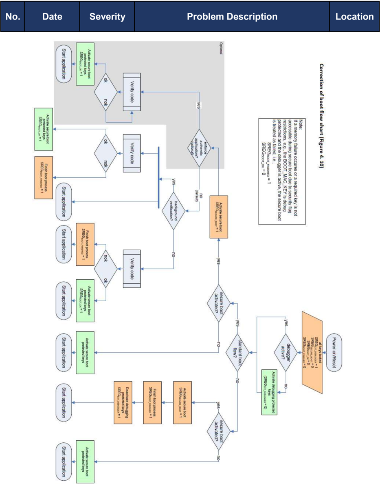

<!-- 源文档 AUTOSAR_FO_TR_ListOfKnownIssuesSecureHardwareExtensions（R23-11），技术报告（TR），不受 Type A 七章骨架约束。源文档除封面/变更历史/Disclaimer 等文档框架信息（不译）外，正文只有一张已知问题表和一张流程图；表中三条被 PDF 分页切断的记录已合并为一张 7 行的表。流程图为源文档中问题 4 所引用的「Figure 1 of this errata sheet」修正启动流程图，按原位置置于表后。 -->

## 已知问题清单

| 编号 | 日期 | 严重性 | 问题描述 | 位置 |
|---|---|---|---|---|
| 1 | 2009-07-31 | 勘误（**erratum**） | CMD_EXPORT_RAM_KEY 也可能发出错误码 ERC_KEY_NOT_AVAILABLE。注意：该命令的描述和总览表中缺少此信息。 | 4.7.9 节 表 4.6 |
| 2 | 2009-07-31 | 勘误（**erratum**） | CMD_GET_ID 不会发出错误码 ERC_KEY_NOT_AVAILABLE，因为密钥保护标志不会被评估。注意：该命令的描述和总览表标注了一个该命令无法发出的错误码。 | 4.7.17 节 表 4.6 |
| 3 | 2009-07-31 | 勘误（**erratum**） | CMD_EXPORT_RAM_KEY 读取 UID。注意：该命令还需要访问 UID 以计算报文。所引用的表缺少相应的信息（X = 被函数使用）。 | 表 4.4 |
| 4 | 2009-07-31 | 勘误（**erratum**） | 如果安全启动失败，标志 SREG.EXT_DEBUGGER 不必置位，参见本勘误表的图 1 中的修正流程图。 | 图 4.10 |
| 5 | 2009-08-28 | 细化说明（**detailing**） | 安全启动状态在省电模式（例如电源门控、非本地时钟门控等）下的行为：只要 CPU、某个存储器或 SHE 进入省电模式，状态寄存器位 SREG.BOOT_OK 就必须被清除（图 4.10：非标准启动流程）。注意：规范将非标准启动流程定义为由于特殊配置而未启动安全启动机制的所有启动方法，包括通过外部接口的引导、特殊复位向量等。本问题特别将掉电模式归类为非标准启动流程，并指出系统的关键部分，以详细理解系统中哪些部分需要受安全启动机制的保护。 | 4.10 节 |
| 6 | 2009-08-28 | 修正（**amendment**） | 系统可以提供一个可选的配置位，用于在从省电模式唤醒时启用/禁用另一次安全启动过程。默认行为是唤醒时不执行安全启动。该标志必须存储在 SHE 之外，类似于配置顺序/并行启动测量的标志（参见 4.10.2 节）。如果实施并配置了真实软件的强制执行（参见 4.10.5 节），则该标志必须是一次性可编程的。注意：为了允许灵活使用 SHE，可以可选地引入该标志，以便在省电模式后进行安全启动。然而，实现该标志意味着在唤醒后总是执行 CPU 的 ROM 代码，并按照 4.10 节所述执行常规安全启动。如果微控制器实现了真实软件的强制执行（参见 4.10.5 节），并且打算用于以周期性执行的软件来检查整个系统唤醒的场景，则微控制器应提供一个内存保护单元，能够将所执行的唤醒监控器的系统访问限制在其预期范围内。在强制执行真实软件（参见 4.10.5 节）的系统中使用掉电模式，需要仔细的系统设计，以免损害安全启动机制的安全性。 | 4.10 节 |
| 7 | 2009-10-13 | 勘误（**erratum**） | "Beware that SHE will not solve all security flaws by simply adding it to a microcontroller. It has to be supported by the application software and processes." 一句应改为 "Beware that SHE will not solve all security flaws by simply adding it to a microcontroller but it can help to increase the security level. For this it has to be supported by the application software and processes." | 4.1 节 |

