<!-- 源文档 AUTOSAR_FO_TR_SecureHardwareExtensions（R23-11），技术报告（TR），不受 Type A 七章骨架约束；章节编号镜像源文档 ch.1–ch.4。
     文档框架信息（封面/状态/变更历史表、Contents、Disclaimer）不译；附录 A（Appendix）在源文档中无实际内容（仅页面页脚）→ 按占位规则省略；2.2 术语定义（Definition of terms）的源表只有表头和一个空的「Term」占位行，无任何数据行 → 按占位规则省略。
     4 处公式在 markdown 转换中丢失（formula-not-decoded），已从语料库 PDF（Foundation/Releases/R23-11/Security/AUTOSAR_FO_TR_SecureHardwareExtensions.pdf）第 11、14 页恢复，以代码块呈现（站点无数学扩展）。
     83 个图引用 = 11 张内容图（Figure 4.1–4.11，按源图号复制为 Figure4-1..4-11.png）+ 72 张页面装饰图（循环出现的小尺寸哈希）已丢弃；[4.14](#414-概览表) 章两张大图（~100 KB）为 PDF 分页处的表格截图（表格数据已由前后 GFM 表携带）→ 丢弃。
     测试向量：[4.13.2.3](#41323-cmac) 示例 2 的报文第 3 块在 PDF 版式中被截断（30c81c46a35ce411…），按引用的 NIST SP 800-38B 权威值补全并注明；[4.13.2.10](#413210-内存更新协议) 的 M1–M5 值行在 markdown 转换中错位，已按 PDF 第 61–62 页恢复。
     源文档自身的笔误保持原样并注明：[4.5.1.2](#4512-通过真随机数生成器trng生成种子) 标题 "trough"（应为 through）；表 4.6 列头 ERC_NO_DEBUUGGING（三个 U）；[4.7.19](#4719-调试器激活cmd_debug) 错误码列表中的 ERC_WRITE_PROTECTED（错误码章定义的是 ERC_KEY_WRITE_PROTECTED）；4.7.7/4.7.10/4.7.11/4.7.13/[4.7.14](#4714-无效启动时实施制裁cmd_boot_failure) 中的章节号引用（Chapter 9/10/5.1.1/5.3/10.4）为源文档重排遗留，按原文保留。 -->

## 1. 简介

本技术报告是 HIS SHE 功能规范（**HIS SHE -Functional Specification**）v1.1（rev 439）在 AUTOSAR 开发合作框架下的重新发布版本。该规范的勘误与修正发布于 AUTOSAR\_TR\_ListOfKnownIssuesSecureHardwareExtensions.pdf 文档中。

## 2. 术语和缩略语

### 2.1. 缩略语和缩写

**HIS**
> Hersteller Initiative Software（汽车制造商倡议软件组织）

**SHE**
> Security Hardware Extension（安全硬件扩展）

**AES**
> Advanced Encryption Standard（高级加密标准）

**TPM**
> Trusted Platform Module（可信平台模块）

**CBC**
> Cipher Block Chaining（密码分组链接）

**ECB**
> Electronic Code Book（电子密码本）

**MAC**
> Message Authentication Code（消息认证码）

**CMAC**
> Cipher-based Message Authentication Code（基于分组密码的消息认证码）

**IV**
> Initialization Vector（初始化向量）

**UID**
> Unique IDentification item（唯一标识项）

**TRNG**
> True Random Number Generator（真随机数生成器）

**PRNG**
> Pseudo Random Number Generator（伪随机数生成器）

## 3. 相关文档

### 3.1. 输入文件和相关标准与规范

- <a id="ref-1"></a>[\[1\]](#ref-1) NIST: Announcing the Advanced Encryption Standard (AES) <http://csrc.nist.gov/publications/fips/fips197/fips-197.pdf>
- <a id="ref-2"></a>[\[2\]](#ref-2) NIST Special Publication 800-38A: Recommendation for Block Cipher Modes of Operation: Methods and Techniques <http://csrc.nist.gov/publications/nistpubs/800-38a/sp800-38a.pdf>
- <a id="ref-3"></a>[\[3\]](#ref-3) NIST Special Publication 800-38B: Recommendation for Block Cipher Modes of Operation: The CMAC Mode for Authentication <http://csrc.nist.gov/publications/nistpubs/800-38B/SP\_800-38B.pdf>
- <a id="ref-4"></a>[\[4\]](#ref-4) NIST: Updated CMAC Examples <http://csrc.nist.gov/publications/nistpubs/800-38B/Updated\_CMAC\_Examples.pdf>
- <a id="ref-5"></a>[\[5\]](#ref-5) Handbook of Applied Cryptography <http://www.cacr.math.uwaterloo.ca/hac/>
- <a id="ref-6"></a>[\[6\]](#ref-6) Recommendation for Key Derivation Using Pseudorandom Functions (Revised) <https://nvlpubs.nist.gov/nistpubs/Legacy/SP/nistspecialpublication800-108.pdf>
- <a id="ref-7"></a>[\[7\]](#ref-7) BSI: A proposal for: Functionality classes and evaluation methodology for true (physical) random number generators, Version 3.1 <http://www.bsi.bund.de/zertifiz/zert/interpr/trngk31e.pdf>
- <a id="ref-8"></a>[\[8\]](#ref-8) BSI: Application Notes and Interpretation of the Scheme (AIS) <http://www.bsi.bund.de/zertifiz/zert/interpr/ais20e.pdf>
- <a id="ref-9"></a>[\[9\]](#ref-9) Trusted Computing Group <https://www.trustedcomputinggroup.org/>

## 4. 功能规格

### 4.1. 简介

安全硬件扩展（**Secure Hardware Extension**，**SHE**）是任意给定微控制器的一种片上扩展。其目的是把对密钥的控制从软件域转移到硬件域，从而保护这些密钥免受软件攻击。但它并不意味着取代 TPM 芯片或智能卡等高安全级别的解决方案，即本规范不要求具备抗物理篡改能力。

本设计的主要目标是：

- 保护密钥免受软件攻击
- 提供一个真实的（**authentic**）软件环境
- 使安全性仅取决于底层算法的强度和密钥的机密性
- 允许分布式的密钥所有权
- 保持高灵活性和低成本

基本上，**SHE** 由三个构建块组成：保存密钥及相应附加信息的存储区、分组密码（**AES**）的一个实现，以及将这些部分连接到微控制器 CPU 的控制逻辑，简化框图见图 4.1。**SHE** 可以用多种方式实现，例如有限状态机或一个小型专用 CPU 内核。

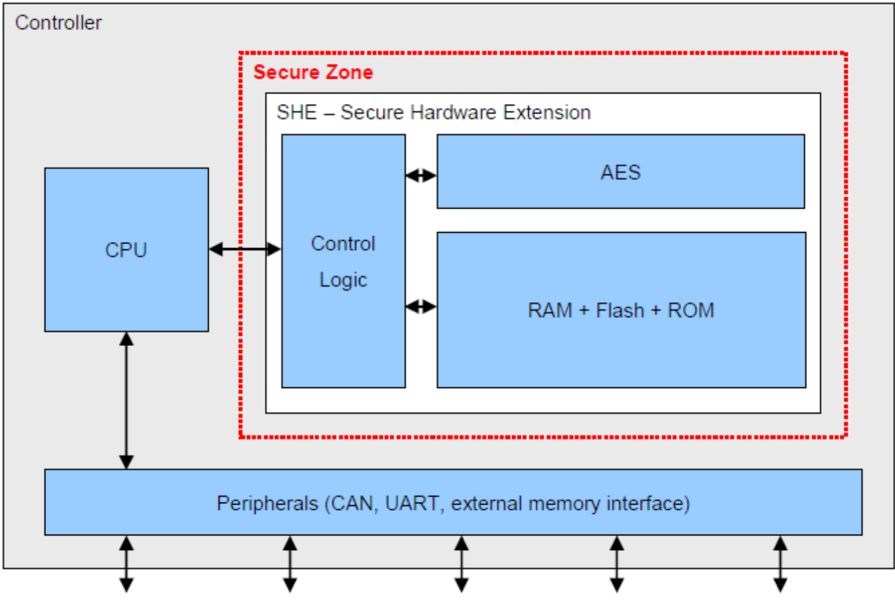

本文档旨在详细描述 **SHE** 的技术实现，并将由一个参考实现加以补充。本文档既不包含每条需求背后的动机，也不包含如何在特定应用中使用 **SHE** 的概念。

请注意，仅把 **SHE** 加到微控制器上并不能解决所有安全缺陷。它必须得到应用软件和流程的支持。

#### 4.1.1. 约定

在后续章节中，若干段落以斜体印刷。这些段落并非硬性需求，而是对底层机制的补充说明。

在整个文档中，术语「CPU」指实际的微处理器，而「微控制器」用于描述完整的硬件芯片，即一个 CPU 及其所含的全部外设。术语「控制逻辑」指控制 **SHE** 内部算法与存储器的系统（例如有限状态机或小型微处理器）。

**密码运算的书写格式为：**

```
OUTPUT = OPERATION MODE,KEY[,IV] (INPUT [, INPUT2, ...])
```

此外，使用以下符号描述运算：

- ⊕ 按位异或；| 两个值的级联

在描述与 CPU 的接口时，**SHE** 内部不暴露给 CPU 的内存槽以地址标识。实际的密钥通常写作 KEY KEY\_NAME，而密钥的标识符写作 ID KEY\_NAME。

所有值均以 MSB...LSB 的形式给出，即最高有效位/字节位于左侧。

形如下面形式的比特序列

```
"0...0"^128
```

应理解为一个取值为「0」、长度为 128 的比特串。

### 4.2. 基本要求

**SHE** 必须实现为微控制器的片上外设。**SHE** 不得具有除本文档明确规定的连接之外的任何其他连接。如果在芯片制造过程中必须加入额外资源以保证正常工作，则所有端口若可在外部引脚上访问，都必须被物理且永久地停用。

**SHE** 可以通过多种方式连接到 CPU，例如通过专用接口或内部外设总线。互连的实现必须保证没有其他外设或外部实体能够修改 CPU 与 **SHE** 之间传输的数据。

**SHE** 无需采用特殊工艺制造以提升安全性，也无需采取任何措施来强化系统以抵御物理攻击，例如蚀刻打开芯片封装、差分功耗分析、毛刺攻击。

**注意：** 满足 **SHE** 规范并不需要复杂的硬件安全机制。当然，制造商可以加强设计，以便为更高的安全需求提供更高的安全级别。

每当用于调试软件和硬件的内部或外部调试器被连接并处于活动状态时，**SHE** 需要通过一个状态信号得到通知。调试器的例子有 JTAG、BDM 等。

本文档只描述 **SHE** 的技术部分。流程和环境条件（例如密钥的注入）不属于本规范的范围。

### 4.3. 算法

**SHE** 的所有密码运算均由一个 AES-128 处理 [\[1\]](#ref-1)。包括密钥编排（**key schedule**）在内，AES 对单个数据块进行一次加密/解密的延迟必须保持在 2 µs 以内。

此外，AES 的性能必须足够高，以便能在 10 ms 内完成微控制器 5% 闪存（最少 32 kByte，最多 128 kByte）的安全启动（详见章节[4.10](#410-安全启动)）。

如果闪存比要求的速度慢，则闪存必须成为安全启动的限制因素，并且该限制必须在数据手册中说明。

#### 4.3.1. 加密/解密

对于数据的加密和解密，**SHE** 必须支持电子密码本模式（**ECB**）以处理单个数据块，并支持密码分组链接模式（**CBC**）以处理更大量的数据，详见 [\[2\]](#ref-2)。

两种模式的延迟均不得超过章节[4.3](#43-算法)开头给出的值。

**SHE** 只能处理 AES 块长度的整数倍数据，即所有必要的填充都必须由应用完成。

输入、输出和密钥输入以及任何中间结果不得被 CPU 直接访问，访问必须由 **SHE** 的控制逻辑根据策略授予。

#### 4.3.2. MAC 生成/验证

MAC 的生成与验证必须按照 [\[3\]](#ref-3) 的规定，使用 AES-128 以 **CMAC** 实现。更新后的示例见 [\[4\]](#ref-4)。

#### 4.3.3. 压缩函数

**SHE** 内部使用以 AES 作为分组密码的 Miyaguchi-Preneel 构造（见 [\[5\]](#ref-5) 算法 9.43）作为压缩函数。消息在送入压缩算法之前必须经过预处理，即必须被填充并解析为 128 位的块。

填充的方式是：对比特长度为 l 的消息 M 追加一个「1」比特，其后跟 k 个「0」比特，其中 k 是方程 l + 1 + k ≡ 88 mod 128 的最小非负解。最后追加一个 40 位的块，其值等于以无符号二进制表示的数 l。

在将填充后的消息送入压缩函数之前，必须将其解析为 n 个 128 位的块 x~1~、x~2~、…、x~n~。值 OUT~0~ 称为初始化向量（**IV**）。

```
AES-MP(x_i) : OUT_i = ENC_ECB,OUT_(i-1)(x_i) ⊕ x_i ⊕ OUT_(i-1); i > 0; OUT_0 = 0;
```

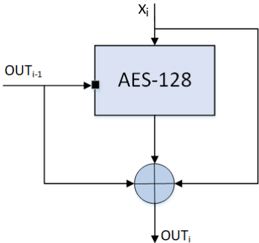

##### 4.3.3.1. 密钥派生

密钥使用基于 [\[6\]](#ref-6) 的 Miyaguchi-Preneel 压缩算法派生。派生密钥通过压缩机密 K 与常量 C' 的、经过正确预处理的级联而得到：

```
C' = 0x01 | counter | "SHE" | 0x00
```

注意，章节[4.12](#412-she-中使用的常量)中给出的常量 C 已经按照小节[4.3.3](#433-压缩函数)的规定完成了填充。

```
KDF(K, C) : AES-MP(K | C)
```

### 4.4. 数据存储

**SHE** 需要存储器来保存密钥和 MAC。需要一个非易失性存储器来保存微控制器掉电和复位后仍需可用的信息。需要一个易失性存储器来保存临时信息。易失性存储器的内容可能在复位或掉电后丢失。

**SHE** 的存储器应只能被 **SHE** 的控制逻辑访问。CPU 或任何其他外设，包括无需打开芯片封装即可使用的调试和测试设施，都不应能访问该存储器。

如果往返于 **SHE** 非易失性存储器的数据必须经过与其他外设共享的总线传输，且无法保证这些数据不会被任何其他实体读取或修改，则必须采取以下预防措施，并且这些措施对 **SHE** 的所有功能都是透明的：

- **SHE** 内部必须存储一个额外的独立密钥。该密钥必须满足与章节[4.4.4.1](#4441-secret_key)所述 SECRET\_KEY 相同的要求
- 所有数据在送上总线之前必须使用 AES 以 ECB 模式和上述密钥加密，读取时相应地解密
- 对存储器的写访问必须只能由 **SHE** 进行；在 **SHE** 进行读/写访问期间，必须阻止其他外设写访问 **SHE** 与其存储器之间的连接

在 CPU 操作微控制器的其他公共/非公共存储块的同时，**SHE** 的存储器必须能够被独立地读写，即允许存储器接口的分时共享，但不允许因一次完整的 **SHE** 操作而阻塞 CPU。

**SHE** 的持久性存储器被划分为称为内存槽（**memory slot**）的逻辑块。每个槽的宽度为 128 位，外加最多五个安全位（见章节[4.4.1.1](#4411-内存槽的写保护)至章节[4.4.1.5](#4415-密钥用途的确定)）和一个具有 2^28 个状态的饱和无符号计数器。这些段必须能够被单独写入/擦除，即更改一个内存槽时不得影响其他内存槽。哪些信息必须与每个密钥一同存储的概览见章节[4.14](#414-概览表)的表 4.3。这些信息不一定要按此顺序物理存储。

**注意：** 内存槽被划分为实际的密钥、保护位以及一个用于在更新期间保护内存槽免受重放攻击的计数器。

必须采取预防措施，在写操作因中断（例如掉电）而失败时保持非易失性内存槽的当前值。写操作必须被视为原子操作；任何情况下存储器都必须包含旧值或新值之一，而不得出现损坏的区域。

写操作本身也不得被中断。

所有非易失性内存槽的初始值必须在数据手册中给出，下文将其称为「空（**empty**）」。

**注意：** **SHE** 的功能依赖于对空存储单元的检测。如果底层工艺无法区分已擦除的单元和被写入同一逻辑值的单元，实现必须为每个内存槽引入另一个状态位以支持该检测。该附加状态位的处理必须对用户透明。

**注意：** 内存槽的初始值必须与章节[4.9](#49-内存更新协议)所述的内存更新协议结合使用以初始化 **SHE**。

生产完成后，每个非易失性内存槽的计数器值必须为 0。

实现必须保证每个非易失性内存槽至少能成功写入 100 次，并允许更多写入次数。

表 4.4 给出了哪个内存槽被哪个函数使用的矩阵，表 4.5 显示哪些密钥可以作为更新另一个密钥的机密。图 4.3 给出了 **SHE** 中实现的所有密钥的概览。

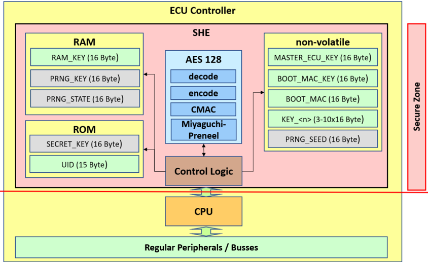

#### 4.4.1. 内存槽的安全标志

在协议中传输标志时，值「0」表示标志未置位，「1」表示标志已置位。哪个密钥受哪些安全位保护详见章节[4.14](#414-概览表)的表 4.3。

##### 4.4.1.1. 内存槽的写保护

非易失性密钥（见章节[4.4.2](#442-非易失性内存槽)）可以被写保护，即即使知道相应的机密，也不可能再更改该密钥。

写保护必须是不可逆的。

写保护存储在仅可由 **SHE** 访问的非易失性存储器中，并在写访问时由控制 **SHE** 的状态机评估。

当该标志在协议中传输且不适用于该特定密钥时，必须传输为「0」并由 **SHE** 忽略。

生产完成后，任何密钥都不得置位该标志。

##### 4.4.1.2. 启动失败时禁用密钥

当安全启动机制（见章节[4.10](#410-安全启动)）检测到软件被篡改，或安全启动过程被其他引导机制（例如通过外部接口的引导）绕过时，非易失性密钥（见章节[4.4.2](#442-非易失性内存槽)）可以被单独禁用。这些内存槽只能在下一次成功启动后重新激活。

禁用密钥的含义是：**SHE** 拒绝在任何操作中使用该内存槽，明确说明的操作除外。

该保护的状态存储在仅可由 **SHE** 访问的非易失性存储区中，并在读和写访问时由控制 **SHE** 的状态机评估。

当该标志在协议中传输且不适用于该特定密钥时，必须传输为「0」并由 **SHE** 忽略。

生产完成后，任何密钥都不得置位该标志。

##### 4.4.1.3. 调试器激活时禁用密钥

当调试器被连接（例如 JTAG、BDM）或任何其他机制被激活以在安全启动已启用的状态下不经过 **SHE** 的启动测量而启动时（例如通过外部接口引导），非易失性密钥（见章节[4.4.2](#442-非易失性内存槽)）可以被单独禁用。这些内存槽只能在复位后重新激活。

禁用密钥的含义是：**SHE** 拒绝在任何操作中使用该内存槽，明确说明的操作除外。

调试保护的状态存储在仅可由 **SHE** 访问的非易失性存储区中，并在读和写访问时由控制 **SHE** 的状态机评估。

当该标志在协议中传输且不适用于该特定密钥时，必须传输为「0」并由 **SHE** 忽略。

生产完成后，任何密钥都不得置位该标志。

##### 4.4.1.4. 禁止密钥更新使用通配符

该标志决定是否允许在不提供有效 UID 的情况下更新密钥，即通过提供一个特殊的通配符。有关更新密钥的详细信息见章节[4.9](#49-内存更新协议)；有关 UID 的详细信息见章节[4.4.4.2](#4442-唯一标识项-uid)。

如果该标志已置位，则不允许使用通配符。

生产完成后，任何密钥都不得置位该标志。

##### 4.4.1.5. 密钥用途的确定

该标志决定密钥是用于加密/解密还是用于 MAC 生成/验证。

如果该标志已置位，则该密钥用于 MAC 生成/验证。

该标志只需为 KEY\_&lt;n&gt; 密钥实现，见章节[4.4.2.4](#4424-key_n)。

当该标志在协议中传输且不适用于该特定密钥时，必须传输为「0」并由 **SHE** 忽略。

##### 4.4.1.6. 明文密钥标志

该标志只需为 RAM\_KEY 实现，见章节[4.4.3.1](#4431-ram_key)。每当一个密钥以明文形式装入 RAM\_KEY 时，**SHE** 都必须置位该标志。在导出 RAM\_KEY 之前会评估该标志。每当密钥通过安全协议装入时，都必须复位该标志，见章节[4.9](#49-内存更新协议)。

#### 4.4.2. 非易失性内存槽

密钥及其相应的策略将在以下小节中详细描述。

非易失性内存槽必须实现一种检测空内存槽的机制，即在擦除后或生产后尚未装入密钥的内存槽。空内存槽不得被除章节[4.9](#49-内存更新协议)所述密钥更新协议之外的任何函数使用。

##### 4.4.2.1. MASTER\_ECU\_KEY

**注意：** MASTER\_ECU\_KEY 旨在由使用 **SHE** 的组件的「所有者」装入，并且可以用于重置 **SHE** 或更改任何其他密钥。

MASTER\_ECU\_KEY 仅用于更新 **SHE** 内部的其他内存槽，有关更新内存槽的详细信息见章节[4.9](#49-内存更新协议)。

在知道当前 MASTER\_ECU\_KEY 的情况下可以写入新的 MASTER\_ECU\_KEY，并且它受章节[4.4.1.1](#4411-内存槽的写保护)、章节[4.4.1.2](#4412-启动失败时禁用密钥)、章节[4.4.1.3](#4413-调试器激活时禁用密钥)和章节[4.4.1.4](#4414-禁止密钥更新使用通配符)所述的通用锁定机制保护。

生产完成后 MASTER\_ECU\_KEY 必须为空。

##### 4.4.2.2. BOOT\_MAC\_KEY

BOOT\_MAC\_KEY 由安全启动机制用于验证软件的真实性。

BOOT\_MAC\_KEY 也可以用于验证 MAC。

有关安全启动的详细信息见章节[4.10](#410-安全启动)。

在知道 MASTER\_ECU\_KEY 或 BOOT\_MAC\_KEY 的情况下可以写入 BOOT\_MAC\_KEY，并且它受章节[4.4.1.1](#4411-内存槽的写保护)、章节[4.4.1.2](#4412-启动失败时禁用密钥)、章节[4.4.1.3](#4413-调试器激活时禁用密钥)和章节[4.4.1.4](#4414-禁止密钥更新使用通配符)所述的通用锁定机制保护。

**注意：** 更改 BOOT\_MAC\_KEY 时，通常也应同时更改 BOOT\_MAC，除非是在首次激活安全启动以进行自主 MAC 学习时，见章节[4.10.3](#4103-安全启动过程的自主引导配置)。

生产完成后 BOOT\_MAC\_KEY 必须为空。

##### 4.4.2.3. BOOT\_MAC

**注意：** 安全启动机制需要 BOOT\_MAC，因此它存储在 **SHE** 内部。它不被视为机密信息，但为了便于使用，它被当作 **SHE** 内部的任何其他密钥一样对待。

BOOT\_MAC 用于存储安全启动机制的引导加载程序（**Bootloader**）的 MAC，并且只能被 **SHE** 的启动机制访问。

有关安全启动的详细信息见章节[4.10](#410-安全启动)。

在知道 MASTER\_ECU\_KEY 或 BOOT\_MAC\_KEY 的情况下可以写入 BOOT\_MAC，并且它受章节[4.4.1.1](#4411-内存槽的写保护)、章节[4.4.1.2](#4412-启动失败时禁用密钥)、章节[4.4.1.3](#4413-调试器激活时禁用密钥)和章节[4.4.1.4](#4414-禁止密钥更新使用通配符)所述的通用锁定机制保护。

生产完成后 BOOT\_MAC 必须为空。

##### 4.4.2.4. KEY\_&lt;n&gt;

**注意：** KEY\_&lt;n&gt; 实际上旨在用于在任意给定应用中处理批量数据。

KEY\_&lt;n&gt; 可用于任意功能。n 为数字 3..10，即 **SHE** 必须至少实现三个、最多实现十个任意用途的密钥。

密钥的用途必须在编程时通过相应地设置密钥用途标志，在加密/解密与 MAC 生成/验证之间进行选择，见章节[4.4.1.5](#4415-密钥用途的确定)。

在知道 MASTER\_ECU\_KEY 或当前 KEY\_&lt;n&gt; 的情况下可以写入 KEY\_&lt;n&gt;，并且它受章节[4.4.1.1](#4411-内存槽的写保护)、章节[4.4.1.2](#4412-启动失败时禁用密钥)、章节[4.4.1.3](#4413-调试器激活时禁用密钥)和章节[4.4.1.4](#4414-禁止密钥更新使用通配符)所述的通用锁定机制保护。

生产完成后 KEY\_&lt;n&gt; 必须为空。

##### 4.4.2.5. PRNG\_SEED

PRNG\_SEED 用于存储伪随机数生成器的种子，如章节[4.5.1.1](#4511-通过伪随机数生成器prng生成种子)所述。如果随机数生成器按照章节[4.5.1.2](#4512-通过真随机数生成器trng生成种子)实现，则不需要该内存槽。

PRNG\_SEED 只能由章节[4.5.1.1](#4511-通过伪随机数生成器prng生成种子)所述的 CMD\_INIT\_RNG 访问。

PRNG\_SEED 必须在芯片制造期间初始化。其值必须由经过认证的物理随机数生成器（例如高安全模块 **HSM**）生成，并应至少满足 [\[7\]](#ref-7) 中 P2 类的要求。

**注意：** 在可以请求随机数之前，PRNG\_SEED 需要重新计算（见章节[4.5.1.1](#4511-通过伪随机数生成器prng生成种子)），即在最坏的情况下每次掉电/复位都要写入一次。

#### 4.4.3. 易失性内存槽

易失性内存槽应在复位或上电循环时被清零为「0」。

易失性内存槽不受章节[4.4.1.1](#4411-内存槽的写保护)、章节[4.4.1.2](#4412-启动失败时禁用密钥)和章节[4.4.1.3](#4413-调试器激活时禁用密钥)规定的锁定机制保护。

##### 4.4.3.1. RAM\_KEY

RAM\_KEY 可用于任意操作。

在知道 KEY\_&lt;n&gt; 的情况下，或以明文方式可以写入 RAM\_KEY。

如果 RAM\_KEY 是以明文装入的，则可以导出它，见章节[4.7.9](#479-导出密钥cmd_export_ram_key)的 CMD\_EXPORT\_RAM\_KEY。通过安全协议装入的密钥不得被导出。密钥的来源必须存储在一个标志中，见章节[4.4.1.6](#4416-明文密钥标志)。

**注意：** 由于装入 RAM\_KEY 的密钥存储在外部，它们不完全受 **SHE** 的控制，因此容易受到多种攻击，例如重放攻击和拒绝服务攻击。强烈建议在设计应用时考虑这一事实。

##### 4.4.3.2. PRNG\_KEY

PRNG\_KEY 不能被任何用户函数直接访问，但由伪随机数生成器使用。有关使用和数据装入的详细信息见章节[4.5](#45-随机数生成)。

PRNG\_KEY 也可以在非易失性存储器中实现。在这种情况下，该密钥必须以与 SECRET\_KEY 相同的方式（见章节[4.4.4.1](#4441-secret_key)）生成、装入和保护。

##### 4.4.3.3. PRNG\_STATE

该内存槽保存伪随机数生成器的状态。

PRNG\_STATE 不能被任何用户函数直接访问，但由伪随机数生成器使用。有关使用和数据装入的详细信息见章节[4.5](#45-随机数生成)。

#### 4.4.4. 只读内存槽

两个内存槽在控制器的生命周期内被定义为只读。只读的含义是它们至少受控制器逻辑的保护，即它们在生产期间可以是可写的，但在出厂后不可写。

##### 4.4.4.1. SECRET\_KEY

**SHE** 必须包含一个唯一的机密密钥 SECRET\_KEY，它不仅应能从序列号或任何其他公开可得的信息派生得到。

SECRET\_KEY 必须在芯片制造期间由半导体制造商注入，并且不应存储在 **SHE** 之外。

SECRET\_KEY 必须至少满足 [\[7\]](#ref-7) 中 P2 类的要求。它可以由经过认证的物理随机数生成器（例如硬件安全模块 **HSM**）生成。

SECRET\_KEY 只能用于密钥的导入/导出。

##### 4.4.4.2. 唯一标识项 UID

**SHE** 或微控制器必须包含一个唯一标识项（即序列号），最多 120 位。该标识项必须能被 **SHE** 的控制逻辑直接访问。

**注意：** UID 被规定为 120 位，因为它总是与两个密钥 ID 或状态寄存器一起组成一个 128 位的块。

如果标识项小于 120 位，则在送入 **SHE** 之前必须在 MSB 一侧用零比特填充。

UID 必须在芯片制造期间由半导体制造商注入。

UID 不得为 0，即至少要置位一个比特。值为 0 的 UID 被保留作为更新密钥时使用的通配符 UID。

**注意：** UID 不必遵循特殊的格式，即已注入的序列号可以复用。对于某一制造商的所有芯片，它至少应当是唯一的。

UID 可以通过 **SHE** 的附加端口导出，供微控制器上的其他组件使用。必须不可能通过该端口影响 **SHE** 的操作或状态。

#### 4.4.5. 内存槽的标识

所有可被用户函数访问的内存槽都必须能用一个四位值寻址。内部的物理寻址可以不同。表 4.1 给出了每个密钥的地址。

表4.1：密钥地址（**Key addresses**）

| 密钥名称 | 地址（十六进制） | 存储区 |
|---|---|---|
| SECRET\_KEY | 0x0 | ROM |
| MASTER\_ECU\_KEY | 0x1 | 非易失性 |
| BOOT\_MAC\_KEY | 0x2 | 非易失性 |
| BOOT\_MAC | 0x3 | 非易失性 |
| KEY\_1 | 0x4 | 非易失性 |
| KEY\_2 | 0x5 | 非易失性 |
| KEY\_3 | 0x6 | 非易失性 |
| KEY\_4 | 0x7 | 非易失性 |
| KEY\_5 | 0x8 | 非易失性 |
| KEY\_6 | 0x9 | 非易失性 |
| KEY\_7 | 0xa | 非易失性 |
| KEY\_8 | 0xb | 非易失性 |
| KEY\_9 | 0xc | 非易失性 |
| KEY\_10 | 0xd | 非易失性 |
| RAM\_KEY | 0xe | 易失性 |

### 4.5. 随机数生成

**SHE** 必须包含一个伪随机数生成器。种子可以按章节[4.5.1](#451-种子生成)所述的两种方式生成。

**注意：** 两种所述方法只需实现其一。

随机数不得由真随机数生成器直接生成。

**注意：** 出于密码学原因，「P1 medium」 [\[7\]](#ref-7) 的真随机数生成器（**TRNG**）不得直接用于 **SHE** 的目的。即使是拥有高质量物理随机源的智能卡或其他高级安全解决方案，通常至少也要依赖对 TRNG 输出的压缩。

**注意：** 伪随机数生成器的设计目标是：以恒定的质量生成用于认证挑战（**challenge**）的随机数，速率仅受底层算法（**AES**）性能的限制。

#### 4.5.1. 种子生成

伪随机数生成器的种子可以以两种不同的方式生成：或者通过实现另一个伪随机数生成器（如章节[4.5.1.1](#4511-通过伪随机数生成器prng生成种子)所述），或者通过压缩真随机数生成器的输出（如章节[4.5.1.2](#4512-通过真随机数生成器trng生成种子)所述）。

##### 4.5.1.1. 通过伪随机数生成器（PRNG）生成种子

种子是一个非易失性的 128 位值，用作随机数生成器的输入。

种子通过调用命令 CMD\_INIT\_RNG 更新，见章节[4.7.10](#4710-初始化随机数生成器cmd_init_rng)。

为了更新种子，使用 PRNG\_SEED\_KEY\_C 从 SECRET\_KEY 派生一个密钥（各常量的值见章节[4.12](#412-she-中使用的常量)）。派生出的密钥用于加密 PRNG\_SEED。输出必须首先存储到 PRNG\_SEED，并且只有在完成对 PRNG\_SEED 的写事务之后才能传输到 PRNG\_STATE。

```
PRNG_SEED_KEY = KDF(SECRET_KEY, PRNG_SEED_KEY_C)
PRNG_SEED_i = ENC ECB,PRNG_SEED_KEY (PRNG_SEED_(i-1))
```

如果 PRNG\_KEY 是作为易失性内存槽实现的，则必须使用 SECRET\_KEY 和 PRNG\_KEY\_C 派生一个用于运行 PRNG 的密钥（各常量的值见章节[4.12](#412-she-中使用的常量)）。

```
PRNG_KEY = KDF(SECRET_KEY, PRNG_KEY_C)
```

##### 4.5.1.2. 通过真随机数生成器（TRNG）生成种子

TRNG 必须在芯片额定的一切工作条件下至少满足 [\[7\]](#ref-7) 所述的「P1 medium」要求。

种子是一个 128 位值，用作随机数生成器的输入。生成之后必须存储为 PRNG\_STATE。

种子通过调用命令 CMD\_INIT\_RNG 生成，见章节[4.7.10](#4710-初始化随机数生成器cmd_init_rng)。

种子的熵至少需要 80 位，即如果 TRNG 提供的熵级别较低，则必须收集并压缩足够的熵。半导体制造商必须能够应请求或在数据手册中提供达到该熵级别的证据。

压缩函数必须至少被调用一次以生成种子。

要将 TRNG 的输出压缩为种子，可以使用章节[4.3.3](#433-压缩函数)定义的 Miyaguchi-Preneel 压缩函数。

如果 PRNG\_KEY（见章节[4.4.3.2](#4432-prng_key)）是作为易失性内存槽实现的，则必须按照章节[4.5.1.1](#4511-通过伪随机数生成器prng生成种子)派生一个用于运行 PRNG 的密钥。

#### 4.5.2. 随机数生成

在种子按上述方式更新之前，随机数生成器不得输出任何随机值。

要按照 E.4 [\[8\]](#ref-8) 生成一个新的随机值，需使用 PRNG\_KEY 加密 PRNG\_STATE 的内容。加密的输出用作下一次随机生成（加密）的输入，即它替换 PRNG\_STATE，同时也输出给用户，工作流程详见图 4.4：

```
PRNG_STATE_i = ENC ECB,PRNG_KEY (PRNG_STATE_(i-1))
RND = PRNG_STATE_i
```

也就是说，PRNG 的实现必须满足 [\[8\]](#ref-8) 中机制强度为「high」的 K3 要求。

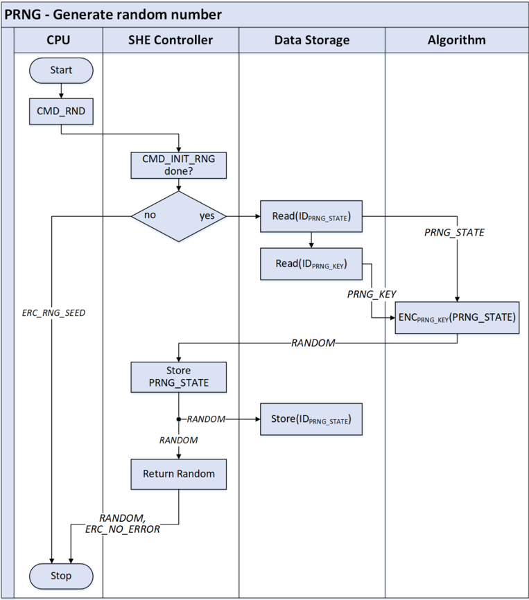

#### 4.5.3. 扩展种子

任何用户都可以通过调用函数 CMD\_EXTEND\_SEED 并提供 128 位的熵来扩展种子和当前的 PRNG\_STATE。种子和状态通过将旧的种子/状态与熵输入级联后，用上文描述的 Miyaguchi-Preneel 压缩函数压缩而得到扩展。压缩函数的输入必须按照章节[4.3.3](#433-压缩函数)进行预处理。由于压缩是对 2×128 位 = 256 位的定长操作，填充成为常量操作。填充以常量 PRNG\_EXTENSION\_C 给出，见章节[4.12](#412-she-中使用的常量)。

```
PRNG_STATE = AES-MP(PRNG_STATE | ENTROPY)
PRNG_SEED = AES-MP(PRNG_SEED | ENTROPY)
```

### 4.6. 状态寄存器

CPU 可以读取一个状态寄存器以检查 **SHE** 的内部状态。状态寄存器的总宽度为 8 位。置位的比特值为「1」，清零的比特值为「0」。

| 位 | 名称 | 描述 |
|---|---|---|
| 2^0^ | BUSY | 只要 **SHE** 正在处理一条命令，该位就置位。 |
| 2^1^ | SECURE\_BOOT | 如果安全启动已激活，该位置位。 |
| 2^2^ | BOOT\_INIT | 如果安全启动已在启动序列期间完成个性化，该位置位。 |
| 2^3^ | BOOT\_FINISHED | 当安全启动已通过调用 CMD\_BOOT\_FAILURE 或 CMD\_BOOT\_OK 之一结束，或 CMD\_SECURE\_BOOT 验证 BOOT\_MAC 失败时，该位置位。 |
| 2^4^ | BOOT\_OK | 如果安全启动（CMD\_SECURE\_BOOT）成功，该位置位。如果调用 CMD\_BOOT\_FAILURE，该位被清除。 |
| 2^5^ | RND\_INIT | 如果随机数生成器已初始化，该位置位。 |
| 2^6^ | EXT\_DEBUGGER | 如果外部调试器已连接到芯片，该位置位，即它反映调试器激活的输入。 |
| 2^7^ | INT\_DEBUGGER | 如果 **SHE** 的内部调试机制已激活，该位置位。 |

### 4.7. 用户可访问的函数

**SHE** 向 CPU 提供若干函数。一般来说，同一时刻只能执行单个函数。只有命令 CMD\_GET\_STATUS（章节[4.7.16](#4716-读取-she-状态cmd_get_status)）和 CMD\_CANCEL（章节[4.7.18](#4718-取消函数cmd_cancel)）可以在另一个函数处理期间被调用。

以下各小节列出了所有可用的函数，以及必要的参数、参数的方向和单个参数的位宽。

函数接口必须是异步的，即所有函数对 CPU 都必须是非阻塞的，因此立即返回。

尽管要返回数据，每个函数都必须能够返回一个错误码，以向调用应用传达处理的状态，有关错误码的详细信息见章节[4.8](#48-错误码)。

如果函数返回错误码，输出数据必须被置为「0」。

**注意：** 如果输出已经生成并传输，例如在 CBC 操作或通过 DMA 传输时，这些输出不必删除，但包含错误的这一轮的输出必须为「0」。特别是 CMAC 函数在出错时不得输出任何内容。

除非另有说明，所有函数只能处理完整的数据块，即 128 位数据或块大小的整数倍。

**注意：** 这些函数是在高层次上描述的，应当被分割为若干子函数以满足上述要求。数据处理也可以用更复杂的方式实现，例如对较大的数据块使用 DMA 传输。

**注意：** 如果 CPU 支持，强烈建议实现 DMA 接口。这将支持更大的用例集合和更高效的软件设计。

可以可选地实现一个中断，以提供命令状态的信息，例如在命令执行结束时发送中断。

#### 4.7.1. 加密：CMD\_ENC\_ECB

| 参数 | 方向 | 宽度 |
|---|---|---|
| KEY\_ID | IN | 4 |
| PLAINTEXT | IN | 128 |
| CIPHERTEXT | OUT | 128 |

该函数使用 KEY\_ID 标识的密钥加密给定的 PLAINTEXT 并返回 CIPHERTEXT。该操作允许使用的密钥概览见表 4.4。

```
CIPHERTEXT = ENC ECB,KEY_KEY_ID (PLAINTEXT)
```

错误码：ERC\_NO\_ERROR、ERC\_SEQUENCE\_ERROR、ERC\_KEY\_NOT\_AVAILABLE、ERC\_KEY\_INVALID、ERC\_KEY\_EMPTY、ERC\_MEMORY\_FAILURE、ERC\_BUSY、ERC\_GENERAL\_ERROR

#### 4.7.2. 加密：CMD\_ENC\_CBC

| 参数 | 方向 | 宽度 |
|---|---|---|
| KEY\_ID | IN | 4 |
| IV | IN | 128 |
| PLAINTEXT | IN | n \* 128 |
| CIPHERTEXT | OUT | n \* 128 |

该函数使用 KEY\_ID 标识的密钥加密给定的 PLAINTEXT 并返回 CIPHERTEXT。该操作允许使用的密钥概览见表 4.4。明文的长度可以是块宽度 128 位的整数倍，n = 1, 2, 3, ...

```
CIPHERTEXT = ENC CBC,KEY_KEY_ID,IV (PLAINTEXT)
```

错误码：ERC\_NO\_ERROR、ERC\_SEQUENCE\_ERROR、ERC\_KEY\_NOT\_AVAILABLE、ERC\_KEY\_INVALID、ERC\_KEY\_EMPTY、ERC\_MEMORY\_FAILURE、ERC\_BUSY、ERC\_GENERAL\_ERROR

#### 4.7.3. 解密：CMD\_DEC\_ECB

| 参数 | 方向 | 宽度 |
|---|---|---|
| KEY\_ID | IN | 4 |
| CIPHERTEXT | IN | 128 |
| PLAINTEXT | OUT | 128 |

该函数使用 KEY\_ID 标识的密钥解密给定的 CIPHERTEXT 并返回 PLAINTEXT。该操作允许使用的密钥概览见表 4.4。

```
PLAINTEXT = DEC ECB,KEY_KEY_ID (CIPHERTEXT)
```

错误码：ERC\_NO\_ERROR、ERC\_SEQUENCE\_ERROR、ERC\_KEY\_NOT\_AVAILABLE、ERC\_KEY\_INVALID、ERC\_KEY\_EMPTY、ERC\_MEMORY\_FAILURE、ERC\_BUSY、ERC\_GENERAL\_ERROR

#### 4.7.4. 解密：CMD\_DEC\_CBC

| 参数 | 方向 | 宽度 |
|---|---|---|
| KEY\_ID | IN | 4 |
| IV | IN | 128 |
| CIPHERTEXT | IN | n \* 128 |
| PLAINTEXT | OUT | n \* 128 |

该函数使用 KEY\_ID 标识的密钥解密给定的 CIPHERTEXT 并返回 PLAINTEXT。该操作允许使用的密钥概览见表 4.4。明文的长度可以是块宽度 128 位的整数倍，n = 1, 2, 3, ...

```
PLAINTEXT = DEC CBC,KEY_KEY_ID,IV (CIPHERTEXT)
```

错误码：ERC\_NO\_ERROR、ERC\_SEQUENCE\_ERROR、ERC\_KEY\_NOT\_AVAILABLE、ERC\_KEY\_INVALID、ERC\_KEY\_EMPTY、ERC\_MEMORY\_FAILURE、ERC\_BUSY、ERC\_GENERAL\_ERROR

#### 4.7.5. MAC 生成：CMD\_GENERATE\_MAC

| 参数 | 方向 | 宽度 |
|---|---|---|
| KEY\_ID | IN | 4 |
| MESSAGE\_LENGTH | IN | 64 |
| MESSAGE | IN | n \* 128 |
| MAC | OUT | 128 |

该函数使用 KEY\_ID 标识的密钥为给定的 MESSAGE 生成 MAC。该操作允许使用的密钥概览见表 4.4。

如果提供的消息长度与 MESSAGE\_LENGTH（消息的比特长度）所述不一致，该函数必须丢弃计算出的 MAC 并返回错误。

所有填充由 **SHE** 根据 MESSAGE\_LENGTH 提供的长度完成。

n = CEIL(MESSAGE\_LENGTH / 128)<sup>1</sup>

```
MAC = CMAC KEY_KEY_ID (MESSAGE, MESSAGE_LENGTH)
```

> 1 设 CEIL 为向上取整函数，CEIL(x) = min { n ∈ ℵ~1~ | n ≥ x }，ℵ~1~ = {1,2,3,...}

错误码：ERC\_NO\_ERROR、ERC\_SEQUENCE\_ERROR、ERC\_KEY\_NOT\_AVAILABLE、ERC\_KEY\_INVALID、ERC\_KEY\_EMPTY、ERC\_MEMORY\_FAILURE、ERC\_BUSY、ERC\_GENERAL\_ERROR

#### 4.7.6. MAC 验证：CMD\_VERIFY\_MAC

| 参数 | 方向 | 宽度 |
|---|---|---|
| KEY\_ID | IN | 4 |
| MESSAGE\_LENGTH | IN | 64 |
| MESSAGE | IN | n \* 128 |
| MAC | IN | 128 |
| MAC\_LENGTH | IN | 7 |
| VERIFICATION\_STATUS | OUT | 1 |

该函数使用 KEY\_ID 标识的密钥，针对提供的 MAC 验证给定 MESSAGE 的 MAC。该操作允许使用的密钥概览见表 4.4。从 MAC 的最左比特开始比较的比特数由参数 MAC\_LENGTH 给出；值 0 不允许，**SHE** 将其解释为比较 MAC 的全部比特。

如果提供的消息长度与 MESSAGE\_LENGTH（消息的比特长度）所述不一致，该函数必须返回错误。

所有填充由 **SHE** 根据 MESSAGE\_LENGTH 提供的长度完成。

n = CEIL(MESSAGE\_LENGTH / 128)<sup>2</sup>

```
MAC_calc = TRUNCATE(CMAC KEY_KEY_ID (MESSAGE, MESSAGE_LENGTH), MAC_LENGTH)
MAC_ref = TRUNCATE(MAC, MAC_LENGTH)
VERIFICATION_STATUS = ( 0 != ( MAC_calc - MAC_ref ) )
```

> 2 设 CEIL 为向上取整函数，CEIL(x) = min { n ∈ ℵ~1~ | n ≥ x }，ℵ~1~ = {1,2,3,...}

错误码：ERC\_NO\_ERROR、ERC\_SEQUENCE\_ERROR、ERC\_KEY\_NOT\_AVAILABLE、ERC\_KEY\_INVALID、ERC\_KEY\_EMPTY、ERC\_MEMORY\_FAILURE、ERC\_BUSY、ERC\_GENERAL\_ERROR

#### 4.7.7. 安全密钥更新：CMD\_LOAD\_KEY

| 参数 | 方向 | 宽度 |
|---|---|---|
| M1 | IN | 128 |
| M2 | IN | 256 |
| M3 | IN | 128 |
| M4 | OUT | 256 |
| M5 | OUT | 128 |

该函数按照章节[4.9](#49-内存更新协议)所述的协议更新 **SHE** 的一个内部密钥。

如果一个受保护的密钥被装入 RAM\_KEY，该函数必须清除明文密钥状态位。

操作细节参见第9章。

错误码：ERC\_NO\_ERROR、ERC\_SEQUENCE\_ERROR、ERC\_KEY\_NOT\_AVAILABLE、ERC\_KEY\_INVALID、ERC\_KEY\_WRITE\_PROTECTED、ERC\_KEY\_UPDATE\_ERROR、ERC\_MEMORY\_FAILURE、ERC\_KEY\_EMPTY、ERC\_BUSY、ERC\_GENERAL\_ERROR

#### 4.7.8. 明文密钥更新：CMD\_LOAD\_PLAIN\_KEY

| 参数 | 方向 | 宽度 |
|---|---|---|
| KEY | IN | 128 |

密钥 KEY 在不加密和不验证的情况下装入，即密钥以明文交付。明文密钥只能装入 RAM\_KEY 槽。该命令为 RAM\_KEY 置位明文密钥状态位。

```
KEY_RAM_KEY = KEY
KEY_RAM_KEY_PLAIN = 1
```

错误码：ERC\_NO\_ERROR、ERC\_SEQUENCE\_ERROR、ERC\_BUSY、ERC\_GENERAL\_ERROR

#### 4.7.9. 导出密钥：CMD\_EXPORT\_RAM\_KEY

| 参数 | 方向 | 宽度 |
|---|---|---|
| M1 | OUT | 128 |
| M2 | OUT | 256 |
| M3 | OUT | 128 |
| M4 | OUT | 256 |
| M5 | OUT | 128 |

该函数将 RAM\_KEY 导出为受 SECRET\_KEY 保护的格式。该密钥随后可以通过 CMD\_LOAD\_KEY 再次导入。

只有当 RAM\_KEY 是以明文（即通过 CMD\_LOAD\_PLAIN\_KEY）写入 **SHE** 时，才能被导出。

对于装入 RAM\_KEY、进而导出 RAM\_KEY，安全标志和计数器的保留字段必须设置为 0。有关报文细节与内容以及运算和填充的进一步说明见章节[4.9](#49-内存更新协议)。

除 M1、M2、M3、M4、M5 之外的任何值都不得离开 **SHE**。

**注意：** 由于在 RAM\_KEY 更新的情况下按定义将计数器和标志置零，加密报文 M2 的第一个块成为一个常量零块。

```
K1 = KDF(KEY_SECRET_KEY, KEY_UPDATE_ENC_C)
K2 = KDF(KEY_SECRET_KEY, KEY_UPDATE_MAC_C)
C_ID = 0 (28 bits)
F_ID = 0 (5 bits)
M1 = UID|ID_RAM_KEY|ID_SECRET_KEY
M2 = ENC CBC,K1,IV=0 (C_ID|F_ID|"0...0"95|KEY_RAM_KEY)
   = ENC CBC,K1,IV=0 ("0...0"128|KEY_RAM_KEY)
M3 = CMAC K2 (M1|M2)
K3 = KDF(KEY_RAM_KEY, KEY_UPDATE_ENC_C)
K4 = KDF(KEY_RAM_KEY, KEY_UPDATE_MAC_C)
M4 = UID|ID_RAM_KEY|ID_SECRET_KEY|ENC ECB,K3 (C_ID)
M5 = CMAC K4 (M4)
```

错误码：ERC\_NO\_ERROR、ERC\_SEQUENCE\_ERROR、ERC\_KEY\_INVALID、ERC\_MEMORY\_FAILURE、ERC\_BUSY、ERC\_KEY\_EMPTY、ERC\_GENERAL\_ERROR

#### 4.7.10. 初始化随机数生成器：CMD\_INIT\_RNG

| 参数 | 方向 | 宽度 |
|---|---|---|
| 无 | | |

该函数初始化种子并为 PRNG 派生一个密钥。在每次掉电/复位后，必须在 CMD\_RND 之前调用该函数。有关随机数生成器初始化的详细信息分别见章节[4.5.1.1](#4511-通过伪随机数生成器prng生成种子)或章节[4.5.1.2](#4512-通过真随机数生成器trng生成种子)。该命令必须忽略 SECRET\_KEY 上处于活动状态的调试器保护或安全启动保护标志。

操作细节分别参见第5.1.1节或第5.1.2节。

错误码：ERC\_NO\_ERROR、ERC\_SEQUENCE\_ERROR、ERC\_MEMORY\_FAILURE、ERC\_BUSY、ERC\_GENERAL\_ERROR

#### 4.7.11. 扩展 PRNG 种子：CMD\_EXTEND\_SEED

| 参数 | 方向 | 宽度 |
|---|---|---|
| ENTROPY | IN | 128 |

该函数通过将先前的种子值与提供的熵压缩为一个新的种子来扩展 PRNG 的种子，该新种子将用于生成后续的随机数。在种子可以被扩展之前，随机数生成器必须已由 CMD\_INIT\_RNG 初始化。

操作细节参见第5.3节。

错误码：ERC\_NO\_ERROR、ERC\_SEQUENCE\_ERROR、ERC\_RNG\_SEED、ERC\_MEMORY\_FAILURE、ERC\_BUSY、ERC\_GENERAL\_ERROR

#### 4.7.12. 生成随机数：CMD\_RND

| 参数 | 方向 | 宽度 |
|---|---|---|
| RND | OUT | 128 |

该函数返回一个 128 位随机位的向量。

在可以提供随机数之前，随机数生成器必须已由 CMD\_INIT\_RNG 初始化。

```
IF (SREG.RND_INIT == 1)
  PRNG_STATE_i = ENC ECB,KEY_PRNG_KEY (PRNG_STATE_(i-1))
  RND = PRNG_STATE_i
END IF
```

错误码：ERC\_NO\_ERROR、ERC\_SEQUENCE\_ERROR、ERC\_RNG\_SEED、ERC\_MEMORY\_FAILURE、ERC\_BUSY、ERC\_GENERAL\_ERROR

#### 4.7.13. 引导加载程序验证（安全启动）：CMD\_SECURE\_BOOT

| 参数 | 方向 | 宽度 |
|---|---|---|
| SIZE | IN | 32 |
| DATA | IN | SIZE \* |

该函数启动安全启动过程。**SHE** 验证以字节为单位、大小为 SIZE 的 DATA 中提供的引导加载程序的 MAC。

该函数在每次掉电/复位后只能使用一次，之后将被锁定。

操作细节参见第10章。

错误码：ERC\_NO\_ERROR、ERC\_SEQUENCE\_ERROR、ERC\_NO\_SECURE\_BOOT、ERC\_MEMORY\_FAILURE、ERC\_BUSY、ERC\_GENERAL\_ERROR

#### 4.7.14. 无效启动时实施制裁：CMD\_BOOT\_FAILURE

| 参数 | 方向 | 宽度 |
|---|---|---|
| 无 | | |

该命令将实施与 CMD\_SECURE\_BOOT 检测到失败时相同的制裁，但可以在启动过程的后续阶段使用，细节见第10.4节。CMD\_BOOT\_FAILURE 在每次掉电/复位后只能调用一次，并且只能在 CMD\_SECURE\_BOOT 之前未检测到任何错误且 CMD\_BOOT\_OK 未被调用的情况下调用。

**注意：** 如果安全启动被分割为多个阶段，而 **SHE** 只提供第一个自主阶段，则该函数可在后续阶段使用，以向 **SHE** 提供启动状态。

```
IF (SREG.SECURE_BOOT == 1 AND SREG.BOOT_OK == 1 AND SREG.BOOT_FINISHED == 0)
  SREG.BOOT_FINISHED = 1
  SREG.BOOT_OK = 0
END IF
```

错误码：ERC\_NO\_ERROR、ERC\_SEQUENCE\_ERROR、ERC\_NO\_SECURE\_BOOT、ERC\_BUSY、ERC\_GENERAL\_ERROR

#### 4.7.15. 结束启动验证：CMD\_BOOT\_OK

| 参数 | 方向 | 宽度 |
|---|---|---|
| 无 | | |

该命令用于为晚于 CMD\_SECURE\_BOOT 的后续阶段标记成功的启动验证。特别是它用于锁定命令 CMD\_BOOT\_FAILURE。

CMD\_BOOT\_OK 在每次掉电/复位后只能调用一次，并且只能在 CMD\_SECURE\_BOOT 之前未检测到任何错误且 CMD\_BOOT\_FAILURE 未被调用的情况下调用。

**注意：** 如果安全启动被分割为多个阶段，而 **SHE** 只提供第一个自主阶段，则该函数可在后续阶段使用，以向 **SHE** 提供启动状态。

```
IF (SREG.SECURE_BOOT == 1 AND SREG.BOOT_OK == 1 AND SREG.BOOT_FINISHED == 0)
  SREG.BOOT_FINISHED = 1
END IF
```

错误码：ERC\_NO\_ERROR、ERC\_SEQUENCE\_ERROR、ERC\_NO\_SECURE\_BOOT、ERC\_BUSY、ERC\_GENERAL\_ERROR

#### 4.7.16. 读取 SHE 状态：CMD\_GET\_STATUS

| 参数 | 方向 | 宽度 |
|---|---|---|
| SREG | OUT | 8 |

该函数返回状态寄存器的内容。该函数可以在任何状态下调用。

错误码：ERC\_NO\_ERROR、ERC\_GENERAL\_ERROR

#### 4.7.17. 获取身份：CMD\_GET\_ID

| 参数 | 方向 | 宽度 |
|---|---|---|
| CHALLENGE | IN | 128 |
| ID | OUT | 120 |
| SREG | OUT | 8 |
| MAC | OUT | 128 |

该函数返回身份（UID）和状态寄存器的值，并由一个覆盖挑战和数据的 MAC 保护。

如果 MASTER\_ECU\_KEY 为空，返回的 MAC 必须置为 0。

```
ID = UID
MAC = CMAC KEY_MASTER_ECU_KEY (CHALLENGE|ID|SREG)
```

错误码：ERC\_NO\_ERROR、ERC\_SEQUENCE\_ERROR、ERC\_KEY\_NOT\_AVAILABLE、ERC\_MEMORY\_FAILURE、ERC\_BUSY、ERC\_GENERAL\_ERROR

#### 4.7.18. 取消函数：CMD\_CANCEL

| 参数 | 方向 | 宽度 |
|---|---|---|
| 无 | | |

CMD\_CANCEL 将中断任何给定的函数，并丢弃所有计算和结果。如果在启动验证期间调用 CMD\_CANCEL，则必须执行与启动测量失败时相同的动作，见章节[4.10.4](#4104-启动测量失败时的制裁)。如果在内存槽更新期间调用 CMD\_CANCEL，则：若在物理写操作之前调用，必须保留内存槽的原值；若在物理写操作期间或之后调用，则必须持久化新值。该命令可以在任何状态下调用。CMD\_CANCEL 的延迟（最小/平均/最大），即从发出 CMD\_CANCEL 到清除 SREG.BUSY 之间的时间，应当在数据手册中注明。

**注意：** 调用 CMD\_CANCEL 之后，由于停止数据传输，可能存在一些延迟。

错误码：ERC\_NO\_ERROR、ERC\_GENERAL\_ERROR

#### 4.7.19. 调试器激活：CMD\_DEBUG

| 参数 | 方向 | 宽度 |
|---|---|---|
| CHALLENGE | OUT | 128 |
| AUTHORIZATION | IN | 128 |

CMD\_DEBUG 用于激活 **SHE** 的任何内部调试设施，见章节[4.11](#411-she-的失效分析重置-she)。激活内部调试器意味着删除除 SECRET\_KEY、UID 和 PRNG\_SEED 之外的所有密钥，并且只有在没有任何密钥被写保护时才能工作。

该命令必须忽略处于活动状态的调试器保护标志和安全启动保护标志以及空密钥。

成功认证并删除所有密钥后，比特 SREG.RND\_INIT 必须复位为「0」。

**注意：** 如果没有任何密钥被写保护，该命令也可以用于将 **SHE** 重置为出厂默认值。

```
SHE & Backend:
K = KDF(KEY_MASTER_ECU_KEY, DEBUG_KEY_C)
SHE:
CHALLENGE = CMD_RND()
Backend:
AUTHORIZATION = CMAC K (CHALLENGE|UID)
```

错误码：ERC\_NO\_ERROR、ERC\_SEQUENCE\_ERROR、ERC\_WRITE\_PROTECTED、ERC\_RNG\_SEED、ERC\_NO\_DEBUGGING、ERC\_MEMORY\_FAILURE、ERC\_BUSY、ERC\_GENERAL\_ERROR

### 4.8. 错误码

SHE 协处理器会在调用命令之后提供错误码。以下错误码已定义，调用应用应适当地处理它们。哪些错误码可能伴随 **SHE** 的单个函数出现见表 4.6。

#### 4.8.1. ERC\_NO\_ERROR

未发生错误，命令将被执行。

#### 4.8.2. ERC\_SEQUENCE\_ERROR

只要命令或子命令的序列失序，**SHE** 就会返回该错误码，例如在另一个函数仍在运行时调用某个函数。

#### 4.8.3. ERC\_KEY\_NOT\_AVAILABLE

如果密钥因启动测量失败或调试器处于活动状态而被锁定，则返回该错误码。

#### 4.8.4. ERC\_KEY\_INVALID

当调用某个函数以执行操作、而该密钥不被允许用于给定操作时，**SHE** 返回该错误码。

#### 4.8.5. ERC\_KEY\_EMPTY

如果应用试图使用一个尚未初始化的密钥，**SHE** 返回该错误码。

#### 4.8.6. ERC\_NO\_SECURE\_BOOT

当安全启动过程的条件不满足且安全启动过程必须被取消时，命令 CMD\_SECURE\_BOOT（见章节[4.7.13](#4713-引导加载程序验证安全启动cmd_secure_boot)）返回该错误。当在没有安全启动的情况下、或在安全启动过程结束后调用改变启动状态的函数时，也会返回该错误。

#### 4.8.7. ERC\_KEY\_WRITE\_PROTECTED

当对已被写保护的内存槽尝试密钥更新时，或在某个密钥被写保护时尝试激活调试器时，返回该错误。

#### 4.8.8. ERC\_KEY\_UPDATE\_ERROR

当密钥更新因报文验证中的错误而未成功时，返回该错误。

#### 4.8.9. ERC\_RNG\_SEED

如果种子尚未初始化，CMD\_RND 和 CMD\_DEBUG 返回该错误码。

#### 4.8.10. ERC\_NO\_DEBUGGING

当内部调试无法进行、因为挑战-响应协议的认证未成功时，返回该错误码。

#### 4.8.11. ERC\_BUSY

只要在 **SHE** 的另一个函数仍在处理时调用某个函数，即 SREG.BUSY = 1 时，就返回该错误码。命令的顺序是否正确应当无关紧要。如果在另一个函数处理期间调用 CMD\_CANCEL 或 CMD\_GET\_STATUS，它们不应返回 ERC\_BUSY，而应如章节[4.7](#47-用户可访问的函数)所述并行处理。

#### 4.8.12. ERC\_MEMORY\_FAILURE

如果底层存储工艺能够在存储器读或写操作期间检测到物理错误（例如比特翻转等），可以返回该错误码以通知应用。

#### 4.8.13. ERC\_GENERAL\_ERROR

如果在 **SHE** 内部检测到上述错误码未覆盖的错误，返回该错误码。

### 4.9. 内存更新协议

**SHE** 提供若干内存槽来存储密钥和其他所需信息，并可在必要时更改其内容。内存槽根据其用例受到不同策略的保护。然而，在更新内存槽时，必须知道一个机密才能授权更改内存。更新所有内存槽使用同一个协议。一次运行该协议只能更新单个内存槽。该协议在以下各小节中描述。

该协议由两部分组成：内存更新本身，以及一条可传回更新发起方以证明更新成功的验证消息。通过包含存储在 **SHE** 内的计数值，该协议可防范重放攻击。此外它还提供机密性、完整性和真实性。通过将消息传回外部方，可以证明一个内存位置的成功更新。

单个内存槽的更新次数仅受计数器宽度和物理存储器写入耐久性的限制。

必须实现以下各节描述的协议，以通过命令 CMD\_LOAD\_KEY 更新非易失性内存槽或 RAM\_KEY。

命令 CMD\_EXPORT\_RAM\_KEY 必须实现消息 M1、M2、M3、M4、M5 的生成。

内存更新协议分为两个部分：第一部分是实际的内存更新，将一个机密且真实的密钥传送给 **SHE**；第二部分是验证，为后端提供密钥更新成功的证据。

#### 4.9.1. 内存更新协议的描述

要更新一个内存槽（例如一个密钥），外部实体（例如后端）必须知道一个有效的认证机密，即另一个密钥，由 AuthID 标识。更新某个内存槽必须知道哪个认证机密的细节见表 4.5。

后端必须使用常量 KEY\_UPDATE\_ENC\_C 或 KEY\_UPDATE\_MAC\_C 从 KEY~AuthID~ 派生出两个密钥 K~1~ 和 K~2~（见章节[4.3.3.1](#4331-密钥派生)）。然后生成三条消息 M1..M3。M1 是被寻址的 **SHE** 模块的 UID、要更新的内存槽的 ID 和 AuthID 的级联。M2 是新的计数值 C~ID~'、相应的标志 F~ID~'、用于将第一个块填满「0」比特的模式以及新密钥 K~ID~' 的 CBC 加密级联。加密的初始化向量为 IV = 0，密钥为 K~1~，报文通过在 LSB 一侧级联单个「1」比特、其后跟「0」比特来填充。标志 F~ID~' 的组成为：

```
F_ID' = WRITE_PROTECTION | BOOT_PROTECTION | DEBUGGER_PROTECTION | KEY_USAGE | WILDCARD
```

最后一条消息 M3 是验证消息，计算为对 M1 与 M2 的级联的 CMAC~K2~。

所有三条消息都必须传输给 **SHE**。

**SHE** 检查内存槽 ID 的写保护，只有在写保护未置位时才继续。

如果密钥 AuthID 为空，则只有当 AuthID = ID 时密钥更新才必须工作，否则返回 ERC\_KEY\_EMPTY。

调试器保护和安全启动保护（见章节[4.4.1.3](#4413-调试器激活时禁用密钥)和章节[4.4.1.2](#4412-启动失败时禁用密钥)）必须在 ID = ID~RAM\_KEY~ 时检查。如果其中一种保护处于活动状态，则返回 ERC\_KEY\_NOT\_AVAILABLE。对于其他 ID 以及所有 AuthID，省略调试器和安全启动保护的检查。

在发生存储器故障的情况下，至少 AuthID、C~ID~、F~ID~ 和 UID（非通配符模式时）必须可读才能执行更新，否则返回 ERC\_MEMORY\_FAILURE。

**注意：** 即使安全启动测量失败或调试器处于活动状态的安全位会阻止访问，非易失性密钥的密钥更新仍可执行，因为更新过程本身就是真实且机密的。

随后 **SHE** 同样派生 K~2~ 并验证消息 M3。如果验证成功，**SHE** 首先检查提供的 UID' 是否与通配符值 0 匹配。如果 UID' 是通配符，**SHE** 通过检查存储的标志来判断该特定密钥是否允许通配符，并继续读取 AuthID 或中断协议。如果 M1 中的 UID' 不是通配符，则将其与 **SHE** 的实际 UID 比较，只有值匹配时协议才继续。

下一步 **SHE** 派生 K~1~ 以解密 M2。如果来自 M2 的新计数值 C~ID~' 大于内部计数值 C~ID~，**SHE** 必须继续存储传输来的计数值、密钥和标志。

**注意：** 只有在新值与当前值不同的情况下才应发出物理写操作。

所有中间值（例如 K~x~ 和解密后的值）不得离开 **SHE**。对某个内存槽的更新不得影响任何其他密钥槽。

协议的流程图见图 4.5。成功存储所有数据后会生成一条验证消息，细节见下一章。如果协议用于装入 RAM\_KEY，则标志和计数值必须设置为 0，**SHE** 必须忽略它们的值。

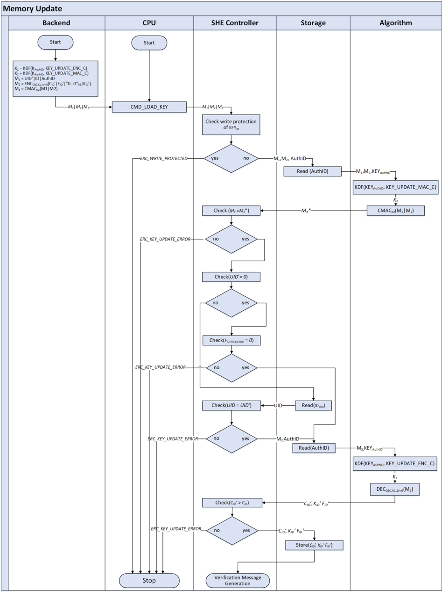

#### 4.9.2. 更新验证消息生成的描述

更新内存槽后，**SHE** 必须生成一条验证消息，该消息可以传输给后端以证明更新成功。生成过程的流程图见图 4.6。

**SHE** 首先从被更新的内存槽 ID 和 KEY\_UPDATE\_ENC\_C 派生一个密钥 K~3~（见章节[4.3.3.1](#4331-密钥派生)），以 ECB 模式加密存储的计数值 C~ID~。计数值必须以单个「1」比特、其后跟「0」比特（位于 LSB 一侧）填充。

接下来，通过级联 UID、被更新内存槽的 ID、所使用的认证机密 AuthID 和加密后的计数值 M4\* 生成消息 M4。在加密之前，计数值通过在 LSB 一侧级联单个「1」比特、其后跟「0」比特来填充。

最后，使用从被更新的内存槽 ID 和 KEY\_UPDATE\_MAC\_C 派生的密钥 K~4~ 计算消息 M4 的 CMAC，生成 M5。

消息 M4 和 M5 随后传输给后端。

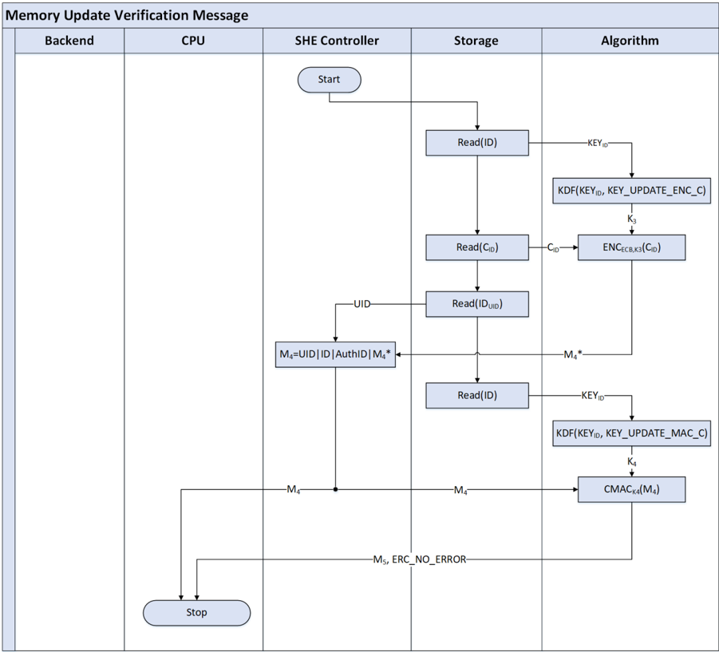

### 4.10. 安全启动

**SHE** 的设施可用于保护启动过程，即在每次启动循环中监控软件的真实性。为此，必须在 CPU 复位时、在把控制权交给应用之前运行一个任务。该任务可以实现为微控制器 ROM 代码的一个小的附加部分，类似于可信计算组（**Trusted Computing Group**）定义的「测量可信根」（**core root of trust for measurement**，**CRTM**），见 [\[9\]](#ref-9)。

安全启动过程对照 **SHE** 的内部数据验证一个存储区域，如果验证失败将锁定 **SHE** 的部分功能。被验证的部分与微控制器初始化后立即执行的第一批用户指令完全相同，在后续小节中称为「SHE 引导加载程序」（**SHE Bootloader**）。

**注意：** SHE 引导加载程序可以是一个额外的引导加载程序、一个已有的引导加载程序，或者例如一个应受保护的数据段。然而，数据段需要在其第一个存储位置包含一个跳转到实际应用的操作。

SHE 引导加载程序位于存储位置 SHE\_BL\_START，大小为 SHE\_BL\_SIZE。这两个值对安全无关紧要，因此不存储在 **SHE** 内部。SHE 引导加载程序不属于内部 ROM，而是位于用户可访问的存储器中。

引导加载程序的大小 SHE\_BL\_SIZE 必须可由应用工程师配置，而不应由芯片制造商固定。如果微控制器架构允许从不同的位置启动，则值 SHE\_BL\_START 必须可由应用工程师写入。

这些值的实际存储位置由微控制器制造商控制，并且可能因微控制器而异。然而，只有启动安全启动过程的任务需要处理这些值。该任务必须总是尝试启动安全启动过程，并通过让 **SHE** 判定是否配置了安全启动来评估错误码。

安全启动过程不应干扰 CPU 的常规功能，即如果未显式激活，CPU 的表现应当如同 **SHE** 不存在。

要激活安全启动特性，必须向 BOOT\_MAC\_KEY 密钥槽写入一个密钥。在 CPU 的下一次复位时，**SHE** 将自行完成个性化，见章节[4.10.3](#4103-安全启动过程的自主引导配置)。

**注意：** 安全启动并不直接保护应用软件，但可以防止恶意应用使用某些密钥。为了同时保护软件，必须在软件与密钥之间建立依赖关系，例如通过加密部分软件。

**注意：** 安全启动提供了一种方式，通过评估被引导配置的完整性和真实性来授权使用存储的密钥。

必须有两种执行安全启动的方式，可由软件应用工程师在微控制器提供的非易失性存储区中进行配置，细节见章节[4.10.1](#4101-应用启动前的测量)和章节[4.10.2](#4102-应用启动期间的测量)。

#### 4.10.1. 应用启动前的测量

在这种情况下，完整的安全启动过程在把微控制器的控制权交给应用之前执行。

安全启动必须始终在 CPU 开始应用代码之前完成。如果使用直接内存访问技术实现安全启动，CPU 必须等待操作结束后才能开始应用代码。如果 DMA 传输被以任何方式取消或中断，必须通知 **SHE**，并且安全启动必须被标记为失败。

##### 4.10.1.1. 示例实现：引导代码的扩展

「引导代码（**boot code**）」指微控制器的内部 ROM 代码，它在复位后立即执行，以在启动用户应用之前初始化 CPU 和外设。

微控制器的内部引导代码必须扩展一个小程序，以启动对 SHE 引导加载程序的验证。

引导代码的扩展必须按以下顺序完成若干任务：

- 取得 SHE 引导加载程序的大小 SHE\_BL\_SIZE
- 从地址 SHE\_BL\_START 到 SHE\_BL\_START + SHE\_BL\_SIZE 读取引导加载程序数据，并使用 CMD\_SECURE\_BOOT 将其发送给 **SHE**
- 在 SHE\_BL\_START 处开始执行 SHE 引导加载程序

引导代码的扩展必须保证启动的代码与之前验证的代码完全相同，即它必须在 SHE\_BL\_START 处开始执行。

图 4.7 应当说明引导代码的扩展应如何工作。示例中使用了以下变量：

| 变量 | 含义 |
|---|---|
| SHE\_BL\_SIZE | 引导加载程序的字节长度；以 32 位无符号值存储在 CPU 的内部或外部存储器中 |
| SHE\_BL\_START | 引导加载程序第一个字节的地址。对于某些 CPU 架构，该地址可能是固定的，或者存储在内部或外部存储器中 |
| BOOT\_POSITION | 常规复位后第一条指令的地址。可以与 SHE\_BL\_START 相同 |

**注意：** 命令 CMD\_SECURE\_BOOT 已被分割为三个子命令，分别称为 INIT、UPDATE 和 FINALIZE。INIT 部分用于启动该函数并移交必要的参数。这第一个子函数还将检查条件以决定是否执行安全启动过程。第二个子命令用于将批量数据从 CPU 传输给 **SHE**，第三个命令用于告知 **SHE** 该过程已结束。

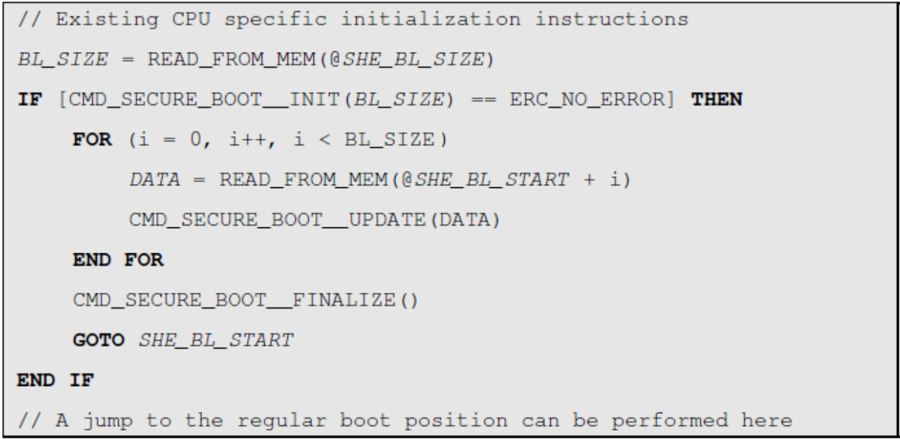

#### 4.10.2. 应用启动期间的测量

该选项只需在支持直接内存访问技术的微控制器上实现。

在这种情况下，安全启动过程仅在把微控制器的控制权交给应用之前被初始化和启动，即直接内存访问被参数化并启动。代码的实际测量与应用启动并行执行。

所有受安全启动标志保护的密钥在复位时必须被停用，只有在 CMD\_SECURE\_BOOT 成功完成后才会被激活。

**注意：** 由于 **SHE** 在同一时刻只能处理单个操作，在安全启动过程结束之前应用无法访问 **SHE**。不过，应用可以无延迟地启动，并可能中断安全启动过程。

如果数据传输操作被应用取消或篡改，**SHE** 必须停止安全启动过程并将其视为失败。

在安全启动期间不允许对被测量的存储区域进行写操作。如果在安全启动期间存储器被写入，**SHE** 必须停止安全启动过程并将其视为失败。在安全启动期间停用写能力是一种等效的措施。

#### 4.10.3. 安全启动过程的自主引导配置

如果需要，可以通过自主/自动学习的方式获得安全启动过程所需的各个 MAC。该机制不需要用预先计算的 MAC 初始化 **SHE**，而只需装入相应的密钥。在向 BOOT\_MAC\_KEY 写入密钥后，**SHE** 的第一次复位会触发引导过程。

在向相应密钥槽写入密钥后的第一次复位之后，安全启动过程的引导配置通过以下机制自主完成。

当 **SHE** 检测到启动密钥但没有存储的 MAC 时，CPU 将执行与受保护启动期间相同的任务，即读取程序闪存并将其传送给 **SHE**，但 **SHE** 不验证计算出的 MAC，而是将其存储到内部存储器中。在下一次复位时，启动将由 **SHE** 保护。

**注意：** 引导加载程序的位置和大小必须相应地初始化。

#### 4.10.4. 启动测量失败时的制裁

如果 **SHE** 在启动过程中检测到失败，例如计算出的 MAC 与存储的 MAC 不匹配、启动过程受到干扰，或者密钥因存储器故障（ERC\_MEMORY\_FAILURE）或密钥受调试保护（ERC\_KEY\_NOT\_AVAILABLE）而不可访问，则必须实施以下制裁：

状态寄存器中的相应比特被置位，以向应用标记失败的启动过程，即 SREG.BOOT\_FINISHED = 1 且 SREG.BOOT\_OK = 0。

命令 CMD\_BOOT\_FAILURE 和 CMD\_BOOT\_OK 必须被锁定。

所有按照章节[4.4.1.2](#4412-启动失败时禁用密钥)标记的密钥必须被锁定。

#### 4.10.5. 可选：强制执行经过认证的软件

**注意：** 该启动模式不是 SHE 1.0 符合性所必需的。

**注意：** 在该配置模式下，CPU 拒绝启动任何不真实的（**not authentic**）应用。

安全启动操作在启动应用之前执行（参见章节[4.10.1.1](#41011-示例实现引导代码的扩展)），但如果安全启动操作不成功，则必须重新启动。如果选择在 ROM 代码中实现，比较图 4.8 与图 4.7 中的伪代码，可得到强制执行真实软件的启动模式的实现示例。

启动模式的配置必须存储在一次性可编程（**one-time-programmable**）区域中。如果该可选启动模式被配置为执行，CPU 必须阻止除为安全启动所配置之外的其他任何启动选项，例如不允许重新配置启动存储器，也不允许使用通过通信接口的引导模式。

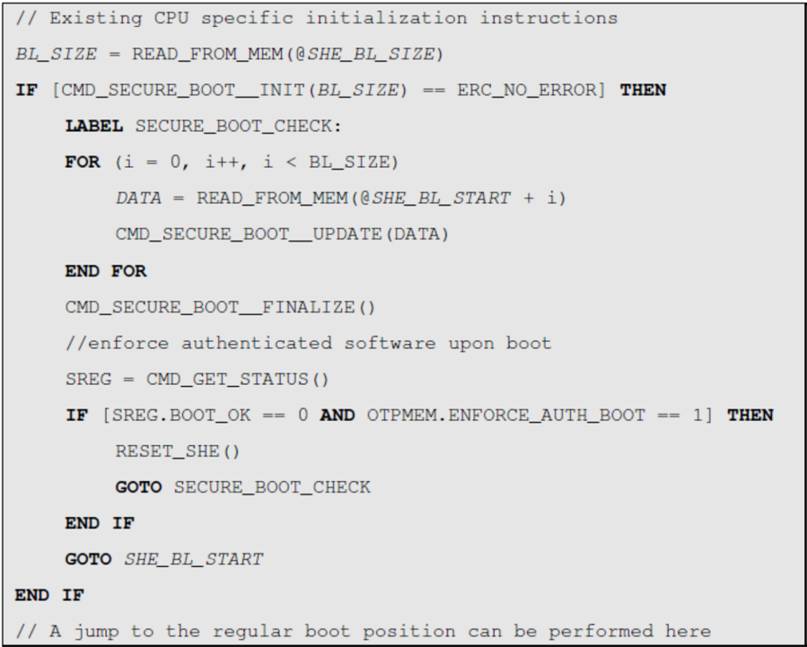

如果启动测量失败，即使该过程应立即重新启动，受安全启动标志保护的密钥也必须被锁定。

**注意：** 为了使该启动选项有用，关于是否必须重做启动测量的决定应受到针对某些硬件攻击（例如毛刺攻击）的保护。然而，由于该启动模式是可选的，未对抗篡改能力提出任何要求。

#### 4.10.6. 可选：流程图

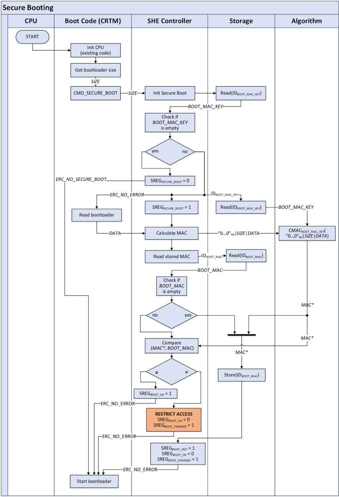

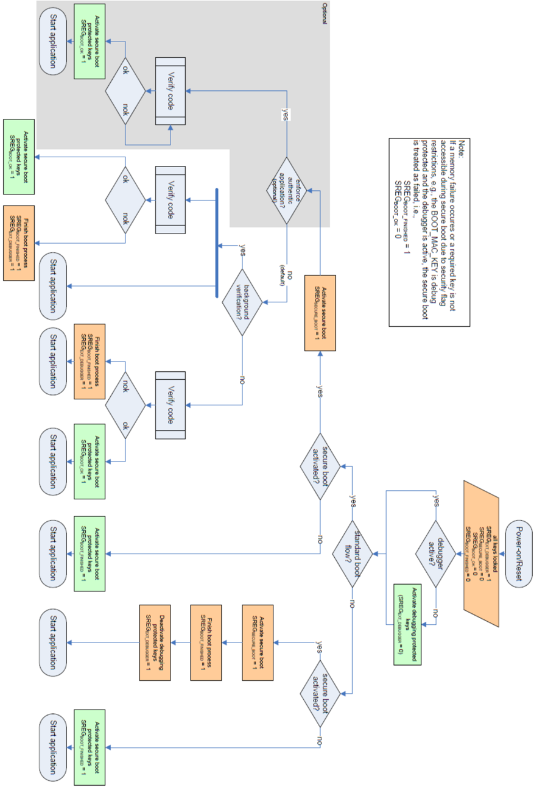

### 4.11. SHE 的失效分析/重置 SHE

**注意：** 只有当 **SHE** 已显式激活时，**SHE** 的内部部件才能被失效分析系统访问。在分析器激活之前，必须通过 MASTER\_ECU\_KEY 对分析系统进行认证，并且 **SHE** 的内部存储器必须被删除。参见章节[4.7.19](#4719-调试器激活cmd_debug)中的函数 CMD\_DEBUG。

本章中，术语「失效分析系统」指半导体制造商集成的、用于分析损坏的低层系统。它不包括软件应用的调试。

**SHE** 必须能够控制内部失效分析设施的激活。开发者可用的常规调试器（例如 JTAG）只允许覆盖 **SHE** 的外部接口。

要激活内部失效分析设施，必须执行以下步骤：

1. 检查是否置位了写保护比特，只有在没有任何密钥被写保护时才继续
2. 使用挑战-响应协议解锁 **SHE** 的内部失效分析系统。调试协议中使用的机密是从 MASTER\_ECU\_KEY 和 DEBUG\_KEY\_C^3^ 派生的密钥
3. 认证成功后，必须删除 **SHE** 的所有内部存储器，但 SECRET\_KEY、UID 和 PRNG\_SEED 除外
4. SREG.RND\_INIT 必须复位为「0」。
5. 调试接口可以被解锁

> 3 各常量的值见章节[4.12](#412-she-中使用的常量)

挑战-响应协议由以下步骤组成。在执行 CMD\_DEBUG 之前，必须初始化随机数生成器以支持挑战-响应协议。

1. **SHE** 生成一个随机数 CHALLENGE
2. **SHE** 从 MASTER\_ECU\_KEY 和 DEBUG\_KEY\_C 派生密钥 K~DEBUG~
3. **SHE** 将 CHALLENGE 发送给请求调试器访问的实体 A
4. A 同样派生 K~DEBUG~
5. A 计算 UID 和 CHALLENGE 上的 MAC：AUTHORIZATION = CMAC~K\_DEBUG~(CHALLENGE | UID)
6. A 将 AUTHORIZATION 发送给 **SHE**
7. **SHE** 验证 AUTHORIZATION。验证成功的情况下，必须在激活调试器访问之前删除内部存储器

激活必须只持续到下一次复位为止，即每次复位后调试器必须重新激活。

如果 MASTER\_ECU\_KEY 的调试保护标志或安全启动保护标志已置位，激活也必须能够工作。

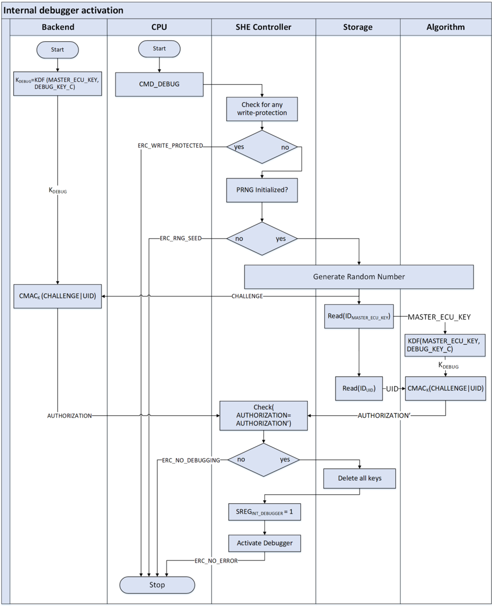

### 4.12. SHE 中使用的常量

这些常量是预定义的，以保持不同 **SHE** 实现之间的兼容性。有关常量如何构造的细节见章节[4.3.3.1](#4331-密钥派生)。

表4.2：SHE 中使用的常量值（**Constant values used within SHE**）

| 常量 | 值 | | | |
|---|---|---|---|---|
| KEY\_UPDATE\_ENC\_C | 0x01015348 | 45008000 | 00000000 | 000000B0 |
| KEY\_UPDATE\_MAC\_C | 0x01025348 | 45008000 | 00000000 | 000000B0 |
| DEBUG\_KEY\_C | 0x01035348 | 45008000 | 00000000 | 000000B0 |
| PRNG\_KEY\_C | 0x01045348 | 45008000 | 00000000 | 000000B0 |
| PRNG\_SEED\_KEY\_C | 0x01055348 | 45008000 | 00000000 | 000000B0 |
| PRNG\_EXTENSION\_C | 0x80000000 | 00000000 | 00000000 | 00000100 |

### 4.13. 示例和测试向量

为了检查 **SHE** 实现的正确性，以下各小节包含 **SHE** 的每个密码函数和协议的示例。所引用算法（即 AES 和 CMAC）的测试向量取自引用的规范文档，为方便起见放置于此。

#### 4.13.1. AES-128，ECB 模式

```
PLAINTEXT  = 00112233445566778899aabbccddeeff
KEY        = 000102030405060708090a0b0c0d0e0f
CIPHERTEXT = 69c4e0d86a7b0430d8cdb78070b4c55a
```

#### 4.13.2. AES-128，CBC 模式

##### 4.13.2.1. 加密

| | 值 |
|---|---|
| KEY | 2b7e151628aed2a6abf7158809cf4f3c |
| IV | 000102030405060708090a0b0c0d0e0f |
| 块 #1 | |
| PLAINTEXT | 6bc1bee22e409f96e93d7e117393172a |
| AES INPUT | 6bc0bce12a459991e134741a7f9e1925 |
| AES OUTPUT | 7649abac8119b246cee98e9b12e9197d |
| CIPHERTEXT | 7649abac8119b246cee98e9b12e9197d |
| 块 #2 | |
| PLAINTEXT | ae2d8a571e03ac9c9eb76fac45af8e51 |
| AES INPUT | d86421fb9f1a1eda505ee1375746972c |
| AES OUTPUT | 5086cb9b507219ee95db113a917678b2 |
| CIPHERTEXT | 5086cb9b507219ee95db113a917678b2 |
| 块 #3 | |
| PLAINTEXT | 30c81c46a35ce411e5fbc1191a0a52ef |
| AES INPUT | 604ed7ddf32efdff7020d0238b7c2a5d |
| AES OUTPUT | 73bed6b8e3c1743b7116e69e22229516 |
| CIPHERTEXT | 73bed6b8e3c1743b7116e69e22229516 |
| 块 #4 | |
| PLAINTEXT | f69f2445df4f9b17ad2b417be66c3710 |
| AES INPUT | 8521f2fd3c8eef2cdc3da7e5c44ea206 |
| AES OUTPUT | 3ff1caa1681fac09120eca307586e1a7 |
| CIPHERTEXT | 3ff1caa1681fac09120eca307586e1a7 |

##### 4.13.2.2. 解密

| | 值 |
|---|---|
| KEY | 2b7e151628aed2a6abf7158809cf4f3c |
| IV | 000102030405060708090a0b0c0d0e0f |
| 块 #1 | |
| CIPHERTEXT | 7649abac8119b246cee98e9b12e9197d |
| AES INPUT | 7649abac8119b246cee98e9b12e9197d |
| AES OUTPUT | 6bc0bce12a459991e134741a7f9e1925 |
| PLAINTEXT | 6bc1bee22e409f96e93d7e117393172a |
| 块 #2 | |
| CIPHERTEXT | 5086cb9b507219ee95db113a917678b2 |
| AES INPUT | 5086cb9b507219ee95db113a917678b2 |
| AES OUTPUT | d86421fb9f1a1eda505ee1375746972c |
| PLAINTEXT | ae2d8a571e03ac9c9eb76fac45af8e51 |
| 块 #3 | |
| CIPHERTEXT | 73bed6b8e3c1743b7116e69e22229516 |
| AES INPUT | 73bed6b8e3c1743b7116e69e22229516 |
| AES OUTPUT | 604ed7ddf32efdff7020d0238b7c2a5d |
| PLAINTEXT | 30c81c46a35ce411e5fbc1191a0a52ef |
| 块 #4 | |
| CIPHERTEXT | 3ff1caa1681fac09120eca307586e1a7 |
| AES INPUT | 3ff1caa1681fac09120eca307586e1a7 |
| AES OUTPUT | 8521f2fd3c8eef2cdc3da7e5c44ea206 |
| PLAINTEXT | f69f2445df4f9b17ad2b417be66c3710 |

##### 4.13.2.3. CMAC

**子密钥生成：**

| | 值 |
|---|---|
| CIPH~K~(0^128^) | 7df76b0c1ab899b33e42f047b91b546f |
| K1 | fbeed618357133667c85e08f7236a8de |
| K2 | f7ddac306ae266ccf90bc11ee46d513b |

**示例 1（消息长度 128 位）：**

| | 值 |
|---|---|
| MESSAGE | 6bc1bee22e409f96e93d7e117393172a |
| OUTPUT | 070a16b46b4d4144f79bdd9dd04a287c |

**示例 2（消息长度 320 位）：**

| | 值 |
|---|---|
| MESSAGE | 6bc1bee22e409f96e93d7e117393172a ae2d8a571e03ac9c9eb76fac45af8e51 30c81c46a35ce411e5fbc1191a0a52ef<sup>4</sup> |
| OUTPUT | dfa66747de9ae63030ca32611497c827 |

> 4 源 PDF 版式中该报文块的第三行在分页处被截断（仅显示前 16 个十六进制字符 30c81c46a35ce411）；此处按引用文献 [\[4\]](#ref-4)（NIST SP 800-38B 示例 A.2.2）补全为完整 128 位块。

##### 4.13.2.4. Miyaguchi-Preneel 压缩函数

| | 值 |
|---|---|
| M | 6bc1bee22e409f96e93d7e117393172a ae2d8a571e03ac9c9eb76fac45af8e51 |
| PADDING | 80000000000000000000000000000100 |
| OUTPUT | c7277a0dc1fb853b5f4d9cbd26be40c6 |

##### 4.13.2.5. 密钥派生

| | 值 |
|---|---|
| K | 000102030405060708090a0b0c0d0e0f |
| C | 010153484500800000000000000000b0 |
| K~Derived~ | 118a46447a770d87828a69c222e2d17e |

##### 4.13.2.6. 伪随机数生成/种子生成

| | 值 |
|---|---|
| SECRET\_KEY | 2b7e151628aed2a6abf7158809cf4f3c |
| PRNG\_SEED | 6bc1bee22e409f96e93d7e117393172a |

##### 4.13.2.7. 计算新种子

| | 值 |
|---|---|
| PRNG\_SEED\_KEY | 8abc8f6e2a8264fd38088be622ca0416 |
| PRNG\_SEED（新） | 41f21213bca0434b3eb3bafcb0a19d74 |

##### 4.13.2.8. 计算新随机值

| | 值 |
|---|---|
| PRNG\_STATE | 41f21213bca0434b3eb3bafcb0a19d74 |
| PRNG\_KEY | a1be019264992b2b725a4dd4c7767002 |
| PRNG\_STATE（新） | 614aae8a7bb8fff31ac3230e6240506b |

##### 4.13.2.9. 扩展种子

| | 值 |
|---|---|
| ENTROPY | ae2d8a571e03ac9c9eb76fac45af8e51 |
| PRNG\_SEED（扩展） | 7c92bea252d03015e4f5c2bca69a6f8a |
| PRNG\_STATE（扩展） | cf475ceb98f8ba6be1f55f97fdda9634 |

##### 4.13.2.10. 内存更新协议

| | 值 |
|---|---|
| KEY~NEW~ | 0f0e0d0c0b0a09080706050403020100 |
| KEY~AuthID~ | 000102030405060708090a0b0c0d0e0f |
| KEY\_UPDATE\_ENC\_C | 010153484500800000000000000000b0 |
| KEY\_UPDATE\_MAC\_C | 010253484500800000000000000000b0 |
| UID' | 000000000000000000000000000001 |
| ID | 4（KEY\_1） |
| AuthID | 1（MASTER\_ECU\_KEY） |
| C~ID~' | 0000001 |
| F~ID~' | 0 |
| K1 | 118a46447a770d87828a69c222e2d17e |
| K2 | 2ebb2a3da62dbd64b18ba6493e9fbe22 |
| M1 | 00000000000000000000000000000141 |
| M2 | 2b111e2d93f486566bcbba1d7f7a9797 c94643b050fc5d4d7de14cff682203c3 |
| M3 | b9d745e5ace7d41860bc63c2b9f5bb46 |
| K3 | ed2de7864a47f6bac319a9dc496a788f |
| K4 | ec9386fefaa1c598246144343de5f26a |
| M4 | 00000000000000000000000000000141 b472e8d8727d70d57295e74849a27917 |
| M5 | 820d8d95dc11b4668878160cb2a4e23e |

##### 4.13.2.11. SHE 的失效分析/重置 SHE

| | 值 |
|---|---|
| MASTER\_ECU\_KEY | 000102030405060708090a0b0c0d0e0f |
| UID' | 000000000000000000000000000001 |
| DEBUG\_KEY\_C | 010353484500800000000000000000b0 |
| CHALLENGE | 40abdeab16de77b9599964b3d2dd7261 |
| K~DEBUG~ | 1b5f959633c8c39ec42e965132bcec9b |
| AUTHORIZATION | 953cb601d8ffa1954795fab3cad72c53 |

### 4.14. 概览表

表4.3：与密钥一同存储的信息（**Information to be stored with keys**）

| | 写保护 | 安全启动失败 | 调试器激活 | 通配符 UID | 密钥用途 | 明文密钥 | 计数器 | 总数据量 [位] |
|---|---|---|---|---|---|---|---|---|
| MASTER\_ECU\_KEY | X | X | X | X | | | X | 160 |
| BOOT\_MAC\_KEY | X | | X | X | | | X | 159 |
| BOOT\_MAC | X | | X | X | | | X | 159 |
| KEY\_&lt;n&gt; | X | X | X | X | X | | X | 161 |
| PRNG\_SEED | | | | | | | | 128 |
| RAM\_KEY | | | | | | X | | 129 |
| PRNG\_KEY | | | | | | | | 128 |
| PRNG\_STATE | | | | | | | | 128 |
| SECRET\_KEY | | X（INH） | X（INH） | | | | | 128 |
| UID | | | | | | | | 120 |

表 4.3 的单元格适用以下图例：

INH：SECRET\_KEY 继承自 MASTER\_ECU\_KEY 的保护标志

表4.4：按函数划分的内存使用（X：被该函数使用，o：可被该函数修改）（**Memory usage by functions**）

| | CMD\_ENC\_ECB | CMD\_ENC\_CBC | CMD\_DEC\_ECB | CMD\_DEC\_CBC | CMD\_GENERATE\_MAC | CMD\_VERIFY\_MAC | CMD\_LOAD\_KEY | CMD\_LOAD\_PLAIN\_KEY | CMD\_EXPORT\_RAM\_KEY | CMD\_INIT\_RNG | CMD\_EXTEND\_SEED | CMD\_RND | CMD\_SECURE\_BOOT | CMD\_BOOT\_FAILURE | CMD\_BOOT\_OK | CMD\_GET\_STATUS | CMD\_GET\_ID | CMD\_CANCEL | CMD\_DEBUG |
|---|---|---|---|---|---|---|---|---|---|---|---|---|---|---|---|---|---|---|---|
| MASTER\_ECU\_KEY | | | | | | | X/o | | | | | | | | | X | | X/o |
| BOOT\_MAC\_KEY | | | | | | X | X/o | | | | | | X | | | | | o |
| BOOT\_MAC | | | | | | | o | | | | | | X/o | | | | | o |
| KEY\_&lt;n&gt; | X（DEP） | X（DEP） | X（DEP） | X（DEP） | X（DEP） | X（DEP） | X/o | | | | | | | | | | | o |
| PRNG\_SEED | | | | | | | | | | X/o | X/o | | | | | | | o |
| RAM\_KEY | X | X | X | X | X | X | o | o | X | | | | | | | | | o |
| PRNG\_KEY | | | | | | | | | | o | | X | | | | | | X |
| PRNG\_STATE | | | | | | | | | | o | X/o | o | | | | | | o |
| SECRET\_KEY | | | | | | | X | | X | X | | | | | | | | |
| UID | | | | | | | X | | | | | | | | | | X | |

表 4.4 的单元格适用以下图例：

DEP：取决于密钥用途标志，见章节[4.4.1.5](#4415-密钥用途的确定)

表4.5：内存更新策略（**Memory update policy**）

| 要更新的槽 | MASTER\_ECU\_KEY | BOOT\_MAC\_KEY | BOOT\_MAC | KEY\_&lt;n&gt; | PRNG\_SEED | RAM\_KEY | PRNG\_KEY | PRNG\_STATE | SECRET\_KEY | UID | （明文） |
|---|---|---|---|---|---|---|---|---|---|---|---|
| MASTER\_ECU\_KEY | X | | | | | | | | | | |
| BOOT\_MAC\_KEY | X | X | | | | | | | | | |
| BOOT\_MAC | X | X | | | | | | | | | |
| KEY\_&lt;n&gt; | X | | | X | | | | | | | |
| PRNG\_SEED | | | | | | | | | | | |
| RAM\_KEY | | | | X | | | | | X | | X |
| PRNG\_KEY | | | | | | | | | | | |
| PRNG\_STATE | | | | | | | | | | | |
| SECRET\_KEY | | | | | | | | | | | |
| UID | | | | | | | | | | | |

**注意：** 源表在列头之上有第二行「存储区」跨列头（非易失性 ×5、易失性 ×3、ROM ×2），按站点表格规则折叠为单行表头；各槽所属存储区见章节[4.4](#44-数据存储)。（明文）列为独立列，其存储区在源表中为空。

表4.6：单个函数返回的错误码（**Error codes returned by the single functions**）

| | ERC\_NO\_ERROR | ERC\_SEQUENCE\_ERROR | ERC\_KEY\_NOT\_AVAILABLE | ERC\_KEY\_INVALID | ERC\_KEY\_EMPTY | ERC\_NO\_SECURE\_BOOT | ERC\_KEY\_WRITE\_PROTECTED | ERC\_KEY\_UPDATE\_ERROR | ERC\_RNG\_SEED | ERC\_NO\_DEBUUGGING | ERC\_BUSY | ERC\_MEMORY\_FAILURE | ERC\_GENERAL\_ERROR |
|---|---|---|---|---|---|---|---|---|---|---|---|---|---|
| CMD\_ENC\_ECB | X | X | X | X | X | | | | | | X | X | （X） |
| CMD\_ENC\_CBC | X | X | X | X | X | | | | | | X | X | （X） |
| CMD\_DEC\_ECB | X | X | X | X | X | | | | | | X | X | （X） |
| CMD\_DEC\_CBC | X | X | X | X | X | | | | | | X | X | （X） |
| CMD\_GENERATE\_MAC | X | X | X | X | X | | | | | | X | X | （X） |
| CMD\_VERIFY\_MAC | X | X | X | X | X | | | | | | X | X | （X） |
| CMD\_LOAD\_KEY | X | X | X | X | X | | X | X | | | X | X | （X） |
| CMD\_LOAD\_PLAIN\_KEY | X | X | | | | | | | | | X | | （X） |
| CMD\_EXPORT\_RAM\_KEY | X | X | | | | | | | | | X | X | （X） |
| CMD\_INIT\_RNG | X | X | | | | | | | | | X | X | （X） |
| CMD\_EXTEND\_SEED | X | X | | | | | | | X | | X | X | （X） |
| CMD\_RND | X | X | | | | | | | X | | X | X | （X） |
| CMD\_SECURE\_BOOT | X | X | | | | X | | | | | X | X | （X） |
| CMD\_BOOT\_FAILURE | X | X | | | | X | | | | | X | | （X） |
| CMD\_BOOT\_OK | X | X | | | | X | | | | | X | | （X） |
| CMD\_GET\_STATUS | X | | | | | | | | | | | | （X） |
| CMD\_GET\_ID | X | X | X | | | | | | | | X | X | （X） |
| CMD\_CANCEL | X | | | | | | | | | | | | （X） |
| CMD\_DEBUG | X | X | | | | | X | | X | X | X | X | （X） |

**注意：** 源 PDF 表 4.6 的列头本身印作 ERC\_NO\_DEBUUGGING（三个 U），为源文档笔误，按原文保留（错误码章中的正确名称为 ERC\_NO\_DEBUGGING）。（X）表示该错误码可能出现但未被函数的说明文档列出。

表4.7：受安全位影响的函数（**Functions affected by security bits**）

| | 写保护 | 安全启动失败 | 调试器激活 | 通配符 UID | 密钥用途 | 明文密钥 | 空状态 |
|---|---|---|---|---|---|---|---|
| CMD\_ENC\_ECB | | X | X | | X | | X |
| CMD\_ENC\_CBC | | X | X | | X | | X |
| CMD\_DEC\_ECB | | X | X | | X | | X |
| CMD\_DEC\_CBC | | X | X | | X | | X |
| CMD\_GENERATE\_MAC | | X | X | | X | | X |
| CMD\_VERIFY\_MAC | | X | X | | X | | X |
| CMD\_LOAD\_KEY | X | X（RAM） | X（RAM） | X | | | X（AUTH） |
| CMD\_LOAD\_PLAIN\_KEY | | | | | | | |
| CMD\_EXPORT\_RAM\_KEY | | X | X | | | X | |
| CMD\_INIT\_RNG | | | | | | | |
| CMD\_EXTEND\_SEED | | | | | | | |
| CMD\_RND | | | | | | | |
| CMD\_SECURE\_BOOT | | | X | | | | X |
| CMD\_BOOT\_FAILURE | | | | | | | |
| CMD\_BOOT\_OK | | | | | | | |
| CMD\_GET\_STATUS | | | | | | | |
| CMD\_GET\_ID | | | | | | | X |
| CMD\_CANCEL | | | | | | | |
| CMD\_DEBUG | X | | | | | | |

表 4.7 的单元格适用以下图例：

RAM：仅当 ID = ID~RAM\_KEY~ 时，见章节[4.9.1](#491-内存更新协议的描述)

AUTH：对 AuthID 检查空状态，见章节[4.9.1](#491-内存更新协议的描述)
