<!-- 源文档 AUTOSAR_FO_TR_TimingAnalysis（R23-11），技术报告（TR），不受 Type A 七章骨架约束；章节编号镜像源文档 ch.1–ch.11 + 附录 A–F。
     文档框架信息（封面/状态/变更历史表、Contents、Disclaimer）不译；附录 F（List of figures, list of tables, and index）为文档元信息 → 不译。
     22 条参考文献 → 篇首不编号的「参考文献」注册表（ref-1..22，[n] 引用可链接）。
     330 个图引用 = 86 张内容图（Figure 1.1–1.6、2.1–2.5、3.1–3.4、4.1–4.7、5.1–5.8、6.1–6.8、7.1–7.10、8.1–8.15、9.1–9.8、10.1、A.1–A.9、C.1–C.3、D.1–D.2，按《List of Figures》逐一对账）复制并以源图题为替代文本；图 5.9 的图题在源 markdown 中存在但内容图缺失（转换丢失，注记）；约 244 张页面装饰图（循环 ≤15 KB 哈希）丢弃。图 1.4（elk test）与图 2.4/2.5、图 9.2/9.4、图 7.3/7.4（CP/AP 两变体）在转换中被并入相邻图题，已按 PDF 页面内容逐一还原命名。
     7 处公式在 markdown 转换中丢失（formula-not-decoded），已从语料库 PDF 恢复，以代码块呈现。
     源 ch.9 的时序属性/方法小节（9.4.x/9.5.x）中 Interface 小节的表格以 GFM 表呈现；ch.1.10 的方法论角色表为「属性|值」两列表。
     源文自身的笔误保持原样并注明（如 A.6/A.7 图题中的 strucure、[1.3](#13-动机) 图题重复出现在 [1.3](#13-动机) 与 1.6、[5.9](#59-e2e-用例引入面向服务的通信) 节表题以「Table 5.4」开头的扁平标题、[9.2.1](#921-协议规格说明) 节标题 "Protocol Specifica"）。
     This TR has no specification items (queue row: no item IDs); annex E histories carry [constr_x]/[TPS_…] IDs as data in heading-only tables. -->

## 参考文献

- <a id="ref-1"></a>[\[1\]](#ref-1) Methodology for Classic Platform — AUTOSAR\_CP\_TR\_Methodology
- <a id="ref-2"></a>[\[2\]](#ref-2) Specification of Timing Extensions for Classic Platform — AUTOSAR\_CP\_TPS\_TimingExtensions
- <a id="ref-3"></a>[\[3\]](#ref-3) Explanation of Adaptive Platform Design — AUTOSAR\_AP\_EXP\_PlatformDesign
- <a id="ref-4"></a>[\[4\]](#ref-4) Software Process Engineering Meta-Model Specification — <http://www.omg.org/spec/SPEM/2.0/>
- <a id="ref-5"></a>[\[5\]](#ref-5) Embedded Systems Development, from Functional Models to Implementations
- <a id="ref-6"></a>[\[6\]](#ref-6) System-level Logical Execution Time: Augmenting the Logical Execution Time Paradigm for Distributed Real-time Automotive Software
- <a id="ref-7"></a>[\[7\]](#ref-7) The evolution of real-time programming
- <a id="ref-8"></a>[\[8\]](#ref-8) Giotto: a time-triggered language for embedded programming
- <a id="ref-9"></a>[\[9\]](#ref-9) EAST-ADL - Model Domain Specification — <http://www.east-adl.info/Specification.html>
- <a id="ref-10"></a>[\[10\]](#ref-10) Tool Support for the Analysis of TADL2 Timing Constraints using TimeSquare — <http://hal.inria.fr/docs/00/85/06/73/PDF/paper.pdf>
- <a id="ref-11"></a>[\[11\]](#ref-11) Unified Modeling Language: Superstructure, Version 2.0, OMG Available Specification, ptc/05-07-04 — <https://www.omg.org/cgi-bin/doc?formal/05-07-04>
- <a id="ref-12"></a>[\[12\]](#ref-12) System Modeling Language (SysML) — <http://www.omg.org/spec/SysML/1.3/>
- <a id="ref-13"></a>[\[13\]](#ref-13) UML Profile for Modelling and Analysis of Real-Time and Embedded systems (MARTE) — <http://www.omg.org/spec/MARTE/1.1/>
- <a id="ref-14"></a>[\[14\]](#ref-14) Architecture Analysis and Design Language (AADL) AS-5506A — <http://standards.sae.org/as5506a/>
- <a id="ref-15"></a>[\[15\]](#ref-15) TIMMO-2-USE
- <a id="ref-16"></a>[\[16\]](#ref-16) Specification of Operating System — AUTOSAR\_CP\_SWS\_OS
- <a id="ref-17"></a>[\[17\]](#ref-17) Methodology for Adaptive Platform — AUTOSAR\_AP\_TR\_Methodology
- <a id="ref-18"></a>[\[18\]](#ref-18) Scheduling algorithms for multiprogramming in a hard real-time environment — <http://cn.el.yuntech.edu.tw/course/95/real_time_os/present paper/Scheduling Algorithms for Multiprogramming in a Hard-.pdf>
- <a id="ref-19"></a>[\[19\]](#ref-19) Controller Area Network (CAN) Schedulability Analysis: Refuted, Revisited and Revised — <http://dl.acm.org/citation.cfm?id=1227696>
- <a id="ref-20"></a>[\[20\]](#ref-20) Pushing the limits of CAN-Scheduling frames with offsets provides a major performance — <http://www.loria.fr/~nnavet/publi/erts2008_offsets.pdf>
- <a id="ref-21"></a>[\[21\]](#ref-21) Probabilistic response time bound for CAN messages with arbitrary deadlines — <https://ieeexplore.ieee.org/document/6176662>
- <a id="ref-22"></a>[\[22\]](#ref-22) The Esterel synchronous programming language: design, semantics, implementation

## 1. 简介

本文档给出了在 AUTOSAR 开发过程中进行时序分析与设计的推荐方法和实践。它面向不同类型的读者：

- 对时序分析知之甚少或毫无了解的系统、开发和测试工程师
- 具有时序分析的一般知识、希望加深对 AUTOSAR 方法论理解的工程师
- 其他利益相关方（见 [1.10](#110-方法论角色) 节所列）

### 1.1. 目标

在开发基于 AUTOSAR 的系统时，需要一种统一的时序分析技术方法来满足 AUTOSAR 主需求 RS\_Main\_00340。本文档描述了时序分析所需的全部主要步骤——从功能时序需求的定义与确认，到组件级和系统级时序需求的验证。图 1.1 展示了时序分析的各个方面。所述方法的基础是 AUTOSAR 方法论 [\[1\]](#ref-1) 和 AUTOSAR 时序扩展 [\[2\]](#ref-2)。

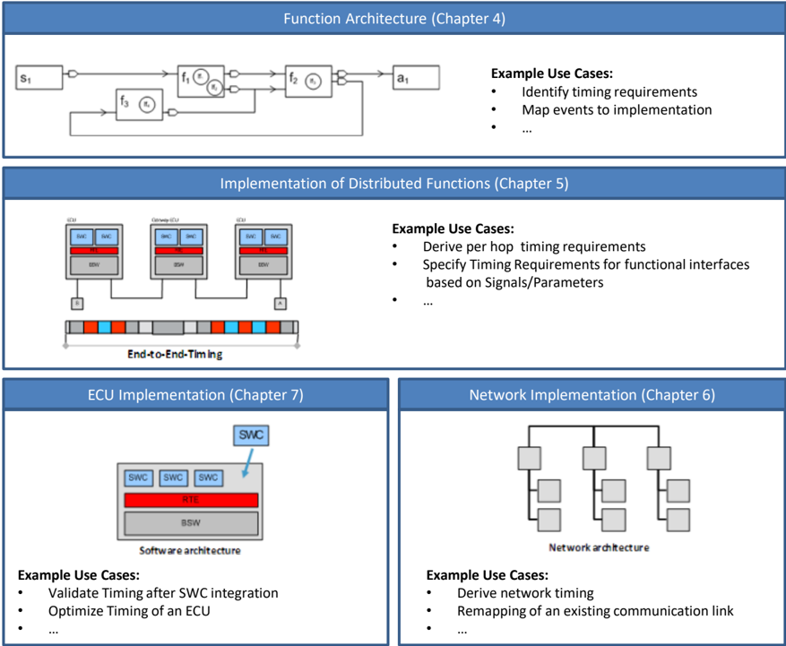

### 1.2. 概述

AUTOSAR 时序分析方法论分为以下几个部分：

- 时序需求的分解
- 功能层级的时序分析
- 分布式功能的端到端时序分析
- 网络层级的时序分析
- ECU 层级的时序分析
- 用于时序分析的时序属性与方法

每一部分都基于若干典型的现实世界用例给出所建议的方法论。所有用例的完整概览见第 [1.9](#19-用例) 节。

### 1.3. 动机

功能数量的不断增加、E/E 架构复杂性的不断提高以及由此对 ECU 和通信网络提出的各项要求，意味着开发过程所面临的要求也在不断提高。开发过程的一个核心环节是设计健壮且可扩展的 ECU 和网络架构。

在 ECU 的开发中，复杂性来自多个 SW-C（构成各种功能）在可调度的任务中执行的集成。由于任务调度依赖于处理核心和存储器等共享资源，任务调度的设计与验证变得困难。

在网络层级，CAN、LIN、FlexRay、MOST 和以太网等异构网络类型被同时使用。这使得健壮性难以保证，尤其是当需要通过网关在协议之间进行路由时。设计一个高效且健壮的网络架构与配置越来越困难，这就需要一种系统化的方法。

这些方面必须在 E/E 开发过程中一并处理，同时还有关于质量、可测试性、执行诊断服务的能力等额外要求。总体目标是在跨越多个车辆等级的可扩展性要求下，以最优成本实现足够的可靠性与性能。为了在车辆的生命周期内支持附加功能的集成，E/E 架构的可扩展性也非常重要。

为了在 E/E 架构及其组件的开发过程中做出最优的技术决策，需要有合适的标准来判断如何实现一个功能。

当前 E/E 架构开发中最重要的标准之一就是时序。许多功能由于安全要求而是时间关键的；另一些功能具有一定的时序要求以保证高质量的（客户）功能。这些功能往往有确定的延迟与抖动约束。对于分布式功能，这些约束由若干段组成，其中 ECU 与网络是两大类别。为了规定和分析这些时序需求，功能时序链十分重要，第 [3](#3-设计层级上的时序需求) 章将对此进行更详细的描述。

### 1.4. 示例

图 1.2 所示的主动转向系统以一个真实的 AUTOSAR 经典平台（**CP**）示例演示了端到端时序约束。该系统由传感器、ECU、总线和执行器组成。功能开发者借助车辆动力学模型和主动转向功能，为图中所示链条定义了最大反应时间：30 ms。这成为该系统的顶层端到端时序需求。

随后该时序需求被分解，即被切分为更小的份额 T1...T5，系统的每个组件一份。显然，ECU 和总线要处理许多各自带有时序需求的不同功能，它们都要竞争网络与计算资源。在带有任务/中断及其 runnable 的 ECU 上，顶层时序需求被进一步分解为更细粒度的时序需求，资源竞争也在更低的层级上继续。

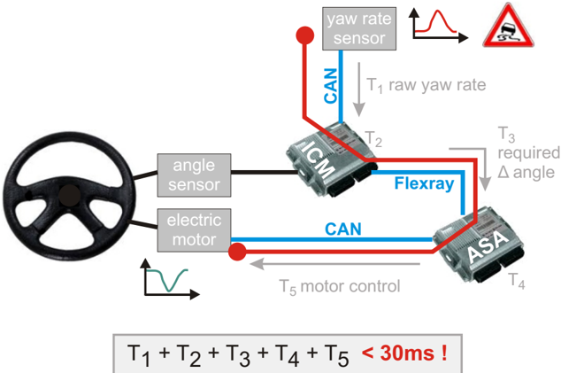

在本示例中，嵌入式软件的开发独立于其在具体 ECU（即图 1.2 中的 ICM 与 ASA）上的后续部署。首先定义系统应覆盖的功能，随后将其转化为软件架构。表示该主动转向示例的一种可能的 AUTOSAR 软件架构见图 1.3。

该示例由七个通过发送者-接收者（**sender-receiver**）端口通信的 AUTOSAR 软件组件组成。首先，系统采集关于车辆和环境的数据，例如车速、转向角和环境扰动（如横摆角速度）。这些信息被提供给运动仲裁器（**motion arbiter**），由其评估态势并据此推导车辆执行器的后续动作。根据输入数据，可以向其他组件发送减速命令、加速请求和/或更新后的转向方向。

被执行的命令直接影响轮速与转向角，从而对驾驶程序（操纵量）和环境扰动（例如横摆角速度）形成控制。总体上，软件、硬件与环境构成一个反馈控制系统。AUTOSAR 经典平台正是专门面向这样的硬实时系统。

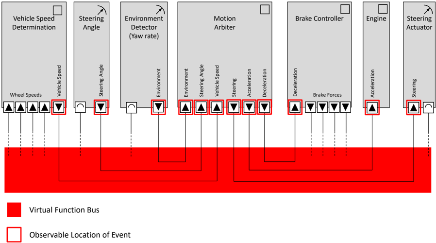

当考虑现代辅助驾驶功能时，上述示例可以扩展：增加一个利用计算机视觉识别障碍物并引导转向绕开它们的防碰撞系统。从摄像头图像中识别物体并规划合适的避让轨迹是对计算能力要求很高的任务，仅用 AUTOSAR CP 实现非常困难。这类应用正是 AUTOSAR 自适应平台（**AP**）的目标场景。该扩展为系统增加了第二个顶层端到端时序需求：防碰撞系统需要识别障碍物及其周围的可行路径、规划合适的轨迹，并足够快地向 ASA 发出所需的角度命令以避免碰撞。

基于 ISO 3888-2 规避操作（图 1.4），这形成了 TA1-TA2-TA3-T4-T5 的分解，其中 TAx 组件位于 AP 域中（见图 1.5）。在 14 m/s（约 50 km/h）下，TA1...TA3 为物体检测、轨迹规划以及把第一次所需的角度调整传达给 ASA 预算 860 ms（50 km/h 下 12 m）。T4+T5 的时长要求为 10 ms，其依据是最大安全转向梯度和车辆动力学，以便在 13.5 m 的纵向移动内满足 ISO 3888-2 的变道要求。注意 CP 与 AP 两项需求共享相同的 T4 与 T5，因为两个控制回路共享同一条执行器路径。

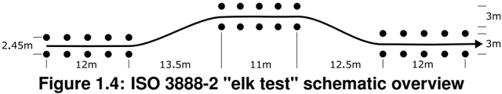

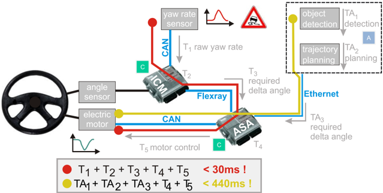

表示该扩展主动转向示例的一种可能的 AUTOSAR 软件架构见图 1.6。关于 AUTOSAR CP 与 AP ECU 集成的更深入讨论见《自适应平台设计说明》 [\[3\]](#ref-3)。

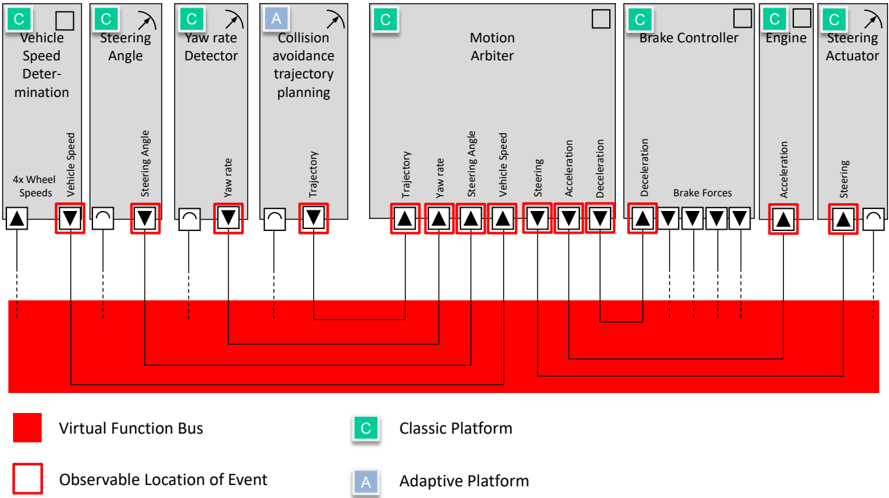

### 1.5. 范围

本文档描述如何在 E/E 系统的开发过程中实施时序分析。与 [\[1\]](#ref-1) 类似，它并不包含完整的过程描述，而是一组用于定义时序需求以及确保满足这些需求的实用方法。如 [\[1\]](#ref-1) 所述，该方法论的设计覆盖了各类 AUTOSAR 利益相关方的需要：

- 组织（**Organizations**）：方法论以模块化的格式建模，使组织能够对其加以裁剪并组合进自己的内部流程，同时识别与其他组织交互的节点。
- 工程师（**Engineers**）：方法论的范围设定使不同角色的工程师能够快速找到与其具体需求相关的 AUTOSAR 信息。
- 工具供应商（**Tool Vendors**）：方法论为所有 AUTOSAR 成员提供一门共同的语言，并对工具应具备的能力给出共同预期。

**本文涉及的主题：**

- 为 AUTOSAR 开发过程的所有阶段定义合适的时序分析方法及相关时序属性，且不泄露公司机密信息。
- 定义对时序分析方法的要求，以便实现合适的工具。
- 通过相关用例记录时序分析领域（网络与 ECU/软件）的相关经验。
- 围绕用例组织时序任务、时序属性及相关方法。
- 时序作为 OEM 与 tier1 在功能层级高效协作的赋能手段。

**边界界定：**

- 本文档的内容与 AUTOSAR 时序扩展 [\[2\]](#ref-2) 的内容互补、不重叠
- 定义用于记录时序属性的元模型（例如 AUTOSAR TIMEX）
- 定义 AUTOSAR 中特定 SW-C 或功能的时序行为

### 1.6. 缩略语和缩写

表1.1：缩略语和缩写（**Acronyms and Abbreviations**）

| 缩略语 | 含义 |
|---|---|
| ASA | Active Steering Actuator（主动转向执行器） |
| AUTOSAR | AUTomotive Open System ARchitecture |
| BSW | Basic Software（基础软件） |
| CAN | Controller Area Network（控制器局域网） |
| COM | Communication module（通信模块） |
| CPU | Central Processing Unit（中央处理单元） |
| DES | Discrete Event Simulation（离散事件仿真） |
| E2E | End to end（端到端） |
| ECU | Electrical Control Unit（电子控制单元） |
| ICM | Integrated Chassis Management（整合式底盘管理） |
| ID | Identifier（标识符） |
| I/O | Input/Output（输入/输出） |
| LIN | Local Interconnect Network（局域互联网络） |
| NW | Network（网络） |
| PIL | Processor-In-The-Loop（处理器在环） |
| PDU | Protocol Data Unit（协议数据单元） |
| RE | Runnable Entities（可运行实体） |
| RTE | Runtime Environment（运行时环境） |
| SW-C | Software Component（软件组件） |
| SPEM | Software Process Engineering Meta-Model（软件过程工程元模型） |
| TD | Timing Description（时序描述） |
| TIMEX | AUTOSAR Timing Extensions [\[2\]](#ref-2)（AUTOSAR 时序扩展） |
| UC | Use-Case（用例） |
| UML | Unified Modeling Language（统一建模语言） |
| WCET | Worst case execution time（最坏情况执行时间） |
| WCRT | Worst case response time（最坏情况响应时间） |
| VFB | Virtual Functional Bus（虚拟功能总线） |

### 1.7. 术语表

表1.2：术语表（**Glossary of Terms**）

| 术语 | 同义词 | 定义 |
|---|---|---|
| 事件触发帧（**Event-triggered Frame**） | Sporadic Frame | 由应用触发、独立于通信调度发送的帧。事件触发的发送受去抖时间（**debounce time**）限制，该时间规定两次出现之间允许的最短时间间隔。 |
| 精度（**Accuracy**） | | 精度是与真实值的接近程度。对时序属性的最坏情况而言，它描述最大高估量。 |
| 因果链（**Cause-Effect Chain**） | | 因果链通过把消费者组件的读事件与生产者组件相应的写事件相关联，表示通信组件之间的数据流。 |
| 执行时间（**Execution Time**） | | 执行时间是函数为完成其工作而需要占用资源的总时间。 |
| 事件链（**Event Chain**） | | 事件链描述一组功能上相关的时序事件的因果顺序（见 [\[2\]](#ref-2) 中的 TimingDescriptionEventChain）。 |
| 帧（**Frame**） | Message | 帧是经由通信介质发送的数据包。该元素描述在信道上发送的数据结构（OSI 第 2 层），例如 CAN 与 FlexRay 上的帧。常用同义词为「消息（**message**）」。 |
| 超周期（**Hyperperiod**） | | 超周期是系统中所有周期的最小公倍数。 |
| 信息包（**Information Packages**） | | 资源上最小的可传输信息单元（例如帧）。 |
| 互联 LET（**Interconnect LET**） | | 参见第 [8.1](#81-系统层级逻辑执行时间的基本概念) 节。 |
| 中断负载（**Interrupt Load**） | | CPU 用于服务中断的负载。 |
| LET 任务（**LET Task**） | | 参见第 [8.1](#81-系统层级逻辑执行时间的基本概念) 节。 |
| 负载（**Load**） | Utilization | 负载是资源被使用的总时间份额。请注意在本文档的上下文中，负载与利用率（**utilization**）作为同义词使用。本文档不考虑「等待资源可用的用户数」意义上的负载。 |
| 日志（**Logging**） | | 日志是软件提供任意的、未必相关的信息性数据的活动。日志收集信息以理解真实系统上运行的一个或多个程序的行为。与追踪（**Tracing**）相反，其重点在于收集由软件开发者在源代码层级显式添加的信息。根据请求的日志级别，日志可能对系统的时序和/或负载产生影响，后续分析必须考虑这一点。示例：错误日志、Printf 输出、ara::log。 |
| 周期（**Period**） | | 同一帧（网络）或任务（ECU）两次激活事件之间的时间间隔。 |
| 响应时间（**Response Time**） | Latency | 响应时间是从事件出现到其被处理之间的时间。例如：从消息的发送请求到其被接收之间的时间，或从函数激活到其完成之间的时间。 |
| 可调度实体（**Schedulable Entity**） | | 可调度实体定义了一种可以在 CPU 或网络资源上占用时间的执行。执行顺序由调度算法决定。可调度实体的例子有任务、进程和帧。 |
| 填充位（**Stuff Bit**） | | 在 CAN 帧中，每连续五个同极性位之后插入一个相反极性的位。 |
| 系统参数（**System Parameter**） | | 影响系统时序行为的量。 |
| 时序任务（**Timing Task**） | | 完成特定目标的一系列步骤（见第 [9](#9-用于时序分析的属性与方法) 章「时序任务的描述」）。 |
| 时序约束（**Timing Constraint**） | | 时序约束可以有两种不同的解释。一方面，它可以定义对系统时序行为的限制（例如某个事件序列的最小（最大）延迟界限）；此时时序约束是系统必须满足的需求。另一方面，时序约束可以定义对系统时序行为的保证；此时系统开发者保证系统在时序上具有某种行为（例如保证某个时序事件以某个最大变化周期性地出现）。对照 AUTOSAR 时序扩展 [\[2\]](#ref-2)。 |
| 时序方法（**Timing Method**） | Technique | 定义一组有序的步骤，以推导特定的时序相关工作产品（例如时序属性、时序模型）。 |
| 时序模型（**Timing Model**） | | 时序模型把所有相关的时序信息收集到一个地方，通常基于工具。该模型可用于描述时序行为，也可用于生成时序相关的配置文件。 |
| 时序属性（**Timing Property**） | | 时序属性定义系统内时序相关方面的状态或取值（例如 RunnableEntity 的执行时间界限或任务的优先级）。因此，属性并不表示对系统的约束，而是以某种方式采集（例如测量、估计或确定）或定义的系统属性。 |
| 追踪（**Tracing**） | | 追踪是通过观察真实系统、在一定时间段内记录运行时信息的活动。追踪随时间收集所选类型的事件，并把信息持久地存储在所谓的「追踪缓冲区（**trace buffer**）」中。为了进行正确的时序测量，事件可以连同时间戳一起存储。根据追踪方法的不同，追踪缓冲区可以在板上（**on-board**）或板下（**off-board**）。根据追踪方法的不同，追踪可能对系统时序产生影响，也可能没有；如果有，进一步分析时必须加以考虑。记录可以通过软件方案（例如代码插桩）、硬件辅助方案（例如 CPU 指令流追踪、以太网嗅探器）或它们的组合完成。追踪缓冲区可以离线分析与可视化，提供关于系统内部行为的信息。示例：ARTI、VFB Tracing、L&T。 |
| 用例（**Use-case**） | Scenario | 典型问题，分解为任务。 |
| 最坏情况（**Worst case**） | | 术语「最坏情况」表示某个属性在运行期间可能取到的任何值的上界。它通常不同于、且绝不会小于在实际系统中观察到的最大值。最坏情况值通常基于系统模型用静态分析推导。 |
| 工作产品（**Work Product**） | | 见 SPEM [\[4\]](#ref-4)。 |

### 1.8. 限制

AUTOSAR 自适应平台的关键特性之一是适应性（**adaptability**）。应用可以动态地启动和停止；已有应用可以更新，甚至可以通过 OTA 安装新应用。这导致运行条件可能快速且不可预测地变化，不再可能对所有可能的运行条件预测并分析其时序。

目前本文档的范围限于对交付之前的一个已知系统进行分析与设计。未来的扩展将覆盖对由 AUTOSAR 自适应平台的适应性引入的高度不确定性系统进行时序分析的可能性。

### 1.9. 用例

为了展示时序分析方法论的所建议用法，文档中包含若干现实世界的用例。

用例按照与各章节相同的结构划分为以下类别：

- 功能层级的时序分析（第 [4](#4-功能层级的时序) 章）
- 分布式功能的端到端时序分析（ECU 与网络层级之间的接口）（第 [5](#5-分布式功能的端到端时序) 章）
- 网络层级的时序分析（第 [6](#6-网络的时序) 章）
- ECU 层级的时序分析（第 [7](#7-ecu-层级软件集成的时序) 章）

表1.3：本文档中所有用例的清单（**List of all use-cases in this document**）

| 章节 | 用例 |
|---|---|
| 4.2 | 功能层级用例概览 |
| 5.2 | 端到端用例概览 |
| 6.2 | 网络用例概览 |
| 7.3 | ECU 用例概览 |

### 1.10. 方法论角色

本节介绍能够从本文档所述方法的知识中受益、并将在时序分析方法论中使用的角色。

表1.4：ECU 集成器（**ECU Integrator**）

| 属性 | 值 |
|---|---|
| 角色 | ECU Integrator |
| 包 | AUTOSAR Root::M2::Methodology::Methodology Library::Common Elements::Roles |
| 简要描述 | 集成 ECU 上的完整软件。 |
| 描述 | 集成 ECU 上的完整软件，包括生成必要的代码以及完成所有软件组件和基础软件模块的配置。 |
| 收益 | 获得关于如何定义（与功能相关的）标准化时序需求以及如何验证它们的信息。 |
| 关系类型 | 相关元素 / 多重性 / 备注 |
| 执行 | TBC / 1 / n.A. |

表1.5：E/E 架构师（**E/E Architect**）

| 属性 | 值 |
|---|---|
| 角色 | E/E Architect |
| 包 | 尚不在 AUTOSAR 方法论中。是 AUTOSAR System Engineer 角色的一部分。 |
| 简要描述 | 定义 E/E 拓扑。 |
| 描述 | 定义 E/E 拓扑。 |
| 收益 | 获得关于如何在时序需求（资源与时序预算，高层）下评估 E/E 架构时序质量的信息。 |
| 关系类型 | 相关元素 / 多重性 / 备注 |
| 执行 | TBC / 1 |

表1.6：功能架构师（**Function Architect**）

| 属性 | 值 |
|---|---|
| 角色 | Function Architect |
| 包 | 尚不在 AUTOSAR 方法论中。 |
| 简要描述 | 为功能定义（高层的）时序需求。 |
| 描述 | 为功能定义（高层的）时序需求。 |
| 收益 | 获得关于如何定义（与功能相关的）标准化时序需求以及如何验证它们的信息。 |
| 关系类型 | 相关元素 / 多重性 / 备注 |
| 执行 | TBC / 1 / n.A. |

表1.7：功能工程师（**Function Engineer**）

| 属性 | 值 |
|---|---|
| 角色 | Function Engineer |
| 包 | 尚不在 AUTOSAR 方法论中。必须从 AUTOSAR System Engineer 角色改编而来。 |
| 简要描述 | 定义并分解时序需求。 |
| 描述 | 在系统层级定义时序需求，把 E2E 时序需求分解为局部时序需求，确定功能的可实现方式及传输数据的内容，进行划分。 |
| 收益 | 在正确实现与测试的前提下，获得关于如何定义、细化与分解与功能、E2E 等相关的时序需求的信息，并能推断把一个子系统集成到车辆中的影响。 |
| 关系类型 | 相关元素 / 多重性 / 备注 |
| 执行 | TBC / 1 / n.A. |

表1.8：网络数据工程师（**Network Data Engineer**）

| 属性 | 值 |
|---|---|
| 角色 | Network Data Engineer |
| 包 | 尚不在 AUTOSAR 方法论中。 |
| 简要描述 | 定义通信矩阵、帧、PDU、触发、网络管理、路由矩阵、内容 → 数据。 |
| 描述 | 定义通信矩阵、帧、PDU、触发、网络管理、路由矩阵、内容 → 数据。 |
| 收益 | 获得关于在时序与资源方面把功能架构映射到网络上通信矩阵的信息（用例见第 [4](#4-功能层级的时序) 章）。 |
| 关系类型 | 相关元素 / 多重性 / 备注 |
| 执行 | TBC / 1 / n.A. |

表1.9：软件架构师（**Software Architect**）

| 属性 | 值 |
|---|---|
| 角色 | Software Architect |
| 包 | 尚不在 AUTOSAR 方法论中。 |
| 简要描述 | 把时序需求细化到软件实现层级，把时序需求分解到实现。 |
| 描述 | 把时序需求细化到软件实现层级，把时序需求分解到实现。 |
| 收益 | 学习在把 runnable 映射到任务时如何考虑时序、如何对 SW-C 使用时间预算。 |
| 关系类型 | 相关元素 / 多重性 / 备注 |
| 执行 | TBC / 1 / n.A. |

表1.10：软件组件开发者（**Software Component Developer**）

| 属性 | 值 |
|---|---|
| 角色 | Software Component Developer |
| 包 | AUTOSAR Root::M2::Methodology::Methodology Library::Common Elements::Roles |
| 简要描述 | 软件组件代码的开发者。 |
| 描述 | 开发 SW-C 的内部行为，即执行 SW-C 功能的代码。他遵守与其他 SW-C 的接口，并了解其所设计功能的功能与时序需求。 |
| 收益 | 了解为开发 SW-C 内部行为而给出的需求有何用途。凭借这些知识，他可以更便于验证地开发代码并识别需求冲突。利用其系统知识，他可以完善需求集合并咨询其他角色。 |
| 关系类型 | 相关元素 / 多重性 / 备注 |
| 执行 | TBC / 1 / n.A. |

表1.11：测试工程师（**Test Engineer**）

| 属性 | 值 |
|---|---|
| 角色 | Test Engineer |
| 包 | 尚不在 AUTOSAR 方法论中。 |
| 简要描述 | 执行测量与时序相关测试。 |
| 描述 | 执行测量与时序相关测试。 |
| 收益 | 获得关于如何在系统上执行时序分析与验证的信息，以及关于方法与属性的信息。 |
| 关系类型 | 相关元素 / 多重性 / 备注 |
| 执行 | TBC / 1 / n.A. |

表1.12：时序工程师（**Timing Engineer**）

| 属性 | 值 |
|---|---|
| 角色 | Timing Engineer |
| 包 | 尚不在 AUTOSAR 方法论中。 |
| 简要描述 | 执行时序分析与验证。 |
| 描述 | 创建时序模型，执行时序分析，对照时序约束证明时序结果（使用相应的工具、模型）。 |
| 收益 | 获得关于如何对系统建模、以及如何（使用不同方法）在模型上执行时序分析与验证的信息。 |
| 关系类型 | 相关元素 / 多重性 / 备注 |
| 执行 | TBC / 1 / n.A. |

### 1.11. 文档结构与章节概览

本节给出文档及各章节内容的概览。图 1.1 展示了时序分析的各个方面，并标出了处理这些方面的章节。为了体现其在真实系统中的相关性，每个方面都基于一个或多个典型用例来描述，这些用例与第 [1.10](#110-方法论角色) 章中的方法论角色相关联。这些用例又被拆分为更小的时序任务。针对其中每个任务，给出所需的时序属性及相应的时序方法。它们用于验证相应用例的典型时序与性能约束。

第 [1](#1-简介) 章「简介」包含目标、动机、文档范围、缩略语与术语表。此外，第 [1.9](#19-用例) 节包含用例清单。

第 [2](#2-时序的基本概念) 章「时序的基本概念」给出时序分析的一般概览，并介绍相关的元素与概念。

第 [3](#3-设计层级上的时序需求) 章「设计层级上的时序需求」简要介绍把功能时序需求从抽象的用户视角分解到 AUTOSAR 时序扩展的实现视角的挑战。其中介绍了问题定义、不同的方法路径以及方法论解决方案的概念。

第 [4](#4-功能层级的时序) 章「功能层级的时序」描述功能层级上系统功能分析与设计的时序相关用例。一些用例覆盖开发早期阶段的高层时序，另一些则处理从功能层级到实现层级的过渡。本章面向 E/E 架构师与功能架构师。

第 [5](#5-分布式功能的端到端时序) 章「分布式功能的端到端时序」介绍对分布式功能进行端到端时序推理的技术与方法。分布式功能可以由一个使用分布式来源数据（例如传感器数据）的本地执行功能组成，计算本身也可以是分布式的。典型的约束是延迟、周期与数据年龄。本章面向 E/E 架构师、功能架构师与功能工程师。

第 [6](#6-网络的时序) 章「网络的时序」包含在网络层级应用时序分析的用例，覆盖扩展既有网络、设计新网络或对既有网络架构重新设计/重新配置等场景。本章主要面向网络数据工程师与 ECU 集成器。

第 [7](#7-ecu-层级软件集成的时序) 章「ECU 层级软件集成的时序」包含在 ECU 层级应用时序分析的用例。本章覆盖抽象层级不同的若干用例，涵盖从创建整个 ECU 的时序模型到时序优化的完整 ECU 开发工作流。每个用例都链接了相应的方法与时序属性。本章主要面向软件架构师与 ECU 集成器。

第 [9](#9-用于时序分析的属性与方法) 章「用于时序分析的属性与方法」覆盖从用例派生的时序任务、时序属性与方法。每个方法都详细呈现，包括其分类、描述、与用例的关系、需求、时序属性、输入、边界条件及其实现。一些方法输出时序属性，可以借助于时序约束进行评估以检查时序需求是否得到满足。每个时序属性都以其分类、描述、与用例的关系、需求、时序方法、格式、（有效）范围和实现来刻画。方法可分为三大类：仿真、解析计算与测量；属性可分为两大类：延迟类与带宽类。本章给出单个方法与单个时序属性之间关系的概览，也概述两者之间的交互。

第 [10](#10-用于时序分析的工件) 章「用于时序分析的工件」汇集来自用例的工件（例如时序任务、工作产品）。此外还描述了时序模型的公共元素和时序相关的工作产品。

## 2. 时序的基本概念

### 2.1. 时序需求与抽象层级

上一节描述的时序属性必须在规格说明和设计的整个过程中加以考虑。在规格说明阶段，这些时序属性被表达为对系统功能的时序需求，并在系统规格说明和设计阶段被分解。为了完成这种分解，最好遵循一些方法论原则。本文档后续章节将通过用例的描述更详细地介绍这些原则。本节给出本文档所考虑的主要时序抽象层级的定义，并给出在这些抽象层级之间应用时序需求分解的一些初步规则。

#### 2.1.1. 时序抽象层级

在本文档中，我们将考虑以下主要时序抽象层级，它们对应于平台的不同抽象程度：

- 功能层级（**Functional Level**） 该抽象层级超出 AUTOSAR 建模范围，但对于从早期规格说明阶段捕获时序需求至关重要。它由系统功能的一个抽象架构组成。
- 抽象平台层级（**Abstract Platform Level**） 该抽象层级在 AUTOSAR 建模范围之内。它由抽象组件架构的描述组成。这些组件与平台无关，可以映射到任何具体平台（AUTOSAR 或非 AUTOSAR 平台）。
- 具体平台层级（**Concrete Platform Level**） 在 AUTOSAR 范围内，该抽象层级对应经典平台或自适应平台，也可以对应非 AUTOSAR 的具体平台（例如 COVESA）。

时序需求分解在这些抽象层级之间必须保持一致。为确保这种一致性，应遵循一组最基本的准则。在这些准则中，重要的是区分分解（**decomposition**）与变换（**transformation**）这两个概念。

#### 2.1.2. 分解与变换的链接

在本文档中，我们将考虑两种转换：变换与分解。它们用于以下上下文和定义。

- 分解（**Decomposition**） 分解是指在给定的抽象层级上（功能层级、抽象平台层级或具体平台层级）拆分一个组件或一个时序需求（更一般地，一个工件）。分解是设计决策或组织决策的结果。
- 变换（**Transformation**） 变换是一种映射。它基于一组规则，描述如何把一个（或多个）源概念转换为一个（或多个）目标概念。在本文档中，我们认为变换用于不同抽象层级之间（例如从功能层级到抽象平台层级的变换，或从抽象平台层级到具体平台层级的变换）。一旦映射规则被定义，变换就可以自动化，例如通过在下层创建元素。

为了简化抽象层级之间的过渡并确保时序需求分解的一致性，建议遵循以下准则：

- 不同抽象层级之间的过渡通过变换完成，且该变换应实现一一映射（应避免一对多或多对一的概念映射）。
- 前一条准则的推论是：分解在给定的抽象层级上进行（应避免在抽象层级之间的过渡过程中进行分解）。

以下示例展示了这些准则，其中给出了从功能层级描述向下到 AUTOSAR 经典平台和自适应平台描述的分解与变换链条。

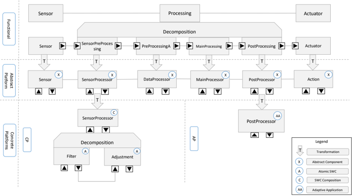

### 2.2. 实时架构的基本概念

#### 2.2.1. 实时架构定义

E/E 架构是早期设计决策的结果，这些决策是在一组利益相关方能够协作构建系统之前所必需的。架构定义了系统的组成成分（例如组件、子系统、ECU、功能、编译单元……）以及它们之间的相关关系（例如「调用」「向……发送数据」「与……同步」「使用」「依赖」……）。除了上述结构方面之外，实时架构还应提供满足时序需求的方法。与系统的组成成分一样，实时架构设计包括分解时序需求并识别它们之间的关系（例如细化与可追溯性）。事实上，时序需求的分解是结构分解的结果，时序需求部分地被分解后的单元继承。然而，结构分解可以由功能考量、输入/输出数据流和/或提供/所需服务驱动，而时序分解是一项更复杂的任务。正确的时序需求分解必须在局部和全局都可行。在局部，每个子组件的时序属性必须满足分配给它的时序需求。实时软件架构的设计在于找到一种功能分解和平台配置，其时序属性能够满足局部和全局时序需求。

时序属性高度依赖底层的软硬件平台资源。此外，分解后的单元对共享平台资源的访问会引入一些开销（例如阻塞时间或干扰……）。时序属性将取决于：

- 所选择的部署（例如把功能块分配到设备上、把设备连接到网络）；
- 所选择的划分（例如把实体分配（拆分/分组）到可调度实体）；
- 所选择的调度（例如可调度实体的优先级分配或共享资源访问协议）。

为了评估这些架构选择在时序需求方面的表现，需要进行时序分析。用于此类评估的分析方法和相关时序属性可能取决于所考虑的实时架构类型（例如时间触发或事件触发架构）。第 [9](#9-用于时序分析的属性与方法) 章将详细讨论这一方面。时序分析可以在系统层级引入，作为系统功能向其实现细化过程的预测工具 [\[5\]](#ref-5)。尽管在开发早期阶段进行时序分析需要对实现平台的资源做出假设，但它为时序需求的分解与细化提供了可靠的指导。

从应用的角度来看，以下两个时序属性尤为重要：

- 执行时间与传输时间；
- 响应时间。

下面对这些术语做初步介绍。第 [9](#9-用于时序分析的属性与方法) 章将对这些概念提供更详细的描述与分类。

#### 2.2.2. 执行时间与传输时间

可调度实体（**schedulable entity**）的执行时间是该可调度实体在计算资源（例如 ECU）上完成其执行所耗费的时长。当我们谈到执行时间时，指的是净执行时间（**net execution time**），即只包含可调度实体实际在计算资源上执行的时长。不包括它可能因共享同一计算资源的其他可调度实体而被挂起或抢占的时间，也不包括在启动或恢复可调度实体执行时准备计算资源所需的建立时间。

类似地，信号/消息/帧在通信资源（例如总线、网络）上的传输时间（**transmission time**）是该信号/消息/帧从其源移动到其目的地所耗费的时长，不考虑在同一通信资源上传输的其他信号/消息/帧。

执行/传输时间是一个定量属性，可以用以下特征来描述：

- 统计量化词（worst、best、mean/average），表示执行/传输时间的界限。该界限可以是上界，对应最坏情况执行/传输时间（**WCET/WCTT**）；可以是下界，对应最好情况执行/传输时间（**BCET/BCTT**）；也可以是对性能分析有用的平均情况执行/传输时间（**ACET/ACTT**）。在这三个量化词中，WCET 最常用于实时系统时序属性的验证/确认。
- 方法（估计（例如仿真）、测量、计算（静态分析）），表示获得执行/传输时间的方式。执行时间的精度高度依赖其来源。例如，用于测量的输入数据会触发函数/程序的特定分支，从而影响测量到的执行时间值。因此，测量只能提供平均执行时间或执行时间的分布。为了获得执行时间上界，需要采用静态分析技术（抽象解释、模型检查等）。
- 精度（**Accuracy**，见术语表）。评估出的 WCET/WCTT 的精度取决于许多因素，其中包括软件的细节层级（指令层级）以及执行/通信资源的细节层级（如缓存机制）。后者可能带来不可预测的因素，例如分支预测机制，它们会使 WCET 分析更难完成并且过于悲观。为了避免对执行平台的过度设计，并为了支持准确的响应时间分析（见下一小节），WCET/WCTT 分析应提供安全但准确的 WCET/WCTT。

有时 WCET/WCTT 本身就是要满足的需求，尤其是在 ECU、网络和部署都已固定的非常低的抽象层级。然而，在非常高的抽象层级，时序需求通常指的是下一小节定义的端到端响应时间界限。

#### 2.2.3. 响应时间

可调度实体的响应时间（**response time**）是该可调度实体完成其执行所耗费的时长。与执行时间不同，响应时间考虑共享同一执行/通信资源的其他可调度实体。因此，可调度实体的响应时间由其执行时间和由对共享资源的并发访问引发的附加项（阻塞时间、抖动等）组成。更多细节见第 [9](#9-用于时序分析的属性与方法) 章。

端到端响应时间（**end-to-end response time**）是涉及多个可调度实体的响应时间。这些可调度实体构成一条链。链的第一个可调度实体称为源可调度实体（**source schedulable entity**），最后一个称为汇可调度实体（**sink schedulable entity**）。端到端响应时间是从链的执行开始直到汇可调度实体终止其执行所经过的时间。

与执行时间一样，响应时间是一个定量属性，可以用以下特征描述：

- 统计量化词（worst、best 和 mean/average）。最坏情况响应时间（**WCRT**）是时序分析通常计算的上界，用于评估时序需求的满足情况。统计量化词的更详细定义见第 [9](#9-用于时序分析的属性与方法) 章。
- 方法（估计、测量、计算（静态分析）），表示获得响应时间的方式。响应时间的确定方法见第 [9](#9-用于时序分析的属性与方法) 章。
- 精度（见术语表）。WCRT 的精度高度依赖链中涉及的可执行实体的最坏情况执行时间的精度。

### 2.3. 时序与数据流的关系

实时系统的功能行为不仅会受其端到端时序行为的影响，也会受其内部数据流的影响。因果链（**cause-effect chain**）通过把消费者组件的读事件与生产者组件相应的写事件相关联，表示通信组件之间的数据流。根据抽象层级的不同，组件可以是功能块、软件组件或可调度实体。

需要指出的是，这里观察的具体数据流是在作业（**job**）层级上的。以图 2.2 为例。它展示了三个周期性实时任务（可调度实体）的因果链。可调度实体的不同执行实例称为作业（**job**）。在隐式通信下，每个作业在其执行开始时读取输入，基于该数据执行，并在完成后写出（发布）结果。这一行为对每个作业都不同，因为可调度实体的物理执行时间受多种因素影响。典型原因有：输入数据、执行周期、硬件平台和调度设计。作业层级上的每个依赖关系都覆盖在因果链中（它可以表示为因果链的一个「实例」）。在图 2.2 的给定示例中，每个 20 ms 超周期内 5 ms 任务的每第三个作业可能从不同的生产者作业读取数据，这取决于因果链中先前作业的响应时间。因此，数据流不是确定性的。

一般性说明：AUTOSAR 中的事件链（ [\[2\]](#ref-2) 中的 TimingDescriptionEventChain）用于规定两个时序事件之间的因果关系。例如「事件 BrakeActuated 发生，当且仅当事件 BrakePedalPressed 在此前发生」。这不是在作业层级上完成的，但允许对关系施加约束，例如延迟约束。

![图 2.2：执行时间变化导致的数据流确定性缺失 [\[6\]](#ref-6)（Missing data-flow determinism due to execution time variations）](Figure2-2.png)

数据流需要描述到何种具体程度取决于要实现的功能。对于某些功能，知道传感器值会在给定期限内被处理就足够了；而更复杂的功能包含分叉点（**fork**）与汇合点（**join**），需要组合不同的输入数据。图 2.3 给出一个示例。它展示了感知与物体检测管线的粗粒度功能模型。不同类型的传感器被周期性触发，同时部分处理以流水线方式进行。前摄与后摄摄像头的图像通过图像拼接组合生成 360° 图像。激光雷达（**Lidar**）数据可以分为地面点（静态物体，如道路、树木或建筑物）和非地面点（移动物体，如车辆、行人……）。非地面点可以用于定义感兴趣区域（**ROI**），基于图像的分类可以在其中提供关于物体类型的附加信息。这些移动物体随后在环境模型中被跟踪。

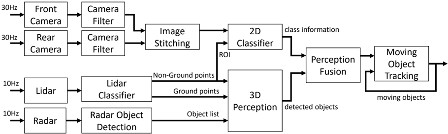

问题在于如何规定该模型内的数据流。一种方法是把时间预算规定为每个处理管线的上界延迟。这并不能保证确定性的数据流，因为抖动会在每条管线路径中独立传播。因此，待组合的不同输入的相对数据年龄（**relative data age**）是变化的。当一条路径出现最坏情况延迟而另一条路径出现最好情况延迟时，这种数据年龄的分散（**data-age dispersion**）就会成为问题。因此，相对数据年龄的下界和上界可以通过比较两条因果链的最好和最坏情况延迟来计算。虽然这种行为对某些功能可能已经足够，但它是有问题的，原因如下：

1. 各个因果链的延迟很可能超过链起始处的采样周期。因此，大的数据年龄分散意味着汇合点组合的是来自不同采样时刻的样本。
2. 数据年龄分散是不同因果链延迟的结果，而后者是实现与运行时抖动的结果，无法先验确定。这样的规格说明对于需要表达「功能块的两个输入具有相同的数据年龄，即源自同一输入样本」这一需求的用例是有益的。特别是当因果链数量较多时，由于分散不仅取决于最长延迟、还取决于最短延迟，这将变得不直观。
3. 每条因果链的行为依赖于具体实现，并且可能随每次修改而改变。特别是因果链延迟之间的相关性是特定实现的结果，无法在模型中覆盖。

一旦因果链包含环路（例如移动物体的跟踪），该问题会被放大。把源自不确定数据年龄分散的输出数据样本再次与具有不确定数据年龄分散的新输入数据组合，会累积非确定性。

有多种选项可以进一步约束这样的模型以减少非确定性。第一个重要方面是定义通信语义与执行顺序约束。针对图 2.3 的模型，可以提出以下问题：

1. 两个组件之间边的通信语义是什么？它意味着：
   1. FIFO 语义：缓冲，可选地带最大队列长度（非破坏性写、破坏性读）？
   2. 寄存器语义：只有最新的数据样本可用且可被多次读取（破坏性写、非破坏性读）？
   3. 其他语义，例如破坏性写/破坏性读或后进先出（栈）？哪种适用取决于预期的功能。
2. 组件何时被激活：
   1. 基于时间、以给定的周期与偏移？
   2. 基于事件，以及基于何种事件？某个特定的触发输入，还是当所有输入数据可用时，还是当至少一个输入可用时，或输入的组合，还是……？
3. 组件的输入-输出关系是什么？以 2D 分类器为例：
   1. 它是否被强制要求产生输出，还是可以在内部决定是否需要输出？
   2. 如果摄像头帧以 30 Hz 可用，而新的 ROI 以 10 Hz 到达，它是为每个 ROI 产生输出，还是为每个摄像头帧产生输出？

根据这些问题的回答方式，可以强制实现确定性的数据流（**deterministic data flow**）。确定性的结果是：对功能行为的信心得以提高，测试与确认的成本得以降低。规定确定性数据流有不同的方法：或者直接使用数据流图（例如同步数据流图（**SDF**），它们有各自的语义），或者间接使用把时序规格说明与特定通信语义相结合的时间编程范式。逻辑执行时间（**Logical Execution Time**，**LET**）范式就是一个例子，下一节 [2.3.1](#231-逻辑执行时间与数据流确定性) 将予以描述。

#### 2.3.1. 逻辑执行时间与数据流确定性

响应时间是第 [2.2.3](#223-响应时间) 节意义上的统计量化词，即可调度实体完成所需的时间可能抖动。因此，可调度实体读写数据的时间也可能抖动。因果链是这样一条链：其中一个实体的输出影响链中下一个实体的行为。逻辑时序抽象的动机在于这样的观察：实时程序的相关行为由因果链内的数据流决定。对该数据流而言，重要的只是何时读取输入、何时写出输出，而不是程序何时完成代码执行。

因果链的概念允许在链的实体之间规定唯一的数据流。这种唯一的数据流称为确定性数据流，相关属性即数据流确定性（**data-flow determinism**）。数据流确定性保证链的行为在任何平台执行下都得以保持。数据流确定性是实时架构的重要基本概念，因为它提高了设计的可预测性、健壮性和可移植性。

虽然数据流确定性在事件驱动的链中是已确立的概念（其中一个输出触发链中下一个实体的执行），但在实体被周期性触发（基于时间的激活）的因果链中，数据流一般不被保持。

保证数据流确定性的一种方式是规定链中实体读、写操作的时序。这一原则是逻辑执行时间（**LET**）范式的基础。尽管名为「执行时间」，LET 可以同时应用于计算和通信。与上一节 [2.2.3](#223-响应时间) 描述的响应时间不同，在 LET 下响应时间和数据流是固定的，与实际的调度行为无关。这使因果链确定性端到端行为的规格说明与实现更为简单。

图 2.2 已经展示了当以响应时间为基线定义输出可用性时数据流确定性缺失的示例。因此，包含这些可调度实体的因果链的延迟既不能按时间预算的简单相加来组合，其时序需求也不能简单地从高层需求分解而来（见第 [3.1](#31-时序需求分解问题) 节）。对这类设计的修改很可能影响数据流，而复用既有组件需要大量的分析/测试工作。这类情况典型地出现在多核设计中。

与此相反，LET 提供了实时程序物理执行的一种时序抽象。它通过规定读取输入数据（释放点，**release point**）和发布/写出输出数据（终止点，**termination point**）的显式时刻来实现。两者之间的恒定时间间隔称为 LET。当实际的物理执行终止时，输出不会立即可用，而是在 LET 结束时发布（例如借助缓冲）。读取输入与发布输出发生在 LET 事件处，逻辑上耗时为零。图 2.4 详细展示了物理执行与逻辑时序抽象之间的这种关系。

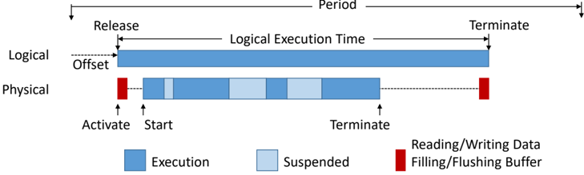

因此，LET 强制实现了确定性的输入/输出时序，具有恒定的响应时间和零抖动。图 2.5 给出对图 2.2 的因果链应用 LET 时的数据流示例。新的数据流只取决于 LET 事件，不受物理执行时序影响。在图 2.5 中，任务的 LET 区间时长被赋为与其周期相等。然而，LET 并不隐含这样的约束，可以使用更紧的 LET（LET < period）以及偏移量来降低端到端延迟。另一方面，过度放大 LET 区间的时长可以作为一种设计手段，用于在未来系统修改对 WCRT 产生负面影响时（缩小 WCRT 与 LET 区间长度之间的裕量）改善数据流的健壮性。当然，这是与因果链总端到端延迟之间的权衡。

![图 2.5：使用 LET 的确定性数据流 [\[6\]](#ref-6)（Deterministic data flow with LET）](Figure2-5.png)

尽管原始的 LET 文献 [\[7\]](#ref-7) [\[8\]](#ref-8) 并未显式讨论甚至提及，但存在一个 LET ≤ period 的概念性界限。超出该界限后，执行可能重叠，经典 LET（包括数据流确定性在内）的一些基本假设不再成立。这一有效界限至关重要，原因有二。第一，（借助于经典平台的 AUTOSAR 时序扩展）LET 区间的规格说明并不强制这样的界限，而这在实际的 AUTOSAR 应用中至关重要，因为 LET > period 是一个重要用例。例如，参与因果链的 runnable 可能被部署到不同的 ECU 上，从而把确定性数据流问题扩展到具有显著通信延迟的分布式系统。第二，逻辑时序抽象的概念也可以作为一种规格说明技术，有益地用于设计的早期阶段。例如在功能层级，这可以覆盖用于规定多个功能块之间数据流的 LET 区间的组合与分解。同样，功能块组合的端到端延迟很可能超过触发周期。为弥合这一鸿沟，需要对 LET 语义加以扩展。

### 2.4. 用于时序需求规格说明的语言

AUTOSAR 方法论基于 AUTOSAR 语言及其时序扩展。AUTOSAR 是软件实现层级的语言，但不适用于功能层级（分析与设计）。因此，为了确保时序需求分解的完整基于模型的方法，必须使用一种面向功能层级的补充建模语言。EAST-ADL2 [\[9\]](#ref-9) 及其时序扩展 TADL2 [\[10\]](#ref-10) 支持以精确的时序模型对功能层级进行规格说明。此外，TADL2 与 AUTOSAR 时序扩展共享相同的基础概念，这可以促进时序需求从功能层级向 AUTOSAR 层级（时序需求以 TIMEX 表达）的转换。

因此，下文简要介绍 EAST-ADL / TADL，作为支持时序需求分解方法论功能层级的建模语言示例。

#### 2.4.1. EAST-ADL / TADL

EAST-ADL 是一种面向汽车嵌入式系统的架构描述语言（**ADL**），由多个欧洲研究项目开发。它的设计初衷是以更高抽象层级的描述对 AUTOSAR 形成补充。EAST-ADL 覆盖的方面包括车辆特性（**feature**）、功能、需求、变体、软件组件、硬件组件与通信。

TADL2（Timing Augmented Description Language）语言概念可以在 GMP（Generic Methodology Pattern，通用方法论模式，见第 [3.3.2](#332-时序需求分解的准则) 节）方法论的特定步骤中使用，以描述时序信息。TADL2 允许规定可表达以下时序属性/需求的时序约束：

- 执行时间（最坏情况、最好情况、仿真、测量）
- 端到端延迟
- 采样率
- 时间预算
- 响应时间
- 通信延迟
- 松弛（**Slack**）
- 重复模式
- 同步
- ……

TADL2 的基础概念与下一节介绍的 AUTOSAR TIMEX 相当等同。

#### 2.4.2. AUTOSAR TIMEX 的基本概念

根据 [\[2\]](#ref-2)，时序扩展的首要目的是支持构建满足给定时序需求的嵌入式实时系统，并在系统建成后对其执行时序分析/验证。

AUTOSAR 时序扩展提供一个时序模型，作为基于契约（**contract-based**）的开发过程的规格说明基础；在这种过程中，开发由不同组织在不同地点、不同时间段内进行。在项目早期阶段（相应解决方案尚未开发时）输入的约束应被视为开发伙伴之间达成一致的额外功能（**extra-functional**）需求。

这样，时序规格说明支持自顶向下的设计方法论。然而，由于纯粹的自顶向下设计在多数情况下并不可行（例如由于遗留代码），时序规格说明同样允许自底向上的设计方法论。

最终的总体规格说明（AUTOSAR 模型与时序扩展）应支持对系统时序行为的分析以及分析结果对照时序约束的验证。因此，分析所需的时序属性必须包含在时序增强的系统模型中（例如任务的优先级、中断的激活行为、PDU 与帧的发送时序等）。这类时序属性遍布 AUTOSAR。例如系统模板提供了配置和规定通信栈时序行为的方法。此外还可以规定可执行实体的执行时间。另外，总体规格说明必须提供描述时序约束的方法。时序约束定义对系统时序行为的限制（例如限定从传感器采样到执行器访问的最大延迟）。

时序约束通过 AUTOSAR 时序扩展加入系统模型。在验证系统时序行为时（进行标称值/实际值比较时），约束与时序分析的结果一起被考虑。

AUTOSAR 时序扩展提供描述和规定时序信息的一些基本手段：以事件和事件链表达的时序描述，以及施加在这些事件和事件链上的时序约束。这两种手段——时序描述与时序约束——按特定目的组织在时序视图（**timing view**）中。总体而言，时序扩展服务两个不同的目的。其一是提供时序需求，指导系统的构建，使系统最终满足这些时序需求。其二，提供充分的时序信息以分析和验证系统的时间行为。

本节余下部分描述 AUTOSAR 时序扩展中定义的主要概念。

##### 2.4.2.1. TIMEX 工作产品

以下部分简要描述不同的 TIMEX 工作产品，给出总体概览。更详细的描述见 [\[2\]](#ref-2) 第 2 章（时序扩展概览）。

事件（**Events**）。事件（**Event**）的概念用于描述系统中发生特定的可观察事件，以及在系统中哪些位置观察这些事件的发生。它们与预定义的事件类型相关联，用于规定不同的动作（例如：对端口的读/写数据、经由网络的发送/接收数据、可执行对象的启动/终止……）。

事件链（**Event Chains**）规定两个事件之间的因果关系。例如事件 B 发生当且仅当事件 A 在此之前发生。

施加在事件上的时序约束。事件触发约束（**Event Triggering Constraint**）对事件在时间空间中的出现施加约束（周期性、偶发、特定模式）。

施加在事件链上的时序约束。事件触发约束用于规定反应（**reaction**）或年龄（**age**），例如两个相继事件的最大间隔。延迟与同步时序约束规定：刺激事件或响应事件必须在给定的时间区间（容差）内发生，才能分别称其为同时发生与同步发生。

附加时序约束。AUTOSAR 时序扩展提供施加在可执行实体上的时序约束，即执行顺序约束（**Execution Order Constraint**）与执行时间约束（**Execution Time Constraint**）。

## 3. 设计层级上的时序需求

时序需求的分解是实时系统设计与分析的首要关注点。在系统设计过程的开始，时序需求在规格说明中确定的客户功能层级上表达。客户功能的开发需要将其分解为小的、可管理的组件。这一称为架构设计（**architecting**）的分解活动也意味着对附着在被分解功能上的时序需求进行分解。本章概述所建议的时序需求分解方法。

### 3.1. 时序需求分解问题

掌控时序需求是开发和集成最先进汽车 E/E 系统的关键成功因素之一。时序需求应在车辆复杂的开发过程中持续监控，并进一步为功能或组件复用到其他车辆项目而复用和沟通：时序需求必须系统而谨慎地加以描述。所需的细节层级各不相同：从车辆层级高层客户相关特性的时序约束，到特定执行器功率放大器控制的时序需求，再到操作层级多核微控制器上软件功能数据同步性的 ECU 内部时序。

如图 3.1 所示，开发过程遵循著名的 V 模型，它描述了从系统规格说明到系统集成的系统化的、分阶段的自顶向下方法。左分支描述规格说明的过程步骤，实现从整个 E/E 系统到单个组件的分解。V 的底部描述实现及相应的测试程序。沿 V 的右分支，可以自底向上读出直到车辆系统集成的测试与集成程序。

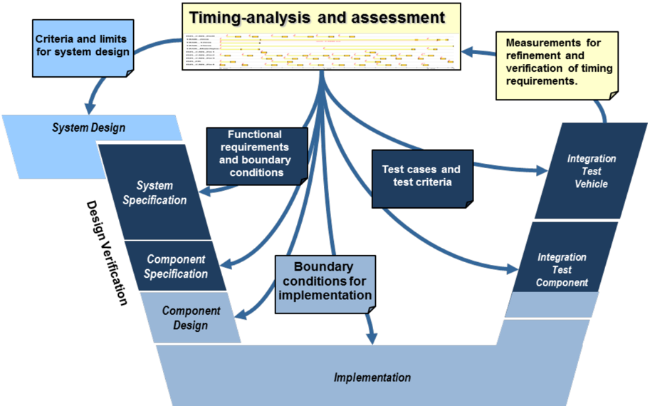

按照汽车 OEM 开发过程的这些基本步骤，需求在任何过程步骤中都应可追溯。这意味着时序需求应能从需求规格说明出发，经供应商的性能规格说明，一直到测试与集成文档（协议）都可识别和追溯。就 E/E 过程而言，这意味着时序需求应能经受 OEM 与 tier1 供应商之间、进而直至 tier2 与 tier3 供应商之间的过程转换。这只有通过使用标准化的描述与方法论体系、引用开发伙伴之间通常交换的模型工件才能实现。

基于 AUTOSAR 系统模板的 AUTOSAR 时序扩展（**TIMEX**） [\[2\]](#ref-2) 表示在符合 AUTOSAR 的软件开发过程内交换系统描述的标准化格式。此外，TIMEX 是一个可选组件，不要求对 AUTOSAR 系统模板做任何更改。可观察事件（**observable event**）的概念——它在一个被引用的建模工件（例如 RTE 端口）中出现或可被观察——允许规定观察点以及按因果顺序排列的事件序列（事件链），并对它们施加额外的时序约束。TIMEX 概念被认为能够满足以时序需求描述 AUTOSAR 系统时间行为的所有用例。

遗憾的是，OEM 的开发过程并不是从 AUTOSAR 开始的。AUTOSAR 只表示某些软件组件的实现视图，而不表示可包含非软件功能的高层功能概念视图。目前，需求在过程的最开始以自然语言描述。这些需求必须「形式化」为非自然语言，以便对它们进行评估并支持其分解。时序需求的评估应在开发过程中尽早进行。为了在系统/功能层级实现这一点，需要一种系统/功能建模语言。该语言必须提供功能设计建模的概念，还必须提供在功能设计过程中捕获和分解时序需求的形式化方式。

有若干基于架构描述语言（**ADL**）的方法可以用来填补自然语言需求规格说明与以 AUTOSAR 建模的实现阶段之间的空白。可以举出的基于 UML [\[11\]](#ref-11) 的架构描述语言有：SysML [\[12\]](#ref-12)（面向系统建模的 UML 特化）和 MARTE [\[13\]](#ref-13)（面向实时与嵌入式系统建模和分析的 UML 特化）。也存在其他更面向领域的方法，例如面向航空航天的 AADL [\[14\]](#ref-14) 和面向汽车行业的 EAST-ADL [\[9\]](#ref-9)。选择哪种合适的系统/功能层级建模语言取决于各 OEM 的内部过程。不过，有一些与时序相关的一般准则值得考虑：

- 对层次化时序需求过程的支持；
- 把分解后的时序需求映射到 AUTOSAR TIMEX 模型工件的难易程度——后者是当今 OEM 与其供应商之间的交换格式。

在分解时序需求的过程中，数据流的时序尤其具有挑战性。在多条因果链上实现确定性的时序、同时保持预期的功能行为，在设计过程中需要格外小心。在较高层级的规格说明中，时序可以粗略地分解为不同（子）功能的时间预算；但在 AUTOSAR 的实现层级，如果结构不够良好，这会变得困难。例如，考虑图 1.5 中针对黄色与红色因果链给出的初始时序分解。这些预算可以沿着图 3.1 的 V 模型过程被细化和层次化分解。然而，在 AUTOSAR 的实现层级，这达到了一个时序通常不可组合的程度。这意味着：如果因果链的行为（除其他因素外）依赖于数据的时序，就不可能进行诸如「把最大响应时间相加」之类的简单「组合」。图 2.2 的示例已经说明了这一点：由于依赖于实现的响应时间在运行时可能包含响应时间抖动，20 ms 超周期内 5 ms 任务的第三个作业从哪个先前作业读取数据仍然是开放的。更糟的是，这会随任何软件更新以及硬件运行（例如处理器的热管理）而改变。因此，包含该任务的因果链的延迟既不能按时间预算的简单相加来组合（对照图 1.5），其时序需求也无法简单分解。

在合适的基础软件、RTE 与 OS 的实现支持下，SL-LET 可以避免这一「分解鸿沟」，使因果链的时序能够以可组合的方式设计。

下一节将给出基于所有这些想法与概念的方法路径，为自己的组织实施层次化的时序需求过程提供方向，并最终支持交换符合 AUTOSAR TIMEX 的模型工件。

### 3.2. 层次化时序描述

在汽车开发过程的早期设计阶段，架构讨论围绕高层的客户相关功能展开。这些功能可以在功能性的「因果」或「活动」链中细化，从时间的视角可以对它们进行预算——这由客户的体验来证实。功能质量以及投入到客户体验中的技术投入是公司的商业决策。

在 AFS 示例中，这就是从横摆角速度传感器检测到转向系统电机控制的反应时间。这避免了弯道行驶时的不稳定行为。

另一个例子是动力总成或底盘控制功能，它可能造成换挡或制动时的顿挫等不适。

从方法论与技术的视角看，时序分析是一个工具，用于在把功能网络映射到组件网络（如图 3.2 所示）的过程中保证预期的时间行为。

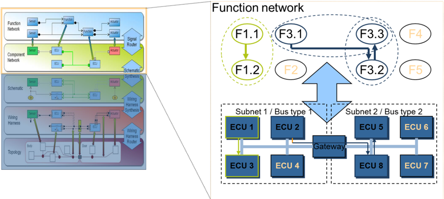

一旦为客户相关功能定义了主要的时序预算，并且完成了功能部件到硬件组件的分配<sup>1</sup>，就可以制作网络架构的更详细的时间视图。这使得能够对功能分布在性能和时序方面的可行性进行首次评估。该过程可以在后续的过程步骤中迭代细化，以获得更精确的分析结果。

> 1 在 AUTOSAR 开发过程中，软件组件（**SW-C**）的定义范围以它所映射到的硬件组件为局部范围。它包含对具有系统全局范围的车辆功能的功能性贡献。

为了便于进一步理解，可以假设图 3.3 中的每个功能都包含在一个 AUTOSAR SW-C 的组合范围内，在其中有它表示为一个 AUTOSAR runnable 实体（常简称为「Runnable」）。也可以考虑其他映射策略。无论选择哪种策略，映射通常都受功能层级上为时序需求评估所做功能设计选择的约束。例如，基于每个硬件资源（ECU、总线）的负载（利用率）计算的可行性测试，依赖于功能在硬件资源上的给定分配。在把功能映射到 AUTOSAR SW-C 时必须考虑这一分配，以避免把分配在不同 ECU 上的两个功能映射到同一个 AUTOSAR SW-C 上。

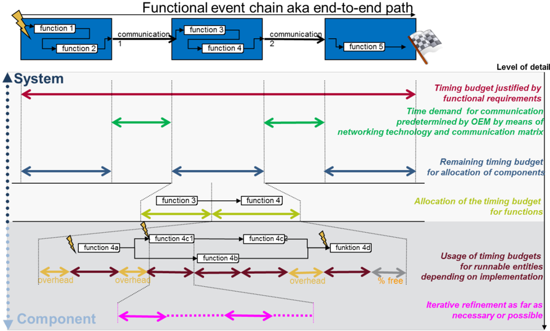

此外，在许多情况下，物理过程的时序需求（例如电气执行器的启动与瞬态振荡行为）消耗的时间超过几微秒，因此必须仔细考虑。第一步可以把总体时序预算拆分为组件内部部分与网络部分。一旦整个网络通信和网络类型已知，网络的 WCRT 分析就可以量化网络通信的最坏情况时序需求。如上图所示，这把总体时序预算划分为网络预算与分配给组件（通常是 ECU）的时序预算。

如果组件的开发与集成完全由一个供应商完成，这对 OEM 来说可能已经足够。在实践中，需要更细致的视图，考虑基础软件栈和功能本身的时序行为。同样，功能关系也更复杂，这导致更复杂的分析。在后续的分析步骤中，端到端时序路径或功能链可以按照图 3.3 的概念进一步细化。下一节介绍为上述一般过程提供支持的方法论。

### 3.3. 时序需求分解的方法论

如前所述，AUTOSAR 方法论覆盖 E/E 系统开发过程的实现阶段。然而，时序需求由 OEM 以文本描述的形式在开发周期的最开始引入。因此需要对 AUTOSAR 方法论加以扩展，以覆盖系统/功能架构设计阶段——最初的功能分解与时序需求分解必须发生在这里。事实上，系统开发中最具挑战性的活动之一是在开发的早期阶段确定系统的规模——而最困难的阶段是从功能域转向硬软件域之前的阶段。

首要的是回答两个问题。其一，网络应提供多少带宽，才能确保电子控制单元之间数据的正确及时传输；其二，电子控制单元需要多少处理性能，才能处理接收到的数据并执行相应的功能。事实上，只有当系统实现之后——包括信号到网络帧的映射以及在电子控制单元上执行的函数的最初实现——这些问题才能被完全回答。原因在于人们需要知道每秒必须传输多少比特、必须执行多少条指令。

影响系统规模规定任务中所做决策的一个重要方面是时序。特别是关于数据传输周期、功能执行速率、可容忍延迟与所需响应时间的信息，为网络与 ECU 规模的初步近似提供了一个框架。该框架允许在系统开发过程中、当更多关于系统实现的细节变得可用时，持续细化系统规模。基本思想是：把在实现阶段获得的操作参数（例如测量或仿真得到的函数执行时间）抽象出来，在更高的抽象层级、亦即更早的开发阶段使用它们。而对于新功能，作为缺少执行时间数据的变通，一项称为时间预算分配（**Time Budgeting**）的活动允许为功能规定所谓的时间预算（**time budget**）。

本节余下部分定义时序需求分解所考虑的层级，然后给出在这些层级之间进行时序需求细化的一般方法论准则。

#### 3.3.1. 功能与软件架构的建模层级

在 AUTOSAR 软件架构层级之前，可以考虑 [\[9\]](#ref-9) 中定义的、与时序需求相关的两个功能架构建模层级：

- 功能分析层级（**Functional Analysis level**）以要开发的系统功能单元的逻辑表示为中心。该层级的系统设计典型地基于自动控制工程的输入，通过识别系统边界（例如与机电子系统交互的传感与执行功能）和内部计算（例如调节这些子系统动力学的反馈控制功能）所需的各个功能单元，细化车辆层级的系统特性规格说明。设计聚焦于抽象的功能逻辑，同时抽象掉任何基于软/硬件的实现细节。通过分析层级的系统模型，这些抽象功能单元被定义并链接到相应的需求规格说明（已满足的或涌现的）以及相应的验证与确认用例。
- 功能设计层级（**Function Design level**）为系统功能单元提供逻辑表示，这些单元现在为通过计算机硬件和软件的实现而被结构化。它通过捕获系统功能到 I/O 设备、基础软件、操作系统、通信系统、存储器与处理单元以及其他硬件设备的绑定，细化分析层级模型。同样，通过设计层级的系统模型，系统功能连同其实现所需的软硬件资源被定义并链接到相应的需求规格说明（已满足的或涌现的）以及相应的验证与确认用例。此外，显式设计层级系统模型的创建促进了高效且可复用的架构，即面向不同功能的（结构化的）HW/SW 组件及其接口、硬件架构的集合。该架构必须满足汽车量产中特定开发项目的约束。

AUTOSAR 方法论（一般性介绍见 [\[1\]](#ref-1)）提供了若干明确定义的过程步骤，以及由这些步骤提供或需要的过程工件。图 3.4 使用软件与系统过程工程元模型记法（**SPEM**） [\[4\]](#ref-4) 给出 AUTOSAR 方法论的简化概览，聚焦于与使用时序扩展相关的过程阶段。这些呈现的步骤与工件按边界分为以下五个视图：

- VfbTiming 处理与 VFB 层级 SwComponentType 交互相关的时序信息。
- SwcTiming 处理与 AtomicSwComponentType 的 SwcInternalBehavior 相关的时序信息。
- SystemTiming 处理与一个 System 相关的时序信息，利用关于拓扑、软件部署和信号映射的信息。
- BswModuleTiming 处理与单个 BswModuleDescription 的 BswInternalBehavior 相关的时序信息。
- EcuTiming 处理与 EcucValueCollection（特别是 EcucModuleConfigurationValues）相关的时序信息。

这些时序视图的更多细节见 [\[2\]](#ref-2)。对其中每个视图，取决于必要信息的可用性、某个工件所扮演的角色以及与该视图相关联的开发阶段，可以应用一个特定的时序规格说明侧重点。

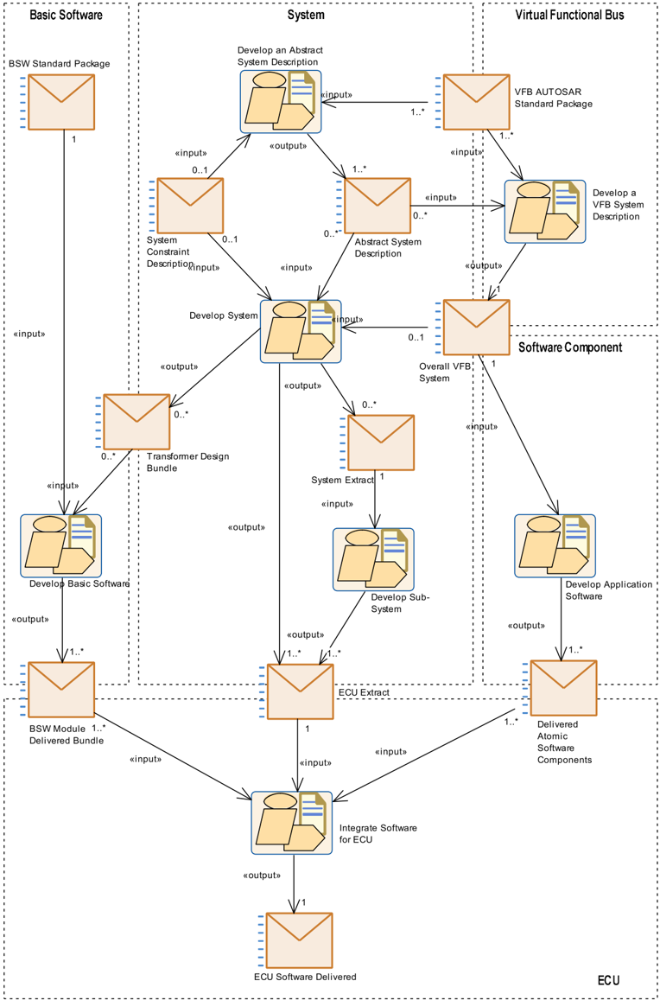

#### 3.3.2. 时序需求分解的准则

在 TIMMO-2-USE 项目 [\[15\]](#ref-15) 中开发的通用方法论模式（**GMP**）是一个为时序需求细化定义通用步骤的过程示例。理论上，这些通用步骤适用于上一节定义的每个层级（包括 AUTOSAR 层级）。基本上，在每个抽象层级，GMP 以时序需求为输入，经过一系列步骤输出细化后的时序需求。GMP 定义了六个主要步骤。以下简短描述合并了其中一些：

- 步骤 1 - 创建方案（**Create Solution**）：描述不含任何时序信息的架构定义。该步骤可以是对来自上一层的既有架构的细化。时序需求应指导方案的创建或修订。
- 步骤 2 - 把时序需求附着到方案（**Attach Timing Requirements to Solution**）：描述以当前架构的术语表述时序需求。这可能意味着对来自上一层的时序需求进行转换，以符合当前抽象层级的时序模型。例如在 AUTOSAR SwcTiming 视图中，时序需求可以建模为附着在事件或事件链上的时序约束。
- 步骤 3 - 创建、分析并验证时序模型（**Create, Analyze and Verify Timing Model**）：描述为计算当前架构的特定时序属性而定义形式化模型。在该步骤中，可以应用相关的时序分析方法，对照计算出的时序属性（例如总线的最大负载）验证时序需求。如果时序需求未被分析得到的时序属性验证通过，则应迭代前面的步骤直到找到满意的方案。
- 步骤 4 - 规定并确认时序需求（**Specify and Validate Timing Requirements**）：描述识别强制性的时序属性，并把它们提升为下一层级的时序需求。

第 [9](#9-用于时序分析的属性与方法) 章包含与第 4、5、6、[7](#7-ecu-层级软件集成的时序) 章所述每个用例相关的时序属性与方法，以确保正确的时序需求分解。

时序约束通过 AUTOSAR 时序扩展加入系统模型。在验证系统时序行为时（进行标称值/实际值比较时），约束与时序分析的结果一起被考虑。

### 3.4. 结论

要全面应用时序需求分解，必须满足若干条件：

- 所有基本术语应统一。这意味着像 WCRT 这样的术语在整个行业中具有相同的含义和全面的理解。
- 描述时序方面的结构应统一。为此，AUTOSAR TIMEX 为 AUTOSAR 的实现驱动视角提供了一种合适的方法。它不适用于更高的抽象层级，因为一旦 AUTOSAR 的概念（如软件组件与 Runnable）不存在，它就没有意义。
- 在时序感知的开发过程中引入时序分析的方法论路径，不应被简化为仅定义引用 AUTOSAR 系统模板工件的 TIMEX 工件。此外，早期设计阶段更高抽象层级的信息应在不损失精确性的情况下传递到 AUTOSAR 建模。这要求在所有阶段和抽象层级内都有效的参照点。
- 方法论应满足大型组织的需求。这意味着方法论应可量身定制地适用于支配特定大型组织的过程。

本章呈现的要素支持在第 [1](#1-简介) 章介绍的顶层主动转向示例中描述的形式化时序需求分解。

## 4. 功能层级的时序

### 4.1. 简介

功能时序在第 [2.1.1](#211-时序抽象层级) 节定义的功能层级上规定。它是在系统功能的抽象架构上规定时序需求。如图 4.1 所示，需要两类模型元素：

- 功能架构模型元素（**Functional Architecture Model Elements**）：用于捕获车辆功能及其输入、输出和连接的建模概念。
- 功能时序模型元素（**Functional Timing Model Elements**）：用于捕获功能架构可观察元素上的时序需求的建模概念。为了与 AUTOSAR 时序扩展保持一致，这些时序模型元素引用功能架构模型元素。


以下各节介绍功能架构与功能时序的关键模型元素。

#### 4.1.1. 功能架构模型元素

为了捕获功能架构，需要一些通用的模型元素。为支持功能架构模型的定义，图 4.2 给出这些模型元素及其关系的非正式元模型。

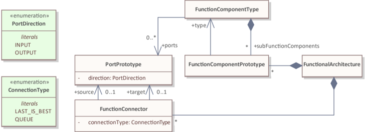

- 车辆（**Vehicle**）提供一组高层车辆功能（**vehicle function**）。
- 车辆功能可以分解为若干 FunctionComponentType。FunctionComponentType 可以在不同车辆功能之间共享。换言之，一个 FunctionComponentType 可以参与不同车辆功能的实现。
- FunctionComponentType 等价于 AUTOSAR 中的 ComponentType。它定义一个可以分解为 subFunctionComponents 的功能类型。与 AUTOSAR 中一样，该分解通过两步完成：（1）创建子功能的 FunctionComponentType；（2）在组合的 FunctionComponentType 中创建对应子功能所扮演角色的 FunctionComponentPrototype。FunctionComponentType 可以具有称为 PortPrototype 的连接点。
- FunctionConnector 是连接各 FunctionComponentType 的 PortPrototype 的连接链路。可以定义连接语义：Last-is-best 或 Queue。
- PortPrototype 定义 FunctionComponentType 的输入或输出。
- FunctionalArchitecture 由 FunctionComponentPrototype 及其连接递归组成。

#### 4.1.2. 功能时序模型元素

功能层级上的时序模型是通过引用功能模型中的 PortPrototype 来规定时序约束与预算。

时序约束可以关联功能模型中的一个或两个 PortPrototype。约束单个 PortPrototype 可用于定义一个重复事件的周期、频率或到达间隔。

通过用时序约束关联两个 PortPrototype，可以定义延迟时序约束。例如：

- 功能响应时间预算（**Function response time budget**）是总响应时间的时间预算。
- 功能连接器通信时间预算（**Function connector communication time budget**）是总通信时间的时间预算。
- 端到端时间预算（**End-to-end time budget**）是相连 FunctionComponentType 链中的功能响应时间预算与功能连接器通信时间预算的组合。

#### 4.1.3. 从功能层级到 AUTOSAR

本节介绍从带时序的功能架构到 AUTOSAR 抽象平台、经典平台与自适应平台的过渡。

- 从带时序的功能架构到 AUTOSAR 抽象平台的过渡通过 FunctionComponentPrototypes 到 AUTOSAR 抽象组件的一对一变换完成。时序约束用 TIMEX 映射。
- 从带时序的功能架构到 AUTOSAR 经典平台的过渡通过 FunctionComponentPrototypes 到 AUTOSAR 软件组件的一对一变换完成。时序约束用 TIMEX 映射。
- 从带时序的功能架构到 AUTOSAR 自适应平台的过渡通过 FunctionComponentPrototypes 到 AUTOSAR Adaptive Application 的一对一变换完成。时序约束用 TIMEX 映射。

#### 4.1.4. 功能建模语言

表 4.1 给出第 [4.1.1](#411-功能架构模型元素) 节与第 [4.1.2](#412-功能时序模型元素) 节介绍的功能时序概念到一些可用于功能建模的既有建模语言的映射。

表4.1：功能建模语言（**Functional Modeling Languages**）

| 功能时序概念 | EAST-ADL2 / TADL2 概念 | UML / SysML / MARTE 概念 |
|---|---|---|
| Vehicle Function | EAST-ADL::Structure::FeatureModeling::Feature | UML:: Class 或 SysML:: Block，或特定的 Feature 构造型 |
| FunctionComponentType | EAST-ADL::Structure::FunctionModeling::AnalysisFunctionType 或 EAST-ADL::Structure::FunctionModeling::DesignFunctionType | Class、Block，或特定的 FunctionType 构造型 |
| FunctionComponentPrototype | EAST-ADL::Structure::FunctionModeling::AnalysisFunctionPrototype 或 EAST-ADL::Structure::FunctionModeling::DesignFunctionPrototype | UML:: Property 或 SysML:: Part |
| PortPrototype | EAST-ADL::Structure::FunctionModeling::FunctionFlowPort 或 EAST-ADL::Structure::FunctionModeling::FunctionClientServerPort 的 instanceRefs | UML:: Port 或 SysML:: FullPort |
| FunctionConnector | EAST-ADL::Structure::FunctionModeling::FunctionConnector | UML:: Connector |
| FunctionalArchitecture | EAST-ADL::Structure::SystemModeling::SystemModel | UML:: Class 或 SysML:: Block，或特定的 FunctionalArchitecture 构造型 |
| Function response time budget | 对应于功能输入接收与输出生成的 EAST-ADL::Timing::EventChain 上的 EAST-ADL::Timing::TimingConstraints::ExecutionTimeConstraint | 对应于功能输入接收与输出生成的 MARTE::Time::TimedInstantObservation 之间的 MARTE::Time::TimedConstraint |
| Function connector communication time budget | 没有专门针对通信时间预算的约束。可以用执行时间约束作为变通方法。 | 对应于通信开始与结束的 MARTE::Time::TimedInstantObservation 之间、interpretation = Duration 的 MARTE::Time::TimedConstraint |
| End-to-end time budget | 对应于端到端流的 EAST-ADL::Timing::EventChain 上的 EAST-ADL::Timing::TimingConstraints::ExecutionTimeConstraint | 对应于端到端流的 MARTE::Time::TimedInstantObservation 之间的 MARTE::Time::TimedConstraint，或使用 MARTE::SAM::SaEndToEndFlow |
| Period | EAST-ADL::Timing::TimingConstraints::PeriodicConstraint | MARTE_Library::BasicNFP_Types::ArrivalPattern::Periodic |
| Frequency | EAST-ADL::Timing::TimingConstraints::PeriodicConstraint | MARTE_Library::BasicNFP_Types::ArrivalPattern::Periodic |
| Inter arrival time | EAST-ADL::Timing::TimingConstraints::SporadicConstraint | MARTE_Library::BasicNFP_Types::ArrivalPattern::Sporadic |

#### 4.1.5. 功能层级上的设计

功能层级可用于做出一些早期设计决策。这些决策例如可以包括：

- 由于安全约束而进行的功能分离（把功能分配到不同的硬件组件上）；
- 通过把彼此通信较多的功能分组来优化整个系统的时序或性能；
- 探索支持功能架构的最佳硬件架构。

这一早期设计探索需要在功能层级上具备：

- 以执行节点和网络的形式对硬件平台备选方案进行抽象的建模元素；
- 捕获 FunctionComponent 到节点的分配备选方案以及 FunctionConnector 到网络的分配备选方案的建模元素。

此外，功能层级上的这些早期设计活动可以带来：

- 对功能与通信更精确的时间预算估计（因为这些元素依赖硬件，考虑功能到硬件节点的分配可以让设计者更精确地规定功能时序预算）；
- 功能层级上的早期时序验证（至少可以排除因分配场景导致配置过载而不可行的设计）；
- 不同功能到硬件分配场景之间的比较，以指导设计者的选择。

这些早期设计决策在更低的 AUTOSAR 实现层级上进一步细化。

### 4.2. 功能层级用例概览

本章描述功能层级上系统功能分析与设计的时序相关用例。一些用例覆盖开发早期阶段的高层时序，另一些则处理从功能层级到实现层级的过渡。

一个功能的设计需要将其分解为功能块。这一分解必须包含分解其时序需求的活动，最终把一致的时序需求分配给各功能块。

当功能块被分配到实际硬件、通信技术被选定之后，时序与负载需求被进一步细分。在这一层级，所有硬件仍是抽象的，考虑优先级与调度等的详细分析尚不可能。另一方面，可以把功能分配到抽象的硬件资源上，并执行初步的负载与延迟分析。这可以探索可行的划分方案，从而对时序需求更有信心。最后，在实现层级设计 runnable/触发时必须考虑这些需求，并在硬件规格已知时加以验证。

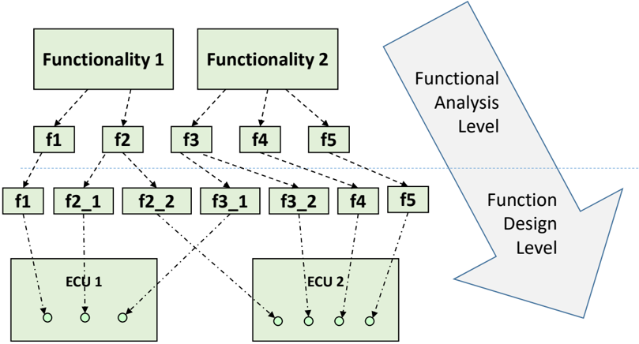

从时序视角出发，功能建模与分解的主要目标是在功能分析层级上定义时序需求，并在设计与实现层级上细化和满足这些需求。

以下用例部分引用第 [1.4](#14-示例) 章的主动转向示例（概览示例见图 1.2，软件架构见图 1.3）。

**与其他章节的关系** 第 [3](#3-设计层级上的时序需求) 章更详细地描述了时序需求的分解。第 5、6、[7](#7-ecu-层级软件集成的时序) 章包含 E2E、网络与 ECU 用例。第 [9](#9-用于时序分析的属性与方法) 章包含与所有用例相关的时序属性与方法。

**所用时序表达的链接**

- 负载（**Load**），见第 [9.4](#94-时序属性的定义与分类) 节
- 功能分析层级与功能设计层级，见第 [3.3.1](#331-功能与软件架构的建模层级) 节

用例清单：

表4.2：功能层级特定用例清单（**List of Function-level specific use cases**）

| 章节 | 用例 |
|---|---|
| 4.3 | 功能层级用例「为新车辆功能识别时序需求」 |
| 4.4 | 功能层级用例「把车辆功能划分为功能架构」 |
| 4.5 | 功能层级用例「把功能架构映射到硬件组件网络」 |

下图展示功能层级用例：

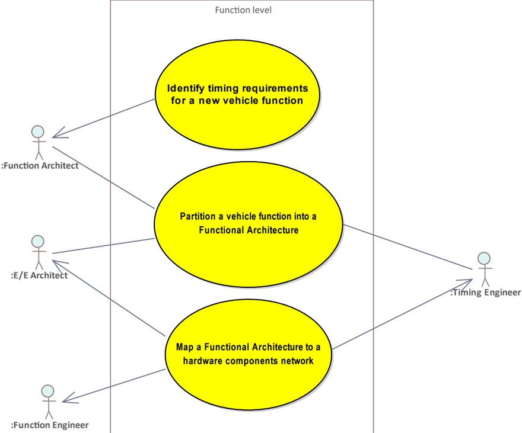

### 4.3. 功能层级用例「为新车辆功能识别时序需求」

在以下用例中，向一个既有的功能架构引入一个车辆功能。

在该用例中，车辆功能被视为黑盒且不分解。该层级的时序需求典型地派生自客户需求、法规要求、物理规律等。时序参考平台中的一个示例是 150 ms 端到端需求的识别（见图 A.3「功能层级上 TRP 的设计」中的「Identification of Timing Requirements」）。

表4.3：「为新车辆功能识别时序需求」用例的特征信息（**Characteristic Information**）

| | |
|---|---|
| 目标上下文： | 识别与新车辆功能相关的时序需求。 |
| 简要描述： | 引入一个新车辆功能。该用例的目标是识别新车辆功能的时序需求。时序需求的目的是能够验证车辆功能的时序满足其功能需要。为此，需要彻底研究车辆功能以识别时序关键的事件链，并为可接受的时序建立约束/界限。时序需求例如可以是从传感器值变化到对执行器的刺激变化之间可容忍的最大延迟。在示例 1.4 中，车辆功能「主动转向」将带有时序约束「横摆角速度传感器变化与电机刺激变化之间的最大延迟必须低于 30 ms」。理想情况下，这些时序约束以形式化的方式表述（如「时序属性的定义与分类」中那样），它们应尽可能精确地引用可观察事件，并且应独立于任何实际实现（即不引用特定的 runnable 或帧）。 |
| 范围： | 功能架构 - 功能分析层级 |
| 频率： | 功能开发期间 |
| 前置条件： | 车辆功能已被充分规定，足以对可接受时序进行推理，理想情况下通过实验、有意义的建模或功能仿真。 |
| 成功结束条件： | 与该车辆功能相关的所有时序需求均已知。 |
| 失败结束条件： | 某些时序需求无法建立，因此后续无法测试，带来集成问题的风险。 |
| 参与者： | Function Architect |

#### 4.3.1. 主场景

该用例的系统化方法见图 4.5。典型地适用以下步骤：

1. Function Architect 校验新车辆功能的描述，确保车辆功能的所有相关细节均已描述且没有悬而未决的问题。
2. Function Architect 对车辆功能执行初步分析。他从用户体验、技术限制以及安全目标或法规等方面研究车辆功能。基于研究结果，Function Architect 以时序约束的形式表述时序需求（例如时长、延迟、数据年龄、周期、抖动……）。

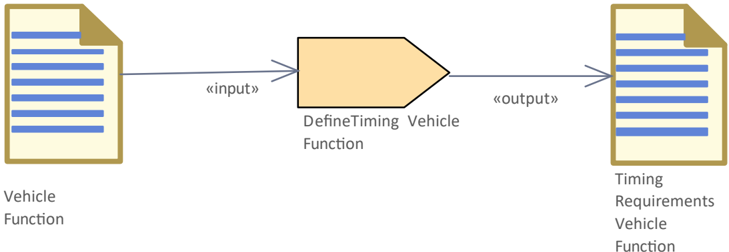

### 4.4. 功能层级用例「把车辆功能划分为功能架构」

在以下用例中，车辆功能被细化并表示为一个功能架构（**Functional Architecture**），即一组功能块及其接口。功能架构表示车辆功能需要在车辆 E/E 平台上执行的所有部分。与车辆功能关联的时序需求也需要被分解，并关联到功能架构的各个部分。时序参考平台中的一个示例是功能分解（见图 A.3「功能层级上 TRP 的设计」中的「Partition into Functional Architecture」）。

表4.4：「把车辆功能划分为功能架构」用例的特征信息（**Characteristic Information**）

| | |
|---|---|
| 目标上下文： | 把一个车辆功能细化为带时序需求的功能架构。 |
| 简要描述： | 车辆功能通常是预期行为的高层规格说明。为了便于后续工作步骤的高效开展，需要更形式化的规格说明。为此，把车辆功能划分为功能块及其接口（随后实现为 ECU 内或 ECU 间通信）。这称为功能架构。用例 [4.3](#43-功能层级用例为新车辆功能识别时序需求) 中识别的时序需求尽可能关联到功能块与接口。 |
| 范围： | 功能架构 - 功能分析层级 |
| 频率： | 集成新车辆功能或重新设计既有车辆功能时。 |
| 前置条件： | 车辆功能及其时序需求已被完整描述。车辆功能的主要逻辑已知。 |
| 成功结束条件： | 车辆功能被成功分解为功能块。功能块之间的接口已定义且一致。时序需求已关联到功能块与接口。 |
| 失败结束条件： | 车辆功能无法一致地分解为功能块。 |
| 参与者： | Timing Engineer、Function Architect、E/E Architect |

#### 4.4.1. 主场景

该用例的系统化方法见图 4.6。典型地适用以下步骤：

1. E/E Architect 分析车辆功能的描述与需求并将其形式化，通过描述功能块及其经由接口的交互来完成。
2. Function Architect 取为车辆功能规定的时序需求，并将这些需求关联到车辆功能分解得到的功能块与接口。
3. Timing Engineer 对照功能架构的时序需求（例如时长、延迟、数据年龄、周期、抖动……）验证车辆功能的时序需求，以确保这些需求之间的一致性。例如，车辆功能的总延迟必须与分解后的功能块的延迟、周期、抖动等保持一致。

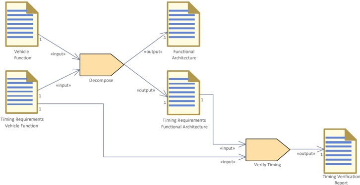

### 4.5. 功能层级用例「把功能架构映射到硬件组件网络」

时序参考平台中的一个示例是到虚拟硬件的映射（见图 A.3「功能层级上 TRP 的设计」中的「Map to Virtual Hardware」）。

在以下用例中，向功能架构模型添加车辆 E/E 架构的抽象——硬件组件网络的形式。

表4.5：「把功能架构映射到硬件组件网络」用例的特征信息（**Characteristic Information**）

| | |
|---|---|
| 目标上下文： | 规定功能架构到虚拟硬件组件网络的映射。 |
| 简要描述： | 该用例在于找到功能架构到硬件网络的映射，目标是该映射符合车辆功能的时序需求。这支持在早期阶段进行 CPU 负载均衡和供应商决策。已经作为其他功能一部分存在、或其接口被复用的功能块，须检查其一致性，可能需要修订。一个有意义的约束是假定一个功能块恰好映射到一个硬件组件。 |
| 范围： | 功能架构 - 功能设计层级 |
| 频率： | 功能划分期间 |
| 前置条件： | 已规定带每个功能时序需求的功能架构。硬件网络可用（理想情况下是带有硬件组件主要特征的模型）。 |
| 成功结束条件： | 每个功能块及其接口都映射到硬件组件。映射的早期评估满足时序与负载需求。 |
| 失败结束条件： | 某些功能无法映射到硬件组件，或映射评估不满足时序与负载需求，带来过载问题的风险。 |
| 参与者： | Timing Engineer、Function Engineer、E/E Architect |

#### 4.5.1. 主场景

该用例的系统化方法见图 4.7。典型地适用以下步骤：

1. E/E Architect 检查功能架构描述是否完整、每个功能和功能链的所有时序需求是否已规定，以及（如果可用）E/E 架构模型是否与功能架构一致。
2. 在 Function Engineer 的协助下，E/E Architect 尝试寻找合适的虚拟硬件组件来映射功能块。需要确保功能块所需的所有硬件资源可用、功能块之间的接口可以连接，同时满足时序与负载约束。
3. Timing Engineer 对照功能架构时序描述的时序需求（例如预算、周期、抖动……）验证功能到 ECU 的映射，并把结果记录在时序验证报告中。
4. 如果时序验证报告揭示任何缺陷，E/E Architect 需要找到另一个解决时序违例的映射方案。如果找不到可行的映射，可能需要升级虚拟硬件组件网络以满足时序需求。

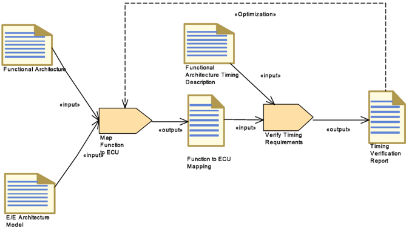

## 5. 分布式功能的端到端时序

本章介绍对分布式功能进行端到端时序推理的用例。作为分布式功能，我们考虑：

- 本地执行、但需要经由网络通信的来自传感器或功能的数据的功能。在这种情况下，至少存在关于数据最大年龄的假设；或者
- 由在不同 ECU 上执行、经由专用或共享总线连接的多个计算步骤组成的功能。在这种情况下，通常存在带整体延迟或周期性约束的事件链。

当今大多数汽车功能都是分布式功能。

### 5.1. 与其他章节的关系

本章与本文档其他部分的关系如下：

- 第 [3](#3-设计层级上的时序需求) 章介绍功能的术语（功能是什么），并非正式地讨论端到端时序需求如何分解为每个涉及资源的时序需求。此外，功能层级的用例也在该章处理。
- 第 [4](#4-功能层级的时序) 章包含功能层级的用例。
- 第 [6](#6-网络的时序) 章和第 [7](#7-ecu-层级软件集成的时序) 章讨论与单个资源的时序分析相关的用例。
- 第 [9](#9-用于时序分析的属性与方法) 章定义时序属性以及如何为单个资源和可调度对象推导这些属性。相关的时序属性（特别是资源的负载和可调度对象的延迟）在「时序属性的定义与分类」中介绍。

此外，本章（以及其他各章）与 AUTOSAR 时序扩展 [\[2\]](#ref-2) 相关，因为它可以推导其中规定的保证或断言其中规定的约束。

### 5.2. 端到端用例概览

本章描述表 5.1 所列的用例。

表5.1：与端到端时序相关的用例清单（**List of use cases related to end-to-end timing**）

| 章节 | 用例 |
|---|---|
| 5.3 | E2E 用例「从端到端时序需求推导逐跳时间预算」 |
| 5.4 | E2E 用例「从既有实现推导时序需求」 |
| 5.5 | E2E 用例「基于信号/参数为功能接口规定时序需求」 |
| 5.6 | E2E 用例「从逐跳时序保证聚合 E2E 时序保证」 |
| 5.7 | E2E 用例「对照时序需求验证保证」 |
| 5.8 | E2E 用例「基于追踪的分布式实现时序验证」 |
| 5.9 | E2E 用例「引入面向服务的通信」 |

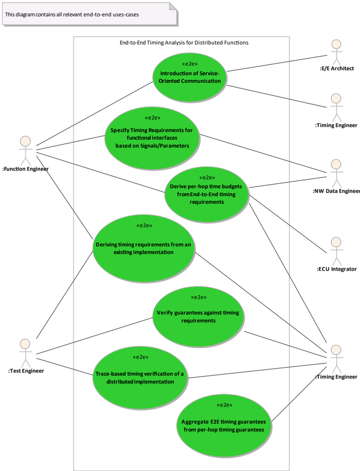

### 5.3. E2E 用例「从端到端时序需求推导逐跳时间预算」

该用例规定了功能拥有者如何分解端到端时序需求的工作流程，以推导并规定逐跳时间预算（例如，为分布在各执行节点和通信总线上的功能定义局部时间预算）。

当规格说明中确定了一个客户功能时，该用例变得相关。该功能被分解为一组必须集成到既有 E/E 网络中的功能。为这些功能确定端到端时序需求，并且必须为端到端链的每一段推导时间预算。AUTOSAR 时序扩展 [\[2\]](#ref-2) 提供了存储此类及相关属性的合适语法。

表5.2：E2E 用例「从端到端时序需求推导逐跳时间预算」的特征信息（**Characteristic Information**）

| | |
|---|---|
| 目标上下文： | 为参与端到端时序需求的各功能所分布到的每个 ECU 与通信网络规定时间预算。 |
| 简要描述： | 该用例要求已规定某个功能或功能集的带端到端时序需求的端到端时序链。此外，参与端到端时序链的功能被分解为部署在经由通信网络互联的 ECU 上的子功能。基于端到端时序需求，该用例为部署在 ECU 上的每个子功能（端到端时序链的段）以及每个涉及的网络段推导时间预算。 |
| 范围： | E2E |
| 频率： | 每当需要实现新的分布式功能时 |
| 前置条件： | 存在带端到端时序需求的端到端时序链（带功能分解）。 |
| 成功结束条件： | 端到端时序链的每个子功能（段）都找到了时间预算，且预算之和不超出端到端时序需求。 |
| 失败结束条件： | 某些时间预算无法推导，或找到的时间预算之和超出端到端时序需求。 |
| 参与者： | Timing Engineer、Function Engineer、Network Data Engineer、ECU Integrator。 |

#### 5.3.1. 主场景

该用例的系统化方法见图 5.2。典型地适用以下步骤：

1. 确定一个分布式功能并将其分解为一组可管理的功能组件（功能）。从规格说明中确定端到端时序需求（或通过实验建立）。描述端到端时序需求的合适属性由「时序属性」章节中的 GENERIC PROPERTY Latency 给出，它可以在任务「Collect Timing Requirements」的上下文中确定。
2. Function Engineer 分解功能并把子功能（组件的功能性贡献）分布到 ECU 网络上。这产生了功能在计算与通信资源上的分配。如果端到端时序需求跨越不同的网络，则在时间预算规划中应包含网络间路由的段。
3. 可选地，请 ECU Integrator 与 Network Data Engineer 估计所需的处理时间（估计的时序保证）。合适的方法是 GENERIC METHOD Determine Latency——或经由基于实现的时序分析（表 10.10），或经由基于模型的时序分析（表 10.9）。
4. 在可能的情况下尊重估计的逐跳时序，从端到端时序需求推导每个子功能的时间预算。
5. 由 Timing Engineer 对找到的时间预算相对于端到端时序需求进行验证。

另见相关的子用例：NW 用例「新通信的集成」。

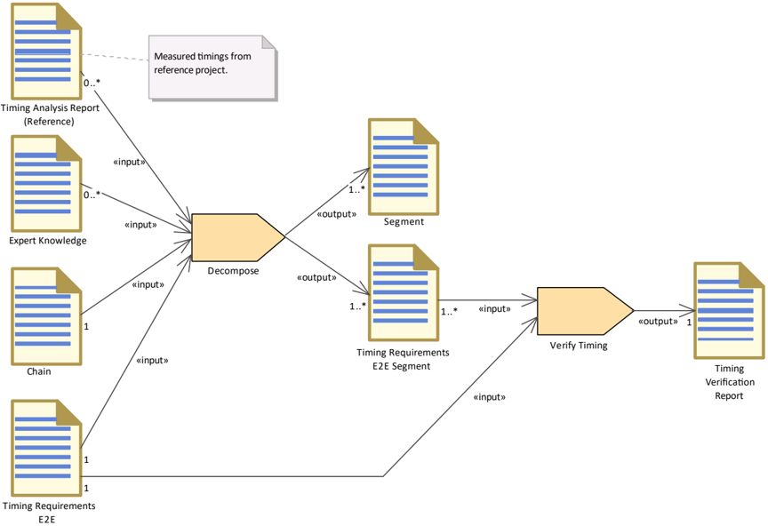

### 5.4. E2E 用例「从既有实现推导时序需求」

该用例规定了 Function Engineer 的工作流程：从对既有实现的基于实现的时序分析中，为开发中的系统推导时序需求（例如期限、端到端时序）。这可以应用于设计过程的早期阶段——对于新建系统，由于系统不完整/功能缺失、硬件平台不存在/未规定或缺少时序分析环境等原因，无法通过基于实现/基于模型的时序分析推导时序需求。此外，该用例还可应用于从单核平台向多核平台迁移的情况——从既有单核实现推导的时序需求可以应用于该系统的多核实现。其他可能的应用包括从一种网络类型迁移到另一种网络类型，或用新硬件替换旧硬件。该用例的目标是：开发中系统的时序行为与既有实现的时序行为充分对应（即时序相同或更好）。

AUTOSAR 时序扩展（TIMEX） [\[2\]](#ref-2) 提供了一种形式化时序约束描述的合适语法。

表5.3：该 E2E 用例的特征信息（**Characteristic Information**）

| | |
|---|---|
| 目标上下文： | 基于对既有实现的时序分析，为开发中的系统规定时序需求（在设计过程的早期，尚不了解且无法访问最终完整的系统实现与行为）。 |
| 简要描述： | 该用例描述如何从该系统或该系统部分的既有实现的时序中，为开发中的系统推导时序需求。 |
| 范围： | E2E、NW、ECU |
| 频率： | 每当既有功能必须在新系统上实现时。 |
| 前置条件： | 对开发中系统某个功能的既有实现的时序分析已存在，或可以在类似的系统上执行。 |
| 成功结束条件： | 从既有实现时序分析推导的时序需求被映射并应用于开发中的系统。 |
| 失败结束条件： | 从既有实现时序分析推导的时序需求无法被访问、映射和/或应用于开发中的系统。 |
| 参与者： | Timing Engineer、Function Engineer、Test Engineer。 |

#### 5.4.1. 主场景

该用例的系统化方法见图 5.3。典型地适用以下步骤：

1. 如果时序分析尚不存在，Timing Engineer 与 Test Engineer 需要对系统的既有实现执行时序分析。描述端到端时序需求的合适属性由 GENERIC PROPERTY Latency 给出，可以使用 GENERIC METHOD Determine Latency（用于既有实现的时序分析）在任务「Perform Implementation-Based Timing Analysis」的上下文中确定。如果端到端时序需求跨越不同的网络，时序属性 SPECIFIC PROPERTY Response Time (Routing) 可能相关，并且可以使用时序方法 SPECIFIC METHOD Determine Response Time (Routing) 获得。
2. Function Engineer 推导时序需求并将其映射/应用于开发中的系统。见任务「Collect Timing Requirements」。

另见相关的子用例：NW 用例「既有通信链路的重新映射」、ECU 用例「收集 SWE 的时序信息」以及 ECU 用例「创建整个 ECU 的时序模型」。

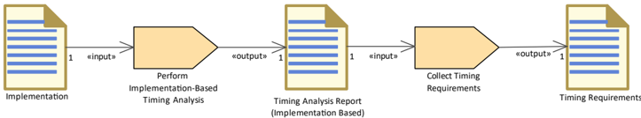

### 5.5. E2E 用例「基于信号/参数为功能接口规定时序需求」

该用例规定了 Function Engineer（例如分布式功能的）的工作流程：推导并规定相关的时序属性与需求，以便在车辆组网中考虑其通信。

表5.4：该 E2E 用例的特征信息（**Characteristic Information**）

| | |
|---|---|
| 目标上下文： | 精确规定一个功能对经由车辆网络进行数据通信的要求。 |
| 简要描述： | 该用例需要对特定功能的时序需求进行专门的推理。Function Engineer 为每个信号/参数（即在网络上传输的数据）标识预期的循环时间、抖动和延迟。为确保需求不被过度规定，需求由 Network Data Engineer 评审。 |
| 范围： | E2E、NW |
| 频率： | 每当功能的通信需求发生变化时 |
| 前置条件： | 涉及信号的端到端时序约束已被划分为 ECU 内部时序需求与网络相关时序需求（另见用例 6.3）。 |
| 成功结束条件： | 功能的时序需求已在显式的信号/参数请求中被考虑。 |
| 失败结束条件： | 功能的时序需求无法转换为信号/参数请求（例如因为它们未知）。 |
| 参与者： | Function Engineer、Network Data Engineer。 |

信号/参数请求应包含以下信息：

- 信号/参数的名称
- 信号/参数的大小
- 信号/参数的接收者（ECU 和/或软件组件的清单）
- 在目标网络上传输完成时信号可容忍的最大年龄
- 信号/参数的预期更新频率
- 信号/参数传输可接受的抖动
- 相关功能的简要描述

通常，由这些值推导出信号到帧（参数到包）的映射。在设计 CAN 配置的情况下，提出请求的功能拥有者会收到以下参数供 ECU 开发考虑：

- 帧的名称
- 传输属性（例如周期性）
- 帧的循环时间（如果相关）

这些信息随后成为 AUTOSAR 系统描述的一部分。

#### 5.5.1. 主场景

该用例通常由以下步骤组成：

1. Function Engineer 规定一个信号/参数请求，它（若如此实现）支持功能的正确运行。
2. Network Data Engineer 研究该信号/参数请求，并评审其内容的完整性与适当性。信号/参数请求不适当的迹象可能是：最大可容忍年龄小于更新频率，或请求的更新频率小于涉及任务的周期。出现此类问题时，Network Data Engineer 与 Function Engineer 迭代，直到确定一个适当的请求。与该步骤相关的是表 9.40 所列的方法与表 9.12 所列的属性。
3. Network Data Engineer 记录并存档该信号/参数请求。
4. （接下来，Network Data Engineer 将考虑该信号/参数请求，为该信号找到合适的信号到帧（参数到包）映射与路由条目。）

另见相关的子用例：NW 用例「新通信的集成」。

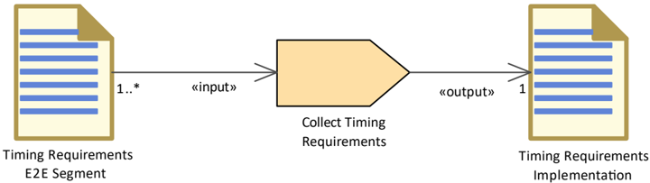

### 5.6. E2E 用例「从逐跳时序保证聚合 E2E 时序保证」

该用例把通过对某个段的实际实现的分析所推导的延迟属性值（「保证」）聚合为端到端时序链的时序保证。

为了验证分布式功能的端到端时序需求，可能需要聚合为端到端时序链的各个段测量到的延迟属性值。这可能由于开发尚处早期（系统中只有个别部分存在），或由于技术限制只能对个别部分进行时序分析。

在简单的情况下，聚合可以简单到把各段的延迟属性值相加。但延迟属性值通常受运行条件影响，且对各段的影响可能不同。例如，如果你关心端到端时序链的最坏情况延迟，该链两段的最坏情况延迟可能永远不会在相同的运行条件下出现。因此实际的最坏情况延迟可能低于两段最坏情况延迟之和。如果延迟属性值以概率分布表示，则有解析方法或基于蒙特卡洛仿真的方法来组合两个段的概率分布。

表5.5：该 E2E 用例的特征信息（**Characteristic Information**）

| | |
|---|---|
| 目标上下文： | 从端到端时序链各段的时序属性聚合该链的延迟属性值。 |
| 简要描述： | 当需要把通过对段实际实现的分析推导的时序属性聚合起来、以确定端到端时序链的延迟属性值时，适用该用例。 |
| 范围： | 系统 |
| 频率： | 每当时序保证发生变化时。 |
| 前置条件： | 端到端时序链所有段的时序保证已知。时序保证对所有相关运行条件可用。相邻段之间没有间隙或重叠。 |
| 成功结束条件： | 端到端时序链的保证已确定。 |
| 失败结束条件： | – |
| 参与者： | Timing Engineer |

#### 5.6.1. 主场景

该用例的系统化方法见图 5.5。典型地适用以下步骤：

1. Timing Engineer 检查所有段的时序分析报告（见表 10.12）是否可用，以及是否覆盖所有相关运行条件。
2. Timing Engineer 从每段的时序分析报告中提取相同运行条件下的延迟属性值。逐段聚合延迟属性值，直到确定完整链的时序属性。Timing Engineer 必须注意相邻两段的终点与起点相匹配。例如对 GENERIC PROPERTY Latency 而言，如果各段重叠或存在间隙，聚合值将偏长或偏短。
3. Timing Engineer 用聚合的延迟属性值组合出端到端时序链的新的时序分析报告。

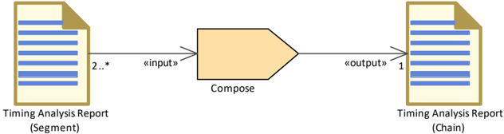

### 5.7. E2E 用例「对照时序需求验证保证」

该用例把通过对实际实现的分析推导的时序属性（「保证」）与系统的规格说明（「需求」）进行比较。

由于 E2E 链不同部分的开发分散在不同的部门与组织，定期收集并验证保证有助于确保时序需求能够达成、问题可以尽早纠正。这应在开发过程中尽早启动。最初的保证可以来自对组件初始实现的估计、从既有项目获取参考值、对复用软件在以前硬件上的测量，或者一旦通信链路的第一个配置已知就执行仿真。随着开发的推进，保证的精度会提高：时序模型随每次迭代而成熟，被测量的软硬件越来越接近最终产品。

该用例的最好结果是需求被保证满足。否则，要么需要放宽需求，要么必须改进保证（例如通过重新配置系统）。

表5.6：该 E2E 用例的特征信息（**Characteristic Information**）

| | |
|---|---|
| 目标上下文： | 验证特定实现的时序是否遵守时序需求。 |
| 简要描述： | 该用例建立对实际实现的分析结果（「保证」）与所规定的预期行为（「需求」）之间的比较。 |
| 范围： | ECU、NW、E2E |
| 频率： | 每当时序需求或时序保证发生变化时。 |
| 前置条件： | 所有时序需求与时序保证必须已知；任何未被量化且未明确列出的时序需求都不会被纳入评估。 |
| 成功结束条件： | 已知当前实现是否满足所有时序需求。最好的结果是需求被保证满足。否则，要么需要放宽需求，要么必须改进保证。 |
| 失败结束条件： | 至少一个保证导致违反某个时序需求。 |
| 参与者： | Timing Engineer、Test Engineer。 |

#### 5.7.1. 主场景

该用例的系统化方法见图 5.6。典型地适用以下步骤：

1. 根据开发的进展，保证可能只对 E2E 链的某些段可用。在这种情况下，可以把各个保证对照来自 E2E 用例「从端到端时序需求推导逐跳时间预算」的时序需求进行断言。一旦能够端到端地获得保证，就可以直接对照 E2E 时序需求进行验证。
2. 通过执行任务「Perform Model-Based Timing Analysis」或任务「Perform Implementation-Based Timing Analysis」，建立由实现评估所提供的已知最好的保证。与该步骤相关的是表 9.40 所列的方法、第 [9.5](#95-时序方法的定义描述与分类) 节描述的通用方法以及表 9.12 所列的属性。
3. 各段的保证必须按照 E2E 用例「从逐跳时序保证聚合 E2E 时序保证」所述进行聚合。
4. 报告保证、需求以及两者的比较（任务「Verify Timing」）。

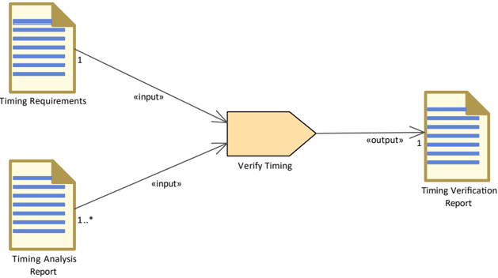

### 5.8. E2E 用例「基于追踪的分布式实现时序验证」

无论是为了理解、调试还是验证分布式系统的时序行为，对相关总线与 ECU（下文称为子系统）进行追踪都能显著简化时序分析。

如果能把来自各子系统的追踪对齐（即同步），从而展示事件链的跨子系统时序效应——例如多核系统中的跨核通信、ECU 与通信网络收发数据时的数据缓冲效应，乃至完整的端到端时序场景——这一点就更加成立。

表5.7：该 E2E 用例的特征信息（**Characteristic Information**）

| | |
|---|---|
| 目标上下文： | 理解、调试并验证分布式实现的时序行为。 |
| 简要描述： | 追踪观察真实系统。对于专用事件（例如任务的启动或总线上某条消息的出现），时间戳连同事件信息被放入追踪缓冲区，之后可用于重构和分析所观察的场景。详情见「测量与追踪」。为了分析跨子系统的时序效应，必须同步所有相关子系统的追踪。 |
| 范围： | E2E、ECU、NW |
| 频率： | 每当需要关于实际实现的时序信息时 |
| 前置条件： | 存在且可运行的系统，可访问的子系统。测试工程师使用的追踪工具必须就位、获得许可并集成到系统中。 |
| 成功结束条件： | 追踪已执行且数据（=追踪记录）可供分析；必要时，来自不同子系统（核、ECU、总线）的追踪已对齐（即同步）。 |
| 失败结束条件： | 无法追踪全部相关的调度实体，或追踪记录无法对齐（即同步）。 |
| 参与者： | Timing Engineer、Test Engineer。 |

#### 5.8.1. 主场景

该用例的系统化方法见图 5.7。典型地适用以下步骤：

1. Timing Engineer 与 Test Engineer 准备测量和被测系统（工具、软件……）。
2. Test Engineer 对所考虑系统的既有实现执行相关的（即同步的）追踪。见任务「Perform Implementation-Based Timing Analysis」。相关的方法与属性有 GENERIC METHOD Determine Latency、GENERIC METHOD Determine Load、GENERIC PROPERTY Latency 与 GENERIC PROPERTY Load。如果端到端时序需求跨越不同的网络，时序属性 SPECIFIC PROPERTY Response Time (Routing) 可能相关，并且可以使用时序方法 SPECIFIC METHOD Determine Response Time (Routing) 获得。
3. Timing Engineer 检查追踪记录的质量，确认质量足够。如需要，为同步向追踪记录添加时间补偿。用收集到的追踪数据组合出时序分析报告。
4. 借助时序分析报告，Timing Engineer 可以对照时序需求验证时序行为。

另见相关的子用例：ECU 用例「收集 SWE 的时序信息」与 ECU 用例「时序的验证」。

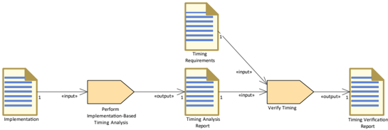

### 5.9. E2E 用例「引入面向服务的通信」

基于经典平台的分布式系统在 SWC 之间使用发送者/接收者或客户端/服务器通信。在总线上，多数情况使用基于信号的通信，但随着 SOME/IP Transformer 的出现，向面向服务的通信迈出了第一步。自适应平台完全基于面向服务的通信。当基于自适应平台的新 ECU 被引入分布式系统时，面向服务的通信必须被集成并纳入 E2E 时序分析。

该用例覆盖与 E2E 时序相关的两个方面：一方面，服务发现与初始延迟相关；另一方面，通信的类型对 E2E 延迟有强烈影响。本 E2E 用例讨论这两个方面的一般影响，而底层网络协议（SOME/IP、DDS 等）的细节将在网络用例中讨论。

面向服务的通信允许对通信矩阵进行自适应的改变：服务提供者可以在任何时间点开始或停止发布服务，订阅者可以随时订阅或取消订阅。要订阅某个服务，必须先找到该服务。这一过程称为服务发现（**service discovery**）。服务发现可以在系统启动时、在应用启动时或当某个功能需要该服务时执行。服务发现过程的细节取决于实现：例如，服务可以周期性地广播，或只是加入一个中央注册表。在后一种情况下，服务发现所需的时间必须计入分布式功能的 E2E 延迟。如果服务发现在启动时执行，或者服务在设计时静态配置，则服务发现不属于 E2E 延迟的一部分。每个订阅服务的客户端都会给服务提供者带来额外的负载。这也会影响 E2E 延迟。

通信的类型是面向服务通信的 E2E 延迟中最相关的因素：由服务提供者周期性发送的事件到达订阅者的时间点由于栈与网络引入的高抖动而难以精确预测。特别是在对接收的数据进行周期性处理的情况下，这会引入额外的延迟。如果使用方法调用而非事件，则从服务器视角来看方法调用的执行难以预测，这也可能导致更长的延迟。

表5.8：该 E2E 用例的特征信息（**Characteristic Information**）

| | |
|---|---|
| 目标上下文： | 对面向服务通信的 E2E 时序进行基于模型的设计、分析与验证。 |
| 简要描述： | 为面向服务的通信定义时序相关参数。 |
| 范围： | ECU、NW、E2E |
| 频率： | 每当面向服务的通信被设计、修改或需要验证时。 |
| 前置条件： | 服务器与客户端的接口必须已规定。其余系统的模型（如可用）。 |
| 成功结束条件： | 面向服务通信的规格说明满足需求。 |
| 失败结束条件： | 面向服务通信的规格说明不满足至少一项需求。 |
| 参与者： | Timing Engineer、E/E Architect、Function Engineer。 |

#### 5.9.1. 主场景

该用例的系统化方法见图 5.8。分析引入面向服务通信对 E2E 延迟影响的一种常用方式是基于模型的时序分析。典型地适用以下步骤：

1. Function Engineer 收集应在哪些组件之间引入面向服务通信的信息。
2. Timing Engineer 创建覆盖计划的服务发现的系统时序模型。
3. Timing Engineer 以服务发现为重点执行基于模型的时序分析。
4. Timing Engineer 创建覆盖计划的通信类型的系统时序模型。
5. Timing Engineer 以通信类型为重点执行基于模型的时序分析。
6. Timing Engineer 对照时序需求验证时序分析的结果。
7. E/E Architect 与 Function Engineer 优化面向服务的通信，直到所有 E2E 需求得到满足。

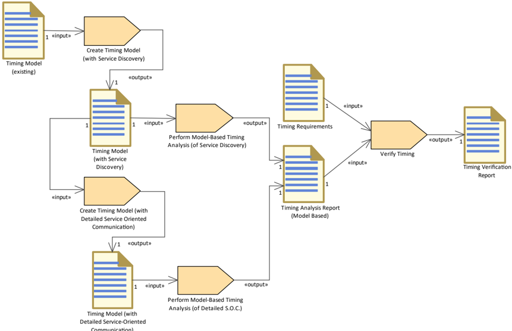

#### 5.9.2. 时序参考平台中的验证

用例「引入面向服务的通信」是第一个聚焦自适应平台的用例。自适应平台有一个演示系统，它是时序参考平台（**Timing Reference Platform**，**TRP**）的基础。它将用于该用例的验证，并为新的用例积累经验。作为第一步，需要由两个基于自适应平台的 ECU 组成的系统。一个 ECU 运行提供服务的应用，另一个 ECU 运行订阅该服务的应用。通信应包含事件与方法调用。借助这一搭建，可以分析服务发现和不同通信类型的延迟。时序参考平台的细节见附录 A。

图 5.9（E2E 用例「引入面向服务的通信」在时序参考平台中的呈现）的图题存在于源文档中，但其在 markdown 转换中的内容图缺失（仅存页面装饰图）。

## 6. 网络的时序

本章概述与汽车网络通信相关的时序用例。第 [7](#7-ecu-层级软件集成的时序) 章覆盖的与 ECU 相关的时序方面可能对网络时序产生直接或间接的影响。

在汽车通信网络中，时序行为主要由通信矩阵描述，它包含带有协议与时序特定参数（例如载荷、ID、帧触发参数）的通信帧/包。

根据网络上要传输的流量大小与通信协议，网络可能满足、也可能不满足给定的时序需求（例如帧的最大延迟或给定的总线负载阈值）。一般而言，网络架构师必须定义参数，使时序需求得到满足。

本章描述的用例呈现与通信网络设计相关的问题与解决方案。本章使用的典型术语有：

- 负载（**Load**），见第 [9.4](#94-时序属性的定义与分类) 节
- 延迟（**Latency**），见第 [9.4](#94-时序属性的定义与分类) 节
- 响应时间（**Response Time**），见第 [9.4](#94-时序属性的定义与分类) 节

### 6.1. 示例

第 [1](#1-简介) 章给出了一个带端到端时序需求的系统示例（见图 1.2）。在网络上，端到端时序需求受网络配置以及网络组件（主要是总线与网关）调度的影响，见图 6.1。本章的用例均参照该示例。

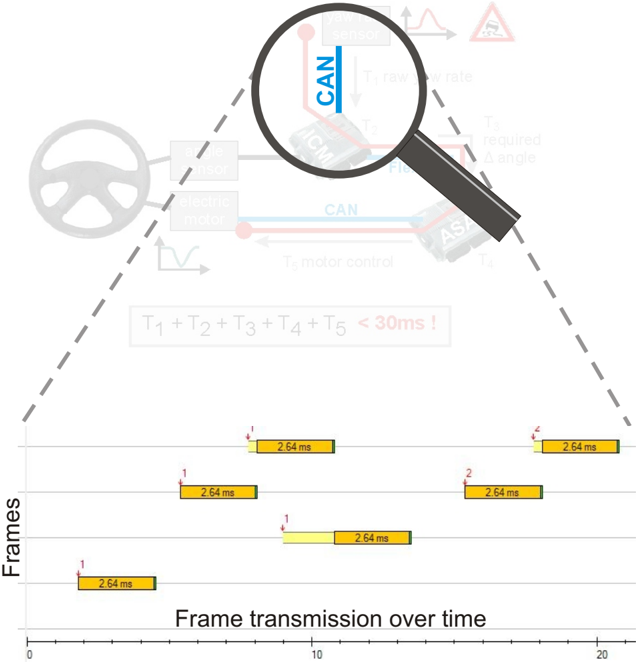

### 6.2. 网络用例概览

网络用例覆盖四种情况：

1. 在既有网络（已具有稳定拓扑）中引入新通信
2. 建立新的通信网络（拓扑尚未定义）
3. 对既有网络中既有通信链路的重新映射
4. 优化通信网络的时序属性

这些用例的第一步是理解时序属性。此类属性的一个常见示例是网络消息的响应时间。属性按第 [9.2.0.4](#9204-约束类型) 章所述被定义为约束或需求。

基于确定的时序属性，必须收集并评估既有（或待设计）网络的时序需求。

下一步是使用这些属性来构建或扩展时序模型。需要时序模型以便在实现开始之前验证时序属性，并把实现与规格说明进行比较。该步骤收集的结果构成时序验证报告。

这个过程可以且应当迭代执行，以从验证推进到确认。

详细用例见表 6.1。

表6.1：网络特定用例清单（**List of network specific use cases**）

| 章节 | 用例 |
|---|---|
| 6.3 | NW 用例「新通信的集成」 |
| 6.4 | NW 用例「新网络的设计与配置」 |
| 6.5 | NW 用例「既有通信链路的重新映射」 |
| 6.6 | NW 用例「E/E 拓扑的变更」 |
| 6.7 | NW 用例「通信时序的优化」 |
| 6.8 | NW 用例「推导网络段上消息的时序属性」 |

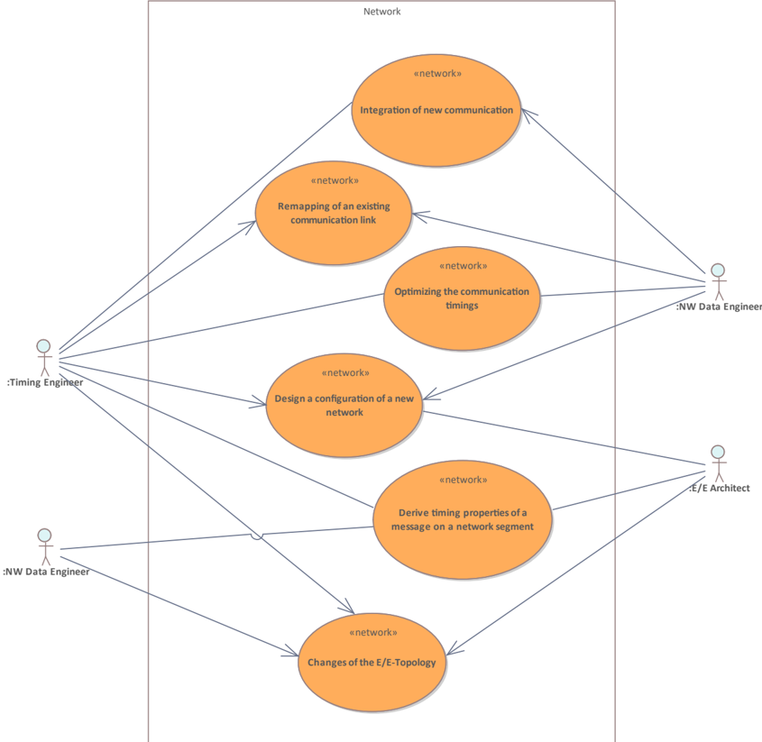

### 6.3. NW 用例「新通信的集成」

该用例聚焦于把新通信集成到既有的汽车网络中。

表6.2：NW 用例「新通信的集成」的特征信息（**Characteristic Information**）

| | |
|---|---|
| 目标上下文： | 把新通信可行地集成到既有的网络化架构中。 |
| 简要描述： | 考虑一个由若干 ECU 经由总线连接组成的汽车 E/E 架构，需要向网络集成额外的通信，使既有通信与新通信都满足时序需求。例如，新通信是从横摆角速度传感器经由网络传输到 ASA ECU 的额外传感器数据（见图 1.2）。新传感器数据在网络总线上的最大延迟不得超过 10 ms。新通信必须集成的总线可以采用不同的通信协议（例如 CAN、LIN、FlexRay 等）。每条总线上的通信由通信矩阵规定，其中包含带有协议特定参数的 PDU/帧以及通信行为（时序参数）。 |
| 范围： | 系统 |
| 频率： | 定期 |
| 前置条件： | 对新通信已定义以下属性：• 通信信号的大小（SW-C 模板 / GenericStructureTemplate）。• 发送与接收节点 / 系统映射 • PDU/帧的时序/触发 • 所需带宽。此外，对网络上的通信已知一组时序需求：• 每条总线的最大总线负载 • 每个 PDU/帧的最大延迟（例如响应时间、路由时间）。此外，已有对既有总线控制器通信范式的规定，例如 CAN 控制器经由队列（按优先级或 FIFO 排序）发送具有不同标识符的 CAN 帧，而同一帧的不同实例经由寄存器发送（总是发送最新的帧实例）。假定当前的网络配置满足时序需求。 |
| 成功结束条件： | 新通信已被完整定义，且时序需求得到满足。 |
| 失败结束条件： | 无法在不违反至少一项时序需求的情况下定义新通信。 |
| 参与者： | Timing Engineer、Network Data Engineer |

#### 6.3.1. 主场景

为清晰起见，使用以下记号：既有 E/E 架构由若干 ECU（ECU1、ECU2 等）组成，经由多条通信总线（记为 Bus1、Bus2 等）以及一个或多个网关连接。必须集成到既有网络的新通信被分配给一个记为 F 的分布式功能。F 由映射到一个或多个 ECU 上的多个软件组件（**SW-C**）组成。每个 SW-C 有自己的通信接口，通过它们发送或接收信息，即打包在 PDU/帧中的通信信号。

该用例的系统化方法见图 6.3。该用例通常由以下步骤组成：

1. Network Data Engineer 依照 F 的规格说明中定义的时序参数以及 F 的各 SW-C 之间的发送者-接收者关系，把新通信映射到既有的 PDU/帧上。
2. 根据 F 的各 SW-C 之间的链路，可能还需要在网络内不同总线之间路由 PDU/帧。这发生在 F 的 SW-C 被映射到连接到不同总线的 ECU 时，例如一个在 Bus1 上的 ECU1、另一个在 Bus2 上的 ECU2；另见任务「Create Implementation」。
3. Timing Engineer 执行以下分析步骤：
   1. 分析 1：总线负载分析描述总线带宽的平均使用。因此它必须考虑新通信产生的额外流量。总线负载分析必须应用于受新通信影响的每条总线，并需要 PDU/帧的数据大小和平均时序。分析的输出是通过时序方法 GENERIC METHOD Determine Load 获得的时序属性 GENERIC PROPERTY Load，或者对 CAN 总线特有的是通过时序方法 SPECIFIC METHOD Determine Load (CAN) 获得的时序属性 SPECIFIC PROPERTY Load (CAN)。总线负载属性用于初步批准每条通信总线上的流量。把为每条总线获得的负载属性当前值与该总线上最大可接受负载进行比较。总线负载的典型要求见第 [6.3.3](#633-性能时序需求) 节。如果总线负载超标，则通信不可调度。
   2. 分析 2：为了在集成新通信后验证网络，还必须在每条总线上对既有流量和新流量的所有 PDU/帧验证延迟需求。延迟分析应用时序方法，在资源共享协议下计算 PDU/帧的时序属性。分析结果是诸如以下的时序属性：
      - PDU/帧的响应时间（包括仲裁引起的阻塞时间）——通过时序方法 GENERIC METHOD Determine Latency 获得的 GENERIC PROPERTY Latency，或对 CAN 总线特有的是通过时序方法 SPECIFIC METHOD Determine Response Time (CAN) 获得的 SPECIFIC PROPERTY Response Time (CAN)；或
      - PDU/帧的抖动。

      把时序属性的值与定义的需求以及时序属性先前值进行比较。PDU/帧响应时间的典型要求见第 [6.3.3](#633-性能时序需求) 节。
   3. 分析 3：如果与新通信关联的 PDU/帧由一个或多个网关路由，则路由时间与端到端时序相关。对被路由的 PDU/帧应用时序方法 SPECIFIC METHOD Determine Response Time (Routing) 提供由路由引擎引起的时序属性 SPECIFIC PROPERTY Response Time (Routing)。路由响应时间与缓冲所需的存储器资源需求紧密相关，需要加以考虑，但不在本文档的范围之内。把这些属性获得的值与定义的需求进行比较。路由时间的典型要求见第 [6.3.3](#633-性能时序需求) 节。

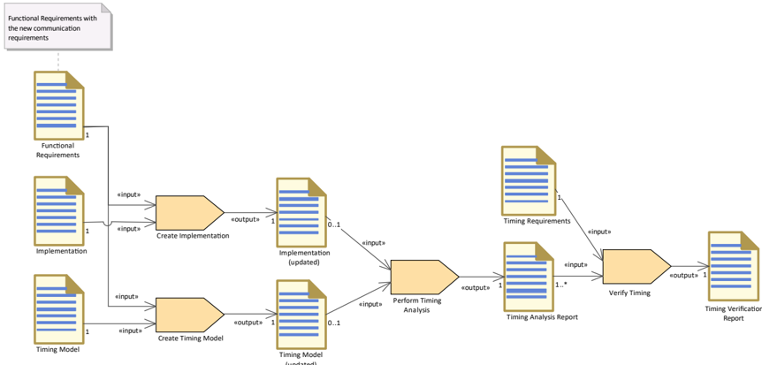

#### 6.3.2. 替代场景

在主场景的步骤 #1，如果新通信超出了既有 PDU/帧中未用空间的大小，则根据信号的时序参数定义新的 PDU/帧。必须把新流量对既有通信的影响降到最低。方法论随后继续主场景的步骤 2。

#### 6.3.3. 性能/时序需求

每条总线上的最大负载不得超过某个界限。

对每个帧/PDU，最坏情况响应时间不得超过某个界限，例如由时序需求给出的界限。典型地，帧的循环时间被用作最坏情况响应时间的界限。否则存在数据丢失的风险。

网关中的路由时间必须很短。典型地，对每个帧/PDU，路由时间只应占总延迟的一小部分。具体值取决于特定的功能需求。

### 6.4. NW 用例「新网络的设计与配置」

表6.3：NW 用例「新网络的设计与配置」的特征信息（**Characteristic Information**）

| | |
|---|---|
| 目标上下文： | 把一个（特定域的）网络设计并可行地集成到既有的汽车平台架构中。可能的变体：•（车载网络的）全新设计（整车网络）• 在使用未改动的既有 ECU（网络连接器除外）的前提下，用一个新的子网络替换既有的子网络。该网络经由网关连接到剩余的车载网络。 |
| 简要描述： | 考虑一个由若干 ECU 经由多条既有网络连接组成的汽车 E/E 架构，需要设计并集成一个新设计的网络（例如我们的主动转向示例，见图 1.2）。新设计的网络应经由网关连接到剩余的车载网络（例如连接到车身或信息娱乐域）。因此必须考虑新网络内部的通信以及不同网络之间的通信。此外，该新网络应以先验可预测的方式稳定可扩展，即应当能够对照所有当前与未来的时序需求分析该网络。新网络实现通信协议（例如 CAN、LIN、FlexRay 等），并拥有足够的带宽以覆盖所有通信需求。网络上的通信由通信矩阵规定，其中包含带有协议特定参数的 PDU/帧/包以及通信行为（时序参数）。 |
| 范围： | 系统 |
| 频率： | 少见 |
| 前置条件： | 对新通信已定义以下属性：• 通信信号的大小（SW-C 模板 / GenericStructureTemplate）。• 发送与接收节点 / 系统映射 • PDU/帧/包的时序/触发 • 所需带宽 • 剩余车载网络（包括网关与通信矩阵）。此外，对网络上的通信定义了一组时序需求：• 每个网络的最大负载 • 每个 PDU/帧/包的最大延迟（例如响应时间、路由时间）。此外，定义了对既有网络控制器通信范式的规定，例如 CAN 控制器经由队列（按优先级或 FIFO 排序）发送具有不同标识符的 PDU/帧，而同一 PDU/帧的不同实例经由寄存器发送（总是发送最新的 PDU 实例）。假定当前（剩余）车载网络配置满足时序需求。 |
| 成功结束条件： | 新（子）网络上的通信已被完整定义，且车载网络的时序需求得到满足。 |
| 失败结束条件： | 无法在不违反车载网络至少一项时序需求的情况下定义新通信。 |
| 参与者： | Timing Engineer、Network Data Engineer、E/E Architect |

#### 6.4.1. 主场景

该用例的系统化方法见图 6.4。该用例通常由以下步骤组成：

1. E/E Architect 选择合适的网络技术以满足新功能的通信需求。必须考虑对剩余系统的后果，因为应尽可能不改动许多既有 ECU。
2. E/E Architect 定义和/或设计到剩余车载网络的连接点（经由透明网关）。
3. E/E Architect 把 ECU 连接到新网络，并把功能划分到这些 ECU 上。
4. Network Data Engineer 依照任务「Collect Timing Requirements」收集通信的数据大小与时序需求。
5. Network Data Engineer 依照时序信息和发送者/接收者关系映射新流量。
6. 根据发送者/接收者关系，可能还需要在多条网络与网关上路由 PDU/帧。
7. Timing Engineer 使用任务「Create Timing Model」创建可分析的时序模型。
8. 应执行不同类型的基于模型的分析（任务「Perform Model-Based Timing Analysis」）：
   1. 分析 1：负载分析确定网络带宽及 ECU 输入缓冲区的平均与最大使用。负载分析必须同时考虑新子网络与既有车载网络上的总流量。因此，应用时序方法 GENERIC METHOD Determine Load 的负载分析的结果是时序属性负载 GENERIC PROPERTY Load。特别是对 CAN 总线，时序方法 SPECIFIC METHOD Determine Load (CAN) 提供的结果是时序属性 SPECIFIC PROPERTY Load (CAN)。负载属性用于初步批准所选的功能映射与架构，以及新基础设施总体上是否足以覆盖通信需求。把每个网络的负载属性当前值与该网络的最大可接受负载进行比较。
   2. 分析 2：需要对网络上所有 PDU/帧/包及每条通信关系进行详细的延迟分析。诸如 GENERIC METHOD Determine Latency 之类的时序方法产生诸如 GENERIC PROPERTY Latency 与 GENERIC PROPERTY Response Time 的时序属性，或者对 CAN 总线特有的是通过时序方法 SPECIFIC METHOD Determine Response Time (CAN) 获得的 SPECIFIC PROPERTY Response Time (CAN)。其他时序属性（例如抖动或阻塞时间）同样值得关注，并需要相应的时序方法。每条通信关系都必须满足其相应的延迟需求。
   3. 分析 3：对于与其他网络交换的网络流量，必须考虑完整通信事件链的响应时间需求。对连接到网络的所有路由器/网关，路由响应时间可能受新网络路由需求的影响。可以使用时序方法 SPECIFIC METHOD Determine Response Time (Routing) 获得时序属性 SPECIFIC PROPERTY Response Time (Routing) 以验证网络设计。
9. 在减少资源需求、提高系统稳定性与健壮性、便于未来扩展的需求下优化新网络的设计。优化过程的详细描述见 NW 用例「通信时序的优化」。

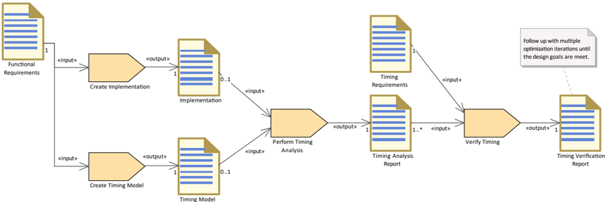

#### 6.4.2. 性能/时序需求

每条总线上的最大负载不得超过某个界限。

对每个帧/PDU，最坏情况响应时间不得超过某个界限，例如由时序需求给出的界限。典型地，帧的循环时间被用作最坏情况响应时间的界限。

网关中的路由时间必须很短。典型地，对每个帧/PDU，路由时间不得超过帧循环时间的 10%。

### 6.5. NW 用例「既有通信链路的重新映射」

该用例聚焦于在既有网络内重新映射一条既有的通信链路。

表6.4：NW 用例「既有通信链路的重新映射」的特征信息（**Characteristic Information**）

| | |
|---|---|
| 目标上下文： | 在重新考虑既有通信链路的映射之后，验证网络上的通信。 |
| 简要描述： | 假定一个包含经由一条或多条总线连接的 ECU 的汽车 E/E 架构，需要把一条既有的通信链路重新映射到网络内的一个新资源（例如把电机控制信号从 CAN 映射到 FlexRay，假定电机直接连接到 FlexRay，见图 1.2）。网络内的总线可以实现不同的通信协议（例如 CAN、LIN、FlexRay）。每条总线上的通信由通信矩阵规定，其中包含带有协议特定参数的 PDU/帧以及通信行为（时序参数，例如电机控制信号的 10 ms 最大延迟）。 |
| 范围： | 系统 |
| 频率： | 定期 |
| 前置条件： | 描述该通信链路的信号已知并包含在通信矩阵中。此外，对网络上的通信定义了一组时序需求：• 每条总线的最大总线负载 • 每条通信帧的最大延迟（例如响应时间、路由时间）。此外，已有对既有总线控制器通信范式的规定。例如，CAN 控制器经由队列（按优先级或 FIFO 排序）发送具有不同标识符的 CAN 消息帧，而同一帧的不同实例经由寄存器发送（总是发送帧的最新实例）。假定当前的网络配置满足时序需求。 |
| 成功结束条件： | 功能重新映射之后网络上的通信满足时序需求。通信矩阵需要更新。 |
| 失败结束条件： | 功能重新映射之后，无法在不违反至少一项时序需求的情况下定义网络上的通信。 |
| 参与者： | Timing Engineer、Network Data Engineer |

#### 6.5.1. 主场景

为清晰起见，使用以下记号：待重新映射的通信链路当前被分配到 Bus1。重新映射后将承载该通信链路的资源记为 Bus2。

该用例的系统化方法见图 6.5。该用例通常由以下步骤组成：

1. Network Data Engineer 确定 Bus1 上分配给该通信链路的 PDU/帧。重新映射该通信链路后，它们必须在 Bus2 上传输。
2. 分配给该通信链路、且 Bus1 上其他链路也需要的 PDU/帧，在把通信链路重新映射到 Bus2 之后必须在 Bus2 上路由。反之，如果这些 PDU/帧不再被 Bus1 上的其他节点需要，可以决定把它们从 Bus1 上移除。
3. 移动或复制到 Bus2 的 PDU/帧应保留为 Bus1 定义的通信协议参数，以确保与不同架构变体的功能兼容性。
4. Bus2 上该通信链路所需、且并非原本由 Bus2 上另一发送者发送的 PDU/帧，需要被路由/传输到 Bus2。
5. Timing Engineer 执行以下分析步骤：
   1. 分析 1：总线负载分析描述总线带宽的平均使用。分析必须考虑把通信链路重新映射到 Bus2 之后 Bus2 上的额外流量。分析需要 PDU 的数据大小和平均时序。应用方法 GENERIC METHOD Determine Load（或对 CAN 总线应用 SPECIFIC METHOD Determine Load (CAN)）的分析输出是静态总线负载，由时序属性 GENERIC PROPERTY Load（或 SPECIFIC PROPERTY Load (CAN)）捕获。总线负载属性用于初步批准 Bus2 上的流量。可选地，可以在 Bus1 上执行总线负载分析，以确定把通信链路重新映射到 Bus2 后释放出的性能余量。把每条总线获得的负载属性值与该总线上最大可接受负载进行比较。总线负载的典型要求见第 [6.5.2](#652-性能时序需求) 节。如果总线负载超标，则通信不可调度。
   2. 分析 2：为了在把通信链路重新映射到 Bus2 之后验证网络上的通信，必须验证 Bus2 上 PDU/帧的延迟需求。PDU/帧的延迟分析在资源共享协议下计算它们的时序属性。应用时序方法 GENERIC METHOD Determine Latency（或对 CAN 总线应用 SPECIFIC METHOD Determine Response Time (CAN)）的分析结果是 PDU/帧的时序属性响应时间，例如 GENERIC PROPERTY Latency / GENERIC PROPERTY Response Time，CAN 总线情况下为 SPECIFIC PROPERTY Response Time (CAN)。其他时序属性（例如 PDU/帧的抖动或仲裁引起的阻塞时间）同样值得关注，并需要相应的时序方法。把时序属性的值与规定的需求进行比较。PDU/帧响应时间的典型要求见第 [6.5.2](#652-性能时序需求) 节。
   3. 分析 3：如果 Bus2 上所需的 PDU/帧由一个或多个网关路由，则路由时间与端到端时序相关。对被路由的 PDU/帧应用时序方法 SPECIFIC METHOD Determine Response Time (Routing) 提供由路由引擎引起的时序属性 SPECIFIC PROPERTY Response Time (Routing)。路由响应时间与缓冲所需的存储器资源需求紧密相关，需要加以考虑，但不在本文档的范围之内。把这些属性获得的值与规定的需求进行比较。路由时间的典型要求见第 [6.5.2](#652-性能时序需求) 节。

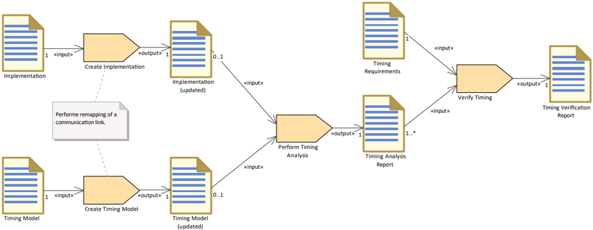

#### 6.5.2. 性能/时序需求

每条总线上的最大负载不得超过某个界限。

对每个帧/PDU，最坏情况响应时间不得超过某个界限，例如由时序需求给出的界限。典型地，帧的循环时间被用作最坏情况响应时间的界限。

网关中的路由时间必须很短。典型地，对每个帧/PDU，路由时间不得超过例如帧循环时间的 10%。

### 6.6. NW 用例「E/E 拓扑的变更」

当需要变更 E/E 拓扑或需要评估不同的 E/E 拓扑方案时，该用例变得适用。E/E 拓扑影响时序行为，必须通过对 E/E 拓扑的时序分析来验证：受拓扑变更影响的所有通信链路仍然满足其时序需求。

由于在开发后期变更 E/E 拓扑可能困难且代价高昂——尤其当已生产的硬件必须被替换时——良好的实践是使用基于模型的时序分析来评估 E/E 拓扑设计方案。之后，对于 E/E 拓扑的小型优化的验证，时序分析可以直接在实现上执行。

为了界定时序分析的范围并为时序模型设定重点，理解不同的拓扑变更如何影响时序行为非常重要：

#### 6.6.1. 移动单个 ECU

对 E/E 拓扑最简单的修改是把一个 ECU 移到另一网络。这样做的动机可能是把 ECU 移到离时间关键的通信伙伴更近的位置，或者通过把 ECU 放在与其大多数通信密集伙伴相同的网络上以减少路由需求。移动 ECU 后，一些通信路径变短，但另一些会变长。因此重要的是：与该 ECU 交换的所有消息仍满足延迟时序需求。在另一网络上，由该 ECU 经由这些网络路由的额外消息会增加负载，这可能对既有消息在这些网络上的响应时间产生负面影响。位置的改变也可能影响路由路径，导致流量经由先前无关的网络路由，影响其负载与时序。新的路由路径还可能影响网关的路由性能。它可能增加经由相同端口路由的消息的阻塞时间，最坏情况可能影响整个网关的路由性能，从而影响由该网关路由的所有消息。

#### 6.6.2. 移动多个 ECU

把多个 ECU 移到另一网络。这一变更的目的可能是重新均衡两个网络的负载。如果有一组通信密集的 ECU，而另一网络的负载仍然很低，把 ECU 移到该网络可以是一个选项。必须考虑的是，负载不仅会由这些 ECU 之间的通信增加，还会由如今必须经由该网络路由的、与其他 ECU 的通信增加。额外的消息将影响既有消息的延迟时序、抖动和阻塞时间。并且如单个 ECU 的情况所述，新的路由需求也会影响时序。

#### 6.6.3. 增加一个网络

向 E/E 拓扑增加一个新网络。如果一个或多个网络的网络负载超过最大可接受负载，或负载对这些网络上的响应时间产生负面影响，可能需要向 E/E 拓扑增加额外的网络，并把合适的 ECU 从这些网络移到新网络。ECU 的适用性由通信需求决定。目标应当是把交换时间关键数据或大量数据的 ECU 放在同一网络上。假定新网络连接到同一网关、且网关能够轻松处理额外的路由工作，则先前过载的网络的整体时序性能将会提升。前提是网关上额外的路由时间小于先前过载网络上的阻塞时间。如果网关的路由性能受到该变更的严重影响，或新网络位置更远、需要经由其他网络路由，则时序分析将更加复杂，需要对受新路由需求影响的所有部分执行。

#### 6.6.4. 移除一个网络

从 E/E 拓扑移除一个网络。如果当前可用的网络资源严重利用不足，可以通过移除一个网络来降低 E/E 拓扑的复杂性与成本。连接到该网络的 ECU 需要改连到其他网络。对于具有多个网络连接的 ECU，也可以选择让其流量经由另一网络连接重新路由。如果通过把一个网络合并进另一个网络来移除网络，则对路由的唯一影响是连接合并后网络的网关端口处的阻塞时间。如果很多流量本来就发生在被合并的网络之间，阻塞时间甚至可能下降。除此之外，只需分析合并后的网络，以验证所有时序需求仍然得到满足。如果被移除网络的 ECU 被分散到其他网络，或流量经由其他连接路由，则新的路由需求可能对时序行为产生如上所述的广泛影响。

表6.5：NW 用例「E/E 拓扑的变更」的特征信息（**Characteristic Information**）

| | |
|---|---|
| 目标上下文： | 验证 E/E 拓扑变更的可行性。 |
| 简要描述： | 变更 E/E 拓扑可能对通信的时序行为产生广泛影响。必须通过时序分析确认：变更后的 E/E 拓扑仍然满足所有时序需求。 |
| 范围： | 系统 |
| 频率： | 少见 |
| 前置条件： | 变更后的 E/E 拓扑的描述，包含所有 ECU 以及连接这些 ECU 的网络。连接各网络的网关的路由策略规格说明可用。所用网络控制器的通信范式已规定，例如 CAN 控制器经由队列（按优先级或 FIFO 排序）发送具有不同标识符的 PDU/帧，而同一 PDU/帧的不同实例经由寄存器发送（总是发送最新的 PDU 实例）。此外，对网络上的通信定义了一组时序需求：• 所有相关网络的最大负载 • 所有相关消息的最大延迟（例如响应时间、路由时间）。 |
| 成功结束条件： | 变更后的 E/E 拓扑满足所有时序需求。 |
| 失败结束条件： | 变更后的 E/E 拓扑至少违反一项时序需求。 |
| 参与者： | Timing Engineer、Network Data Engineer、E/E Architect |

#### 6.6.5. 主场景

该用例的系统化方法见图 6.6。该用例通常由以下步骤组成：

1. E/E Architect 提供变更后 E/E 拓扑的设计。
2. Network Data Engineer 依照时序信息和发送者/接收者关系映射流量。
3. 根据发送者/接收者关系，可能还需要在多条网络与网关上路由消息。
4. Network Data Engineer 为变更后的 E/E 拓扑更新路由表。
5. Timing Engineer 使用任务「Create Timing Model」更新时序模型以匹配变更后的 E/E 拓扑。
6. Timing Engineer 执行以下分析步骤：
   1. 分析 1：网络负载分析描述网络带宽的平均使用。分析必须考虑受 E/E 拓扑变更影响的网络上的流量。分析需要消息的数据大小和平均时序。应用方法 GENERIC METHOD Determine Load 的分析输出是静态网络负载，由时序属性 GENERIC PROPERTY Load 捕获。网络负载属性用于初步批准受影响网络上的流量。它支持验证变更后的网络上没有超出最大可接受负载，或展示网络上被释放的资源。总线负载的典型要求见第 [6.6.6](#666-性能时序需求) 节。如果网络负载超出约束，则 E/E 拓扑的变更不可行。
   2. 分析 2：为了在 E/E 拓扑变更后验证网络上的通信，必须验证所有受影响消息的延迟需求。消息的延迟分析在资源共享协议下计算它们的时序属性。应用时序方法 GENERIC METHOD Determine Latency 的分析结果是消息的时序属性，例如 GENERIC PROPERTY Latency 或 GENERIC PROPERTY Response Time。其他时序属性（例如消息的抖动或仲裁引起的阻塞时间）同样值得关注，并需要相应的时序方法。把时序属性的值与规定的需求进行比较。消息响应时间的典型要求见第 [6.6.6](#666-性能时序需求) 节。
   3. 分析 3：E/E 拓扑的变更影响路由。对被路由消息的路由时间分析提供由路由引擎引起的延迟值。这些通常由缓冲延迟与仲裁延迟组成。路由时间分析的结果是路由响应时间、缓冲与仲裁引起的阻塞时间，或缓冲的存储器需求。把这些属性获得的值与规定的需求进行比较。路由时间的典型要求见第 [6.6.6](#666-性能时序需求) 节。
7. E/E Architect 决定是否需要对 E/E 拓扑设计做进一步优化。优化应以减少资源需求、提高系统稳定性与健壮性、便于未来扩展的需求为目标。优化过程的详细描述见 NW 用例「通信时序的优化」。

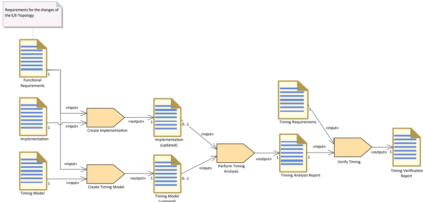

#### 6.6.6. 性能/时序需求

每条总线上的最大负载不得超过某个界限。

对每个帧/PDU，最坏情况响应时间不得超过某个界限，例如由时序需求给出的界限。典型地，帧的循环时间被用作最坏情况响应时间的界限。

网关中的路由时间必须很短。典型地，对每个帧/PDU，路由时间不得超过例如帧循环时间的 10%。

变更 E/E 拓扑对端到端时序有直接影响。关于端到端时序需求验证的更多细节，请参见「分布式功能的端到端时序」一章中的相应用例。

### 6.7. NW 用例「通信时序的优化」

通信时序属性的优化是一个通用用例，在通信网络的设计或维护过程中可能频繁出现。它可能在其他用例的上下文中被要求（例如 NW 用例「既有通信链路的重新映射」）：当新的或更新的设计不满足时序需求时、在识别出时序违例之后，或作为为修改腾出设计空间的先决条件。

基于执行优化的动机，必须定义可量化的目标。这些优化目标允许衡量为优化而执行的变更是否成功。例如，如果要提高系统的响应能力，降低某条消息的响应时间可以作为优化目标。

表6.6：NW 用例「通信时序的优化」的特征信息（**Characteristic Information**）

| | |
|---|---|
| 目标上下文： | 消除时序违例或达成时序优化目标。 |
| 简要描述： | 基于时序需求，同时考虑所有时序约束，优化通信网络的整体时序属性。 |
| 范围： | 系统 |
| 频率： | 定期 |
| 前置条件： | 对网络上的通信定义了一组时序需求：• 每个网络的最大负载 • 每个 PDU/帧/包的最大延迟（例如响应时间、路由时间）。此外，定义了对既有网络控制器通信范式的规定，例如 CAN 控制器经由队列（按优先级或 FIFO 排序）发送具有不同标识符的 PDU/帧，而同一 PDU/帧的不同实例经由寄存器发送（总是发送最新的 PDU 实例）。可选：已定义额外的时序优化目标。 |
| 成功结束条件： | 通信满足时序需求和优化目标。 |
| 失败结束条件： | 网络上的通信至少违反一项时序需求，或任何优化目标未达成。 |
| 参与者： | Network Data Engineer、Timing Engineer |

#### 6.7.1. 主场景

该用例的系统化方法见图 6.7。该用例通常由以下步骤组成：

1. 当 Network Data Engineer 意识到时序违例，或需要向已经严重负载的系统中添加更多功能时，该用例开始。
2. Timing Engineer 在导致时序违例的条件下分析当前系统，或分析当前系统以发现热点（**hot-spot**）。热点是调度中的这样一些情形：时序需求（例如最坏情况响应时间或抖动）或资源消耗约束（例如总线负载上限）已经违反，或者若加入更多负载就会违反。
3. 探索可行的选项以缓解热点。通常有多个选项可以解决一个问题。例如，如果某帧的最坏情况响应时间超标，一种可能的解决方案是提高该帧的优先级。另一种选项可能是：如果通信可以重新映射到另一条通信链路，则通过降低总线负载来改善响应时间。
4. Network Data Engineer 执行权衡分析，权衡时序优化的不同可能性及其对系统的影响。通常每次修改都有代价。例如，提高某帧的优先级会导致其他帧优先级相对下降，这可能使其响应时间增加。
5. Network Data Engineer 决定一项修改并更改时序模型/网络配置。分析可能揭示由路由器/网关性能导致的时序问题，这可能需要更换更强的硬件或优化路由配置（见：调度与偶发事件）。
6. Timing Engineer 通过执行任务「Verify Timing」验证通信网络的时序。
7. 验证可能揭示时序违例未解决，或引入了新的时序违例。在这种情况下，可以使用第 6 步的时序分析报告从第 3 步开始新一轮优化迭代。

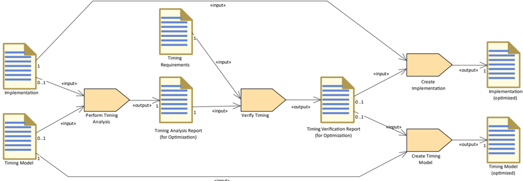

#### 6.7.2. 性能/时序需求

每条总线上的最大负载不得超过某个界限。

对每个帧/PDU，最坏情况响应时间不得超过某个界限，例如由时序需求给出的界限。典型地，帧的循环时间被用作最坏情况响应时间的界限。

网关中的路由时间必须很短。典型地，对每个帧/PDU，路由时间不得超过例如帧循环时间的 10%。

### 6.8. NW 用例「推导网络段上消息的时序属性」

在创建时序模型时，或为了对早期设计决策验证时序需求时，消息的时序属性值得关注。

时序属性可以通过对要创建时序模型的网络实现执行时序分析来获得，或通过分析一个非常相似的实现的时序来获得。从参考实现获取时序属性时，重要的是要注意：时序属性通常受同一网络段上发送的其他消息的影响。因此不仅所分析的实现的参考消息需要相似，网络段上的其他消息也需要相似。对于具有时间确定性行为的消息，例如 FlexRay 协议静态段的帧或 LIN 协议的无条件帧，时序属性可以直接从通信矩阵推导（见表 10.12）。

表6.7：NW 用例「推导网络段上消息的时序属性」的特征信息（**Characteristic Information**）

| | |
|---|---|
| 目标上下文： | 推导网络段上某条消息的时序属性。 |
| 简要描述： | 从参考实现的时序分析或通信矩阵（见表 10.12）推导消息的时序属性。 |
| 范围： | 网络段 |
| 频率： | 按需 |
| 前置条件： | 带有该消息所有相关信息的通信矩阵（见表 10.12）可用。关于所关注消息所有相关场景的时序分析报告（见表 10.12）。 |
| 成功结束条件： | 该消息所有需要的时序属性均已知。 |
| 失败结束条件： | 该消息至少一项需要的时序属性未知。 |
| 参与者： | Network Data Engineer、Timing Engineer、E/E Architect |

#### 6.8.1. 主场景

该用例的系统化方法见图 6.8。该用例通常由以下步骤组成：

1. E/E Architect 或 Timing Engineer 需要网络段上某条消息时序属性的信息。
2. 取决于该消息是否具有时间确定性：
   1. Network Data Engineer 从通信矩阵（见表 10.12）推导时序属性。
   2. Timing Engineer 从时序分析报告（见表 10.12）推导时序属性。
3. 可选：Network Data Engineer 调整时序属性（例如添加安全裕量），以补偿参考实现与目标系统之间的差异。

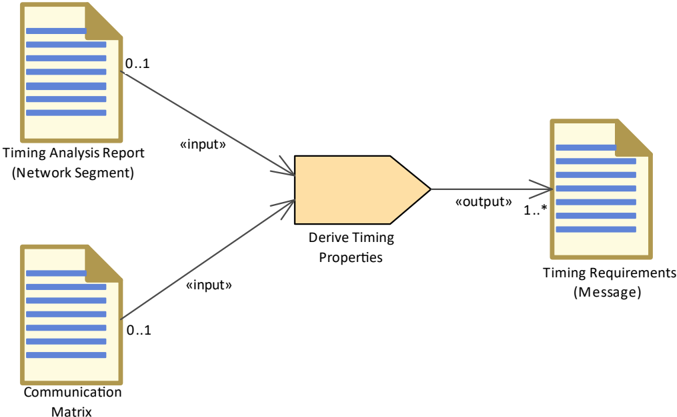

## 7. ECU 层级软件集成的时序

本章概述与向单个 ECU 集成软件相关的、涉及时序问题的用例。网络相关方面由第 [6](#6-网络的时序) 章覆盖，对 ECU 层级的时序只有间接影响。在 ECU 层级，任务与中断的调度连同各代码片段的执行时间一起，决定了该特定 ECU 上整个软件的时序行为。取决于调度与执行时间，给定的期限被满足或错过。本章的用例有助于解决与调度和/或执行时间相关的问题或任务。

尽管说的是「ECU 层级」，重要的是要记住单个 ECU 可以带有多个处理器，每个处理器都有自己的调度。单个处理器上的多个核也越来越常见 [\[16\]](#ref-16)。不过，本章的原则仍然有效，并且可以反映在每个「调度实体」（= 核）上。

本章使用的典型术语有：

- 执行时间（例如 CET、BCET、WCET…），见第 [2.2](#22-实时架构的基本概念) 节与第 [9.4](#94-时序属性的定义与分类) 节。
- CPU 负载，见第 [9.4](#94-时序属性的定义与分类) 节。
- 中断负载，见第 [9.4](#94-时序属性的定义与分类) 节。
- 响应时间，见第 [9.4](#94-时序属性的定义与分类) 节。
- 延迟，见第 [9.4](#94-时序属性的定义与分类) 节。

### 7.1. 平台特定术语

取决于 ECU 上使用的 AUTOSAR 平台，描述软件的术语是不同的。为了避免对经典平台与自适应平台的重复描述，我们尽可能使用通用术语来描述不同的用例。表 7.1 提供从通用术语到平台特定术语的映射，帮助不同平台的用户理解本章所用通用术语背后的含义。

表7.1：通用术语到平台特定术语的映射（**Mapping of generic terms to platform specific terms**）

| 通用 | 自适应 | 经典 |
|---|---|---|
| ECU | Machine（机器） | ECU |
| 软件实体（**SWE**） | Adaptive Application、Functional Cluster | BSW 模块、SWC、CDD |
| 可调度实体 | Thread（线程） | Task（任务）、Interrupt（中断） |
| 互斥区域（**Exclusive Area**） | n.a.（未为 AP 规定，但实现中同样会包含受保护、禁止并行执行的代码段） | Exclusive Area |

### 7.2. 示例

在引言中，图 1.2 给出了时序的顶层示例。ECU 层级处理顶层示例的一个片段，即所涉及 ECU 的调度方面与代码执行方面，见图 7.1。本章的用例将参照该示例。

该示例展示的是 CP ECU 的调度与代码执行，但不限制在任何平台上追踪任何计算资源使用情况的普适性。

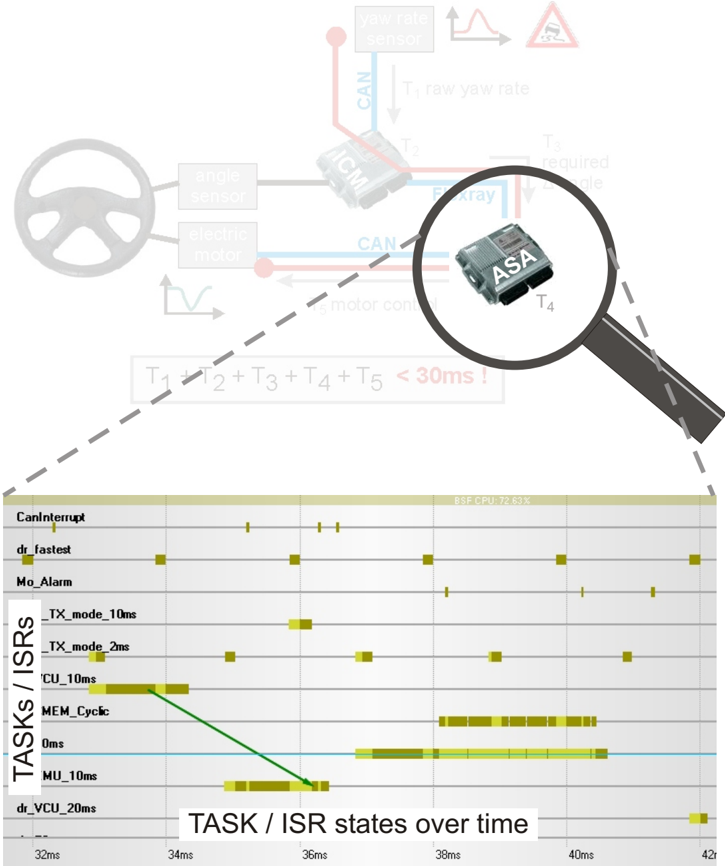

### 7.3. ECU 用例概览

应考虑车辆系统开发中的不同阶段/用例，见表 7.2。图 7.2 给出概览。

表7.2：ECU 特定用例清单（**List of ECU specific use cases**）

| 章节 | 用例 |
|---|---|
| 7.4 | ECU 用例「创建整个 ECU 的时序模型」 |
| 7.5 | ECU 用例「收集 SWE 的时序信息」 |
| 7.6 | ECU 用例「推导可执行实体的时序属性」 |
| 7.7 | ECU 用例「时序的验证」 |
| 7.8 | ECU 用例「调试时序」 |
| 7.9 | ECU 用例「优化 ECU 的时序」 |
| 7.10 | ECU 用例「优化调度」 |
| 7.11 | ECU 用例「优化代码」 |
| 7.12 | ECU 用例「集成新功能」 |

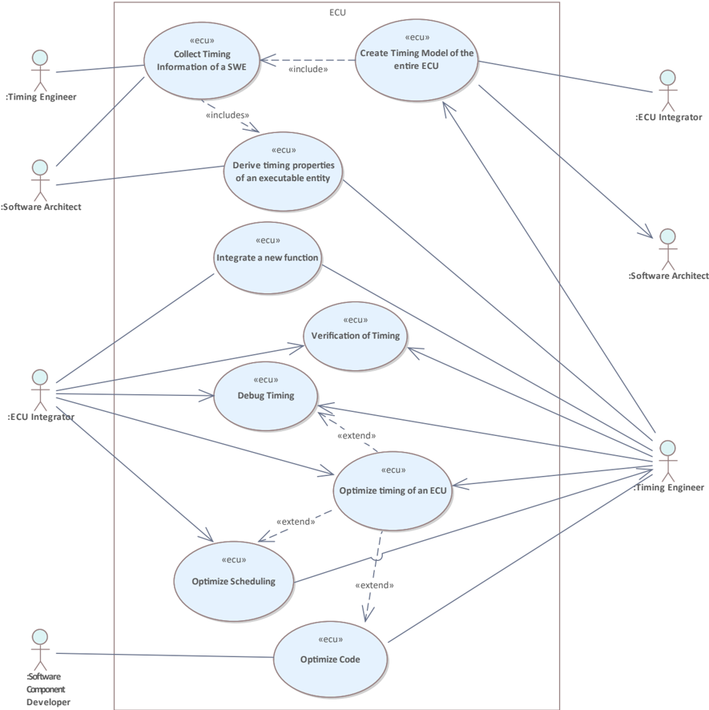

#### 7.3.1. 假设

除非另有说明，以下假设对本章描述的所有用例成立：

对 CP ECU：

1. 特定 ECU 的 ECU 提取（**ECU Extract**）可用，其中包括 System Timing 的 ECU 提取内容。
2. 映射到该特定 ECU 的所有 SW-C 的 VFB 视图（SW-C 模板、SW-C 的层次结构）可用。
3. SW-C 描述可用。
4. 交互发生在一个 OEM 与一个 tier1 供应商之间。
5. 所有 SW-C（包括 C 源代码与目标文件）可用。
6. 所有所需的 BSW 模块可用，包括 C 源代码、目标文件与 ECU 配置。
7. RTE 可以生成。
8. 本章的内容只涉及时序分析这一主题。所做假设是：任何接受时序分析的「系统」在功能视角上是有效的。

对 AP ECU：

1. 特定 ECU 的机器清单（**Machine Manifest**）可用。
2. 执行清单（**Execution Manifest**）可用，其中为映射到该特定 ECU 的所有 Adaptive Application 与 Functional Cluster 描述了所有执行约束。
3. ECU 中包含的 Adaptive Application 的所有 Adaptive Executable 可用。
4. 所有 Functional Cluster 均已完全配置。
5. 所有 Adaptive Application 所需的服务实例清单（**Service Instance Manifest**）可用。

### 7.4. ECU 用例「创建整个 ECU 的时序模型」

本节描述如何为完整的 ECU 生成时序模型。之所以难以用唯一的方式描述该用例，是因为 OEM 与 Tier1 使用不同的抽象层级与语义，他们对该用例的看法不同。如果他们在开发过程的不同阶段工作，这种效应会进一步强化。

尽管如此，一些基本假设对所有粒度层级与所有开发阶段都有效。

在第 [7.1](#71-平台特定术语) 节图 7.1 所示示例的上下文中，创建时序模型意味着为作为被观察系统的 ECU 的时序行为建立一个抽象表示。

事实上，创建整个 ECU 的时序模型是获得完整系统理解的重要步骤之一。所有其他用例都可以视为以某种方式与之相关联的用例，因为时序模型的存在是执行其他用例中步骤的先决条件。

ECU 的时序模型收集所有时序数据，例如时序需求（任务「Collect Timing Requirements」）、时序测量（SPECIFIC PROPERTY Execution Time、GENERIC PROPERTY Latency）以及时序相关的配置数据（例如 RTE 或 BSW 配置），并且也可以用于其他用例。换言之：如果没有时序模型的存在，几乎不可能处理以下用例。

取决于开发阶段，时序模型可以主要基于假设与需求（需求时序模型），或主要基于测量与既有的配置信息。理想情况下，两种视图都能在一个模型中访问。

#### 7.4.1. 特征信息

表7.3：ECU 用例「创建整个 ECU 的时序模型」的特征信息（**Characteristic Information**）

| | |
|---|---|
| 目标上下文： | 为选定的 ECU 收集所有相关的时序信息，或更确切地说，时序模型。 |
| 简要描述： | 为一个 ECU 收集所有相关的时序信息，并创建整个 ECU 的时序模型。 |
| 范围： | ECU |
| 频率： | 按需 |
| 前置条件： | 了解 ECU 的基本功能，并对 ECU 的功能需求和应用领域有基本理解。 |
| 成功结束条件： | 时序模型已创建并反映所有时序信息。 |
| 失败结束条件： | 例如无法收集时序信息。 |
| 参与者： | ECU Integrator、Software Architect、Timing Engineer |

#### 7.4.2. 主场景

该用例的系统化方法见图 7.3（经典平台）与图 7.4（自适应平台）。典型地适用以下步骤：

1. ECU Integrator 与 Software Architect 提供该特定 ECU 的所有可用时序数据（任务「Collect Timing Requirements」、SPECIFIC PROPERTY Execution Time）。
2. Timing Engineer 检查收集到的数据。
3. Timing Engineer 把获得的时序数据加入时序模型（任务「Create Timing Model」）。
4. 该用例以 ECU 时序模型结束。时序信息将可用于后续工作，例如任务「Perform Model-Based Timing Analysis」。

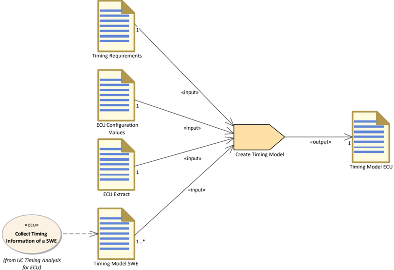

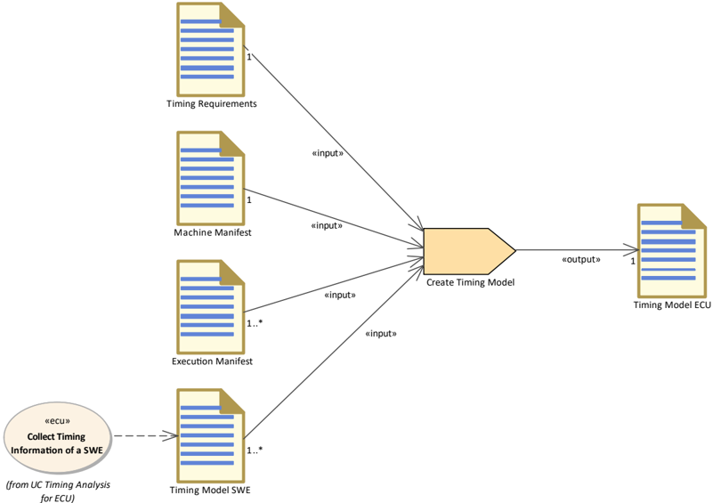

需要合适的工具链。这样的工具链必须能够导入和导出在完整开发周期中由不同工具生成的工件。

#### 7.4.3. 替代场景

由于粒度层级与开发阶段的不同，可能出现不同的场景扩展。在具体情况下，Timing Engineer 必须选择匹配的场景。

### 7.5. ECU 用例「收集 SWE 的时序信息」

第 [7.4](#74-ecu-用例创建整个-ecu-的时序模型) 节描述了时序模型的创建。构建时序模型需要收集时序信息。该用例描述收集特定 SWE 的时序信息。对于第 [7.1](#71-平台特定术语) 节图 7.1 所示示例，这可能意味着获取 ECU「ASA」内部特定 SWE 的信息，例如其最大执行时间（SPECIFIC PROPERTY Execution Time）。

#### 7.5.1. 特征信息

表7.4：ECU 用例「收集 SW 实体的时序信息」的特征信息（**Characteristic Information**）

| | |
|---|---|
| 目标上下文： | 收集选定 SWE 的所有相关时序信息。 |
| 简要描述： | 为一个 SWE 收集所有相关的时序信息。 |
| 范围： | 特定目标的 SWE |
| 频率： | 按需 |
| 前置条件： | 了解 SWE 的基本功能。 |
| 成功结束条件： | 时序模型已创建并反映所有时序信息。 |
| 失败结束条件： | 例如无法收集时序信息。 |
| 参与者： | Software Architect、Timing Engineer |

#### 7.5.2. 主场景

该用例的系统化方法见图 7.5。典型地适用以下步骤：

1. 当负责的 Software Architect 开始收集时序信息时，该用例开始——这通常由 ECU Integrator 的请求触发。
2. Software Architect 收集该特定 SWE 的所有可用时序数据：
   - 对先前和类似项目的一些估计、方法，见第 [9.5](#95-时序方法的定义描述与分类) 节；
   - runnable 层级及以下的运行时测量，例如处理器在环仿真（**PIL**）或静态最坏情况执行时间分析等方法，见第 [9.5](#95-时序方法的定义描述与分类) 节；
   - 基于 functional requirements 的该 SWE 的时序需求（任务「Collect Timing Requirements」），例如：触发事件、延迟、抖动、执行顺序、与安全相关需求的关系；
   - 以下方法可用于收集相关属性（例如 GENERIC PROPERTY Load、Interrupt Load、SPECIFIC PROPERTY Execution Time、GENERIC METHOD Determine Latency）：追踪、调度分析、调度仿真。
3. Timing Engineer 把获得的时序数据加入时序模型（任务「Create Timing Model」的一部分）。
4. 该用例以 SWE 时序信息结束。该时序信息将可用于 SWE 在整个系统中的集成。

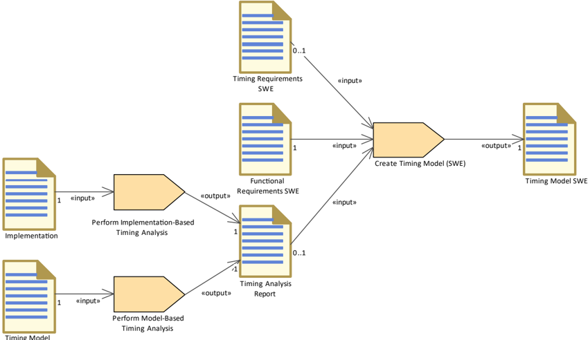

#### 7.5.3. 替代场景 #1

在主场景的步骤 #2，子步骤可以按任意顺序执行，也可能被跳过。跳过的理由是在该特定时间点缺少信息。

### 7.6. ECU 用例「推导可执行实体的时序属性」

第 [7.4](#74-ecu-用例创建整个-ecu-的时序模型) 节描述了时序模型的创建。构建时序模型需要收集时序信息。获得可执行实体的时序属性面临诸多挑战。时序属性可能受目标平台和编译器的强烈影响，这会使测量的复用变得困难。此外，CPU 架构日益增加的复杂性使时序属性的测量或计算变得困难。例如，分支预测等特性会导致同一代码具有不同的运行时间；由于流水线，在计算运行时间时必须考虑指令顺序。

#### 7.6.1. 特征信息

表7.5：ECU 用例「推导可执行实体的时序属性」的特征信息（**Characteristic Information**）

| | |
|---|---|
| 目标上下文： | 推导可执行实体的时序属性。 |
| 简要描述： | 从时序分析报告（见表 10.12）推导可执行实体的时序属性。 |
| 范围： | 特定目标平台上的可执行实体 |
| 频率： | 按需 |
| 前置条件： | 包含所关注可执行实体的、可运行的实现。 |
| 成功结束条件： | 已获得可执行实体的时序属性。 |
| 失败结束条件： | 无法从时序分析报告（见表 10.12）推导时序属性。 |
| 参与者： | Software Architect、Timing Engineer |

#### 7.6.2. 主场景

该用例的系统化方法见图 7.6。该用例通常由以下步骤组成：

1. 当负责的 Software Architect 开始收集时序信息时，该用例开始。例如为了创建 ECU 的时序模型。
2. Software Architect 确定可以观察到可执行实体所需时序属性的测试条件。例如为了获得可执行实体的 WCET，Software Architect 需要确定使可执行实体执行其关键路径的测试条件。
3. Timing Engineer 使用测试条件执行任务「Perform Implementation-Based Timing Analysis」。
4. 借助时序分析报告（见表 10.12），Software Architect 可以执行任务「Derive Timing Properties」以获得可执行实体的时序属性。

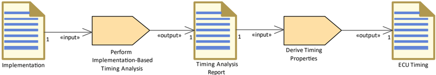

#### 7.6.3. 替代场景 1

可能无法确定可以观察到所需时序属性的测试条件。在这种情况下，可以选择在时序分析期间使用模糊测试（**Fuzzing**）。这并不保证满足正确的测试条件，所推导的时序属性只应被视为估计值。

#### 7.6.4. 替代场景 2

在新目标平台开发的早期阶段，硬件或硬件的仿真器可能不可用。在这种情况下，可以使用替代平台进行时序分析，并应用校正因子以获得时序属性的估计值。

### 7.7. ECU 用例「时序的验证」

该用例的目标是：系统满足给定的时序约束集合，例如「从传感器到执行器」。

#### 7.7.1. 特征信息

表7.6：ECU 用例「时序验证」的特征信息（**Characteristic Information**）

| | |
|---|---|
| 目标上下文： | 验证已定义系统的时序。 |
| 简要描述： | 验证时序以确保系统功能正常、所有给定的时序约束得到满足。时序的验证可以通过多种时序分析方法进行，例如：• 响应时间分析 • 可调度性分析 • 运行时测量比较。时序分析方法的选择取决于所要求的精度等级以及要验证的时序约束的类型。描述某功能所需时序行为的时序模型也会随系统模型的粒度而变化。 |
| 范围： | ECU |
| 频率： | 每当决定验证既有系统的时序时。启动时序验证的示例性触发因素有：• 添加、移除或修改 SWE 到 ECU 的映射 • 修改 SWE 的内部行为 • 重新配置系统调度（例如更改进程优先级）• 更新总线通信（更多信息见第 [6](#6-网络的时序) 章） |
| 前置条件： | 在 ECU 层级执行所述用例必须满足以下前置条件：• ECU 的软件配置有效且其描述可用。• 映射到时序分析对象 ECU 的 SWE 有效。• 定义了应满足的相关时序约束。• 时序模型适配可用系统模型的粒度。 |
| 成功结束条件： | 时序分析表明时序约束在所有系统状态下都得到满足。所有相关文档已更新。 |
| 失败结束条件： | 所应用的任何时序分析方法都不表明所有时序约束得到满足。时序测量比较表明至少违反了一项时序约束。 |
| 参与者： | ECU Integrator、Timing Engineer |

#### 7.7.2. 主场景

该用例的系统化方法见图 7.7。典型地适用以下步骤：

1. 该用例始于为特定系统执行任务「Perform Model-Based Timing Analysis」或任务「Perform Implementation-Based Timing Analysis」的决定。这通常在修改 SWE 行为或更改系统配置之后进行。
2. 该用例的 Timing Engineer 按第 [9.5](#95-时序方法的定义描述与分类) 节所述执行时序分析。
3. Timing Engineer 执行任务「Verify Timing」，得出所有时序约束（例如 GENERIC PROPERTY Load、SPECIFIC PROPERTY Execution Time、GENERIC METHOD Determine Latency、Interrupt Load）都被满足、还是至少一项被违反的结论。
4. 如果所有约束都得到满足，ECU Integrator 批准工作产品为有效。被批准的工作产品有：
   - 时序模型与时序需求文档（TIMEX 提取）（见工作产品表）；
   - 时序分析报告（见工作产品表）。

如果至少一项约束被违反，典型流程见 ECU 用例「调试时序」。

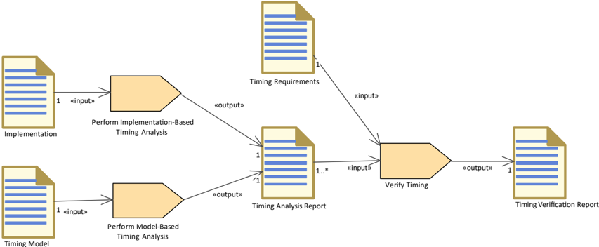

### 7.8. ECU 用例「调试时序」

每当 ECU 出现偶发的系统崩溃、数据不一致或意外的过载场景、延迟或抖动时，时序问题可能是问题的原因。用常规的调试方法追查问题可能非常痛苦且耗时。即使某个问题显然与时序相关，情况也是如此。

在解决任何问题之前，必须先理解它。这就是时序调试的内容：理解真实 ECU 上存在的时序问题。一旦理解了问题，接下来就是寻找并实施解决方案，见第 [7.9](#79-ecu-用例优化-ecu-的时序) 节 ECU 用例「优化 ECU 的时序」。该用例聚焦于调试单个 ECU 的时序，例如图 7.1 所示的 ASA。

#### 7.8.1. 特征信息

表7.7：ECU 用例「调试时序」的特征信息（**Characteristic Information**）

| | |
|---|---|
| 目标上下文： | 理解一个（时序）问题并隔离问题的原因。 |
| 简要描述： | 使用专门的时序调试方法（见第 [9](#9-用于时序分析的属性与方法) 章）调试一个问题，并判断它是否是时序问题。如果是，追查问题的原因，使其被完全理解。这使得下一步解决该问题成为可能。 |
| 范围： | ECU |
| 频率： | 每当在 ECU 中检测到非平凡问题时。 |
| 前置条件： | 一个正在运行的系统。 |
| 成功结束条件： | 问题已被理解，问题的原因已被隔离。工件：可以复现该问题的测试条件集合、描述该问题的文档（例如调度追踪记录）。 |
| 失败结束条件： | • 问题未被理解，或 • 问题不是由错误的时序引起，或 • 问题不可复现，或基于既往发生的数据不足以分析。 |
| 参与者： | Timing Engineer、ECU Integrator、Test Engineer |

#### 7.8.2. 主场景

该用例的系统化方法见图 7.8。典型地适用以下步骤：

1. 当 ECU Integrator 面对一个真实 ECU 上的时序问题或直接影响时序行为的问题时，该用例开始（任务「Create Implementation」）。
2. Test Engineer 搭建可以进行时序调试的测试环境。
3. 1. 如果故障原因能够以可靠的方式诱发，则使用真实系统进行时序调试（步骤 4）。
   2. 如果不能，则需要迭代式的方法：
      - 从最初报告者处尽可能多地获取关于时序问题的环境与情况的信息，例如日志文件、遥测数据、硬件与软件数据手册。
      - 依据这些信息搭建测试环境并定义测试条件集合。
      - 运行测试以诱发故障原因。如果成功，继续步骤 4。
      - 如果故障原因（尚）未能诱发，从最初报告者处获取更多信息。
      - 分析并缩小测试环境与发生时序问题的真实环境之间的差异。
      - 如果分析的时间、金钱或其他预算耗尽，退出该用例，报告「无法复现（**CNR**）」，或继续步骤 3（不推荐）。
      - 否则继续「运行测试以诱发故障原因」这一步。
3. 如果迭代方法失败，但一个或多个利益相关方不接受 CNR，则使用既往发生的数据（任务「Perform Implementation-Based Timing Analysis」）和石川图（也叫鱼骨图）等技术创建理论故障模型。这种方法工作量巨大，而对（尚未知的）故障原因关注甚少。如果 CNR 不可接受，应将其视为最后手段。
4. Timing Engineer 与 ECU Integrator 调试并分析时序行为以识别问题的原因。为此可以使用专门的时序分析方法（例如基于追踪的方法，见任务「Perform Implementation-Based Timing Analysis」与第 [9.5](#95-时序方法的定义描述与分类) 节）。
5. 隔离问题。
6. 下一步，可以使用能够复现故障的测试条件集合解决问题（见 ECU 用例「优化 ECU 的时序」）。

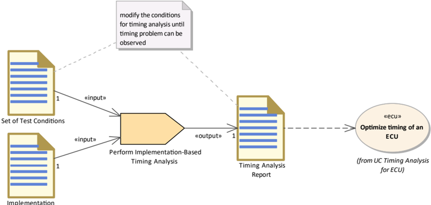

### 7.9. ECU 用例「优化 ECU 的时序」

该用例背后的主要思想是优化一个工作正常的 ECU 的时序行为。有时资源消耗高于预期，或者需要向 ECU 集成更多 SW-C。如果已经识别出时序问题并且现在需要修补，同样需要优化。

可能的性能关键指标有多种：

- 负载均衡（在时间轴上分布负载、跨不同核的负载均衡）
- 系统性地最小化响应时间、抖动等
- 减少抢占次数（从而减少 OS 开销）
- 减少迁移次数（从而减少迁移开销）
- 减少资源消耗（核间通信、存储器（缓冲区大小）、负载）
- 减少调度中断的次数
- 减少等待时间

另见第 [9](#9-用于时序分析的属性与方法) 章「时序属性」。

子用例：ECU 用例「优化调度」与 ECU 用例「优化代码」。

#### 7.9.1. 特征信息

表7.8：ECU 用例「优化 ECU 的时序」的特征信息（**Characteristic Information**）

| | |
|---|---|
| 目标上下文： | 消除时序违例（优化资源消耗、数据一致性、降低抖动等）或最小化资源消耗。 |
| 简要描述： | 基于时序需求，同时考虑所有时序约束，优化 ECU 的整体时序架构。 |
| 范围： | ECU |
| 频率： | 每当在 ECU 中检测到时序违例、需要添加或预期添加额外功能、或修改既有功能时。 |
| 前置条件： | 一个正在运行的系统和/或理想情况下有用的系统描述（时序模型）。 |
| 成功结束条件： | 找到了满足所有时序与资源需求的更好方案（如适用，即使带有额外功能）。工件：• 新调度 • 更新的时序模型 • 优化的代码 • 新的存储器布局 • 新的代码生成器选项 • 新的编译器选项。 |
| 失败结束条件： | 未找到方案。 |
| 参与者： | Timing Engineer、ECU Integrator |

#### 7.9.2. 主场景

该用例的系统化方法见图 7.9。典型地适用以下步骤：

1. 当 ECU Integrator 意识到时序违例、或需要向已经严重负载的系统中添加更多功能时，该用例开始。这可以在执行任务「Perform Implementation-Based Timing Analysis」与任务「Verify Timing」之后进行。
2. 分析当前系统（验证系统的时序，见 ECU 用例「调试时序」）并发现热点。热点是调度中的这样一些情形：时序需求或资源消耗约束已经违反，或者若加入更多负载就会违反。
3. 逐个热点地定义优化目标。
4. 分析可行的选项以缓解热点。这些选项可以包括通过 ECU 用例「优化调度」修改调度配置，和/或通过 ECU 用例「优化代码」进行代码优化。对每个选项，继续相应的用例。
5. ECU Integrator 执行权衡分析，权衡时序优化的不同可能性及其对系统的影响。
6. ECU Integrator 决定一项修改并更改时序模型/系统的代码。
7. Timing Engineer 通过执行任务「Verify Timing」验证 ECU 的时序。
8. 对照优化目标进行验证。

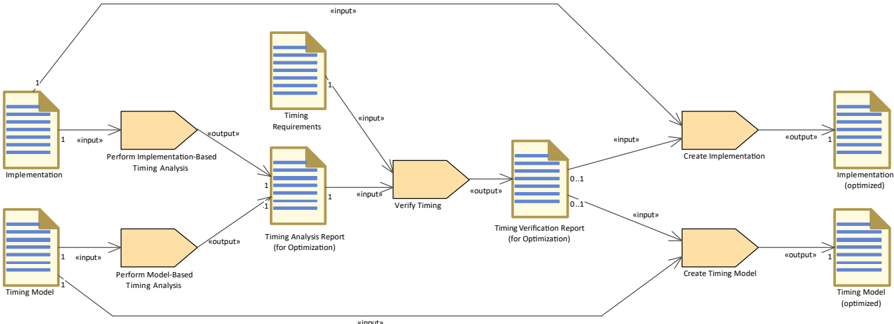

### 7.10. ECU 用例「优化调度」

该用例背后的主要思想是：以确定的目标（例如「消除局部过载」或「缩短任务 xyz 的响应时间」）优化一个工作正常的 ECU 的既有调度。

#### 7.10.1. 特征信息

表7.9：ECU 用例「优化调度」的特征信息（**Characteristic Information**）

| | |
|---|---|
| 目标上下文： | 达成预定义的优化目标。 |
| 简要描述： | 找到一个修改后的调度配置：既达成目标，又不引起新的时序违例或违反资源约束。 |
| 范围： | ECU |
| 频率： | 每当在 ECU 中检测到时序违例、需要添加或预期添加额外功能、或修改既有功能时。 |
| 前置条件： | 一个正在运行的系统和/或理想情况下有用的系统描述（时序模型）。 |
| 成功结束条件： | 找到了达成目标且不引起新时序违例的修改后调度配置。工件：• 新调度——就特定时序属性而言优于原调度（见第 [9.4](#94-时序属性的定义与分类) 章）• 更新的时序模型。 |
| 失败结束条件： | 未找到方案。 |
| 参与者： | Timing Engineer、ECU Integrator |

#### 7.10.2. 主场景

该用例通常由以下步骤组成：

1. 当 ECU Integrator 面对关于调度的某个优化目标时，该用例开始。
2. 分析可行的选项。取决于平台，修改调度有不同的选项：
   - 对 CP，例如修改 runnable 到任务的映射、任务内 runnable 的序列/顺序、任务到不同核的分配、为负载均衡把任务划分为更小的实体、更改任务的优先级/偏移/周期；
   - 对 AP，例如可以放宽执行清单中对线程的约束，给调度器在使用计算资源上更多自由；或在执行清单中添加额外约束，为保证线程达到期望的响应时间而保障计算资源。对多线程应用，调整调度可能需要更改其实现。
3. ECU Integrator 执行权衡分析，权衡调度优化的不同可能性及其对系统的影响（任务「Verify Timing」）。
4. ECU Integrator 选定一个方案并修改时序模型/系统的代码。
5. Timing Engineer 通过执行响应时间分析、调度分析或测量（任务「Perform Model-Based Timing Analysis」或任务「Perform Implementation-Based Timing Analysis」）验证 ECU 的时序。
6. 对照优化目标进行验证（任务「Verify Timing」）。

#### 7.10.3. 调度与偶发事件

优化调度策略的一个挑战是处理偶发事件（**sporadic event**）。对于需要处理大量偶发事件、同时又实现需要高时序精度的实时功能的 ECU，这尤其具有挑战性（例如一个网关，需要处理来自各种网络的大量接收事件与发送确认事件，同时还要实现时间同步主节点）。

首先需要分析偶发事件与时序相关的属性。应确定以下属性：

- 由偶发事件触发的可调度实体的执行时间；
- 偶发事件的到达间隔（**Inter-Arrival Time**）（平均与最坏情况）；
- 特定时间区间内偶发事件的最大数量。由于对周期性采样而言，时间区间是一个优化参数，因此最好拥有一个能对任意给定时间区间确定事件数量的分析函数。

一般而言，中断服务例程（**interrupt service routine**）应具有最短的执行时间，以减少对调度器行为的影响。对于要求极高时序精度的功能，可能需要在其执行期间禁用中断。中断锁定时间应非常短，仅用于临界区。

如果响应时间要求不十分严格，罕见的偶发事件可以由周期性函数轮询事件状态来处理。如果需要更快的响应时间，可以在中断服务例程中通知调度器事件的发生，然后调度可调度实体来处理该事件。在这两种情况下，事件的处理都可以纳入调度策略，并通过分配优先级进行优化。只有当需要对事件做出非常快速的反应时，才应在中断服务例程中实现该反应。在这种情况下，必须验证此类中断事件的发生不会使其他可调度实体的时序失效。

处理偶发事件爆发（**burst**）的一般方法是缓冲事件，并在周期性的可调度实体中延后处理这些事件。时序行为受缓冲区大小、缓冲策略和处理周期的影响。应当注意，缓冲区大小也受可用的存储器资源限制——需要加以考虑，但不在本文档的范围之内。如果只有最新的事件相关、并且可以接受丢失一些事件，可以使用 last-is-best 缓冲策略，它只需要单个缓冲区条目。如果所有事件都重要，缓冲区需要能够容纳一个处理周期内可能发生的所有事件。增加处理周期可以降低 CPU 负载，但会延长阻塞低优先级可调度实体的处理时长，并增加事件处理的响应时间。对于低优先级事件，可以以低优先级、长周期调度其处理，以最小化对其他可调度实体的影响。

对事件进行缓冲还支持实现更精细的优先级方案。技术限制导致中断总是以确定的顺序执行。即使多个中断配置了相同的优先级，这些中断被处理的顺序也是固定的。这可能导致处理顺序靠后的中断出现很长的响应时间。通过缓冲中断事件，可以实现其他优先级方案（例如轮转调度，**round robin**），为不同中断事件实现更均匀分布的响应时间。

### 7.11. ECU 用例「优化代码」

由于代码及代码的部署对时序有巨大影响，可以执行多种优化活动。优化的范围可以不同（存储器、运行时间、安全性、可复用性、易理解性等）；但在本文档的范围内，优化范围限于时序效果。但必须考虑到：这类时序优化会影响系统的其他方面（例如存储器或可复用性），并且这类优化受安全（**safety**）与信息安全（**security**）方面的约束。

#### 7.11.1. 特征信息

表7.10：ECU 用例「优化代码」的特征信息（**Characteristic Information**）

| | |
|---|---|
| 目标上下文： | 就时序优化代码。典型地：最小化 WCET、平均执行时间或两者。 |
| 简要描述： | 基于时序需求，优化 ECU 的整体时序架构。 |
| 范围： | ECU |
| 频率： | 每当需要 ECU 内的时序优化时。 |
| 前置条件： | 代码可用（理想情况下可在目标平台上编译、链接与执行）。 |
| 成功结束条件： | 找到了就时序而言更好的代码。可能的工件：• 优化的代码 • 新的存储器布局 • 新的代码生成器选项 • 新的编译器选项。 |
| 失败结束条件： | 未找到方案。 |
| 参与者： | Software Component Developer、Timing Engineer |

#### 7.11.2. 主场景

该用例通常由以下步骤组成：

1. 当 Software Component Developer 决定优化某个代码片段（一个可调度实体、一个函数或函数的一部分）时，该用例开始——这通常在执行任务「Perform Model-Based Timing Analysis」或任务「Perform Implementation-Based Timing Analysis」之后。
2. 定义优化目标，例如减少核心执行时间或减少在互斥区域中花费的时间。
3. 分析可行的选项，例如不同的编译器选项、代码重构或实现不同的算法。
4. 修改：至少选择其中一个选项并实现它。
5. 验证功能行为，例如运行单元测试。
6. Timing Engineer 通过执行任务「Perform Implementation-Based Timing Analysis」验证时序优化目标。

### 7.12. ECU 用例「集成新功能」

该用例描述向 ECU 集成一个新功能，聚焦于集成中的时序方面。关于 ECU 集成用例的一般描述，请分别参见 AUTOSAR 方法论 [\[1\]](#ref-1) 或自适应平台方法论 [\[17\]](#ref-17)。新功能可以在 ECU 上全部或部分实现，并由一个或多个 SWE 表示。

#### 7.12.1. 特征信息

表7.11：ECU 用例「集成新功能」的特征信息（**Characteristic Information**）

| | |
|---|---|
| 目标上下文： | 向 ECU 集成一个新功能，同时保持既有的时序约束并满足新功能的时序约束。 |
| 简要描述： | 在考虑所有时序约束的前提下，把新功能集成到 ECU 上。 |
| 范围： | ECU |
| 频率： | 每次添加新特性或车辆功能时。 |
| 前置条件： | 以当前可运行的实现或 ECU 的时序模型为起点。实现新功能的 SWE 可用，并带有依照 AUTOSAR 方法论 [\[1\]](#ref-1) 或自适应平台方法论 [\[17\]](#ref-17) 进行 SWE 集成所需的全部输入数据。包括新功能在内的 ECU 时序信息（见表 10.12）可用。 |
| 成功结束条件： | 新功能被完全集成，且时序需求得到满足。 |
| 失败结束条件： | 无法在不违反至少一项时序需求的情况下集成新功能。 |
| 参与者： | ECU Integrator、Timing Engineer |

#### 7.12.2. 主场景

该用例的系统化方法见图 7.10。该用例通常由以下步骤组成：

1. ECU Integrator 检查所需输入的可用性与完整性，并快速概览集成项。
2. 集成新功能的实现：
   - 对 CP：集成应按 AUTOSAR 方法论 [\[1\]](#ref-1) 所述执行（例如配置 BSW 以满足 SW-C 的服务需要、依照 ASIL 分级把 SW-C 映射到分区）。对时序行为而言，集成期间的主要焦点是任务的定义及其调度、以及 runnable 到这些任务的映射。对 runnable 映射，ECU Integrator 应考虑时间关键的 runnable 的优先级、runnable 之间的事件链、任务的运行时间，以及把相同周期或最短周期为其他 runnable 公约数的 runnable 分组。
   - 对 AP：集成应按自适应平台方法论 [\[17\]](#ref-17) 所述执行（例如：如新功能所需，执行通信与诊断映射；更新执行清单以纳入新的 Adaptive Executable；或更新 Function Group 定义以纳入新功能）。
3. 对带新功能的系统进行分析并验证时序约束。为此，Timing Engineer 需要执行任务「Perform Model-Based Timing Analysis」或任务「Perform Implementation-Based Timing Analysis」，随后执行任务「Verify Timing」。
   1. 分析 ECU 的 CPU 核上的负载。对特定场景与时间范围，CPU 负载不得超过预定义的限额。分析的输出是通过时序方法 GENERIC METHOD Determine Load 获得的时序属性 GENERIC PROPERTY Load。
   2. 分析时间关键事件链的延迟。从输入事件（例如传感器测量或帧接收）到输出事件（例如帧发送或执行器控制）的事件链的响应时间 GENERIC PROPERTY Latency，通过时序方法 GENERIC METHOD Determine Latency 获得。把时序属性的值与定义的需求进行比较。把结果与时序属性的先前值进行比较也很有用。这有助于理解变更的影响，并有助于在需要额外优化步骤时做出未来决策。
   3. 分析需要精确周期时序的周期性可调度实体的抖动。
4. 如果时序验证失败，可以执行多轮调度优化迭代。
   1. 从时序分析报告（见表 10.12）可以识别热点并定义优化目标。
   2. 基于识别的热点，可以推导对调度的可能改进。
   3. ECU Integrator 执行权衡分析，权衡时序优化的不同可能性及其对 ECU 的影响。
   4. 随后 Timing Engineer 验证更新调度后 ECU 是否满足所有时序需求。
5. 如果无法创建满足时序需求的调度，由 Software Component Developer 进行代码优化或由 Function Architect 重新映射 SWE 可以提供解决方案。之后 ECU Integrator 可以开始新一轮集成尝试。

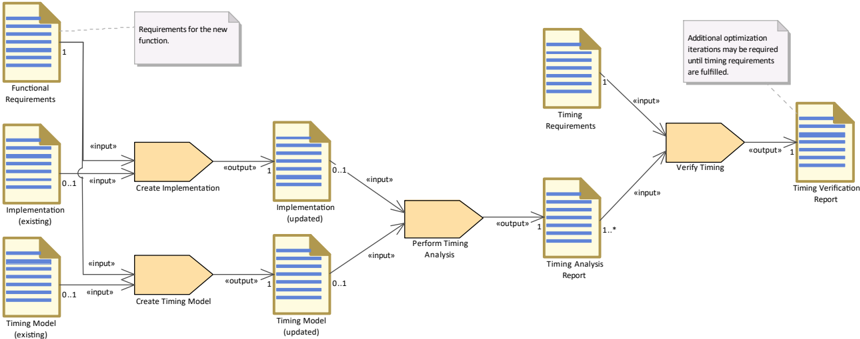

## 8. 系统层级逻辑执行时间

### 8.1. 系统层级逻辑执行时间的基本概念

只要存在共同的时间基准、且因果链的所有周期都小于相应的 LET 区间（LET ≤ period），LET 范式就可以用来抽象物理执行与通信。经典平台的 AUTOSAR 时序扩展提供了 LET 区间的规格说明手段，其中 LET 区间引用一组可执行实体（对软件组件的实现而言，也称为 runnable 实体，简称 runnable）。因此，AUTOSAR 中的 LET 提供规定计算抽象的能力，但无法表达通信延迟。对于两个假设之一不成立的重要情形类别，LET 范式已被扩展为系统层级逻辑执行时间（**System Level Logical Execution Time**，**SL-LET**）。一般而言，该扩展能够在不改变 LET 编程性质的前提下，覆盖设计过程中的两大主要问题。

第一，SL-LET 区间为实现在不同时钟上和/或分布式的可执行实体提供逻辑时序抽象。例如，因果链的可执行实体可能被部署到具有显著通信延迟以及不同时钟源的不同 ECU 上。除实现之外，SL-LET 区间还可以在更早的设计阶段用作规格说明手段，例如规定粗粒度功能块之间的确定性数据流。这包括在设计具体化的过程中分解与细化 SL-LET 区间的可能性，把时序抽象从功能层级一直统一到 ECU 层级的软件集成。下文将表述必要的需求。

读、写动作的瞬时 LET 事件假设意味着这些动作在零时间内发生。对部署在同一 ECU 中的可执行实体之间数据交换所使用的 LET 的正确实现，必须保持 LET 的数据流语义。注意在同一 ECU 内，可执行实体可以经由共享内存交换数据，并可以在不同的核上执行。

与之相对，分布式因果链（例如包含两个 ECU 和一条总线/网络）带来两大挑战：

- 第一，LET 事件隐含对时间的共同理解，这必须在不同的计算资源上得以实现；
- 第二，我们无法保持「延迟不得超过周期」的要求。经由总线/网络的分布式通信很可能涉及显著的通信延迟，使用 LET 的时序模型必须应对大的延迟。

因此，SL-LET 提供三项主要扩展，它们是把 LET 方法同样应用于更大的因果链与分布式系统所必需的。

扩展 1）允许流水线属性（**Permitted Pipelining Property**，**PPP**）：没有 SL-LET 时，LET 区间的上界（LET ≤ period）是必要的，以确保在某个可调度实体的一次执行完成并写出其所有数据之前，该实体不会被再次执行。这不是使用 LET 的系统的特定需求，而是周期性实时系统的典型假设。如果超出该界限，可调度实体的重叠执行（即重叠的作业）就成为可能。这就像在有限状态机产生输出之前重新执行它。结果通常是错误的、依赖于实现的，并且可能违反数据流确定性假设。错误的原因是访问了未完成的前一个 LET 区间中写出的数据。如果能够消除这一原因，重叠执行就成为可能。「流水线（**pipelined**）」一词借自计算机与软件技术，用 LET 区间时长大于周期的情况来增强 SL-LET 的概念。

允许流水线属性（**PPP**）是可调度实体的一个属性，它陈述：在 LET > period 的 LET 区间中，可调度实体的流水线式执行是被允许的。当没有访问来自未完成的前一个 LET 区间中可调度实体的数据时，这一性质成立。PPP 使 LET > period 情况下的执行重叠成为可能，从而确保确定性的数据流。附录 C.2 给出了说明与示例。该定义的选择使其不仅扩展了第 [2.3.1](#231-逻辑执行时间与数据流确定性) 节介绍的经典 LET，而且是经典 LET 调度的一般化。PPP 扩展支持捕获 LET > period 的系统。由于仅靠流水线对分布式系统并不足够，扩展 2 与扩展 3 也是必要的。

扩展 2）逻辑执行时间区（**LET Zones**）：为了支持 LET 事件在分布式系统中的含义，必须建立对时间与时序事件的共同理解。这可以通过对不同本地时钟（例如不同 ECU 上的时钟）提供充分的时间同步来实现。一个示例性方法是使用诸如 PTP 之类的时钟同步协议，把本地时钟同步到一个主时钟。SL-LET 中的 LET 区是一个具有本地时间基准的子系统，它与其他 LET 区之间存在有界的时钟偏差。在 LET 区内部，零时间通信的假设可以得到满足；而跨时区的通信具有不可忽略但有界的延迟。

扩展 3）互联 LET（**Interconnect LET**）：两个 LET 区之间的通信可以用互联 LET<sup>1</sup>来抽象。

> 1 在 [\[6\]](#ref-6) 中也称为互联任务（**interconnect task**）。

互联 LET是一种专门的 LET 区间：数据在一个 LET 区的 LET 事件处被读取，在另一个 LET 区的 LET 事件处被写出。因此，互联 LET 不仅表示执行/计算延迟（例如 COM 栈内部），还包含传输/通信延迟。

互联 LET可以由一个可调度实体序列（即一条唯一的链）组成。为了支持大于通信周期的通信时间，互联 LET须满足以下两个条件：

- 如果互联 LET由可调度实体序列组成，则该序列必须具有确定性的数据流。
- 互联 LET的两次执行必须在功能上相互独立，即互联 LET的任何可调度实体不得访问来自未完成的更早执行的数据。这一要求与扩展 1 的论证相同，并在附录 C.2 中详述。

第一个性质是使互联 LET与 LET 范式兼容所必需的；第二个条件对通信任务自然成立——通信任务中数据作为网络载荷被传输，而不是被修改。两个条件合在一起，足以允许互联 LET的 LET > period。

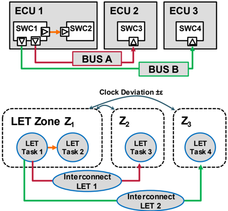

图 8.1 给出软件组件到 ECU 某个给定映射的示例。ECU1 上的本地通信可以用 LET 规定（借助时序扩展），并可以用共享内存通信等方式实现。如图 8.1 所示的 LET 任务（**LET task**）表示被分配到同一 LET 区间的一组可执行实体（实现软件组件）。SL-LET 使 LET 抽象能够用于到 ECU2 与 ECU3 的远程通信。与用本地 LET 抽象计算时间类似，SL-LET 借助互联 LET为通信时间提供抽象。这并不限于总线或网络上的传输时间，还允许涵盖所涉及的基础软件。与 LET 一样，SL-LET 规范不对底层网络或总线技术做任何假设，也不对完整性做任何假设，这意味着它可以与因果链中的非 LET 任务组合使用。

再次强调，SL-LET 所做的扩展并不限于 ECU 间通信——这里只是作为一个说明性的示例。以下各节的用例给出了示例：

- 第 [8.2](#82-sl-let-在早期设计阶段功能层级上的规格说明与预算分配) 节：如何为功能时序规定 SL-LET、为功能网络推导预算、以及用周期激活抽象事件驱动的因果链。
- 第 [8.3](#83-对未给定映射的-swc-用-sl-let-区间规定确定性数据流) 节：如何在未给定映射的情况下，用 LET 与 SL-LET 为 SWC 规定确定性的数据流。
- 第 [8.4](#84-把-sl-let-区间分解为-let-区间) 节：如何把 SL-LET 规范分解为 LET 规范。
- 第 [8.5](#85-从既有-let-规范组合-sl-let-区间) 节：如何从既有的 LET 规范组合出 SL-LET 规范。
- 第 [8.6](#86-使用-sl-let-时因果链对经修改执行与通信时间的健壮性) 节：如何确保对时序变化的健壮性。
- 第 [8.7](#87-用层次化时钟把系统分解为-let-区) 节：如何把系统分解为 LET 区。

关于规定为大于周期的 LET 区间在实现上的影响，见附录 C.2 的讨论。

### 8.2. SL-LET 在早期设计阶段：功能层级上的规格说明与预算分配

用例 [4.4](#44-功能层级用例把车辆功能划分为功能架构) 已经论证了把车辆功能划分为功能架构（由功能块及其接口组成）。一旦要强制实现确定性的数据流，以一致的方式分解时序需求就是一项非平凡的任务。如第 [3.1](#31-时序需求分解问题) 节所讨论的，SL-LET 引入了功能块的可组合时序。用例 [4.3](#43-功能层级用例为新车辆功能识别时序需求) 中识别的时序需求可以分解为更小的时间预算，并按用例 [4.4](#44-功能层级用例把车辆功能划分为功能架构) 所示关联到功能块。分解后的时间预算可以应用为功能块的 SL-LET 区间。SL-LET 语义以如下方式约束后续实现：执行时间抖动不会跨越功能块的边界传播。

其收益可以基于图 2.3 所示的传感器融合与感知管线的抽象功能模型来讨论。它包括：

- 多条带周期激活的事件驱动因果链；
- 含分叉点与汇合点的依赖因果链；
- 因果链中的循环依赖。

第 [2.3](#23-时序与数据流的关系) 节已经概述了数据流确定性与数据年龄分散方面的挑战——例如当传感器融合功能包含依赖的因果链时。在该场景中，仅把时间预算规定为上界延迟并不能保证确定性的数据流，因为抖动会在每条管线路径中独立传播。其结果是，待组合的不同输入的相对数据年龄是变化的。这种数据年龄分散可能成为问题，例如当一条路径出现最坏情况延迟而另一条出现最好情况延迟时。一旦因果链包含环路，该问题会被放大。把源自不确定数据年龄分散的输出数据样本再次与具有不确定数据年龄分散的新输入数据组合，会累积非确定性。

一种选择是为每个数据样本标注时间戳。这引出了时间戳在管线中如何被处理、传播和继承的问题。第一，处理时间戳取决于时间戳的粒度。需要比较时间戳以从输入队列中选择待组合的样本。例如，即使两个摄像头被同步触发，它们的时间戳也可能略有差异，因此必须规定在何种粒度下两个样本具有「相同」的起源时间。如果要组合多个具有不同采样周期的输入，问题会更复杂。其次，当组合多个输入时（例如感知融合），这些时间戳如何被传播或继承的问题仍然存在——例如图 2.3 中感知融合的输出应标注什么时间戳。为了确保后续软件更新的可组合性，既有的时间戳信息必须被保留，这意味着输出样本要标注其由之组成的全部输入样本的时间戳。另一方面，这会影响实现，因为时间戳的解释与功能实现紧密耦合。

如图 8.2 所示，为不同的管线路径规定 SL-LET 区间，可以把时序方面与功能实现解耦，并约束确定性的数据流。它在组合多个输入（例如由感知融合）时强制固定的相对数据年龄，并拦截抖动传播。注意图 8.2 仅给出少量 SL-LET 区间用于说明。一条管线路径的 SL-LET 规范的实现与其功能实现是分离的。例如，可以独立开发一个不同的激光雷达分类器来替换既有的激光雷达管线。SL-LET 实现随后负责向各处理作业提供其相应的数据样本，并监控它们对时序规范的遵守情况。

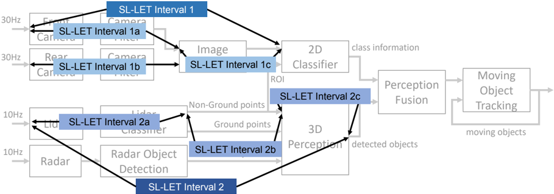

在功能层级上直接应用 SL-LET 不对粒度做任何假设。如第 [4.1](#41-简介) 节所示，通用的功能架构包含所需的模型元素：

- FunctionComponentType（功能块）；
- PortPrototype（功能块的输入与输出端口）；
- FunctionConnector（把一个功能块的输出端口连接到另一个功能块的输入端口）。

SL-LET 区间可以表述为端口之间的时序约束，形式为：

- 功能响应时间预算（针对单个功能块）；
- 功能连接器通信时间预算（针对两个功能块之间的连接）；
- 端到端时间预算（针对粗粒度的（混合）规范）。

此外，必须为每个预算规定一个范式（**Paradigm**），以区分它是否是 SL-LET 区间；并且可选地标注 PermittedPipelining，以允许 SL-LET 区间大于其周期。表 8.1 展示功能时序概念元素与 SL-LET 的 TIMEX 约束之间的关系。

表8.1：功能时序概念到 SL-LET 的 TIMEX 约束的转换（**Transformation from Functional Timing Concept to TIMEX Constraints for SL-LET**）

| 功能时序概念 | TIMEX 约束 |
|---|---|
| Paradigm | TimingDescriptionEventChain.category = SL_LET_INTERVAL |
| PermittedPipelining | TimingDescriptionEventChain.isPipeliningPermitted |
| Function response time budget | LatencyTimingConstraint.maximum |
| Function connector communication time budget | LatencyTimingConstraint.maximum |
| End-to-end time budget | LatencyTimingConstraint.maximum |

诸如「SL-LET 区间 2」这样的整体时间预算可以分解为更小的预算：

- 表示处理管线一部分的一组相连功能块（「SL-LET 区间 2a」）；
- 一个特定的功能块（「SL-LET 区间 2c」）；或
- 两个功能块之间的连接（「SL-LET 区间 2b」）。

第一种情形已经展示了如何为具有初始周期激活的事件驱动处理管线规定数据流确定性。关于 SL-LET 区间分解与流水线的更多示例将在以下各节讨论。

### 8.3. 对未给定映射的 SWC 用 SL-LET 区间规定确定性数据流

LET 与 SL-LET 通过禁止（或屏蔽）实现特定的执行与通信时间抖动，支持在因果链之间规定确定性的数据流。由于因果链通常包含分叉点与汇合点（如图 8.3 所示），这一点变得尤为重要。

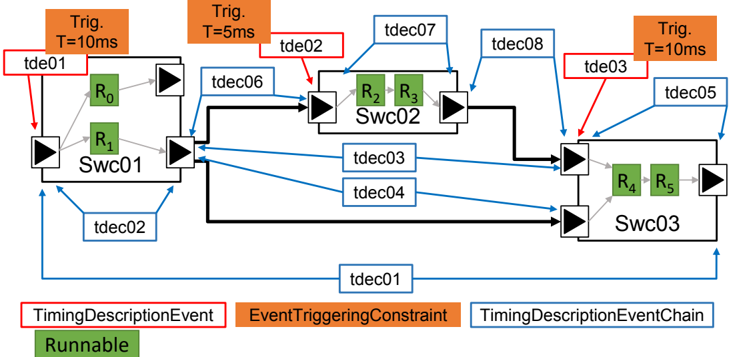

#### 8.3.1. 问题：没有 LET 与 SL-LET 时的数据年龄分散

图 8.3 的示例包含用于 SWC 激活的 TimingDescriptionEvent。通过规定 EventTriggeringConstraint，三个 SWC 形成一个具有两个采样率（10 ms 与 5 ms）的周期性系统。引入 TimingDescriptionEventChain（tdec01 至 tdec08）以将 SWC 端口上的读事件与写事件相互关联。可以为每个 TimingDescriptionEventChain 标注一个 LatencyTimingConstraint，例如规定该链的最小与最大延迟。

如果只规定上界延迟而不是 SL-LET 区间，则 Swc03 输入处的相对数据年龄只能预测保持在某个区间内（称为数据年龄分散）。这是由于 Swc03 输入处的汇合点：一条因果链可能出现最好情况（最短）延迟，而另一条出现最坏情况（最长）延迟。由此产生的挑战已在第 [2.3](#23-时序与数据流的关系) 节概述。

#### 8.3.2. 用 SL-LET 规定确定性的数据年龄分散

LET 区间与 SL-LET 区间都可以借助 AUTOSAR 时序扩展来规定。LET 与 SL-LET 区间的规定存在一个重要的概念差异。SL-LET 区间描述数据流的时序，因此它们引用功能块或软件组件的输入与输出端口。而 LET 区间为可执行实体的执行时间提供骨架，因此 AUTOSAR 中的 LET 区间引用一组可执行实体。该用例聚焦于与硬件无关的 SL-LET 区间规定；针对给定硬件映射、从 SL-LET 到 LET 区间的分解在第 [8.4](#84-把-sl-let-区间分解为-let-区间) 节讨论。

SL-LET 区间可以通过添加一个 category = SL\_LET\_INTERVAL 的 TimingDescriptionEventChain 来规定，如图 8.4 所示。该 TimingDescriptionEventChain 引用 SL-LET 区间的释放事件与终止事件，两者类型均为 TDEventSLLET。更具体地，子类 TDEventSLLETPort 允许引用 SWC 端口。SL-LET 区间长度用 LatencyTimingConstraint 表达，而 PeriodicEventTriggering 约束规定 SL-LET 区间的开始（可选地带偏移量）。表 8.2 列出图 8.4 中每个 SL-LET 区间的参数：周期、区间长度以及相对于全局超周期的偏移量。它还引用图 8.3 中相应的 TimingDescriptionEventChain（为了可读性在图 8.4 中省略）。SL-LET 的 TIMEX 规范的更多细节见 [\[2\]](#ref-2)。

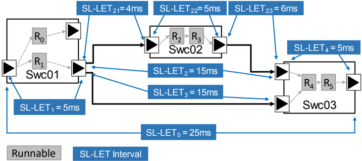

表8.2：图中 SL-LET 区间的参数（**parameters of the SL-LET intervals in Figure**）

| SL-LET 区间 | 对应链 | 周期 | 区间长度 | 偏移量 |
|---|---|---|---|---|
| SL-LET 0 | tdec01 | 10 ms | 25 ms | 0 ms |
| SL-LET 1 | tdec02 | 10 ms | 5 ms | 0 ms |
| SL-LET 2 | tdec03 | 10 ms | 15 ms | 5 ms |
| SL-LET 3 | tdec04 | 10 ms | 15 ms | 5 ms |
| SL-LET 4 | tdec05 | 10 ms | 5 ms | 20 ms |
| SL-LET 21 | tdec06 | 10 ms | 4 ms | 5 ms |
| SL-LET 22 | tdec07 | 5 ms | 5 ms | 9 ms |
| SL-LET 23 | tdec08 | 5 ms | 6 ms | 14 ms |

因此，端到端期限（例如与 tdec01 关联的最大延迟）可以被划分为多个 SL-LET 区间。通向一个汇合点的多条并行因果链甚至可以用相等的 SL-LET 区间来规定（如 tdec03 与 tdec04），从而在 Swc03 的输入端口强制确定性的、预先定义的数据年龄分散。SL-LET 区间可以进一步分解为更小的 SL-LET 区间。在本示例中（见图 8.4），SL-LET 0 是 SL-LET 1–4 的组合，SL-LET 2 进一步分解为 SL-LET 21–23。这在设计过程中很重要，因为它允许在最高层级规定时间预算（本例中为 tdec01，即 SL-LET 0），然后在开发的后续阶段将其具体化。因此 SL-LET 区间的分解对应于事件链的分解。

SL-LET 区间是否包含计算也无关紧要，因为这里使用 SL-LET 区间来规定软件组件端口之间数据流的时序。这同时涵盖输入端口到输出端口的关系（涉及 SWC，因此涉及计算）与输出端口到输入端口的关系（仅规定抽象通信）。对于后者，可以在开发的早期阶段规定 SWC 之间的通信，以便在实现期间有可用的时间预算。在图 8.4 中，SL-LET 2、21、23、3 就是这类通信预算的例子。

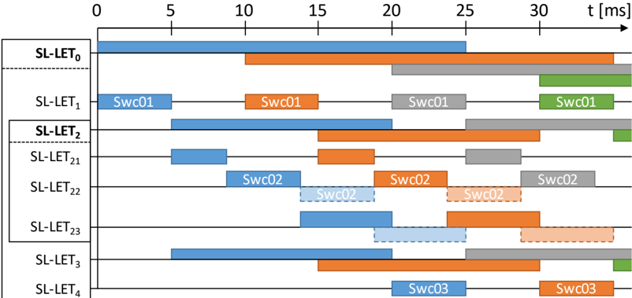

图 8.5 给出 SL-LET 区间及其偏移量所产生的数据流的图形化表示。蓝色、橙色、灰色与绿色用于区分因果链的前四次执行。因此每个 SL-LET 区间都恰好关联一种颜色。SL-LET 区间的划分标注在左侧。

图 8.4 中的 tdec01、tdec03、tdec04 与 tdec08 已经给出了 SL-LET 区间大于输入周期的例子——在图 8.5 中可以通过重叠的 SL-LET 区间实例轻松识别。如附录 C.2 进一步讨论的，只要满足允许流水线属性（PPP）（见第 [8.1](#81-系统层级逻辑执行时间的基本概念) 节），这样的规范就是被允许的，例如：

- tdec04：该 SL-LET 区间抽象的通信没有内部状态（参见 SL-LET 中的互联 LET，第 [8.1](#81-系统层级逻辑执行时间的基本概念) 节）；
- tdec03：如果 SL-LET 区间包含可能有状态的计算（如 Swc02），则必须把它划分为更小的区间（tdec06–tdec08）。

#### 8.3.3. 后续用例

该用例尚未包含 SWC 与通信到硬件的任何映射。它作为后续用例的基线：

- 第 [8.4](#84-把-sl-let-区间分解为-let-区间) 节：针对给定的硬件映射，把 SL-LET 区间分解为 LET 区间。
- 第 [8.5](#85-从既有-let-规范组合-sl-let-区间) 节：从既有的 LET 规范组合出 SL-LET 区间。
- 第 [8.6](#86-使用-sl-let-时因果链对经修改执行与通信时间的健壮性) 节：因果链对经修改的执行与通信时间的健壮性（LET）；在使用 SL-LET 的情况下，在网络延迟变化时确保可组合性。

### 8.4. 把 SL-LET 区间分解为 LET 区间

在开发过程的早期阶段，由于缺乏可执行实体的具体实现，SWC 的精确时序不可得。把 SL-LET 区间分解为 LET 区间，可以为可执行实体或可执行实体组（更准确地说，为它们的实现）推导时序需求。以这种方式，满足推导出的 LET 区间即确保符合整体的 SL-LET 区间，从而满足因果链的上级时序需求。

该用例把第 [8.3](#83-对未给定映射的-swc-用-sl-let-区间规定确定性数据流) 节用例的 SL-LET 规范与一个示例性的硬件映射相结合，如图 8.6 所示。Swc01 与 Swc02 的可执行实体（更准确地说是 runnable 实体）在 ECU1 上执行，而 Swc03 实现在 ECU2 上。因此，SL-LET 区间 SL-LET 23 与 SL-LET 3 指的是分布式通信（例如经由两个 ECU 之间的总线或网络），而 SL-LET 区间 SL-LET 21 指的是 ECU 内通信。基于初始的 SL-LET 规范与给定的 SWC 映射，用于计算的 SL-LET 区间可以分解为 LET 区间。与 SL-LET 区间不同，LET 区间引用一组可执行实体（runnable）。SL-LET 区间到 LET 区间的分解同样遵循开发过程的需要。在开发过程的早期，VFB 用于规定 SWC 之间的通信关系；此时还没有可执行实体实现的定义，因此这里使用 SL-LET 区间。在开发的后期（SWC 开发阶段），runnable 被定义，并且已知哪些 runnable 读取哪些输入、提供哪些输出。因此在该阶段，SL-LET 区间可以分解为具体的 LET 区间，从而保证初始的事件链与数据流（或数据年龄）。


SL-LET 区间到 LET 区间的分解如图 8.7 所示。与 SL-LET 区间一样，LET 区间可以通过添加 category 为 LET\_INTERVAL 的 TimingDescriptionEventChain 来规定。同样，LET 区间长度用 LatencyTimingConstraint 表达，并用 PeriodicEventTriggering 约束规定 LET 区间的周期性。两个 LET 区间释放点之间的偏移可以通过规定 OffsetTimingConstraint 来描述。只要时序需求和数据流得到满足，也可以采用图 8.7 以外的其他分解。同一软件组件的 runnable 可以使用 runnable 间通信，因此 LET 区间 LET 2 规定 runnable 组 R2 与 R3 的输入/输出行为，它对应 Swc02 的输入/输出行为。表 8.3 列出图 8.7 的 LET 区间参数，偏移量相对于 LET 1 的释放点给出。图 8.8 展示实现可能的样子。如图 8.4 所述，SL-LET 2 是 SL-LET 21、SL-LET 22 与 SL-LET 23 的组合；SL-LET 0 由 SL-LET 1–4 组合而成。


表8.3：图中 LET 区间的参数（**parameters of the LET intervals in Figure**）

| LET 区间 | SL-LET 区间 | Runnable | 周期 | 区间长度 | 到 LET 1 的偏移 |
|---|---|---|---|---|---|
| LET 1 | SL-LET 1 | R1 | 10 ms | 3 ms | – |
| LET 2 | SL-LET 22 | R2、R3 | 5 ms | 5 ms | 9 ms |
| LET 3 | SL-LET 4 | R4、R5 | 10 ms | 5 ms | 20 ms |

得到的 LET 规范必须提供上级 SL-LET 规范所要求的数据流。一种直接的方法是推导与相应 SL-LET 区间属性匹配的 LET 区间。LET 2 与 SL-LET 22 就是这种情况。另一方面，LET 1 的规范同样为这两条因果链提供了与 SL-LET 1 所要求相同的数据流，尽管 LET 1 的区间长度更短。例如，LET 1 的输出可以在 3 ms LET 区间结束后直接用于第三条因果链。这始终取决于具体的配置和所涉及的因果链。

对于 ECU 间通信，图 8.8 的示例假定一条时间触发的总线，其中 Swc02 与 Swc03 之间、以及 Swc01 与 Swc03 之间的消息可以映射到特定的时隙。SL-LET 规范确保无论选择哪个时隙，数据都会在相应 SL-LET 区间（此处为 SL-LET 2 与 SL-LET 3）结束时为 Swc03 发布。另一方面，SL-LET 区间 SL-LET 21 在非分布式通信（ECU 内、基于同一时钟）的情况下也保持有效，因为 Swc01 的输出必须先缓冲，Swc02 才能读取。这可以在图 8.8 中看到：LET 区间 LET 2 的偏移量是 SL-LET 到 LET 区间分解的结果。虽然对给定的映射而言这是 ECU 内延迟，但 SL-LET 规范为 Swc02 被映射到第三个 ECU 的情况提供了一定程度的健壮性。


### 8.5. 从既有 LET 规范组合 SL-LET 区间

该用例描述如何为已经拥有 LET 规范的系统推导 SL-LET 规范，以及在何种约束下这是可能的。LET 区间要求零时间通信，因此不覆盖分布式 SWC 的通信——后者的通信需要可观的时间。LET 区间可以组合为 SL-LET 区间，以理想地实现与通信的无关性，从而确保分布式 SWC 之间数据流的确定性时序。

图 8.9 给出三个软件组件及其 runnable 的示例，它们被映射到 LET 区间。AUTOSAR 中的 LET 区间规定：相关联的可执行实体在 LET 区间的边界内执行。这允许对既有系统的两种不同解释，如图 8.9 顶部所示。


图 8.9 左侧：LET 仅用于规定可执行实体或可执行实体组的执行边界。Runnable 依照 LET 语义以及它们所映射的 LET 区间的时序进行读/写。其间的通信未被 LET 规范覆盖，可能存在隐含的假设或额外的时序约束。例子有：本地 ECU 上共享内存的零时间通信假设，或远程通信存在专门的延迟约束。由于 LET 的焦点缩减到可执行实体的纯粹执行，初始规范在不对通信施加额外约束的情况下并不保证确定性的数据流。SL-LET 可以通过显式建模互联 SL-LET 区间来弥合这一鸿沟并扩展规范。每个软件组件的 SL-LET 区间可以直接从既有的 LET 区间推导。软件组件之间的黑色箭头在设计过程中可能导致不同类型的通信，例如取决于 ECU 映射与 RTE 生成。因此，为这些通信依赖提供专门的 SL-LET 规范是值得的。

图 8.9 右侧：右侧表示对 LET 规范的另一种视角。它显式假定任何形式的数据向所有订阅者的传播都是发布者 LET 区间的一部分。这种广播语义已在同步系统中为人所知，但其缺点是 LET 区间同时包含计算与通信。该规范提供了确定性的数据流，但对通信延迟的可能要求非常受限。它要求 runnable 集成与通信集成紧密耦合，因为两者共享 LET 区间提供的同一延迟预算。不过，这可以用两种方式处理：要么把互联 LET 区间规定为零（非常受限），要么重新设计 LET 区间。第一种方法适用于已经可以用共享内存、零时间通信实现的本地通信。更高效的方式是从既有设计（例如用于执行与通信的既有时间预算）创建 SL-LET 规范，然后按用例 [8.4](#84-把-sl-let-区间分解为-let-区间) 所讨论的把它分解为新的 LET 规范。

### 8.6. 使用 (SL-)LET 时因果链对经修改执行与通信时间的健壮性

(SL-)LET 为计算与通信提供逻辑时序抽象。基于第 [8.3](#83-对未给定映射的-swc-用-sl-let-区间规定确定性数据流) 节讨论的初始时序规范，系统可能演进，实现的时序行为可能改变。这类变化有多种来源，典型的例子有：

- 软件更新由于修改了调度而导致因果链中响应时间的变化，尽管更新属于另一条因果链；
- 额外或修改的网络负载增加了通信包的延迟，或在时间触发网络的情况下甚至导致全新的网络调度；
- 影响因果链的设计修改，例如更改的硬件平台或时序预算的新的分解。

该用例讨论把新的时序需求或时序行为的变化（例如由于修改的硬件平台）与 SL-LET 区间规定的预期时序行为进行比较。

#### 8.6.1. 主场景

图 8.10 给出该用例的 SL-LET 规范以及第 [8.4](#84-把-sl-let-区间分解为-let-区间) 节已知的示例性硬件映射。Swc01 与 Swc02 的 runnable 实体在 ECU1 上执行，而 Swc03 实现在 ECU2 上。该用例只聚焦于到 Swc03 输入为止的时序，更准确地说，是对 SL-LET 区间 SL-LET 1、SL-LET 2 与 SL-LET 3 规范的遵守情况。


SL-LET 支持显式地识别数据流对修改后时序行为的健壮性。图 8.11 给出规定的 SL-LET 区间（蓝框）与 LET 区间（红框）的组合时序图，以及 runnable（绿框）与网络包（灰框）的示例性调度。对容器任务而言，健壮性裕量是任务的最坏情况响应时间与相应 (SL-)LET 区间结束之间的差，在图中以黄色突出。


- 例如，执行 runnable R1 的容器任务的最坏情况响应时间为 1.5 ms，相对于 3 ms 的区间 SL-LET 1，给出 50% 的（相对）健壮性裕量，即 1.5 ms（绝对）。只要响应时间不超过 5 ms，数据流不受影响。
- 示例中的 BUS0 是时间触发的，每 2.5 ms 有用于数据包的时隙。此例中网络设计者必须决定消息到时隙的映射。对区间 SL-LET 3 使用了时隙 3，产生约 60% 的健壮性裕量。这里的健壮性裕量并不说明总线或处理器的利用率。
- 另一方面，区间 SL-LET 21 完全没有被利用，因为 Swc01 与 Swc02 之间的通信可以在共享内存上实现而无需任何消息传递。尽管如此，SL-LET 21 提供了一定程度的平台独立性，因为规范先验地考虑了可能的通信延迟。
- SL-LET 区间 SL-LET 2 向 SL-LET 21、SL-LET 22 与 SL-LET 23 的层次化分解表明：这种情况下的健壮性裕量等于子链中最后一个健壮性裕量，即 SL-LET 23 的健壮性裕量。SL-LET 区间组合的健壮性裕量不是各子区间健壮性裕量之和。

#### 8.6.2. 修改后的网络调度、ECU 内通信与 WCRT

图 8.12 给出一个实现在多个方面发生变化的场景。第一，ECU1 上的 Swc01 与 Swc02 不再能使用共享内存通信，ECU 内通信改为经由消息传递实现。例如当 Swc01 与 Swc02 被映射到不同处理器时，或当 RTE 不实现共享内存通信时，就可能是这种情况。这消耗了处理 RTE/COM 栈不可忽略的时间（橙框），并动用了 SL-LET 区间 SL-LET 21 先验引入的健壮性。同样，实现 runnable R2 与 R3 的容器任务 WCRT 的变化也可以由 LET 2 的健壮性裕量补偿，只要 WCRT 仍小于 LET 2。此外，网络调度发生了变化，因为网络包被映射到不同的时隙：

- 在这种情况下数据流不受影响，因为两条子链中都存在适合 SL-LET 区间的消息时隙。
- 这不仅包括延迟的增加（如 SL-LET 23）。如果延迟减小（SL-LET 3），SL-LET 也能保持数据流。例如当网络调度是优化算法的输出时，这一点很重要——优化算法对变更后的输入需求可能产生完全不同的结果。没有 SL-LET，上界延迟虽然可能得到满足，但如果样本在 ECU2 上提供得太早，数据流仍可能改变。


#### 8.6.3. 更新后的规范

图 8.13 给出对 Swc01 与 Swc02 之间非分布式通信修改并适配时序规范的示例。表 8.4 与表 8.5 突出了修改后的 SL-LET 规范以及分解的 LET 区间。这展示了 SL-LET 区间层次化组合的力量，因为更新后的规范只影响 SL-LET 2 内部的数据流。其结果是，runnable R2 与 R3 可以更早执行，利用 Swc01 与 Swc02 之间的共享内存通信。来自 Swc02 的消息落入总线上较早的时隙，有效提高了 SL-LET 2 的健壮性裕量。对 Swc03 而言，可观察的行为保持不变。

表8.4：图中 SL-LET 区间的参数（**Parameters of the SL-LET intervals in Figure**）

| SL-LET 区间 | 对应链 | 周期 | 区间长度 | 偏移量 |
|---|---|---|---|---|
| SL-LET 0 | tdec01 | 10 ms | 25 ms | 0 ms |
| SL-LET 1 | tdec02 | 10 ms | 5 ms | 0 ms |
| SL-LET 2 | tdec03 | 10 ms | 15 ms | 5 ms |
| SL-LET 3 | tdec04 | 10 ms | 15 ms | 5 ms |
| SL-LET 4 | tdec05 | 10 ms | 5 ms | 20 ms |
| SL-LET 21 | tdec06 | 10 ms | (4 ms) → 0 ms | 5 ms |
| SL-LET 22 | tdec07 | 5 ms | 5 ms | (9 ms) → 5 ms |
| SL-LET 23 | tdec08 | 5 ms | (6 ms) → 15 ms | (14 ms) → 10 ms |

表8.5：图中分解的 LET 区间的参数（**Parameters of the decomposed LET intervals in Figure**）

| LET 区间 | SL-LET 区间 | Runnable | 周期 | 区间长度 | 到 LET 1 的偏移 |
|---|---|---|---|---|---|
| LET 1 | SL-LET 1 | R1 | 10 ms | 3 ms | – |
| LET 2 | SL-LET 22 | R2、R3 | 5 ms | 5 ms | (9 ms) → 5 ms |
| LET 3 | SL-LET 4 | R4、R5 | 10 ms | 5 ms | 20 ms |


### 8.7. 用层次化时钟把系统分解为 LET 区

SL-LET 区间的释放与终止事件需要同步的时间基准。与理想化的假设不同，分布式 ECU 的时钟可能表现出有界的偏差，用同步精度 ε > 0 表示。以具有两个同步 ECU 的系统为例，ECU 1 上的时刻 t 在 ECU 2 上可以用时间区间 [t-ε, t+ε] 来近似。因此，该用例引入层次化的 LET 区来应对时钟不完全同步的问题。

该用例描述在分布式系统开发过程中如何规定 LET 区（也称时区，**time zone**）。SL-LET 区间的释放与终止事件提供物理时间实例的抽象，因此引用一个抽象的模型时钟。从第 [8.3](#83-对未给定映射的-swc-用-sl-let-区间规定确定性数据流) 节起的先前用例中，该时钟被假定为全局时钟，这意味着所有 SL-LET 区间都是相对于理想化的全局时间基准规定的。然而，分布式系统中同步的时间基准始终是全局时间基准的衍生物，并带有（有界的）同步精度。因此，AUTOSAR 在经典平台与自适应平台中都提供了同步时间基准的规格说明手段以及时间同步协议的规范。这使得在分布式系统中实现同步的物理时钟成为可能，例如作为调度的基础。另一方面，LET 区包含抽象的区时钟（**zone clock**），而区时钟又可以表示物理时间基准。LET 区可以层次化地规定，并提供具有有界同步精度的理想化模型时间的概念。规定 SL-LET 区间时必须考虑该同步精度，因为它必须被 SL-LET 区间长度所覆盖。图 8.14 给出只有两个层次级别的直接示例。车辆内的两个 ECU 经由以太网连接并同步到全局时间基准。每个 ECU 相对于全局时间主节点可以有个别的同步精度，并且每个 ECU 在 SL-LET 模型中由一个 LET 区表示。同步精度记为 ε。


规定 SL-LET 区间时有三种选项：

1. 可以在每对 LET 区之间规定同步精度。虽然这种方法对两个 ECU 显然很简单，但在现实世界的系统中，当需要覆盖大量设备（即 LET 区）时，区同步关系的数量会呈平方增长。因此图 8.14 中没有显式标注这一点。
2. SL-LET 因此支持 LET 区的层次分解，因为它提供了基于树的结构。图 8.14 中 ZC 2 与 ZC 3 之间的同步精度可以通过在 LET 区层次中的遍历计算得到，并且释放与终止事件可以关联到相应的 LET 区。这类似于白盒方法，因为它考虑了整个 LET 区层次。
3. 黑盒方法则允许在更高的层次级别上规定 SL-LET 事件。无需详细规定两个 ECU 的 LET 区，可以为区时钟 ZC 1（表示车辆全局时间基准）规定一个全局同步精度。这种全局精度的下界是任意两个子 LET 区之间的最坏情况精度。

第三种方法也反映了没有层次化 LET 区规定、所有 SL-LET 事件都引用全局时间基准（即全局区时钟）的情形。这可以看作一个全局默认 LET 区。由于该全局区时钟「继承」了系统范围的最坏情况精度，当 SL-LET 事件只相对于该全局区时钟规定时，可能导致低效。图 8.15 给出这样的示例。


在一个多处理器 ECU 内，不同的处理器核连接到片上网络。每个处理器有自己的时间基准，同样受时间同步支配。ECU 内部的同步可能远好于不同 ECU 之间的同步，而且片上网络上的通信延迟也低于 ECU 间网络。

区间 SL-LET-2 可以相对于三个不同的层次级别规定。在区时钟 ZC 4 与 ZC 5 之间，实际同步精度 200 ns 提供了最精确的规范。往上一层，LET 区 TZ 3 的内部精度为 300 ns——这是其子区时钟 ZC 4、ZC 5、ZC 6 之间的最坏情况精度。因此 SL-LET-2 也可以相对于整个 LET 区 TZ 3 规定而没有太大损失。ZC 3 不一定代表 ECU 2 内的物理时钟。ZC 3 的模型时间仍然可以用于关联 SL-LET 事件并跟踪 ECU 内的最坏情况同步精度。与之相对，顶层 LET 区 TZ 1 具有更大的同步误差。也可以相对于 ZC 1 规定 SL-LET-2，但假定 ECU 内通信比 ECU 间通信引入的延迟小，TZ 1 内大的同步误差会对 SL-LET 区间长度产生显著影响。

区时钟相对于外部 LET 区也有同步精度，即对其任何子时钟的最坏情况精度。例如区间 SL-LET-1 必须计入这一点：它必须考虑 ZC 2、ZC 1 与 ZC 3 之间的精度以及对 TZ 3 任何子区的最坏情况精度。这使得可以在两个具有内部层次的 LET 区之间规定 SL-LET 区间，而无需展开该层次。层次级别的数量以及由模型时钟表示的时钟数量不受限制。可以轻松把图 8.15 的示例扩展到 V2X 场景，其中基础设施设备形成自己的 LET 区，通信范围介于基础设施设备与车载 ECU 之间。

#### 8.7.1. LET 区在开发过程中的角色

同步精度可以以两种方式使用。第一，如图 8.15 所示，它可以作为实际系统的表示，其中区时钟的内部精度从其子区推导（自底向上）。就 AUTOSAR 的规格说明手段而言，相反的方向是最重要的方面，因为它遵循自顶向下的开发过程。对于自顶向下的方法，可以预先规定整个系统所需的同步精度，任何分解都必须遵循这一规范。

SL-LET 规范已经可以在功能层级给出，但在早期开发步骤中还没有规定硬件平台。因此，直觉上所有 SL-LET 事件都关联到一个单一的全局 LET 区。现在有不同的选项：

A) 假定完美的时钟同步来规定功能模型的全局 LET 区。这是 ε = 0 的理想化时钟模型。因果链中两个相继的 SL-LET 区间可以背靠背（**back-to-back**）规定，即生产者的终止事件与消费者的释放事件重合。在这种理想化模型中数据流是无歧义的，因为数据会在消费者的释放事件处恰好提供给消费者。现在设想在后续的开发过程中，生产者与消费者被映射到不同的 ECU，从而处于不同的 LET 区。随着硬件平台的引入，ε = 0 的理想化模型不再成立：生产者的终止事件与消费者的释放事件都可能有 ±ε > 0 的有界抖动。由于有界的同步精度，显而易见给定的 SL-LET 规范可能导致非确定性的数据流。因此需要细化 SL-LET 规范，确保生产者的终止事件与消费者的释放事件之间有充分的间隔（至少 2·ε）。这一间隔可以视为对有限同步精度的健壮性。一致性检查可以轻松检测此类违例，方法是对照硬件模型细化后的 SL-LET 规范比较功能模型（ε = 0）的 SL-LET 规范。

B) 功能模型的全局 LET 区也可以在规定时就考虑同步精度的上界 ε > 0。这可以作为后续平台规定的约束，避免对 SL-LET 规范的细化。

C) 功能模型不限于只包含一个具有全局同步精度的 LET 区。如果功能链已知跨越不同的层次化平台级别，这也可以由多个 LET 区反映，它们随后可以针对特定的硬件平台细化。一个例子是 V2X 功能，它包含可以假定粗略时钟同步的子链（例如基础设施层级）以及可以假定紧密时钟同步的子链（例如车辆内部）。

## 9. 用于时序分析的属性与方法

### 9.1. 总体介绍

本节描述时序用例（见第 4、5、6、[7](#7-ecu-层级软件集成的时序) 章）与时序任务（第 [10](#10-用于时序分析的工件) 章）之间的一般关系。时序属性与时序方法将在本章详细规定。

前几章（与功能层级、ECU、网络或端到端视图相关）呈现的时序用例（例如第 [6.4](#64-nw-用例新网络的设计与配置) 节）通常由若干更小的步骤组成（列于每个用例的「主场景」下）。其中一些步骤在根本上与时序相关，并在多个用例中重复出现。我们把这些步骤称为「时序相关任务（**timing related tasks**）」，并在第 [10.1](#101-时序任务的描述) 节中更详细地概述它们。

一个特别重要的时序相关任务是执行时序分析（**Perform Timing Analysis**），它可以基于设计配置（如任务「Perform Model-Based Timing Analysis」）或基于对实际实现的观察（如任务「Perform Implementation-Based Timing Analysis」）来执行。这些时序相关任务又可以包含一个「时序方法」（见第 [9.5](#95-时序方法的定义描述与分类) 节，它更详细地规定如何解决该任务，即通过仿真或静态分析）。

时序方法的输入（例如「通信矩阵」或「测得的核心执行时间」）来自系统规格说明或对真实系统的观察。一些方法把时序属性作为输出（例如「被发送消息的最坏情况响应时间」），可以在时序任务「Verify Timing」期间对照时序约束进行评估（例如功能可能要求帧传输在 10 ms 内完成）。

同样重要、但不在本文档范围内的是时序方法与时序属性在工具中的实现。该方法路径与时序术语在图 9.1 与 [9.2](#92-时序属性的简单语法) 中说明。

同样重要、但不在本文档范围内的还有逻辑执行时间（**LET**）的概念。如果应用使用 LET 范式，每个应在 LET 区间内执行的可执行实体都必须借助 TIMEX [\[2\]](#ref-2) 相应地映射。此外，必须采用时序分析技术，确保所有被映射到 LET 区间的可执行实体都在该 LET 区间内终止。


#### 9.1.1. AUTOSAR 经典平台操作系统

##### 9.1.1.1. OSEK/AUTOSAR CP OS 任务状态

AUTOSAR OS 使用 OSEK 定义的调度概念（详情见「Operating System Specification 2.2.3」）。OSEK 为两个一致性等级定义了任务状态：BCC（Basic Conformance Class，基本一致性等级）与 ECC（Extended Conformance Class，扩展一致性等级）。相应的任务状态图见图 9.3 与 9.4。


##### 9.1.1.2. 时序参数

图 9.5 展示了决定任务在系统内实时行为的原理性时序参数，表 9.1.1.2 定义了所用的符号。注意：用于指示任务在给定时间点当前状态的颜色与图 9.4 中该状态所用的颜色一致。


表9.1：时序参数（**Timing information**）

| ID | 缩写 | 名称 | 描述 |
|---|---|---|---|
| 1 | IPT | 初始挂起时间（**initial pending time**） | 从激活到开始 |
| 2 | CET | 核心执行时间（**core execution time**，计算时间） | 执行时间，不含任何抢占或「等待」时间 |
| 3 | GET | 总执行时间（**gross execution time**） | 含所有抢占与「等待」时间的执行时间 |
| 4 | RT | 响应时间（**response time**） | 从激活到终止 |
| 5 | DL | 期限（**dead line**） | 允许的最大响应时间 |
| 6 | DT | 增量时间（**delta time**） | 从开始到开始（「测得的周期」） |
| 7 | PER | 周期（**period**） | 从激活到激活（周期按配置而非按测量） |
| 8 | ST | 松弛时间（**slack time**） | 「剩余」运行时间：从终止到激活（任务）或开始（中断） |
| 9 | NST | 净松弛时间（**net slack time**） | 「潜在附加」运行时间：ST 减去 ST 期间所有更高优先级 TASK 或 ISR 的全部 CET 块 |
| 10 | JIT | 抖动（**jitter**） | 增量时间相对周期的偏差（图中未显示） |
| 11 | PRE | 抢占时间（**Preemption time**） | 任务被更高优先级任务抢占的时间（图中未显示） |
| 12 | CPU | CPU 负载（**CPU load**） | CPU 非空闲时间所占比例（通常以百分比报告）（图中未显示） |

##### 9.1.1.3. 关于 AUTOSAR OS ECC 的说明

通常，AUTOSAR OS 任务被启动后在某个时间点终止。这对 AUTOSAR OS 基本一致性等级（**BCC**）的任务是绝对强制性的，对 AUTOSAR OS 扩展一致性等级（**ECC**）的任务也应如此。

然而，存在不终止而是循环运行、使用 WaitEvent 进行调度的任务配置。这对由 RTE 配置环境生成的 RTE 任务往往属实。见清单 9.1 的示例。RTE 配置器不是生成两个周期性的 BCC 任务——例如 Main\_Task\_5ms 调用 CanTp\_MainFunction 与 CanXcp\_MainFunction、Main\_Task\_10ms 调用 CanNm\_MainFunction 与 CanSM\_MainFunction——而是生成一个不终止的 ECC 任务，并加入由 WaitEvent 与 SetEvent 控制的第二级调度。

```
TASK(Main_Task)
{
  EventMaskType ev;

  for(;;)
  {
    (void)WaitEvent( Rte_Ev_Cyclic2_Main_Task_0_10ms |
                     Rte_Ev_Cyclic2_Main_Task_0_5ms );

    (void)GetEvent(Main_Task, &ev);

    (void)ClearEvent(ev & ( Rte_Ev_Cyclic2_Main_Task_0_10ms |
                            Rte_Ev_Cyclic2_Main_Task_0_5ms ));

    if ((ev & Rte_Ev_Cyclic2_Main_Task_0_10ms) != (EventMaskType)0)
    {
      CanNm_MainFunction();
      CanSM_MainFunction();
    }

    if ((ev & Rte_Ev_Cyclic2_Main_Task_0_5ms) != (EventMaskType)0)
    {
      CanTp_MainFunction();
      CanXcp_MainFunction();
    }
  }
}
```

清单9.1：使用事件进行调度的非终止 ECC 任务（**Non terminating ECC task using events for scheduling**）

此处不再展开这种做法的所有缺点，但我们必须处理非终止的 ECC 任务，并使时序分析也适用于这种情况。例如前面对 CET 的定义就失效了。对终止的任务（BCC 与 ECC），CET 定义为任务从开始到终止之间所有「运行（**running**）」状态的总和。显然，如果任务不终止，CET 就变成无穷大。

图 9.6 与图 9.5 类似，但此时 Task B 是一个非终止的 ECC 任务。实现该任务的人会期望时序属性是针对无限循环的「一轮」计算的。两轮之间的间隔反映了 Task B 的一个伪挂起状态，因此在图 9.6 中以半透明的等待状态来可视化。


由于循环中可能包含「常规」事件的使用，我们现在必须把这些「常规」事件及其相应的 WaitEvent 调用，与用于调度的事件及其相应的 WaitEvent 调用区分开来。

清单 9.2 派生自清单 9.1。为了说明以及指示任务何时改变状态，加入了注释。此外，该任务现在还有一个「常规」事件 Can\_Ev\_TriggerSM\_Main\_Task。图 9.6 所示的调度情形对应清单 9.2。

```
TASK(Main_Task)
{
  // Task starts here
  EventMaskType ev;

  for(;;) // non-terminating ECC task
  {
    // Task "ends" here (in fact it will switch to waiting)
    // the following WaitEvent call is a "scheduling" WaitEvent
    (void)WaitEvent( Rte_Ev_Cyclic2_Main_Task_0_10ms |
                     Rte_Ev_Cyclic2_Main_Task_0_5ms );
    // Task "starts" here again (in fact it returned from waiting)

    (void)GetEvent(Main_Task, &ev);

    (void)ClearEvent(ev & ( Rte_Ev_Cyclic2_Main_Task_0_10ms |
                            Rte_Ev_Cyclic2_Main_Task_0_5ms |
                            Can_Ev_TriggerSM_Main_Task ));

    if ((ev & Rte_Ev_Cyclic2_Main_Task_0_10ms) != (EventMaskType)0)
    {
      CanNm_MainFunction();
      // the following WaitEvent call is a "regular" WaitEvent
      (void)WaitEvent( Can_Ev_TriggerSM_Main_Task );
      CanSM_MainFunction();
    }

    if ((ev & Rte_Ev_Cyclic2_Main_Task_0_5ms) != (EventMaskType)0)
    {
      CanTp_MainFunction();
      CanXcp_MainFunction();
    }
  }
}
```

清单9.2：使用事件进行调度的非终止 ECC 任务（**Non terminating ECC task using events for scheduling**）

针对同一配置所推荐的任务配置见清单 9.3。对每个周期——此处为 5 ms 与 10 ms——使用一个专门的任务。只要可能，任务应为 BCC1 任务。所有任务都终止。

```
TASK(Main_Task_10ms) // ECC
{
  CanNm_MainFunction();
  // the following WaitEvent call is a "regular" WaitEvent
  (void)WaitEvent( Can_Ev_TriggerSM_Main_Task );
  CanSM_MainFunction();
  TerminateTask();
}

TASK(Main_Task_5ms) // BCC1
{
  CanTp_MainFunction();
  CanXcp_MainFunction();
  TerminateTask();
}
```

清单9.3：使用每个周期一个单独任务的推荐配置（**Recommended configuration using a separate task per period**）

### 9.2. 时序属性的简单语法

为了避免在后续各节中重复相似的时序属性与方法定义，本文档采用一种通用方法。时序属性借助支持性的占位符来描述，例如 `&lt;schedulable&gt;` 与 `&lt;resource&gt;`。`&lt;resource&gt;` 例如可以是「CPU」或「CAN 总线」，`&lt;schedulable&gt;` 例如可以是相应的 `RunnableEntity`、`BswSchedulableEntity` 或「帧」。

并非所有这些术语的组合都会导出相关/有效的定义。因此，实际的实例随定义一并列出。出于实用性的考虑，本文档目前并未把占位符结构形式化为一套完整且一致的语法（但在未来的版本中可能会进行这样的精化）。

#### 9.2.0.1. 资源与可调度对象

`&lt;Resources&gt;`（资源）是执行 `&lt;schedulables&gt;`（可调度对象）所必需的。它们可以基于在线或离线的调度方案，在多个 `&lt;schedulables&gt;` 之间随时间进行调度。`&lt;Resources&gt;` 具有计算、存储、发送或接收信息的能力。

`&lt;Resources&gt;` 可以分为两类：`&lt;unary resources&gt;`（一元资源），它们在任一给定时刻只能执行一个 `&lt;schedulable&gt;`；以及 `&lt;multi resources&gt;`（多元资源），它们可以并行执行多个 `&lt;schedulables&gt;`。

一个 `&lt;schedulable&gt;` 在 `&lt;resource&gt;` 上计算、存储或发送信息。为了取得进展，它必须在调度过程中被分配到该 `&lt;resource&gt;`。

表9.2：资源概览（**Resource Overview**）

| &lt;Resource&gt; | |
|---|---|
| &lt;Unary Resource&gt; | 允许的 &lt;Schedulable&gt; |
| CAN 总线段 | CAN 帧 |
| 单核 CPU | Task 与 ISR |
| FlexRay 段 | FlexRay 帧 |
| 以太网链路 | 以太网消息 |
| LIN 总线 | LIN 帧 |
| &lt;Multi Resource&gt; | |
| 交换式以太网网络 | 以太网消息 |
| 多核 CPU | Task 与 ISR |

**注意：** `&lt;Multi Resources&gt;`（多元资源）未被本文档中的任何当前定义所覆盖。

可调度对象的时序由其 `&lt;activate&gt;` 与 `&lt;terminate&gt;` 事件定义。`&lt;activate&gt;` 是 `&lt;schedulable&gt;` 变得就绪、可以执行其操作的时刻，`&lt;terminate&gt;` 是其完成的时刻。

一个 `&lt;schedulable&gt;` 可以包含 `&lt;subschedulables&gt;`（子可调度对象），以区分不同的操作。

表9.3：允许的可调度对象（**Allowed Schedulable**）

| &lt;Schedulable&gt; | 允许的 &lt;Subschedulable&gt; |
|---|---|
| Processor Task（等价：ISR） | Runnable、BSW function |
| OS-Function | RunnableEntity、BswSchedulableEntity |
| CAN 帧 | PDU、Signal |
| FlexRay 帧 | PDU、Signal |
| Ethernet | 参数 |

#### 9.2.0.2. 推导方法

不同的时序属性可以用各种方法推导，但并非每个属性都能用每种方法正确推导（不过常常可以近似）。例如，在仿真期间可以观察消息负载，但难以推导真实的最坏情况延迟。就本文档而言，我们区分以下方法（更多细节见第 [9.5](#95-时序方法的定义描述与分类) 节）：

表9.4：推导方法（**Method of Derivation**）

| &lt;TimingMethod&gt; | 说明 |
|---|---|
| Analysis（分析） | 时序属性取值的计算或理论估计 |
| Simulation（仿真） | 对系统进行仿真，以确定时序属性取值随时间的发展 |
| Measurement（测量） | 对目标进行测量，以确定时序属性取值随时间的发展 |

#### 9.2.0.3. 统计量化词

许多时序属性可以针对不同的 `&lt;Statistical Qualifiers&gt;`（统计量化词）进行裁剪。例如，某一种情况下人们可能关心消息的平均延迟，另一种情况下关心最大延迟（例如它是时间关键消息，如主动转向示例中的总时间）。这样做的前提是通过例如仿真确定延迟随时间的发展，并推导相关量（例如平均延迟）。这可以推广为确定任意量随时间的发展（「x-over-Time」）以及推导分布及其各阶矩。

为此，引入以下 `&lt;Statistical Qualifiers&gt;`：

表9.5：不同类型的时序方法及其导出的统计量化词（**Different Types of Timing Methods and the resulting Statistical Qualifiers**）

| 方法 | &lt;Statistical Qualifier&gt; | 导出的量 |
|---|---|---|
| Analysis（分析） | Best-Case（最好情况） | |
| Analysis（分析） | Worst-Case（最坏情况） | |
| Simulation / Measurement（仿真/测量） | Distribution / X-over-time（分布/随时间变化） | Minimum（最小值） |
| Simulation / Measurement（仿真/测量） | Distribution / X-over-time（分布/随时间变化） | Maximum（最大值） |
| Simulation / Measurement（仿真/测量） | Distribution / X-over-time（分布/随时间变化） | Average（平均值） |
| Simulation / Measurement（仿真/测量） | Distribution / X-over-time（分布/随时间变化） | Standard deviation（标准差） |

x-over-time 与分布取决于相关的时序方法、输入参数与边界条件。相比之下，分析方法把时序属性作为单个值给出（例如最坏情况）。（最好）最坏情况表示（最小）最大系统需求下的系统状态，有时被所采用的算法高估。而在此上下文中，（最小）最大值表示时序属性实际观察到的值。

#### 9.2.0.4. 约束类型

最后，依照 TIMEX 中的定义，时序属性的实际值可以被解释为需求（分析之前，**a priori**），或者最坏情况可以被看作对系统规格说明的保证（分析之后，**a posteriori**）。

表9.6：约束类型（**ConstraintType**）

| &lt;ConstraintType&gt; |
|---|
| Requirement（需求） |
| Guarantee（保证） |

图 9.7 概述了时序属性的值（及其随时间的发展与分布）与约束之间的相互作用。时序属性的值来自时序方法。分布的左侧标出了一些统计量化词。此处，保证来自对所关注时序属性的最坏情况分析（更一般地在性能规格说明中定义），而对该时序属性的外部需求（在需求规格说明中定义）在此情况下无法被满足。


#### 9.2.1. 协议规格说明

##### 9.2.1.1. CAN

为了定义 CAN 总线的属性，使用以下定义：

表9.7：CAN 的长度参数定义（**Definition length parameter for a CAN**）

| CAN 帧的组成 | | |
|---|---|---|
| Header | Standard addressing CAN / Extended addressing CAN / Standard addressing CAN-FD | 19 bit / 37 bit / 22 bit |
| Payload | CAN / CAN-FD | 0..8 byte / 0..64 byte |
| Stuff bits | Standard addressing CAN / Extended addressing CAN / Standard addressing CAN-FD | 0..19 bit / 0..25 bit / 0..140 bit |
| Footer | CAN / CAN-FD | 25 bit / 35 bit |
| Inter frame space | CAN/CAN-FD | 3 bit |

把所有参数加在一起，得到帧长度/时间（l~frame~ / t~frame~）。因此，CAN 的一般属性与参数为：

| 调度 | 静态优先级、非抢占 |
|---|---|
| 激活 | 周期性和/或事件触发 |

表9.8：CAN 的一般参数定义（**Definition general parameter for a CAN**）

| | |
|---|---|
| ID（优先级） | Std. CAN/CAN-FD：0..0x7FF |
| 速率 | CAN：100..1000 KBaud；CAN-FD：1..10 MBaud |
| 帧长度 | Standard CAN：47..130 bit；Standard CAN-FD：62..678 bit |

把通用描述应用到 CAN 总线时，采用以下关系：

表9.9：通用参数与 CAN 特定参数之间的关系（**Relation between the general and the CAN specific parameters**）

| 通用参数 | 实际值 |
|---|---|
| &lt;resource&gt; | CAN 总线段 |
| &lt;schedulable&gt; | CAN 帧 |
| &lt;activate&gt; | 发送方 ECU 上用于传输的事件 TDEventFrame.frameQueued |
| &lt;terminate&gt; | 网络与接收方 ECU 之间的事件 TDEventFrame.frameTransmittedOnBus |

##### 9.2.1.2. 激活

表9.10：帧激活的定义（**Definitions of the frame activation**）

| 帧 | 定义 |
|---|---|
| 周期帧（**Periodic Frame**） | 以「循环时间」定义的周期被周期性激活的帧。 |
| 事件触发帧（**Event-Triggered Frame**） | 由外部事件偶发激活的帧。 |
| 混合帧（**Mixed Frame**） | 由周期到期或外部事件激活的帧。对周期部分的处理存在不同的概念（例如在偶发事件到达时重置周期计时器）。 |

AUTOSAR 范围内帧的更复杂激活模式也可以定义。此外，还存在 OEM 特定的传输模式。

### 9.3. 用例、任务、属性与方法之间的关系

表9.11：用例与任务之间关系的概览（**Overview about Relation between UCs and Tasks**）

| 用例 | Collect Timing Requirements | Create Implementation | Create Timing Model | Perform Model-Based Timing Analysis | Perform Implementation-Based Timing Analysis | Verify Timing |
|---|---|---|---|---|---|---|
| 功能层级用例「为新车辆功能识别时序需求」 | x | | x | x | | |
| 功能层级用例「把车辆功能划分为功能架构」 | x | | x | | | x |
| 功能层级用例「把功能架构映射到硬件组件网络」 | x | | x | x | | x |
| ECU 用例「创建整个 ECU 的时序模型」 | x | | x | | | |
| ECU 用例「收集 SWE 的时序信息」 | x | | x | x | x | |
| ECU 用例「时序的验证」 | | | | x | x | x |
| ECU 用例「调试时序」 | x | x | | | x | x |
| ECU 用例「优化 ECU 的时序」 | | x | | | x | x |
| ECU 用例「优化调度」 | | x | x | x | x | x |
| ECU 用例「优化代码」 | | x | | | x | x |
| NW 用例「新通信的集成」 | | x | x | x | x | x |
| NW 用例「新网络的设计与配置」 | x | x | x | x | x | x |
| NW 用例「既有通信链路的重新映射」 | x | x | x | x | x | x |
| E2E 用例「从端到端时序需求推导逐跳时间预算」 | x | | | | | |
| E2E 用例「从既有实现推导时序需求」 | x | | | x | x | |
| E2E 用例「基于信号/参数为功能接口规定时序需求」 | x | x | | | | |
| E2E 用例「对照时序需求验证保证」 | | | | x | x | x |
| E2E 用例「基于追踪的分布式实现时序验证」 | | | | | x | （x） |

表9.12：用例与所用属性、所施方法之间关系的概览（**Overview about Relation between UCs, used Properties and applied Methods**）

| 用例 | GENERIC PROPERTY Load | GENERIC PROPERTY Latency | SPECIFIC PROPERTY Execution Time | Determine Load（通用+CAN 专用） | Determine Latency | Determine Response Time (CAN) |
|---|---|---|---|---|---|---|
| 功能层级用例「为新车辆功能识别时序需求」 | | x | x | | x | |
| 功能层级用例「把车辆功能划分为功能架构」 | | x | x | | x | |
| 功能层级用例「把功能架构映射到硬件组件网络」 | x | x | x | x | x | |
| ECU 用例「创建整个 ECU 的时序模型」 | | | x | | | |
| ECU 用例「收集 SWE 的时序信息」 | x | | x | x | | |
| ECU 用例「时序的验证」 | x | | | x | x | |
| ECU 用例「调试时序」 | x | x | x | x | x | |
| ECU 用例「优化 ECU 的时序」 | | | x | | x | |
| ECU 用例「优化调度」 | x | | x | x | x | |
| ECU 用例「优化代码」 | | | x | | | |
| NW 用例「新通信的集成」 | x | x | | x | x | x |
| NW 用例「新网络的设计与配置」 | x | x | | x | x | x |
| NW 用例「既有通信链路的重新映射」 | x | x | | x | x | x |
| E2E 用例「从端到端时序需求推导逐跳时间预算」 | | x | x | | | |
| E2E 用例「从既有实现推导时序需求」 | | | x | x | x | x |
| E2E 用例「基于信号/参数为功能接口规定时序需求」 | x | x | x | | | |
| E2E 用例「对照时序需求验证保证」 | x | x | x | x | x | x |
| E2E 用例「基于追踪的分布式实现时序验证」 | x | x | x | x | x | x |

**注意：** 源表 9.40/9.11 的部分行把通用方法与其 CAN 专用变体合并在同一单元格（两行「x」）；上表以单列「Determine Load（通用+CAN 专用）」呈现，标记状态与源一致。

### 9.4. 时序属性的定义与分类

#### 9.4.1. 属性的分类与关系

属性可以分为两大领域：容量属性（**capacitive**，`&lt;resource&gt;` 容量）与延迟属性（`&lt;schedulable&gt;` 延迟）。容量属性是 `&lt;schedulables&gt;` 对容量的需求与 `&lt;resource&gt;` 容量之比。延迟属性是 `&lt;schedulables&gt;` 由于公共 `&lt;resource&gt;` 上的调度（优先级方案）而产生的延迟。

#### 9.4.2. 所考察时序属性概览

表9.13：此处描述的时序属性概览（**Overview about the here described Timing Properties**）

| NW/ECU | 组 | 名称 |
|---|---|---|
| Generic（通用） | Capacity（容量） | GENERIC PROPERTY Load |
| NW | Capacity（容量） | SPECIFIC PROPERTY Load (CAN) |
| Generic（通用） | Latency（延迟） | GENERIC PROPERTY Latency |
| Generic（通用） | Latency（延迟） | GENERIC PROPERTY Response Time |
| NW | Latency（延迟） | SPECIFIC PROPERTY Response Time (CAN) |
| Generic（通用） | Latency（延迟） | GENERIC PROPERTY Transmission Time |
| Generic（通用） | Latency（延迟） | SPECIFIC PROPERTY Transmission Time (CAN) |
| ECU | Latency（延迟） | SPECIFIC PROPERTY Execution Time |

#### 9.4.3. 通用属性负载（GENERIC PROPERTY Load）

##### 9.4.3.1. 范围与应用

表9.14：范围、应用与关系（**Scope, Application and Relation**）

| | |
|---|---|
| 名称 | Load（负载） |
| 描述 | 负载是一组 `&lt;schedulables&gt;` 占用某个 `&lt;single resource&gt;` 的总时间份额。如果计算占用时间，它可能超出可用资源时间（过载，**overload**）。在使用仿真或测量的实际实现中，这种情况不会发生。但是，如果所有 `&lt;schedulables&gt;` 的传输负载（发送请求量）超过 100% 且未被缓冲，则待传输的信息可能丢失或被覆盖。 |
| 应用 | 该属性支持分别估计 ECU 与网关以及网络的资源需求。 |
| 假设与前置条件 | • 已知每个 `&lt;schedulable&gt;` 的占用时间。• 总通信量到各个 `&lt;schedulables&gt;` 的划分已完成。 |
| 与 AUTOSAR 规范的关系 | TIMEX 中没有引用；通过用 ResourceConsumption 类规定 ExecutableEntity 的 ExecutionTime，间接引用 AUTOSAR 系统模板与 BSW Module Description。 |

##### 9.4.3.2. 接口

表9.15：接口（**Interface**）

| | |
|---|---|
| 记法 | L(t, t~window~, ...) |
| 可能的&lt;统计量化词&gt; | 引言中提及的所有量化词 |
| 参数 | t~window~：确定负载的时间区间大小。推荐值：较大但有限的值 |
| 参数 | t：确定负载的时间区间的终点。负载随时间分析需要该参数。默认值：未规定 |
| 范围 | 0 到 100%（计算时为 0..∞） |


##### 9.4.3.3. 表达力

「负载」表示给定 `&lt;single resource&gt;` 的总体利用率。出于安全与可扩展性的原因，较小的负载有利于稳定运行。然而，它也表明该 `&lt;single resource&gt;` 未被充分利用，可能错失成本优化的机会。另一方面，剩余的空闲资源可以用于未来的扩展，因此是有意保留的。

从实时应用以及带时序约束的可调度对象的角度看，负载的表达力有限。负载值低于 100% 可以推出保证：每个 `&lt;schedulable&gt;` 的每个实例最终都会被调度并在 `&lt;resource&gt;` 上执行。然而，可调度对象的完成时间可能大于其周期或任何给定的期限。

实际上，它与 `&lt;schedulable&gt;` 的最坏情况响应时间的相关性很小。取决于调度，存在高负载、小总响应时间的例子，也存在低（但高度可变）负载、大总响应时间的例子（对照延迟、时序属性最坏情况响应/执行时间）。

在 [\[18\]](#ref-18) 中已经证明：仅给定周期性的 `&lt;schedulables&gt;`（期限等于其周期），如果负载小于 69%（独立的 `&lt;schedulables&gt;`），所有 `&lt;schedulable&gt;` 都会在其期限之前得到服务。然而在实践中，偶发激活的 `&lt;schedulables&gt;` 的存在使这一结论无法直接应用。

#### 9.4.4. 特定属性负载 (CAN)（SPECIFIC PROPERTY Load (CAN)）

##### 9.4.4.1. 范围与应用

表9.16：范围、应用与关系（**Scope, Application, and Relation**）

| | |
|---|---|
| 名称 | Bus Load (CAN)（CAN 总线负载） |
| 上位属性 | GENERIC PROPERTY Load |
| 所属方法 | SPECIFIC METHOD Determine Load (CAN) |

时间份额可以从目标测量/仿真的 `&lt;activate&gt;` 与 `&lt;terminate&gt;` 计算，也可以在分析时从帧长度（见 CAN 小节）与激活模式（见激活小节）计算。

##### 9.4.4.2. 接口

总线负载 (CAN) 是属性 GENERIC PROPERTY Load 的实例，参数见表 9.8 与 9.9。

根据激活模式，区分以下 CAN 负载：

表9.17：CAN 段的总线负载随帧激活方式的不同种类（**Different kinds of Bus Load of a CAN Segment depending on the frame activation**）

| | |
|---|---|
| 周期负载 | 周期帧集合占用总线的时间份额。 |
| 总负载 | 所有帧（周期与事件触发，包括混合触发帧）占用总线的时间份额。 |

##### 9.4.4.3. 表达力

在运行期间，CAN 总线与被发送的帧通常表现出动态行为：

- 帧周期可能相对规定的循环时间有轻微波动（抖动与漂移）；
- 填充位的数量取决于实际的载荷；
- 帧在每次传输时可能不携带相同数量的载荷。

取决于所选的 `&lt;统计量化词&gt;`（即平均值、最大值等），由于这种动态性，CAN 配置的属性可能需要不同的解释。

#### 9.4.5. 特定属性负载 (CPU)（SPECIFIC PROPERTY Load (CPU)）

##### 9.4.5.1. 范围与应用

表9.18：范围、应用与关系（**Scope, Application, and Relation**）

| | |
|---|---|
| 名称 | CPU Load（CPU 负载） |
| 描述 | 一般 CPU 负载是在观察时间窗口内 CPU 不处于空闲状态的总时间份额。对多核 CPU，CPU 负载由所有核上的平均负载确定。CPU 负载也可以针对单个代码部分或代码部分的类别进行测量。此时，对 CPU 负载的贡献按 CPU 在观察时间窗口内执行所定义代码部分的总时间份额计算。这样的例子有：测量 SW-C 或 AA 的 CPU 资源消耗，或确定不同任务与服务中断之间的负载分布。 |
| 应用 | 该属性支持估计在 ECU 上执行软件所需的计算资源。在开发过程中，它有助于跟踪 CPU 的利用率，以确保用新软件功能扩展或修改既有软件功能的可扩展性。估计 SWC 所需的 CPU 资源消耗。为使用更便宜的微控制器或降低 CPU 频率以降低功耗的优化决策提供依据。通过比较系统软件与应用软件的 CPU 负载、或分析服务中断所需的 CPU 负载，检测软件设计中的不平衡。 |
| 假设与前置条件 | 为了确定一般的 CPU 负载，知道空闲状态的条件、并能够记录空闲状态的进入与退出时间就足够了。什么构成空闲状态取决于实现。OS 可能有一个空闲任务——当没有需要处理的内容时它是活动的；软件可能在无限循环中主动等待需要处理的事件；或者 CPU 可能处于「halt」状态，等待中断触发处理事件。对于单个代码部分的负载贡献，仅有记录代码部分进入与退出时间的能力可能不够。如果一个代码部分可能被 ISR 或任务的执行中断，则 ISR 的进入与退出时间以及任务的激活与停用时间也必须被记录。如果要按类别确定 CPU 负载，则需要把所关注的代码部分分类。 |
| 与 AUTOSAR 规范的关系 | TIMEX 中没有引用；在 CP 中通过用 ResourceConsumption 类规定 ExecutableEntity 的 ExecutionTime，间接引用 AUTOSAR 系统模板与 BSW Module Description。 |

##### 9.4.5.2. 接口

表9.19：接口（**Interface**）

| | |
|---|---|
| 记法 | L(t, t~window~, X, C) |
| 可能的&lt;统计量化词&gt; | 引言中提及的所有量化词 |
| 参数 | t~window~：确定负载的时间区间大小。推荐值：较大但有限的值 |
| 参数 | t：确定负载的时间区间的终点。负载随时间分析需要该参数。默认值：未规定 |
| 参数 | X：负载测量的空闲状态的定义。 |
| 参数 | C：关于不同代码部分分类的信息。 |
| 范围 | 0 到 100%（计算时为 0..∞） |

##### 9.4.5.3. 表达力

如 GENERIC PROPERTY Load 所述，CPU 负载只能作为资源可用性的初步指标。因为即使负载仍然相对较低，也可能无法集成具有严格延迟需求的功能。

来自实现的测量可能由于技术限制而包含测量误差。可能需要插入代码作为追踪点，或者追踪点无法精确加在意图记录的事件的确切位置。由于 CPU 负载通常不需要超过两位小数的精度，且是在 t~window~ 上计算的（其中一些误差可以相互抵消），测量误差对结果的影响可以忽略。

#### 9.4.6. 通用属性延迟（GENERIC PROPERTY Latency）

##### 9.4.6.1. 范围与应用

表9.20：范围、应用与关系（**Scope, Application, and Relation**）

| | |
|---|---|
| 名称 | Latency（延迟） |
| 描述 | 延迟是 `&lt;schedulables&gt;` 序列中第一个 `&lt;schedulable&gt;` 的 `&lt;activate&gt;`（它在 `&lt;resource&gt;` 上就绪可传输/占用）与清单中最后一个 `&lt;schedulable&gt;` 的 `&lt;end&gt;`（被释放）之间的时间量。这包括调度效应。除非另有说明，延迟指单个事件的处理时间或所有 `&lt;schedulables&gt;` 的一次完整遍历。根据所关注的时序属性与应用的性质，可以区分两种类型的延迟（也称「语义（semantics）」）：反应时间延迟（**reaction time latency**），即对输入变化的第一次反应所需的时间量；数据年龄延迟（**data age latency**），即某个特定输入数据在更新的输入值可用之前可能被处理的时间量。细节见 AUTOSAR 时序扩展（TIMEX） [\[2\]](#ref-2) 的 LatencyConstraint。 |
| 应用 | 该属性支持分别估计 ECU、网关以及网络的资源需求与重新调度。该属性可用于计算系统的实时松弛（**real-time slack**）。 |
| 假设与前置条件 | 对每个 `&lt;resource&gt;` 已知：• 访问方案/仲裁策略，如总线协议或 OS 调度 • `&lt;resource&gt;` 的所有占用均无错误，即 `&lt;schedulable&gt;` 的每次利用恰好发生一次。对每个 `&lt;schedulable&gt;` 已知：• `&lt;schedulables&gt;` 的优先级 • 响应时间 • 触发/激活方案（包括任何发送延迟）。 |
| 与 AUTOSAR 规范的关系 | TIMEX 定义了 TimingDescriptionEventChain 的 LatencyTimingConstraint。 |

##### 9.4.6.2. 接口

表9.21：接口（**Interface**）

| | |
|---|---|
| 记法 | T(t, t~window~, X...) |
| 可能的&lt;统计量化词&gt; | 引言中提及的所有量化词 |
| 参数 | X：为其计算响应时间的信息包。 |
| 参数 | t~window~：确定延迟的时间区间大小，即确定延迟的追踪记录的时间区间。默认值：INF |
| 参数 | t：确定延迟的时间区间的起点或终点。X-over-time 分析需要该参数。默认值：未规定 |
| 范围 | 0 到无穷 |

##### 9.4.6.3. 表达力

对顺序 `&lt;schedulable&gt;` 清单的每一跳（元素），`&lt;schedulable&gt;` 的每跳延迟度量其对相关 `&lt;single resource&gt;` 利用的时时间延迟。出于安全与可扩展性的原因，较小的延迟有利于稳定的功能运行。然而，如果相对端到端期限延迟过小，它表明至少一部分 `&lt;resources&gt;` 未被充分利用，可能错失成本优化的机会。尽管如此，延迟必须小于端到端期限，否则可能发生信息丢失。如果相当一部分 `&lt;schedulables&gt;` 在某个 `&lt;single resource&gt;` 上错过其期限，则该资源没有足够的容量或调度不够好。

`&lt;schedulable&gt;` 传输或执行期间的错误可能导致特定 `&lt;schedulable&gt;` 的重传/重新执行，从而增加负载与延迟。

延迟的最坏情况可以通过诸如 [\[19\]](#ref-19) 所示的基于模型的形式化分析方法推导。由此，延迟属性被保守地计算。

延迟的最坏情况可以通过仿真来近似，尽管只能乐观地近似。可以随机生成并观察相关的传输/执行请求与传输/执行完成事件。观察值的最大值是最坏情况延迟的乐观近似。

当该属性使用不同方法（特别是仿真/分析与测量）推导时，只考虑顺序 `&lt;schedulable&gt;` 清单的一个元素时，以下必须成立（WC 表示最坏情况）：

```
WC Latency Analysis (<Schedulable>) ≥ WC Latency Simulation (<Schedulable>)
且
WC Latency Analysis (<Schedulable>) ≥ WC Latency Measurement (<Schedulable>)
```

#### 9.4.7. 通用属性响应时间（GENERIC PROPERTY Response Time）

##### 9.4.7.1. 范围与应用

表9.22：范围、应用与关系（**Scope, Application, and Relation**）

| | |
|---|---|
| 名称 | Response Time（响应时间） |
| 描述 | 响应时间是延迟只涉及单个 `&lt;schedulable&gt;` 的特殊情况，即 `&lt;schedulable&gt;` 的 `&lt;activate&gt;` 与 `&lt;end&gt;` 之间的时间量。这包括对共享 `&lt;resource&gt;` 并发访问的调度效应。可以区分静态优先级抢占式访问（OSEK 与其他操作系统的情况）与静态优先级非抢占式访问（CAN 与多数其他网络系统的情况）。在该 `&lt;resource&gt;` 专属于该 `&lt;schedulable&gt;` 的情况下，`&lt;schedulable&gt;` 的响应时间等于其 GENERIC PROPERTY Transmission Time 或 SPECIFIC PROPERTY Execution Time。在多个 `&lt;schedulables&gt;` 同时就绪的情况下，产生的响应时间由实际调度决定。 |
| 假设与前置条件 | 对每个周期激活与每个混合激活，已知：• 周期 • 参考时钟（可选） • 相对参考的偏移（可选）。对每个事件触发与每个混合激活，已知：• 偶发事件的事件模型（包括最小到达时间）。 |
| 与 AUTOSAR 规范的关系 | TIMEX 把响应时间定义为 TimingDescriptionEventChain 的 LatencyTimingConstraint。 |

##### 9.4.7.2. 接口

它是属性 GENERIC PROPERTY Latency 的一部分，参数如下：

表9.23：一般延迟与响应时间之间的关系（**Relation between the general latency and the response time**）

| 通用参数 | 实际值 |
|---|---|
| &lt;resource&gt; | 单个 `&lt;resource&gt;` |
| &lt;schedulable&gt; | 单个 `&lt;schedulable&gt;` |

表9.24：接口（**Interface**）

| | |
|---|---|
| 记法 | T~Response~(t, t~window~, &lt;schedulable X&gt;, &lt;schedulables&gt;) |
| 参数 | &lt;schedulable X&gt;：为其计算响应时间的 `&lt;schedulable&gt;`。 |
| 参数 | &lt;schedulables&gt;：与 &lt;schedulable X&gt; 交互的其余 `&lt;schedulables&gt;`。 |

##### 9.4.7.3. 表达力

如所定义的响应时间的表达在某种意义上是受限的：

1. 在大量非调和的时间基准的情况下，分析时间可能增长到超出可接受的程度。在这种情况下，分析期间可以忽略一些偏移关系，这可能会略微降低精度。

#### 9.4.8. 特定属性响应时间 (Routing)（SPECIFIC PROPERTY Response Time (Routing)）

##### 9.4.8.1. 范围与应用

表9.25：范围、应用与关系（**Scope, Application, and Relation**）

| | |
|---|---|
| 名称 | Routing Response Time（路由响应时间） |
| 描述 | 路由响应时间是从源网络接收消息/信号开始，直到该消息/信号在目标网络上准备好传输之间的时间量。 |
| 应用 | 该属性支持测量路由器/网关的路由性能。这有助于规划端到端响应时间需求的时间预算，或验证路由器/网关的时序需求。 |
| 假设与前置条件 | • 平均通信场景已被完整描述。• 最坏情况通信场景已被完整描述。• 网关上实现的其他功能对路由的影响已完全知晓。• 路由协议已被完整描述。• 缓冲策略已知。• 缓冲区足够大，不发生缓冲区溢出。 |
| 与 AUTOSAR 规范的关系 | TIMEX 定义了 TimingDescriptionEventChain 的 LatencyTimingConstraint。 |

##### 9.4.8.2. 接口

表9.26：接口（**Interface**）

| | |
|---|---|
| 记法 | T(t, t~window~, X...) |
| 可能的&lt;统计量化词&gt; | 引言中提及的所有量化词 |
| 参数 | X：为其计算响应时间的信息包。 |
| 参数 | t~window~：确定路由响应时间的时间区间大小，即确定延迟的追踪记录的时间区间。默认值：INF |
| 参数 | t：确定路由响应时间的时间区间的起点或终点。X-over-time 分析需要该参数。默认值：未规定 |
| 范围 | 0 到无穷 |

##### 9.4.8.3. 表达力

路由器/网关各条路由路径的路由响应时间本身并不能为路由器/网关的资源利用率提供有意义的指示。更好的指示由路由器/网关上的处理负载提供。

路由响应时间分析可用于验证路由器/网关是否满足时序需求，或帮助为涉及路由器/网关的端到端时序需求定义时间预算。

如果无法定义最坏情况场景，可以应用基于模型的形式化分析方法来确定最坏情况路由响应时间的上界。或者，可以使用长时间段的测量或仿真来找到最坏情况路由响应时间的乐观近似。

#### 9.4.9. 特定属性响应时间 (CAN)（SPECIFIC PROPERTY Response Time (CAN)）

##### 9.4.9.1. 范围与应用

表9.27：范围、应用与关系（**Scope, Application and Relation**）

| | |
|---|---|
| 名称 | Frame response time (CAN)（CAN 帧响应时间） |
| 描述 | 该属性提供从帧准备好发送（`&lt;activate&gt;`，即帧被放入 CAN 驱动的输出消息缓冲区）到帧在总线上完全发送完毕（`&lt;end&gt;`，即通常导致接收 ECU 上的 Rx IRQ）之间的总时间。 |
| 应用 | 该属性允许评估时间关键帧的通信延迟。该属性可用于计算实时松弛（在容纳通信矩阵中规定的所有帧之后的可用带宽）。 |
| 假设与前置条件 | 假定： |
| 与 AUTOSAR 规范的关系 | TIMEX 定义了 TimingDescriptionEventChain 的 LatencyTimingConstraint。CAN 帧响应时间的 TimingDescriptionEventChain 可以定义如下：• 刺激事件：TDEvent-Frame(TDEventType=frameQueuedForTransmission)；• 响应事件：TDEvent-Frame(TDEventType=frameTransmittedOnBus)。 |

##### 9.4.9.2. 接口

响应时间 (CAN) 是属性 GENERIC PROPERTY Response Time 的实例。

表9.28：接口（**Interface**）

| | |
|---|---|
| 记法 | T~Response~(t, t~window~, frame X) |
| 参数 | frame X：为其计算响应时间的帧。 |
| 参数 | stuff bits：分析期间假定使用的填充位数量。 |

##### 9.4.9.3. 表达力

如所定义的 CAN 响应时间的表达在某种意义上是受限的：

1. 由于内部缓冲结构，一些 CAN 控制器可能无法总是把准备好发送的最低 CAN-ID（最高优先级）帧提交给总线仲裁。这可能导致优先级倒置（**priority inversion**），响应时间可能比该属性定义的更大。
2. 在目标环境中测量延迟很困难。虽然通过探测总线很容易识别传输完成事件，但帧何时准备好发送更难确定（黑盒测量）。一种选择是通过检查传输完成事件之前的总线繁忙时间来估计该时间。另一种选择是使用公共时间基准把 ECU 内部追踪与网络追踪结合起来。

这些约束在一定程度上被当前的研究所放宽，例如 [\[20\]](#ref-20)、[\[21\]](#ref-21)。

#### 9.4.10. 特定属性响应时间 (ECU)（SPECIFIC PROPERTY Response Time (ECU)）

##### 9.4.10.1. 范围与应用

表9.29：范围、应用与关系（**Scope, Application and Relation**）

| | |
|---|---|
| 名称 | Response time of a runnable entity (ECU)（ECU 上 runnable 实体的响应时间） |
| 描述 | 该属性提供从激活一个 runnable 实体到该 runnable 实体本次执行终止之间的总时间。该时间段包括状态处于活动（`&lt;running&gt;`）或被动（`&lt;ready&gt;`）的所有时间，直到执行完成。 |
| 应用 | 该属性允许评估 runnable 执行的反应时间是否在允许的时间框架内。该时间框架通常包含由多维时间（**multi-dimensional time**，AUTOSAR 中以各种单位标注时间的元素）定义的最小与最大边界。从响应时间无法推导出诸如负载之类的附加信息。 |
| 假设与前置条件 | 假定：• 所有 runnable 状态转换都可以分析。• 所关注的每个 runnable 的完整 AUTOSAR 名称（包括命名空间）。 |
| 与 AUTOSAR 规范的关系 | TIMEX 在 SW-C 时序视图中为 runnable 实体元素提供时序描述事件。下文给出分析反应时间（AUTOSAR TIMEX 中对本文档所称响应时间的记法）的一种方式：• 刺激事件：TDEvent-Frame(TDEventType=runnableEntityActivated)——引用所关注的 runnable 实体；• 响应事件：TDEvent-Frame(TDEventType=runnableEntityTerminated)——引用所关注的 runnable 实体。 |

##### 9.4.10.2. 接口

响应时间 (ECU) 是属性 GENERIC PROPERTY Response Time 的实例。

表9.30：接口（**Interface**）

| | |
|---|---|
| 记法 | T~Response~(t, t~window~, runnable entity X) |
| 参数 | runnable entity X：为其计算响应时间的 runnable 实体。 |
| 参数 | event chain：用于分析反应时间的事件链。 |

##### 9.4.10.3. 表达力

如所定义的 ECU 中 runnable 实体响应时间的表达可以包含进一步的信息：

1. 它提供关于激活执行上下文（通常是 OsTask）的时间点、直到 runnable 实体本身被执行的信息。
2. 对 runnable 实体使用反应时间，可以分析客户端-服务器接口内服务 runnable（**server runnable**）的反应时间。
3. 要描述 OsTask 的反应时间，同样可以使用上述事件。通过引用任务最后调用的 runnable 实体，runnable 实体的反应时间变得等同于它所映射的 OsTask 的反应时间。
4. 反应时间高度依赖 ECU 内部的任务调度。为了找出某个反应时间的原因，必须进行进一步分析。

#### 9.4.11. 通用属性传输时间（GENERIC PROPERTY Transmission Time）

##### 9.4.11.1. 范围与应用

表9.31：范围、应用与关系（**Scope, Application, and Relation**）

| | |
|---|---|
| 名称 | Transmission time（传输时间） |
| 描述 | 该属性是不考虑任何调度效应的响应时间的特殊情况。该属性提供在单个 `&lt;resource&gt;` 上传输一个 `&lt;schedulable&gt;` 的纯粹时间，不考虑该 `&lt;resource&gt;` 上的任何其他 `&lt;schedulable&gt;`。 |
| 与 AUTOSAR 规范的关系 | TIMEX 中没有定义与传输时间相关的直接约束。但是，可以通过使用 Frame 或 PDU 作为被引用的 ExecutableEntity，以与 ExecutionTimeConstraint 类似的方式定义传输时间。 |

##### 9.4.11.2. 接口

传输时间是属性 GENERIC PROPERTY Response Time 的一部分，参数如下：

表9.32：一般延迟与传输时间之间的关系（**Relation between the general latency and the transmission time**）

| 通用参数 | 实际值 |
|---|---|
| &lt;resource&gt; | 单个 `&lt;resource&gt;` |
| &lt;schedulable&gt; | 单个 `&lt;schedulable&gt;` |

表9.33：接口（**Interface**）

| | |
|---|---|
| 记法 | T~Response~(t, t~window~, &lt;schedulable X&gt;) |
| 参数 | &lt;schedulable X&gt;：为其计算传输时间的 `&lt;schedulable&gt;`。 |

#### 9.4.12. 特定属性传输时间 (CAN)（SPECIFIC PROPERTY Transmission Time (CAN)）

##### 9.4.12.1. 范围与应用

表9.34：范围、应用与关系（**Scope, Application, and Relation**）

| | |
|---|---|
| 名称 | Transmission time (CAN)（CAN 传输时间） |
| 假设与前置条件 | 对总线上的每个帧，已知：• 帧长度（包括填充位）。 |
| 与 AUTOSAR 规范的关系 | TIMEX 中没有针对传输时间的特定属性。可以直接应用 GENERIC PROPERTY Transmission Time 的定义。 |

##### 9.4.12.2. 接口

传输时间 (CAN) 是属性 GENERIC PROPERTY Transmission Time 的实例，参数见表 9.9。

表9.35：接口（**Interface**）

| | |
|---|---|
| 记法 | T~Transmission~(t, t~window~, frame X) |
| 参数 | frame X：为其计算传输时间的帧。 |
| 参数 | stuff bits：分析期间假定使用的填充位数量。 |

#### 9.4.13. 特定属性执行时间（SPECIFIC PROPERTY Execution Time）

##### 9.4.13.1. 范围与应用

表9.36：范围、应用与关系（**Scope, Application, and Relation**）

| | |
|---|---|
| 名称 | Execution Time (ET)（执行时间） |
| 描述 | 执行时间表示某项特定计算所需的时间。在此上下文中，计算可以是 runnable、子函数或仅仅一段命令序列。 |
| 目标 | 该属性是运行时预算分配与 ECU 调度可行性所需的信息输入。 |
| 假设 | n/a |
| 与 TIMEX 的关系 | TIMEX 定义了 ExecutableEntity 的 ExecutionTimeConstraint。上文定义的 SPECIFIC PROPERTY Execution Time 对应 executionTimeType「gross」，即包含对外部函数的调用。 |

##### 9.4.13.2. 接口

执行时间是属性 GENERIC PROPERTY Response Time 的一部分。

表9.37：接口（**Interface**）

| | |
|---|---|
| 输出 | 标量结果值通常以微秒、毫秒或纳秒表示。 |
| 范围 | 0 到无穷 |

##### 9.4.13.3. 表达力

对硬实时系统而言，一个重要的统计量化词（另见小节 9.2.0.4）是完成某项特定计算所需的最坏情况执行时间（**WCET**）。WCET 是资源消耗的指标，通常必须达到或推导出一个预定义的值。为了预测并证明软件执行的正确性，WCET 是一个重要的属性。在实践中，建议使用不同的时序方法来确定 WCET，以获得对结果的信心。这些方法有静态、动态与混合方法。如果无法在现场确定 WCET，则需要使用一个安全的上限作为等价物。基于若干计算的最坏情况执行时间，可以确定一个或多个 WCRT（最坏情况响应时间），而后者在多数情况下更相关。

对 ECU 用例「优化代码」而言，除 WCET 之外，平均执行时间也可能令人关注。两者之间的巨大差异，或平均执行时间与最大执行时间之间的巨大差异，通常指示着优化潜力。

### 9.5. 时序方法的定义、描述与分类

#### 9.5.1. 方法的分类与关系

粗略地说，方法可以分为三大领域：仿真、解析计算与测量。区分方法的另一个准则是考虑数据的来源：基于模型的或基于测量的。这一分类与时序过程的哪个阶段（规格说明阶段或验证阶段）可以执行该方法密切相关。

##### 9.5.1.1. 解析计算

静态代码分析（**Static Code Analysis**）作用于可执行软件或其一部分的源代码或二进制代码层级。由此确定 SPECIFIC PROPERTY Execution Time 的分布。为此，调用图与指令序列被重构并分析。通过应用统计量化词，为给定的代码片段（例如一个函数）计算 BCET（最好情况执行时间）的下限与 WCET（最坏情况执行时间）的上界。除了要分析的软件之外，还必须提供符号信息以及用于附加约束的注记（例如构建选项、输入值范围、集成/硬件特定的约束）。只要该片段不被中断，任何实际的核心执行时间都保证位于该区间内。此外，任何仅在运行时才存在的数据（例如循环迭代次数的上界以及动态函数指针的内容）都必须以附加注记的形式手动提供。为了进行正确的静态代码分析，必须详细了解目标硬件的行为（例如不同存储区域的访问时间、缓存等）。在现代系统中，行为模型可能相当复杂，因此结果精度可能出现限制。

调度分析（**Scheduling analysis**）：基于某个调度器（例如某个 RTOS）的模型，调度分析工具以最小/最大核心执行时间与应用模型为输入，提供例如保证的 WCRT。这允许检查在给定条件下是否会错过任何期限。对每个任务与中断的最坏情况，生成一条追踪记录，允许分析发生该情形的运行时状况。输入分析的执行时间可以是预算、估计或其他工具的输出，例如静态分析的 BCET/WCET 或追踪/测量的数据。因此，调度分析的一个优点是可以在不实现新概念的情况下验证它们。此外，还可以为概念验证或解空间探索对既有概念进行修订。

网络分析（**Network analysis**）：对单个网络段的网络分析为经由该网络传输的每个帧/包计算最坏情况响应时间。这通常基于配置所连接 ECU 所需的同类设计数据（例如 AUTOSAR 系统提取）即可完成。主要信息是每个帧/包的（总）大小（例如基于所含信号/参数的大小与协议头部）、帧的传输属性（即其循环时间或外部触发的去抖时间），当然还有网络的传输速率。分析在计算最坏情况响应时间时会考虑网络上的冲突以及帧之间的同步。这一基本结果可以聚合成总线或网联网络的完整时序概要（**timing profile**）。在时序行为高度动态的情况下，网络分析可以与基于测量的方法混合，用来自实际测量的事件追踪记录替代基于模型的设计数据。

组合式分析（**Compositional analysis**）：组合式分析允许考虑由不同 `&lt;resource&gt;` 上的不同 `&lt;schedulable&gt;` 组成的活动链。它首先把同一 `&lt;resource&gt;` 上不同 `&lt;schedulable&gt;` 的链式响应时间相加，然后再计算资源的响应时间。如果进行最坏情况考虑，该方法可能非常保守，因为实际上多个链式资源上同时出现最坏情况响应时间的概率远低于单个资源最坏情况的概率——而后者本身已是保守的。

##### 9.5.1.2. 仿真

一般而言，仿真需要足够的运行次数（仿真时间），以确保结果的统计相关性并覆盖所有自由度的参数空间（例如发送请求的抖动、帧的发送安排）。

代码仿真（**Code simulation**）：代码仿真器为某个处理器仿真给定二进制代码的执行。存在多种多样的代码仿真器。简单的指令集仿真器提供关于执行时间的非常有限的信息，而复杂的仿真器还会考虑流水线与缓存效应。为了从代码仿真器获得可靠的 WCET 信息，必须把它嵌入到一个实际会引发最坏情况被仿真的测试环境中。

调度仿真（**Scheduling simulation**）：调度仿真器提供与调度分析类似的功能。它们不计算结果，而是仿真运行时行为。观察到的时序信息与生成的追踪记录是主要输出。如果仿真了最坏情况场景，观察到的响应时间将等于 WCRT。一些仿真器允许以 C 语言定义任务，从而支持复杂的应用模型，同时提供汽车工程师熟知的规格说明语言。

网络仿真（**Network simulation**）：网络仿真是基于实际配置的模型预测总线段或网络段实际时序的技术。这些模型通常从配置所连接 ECU 所需的同类设计数据（例如 AUTOSAR 系统提取）派生。主要信息是每个帧/包的大小（例如基于所含信号/参数的大小与协议头部）、帧的传输属性（即其循环时间或外部触发的去抖时间），当然还有网络的传输速率。网络仿真器特定于某个网络协议，通常在模型数据规定的边界内创建随机流量并展开特定的调度。可以就所产生的帧响应时间、网络负载等对这些调度进行研究。作为另一类网络仿真，剩余总线仿真（**remaining bus simulation**）不是时序特定的方法，但许多时序问题（如仲裁延迟、抖动、高负载行为等）可以在真实的物理层上以实验方式开展。借此可以验证其他仿真方法。

处理器在环仿真（**PIL**）用于确定特定软件系统的一些时序属性，例如 SPECIFIC PROPERTY Execution Time 或 GENERIC PROPERTY Load。为此，编译后的软件将在评估板、原型硬件或实际 ECU 上的嵌入式目标处理器中执行。为了能够正确执行软件，所需的运行时环境将被仿真。仿真平台激励并调用被研究的软件。在执行期间捕获所需的输出数据。对输出数据进行分析以推导所需的时序属性。要执行 PIL，必须提供可分析的执行文件（例如 elf 文件）与用于激励的输入向量。PIL 仿真的结果应当用第 [9.5](#95-时序方法的定义描述与分类) 节所述的替代方法的结果进行验证。

用于 PIL 的输入激励向量需要以能够达到物理上最高的代码覆盖率的方式激励软件。输入激励向量的质量应在单独的「输入激励向量验收测试」中展示，该测试证明适当的覆盖率。结果的精度强烈取决于输入激励向量的质量。

捕获输出数据的追踪方案必须具备在定义的分析点（**profiling point**）之间测量执行时间的能力。分析点定义测量的起点与终点。

表9.38：关系（**Relation**）

| | |
|---|---|
| 引用的用例 | • ECU 用例「收集 SWE 的时序信息」 • ECU 用例「时序的验证」 • ECU 用例「优化 ECU 的时序」 • ECU 用例「优化调度」 • ECU 用例「优化代码」 |
| 引用的时序属性 | • SPECIFIC PROPERTY Execution Time • GENERIC PROPERTY Load • GENERIC PROPERTY Response Time |

离散事件仿真（**DES**）用于仿真系统的动态行为。它把系统的运行建模为时间中事件的离散序列。每个事件在特定时刻发生，并标记系统状态的一次变化。只要系统的时序模型可用，该方法就可以应用。该方法的结果是系统的时序属性。必须提供系统的时序分析报告（表 10.12），且结果的精度强烈依赖输入模型的质量。

表9.39：关系（**Relation**）

| | |
|---|---|
| 引用的用例 | • ECU 用例「收集 SWE 的时序信息」 • ECU 用例「创建整个 ECU 的时序模型」 • ECU 用例「时序的验证」 • ECU 用例「优化调度」 |
| 引用的时序属性 | • GENERIC PROPERTY Response Time • GENERIC PROPERTY Load • SPECIFIC PROPERTY Execution Time |

硬件在环仿真（**HIL**）可用于确定特定 ECU 软件的一些时序属性，例如 GENERIC PROPERTY Response Time 或 GENERIC PROPERTY Load。

要执行 HIL 仿真，软件必须集成到实际的 ECU。该 ECU 连接到所谓的硬件在环仿真器，它能够仿真 ECU 正常功能所需的车辆环境。在仿真期间捕获所需的输出数据。对输出数据进行分析以推导所需的时序属性。

输入激励向量需要以能够达到物理上最高的代码覆盖率的方式激励 ECU 软件。结果的精度强烈取决于输入激励向量的质量。

追踪方案必须具备在定义的分析点之间测量执行时间的能力。分析点定义测量的起点与终点。

表9.40：关系（**Relation**）

| | |
|---|---|
| 引用的用例 | • ECU 用例「收集 SWE 的时序信息」 • ECU 用例「时序的验证」 |
| 引用的时序属性 | • GENERIC PROPERTY Response Time • GENERIC PROPERTY Load • SPECIFIC PROPERTY Execution Time |

##### 9.5.1.3. 测量与追踪

ECU 层级上的测量：时序测量通常基于由 RTOS 调用的钩子例程（**hook routine**）。分析真实系统，并提供观察到的时序信息。

网络层级上的测量：时序测量由连接到真实网络硬件的专用硬件完成。取决于协议与所用的测量设备，时间戳在相关 `&lt;schedulable&gt;` 传输过程的不同时间点被标记。精度由追踪设备给出，并应满足采样定理。

追踪（**Tracing**）观察真实系统。追踪意味着对测量数据流的持久记录。它可以是离散事件的记录，也可以是来自时间连续源的采样与量化数据（连同时间戳）的记录。对于专用事件，时间戳连同事件信息被放入追踪缓冲区。事件的选择可以非常细粒度——例如流追踪（**flow trace**）允许重构每条机器指令的执行——也可以较粗粒度，例如只追踪与调度相关的事件。追踪可以基于插桩（即软件修改）或专用追踪硬件。追踪记录可以离线可视化与分析，例如用于调试目的。可以从追踪记录中提取不同种类的时序信息。有时必须包含隐式协议开销才能正确计算（例如在 CAN 上计算负载时的填充位）。

##### 9.5.1.4. 不同方法可比性的确定

一方面比较分析、另一方面比较仿真/测量时，在长时间极限下（相同边界条件）负载应一致。如果所有参数以相同方式选取，差异将消失。一般而言，仿真与观察以相同的方式给出乐观近似，程度取决于样本/探测规模（测量/仿真时间）。

为了比较不同方法（特别是仿真/分析与测量）的结果，强烈建议检查所有 `&lt;schedulables&gt;` 都包含在输出中。

#### 9.5.2. 所考察方法概览

所有方法的领域均为分析、仿真与测量。

表9.41：所考察方法概览（**Overview of regarded Methods**）

| NW/ECU | 组 | 名称 |
|---|---|---|
| Generic（通用） | Load（负载） | GENERIC METHOD Determine Load |
| NW | Load（负载） | SPECIFIC METHOD Determine Load (CAN) |
| Generic（通用） | Latency（延迟） | GENERIC METHOD Determine Latency |
| NW | Latency（延迟） | SPECIFIC METHOD Determine Response Time (CAN) |

#### 9.5.3. 通用方法确定负载（GENERIC METHOD Determine Load）

##### 9.5.3.1. 范围与应用

表9.42：范围与应用（**Scope and Application**）

| | |
|---|---|
| 描述 | 该方法在定义的时间区间上给出负载（分布）。 |
| 理由 | 该方法支持分别估计 ECU、网关与网络的资源需求。 |

##### 9.5.3.2. 分类

表9.43：分类（**Classification**）

| | |
|---|---|
| 系统 | NW / ECU |
| 所施协议 | CAN / FlexRay / OSEK / AUTOSAR 等 |
| 方法路径 | Analysis / Simulation / Measurement（分析/仿真/测量） |

##### 9.5.3.3. 关系

表9.44：关系（**Relation**）

| | |
|---|---|
| 需求 | 接口输入与边界条件（见表 9.45） |
| 过程步骤 | 该方法应在以下过程步骤中应用：• 对软件实现/数据定义与通信网络配置的验证 • 后续开发的需求分析 • 开发阶段的资源优化 |
| （前置）时序属性 | 取决于实现，该方法需要所考虑 `&lt;Resource&gt;` 上所有 `&lt;Schedulables&gt;` 的传输时间和/或执行时间等时序属性（例如 GENERIC PROPERTY Transmission Time 与 SPECIFIC PROPERTY Execution Time） |
| 所属后置时序属性 | GENERIC PROPERTY Load |

##### 9.5.3.4. 接口

表9.45：接口（**Interface**）

| | |
|---|---|
| 输入 | 该方法需要诸如以下参数：• `&lt;Schedulables&gt;`（例如任务/帧/PDU）及其总时间（传输时间、执行时间）、它们的激活模式（例如周期/循环、偶发）以及可能的其他参数（例如 CAN 总线通信情况下的填充位）• 所考虑 `&lt;single resource&gt;` 的传输/执行速率（例如 CAN 总线速率或处理器速率） • `&lt;schedulable&gt;` 自发出现的模型（例如事件触发帧）/ 自发事件出现的近似 |
| 边界条件、设置与变体、前置条件 | • 环境状态（例如行驶状态） |
| 输出 | 该方法的结果是 `&lt;resource&gt;`（NW/ECU）上的负载，由时序属性 GENERIC PROPERTY Load 捕获。 |

##### 9.5.3.5. 实现

推导网络或 ECU 负载的方法的实现取决于所考虑的方法路径，即分析、仿真或测量。实现细节见相应的特定方法。

#### 9.5.4. 特定方法确定负载 (CAN)（SPECIFIC METHOD Determine Load (CAN)）

##### 9.5.4.1. 范围与应用

表9.46：范围与应用（**Scope and Application**）

| | |
|---|---|
| 简要描述 | 该方法在定义的时间区间上给出 CAN 总线上的负载（分布）。 |
| 理由 | 该方法支持确定 CAN 网络的资源需求。 |

##### 9.5.4.2. 分类

表9.47：分类（**Classification**）

| | |
|---|---|
| 系统 | NW |
| 所施协议 | CAN |
| 方法路径 | Analysis / Simulation / Measurement（分析/仿真/测量） |

##### 9.5.4.3. 关系

表9.48：关系（**Relation**）

| | |
|---|---|
| 需求 | 接口输入（见表 9.49） |
| 过程步骤 | 该方法应在以下过程步骤中应用：• 对 CAN 总线数据定义与配置的验证 • 后续开发的需求分析 • 开发阶段的资源优化 |
| （前置）时序属性 | 该方法需要所考虑 CAN 总线上所有帧的 SPECIFIC PROPERTY Transmission Time (CAN)。 |
| 所属后置时序属性 | SPECIFIC PROPERTY Load (CAN) |

##### 9.5.4.4. 接口

特定方法 Determine Load (CAN) 是 GENERIC METHOD Determine Load 的实例。

表9.49：接口（**Interface**）

| | |
|---|---|
| 输入 | 该方法需要 9.8 与 9.9 中定义的 CAN 参数。 |
| 输出 | 该方法的结果是 CAN 总线上的负载，由 SPECIFIC PROPERTY Load (CAN) 捕获。 |

##### 9.5.4.5. 应用限制

目前，对事件触发帧的自发出现还没有确立的处理方式。因此，必须对自发出现应用统一的模型或激活模式，以便在不同配置之间获得可比较的结果。

填充位的计算缺少一般性的处理。因此，应考虑关于填充位数量的不同假设，即最小、平均与最大填充位数。

##### 9.5.4.6. 实现

###### 9.5.4.6.1. 分析

通过分析推导 CAN 总线总线负载的方法基于数学公式。这些公式可以在支持导入输入参数、计算负载值与导出结果的工具中实现。

该方法必须支持计算乐观（最好情况）、平均与悲观（最坏情况）的总线负载值。为此，应实现关于填充位数量的不同假设，即最小数量（乐观方法）、平均数量与最大数量（悲观方法）。此外，还应支持事件触发帧激活模式的不同模型。通过分析推导负载时，要考虑带各自周期的循环事件以及带事件模型的偶发事件。例如，偶发事件可以以它们的去抖时间作为「周期」建模，或以它们的最大出现率建模。根据悲观或乐观的方法，计算可以用周期的下限估计上界，后者则用规定的周期。

计算总线负载的公式包含悲观/乐观方法，取决于分析时对填充位的估计（见下文的填充位公式；对具有 29 位标识符的 CAN 帧存在偏差）。CAN 参数在 9.8 中给出。

```
t_frame = t_stuff bits(frame) + (47 + 8 * payload length(frame)[Byte]) * τ_Bit        (9.1)

L(t_frame, t_cycle(frame), payload length(frame)) = Σ_frame t_frame / t_cycle(frame)  (9.2)
```

其中 payload length（以字节为单位）是 CAN 帧数据部分的长度，t~bit~ 是传输一个位的时间，t~cycle~ 是规定的周期。

对 CAN-FD（帧长度大于 16 字节）则改为：

```
t_frame = t_stuff bits(frame) + 30 * τ_Bit + (30 + 8 * payload length(frame)[Byte]) * τ_Bit^high   (9.3)
```

其中 τ~Bit~^high^ 是总线的高数据速率。

该方法估计无限长时间窗口内（t~window~ 为无穷，当前时间点 t 不起作用）总线上周期性消息产生的总线负载。帧的时间由于计入所有可能的填充位而最大化。事件触发帧被忽略。

对 CAN，应实现填充位的不同假设（最小、平均、最大）。取决于所实现的方法，计算应包括最小（乐观方法）、平均或最大（悲观方法）数量的填充位。对每个帧，最大填充位时间应使用以下计算公式。平均填充位时间可以通过除以 2 得到。

```
t_stuff bits(frame) = ⌈(34 + 8 * payload length(frame)[Byte]) / 4⌉ * τ_Bit            (9.4)
```

对 CAN-FD（帧长度大于 16 字节）的等价公式为：

```
t_stuff bits(frame) = (4 * τ_Bit + (7 + ⌈(5 + 8 * payload length(frame)[Byte]) / 4⌉) * τ_Bit^high)   (9.5)
```

###### 9.5.4.6.2. 仿真

每个帧都以各自的激活模式（周期、事件触发或混合激活）进行仿真。此外，即使对事件触发帧，也应支持其激活模式的不同模型。不同的载荷可能导致不同的填充位数量，计算帧时间时必须加以考虑。在仿真中，所有帧在其触发时间点尝试访问网络，但只有优先级最高（ID 最低）的帧获得总线访问。关于时间平均区间 t~window~，总线负载由所有帧的发送时间与该区间之比给出：

```
L(t_frame, t_window, t) = Σ_{frame∈t_window} t_frame / t_window                       (9.6)
```

其中 t~frame~ 是每个单独帧的时间。

###### 9.5.4.6.3. 测量

从测量计算 CAN 总线负载的公式与仿真的公式相同，即：

```
L(t_frame, t_window, t) = Σ_{frame∈t_window} t_frame / t_window
```

t~frame~ 同样是每个单独帧的时间。结果强烈取决于平均（测量）区间 t~window~。在短时间内，负载的极限可以达到 100%。重要的是把填充位开销计入帧时间（进而计入负载）的正确计算中。

#### 9.5.5. 通用方法确定延迟（GENERIC METHOD Determine Latency）

##### 9.5.5.1. 范围与应用

表9.50：范围与应用（**Scope and Application**）

| | |
|---|---|
| 简要描述 | 该方法给出 `&lt;schedulables&gt;` 在 `&lt;resources&gt;` 上执行时的延迟。 |
| 理由 | 该方法支持分别估计 ECU 与网关以及网络的资源需求。 |

##### 9.5.5.2. 分类

表9.51：分类（**Classification**）

| | |
|---|---|
| 系统 | ECU / Network（网络） |
| 所施协议 | CAN / FlexRay / OSEK / AUTOSAR 等 |
| 方法路径 | Analysis / Simulation / Measurement（分析/仿真/测量） |

##### 9.5.5.3. 关系

表9.52：关系（**Relation**）

| | |
|---|---|
| 需求 | 接口输入，见表 9.53。 |
| 过程步骤 | 该方法应在以下过程步骤中应用：• 对软件实现/数据定义与通信网络配置的验证 • 后续开发的需求分析 • 开发阶段的资源优化 |
| （前置）属性 | 取决于实现，该方法需要所考虑 `&lt;Resource&gt;` 上所有 `&lt;Schedulables&gt;` 的传输时间和/或执行时间等时序属性（例如 GENERIC PROPERTY Transmission Time 与 SPECIFIC PROPERTY Execution Time）。 |
| 所属后置属性 | GENERIC PROPERTY Latency |

##### 9.5.5.4. 接口

表9.53：接口（**Interface**）

| | |
|---|---|
| 输入 | 该方法需要诸如以下参数：• 软件的实现、可分析的执行文件（例如 elf 文件）、用于激励的输入向量等 • `&lt;Schedulables&gt;`（例如任务/帧/PDU）及其总时间（传输时间、执行时间）、它们的激活模式（例如周期/循环、偶发）及其他参数（例如 CAN 通信情况下的填充位） • `&lt;resource&gt;` 上的调度/优先级规则（例如抢占式、非抢占式、混合抢占式） • 所考虑 `&lt;resource&gt;` 的传输/执行速率（例如 CAN 总线、处理器速率） • `&lt;schedulables&gt;` 自发出现的模型（例如事件触发帧）/ 自发事件出现的近似 |
| 边界条件、设置与变体、前置条件 | • 环境状态（例如行驶状态） |
| 输出 | 该方法的结果是 `&lt;resource&gt;`（NW/ECU）上所有 `&lt;schedulables&gt;`（帧/任务）的 GENERIC PROPERTY Latency 类型的时序属性。 |

##### 9.5.5.5. 实现

推导 `&lt;resource&gt;`（即网络或 ECU）上 `&lt;schedulables&gt;` 延迟的方法的实现取决于所考虑的方法路径，即分析、仿真或测量。实现细节见相应的特定方法。

#### 9.5.6. 特定方法确定响应时间 (Routing)（SPECIFIC METHOD Determine Response Time (Routing)）

##### 9.5.6.1. 范围与应用

表9.54：范围与应用（**Scope and Application**）

| | |
|---|---|
| 简要描述 | 该方法给出把一条消息从一个网络路由到另一个网络的响应时间。 |
| 理由 | 跨网络事件链的响应时间会显著受把消息从一个网络路由到另一个网络造成的延迟的影响。该方法支持确定路由消息造成的延迟，或测量路由器/网关的路由性能。 |

##### 9.5.6.2. 分类

表9.55：分类（**Classification**）

| | |
|---|---|
| 系统 | Network（网络） |
| 所施协议 | 无特定协议 |
| 方法路径 | Analysis / Simulation / Measurement（分析/仿真/测量） |

##### 9.5.6.3. 关系

表9.56：关系（**Relation**）

| | |
|---|---|
| 需求 | 接口输入，见表 9.57。 |
| 过程步骤 | 该方法应在以下过程步骤中应用：• 对软件实现/数据定义与通信网络配置的验证 • 后续开发的需求分析 • 开发阶段的资源优化 |
| （前置）属性 | 取决于实现，该方法需要所考虑 `&lt;Resource&gt;` 上所有 `&lt;Schedulables&gt;` 的传输时间和/或执行时间等时序属性（例如 GENERIC PROPERTY Transmission Time 与 SPECIFIC PROPERTY Execution Time）。 |
| 所属后置属性 | SPECIFIC PROPERTY Response Time (Routing) |

##### 9.5.6.4. 接口

表9.57：接口（**Interface**）

| | |
|---|---|
| 输入 | 该方法需要诸如以下参数：• 路由器/网关软件的实现、可分析的执行文件（例如 elf 文件）、用于激励的输入向量等 • `&lt;Schedulables&gt;`（例如任务/帧/PDU）及其总时间（传输时间、执行时间）、它们的激活模式（例如周期/循环、偶发）及其他参数（例如 CAN 通信情况下的填充位） • `&lt;resource&gt;` 上的调度/优先级规则（例如抢占式、非抢占式、混合抢占式） • 所考虑 `&lt;resource&gt;` 的传输/执行速率（例如 CAN 总线、处理器速率） • `&lt;schedulables&gt;` 自发出现的模型（例如事件触发帧）/ 自发事件出现的近似 • 路由协议/缓冲策略描述 |
| 边界条件、设置与变体、前置条件 | • 环境状态（例如行驶状态） |
| 输出 | 该方法的结果是一条或多条路由路径的 SPECIFIC PROPERTY Response Time (Routing) 类型的时序属性。 |

##### 9.5.6.5. 应用限制

目前，对事件触发帧的自发出现还没有确立的处理方式。因此，必须对自发出现应用统一的模型或激活模式，以便在不同配置之间、以及在不同方法路径（即分析/仿真/测量）之间获得可比较的结果。

##### 9.5.6.6. 实现

推导路由延迟的方法的实现取决于所考虑的方法路径，即分析、仿真或测量。

###### 9.5.6.6.1. 分析

采用解析方法时，路由延迟的推导基于数学公式。这些公式可以在支持导入输入参数、计算路由响应时间值与导出结果的工具中实现。

###### 9.5.6.6.2. 仿真

从网络一侧看，只需仿真由路由器/网关处理的来自源网络的帧。这包括必须由路由器/网关主动过滤的消息，以及由网关上的函数处理的消息（如果它们占用了路由消息的处理时间）。从网关一侧看，如果网关生成的消息可能延迟被路由消息的传输，则需要仿真这些消息。通常，由路由器/网关连接的各网络的 ECU 异步运行，因此仿真应支持改变帧传输的启动时间。

对路由而言，仿真需要网络控制器（含其内部缓冲区）的模型、路由协议与缓冲策略实现的模型，以及实现路由的可调度实体和网关上运行、可能影响路由相关可调度实体调度的其他可调度实体的模型。

仿真的优点是：可以在模型的任意点确定事件的时间。如果仿真性能很高，它可以比实时更快地运行，从而更容易观察更长的时间段。结果的质量取决于模型的质量。为偶发事件消息的准确生成创建模型非常具有挑战性。获得网络控制器的准确模型也可能具有挑战性，因为它们是控制器供应商的知识产权，供应商可能不愿分享所有必需的实现细节。

###### 9.5.6.6.3. 测量

测量路由延迟存在一些挑战。对于没有追踪访问的路由器，时序事件只能在源网络与目标网络上记录。记录必须以便于同步源网络与目标网络追踪记录的方式进行。为避免测量路由延迟时的误差，测量期间目标网络应处于空闲状态。否则，路由延迟可能包含路由器/网关等待网络允许传输的时间。该时间不属于路由延迟，而属于消息在目标网络上传输时间的一部分。

对于有追踪访问的网关，可以在网关上测量路由延迟，而无需同步来自不同网络的追踪记录的困难。但该方法有其他缺点。取决于追踪能力，测量可能影响时序行为。通常，接收与准备好传输的确切事件时间无法测量。对接收而言，测量可能只能在中断通知接收时进行，缺失消息被网络控制器处理的时间以及中断被 CPU 断言之前的时间。对传输而言，最晚可能的测量点在消息移交给网络控制器之后，缺失消息被控制器处理、可能在控制器内部缓冲区中等待直到准备好传输的时间。对某些用例，可以忽略这些时间值，因为它们与整体路由延迟相比很小。或者，可以在路由响应时间上添加一个时间增量以补偿测量误差。

#### 9.5.7. 特定方法确定响应时间 (CAN)（SPECIFIC METHOD Determine Response Time (CAN)）

##### 9.5.7.1. 范围与应用

表9.58：范围与应用（**Scope and Application**）

| | |
|---|---|
| 简要描述 | 该方法给出一个帧在 CAN 总线上传输时的响应时间。 |
| 理由 | 该方法支持确定 CAN 总线的资源需求。 |

##### 9.5.7.2. 分类

表9.59：分类（**Classification**）

| | |
|---|---|
| 系统 | Network（网络） |
| 所施协议 | CAN |
| 方法路径 | Analysis / Simulation / Measurement（分析/仿真/测量） |

##### 9.5.7.3. 关系

表9.60：关系（**Relation**）

| | |
|---|---|
| 需求 | 接口输入，见表 9.61。 |
| 过程步骤 | 该方法应在以下过程步骤中应用：• 对 CAN 总线数据定义与配置的验证 • 后续开发的需求分析 • 开发阶段的资源优化 |
| （前置）属性 | 取决于实现，该方法需要所考虑 CAN 总线上所有帧的传输时序属性（SPECIFIC PROPERTY Transmission Time (CAN)）。 |
| 所属后置属性 | GENERIC PROPERTY Latency |

##### 9.5.7.4. 接口

特定方法 Determine Response Time (CAN) 是 GENERIC METHOD Determine Latency 的实例。

表9.61：接口（**Interface**）

| | |
|---|---|
| 输入 | 该方法需要诸如 9.8、9.9 与 9.10 中定义的参数，即：• 所有 CAN 帧的 CAN-ID（即优先级）• 所有帧的长度/传输时间、它们的激活模式（例如周期/循环、偶发）与填充位 • CAN 总线的执行速率 • 事件触发帧自发出现的模型 |
| 边界条件、设置与变体、前置条件 | • 环境状态（例如行驶状态） |
| 输出 | 该方法的结果是 CAN 总线上单个帧的响应时间，由 SPECIFIC PROPERTY Response Time (CAN) 捕获。 |

##### 9.5.7.5. 应用限制

目前，对事件触发帧的自发出现还没有确立的处理方式。因此，必须对自发出现应用统一的模型或激活模式，以便在不同配置之间、以及在不同方法路径（即分析/仿真/测量）之间获得可比较的结果。

##### 9.5.7.6. 实现

推导 CAN 响应时间的方法的实现取决于所考虑的方法路径，即分析、仿真或测量。

###### 9.5.7.6.1. 分析

通过分析推导 CAN 总线响应时间的方法基于数学公式。这些公式可以在支持导入输入参数、计算单个帧响应时间与导出结果的工具中实现。

该方法必须支持计算乐观（最好情况）、平均与悲观（最坏情况）的响应时间值。为此，应实现关于填充位数量的不同假设，即最小数量（乐观方法）、平均数量与最大数量（悲观方法）。此外，还应支持事件触发帧激活模式的不同模型。通过分析推导响应时间时，要考虑带各自周期的循环事件以及带事件模型的偶发事件。例如，偶发事件可以以它们的去抖时间作为「周期」建模，或以它们的最大出现率建模。根据悲观或乐观的方法，计算可以用周期的下限估计上界，后者则用规定的周期。

通过分析推导 CAN 总线响应时间所需的典型模型元素有：(i) 底层调度策略——对 CAN 总线而言是 SPNP（静态优先级非抢占）；(ii) 对每个 CAN 帧，由 CAN 帧标识符给出的优先级、帧长度（见 9.8、9.9）与激活模式（见 9.11）；(iii) CAN 总线速率（例如 100 kBaud）（见表 9.9）。

基于这些元素，形式化的分析方法（例如 [\[19\]](#ref-19) 所示）为在 CAN 总线上传输的帧计算响应时间。

###### 9.5.7.6.2. 仿真

每个帧都以其激活（周期、事件触发或混合）进行仿真。在仿真中，所有帧在其触发时间点尝试访问网络。如果仿真中的网络被另一个帧占用，则所讨论的帧至少被延迟到虚拟占用持续的时间。此外，只要所讨论帧的优先级低于同一时刻尝试发送的所有其他帧，阻塞时间就持续存在。响应时间由传输完成的时间点与发送请求的时间点之差给出。

###### 9.5.7.6.3. 测量

只有在知道发送请求的实际时间点时，才能测量单个帧的响应时间。因此，需要在公共时间基准上对 ECU 内部进程与网络上进行相关（**correlated**）测量。由此得到每个帧响应时间的分布。

###### 9.5.7.6.4. 一般性说明

分析、仿真与测量应以相似的方式实现。所有边界条件都应被揭示。只要结果在相同条件下相同，可以应用不同的算法。任何近似都应被标示，且截断的参数应保持开放。

对于周期激活的情况，帧应以与规定周期的不同偏差实现。应支持事件触发激活模式的不同建模方式。对响应时间分析而言，必须考虑带各自周期的循环事件以及带事件模型的偶发事件。例如，偶发事件可以以它们的去抖时间作为「周期」建模，或以它们的最大出现率建模。根据悲观或乐观的方法，响应时间的计算可以用周期的下限估计上界，后者则用规定的周期。

##### 9.5.7.7. 不同方法可比性的确定

一方面比较分析、另一方面比较仿真/测量时，在长时间极限下（相同边界条件），响应时间的仿真/测量值应逼近分析结果。取决于分析方法，差异应当很小。一般而言，仿真与观察以相同的方式给出乐观近似，程度取决于样本/探测规模（测量/仿真时间）。

为了比较不同方法（特别是仿真/分析与测量）的结果，强烈建议检查所有帧都包含在输出中。

## 10. 用于时序分析的工件

本章概述来自用例的工件（例如时序任务、工作产品）。此外还描述时序模型的公共元素与时序相关的工作产品。

### 10.1. 时序任务的描述

本节介绍为完成第 4、5、6、[7](#7-ecu-层级软件集成的时序) 章所述用例而必须执行的时序任务。时序任务是典型操作的通用描述，可以在不同的范围上执行（例如整个 ECU 或单个软件组件）。

表10.1：任务「收集时序需求」（**Task 'Collect Timing Requirements'**）

| | |
|---|---|
| 活动 | Collect Timing Requirements（收集时序需求） |
| 简要描述 | 收集时序需求。 |
| 描述 | 从规格说明文档收集已知的时序需求。必要时，在与功能拥有者和系统架构师的讨论/访谈中查找时序需求。从追踪记录、测量与实验推导新的时序需求。 |
| 关系类型 | 相关元素 |
| 消耗 | 功能规格说明文档、时序分析报告（可选） |
| 执行者 | 时序工程师、功能工程师与系统工程师 |
| 产出 | 时序需求文档（TIMEX 提取）（见表 10.12） |

表10.2：任务「组合」（**Task 'Compose'**）

| | |
|---|---|
| 活动 | Compose（组合） |
| 简要描述 | 把细粒度元素组合成更粗粒度的结构。 |
| 描述 | 把低层架构元素（例如功能）组合成高层架构元素（例如组件），或把各段的时序属性值组合成完整链的时序属性值。 |
| 关系类型 | 相关元素 |
| 消耗 | 低层架构元素、时序分析报告 |
| 执行者 | E/E 架构师、功能架构师、软件架构师、时序工程师 |
| 产出 | 高层架构元素、时序分析报告 |

表10.3：任务「创建实现」（**Task 'Create Implementation'**）

| | |
|---|---|
| 活动 | Create Implementation（创建实现） |
| 简要描述 | 创建实际系统的实现。 |
| 描述 | 按规格说明实现系统。如果已有实现可用，该任务也可以是对既有实现的操纵或扩展。在这两种情况下，都应尽早考虑可用的时序需求。 |
| 关系类型 | 相关元素 |
| 消耗 | 既有实现（可选）、时序需求 |
| 执行者 | 时序工程师、网络工程师、系统工程师 |
| 产出 | 实现 |

表10.4：任务「创建时序模型」（**Task 'Create Timing Model'**）

| | |
|---|---|
| 活动 | Create Timing Model（创建时序模型） |
| 简要描述 | 创建可分析的时序模型。 |
| 描述 | 模型参数从时序相关信息推导。不完整的信息通过估计或基于综合规则生成。额外的假设/运行场景/边界条件被记录。如果已有时序模型可用，该任务也可以是对既有时序模型的操纵或扩展。在基于模型的开发环境中，创建时序模型可以用于在投入实现之前推敲不同的实现备选方案。在这种情况下，应尽可能考虑时序需求。 |
| 关系类型 | 相关元素 |
| 消耗 | 既有时序模型（可选）、时序需求（可选） |
| 执行者 | 时序工程师、网络工程师、系统工程师 |
| 产出 | 时序模型（见表 10.12） |

表10.5：任务「分解」（**Task 'Decompose'**）

| | |
|---|---|
| 活动 | Decompose（分解） |
| 简要描述 | 把高层架构元素分解为低层架构元素。 |
| 描述 | 把高层架构元素（例如特性）分解为低层架构元素（例如功能）。 |
| 关系类型 | 相关元素 |
| 消耗 | 高层架构元素 |
| 执行者 | E/E 架构师、功能架构师、软件架构师 |
| 产出 | 低层架构元素 |

表10.6：任务「定义时序」（**Task 'Define Timing'**）

| | |
|---|---|
| 活动 | Define Timing（定义时序） |
| 简要描述 | 定义时序参数与需求。 |
| 描述 | 在该任务中，为所考虑的层级（例如特性）识别相关的时序参数（例如延迟），并为它们定义需求。 |
| 关系类型 | 相关元素 |
| 消耗 | 架构元素 |
| 执行者 | 时序工程师、网络工程师、功能工程师、功能架构师 |
| 产出 | 时序需求（见表 10.12） |

表10.7：任务「推导时序属性」（**Task 'Derive Timing Properties'**）

| | |
|---|---|
| 活动 | Derive Timing Properties（推导时序属性） |
| 简要描述 | 通过分析既有实现推导时序属性。 |
| 描述 | 时序属性可以从既有实现的时序分析报告推导，某些消息也可以直接从通信矩阵推导。 |
| 关系类型 | 相关元素 |
| 前驱 | Perform Implementation-Based Timing Analysis |
| 消耗 | 时序分析报告（见表 10.12）或通信矩阵（见表 10.12） |
| 执行者 | 软件架构师、网络数据工程师 |
| 产出 | ECU 时序（见表 10.12）或时序需求（见表 10.12） |

表10.8：任务「映射」（**Task 'Map'**）

| | |
|---|---|
| 活动 | Map（映射） |
| 简要描述 | 把一个元素映射到组件。 |
| 描述 | 把一个元素（例如功能或任务）映射到硬件或软件组件。 |
| 关系类型 | 相关元素 |
| 消耗 | 元素 |
| 执行者 | 软件架构师、E/E 架构师、功能架构师 |
| 产出 | 映射 |

表10.9：任务「执行基于模型的时序分析」（**Task 'Perform Model-Based Timing Analysis'**）

| | |
|---|---|
| 活动 | Perform Model-Based Timing Analysis（执行基于模型的时序分析） |
| 简要描述 | 通过对时序模型执行时序分析推导时序属性。 |
| 描述 | 基于时序模型，分析时序（例如通过仿真或静态分析；见「解析计算」）并推导时序属性。 |
| 关系类型 | 相关元素 |
| 前驱 | Create Timing Model |
| 消耗 | 时序模型 |
| 执行者 | 时序工程师或测试工程师 |
| 产出 | 时序分析报告（见表 10.12），带按「时序属性的定义与分类」规定的时序属性 |

表10.10：任务「执行基于实现的时序分析」（**Task 'Perform Implementation-Based Timing Analysis'**）

| | |
|---|---|
| 活动 | Perform Implementation-Based Timing Analysis（执行基于实现的时序分析） |
| 简要描述 | 通过观察实际实现获得时序属性。 |
| 描述 | 为要分析的设备搭建环境（例如 HIL 或整车）。由于测试条件集合（激励模型）会强烈影响时序行为，它是测试环境的重要组成部分；如果要求可复现性，必须精确描述。测量/追踪可观察事件并推导时序属性。见「测量与追踪」。 |
| 关系类型 | 相关元素 |
| 前驱 | Create Implementation |
| 消耗 | 实现、测试条件集合（激励模型） |
| 执行者 | 时序工程师或测试工程师 |
| 产出 | 时序分析报告（见表 10.12），带按「时序属性的定义与分类」规定的时序属性 |

表10.11：任务「验证时序」（**Task 'Verify Timing'**）

| | |
|---|---|
| 活动 | Verify Timing（验证时序） |
| 简要描述 | 对照时序属性验证时序需求的遵守情况。 |
| 描述 | 把时序需求与时序分析的结果（时序属性）进行比较。生成一份报告，记录哪些时序需求被满足、哪些没有。 |
| 关系类型 | 相关元素 |
| 前驱 | Collect Timing Requirements、Perform Timing Analysis |
| 消耗 | 时序需求文档（TIMEX 提取）（见表 10.12）、时序分析报告（见表 10.12） |
| 执行者 | 时序工程师 |
| 产出 | 时序验证报告（见表 10.12） |

### 10.2. 时序模型元素

本节概述时序模型所需的典型信息。一般而言，信息的类型取决于目标架构以及不同的模型元素，例如 ECU 需要不同的工件才可配置。下图展示 ECU 层级与网络层级上的公共工件。


### 10.3. 工作产品

本节介绍时序相关的工作产品，它们是第 4、5、6、[7](#7-ecu-层级软件集成的时序) 章所述用例的产出或输入。

表10.12：时序相关的工作产品（**Timing-related Work Products**）

| 工作产品名称 | 描述 |
|---|---|
| 通信矩阵（**Communication Matrix**） | 通信矩阵描述网络上交换的消息的发送者与接收者以及这些消息的属性。例如消息的长度、消息数据的解释、消息的循环时间、消息的去抖时间或消息重复次数。 |
| 链（**Chain**） | 链定义功能的起点（输入）与终点（输出）之间的功能依赖。如果功能作为分布式功能实现，则链由子功能形式的段以及连接这些子功能的通信链路组成。 |
| 特性（**Feature**） | 特性是客户的车辆功能。 |
| 功能架构（**Functional Architecture**） | 相互连接的功能块（功能网络）集合的模型表示。它是特性分解的结果。 |
| 功能需求（**Functional Requirements**） | 功能需求是系统行为的规格说明。 |
| ECU 提取（**ECU Extract**） | 描述 ECU 对系统描述的特定视角的文档。其中包含映射到该 ECU 的原子软件组件以及 ECU 网络接口的描述等信息。 |
| ECU 时序（**ECU Timing**） | 为具体 ECU 定义的 TimingDescription 与 TimingConstraint，考虑 ECU 配置与 ECU 软件组合（包括其实现）。 |
| ECU 配置值（**ECU Configuration Values**） | 一个 ECU 的所有配置值的集合。这包括带 runnable 到任务映射的 RTE 的配置设置，以及带任务与中断描述的 OS 的配置设置。 |
| 执行清单（**Execution Manifest**） | 执行清单定义进程及其所有属性。它通过在启动配置中引用其模式而为特定机器定义。每个进程定义一个执行清单。 |
| 专家知识（**Expert Knowledge**） | 在开发的早期阶段，测量尚不可得时，仍必须做出决策以推进开发。这些决策基于有经验工程师的估计或最佳猜测。在 SPEM 图中，这由该工作产品「专家知识」表示。 |
| E/E 架构模型（**E/E Architecture Model**） | 网络、网关与 ECU 的模型表示。 |
| 实现（**Implementation**） | 规格说明的一种实现。 |
| 机器清单（**Machine Manifest**） | 用于配置机器的部署内容描述，独立于任何服务实例或应用。 |
| 映射（**Mapping**） | 把一个元素（例如功能或任务）分配给硬件或软件组件。 |
| 段（**Segment**） | 段是链的一部分。段可以是映射到计算资源上的子功能，也可以是连接两个子功能的通信链路。 |
| 测试条件集合（**Set of Test Conditions**） | 通常用于诱发故障的测试参数。 |
| 时序模型（**Timing Model**） | 系统的模型表示，足够完整以通过仿真或形式化方法等分析系统的时序属性。 |
| 时序分析报告（**Timing Analysis Report**） | 汇总系统时序属性的文档。它可以合并基于测量与基于模型的时序属性。 |
| 时序需求文档（TIMEX 提取）（**Timing Requirements Document (TIMEX Extract)**） | 包含一组显式时序相关需求的文档。该文档可以包含在例如 OEM 或 Tier-1 交给供应商的规格说明文档中。该文档包括：a) 与功能相关的时序需求（例如对驾驶员动作的反应时间）；b) 与平台相关的时序需求（例如为满足安全裕量而对所有 ECU 的负载约束）。 |
| 时序验证报告（**Timing Verification Report**） | 包含系统中所有时序需求的概览以及它们在多大程度上被当前实现满足的文档。 |

## 11. 限制

本版本没有限制。

## A. 时序参考平台

### A.1. 简介

AUTOSAR AP 演示系统不考虑时序方面，也没有公开可用的 CP 部分，因此构建了一个时序参考平台（**Timing Reference Platform**，**TRP**）。需要它来积累 AP 与 CP 统一时序与追踪方面的经验，并验证新开发的方法。

### A.2. 与一般 AUTOSAR 演示系统的关系与扩展

TRP 基于 AUTOSAR 演示系统 R23-11（AP 演示系统）构建，并使用 OS 与 FC 组件（特别是 ara::com、ara::log）。由于提供的应用都不适合时序分析，TRP 使用自己的专用应用。TRP 的构建方式与 AP 演示系统相同，因此本文档不描述其构建过程。如果 AP 演示系统的未来版本提供与时序和追踪相关的功能，TRP 将升级到那些版本。

参考应用由一个订阅服务的 AP 部分与一个提供所需服务的第二部分组成。服务提供者应用可以实现在基于 AP 与基于 CP 的 ECU 上。

两部分都实现在 AP 上的配置：


一部分在 AP、另一部分在 CP 上的配置：


### A.3. 功能层级上 TRP 的设计

TRP 的应用在功能层级上设计，以演示在开发过程的这一早期阶段如何考虑时序。使用一个简单的传感器/执行器系统，带 150 ms 的端到端时序约束。传感器与执行器之间需要复杂的处理，但由于焦点在时序而非功能本身，处理细节不予考虑。如图 A.3 所示，处理被分解为多个块，端到端时序需求相应分解：如果给传感器 10 ms、给执行器 15 ms 的预算，剩余的 125 ms 用作分解后的处理功能的时间预算。此外，规定传感器数据的频率为 100 Hz。


在 CP 与 AP 的软件组件能够被设计与实现之前，功能层级的块被转换到抽象平台，预算被分解以适配抽象软件组件的新结构。此外，预算被分解为处理时间与通信时间。结果见图 A.4。


XP 的组件被转换为 CP 与 AP 的软件组件。XP 的预算由软件组件继承，并可以与组件一起进一步分解。如果基础软件被详细建模（尤其在 CP 上），XP 的通信预算必须分解为 BSW 组件与网络的预算。

### A.4. TRP 的软件应用

TRP 的软件由一个订阅服务的 AdaptiveApplicationSoftwareComponent hpProcessingApp 组成。它实现块 DataProcessor 与 MainProcessor。该服务可以由实现块 SensorProcessor 与 PostProcessor 的经典 SWC SmartSensorActuator 提供，也可以由另一个 A-SWC 提供。经典 SWC 用于构建带一个 AP ECU 与一个 CP ECU 的分布式系统。

服务接口由一个以 uint\_32 提供传感器数据的事件和一个可被调用来在提供者处触发动作的方法组成。传感器数据被周期性递增（内部使用一个内部抽象传感器），并在达到值 26 后重置为 0。如果传感器数据大于 25，hpProcessingApp 调用服务接口的方法 action 以触发执行器。功能被有意保持简单，因为焦点在时序上。


#### A.4.1. AP 订阅者的软件应用

应用 HpProcessingApp 包含隐式与显式创建的线程。之所以需要复杂的内部结构，是为了展示不同类型的线程创建与激活。应用启动时，它启动服务发现并注册一个回调——当服务可用时被调用。AUTOSAR 演示系统的生成器用于生成服务接口与 SOME/IP 网络绑定的 C++ 代码。

为携带传感器数据的事件注册了一个回调（cb\_wegres\_sensor）。当接收到新的传感器数据时，该回调在一个专门的、隐式创建的线程中执行。这由 ara::com 管理，对应用透明。对每个接收的事件创建 8 个工作线程（extra\_worker\_X），在所有工作线程完成之后，在下一步准备处理后的数据。

一个周期线程（wgres\_periodic）检查新数据的可用性。如有新数据，它激活线程（wgres\_trigger），后者最终调用 action 方法。


#### A.4.2. CP 提供者的软件应用

由于经典平台没有公开的 AUTOSAR 演示系统，CP 服务提供者的实现是特定于供应商的。提供带有 SWC 的 ARXML 文件；其中包含的 SWC RootComposition 可用于实现上文的 SWC DataPreprocessor。

服务提供者由两个 SWC 组成：SensorProcessor 经由发送者/接收者端口提供传感器数据，PostProcessor 经由客户端/服务器端口处理数据并触发最终的（制动）动作。两个端口都必须作为 SOME/IP 服务可用，例如借助 SOME/IP-Transformer。

SWC SensorProcessor 由两个 SWC 组成：Filter 读取并过滤传感器数据，Adjustment 在调整后周期性发送传感器数据。激活 Runnable 的 RTE 事件未在此显示。

SWC PostProcessor 直接在三个 Runnable 中实现该动作。取决于实现栈与硬件，执行的动作可以被可视化（例如评估板上的 LED）。


#### A.4.3. AP 提供者的软件应用

AP 服务提供者的实现非常简单直接：服务在启动时立即提供。当开始发送传感器数据时，创建一个新线程发送递增的传感器数据，并在发送下一个值之前休眠 250 ms。如果 action 方法被调用，则向日志器写一条消息。

### A.5. TRP 的硬件配置

由于 TRP 基于 AP 演示系统，AP 部分的硬件支持相同（用 Renesas H3 与 Rasperry Pi 3 测试）。对 CP 部分，使用了不同的商用方案，因此硬件支持取决于供应商。此外，需要一台以太网交换机，并且强烈建议配置监控端口。

### A.6. TRP 上的追踪与测量

#### A.6.1. AP 上的追踪与测量

服务订阅者应用使用 ara::log 追踪 API 插入基于用户的追踪事件。ara::com FC 为订阅服务以及发送与接收服务消息实现 ara::log API 的追踪事件。在 OS 层级，Linux lttng 钩子被用来调用 ARTI 钩子。

#### A.6.2. CP 上的追踪与测量

在 CP 上，VFB Trace 与 ARTI 钩子被用于追踪应用。在 OS 层级，要么把特定于供应商的钩子映射到 ARTI 钩子，要么把 ARTI 钩子直接写入 OS 代码。OS 钩子追踪任务切换与任务状态变化。在 VFB 层级，RTE VFB Tracing 钩子被映射到相应的 ARTI 钩子。

### A.7. TRP 上需求的评估

为了在组件与系统的时间特性方面指导开发与集成，时序参考平台（**TRP**）突出展示了规定施加在系统及其组件上的时序需求的能力。这使得时序分析与探索、以及结果与时序需求的比较得以进行。所需的工具在文档 AUTOSAR\_TPS\_TimingExtensions 中规定。为了评估分布式系统的端到端需求，必须构造一条事件链。以下示例聚焦于从 CP 部分上预处理后传感器数据可用（Runnable SendData）开始、到执行器中的反应（Runnable ActionHandler）结束的部分。对整个事件链施加 70 ms 的时序需求。


起点是事件——它们规定系统内发生某事的可观察位置（即内部状态发生变化）。如图 A.8 所示，就时序参考平台（**TRP**）而言，这些事件例如是经典平台上的 Operation Call Received、Operation Call Response Sent，以及自适应平台上的 Adaptive Method Called 与 Adaptive Method Response Received。借助事件链，在经典平台与自适应平台之间建立因果关系。换言之，一个平台上的端口访问扮演刺激事件的角色，另一平台上的另一个端口访问扮演响应事件的角色。最后，这条事件链可以被一个时序约束（例如 Latency Timing Constraint）引用，后者允许提出一个可以在实际系统上测量与评估的具体时序要求。对传感器数据的反应使用 70 ms 的 Latency Timing Constraint（见图 A.9）。


跨平台通信可能不仅意味着跨核通信，还意味着网络通信，并且 CP 部分上的处理需要一些时间。因此，需要针对 Runnable 的执行时间约束。例如，为 Runnable ActionHandler 实体的净执行添加最小（100 µs）与最大（500 µs）时间边界。

追踪本身与追踪分析过程不在 AUTOSAR 的范围之内。有各种商用与非商用工具能够执行必要的追踪与分析。理想情况下，追踪应使用相关的 ASAM ARTI 标准。然而，分析的输出应作为对照 AUTOSAR 时序约束进行验证的输入。就 TRP 而言，测量应评估 TIMEX 约束中定义的时序，并展示有效的时序。

## B. TIMEX ARTI 映射

### B.1. 简介

TIMEX 规定 AUTOSAR 应用中发生的特定事件上的时序行为与时序约束。TIMEX 的所谓时序描述事件（**Timing Description Events**，**TDEs**）在系统模型层级上定义。为了验证用 TIMEX 设定的需求，需要测量实际的系统行为。测量时序行为通常通过在带时间戳的追踪记录中收集事件、随后分析事件之间经过的时间来完成。为了追踪事件，应用必须实现所谓的追踪点（**trace point**），在那里把期望的事件写入追踪记录。

由于 TDE 定义在系统层级，它们与被执行的代码没有直接关系。取决于模型的进一步细化，实际实现在不同系统上可能不同。因此，AUTOSAR 既有的、聚焦实现层级的追踪钩子（VFB tracing、ara::log tracing、ARTI）无法简单地映射到 TIMEX 事件。

本章是关于如何把时序描述事件映射到实现层级追踪机制的指南。它不是规范性的，只是解释性的。它不是穷尽的，特别是因为一些 TDE 很难映射到应用中的任何代码，或者其实现方式使得无法提供指导。

### B.2. AUTOSAR 经典平台上的映射

以下表格展示 AUTOSAR 经典平台的时序描述事件如何映射到 RTE 的 VFB Trace 事件，并在可用时进一步映射到 ARTI 追踪钩子。

表B.1：VariableDataPrototypeReceived 的映射（**Mapping of VariableDataPrototypeReceived**）

| | |
|---|---|
| TIMEX 事件 | TDEventVariableDataPrototype |
| 事件类型 | VariableDataPrototypeReceived |
| 代码位置 | Rte\_Read\_&lt;port&gt;\_&lt;vdp&gt;(&lt;data&gt;) 的调用/返回；Rte\_Dread\_&lt;port&gt;\_&lt;vdp&gt;() 的调用/返回；Rte\_Iread\_&lt;re&gt;\_&lt;port&gt;\_&lt;vdp&gt;() 的调用/返回；Rte\_Receive\_&lt;port&gt;\_&lt;vdp&gt;(&lt;data&gt;) 的调用/返回 |
| VFB Trace 事件 | Rte\_Arti\_ReadHook\_&lt;cts&gt;\_&lt;port&gt;\_&lt;vdp&gt;\_Start/Return(&lt;data&gt;)；Rte\_Arti\_DreadHook\_&lt;cts&gt;\_&lt;port&gt;\_&lt;vdp&gt;\_Start/Return()；Rte\_Arti\_IreadHook\_&lt;cts&gt;\_&lt;re&gt;\_&lt;port&gt;\_&lt;vdp&gt;\_Start/Return()；Rte\_Arti\_ReceiveHook\_&lt;cts&gt;\_&lt;port&gt;\_&lt;vdp&gt;\_Start/Return(&lt;data&gt;) |
| ARTI | ARTI\_TRACE\_N(USER, ARTI\_CP\_RTE\_API, shortNameOf(&lt;cts&gt;), &lt;instance\_ptr&#124;0&gt;, Read\_Start/Return, numberOf(&lt;data&gt;)+1, idOf(&lt;ap&gt;), &lt;data&gt;)；ARTI\_TRACE\_N(USER, ARTI\_CP\_RTE\_API, shortNameOf(&lt;cts&gt;), &lt;instance\_ptr&#124;0&gt;, DRead\_Start/Return, numberOf(&lt;data&gt;)+1, idOf(&lt;ap&gt;), &lt;data&gt;)；ARTI\_TRACE\_N(USER, ARTI\_CP\_RTE\_API, shortNameOf(&lt;cts&gt;), &lt;instance\_ptr&#124;0&gt;, IRead\_Start/Return, numberOf(&lt;data&gt;)+1, idOf(&lt;ap&gt;), &lt;data&gt;)；ARTI\_TRACE\_N(USER, ARTI\_CP\_RTE\_API, shortNameOf(&lt;cts&gt;), &lt;instance\_ptr&#124;0&gt;, Receive\_Start/Return, numberOf(&lt;data&gt;)+1, idOf(&lt;ap&gt;), &lt;data&gt;) |
| 备注 | 取决于用例，应使用 Start 或 Return VFB Trace 钩子。 |

表B.2：VariableDataPrototypeSent 的映射（**Mapping of VariableDataPrototypeSent**）

| | |
|---|---|
| TIMEX 事件 | TDEventVariableDataPrototype |
| 事件类型 | VariableDataPrototypeSent |
| 代码位置 | Rte\_Write\_&lt;port&gt;\_&lt;vdp&gt;(&lt;data&gt;) 的调用/返回；Rte\_Iwrite\_&lt;re&gt;\_&lt;port&gt;\_&lt;vdp&gt;() 的调用/返回；Rte\_Send\_&lt;port&gt;\_&lt;vdp&gt;(&lt;data&gt;) 的调用/返回 |
| VFB Trace 事件 | Rte\_Arti\_WriteHook\_&lt;cts&gt;\_&lt;port&gt;\_&lt;vdp&gt;\_Start/Return(&lt;data&gt;)；Rte\_Arti\_IwriteHook\_&lt;cts&gt;\_&lt;re&gt;\_&lt;port&gt;\_&lt;vdp&gt;\_Start/Return()；Rte\_Arti\_SendHook\_&lt;cts&gt;\_&lt;port&gt;\_&lt;vdp&gt;\_Start/Return(&lt;data&gt;) |
| ARTI | ARTI\_TRACE\_N(USER, ARTI\_CP\_RTE\_API, shortNameOf(&lt;cts&gt;), &lt;instance\_ptr&#124;0&gt;, Write\_Start/Return, numberOf(&lt;data&gt;)+1, idOf(&lt;ap&gt;), &lt;data&gt;)；ARTI\_TRACE\_N(USER, ARTI\_CP\_RTE\_API, shortNameOf(&lt;cts&gt;), &lt;instance\_ptr&#124;0&gt;, IWrite\_Start/Return, numberOf(&lt;data&gt;)+1, idOf(&lt;ap&gt;), &lt;data&gt;)；ARTI\_TRACE\_N(USER, ARTI\_CP\_RTE\_API, shortNameOf(&lt;cts&gt;), &lt;instance\_ptr&#124;0&gt;, Send\_Start/Return, numberOf(&lt;data&gt;)+1, idOf(&lt;ap&gt;), &lt;data&gt;) |
| 备注 | 取决于用例，应使用 Start 或 Return VFB Trace 钩子。 |

表B.3：OperationCalled 的映射（**Mapping of OperationCalled**）

| | |
|---|---|
| TIMEX 事件 | TDEventOperation |
| 事件类型 | OperationCalled |
| 代码位置 | Rte\_Call\_&lt;port&gt;\_&lt;op&gt;(&lt;data&gt;) 的调用 |
| VFB Trace 事件 | Rte\_Arti\_CallHook\_&lt;cts&gt;\_&lt;port&gt;\_&lt;op&gt;\_Start(&lt;data&gt;) |
| ARTI | ARTI\_TRACE\_N(USER, ARTI\_CP\_RTE\_API, shortNameOf(&lt;cts&gt;), &lt;instance\_ptr&#124;0&gt;, Call\_Start, numberOf(&lt;data&gt;)+1, idOf(&lt;ap&gt;), &lt;data&gt;) |

表B.4：OperationCallResponseReceived 的映射（**Mapping of OperationCallResponseReceived**）

| | |
|---|---|
| TIMEX 事件 | TDEventOperation |
| 事件类型 | OperationCallResponseReceived |
| 代码位置 | 同步：Rte\_Call\_&lt;port&gt;\_&lt;op&gt;(&lt;data&gt;) 的返回；异步：Rte\_Result\_&lt;port&gt;\_&lt;op&gt;(&lt;data&gt;) 的返回 |
| VFB Trace 事件 | 同步：Rte\_Arti\_CallHook\_&lt;cts&gt;\_&lt;port&gt;\_&lt;op&gt;\_Return(&lt;data&gt;)；异步：Rte\_Arti\_ResultHook\_&lt;cts&gt;\_&lt;port&gt;\_&lt;op&gt;\_Return(&lt;data&gt;) |
| ARTI | 同步：ARTI\_TRACE\_N(USER, ARTI\_CP\_RTE\_API, shortNameOf(&lt;cts&gt;), &lt;instance\_ptr&#124;0&gt;, Call\_Return, numberOf(&lt;data&gt;)+1, idOf(&lt;ap&gt;), &lt;data&gt;)；异步：ARTI\_TRACE\_N(USER, ARTI\_CP\_RTE\_API, shortNameOf(&lt;cts&gt;), &lt;instance\_ptr&#124;0&gt;, Response\_Return, numberOf(&lt;data&gt;)+1, idOf(&lt;ap&gt;), &lt;data&gt;) |
| 备注 | 异步调用的情况下，所有 Rte\_Response 事件都应追踪到 ARTI。只有返回 RTE\_E_OK 的才映射到 TIMEX 事件。 |

表B.5：OperationCallReceived 的映射（**Mapping of OperationCallReceived**）

| | |
|---|---|
| TIMEX 事件 | TDEventOperation |
| 事件类型 | OperationCallReceived |
| 代码位置 | &lt;op&gt;(&lt;data&gt;) 的调用（见 SWS\_RTE，OperationInvokedEvent） |
| VFB Trace 事件 | Rte\_Arti\_Runnable\_&lt;cts&gt;\_&lt;op&gt;\_Start() |
| ARTI | ARTI\_TRACE(USER,AR\_CP\_RTE\_RUNNABLE, shortNameOf(&lt;cts&gt;),0,RteRunnable\_Start,idOf&lt;op&gt;) |

表B.6：OperationCallResponseSent 的映射（**Mapping of OperationCallResponseSent**）

| | |
|---|---|
| TIMEX 事件 | TDEventOperation |
| 事件类型 | OperationCallResponseSent |
| 代码位置 | &lt;op&gt;(&lt;data&gt;) 的返回（见 SWS\_RTE，OperationInvokedEvent） |
| VFB Trace 事件 | Rte\_Arti\_Runnable\_&lt;cts&gt;\_&lt;op&gt;\_Return() |
| ARTI | ARTI\_TRACE(USER,AR\_CP\_RTE\_RUNNABLE, shortNameOf(&lt;cts&gt;),0,RteRunnable\_Return,idOf&lt;op&gt;) |

表B.7：ModeDeclarationSwitchInitiated 的映射（**Mapping of ModeDeclarationSwitchInitiated**）

| | |
|---|---|
| TIMEX 事件 | TDEventModeDeclaration |
| 事件类型 | ModeDeclarationSwitchInitiated |
| 代码位置 | Rte\_Switch\_&lt;port&gt;\_&lt;md&gt;(&lt;mode&gt;) 的调用 |
| VFB Trace 事件 | Rte\_Arti\_SwitchHook\_&lt;cts&gt;\_&lt;port&gt;\_&lt;md&gt;\_Start(&lt;mode&gt;) |
| ARTI | n/a |

表B.8：ModeDeclarationSwitchCompleted 的映射（**Mapping of ModeDeclarationSwitchCompleted**）

| | |
|---|---|
| TIMEX 事件 | TDEventModeDeclaration |
| 事件类型 | ModeDeclarationSwitchCompleted |
| 代码位置 | Rte\_SwitchAck\_&lt;port&gt;\_&lt;md&gt;() 的调用 |
| VFB Trace 事件 | Rte\_Arti\_SwitchAckHook\_&lt;cts&gt;\_&lt;port&gt;\_&lt;md&gt;\_Start() |
| ARTI | n/a |

表B.9：TriggerActivated 的映射（**Mapping of TriggerActivated**）

| | |
|---|---|
| TIMEX 事件 | TDEventTrigger |
| 事件类型 | TriggerActivated |
| 代码位置 | &lt;re&gt;() 的调用（见 SWS\_RTE，External/InternalTriggerOccurredEvent） |
| VFB Trace 事件 | Rte\_Arti\_Runnable\_&lt;cts&gt;\_&lt;re&gt;\_Start() |
| ARTI | ARTI\_TRACE(USER,AR\_CP\_RTE\_RUNNABLE, shortNameOf(&lt;cts&gt;),0,RteRunnable\_Start,idOf(&lt;re&gt;)) |

表B.10：TriggerReleased 的映射（**Mapping of TriggerReleased**）

| | |
|---|---|
| TIMEX 事件 | TDEventTrigger |
| 事件类型 | TriggerReleased |
| 代码位置 | Rte\_Trigger\_&lt;port&gt;\_&lt;trigger&gt;() 的调用；Rte\_IrTrigger\_&lt;re&gt;\_&lt;trigger&gt;() 的调用 |
| VFB Trace 事件 | Rte\_Arti\_TriggerHook\_&lt;cts&gt;\_&lt;port&gt;\_&lt;trigger&gt;\_Start()；Rte\_Arti\_IrTriggerHook\_&lt;cts&gt;\_&lt;re&gt;\_&lt;trigger&gt;\_Start() |
| ARTI | ARTI\_TRACE\_N(USER, AR\_CP\_RTE\_API, shortNameOf(&lt;cts&gt;), &lt;instance\_ptr&#124;0&gt;, Trigger\_Start, 1, idOf(&lt;port&gt;\_&lt;trigger&gt;))；ARTI\_TRACE\_N(USER, AR\_CP\_RTE\_API, shortNameOf(&lt;cts&gt;), &lt;instance\_ptr&#124;0&gt;, IrTrigger\_Start, 1, idOf(&lt;re&gt;\_&lt;trigger&gt;)) |

表B.11：RunnableEntityActivated 的映射（**Mapping of RunnableEntityActivated**）

| | |
|---|---|
| TIMEX 事件 | TDEventSwcInternalBehavior |
| 事件类型 | RunnableEntityActivated |
| 代码位置 | （特定于实现） |
| VFB Trace 事件 | n/a |
| ARTI | n/a |
| 备注 | runnable 的激活非常依赖于实现，可能不可观察/不可追踪。 |

表B.12：RunnableEntityStarted 的映射（**Mapping of RunnableEntityStarted**）

| | |
|---|---|
| TIMEX 事件 | TDEventSwcInternalBehavior |
| 事件类型 | RunnableEntityStarted |
| 代码位置 | &lt;re&gt;(&lt;data&gt;) 的调用 |
| VFB Trace 事件 | Rte\_Arti\_Runnable\_&lt;cts&gt;\_&lt;re&gt;\_Start() |
| ARTI | ARTI\_TRACE(USER,AR\_CP\_RTE\_RUNNABLE, shortNameOf(&lt;cts&gt;),0,RteRunnable\_Start,idOf&lt;re&gt;) |

表B.13：RunnableEntityTerminated 的映射（**Mapping of RunnableEntityTerminated**）

| | |
|---|---|
| TIMEX 事件 | TDEventSwcInternalBehavior |
| 事件类型 | RunnableEntityTerminated |
| 代码位置 | &lt;re&gt;(&lt;data&gt;) 的返回 |
| VFB Trace 事件 | Rte\_Arti\_Runnable\_&lt;cts&gt;\_&lt;re&gt;\_Return() |
| ARTI | ARTI\_TRACE(USER,AR\_CP\_RTE\_RUNNABLE, shortNameOf(&lt;cts&gt;),0,RteRunnable\_Return,idOf&lt;re&gt;) |

表B.14：RunnableEntityVariableAccess 的映射（**Mapping of RunnableEntityVariableAccess**）

| | |
|---|---|
| TIMEX 事件 | TDEventSwcInternalBehavior |
| 事件类型 | RunnableEntityVariableAccess |
| 代码位置 | Rte\_Iread\_&lt;re&gt;\_&lt;port&gt;\_&lt;vdp&gt;() 的调用/返回；Rte\_Receive\_&lt;port&gt;\_&lt;vdp&gt;(&lt;data&gt;) 的调用/返回；Rte\_Write\_&lt;port&gt;\_&lt;vdp&gt;(&lt;data&gt;) 的调用/返回；Rte\_Iwrite\_&lt;re&gt;\_&lt;port&gt;\_&lt;vdp&gt;() 的调用/返回；Rte\_Send\_&lt;port&gt;\_&lt;vdp&gt;(&lt;data&gt;) 的调用/返回；Rte\_IrvRead\_&lt;re&gt;\_&lt;irvdp&gt;() 的调用/返回；Rte\_IrvIread\_&lt;re&gt;\_&lt;irvdp&gt;() 的调用/返回；Rte\_IrvWrite\_&lt;re&gt;\_&lt;irvdp&gt;(&lt;data&gt;) 的调用/返回；Rte\_IrvIwrite\_&lt;re&gt;\_&lt;irvdp&gt;() 的调用/返回 |
| VFB Trace 事件 | Rte\_Arti\_ReadHook\_&lt;cts&gt;\_&lt;port&gt;\_&lt;vdp&gt;\_Start/Return(&lt;data&gt;)；Rte\_Arti\_DreadHook\_&lt;cts&gt;\_&lt;port&gt;\_&lt;vdp&gt;\_Start/Return()；Rte\_Arti\_ReceiveHook\_&lt;cts&gt;\_&lt;port&gt;\_&lt;vdp&gt;\_Start/Return(&lt;data&gt;)；Rte\_Arti\_IreadHook\_&lt;cts&gt;\_&lt;re&gt;\_&lt;port&gt;\_&lt;vdp&gt;\_Start/Return()；Rte\_Arti\_WriteHook\_&lt;cts&gt;\_&lt;port&gt;\_&lt;vdp&gt;\_Start/Return(&lt;data&gt;)；Rte\_Arti\_IwriteHook\_&lt;cts&gt;\_&lt;re&gt;\_&lt;port&gt;\_&lt;vdp&gt;\_Start/Return()；Rte\_Arti\_SendHook\_&lt;cts&gt;\_&lt;port&gt;\_&lt;vdp&gt;\_Start/Return(&lt;data&gt;)；Rte\_Arti\_IrvReadHook\_&lt;cts&gt;\_&lt;re&gt;\_&lt;irvdp&gt;\_Start/Return()；Rte\_Arti\_IrvIreadHook\_&lt;cts&gt;\_&lt;re&gt;\_&lt;irvdp&gt;\_Start/Return()；Rte\_Arti\_IrvWriteHook\_&lt;cts&gt;\_&lt;re&gt;\_&lt;irvdp&gt;\_Start/Return(&lt;data&gt;)；Rte\_Arti\_IrvIwriteHook\_&lt;cts&gt;\_&lt;re&gt;\_&lt;irvdp&gt;\_Start/Return() |
| ARTI | ARTI\_TRACE\_N(USER, AR\_CP\_RTE\_API, shortNameOf(&lt;cts&gt;), &lt;instance\_ptr&#124;0&gt;, Read\_Start/Return, numberOf(&lt;data&gt;)+1, idOf(&lt;ap&gt;), &lt;data&gt;)；ARTI\_TRACE\_N(USER, AR\_CP\_RTE\_API, shortNameOf(&lt;cts&gt;), &lt;instance\_ptr&#124;0&gt;, DRead\_Start/Return, 1, idOf(&lt;ap&gt;))；ARTI\_TRACE\_N(USER, AR\_CP\_RTE\_API, shortNameOf(&lt;cts&gt;), &lt;instance\_ptr&#124;0&gt;, IRead\_Start/Return, 1, idOf(&lt;ap&gt;))；ARTI\_TRACE\_N(USER, AR\_CP\_RTE\_API, shortNameOf(&lt;cts&gt;), &lt;instance\_ptr&#124;0&gt;, Receive\_Start/Return, numberOf(&lt;data&gt;)+1, idOf(&lt;ap&gt;), &lt;data&gt;)；ARTI\_TRACE\_N(USER, AR\_CP\_RTE\_API, shortNameOf(&lt;cts&gt;), &lt;instance\_ptr&#124;0&gt;, Write\_Start/Return, numberOf(&lt;data&gt;)+1, idOf(&lt;ap&gt;), &lt;data&gt;)；ARTI\_TRACE\_N(USER, AR\_CP\_RTE\_API, shortNameOf(&lt;cts&gt;), &lt;instance\_ptr&#124;0&gt;, IWrite\_Start/Return, numberOf(&lt;data&gt;)+1, idOf(&lt;ap&gt;), &lt;data&gt;)；ARTI\_TRACE\_N(USER, AR\_CP\_RTE\_API, shortNameOf(&lt;cts&gt;), &lt;instance\_ptr&#124;0&gt;, Send\_Start/Return, numberOf(&lt;data&gt;)+1, idOf(&lt;ap&gt;), &lt;data&gt;)；ARTI\_TRACE\_N(USER, AR\_CP\_RTE\_API, shortNameOf(&lt;cts&gt;), &lt;instance\_ptr&#124;0&gt;, IrvRead\_Start/Return, numberOf(&lt;data&gt;)+1, idOf(&lt;ap&gt;), &lt;data&gt;)；ARTI\_TRACE\_N(USER, AR\_CP\_RTE\_API, shortNameOf(&lt;cts&gt;), &lt;instance\_ptr&#124;0&gt;, IrvIRead\_Start/Return, 1, idOf(&lt;ap&gt;)) 等（源表中该单元格以分页截断） |
| 备注 | 取决于用例，应使用 Start 或 Return VFB Trace 钩子。 |

表B.15：BswModuleEntityActivated 的映射（**Mapping of BswModuleEntityActivated**）

| | |
|---|---|
| TIMEX 事件 | TDEventBswInternalBehavior |
| 事件类型 | BswModuleEntityActivated |
| 代码位置 | （特定于实现） |
| VFB Trace 事件 | n/a |
| ARTI | n/a |
| 备注 | BswModuleEntity 的激活非常依赖于实现，通常不可观察/不可追踪。 |

表B.16：BswModuleEntityStarted 的映射（**Mapping of BswModuleEntityStarted**）

| | |
|---|---|
| TIMEX 事件 | TDEventBswInternalBehavior |
| 事件类型 | BswModuleEntityStarted |
| 代码位置 | 若为 BswSchedulableEntity：&lt;entity&gt;() 的调用；若为 BswInterruptEntity(CAT1)：CAT-1 中断的调用；若为 BswInterruptEntity(CAT2)：CAT-2 ISR 的调用；若为 BswCalledEntity：由 SchM\_Call() 调用 &lt;entity&gt;(&lt;data&gt;) |
| VFB Trace 事件 | SchM\_Arti\_Schedulable\_&lt;bsnp&gt;\_&lt;entity&gt;\_Start()；n/a（CAT-1 中断无事件）；n/a（CAT-2 ISR 无事件）；SchM\_Arti\_CallHook\_&lt;bsnp&gt;\_&lt;entity&gt;\_Start(&lt;data&gt;) |
| ARTI | ARTI\_TRACE(USER,AR\_CP\_SCHM\_SCHEDULABLE, &lt;bsnp&gt;,0,SchMSchedulable\_Start,idOf&lt;entity&gt;)；ARTI\_TRACE(NOSUSP,AR\_CP\_ARTI\_CAT1ISR, &lt;os&gt;,&lt;core&gt;,OsCat1Isr\_Start,idOf&lt;cat1isr&gt;)；ARTI\_TRACE(NOSUSP,AR\_CP\_OS\_CAT2ISR, &lt;os&gt;,&lt;core&gt;,OsCat2Isr\_Start,idOf&lt;cat2isr&gt;)；n/a（SchM 被调用实体无追踪点） |

表B.17：BswModuleEntityTerminated 的映射（**Mapping of BswModuleEntityTerminated**）

| | |
|---|---|
| TIMEX 事件 | TDEventBswInternalBehavior |
| 事件类型 | BswModuleEntityTerminated |
| 代码位置 | 若为 BswSchedulableEntity：&lt;entity&gt;() 的返回 |
| VFB Trace 事件 | SchM\_Arti\_Schedulable\_&lt;bsnp&gt;\_&lt;entity&gt;\_Return()；n/a（CAT-1 中断无事件）；n/a（CAT-2 ISR 无事件）；SchM\_Arti\_CallHook\_&lt;bsnp&gt;\_&lt;entity&gt;\_Return(&lt;data&gt;)（仅同步时） |
| ARTI | ARTI\_TRACE(USER,AR\_CP\_SCHM\_SCHEDULABLE, &lt;bsnp&gt;,0,SchMSchedulable\_Return,idOf&lt;entity&gt;)；ARTI\_TRACE(NOSUSP,AR\_CP\_ARTI\_CAT1ISR, &lt;os&gt;,&lt;core&gt;,OsCat1Isr\_Stop,idOf&lt;cat1isr&gt;)；ARTI\_TRACE(NOSUSP,AR\_CP\_OS\_CAT2ISR, &lt;os&gt;,&lt;core&gt;,OsCat2Isr\_Stop,idOf&lt;cat2isr&gt;)；n/a（SchM 被调用实体无追踪点） |

表B.18：BswMEntryCalled 的映射（**Mapping of BswMEntryCalled**）

| | |
|---|---|
| TIMEX 事件 | TDEventBswModule |
| 事件类型 | BswMEntryCalled |
| 代码位置 | &lt;entity&gt;() 的调用 |
| VFB Trace 事件 | n/a |
| ARTI | ARTI\_TRACE\_N(USER, AR\_CP\_BSW\_API, &lt;mip&gt;, 0, Bsw\_Start, numberOf(param...)+1, idOf(&lt;service&gt;), &lt;param...&gt;) |

表B.19：BswMEntryCallReturned 的映射（**Mapping of BswMEntryCallReturned**）

| | |
|---|---|
| TIMEX 事件 | TDEventBswModule |
| 事件类型 | BswMEntryCallReturned |
| 代码位置 | &lt;entity&gt;() 的返回 |
| VFB Trace 事件 | n/a |
| ARTI | ARTI\_TRACE\_N(USER, AR\_CP\_BSW\_API, &lt;mip&gt;, 0, Bsw\_Return, numberOf(param...)+1, idOf(&lt;service&gt;), &lt;param...&gt;) |

表B.20：ModeDeclarationRequested 的映射（**Mapping of ModeDeclarationRequested**）

| | |
|---|---|
| TIMEX 事件 | TDEventBswModeDeclaration |
| 事件类型 | ModeDeclarationRequested |
| 代码位置 | 接收 Bsw\_modeRequestPort |
| VFB Trace 事件 | n/a |
| ARTI | n/a |

表B.21：ModeDeclarationSwitchInitiated 的映射（**Mapping of ModeDeclarationSwitchInitiated**）

| | |
|---|---|
| TIMEX 事件 | TDEventBswModeDeclaration |
| 事件类型 | ModeDeclarationSwitchInitiated |
| 代码位置 | 发送 Bsw\_modeSwitchPort |
| VFB Trace 事件 | n/a |
| ARTI | n/a |

表B.22：ModeDeclarationSwitchCompleted 的映射（**Mapping of ModeDeclarationSwitchCompleted**）

| | |
|---|---|
| TIMEX 事件 | TDEventBswModeDeclaration |
| 事件类型 | ModeDeclarationSwitchCompleted |
| 代码位置 | 切换完成（OS 内部） |
| VFB Trace 事件 | n/a |
| ARTI | n/a |

表B.23：ISignalSentToCOM 的映射（**Mapping of ISignalSentToCOM**）

| | |
|---|---|
| TIMEX 事件 | TDEventISignal |
| 事件类型 | ISignalSentToCOM |
| 代码位置 | 从 Com\_ReceiveSignal() 返回 |
| VFB Trace 事件 | Rte\_Arti\_ComHook\_&lt;signal&gt;\_SigTx(&lt;data&gt;) |
| ARTI | n/a |

**注意：** 源表 B.23 的「代码位置」与「VFB Trace 事件」两行按源 markdown 原样呈现（SigTx 对应 Com\_ReceiveSignal 的返回、SigRx 对应 Com\_SendSignal 的调用，疑为源文档自身的行错位），未做改动。

表B.24：ISignalAvailableForRTE 的映射（**Mapping of ISignalAvailableForRTE**）

| | |
|---|---|
| TIMEX 事件 | TDEventISignal |
| 事件类型 | ISignalAvailableForRTE |
| 代码位置 | Com\_SendSignal() 的调用 |
| VFB Trace 事件 | Rte\_Arti\_ComHook\_&lt;signal&gt;\_SigRx(&lt;data&gt;) |
| ARTI | n/a |

### B.3. AUTOSAR 自适应平台上的映射

以下表格展示 AUTOSAR 自适应平台的时序描述事件如何映射到 ara::log 追踪事件，并在可用时进一步映射到 ARTI 追踪事件。APD 中的代码位置是引用附录 A 所述时序参考平台的示例。

表B.25：adaptiveEventReceived 的映射（**Mapping of adaptiveEventReceived**）

| | |
|---|---|
| TIMEX 事件 | TDEventServiceInstanceEvent |
| 事件类型 | adaptiveEventReceived |
| 代码位置 | 调用通过 Event::SetReceiveHandler() 注册的处理器（SWS\_CM\_00181） |
| APD 中的示例代码位置 | ara-api/com/include/public/ara/com/internal/dds\_idl/event\_data\_reader\_listener.h 中 EventDataReaderListener::on\_data\_available(): data\_Callback\_(); |
| DltMessage | n/a |
| 备注 | 示例代码位置针对 DDS 绑定。 |

表B.26：adaptiveEventSent 的映射（**Mapping of adaptiveEventSent**）

| | |
|---|---|
| TIMEX 事件 | TDEventServiceInstanceEvent |
| 事件类型 | adaptiveEventSent |
| 代码位置 | Event::Send() 方法的调用（SWS\_CM\_00162） |
| APD 中的示例代码位置 | ara-api/com/include/public/ara/com/internal/skeleton/event\_dispatcher.h 中 EventDispatcher::Send(); |
| DltMessage | n/a |

表B.27：adaptiveMethodCalled 的映射（**Mapping of adaptiveMethodCalled**）

| | |
|---|---|
| TIMEX 事件 | TDEventServiceInstanceMethod |
| 事件类型 | adaptiveMethodCalled |
| 代码位置 | ServiceInterface 方法的调用（SWS\_CM\_00196） |
| APD 中的示例代码位置 | ara-api/com/include/public/ara/com/internal/vsomeip/proxy/vsomeip\_method\_impl.h 中 ara::core::Future&lt;&gt; operator()() |
| DltMessage | n/a |
| 备注 | 示例代码位置针对 SOME/IP 绑定。 |

表B.28：adaptiveMethodCallReceived 的映射（**Mapping of adaptiveMethodCallReceived**）

| | |
|---|---|
| TIMEX 事件 | TDEventServiceInstanceMethod |
| 事件类型 | adaptiveMethodCallReceived |
| 代码位置 | 服务方法的调用 |
| APD 中的示例代码位置 | ara-api/com/include/public/ara/com/internal/vsomeip/skeleton/vsomeip\_service\_impl\_base.h 中 void HandleCall(): UnmarshalAndCall() |
| DltMessage | n/a |
| 备注 | 示例代码位置针对 SOME/IP 绑定。 |

表B.29：adaptiveMethodResponseReceived 的映射（**Mapping of adaptiveMethodResponseReceived**）

| | |
|---|---|
| TIMEX 事件 | TDEventServiceInstanceMethod |
| 事件类型 | adaptiveMethodResponseReceived |
| 代码位置 | ServiceInterface 方法的返回 |
| APD 中的示例代码位置 | ara-api/core/core-types/include/public/ara/core/future.h 中 T get(): return GetResult().ValueOrThrow(); |
| DltMessage | n/a |
| 备注 | 除示例代码位置外，还有其他需要考虑的返回路径。 |

表B.30：adaptiveMethodResponseSent 的映射（**Mapping of adaptiveMethodResponseSent**）

| | |
|---|---|
| TIMEX 事件 | TDEventServiceInstanceMethod |
| 事件类型 | adaptiveMethodResponseSent |
| 代码位置 | 服务方法的返回 |
| APD 中的示例代码位置 | ara-api/com/include/public/ara/com/internal/vsomeip/skeleton/vsomeip\_service\_impl\_base.h 中 void HandleCall(): future.GetResult() |
| DltMessage | n/a |

## C. LET 区间约束

### C.1. 简介

LET 区间是一种重要的规格说明机制，因为 LET 范式允许把应用的数据流与其实现解耦（参见第 [2.3.1](#231-逻辑执行时间与数据流确定性) 节）。除确保数据流确定性之外，LET 还支持设计可组合的时序——这意味着只要存在满足延迟约束的实现，数据输入与输出的时序行为在组合过程中得以保持（即恰好发生在 LET 事件处）。由于 LET 范式已经可以在早期设计阶段（参见用例 8.2，平台无关）应用，一直延伸到软件与网络集成，它提供了一个强大的工具来统一 AUTOSAR 开发过程中时序行为的规格说明。

因此，讨论 LET 区间概念性界限上已做出的隐含假设与影响非常重要。本节因此聚焦于 LET 区间的上界与下界以及相关文献中的不同假设。

### C.2. LET 区间的上界

取决于所引用的文献，关于 LET 区间的上界存在不同的隐含假设。通常，周期被用作上界，导致 LET < period 或 LET = period。另一方面，第 [8.2](#82-sl-let-在早期设计阶段功能层级上的规格说明与预算分配) 节的用例已经概述了 LET 在功能层级时序规定中的重要性——在那里功能块的延迟很可能超过周期。

起源于同步-反应式系统 [\[22\]](#ref-22)，周期一直是 LET 的一致界限，通过强制同一时刻只有一个作业在运行来满足同步假设（**synchrony hypothesis**）。正在运行的作业在（受 LET 约束的）下一个作业开始（受周期约束的）之前完成。这意味着设计模型与实现模型之间的紧密关系，并且已被描述 LET 语义的 Giotto 语言 [\[8\]](#ref-8) 继承。

```
initialize x;
int n := 0;
while (true) {
  int k := n + offset;
  read u at k-th clock tick;
  compute x := F(X, 4);
  compute y := G(x);
  k = k + let;
  write y at k-th clock tick;
  n := n + period;
}
```

![图 C.1：依照 [\[7\]](#ref-7) 的 LET 伪代码及其与 AUTOSAR SWC 规范的关系（Pseudo-Code of LET according to [7] with relation to AUTOSAR SWC specification）](FigureC-1.png)

图 C.1 展示一个应遵循 LET 范式的 AUTOSAR SWC 的伪代码，改编自 [\[7\]](#ref-7)。LET 规范借助 TimingDescriptionEventChain 与 SWC 的输入和输出端口相关联。对这一输入-输出关系，LET 区间可以是任意的时间长度。遗憾的是，一个常见的 SWC 也可能包含一个内部状态机——在图 C.1 中建模为摩尔机（**Moore machine**）。该内部状态机隐藏在 LET 之后，导致集成过程中的歧义。因此，原始的 LET 范式不能简单地应用于 LET > period。


图 C.2 针对 LET > period 的情况展示了图 C.1 示例中的歧义。一个 SWC 的多个作业可能并发地处于活动状态，这意味着下一个状态 x 在可用之前就被用作 F(x) 与 G(x) 的输入。输出端口仍然在每个 LET 区间结束时周期性地提供新样本，但如果不深入了解 SWC，内部状态乃至输出的含义都是歧义的。输出必须被假定为一般性错误、依赖于实现，并可能违反数据流确定性假设。

通过考虑以下两种变通方法之一，可以避免这种不一致：

1. 如果实现 LET 区间的可调度实体不包含能够影响当前或未来输出的内部状态，则 LET > period 的 LET 规范是一致的。这适用于许多数据传输时不保留内部状态的通信场景。
2. 如果这样的内部状态无法完全避免，则必须把 LET 区间划分为更小的子 LET 区间，使每个包含状态的元素满足 LET ≤ period 的要求。这是处理管线中众所周知的概念——在写操作未完成时的早期读取被称为数据冒险（**data hazard**）。

允许流水线属性（**PPP**）是 SL-LET 中可调度实体的一个属性（参见第 [8.1](#81-系统层级逻辑执行时间的基本概念) 节），它浓缩了上述两种陈述：

「在 LET > period 的 LET 区间中，如果没有访问来自未完成的前一 LET 区间中可调度实体的数据，则可调度实体的流水线式执行是被允许的。」

这也涵盖了 LET 区间抽象整条可调度实体链（流水线）的情况。一个例子是互联 LET，它可能需要代表发送方与接收方 ECU 上基础软件的可调度实体，以及代表网络上数据包的可调度实体。图 C.3 给出一个示例，突出在这种情况下允许与禁止的数据访问之间的差别。如果实现允许沿任何红色虚线箭头的数据流，那么通过使用 LET 获得的数据流确定性将完全受到损害。因此，这类情况必须通过设计加以禁止，选择性地启用预期的绿色数据访问。


划分的挑战在于把链分解为子链，使每个子链要么遵循允许流水线属性（**PPP**），要么满足 LET ≤ period 的要求。这对用例 [8.2](#82-sl-let-在早期设计阶段功能层级上的规格说明与预算分配) 与 [8.3](#83-对未给定映射的-swc-用-sl-let-区间规定确定性数据流) 所示功能链的分解同样成立——端到端 LET 区间可以划分为通信 LET 区间（无内部状态）与计算 LET 区间（例如寻址一个可能具有内部状态的专用 SWC）。

### C.3. LET 区间的下界

与 LET 区间的上界类似，也可能有影响 LET 区间下界的不同动机。一般而言，物理执行或物理通信（响应时间）必须能够在 LET 区间内完成。因此，这可以表达为形式化推导的 WCRT。另一方面，存在解析上界响应时间不可行的用例，例如包含复杂缓存与执行层级的高性能处理器架构。在这种情况下，LET 更是一个有价值的范式，因为 LET 区间的规定也可以基于测量或仿真的响应时间以及经验值完成，而对规定行为的遵守情况可以以最小的开销进行监控。

一个重要的方面是：LET 允许显式地把更短的延迟与对系统修改的更高健壮性进行权衡。接近 WCRT 的 LET 区间可以用来降低因果链的端到端延迟，而后续的系统修改可能增加 WCRT。这类修改（例如由于软件更新）可能源自具有时序依赖但无功能关系的其他功能（例如集成在同一处理器核上、来自不同供应商的两个 SWC）。这将需要一次额外的、可能代价高昂的设计迭代来重新表述适配后的 LET 区间，而这可能影响原始数据流。与之相对，增大健壮性裕量——即 LET 区间长度与 WCRT 之间的差——允许设计者在早期设计阶段就引入对系统修改的健壮性。剩余的健壮性裕量可以在每次系统修改时检查；只要 WCRT 不违反 LET 区间，最初规定的数据流就不受影响。

## D. (系统层级-)LET 不同实现的可组合性

(SL-)LET 在 AUTOSAR 中用作规格说明工具。它描述一个抽象的时间区间，其中数据被处理（LET 的情况）或被处理/传输（SL-LET 的情况）。<sup>1</sup>该区间由两个时间时刻界定，通信在这两个时刻以逻辑上的零时间发生。LET 规范模型是一个工程模型（**engineering model**），其目标是给实现提供最大程度的自由。「零时间通信」无法直接实现，但存在 LET 的不同实现，它们重现 LET 规范的行为。为使实现有效，LET 的实现必须遵循两个约束。第一，执行/计算被限制在 LET 区间的边界内（执行时间抽象）；第二，实现必须提供与 LET 模型所要求相同的作业间数据流。

> 1 下文只提 LET，但这一思想对 LET 与 SL-LET 同样适用。

从规范的角度看，LET 满足可组合、平台无关的时序与数据流的需求。然而，LET 的不同实现在可组合性与互操作性方面具有不同的性质。一旦同一 LET 规范由不同的实现风格实现（例如不同的供应商），这就成为问题。为了能够评估两种实现风格的可组合性，每种实现风格都必须被详细刻画（与 LET 规范不同，实现风格的描述是一个科学模型，**scientific model**）。

一般而言，LET 实现可以借用同步数字电路技术中已知的术语来刻画，即边沿触发的触发器（**edge-triggered flip-flop**）与电平触发的锁存器（**level-triggered latch**）的使用。触发器与锁存器是同步数字电路的基本元素，它们的应用使设计者能够用简单的规则验证数字电路的一致性。这类设计规则（与科学模型相关）使数字电路元件在数十亿组件中实现了可扩展性、可移植性与经过验证的可靠性。由于 LET 概念与同步数字电路设计之间的紧密关系，在评估 LET 实现时借鉴这些众所周知的概念是有益的。边沿触发的触发器在时钟信号的边沿采样输入值——对于理想化的矩形时钟信号，这恰好发生在特定的时间时刻。与之相对，锁存器在锁存门打开的区间内采样输入，并在锁存门关闭时保持状态。两者的共同点是：存在非零的建立时间（**setup time**）与保持时间（**hold time**），在此期间必须禁止状态变化。图 D.1 给出一个示例。


LET 实现风格的科学模型至少涵盖以下几点：

1. 数据何时被访问（逻辑门何时打开）？
2. 数据访问与 LET 区间的关系如何？它是否实际上可能发生在 LET 区间的边界之外？
3. 时间/时钟的参考是什么？是否存在必须被覆盖的同步精度？
4. 需要多大的间隔（建立时间与保持时间）？
5. 是否涉及额外的同步机制（例如自旋锁，**spinlock**）？
6. 应用假定哪种类型的通信（显式或隐式）？

图 D.2 给出一个示例：如果一份 LET 规范由两种 LET 实现风格实现，可能发生什么。在该示例中，多核 ECU 的一个核使用专门的 LET 实现风格（例如由另一个供应商提供）。规范中的 LET 区间背靠背放置，这意味着 LET 2、3、4 将从 LET 1 读取。因此 LET 事件落在同一时间时刻，需要保证写先于读的一致性（**write-before-read consistency**）。在实现中，这些时间时刻通常由定时器中断表示。在图 D.2 的示例中，该中断触发所有处理器核，但第一种实现风格随后先处理所有写操作、再处理所有读操作。虽然写操作 W1 现在发生在 LET 区间 LET 1 的边界之外，但该实现通过用自旋锁同步处理器核来确保一致性。如果 LET 的第二种实现不参与该同步机制，一致性可能被破坏。在不改动实现的情况下，一个选项是适配 LET 规范。这可以通过向 LET 区间添加偏移量来实现。


## E. 约束与规范项的历史

### E.1. 本文档与 AUTOSAR R4.1.3 相关的约束历史

#### E.1.1. R4.1.3 中变更的约束

本版本没有变更任何约束。

#### E.1.2. R4.1.3 中新增的约束

本版本没有新增任何约束。

#### E.1.3. R4.1.3 中删除的约束

本版本没有删除任何约束。

### E.2. 本文档与 AUTOSAR R4.1.3 相关的规范项历史

#### E.2.1. R4.1.3 中变更的规范项

本版本没有变更任何规范项。

#### E.2.2. R4.1.3 中新增的规范项

本版本没有新增任何规范项。

#### E.2.3. R4.1.3 中删除的规范项

本版本没有删除任何规范项。
