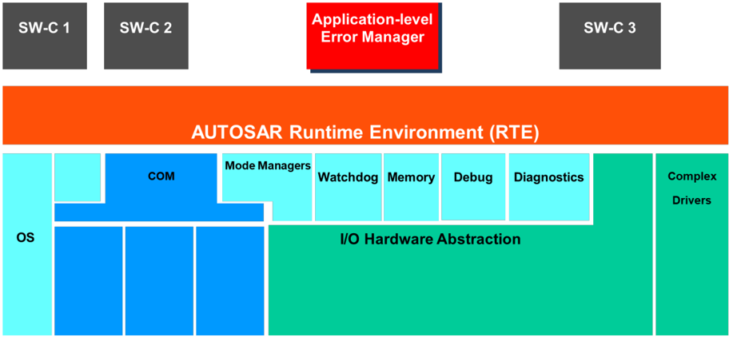
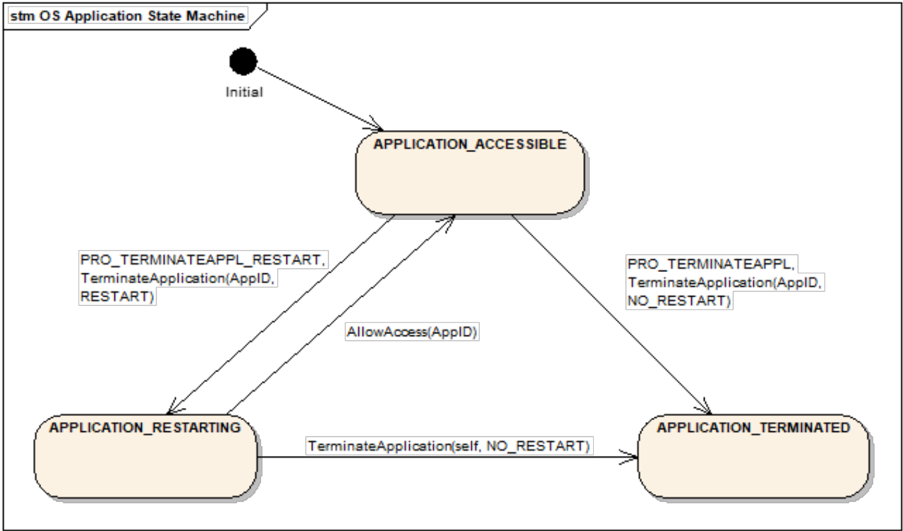
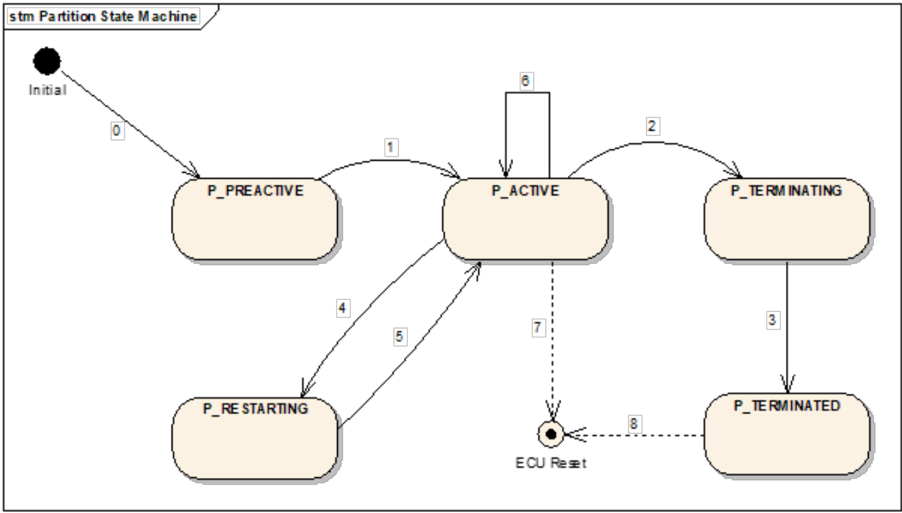
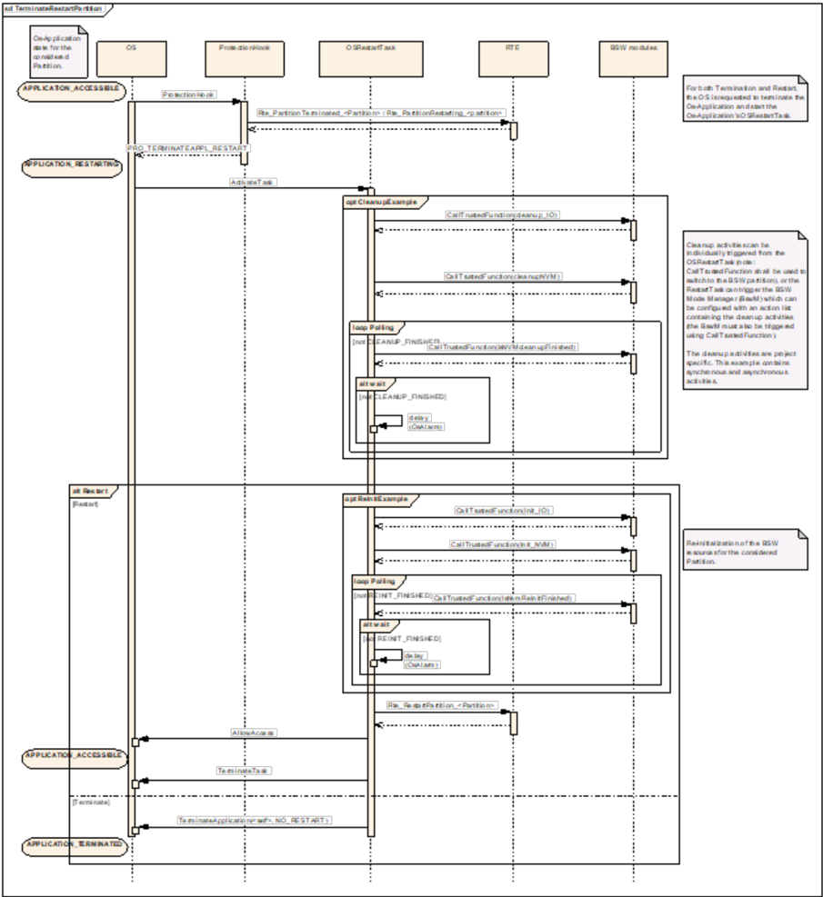

<!-- 源文档 AUTOSAR_CP_EXP_ApplicationLevelErrorHandling（R23-11），讲述型指南（EXP），不受 Type A 七章骨架约束；章节结构镜像源文档自身编号（1–7）。 -->

## 1. 引言

本文档的目的和目标是概述汽车行业中常见、可用于 AUTOSAR 的应用层错误处理机制。这既包括在应用层对错误的处理，也包括对应用层错误的处理。

此语境中的错误处理指完整的处理链，即检测、隔离/标识与恢复。本文给出了一组对汽车系统有用的错误处理机制，覆盖错误处理的全部三个阶段。每种机制首先以高层方式描述，说明其在错误处理中的适用性及技术方面。然后，回顾与该机制相关的 AUTOSAR 功能，并详细说明该机制在 AUTOSAR 系统中的何处实现或受支持。因此，机制列表既包括由 AUTOSAR 完整（或部分）提供的机制，也包括（如果纳入系统）应由应用开发者在 SW-C 层实现的机制。注意，所覆盖的机制集合并不完整，且仅限于可以为基于 AUTOSAR 4.0 版构建的系统实现的机制。替代的与额外的机制都是可能的，AUTOSAR 的未来版本可能支持更多的错误处理功能。此外，本文档不规定使用任何机制——决定当然完全取决于应用开发者和集成者。

本文档旨在描述可能的机制，主要面向应用/SW-C 开发者。但它对 BSW 模块的开发者也可能有用。重点在于随机故障，而非系统性的设计故障（例如软件缺陷）。这类故障的例子包括影响应用、通信或外围设备的硬件故障。它聚焦于最适合由 SW-C 处理的错误，不涵盖 RTE 之内或之下的错误处理，例如 COM 和 OS 的错误处理。

### 1.1. 范围

本文档从应用的视角讨论错误处理。也就是说，它描述应用层的检测、隔离与恢复机制，以及可以处理与应用相关故障（例如内存访问违例或时序违例）的机制。

重点在于处理主要由随机外部故障导致 effects 的错误。尽管系统性故障（即设计故障）可以以与外部故障相同的方式显现，但它们不是本文档的主要目标。系统性故障的处理与开发相关（例如流程、设计方法和调试），而非系统运行期间的错误处理。

AUTOSAR 中的错误处理不限于应用层错误处理。BSW 拥有若干内建的错误处理机制，能够提供例如可靠通信、同步等。但是，这些机制不在本文档中描述。

### 1.2. 本文档的阅读指南

取决于读者对可靠性（dependable systems）领域所用各种术语和定义的熟悉程度，本文档的某些部分可以快速翻阅甚至跳过。如果你对可靠性系统领域非常熟悉，甚至可以直接跳到第 [6](#6-方面映射aspect-mapping) 章。表 1.1 给出了后续各章的概要，帮助你识别哪些部分对你最有价值。

| 节 | 说明 |
| --- | --- |
| [1.1](#11-范围) 范围 | 本节描述本文档所作的假定。这些假定涉及例如 BSW 中某些基本可靠性机制的存在。 |
| 2 术语与缩略语的定义 | 本节概述本文档使用的术语，包括对故障（fault）、错误（error）、失效（failure）的描述、对 FDIR（故障检测、隔离与恢复）过程的描述，以及对各种失效模式的描述。如果你熟悉可靠性系统领域的概念，可以较快浏览本部分。 |
| 4 错误模型 | 本节描述我们认为从汽车应用视角出发最重要的错误类型。后续各章列出的机制都按照各自对这些错误处理的适用性进行分类。 |
| 5 错误处理机制 | 本节列出并描述 AUTOSAR 提供或支持的错误处理机制，用于实现应用层错误处理。每种机制都有高层描述、适用性讨论、实现层级（应用 vs. BSW）讨论，以及可用于该类机制的可用 AUTOSAR 概念与服务的概览。 |
| 6 方面映射 | 本节概览所介绍的机制，以及它们到 FDIR 过程、错误模型和实现层级的映射。 |
| 7 分区的终止与重启 | 本节描述一种在 AUTOSAR R4.0 中纳入分区终止与重启能力的方法。本节比本文档的其他部分更 AUTOSAR 特定，汇集了 AUTOSAR 中分区层级错误处理的全部描述与说明。 |

## 2. 术语与缩略语的定义

### 2.1. 基本可靠性术语

本文档使用的可靠性的基本概念和术语直接取自 [\[1\]](#ref-1)。本节简要概述可靠性系统使用的主要术语与定义。这里应注意，「系统」一词在此语境中以非常宽泛的意义使用。系统可以表示从单个 SW-C 到带有多个网络和 ECU 的完整车辆的任何东西。但是，由于本文档面向应用层错误处理，文档其余部分中的系统应指一个软件应用，可能由多个 SW-C 组成，可能映射到一组（分布式）ECU 上。

可靠性（dependability）一词定义为「系统的可信性，使得可以正当地依赖其提供的服务」。这意味着可靠的系统是用户（人或非人）可以信任其提供的服务是正确的系统。一个系统的可靠性由一组属性（attributes）刻画、由一组损害（impairments）削弱、并通过一组手段（means）实现和分析。

可靠性属性刻画并描绘给定系统的可靠性。属性的一些例子有可用性（availability）、可靠性（reliability）、安全性（safety）、机密性（confidentiality）、完整性（integrity）和可维护性（maintainability）。

在系统的构建与运行期间（此处以宽泛意义使用——系统可以是任何有边界的实体，如整个 ECU 或单个 SW-C），可能发生通过向系统引入故障而降低系统可信性的事件。故障（fault）是系统的一种瞬态或永久性变化，使其完整性偏离预期的正确完整性。在系统运行期间，故障可能阻止系统提供其预期的服务。这些故障可能来自内部源（例如软件缺陷）或外部源（例如外部干扰或组件老化）。可能降低系统可靠性的事件被称为可靠性的损害。

然而，仅有故障的存在并不足以降低系统的可靠性。故障必须被激活，即系统中故障所在的部分必须在系统运行期间以某种方式被执行（例如有缺陷的代码必须被执行、有缺陷的内存单元必须被读取等）。如果发生这种情况，结果可能是一个错误（error）。如果把故障视为疾病，错误可以说是该疾病的症状。错误定义为系统中的错误（软）状态，即该状态不同于若故障不存在时系统应有的状态。一个被激活的错误可能在系统中引发其他错误。这一过程称为错误传播（error propagation）。

如果错误传播越过系统屏障，即如果它们对系统的环境可见，该错误就转变为失效（failure），这意味着系统不再提供其规定的功能。

因果链「故障→错误→失效」本质上是递归的。因此，一个系统的失效被包围它的系统（即前者是后者的子系统）视为一个故障。例如，某个特定软件组件中的失效可以被看作整个应用（由一组 SW-C 组成）中的一个故障。

因此，我们得到如下序列：

```Text
故障 → 错误 → 失效
      ↑______|（递归：失效在更大范围被视为故障）
```

用于实现和分析系统可靠性的方法称为可靠性的手段（means of dependability）。本文档的目的是记录和研究 AUTOSAR 提供的、供应用开发者用于实现错误处理的手段。

注意，本文档涵盖在系统运行期间活跃的机制。它不涵盖诸如用于实现功能安全的流程和方法之类的手段，因为这些适用于系统开发而非系统运行。

### 2.2. 故障检测、隔离与恢复（FDIR）

在系统运行期间处理故障的过程通常称为 FDIR，即故障检测（Fault Detection）、隔离（Isolation）与恢复（Recovery）。

**检测（Detection）**：处理故障的关键第一步当然是意识到它已经发生。没有这一检测，无法进行任何后续活动。在检测方面，原始故障通常很难检测。能够检测到的是故障的影响，即错误。这些通过监控系统的状态来检测。

错误可以以不同的方式显现。主要的显现方式是：

1. 系统中的错误值（数据错误）；
2. 错误的执行时间（时序错误）；
3. 错误的序列或执行顺序（程序流错误）；
4. 对系统资源（如内存）的错误访问。

错误可能传播并产生连续的故障，进而可能引发新的错误，例如，一个错误的数据值被用作指针并引起内存访问违例，如果在向该错误内存位置写入值时，可能在另一个数据值中制造一个错误值。大多数用于错误检测的机制允许系统执行某些操作以进一步了解错误的来源（隔离），并采取纠正或补偿动作（恢复）。理想情况下，检测在错误进一步传播之前完成，从而使停止进一步传播成为可能。然而，在大多数情况下，还需要额外的恢复动作，例如停止出错的组件或重新配置为替代功能。

**隔离（Isolation）**：一旦故障（或错误）被成功检测，就需要进行损害评估与损害控制，即需要隔离。在隔离期间，努力寻找系统中错误状态的根本原因，并收集信息（例如关于错误扩散与原因的信息）供后续错误恢复时使用。不一定总能（或实际地）找到错误状态的根本原因。注意，本文档中的隔离指隔离错误的来源，使恢复成为可能。它不是指为了阻止错误传播而隔离系统的特定组件。从某种意义上说，「标识（identification）」一词可能是更好的选择，但由于 FDIR 过程描述中常用的词是 isolation，我们在此沿用。

**恢复（Recovery）**：当隔离完成后，将启动恢复动作。这些动作旨在把系统转移到一个受控状态，可以是提供名义服务的完全恢复状态，也可以是提供有限的或不提供服务的安全降级状态。隔离结果越好，恢复动作就能执行得越好。

如果恢复不成功，可能发生失效，即系统处于不受控状态，其服务未定义。

## 3. 相关文档

### 3.1. 输入文件和相关标准与规范

本文档与 AUTOSAR 内发布的许多其他文档相关，尤其是由 AUTOSAR 功能安全团队处理的那些文档。本文档的目的不是取代这些其他文档中的任何一个，而是从应用开发者的视角审视其他工作包所完成的工作。因此，本文档与其他文档之间存在大量的重叠，这展示了 AUTOSAR 内达到的成熟度。

对每种机制，都给出相关 AUTOSAR 文档的列表，它们构成本文档与其他 AUTOSAR 文档之间的显式关系。

关于功能安全机制与措施的信息分布在 AUTOSAR 规范文档之中。除非人们知道功能安全机制如何被支持以及必要的信息具体位于何处，否则很难评估如何使用 AUTOSAR 高效地实现一个安全相关的系统。

AUTOSAR 文档 [2] 总结了 AUTOSAR 中与功能安全相关的要点，解释了如何使用功能安全机制与措施，并引用相应的文档。此外，它有助于在 [3] 的要求与 AUTOSAR 的措施和机制之间建立映射。

<a id="ref-1"></a>[1] Basic concepts and taxonomy of dependable and secure computing

<a id="ref-2"></a>[2] Overview of Functional Safety Measures in AUTOSAR
> AUTOSAR_CP_EXP_FunctionalSafetyMeasures

<a id="ref-3"></a>[3] ISO 26262:2018 (all parts) - Road vehicles - Functional Safety
> https://www.iso.org

<a id="ref-4"></a>[4] Specification of SW-C End-to-End Communication Protection Library
> AUTOSAR_CP_SWS_E2ELibrary

<a id="ref-5"></a>[5] Specification of Flash Test
> AUTOSAR_CP_SWS_FlashTest

<a id="ref-6"></a>[6] Specification of Core Test
> AUTOSAR_CP_SWS_CoreTest

<a id="ref-7"></a>[7] Specification of RTE Software
> AUTOSAR_CP_SWS_RTE

<a id="ref-8"></a>[8] Specification of Communication
> AUTOSAR_CP_SWS_COM

<a id="ref-9"></a>[9] Software Component Template
> AUTOSAR_CP_TPS_SoftwareComponentTemplate

<a id="ref-10"></a>[10] Specification of NVRAM Manager
> AUTOSAR_CP_SWS_NVRAMManager

<a id="ref-11"></a>[11] Specification of Crypto Service Manager
> AUTOSAR_CP_SWS_CryptoServiceManager

<a id="ref-12"></a>[12] Specification of CRC Routines
> AUTOSAR_CP_SWS_CRCLibrary

<a id="ref-13"></a>[13] Specification of Watchdog Manager
> AUTOSAR_CP_SWS_WatchdogManager

<a id="ref-14"></a>[14] Specification of Operating System
> AUTOSAR_CP_SWS_OS

<a id="ref-15"></a>[15] Specification of Communication Manager
> AUTOSAR_CP_SWS_COMManager

<a id="ref-16"></a>[16] Specification of Basic Software Mode Manager
> AUTOSAR_CP_SWS_BSWModeManager

<a id="ref-17"></a>[17] Specification of ECU State Manager
> AUTOSAR_CP_SWS_ECUStateManager

<a id="ref-18"></a>[18] Specification of Function Inhibition Manager
> AUTOSAR_CP_SWS_FunctionInhibitionManager

<a id="ref-19"></a>[19] Specification of Diagnostic Communication Manager
> AUTOSAR_CP_SWS_DiagnosticCommunicationManager

<a id="ref-20"></a>[20] Specification of Diagnostic Event Manager
> AUTOSAR_CP_SWS_DiagnosticEventManager

<a id="ref-21"></a>[21] Glossary
> AUTOSAR_FO_TR_Glossary

<a id="ref-22"></a>[22] EASIS D1.2-8 Fault managenent framework

## 4. 错误模型

可靠性系统的设计基于对潜在故障（故障模型，fault models）的系统性分析，即一组假定的故障，它们从系统的运行环境导出，帮助设计者或用户预测这些故障的后果，并定义处理（检测、恢复等）这些特定故障的机制。

故障可以在系统的所有层级上显现，从纯随机的硬件故障（例如位翻转）到软件故障（例如设计缺陷）以及组件交互中的故障（例如不完整的接口规范）。类似地，故障在整个设计过程（需求、分析、设计、实现等）中被引入。由于本文档面向应用层错误处理，重点在于预期由 AUTOSAR SW 组件处理的错误——或者因为 FDIR 过程需要应用层的知识，或者因为它们已从较低的层传播上来。注意，本文档考虑的这些类型的错误中，有些可以由 BSW 处理，但有些可能传播到应用层，因此必须在那里处理。

重要的是要注意，重点在于处理错误——即故障的影响。尽管设计故障可以以与外部故障相同的方式显现，但它们不是本文档的主要目标。设计故障的处理与调试相关，而非错误处理。

本文档只考虑运行期间的错误处理。通过严格或形式化的开发过程进行故障避免和故障消除的技术不在范围之内。

重点主要在于随机外部故障，即其出现可以建模为随机过程的故障。但是，这并不意味着所介绍的机制不能处理系统性故障，因为这类故障的后果（错误）可以以与随机故障相同的方式显现。瞬态故障和永久性故障都被考虑，其中一些机制更适合于其中一种。

由于本文档只考虑 SW 机制，实际被检测到的是错误，而不是直接的故障。因此，文档其余部分将使用术语错误模型（error model）而非故障模型。由于错误是被激活并传播了的故障，一个错误（理论上）可能有许多可能的根本原因，即故障。

为了简化讨论，错误模型被划分为若干较宽的错误类别（见表 4.1）。选择这些类别是因为它们可以轻松映射到 SW 机制上。但是，重要的是要注意错误模型是相互关联的。一个在分支指令中使用的错误数据值可能传播并成为程序流错误，后者可能延迟（或改变）执行的输出，从而造成例如迟到的响应，即时序错误。

| 错误类型 | 说明 |
| --- | --- |
| 数据（Data） | 数据错误的特征是参数、变量或报文的错误值。错误的来源可以是内部的（例如软件缺陷）或外部的（例如发生故障的传感器、其他有故障的 SW 组件）。数据错误的处理可以打断一个本来会导致更难处理的后续错误（例如程序流或访问违例）的因果链。 |
| 程序流（Program flow） | 程序流错误（也称「控制流错误」）表现为实际的程序流与预期不同，可能导致执行被遗漏、错误或多余的操作。程序流错误的来源既可以是内部的（软件缺陷），也可以是外部的（数据错误）。 |
| 访问（Access） | 为了增强执行组件之间的分离，系统设计者可以对软件进行分区并限制来自该分区的对资源的访问，例如内存访问。当一个组件试图在没有适当访问权的情况下访问另一个分区中的资源时，就会发生访问违例。访问错误可以是数据或程序流错误的结果，例如无效的程序计数器或指针。 |
| 时序（Timing） | 当交付时间影响通信的正确性/有用性时，通信（报文、函数调用等）就是时间关键的。时序错误可以是报文交付过早、过晚或完全缺失（omission）。最后一种时序错误——缺失（omission）——特别受关注，有时被称为崩溃（crash）或静默失效（fail-silent）行为（注意，可能无法区分崩溃——一种不受控状态——与静默失效——一种受控状态）。时序错误也指执行时间，其中可以对组件被允许占用 CPU 的时长定义严格的最后期限。 |
| 非对称（Asymmetric） | 当错误经由某种通信手段从一个 SW 组件传播到另一个时，需要区分对称错误与非对称错误。在对称情形中，所有接收者收到相同的（错误）值。当组件可能因发送不同的值（所有值都可能有效）而失效时，该错误被称为非对称的。这种错误模型有时也被称为拜占庭（Byzantine）模型，它意味着对发生故障的组件的行为不作任何假定。拜占庭错误只能通过使用冗余组件交换值以达成共同结果来检测。 |

由于本文档的范围限于在应用层处理的错误，并非所有错误类型都被考虑用于第 [5](#5-错误处理机制) 章介绍的机制。以下错误类型未被显式考虑：

- **通信错误**：不包括这些错误，因为假定 SW-C 可以使用可靠的通信。那样一来，唯一可能的通信错误将由设计故障（即 SW-C 中的缺陷）引起。注意，仍然期望 SW-C 处理从 COM 报告的通信错误，或者 COM 被配置为在 BSW 中处理该错误。
- **死锁与活锁**：死锁和活锁情况由 BSW 中的看门狗机制检测，因此在本文档中不再进一步考虑。当然，这些情况可能导致其他可以在应用层检测的时序错误。在这种情况下，应用可以处理死锁或活锁情况的影响，但不一定是这些情况的根本原因。
- **指令代码中出现的故障和错误**：在应用层，通常不可能检测因存储介质或处理器内部故障而变得有故障的指令。然而，这类故障在大多数情况下导致非法指令，当处理器试图执行它们时被检测到。如果产生的指令是合法的，它很可能转而转变为系统中其他类型的错误（例如数据错误、时序错误等），这些可以随后由其他手段检测和处理，例如本文档描述的手段。在 BSW 中，有用于测试处理器内核、闪存和 RAM 的组件。它们可以检测可能导致指令代码错误的异常。
## 5. 错误处理机制

### 5.1. 概览

本节在较高的概念层级描述若干机制。应用开发者可以使用这些机制把错误处理纳入应用的描述或实现中。

每种机制都被分类为对某种错误类型（如第 [4](#4-错误模型) 章所定义）适用或不适用。如果一种机制适用，这表明该机制适合用于检测（或隔离或恢复）特定的一组错误。重要的是要注意，这并不意味着某种特定类型的所有错误都被检测到。每种机制都需要调整以检测所需的特定错误，并且可能只能处理一个错误类别中错误的子集。

一些机制只是部分适用——如果它们可以与某些其他机制一起直接使用。例如，当检测到从传感器收到的值是错误的时候，可以使用替代（安全）值作为一种恢复形式。但是，这只部分解决了故障传感器的恢复问题，还需要其他机制才能完全恢复，例如传感器的重新初始化。部分适用的机制同样被标记为适用。

当一种机制不适用时，意味着该机制对于特定的步骤和错误模型没有直接的用途。在某些情况下，修改可能潜在地赋予该机制一些效用，但很可能存在更好的选项。

注意，下面列出的一些机制可能有副作用，例如内存访问模式与系统的时序行为。尤其是时序行为可能受影响，这需要由设计者显式地加以解决，使得系统的所有时序特性都是已知的——无论是在正常运行期间还是在错误处理期间。

还请注意，即使描述了许多机制，也不总是需要组合不同的机制，而且机制之间甚至可能产生不良的相互作用。

### 5.2. 合理性检查（Plausibility Checks）

#### 5.2.1 描述

纳入应用特定知识的最常见方式之一是构造监控器（monitor），检查一个变量或一组变量的当前值是否保持某种预定义的条件，即它们是否合理。合理性检查是定义在应用的一组变量之上的谓词，可以在运行时动态检查。被检查的值可以表示用于计算的值、状态值或其他种类的值。合理性检查主要有两种形式：i) 检查单个值的有效性；ii) 比较多个值。

**检查单个值的有效性**：顾名思义，对值的有效性进行检查，即该值是否落在「好」值的范围内、是否遵循已知的模式或行为等。这样的判别通常只能使用关于应用和/或其环境的特定知识来完成，例如最大车速、最低发动机温度等。

检查可以是范围型（在某个「好」值的范围或集合之内），也可以是差分性质的（相对前一个值的变化、小于等）。差分变化还可以是时间性的，其中检查的周期性可以添加额外的条件（速度在时间 T 内的变化不能超过 x km/h）。这里还需要进一步的应用特定信息，例如检查的周期性等。

**多个值的比较**：检查一组单个值的有效性可能只能得出所有值都有效的结论。然而，对该集合中所有值进行比较，可以通过检测到看似有效的值的某种给定组合并不合理，从而发现原本会被遗漏的错误。这些比较可以利用多个值之间的物理关系来计算（例如发动机转速与车速和齿轮传动比的比较），也可以通过比较来自冗余源的数据（例如测量同一温度的多个温度传感器）。这种情况下的主要问题是把错误的值与正确的值区分开。对于某些应用（尤其是安全相关的应用），可以使用数据值的冗余源来提高对数据有效性的信心，例如使用多个传感器读数（例如冗余传感器或对值读取两次）。当存在两个值时，可以对这两个值进行比较，结果要么是它们相同（可能在某个容差范围内），因而被视为正确；要么是不相似，表明存在错误（在其中一个值中）。在错误检测之后，还需要额外的措施来隔离错误并从中恢复。比较作为一种机制与有效性检查的区别在于：它完全基于两个值的比较，而不考虑值的合理性。比较与表决（[5.4](#54-表决voting) 节）的区别在于：它在单个 SW-C 内处理，而表决可能跨越多个 SW-C，例如通过执行冗余的 SW-C（相异的或相同的）并对结果表决。比较在本地进行，并且始终是二元的，即比较两个值。

我们选择区分合理性检查与状态检查。后者可以独立于应用知识进行，并作为单独的机制呈现（[5.9](#59-状态与模式管理status-and-mode-management) 节）。但是，作为合理性检查失败的结果，应用可以设置状态标志，其他应用和 BSW 可以检查并据此行动。

#### 5.2.2 适用性

| 步骤\错误模型 | 数据 | 程序流 | 访问 | 时序 | 非对称 |
| --- | --- | --- | --- | --- | --- |
| 检测 | X |  |  |  |  |
| 隔离 | X |  |  |  |  |
| 恢复 |  |  |  |  |  |

有效性检查用于检测应用中的数据错误，其中可以定义允许/不允许值的范围。它受限于设计者根据需求和/或应用知识定义此类范围的能力。此类范围的维护与可追溯性必须在开发过程中处理。遗留在生产代码中的未记录的或未及时更新的检查会对应用的可靠性构成风险。

在某些情况下，可以定义「安全」值来替代有效范围之外的值，这被定义为一种单独的机制（[5.3](#53-替代值substitute-values) 节）。

有效性检查只对检测数据错误有用。检查在某些情况下可以成为隔离步骤的一部分，通过使用额外的合理性检查获得关于错误的额外信息，例如在使用比较或表决（[5.4](#54-表决voting) 节）时确定（若干值中的）哪个值是错误的。这样，应用特定的知识就可以在隔离错误时使用。

比较可以通过识别多个值之间的差异来检测数据错误。由于比较基于数据值，不支持其他错误模型。要隔离多个值中的哪些是错误的可能很困难。如果有效性检查未显示任何无效值，则不可能指出哪个值是错误的。

合理性检查一般不适用于检测程序流、时序或非对称错误。

合理性检查一般不能用于恢复。

#### 5.2.3 应用层 vs. BSW

合理性检查可以实现为可执行的断言，使用简单的 if 语句检查一个或多个变量的值。它在 SW 组件的源代码中实现，但一般不影响应用的整体结构。检查在大多数情况下可以用确定性的时序特性实现（不考虑去抖动）。数据的内存需求通常很低，仅限于为差分检查保存值。

#### 5.2.4 AUTOSAR 参考

| 名称 | 类型 | 文档 | 说明 |
| --- | --- | --- | --- |
| SW-C End to End Communication Protection | SWS | E2E Library [\[4\]](#ref-4) | 定义发送者与接收者之间的协议。 |
| Flash Test / Core Test | SWS | FLSTST [\[5\]](#ref-5) / CORTST [\[6\]](#ref-6) | 与已知签名进行比较。 |
| Runtime Environment | SWS | RTE [\[7\]](#ref-7) | 支持对经过缩放的值进行范围检查。 |
| AUTOSAR COM | SWS | COM [\[8\]](#ref-8) | PDU 复制与比较。 |

SW-C 端到端通信保护库可用于检查信号是否来自非预期的 SW-C 发送者，或者所收到的信号是否提供了它本不该提供的信息。它还允许定义能够检查一个信号的实例流是否按顺序接收的 SW-C（取决于用例，这也可以在 AUTOSAR COM 层配置）。

Flash Test 和 Core Test 模块可以在单处理器或多处理器 ECU 的上下文中配置，以对 ECU 的硬件执行检查。这些检查与硬件的已知良好签名进行比较。

RTE 可以检查通信值是否与其允许的范围匹配。

### 5.3. 替代值（Substitute Values）

#### 5.3.1 描述

一旦检测到某个错误会阻碍把正确的值赋给某个信号，就可以为该信号赋予一个替代值。随后可以在后续计算中使用该替代值，使这些计算产生有用的结果，尽管质量可能有所下降。可以赋予替代值的情况示例：

- 一个传感器发生故障，或在其工作范围之外运行（例如由合理性检查检测到），对应的物理实体无法被可靠测量。可以赋予一个替代值，使使用该值的后续算法得以继续计算。
- 一个输入信号的提供 SW-C 被报告为发生故障，因此其结果可能不可信，即使某个特定的值看起来在其有效域内。
- 过渡性检查（例如引导序列后不久）在传感器尚不可用时满足合理性检查所必需。通常，会设置「pending」状态标志。

由于使用了替代值，使用信号限定符（signal qualifier）通知接收者原始值不可用可能是有用的。接收者随后可以决定如何解释和使用该值。

注意，AUTOSAR 中没有通用的信号限定符机制。应用应定义自己的机制，例如传输一个带有值和限定符的记录。

#### 5.3.2 适用性

| 步骤\错误模型 | 数据 | 程序流 | 访问 | 时序 | 非对称 |
| --- | --- | --- | --- | --- | --- |
| 检测 |  |  |  |  |  |
| 隔离 |  |  |  |  |  |
| 恢复 | X | X |  | X | X |

赋予替代值为后续操作提供了以某种使最终结果有用的方式继续进行的手段。但是，它不会提供从错误中的恢复，因为它并未缓解最初导致错误状态的情形。因此，它对恢复是部分适用的，因为它允许在某种程度上掩蔽一个已存在的错误。

由于要用替代值掩蔽的错误状态可以是任何类型的底层错误的结果，它对所有类型都是部分适用的。

#### 5.3.3 应用层 vs. BSW

替代值通常需要平台层级不存在的应用知识，赋值在这些情况下在 SW-C 中执行。在配置期，BSW 模块可以配置默认替代值。但是，通常仍然需要应用特定的知识。

#### 5.3.4 AUTOSAR 参考

| 名称 | 类型 | 文档 | 说明 |
| --- | --- | --- | --- |
| Software Component Template / Runtime Environment / AUTOSAR COM | TPS / SWS | SWC-T [\[9\]](#ref-9) / RTE [\[7\]](#ref-7) / COM [\[8\]](#ref-8) | 初始值与默认值的使用。 |
| Software Component Template / NVRAM Manager | TPS / SWS | SWC-T [\[9\]](#ref-9) / NVM [\[10\]](#ref-10) | 默认 ROM 块或冗余块的使用。 |

SW-C 设计者可以在 UnqueuedReceiverComSpec 上指定 initValue。当没有收到值而应用读取该值时使用此值。在值无效的情况下也可以使用它，取决于 UnqueuedReceiverComSpec 的 handleInvalid 属性（dontInvalidate、keep、replace）。这些 initValue 由 COM [\[8\]](#ref-8) 或 RTE [\[7\]](#ref-7) 基于 SW-C XML 描述实现（见 Software Component Template [\[9\]](#ref-9)）。

也可以为 UnqueuedSenderComSpec、InterRunnableVariable、PerInstanceMemory 或 NvBlockComponentType 的 ramBlock 指定 initValue（见 Software Component Template [\[9\]](#ref-9)）。

NVM [\[10\]](#ref-10) 可以在失效的情况下使用默认 ROM 块。该块可以由 SW-C 设计者以 defaultData 角色的 ParameterDataPrototype 定义（见 Software Component Template [\[9\]](#ref-9) 中的 RoleBasedDataAssignment）。

### 5.4. 表决（Voting）

#### 5.4.1 描述

构建容错系统的一个基本原则是冗余地执行片段（「组件」），然后通过对结果执行表决来整合每个组件的结果。实际的表决通常由一个称为「表决器（voter）」的专用组件执行。常见的表决算法包括「简单多数」、「3 取 2」等。

表决可以在多个层级上执行，从一个 SW-C 中复制的可运行体到跨 ECU 的应用级表决。复制可以在二进制/源代码层级进行，也可以在规范层级进行。在前一种情况下，每个组件都是同一原始组件的副本；而在后一种情况下，组件是不同的，但使用相同的规范构建。

与 [5.2](#52-合理性检查plausibility-checks) 节介绍的比较机制相反，表决可以处理多于两个的副本，并且取决于副本的数量，表决还提供隔离（识别出故障的副本）和部分恢复（输出一个好值）。

#### 5.4.2 适用性

| 步骤\错误模型 | 数据 | 程序流 | 访问 | 时序 | 非对称 |
| --- | --- | --- | --- | --- | --- |
| 检测 | X |  |  |  |  |
| 隔离 | X |  |  |  |  |
| 恢复 | X |  |  |  |  |

表决用于检测数据错误。此外，如果对三个或更多的值进行表决（且至多一个值是错误的），则可以识别错误值的来源。由于尽管存在错误也能产生正确的值，表决部分地支持恢复。要完全从错误中恢复还需要额外的手段。

#### 5.4.3 应用层 vs. BSW

表决在 SW-C 中执行。

#### 5.4.4 AUTOSAR 参考

AUTOSAR 不提供表决服务。由于 AUTOSAR BSW 不提供表决机制，需要在需要它们的 SW-C 中以应用层实现。AUTOSAR 支持 SW-C 的多实例化。SW-C 实现者可以利用这一特性为应用实现特定的表决机制。

### 5.5. 一致（Agreement）

#### 5.5.1 描述

当使用冗余组件来提高应用的可靠性时，可能需要组件（称为参与者，participants）通过交换本地计算的结果作为消息¹来就所使用的值（包括某种计算的结果）达成一致。

一致机制与表决机制的区别在于：使用一致机制时，组件相互交互以达成决定；而在表决中，由表决器决定。一致协议可以与闭环系统比较，其中反馈由所有其他方收到的已发送消息构成。类似地，表决可以比作开环系统，表决器收集值并做决定。

一致协议还可以通过多轮信息交换处理非对称故障。因此，所有（正确的）参与者就相同的值以及其他参与者的正确性达成一致。

¹ 显然也可以使用其他通信范式，这里以消息作为说明。

#### 5.5.2 适用性

| 步骤\错误模型 | 数据 | 程序流 | 访问 | 时序 | 非对称 |
| --- | --- | --- | --- | --- | --- |
| 检测 | X |  |  |  | X |
| 隔离 | X |  |  |  | X |
| 恢复 | X |  |  |  | X |

由于与表决类似地对值进行比较，一致机制可以检测并隔离数据值错误。额外的信息交换轮次还允许检测和隔离非对称错误。一致机制既不能处理程序流错误，也不能处理时序错误。

恢复被部分支持：可以识别出故障的参与者并将其行为掩蔽，使其不影响系统。要完全从错误中恢复还需要额外的手段。

#### 5.5.3 应用层 vs. BSW

基础服务在 BSW 层实现，但使用一致协议的应用必须知道它们是参与者。提出新值和采纳已一致的值是应用需要了解该协议的情况示例。

#### 5.5.4 AUTOSAR 参考

AUTOSAR 中不存在真正的服务一致机制。如果应用层通信需要特定的一致语义，应当专门为这些应用实现。

### 5.6. 校验和/编码（Checksums/Codes）

#### 5.6.1 描述

提高数据一致性的一种技术是向要保护的数据值添加冗余信息。额外的信息允许检测（部分）数据的修改，某些情况下甚至可以纠正和恢复原始数据值。代价既在于性能（计算和检查校验和的时间、额外的通信需要），也在于存储所需的额外内存。扩展还包括提供数字签名以及数据加密/解密的密码学算法。

校验和/编码有多种用途，包括：

- 在易失性和非易失性存储器中安全地存储数据；
- SW-C 之间可靠的通信（ECU 间与 ECU 内皆可）；
- 保护数据不被未授权实体篡改（数据完整性）；
- 跨越不安全信道发送和接收加密数据。

请注意前两种情况与后两种情况的区别：前者涉及良性错误，而后者涉及恶意错误（攻击者、入侵者等）。不过，相同的机制通常可以用于多种目的。

数据安全的其他威胁包括欺骗（冒充他人）、抵赖（否认已执行的动作）、拒绝服务和特权提升。一般而言，本文档聚焦于良性错误。但是，这些威胁对某些应用可能很重要。

#### 5.6.2 适用性

| 步骤\错误模型 | 数据 | 程序流 | 访问 | 时序 | 非对称 |
| --- | --- | --- | --- | --- | --- |
| 检测 | X |  |  |  | X |
| 隔离 | X |  |  |  | X |
| 恢复 | X |  |  |  | X |

校验和与编码主要针对在整个 FDIR 过程中保护数据。取决于所使用的编码类型，可以支持该过程的所有步骤。

编码还用作某些协议（例如一致协议）处理非对称故障的一部分。

#### 5.6.3 应用层 vs. BSW

出于性能和可移植性的原因，校验和与密码学库在 BSW 层实现或作为库实现。专用外设电路的使用进一步减少了应用层机制的使用。

#### 5.6.4 AUTOSAR 参考

| 名称 | 类型 | 文档 | 说明 |
| --- | --- | --- | --- |
| Crypto Service Manager | SWS | CSM [\[11\]](#ref-11) | 访问密码学函数/硬件。 |
| CRC Routines | SWS | CRC [\[12\]](#ref-12) | CRC 例程。 |
| SW-C End to End Communication Protection | SWS | E2E Library [\[4\]](#ref-4) | 由 SW-C 为信号添加额外的 CRC。 |

CSM 可以被 SW-C 经由端口接口用来计算密码学校验和或编码。

CRC 是一个可以直接由 SW-C 用来计算校验和的库。

SW-C 端到端通信保护库可用于定义协议，并用校验和或编码保护 SW-C 经由端口接口发送的数据。

### 5.7. 执行序列监控（Execution Sequence Monitoring）

#### 5.7.1 描述

应用的正确执行包括可执行实体的序列是正确的。监控执行序列可以检测可能导致错误结果的错误执行路径。

执行序列的监控可以在不同的粒度层级上执行。粒度层级的一些例子有：

- **单独的语句**：这是在源代码层级监控执行序列所能达到的最细粒度。监控代码中单独语句的序列。
- **基本块（Basic block）**：基本块是恰好有一个入口点和一个出口点的代码块，并且不能从这两个入口和出口点之外进入或退出。因此，从入口点到出口点的执行是严格顺序的。注意，最小的基本块是单条语句。基本块的执行序列可以在所谓的控制流图（control flow graph）中规定，在这个粒度上监控执行序列就是确保按照该图执行。此语境中的控制流与程序流同义。
- **可运行体（Runnable）**：一个可运行体有一个入口点，但可能有多个出口点，以及从入口点到这些出口点的若干有效执行路径。此外，路径可以包括循环。在这个层级上，监控一个（或多个）应用的可运行体的执行序列。

取决于监控器的粒度，资源需求可能从相当低到非常高。监控单独语句的序列可能需要大量的内存和处理时间，而可运行体的序列可以以很低的内存和执行时间开销进行监控。

#### 5.7.2 适用性

| 步骤\错误模型 | 数据 | 程序流 | 访问 | 时序 | 非对称 |
| --- | --- | --- | --- | --- | --- |
| 检测 |  | X |  |  |  |
| 隔离 |  |  |  |  |  |
| 恢复 |  |  |  |  |  |

执行序列的监控将检测程序流中的错误。这些错误可能是先前的数据错误、时序错误或非对称错误的结果。但是，监控器本身无法区分这一点。

监控器不能用于从错误中恢复，因为它只对照某种预定义的正确性概念检查当前状态（这对所有类型的监控器都成立，不仅是执行序列监控器）。

#### 5.7.3 应用层 vs. BSW

最实际的方法可能是应用与 BSW 之间的合作：应用向 BSW 提供其在执行轨迹中位置的信息，BSW 随后检查该位置是否是有效的。这要求预定义的有效轨迹。一种方法是针对一组位置、从执行轨迹中的给定位置配置有效的后继。粒度（指令、基本块、可运行体）可以在配置期定义。

#### 5.7.4 AUTOSAR 参考

| 名称 | 类型 | 文档 | 说明 |
| --- | --- | --- | --- |
| Watchdog Manager | SWS | WdgM [\[13\]](#ref-13) | 监督计数器与程序流监控。 |
| SW-C End-to-End Communication Protection | SWS | E2E Library [\[4\]](#ref-4) | 报文上的数据序列控制。 |
| AUTOSAR COM | SWS | COM [\[8\]](#ref-8) | 总线上发送的报文的序列计数器。 |

看门狗管理器不仅可以针对时间、还可以针对序列监控来自应用组件的心跳。正确的执行序列由开发者配置。配置包含一组检查点（checkpoint）或侦测点（spy point）的定义，以及每个这样的点的一组允许的后继。然后，SW-C（即开发者）有责任确保每个检查点/侦测点都报告给看门狗管理器，后者随后对时间以及逻辑序列检查执行。在检测到错误的情况下，使用看门狗管理器的常规恢复能力。

AUTOSAR COM 和 SW-C E2E 通信保护库允许检查一个信号的实例流是否按顺序接收。

### 5.8. 存活监控（Aliveness Monitoring）

#### 5.8.1 描述

存活监控处理检查系统中的实体是否存活且良好，即按周期性或执行实例而言是否按预期运行。监控存活的常见方式是监控来自被监控部分的心跳。如果心跳在某个范围内（最小和最大脉冲），则称被监控实体存活且良好。

该机制与执行时间监控互补，处理到达率而非计算所花费的时间。

存活监控可以在若干层级上进行：

- **应用层**：例如，如果应用想监控其内部组件，应用的各个 SW-C 可以提供心跳信号。
- **BSW 层**：例如，BSW 可以监控 ECU 上的应用组件是否按规定表现（在使用监控原理的限制内）。

#### 5.8.2 适用性

| 步骤\错误模型 | 数据 | 程序流 | 访问 | 时序 | 非对称 |
| --- | --- | --- | --- | --- | --- |
| 检测 |  |  |  | X |  |
| 隔离 |  |  |  |  |  |
| 恢复 |  |  |  |  |  |

#### 5.8.3 应用层 vs. BSW

心跳必须由应用生成，但对脉冲的检查可以在 BSW 中完成。每个心跳流可以针对某个脉冲范围（最小和最大阈值）和 ECU 模式进行配置（心跳依赖于 ECU 模式：引导、待机等）。

#### 5.8.4 AUTOSAR 参考

| 名称 | 类型 | 文档 | 说明 |
| --- | --- | --- | --- |
| Watchdog Manager | SWS | WdgM [\[13\]](#ref-13) | 汇集存活证明并经由看门狗接口和驱动触发硬件看门狗的中枢。 |
| Operating System | SWS | OS [\[14\]](#ref-14) | 提供重启任务的可能性。 |

看门狗管理器可用于监督 SW-C 和/或 BSW 模块。要监督哪些「实体」连同监督参数一起预先配置（非完整列表，见看门狗管理器 SWS [\[13\]](#ref-13)）：

- 在一定的监督参考周期数内的预期存活指示数量。
- 检测的容忍级别。
- 可容忍的失败参考周期数。

被监督实体可以处于三种状态之一：WDGM_MONITORING_OK、WDGM_MONITORING_FAILED 或 WDGM_MONITORING_EXPIRED。当状态从 WDGM_MONITORING_OK 变为 WDGM_MONITORING_FAILED 时可以启动恢复，如果成功（存活指示的数量在达到可容忍失败参考周期数之前达到可容忍限度），看门狗被触发且不执行任何动作。当超过允许的失败参考周期数时（被监督实体的监控已永久失败），状态从 WDGM_MONITORING_FAILED 变为 WDGM_MONITORING_EXPIRED，看门狗将不再被触发。

### 5.9. 状态与模式管理（Status and Mode Management）

#### 5.9.1 描述

状态与模式管理处理信号、应用、设备等的元信息。这种元信息可用于分析系统的状态，以便隔离故障的子系统/组件并相应地修改其行为。这类信息在多个层级上定义：

- **信号状态**：除值之外，信号可以有关联的元信息，例如：
  - **信号质量**：这指示值的质量，例如标称值（nominal value）、建模值（modelled value）、替代值（replacement value）和默认值（default value）。信号的接收者可以根据信号的质量作出不同的反应。
  - **信号时间戳**：这指示值何时创建，可用于检查信号的年龄。如果一个计算使用多个输入信号，可以检查所有输入信号是否都在一个可容忍的时间窗口内创建。
  - **信号序列号**：检查信号值按某种顺序接收、读取之间没有值丢失，可能是有意义的。此外，序列号可以以与时间戳类似的方式使用：允许检查一个组中的所有值都来自特定的创建窗口（相同的序列号，或最小/最大偏差）。
  - **更新信息**：信号的消费者可能想知道自上次读取以来信号是否已更新。
- **设备状态**：应用可能想知道它使用的设备（例如传感器和执行器）的状态。如果设备不在正常运行状态，应用可能选择提供某种形式的降级服务。
- **应用状态/模式**：应用也可以有一个状态或模式，指示应用的整体健康状况或运行情况。该状态/模式可用于恢复目的——既可以在所述应用内部，也可以由其他应用在外部使用。
- **车辆模式**：车辆可能处于若干不同的模式（例如正常运行、停放、跛行回家），应用必须相应地表现。
- **ECU 模式**：ECU 可能处于不同的状态，例如睡眠、运行、断电，以及这些状态之间的过渡状态。

为了支持这种状态与模式管理，必须能够在应用层设置和获取该信息（尽管特定的状态信息可能只有一个生产者，但可能有许多消费者）。

#### 5.9.2 适用性

| 步骤\错误模型 | 数据 | 程序流 | 访问 | 时序 | 非对称 |
| --- | --- | --- | --- | --- | --- |
| 检测 |  |  |  |  |  |
| 隔离 | X | X |  | X | X |
| 恢复 |  |  |  |  |  |

从错误处理的角度，状态与模式信息可以在隔离阶段使用。我们选择把该机制标记为不适用于恢复，因为该机制本身不可用于恢复。当然，恢复可以作为被监控实体的状态或模式的结果而触发。但是，恢复这一动作本身不属于该机制的一部分。

#### 5.9.3 应用层 vs. BSW

BSW 模块管理元信息并把该信息从生产者分发到消费者。不过，该信息的定义、设置和获取在应用层完成。

#### 5.9.4 AUTOSAR 参考

| 名称 | 类型 | 文档 | 说明 |
| --- | --- | --- | --- |
| Communication Manager | SWS | ComM [\[15\]](#ref-15) | ComM 处理 ECU 的通信模式，并且如果不需要通信可以触发总线的关闭。它还隐式地保持 ECU 存活（与 BswM 交互）。 |
| Runtime Environment | SWS | RTE [\[7\]](#ref-7) | RTE 规范，包括应用模式管理。模式的通信。 |
| Software Component Template | TPS | SWC-T [\[9\]](#ref-9) | 定义了应用模式。模式通信的建模。 |
| BSW Mode Manager | SWS | BswM [\[16\]](#ref-16) | 模式与转换的管理。 |
| ECU State Manager | SWS | EcuM [\[17\]](#ref-17) | ECU 状态管理器管理单个 ECU 的状态。 |
| Operating System | SWS | OS [\[14\]](#ref-14) | OS-Application 的状态。OS 对其他 OS 对象（任务、资源等）也有状态，但应用不能直接访问它们。 |

RTE 经由 Rte_Read、Rte_IStatus 为读取的数据值定义状态。状态可以是 RTE_E_OK、RTE_E_INVALID 或 RTE_E_MAX_AGE_EXCEEDED。RTE_E_INVALID 指显式失效的数据值，RTE_E_MAX_AGE_EXCEEDED 指过期的数据元素。

RTE 允许 SW-C 指定模式，可用于执行或抑制可运行体。可以为应用特定的目的定义模式。这对错误处理目的也应当足够。

ECU 状态管理器（以及使用时的基础软件模式管理器）管理单个 ECU 的状态。

### 5.10. 重新配置（Reconfiguration）

#### 5.10.1 描述

构建容错系统的一种技术是检测并隔离故障，然后重新配置系统以不再使用故障的组件，或者重新配置为只提供降级的服务集合（或服务等级）。

重新配置策略的示例：

- 通过阻止进一步的通信来隔离故障组件。这也可以包括选择性地关闭组件。
- 协议参数的重新配置，例如表决算法、容忍级别等。
- 降级的功能，例如只提供 ABS 而不提供 ESP，或特殊的「跛行回家」模式。

重新配置通常使用静态策略控制，这些策略在系统配置期配置。策略规定何时触发重新配置以及如何执行。常见的触发包括错误信号，AUTOSAR 中定义的功能抑制管理器（FIM）就是如此，它在错误时由来自 DEM 的消息触发。FIM 仅限于告知应用抑制 SW-C 部分（所谓的「功能」）的请求，不能主动抑制任何东西或触发重新配置。

注意，模式管理（[5.9](#59-状态与模式管理status-and-mode-management) 节：状态与模式管理）与重新配置之间存在区别。模式管理是在系统中传输关于状态（即模式）信息的基础设施，使得可以采取某些动作。这些动作可以是重新配置动作。

#### 5.10.2 适用性

| 步骤\错误模型 | 数据 | 程序流 | 访问 | 时序 | 非对称 |
| --- | --- | --- | --- | --- | --- |
| 检测 |  |  |  |  |  |
| 隔离 |  |  |  |  |  |
| 恢复 | X | X | X | X | X |

SW-C 的重新配置是恢复步骤的一部分，对检测或隔离都没有帮助。只要定义了重新配置策略，它就可能适用于任何错误。

#### 5.10.3 应用层 vs. BSW

重新配置可以在应用层执行，并得到 BSW 服务的支持。由错误引起的重新配置可能需要纯 BSW 的支持（例如 Reset，[5.11](#511-复位reset) 节）。

#### 5.10.4 AUTOSAR 参考

| 名称 | 类型 | 文档 | 说明 |
| --- | --- | --- | --- |
| Function Inhibition Manager | SWS | FIM [\[18\]](#ref-18) | FIM 可用于选择性地停用 SW-C 功能。 |
| BSW Mode Manager | SWS | BswM [\[16\]](#ref-16) | BswM 仲裁来自应用层 SW-C 的模式请求，并基于预定义的规则执行模式切换。 |
| Terminate or Restart Partitions | Implementation Note | Section 7 | 规定终止与重启分区的要求，这是一个涉及多个 BSW 模块的特性。 |
| Operating System | SWS | OS [\[14\]](#ref-14) | OS 处理 OS-Application 的终止。 |
| Runtime Environment / Software Component Template | SWS / TPS | RTE [\[7\]](#ref-7) / SWC-T [\[9\]](#ref-9) | 模式的定义与支持。终止与重启的定义与支持。 |

FIM 为 SW-C 及其中的功能提供了一种控制机制。在此语境中，一个功能可以由具有相同许可/抑制条件集合的一个、若干或部分可运行体实体的内容构成。借助 FIM，可以配置抑制（→ 应用功能的停用）这些功能，并在运行期间促成应用的重新配置。

BswM 可以配置为基于模式请求切换 BSW 的模式。与 SW-C 的交互经由 RTE 使用 ModeDeclarationGroup 执行。因此 BswM 执行两个基本任务：模式仲裁（Mode Arbitration）与模式控制（Mode Control）。模式仲裁部分根据对从 SW-C 或其他 BSW 模块收到的模式请求和模式指示的基于规则的仲裁，发起模式切换。模式控制部分通过执行包含其他基础软件模块的模式切换操作的动作列表来执行模式切换。与模式切换关联的动作列表可用于重新配置应用，例如启动/停止 I-PDU（COM）、禁用全部通信（NM）或更改 PduR 路由等。

使用 FIM 的终止/重新配置需要与受影响的 SWC 合作，这意味着 SW-C 行为正确。在 SW-C 发生故障的情况下，需要更强力的方式，即不管 SW-C 行为的正确性如何都终止它们。使用第 [7](#7-分区的终止与重启) 章所述的方式，属于一个分区的 SW-C 可以被强制终止。

AUTOSAR OS 处理 OS-Application（任务和其他 OS 资源属于它们）的终止。OS 提供终止 OS-Application 的服务（TerminateApplication）。该 OS 服务可以由属于受信任 OS-Application 的 SW-C 调用。

### 5.11. 复位（Reset）

#### 5.11.1 描述

应用可以尝试以多种方式恢复，从设置替代值并等待（希望错误自行消失——瞬态/间歇性错误），到完全重新配置其结构以关闭故障组件并启动备份和替代组件（永久性故障）。有时，可能无法做到这些，必须完全复位以从一个已知的良好状态开始。这不仅适用于瞬态硬件故障，也适用于「软」软件故障（系统性故障），有时被称为 Heisenbug [\[7\]](#ref-7)。这类故障本质上是瞬态的，不容易重现。SW 状态的复位通常可以消除 Heisenbug，因为它把 SW 放回一个已知的、经过良好测试的状态。

复位用于从瞬态故障中恢复。永久性故障（例如永久损坏的硬件或软件缺陷）无法恢复。因此，需要其他隔离瞬态故障的机制，以避免把复位用于永久性故障。

复位潜在地可以在以下层级执行：

- **SW-C 复位**：发现某个 SW-C 有故障，将它复位以使其回到安全状态。复位在应用层进行。
- **应用复位**：如果只复位单个 SW-C 不够，可能需要重启整个应用，使其恢复其正常服务。复位在应用层影响多个 SW-C，并可能涉及多个 ECU 上的 SW-C。
- **ECU 复位**：如果一切手段都失败了，可能需要复位发现故障或错误的整个 ECU。这种复位将影响所有在该 ECU 上拥有 SW-C 的应用以及 BSW。该复位也很可能对网络上的其他 ECU 可见。

#### 5.11.2 适用性

| 步骤\错误模型 | 数据 | 程序流 | 访问 | 时序 | 非对称 |
| --- | --- | --- | --- | --- | --- |
| 检测 |  |  |  |  |  |
| 隔离 |  |  |  |  |  |
| 恢复 | X | X | X | X | X |

复位是恢复的最后手段，只在该阶段适用。

#### 5.11.3 应用层 vs. BSW

SW-C 和应用层级的复位可以在应用层控制，即一个专用的 SW-C 可以检测到应用已失败并请求复位。RTE/OS 应提供使复位命令能够分发到受影响 SW-C 的服务。对于 ECU 复位，BSW 必须负责执行。在 ECU 的情况下，所有受影响的应用都可以被通知即将到来的复位，以便为之做好准备。

注意，即使复位在应用层发起，执行它始终需要 RTE/OS 的支持。

#### 5.11.4 AUTOSAR 参考

| 名称 | 类型 | 文档 | 说明 |
| --- | --- | --- | --- |
| Watchdog Manager | SWS | WdgM [\[13\]](#ref-13) | 汇集存活证明并经由看门狗接口和驱动触发硬件看门狗的中枢。 |
| Operating System | SWS | OS [\[14\]](#ref-14) | 提供终止与重启 OS-Application 的可能性。控制并监控任务的时序行为。 |
| ECU State Manager | SWS | EcuM [\[17\]](#ref-17) | SW-C 可以选择关机目标，即 EcuM 控制的关机之后应执行什么活动。 |
| Terminate or Restart Partitions | Implementation Note | Section 7 | 规定终止与重启分区的要求，这是一个涉及多个 BSW 模块的特性。 |
| Diagnostic Communication Manager | SWS | DCM [\[19\]](#ref-19) | 诊断通信管理器可以经由 MCU 发起复位。 |

ECU 状态管理器向 SW-C 提供选择不同关机目标的接口，即当 EcuM 执行关机时 ECU 应做什么。关机目标可以是睡眠、复位或关机（off）。

WdgM 基于所作的存活指示监控 SW-C。WdgM 为存活监控提供三种机制：

1. 被监督实体；
2. 时间程序流监控；
3. 逻辑程序流监控 [\[13\]](#ref-13)。

来自应用的存活证明缺失可以触发 WdgM 的多种动作：

- 使用 RTE 中的模式管理机制通知出错的 SW-C（「本地失效恢复」）。
- 通知 DEM。SW-C（出错的和/或其他的）随后可以对 DEM 通知作出反应（「全局失效恢复」）。
- 使用 OS 提供的 TerminateApplication 服务终止或重启一个分区。
- 向看门狗驱动指示应停止触发硬件看门狗，最终导致 ECU 复位。
- 经由 MCU 直接复位 ECU。

AUTOSAR OS 提供终止或重启 OS-Application（一组 OS 资源，包括任务，即 SW-C）的可能性。这可以由保护违例（例如内存或时序）触发，或由受信任的 SWC 手动触发。来自 SW-C 的手动复位请求使以协调的方式复位甚至分布式应用成为可能。当 OS-Application 重启时，使用一个专用的重启任务执行重启活动，并负责把重启通知给相关的 BSW 模块。

DCM 可以响应来自外部诊断客户端（Tester）的诊断请求执行 ECU 复位。这样的客户端可能是车辆内部的，从而能够基于观察到的车辆状态请求 ECU 复位。不过，这在应用层是边缘情况，此处不再进一步考虑。

### 5.12. 错误过滤（Error Filtering）

#### 5.12.1 描述

在某些情况下，因错误（例如瞬态错误）而采取恢复动作造成的损害可能大于其收益。对这类错误作出反应可能导致过度反应，恢复动作可能把系统置于比之前更不安全的状态（例如在重启 ECU 期间）。在这种情况下，在采取某些恢复动作之前可能需要对错误进行过滤。

一个常见的例子是使用计数器区分瞬态错误与永久性错误：错误行为增加计数器，正确行为减少计数器。当计数器达到特定阈值时，该错误被分类为永久性的（一次失效），并启动恢复。

#### 5.12.2 适用性

| 步骤\错误模型 | 数据 | 程序流 | 访问 | 时序 | 非对称 |
| --- | --- | --- | --- | --- | --- |
| 检测 |  |  |  |  |  |
| 隔离 | X | X |  | X | X |
| 恢复 |  |  |  |  |  |

错误过滤只适用于作为隔离的手段。它需要额外的检测机制，并可以触发恢复机制。不过，错误的过滤可以减少不必要的恢复动作的需要，从而通过获得关于错误性质的信息，同样有助于更好的恢复策略。

#### 5.12.3 应用层 vs. BSW

BSW 内的 DEM 提供了中央去抖动机制。在应用层，可以应用应用特定的错误过滤，例如分类瞬态错误。这样的分类需要由 SW-C 实现。

#### 5.12.4 AUTOSAR 参考

| 名称 | 类型 | 文档 | 说明 |
| --- | --- | --- | --- |
| Diagnostics Event Manager | SWS | DEM [\[20\]](#ref-20) | DEM 提供确认错误的去抖动机制。 |

### 5.13. 内存保护（Memory Protection）

#### 5.13.1 描述

内存保护用于防止错误从一个保护域（分区）传播到另一个。分区被定义为错误遏制区域（error confinement region），应用可以放置其中以实现相互保护。这样的保护实现了应用之间的分离，从而使多个 SW-C 供应商能够为一个 ECU 交付软件。这对分析和强制安全问题都很重要。

#### 5.13.2 适用性

| 步骤\错误模型 | 数据 | 程序流 | 访问 | 时序 | 非对称 |
| --- | --- | --- | --- | --- | --- |
| 检测 |  |  | X |  |  |
| 隔离² |  |  |  |  |  |
| 恢复 |  |  | X |  |  |

² 见 [2.2](#22-故障检测隔离与恢复fdir) 节中隔离的定义。内存保护机制可以用于阻止错误的传播，但它无法识别错误的来源。

内存保护主要是一种错误检测机制（针对内存访问错误）。但是，由于执行在写操作执行之前被暂停，错误传播被遏制。要实现完全恢复还需要额外的机制，例如终止或重启出错的可运行体/任务/SW-C/分区的执行而不危及其他应用的执行（见 [5.10](#510-重新配置reconfiguration) 节「重新配置」）。因此，内存保护只部分支持从内存访问违例中恢复。

#### 5.13.3 应用层 vs. BSW

内存保护机制在 BSW 中借助硬件支持实现。为了完全支持恢复，RTE 也需要了解保护机制，并在应用被终止或重启时采取行动。应用不需要知道它运行在特定的分区中，但如果启用了重启，它必须构建为能够处理由重启导致的、内部状态不同所引起的一致性问题。

内存保护不是 SW-C 直接使用的机制，但它由应用开发者/ECU 集成者配置，因此与应用开发者相关。

#### 5.13.4 AUTOSAR 参考

| 名称 | 类型 | 文档 | 说明 |
| --- | --- | --- | --- |
| Operating System | SWS | OS [\[14\]](#ref-14) | 提供基本的内存保护、终止与重启 OS-Application 的可能性，并参与跨越保护边界的通信。 |
| Runtime Environment | SWS | RTE [\[7\]](#ref-7) | RTE 参与分区的终止与重启，并通过确保通信一致性参与跨越保护边界的通信。 |
| Terminate or Restart Partitions | Implementation Note | Section 7 | 规定终止与重启分区的要求，这是一个涉及多个 BSW 模块的特性。 |

AUTOSAR OS 与 RTE 一起实现系统中的内存保护设施。OS 在硬件支持下提供基础的保护机制，OS 与 RTE 促成跨越保护边界的通信。

对应用开发者而言，重要的是知道应用是否要被放入一个用于保护的分区，以及在保护违例的情况下将采取什么动作。在分区重启的情况下，应用必须处理当分区被终止或重启时可能出现的任何不一致。系统只保证重启期间通信的一致性，以及 init 可运行体将在重启期间执行。因此，开发者必须与负责重启代码的系统集成者合作，找到合适的解决方案。

### 5.14. 时序保护（Timing Protection）

#### 5.14.1 描述

时序保护指保护系统免受需要太多时间才能完成的活动的影响，例如一个正在执行的组件在处理器上占用过多的执行时间，从而妨碍其他组件的执行、通信延迟、外设单元未及时响应等。

对于活动，可以定义时间预算，为给定活动可以使用的时间提供上限。例如，可以选择为组件设置执行时间预算，或为通信设置最大响应时间。

#### 5.14.2 适用性

| 步骤\错误模型 | 数据 | 程序流 | 访问 | 时序 | 非对称 |
| --- | --- | --- | --- | --- | --- |
| 检测 |  |  |  | X |  |
| 隔离 |  |  |  |  |  |
| 恢复 |  |  |  | X |  |

执行时间监控可用于检测 SW-C（实际上是任务）已超出其分配的执行时间预算。它不能直接检测通信中的时序错误。通信超时监控可以检测响应未在预期时间内收到的情况。

要完全恢复还需要额外的机制（复位、重新配置等），因此时序保护只部分支持恢复。

#### 5.14.3 应用层 vs. BSW

时序保护在 BSW 中实现，即 BSW 执行实际的监控。违例可以报告给 SW-C。执行时间预算和通信响应最后期限由应用开发者/ECU 集成者配置，因此与应用开发者相关。

#### 5.14.4 AUTOSAR 参考

| 名称 | 类型 | 文档 | 说明 |
| --- | --- | --- | --- |
| Operating System | SWS | OS [\[14\]](#ref-14) | 提供终止与重启 OS-Application 的可能性。监控任务的时序行为。 |
| Runtime Environment | SWS | RTE [\[7\]](#ref-7) | RTE 参与分区的终止与重启并确保平台一致性。超时监控。 |
| Terminate or Restart Partitions | Implementation Note | Section 7 | 规定终止与重启分区的要求，这是一个涉及多个 BSW 模块的特性。 |
| AUTOSAR COM | SWS | COM [\[8\]](#ref-8) | COM 为信号提供最后期限监控。 |
| Watchdog Manager | SWS | WdgM [\[13\]](#ref-13) | 汇集存活证明并经由看门狗接口和驱动触发硬件看门狗的中枢。 |
| Software Component Template | TPS | SWC-T [\[9\]](#ref-9) | SWC-T 规定超时处理的要求、SW-C 是否支持重启、看门狗服务需要。 |

AUTOSAR OS 提供基本的时序保护设施来监控任务和 ISR 的执行。当时序违例发生时，调用 ECU 范围的保护钩子（protection hook），它可以选择终止任务或 OS-Application、关闭 OS 或什么都不做。由于时序违例反应的作用范围也可以是 OS-Application 范围的，可以认为这些机制作用于分区，开发者/集成者可以相应地对系统进行分区。

对应用开发者而言，重要的是知道应用是否要被放入一个用于保护的分区，以及在保护违例的情况下将采取什么动作。在分区重启的情况下，应用必须处理当分区被终止或重启时可能出现的任何不一致。系统只保证重启期间通信的一致性，以及 init 可运行体将在重启期间执行。因此，开发者必须与负责重启代码的系统集成者合作，找到合适的解决方案。

可以为使用 RTE 经由发送者-接收者通信交换的数据元素定义超时（在 RTE [\[7\]](#ref-7) 中称为 aliveTimeout）。对于总线上的通信，它们对应于 COM 的信号，COM 为接收和发送都提供最后期限监控。类似地，RTE 为客户端-服务器通信提供通信超时监控。这类最后期限监控可用于（例如）检测驻留在已终止分区中的 SW-C 不再执行的情况。

WdgM 基于所作的存活指示监控 SW-C。WdgM 为存活监控提供三种机制：

1. 被监督实体；
2. 时间程序流监控；
3. 逻辑程序流监控。

更多信息见 [5.11](#511-复位reset) 节和 [\[13\]](#ref-13)。
## 6. 方面映射（Aspect Mapping）

### 6.1. 概览

每种错误处理机制都由若干属性刻画，例如它在 FDIR 过程的哪个步骤适用、或它能处理哪些错误模型。为了概览不同机制的这些不同方面，本节给出若干映射表，把每种机制映射到不同的属性上。每张表都给出对第 [5](#5-错误处理机制) 章单独介绍的机制的引用。

### 6.2. 到 FDIR 过程与错误模型的映射

并非所有机制都可以用于 FDIR 过程的所有步骤，类似地，它们只对特定的错误模型适用。为了说明这些三维关系（机制 × FDIR 步骤 × 错误模型），本节给出三张表。每张表展示机制在 FDIR 过程各步骤中相对于错误模型中定义的每种错误类型的适用性概览。

关于每种错误处理机制能力的更多信息见第 [5](#5-错误处理机制) 章，其中对每种机制有更详细的介绍。

表 6.1 把机制映射到 FDIR 过程的第一步「检测」，表 6.2 包含到第二步「隔离」的映射，表 6.3 展示到第三步也是最后一步「恢复」的映射。

**表 6.1：机制到 FDIR 过程步骤的映射——错误检测**

| 机制 | 参考 | 数据 | 程序流 | 访问 | 时序 | 非对称 |
| --- | --- | --- | --- | --- | --- | --- |
| 合理性检查 | 5.2 | X |  |  |  |  |
| 替代值 | 5.3 |  |  |  |  |  |
| 表决 | 5.4 | X |  |  |  |  |
| 一致 | 5.5 | X |  |  |  | X |
| 校验和/编码 | 5.6 | X |  |  |  |  |
| 执行序列监控 | 5.7 |  | X |  |  |  |
| 存活监控 | 5.8 |  |  |  | X |  |
| 状态与模式管理 | 5.9 |  |  |  |  |  |
| 重新配置 | 5.10 |  |  |  |  |  |
| 复位 | 5.11 |  |  |  |  |  |
| 错误过滤 | 5.12 |  |  |  |  |  |
| 内存保护 | 5.13 |  |  | X |  |  |
| 时序保护 | 5.14 |  |  |  | X |  |

**表 6.2：机制到 FDIR 过程步骤的映射——错误隔离**

| 机制 | 参考 | 数据 | 程序流 | 访问 | 时序 | 非对称 |
| --- | --- | --- | --- | --- | --- | --- |
| 合理性检查 | 5.2 | X |  |  |  |  |
| 替代值 | 5.3 |  |  |  |  |  |
| 表决 | 5.4 | X |  |  |  |  |
| 一致 | 5.5 | X |  |  |  | X |
| 校验和/编码 | 5.6 |  |  |  |  |  |
| 执行序列监控 | 5.7 |  |  |  |  |  |
| 存活监控 | 5.8 |  |  |  |  |  |
| 状态与模式管理 | 5.9 | X | X |  | X | X |
| 重新配置 | 5.10 |  |  |  |  |  |
| 复位 | 5.11 |  |  |  |  |  |
| 错误过滤 | 5.12 | X | X |  | X | X |
| 内存保护 | 5.13 |  |  |  |  |  |
| 时序保护 | 5.14 |  |  |  |  |  |

关于错误隔离，重要的是要注意：表 6.3 中未考虑通过检测错误显式获得的信息。例如，当通过某种存活监控机制检测到一个实体已崩溃时，崩溃的实体被显式识别出来，但是监控机制没有提供可以帮助恢复的额外信息，例如崩溃的根本原因。这与例如对一个数据值的一致（agreement）形成对比——在后者中不仅检测到错误（某个参与者有故障），还额外识别出是哪个参与者。

状态与模式管理的主要目的是传播错误信息，使其可供相关方使用，从而让错误隔离成为可能。

**表 6.3：机制到 FDIR 过程步骤的映射——错误恢复**

| 机制 | 参考 | 数据 | 程序流 | 访问 | 时序 | 非对称 |
| --- | --- | --- | --- | --- | --- | --- |
| 合理性检查 | 5.2 |  |  |  |  |  |
| 替代值 | 5.3 | X | X |  | X | X |
| 表决 | 5.4 | X |  |  |  |  |
| 一致 | 5.5 | X |  |  |  | X |
| 校验和/编码 | 5.6 | X |  |  |  |  |
| 执行序列监控 | 5.7 |  |  |  |  |  |
| 存活监控 | 5.8 |  |  |  |  |  |
| 状态与模式管理 | 5.9 |  |  |  |  |  |
| 重新配置 | 5.10 | X | X | X | X | X |
| 复位 | 5.11 | X | X | X | X | X |
| 错误过滤 | 5.12 |  |  |  |  |  |
| 内存保护 | 5.13 |  |  | X |  |  |
| 时序保护 | 5.14 |  |  |  | X |  |

### 6.3. 到实现层级的映射

实现层级指该机制最适合实现的层级。但是，机制的使用与控制仍在 SW-C 中（或至少由应用开发者进行），即在应用层。

对所介绍的机制而言，两个实现层级是相关的：应用层（SW-C）和基础软件层（BSW）。根本区别在于机制实现在哪里——作为 BSW 层提供给 SW-C 的「服务」，还是作为纯粹的应用层机制、不需要任何特定的 BSW 支持。基于硬件的解决方案归入 BSW 层，因为通常不允许直接访问硬件。例如，专用的密码学外设可以经由与基于软件的解决方案相同的 BSW 接口访问。

| 机制 | 参考 | 实现层级 |
| --- | --- | --- |
| 合理性检查 | 5.2 | SW-C |
| 替代值 | 5.3 | SW-C/BSW |
| 表决 | 5.4 | SW-C |
| 一致 | 5.5 | SW-C |
| 校验和/编码 | 5.6 | SW-C/BSW |
| 执行序列监控 | 5.7 | SW-C/BSW |
| 存活监控 | 5.8 | SW-C/BSW |
| 状态与模式管理 | 5.9 | SW-C/BSW |
| 重新配置 | 5.10 | SW-C/BSW |
| 复位 | 5.11 | SW-C/BSW |
| 错误过滤 | 5.12 | SW-C/BSW |
| 内存保护 | 5.13 | BSW |
| 时序保护 | 5.14 | BSW |

## 7. 分区的终止与重启

### 7.1. 概览

本节介绍一种启用分区执行终止与重启的方法，作为协作恢复或 ECU 复位之外的错误处理备选方案。

分区（partition）表示 SW-C 和 BSW 资源逻辑分组的抽象概念，并定义一个错误遏制区域；而术语 OS-Application 用作在 AUTOSAR OS 中实现这种分区的基础。OS-Application 包含任务、ISR、OS 报警等，它们被分组在一起并由 OS 独立处理。由于 OS-Application 是严格的 OS 层级概念，SW-C 和其他 BSW 模块（基础软件模块）并不知道它们的存在。

主要焦点是处理导致以下情况之一的故障：

- 由错误的内存访问引起的保护违例。这由 OS（借助 MMU 的支持）检测。
- 由超出分配的执行时间预算引起的保护违例。这由 OS 检测。
- 检测到不触发保护违例、但要求终止或重启分区的应用状态。

终止或重启分区通过终止或重启底层的 OS-Application、并执行把相关资源设置为一致状态所需的任何 BSW 与其他清理来实现。OS-Application 可以被独立地终止和重启，从而在 OS 层级形成错误遏制区域。终止或重启一个分区当然意味着终止或重启该分区中包含的 SW-C。由于基于 OS-Application，一个分区被完整地映射到一个 ECU（即不能分布在多个 ECU 上）。

本概念描述如何执行终止/重启、涉及哪些模块以及如何确保一致性。基本原则是：跨分区的通信表现得类似于 ECU 间通信，即使分区被终止或重启。也就是说，当交互的分区被映射到同一物理 ECU 或不同物理 ECU 时，语义或行为不应有差异。本概念针对仅包含 SW-C 的非受信任 OS-Application。特别是，这意味着包含 BSW 的分区不能被终止或重启。此外，该功能是可选的，只为终止/重启活动提供基本支持。要使分区的正确终止和重启在系统中工作，还需要开发者/集成者的额外工作（例如配置、支持代码、清理活动的定义等）。

当无法对应用软件错误处理能力的正确性作任何假定时，可以使用该方法。也就是说，不需要应用软件的支持。事实上，分区中的应用软件在终止与重启期间甚至不在执行。

注意，该方法可以潜在地处理外部瞬态故障以及内部设计故障。唯一的要求是故障导致上述失效场景之一。

本文档描述 BSW 中提供的基本支持，列出开发者/集成者为成功运用该功能所负的责任，并提供解决方案方法的建议。

#### 7.1.1 汽车应用

使用 AUTOSAR 构建的汽车系统中的应用可以由若干个相互交互的 SW-C 组成，映射到可能若干个分区上。可能存在影响 SW-C/分区位置的映射决策，例如为了节省资源，或由于映射约束（例如传感器/执行器），或为了通过冗余和/或分离提供容错。因此，一个应用由一组潜在分布式的 SW-C/分区组成。

哪些 SW-C 属于哪个应用或分区的映射在 AUTOSAR 中未被显式建模。但是，系统设计者知道该映射，他/她也负责规定错误应如何处理。因此假定设计者能够定义：对于特定的应用，终止或重启分区是否是对错误的适当响应；如果是，哪些分区（从而哪些 SW-C）可以被终止或重启。该信息随后被 OEM 用来为整车构建总体恢复策略。需要注意的是：通常不能在不让设计者知晓这一事实并据此设计应用的情况下重启 AUTOSAR SW-C。

#### 7.1.2 软件分区与错误遏制区域

软件分区化是通用 OS 的主要目标之一，随着嵌入式软件复杂性的增加，它在嵌入式系统中正受到越来越多的关注。AUTOSAR 词汇表将分区化定义为：「分解，把整个系统分离为功能单元并进一步分离为软件组件」。在错误处理与安全的语境中，分区化一词被增强为还意味着错误遏制区域的定义与强制执行，即系统（大多数时候是 OS）确保某些类型的错误被遏制在它们发生的（预定义）区域内，不会传播到外部而在其他区域造成新的错误。这包括（除其他外）保护一个错误遏制区域的内存免受其他错误遏制区域的非法写入，以及防止应用软件独占 CPU。此外，对来自应用的系统资源（如系统服务和外围设备）强制执行严格的访问规则也是一个重要问题。

当分区中的软件违反 OS 设置的保护规则时，它的执行通常被强制暂停，用户可以选择重启出错的软件——希望引起违例的故障是瞬态的、在应用重启后不再存在——或者，在错误被认为是不可恢复的情况下，终止出错的软件以避免干扰其他分区。

对于汽车系统，错误恢复通常通过以下两种方式之一执行：让应用使用专用的恢复机制进行恢复——这里称为协作恢复（cooperative recovery），因为它需要一个部分起作用的应用来调用恢复机制；或者复位发生违例的 ECU。第一种方法在引起失效的故障不构成恢复机制代码障碍时有效。在 AUTOSAR 的情况下，这可以例如使用 FIM、DEM 或 BswM 提供的功能来修改 SW-C 的行为来实现。然而，把软件置于设计者未预见状态的故障一般无法用这种方式处理，此时改用 ECU 复位。如果这样的复位能够足够快地执行、不违反应用最后期限，并且不对其他应用造成不利影响，它们是良性的。后一个问题的一种解决方案是：不要把在 ECU 复位的情况下可能彼此产生不利影响的应用共置在一起。然而，为了缩短制造时间、降低复杂度和重量，期望提高集成度——多个可能独立且关键度混合的应用共享单个 ECU。在这样的系统中，需要软件分区化来确保错误传播在应用之间被最小化，并在失效的情况下保持独立性。

### 7.2. 理由——用例

终止和重启应用是最小化错误传播和执行错误恢复（主要是重启功能）的基本方法。已为 AUTOSAR 错误处理识别出两个主要用例，本节予以介绍。

#### 7.2.1 用例 1：软件分区化 [UC1]

软件分区化用于防止一个分区中的故障的影响扩散到同一 ECU 上的其他分区，做法是为分区的软件在空间和时间维度上规定明确的执行边界。通过终止一个分区，可以实现所谓的静默失效（fail silent）[\[21\]](#ref-21) 行为。此外，当混合关键度的应用在一个 ECU 上执行时，这是构建安全案例和责任考量方面的一个重要方面。更多信息另见 OS SWS [\[14\]](#ref-14)。这类技术的常用例子是内存分区化和执行时间（最后期限）监控。

内存分区化和执行时间监控可用于检测内存访问错误和时序错误，并防止它们破坏其他分区中的软件。然而，当这类错误发生时，需要系统作出反应。最直接的方式是不允许出错的软件继续执行，即强制终止它。这将防止错误传播，但可能使系统处于不一致状态，因为分区中的软件在终止时可能正在与其他分区中的软件和/或 BSW 交互。因此，系统的行为及其一致性规则必须被很好地规定，使得一个分区可以在另一个分区突然终止或重启而不会受到无意干扰的情况下继续执行。

AUTOSAR 支持内存分区化和执行时间监控。可以定义 SW-C 必须在其内执行的时间边界，以及不可被覆盖的内存分区，从而保护一个分区中的 SW-C 免受其他分区中 SW-C 的错误内存访问。

两个概念都使用一个称为 OS-Application [\[14\]](#ref-14) 的 OS 层级特性。对于 OS-Application，OS 提供时序与内存保护（前提是它们被配置且硬件支持（针对内存保护）可用）。当检测到错误（保护违例）时，需要作出适当的反应。

#### 7.2.2 用例 2：应用层错误处理 [UC2]

应用层错误处理可用于两个主要目的：

- 分布式汽车应用的错误处理；
- OEM 特定的错误处理。

##### 7.2.2.1 分布式汽车应用的错误处理

一般而言，一个汽车应用可以（如 [7.1.1](#711-汽车应用) 节所讨论）被划分为构成不同错误遏制区域的若干个分区。这些分区可能被映射到不同的 ECU。

对应用部分这种分布的管理需要在应用层处理，因为划分到分区以及分区到 ECU 映射的信息在 BSW 层不可用。

一个应用层错误管理器（Application-level Error Manager，ALEM）将处理由这种分布引起的问题。例如，如果终止一个分区导致需要终止其他分区（不一定在同一 ECU 上），这将由 ALEM 触发。

##### 7.2.2.2 OEM 特定的错误处理

影响一个分区的错误不一定像 UC1 那样导致保护违例，但可能把分区强制进入一个它自己无法恢复并继续执行的状态。它必须被终止以最小化错误传播，或者从一个已知的「良好」状态重启以继续前进。对于这类错误，终止或重启分区的决定和动作必须由外部实体作出，因为影响分区状态的错误也可能影响其恢复能力。然而，关于使用哪种恢复策略（终止/重启、哪些分区/SW-C 等）的决定是 OEM 特定的，不能由 AUTOSAR 归纳并标准化。

##### 7.2.2.3 应用层错误管理器

处理上述两个方面需要引入「错误管理器」，即监控系统的健康状况并在必要时启动恢复的软件应用¹。图 7.1 展示了这种设置的一个例子。

恢复的范围可以从发送应用特定的指令、启动应用的重新配置，到终止/重启应用或整个 ECU。本概念聚焦于 SW 应用的终止与重启。

¹ ALEM 也可以实现为 BSW 模块，但这是一个灵活性较低的解决方案。这还需要花费更多精力为此目的规定一个 AUTOSAR BSWM，并引入可能分布在多个 ECU 上的 BSW 模块的概念。这不在本概念的范围之内。



该用例类似于 EASIS 项目中开发的故障管理框架（FMF）[\[22\]](#ref-22)。本文档提议的特性在 FMF 中有对应的功能。

此外，应用层的错误管理将能够把分布考虑在内。也就是说，如果一个汽车应用分布在若干个分区、甚至若干个 ECU 上，BSW 将无法执行协调的终止/重启。跨多个 ECU 协调（不必同步）分区的终止或重启的情况可以由 ALEM 管理。

NB1：在本节其余部分，凡是我们提到应用层错误管理器（ALEM）的地方，都是指一个被允许触发分区终止与重启的 SW-C。

NB2：这种方法不旨在标准化 ALEM、其行为或其接口。

### 7.3. 终止与重启分区的方法

在后续几节中，正文描述 AUTOSAR OS、BSW 和 RTE 中的支持。

#### 7.3.1 OS 特性

本节描述 OS 提供的基本功能与机制，它们将被用来纳入终止或重启分区的可能性。关于这些如何配合终止与重启分区所需动作的说明在此给出，更详细的描述随后在 [7.3.2](#732-从-os-application-到分区) 节给出。

##### 7.3.1.1 OS-Application

AUTOSAR OS 使用一个称为「OS-Application」的构件（见 [\[14\]](#ref-14)）。一个 OS-Application 是一组 OS 对象，例如任务、中断服务例程、报警、调度表等。从 OS 的视角看，一个 OS-Application 构成一个内聚的功能单元。例如，可以定义应用特定的钩子函数，如启动和关机钩子函数。

OS-Application 用作分区的基础，即跨分区的保护在 OS-Application 层级强制执行。软件分区化例如用于内存访问控制或时序控制，但它是解决系统中错误传播的一般方法。分区被定义为错误遏制区域，即通过适当的强制执行，在一个分区中发生的错误不能扩散到其他分区。

对于 OS 控制的对象，有许多可用的保护机制（见 [\[14\]](#ref-14)）。与终止/重启方式相关的机制是内存保护和时序保护。内存保护涵盖 OS-Application 的栈和数据，以及（可选的）代码。时序保护基于执行时间预算和到达率。

OS-Application 分为 i) 受信任的 OS-Application 和 ii) 非受信任的 OS-Application（见 [\[14\]](#ref-14)）。

受信任的 OS-Application 运行在特权模式，并且可以在所有（OS 层级的）监控关闭的情况下执行。也就是说，假定受信任应用永远不会违反内存访问权或最后期限。

非受信任的 OS-Application 运行在非特权模式，由 OS 自动监控内存访问和最后期限违例。SW-C 被分配到非受信任的 OS-Application，或 BSW 的一个受信任 OS-Application。每个 OS-Application 有零个、一个或多个 SW-C。

##### 7.3.1.2. 保护钩子（Protection Hook）

系统有一个单一的全局 Protection Hook。当保护违例发生时，OS 调用 Protection Hook，其角色是决定作为对错误的反应应执行哪个动作。调用 Protection Hook 时带有一个指示所检测违例的参数值。Protection Hook 可以查询是哪个 OS-Application² 引起了违例，然后决定 OS 在钩子返回后应执行的必要动作（见上文）。如果没有配置保护钩子，OS 将调用 ShutdownOS()。保护钩子的返回值定义 OS 执行的后续动作。

- PRO_IGNORE：什么都不做。
- PRO_TERMINATETASK：强制终止出错的 Task/Category 2 OsIsr。
- PRO_TERMINATEAPPL：强制终止出错的 OS-Application。
- PRO_TERMINATEAPPL_RESTART：强制终止出错的 OS-Application 并触发 [OSRestartTask](#7314-osrestarttask) 的执行。
- PRO_SHUTDOWN：调用 ShutdownOS()。

预期集成者与应用设计者一起决定错误处理策略，即执行终止、重启、错误过滤等。

当应用层的终止或重启请求发出时（细节见 [7.3.2.4](#7324-外部触发的重启或终止) 节），决定已经作出，OS 只执行该请求。

² 假定集成者知道 OS-Application ID（由 OS 的 GetApplicationId() API 返回）与分区、以及分区名称（用于把终止通知给 RTE 或请求重启）之间的映射。

对于这种外部触发的终止或重启，不执行 Protection Hook。

终止或重启 OS-Application 是一个完全在 OS 中执行的活动。为了终止或重启分区，有一组必须在 BSW、并且可能也在分区的 SW-C 中执行的清理活动。这些清理活动将放置在 [OSRestartTask](#7314-osrestarttask) 中，它只在 Protection Hook 的返回码为 PRO_TERMINATEAPPL_RESTART 时被触发。

重要：对于终止或重启分区，Protection Hook 在两种情况下都必须返回 PRO_TERMINATEAPPL_RESTART。否则将没有机会执行清理活动。

##### 7.3.1.3 TerminateApplication() API

OS 提供用于显式终止或重启 OS-Application 的 API。该 API 使 SW-C 层能够触发与 Protection Hook 所触发的相同的机制。

API 形式如下：

```C
1 StatusType TerminateApplication
2 (
3   ApplicationType Application,
4   RestartType RestartOption
5 )
```

其中 Application 指 OS-Application 的 ID（在 OS 配置期间生成），RestartOption 要么是 OS_OSAPPLICATION_RESTART——它将触发 [OSRestartTask](#7314-osrestarttask)（等价于 Protection Hook 的 PRO_TERMINATEAPPL_RESTART），要么是 OS_OSAPPLICATION_NO_RESTART——它只是终止 OS-Application（等价于 Protection Hook 的 PRO_TERMINATEAPPL）。

##### 7.3.1.4 OSRestartTask

OSRestartTask 是在 Protection Hook 返回 PRO_TERMINATEAPPL_RESTART 时启动的任务。当该任务执行时，它将是分区中唯一运行的任务。OSRestartTask 的内容由 AUTOSAR 标准化之外。

在 OSRestartTask 中，可以执行为能够终止或重启分区所必需的任何清理活动。应当注意，尽管该任务名为 OSRestartTask，但 OS-Application（或 OS）并没有自动重启。在 OSRestartTask 执行期间，仍然需要就终止还是重启 OS-Application（从而分区）作出主动决定。

##### 7.3.1.5 OS-Application 状态机

OS-Application 可以处于以下状态之一（见 OS SWS [\[14\]](#ref-14) 与图 7.2）：

- **APPLICATION_ACCESSIBLE**：在此状态中，未检测到保护违例，OS-Application 中的软件正常运行。
- **APPLICATION_RESTARTING**：在检测到严重错误后，OS-Application 处于紧急状态。不能从其他 OS-Application 访问该 OS-Application 的任何资源，只有 [OSRestartTask](#7314-osrestarttask) 在运行。所有其他任务/OsIsr/报警等都被终止。把信息传入 OS-Application 的唯一方式是从内部轮询（即从 [OSRestartTask](#7314-osrestarttask) 内部）。
- **APPLICATION_TERMINATED**：OS-Application 不复存在。没有任何东西在运行。不允许从其他 OS-Application 访问。离开该状态的唯一方式是重启 OS（通过重启 ECU）。



OS-Application 由 StartOS() 调用置于 APPLICATION_ACCESSIBLE 状态。一旦进入该状态，所有 OS 内部的设置活动都已完成，OS-Application 准备好执行。启动之后的所有状态变化都由触发 Protection Hook 的异常事件、或通过调用 TerminateApplication() 显式请求更改 OS-Application 的状态引起。

在 Protection Hook 向 OS 返回 PRO_TERMINATEAPPL_RESTART 之后，或在应用层的重启请求发出之后，OS-Application 的状态从 APPLICATION_ACCESSIBLE 变为 APPLICATION_RESTARTING。这意味着 OS-Application 持有的资源对其他 OS-Application 不可访问，且属于该 OS-Application 的任务不运行（也不被激活）。OS 随后启动 [OSRestartTask](#7314-osrestarttask)，它可以在作出重启还是完全终止 OS-Application 的决定之前执行任何必要的清理（例如在 SW-C 和 BSW 中）。

从 APPLICATION_RESTARTING 转到 APPLICATION_ACCESSIBLE 通过在 [OSRestartTask](#7314-osrestarttask) 中使用 AllowAccess() 调用允许访问 OS-Application 资源来实现。

从 APPLICATION_RESTARTING 转到 APPLICATION_TERMINATED 通过在 [OSRestartTask](#7314-osrestarttask) 内部显式请求终止来实现，即以 ego-ID 和 OS_OSAPPLICATION_NO_RESTART 作为参数调用 TerminateApplication()。

从 APPLICATION_ACCESSIBLE 转到 APPLICATION_TERMINATED 通过从 Protection Hook 返回 PRO_TERMINATEAPPL、或通过以 OS_OSAPPLICATION_NO_RESTART 为参数使用 TerminateApplication() 调用的外部请求实现。在处理分区时不应使用此转换，因为这里不会执行任何清理活动，因此分区可能被留在不一致状态中，并可能在未来的 ECU 启动中持续。

当处于 APPLICATION_RESTARTING 时，以 egoID 和 OS_OSAPPLICATION_RESTART 调用 TerminateApplication() 没有意义。事实上它可能导致无限循环（一个新的 [OSRestartTask](#7314-osrestarttask) 被启动，它可能再次以 ego-ID 和 OS_OSAPPLICATION_RESTART 调用 TerminateApplication）。

#### 7.3.2 从 OS-Application 到分区

在 OS 层级，如上所述，一个 OS-Application 可以被终止或重启。向分区迈出这一步，我们需要认识到：分区基于 OS-Application，但也包含 BSW 资源以及 SW-C，并且可能潜在地具有到外部资源（例如 CDD）的链接与依赖。仅仅终止或重启 OS-Application 不足以终止或重启分区：BSW 以及 SW-C（和潜在的 CDD）中的清理活动可能是必要的。

本节提供的描述使用 Protection Hook、[OSRestartTask](#7314-osrestarttask) 以及 RTE 和 BSW 中合适的功能来实现分区的终止与重启。应当注意，这只是如何纳入该功能的一个例子——可以定义其他解决方案。错误处理策略未被 AUTOSAR 标准化。使用 AUTOSAR 提供的基本机制，可以实现不同的错误处理方法。

本描述提出了分区状态机的建议、Protection Hook 与 [OSRestartTask](#7314-osrestarttask) 的使用以及对 RTE 和 BSW 的相关调用，以及使终止/重启与 AUTOSAR 协同工作所需的必要粘合。

分区层级的错误处理始于检测到一个严重到足以触发所述分区终止或重启的错误。在 AUTOSAR 中，这类错误有两种可能的来源：

1. OS（借助硬件支持）检测由分区执行的保护违例（内存访问违例或时序保护违例），对应于 [7.2](#72-理由用例) 节中的 UC1。
2. SW-C 也可以检测到（或被通知）一个要求终止或重启分区的错误，然后向 OS 请求该动作，对应于 [7.2.2](#722-用例-2应用层错误处理-uc2) 节中的 UC2。存在一个专用 API 用于此，也可以用于终止自己的分区（自杀）。

##### 7.3.2.1 分区状态机

在其生命周期内，就错误处理而言，分区可以处于若干不同的状态³。这些状态在图 7.3 中描述。

图 7.3 展示状态与转换，表 7.1 和表 7.2 分别给出相应的状态信息与动作、以及触发条件。

³ 此处描述的状态机不由 AUTOSAR BSW 提供。它在这里用作解释分区的各种状态、以及这些状态中适用哪些活动和条件、以及它们之间转换的载体。如果要实现这个状态机，应当针对给定的 ECU 专门设计。



状态机有两个稳定状态：P_ACTIVE 和 P_TERMINATED。此外，瞬态状态 P_TERMINATING 和 P_RESTARTING 是执行终止与重启活动的地方。P_PREACTIVE 状态表明分区尚未运行。这应被解释为一种 UNDEFINED 状态。注意，该状态机只捕捉分区在系统层级的错误处理状态；与分区及其内部 SW-C 相关的所有其他状态和模式都封装在 P_ACTIVE 状态中。该状态机与整个 ECU 状态机相关联，因为 ECU 复位会触发状态机的一次「重启」。

在状态机中，我们纳入了一个称为「ECU reset」的实体，以说明受控的 ECU 复位（即由 EcuM 管理的）只在稳定状态 P_ACTIVE 和 P_TERMINATED 中可能。但是应当注意，不受控的 ECU 复位（经由微控制器上的复位引脚触发）可以在任何状态发生。

| 分区状态 | OS-Application 状态 | 说明 |
| --- | --- | --- |
| P_PREACTIVE | N/A | 分区尚未启动并运行。正常 ECU 启动期间执行的所有活动正在执行。每个分区的 RTE 部分被启动，BSW 资源被初始化，OS-Application 被建立等。这些活动是 ECU 的正常启动活动。 |
| P_ACTIVE | APPLICATION_ACCESSIBLE | 分区正常运行。在此状态中，分区遵循整个 ECU 的状态。当 Protection Hook 因保护违例而执行时，分区也保持 P_ACTIVE 状态。进入该状态时，需要完成以下工作：RTE 执行启动分区执行所需的动作（init 可运行体、激活调度表等）。 |
| P_TERMINATING | APPLICATION_RESTARTING | 分区正在被终止。在此状态中，可能必须执行以下某些动作：向 DEM 报告。注意建议由 Protection Hook 或 TerminateApplication() 的调用者完成，而不是由 [OSRestartTask](#7314-osrestarttask) 完成。OS-Application 处于 APPLICATION_RESTARTING 状态。OS 不允许其他 OS-Application 访问正在终止的 OS-Application 中的资源。通过向 BswM 请求某个模式来避免 ECU 的关机、睡眠或复位。当分区处于该状态时，不得关闭 ECU。通知 COM 停止相关信号的通信。代表分区向 ComM 发出「No Communication」。停止 WdgM 中相关的被监督实体（根据配置）。使相关的 NvM 块失效（根据配置）。取消 NvM 中相关 NvM 块的挂起作业（根据配置）。通知相关的 CDD 分区已终止，使它们可以执行必要的清理。通知 IOHW 抽象层分区已终止，以便采取适当的动作。RTE 应确保通信一致性（[7.3.5](#735-一致性方面) 节）。RTE 不得在正在终止的分区中激活任何任务。触发分区到 P_TERMINATED 状态的转换。触发 OS-Application 到 APPLICATION_TERMINATED 状态的转换。 |
| P_TERMINATED | APPLICATION_TERMINATED | 分区已终止，在 ECU 复位之前不再执行任何 SW-C。 |
| P_RESTARTING | APPLICATION_RESTARTING | RTE 确保通信一致性（[7.3.5](#735-一致性方面) 节）。分区正在被重启，完成后将回到 P_ACTIVE 状态。在此状态中，可能必须执行以下某些动作：向 DEM 报告。注意建议由 Protection Hook 或 TerminateApplication() 的调用者完成，而不是由 [OSRestartTask](#7314-osrestarttask) 完成。分区在 OS 层级重启。最终结果应是一个准备好由 RTE 启动的 OS-Application（分区）。不允许从其他 OS-Application 访问正在重启的 OS-Application 中的资源。通知 RTE 执行分区特定的清理与重新初始化。通过向 BswM 请求某个模式来避免 ECU 的关机、睡眠或复位。当分区处于该状态时，不得关闭 ECU。通知 COM 重启相关信号的通信。代表分区向 ComM 发出「No Communication」。复位 WdgM 中相关的被监督实体。取消 NvM 中相关 NvM 块的挂起作业（根据配置）。通知相关的 CDD 分区正在重启，使它们可以执行必要的重新初始化。通知 IOHW 抽象层分区正在重启，以便采取适当的动作。RTE 应确保通信一致性（[7.3.5](#735-一致性方面) 节）。RTE 不得在已终止的分区中激活任何任务。触发分区到 P_ACTIVE 状态的转换 [BswM]。触发 OS-Application 到 APPLICATION_ACCESSIBLE 状态的转换，这将通知 OS 再次允许来自其他 OS-Application 的访问。注意：如果一个应用应当是可重启的，该应用必须自己处理它的 NvM 块。也就是说，它必须执行一致性检查以及重启后所需的任何刷新或写回活动。 |
| ECU Startup | N/A | 正常 ECU 启动。不受错误处理影响。所有分区都被置于 P_PREACTIVE 状态。 |
| ECU Reset | N/A | ECU 复位（此处也包括完全断电和 ECU 冷启动）将在正常启动之后把分区置于 P_ACTIVE 状态。这是离开 P_TERMINATED 状态的唯一方式。注意，这意味着即使在睡眠/唤醒之后，分区仍保持 P_TERMINATED 状态。 |

| 转换 | 说明 |
| --- | --- |
| 0 ECU Startup → P_PREACTIVE | 当 ECU 开始其启动时，所有分区都处于 P_PREACTIVE 状态，表明它们尚未启动并运行。 |
| 1 P_PREACTIVE → P_ACTIVE | 当 RTE 启动后，分区可以转到 P_ACTIVE 状态。在 OS 与 RTE 启动完成时触发。 |
| 2 P_ACTIVE → P_TERMINATING | 发生了发起分区终止的事件：OS 从对 Protection Hook 的调用收到 PRO_TERMINATEAPPL_RESTART。以参数设置为 OS_OSAPPLICATION_RESTART 调用了 TerminateApplication()。OS 触发 [OSRestartTask](#7314-osrestarttask)。在该任务中，发起终止分区所需的所有动作。注意：OS 无法区分此转换与转换 P_ACTIVE → P_RESTARTING。这一区别需要通过其他方式传达给 [OSRestartTask](#7314-osrestarttask)。 |
| 3 P_TERMINATING → P_TERMINATED | 当与终止相关的所有清理活动完成后，分区被视为已终止。到 P_TERMINATED 状态的转换与 OS-Application 从 INACCESSIBLE 到 TERMINATED 的转换相关联。 |
| 4 P_ACTIVE → P_RESTARTING | 发生了发起分区重启的事件：OS 从对 Protection Hook 的调用收到 PRO_TERMINATEAPPL_RESTART。以参数设置为 OS_OSAPPLICATION_RESTART 调用了 TerminateApplication()。OS 触发 [OSRestartTask](#7314-osrestarttask)。在该任务中，发起终止分区所需的所有动作。注意：OS 无法区分此转换与转换 P_ACTIVE → P_TERMINATING。这一区别需要通过其他方式传达给 [OSRestartTask](#7314-osrestarttask)。 |
| 5 P_RESTARTING → P_ACTIVE | 当与终止相关的所有清理活动完成后，分区可以回到 P_ACTIVE 状态。到 P_ACTIVE 状态的转换与 OS-Application 从 APPLICATION_RESTARTING 到 APPLICATION_ACCESSIBLE 的转换相关联。 |
| 6 P_ACTIVE → P_ACTIVE | Protection Hook 被执行并返回 PRO_IGNORE。 |
| 7 P_ACTIVE → ECU Reset | 发生了发起 OS（即 ECU）关机的事件，即 OS 从 Protection Hook 收到 PRO_SHUTDOWN。这最终将导致 ECU 复位。这也可能是由另一个来源（外部看门狗）触发、由 EcuM 管理的 ECU 关机的结果。 |
| 8 P_TERMINATED → ECU Reset | 在 ECU 复位之后，分区将在正常启动后转到 P_ACTIVE 状态。这是分区从 P_TERMINATED 状态的唯一转换。注意，这意味着即使在睡眠/唤醒之后，已终止的分区仍然是终止的。 |

##### 7.3.2.2 Protection Hook 中的错误处理策略

Protection Hook 实现与保护违例相关的分区的整体错误处理策略。当 OS 检测到保护违例时，将调用 Protection Hook，可以对检测到的错误作出适当反应的决定。

应当收集以下信息，作为对违例如何反应的决定的基础：

- **分区 ID**：保护违例发生在哪个分区？整个 ECU 只有一个 Protection Hook，因此分区 ID 是实现分区特定错误处理策略所必需的。分区 ID 可以使用 GetApplicationID() 找到。该调用返回出错任务所属的 OS-Application 的标识符。
- **错误类型**：保护违例的原因是什么？根据违例的类型，可以选择不同的反应。错误类型作为参数提供给 Protection Hook。
- **分区重启计数器**：分区已被重启多少次（自上次 ECU 启动以来）？如果一个分区已被重启一定次数（预定义的阈值），那么终止分区可能比尝试再次重启更合适。重启计数器需要由集成者/开发者实现，例如使用静态结构存储相关分区的计数器。
- **OS-Application 状态**：出错的 OS-Application 处于什么状态？如果 OS-Application 处于 APPLICATION_RESTARTING 状态，这表明错误处理本身存在错误。这只可能在执行 [OSRestartTask](#7314-osrestarttask) 时发生保护违例的情况下出现。

这些信息允许集成者/开发者定义一个错误处理策略，它考虑关于分区、错误和错误处理历史的相关信息。

基于这些输入，Protection Hook 需要决定做什么：

- **什么都不做**：如果保护违例的原因被识别为瞬态且良性的，并且预期继续执行不会遇到任何问题，这可能是一个可行的选项。为此，Protection Hook 应返回 PRO_IGNORE。
- **重启分区**：如果保护违例的原因被识别为瞬态、且预期对分区的重新初始化能确保执行不会遇到任何问题，这可能是一个可行的选项。为此，Protection Hook 应返回 PRO_TERMINATEAPPL_RESTART，因为这将触发 [OSRestartTask](#7314-osrestarttask)，在其中将对 BSW 和 SWC 执行额外的清理/重新初始化。注意，相同的返回码也用于终止分区，因此该决定必须以其他方式传达给 [OSRestartTask](#7314-osrestarttask)。
- **终止分区**：如果保护违例的原因被认为是永久性的，或者重新初始化不被视为成功的反应，终止可能是一个可行的选项。为此，Protection Hook 应返回 PRO_TERMINATEAPPL_RESTART，因为这将触发 [OSRestartTask](#7314-osrestarttask)，在其中将对 BSW 和 SW-C 执行额外的清理/重新初始化。注意，相同的返回码也用于终止分区，因此该决定必须以其他方式传达给 [OSRestartTask](#7314-osrestarttask)。
- **关闭 OS/ECU**：如果保护违例的原因被认为是如此严重以至于唯一的替代是关闭 ECU，那么通过返回 PRO_SHUTDOWN 完成。这将触发 OS 的关机，进而最终关闭整个 ECU。不触发 [OSRestartTask](#7314-osrestarttask)。

Protection Hook 也可以返回 PRO_TERMINATEAPPL。这将在 OS 层级终止 OS-Application，但不会触发 [OSRestartTask](#7314-osrestarttask)。因此，没有办法在 BSW 或 SW-C 或其他地方执行清理活动，ECU 处于不一致状态的风险非常高。因此，在此所述的方法中不使用该返回码。

通过返回 PRO_TERMINATETASK 只终止出错任务的选项不应使用，因为它不终止整个分区。这样，一致性问题只出现在分区间通信中，在那里它们更容易被识别和处理。

当对错误的适当反应作出决定后，必须向 DEM 报告以记录该事件。如果该报告不是由 Protection Hook 作出的，则需要把决定传达给报告实体。注意，只有当返回值为 PRO_TERMINATEAPPL_RESTART 时才会触发 [OSRestartTask](#7314-osrestarttask)。

在返回到 OS、从而把决定通知 OS 之前，Protection Hook 必须通知 RTE，使 RTE 能够保证跨分区（和 ECU）的数据与通信一致性。如果要终止分区，通过调用 Rte_PartitionTerminated_&lt;partition&gt;() 完成；如果要重启分区，通过调用 Rte_PartitionRestarting_&lt;partition&gt;() 完成。

##### 7.3.2.3 OSRestartTask 中的清理活动

在 [OSRestartTask](#7314-osrestarttask) 中，集成者/开发者放置终止或重启分区所需的全部清理与通知活动。

由于 [OSRestartTask](#7314-osrestarttask) 既为重启也为终止分区而触发，首先要做的是弄清楚所需的动作应是什么。没有标准的 AUTOSAR 机制把决定从 Protection Hook 传达给 [OSRestartTask](#7314-osrestarttask)，因此这必须显式实现。建议的解决方案是实现所介绍的分区状态机，让 [OSRestartTask](#7314-osrestarttask) 检查保存分区当前状态的状态变量。如果它是 P_TERMINATING，则分区应被终止；如果它是 P_RESTARTING，则应被重启。

一旦知道分区应重启还是终止，就可以执行适当的清理动作。表 7.3 包含重启和终止可能必须执行的一些动作。

| 模块 | 清理活动 |
| --- | --- |
| COM | 终止：发出停止为已终止分区发送信号（I-PDU 组）的请求。重启：发出停止为正在重启的分区发送信号（I-PDU 组）的请求。在其他清理活动完成后，重新开始信号的发送并重新初始化它们的值。 |
| ComM | 终止：代表分区向 ComM 发出「No communication」请求。重启：代表分区向 ComM 发出「No communication」请求。 |
| DCM | 终止：不需要显式的清理。但是，来自 DCM 到已终止分区的调用将无人应答。RTE 将向调用者指示超时。重启：不需要显式的清理。但是，重启期间来自 DCM 的调用将无人应答。RTE 将向调用者指示超时。 |
| DEM | 终止：不需要显式的清理。但是，已终止分区中包含的监控器需要管理，例如关闭。重启：位于重启分区中的监控器的运行时信息需要管理。 |
| EcuM | 终止：通过向 BswM 请求某个模式来避免 ECU 的关机、睡眠或复位。清理完成后，该请求可以取消。重启：通过向 BswM 请求某个模式来避免 ECU 的关机、睡眠或复位。清理完成后，该请求可以取消。分区的 SW-C 将在执行开始时发出类似的请求。 |
| NvM | 终止：使属于该分区的相关块失效（注意并非分区的所有块都需要失效）。应从作业队列中移除来自已终止分区的未决请求。重启：无影响。NvM 的重启活动与一致性检查必须由 SW-C 处理。这可能包括在重启后使无效的块失效。注意：集成者可以决定哪些块在终止的情况下也可以被「信任」。这使得「正常」关机与「异常」关机可以采用不同的策略。 |
| WdgM | 终止：停止属于该分区的所有被监督实体。重启：集成者必须选择在重启期间暂时停止监督，或配置 WdgM 使其监督在重启分区时继续。 |
| RTE | 终止：分区的本地 RTE 已由 Protection Hook 通知该分区正在被终止。不需要进一步的动作。重启：一旦 BSW 中的所有清理活动完成、且分区准备好再次执行，RTE 需要重启。 |
| IoHwAb | 终止：把 IoHwAb 的相关 IO 设置为适当的值。这很可能是非常应用特定的。重启：把 IoHwAb 的相关 IO 复位为适当的值。这很可能是非常应用特定的。 |
| CDD | 终止：通知相关的 CDD 分区正在被终止。CDD 随后必须采取适当的动作。重启：通知相关的 CDD 分区正在被重启。CDD 随后必须采取适当的动作。 |

BSW 中的所有清理活动都必须以 CallTrustedFunction() 发起，以切换到 BSW 的 OS-Application，因为 [OSRestartTask](#7314-osrestarttask) 运行在一个当前处于 APPLICATION_RESTARTING 状态的 OS-Application 中。

注意，BSW 模块中的清理活动不一定是同步的。因此，可能需要等待所有活动完成。

一旦所有相关的 BSW 清理活动完成，[OSRestartTask](#7314-osrestarttask) 可以执行最终活动：

- 如果分区要重启：
  - 通过调用 Rte_RestartPartition_&lt;partition&gt;() 请求重启分区本地 RTE；
  - 通过调用 AllowAccess() 请求 OS 允许访问该 OS-Application。这将把 OS-Application 的状态置为 APPLICATION_ACCESSIBLE；
  - 把分区状态置为 P_ACTIVE；
  - 调用 TerminateTask() 终止 [OSRestartTask](#7314-osrestarttask)。
- 如果分区要终止：
  - 把分区状态置为 P_TERMINATED；
  - 调用 TerminateApplication(self, OS_OSAPPLICATION_NO_RESTART)，它将终止 OS-Application 而不会再次触发 [OSRestartTask](#7314-osrestarttask)。这将把 OS-Application 置于 APPLICATION_TERMINATED 状态。

##### 7.3.2.4 外部触发的重启或终止

在 UC2 中，一个受信任的 SW-C 可以触发另一个分区的终止/重启。这样的外部触发要求在 SW-C 中执行以下动作：

- 通知 RTE 该分区将被终止（使用调用 Rte_PartitionTerminated_&lt;partition&gt;()）还是将被重启（使用调用 Rte_PartitionRestarting_&lt;partition&gt;()）；
- 确保发布该决定（终止或重启），使 [OSRestartTask](#7314-osrestarttask) 在清理活动开始时能够决定采取哪些动作；
- 以调用 TerminateApplication(&lt;partition&gt;, OS_OSAPPLICATION_RESTART) 发起分区的终止/重启。需要值 OS_OSAPPLICATION_RESTART 来触发 [OSRestartTask](#7314-osrestarttask)，以便可以执行清理活动；
- 向 DEM 报告。

从这一点开始，动作将与 Protection Hook 返回其决定时相同。

汽车应用可以分布在若干个分区上，从而分布在若干个 ECU 上。TerminateApplication() 调用只覆盖本地分区（即与调用者同一 ECU 上的分区），因此分布式应用的处理需要在应用层考虑。

实现相关分区的分布式监控与控制的一种方式是在每个 ECU 中拥有一个专用的应用层错误管理器（ALEM）。ALEM 将监控并控制一个 ECU 中的分区，并且可以把相关信息以及终止或重启远端分区的请求传达给相关的 ALEM。

#### 7.3.3 分区终止与重启的时序图

终止或重启分区的事件序列如图 7.4 所示。细节在 [7.3.2](#732-从-os-application-到分区) 节描述。



#### 7.3.4 对用例的支持

##### 7.3.4.1 UC1：软件分区化

通过把每个要求保护的应用放置到一个 OS-Application 中，实现了应用之间的分区化。对错误的可能反应包括终止和重启受影响的分区。因此 UC1 被完全覆盖。

应用也可以分布在多个分区上以提供更细粒度的保护，但这可能由于跨分区边界的通信而在运行时带来通信开销。

##### 7.3.4.2 UC2：OEM 特定的错误处理

要求特定错误处理策略的 OEM 需要把应用放置到不同的分区中。此外，如果要求强制终止和重启应用（即分区），专用的受信任 SW-C 可以向 OS 请求。因此 UC2 被完全覆盖。

#### 7.3.5 一致性方面

##### 7.3.5.1 应用层一致性

由重启分区引起的任何应用层的不一致预期由 SW-C 自己处理。但是，SW-C 可以信任 RTE 在被终止/正在重启的分区方面表现得一致且有定义。[7.3.5.3](#7353-通信一致性) 节给出了 RTE 实现这一点所需的一致性要求。

##### 7.3.5.2 BSW 一致性

BSW 一致性需要通过在重启或终止分区时执行的清理活动来保证。关于这些活动的细节在 [7.3.2.3](#7323-osrestarttask-中的清理活动) 节描述。

##### 7.3.5.3 通信一致性

当分区被终止或重启时，这可能导致通信各方之间（临时）失去通信。在所有这类情况下，AUTOSAR 必须确保系统是一致的，即系统仍然可以在没有不希望的副作用的情况下继续前进。处理 SW-C（包含在分区中）被终止或重启的情况是应用开发者的工作。

为了处理分区被终止、从而不再能够对事件作出反应的情况，系统关于被终止分区的行为必须被定义。注意，由于错误遏制区域是分区，分区内通信的一致性无关紧要，因为分区中的所有任务都被终止。因此只有分区间（ECU 间的超集）通信可能导致一致性问题。

主要原则应当如下：考虑两个分区相互交互的情况。在某个时刻，其中一个分区被终止（重启）。对于剩下的分区，对此的感知应当相同，无论被终止（重启）的分区位于同一 ECU 还是另一个 ECU。因此，RTE 的行为在两种情况下应当相同。

这一原则意味着应当使用超时监控来检测信息的接收者（SR 和 CS 通信中都如此）是否被终止。尝试与一个已被终止（或正在重启）的分区发起通信应当导致超时通知，与原始信号丢失或接收 ECU 不响应相同。而且，它不要求分区「知道」通信是本地的还是远端的，即使在失败的情况下也是如此。在分区重启之后，它的状态可能与其他分区对该状态的看法不一致。例如，如果两个报文之间存在依赖（CS 和 SR 皆可），重启可能破坏它。

### 7.4. 集成者的责任

集成者对实现终止与重启动作负总体责任，包括提供 Protection Hook 和重启任务的代码，以及协调和正确纳入该功能所需的任何粘合代码。

以下是集成者或开发者为了正确处理分区的终止与重启需要完成的事项的清单：

1. 把应用分解为 SW-C，并根据所选的分区/错误遏制区域对 SW-C 进行分组。
2. 按照分解的结果配置分区和 OS-Application。
3. 对每个 SW-C 指明它是否可以被终止或重启（当然，还要确保 SW-C 的实现支持这一点）。
4. 对每个分区指明它是否可以被终止或重启。
5. 为分区决定错误处理策略与策略。对给定分区重启与终止的决定基于例如错误类型和先前重启的次数，以及与该决定相关的任何其他信息。
6. 在 Protection Hook 中实现所选的策略与策略（记住整个 ECU 只有一个全局 Protection Hook）。使用 Rte_PartitionTerminated_&lt;partition&gt;() 或 Rte_PartitionRestarting_&lt;partition&gt;() 把决定通知 RTE。返回代表该决定的正确代码：
   - 如果什么都不应做，返回 PRO_IGNORE；
   - 如果分区应被重启或终止，返回 PRO_TERMINATEAPPL_RESTART；
   - 如果 OS（从而最终 ECU）应被关闭，返回 PRO_SHUTDOWN。
7. 在分区的 [OSRestartTask](#7314-osrestarttask) 中实现必要的清理动作（每个分区有一个这样的任务），并相应地配置 BSW。记住，无论是终止还是重启分区，该任务都应被触发，并且两种活动所需的清理动作不一定相同。因此，[OSRestartTask](#7314-osrestarttask) 必须能够弄清楚分区应被终止还是重启，以便执行正确的清理动作。建议的做法是实现 [7.3.2](#732-从-os-application-到分区) 节描述的分区状态机。
8. 如果需要跨多个分区的应用层错误处理协调，实现一个应用层错误管理器（ALEM）——或作为专用 SW-C，或作为另一个 SW-C 的一部分。注意，这样的 ALEM 不得位于它被设置监控的任何分区中。使用 TerminateApplication() API 从 ALEM 控制分区的终止与重启。
