<!-- 源文档 AUTOSAR_CP_EXP_BSWDistributionGuide（R23-11），讲述型指南（EXP），不受 Type A 七章骨架约束；章节结构镜像源文档自身编号（1–6）。 -->

## 1. 引言

本文档是 AUTOSAR 系统中 BSW 分布的通用介绍。它由两部分组成：一部分聚焦于多核情况下的 BSW 分布，另一部分聚焦于安全情况下的分布。

第 [2](#2-多核系统中的-bsw-分布) 章指导多核系统的 AUTOSAR 合规软件的开发与配置。自 [4.1](#41-已知限制) 版起，它只涉及将 AUTOSAR BSW 模块 [\[1\]](#ref-1) 分配到多核系统上的分区及其交互。将 BSW 模块分配到不同的 BSW 分区可以同时增强功能安全并提升性能。

第 [3](#3-安全系统中的-bsw-分布) 章描述安全情形下的 BSW 分布。自 [4.2](#42-分布式-bsw-中的-bsw-模块间调用) 版起，AUTOSAR 允许将 BSW 模块映射到不同的分区并保护这些分区彼此不受干扰。

第 [4](#4-对即将到来的-autosar-版本的展望) 章展望 BSW 分布领域未来可能的扩展。

技术术语的词汇表和外部资料的参考文献列表见第 [5](#5-词汇表) 章和第 6 章。

## 2. 多核系统中的 BSW 分布

### 2.1. 概览

本章描述在多个分区和核上分布式执行 BSW 模块的受支持场景，以及 BSW 分布可以提升性能的若干用例。它还引入适用于分布式 BSW 执行的基本同步概念，并介绍分区间通信。

#### 2.1.1 受支持的场景

出于安全或性能原因，可以将应用用来访问总线、非易失性存储器、I/O 通道和看门狗的 BSW 模块功能集群（「BSW 功能集群」）分配到不同的 BSW 分区。BSW 模块的集群化目前未被标准化。除 MCAL 外，通常不支持在不同分区中并行使用同一类型的功能集群（「复制」），但可以通过主/卫星（master satellite）方式实现。功能集群可以按如下方式分配到分区：

- 一个 BSW 功能集群只在一个分区中可用；
- 一个 BSW 功能集群在所有分区上以其全部接口可用；
- 一个 BSW 功能集群分布在多个分区上（可能带分区特定的功能子集），以实现高度的并发。

通过支持上面列出的场景，AUTOSAR 解决了以下关键特性：

- BSW 分区之间通信的所有代码都可以生成，以自动适配不同的系统配置。跨分区通信机制可以以效率为重点生成，或者在未来版本中用于帮助提供免干扰性（freedom of interference）。
- 如果需要访问系统服务（不属于 BSW 功能集群），则应向每个需要该系统服务的 BSW 分区提供相应的接口。
- 每个 BSW 分区都支持对硬件抽象和驱动的高效访问。

在所有场景中，不同模块实体之间的通信保持不变（与运行在单个分区中的 BSW 相比）。

#### 2.1.2 性能用例与分配到不同核的硬件

以下用例示例说明了如何通过将 BSW 分配到多个分区和核来提升系统性能，以及外设硬件访问被分配到多个核的系统如何从将 BSW 分配到多个分区和核中受益。

- 为了在分布在多个核上的系统中提升系统性能并减少资源消耗，可能需要将 BSW 模块的功能集群分配到不同的核，例如通信模块在 BSW 分区「A」、I/O 模块在 BSW 分区「B」，这取决于硬件架构、负载均衡以及 SW-C 的分布。特别是，如果多核系统中的硬件资源由一个核独占地访问，则把相应的 BSW 用户、服务和驱动放在该核上会提升性能。
- 信号网关功能通过在一个核上分配一个 FlexRay 集群、在另一个核上分配一个 CAN 集群来实现。这种情况下两个 COM 模块需要同步，并且两个 COM 实例之间必须存在一些直接的跨核通信。其中一个 COM 模块可能是协调另一核上卫星 COM 的主 COM。
- 两个通信集群位于不同的核上，一个访问 CAN 总线，另一个控制 FlexRay 总线。如果位于其中一个通信集群之上的应用 SW 需要在两条总线上发送，该核本地的 COM 模块可以直接与另一核上的对端通信，以高效地经由 CAN 或 FlexRay 发送信号。对于接收到的报文，COM 不了解 RTE 之上的接收者。因此，COM 必须在接收侧把信号转发给 RTE，由 RTE 负责通信。

#### 2.1.3 技术概览

以下是后续各节所述技术方案的简要总结：

- 定义 BSW 模块的集群，最好包含一个栈的全部三层，或者（如有需要）一个栈的模块子集（例如通信、存储、I/O 栈）；
- 模块实体可以拆分为主（master）和卫星（satellite），它们被分配到不同的 BSW 分区。主和卫星可以使用非标准化的 AUTOSAR 接口进行内部分区间的通信。主/卫星方式主要被分布式系统服务模块使用，也用于同类型 BSW 集群之间的通信。

所提方案在满足性能与安全要求的同时，把对已标准化的 BSW 模块接口的影响降到最低（[RS_BRF_00206]、[RS_BRF_01160]）。大多数变更隐藏在模块内部（例如通过提供主/卫星实现），不影响其他模块。不同模块之间的接口不发生变化。

##### 2.1.3.1 BSW 功能集群

BSW 功能集群是功能上内聚的 BSW 模块的分组。每个功能集群包含一组 BSW 模块。可以存在多个同类型的 BSW 功能集群（例如不同 BSW 分区中的多个 I/O 集群），每个使用不同的模块集合（例如一个分区中为 IOHWA + ADC，第二个分区中为 IOHWA + ADC + DIO）。

以下类型的集群可能在后续版本中被标准化：

- 通信集群；
- 存储集群；
- I/O 集群；
- 看门狗集群。

BSW 功能集群向 BSW 分区的分配由应用软件对 BSW 模块的使用决定。功能集群可以分配到不同的 BSW 分区，同类型的功能集群可以在多个 BSW 分区中可用。不同的功能集群可以分配到相同或不同的 BSW 分区。

同一个功能集群在每个 BSW 分区中最多只能存在一次。

应用或其他 BSW 模块使用 BSW 功能集群来访问总线、存储器、I/O 通道和看门狗，它们通常只需要在一个或少数几个 BSW 分区中可用。

引入 BSW 功能集群不改变 BSW 与 RTE 之间现有的 AUTOSAR 接口——这些接口主要用于实现 AUTOSAR 服务，即与应用层通信。但是，它可能改变标准化 AUTOSAR 接口在不同分区上的可用性。

BSW 功能集群的内部结构（包括 BSW 模块之间的内部通信，以及该功能集群所使用的系统服务的通信）不必然受 BSW 并行化的影响，也不需要改变。但它可以被适配，例如为了满足对并发的特殊要求，如支持同一模块的、运行在不同分区中的不同实体。

同类型 BSW 功能集群中模块之间的通信与同步（例如在两个通信集群中支持网关功能）未被标准化。它将通过特定模块的实体之间的通信来实现（例如通过一个模块的一个主和若干卫星），它们可以使用跨越 BSW 分区边界的非标准化接口进行通信，见图 2.1。

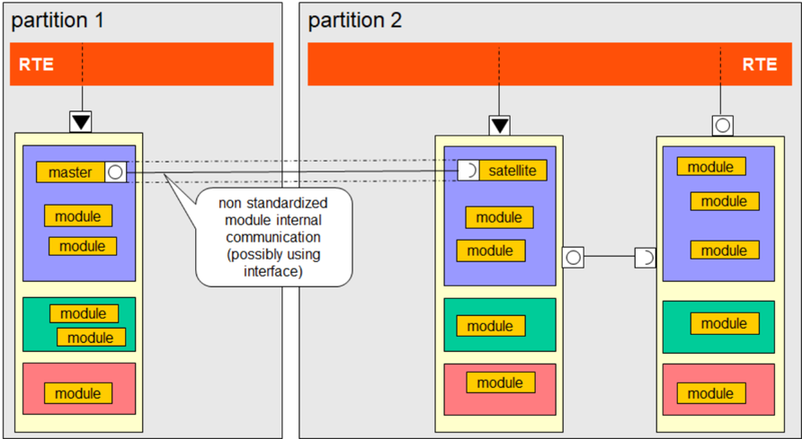

不属于 BSW 功能集群的模块（例如系统服务）将始终在 BSW 功能集群所在的同一 BSW 分区内被访问。由于接口不变，这些模块如果需要，必须在每个 BSW 分区中本地可用。

##### 2.1.3.2 BSW 分区间的通信

对应当在不同的 BSW 分区/不同的核上执行的任务的函数调用，不能实现为对该函数的简单 C 调用，因为这些调用将在本地 BSW 分区上处理。

因此，BSW 调度器（SchM）提供了一些函数，使用客户端-服务器或发送者-接收者通信来调用不同 BSW 分区上同一模块的主或卫星。SchM 这一 API 的细节在 [2.2.3](#223-使用-bsw-调度器进行分区间通信) 小节解释。

##### 2.1.3.3 确定服务执行的分区

处理一个 RTE 事件的实际 BSW 分区由其任务映射决定。基本规则是：如果一个事件被映射到一个任务，它就在该任务所属的分区中执行。如果一个事件没有映射到任务，它就在引发该事件的任务所在的分区中执行。任务映射的细节见本文档 [2.4.1](#241-任务映射) 小节。

从 BSW 实体到其他 BSW 实体的调用不映射到某个分区。它们在哪里被调用就在哪里执行。因此，对某个 BSW 函数的多次调用可能在不同的分区和核上并行处理。所以这类函数必须针对不同分区中的并行执行进行仔细的设计和实现；必要时它们应当是可重入的或并发安全的。

### 2.2. BSW 模块的并行执行

本章面向 BSW 模块的开发者。

#### 2.2.1 依赖核的分支

由于同一模块的实体共享同一实现，即使它们运行在不同的核上，也不能通过不同的代码来实现不同的行为。相反，特定的行为应当由运行时信息决定。例如可以为此使用核 ID，即根据 OS API GetCoreID 或 GetApplicationID 的返回值来分支控制流。

实现共享同一实现、却运行在不同核上的模块的另一种变体，可以基于不同的核专属配置来实现。这要求在每个核上调用初始化例程 Init，并传入指向相应配置的指针。这种设计模式被认为是实现 MCAL 依赖核分支的理想方式。

#### 2.2.2 主/卫星方式

需要在不同的 BSW 分区中访问的模块可以使用主/卫星模式实现。

主与卫星之间的工作分配是实现特定的。一个极端是：卫星只向同一 BSW 分区中的其他模块提供接口，把所有请求路由给主并把应答返回给其他模块。在另一个极端，卫星可以在本地提供完整功能（例如对运行在同一 BSW 分区中的完整应用进行本地模式管理），只在必要时与主同步其内部状态。甚至可能存在针对不同功能的多个主，例如分布式 PduR 网关的两个 PduR 主。

主协调来自卫星的请求，并可以过滤或监控进入的卫星请求。在某些方面，主与一个或多个卫星被当作一个模块实体对待：

- 主和卫星始终是来自同一供应商的供应商特定解决方案。
- 主和卫星到其他模块实体的接口通常与 AUTOSAR 为传统模块规定的相同。主和卫星应提供相同的 API。这意味着在迁移到分区化系统时，现有的模块实体在大多数情况下可以被一个主和若干卫星替换，而不改变其他模块。例外可能是模块内部针对分区间通信带来的额外延迟所做的适配。
- 主和卫星在每个 BSW 分区中拥有相同的入口点（即它们从共享内存开始执行相同的函数），并在内部根据其运行所在的 OS-Application（分区）分支（例如使用 GetApplicationID API）到主或卫星特定的代码。取决于构建策略，如果每个核可以执行自己的代码，多核系统中可能存在其他实现。此外，卫星可以共享同一份代码而无需进一步分支。
- 作为替代实现，主-卫星方式可以用如下方式实现：主也实现为一个卫星，而真正的主实现仅由 BSW 模块内核（kernel）组成，使得所有请求都与该内核交换。这种方式被认为是 MCAL 实现的理想方式。
- 主与卫星之间的通信未被标准化。它被视为模块内部的，对其他模块不可见。
- 主与卫星之间的通信可以在任一方向发起（即由主和卫星双方发起），也可以从一个卫星到另一个卫星。
- 主与卫星之间的所有接口只允许在同一个分布式模块内部连接。
- 主与卫星之间的通信可以在一个 BswModuleEntity 内实现，也可以在属于同一 BSW 模块的不同 BswModuleEntity 之间实现。
- 取决于应用，使用主/卫星可能合适也可能不合适。例如，使用彼此独立工作的、分区特定的看门狗集群，可能比以主/卫星方式使用看门狗管理器更高效。
- 主是分布式 BSW 模块中协调卫星请求、并可过滤或监控进入的卫星请求的部分。这可能带来额外的故障检测或故障缓解机制。一般而言，由模块分布式执行引起的所有错误都应在模块内部处理。

主/卫星实现是分区化系统中系统服务的标准解决方案。

特定的驱动也可能必须提供本地卫星，如果硬件只能从另一个核访问。标准解决方案（如果可能）是在每个分区中执行同一个多核可重入函数，并把要处理的数据分隔成不相交的集合，每个分区一个。例如，COM 模块可以处理分配给该模块所属 BSW 功能集群的总线的所有 I-PDU。对同一硬件或共享数据的并发访问需要被保护，例如在这种情况下通过 ExclusiveArea。

在特定情况下，如果 BSW 功能集群被复制，且不同 BSW 分区中的实体需要同步或需要交换数据，BSW 功能集群内的模块也需要实现为主/卫星。这可能适用于看门狗管理器、NVRAM 管理器，以及被复制的通信集群中的网络和状态管理器。COM 模块也可能需要拥有一个主和一个卫星来实现跨分区网关功能。

#### 2.2.3 使用 BSW 调度器进行分区间通信

BSW 调度器（SchM）提供若干函数，支持并行执行的 BSW 模块实体之间的通信。更准确地说，它提供以下方法来处理同步与异步调用（包括回调）以及发送者-接收者通信。

该功能总体上类似于 SWC 与 BSW 之间的函数调用。但是，由于 RTE 可能在某些时间点不可用（尤其是在 ECU 启动期间），该功能必须在 BSW 自身内部可用。

```C
Std_ReturnType SchM_Call_<bsnp>[_<vi>_<ai>]_<name>( [OUT <typeOfReturnValue> returnValue]
    [IN|IN/OUT|OUT]<data_1> ... [IN|IN/OUT|OUT] <data_n>)
或
Std_ReturnType SchM_Call_<bsnp>[_<vi>_<ai>]_<name>( [IN|IN/OUT|OUT]<data_1> ... [IN|IN/OUT|OUT] <data_n>)
```

调用一个客户端-服务器操作，可能跨越分区边界。实际参数 data_1 … data_n 是传递给被调用服务 [IN] 和/或从被调用服务传回 [IN/OUT | OUT] 的信息。

参数 returnValue 是否存在及其类型 &lt;typeOfReturnValue&gt; 取决于被调用的服务。对于同步调用，该参数存在，且 &lt;typeOfReturnValue&gt; 是被调用服务返回的类型。对于异步客户端-服务器操作以及返回类型为 void 的操作，该参数被省略。

```C
Std_ReturnType SchM_Result_<bsnp>[_<vi>_<ai>]_<name>( [IN|IN/OUT|OUT]<data_1> ... [IN|IN/OUT|OUT] <data_n>)
```

来自异步客户端-服务器操作的回调，可能跨越分区边界。

回调的接收者由该回调的 AsynchronousServerCallResultPoint 决定。AsynchronousServerCallResultPoint 引用发起调用的 AsynchronousServerCallPoint，后者又「知道」调用方的模块实体。

```C
Std_ReturnType SchM_Send_<bsnp>[_<vi>_<ai>]_<name>(IN <data>)
```

向 BSW 模块之间的发送者-接收者链路写入数据，可能跨越分区边界。

```C
Std_ReturnType SchM_Receive_<bsnp>[_<vi>_<ai>]_<name>(OUT <data>)
```

从 BSW 模块之间的发送者-接收者链路读取数据，可能跨越分区边界。

#### 2.2.4 使用共享缓冲区（在没有内存保护的系统中）

在 BSW 分区之间没有内存保护的系统中，系统服务和所有 BswCalledEntity 可以在每个分区中被直接调用，包括完整的调用树。这要求可重入的、并发安全的实现。

服务和其他被调用实体可能处理模块内部数据，这些数据在同一模块的不同实体之间共享。对这类数据的所有访问都必须由 ExclusiveArea 保护。具体保护机制的适当性取决于可能的访问种类。例如，并发写入通常必须被禁止，而并发读取可能是可接受的，只要同一时刻只有一个分区在写。

BswSchedulableEntity 只位于一个核上，周期性地或事件驱动地处理数据。

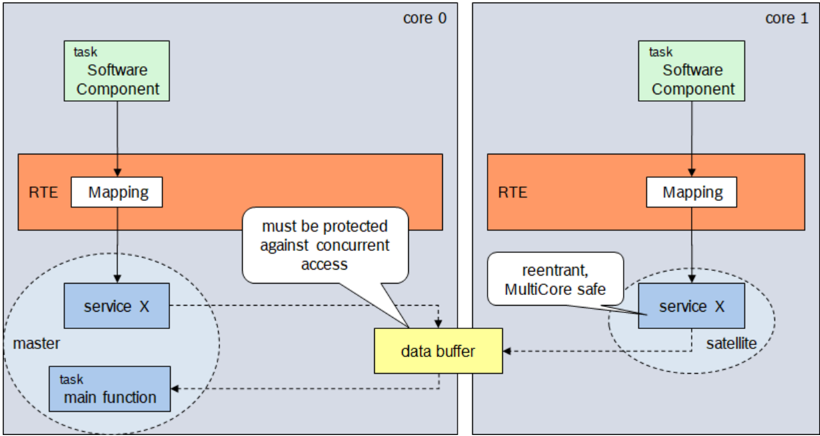

图 2.2 展示了服务「X」的例子：相同的 API 和相同的代码由 RTE 在不同的核上直接调用。如果这些服务（分别为 OperationInvokedEvent）没有映射到任务，这就是默认行为。

代码必须是可重入且并发安全的，这意味着对数据的所有访问都必须防止被同一模块的相同或不同实体并发访问。

在此例中，同一服务「X」（BswCalledEntity）写入一个可从核 0 和核 1 访问的模块内部数据缓冲区。一个映射到任务的「main 函数」（BswSchedulableEntity）从该缓冲区读取数据做进一步处理。为了防止读写冲突，这个「main 函数」必须被保护，避免在缓冲区被写入时读取它。

这可以被视为通用主/卫星方式在 BSW 分区之间没有内存保护的系统中的特例。

这种方法的优点是可以使用原始的、未更改的模块，只要它们实现为并发安全的——如果同一模块的不同实体处理相同的数据，单核情况下通常已经如此（如示例中核 0 的情形）。与 AUTOSAR R4.0 方案（所有服务调用都必须路由到主核）相比，无需太多努力就可以显著提升性能（假设之后不需要跨核通信）。

对于并发安全的可重入实现，必须考虑以下几点：

- 对所有共享资源（例如缓冲区）的访问由 ExclusiveArea 保护。
- 如果被调用的实体是安全的，或者调用由 ExclusiveArea 保护（前提是锁定时间保持在规定的限度内），调用树可以实现为多核安全。

CDD 可以使用的 BswCalledEntity 也可以由 CDD 直接调用。适用与 R4.0 相同的规则。

SchM 必须支持跨核 ExclusiveArea，由受保护的自旋锁（Spinlock）实现。受保护的自旋锁是 RteExclusiveAreaImplMechanism 取值为 "OS_SPINLOCK" 的独占区域。这类独占区域仅供 BSW 模块受控访问。受保护的自旋锁由基础软件调度器处理。

#### 2.2.5 访问硬件/驱动

MCAL（驱动）的 BswModuleEntity 应按以下方式访问：

- 由调用者所在 BSW 分区内的 BSW 功能集群访问。例如 FLS 驱动属于 BSW 功能集群「存储」。在 NVM 访问的情况下，NVM 模块可以以主/卫星实现在所有核上提供。主只在一个核上使用 FLS 驱动。因此 FLS 驱动恰好在那个核上可用。
- 应用所需的任何 BSW 应在调用者所在的 BSW 分区中访问。例如 DIO、ADC 和 PWM 等 I/O 驱动可以被任何核/分区使用。它们要么实现为主/卫星，要么基于对硬件的原子访问实现为每核的冗余实现。

MCAL 多核方式的详细实现见 [2.5](#25-mcal-分布) 节「MCAL 分布」。

#### 2.2.6 模块的并发安全实现

BSW 模块（分别为这些模块实现的函数）的并发安全可以通过不同的机制实现。

一般而言，按照 [TPS_BSWMDT_04103]，可以区分以下几个可重入性等级。BswModuleEntity 的具体等级在可选属性 "reentrancyLevel" 中定义。

- **多核可重入（Multi-core reentrant）**：接口可以被无限地并发执行，包括抢占和多核系统上的并行执行。这一等级可以通过进入临界区时的互斥实现，也可以通过不存在这样的区域实现（例如没有共享资源，包括硬件和内存）。
- **单核可重入（Single-core reentrant）**：接口在单核系统上可以被伪并发执行（即抢占）。这是 AUTOSAR 4.0.3 定义的最高可重入等级。由于它没有显式覆盖多核系统，因此额外引入了「并发安全（concurrency safe）」。这一等级通常可以用与「并发安全」相同的机制来保证，但必须保证它们能跨越核边界工作。
- **不可重入（Non-reentrant）**：该接口不能并发执行。

如果一个不具备并发安全的模块在不同的分区中被调用，则无法保证该模块会保持其期望的行为。在这种情况下，正确的行为应通过模块的使用方式来保证，例如调用者通过使用独占区域来防止并行执行。

#### 2.2.7 基于内核（Kernel）的主-卫星实现

实现主-卫星概念的一种方式是：把一个模块的实现拆分为内核（kernel）和相应的接口，接口提供给该模块将被使用的所有分区。本章的重点是描述相应 BSW 模块分布的思想，作为类似案例的指引。

第一步，对服务 API 进行分类，例如按照 MCAL 分布概念：

- 多个核/分区要求的、用于触发和读/写数据的服务 API；
- 仅由一个分区要求的服务 API（例如初始化、关机）。

这将导出如下 BSW 模块架构：

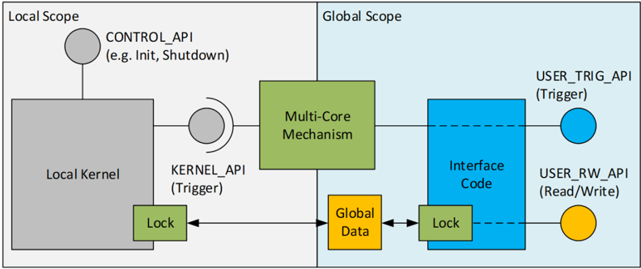

第二步，SW 设计者需要为每个服务 API 按照下面列出的类别选择相应的 BSW 分布模式：

- 从服务 API 向内核 API 触发一个控制流（如有需要，包括数据）；
- 从全局缓冲区读取一个符号；
- 向全局缓冲区写入一个符号，内核稍后轮询它。

对于读和写数据，通常会在 BSW 模块的接口部分实现相应的 get 和 set 操作，必要时添加相应的数据保护手段（例如自旋锁）。

对于控制流的传递，一方面要实现用户 API 操作，另一方面在内核 API 内实现相同的操作。关系可以是 1:1（一个用户 API 对应一个内核 API）或 n:1（多个用户 API 对应一个内核 API）。

所有本地 API 必须按本地核作用域分配，所有全局 API 按全局核作用域分配，适用内存分配规范（AUTOSAR_SWS_Memory Mapping，见 [\[2\]](#ref-2)）。

将这一思想应用到 PWM 驱动，可以得到如下 API 分布：

本地作用域的控制 API：

| 控制 API | 核作用域 |
| --- | --- |
| Pwm_Init | local（与内核相同的分区） |
| Pwm_DeInit | local（与内核相同的分区） |
| Pwm_Main_PowerTransitionManager | local（与内核相同的分区） |

注意，这些 API 被限制在本地内核分区。调用转换管理器的任务需要在同一分区/同一核上调度。

全局作用域的用户读/写 API：

| 用户读/写 API | 访问/核作用域 |
| --- | --- |
| Pwm_GetOutputState | 读取全局数据 |
| Pwm_GetCurrentPowerState | 读取全局数据 |
| Pwm_GetTargetPowerState | 读取全局数据 |
| Pwm_GetVersionInfo | 读取静态信息 |
| Pwm_DisableNotification | 写入全局数据（原子标志） |
| Pwm_EnableNotification | 写入全局数据（原子标志） |

注意，这些 API 对任何分区都可用，因此即使调用来自内核所在的同一分区，也使用它们。

全局作用域的用户触发 API 及对应的本地作用域内核 API：

| 用户触发 API/全局作用域 | 内核 API/本地作用域 |
| --- | --- |
| Pwm_SetDutyCycle | Pwm_Kernel_SetValues |
| Pwm_SetPeriodAndDuty |  |
| Pwm_SetOutputToIdle | Pwm_Kernel_SetOutputToIdle |
| Pwm_SetPowerState | Pwm_Kernel_PowerStateManager |
| Pwm_PreparePowerState |  |

注意，USER_TRIG_API 对任何分区都可用，因此即使调用来自内核所在的同一分区，也使用它们。而 KERNEL_API 对用户不可访问，它仅是内部的。来自本地分区的调用经由 USER_TRIG_API 传递。

最后，下图总结了给定示例中沿核/分区的接口可用性，其中内核 API 隐藏在 BSW 模块内部，对外不可见。

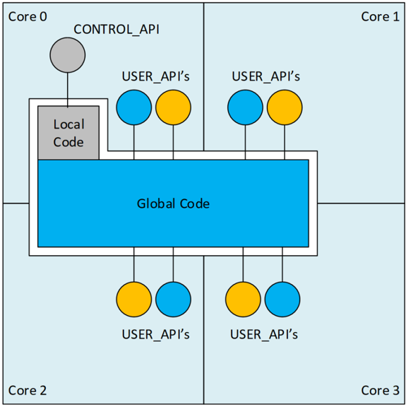

此外，还应注意以下几点：

- 所有用户回调应在本地分区中调用。用户随后需要类似地提供一个具有全局作用域、可被调用的服务 API。这很有用，因为每个 BSW 模块或 CDD 的实现者最了解其模块的设计。反过来做反而可能浪费 CPU 资源，因为调用方和被调用模块可能把分区传输实现两次。
- 强烈不建议为跨越同一核上的分区而应用这种或其他主-卫星概念（例如出于安全动机），因为这同样会浪费 CPU 资源。

在选择相应的保护与多核手段时，应始终尝试实现无阻塞（blockade free）的实现，以允许多个核上的并行操作。

#### 2.2.8 原子操作库

随着 BMC 库的引入，AUTOSAR 现在提供了一个多核原子库。该库的接口覆盖与 C11 标准原子库（http://en.cppreference.com/w/c/atomic）类似的用例/接口。

该库应支持开发者实现高效的免锁（lock-free）实现，从而在不使用重量级互斥锁的情况下简化分布式 BSW（主/卫星）的实现。

原子操作通常在内存地址上执行读-改-写序列。例如，原子递增加载一个值、递增它并存储结果，期间任何其他线程都无法修改该值。因此，跨核的设置请求可以用原子操作高效地实现。

### 2.3. 面向并行 BSW 执行的 SchM 接口

本章描述概念「增强 BSW 分配」所要求的 SchM 扩展。

基础软件调度器（SchM）负责处理 BSW 模块之间的分区间通信。这在概念上类似于 RTE 对 SW-C 之间分区间通信的处理。但是由于 BSW 模块在 AUTOSAR 架构中位于 RTE 之下，通信必须在 RTE 可用之前就可用。因此，也出于性能原因，BSW 模块使用 SchM 进行通信。

对于跨越多个分区的 BSW 模块分布，SchM 应实现方法 SchM_Call、SchM_Result、SchM_Send 和 SchM_Read——它们用于处理服务调用和回调，以及向发送者-接收者连接写入数据和从中读取数据。这些函数签名的细节请参见 [2.2.3](#223-使用-bsw-调度器进行分区间通信) 小节，该节从 BSW 开发者的视角描述了 SchM 扩展。

SchM 可以使用 IocSend（对 OS 的直接调用）在分区间通信中发送数据。其他 RTE 内部机制在启动期间可能不可用。

跨分区边界的所有客户端-服务器和发送者-接收者连接，应把 ECU 间应用通信器（IOC）配置为提供具有唯一确定的 &lt;Id&gt; 的 IocSend_&lt;Id&gt; 函数。

类似地，SchM 应使用 IocReceive 从分区间通信接收数据，IOC 应提供相应的 IocReceive_&lt;Id&gt; 函数。

下面的框中包含一些伪代码片段，展示如何使用 IOC 进行分区间通信。

```C
1 void some_BSW_function() {
2   char *str = "some text";
3   SchM_Send_Data_Src_DstN(str);
4 }
5
6 Std_ReturnType SchM_Send_Data_Src_DstN(char *str) {
7   IocSend_1(str, 5);
8   ActivateTask(TASK1);
9 }
10
11 Std_ReturnType SchM_Receive_Data_Src_DstN(char *str) {
12   IocReceive_1(str);
13 }
14
15 TASK(TASK1) {
16   char data[20];
17   SchM_Receive_Data_Master_Sat1(data);
18
19   /* do something with data */
20 }
```

### 2.4. 分区化系统中的基础软件配置

本章面向集成者。

#### 2.4.1 任务映射

BSW 模块的并行化向 AUTOSAR 元模型引入了若干个新的 BswEvent 子类。这些类如图 2.5 所示。每个 BswEvent（包括 BswEvent 子类的实例）都被分配给一个 BswSchedulableEntity，事件发生时它被启动。

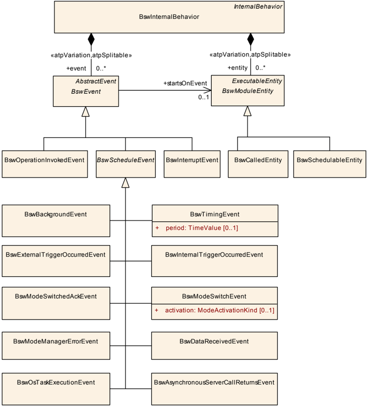

如图 2.6 所示，实体分区特定行为的更细粒度描述可以通过使用 BswDistinguishedPartition 来描述。BswDistinguishedPartition 是分区的抽象表示，它允许把特定的 BswEvent、BswModuleCallPoint 或 BswVariableAccess 映射到一组抽象分区。此处分区的表示是抽象的，意即它是 BSW 模块描述的一部分（按照模块描述模板），而具体的分区在 ECU 配置期确定。

例如，如果运行在分区 1 中的一个模块实体经由一个 VariableDataPrototype 向运行在分区 2 和 3 中的同一实体提供数据，则该 BswModuleEntity 聚合一个带 contextLimitiation 指向分区 1 的 dataSendPoint，以及一个带 contextLimitation 指向分区 2 和 3 的 dataSendPoint。

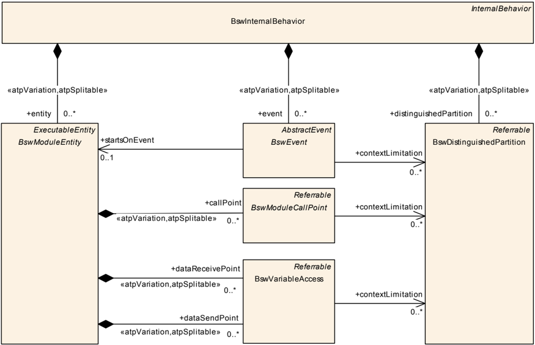

处理事件的实际分区由其任务映射决定。

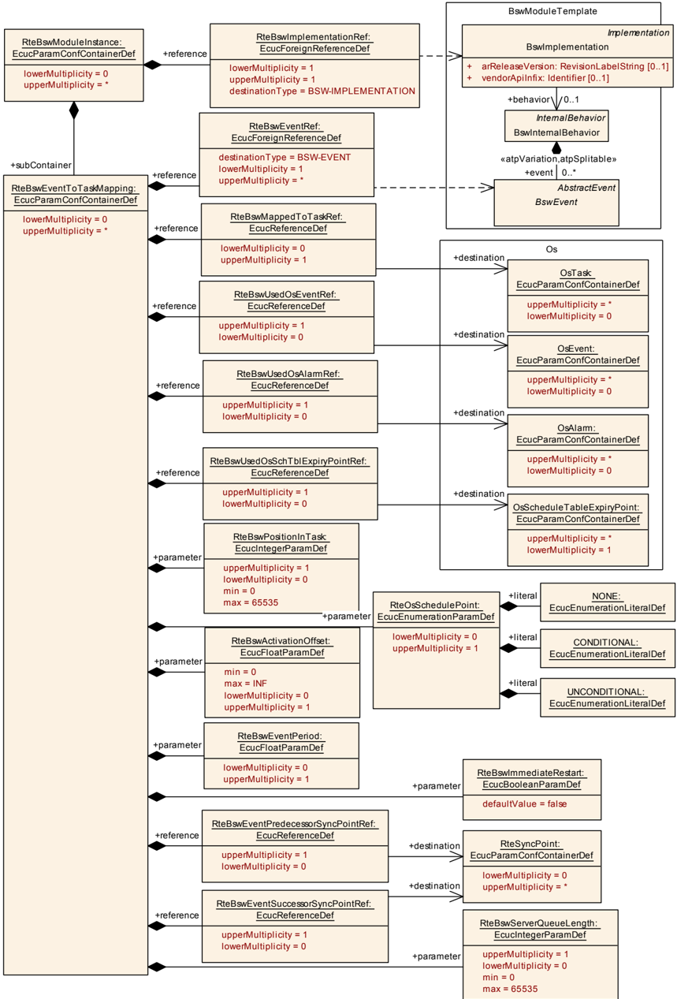

图 2.7 展示了 AUTOSAR 元模型中相应的节选。

一个 RteBswEventToTaskMapping 引用一个 BswEvent（经由其 RteBswEventRef 间接引用）和一个 OsTask（同样经由其 RteBswMappedToTaskRef 间接引用）。任务又被映射到一个分区，分区被映射到一个 µC 核，该核即负责处理该事件的核。把事件映射到任务是可选的；如果事件未映射到任务，它在发起调用的分区中处理。如果没有任何阻止并发执行的特定机制，事件非强制映射到任务的前提条件是：

- 如果 BSW 实体由多个 BSW 分区共享，该实体需要是并发安全的；
- 如果它只在一个 BSW 分区中独占地可用，它至少需要是可重入的。

请注意，目前不允许把 SW 组件的 RunnableEntity 映射到多个分区 [SWS_Rte_07347]。对于 BSW，可以通过使用引用同一实体的不同 BswEvent，把相同的模块实体映射到不同的任务和分区。

#### 2.4.2 主与卫星的一般配置

应当在多个分区中可用的模块可以实现为主和卫星。在这种情况下，同一模块的主和所有卫星共享相同的代码（不过它可以实现依赖核的行为）和相同的配置。因此，就配置而言，主及其卫星被当作一个模块实体对待。

主与卫星之间的通信不被标准化。它被视为模块内部的，对其他模块不可见。但是，由于建议使用 SchM 机制进行内部通信，需要配置 BSWMD 中用于连接主和卫星的非标准化客户端-服务器条目和数据访问。

#### 2.4.3 配置 BswM（按分区）

在分布式 BSW 的系统上，每个分区有一个 BSW 模式管理器（BswM）（但每个核有一个 OS 和一个 EcuM——只要每个核有一个 BSW 分区，这两者就是一致的）。这些 BswM 中的每一个都可以独立配置。一个 BswM 主要与同一分区上的状态管理器（例如 ECU 状态管理器和总线状态管理器）交互。

BswM 还负责运行在同一分区中的 BSW 模块的初始化和关机。因此，它的配置取决于 BSW 模块到分区的映射。

BswM 的配置拆分在容器 BswMGeneral（包含所有 BswM 实体共享的配置参数）与 BswMConfig 容器之间，其中每个 BswM 实体定义一个 BswMConfig。因此，BswM 到其分区的映射在相应的 BswMConfig 容器中定义，该容器有一个指向相应分区的 BswMPartitionRef。这种 BswM 配置到分区的映射确保了每个分区都能确定正确的 BswM 配置。

#### 2.4.4 配置 EcuM（按核）

在分布式 BSW 的系统上，每个核有一个 EcuM（即使该核上有多个 BSW 分区）。换言之，每个核上应当有且只有一个分区运行 EcuM。运行 EcuM 的分区由 EcuMFlexEcucPartitionRef 决定，它在 EcuM 配置的容器 EcuMFlexUserConfig 中规定。

在核顺序启动的架构上，有一个指定的主核，引导加载程序在该核上通过 EcuM_Init 启动主 EcuM。主核中的 EcuM 启动一些驱动、确定构建后配置，并启动所有剩余核及其全部卫星 EcuM。

在所有核同时启动的架构上，可以使用 EcuM_Init 函数内的依赖核的分支来实现核特定的行为。这进而可以用于识别 EcuM 主（运行在主核上），它负责从核上的 EcuM 初始化。

### 2.5. MCAL 分布

#### 2.5.1 引言

由于需要从多个核和分区访问硬件特性，MCAL 功能需要被提供给恰好需要它的那个核、以及提供该功能有用的地方。因此，MCAL 模块的分布并不是对所有 MCAL 模块都完全相同地完成，而是需要遵循前几章所述功能集群的需要。以下几章应指导完成所需多核能力的分类，并引入分配给各个模块的相应多核类型。此外，还展示了一些基本设计模式，以允许实现所需的功能。

应当注意，引入多核 MCAL 要求引入异步行为的接口，以启用多个核上的非阻塞并行执行。它们被引入受影响的 AUTOSAR 模块各自的 SWS 中，下文不再提及。

#### 2.5.2 使用假定

为了应用 MCAL 分布，应给出若干使用假定，以定义 MCAL 环境的边界条件：

1. 需要一个多分区（多应用）AUTOSAR 操作系统来支持本概念中定义的用例。
2. 硬件实现应允许把外设至少映射到核。将来预期硬件实现允许映射到核和分区。
3. 应可以把硬件和软件中断路由到一个分区，或至少一个专用核（以便由 OS 进一步路由）。
4. MCAL 驱动所要求的服务模块应支持多核用例，即能够在任何核上接受对其服务 API 的调用。相关的服务有：
   - Det
   - Dem
   - EcuM
   - Os
   - SchM
   - NvM

此外，假定使用多核微控制器，但这不是强制性的，因为无论单核还是多核实现，本概念都提供相同的服务 API 集合。此外，可以实现具有空间与时间隔离的混合 ASIL 系统，其中可映射的 MCAL 元素被分配到不同的分区，并遵循最终 MCAL 实现的安全完整性等级。

一个例子是在一个核上有两个分区、二者都访问 MCAL 的系统。没有本概念时，驱动必须排他地属于其中一个分区，使跨分区的执行时间开销很高。有了新概念，MCAL 元素可以被单独分配给两个分区，从而消除跨分区边界的需要。

#### 2.5.3 约束

为了实现该概念，定义了进一步的约束，以防止低效的和阻塞多核的实现。从这个意义上说，特别重要的是要考虑到：仅在单核上实现独占区域已经不够，还需要在资源需要由分布到多个核的多个分区共享的情况下确保访问的串行化。

- **单核上的访问串行化**：对于单核系统，并发问题已被充分理解，并通过独占区域缓解——它把并发访问限制为一次一个进程。这通常通过锁定中断、使用 OS 资源或创建非抢占调度来完成。这实际上意味着不同进程的访问串行化。
- **跨核的访问串行化**：由于独占区域只有核范围的作用域，它们不足以防止多核环境中的并发访问。但是一旦需要访问同一资源（例如通过访问服务 API、处理 ISR 和 main 函数），就需要引入跨核手段。除了使用原子资源之外，最糟糕的（因为会阻塞）方式是通过使用信号量（自旋锁）引入跨核独占区域，这会阻塞多个核。相反，更好的选择是基于专有的、精简的 IOC 的经典主-卫星实现。

总结：独占区域在技术上可以扩展到多核作用域，但无论怎么实现，都会造成显著的性能损失，因为两个甚至多个核会被阻塞。因此，本概念将描述相应的设计模式，展示与本章定义的多核类型相匹配的最优保护手段。

#### 2.5.4 MCAL 用户的定义

需要考虑以下不同的 MCAL 用户：

- （RTE 之上的）应用 SWC，经由 IoHwAb；
- （RTE 之下的）CDD 或 BSW 模块。

因此，MCAL 多核支持需要独立于 RTE 提供，以覆盖这两种用例。

#### 2.5.5 多分区与多核 MCAL

##### 2.5.5.1 考虑多分区

由于 AUTOSAR 标准允许每个核定义多个分区，MCAL 分布概念需要尊重这一思想，以便日后出于例如安全分布的动机进行扩展。因此，本概念实现如下思想：

1. 可映射的元素不是简单地映射到核，而是映射到分区。这是为了允许在稍后时间点为 MCAL 实现进一步的隔离特性，例如确保 ADC 通道之间的免干扰性。
2. MCAL 接口反而不映射到分区，而是假定这些接口在用户分区所在的核上可用。这产生了核作用域的正确定义：GLOBAL 或 LOCAL。简而言之，这意味着仅由单个核上的分区要求的接口，可以用 LOCAL 作用域分配；而由多个核上的不同分区要求的接口应当以 GLOBAL 作用域分配。

结论：API 不映射到分区（只是与分区相关）。可映射的元素为了进一步的分布需要而映射到分区。

##### 2.5.5.2 对 MCAL 符号分配的影响

同时兼顾多核与多分区的思想，会对 MCAL 驱动内部数据、常量以及外设的映射产生一些影响。根据驱动设计和硬件能力，可以：

1. 把外设映射到核或分区，它们可能受进一步的硬件手段保护，例如：特权级别（hypervisor、supervisor、user 等）、安全分区（通过分区 ID、任务 ID 等）等；
2. 如果需要，把数据分配到各个分区中，以确保例如它们之间的免干扰性。但数据至少要与使用它的 API 具有相同的核作用域。把数据和相关操作映射到同一个核。

请注意，把数据分配到不同的分区并不会自动隔离它们。要做到这一点，还需要相应的内存保护。

结论：符号应以与使用它的 API（内部或公共）相同的核作用域分配。

#### 2.5.6 多核能力分类准则

以下段落用于统一从不同视角对所需多核能力的理解。

##### 2.5.6.1 准则 1——API 可用性

为了对一个 MCAL 模块的多核能力进行分类，首先必须理解用户在「服务 API 应当从哪个核可达」意义上的期望。由这个定义可以导出以下两种情况：

- 1a：本地服务 API（只能在一个核上执行）；
- 1b：全局（分布式/共享）服务 API（可以在任何核上执行）。

##### 2.5.6.2 准则 2——MCAL 内核执行上下文

其次，需要理解 MCAL 模块内核理想上应驻留/位于何处，以限制多个核对硬件外设的并发访问在总线和桥上造成的冲突副作用。定义本地内核并不排除多重性，例如提供多个内核来处理独立的外设模块或核专属资源。定义了以下情况：

- 2a：一个本地内核（只能在一个核上执行）；
- 2b：全局（分布式/共享）内核（可以在任何核上执行）。

##### 2.5.6.3 准则 3——硬件元素映射

第三点，需要考虑可映射元素的作用域（参见 [2.5.11](#2511-元素的映射) 小节），包括其数据到相应的内核实例。考虑这一方面，就硬件外设到核的映射而言，按照硬件能力扩展分类。这里不仅需要考虑纯硬件能力，还要考虑相应映射的性能影响。定义了以下情况：

- 3a：一个硬件元素只能映射到一个核；
- 3b：一个硬件元素可以映射到多个核。

##### 2.5.6.4 多核能力分类总结

下表总结了所示准则的所需选项范围。

|  | 仅一个核 | 多个核 |
| --- | --- | --- |
| API | 1a | 1b |
| 内核执行上下文 | 2a | 2b |
| 硬件元素 | 3a | 3b |

#### 2.5.7 MCAL 多核类型的定义

以下段落引入适用于 MCAL 模块的相应多核类型，对相应的多核能力进行分类。

##### 2.5.7.1 MCAL 多核模块类型 I

MCAL 模块仅在单个核上可用，接口不是全局可用的。

类型 I = 1a + 2a + 3a

该类型定义为单核模块：只向一个核提供其服务 API，并恰好在该核上实现内核，因为相应的硬件元素只能由一个核访问。

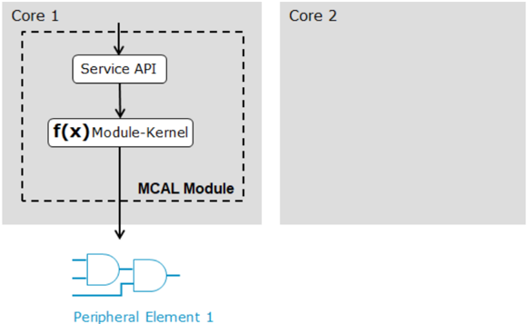

类型 I 的例子有 FLS、MEMIF 和 FEE。为了把作用域限制到该核，可以应用具有本地作用域的相应 SwAddrMethod。

##### 2.5.7.2 MCAL 多核模块类型 II

MCAL 模块提供一个按核执行的分布式内核，作用于单独映射的硬件元素。

类型 II = 1b + 2b + 3a

该类型定义为多核模块的一种特殊形式：在任何核上以独立实例提供其服务 API 以及控制 API（Init、DeInit 等）。因此，操作在触发该操作的核上执行。每个核实例操作它自己的数据集合。这对作用于可映射到一个专用核的硬件元素的 MCAL 模块特别有意义。这种类型的典型例子是通信驱动，如 CAN、ETH 和 FR。

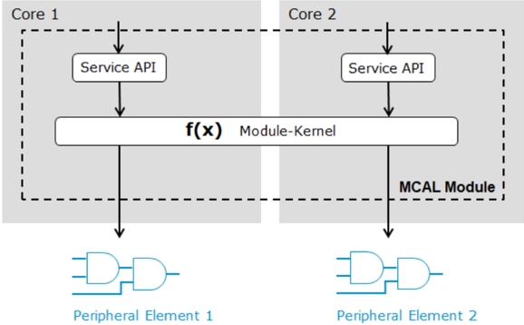

##### 2.5.7.3 MCAL 多核模块类型 III

MCAL 模块提供一个按核执行的分布式内核，作用于全局可用的硬件元素。

类型 III = 1b + 2b + 3b

该类型定义为多核模块的一种特殊形式：在所有核上提供其服务 API，但以全局方式实现内核，使得操作在触发该操作的核上执行、直接访问可映射到任何核的全局可用硬件元素（包括相关数据）。相应的控制 API（Init、DeInit 等）则只在一个单核上可用。特别是在硬件可以被原子访问的情况下，这种模块类型被认为是有用的。最突出的例子是 DIO 驱动。

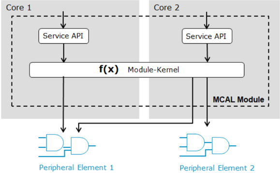

##### 2.5.7.4 MCAL 多核模块类型 IV

MCAL 模块提供在任何核上可用的接口，以及单核上的一个内核，该内核只由一个核访问可映射元素。

类型 IV = 1b + 2a + 3a

该类型定义为多核模块的一种特殊形式：跨所有核提供其服务 API，但只在一个核上实现内核，执行对可映射硬件元素的访问。内核可以用 SwAddrMethod "local" 分配。这种情况需要专有的多核手段来执行指向内核的请求的同步（串行化）。这类多核手段可以是基于轮询或中断的高效消息传递，也可以是结合信号量的多缓冲（用于低复发率）。类型 IV MCAL 模块的相应控制 API（Init、DeInit 等）只在内核驻留的核上以相应的本地作用域可用。这类 BSW 模块的例子有 ADC、PWM、ICU 和 OCU。这是一种经典的主-卫星实现。

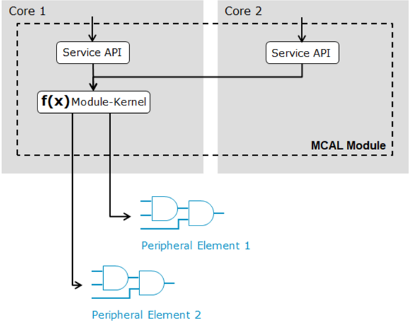

##### 2.5.7.5 MCAL 多核模块类型 V

MCAL 模块提供在任何核上可用的接口，以及各核上独立的多个内核，各内核由相应的核单独访问可映射元素。

类型 V = 1b + 2a + 3b

这种多核模块是类型 IV 的扩展，可以用允许对外设模块或子模块进行完全独立处理的硬件实现来落地。这是一种较为理论化的情形，没有给出示例图。

##### 2.5.7.6 MCAL 多核类型总结

下表总结了已定义的 MCAL 多核模块类型的范围：

| | API：仅一个核（1a） | API：多个核（1b） | 内核执行：仅一个核（2a） | 内核执行：多个核（2b） | 硬件元素：仅一个核（3a） | 硬件元素：多个核（3b） |
| --- | --- | --- | --- | --- | --- | --- |
| Type I | X |  | X |  | X |  |
| Type II |  | X |  | X | X |  |
| Type III |  | X |  | X |  | X |
| Type IV |  | X | X |  | X |  |
| Type V |  | X | X |  |  | X |

#### 2.5.8 把 MCAL 模块映射到多核类型

本概念应普遍应用于所有 MCAL 驱动，它们列于下表：

| 模块缩写 | MSN | SW 层 |
| --- | --- | --- |
| Adc | ADC Driver | I/O Drivers |
| Can | CAN Driver | Communication Drivers |
| CanTrcv | CAN Transceiver Driver | Communication HW Abstraction |
| CorTst | Core test | Microcontroller Drivers |
| Dio | DIO Driver | I/O Drivers |
| Eth | Ethernet Driver | Communication Drivers |
| EthSwt | Ethernet Switch Driver | Communication HW Abstraction |
| EthTrcv | Ethernet Transceiver Driver | Communication HW Abstraction |
| Fr | FlexRay Driver | Communication Drivers |
| FrTrcv | FlexRay Transceiver Driver | Communication HW Abstraction |
| Gpt | GPT Driver | Microcontroller Drivers |
| Icu | ICU Driver | I/O Drivers |
| Lin | LIN Driver | Communication Drivers |
| LinTrcv | LIN Transceiver Driver | Communication HW Abstraction |
| Mcu | MCU Driver | Microcontroller Drivers |
| Mem | Memory Driver | Memory Drivers |
| Ocu | OCU Driver | I/O Drivers |
| Port | Port Driver | I/O Drivers |
| Pwm | PWM Driver | I/O Drivers |
| RamTst | RAM Test | Memory Drivers |
| Spi | SPI Handler Driver | Communication Drivers |
| Ttcan | TTCAN Driver | Communication Drivers |
| WEth | Wireless Ethernet Driver | Wireless Comm. Drivers |
| WEthTrcv | Wireless Ethernet Transceiver | Wireless Comm. HW Abstraction |

为了确定标准化 MCAL 模块的多核类型和映射关系，首先需要识别该模块将访问的硬件「自然元素」。此外，需要识别可映射元素，即运行在单个核上的用户希望访问的元素。由此可以导出可映射元素与核的关系。这里可映射元素（ME）与其可映射到的核的数量（Core）相关联。作为最终结论，给出相应的多核类型，以便为实现相应的 AUTOSAR 模块导出后续的设计模式建议。

| 驱动 | 硬件「自然」元素 | 可映射元素（ME） | 关系（ME : 核） | 多核类型 |
| --- | --- | --- | --- | --- |
| Adc | HW Units | Channel group | n:m | Type IV |
| Can | CAN Controller | Network | n:1 | Type II |
| CanTrcv | Transceiver ASIC | Network | n:1 | Type II |
| CanXL | CAN XL Controller | Network | n:m | Type III |
| CanXLTrcv | Transceiver ASIC | Network | n:m | Type III |
| CorTst | Core | Core | 1:1 | Type II |
| Crypto | 基于硬件：HSM；基于软件：Job | Job | n:1 | Type II |
| Dio | Port / Channel（依赖硬件） | Port / Channel | n:m | Type III |
| Eth | MAC | Network | n:1 | Type II |
| EthSwt | Switch ASIC | Network | n:1 | Type II |
| EthTrcv | Transceiver ASIC | Network | n:1 | Type II |
| Eep | EEPROM Driver | MCAL Module | 1:1 | Type I |
| Fls | Flash | MCAL Module | 1:1 | Type I |
| FlsTst | Flash Test | MCAL Module | 1:1 | Type I |
| Fr | Controller | Network | n:1 | Type II |
| FrTrcv | Transceiver ASIC | Network | n:1 | Type II |
| Gpt | Timer Resource | Local Timer | n:1 | Type II |
|  |  | Global Timer | 1:m | Type III |
| Icu | Timer / Edge Detector | ICU Channel | n:m | Type IV |
| Lin | Lin Channel | Network | n:1 | Type II |
| LinTrcv | Transceiver ASIC | Network | n:1 | Type II |
| Mcu | Core | Core, System | 1:1 | Type II |
| Mem | Memory，例如 Flash | Memory Instance | n:1 | Type II |
| Ocu | Timer | OCU Channel | n:m | Type IV |
| Port | Port / Channel（依赖硬件） | Port / Channel | n:m | Type III |
| Pwm | Timer | PWM Channel | n:m | Type IV |
| RamTst | Core | Core, System | n:1 | Type II |
| Spi | Channel（用于单独的序列）/ Device | Spi Device | n:m | Type IV |
| Ttcan | CAN Controller | Network | n:1 | Type II |
| Wdg | Watchdog Driver | Watchdog Resource | 1:1 | Type I |
| WEth | MAC | Network | n:1 | Type II |
| WEthTrcv | Transceiver ASIC | Network | n:1 | Type II |

作为结论，属于类型 I（因而不受本概念影响）的驱动列于下方。对每个驱动，给出其被认为不相关的原因：

- Eep（EEPROM Driver）：存储服务（NvM）绑定到一个核。因此不需要该驱动的多核功能。
- Fls（Flash Driver）：存储服务（NvM）绑定到一个核。因此不需要该驱动的多核功能。
- FlsTst（Flash Test）：Flash Test 不提供额外的（应用）用例潜力。其目的是作为一种服务来检查微控制器闪存的功能。通常没有用该模块实现的 SW 功能。
- Wdg（Watchdog Driver）：尽管多核系统上有多个看门狗，但每一个都只由一个核通过相应的 Task/ISR 在本地触发。所有看门狗的配置（Wdg_SetTriggerCondition）只在一个核上完成，以确保系统范围内的行为。

#### 2.5.9 分离策略与元素的映射

MCAL 多核分布的挑战在于如何处理全局资源。这些资源是：

- 全局数据；
- 共享的专用功能寄存器；
- 外设寄存器。

根据前几章给出的约束，显而易见的是：两个进程上下文将同时访问同一全局资源。这可能导致：

- 数据损坏（尤其是复杂（非原子）数据类型的问题）：
  - 数据的一部分由第一个进程写入；另一部分由第二个进程写入；
  - 只写入了部分数据，然后写进程被抢占，留下一个损坏的数据集；
- 读-改-写数据的竞争：
  - 一个进程写入的数据（例如一个值的递增）由于两次交错的读-改-写操作而丢失。

在 MCAL 驱动中，最多有三个元素可以拥有自己的进程上下文：

- Main 函数：在任务上下文中映射并执行；
- 服务 API：在一个或多个任务或 ISR 的上下文中被调用；
- 中断服务例程：在中断上下文中被调用。

特别是服务 API 可能在多个进程上下文中被调用，取决于架构和 SW 实现的功能。

本章描述按照可映射元素（对应于功能元素）的多核能力——这些元素在本文档前面提到，并且应被标注到 MCAL 驱动上。此外，本章定义实现可映射元素所需的基本分离策略。

#### 2.5.10 分离策略

##### 2.5.10.1 硬件层级的分离

按照定义的多核类型实现多核实现的理想方式之一，是在硬件层级进行分布/分离。

理想情况是硬件支持物理外设的分布/分离，即：把外设模块映射到单独的核。

注意：这种硬件层级的分离要求各个外设拥有独立的寄存器集，可以从一个核控制而不影响另一个核，如图 2.12 所示。

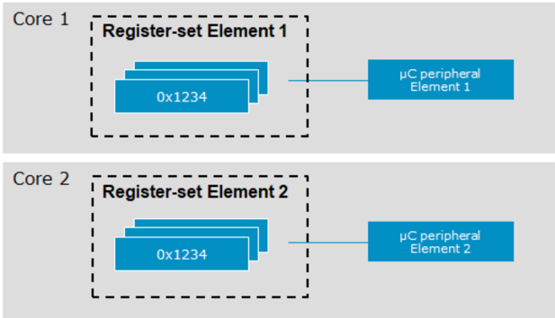

如图 2.12 所示，各个硬件/外设元素背后的寄存器集彼此独立，因此可以视为可映射元素。可映射元素意味着一个元素可以排他地映射到某个核。如果寄存器集元素允许原子访问，这种分离方式也可以支持映射到多个核。

##### 2.5.10.2 软件层级的分离

并非所有微控制器都提供严格分离的寄存器集，即硬件元素（外设、核、存储器）的功能。通常这些硬件元素需要一组公共寄存器来控制其功能，而这组寄存器不能被原子访问。若干外设模块和外围特性都属于这种情况。因此需要通过软件进行分离。

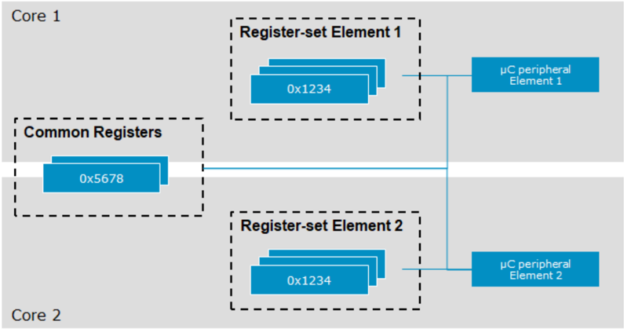

为此，需要应用一种软件设计模式，在最坏的情况下可以是在不同核上访问同一硬件元素的 MCAL 模块之间的自旋锁（信号量）。独占区域的性能影响取决于它要应用的硬件元素以及自旋锁的实现。例如，只在控制器启动或关机期间偶尔写入的硬件元素，与被频繁访问的「业务」寄存器相比，影响要小得多。

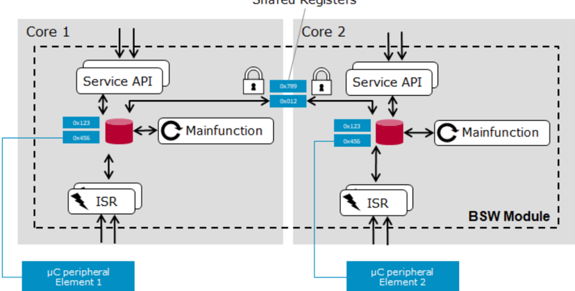

保护共享寄存器的另一种解决方案是，通过最终把可映射元素的作用域改变到下一个更高的、允许排他映射到一个核的硬件元素，来把访问限制到一个核。参见图 2.13。为此，对硬件元素的所有访问由一个核协调，而所有核使用消息系统（如同 IOC，但针对 MCAL 的需要做了优化）传输它们的请求。这种用例要求为处理此类硬件元素的 MCAL 模块实现的所有服务 API 都表现为异步行为，使得任何核都不会被另一个核阻塞。如上文针对自旋锁策略所述，如果实现不当，会对性能产生很大影响。

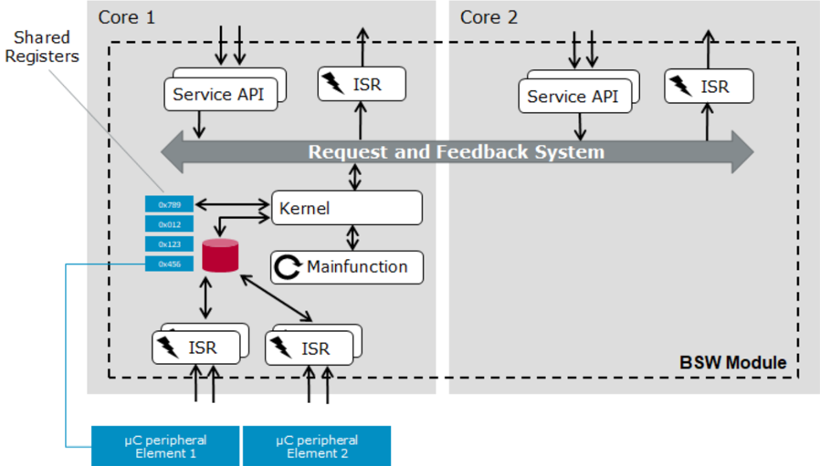

#### 2.5.11 元素的映射

##### 2.5.11.1 作为可映射元素的单核模块

按照多核类型 I，可映射元素就是 MCAL 模块本身。具备这种能力时，MCAL 驱动不提供任何多核特定的实现，因此不启用任何新的用例。其原因在于所使用的硬件元素不允许在没有高度复杂的保护策略的情况下进行任何形式的并发访问。

尽管如此，本概念仍影响这个 MCAL 驱动的映射，因为它要求把整个驱动映射到一个核。这是通过把它的周期性 main 函数和/或中断例程（如果存在）映射到恰好一个 OS-Application 来完成的。

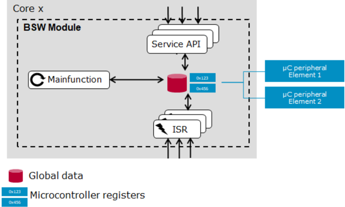

这样，该驱动就排他地在分配了这个 OS-Application 的核上可用。因此 MCAL 驱动的作用域变为本地。任何标准的单核实现都能满足这一能力。

图 2.16 展示了这类 MCAL 模块的简化模型。所有绑定核的元素（服务 API、ISR 和 main 函数）都可以访问相应的数据（具有本地作用域）和微控制器寄存器（可映射到该核）。在以下方面没有分离：

- 数据（RAM、寄存器）；
- 处理（Main 函数）。

所有可映射的 µC 元素（例如定时器通道）都由同一个 main 函数处理；所有服务 API 都可以控制所有 µC 元素。因此，服务 API 只能由一个核调用。

由此得到的映射规则是：该模块应只映射到一个核。因此相关的硬件元素也只映射到同一个核。

##### 2.5.11.2 作为可映射元素的独立硬件元素

可映射元素是一个独立的硬件元素，例如硬件外设（如 CAN 控制器、以太网控制器）、核或存储器，它可以被排他地映射到一个核，进而映射到一个 MCAL 模块实例。需要这种可映射元素来实现所述的多核类型 II 以及多核类型 IV，参见「MCAL 多核模块类型 II」。

作为结论，相关的 ISR 和服务 API 也被映射到同一个核。例如，如果一个外设有两个独立的外设模块（即元素，例如 CAN 网络），一个映射到核 1，另一个映射到核 2。每个核只访问与其外设元素相关的寄存器集。

这同样适用于 MCAL 驱动的数据——它们现在位于相应驱动实例的本地作用域中。因此，如果不能把数据 1:1 地映射到外设元素，则必须按元素（分别为核）分隔数据。

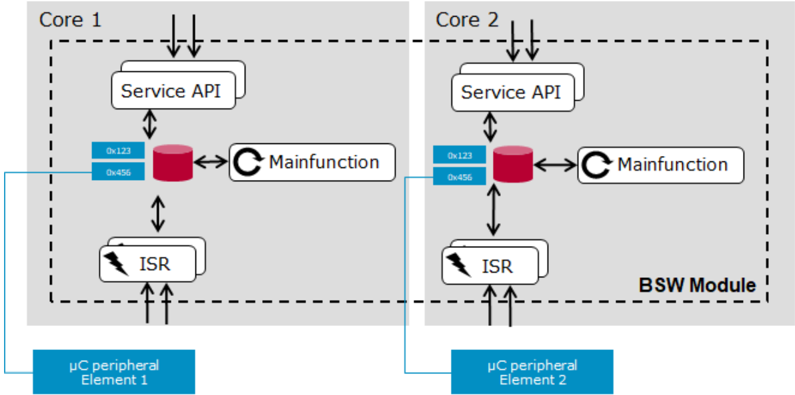

这一原则在存在共享数据和/或寄存器时仍然适用——前提是它们不需要排他访问。例如，全局驱动状态可以被原子地读取。对无副作用即可读取的状态寄存器也是如此。

从行为的角度看，实现这一原则的 MCAL 模块看起来像是被多次实例化，每个实例包含可映射元素的一个子集，但使用一份具有全局作用域的公共代码。

由此得到的映射规则是：一个独立的硬件元素应只映射到一个核。因此，操作该硬件元素的 MCAL 模块实例被映射到同一个核。

##### 2.5.11.3 作为可映射元素的原子硬件元素

在这种特殊情况下，可映射元素是一个独立的硬件元素，例如一个硬件外设特性，它可以使用硬件总线的原生访问宽度（例如 32 位微控制器的 32 位）被原子地访问。这允许映射到多个核，而无需关心并发访问（例如 DIO）。因此，需要这种可映射元素来实现多核类型 III（见「MCAL 多核模块类型 III」一节）。

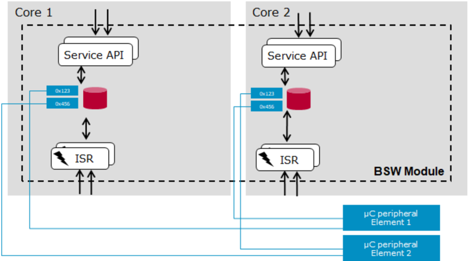

对于这类可映射元素，通常有一个简单的实现可用，不实现 main 函数，因为访问由服务 API 直接完成。如果使用数据，则要求其访问可以像可映射硬件元素一样原子地完成。

由此得到的映射规则是：一个原子硬件元素可以映射到任何核、甚至多个核。因此，MCAL 模块被映射到该硬件元素所映射的核。

##### 2.5.11.4 作为可映射元素的多核模块

在这种情况下，可映射元素又是 MCAL 模块，它可以被映射到至少一个或多个核。MCAL 模块本身按照多核类型 IV 实现，并采用所示软件分离策略之一。但是服务 API 在 MCAL 模块被映射到的所有核上都可用。MCAL 模块的 ISR 理想上映射到用户运行所在的核。典型的 MCAL 模块是实现非原子硬件元素的、任何核都要求的 I/O 驱动，例如 ADC、PWM、ICU、OCU 和 SPI。

由此得到的映射规则是：一个多核 MCAL 模块可以映射到任何核、甚至多个核。因此所有硬件元素都被映射到使用该 MCAL 模块的所有核。

#### 2.5.12 示例

作为结论，MCAL 分布把所需的服务 API 提供给需要它们的核。这根据多核类型和相关的可映射元素完成。下面给出几个例子：

示例 1：DIO 被 2 个 IoHwAb 并发访问

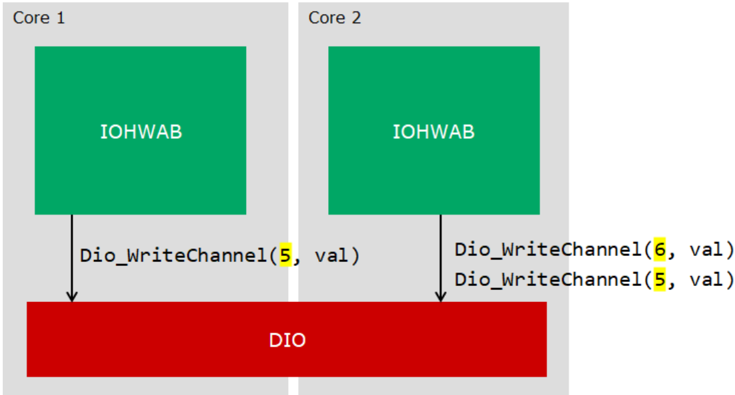

在此例中，DIO 的通道 5 被分配给核 1 和核 2，而通道 6 被分配给核 2。每个核包含一个 IOHWAB 模块。两个模块都允许在其本地核上下文中直接调用 Dio_WriteChannel。限制是它们只能写入分配给同一核的通道。

示例 2：DIO 被 2 个 IoHwAb 访问

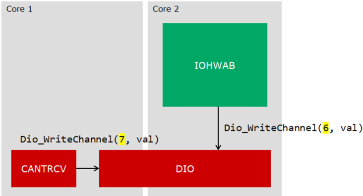

如示例所示，DIO 在核 1 上被 CAN 收发器使用，同时又在核 2 上被 IOHWAB 使用。两个 DIO 用户都可以在其本地核上下文中直接调用 Dio_WriteChannel。

示例 3：DIO 被主/卫星服务访问

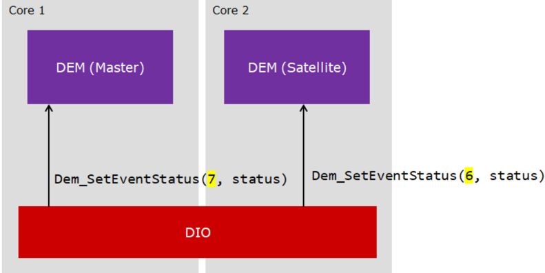

如示例所示，DIO 向 DEM 报告一个诊断错误。对 DEM 的调用在它发生的核上发出。DIO 不负责把调用上下文更改到另一个核。这当然要求 DEM 把其服务 API 提供给相应的核/分区。

### 2.6. 把软件映射到不同的核分区

为了能够把 BSW 模块（或任何其他软件）的符号映射到正确的内存，应应用 AUTOSAR_SWS_MemMap [\[2\]](#ref-2) 的内存映射机制，它通过为软件寻址方法（SwAddrMethod）引入核作用域来提供相应的多核支持。可以应用 GLOBAL（共享）或核 LOCAL 作用域。不加作用域时，该机制假定意图是 GLOBAL 作用域。

下面的小例子只考虑核作用域，不关心额外的安全分区信息。因此，假定所有例子都只考虑 QM 软件。为了符合最新的标准，相应地在 SwAddrMethod 中加入了 'QM'。

#### 2.6.1 全局作用域的分配

对于 GLOBAL（共享）分配，实现者不需要考虑任何特殊的东西，因为它是默认分配，使被分配的符号在所有核内可见。

**例子：**

| 内存分配关键字 | 说明 |
| --- | --- |
| PWM_START_SEC_CODE_QM | 分配全局内存的简单方式 |

根据 BSW 模块的设计，把一定量的代码以不同方式映射可能仍然有意义，例如把一个库例程映射到快速的克隆 RAM 区域。可以用两种不同的方式做到。

选项 1——不同的 SwAddrMethod：

| 内存分配关键字 | 说明 |
| --- | --- |
| PWM_START_SEC_CODE_LIB_QM | 库操作 |
| PWM_START_SEC_CODE_USERIF_QM | 用户接口 |
| PWM_START_SEC_CODE_CTRL_QM | 控制接口，例如 Init、Shutdown |

选项 2——使用实现扩展 'IE' 的不同前缀：

| 内存分配关键字 | 说明 |
| --- | --- |
| PWM_LIB_START_SEC_CODE_QM | 库实现的代码 |
| PWM_USERIF_START_SEC_CODE_QM | 用户接口的代码 |
| PWM_CTRL_START_SEC_CODE_QM | 控制接口的代码 |

尽管两种选项在技术上都可行，但如果所选的 SwAddrMethod 在一个供应商的多个 BSW 模块中以相同的方式复用（表示在供应商特定的 SwAddrMethod 目录中），建议采用选项 1。为相应的 SwAddrMethod 配备标准化或供应商特定的属性，可以方便地在后续应用自动化内存映射。因此，可以应用通用映射。

选项 2 则不是推荐的方式，因为所应用的 SwAddrMethod 是同一个，因此提供了相同的选项，使得内存映射将需要用户交互来根据前缀进行映射。因此，需要特定的映射。不过，可能存在这样的情况：在通用目录中引入非常特殊的（几乎是模块特定的）SwAddrMethod 没有意义。这时可以改用选项 2。

#### 2.6.2 本地作用域的分配

根据分布概念，需要把符号映射到一个特定的核，而这个核在软件开发期是未知的，而是在集成期才知道。这意味着在软件开发期间，作者需要表达本地分配的需要。

**例子：**

| 内存分配关键字 | 说明 |
| --- | --- |
| PWM_FEATURE_A_START_SEC_CODE_QM_LOCAL | 一个要与特性 B 无关地映射到特定核的特殊特性 |
| PWM_FEATURE_B_START_SEC_CODE_QM_LOCAL | 一个要与特性 A 无关地映射到特定核的特殊特性 |

按照全局分配一节给出的描述，建议保留一个供应商通用的 SwAddrMethod 'CODE_QM_LOCAL'，它按前缀映射。也就是说，在内存映射过程中，可以相应地考虑核作用域属性 'coreLocal'。

映射时，集成者需要把 FEATURE_A 和 FEATURE_B 映射到相应的核。

所以归根结底，在内存分配关键字中使用 LOCAL 后缀、以及在 SwAddrMethod 中使用核作用域属性 'coreLocal'，表达了软件开发者的意图：某段特定的代码和/或数据应被映射到核本地内存。通过在内存分配关键字中使用不同的前缀（例如上例中的 FEATURE_A 和 FEATURE_B），软件开发者给予集成者在集成期决定这段代码和/或数据实际映射到哪个核的可能性。

对于生成的配置代码，生成器也可能已经知道符号应映射到的核。因此，下面的例子也是可行的：

**例子：**

| 内存分配关键字 | 说明 |
| --- | --- |
| PWM_CNF_CORE0_START_SEC_CODE_QM_LOCAL | 要映射到核 0 的生成配置代码 |
| PWM_CNF_CORE1_START_SEC_CODE_QM_LOCAL | 要映射到核 0 的生成配置代码 |

#### 2.6.3 使用克隆能力的分配

特殊的硬件架构还提供真正的内存区域克隆的可能性，即它们在每个核上以相同的全局地址提供一个本地内存。因此，可以（例如对于多核类型 II / III 实现）在每个核上使用名称和地址完全相同的符号。但是，之后各个核将作用于各自相应的本地内存。这些符号需要用全局 SwAddrMethod 或特定的前缀分配。

选项 1——不同的 SwAddrMethod：

| 内存分配关键字 | 说明 |
| --- | --- |
| MFL_START_SEC_CODE_CLONE_QM | 需要克隆的内容 |

然而，在为 CLONE 目的使用特殊的 SwAddrMethod 时，需要考虑这个方法是硬件相关的，可能并非在所有平台上都受支持。因此，集成者需要通过把克隆映射到别处来移除克隆能力。特别是对于变量，这不容易做到，因为符号会自动变为 GLOBAL，从而造成相应的资源访问冲突。相反，需要更改代码。

作为结论，应当改用不同的前缀。

选项 2——使用实现扩展 'IE' 的不同前缀：

| 内存分配关键字 | 说明 |
| --- | --- |
| MFL_ADD_START_SEC_CODE_LIB_QM | 加法操作——如果硬件支持，可以克隆以加速性能 |
| MFL_MUL_START_SEC_CODE_LIB_QM | 乘法操作——如果硬件支持，可以克隆以加速性能 |

最后，前缀的使用允许实现这样的通用软件：它可以被克隆或不被克隆，与所使用的 SwAddrMethod 无关。因此，集成者可以最终决定克隆什么、在全局内存中分配什么。但请注意，即使在这种情况下，数据的克隆也需要在实现内部加以考虑，这可能导致代码变体（例如通过条件编译）。因此，克隆最有可能被推荐用于库实现，或高性能关键项，例如 OS 的中断嵌套计数器。

注意：如果为克隆设计的软件被映射到全局内存，链接器会对原本打算克隆的所有变量报错。这是因为该变量将以相同的命名空间被多次实例化。

#### 2.6.4 如何确定核作用域？

以 MCAL 分布概念为基础，展示确定待分配符号核作用域的模式。这一思想同样可以应用于任何其他 BSW 模块。

##### 2.6.4.1 确定 MCAL 符号的核作用域

在使用内存分配机制表达核作用域之前，需要确定模块实现（例如代码、常量、变量）的哪些符号应以什么核作用域可用。这可以通过按照 MCAL 分布概念、把相应的符号关联到相应的 BSW 模块规范中描述的可映射元素来完成。

在下一步中，需要确定可映射元素可以映射到的分区数量。如果映射目标只是单个分区（1:1 映射），那么这些符号应被视为核 LOCAL。如果映射目标是多个分区（1:n），那么作用域应被视为核 GLOBAL。

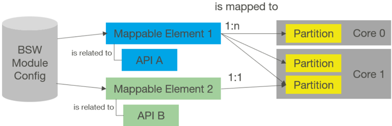

在图 2.22 中可以看到两个可映射元素：元素 1 可以映射到多个分区，元素 2 只能映射到一个分区。元素 1 关联到 API A，元素 2 关联到 API B。因此，这将导致 API A 为 GLOBAL 作用域、API B 为 LOCAL 作用域。

将该规则应用到相应的 MCAL 实现时，需要考虑到无法对每个 MCAL API 给出详细的建议，因为核作用域可能因内核实现而异。所以，归根结底它是实现特定的。

##### 2.6.4.2 将 MemMap 应用到相应的多核类型

下表按照多核类型定义总结了代码、常量和变量通常产生的典型作用域。其他内存类型是设计特定的，或通常使用全局内存作用域，例如标定数据。

| 多核类型 | 特性/类型 | 代码/常量 | 变量 |
| --- | --- | --- | --- |
| Type I（单核/遗留） | Legacy | GLOBAL | GLOBAL |
| Type I（单核/遗留） | Single Core | LOCAL | LOCAL |
| Type II（在核本地数据上运行） | - | GLOBAL | LOCAL |
| Type III（可从任何核使用） | - | GLOBAL | GLOBAL |
| Type IV（核本地内核） | Kernel | LOCAL | GLOBAL |
| Type IV（核本地内核） | User API | GLOBAL | GLOBAL |

注意：已有的较旧 AUTOSAR BSW 实现通常符合多核类型 I 或 III（库）。特别是对类型 I，使用全局内存分配，因为这是以前的技术水平。因此，为了向后兼容，可以使用 GLOBAL SwAddrMethod 分配类型 I 模块，但应当考虑到其他核可能由于其全局作用域而调用这些操作。

##### 2.6.4.3 分配驱动内部符号

MCAL 驱动内部符号的分配取决于设计，以及这些符号被公共或内部接口使用的方式。最终可以定义以下规则：

1. 如果使用该符号的 API 之一具有 GLOBAL 作用域，则被分配符号的核作用域应为 GLOBAL；否则应为 LOCAL。此规则仅适用于 CODE、CONST、VAR_INIT 和 VAR_CLEARED。
2. 分区作用域可以通过附加一个特殊的内存分配关键字或相应的安全完整性等级信息来进一步限制。

##### 2.6.4.4 多核类型 IV 的分配示例

采用本文档前面展示的例子，可以找到一个典型的多核类型 IV 例子，同时具有 LOCAL 与 GLOBAL 作用域（此处不展示分区方式）。

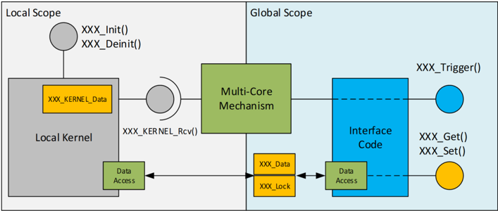

任何核和分区都可使用的 GLOBAL 接口操作相应地具有 GLOBAL 作用域。这些是：

- XXX_Trigger() - XXX_SEC_CODE_...
- XXX_Get() - XXX_SEC_CODE_...
- XXX_Set() - XXX_SEC_CODE_...

这些 GLOBAL 接口使用的数据元素（包括自旋锁）也是全局的，因为它们需要被任何核访问。这些是：

- XXX_Data - XXX_SEC_VAR_INIT_...
- XXX_Lock - XXX_SEC_VAR_INIT_...

而 LOCAL 接口（例如控制接口和内部接口）以及 LOCAL 数据具有核作用域 LOCAL。因此，这些符号只能由它们被映射到的核使用。

- XXX_Init() - XXX_CONTROL_SEC_CODE_..._LOCAL_...
- XXX_DeInit() - XXX_CONTROL_SEC_CODE_..._LOCAL_...
- XXX_KERNEL_Data - XXX_KERNEL_SEC_VAR_INIT_..._LOCAL_...
- XXX_KERNEL_Rcv() - XXX_CONTROL_SEC_CODE_..._LOCAL_...

请注意，所示示例是设计特定的，可能以不同的方式实现。

##### 2.6.4.5 多核类型 II 的分配示例

另一个有趣的用例是处理核本地数据的多核类型 II 驱动。这些数据（以及类似的硬件外设）需要在相应的核上运行时由 GLOBAL 代码访问。为此，在初始化驱动时需要传入一个指向核特定数据或配置结构的指针。此配置随后可以存储到一个克隆指针中，该指针存在于每核内存中但具有全局地址，使得驱动代码看起来在访问一个全局实例。

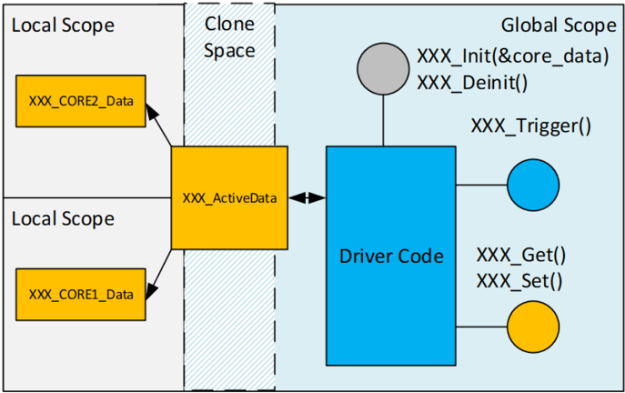

驱动的所有代码通常都以 GLOBAL 作用域分配：

- XXX_Init() - XXX_SEC_CODE_...
- XXX_DeInit() - XXX_SEC_CODE_...
- XXX_Trigger() - XXX_SEC_CODE_...
- XXX_Get() - XXX_SEC_CODE_...
- XXX_Set() - XXX_SEC_CODE_...

指向活动数据实例的指针也以 GLOBAL 作用域分配：

- XXX_ActiveData - XXX_SEC_VAR_INIT_CLONE_...

而核本地数据（也可以是常量）以 LOCAL 作用域分配，并且应只在它们被分配的核上访问。

- XXX_CORE1_Data - XXX_CORE1_SEC_VAR_INIT_..._LOCAL_...
- XXX_CORE2_Data - XXX_CORE2_SEC_VAR_INIT_..._LOCAL_...

请注意，所示示例是设计和硬件特定的，并需要克隆能力的支持。

### 2.7. 通信栈（Com-Stack）分布

所提方案将提供具体的手段来改善 AUTOSAR BSW 在多核微控制器上的使用。

对向后兼容性的影响很小，因为本概念主要引入新的可选功能。

#### 2.7.1 引言

多核处理器的日益增长的使用，使得高效使用控制器提供的核变得越来越重要。把像通信栈这样庞大的基础软件包的部署限制到一个单核，严重限制了微控制器资源的有效使用。因此，通信栈的分布是进一步基础软件分布的关键。

通信栈分布要求在若干个 BSW 模块中进行规范变更，但不得破坏模块之间现有的契约。保留现有功能是本概念的目标之一。本概念只应通过额外的映射场景来扩展现有功能。

不适应或很难适应新映射场景的功能（序列）将保持原样。为了避免意外行为，将创建一些限制，把映射限定到 AUTOSAR 方案。

对接口层的主要影响是把一些 API 从同步改为异步。例如，当一个在一个核上触发的作业需要在另一个核上执行、且发起核不应被强制等待（即在自旋锁中）直到作业完成时。

本概念的主要好处是，通过支持额外的分布技术，增强了对 AUTOSAR 栈负载分布的支持。

#### 2.7.2 使用假定

为了应用通信栈分布，应给出若干使用假定，以定义 BSW 环境的边界条件：

1. 硬件实现应允许把外设单独映射到分区或至少一个专用核；
2. 应可以把硬件和软件中断路由到一个分区或至少一个专用核（提示：中断的路由意味着实现某种消息传递，例如如果中断发生在核 1，但需要在核 2 上执行 ISR 代码，则需要在 ISR 执行之前把上下文从核 1 路由到核 2）；
3. 单实例加密栈位于一个 AUTOSAR 分区中，全部加密处理都在那里进行；
4. PDU 到 Com 实例的标准分配不考虑 ASW 部署，而是遵循按照所链接的网络类型对 PDU 的分配；
5. 与 EcuM 的任何交互都需要与核本地的 EcuM 实例完成。

#### 2.7.3 约束

为了把通信栈分布的复杂度保持在可管理的范围内，需要考虑若干约束。

约束：

1. 通信栈分布限于每个网络特定栈可以分配到一个核的设置：
   - (a) 更细粒度的通道级分布 AUTOSAR 尚不支持；
   - (b) CAN XL 是此规则的例外。这里应支持一个设置：单个 CAN XL 驱动同时服务于 CAN 栈和 Ethernet 栈，二者可以分配到不同的核。
2. 需要一个多分区（多应用）AUTOSAR 操作系统来支持 BSW 分布用例；
3. 应有一个分区，把与通信相关的状态、模式和网络管理的中央模块分配到其中（此分区中也应有一个 EcuM 实例）；
4. 应有一个单一的 SecOC 实例，它可以分配到一个核；
5. TriggerTransmit（例如 LIN、FlexRay）应只在「核本地」使用：
   - (a) 即每个 TriggerTransmit PDU 都必须被分配到相应网络类型所在的同一分区（Com 与 &lt;Net&gt;If 之间没有上下文切换）；
   - (b) 网关用例不受此约束（支持跨核路由，因为 PDU 缓冲区由 PduR 管理）；
6. Com 假定与信号相关的 API 调用始终发生在受影响信号（PDU）所在的分区中：
   - (a) 理由：一个软件组件可能经由一个 PDU 向另一个 ECU 发送数据，而该 PDU 可能位于与发送软件组件不同的分区中。在这种情况下，Rte 应负责在调用 Com API 之前把上下文切换到目标分区；
7. V2X 栈必须映射到与其他 Ethernet 相关模块相同的分区；
8. 整个 J1939 栈（所有 J1939 模块）应被分配到与 DEM 相同的分区（由于 J1939DCM 与 DEM 之间广泛的 API）；
9. 在分布式通信栈的设置中，不支持构建后配置特性；
10. BusMirroring 模块的 API 应只在 BusMirroring 模块被映射到的分区中调用（经由 MirrorEcucPartitionRef）。

#### 2.7.4 功能元素

##### 2.7.4.1 分布式环境中的 I-PDU 配置

在分布式通信栈的环境中，依赖网络的模块集群被映射到不同的核（例如 Can 映射到核 0，FlexRay 到核 1，Ethernet 到核 2）。

为了以高效的方式在 Com 和 IpduM 模块中管理这种设置，可以为每个网络类型定义单独的 main 函数，即 Com_MainFunctionTx_Can/Fr/Eth、Com_MainFunctionRx_Can/Fr/Eth、IpduM_MainFunctionTx_Can/Fr/Eth、IpduM_MainFunctionRx_Can/Fr/Eth。

所有 PDU 按照网络类型被分配到可用的 main 函数实例。

在这种设置中，作为路由 PDU 的中央实例的 PduR 可以直接调用每条路由路径的目标，也就是说 RxIndication 和 TxConfirmation 可以在本地实例上处理，因为源和目标始终位于同一分区。

对于直接传输的 PDU，建议把它们分配到与相应网络位于同一分区中的 Com/IpduM 实例。但这不是限制，因为在上层与下层连接未分配到同一分区的情况下，PduR 会负责把相应的 I-PDU 传输到正确的目标分区。当然，这样做有缺点，主要影响系统性能和资源消耗，但原则上不受该方法限制。

如果使用 TriggerTransmit 处理，相应的 PDU 必须被分配到与相应网络位于同一分区中的 Com/IpduM 实例（即不支持把 TriggerTransmit PDU 分配到与相应网络位于另一个分区的 Com/IpduM 实例）。

一个特殊情况是 LdCom 模块，因为它只是一个纯转发组件，既没有缓冲区也没有任务，因此没有自己的执行上下文。

因此，像 Com 那样把 PDU 分配到分区（经由 MainFunctions）对 LdCom 不起作用，因此需要更单独地处理。

一种方法是仅在底层网络类型被分配到的分区中处理 UL（最可能是 Rte）中的 LdCom 数据。在这种设置中，PduR 将转发 I-PDU 而不分派。

另一种方法是告知 PduR LdCom 的 I-PDU 将在哪个 UL 上下文中处理（例如，Rte_LdComCbkRxIndication_&lt;sn&gt; API 应在哪里被调用；LdCom_Transmit 从 UL（最可能是 Rte）的哪里被调用）。该信息可以经由 EcuC Pdu 上的 PDU 到分区分配（LdCom 模块的 EcucPduDefaultPartitionRef 或 EcucPduDedicatedPartition）提供给 PduR。

在这种情况下，如果上层与下层连接被分配到不同的分区，PduR 将进行分派。

##### 2.7.4.2 PDU 网关

一般而言，PduR 的一个主要工作是处理不同网络之间的 PDU 路由。在多核环境中如何掌握这一点，将在下一节描述。

如果依赖网络的模块集群被分配到不同的核，PduR 需要负责把上下文从源（RxIndication）分区（核）带到目标分区（核），并且只在目标分区调用面向下层的传输 API。

如果使用直接传输通信模式，PduR 需要覆盖以下场景。

仅在同一网络类型内的路由不需要任何特殊处理，即 PduR 可以在 RxIndication 的上下文中直接调用传输 API（PduR 内不需要 PDU 缓冲）。

同样的处理可以应用于分配到同一 EcuC 分区的不同网络类型之间的路由。

分配到不同 EcuC 分区（核）的不同网络类型之间的路由需要特殊处理。具体而言，这意味着 PduR 必须缓冲收到的 PDU（在共享内存区域中），并在目标核上提供一个执行上下文，PduR 必须在那里为缓冲的 PDU 调用传输 API。

带 TriggerTransmit 处理的 PDU 网关路由需要以稍有不同方式管理，因为 PDU 是在 PduR TriggerTransmit 回调的上下文中提供给下层接口模块的。

由于这种模式，PduR 在任何情况下都需要缓冲收到的 PDU，即使路由发生在同一网络类型内。

因此，所需的扩展仅限于分配到不同 EcuC 分区的不同网络类型之间的路由。在这种情况下，除了正常的路由机制之外，PduR 需要在调用传输 API 之前把上下文从源切换到目标，并注意把缓冲区存储在一个可以从两个上下文访问的共享内存区域中。PduR 需要应用适当的数据保护机制，以在多核设置中也保证数据一致性。

##### 2.7.4.3 经由 SecOC 连接到安全栈

为了高效地处理安全相关的 PDU，用于带拆分 MainFunctions 的 Com/IpduM 的相同原则也可以应用于 SecOC 和加密栈。

##### 2.7.4.4 &lt;Net&gt;Tp 路由

在传输协议模块的网关用例中，PduR_TpStartOfReception 由 PduR 本地管理，即不触发分区间活动。

PduR_TpCopyRxData 和 PduR_TpRxIndication 的行为应取决于路由变体。

在直接网关路由用例中，对于传输协议模块，PduR_TpCopyRxData 应只把数据复制到 Tp 缓冲区（不得进行跨核调用）。

PduR 应只在 PduR_TpRxIndication 调用内把上下文传输到目标分区。

在即时路由（routing-on-the-fly）网关用例中，PduR 应在以下情况把上下文传输到目标分区：

- 如果在 PduR_TpCopyRxData 调用内达到 PduRTpThreshold；
- 如果在达到阈值之前调用了 PduR_TpRxIndication。

在这两种形式中，TpTransmit API 都在目标分区的上下文中调用。

如果源和目标在同一分区，TpTransmit 可以直接在源分区内部调用。

##### 2.7.4.5 模式、状态和网络管理

即使网络类型被分配到另一个分区，ComM 和 Nm 也应负责与 &lt;Net&gt;Nm 和 &lt;Net&gt;SM 模块的所有交互。这样可以达到集中化的方式，并把多核影响限制到极少数专用模块。

ComM 和 Nm 模块的内核应被分配到同一分区，以保持这两个中央模块之间的交互简单。

此外，Dcm 应被分配到与 ComM 相同的核，使得 Dcm 与 ComM 之间的模式 API 可以保持为分区内通信。

为了实现网络管理的高效实现，「NM 接口提供的额外服务」的用户应当只在底层 &lt;Bus&gt;Nm 被分配到的分区中调用相应的 API（例如 Nm_GetUserData）。在这种设置中，可以避免同步的跨核调用。

##### 2.7.4.6 启动/关机

只有在预 OS 阶段使用其他 BSW 模块时，EcuM 才调用它们。否则，它们应经由 BswM 调用，即由分区本地的 BswM 实例调用。

#### 2.7.5 架构组件

##### 2.7.5.1 PduR 作为中央跨核分派器

在使用 &lt;Net&gt;If 接口的情况下，PduR 应覆盖由分布式依赖网络的模块集群设置引起的所有与 I-PDU 相关的多核特性。

为了确保高效率和性能，以下类型的 PduR 路由路径被排除在「PduR 为其负责可能需要的核/分区切换」的路由路径集合之外。因此，对于那些被排除的路由路径，PduR 不需要检查路由路径的源和目标是否被分配到不同的核/分区，而可以像在单分区设置中那样行动。

- 传输协议接口：
  - 传输协议的接收/发送需要特殊的手段；
  - Tp 路由用例由 PDU 网关覆盖。
- 全局时间同步报文的接收/发送：
  - 时间同步报文不得被延迟，因此带异步处理的标准 PduR 机制不够；
  - 时间同步的特殊手段需要由 StbM 覆盖。

由于 PduR 应能够分派分区间通信，它需要知道每个通信伙伴被分配到哪个分区。为了提供这一信息，EcuC 模块中的 Pdu 配置元素增加了以下配置元素：

- EcucPduDefaultPartitionRef，提供指向一个 EcucPartition 的默认引用；
- 一个 EcucPduDedicatedPartition 容器列表，在每个 BSW 模块实例的基础上提供指向一个 EcucPartition 的单独引用，它们覆盖 EcucPduDefaultPartitionRef 的默认引用。EcucPduDedicatedPartition 又由两个元素组成：引用一个 EcucPartition 的 EcucPduDedicatedPartitionRef，以及一个指向名为 EcucPduDedicatedPartitionBswModuleRef 的 BSW 模块的 EcucModuleConfigurationValues 的外部引用。

基于上述分区分配，PDURouter 将假定分区内或分区间的路由。

##### 2.7.5.2 I-PDU 分区分配的提示

如果启用了 PDURouter 的多核支持，每个模块都需要负责为其引用的所有 PDU 提供其分区分配信息。PDURouter 将检查 EcuC PDU 配置，为每条路由路径的源/目标查找分区分配。

关于如何定义默认分区分配的一些提示：

- PDU 的默认分区基于其 &lt;Net&gt; 连接（&lt;Net&gt;If 或 &lt;Net&gt;Tp 或 &lt;Net&gt;Nm ……）分配，因为所有依赖网络的模块都被分配到一个专用分区；
- 如果 PDU 的默认分区仍未定义，按照 Main Function 引用进行分配；
- 如果 PDU 的默认分区仍然为空，则默认分区需要在集成期间单独处理（非强制）。

专用分区分配的规则：

- 基于模块特性，应把专用分区逐个添加到 EcuC 配置模块；
- 如果模块连接位于与默认分区分配不同的分区上，则需要在 EcuC Pdu 配置中引入一个专用分区容器。

对每条路由路径，PDURouter 应检查：

- 在相应的 PDU 配置中是否找到所连接模块的专用分区分配；
- 是否找到默认分区分配。

如果一个 I-PDU 的分区分配信息缺失，PDURouter 无法正确判断应实现哪种路由路径。

对于此类情况，PDURouter 的行为应保持为实现特定的，但至少应引发一个警告。

建议引发一个错误并告知用户缺失的信息。

PDU 分区分配的示例：

- 如果路由路径的源模块或目标模块是 LdCom，分区分配取决于 SWC 部署，因为 LdCom 没有自己的上下文，只是把调用转发给/来自 PDURouter；
- 对于 Com 模块，把分区分配从 Com 内部的 MainFunction 分配接管到 EcuC PDU 配置；
- 对于 IpduM，把分区分配从 Com 内部的 MainFunction 分配接管到 EcuC PDU 配置。

示例：COM 模块经由 CanIf 传输一个 I-PDU。CanIf 被分配到分区 1，意味着所有 CanIf_Transmit 调用都需要在该分区中执行。在 COM 模块层面，该 I-PDU 被分配给运行在分区 2 中的一个 Com_MainFunction 实例。在这种情况下，PDURouter 必须进行分派，因为跨越了分区边界（分区间通信）。

### 2.8. 加密栈（Crypto-Stack）分布

为了在不同分区之间实现负载分配，加密栈的不同部分应被分配到不同的分区。据此，应支持这种分区化以加密实例为基础进行，即加密驱动实例应可定位到不同的分区。

为了支持这种灵活的分配，SecOC 模块中的主执行线程（即相应的 MainFunctions）可以拆分为不同的 Main Function（每个分区至少一个）。

此外，Csm 模块也可以拆分为不同的 MainFunctions（每个分区至少一个）。

在这样的设置中，必须把所有 Csm 队列分配给一个专用的 Main Function，以定义相应作业必须被处理的分区。

这样，流经加密栈的流程保持在单个分区的范围内，因此不需要特殊的多分区手段。

SecOC 与 PduR 之间的分区间通信由 PduR 管理。

为了管理不同的时序要求，每个 MainFunction 实例单独定义其时基。

这种设置为配置带来了一些约束，以便以高效的方式运行加密栈。

SecOC_MainFunction 指向的所有 CsmJob 都应被分配给与相应 SecOC_MainFunction 位于同一分区的 Csm_MainFunction。即作业的 Csm 处理需要在与 SecOC 处理相同的分区中处理。

在这样的设置中，Csm 模块可以假定所有 Csm_&lt;Service&gt; API 调用始终发生在相应 CsmJob 所在的分区中（因此不需要为 Csm 的服务 API 提供多核扩展）。

#### 2.8.1 新鲜度值的处理

如果加密栈分布在多个分区上，对新鲜度管理器 SWC 的访问也受到影响，因为多个分区需要访问这个（这些）SWC。

这对性能（执行时间）不利，因为涉及分区跨越。

在分布式环境中有三种处理新鲜度值的方式，它们可以并行使用：

- 保持原样，由 RTE 处理分区跨越。

  注意：对执行时间的影响相当大。

- 提供多个新鲜度 SWC（每个分区一个）。

  注意：为了实现高效的设置，整个处理链（ComIpdu、SecOC PduProcessing、CsmJob 等）应被分配到同一分区。

- 在 SecOC 中使用可配置的 C-API（配置参数：SecOCQueryFreshnessValue），改用支持多核的「库」。

## 3. 安全系统中的 BSW 分布

### 3.1. 安全概览

在今天的汽车中，若干个 ECU 可能根据车辆的功能控制安全相关的执行器。例子有电子转向锁系统、自适应巡航控制系统或制动系统。如果这样的系统出现错误行为，可能发生驾驶员无法再以安全的方式驾驶汽车的危险情况。为了避免这类失效，必须以这样的方式开发特定的 ECU：系统能够检测并以受控的方式对这些故障作出反应。ISO 26262 [\[3\]](#ref-3) 是描述应如何开发这类 ECU 以实现安全系统的规范。该规范定义了四个「汽车安全完整性等级」（ASIL），对系统的风险进行分类。基于风险，导出系统的特定（安全）要求。这些要求可能与硬件相关（例如支持多个通道以检测硬件问题）或与软件相关（例如控制流检查），或两者兼有。在 AUTOSAR 中我们聚焦于软件，因此硬件部分在此不再考虑。请注意，ASIL 始终是为一个系统定义的，即硬件和软件，而就软件而言是应用软件和基础软件。

### 3.2. AUTOSAR 中的安全解决方案

直到 R4.1，AUTOSAR 通过提供此类 ECU 中通常需要的不同基础机制来支持安全系统。以下列表包含主要的安全机制：

- SWC 的分区化以支持空间隔离。这意味着可以把不同 ASIL 的 SWC 彼此分离，并确保 SWC 不能写入其他 SWC 的数据。其实现需要硬件支持（内存保护或内存管理单元），在 Os 模块中实现并由 Rte 使用。
- 时序与控制流监督，用于监控执行的实体并检测由阻塞或错误执行引起的故障。在 AUTOSAR 中，Os 和 WdgM 负责这一问题。
- 经由端到端保护的安全通信可以在 ECU 之间（甚至 ECU 内部）进行。这例如保证发送的数据在发送者与接收者之间不被修改。负责的模块是 E2E 库。

一些其他模块支持在安全系统中同样有用的额外机制（例如 CoreTest 或 RamTest）。

下图展示了如何使用 AUTOSAR R4.1 来支持一个 ASIL ECU。

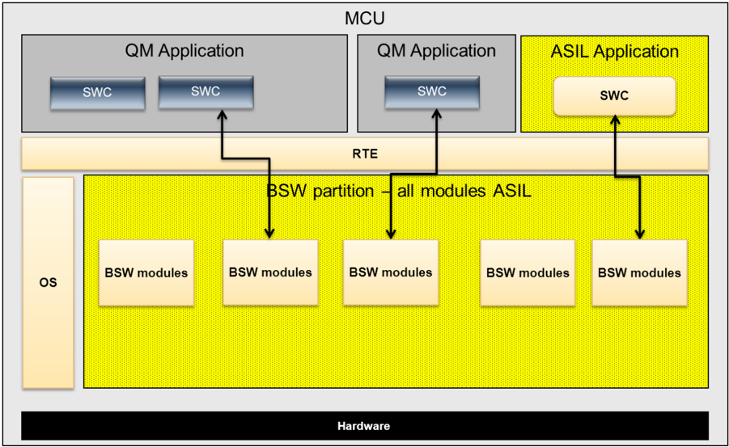

该方法可行但有一个大缺点：所有 BSW 模块都必须按照系统的最高 ASIL 开发。即使只有部分 BSW 模块真正为某个特定的安全要求所需要，这也会带来大量额外的工作。

从 R4.2 开始，AUTOSAR 提供了一种额外的方式，可以在不要求以相应 ASIL 实现整个 BSW 的情况下开发安全的系统。新方法的关键方面是：

- BSW 模块并非全部映射到一个分区，而是可以根据 ASIL 需要放置到单独的分区中。这意味着一个系统可以拥有若干个 QM 和 ASIL 分区。

  注意：尽管每个核可以有多于一个 QM BSW 分区，但这应当避免，以便能够不加修改地复用现有的 QM BSW 模块。原因是它们将需要用于跨分区通信的 CallTrustedFunction 包装器。

- 该方法对单个 BSW 模块的影响最小。这意味着模块的作用域在 ASIL 和 QM 上是相同的。模块之间的接口没有变化。
- 只有提供安全相关特性的模块（例如 Os 提供的内存保护）需要按照系统的 ASIL 开发。有时甚至可以把所需的 ASIL 功能限制到一个 BSW 模块的子集。

ASIL 分区内的 ASIL 模块需要专门开发。它们不仅需要满足 ASIL 等级的要求，还需要检测自己是被从分区内还是分区外调用。

通过这种方法可以：

- 复用以 QM 等级（无 ASIL）开发的现有 BSW 模块，而无需修改模块。

所提方法必须逐案评估，以估计其对特定安全案例的适用性，以及与纯 ASIL 方法相比组合 QM/ASIL 模块的收益。

BSW 模块可以放置到不同的分区。AUTOSAR 支持若干个 QM 和 ASIL 分区。下图展示了一个示例映射。这里 ASIL SWC 通过 BSW 中一个包含 IoHwAb 及其下方所需驱动的自有分区，对一些硬件拥有安全访问。

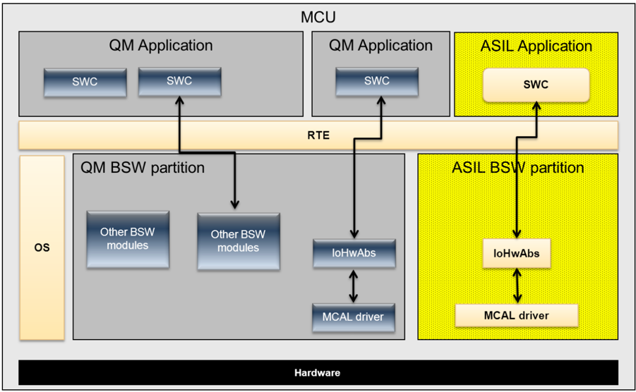

强烈建议：如果系统中有 BSW ASIL 分区，QM BSW 分区应尽可能运行在用户模式，以避免对硬件寄存器（例如 MPU 设置）的更改。如果这不可能（例如硬件只支持管理模式），则需要额外的手段来保证免干扰性。

#### 3.2.1 一些模块始终是 ASIL

由于保护机制由一些特定的 BSW 模块提供（例如操作系统），这些模块必须按照系统中最高的 ASIL 开发。如果它们没有在这个等级上开发，就无法保证它们能够完成其监督任务。哪些模块必须按 ASIL 开发的决定始终是项目特定的，并由系统的安全要求确定。

#### 3.2.2 总体配置

出于安全目的把 BSW 模块分离到不同的 BSW 分区，需要在 ECU 配置中配置。映射在 EcuC 和 Os 配置中完成。

对于每个这样的 BSW 分区，都需要一个 OsApplication。以下设置适用于每个 BSW OsApplication 的 Os 配置：

| 名称 | BSW 分区的取值 |
| --- | --- |
| OsTrusted | TRUE |
| OsTrustedApplicationWithProtection | TRUE 或 FALSE |
| OsTrustedApplicationDelayTimingViolationCall | TRUE |

OsApplication 的其他属性可以按需填写。注意，BSW 分区的钩子函数在 AUTOSAR 中没有意义，应当避免。

另外请注意，OSApplication 的 TRUSTED 属性（OsTrusted）与 ASIL/非 ASIL 无关。

之后，所使用的 BSW 模块必须被配置并映射到不同的分区。映射在 EcuC 中完成：

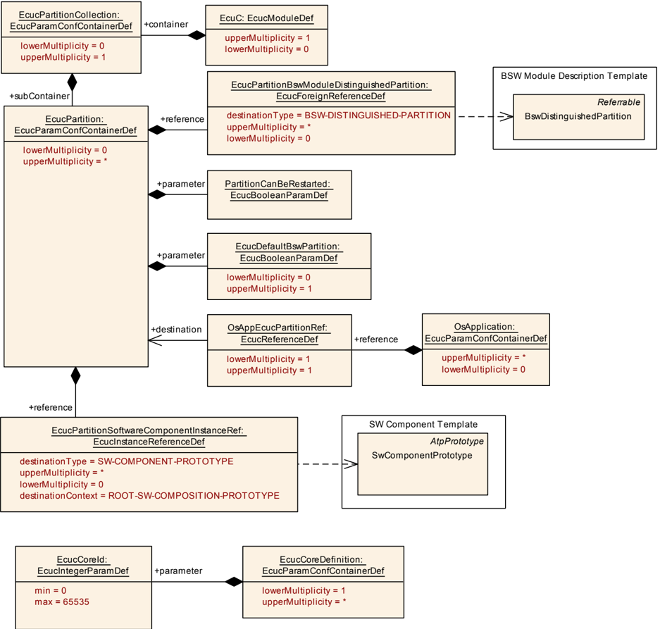

EcucPartitionCollection（多重性 0..1）包含系统的所有分区。对其中每一个，存在一个子容器 EcucPartition（0..*），它包含指向被放置到该分区中的 BSW 模块（经由 BSWDT）的引用（EcucPartitionBswModuleDistinguishedPartition（0..*））。

以下设置适用于每个 BSW 分区的 EcucPartition 配置：

| 名称 | BSW 分区的取值 |
| --- | --- |
| PartitionCanBeRestarted | FALSE |
| OsAppEcucPartitionRef | 指向该分区的 OsApplication 的链接 |

#### 3.2.3 跨越分区边界

当 BSW 模块被放置到不同的分区时，跨越边界是需要解决的最大问题。下图以相当一般的视角展示了该场景：

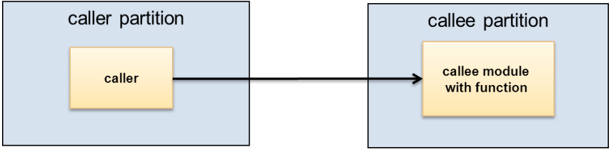

这是因为被调用的服务假定它对模块本地数据拥有完全的访问权——如果调用是从另一个分区执行的，这就不成立，因为内存保护设置仍是调用者的设置。一般而言，有 3 种解决该问题的可能：

1. 调用者可以不直接调用，而是对一个来自被调用者分区的任务执行 ActivateTask。在这种情况下，被激活的任务将执行对函数的真实调用。可以用 SetEvent 作为 ActivateTask 的替代。注意这两种机制都以异步方式工作，这意味着原始调用者可能需要等待或轮询结果。
2. 调用者可以使用 CallTrustedFunction 进入被调用者的分区，或者被调用者在被调用后使用 CallTrustedFunction 交回其分区。进入之后可以直接调用该函数。CallTrustedFunction 确保调用者获得进行调用的适当权限，例如把内存保护更改到被调用函数的设置。
3. 如果被调用的函数不写自己的数据、也不调用其他会写这类数据的函数，则可以直接调用该函数。例如，如果该函数只是读取一个值并返回它。基本上，这样的函数表现得像一个库。

取决于 BSW 模块到不同分区的映射，必须选择正确的选项。对于位于不同分区中的 BSW 模块之间的所有同步函数调用，我们将聚焦于调用可能性 (2) 和 (3)。因为如前所述 QM 模块不变，我们必须封装从 QM 分区到 ASIL（及反向）的调用。ASIL 模块始终负责处理边界跨越，因为 QM 模块未被改动、也不知道这个边界。这意味着如果 ASIL 模块是调用者，边界处理需要在调用者侧进行；如果 ASIL 模块是被调用者，边界处理需要在被调用者侧进行。

下面的描述聚焦于 ASIL 与 QM BSW 模块。除 BSW 模块之外，系统中也可能包含 CDD。对 CDD 适用相同的规则和限制（除非另有明确说明）。

##### 3.2.3.1 QM 模块调用 ASIL

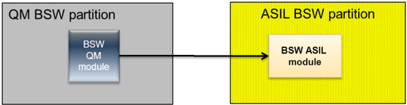

如前所述，执行调用的 QM 模块保持不变。甚至：QM 甚至不知道被调用的函数（模块）属于不同的分区。这意味着我们必须把被调用的函数封装进一个执行边界跨越的桩（stub）。

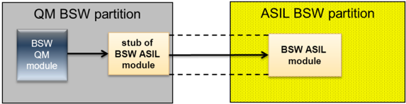

这个桩函数可以是静态的或生成的，它属于被调用的模块。它可以被视为 ASIL 模块被调用函数的一个新的函数入口。下面的消息序列图展示调用序列。可以看到，桩本身也有两个部分：一个在调用者侧，一个在被调用者分区。

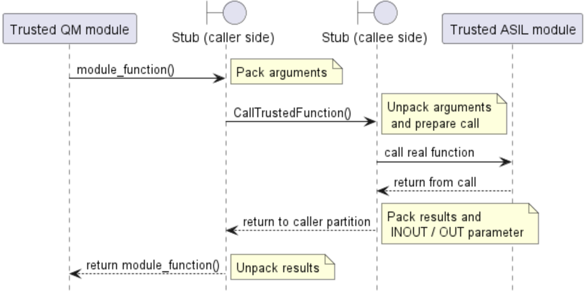

桩本身可以是静态的（手写的），也可以基于可用的配置信息生成。接下来两个小节详细描述不同的方法。

###### 3.2.3.1.1 静态桩

静态桩必须覆盖所有情况。在我们的案例中，重要的问题是找到调用者分区以便确定调用的类型。下一个代码片段展示了一个静态桩的例子：

```C
1 StdReturnType module_function()
2 {
3   runId = GetCurrentApplicationId();
4   if (runId == module_applicationId)
5   { /* direct call possible */
6     return Modulemodule_function_real()
7   } else {
8     CallTrustedFunction(MODULE_REALFUNCTION_ID,NULL)
9     ...
10   }
11 }
```

注意，你必须初始化自己的模块应用 ID（或直接使用生成的应用名称）。

###### 3.2.3.1.2 生成的桩

如果要生成桩的优化版本，生成器需要所有信息（例如谁调用该函数）以创建最佳代码。如果信息缺失或不完整，生成的代码可能根本无法生成，或者在运行时失败。

AUTOSAR 对不同分区之间的调用有一个抽象。这个方法在多核系统中使用，允许模块在不同核上的不同分区之间通信。

生成的代码使用的机制由 SchM 提供：SchM_Call。SchM_Call 随后在 SchM 内被映射到 [3.2.2](#322-总体配置) 小节列出的方法之一。

为了找到跨越边界的最佳方法，核心问题是：

**谁将调用该函数（并使用该桩）？**

该信息必须由用户经由 SchM 配置提供。配置由调用者、被调用者及其模块的引用（并隐式包含对分区的引用）组成。来自 RTE 的下图展示了 SchM_Call 的配置：

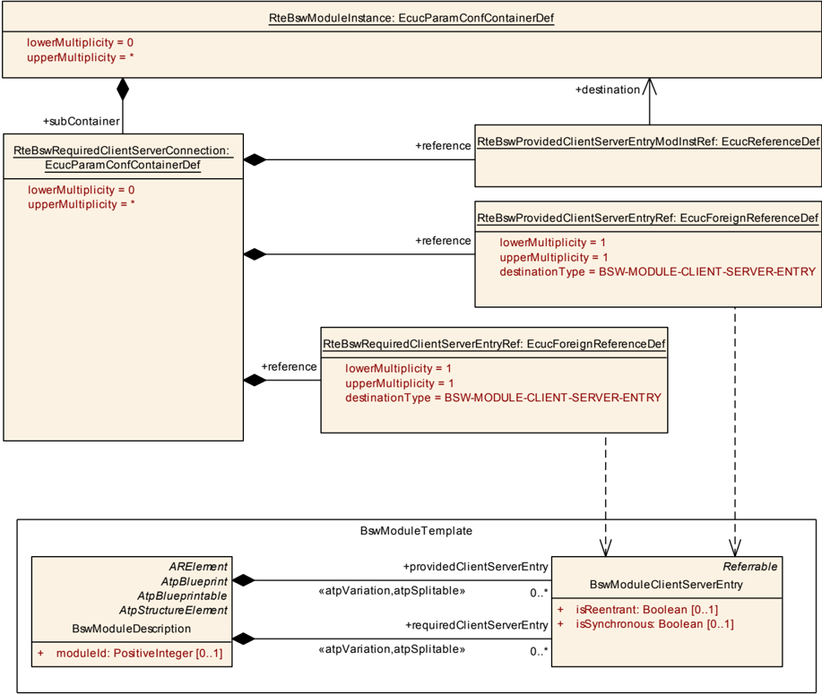

基于这些信息以及 BSW 模块放置位置的信息，SchM 可以生成优化版本的 SchM_Call。

例如，如果只有一个桩用户、且该用户与被调用的 BSW 模块位于同一分区，则可以直接调用。使用 SchM_Call 的桩示例：

```C
1 Std_ReturnType module_function()
2 {
3   Std_ReturnType r;
4   (void) SchM_Call_target_module_function(&r);
5   Return r;
6 }
```

生成桩的方法有一些限制，在系统开发期间需要加以考虑：

- 来自集成者代码的调用：对集成者代码无法通过 SchM_Call 进行配置，因为这段代码不属于任何 BSW 模块，没有可用的配置（EcuConfiguration）和模块（BSWDT）信息。在这种情况下，必须使用手写的静态桩。
- 一个 SchM_Call 恰好配置一个调用者-被调用者关系。如果一个函数被不同的调用者调用，桩的生成部分无法区分哪个调用者需要哪个 SchM_Call。在这种情况下，需要一个静态桩。

注意：如果 QM 调用者也使用 SchM_Call 而不是真实的函数名，则可以完全避免桩。但这与不加修改地复用现有 QM 代码的目标相矛盾。

参数处理见 [3.2.3.5](#3235-参数传递) 小节。

##### 3.2.3.2 ASIL 调用 QM 分区

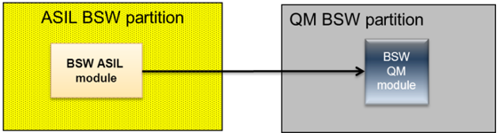

本节现在覆盖 ASIL 调用者与 QM 被调用者的方向。这里 ASIL 模块已经知道需要边界跨越。（否则被调用的 QM 函数就会是一个 ASIL 函数）。由于 QM 函数在被 ASIL 函数或同一分区中的 QM 函数调用时不应检测到任何差异，必须像本地执行调用那样调用它。

因此，我们再次需要一个执行真实调用的代码片段。这个代码片段在这种情况下称为包装器（wrapper）。

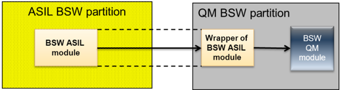

这个包装器函数可以静态或动态生成，它属于调用者模块，但部分在被调用者的分区中执行。下面的消息序列图展示了使用 CallTrustedFunction 时的调用序列：

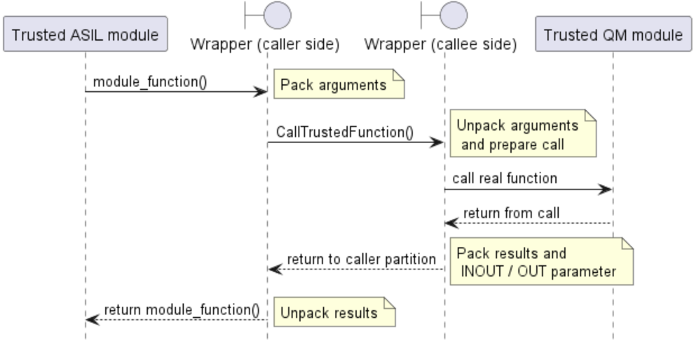

我们可以再次区分静态包装器和从配置生成的包装器。

注意，无论技术解决方案如何，都需要检查此类调用是否在项目特定的安全目标范围内被允许。

###### 3.2.3.2.1 静态包装器

下面的代码片段展示了一个可能的包装器（在只有一个「用户」调用该函数的情况下；其他情况下缓冲区处理需要扩展）。

在该例中使用了 CallTrustedFunction 机制：

```C
1 /* definition of parameter structure for CallTrustedFunction */
2 struct parameter_struct {uint8 return_value};
3 uint8 wrapper_function(void)
4 {
5   struct parameter_struct local_struct;
6   CallTrustedFunction(MODULE_REALFUNCTION_ID, &local_struct);
7   return local_struct.return_value;
8 }
```

这是位于被调用者分区中的包装器第二部分：

```C
1 void TRUSTED_module_function(TrustedFunctionIndexType a, parameter_struct *local_struct)
2 {
3   local_struct->return_value = module_function();
4 }
```

###### 3.2.3.2.2 生成的包装器

如果要生成包装器，生成器需要特定的信息以创建最佳代码。如果信息缺失或不完整，生成的包装器代码可能失败。

与 [3.2.3.1](#3231-qm-模块调用-asil) 小节中的桩处理类似，我们可以使用 SchM_Call 服务来隐藏分区转换。与桩相反，我们不需要聚焦于包装器可能的用户——用户只是 ASIL 模块函数——而是聚焦于被调用的函数。这意味着我们必须找出被调用者的分区，以便进行正确的调用。与桩类似，该信息必须由用户经由 SchM 配置提供。

这种方法也有一个限制：

- 对集成者代码的调用：无法通过 SchM_Call 进行配置，因为集成者代码不属于任何 BSW 模块，没有可用的配置（EcuConfiguration）和模块（BSWDT）信息。在这种情况下，必须使用单独的静态包装器来封装来自集成者代码的调用，且集成者代码需要少量更改，例如更改被调用函数的名称以避免名称冲突。

参数处理见 [3.2.3.5](#3235-参数传递) 小节。

##### 3.2.3.3 ASIL 调用 ASIL

ASIL 到 ASIL 的调用可以视为 [3.2.3.2](#3232-asil-调用-qm-分区) 小节与 [3.2.3.1](#3231-qm-模块调用-asil) 小节的组合。同样，如果模块没有放置在同一个 ASIL 分区中，也可能需要通用的粘合代码。在这种情况下，调用者或被调用者必须提供这个粘合代码。在 ASIL 系统中，粘合代码通常由具有较高 ASIL 的模块提供。粘合代码可以静态创建，也可以生成。

对于粘合代码的生成，存在以下限制：

- 对集成者代码的调用：无法通过 SchM_Call 进行配置，因为集成者代码不属于任何 BSW 模块，没有可用的配置（EcuConfiguration）和模块（BSWDT）信息。在这种情况下：
  - 要么必须使用静态粘合代码来封装与集成者代码之间的调用，且集成者代码可能需要少量更改，例如更改被调用函数的名称以避免名称冲突；
  - 要么提供供应商特定的配置参数，为每个 callout 保存一个指向集成代码所在的 OsApplication 的引用。
- 如果我们只知道被调用者的地址（如果接口是通用的、并且使用函数指针进行调用就可能发生这种情况，例如在 PDU 路由器中），我们需要为 ASIL 模块使用一个专门的供应商特定配置参数，提供被调用者位于哪个分区的信息。

##### 3.2.3.4 QM 调用 QM

这种调用者-被调用者组合只有在所涉及的 BSW QM 分区共享相同的内存访问权限、或者 BSW QM 模块被修改为把跨分区调用封装在 CallTrustedFunction 包装器中时才受支持。然而，后者违反了本方法不加修改地复用现有 BSW 模块的初始假定。

##### 3.2.3.5 参数传递

在前面的章节中，我们展示了如何调用另一个分区中的函数。除了真实的调用机制之外，还有另一个重要主题：向被调用者传递参数以及把结果传回调用者。这背后的问题是：被调用者如何访问这些参数，结果如何传回调用者。

AUTOSAR 区分传递的 IN、OUT 和 INOUT 参数。IN 参数不关键，因为它们通常按值传递，即使在按引用传递的情况下，被调用者也不允许写入它们。这意味着它们不会把任何信息传回调用者。

OUT 和 INOUT 参数用于把结果从被调用者返回给调用者。现在的问题是：如果被调用者和调用者不在同一分区，这些值如何传回调用者。

一般而言，以下方法是可能的：

1. 如果调用者和被调用者在不同的分区，被调用者在一个副本（对 INOUT 数据）或空空间（对 OUT 数据）上工作，返回调用者时把值复制回去。对于数据的分区间通信，AUTOSAR 提供 OS 的 IOC 机制。不过，通常可以通过复制来避免使用 IOC，使得只需要读访问。
2. 硬件特定的解决方案：在这种情况下，通过使用所用微控制器的专用硬件特性来避免复制/额外缓冲区，这些特性保证免干扰性。例如，如果硬件允许在调用者和被调用者之间有私有的共享内存区域。

下面我们展示 (1) 是如何工作的。选项 (2) 取决于所用的硬件，在 AUTOSAR 中未被标准化。下面的代码片段展示了参数传递如何工作的例子（情形：ASIL 调用 QM）：

```C
/* caller side code */
1 Std_ReturnType _Dem_GetOperationCycleState(
2   uint8 id,
3   Dem_OperationCycleStateType* state)
4 {
5   ...
6   /* setup params struct with arguments */
7
8   ret = CallTrustedFunction(GETCYCLESTATE,&params)
9   if (ret == E_OK)
10  {
11    IocReceive_RETURNVALUEGETCYCLESTATE(&ret);
12    IocReceive_VALUEGETCYCLESTATE(state);
13  }
14  return ret;
15 }

/* callee side code */
1 void TRUSTED_GETCYCLESTATE(TrustedFunctionIndexType a,
2   parameter_struct *local_struct)
3 {
4   Std_ReturnType localreturn;
5   uint8 localid;
6   Dem_OperationCycleStateType localstate
7
8   /* setup parameters from local_struct */
9   ...
10
11  localreturn = Dem_GetOperationCycleState(localid,
12    &localstate);
13  IocSend_RETURNVALUEGETCYCLESTATE(localreturn);
14  IocSend_VALUEGETCYCLESTATE(localstate);
15
16  return;
17 }
```

注意，上面的例子对 AUTOSAR 分区间调用非常典型。它假定缓冲区的生命周期等于被调用函数的持续时间。如果情况不同，例如一个函数只提供缓冲区、另一个函数在稍后时间指示缓冲区已就绪（例如 NvM 读取机制），则需要进行适配。

#### 3.2.4 对外设/硬件的访问

在 AUTOSAR 中，对外设或硬件的访问仅限于 BSW 模块。通常只有其中一些需要真正的访问，例如：

- Os 在不同上下文之间切换，需要读/写上下文寄存器。此外，中断锁定通常需要访问硬件寄存器或执行特权指令。
- 启动期间，Mcu 驱动需要使能微控制器时钟，并可能执行进一步的寄存器初始化。
- I/O 驱动需要访问它们那部分硬件。

如果 BSW 的部分现在运行在一个启用了内存保护的分区中，通常就不再可能完全访问硬件。在这种情况下，硬件访问可以通过以下方式实现：

1. 「CDD 方式」：创建一段访问所需硬件的代码，并把这段代码映射到一个禁用了内存保护的受信任 OsApplication。这允许该代码拥有完全的访问权。从你的 BSW 模块内部，所有硬件访问都必须调用这一小段代码。在这种情况下，这段代码对硬件拥有完全的访问权。
2. 「硬件方式」：如果可能，把硬件寄存器映射到需要该访问的分区的地址空间。这通常会为位于该分区中的 BSW 模块打开对这些寄存器的访问。这种方法的可用性在很大程度上取决于所用的微控制器以及内存保护单元的能力。

「CDD 方式」的例子：一个 CDD 提供读取（peek）和写入（poke）硬件寄存器的方法。注意，在这种情况下应当指出，还需要一个访问管理（「谁被允许调用这些函数？」），否则你无法保证免干扰性。

CDD 被映射到一个拥有完全内存访问权的分区。

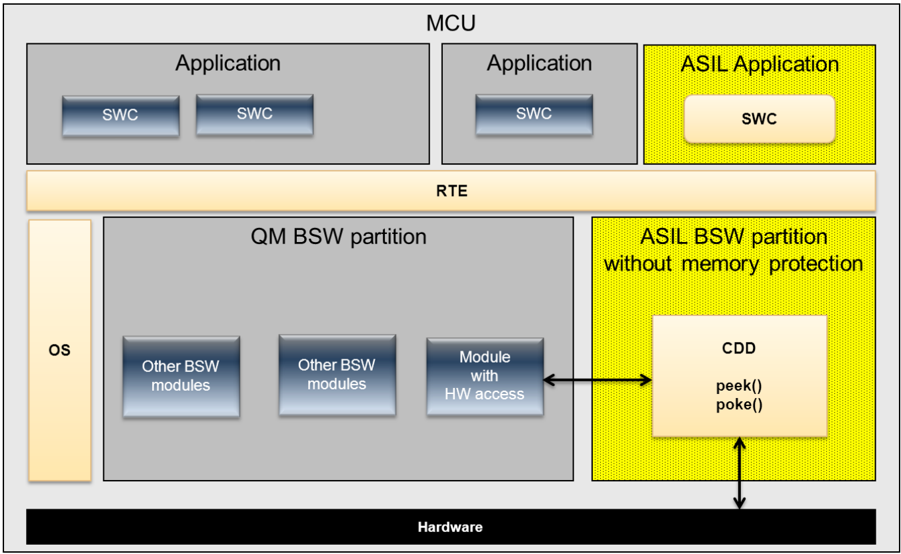

请注意，一些模块通常拥有隐式访问，因为它们的代码在 Os 中内存保护方案启动之前执行。细节见下一章。

#### 3.2.5 启动、关机与睡眠/唤醒

###### 3.2.5.1 启动

在 AUTOSAR 中，启动由 EcuM 模块处理。它负责系统启动期间正确的顺序。在 ASIL 系统中，用户必须注意在启动期间没有相关数据被覆盖，或至少该问题被检测到。这类故障可能发生，因为内存保护尚未运行——Os 尚未启动。来自 EcuM 的下图展示了启动期间的默认序列。

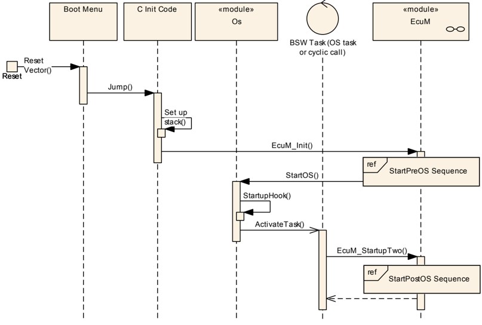

作为一个一般性提示，尽量减少在 Os 启动之前执行的代码量总是好的。取决于 ASIL，可能需要把启动的所有代码都开发为 ASIL，或者找到其他方法来确保启动期间没有发生坏事，例如在稍后时间点检查相关数据。

###### 3.2.5.2 关机

对于关机，我们必须区分不同的场景。从 AUTOSAR 的角度来看，EcuM 也处理关机。与启动相比，我们的情况是内存保护在关机期间也是启用的。

###### 3.2.5.3 睡眠/唤醒

在 AUTOSAR 中，EcuM 也负责睡眠/唤醒处理。如果一个系统在该领域有特定的安全要求，EcuM 也应当负责。例如，检查是否允许用户触发睡眠/进行唤醒验证。

#### 3.2.6 错误处理

当 BSW 模块被映射到不同的分区时，它们不会改变 AUTOSAR 的整体错误处理。例如，对 Dem 或 Det 的调用仍然发生，并且——取决于映射——可能跨越分区边界。

尽管如此，使用多于一个带 BSW 模块的分区引入了一些新的故障场景：

- 位于受信任的内存保护分区中的 BSW 函数可能引起内存违例。
- BSW 函数可能在时序保护下执行并可能超时，引起时序违例。
- BSW 函数可能试图访问它没有访问权的一些硬件寄存器。
- ……

在没有 BSW 分布的 AUTOSAR 系统中，这些问题通常不会被检测到，因为时序保护不用于 BSW 任务。这可能在正常程序执行期间或稍后时间点引起问题。

在保护也对 BSW 模块启用的分区化系统中，这些问题被检测到并经由 OsProtectionHook 报告。尽管可以重启单个 OsApplication，但重启单个 BSW 分区是不可能的，因为 BSW 作为整体在模块之间有太多的依赖。这意味着对分区化系统而言，保护故障同样是致命的，将导致系统重启。优点是故障可以被更早地检测到，并且重启可以以更受控的方式进行。

#### 3.2.7 时序保护

在 [3.2.6](#326-错误处理) 小节提到的错误中，时序故障是一种特殊情况，因为它们可能在任何时间发生。例如考虑以下例子：

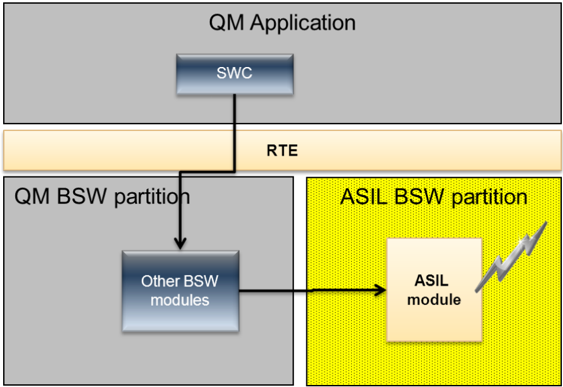

这里，一个 SWC 的可运行体调用一个 AUTOSAR 服务，并在 QM BSW 分区中继续执行。从这里，对位于不同分区中的一个 ASIL 模块进行调用。然后——恰好在 ASIL 模块内部——发生了时序违例。ASIL 模块没有机会检测到该问题，系统将关机。

为了避免此类场景，受信任的 OsApplication 有能力把时序违例延迟到引发该违例的任务（或 ISR）离开分区时。如果两个 BSW 分区都启用了该标志，时序违例在从 SWC 到 BSW 模块的调用返回处报告。然后它引发一个违例，并可能以重启 QM 应用分区结束。这里的优点是 BSW 不报告该问题，也不需要关机。

可以通过配置参数 OsTrustedApplicationDelayTimingViolationCall 为每个受信任的 OsApplication 启用该特性。

#### 3.2.8 安全与多核的结合

如果 ASIL 系统使用多核架构实现，则迄今为止针对安全和多核所做的所有考虑都有效。在多核系统中，BSW 被分配到核特定的分区。如果加入安全，我们就有核特定的 QM 和 ASIL 分区。多核特定的配置参数和安全特定的配置参数相互独立，需要根据多核（分别为安全）的需要进行设置。

#### 3.2.9 性能考虑

安全系统内 BSW 分布的主要目标是：当只有（小的）系统部分需要按 ASIL 开发时，把工作量降到最低。缺点是保护方案造成额外的开销。开销所需的时间量取决于项目、BSW 模块的映射以及分区之间交互的频率。

在以下情况下开销将被降到最低：

- ……使用尽可能少的 BSW 分区。增加更多分区在所有情况下都会带来更多开销。
- ……BSW 模块的映射遵循「最近」原则。这意味着交互频繁的模块应放置在一个分区中。例如，把整个通信栈放在一个分区中比把它拆开、例如把 PduR 放在单独的分区要快得多。
- ……分区间调用的数量被降到最低。用户的可能性通常有限，因为 AUTOSAR 定义了 BSW 模块之间的交互。不过，集成者代码和 CDD 可以按照使此类分区间调用数量最小的原则编写。
- ……支持特定的硬件特性。例如，如果硬件可以提供更多的内存区域，就可以利用它们来避免为 OUT 或 INOUT 参数复制数据。注意，仅有硬件提供此类机制是不够的；AUTOSAR 供应商也必须利用它（例如通过在 Os 或内存映射处理中支持此类特性）。
- ……避免 IOC 调用。IOC 总是会复制你的数据。因此避免对它的调用将提升性能。一般来说，尽量「拉取」数据而不是「推送」，这意味着调用者应（在 CallTrustedFunction 返回之后）尝试读取数据。缓冲区应尽可能位于被调用者一侧。

#### 3.2.10 约束

把 BSW 模块分离到不同分区的方法可行，但存在取决于可用硬件的限制：

- 在一些 MCU 上，对寄存器的访问限于特定的处理器模式。在这种情况下，peek/poke 方式（见 [3.2.4](#324-对外设硬件的访问) 小节）可用，但比直接访问耗时更多。为这些函数花费的时间对启动或关机可能是可以接受的，但如果以高频率在正常运行期间执行则不行。
- 通常只有写访问在（BSW）分区之间受限。有时甚至对外设寄存器的读访问也有写效应（例如读取接收字符的缓冲区）。在这种情况下，读访问也可能受限。
- 有时硬件不支持在特权模式下执行时使用内存保护。在这种情况下，建议把所有分区运行在非特权模式以使用内存保护。在这类情况下，需要特权模式的代码量应当最小。

请注意，这些措施通常由 MCAL 供应商负责。如果 BSW 只是 QM，这也可能适用于一个已通过 ASIL 认证的 MCAL。

## 4. 对即将到来的 AUTOSAR 版本的展望

在本章中，我们列出可能在 AUTOSAR 下一个向后不兼容版本中发生的 BSW 分布变更。因此，本章的内容不适用于 AUTOSAR 4.x 实现，而是旨在展示 AUTOSAR 未来版本可能的扩展与增强。注意，所有这些主题都需要并行考虑，因为支持安全用例需要 BSW 功能集群的定义及其标准化接口（届时将命名为「Standardized AUTOSAR BSW Cluster Interface」）。

### 4.1. 已知限制

AUTOSAR 中对基础软件分配的支持目前限于向后兼容的变更（相对于 AUTOSAR 4.0.3）。这目前导致以下限制，它们可能不适用于 AUTOSAR 的未来版本：

- 主与卫星之间的通信未被标准化。
- BSW 功能集群及其 AUTOSAR BSW 集群接口未被标准化。

由于 CONC 691 仍是草案，这也适用于 [2.5.8](#258-把-mcal-模块映射到多核类型) 小节提到的 Mem 驱动的特性。

### 4.2 分布式 BSW 中的 BSW 模块间调用

目前 BSW 分布有一个约束：现有的 QM 模块应按原样复用。如果放宽这一约束，我们可以允许模块之间更高性能的通信。例如，可以把 SchM_Call 直接包含在调用者中，避免桩。（通常调用者知道调用的上下文，可以为调用准备最佳的环境。）

此外，如果所有 BSW 模块间调用都用 SchM_Call 封装，多核系统也会受益。

### 4.3 标准化的 BSW 功能集群

BSW 功能集群是功能上内聚的 BSW 模块的分组。每个 BSW 功能集群包含一组 BSW 模块。可以存在多个同类型的功能集群（例如不同分区中的多个 I/O 集群），每个使用不同的模块集合（例如一个分区中为 IOHWA + ADC，第二个分区中为 IOHWA + ADC + DIO）。每个功能集群有一个「AUTOSAR BSW 集群接口」，用于与其他功能集群通信。

BSW 功能集群可以被分配到不同的分区，同类型的功能集群可以在多个分区中可用。不同的功能集群可以被分配到相同或不同的分区。

同一个功能集群在每个分区中最多只能存在一次。

但是这整个集群分配以及由此产生的实际接口尚未标准化，这里只是提出了该技术。因此：

AUTOSAR 的后续版本可能标准化以下内容中的一个或多个：

- 定义哪些模块被分配到哪个 BSW 功能集群（⇒「标准化的 BSW 功能集群」）。同一栈的模块（例如 I/O 服务、I/O 硬件抽象和 I/O 驱动）很可能被分配到同一个功能集群。
- 经由「标准化的 AUTOSAR BSW 集群接口」标准化不同类型功能集群之间的通信，如图 4.1 所示。

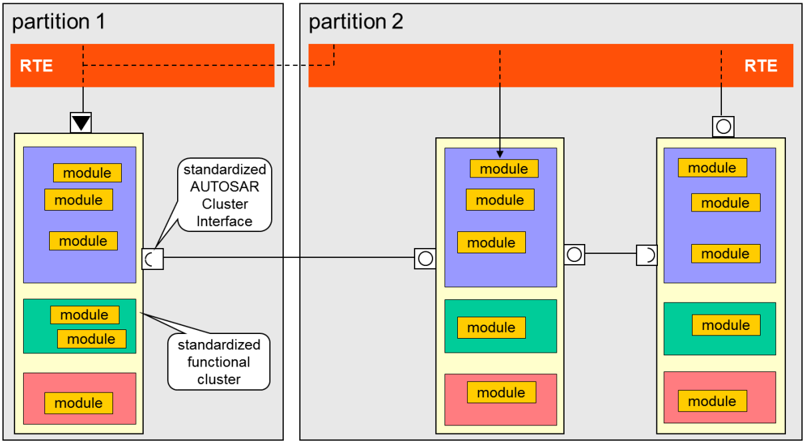

## 5. 词汇表

本文档中使用的所有技术术语——除这里列出的以外——可以在官方 AUTOSAR 词汇表 [\[4\]](#ref-4) 或软件组件模板规范 [\[5\]](#ref-5) 中找到。

### 5.1. 缩略语与缩写

| 缩写 | 解释 |
| --- | --- |
| ASIL | Automotive Safety Integrity Level（汽车安全完整性等级） |
| QM | Quality Managed（质量管理，即不按照 ASIL 要求开发） |
| IOC | Inter OS-Application communicator（OS-Application 间通信器），OS 的一部分 |
| MCU | microcontroller unit（微控制器单元），µC |
| MCAL | microcontroller abstraction layer（微控制器抽象层） |

### 5.2. 技术术语

| 术语 | 解释 |
| --- | --- |
| BSW 功能集群 | 内聚的 BSW 模块分组。本文档提出该技术，但模块到集群的真实分配目前未被标准化。BSW 功能集群可能类似于通常所说的「栈」，但也可以把若干个栈组合进一个集群，或把一个栈分布到若干个集群。BSW 功能集群包含可以成为该功能集群一部分的模块的超集，但在特定的实现中并非所有模块都必须可用。如果未来把 BSW 模块到 BSW 功能集群的真实分配标准化，它们可能将被命名为「标准化的 BSW 功能集群」。BSW 功能集群可以被分配到不同的分区，同类型的集群可以在多个分区中可用（在同一核或不同核上）。不同的功能集群可以被分配到同一个分区。注意：与 ICC2 集群相反，AUTOSAR 4.1.1 的 BSW 多核支持不影响功能集群内模块的内部结构和接口。 |
| AUTOSAR BSW 集群接口 | 由供应商/项目特定的 BSW 功能集群定义产生的、BSW 功能集群之间的接口。本文档以供应商/项目特定的方式提出该技术。但模块到 BSW 功能集群的分配、因而由此产生的接口尚未标准化（如果可能标准化的话）。在标准化之后，该术语可能在 AUTOSAR 的后续版本中被定义为「标准化的 AUTOSAR BSW 集群接口」。与标准化的 AUTOSAR 接口相反，AUTOSAR BSW 集群接口不得连接到其他 MCU 上的 SW-C 或 BSW 模块。 |
| 主（Master） | 分布式 BSW 模块中协调卫星请求、并可过滤或监控进入的卫星请求的部分。即使卫星不可用，主也可能正常工作。在 AUTOSAR 的未来版本中（届时分区化可用于增强安全），可能建议或强制要求把主放置在具有高信任级别的分区中，例如受信任的分区。 |
| 卫星（Satellite） | 分布式 BSW 模块的一部分。主与卫星之间的工作分配是实现特定的。一种可能性是卫星只向其他模块提供接口，把所有请求路由给主并把应答返回给其他模块。在另一种场景中，卫星可以在本地提供完整功能，只在必要时与主同步其内部状态。这两种场景之间的中间形式都是可能的，但卫星一般不能在没有主的情况下工作。 |

## 参考文献

<a id="ref-1"></a>[1] Requirements on Basic Software Module Description Template
> AUTOSAR_CP_RS_BSWModuleDescriptionTemplate
<a id="ref-2"></a>[2] Specification of Memory Mapping
> AUTOSAR_CP_SWS_MemoryMapping
<a id="ref-3"></a>[3] ISO 26262:2018 (all parts) - Road vehicles - Functional Safety
> https://www.iso.org
<a id="ref-4"></a>[4] Glossary
> AUTOSAR_FO_TR_Glossary
<a id="ref-5"></a>[5] Software Component Template
> AUTOSAR_CP_TPS_SoftwareComponentTemplate
