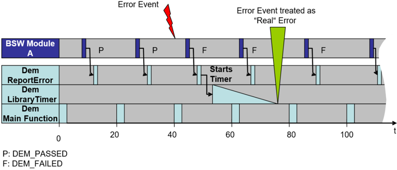

## 1. 简介和功能概述

本文档是关于 AUTOSAR 基础软件模块的通用基础软件规范。它作为对各種 BSW 模块均有效的通用规范，对 BSW 模块的规范进行补充。

### 1.1. 可追溯性

本文档中的规范项（**Specification item**）描述了 BSW 模块实现的工作成果或其组成部分，对应于 AUTOSAR 基础软件模块通用需求 [\[1\]](#ref-1)（**General Requirements on Basic Software Modules**）中所描述的基础软件需求（**Basic Software Requirements**）。

对于每个 BSW 模块，规范项与基础软件需求之间的可追溯性属于本文档以及相应 BSW 模块软件规范的范畴。另见第 6 章需求追溯。

BSW 模块实现必须保证到本文档以及相应 BSW 模块规范中相应规范项的可追溯性。

某些规范项并非适用于每个 BSW 模块。在这种情况下，其描述会明确提及适用的条件。如果未提及任何条件，则该规范项适用于所有 BSW 模块。

有关更多信息，请参阅 AUTOSAR 标准化模板 [\[2\]](#ref-2) 的 "Support for traceability" 一章。

### 1.2. 文档约定

代码示例、符号以及其他技术术语通常使用等宽字体排版，例如 `const`。

在 AUTOSAR 术语表 [\[3\]](#ref-3)、本规范（见第 2 章缩略语）或相关文档中定义的术语和表达式使用斜体字体排版，例如 *Module implementation prefix*。

基础软件需求描述于文档 SRS BSW General [\[1\]](#ref-1) 中。这些需求通过 SRS\_BSW\_&lt;n&gt; 进行引用，其中 &lt;n&gt; 是其需求 ID。例如：SRS\_BSW\_00009。

每个规范项都以 [SWS\_BSW\_&lt;nr&gt;] 开头，其中 &lt;nr&gt; 是该规范项的唯一标识号。该编号后跟规范项标题。规范项描述的范围用半括号标记，其后是用花括号括起的、来自 SRS BSW General 的相关需求列表。

**示例：**

[SWS\_BSW\_&lt;nr&gt;] 规范项标题

⌈规范项描述。⌋（SRS\_BSW\_&lt;nr1&gt;，SRS\_BSW\_&lt;nr2&gt;）

对来自其他 AUTOSAR 文档的规范项的引用使用相应文档的约定，例如 [SWS\_CANIF\_00001]。

## 2. 缩略语

**BSW driver**
> 有关 BSW 驱动（**BSW driver**）的列表，请参阅基础软件模块列表 [\[4\]](#ref-4) 中 "AUTOSAR SW layer" 列。

**Camel case**
> 本文档不旨在规定驼峰命名法（**Camel case**）的规则。维基百科对 CamelCase 的定义："Camel case（……）是一种书写短语的实践，即不带空格或标点符号地书写短语，通过单个大写字母来指示单词之间的分隔，且第一个单词以大写或小写开头。（……）"示例：GetVersionInfo。

**&lt;Ie&gt;**
> 实现特定文件名扩展名（**implementation specific file name extension**）。

**&lt;Ma&gt;**
> 模块缩写（**Module abbreviation**）。

**&lt;MA&gt;**
> 大写模块缩写（**Capitalized module abbreviation**）。大写模块缩写 &lt;MA&gt; 是完全以大写形式书写的模块缩写 &lt;Ma&gt;。

**MCAL**
> 微控制器抽象层（**Microcontroller Abstraction Layer**，**MCAL**）定义于 AUTOSAR 分层软件架构 [\[5\]](#ref-5) 中。

**&lt;Mip&gt;**
> 模块实现前缀（**Module implementation prefix**）。

**&lt;MIP&gt;**
> 大写模块实现前缀（**Capitalized module implementation prefix**）。大写模块实现前缀 &lt;MIP&gt; 是完全以大写形式书写的模块实现前缀 &lt;Mip&gt;。

**Module implementation prefix**
> 模块实现前缀（**Module implementation prefix**）。

**Module abbreviation**
> 模块缩写（**Module abbreviation**）。

**WCET**
> 最坏情况执行时间（**Worst case execution time**）。

**BSWMD**
> 基础软件模块描述（**Basic Software Module Description**）。

**SWCD**
> 软件组件描述（**Software Component Description**）。

## 3. 相关文档

### 3.1. 输入文件和相关标准与规范

<a id="ref-1"></a>[1] General Requirements on Basic Software Modules
> AUTOSAR\_CP\_SRS\_BSWGeneral

<a id="ref-2"></a>[2] Standardization Template
> AUTOSAR\_FO\_TPS\_StandardizationTemplate

<a id="ref-3"></a>[3] Glossary
> AUTOSAR\_FO\_TR\_Glossary

<a id="ref-4"></a>[4] List of Basic Software Modules
> AUTOSAR\_CP\_TR\_BSWModuleList

<a id="ref-5"></a>[5] Layered Software Architecture
> AUTOSAR\_CP\_EXP\_LayeredSoftwareArchitecture

<a id="ref-6"></a>[6] Basic Software Module Description Template
> AUTOSAR\_CP\_TPS\_BSWModuleDescriptionTemplate

<a id="ref-7"></a>[7] Methodology for Classic Platform
> AUTOSAR\_CP\_TR\_Methodology

<a id="ref-8"></a>[8] Specification of Memory Mapping
> AUTOSAR\_CP\_SWS\_MemoryMapping

<a id="ref-9"></a>[9] Specification of RTE Software
> AUTOSAR\_CP\_SWS\_RTE

<a id="ref-10"></a>[10] Guidelines for the use of the C language in critical systems（ISBN 978-1-906400-10-1）
> MISRA\_C\_2012.pdf

<a id="ref-11"></a>[11] Specification of ECU Configuration
> AUTOSAR\_CP\_TPS\_ECUConfiguration

<a id="ref-12"></a>[12] Software Component Template
> AUTOSAR\_CP\_TPS\_SoftwareComponentTemplate

<a id="ref-13"></a>[13] Specification of Operating System
> AUTOSAR\_CP\_SWS\_OS

<a id="ref-14"></a>[14] Specification of Platform Types for Classic Platform
> AUTOSAR\_CP\_SWS\_PlatformTypes

<a id="ref-15"></a>[15] Specification of Default Error Tracer
> AUTOSAR\_CP\_SWS\_DefaultErrorTracer

<a id="ref-16"></a>[16] Specification of Diagnostic Event Manager
> AUTOSAR\_CP\_SWS\_DiagnosticEventManager

<a id="ref-17"></a>[17] Requirements on Intrusion Detection System
> AUTOSAR\_FO\_RS\_IntrusionDetectionSystem

<a id="ref-18"></a>[18] Requirements on Debugging, Tracing and Profiling support of AUTOSAR Components
> AUTOSAR\_CP\_RS\_DebugTraceProfile

## 4. 约束和假设

### 4.1. 限制

本规范对所有 AUTOSAR BSW 模块 [\[4\]](#ref-4) 通用，仅包含关于 BSW 模块的通用规范项。当未满足所规定的条件时，其中某些规范项可能与特定的 BSW 模块无关。

### 4.2. 汽车域的适用性

当使用 AUTOSAR 基础软件模块时，本文档可用于所有域应用。

## 5. 对其他模块的依赖

本规范对所有 AUTOSAR BSW 模块 [\[4\]](#ref-4) 通用，仅包含补充每个单一 BSW 模块规范的通用规范项。它不得作为独立规范使用。

示例：CAN 接口模块由本规范（BSW 模块通用规范）以及文档 CAN 接口规范（SWS CAN Interface）共同规定。

### 5.1. 文件结构

本规范并未完整定义 BSW 模块的文件结构。尽管如此，此处未规定的实现文件名称无论如何都必须遵循**通用文件命名约定**（见 §5.1.2）的规定。

### 5.1.1. 模块实现前缀

BSW 模块实现前缀用于构成 BSW 模块实现的工作成果中使用的各种标识符，例如 API 名称、参数名称、符号和文件名。此前缀主要由模块缩写构成，必要时加上额外的厂商特定信息。

模块缩写的列表见基础软件模块列表 [\[4\]](#ref-4) 中的 "Module Abbreviation" 列。

**模块缩写**：BSW 模块的模块缩写 `<Ma>` 应与基础软件模块列表 [\[4\]](#ref-4) 中定义的相同。

大写模块缩写 `<MA>` 是完全以大写形式书写的模块缩写。

BSW 模块缩写示例：EcuM、CanIf、OS、Com。对应的大写模块缩写为 ECUM、CANIF、OS、COM。

**模块实现前缀**：模块实现前缀 `<Mip>` 应按如下方式构成：

```C
<Ma>[_<vi>_<ai>]
```

其中 `<Ma>` 是 BSW 模块的模块缩写（见**模块缩写**），`<vi>` 是其 vendorId，`<ai>` 是其 vendorApiInfix。如果该 BSW 模块未定义 vendorApiInfix，则方括号中的子部分 `[_<vi>_<ai>]` 被省略。对于复杂驱动（**Complex Driver**）和转换器（**transformer**），`<Mip>` 直接从 apiServicePrefix 派生。

元素 vendorId 和 vendorApiInfix 定义于 BSW 模块描述模板 [\[6\]](#ref-6) 中。在某些情况下它们的使用可能是强制性的，例如 BSW 驱动模块存在多个实例化时。这些约束不属于 SWS BSW General 的范畴。

元素 apiServicePrefix 定义于 BSW 模块描述模板 [\[6\]](#ref-6) 中。

大写模块实现前缀 `<MIP>` 是完全以大写形式书写的模块实现前缀。

在某些情况下，模块实现前缀的书写方式与模块缩写相同。然而它们的含义不同：只要在同一模块类型内可能需要区分时，就会要求使用模块实现前缀，例如区分来自不同模块实例的符号。

模块实现前缀示例：

- FrIf：FlexRay 接口模块实现的前缀，其中未定义 vendorId 和 vendorApiInfix。
- Eep\_21\_LDExt：EEPROM 驱动实现的前缀，其中 vendorApiInfix 和 vendorId 分别为 "LDExt" 和 "21"。

模块缩写示例：

- FrIf：FlexRay 接口模块缩写
- Eep：EEPROM 驱动模块缩写

### 5.1.2. 模块实现文件

本规范定义了以下文件类型。其中某些类型对所有 BSW 模块都是强制性的，另一些则取决于相应的 BSW 模块规范：

表5.1：模块实现文件（**Module Implementation Files**）

| 文件类型（对所有 BSW 模块） | 分类 | 示例：Com |
| --- | --- | --- |
| 模块文档 | 强制 | 未定义。 |
| BSW 模块描述 | 强制 | 未定义。见 [\[6\]](#ref-6)。 |
| 实现源文件 | 强制 | Com.c |
| 实现头文件 | 强制 | Com.h |
| 编译前配置源文件 | 有条件 | Com_Cfg.c |
| 链接时配置源文件 | 有条件 | Com_Lcfg.c |
| 生成后配置源文件 | 有条件 | Com_PBcfg.c |
| 中断框架实现源文件 | 有条件 | Gpt_Irq.c |

注意，根据 AUTOSAR 方法论 [\[7\]](#ref-7)，可以仅随目标文件和部分源代码一起交付 BSW 模块。另见**支持目标代码交付和配置**。


**通用文件命名约定**：所有 BSW 模块实现文件的名称应按如下方式构成：

```C
<Mip>[_<Ie>]*.*
```

方括号中的子部分 `[<Ie>]` 是可选的实现特定文件名扩展名。通配符 * 根据为该模块规定的不同文件类型进行替换。

**示例：**

添加了厂商特定文件名扩展名的 CAN 接口模块实现源文件：CanIf\_MainFncs.c、CanIf\_Api.c。

**文件名区分大小写**：无论文件名所处的文件系统如何，文件名都应视为区分大小写。

**文件名无歧义**：不允许将任何两个文件命名为仅其字母大小写不同。

### 5.1.3. 导入和导出的信息

**限制导入的信息**：BSW 模块应仅导入满足其功能需求所必需的信息（即头文件）。

注意，基础软件中其他模块的可用性取决于所使用的配置。在包含这些模块的头文件之前必须考虑到这一点。

示例：BSW 模块实现由 AUTOSAR 工具链生成。模块生成器在包含其他模块的头文件之前，必须根据所使用的配置检查相应模块在系统中是否可用。

**限制导出的信息**：BSW 模块应仅在其相应的头文件中导出其他模块明确需要的那类信息。

这是为了避免模块导入或导出可能被滥用的功能。此外，这种限制也可能缩短编译时间。

示例：NVRAM 管理器并不需要知道所有处理器寄存器，仅仅因为某个实现将处理器寄存器文件包含进了 NVRAM 管理器所使用的另一个头文件中。

**注意：**

模块配置之后，某些导入或导出的信息也可能变得不再必要，因为实现的一部分可能被禁用。

### 5.1.4. BSW 模块描述

**提供 BSW 模块描述**：应按照 AUTOSAR BSW 模块描述模板规范 [\[6\]](#ref-6) 为该模块提供 BSW 模块描述（.arxml）。

本规范不为 BSW 模块描述定义任何包结构文件，因为该交付物已在 AUTOSAR BSW 模块描述模板规范 [\[6\]](#ref-6) 中规定。

### 5.1.5. 模块文档

**提供 BSW 模块文档**：BSW 模块文档应随 BSW 模块实现一起提供。

以下内容应是其组成部分：

- 封面，含标题、版本号、日期、公司、文档状态、文档名称；
- 变更历史，含版本号、日期、公司、变更描述、文档状态；
- 目录（可导航）；
- 功能概述；
- 源文件列表和描述；
- 与规范的偏差；
- 与需求的偏差；
- 使用的资源（中断、微控制器外设等）；
- 集成描述（OS、与其他模块的接口等）；
- 配置描述，含参数、描述、单位、有效范围、默认值、与其他参数的关系。
- 示例，包括：
  - API 的正确用法；
  - 模块的配置。

以下内容可能是其组成部分：

- 内存占用（RAM、ROM、栈大小），以及用于计算的模块配置、平台信息、编译器和编译器选项。

如果可能，内存占用文档可以包含配置元素与所用内存之间的依赖公式（例如每个配置的 DTC 额外需要 x 字节 ROM 和 y 字节 RAM）。

**提供所支持的微控制器和所用工具链的信息**：如果 BSW 模块实现依赖于微控制器，则 BSW 模块文档还应包含以下信息：

- 微控制器厂商
- 微控制器系列
- 微控制器派生型号
- 微控制器步进（掩模版本）（如相关）
- 工具链名称和版本
- 用于模块开发/资格认证的工具链选项

BSW 模块内部构建的调度策略应与系统中使用的策略兼容。为此，模块实现的调度策略应相应地记录在文档中：

**记录调度函数的调用顺序**：BSW 模块文档应提供其调度函数（**Scheduled functions**）执行顺序的信息，即对于这些函数中的每一个，相对于其他 BSW 调度函数（一个或多个），它是否必须以特定的顺序或序列执行。

BSW 模块自身的规范提供了其调度函数预期顺序的进一步细节。这些信息也应在文档中考虑。

**记录配置规则和约束**：BSW 模块实现应在模块文档中提供配置规则和约束，以便在 ECU 配置期间尽可能进行配置的合理性检查。

### 5.1.6. 代码文件结构

本章提供了 BSW 模块实现的代码文件结构。注意，交付给用户的文件结构可能有所不同。

示例：

不交付源代码；交付各种生成后配置集。

#### 5.1.6.1. 实现源文件

实现源文件为 BSW 模块的功能提供实现。

**提供实现源文件**：代码文件结构应包含一个或多个用于实现所提供的 BSW 模块功能的文件：实现源文件。文件名应按如下方式构成：

```C
<Mip>[_<Ie>].c
```

**实现源文件内的声明受限**：BSW 模块的实现源文件应声明仅由模块内部使用的所有常量、全局数据类型和函数。预链接时配置参数是此规则的例外。

为了让编译器能够检查全局变量和函数的声明与定义之间的一致性，实现源文件应包含自己的头文件。

**包含实现头文件**：BSW 模块的模块实现源文件应包含自己的实现头文件。

内存映射头文件是使 BSW 模块能够访问 BSW 内存映射 [\[8\]](#ref-8) 所提供的模块特定功能所必需的。

**包含内存映射头文件**：BSW 模块的实现源文件应包含 BSW 内存映射头文件（`<Mip>_MemMap.h`）。

模块互连头文件（**Module interlink header**）是访问 BSW 调度器（**BSW Scheduler**）所提供的模块特定功能所必需的。

**包含模块互连头文件**：如果 BSW 模块使用 BSW 调度器 API，或者它实现了 BswSchedulableEntity，则相应的实现源文件应包含模块互连头文件，以访问 BSW 调度器所提供的模块特定功能。

模块互连头文件（SchM\_&lt;Mip&gt;.h）定义了基础软件调度器 API 以及基础软件调度器实现所需的任何相关数据结构 [\[9\]](#ref-9)。BswSchedulableEntity 定义在 BSW 模块描述模板 [\[6\]](#ref-6) 中。

**示例：**

CAN 驱动模块实现文件 Can\_21\_EXT.c 包含头文件 SchM\_Can\_21\_EXT.h。

Fee 模块实现文件 Fee.c 包含头文件 SchM\_Fee.h。

要获取产品错误 EventID 符号及其值，需要诊断事件管理器（**Dem**）的实现头文件：

**包含 Dem 的实现头文件**：如果 BSW 模块向 Dem 报告错误，则 BSW 模块相应的实现源文件应包含 Dem（诊断事件管理器）的实现头文件（Dem.h）。

更多信息见 §6.2 错误处理。

要访问来自其他模块的回调，也必须包含相应模块的头文件。必须考虑到，如果在配置之后相应回调的使用不属于实现的一部分，则某些头文件并非必需。另见**限制导入的信息**。

**包含模块头文件**：如果 BSW 模块实现调用来自其他模块的回调函数（**Callback functions**），则 BSW 模块的实现源文件应包含定义被调用回调函数的所有模块的模块头文件。如果回调函数位于应用层，则 BSW 模块应改为包含 RTE 导出的应用头文件。

应用头文件的包含在**将应用类型头文件包含到实现头文件中**中规定。

从**中断框架**（**Interrupt frames**）调用的**中断服务程序**的实现位于实现源文件中。另见**实现中断框架例程**。

**实现中断服务程序**：如果 BSW 模块实现了中断服务程序（**Interrupt Service Routines**，**ISR**），则这些例程应在其一个或多个实现源文件中实现。

**在独立文件中实现中断服务程序**：如果 BSW 模块实现了中断服务程序，则这些例程应与其余实现分离开来，放在一个或多个文件中实现。

#### 5.1.6.2. 链接时配置源文件

链接时配置源文件包含 BSW 模块的链接时配置参数的定义。

**提供链接时配置源文件**：如果 BSW 模块实现包含定义为 const 的链接时配置参数，则代码文件结构应包含一个或多个用于定义这些参数的文件：链接时配置源文件。文件名应按如下方式构成：

```C
<Mip>[_<Ie>]_Lcfg.c 或 <Mip>[_<Ie>]_Cfg.c
```

**定义所有链接时配置参数**：链接时配置源文件应包含为该模块规定的所有链接时配置参数的定义。

另见 §9.2.4 链接时配置。

#### 5.1.6.3. 生成后配置源文件

生成后配置源文件包含 BSW 模块的生成后配置参数的定义。

**提供生成后配置源文件**：如果 BSW 模块实现包含生成后配置参数，则代码文件结构应包含一个或多个用于定义这些参数的文件：生成后配置源文件。文件名应按如下方式构成：

```C
<Mip>[_<Ie>]_PBcfg.c
```

**定义所有生成后配置参数**：生成后配置源文件应包含为该模块规定的所有生成后配置参数的定义。编译前和链接时配置参数的定义也可以放置在生成后配置源文件中。

另见 §9.2.5 生成后配置。

在生成后配置源文件中添加编译前和链接时配置参数的理由：

- 用例 1：如果在生成后时引入了新的配置容器，则该配置容器中可能存在的所有编译前和链接时配置参数都可以被赋予新值。
- 用例 2：如果配置容器在 C 代码中实现为一个结构体，且该结构体至少包含一个生成后可配置参数，则整个结构体需要放置在生成后配置源文件中。

#### 5.1.6.4. 中断框架实现源文件

中断框架实现源文件包含 BSW 模块的中断框架例程的实现。

在中断框架实现源文件内完成的中断框架实现，与在实现源文件内完成的中断服务程序实现（见**实现中断服务程序**）是相互分离的。

这种分离使得在使用不同编译器和/或 OS 集成时具有灵活性。例如，中断可以被实现为操作系统的 ISR 框架，或者直接实现而无需更改驱动程序代码。在模块测试期间，可以直接调用服务例程，而无需触发中断。

**提供中断框架实现源文件**：如果 BSW 模块实现了中断框架，则代码文件结构应包含一个或多个用于实现这些框架的文件：中断框架实现源文件。文件名应按如下方式构成：

```C
<Mip>[_<Ie>]_Irq.c
```

**实现中断框架例程**：中断框架实现源文件应包含为该 BSW 模块规定的所有中断框架例程的实现。

中断框架例程的声明在实现头文件中完成。另见**声明中断框架例程**。

从**中断框架**调用的**中断服务程序**的实现位于实现源文件中。另见**实现中断服务程序**。

**将实现头文件包含到中断框架实现源文件中**：BSW 模块的中断框架实现源文件应包含该 BSW 模块的实现头文件。

### 5.1.7. 头文件结构

#### 5.1.7.1. 实现头文件

BSW 模块的实现头文件提供模块 API 的声明。使用 BSW 模块 API 的其他模块会包含这个或这些头文件。

**提供实现头文件**：头文件结构应包含一个或多个提供 BSW 模块 API 函数声明的文件：实现头文件。文件名应按如下方式构成：

```C
<Mip>[_<Ie>].h
```

至少应提供文件 `<Mip>.h`。

**实现头文件的内容**：实现头文件可以包含常量、全局数据和服务的 extern 声明。它们至少应包含 BSW 模块的用户可用的那些常量、全局数据和服务的声明。

为了避免数据类型在 BSW 模块和软件组件（**Software Component**）中重复且不一致的定义，公共数据类型定义在 RTE 类型头文件中。该文件通过 BSW 模块的应用类型头文件间接包含在 BSW 模块中。

**将应用类型头文件包含到实现头文件中**：如果 BSW 模块实现了 AUTOSAR 服务（**AUTOSAR Services**），则它应在其实现头文件中包含其应用类型头文件。

应用类型头文件命名为 Rte\_&lt;swc&gt;\_Type.h，其中 &lt;swc&gt; 是相应软件组件类型的短名称（**Short Name**）。有关此文件的更多信息，参见 RTE 规范 [\[9\]](#ref-9) 的 "Application Types Header File" 一节。

**示例：**

同一数据类型 NvM\_RequestResultType 既用于 BSW C-API NvM\_GetErrorStatus，也用于 AUTOSAR 接口 NvMService 的操作 GetErrorStatus（OUT NvM\_RequestResultType RequestResultPtr）。这意味着：

- 应在 Rte\_Type.h 中生成正确的类型。
- Rte\_Type.h 应通过 Rte\_NvM\_Type.h 包含在 BSW 模块的实现头文件（NvM.h）中。
- Rte\_Type.h 应包含在使用服务 GetErrorStatus 的 SW-C 模块的应用类型头文件（Rte\_&lt;swc&gt;\_Type.h）中。

此头文件包含在应用头文件（Rte\_&lt;swc&gt;.h）中，该文件由 SW-C 实现使用。这些头文件由 RTE 生成器生成。

**将 AUTOSAR 标准类型头文件包含到实现头文件中**：如果 BSW 模块实现使用 AUTOSAR 标准类型，则其实现头文件应包含 AUTOSAR 标准类型头文件（Std\_Types.h）。

AUTOSAR 标准类型头文件包含以下头文件：

- 平台特定类型头文件（Platform\_Types.h）

有关 AUTOSAR 标准类型的更多信息，另见 §6.1.18 数据类型。

**在实现头文件中声明 API 服务**：如果 BSW 模块实现了 API 服务，则它们的声明应在其实现头文件中完成。

另见 §7.3.1 API 函数的一般规范。

**提供外部头文件**：如果存在在 BSW 模块中规定或配置使用的回调出口（**Callouts**），则这些 API 的声明应在 &lt;Mip&gt;\_Externals.h 中提供。此头文件应是自包含的。

**示例：操作系统**

```C
/* File: Os_External.h */
...
/* Callout declaration */
void ErrorHook ( StatusType );
...
```

**注意：**

- 回调出口的实现者可以包含 &lt;Mip&gt;\_Externals.h 以获得声明。
- 如果实现者在自己的代码中声明该回调出口，则必须确保声明不存在差异。
- 如果使用生成后变体（**Post-Build variants**），则不同变体中使用的回调出口的声明应在 &lt;Mip&gt;\_Externals.h 中可用。

**声明中断框架例程**：如果 BSW 模块实现了中断框架例程（见**实现中断框架例程**），则它们的声明应在其实现头文件中完成。

**声明中断服务程序**：如果 BSW 模块实现了中断服务程序（ISR），则它们的声明应在其实现头文件中完成。

**支持中断服务程序类别 1 和 2**：如果 BSW 模块实现了中断服务程序（ISR）并为 CAT1 和 CAT2 两种中断类别都提供了声明，则中断类别应可通过配置进行选择。

另见 §6.1.15 中断服务程序。

**将 MainFunction 和 BswModuleClientServerEntry 从实现头文件中排除**：模块头文件不得包含预期由 RTE/BSW 调度器调用的 MainFunction 和 BswModuleClientServerEntry 的原型声明。

**包含保护**：所有头文件（内存映射头文件除外）应按以下方式防止被多次包含：

文件起始

```C
#ifndef identifier
#define identifier

/* content */

#endif
```

文件结尾

所使用的标识符在项目的所有头文件中必须唯一。在 `#ifndef`–`#endif` 括号之外只允许有注释。

**示例：文件 header.h**

```C
#ifndef HEADER_H
#define HEADER_H

/* implementation of header.h */

...

/* HEADER_H */
#endif
```

#### 5.1.7.2. 应用头文件

如果 BSW 模块实现了 AUTOSAR 服务，则相应的应用头文件随 RTE 一起生成。此文件为 BSW 模块与 RTE 的交互提供接口。应用头文件命名为 Rte\_&lt;swc&gt;.h，其中 &lt;swc&gt; 是相应软件组件类型的短名称。

**包含应用头文件**：如果 BSW 模块实现了 AUTOSAR 服务，则它应在使用 RTE 接口的模块文件中包含其应用头文件。

**限制应用头文件的包含**：应用头文件不得包含在直接或间接被其他模块包含的 BSW 模块文件中。

如果应用头文件被包含在直接或间接被其他模块包含的模块文件中，则其他服务或 CDD 也将包含若干应用头文件，而 RTE 不支持这一点。参见 RTE 规范 [\[9\]](#ref-9) 的 "File Contents" 一节中的需求 [SWS\_Rte\_01006]。

有关应用头文件的更多信息，参见 RTE 规范 [\[9\]](#ref-9) 的 "Application Header File" 一节。

注意，应用头文件自身包含了应用类型头文件。参见 RTE 规范 [\[9\]](#ref-9) 的 [SWS\_Rte\_07131]，以及**将应用类型头文件包含到实现头文件中**。

### 5.1.8. 版本检查

AUTOSAR BSW 模块的集成通过执行模块间检查（**Inter Module Checks**）得到支持：每个 BSW 模块对所有导入的包含文件执行版本的前处理器检查。在配置期间，支持方法论的工具会检查所有已集成模块的版本号是否属于同一 AUTOSAR 主要版本和次要版本，即所有模块是否来自同一 AUTOSAR 基线。如果不是，则报告错误。

执行模块间检查对于避免集成不兼容的模块是必要的。这样，版本冲突可以在早期集成阶段被检测出来。

**执行模块间检查**：BSW 模块应执行模块间检查以避免集成不兼容的文件：对于不属于本模块的每个被包含头文件，应通过前处理器检查验证以下发布信息元素（见**定义发布信息元素**）：

- AUTOSAR 主要版本号（`<MIP>_AR_RELEASE_MAJOR_VERSION`）
- AUTOSAR 次要版本号（`<MIP>_AR_RELEASE_MINOR_VERSION`）

如果这些值与本模块实现所期望的值不一致，则应报告错误。

**注意：** AUTOSAR 标准的意图是保持同一 AUTOSAR 主要版本和次要版本的各修订版之间的兼容性。

对于某些模块，存在一个通用类型头文件（例如 Can\_GeneralTypes.h），其中包含在不同模块之间和/或一个模块的多个实例之间共享的类型（例如来自不同厂商的多个 CAN 驱动）。在具有多个实例的系统（例如来自不同厂商的多个 CAN 驱动）中，项目集成者有责任确保通用类型头文件的内容适合多个驱动程序。这通过将不同的通用类型头文件合并为一个来实现。此合并后的头文件随后可以提供版本检查宏（例如 CAN\_AR\_RELEASE\_MINOR\_VERSION），驱动程序将使用带中缀的宏进行其定义/检查。

## 6. 功能规格

### 6.1. 一般实现规范

#### 6.1.1. 符合 MISRA C 和 C 标准

MISRA C 描述了 C 编程语言的编程规则以及实施和遵循这些规则的过程。

**符合 MISRA C**：如果 BSW 模块实现以 C 语言编写，则它应符合 MISRA C 2012 标准 [\[10\]](#ref-10)。

只有在技术上合理且属于例外的情况下，才允许违反 MISRA。此类违反 MISRA 规则的行为应在 C 源代码的注释中明确识别并记录。

示例：违反 MISRA 的行为可以在导致违规的指令旁边加以注释，例如 /* MRYY RULE XX VIOLATION: This is the reason why the MISRA rule could not be followed in this special case*/，其中 YY 是 MISRA 版本的两位数年份表示，XX 是 MISRA 规则编号。对于 MISRA 指令（**directive**）违规，可以使用以下注释：/* MR12 DIR XX VIOLATION: This is the reason why the MISRA directive was not be followed in this case*/

**服务接口符合 C 标准**：BSW 模块的外部接口绑定应符合 ISO/IEC 9899:1999（C99）标准。允许外部标识符使用的有效字符数可以超过规定的最小值（31 个字符）。

#### 6.1.2. 符合 AUTOSAR 基础软件需求

BSW 模块实现应符合所有适用的基础软件需求，这些需求描述于文档 SRS BSW General [\[1\]](#ref-1) 中。

注意，某些 BSW 模块规范（特别是其中包含的代码示例）为了简单起见可能会忽略某些通用 BSW 需求。示例：

- 出于可读性原因，BSW 规范文本中未使用内存抽象（**Memory abstraction**）。
- 不带 "u" 或 "s" 后缀的前处理器指令（`#define`）的使用在规范中广泛存在，但这违反了 MISRA。

然而，实现不得将此解释为对通用 BSW 需求的简化、重定义或放宽。

#### 6.1.3. 符合 AUTOSAR 方法论

BSW 模块实现应考虑 AUTOSAR 方法论（见 §3.1），例如支持 "Develop Basic Software" 和 "Integrate Software for ECU" 能力用例。

**支持基于工具的配置**：BSW 模块实现应支持基于工具的配置，如 AUTOSAR 方法论 [\[7\]](#ref-7) 中所述。

有关 ECU 配置的更多信息，另见 AUTOSAR ECU 配置规范 [\[11\]](#ref-11)。

借助 AUTOSAR 方法论，可以用以源代码形式提供的 BSW 模块和以目标代码形式提供的 BSW 模块（甚至两者混合）配置出一个 AUTOSAR ECU。当然，这必须得到实现的支持，即实现不得要求源代码始终是交付物的一部分。

**支持目标代码交付和配置**：即使只有目标代码和相应的头文件可用（即源代码文件不可用），BSW 模块实现也应支持对其链接时和生成后配置参数进行配置。

#### 6.1.4. 平台无关性

根据对实现平台的依赖性，本规范将 BSW 模块分为两个不同的类别：

- 平台无关 BSW 模块（**Platform independent BSW Modules**）：除复杂驱动、MCAL 模块和 OS 之外的所有 BSW 模块。
- 平台相关 BSW 模块（**Platform dependent BSW Modules**）：MCAL 模块、复杂驱动、OS。

平台相关性包括对所用工具链和硬件的依赖，例如编译器和处理器依赖。

平台相关 BSW 模块可以或可能有对微控制器硬件的直接访问。因此，它们的实现是平台特定的。

平台无关 BSW 模块可以开发一次，然后无需任何更改即可针对所有平台编译。任何必要的处理器或编译器特定指令（例如内存定位器、pragma、原子位操作的使用等）都必须由宏封装并通过包含文件导入。这对于最小化变体数量和相应的开发工作量是必要的。

微控制器抽象层（**MCAL**）定义于 AUTOSAR 分层软件架构 [\[5\]](#ref-5) 中。MCAL 的 BSW 模块列表见基础软件模块列表 [\[4\]](#ref-4)：微控制器驱动、I/O 驱动、通信驱动和存储驱动。

**平台无关 BSW 模块**：如果 BSW 模块被归类为平台无关 BSW 模块，则其源代码不得依赖于处理器。

在源代码中直接使用非标准关键字（如 `_near`、`_far`、`_pascal`）会造成编译器和平台依赖，必须严格避免。如果不采取预防措施，受影响代码的可移植性和可重用性会恶化，有效的发布管理也将变得成本高昂且难以维护。

**平台或编译器特定关键字的使用受限**：BSW 模块实现不得直接使用编译器和平台特定关键字。

#### 6.1.5. 可配置性

配置参数的合理性检查可以由配置工具在配置期间进行，或由前处理器在运行期间进行。另见**记录配置规则和约束**。

详细的配置规则和约束也可以是模块自身规范以及随模块实现一起交付的 BSW 模块文档的一部分。

BSW 模块的可选功能不应消耗资源（RAM、ROM 和运行时间）。这些功能可以在编译前通过合适的配置参数启用或禁用，如相应 BSW 模块规范的第 10 章所定义。

**实现可选功能的配置**：如果 BSW 模块包含可选功能，则该功能应通过编译前配置参数（**Pre-compile time configuration parameter**）启用（STD\_ON）或禁用（STD\_OFF）。

被禁用的功能不会成为编译后代码的一部分。如果代码是（例如配置后）自动生成的，则被禁用的功能甚至可能不出现在源代码中。如果 BSW 软件提供商不支持此配置，该功能甚至可能从未被实现。

这些符号 STD\_ON 和 STD\_OFF 及其值定义在 Std\_Types.h 中（见**将 AUTOSAR 标准类型头文件包含到实现头文件中**）。

模块配置应符合 AUTOSAR 方法论 [\[7\]](#ref-7)（见**将 AUTOSAR 标准类型头文件包含到实现头文件中**）。模块配置参数定义在相应 BSW 模块规范的第 10 章中。

**通过与定义值比较来检查编译器开关**：编译器开关应与定义的值进行比较。实现中不得使用仅检查编译器开关是否已定义的方式。

**示例：**

```C
#if (EEP_21_LDEXT_DEV_ERROR_DETECT == STD_ON)
```

**错误实现示例：**

```C
#ifdef EEP_21_LDEXT_DEV_ERROR_DETECT
```

#### 6.1.6. 各种命名约定

**枚举字面量、状态值和前处理器指令的命名约定**：所有枚举字面量、状态值和前处理器指令（`#define`）应按以下方式标记：

```C
<MIP>_<SN>
```

其中 `<MIP>` 是该 BSW 模块的大写模块实现前缀（见**模块实现前缀**），`<SN>` 是特定名称（**specific name**）。只应使用大写字母。如果 `<SN>` 由多个单词组成，则它们之间应以下划线分隔。

前处理器指令 E\_OK 和 E\_NOT\_OK 是此规则的例外。

示例：EEPROM 驱动具有以下状态值：

```C
EEP_21_LDEXT_UNINIT
EEP_21_LDEXT_IDLE
EEP_21_LDEXT_BUSY
```

前处理器指令示例：

```C
#define EEP_21_LDEXT_PARAM_CONFIG
#define EEP_21_LDEXT_SIZE
```

枚举字面量示例：

```C
typedef enum
{
  EEP_21_LDEXT_PARAM_CONFIG = 0,
  EEP_21_LDEXT_ARE = 1,
  EEP_21_LDEXT_EV = 2
} Eep_21_LDExt_Notification_Type;
```

**错误值的命名约定**：错误值（**Error values**）应按如下方式命名：

```C
<MIP>_E_<EN>
```

其中 `<MIP>` 是该 BSW 模块的大写模块实现前缀（见**模块实现前缀**），`<EN>` 是错误名称。只应使用大写字母。如果 `<EN>` 由多个单词组成，则它们之间应以下划线分隔。

示例：EEPROM 驱动具有以下错误值：

```C
EEP_21_LDEXT_E_BUSY
EEP_21_LDEXT_E_PARAM_ADDRESS
EEP_21_LDEXT_E_PARAM_LENGTH
EEP_21_LDEXT_E_WRITE_FAILED
```

#### 6.1.7. 配置参数

BSW 模块实现必须使用配置参数名称（**Configuration parameter names**）。更多信息另见 §9.2.2。

**配置参数名称的命名约定**：配置参数应按以下方式之一命名：

驼峰命名（**Camel case**）：

```C
<Ma><Pn>
```

全大写（**Upper case**）：

```C
<MA><PN>
```

其中：

- `<Pn>` 是驼峰命名法的特定参数名称；
- `<PN>` 是全大写的特定参数名称；

术语 `<Pn>`（或 `<PN>`）可以由多个单词组成，这些单词可以用下划线分隔，也可以不用。

**示例：**

- CanIfTxConfirmation

#### 6.1.8. 共享代码

重复的代码可能在代码维护期间导致缺陷。这可以通过在必要时共享代码来避免。共享代码便于功能组合、重用、代码规模缩减和可维护性。

**避免代码重复**：BSW 模块实现应避免代码重复。

注意，如果 BSW 模块实现了共享代码，则当该代码暴露于可抢占环境时，实现可能需要确保其可重入性（**reentrancy**）。可重入性支持是 API 规范的一部分。另见 §7.3.1。

#### 6.1.9. 全局数据

为了避免全局数据的重复定义和不受控制的扩散，必须限制全局变量的可见性。

**全局变量的定义**：如果 BSW 模块定义全局变量，则其定义应在实现源文件中进行。

**全局变量的命名约定**：BSW 模块定义的所有全局变量应按照以下方式标记：

```C
<Mip>_<Vn>
```

其中 `<Mip>` 是 BSW 模块的模块实现前缀（见**模块实现前缀**），`<Vn>` 是变量名称（**Variable name**），应以驼峰命名法（**camel case**）书写。

全局变量名称示例：

- Can\_21\_Ext\_MessageBuffer[CAN\_21\_EXT\_BUFFER\_LENGTH]
- Nm\_RingData[NM\_RINGDATA\_LENGTH]

原则上，应避免使用所有全局数据，因为在可抢占运行环境中使用它们会带来额外的阻塞开销。如果没有采取预防措施，可能会发生不可预见的影响。如果数据旨在用作常量数据，则仅当使用 const 限定符将数据显式声明为只读时，才允许全局暴露。

**常量全局变量的定义**：如果 BSW 模块定义具有只读用途的全局变量，则应通过在其定义和声明中赋予 const 限定符来将其形式化。

#### 6.1.10. 宏和内联函数的使用

允许使用宏和内联函数代替函数，以改善运行时行为。对于可重入函数需要特别注意。

在源代码可用且运行时间关键的情况下，宏可以代替函数使用。内联函数也可用于相同目的。与宏相比，内联函数的优势在于编译器可以对函数参数和返回值进行类型检查。

#### 6.1.11. 调度函数（主处理函数）的调用

主处理函数（**Main Processing Functions**），也称为调度函数（**Scheduled Functions**），定义在 §7.5 中。

为了避免 BSW 模块之间间接且不透明的时间依赖，调度函数的调用被限制在由 BSW 调度器提供的任务体（**task bodies**）内——参见 RTE 规范 [\[9\]](#ref-9)。

**调度函数的调用受限**：BSW 模块实现不得包含对调度函数（主处理函数）的调用。

调用未初始化 BSW 模块的调度函数可能导致不期望的且未定义的行为。

**未初始化调度函数的行为**：如果 BSW 调度器调用了未初始化 BSW 模块的调度函数（主处理函数），则该函数应立即返回，不执行任何功能，也不引发任何错误。

#### 6.1.12. 独占区域

独占区域（**Exclusive areas**）的定义是为了能够进行优先级判定，以防止对共享资源的同时访问。每个独占区域都有一个唯一的名称。独占区域的描述包括访问它的调度函数（主处理函数）、API 服务、回调函数和 ISR 函数。

**定义和记录独占区域**：BSW 模块的独占区域应在 BSW 模块描述中按照 BSW 模块描述模板规范 [\[6\]](#ref-6) 的规定进行定义和记录。

**独占区域的使用限制**：BSW 模块的独占区域应只保护模块内部数据。

#### 6.1.13. 回调出口（Callouts）

**回调出口函数原型声明的约定**：回调出口函数（**Callout functions**）原型的声明应使用以下约定：

```C
/* ---Start section definition: ---*/

#define <MIP>_START_SEC_<CN>_CODE

/* ---Function declaration: ---*/

void <Cn> (void);

/* ---Stop section definition: ---*/

#define <MIP>_STOP_SEC_<CN>_CODE
```

其中 `<MIP>` 是调用模块的模块实现前缀，`<CN>` 是回调出口名称（**Callout name**），它应具有与回调出口名称相同的拼写（包括模块引用），但以大写书写；`<Cn>` 是回调出口名称，使用 API 名称的常规驼峰命名法。

回调出口函数所使用的内存段对模块开发者是未知的。集成者需要拥有独立于模块设计来映射这些函数的自由。

**回调出口函数的内存段和内存类**：每个回调出口函数应映射到其自己的内存段。

**例如：**

```C
#define COM_START_SEC_SOMEMODULE_SOMECALLOUT_CODE
#include "Com_MemMap.h"

void Somemodule_Some_Callout (void);

#define COM_STOP_SEC_SOMEMODULE_SOMECALLOUT_CODE
#include "Com_MemMap.h"
```

#### 6.1.14. AUTOSAR 接口

AUTOSAR 服务位于 BSW 中，但必须通过端口（**ports**）与 RTE 之上的 AUTOSAR 软件组件交互，这些端口实现了 AUTOSAR 接口（**AUTOSAR Interfaces**）。因此，RTE 生成器应能够读取接口描述以正确生成 RTE。

**定义和记录所实现的 AUTOSAR 接口**：如果 BSW 模块实现了 AUTOSAR 服务，则相关的 AUTOSAR 接口应在 BSW 模块描述中按照软件组件模板规范 [\[12\]](#ref-12) 的规定进行定义和记录。

注意，BSW 模块描述模板继承了软件组件模板的描述类。

#### 6.1.15. 中断服务程序

中断服务程序（**ISR**）的实现高度依赖于微控制器。另见 §6.1.4。

**ISR 实现是平台相关的**：如果 BSW 模块被归类为平台无关 BSW 模块，则它不得实现中断服务程序。

有关平台无关 BSW 模块的更多说明，见 §6.1.4。

**尽可能缩短 ISR 的运行时间**：中断服务程序（ISR）的运行时间以及在中断上下文中运行的函数的运行时间应保持较短。这也影响例如从 ISR 调用的回调函数。当 ISR 可能耗时较长时，应改用操作系统任务。

ISR 函数按照 AUTOSAR OS 以名称和类别定义，见 [\[13\]](#ref-13)。

**定义和记录 ISR 例程**：如果 BSW 模块实现了中断服务程序（ISR），则这些函数应在 BSW 模块描述中按照 BSW 模块描述模板规范 [\[6\]](#ref-6) 的规定进行定义和记录。

**支持中断类别 CAT2**：如果 BSW 模块实现了中断服务程序（ISR），则实现应至少支持中断类别 CAT2。

AUTOSAR 架构不允许在应用层的中断上下文中执行。考虑到这一点，对由中断例程调用的嵌套函数需要特别注意。

**从 ISR 到 OS 任务的转换受限**：如果 BSW 模块实现了中断服务程序（ISR）且需要从 ISR 转换到 OS 任务，则该转换应发生在基础软件中尽可能低的层级：

- 对于 CAT2 ISR，最迟应在 RTE 中。
- 对于 CAT1 ISR，最迟应在 MCAL 层中。

ISR 类别 CAT1 和 CAT2 的定义见 AUTOSAR 基础软件模块通用需求 [\[1\]](#ref-1)。更多信息另见 RTE 规范 [\[9\]](#ref-9) 的 "Interrupt decoupling and notification" 一章。

处理中断的 BSW 模块应部分或完全以源代码形式交付，以便可以将其编译为使用 CAT1 或 CAT2 中断。另见**声明中断服务程序**。

示例：来自 MCAL 层的 BSW 模块以目标代码交付。中断处理程序可以编写为一对小的存根（一个 CAT1 存根和一个 CAT2 存根），并以源代码形式交付。在模块集成期间，代码根据需要进行编译——随后调用主处理程序。

#### 6.1.16. 受限的 OS 功能访问

为了避免 BSW 模块的 OS 集成过于复杂，有必要对 OS 服务的使用进行一些限制。

**OS 服务的使用限制**：BSW 模块实现只允许按照下表使用 OS 服务：

表7.1：OS 服务及其关联权限（**OS Services and associated permissions**）

| OS 服务 | RTE、BSW 调度器、BswM、CDD | EcuM | MCAL | StbM | 其他 BSW 模块 |
| --- | --- | --- | --- | --- | --- |
| ActivateTask | √ |  |  |  |  |
| TerminateTask | √ |  |  |  |  |
| ChainTask | √ |  |  |  |  |
| Schedule | √ |  |  |  |  |
| GetTaskID | √ |  |  |  |  |
| GetTaskState | √ |  |  |  |  |
| DisableAllInterrupts | √ | √ |  |  |  |
| EnableAllInterrupts | √ | √ |  |  |  |
| SuspendAllInterrupts | √ |  | √ |  |  |
| ResumeAllInterrupts | √ |  | √ |  |  |
| SuspendOSInterrupts | √ |  | √ |  |  |
| ResumeOSInterrupts | √ |  | √ |  |  |
| GetResource | √ | √ |  |  |  |
| ReleaseResource | √ | √ |  |  |  |
| SetEvent | √ |  |  |  |  |
| ClearEvent | √ |  |  |  |  |
| GetEvent | √ |  |  |  |  |
| WaitEvent | √ |  |  |  |  |
| GetAlarmBase | √ |  |  |  |  |
| GetAlarm | √ |  |  |  |  |
| SetRelAlarm | √ |  |  |  |  |
| SetAbsAlarm | √ |  |  |  |  |
| CancelAlarm | √ |  |  |  |  |
| GetActiveApplicationMode | √ | √ |  |  |  |
| StartOS |  | √ |  |  |  |
| ShutdownOS |  | √ |  |  |  |
| GetApplicationID | √ | √ | √ | √ | √ |
| StartScheduleTableRel | √ | √ |  |  |  |
| StartScheduleTableAbs | √ | √ |  |  |  |
| StartScheduleTableSynchron | √ | √ |  |  |  |
| StopScheduleTable | √ | √ |  |  |  |
| NextScheduleTable | √ | √ |  |  |  |
| SyncScheduleTable | √ | √ |  | √ |  |
| GetScheduleTableStatus | √ | √ |  | √ |  |
| SetScheduleTableAsync | √ | √ |  |  |  |
| IncrementCounter | √ |  |  |  |  |
| GetCounterValue | √ | √ | √ | √ | √ |
| GetElapsedValue | √ | √ | √ | √ | √ |
| TerminateApplication | √ |  |  |  |  |
| AllowAccess | √ |  |  |  |  |
| GetApplicationState | √ |  |  |  |  |
| GetCurrentApplicationID | √ | √ | √ | √ | √ |
| ControlIdle | √ | √ |  |  |  |
| GetNumberOfActivatedCores | √ |  |  |  |  |
| GetCoreID | √ | √ | √ | √ | √ |
| StartCore |  | √ |  |  |  |
| GetSpinlock | √ | √ | √ |  |  |
| ReleaseSpinlock | √ | √ | √ |  |  |
| TryToGetSpinlock | √ | √ | √ |  |  |
| ShutdownAllCores |  | √ |  |  |  |
| ReadPeripheral8 | √ |  | √ |  |  |
| ReadPeripheral16 | √ |  | √ |  |  |
| ReadPeripheral32 | √ |  | √ |  |  |
| WritePeripheral8 | √ |  | √ |  |  |
| WritePeripheral16 | √ |  | √ |  |  |
| WritePeripheral32 | √ |  | √ |  |  |
| ModifyPeripheral8 | √ |  | √ |  |  |
| ModifyPeripheral16 | √ |  | √ |  |  |
| ModifyPeripheral32 | √ |  | √ |  |  |
| DisableInterruptSource | √ |  | √ |  |  |
| EnableInterruptSource | √ |  | √ |  |  |
| ClearPendingInterrupt | √ |  | √ |  |  |
| ActivateTaskAsyn | √ |  |  |  |  |
| SetEventAsyn | √ |  |  |  |  |
| GetISRID | √ |  | √ |  |  |
| CallTrustedFunction | √ | √ | √ | √ | √ |
| CheckISRMemoryAccess | √ | √ | √ | √ | √ |
| CheckTaskMemoryAccess | √ | √ | √ | √ | √ |
| CheckObjectAccess | √ | √ | √ | √ | √ |
| CheckObjectOwnership | √ |  | √ | √ |  |

相应的服务在 AUTOSAR OS 中描述。

**注意：**

上表不包含 OS 的 IOC 服务，因为它们仅由 Rte 使用。

#### 6.1.17. 对硬件寄存器的访问

**对寄存器的并发访问**：所有直接访问硬件寄存器的 BSW 模块应能够容忍来自其他模块（尤其是复杂驱动）对这些寄存器的并发访问。以下寄存器需要满足此要求：

- 由于配置原因（例如通道或组未配置/未启用）当前未使用的寄存器
- 其字段或位被广泛使用的公共寄存器，例如中断掩码、内存保护位

BSW 模块应通过防御性行为和如下技术来容忍对硬件寄存器的并发访问：

- 保护读-改-写访问不被中断
- 对读-改-写访问使用原子（不可中断）指令
- 保护必须一起修改的一组寄存器的访问不被中断

**注意：**

- 假定在多主系统（多核系统、带 DMA 的系统）中，内存映射硬件寄存器仅由一个主机操纵
- 假定内存映射硬件寄存器不会被不可屏蔽中断例程或不可屏蔽异常/陷阱例程操纵

**对 "write-once" 寄存器的访问**：如果 MCAL 驱动程序初始化 "write-once" 寄存器，则该驱动程序应提供配置选项，以禁用那些访问这些寄存器或对其有依赖性的功能。

**示例：**

在 MCU 中，如果时钟设置是在启动代码中执行的（在 AUTOSAR 平台启动之前），且硬件不允许重新配置，则应有一个开关来禁用对 Mcu\_InitClock() 的调用。

#### 6.1.18. 数据类型

##### 6.1.18.1. AUTOSAR 标准类型

所有 AUTOSAR 标准类型和常量都放置并组织在 AUTOSAR 标准类型头文件（**Std\_Types.h**）中。此头文件：

- 包含平台特定类型头文件（Platform\_Types.h）
- 定义类型 Std\_ReturnType
- 定义 E\_OK 和 E\_NOT\_OK 符号及其值
- 定义 STD\_ON 和 STD\_OFF 符号及其值

另见**将 AUTOSAR 标准类型头文件包含到实现头文件中**。

##### 6.1.18.2. 平台特定类型

更换微控制器和/或编译器应只影响有限数量的文件。因此在 AUTOSAR 中，所有目标和编译器特定范围的整数类型定义都放置并组织在单一文件中，即平台特定类型头文件（**Platform\_Types.h**）。

另见平台类型规范 [\[14\]](#ref-14)。

###### 6.1.18.2.1. AUTOSAR 整数数据类型

原生 C 数据类型（char、int、short、long）的使用通常在不同平台间不可移植、不可重用。

**不使用原生 C 数据类型**：BSW 模块不得使用原生 C 数据类型。应改用 AUTOSAR 整数数据类型。这些类型定义在平台特定类型头文件（Platform\_Types.h）中。

平台特定类型头文件（Platform\_Types.h）通过 AUTOSAR 标准类型头文件（Std\_Types.h）包含。见**将 AUTOSAR 标准类型头文件包含到实现头文件中**。

以下 AUTOSAR 整数数据类型可用：

- 保证固定大小：

| 数据类型 | 范围 |
| --- | --- |
| uint8 | 0..255 |
| uint16 | 0..65535 |
| uint32 | 0..4294967295 |
| uint64 | 0..18446744073709551615 |
| sint8 | -128..127 |
| sint16 | -32768..32767 |
| sint32 | -2147483648..2147483647 |
| sint64 | -9223372036854775808..9223372036854775807 |

- 保证最小大小，为特定平台选择最佳类型（仅允许模块内部使用，不得用于 API 参数）：

| 数据类型 | 范围 |
| --- | --- |
| uint8_least | 至少 uint8 |
| uint16_least | 至少 uint16 |
| uint32_least | 至少 uint32 |
| sint8_least | 至少 sint8 |
| sint16_least | 至少 sint16 |
| sint32_least | 至少 sint32 |

带有后缀 `_least` 的数据类型可以在需要最佳性能时选用（例如循环计数器）。

示例：在 32 位平台上，uint8\_least 和 uint32\_least 都可以编译为 32 位。

**提示：** 对于没有受限值范围的整数变量，应使用 Platform\_Types.h 中定义的 AUTOSAR 整数类型。

###### 6.1.18.2.2. 布尔类型

对于简单逻辑值、其检查以及 API 返回值，可以使用 Platform\_Types.h 中定义的 AUTOSAR 类型 boolean。为了使用此类型，还定义了以下值：TRUE、FALSE。

**boolean 变量的允许操作**：boolean 类型变量唯一允许的操作是：赋值、返回，以及与 TRUE 或 FALSE 的相等、不等和逻辑非测试。

**注意：**

提供无法禁用的 boolean 数据类型的编译器厂商必须更改其编译器（即使其符合 ANSI C）。

示例：API 返回 boolean 值

```C
/* File Eep_21_LDExt.h: */
...
/* this automatically includes Platform_Types.h: */

#include "Std_Types.h"
...

boolean Eep_21_LDExt_Busy(void) {...}
...
```

```C
/* File: calling module */
...

if (Eep_21_LDExt_Busy() == FALSE) {...}
...
```

#### 6.1.19. 多分区系统上的分布式执行

AUTOSAR 架构支持在多个分区（可能在不同的核上运行）上执行 BSW 模块功能。如果模块在多个分区上提供服务，则：

- RTE 将服务调用传输到 BSW 模块实体（**BSW module entity**）所在的、应执行该调用的分区；或者
- BSW 模块实体在调用所在的分区接收调用并自主处理其执行（4.1 版本新增）。这意味着它可以在同一分区上执行该调用、将其转发到另一个分区，或两者的组合——取决于 BSW 供应商的实现策略。

**每个分区上相同的 API**：如果 BSW 模块实体应可从多个分区（例如多个核）访问，则它应在该模块实体可访问的每个分区上提供相同的 API。

**多核安全**：如果 BSW 模块实体应可在多个分区（例如多个核）上执行，则整个模块实体代码应是"并发安全的"（**concurrency safe**）。

**注意：**

"并发安全"是指 BSW 模块实体的整体设计，该实体应可在不同核上的多个分区中并行执行。例如，如果不同分区中的模块代码访问相同的数据，则共享数据应通过独占区域保护。

**可重入函数代码**：如果向 SWC 提供 BSW 模块实体且该实体应可在多个分区（例如多个核）上执行，则模块实体的函数代码应按照"并发安全"级别实现。

这允许从不同分区调用的模块函数在代码中使用相同的入口点。模块函数的分区特定处理应随后通过模块内依赖于分区的分支来实现。

### 6.2. 错误处理

特定错误在相应 BSW 模块规范的第 7 章中规定。

以下各节为此奠定基础。最重要的是，它规定了一个由五种错误类型组成的分类方案，这些错误可能发生在 BSW 模块的不同生命周期阶段。

#### 6.2.1. 分类

**错误分类**：BSW 模块可能检测和/或报告的所有错误按以下类型分类：

- 开发错误（**development errors**）
- 运行时错误（**runtime errors**）[\[1\]](#ref-1)
- 瞬态故障（**transient faults**）[\[1\]](#ref-1)
- 产品错误（**production errors**）[\[1\]](#ref-1)
- 扩展产品错误（**extended production errors**）[\[1\]](#ref-1)

#### 6.2.2. 开发错误

##### 6.2.2.1. 概要

开发错误主要被规定为软件开发过程中出现的软件缺陷，详细规定参见 [SRS\_BSW\_00337]。

例如，尝试使用未初始化的软件是典型的开发错误。

开发错误通过 Det\_ReportError 接口报告给 BSW 模块 Det（默认错误跟踪器，**Default Error Tracer**），这也反映了这种错误类型的事件导向特性。开发错误最终会发生，相应的错误监视器（**error monitors**）将立即发出其发生的信号。

尽管模块 Det 的规范文档没有规定任何特定的行为或实现，[SRS\_BSW\_00337] 要求开发错误的行为类似于断言（**assertion**）。它们的出现将通过停止或复位整个 ECU 来中止正常的执行控制流。

**开发错误检查的顺序**：开发错误检查没有定义的顺序，但对未初始化模块的检查（`<MIP>_E_UNINIT`）应首先执行。

##### 6.2.2.2. 文档化

SWS 应在其第 7 章中按照 [SRS\_BSW\_00337] 的分类列出开发错误。

**开发错误类型**：开发错误值的类型为 uint8。

##### 6.2.2.3. 配置

**API 参数检查**：如果启用了 &lt;Ma&gt;DevErrorDetect 开关，则 API 参数检查被启用。所检测错误的详细描述可在相应模块 SWS 的第 7.2 章和第 8 章中找到。

**开发错误的检测**：只有在配置开关 &lt;Ma&gt;DevErrorDetect 启用时才应进行开发错误的检测和报告。该配置开关的默认值应为禁用检测和报告。

开发错误的检测是可配置的。它为相应的 BSW 模块启用了扩展的调试能力。

示例：EEPROM 驱动程序提供 API 参数的内部检查，该检查仅在第一次软件集成测试期间激活（"development build"），之后禁用（"deployment build"）。

**示例：**

实现代码由支持工具链考虑开发错误检测的配置参数自动生成。如果未配置检测，则生成的代码不包含错误检测和报告实现。

**示例：**

实现代码包含实现错误检测配置的编译器开关：

```C
/* File: Nm_Cfg.h */
/* Pre-compile configuration parameters for Network Manager */
...
/* NM_DEV_ERROR_DETECT */
/* To activate (STD_ON) or deactivate (STD_OFF) detection of */
/* development errors. */
/* Satisfies BSW_SWS_042. */
#define NM_DEV_ERROR_DETECT STD_ON
...
```

```C
/* File: Nm.c */
/* Network Manager implementation */
...
#include "Nm_Cfg.h"
...
#if ( NM_DEV_ERROR_DETECT == STD_ON )
...
... /* development errors to be detected */
...
#endif /* NM_DEV_ERROR_DETECT */
```

注意，通过编译器开关切换此配置时应使用标准类型 STD\_ON 和 STD\_OFF（见**实现可选功能的配置**）。

开发错误检测的配置参数列在相应 BSW 模块规范的第 10 章中。

如果开发错误的检测处于活动状态，则 API 参数检查被启用（见**实现 API 参数检查**）。所检测错误的详细描述可在相应 BSW 模块规范的第 7 章和第 8 章中找到。

##### 6.2.2.4. 报告

如果配置了开发错误的检测（见**开发错误的检测**），则任何检测到的错误都应被报告：

**向 Det 报告检测到的开发错误**：BSW 模块应使用服务 Det\_ReportError 向默认错误跟踪器（**Det**）报告检测到的开发错误，并使用其分配的模块标识符（见基础软件模块列表 [\[4\]](#ref-4)）来标识自身。

注意，报告的开发错误值必须为 uint8 类型，以符合 Det\_ReportError 的签名。

有关开发错误检测的激活和停用的更多信息，见 §6.2.2 开发错误。有关服务 Det\_ReportError 的更多信息，参见 Det 规范 [\[15\]](#ref-15)。

**未初始化模块的开发错误**：当对未初始化的 BSW 模块调用除 &lt;Mip&gt;\_GetVersionInfo、&lt;Mip&gt;\_Init 和调度函数（见**未初始化调度函数的行为**）之外的任何函数时，启用了开发错误检测的 BSW 模块应引发开发错误 &lt;MIP&gt;\_E\_UNINIT。

#### 6.2.3. 运行时错误

##### 6.2.3.1. 概要

运行时错误被规定为不一定影响整个系统行为的系统性故障（**systematic faults**）。

例如，错误的生成后配置或错误分配的 PDU-ID 是运行时错误的典型原因。

与开发错误一样，运行时错误也报告给 BSW 模块 Det，在这种特定情况下通过 Det\_ReportRuntimeError 接口。与开发错误一样，运行时错误最终也会发生，并导致相应的错误监视器立即发出其发生的信号。

然而与开发错误不同的是，运行时错误不应导致断言，即执行控制流将继续。取而代之的是，运行时错误的发生会触发相应错误处理程序（**error handler**）的执行。此错误处理程序可以由特定 ECU 的集成者在 Det 内实现为回调出口，并且可以只包括将相应错误事件存储到内存、调用模块 Dem 或执行简短且合理的操作。

Det 模块提供了一个可选的回调出口接口来处理运行时错误。如果已配置，服务 Det\_ReportRuntimeError 应调用此回调出口函数。独立于任何特定实现，服务 Det\_ReportRuntimeError 始终向其调用者返回 E\_OK。

专用于检测运行时错误的监视器可以保留在部署构建（生产代码）中。

##### 6.2.3.2. 文档化

SWS 应在其第 7 章中按照 [\[1\]](#ref-1) 的分类列出运行时错误。

**运行时错误类型**：运行时错误值的类型为 uint8。

##### 6.2.3.3. 配置

运行时错误不能像开发错误那样通过配置参数关闭。

如果 Det 通过回调出口函数实现运行时错误的处理，则必须通过 DetReportRuntimeErrorCallout [\[15\]](#ref-15) 配置 Det 的特定回调出口函数名称。

##### 6.2.3.4. 报告

任何检测到的运行时错误都应被报告：

**向 Det 报告检测到的运行时错误**：BSW 模块应使用服务 Det\_ReportRuntimeError 向默认错误跟踪器（**Det**）报告检测到的运行时错误。

注意，报告的运行时错误值必须为 uint8 类型，以符合 Det\_ReportRuntimeError 的签名。

有关运行时错误的更多信息见 §6.2.3。有关服务 Det\_ReportRuntimeError 的更多信息，参见 Det 规范 [\[15\]](#ref-15)。

#### 6.2.4. 瞬态故障

##### 6.2.4.1. 概要

瞬态故障由功能失常的硬件引起。当热噪声或粒子辐射影响硬件的功能，进而影响与之相连的软件的功能时，就会发生瞬态故障。这也意味着瞬态错误可能会自愈，因为故障的原因可能会再次消失。

例如，CAN 控制器可能由于其控制寄存器中由粒子辐射引起的位翻转而离线。

瞬态故障通过 Det\_ReportTransientFault 接口报告给模块 Det。虽然没有规定特定的实现，但 [\[1\]](#ref-1) 要求瞬态故障不会导致软件执行控制流的停止。

对这些瞬态故障的处理可能需要依赖于用例的操作。因此，特定的错误处理程序很可能由集成者实现为回调出口。在这种情况下，服务 Det\_ReportTransientFault 返回回调出口函数的返回值，否则它立即以 E\_OK 返回。

专用于检测瞬态故障的监视器必须保留在部署构建（生产代码）中。

##### 6.2.4.2. 文档化

SWS 应在其第 7 章中按照 [\[1\]](#ref-1) 的分类列出瞬态故障。

**瞬态故障类型**：瞬态故障值的类型为 uint8。

##### 6.2.4.3. 配置

**瞬态故障的检测**：瞬态故障的检测无法关闭，除非模块 SWS 描述了定义某些瞬态故障激活的配置参数或其他条件。

如果 Det 通过回调出口函数实现瞬态故障的处理，则必须通过 DetReportTransientFaultCallout [\[15\]](#ref-15) 配置 Det 的特定回调出口函数名称。

##### 6.2.4.4. 报告

**向 Det 报告检测到的瞬态故障**：BSW 模块应使用服务 Det\_ReportTransientFault 向默认错误跟踪器（**Det**）报告检测到的瞬态故障。

注意，报告的瞬态故障值必须为 uint8 类型，以符合 Det\_ReportTransientFault 的签名。

有关瞬态故障的更多信息见 §6.2.4。有关服务 Det\_ReportRuntimeError 的更多信息，参见 Det 规范 [\[15\]](#ref-15)。

#### 6.2.5. 扩展产品错误和产品错误

##### 6.2.5.1. 概要：产品错误

根据 [\[1\]](#ref-1)，产品错误由任何硬件问题引起，例如老化、劣化、硬件完全失效、生产质量差、装配错误等。如果至少满足以下标准之一，则这些硬件问题可归类为产品错误（参见 [\[1\]](#ref-1)）：

- 该错误导致排放增加，必须检测到它以符合适用法规。
- 该错误限制了任何其他 OBD 相关诊断监视器的能力。
- 该错误要求跛行回家（**limp-home**）反应，例如防止对硬件或客户可感知特性造成进一步损害。
- 应使维修厂注意到失效的组件以进行维修操作。

此外，[\[1\]](#ref-1) 要求避免具有与失效相同根本原因的重复产品错误。这首先意味着特定产品错误的规范需要比特定 BSW 模块更宽的范围。

特定的产品错误报告给模块 Dem，并且可以利用其所有可用功能。通常，相应错误监视器的任何 "fail" 都会导致主事件存储器（**primary event memory**）中的一个条目，"pass" 可以撤销该条目。

通常可以为单个产品错误组合 Dem 的不同选项。因此，特定的产品错误可能导致主事件存储器中的一个条目，同时触发利用其状态进行推导操作的专用回调出口例程。

##### 6.2.5.2. 概要：扩展产品错误

与产品错误一样，扩展产品错误指示硬件问题或环境的不良行为（参见 [\[1\]](#ref-1)）。

然而与产品错误不同的是，扩展产品错误不是一等公民（**first-class citizens**），这意味着它们不满足 [\[1\]](#ref-1) 的任何标准，或者该错误与已定义的产品错误指向相同的根本原因 [\[1\]](#ref-1)。

本着这种精神，可以利用扩展产品错误：

- 获取有关相应产品错误真实原因的更多信息
- 作为组合各种信息的推导结果进入事件存储器，这些信息代表特定的 ECU 状态

扩展产品错误也报告给模块 Dem。

然而，特定扩展产品错误的 "fail" 状态的出现不得导致主事件存储器中的立即条目。因此，扩展产品错误可以利用 Dem 的所有功能，但不能将错误直接绑定到主事件存储器条目。

将扩展产品错误附加到回调例程（**callback routines**）可能是一种好的做法。然后由 ECU 集成者负责提供合理的实现。在这方面，集成者仍然拥有充分的自由，甚至可以触发主事件存储器中的条目。

##### 6.2.5.3. 文档化

**（扩展）产品错误的文档化**：对于每个产品错误和扩展产品错误，应按照 AUTOSAR SWS 模板提供适当的文档。

##### 6.2.5.4. 配置

**（扩展）产品错误的检测**：产品代码错误和扩展产品错误的检测无法关闭，除非模块 SWS 描述了定义某些（扩展）产品错误激活的配置参数或其他条件。

##### 6.2.5.5. 报告

（扩展）产品错误的 Event ID 由 Dem 通过 Dem.h 以符号名称值的形式提供。

产品错误的 EventId 符号是 BSW 模块的 ServiceNeeds 的短名称（通过 Dem 的 ECUC），前缀为 DemConf\_DemEventParameter\_。

参见 AUTOSAR ECU 配置规范 [\[11\]](#ref-11) 中的 TPS\_ECUC\_02108。

**产品错误和扩展产品错误的 Event ID 值是导入的**：（扩展）产品错误的 Event ID 值由 Dem 模块的配置在外部分配。

为了报告产品错误和扩展产品错误，使用 Dem 接口 Dem\_SetEventStatus：

**向 Dem 报告产品错误和扩展产品错误**：如果此特定产品错误或扩展产品错误已为此 BSW 模块配置，则 BSW 模块应使用服务 Dem\_SetEventStatus 将所有检测到的产品错误和扩展产品错误报告给诊断事件管理器（**Dem**）。

注意，产品错误和扩展产品错误的配置在 BSW 模块的 ECU 配置中是可选的。

**向 Dem 报告事件状态**：为了报告（扩展）产品错误状态，应调用以下 BSW 特定的 Dem 接口：

```C
Std_ReturnType Dem_SetEventStatus ( Dem_EventIdType EventId, Dem_EventStatusType EventStatus )
```

如果发生了错误事件，EventStatus 应等于：'DEM\_EVENT\_STATUS\_FAILED'。

如果未能以足够的精度检测到错误事件且需要通过预防抖（**predebouncing**）使其成熟，EventStatus 应等于：'DEM\_EVENT\_STATUS\_PREFAILED'。

如果 BSW 模块已明确检测到错误不存在，EventStatus 应等于：'DEM\_EVENT\_STATUS\_PASSED'。

如果无法以足够的精度进行无失效检测，且需要通过预防抖使其进一步成熟，EventStatus 应等于：'DEM\_EVENT\_STATUS\_PREPASSED'。

如果无法进行检查（例如需要特定的操作模式），则不应报告任何结果。

**注意：**

BSW 模块应忽略 Dem\_SetEventStatus 的返回值。

错误状态信息可以通过状态变化或在检查状态时（事件或周期性）报告，取决于错误事件的配置。检查不要求是周期性的。

预防抖在诊断事件管理器内部使用 AUTOSAR 预定义的通用信号防抖算法处理。

**注意：**

回调服务 &lt;Mip&gt;\_DemInitMonitorFor&lt;EventName&gt; 主要由诊断事件管理器（Dem）模块规范文档 [\[16\]](#ref-16) 第 8.4.3.1.1 节中的规范 [SWS\_Dem\_00256] 规定。本文档仅规定对错误监视器的正确功能有影响的扩展。

**基于事件的错误监视器的回调服务**：只有基于事件的错误监视器才应实现回调服务 &lt;Mip&gt;\_DemInitMonitorFor&lt;EventName&gt;。

**注意：**

BSW 模块 Dem 调用已实现的回调服务 &lt;Mip&gt;\_DemInitMonitorFor&lt;EventName&gt;，以根据 EnableConditions 或 ControlDTCSettings 触发基于事件的错误监视器的重新初始化。重新初始化原因通过参数 InitMonitorReason 传递。

**回调服务触发时的重新初始化**：在每次触发回调服务 &lt;Mip&gt;\_DemInitMonitorFor&lt;EventName&gt; 时，特定 BSW 模块应重新初始化监视器功能，并在错误状态能够被随时评估的情况下立即向 BSW 模块 Dem 报告新的错误状态，否则在下一个时机报告。

**ServiceNeeds 的规定**：如果特定 BSW 模块实现了回调服务 &lt;Mip&gt;\_DemInitMonitorFor&lt;EventName&gt;，则 BSWMD 应规定相应的 ServiceNeeds。

##### 6.2.5.6. 示例用例：错误被检测并通知



此定时器功能应（在本示例中）在诊断事件管理器的预防抖库中提供。

#### 6.2.6. 特定主题

##### 6.2.6.1. 实现特定错误

**实现特定错误**：如果 BSW 模块实现定义了额外的错误，则这些错误应在 BSW 模块文档中描述。错误分类表应通过实现特定的错误进行扩展。

##### 6.2.6.2. 符号名称值的处理

**符号名称值**：符号名称值（**Symbolic Name Values**）应通过提供该值的 BSW 模块的头文件导入。

实现中的符号名称值使用 ECUC 中容器的短名称，加上（生成模块的）&lt;ModuleAbbreviation&gt;Conf\_ 前缀，以及 EcucParamConfContainerDef 容器的短名称 [TPS\_ECUC\_02108]。

示例：对于由 Dem 提供并在 Dem 的 ECUC 中配置为 DemEventParameter 的产品错误，通过 Dem.h 提供的 `#define` 是 DemConf\_DemEventParameter\_&lt;short-name&gt;。

以下两个代码集成示例展示了模块 Eep 对产品错误 Event ID（14）及其符号（DemConf\_DemEventParameter\_EEP\_21\_LDEXT\_E\_COM\_FAILURE）的使用：

**源代码集成示例：**

```C
/* File: Dem_Cfg.h */
...
/* DEM specifies the production code error ID: */
#define DemConf_DemEventParameter_EEP_21_LDEXT_E_COM_FAILURE ((Dem_EventIdType) 14u)
...
```

```C
/* File: Eep_21_LDExt.c */
#include "Dem.h"
...
(void)Dem_SetEventStatus ( DemConf_DemEventParameter_EEP_21_LDEXT_E_COM_FAILURE, DEM_EVENT_STATUS_PREFAILED);
```

**目标代码集成示例：**

```C
/* File: Dem_Cfg.h */
...
/* DEM specifies the production code error ID: */
#define DemConf_DemEventParameter_EEP_21_LDEXT_E_COM_FAILURE ((Dem_EventIdType) 14u)
```

```C
/* File: Eep_21_LDExt_Lcfg.c
   Link-time configuration source
   This file needs to be compiled and linked with the
   object code delivery: */
#include "Dem.h"
#include "Eep_21_LDExt_Lcfg.h"
...
const Dem_EventIdType Eep_21_LDExt_E_Com_Failure = DemConf_DemEventParameter_EEP_21_LDEXT_E_COM_FAILURE;
...
```

```C
/* File: Eep_21_LDExt_Lcfg.h
   This file needs to be compiled and linked with the
   object code delivery: */
...
extern const Dem_EventIdType Eep_21_LDExt_E_Com_Failure;
...
```

```C
/* File: Eep_21_LDExt.c
   This file is delivered as object file. */
#include "Dem.h"
#include "Eep_21_LDExt_Lcfg.h"
...
(void)Dem_SetEventStatus ( Eep_21_LDExt_E_Com_Failure, DEM_EVENT_STATUS_PREFAILED);
```

### 6.3. 安全事件

#### 6.3.1. 概要

车载安全事件由安全相关的 BSW 模块或 SWC 报告，如入侵检测系统需求 [\[17\]](#ref-17) 中所定义。它们应报告给入侵检测系统管理器（**Intrusion Detection System Manager**，**IdsM**）。

如果至少满足以下标准之一，则事件被视为安全事件（**security events**）：

- 该事件指示安全相关功能的成功执行，应将其捕获以供后续分析。此类事件的一个示例是证书的成功安装。
- 该事件指示安全检查失败，应将其记录以供后续分析。此类事件的一个示例是受保护 PDU 的 MAC 验证失败。

#### 6.3.2. 文档化

**安全事件的文档化**：对于每个安全事件，应按照 AUTOSAR SWS 模板提供适当的文档。

#### 6.3.3. 配置

**安全事件报告的启用和禁用**：BSW 模块应提供一个配置开关，用于启用从 BSW 模块向 IdsM 的安全事件报告。该开关应位于模块的 General 容器中。

短名称（**Shortname**）：&lt;ModuleName&gt;EnableSecurityEventReporting

长名称（**Longname**）：Enable Security Event Reporting

该开关的默认设置应为关闭（**Off**）。

#### 6.3.4. 报告

安全事件的 Event ID 由 IdsM 通过 IdsM.h 以符号名称值的形式提供。

安全事件的 EventId 符号是 BSW 模块的 SwcServiceDependency 的短名称（通过 IdsM 的 ECUC），前缀为 IdsMConf\_IdsMEvent\_。

参见 TPS\_ECUC\_02108（AUTOSAR ECU 配置规范 [\[11\]](#ref-11) 的 "2.4.5.2 Representation of Symbolic Names"）。

**安全事件的 Event ID 值是导入的**：安全事件的 Event ID 值由 IdsM 模块的配置在外部分配。

**向 IdsM 报告安全事件**：如果此特定安全事件已为此 BSW 模块配置，则 BSW 模块应使用服务 IdsM\_SetSecurityEvent 将检测到的安全事件报告给入侵检测系统管理器（**IdsM**）。

```C
Std_ReturnType IdsM_SetSecurityEvent ( IdsM_SecurityEventIdType securityEventId)
```

注意，安全事件的配置在 BSW 模块的 ECU 配置中是可选的。

**向 IdsM 报告安全事件上下文数据**：为了报告带有附加上下文数据的安全事件，应调用以下 BSW 特定的 IdsM 接口：

```C
IdsM_SetSecurityEventWithContextData ( IdsM_SecurityEventIdType securityEventId, const uint8* contextData, uint16 contextDataSize)
```

### 6.4. 元数据处理

通信栈的大量模块支持 PDU 的元数据（**meta data**）。它用于在各层之间传输通常被分层架构所抽象的信息。第一个受支持的元数据是与 CanIf 相关的 PDU 的 CAN ID。

元数据通过 PduInfoType 结构经由指向字节数组的单独指针进行传输，同时带有 PDU 有效载荷的长度和指针。元数据的内容由全局 PDU 的 EcuC 描述（/-EcuC/EcucConfigSet/EcucPduCollection/Pdu）定义，它给出了某个 PDU 的元数据中包含的元数据项（**meta data items**）的类型（MetaDataItemType）、长度（MetaDataItemLength）和排序（MetaDataItem）。

**元数据项的顺序和位置**：包含元数据的字节数组中元数据项的顺序和位置由元数据项的配置及其在 EcuC 中的长度（MetaDataItemLength）给定。按长度（MetaDataItemLength）排序确保元数据内部（即不同元数据项之间）不需要填充，使元数据项能够在元数据数组中紧密排列。

PDU 始终有一个起始（生成）模块和一个最终（消费）模块，以及可能存在的若干中间（转发）模块。元数据的布局对于 PDU 是固定的。因此，起始模块为完整的元数据（即所有元数据项）分配空间，但访问同一 PDU 的模块链中的每个模块将只访问其已知的元数据项。

**元数据的分配**：在某一方向上第一个引用全局 PDU（/EcuC/EcucConfigSet/EcucPduCollection/Pdu）的模块（生成模块）组装 PDU 的数据。它应为为该 PDU 定义的整个元数据分配空间，即使它仅支持所包含元数据项的一个子集。生成模块只应初始化元数据项中它已知的子集。

例如，元数据可能由 CanIf 创建，作为附加到 N-PDU 的 CAN ID。此元数据随后由 CanTp 消费，CanTp 从 CAN ID 创建 SOURCE\_ADDRESS\_16、TARGET\_ADDRESS\_16 和 ADDRESS\_EXTENSION\_8，并将它们附加到 N-SDU，然后由 PduR（未经改动地）转发并由 DCM 消费。当（由于错误配置）ETHERNET\_MAC\_64 被附加到 N-PDU 时，它会由 CanIf 分配空间，但既不会被 CanIf 初始化，也不会被 CanTp 访问。

**元数据的对齐**：为了能够通过转换为适当的基础类型（根据 MetaDataItemType）来访问元数据项，由生成模块分配的整个元数据数组需要按照所有所包含元数据项中最严格的对齐要求进行对齐。

例如，对于由类型为 SOURCE\_ADDRESS\_16、ADDRESS\_EXTENSION\_8 和 ETHERNET\_MAC\_64 的元数据项组成的元数据，其元数据数组必须按 64 位对齐。

**元数据的访问**：引用包含元数据的全局 PDU 的每个模块应只访问（读和/或写）其已知的元数据项。未知的元数据项应保持原样不动。

### 6.5. 基础软件组件的调试、跟踪与性能分析支持

为了实现 ARTI（**AUTOSAR Run-Time Interface**）的目标，[\[18\]](#ref-18) 为 BSW 模块的调试和跟踪定义了一些额外的要求，例如："[RS\_Arti\_00042] AUTOSAR shall support tracing of entries and exits of BSW modules"。

## 7. API规范

### 7.1. 导入的类型

导入类型及相应包含头文件的列表在相应 BSW 模块规范的第 8 章中规定。导入类型定义使用以下模板：

| 模块 | 可通过以下方式获得 | 导入的类型 |
| --- | --- | --- |
| 模块名称 | 定义这些类型的头文件。 | 导入类型 1 的名称 |
|  |  | 导入类型 2 的名称 |
|  |  | ... |
| 另一模块名称 | 定义此类型的头文件。 | 导入类型的名称。 |
| ... | ... | ... |

### 7.2. 类型定义

**数据类型的命名约定**：BSW 模块定义的所有数据类型（ConfigType 除外）应按照以下约定标记：

```C
<Ma><Tn>
```

其中 `<Ma>` 是模块缩写（见**模块缩写**），`<Tn>` 是类型名称（**Type name**），应以驼峰命名法（**camel case**）书写。

**示例：**

- Eep\_LengthType
- Dio\_SignalType
- Nm\_StateType

注意，基础 AUTOSAR 类型不需要遵循**数据类型的命名约定**中定义的命名约定。

BSW 模块的类型定义在相应 BSW 模块规范的第 8 章中规定。类型定义使用以下模板：

| 名称： | 类型的名称 |
| --- | --- |
| 类型： | 允许的条目：'enumeration'（枚举）、'structure'（结构体）、'reference to'（指向某类型的指针）、允许的 AUTOSAR 整数数据类型 |
| 范围： | 合法值的范围；含义、单位等 |
| 描述： | 此类型使用的非正式描述。 |
| 此类型的常量：（可选） | 此类型的预定义名称。 |
| 可通过以下方式获得： | 定义此类型的头文件。 |

为了避免数据类型在 BSW 模块和软件组件中重复且不一致的定义，公共数据类型定义在 RTE 类型头文件中。另见**将应用类型头文件包含到实现头文件中**。

来自服务接口章的类型由 Rte 提供，其他模块类型由模块自身提供。

**标准化接口和标准化 AUTOSAR 接口中使用的数据类型的定义**：标准化接口（**Standardized Interface**）和标准化 AUTOSAR 接口（**Standardized AUTOSAR Interface**）中使用的数据类型应仅在 RTE 类型头文件（Rte\_Type.h）中定义。

### 7.3. 函数定义

#### 7.3.1. API 函数的一般规范

本模块的函数定义在相应 BSW 模块规范的第 8 章中规定。这些函数使用以下模板定义：

| 服务名称： | API 调用的名称 |
| --- | --- |
| 语法： | 调用的语法，包括返回类型和参数。 |
| 服务 ID [hex]： | 这是服务的 ID。每个 BSW 模块的编号从 0x00 开始。此 ID 用作默认错误跟踪器的错误报告 API 的参数。 |
| 同步/异步： | 此服务的行为，取以下值之一："Synchronous"（同步）、"Asynchronous"（异步）或 "Depends on configuration"（取决于配置）。 |
| 可重入性： | 可重入（**Reentrant**）/ 不可重入（**Non Reentrant**）。 |
| 参数（in）： | 参数 1：参数 1 的描述<br>参数 2：参数 2 的描述 |
| 参数（inout）： | 参数 3：参数 3 的描述 |
| 参数（out）： | 参数 4：参数 4 的描述 |
| 返回值： | 合法值的范围——对该值的描述、返回该值的情况，以及可返回该值的配置属性的值 |
| 描述： | API 调用的简短描述 |
| 可通过以下方式获得： | 使 API 原型可用的头文件。 |

可重入性术语和定义：

- 并发安全（**Concurrency safe**）：可以无限制地并发执行此接口，包括抢占和多核系统上的并行执行。
- 可重入（**Reentrant**）：在单核系统上可以对此接口进行伪并发执行（即抢占）。
- 不可重入（**Not reentrant**）：不可能并发执行此接口。
- 条件可重入（**Conditionally reentrant**）：在某些条件下可能可以并发执行此接口。这些条件是 API 规范的一部分。

从模块的角度来看，API 和回调的可重入性属性意味着"提供的可重入性"（**provided reentrancy**），即它是对模块实现者的要求。然而对于回调出口，它被理解为"要求的可重入性"（**required reentrancy**），必须由回调出口代码的实现者来满足。

请注意，只要模块实体的已实现入口是可重入的且该函数预计在多分区系统上执行，其实施就应当是并发安全的。

建议采用以下可重入性技术：

- 避免使用静态和全局变量
- 使用阻塞机制保护静态和全局变量
- 使用动态栈变量

给定 API（或类型）表中的"可通过以下方式获得"字段应包含提供原型（或类型）的头文件。如果头文件依赖于条件或配置参数，则应给出此信息。目标是让表的读者了解如何获得所需的信息（API 原型、类型）。

为了避免名称冲突，所有模块的 API 函数都有唯一的名称。模块实现前缀是 API 函数名称的一部分，这也便于代码阅读，因为每个 API 都表明它属于哪个模块。

注意，对于 BSW 驱动模块，模块实现前缀包含来自 BSW 模块提供商的附加信息。此信息也是模块 API 名称的一部分（见**模块实现前缀**）。

例如，定义了以下 API 名称：

- Eep\_21\_LDExt\_Init() /* BSW 驱动 API */
- Can\_21\_Ext\_TransmitFrame()
- Com\_DeInit()

**输入指针参数**：所有以指针形式传递的输入参数应使用类型限定符 "const"。

例如：`Std_ReturnType <Mip>_DoWithInputBuffer(void* Buffer)` 应改为 `Std_ReturnType <Mip>_DoWithInputBuffer(const void* Buffer)`。

**实现 API 参数检查**：如果此 BSW 模块的开发错误检测处于活动状态（见**开发错误的检测**），则应启用所有 API 服务的参数检查。

有关 API 参数检查，以及哪些结果导致开发错误（例如 NULL\_PTR）、哪些导致运行时错误（例如 PduId 范围）的详细信息，见相应的 BSW 模块规范。

**NULL 指针检查**：如果此 BSW 模块的开发错误检测处于活动状态（见**开发错误的检测**），则指针参数应针对 NULL\_PTR 进行检查，除非在 API 参数规范中明确允许 NULL\_PTR 作为有效的指针地址值。当为结构的字段传递结构地址时，同样适用。如果检测到此类违规，应引发开发错误。

合法 NULL\_PTR 参数的示例有：&lt;Mip&gt;\_Init 函数中编译前变体的配置指针、SduLength 设置为零时 CopyRxData 和 CopyTxData 中的 PduInfoPtr-&gt;SduDataPtr，以及不支持重试时 CopyTxData 中的 RetryInfoPtr。

BSW 模块 API 在相应 BSW 模块规范的第 8 章中进一步规定。

#### 7.3.2. 初始化函数

当 BSW 模块需要初始化变量和硬件资源时，这在一个单独的初始化函数（**Initialization function**）中完成。本节包含对初始化函数服务的所有模块特定实现都有效的一般要求。

初始化函数的 API 名称遵循 [\[1\]](#ref-1) 并以 Init 作为服务名称（**Service name**）。

**示例：**

- CanIf\_Init()
- Eep\_21\_LDExt\_Init()

并非所有 BSW 模块都有初始化函数。更多细节请参阅相应 BSW 模块规范的第 7 章和第 8 章。

为了保护系统免受 ECU 或 BSW 一部分的错误初始化的影响，BSW 模块初始化函数的使用受到限制。

**初始化函数的调用受限**：只允许 ECU 状态管理器（**ECU State Manager**）和基础软件模式管理器（**Basic Software Mode Manager**）调用初始化函数。

初始化函数负责设置模块配置参数的选择。此选择由 ECU 状态管理器（**EcuM**）或基础软件模式管理器（**BswM**）作为参数传递给该函数。另见**检查传递给初始化函数的参数**。

**检查传递给初始化函数的参数**：如果初始化函数的参数检查已启用（见**实现 API 参数检查**），则应检查配置指针（**Configuration pointer**）参数。在以下任一情况下，初始化函数需要一个有效指针（不同于 NULL\_PTR）：

- 配置可以被加载（EcucModuleConfigurationValues.ImplementationConfigVariant 为 VariantPostBuild）

或者

- 可以选择不同的配置集（EcucModuleConfigurationValues.postBuildVariantUsed 为 true）。

如果这些条件不满足且开发错误检查已启用，则应向默认错误跟踪器（**Det**）报告类型为 "Invalid configuration set selection"（无效的配置集选择）的开发错误。

有关此错误的附加信息（例如 Error ID），见相应 BSW 模块规范第 7 章的错误分类。

**初始化函数后的模块状态**：BSW 模块的状态应在初始化函数结束时相应地设置。

**注意：**

这用于开发错误的检测。

**初始化函数的调用**：复位/重启后，模块初始化函数应在任何其他模块函数之前调用。存在一些模块特定的例外情况，例如 Dem 中的 pre-Init，或 &lt;Mip&gt;\_GetVersionInfo() 始终可以调用。

**初始化函数的多次调用**：模块初始化函数被调用不得多于一次。初始化函数应仅在复位/重启之后或调用模块的反初始化函数之后调用。

#### 7.3.3. 反初始化函数

当 BSW 模块需要在 ECU 关机、进入睡眠及类似阶段期间执行功能时，这通常在一个单独的反初始化函数（**De-initialization function**）中完成。本节包含对反初始化函数服务的所有模块特定实现都有效的一般要求。

反初始化函数的 API 名称遵循 [\[1\]](#ref-1) 并以 DeInit 作为服务名称（**Service name**）。

**示例：**

AUTOSAR COM 模块的函数 Com\_DeInit() 停止所有已启动的 I-PDU 组。

为了保护系统免受 ECU 或 BSW 一部分的错误反初始化的影响，BSW 模块反初始化函数的使用受到限制。

**反初始化函数的调用受限**：只允许 ECU 状态管理器和基础软件模式管理器调用反初始化函数。

**反初始化函数后的模块状态**：BSW 模块的状态应在反初始化函数开始时相应地设置。

**注意：**

这用于开发错误的检测。

**反初始化函数的调用**：只有在模块之前已初始化（已调用初始化函数）的情况下，才应调用模块反初始化函数。

**反初始化函数的多次调用**：在模块初始化函数被调用之后，模块反初始化函数被调用不得多于一次。

并非所有 BSW 模块都有反初始化函数。更多细节请参阅相应 BSW 模块规范的第 7 章和第 8 章。

#### 7.3.4. 获取版本信息

本节包含对获取版本信息（**Get Version Information**）服务的所有模块特定实现都有效的一般要求。

**获取版本信息的执行行为**：获取版本信息函数应同步于其调用执行，并且应是可重入的。

**获取版本信息的返回结果**：获取版本信息函数应只有一个参数。此参数应返回该 BSW 模块的版本信息，其类型为从标准类型头文件（Std\_Types.h）导入的 Std\_VersionInfoType。

注意，参数名称是每个 BSW 模块规范的一部分。

返回的版本信息具有类型 Std\_VersionInfoType，其中包含本模块的发布信息（**Published information**）（另见**定义发布信息元素**和 AUTOSAR 平台类型规范 [\[14\]](#ref-14)）：

- 厂商 ID（**Vendor Id**）
- 模块 ID（**Module Id**）
- 厂商特定版本号

**启用获取版本信息服务的配置参数**：获取版本信息 API 的可用性对每个单一 BSW 模块都是可在编译前配置的。配置参数名称应按如下方式构成：

```C
<Ma>VersionInfoApi
```

**示例：**

```C
/* File: Eep_21_LDExt_Cfg.h */
#define EEP_21_LDEXT_VERSION_INFO_API  STD_ON /* API is enabled */
```

**注意：**

切换此配置时应使用标准类型 STD\_ON 和 STD\_OFF（见**实现可选功能的配置**）。

如果获取版本信息服务的调用者和被调用者的源代码都可用，则 BSW 模块的实现源文件可以将 &lt;Mip&gt;\_GetVersionInfo 实现为其实现头文件中定义的宏。

如果 &lt;Mip&gt;\_GetVersionInfo 以宏的形式提供且需要一个函数，则所提供的宏可以额外由一个函数定义包装。

**获取版本信息的默认配置值**：从 BSW 模块获取版本信息的 API 的可用性应是可配置的，且配置的默认值应为该 API 不可用。

**获取版本信息调用上下文不受限**：应可以在任何时间调用获取版本信息函数（例如在调用初始化函数之前）。

**API 配置：**

- 本 BSW 模块的发布信息（见**定义发布信息元素**）的配置会影响 API 的返回值。

有关进一步的实现细节，请参阅相应的 BSW 模块规范。

### 7.4. 回调通知

回调（**Callbacks**）是用于向其他模块发出通知的函数。

属于 AUTOSAR 服务的回调遵循 RTE 期望的签名。在这种情况下，这些函数的返回值具有类型 Std\_ReturnType，并且调用者可以假定始终返回 E\_OK。回调函数不应失败，但这可能发生，例如在分区系统中。

**AUTOSAR 服务回调函数的签名**：如果 BSW 模块提供的回调函数是 AUTOSAR 服务，即函数调用经由 RTE 路由，则这些函数的签名应遵循 RTE 通过 Rte\_Call API 调用服务器所提供的签名。

**避免回调函数中出现 void 以外的返回类型**：如果 BSW 模块提供的回调函数不是 AUTOSAR 服务，则这些函数的返回类型应避免使用 void 以外的类型。

如果回调函数仅充当简单的触发器，则无需传递任何参数。如果要在回调范围内向调用者传递附加数据，则必须能够使用参数转发该数据的内容。

**回调参数**：回调函数允许有参数。

某些回调函数在中断上下文中调用。根据 [SRS\_BSW\_00333]，BSW 模块规范包含每个回调函数是否在中断上下文中调用的信息。在中断上下文中调用的回调函数的实现必须尽可能短，如**尽可能缩短 ISR 的运行时间**中所规定。

示例：来自 CAN 接口的回调可能从 CAN 驱动程序的 ISR 中调用。在这种情况下，此信息是 CAN 接口模块 SWS 中回调规范的一部分。

回调的列表对每个 BSW 模块都是特定的。更多细节请参阅相应的 BSW 模块规范。

**AUTOSAR 服务回调函数的使用**：BSW 模块在首次调用自身的 MainFunction 之前不得调用 RTE 接口（例如 Rte\_Call）。

### 7.5. 调度函数

许多 BSW 模块具有一个或多个调度函数（也称为主处理函数，**Main processing functions**），它们必须周期性地或在事件发生时（例如在 OS 任务内）被调用，并完成模块的主要工作。

调度函数由基础软件调度器（**Basic Software Scheduler**）直接调用。它们没有返回值，也没有参数。调度函数的调用仅限于 BSW 调度器，见 §6.1.11。

相应的 BSW 模块规范要么定义一个调度函数并在内部处理所有处理，要么定义多个带有适当模块特定扩展的调度函数。这取决于特定的 BSW 模块需求。

调度函数在相应 BSW 模块规范的第 8 章中规定。这些函数使用以下模板定义：

| 服务名称： | API 调用的名称 |
| --- | --- |
| 语法： | 调用的语法，包括返回类型和参数。 |
| 服务 ID [hex]： | 服务 ID 编号。此 ID 用作默认错误跟踪器的错误报告 API 的参数。 |
| 描述： | 调度函数的简短描述 |

**调度函数的命名约定**：BSW 模块的调度函数应按照以下方式命名：

```C
<Mip>_MainFunction[_<Sd>]
```

其中 `<Mip>` 是模块实现前缀（见**模块实现前缀**）。方括号中的内容仅在模块定义多个调度函数时使用，其中 `<Sd>` 是赋予每个函数的模块特定名称扩展。

示例（仅用于说明）：

- EEPROM 驱动可能的主处理函数：

```C
void Eep_21_LDExt_MainFunction(void)
```

- 通信模块可能的主处理函数：

```C
void Com_MainFunctionRx(void)
void Com_MainFunctionTx(void)
void Com_MainFunctionRouteSignals(void)
```

**调度函数没有参数**：调度函数应没有参数，也没有返回值。它们的返回类型始终为 void。

**注意：**

调度函数通常不是可重入的。

调度函数必须能够被分配给基本任务（**basic task**）。因此，不允许它们进入任何等待状态。

**调度函数不进入等待状态**：调度函数不得进入任何等待状态。

通常，基本任务比扩展任务（**extended tasks**）更高效。扩展任务和基本任务在操作系统规范 [\[13\]](#ref-13) 中分类。

BSW 模块内部构建的调度策略必须被正确地记录在文档中，另见**记录调度函数的调用顺序**。

### 7.6. 期望接口

#### 7.6.1. 强制接口

强制接口的列表对每个 BSW 模块都是特定的。请参阅相应的 BSW 模块规范。这些接口使用以下模板定义：

| API 函数 | 可通过以下方式获得 | 描述 |
| --- | --- | --- |
| Mip_APIname | 使强制接口原型可用的头文件。 | API 的描述 |
| ... | ... | ... |

#### 7.6.2. 可选接口

可选接口的列表对每个 BSW 模块都是特定的。请参阅相应的 BSW 模块规范。这些接口使用以下模板定义：

| API 函数 | 可通过以下方式获得 | 描述 |
| --- | --- | --- |
| Mip_APIname | 使可选接口原型可用的头文件。 | API 的描述 |
| ... | ... | ... |

#### 7.6.3. 可配置接口

请参阅相应的 BSW 模块规范。在本章中，列出了所有目标函数可以被配置的接口。目标函数通常是回调函数。此类接口的名称不是固定的，因为它们是可配置的。这些接口使用以下模板定义：

| 服务名称： | API 调用的名称 |
| --- | --- |
| 语法： | 调用的语法，包括返回类型和参数。 |
| 服务 ID [hex]： | 这是服务的 ID。每个 BSW 模块的编号从 0x00 开始。此 ID 用作默认错误跟踪器的错误报告 API 的参数。 |
| 同步/异步： | 此服务的行为，取以下值之一："Synchronous"（同步）、"Asynchronous"（异步）或 "Depends on configuration"（取决于配置）。 |
| 可重入性： | 可重入（**Reentrant**）/ 不可重入（**Non Reentrant**）。 |
| 参数（in）： | 参数 1：参数 1 的描述<br>参数 2：参数 2 的描述 |
| 参数（inout）： | 参数 3：参数 3 的描述 |
| 参数（out）： | 参数 4：参数 4 的描述 |
| 返回值： | 合法值的范围——对该值的描述、返回该值的情况，以及可返回该值的配置属性的值 |
| 描述： | API 调用的简短描述 |
| 可通过以下方式获得： | 使 API 原型可用的头文件。 |

### 7.7. 服务接口

**BSWMD 中模式声明组的定义**：在其 BSWMD 中将 ModeDeclarationGroupPrototype 定义为 providedModeGroup 的 AUTOSAR 服务、ECU 抽象和复杂驱动组件，应在其 SwcBswMapping 中定义一个 synchronizedModeGroup，引用：

- providedModeGroup 的 ModeDeclarationGroupPrototype
- 在其 SWCD 中定义的 ModeSwitchInferface 的相应 ModeDeclarationGroupPrototype

## 8. 时序图

请参阅相应的 BSW 模块规范。

## 9. 配置规范

本章补充相应 BSW 模块规范的第 10 章。

### 9.1. 配置规范简介

除本节外，强烈建议阅读以下文档：

- AUTOSAR 分层软件架构 [\[5\]](#ref-5)
- AUTOSAR ECU 配置规范 [\[11\]](#ref-11)
- 本文档详细描述了 AUTOSAR 配置方法论和 AUTOSAR 配置元模型。

以下内容只是对该主题的简要概述，它不会取代 ECU 配置规范文档。

#### 9.1.1. 配置与配置参数

配置参数定义了 BSW 模块实现的通用部分的可变性。这意味着只有通用或可配置的模块实现才能在系统和 ECU 配置期间适应使用中的环境（软件和硬件）。

参数的配置可以在软件过程中的不同时间点实现：编译前、链接前或构建后。在下文中，术语"配置类"（**configuration class**）用于指代特定的配置时间点。

不同的配置类将导致不同的实现和设计过程，如本文档和 BSW 模块自身规范中所规定。

#### 9.1.2. 变体

变体（**Variants**）描述配置参数的集合。

在一个变体中，参数只能属于一个配置类。

**配置变体**：不同的用例需要不同类型的可配置性。因此，提供了以下配置变体：

- VARIANT-PRE-COMPILE：允许仅在"编译前"实现各个配置参数。
- VARIANT-LINK-TIME：允许在"编译前"或"链接时"实现各个配置参数。
- VARIANT-POST-BUILD：允许在"编译前"、"链接时"或"生成后"实现各个配置参数。

#### 9.1.3. 容器

容器（**Containers**）保存一组配置参数。这意味着：

- 所有配置参数都保存在容器中。
- （子）容器可以引用（子）容器。可以为这些引用分配多重性（**multiplicity**）。多重性随后定义了所包含参数的可能实例数量。

配置参数在以下情况下被聚簇到一个容器中：

- 配置参数在逻辑上属于一起（例如对整个模块 NVRAM 管理器有效的通用参数）
- 配置参数需要被实例化（例如 NVRAM 管理器的内存块规范的参数——这些参数必须为每个内存块实例化）

#### 9.1.4. 配置参数表

配置参数的表分为三个部分：

- 通用部分
- 配置参数部分
- 包含/引用容器部分

##### 9.1.4.1. 通用部分：

| SWS 条目 | 需求 ID |
| --- | --- |
| 容器名称（**Container Name**） | 通过名称标识容器，例如 CanDriverConfiguration。 |
| 描述（**Description**） | 解释容器的意图和内容。 |
| 生成后变体多重性（**Post-Build Variant Multiplicity**） | • true：该容器在不同的生成后变体（以前称为生成后可选配置集）中可以有不同的实例数量。• false：该容器在不同的生成后变体中不得有不同的实例数量。 |
| 配置参数（**Configuration Parameters**） | 配置参数。 |

##### 9.1.4.2. 配置参数部分：

| 名称（**Name**） | 通过名称标识参数。 |
| --- | --- |
| 描述（**Description**） | 解释配置参数的意图。 |
| 类型（**Type**） | 尽可能指定参数的类型（例如 uint8..uint32），否则标记为 "-"。 |
| 单位（**Unit**） | 尽可能指定参数的单位（例如 ms），否则标记为 "-"。 |
| 范围（**Range**） | 尽可能指定参数的范围（或可能取值）（例如 [1..15]、ON、OFF），否则标记为 "-"。<br>描述取值或范围。 |
| 生成后变体多重性（**Post-Build Variant Multiplicity**） | • true：该参数在不同的生成后变体（以前称为生成后可选配置集）中可以有不同的实例数量。• false：该参数在不同的生成后变体中不得有不同的实例数量。 |
| 生成后变体值（**Post-Build Variant Value**） | • true：该参数在不同的生成后变体（以前称为生成后可选配置集）中可以有不同的值。• false：该参数在不同的生成后变体中不得有不同的值。 |
| 多重性配置类（**Multiplicity Configuration Class**） | Pre-compile<sup>1</sup>：引用（一个或多个）变体。<br>Link time<sup>2</sup>：引用（一个或多个）变体。<br>Post Build<sup>3</sup>：引用（一个或多个）变体。 |
| 值配置类（**Value Configuration Class**） | Pre-compile<sup>4</sup>：引用（一个或多个）变体。<br>Link time<sup>5</sup>：引用（一个或多个）变体。<br>Post Build<sup>6</sup>：引用（一个或多个）变体。 |
| 作用域（**Scope**） | • LOCAL：该参数仅适用于定义它的模块。 |
| 依赖（**Dependency**） | 描述与作用域相关的依赖关系（如果已知），否则标记为 "- -"。 |

> 1 见配置类标签 "编译前"（Pre-compile time）的说明。
> 2 见配置类标签 "链接时"（Link time）的说明。
> 3 见配置类标签 "生成后"（Post Build time）的说明。
> 4 见配置类标签 "编译前"（Pre-compile time）的说明。
> 5 见配置类标签 "链接时"（Link time）的说明。
> 6 见配置类标签 "生成后"（Post Build time）的说明。

##### 9.1.4.3. 包含/引用容器部分：

| 容器名称（**Container Name**） | 多重性（**Multiplicity**） | 作用域/依赖（**Scope / Dependency**） |
| --- | --- | --- |
| 通过名称引用有效的（子）容器，例如 CanController | 指定被引用容器及其包含的配置参数的可能实例数量。可能的值：&lt;multiplicity&gt;、&lt;min_multiplicity..max_multiplicity&gt; | 描述被引用子容器的作用域（如果已知），否则标记为 "- -"。作用域描述配置参数的影响：该设置是只影响模块的一个实例（instance）、该模块的所有实例（module）、ECU 还是网络。作用域的可能值：instance、module、ECU、network。描述与作用域相关的依赖关系（如果已知），否则标记为 "- -"。 |

#### 9.1.5. 配置类标签

配置参数部分由一个标签补充，为每种配置类类型提供附加规范：

编译前（**Pre-compile time**）：指定配置参数是否应属于配置类"编译前"。

| 标签 | 说明 |
| --- | --- |
| x | 配置参数应属于配置类"编译前"。 |
| - | 配置参数决不应属于配置类"编译前"。 |

链接时（**Link time**）：指定配置参数是否应属于配置类"链接时"。

| 标签 | 说明 |
| --- | --- |
| x | 配置参数应属于配置类"链接时"。 |
| - | 配置参数决不应属于配置类"链接时"。 |

生成后（**Post Build**）：指定配置参数是否应属于配置类"生成后"。

| 标签 | 说明 |
| --- | --- |
| x | 配置参数应属于配置类"生成后"，且不需要特定的实现。 |
| - | 配置参数决不应属于配置类"生成后"。 |

### 9.2. 通用配置规范

#### 9.2.1. 配置文件

有关配置文件结构的更多信息见 §5.1。

**配置文件应是人类可读的**：保存 BSW 模块配置数据的文件应具有人类可读且可理解的格式。

#### 9.2.2. 配置参数的实现名称

配置参数的名称在相应 BSW 模块规范的第 10 章中规定。

**示例：**

| 名称 | EepNormalWriteBlockSize {EEP_NORMAL_WRITE_BLOCK_SIZE} |
| --- | --- |
| 描述 | 正常模式下在一个作业处理周期内写入的字节数。实现类型：Eep_LengthType。 |

配置参数名称规范：它指定此配置参数对象在 AUTOSAR 模型（**AUTOSAR Model**）中的配置参数名称，例如：EepNormalWriteBlockSize。

用于定义实现文件名称和 API 函数名称的相同原则也适用于参数的命名。

注意，根据**配置参数名称的命名约定**，所有配置参数名称应以模块缩写或其大写形式开头。

#### 9.2.3. 编译前配置

**编译前配置**：编译前的配置参数在编译开始之前设置。因此，相关配置必须在源代码级别完成。编译前配置允许将静态配置与实现解耦。

**示例：**

```C
/* File: CanTp_Cfg.h */
/* Pre-compile time configuration */
...
#define CANTP_USE_NORMAL_ADDRESSING        STD_OFF
#define CANTP_USE_NORMAL_FIXED_ADDRESSING  STD_OFF
#define CANTP_USE_EXTENDED_ADDRESSING      STD_ON
...
```

```C
/* File: CanTp.c */
...
#include "CanTp_Cfg.h"
...
#if (CANTP_USE_NORMAL_ADDRESSING == STD_OFF)
...
#endif
```

在编译时分离依赖于配置的数据进一步提高了灵活性、可读性并减少了版本管理的工作量，因为没有源代码受到影响。

#### 9.2.4. 链接时配置

链接时参数的使用为以目标代码形式交付的 BSW 模块提供了可配置功能。这对于 BSW 驱动程序来说很常见。

**链接时配置**：带有链接时参数的 BSW 模块的配置在编译之后、链接之前的阶段在目标代码的基础上实现。

另见**支持目标代码交付和配置**。

**指向链接时可配置数据的配置指针**：如果 BSW 模块在运行时依赖于链接时可配置的数据，则它应使用指向外部配置实例的只读引用（配置指针）。

#### 9.2.5. 生成后配置

生成后配置机制为以目标代码形式部署的 BSW 模块提供了可配置功能。

**实现生成后配置数据结构**：如果 BSW 模块具有生成后配置参数，则生成后配置数据应定义在一个结构中：生成后配置数据结构（**Post-build configuration data structure**）。

**指向生成后配置数据结构的配置指针的使用受限**：每个 BSW 模块的生成后配置数据结构应由配置指针（**Configuration pointers**）指向。只有 EcuM 包含指向需要在 BswM 初始化之前初始化的生成后可配置模块的生成后配置数据结构的配置指针。其余 BSW 模块由 BswM 通过配置指针初始化。

生成后配置数据位于单独的段中，并且可以独立于实际代码加载 [\[3\]](#ref-3)。例如，对于可加载的 CAN 配置就是这种情况。为了实现配置的这种独立加载，必须知道这些参数的内存布局：

**指向生成后可配置数据的引用指针**：如果 BSW 模块对生成后配置数据进行操作，则它应使用指向外部配置实例的引用（指针）。此引用应通过 BSW 模块的初始化函数（即 &lt;Mip&gt;\_Init()）经由 const 限定的函数参数提供。

**示例：**

```C
/* File: ComM_PBcfg.h */
...
/* Type declaration of the Configuration Type */
struct ComM_ConfigType_Tag {
...
};
...
```

```C
/* File: ComM_PBcfg.c */
#include <ComM.h>
...
/* post-build time configurable data */
const ComM_ConfigType ComM_Config =
{
...
};
...
```

```C
/* File: ComM.h */
#include <ComM_PBcfg.h>
...
/* Forward declaration: */
typedef struct ComM_ConfigType_Tag ComM_ConfigType;
extern void ComM_Init(const ComM_ConfigType * ComMConfigPtr);
...
```

如果生成后配置位于固定的内存位置，且没有 BSW 模块具有使用应在生成后时解析的变化点（**variation points**）的配置（见 §9.3），则引用可以被解析为常量指针。在这种情况下，固定指针将被传递给 BSW 模块的初始化函数。任何间接寻址都应保持尽可能简单。

#### 9.2.6. 配置变体

独立于配置类（编译前、链接和生成后），配置变体使 ECU 能够根据所选的配置变体在车辆内以不同的角色重用。

**不同配置变体的处理**：无论 BSW 模块选择何种编译前、链接时或生成后配置，同一配置中可能存在多个配置变体，这由不同的变化点指示。这些变化点可以在编译前、链接时或生成后绑定。

**多个配置变体的生成**：对于在生成后绑定的变化点，无需对 ECU 重新编程即可选择特定变体。为此，会生成多个生成后配置集（即每个配置变体一个）并加载到 ECU 中。

**配置变体的选择/绑定**：EcuM 将确定（通过调用 EcuM\_DeterminePbConfiguration()）应使用这些生成后配置变体中的哪一个。基于所使用的配置变体，EcuM 随后将使用指向相应 BSW 模块适当的生成后配置变体的指针，调用 BSW 模块的初始化函数（见**检查传递给初始化函数的参数**和**初始化函数的调用受限**）。

**示例：**

```C
/* File: ComM_PBcfg.h */
...
/* Type declaration of the Configuration Type */
typedef struct ComM_ConfigType_Tag {
...
};
...
```

```C
/* File: ComM_PBcfg.c */
#include <ComM.h>
...
/* post-build time configurable data for predefined variant "VariantA" */
const ComM_ConfigType ComM_Config_VariantA =
{
...
};
/* post-build time configurable data for predefined variant "VariantB" */
const ComM_ConfigType ComM_Config_VariantB =
{
...
};
...
```

```C
/* File: ComM.h */
#include <ComM_Cfg.h>
...
/* Forward declaration: */
typedef struct ComM_ConfigType_Tag ComM_ConfigType;
extern void ComM_Init(const ComM_ConfigType * ComMConfigPtr);
...
```

### 9.3. 发布信息

发布信息（**Published information**）包含由 BSW 模块实现者定义的数据，这些数据在模块被适配（即配置）到实际硬件和软件环境时不会改变。它包含版本和制造商信息。

这对于为每个 BSW 模块提供无歧义的版本标识，以及启用版本交叉检查和基本的版本检索功能是必要的。这样，模块兼容性始终可见。

**定义发布信息元素**：BSW 模块的发布信息应在所有头文件中通过定义前处理器指令（`#define`）提供，并防止多重定义。前处理器标识符按如下方式构成：

```C
<MIP>_<PI>
```

其中 `<PI>` 是相应的发布信息元素名称。模块应提供下表所列发布信息元素的定义。这些定义应具有下表规定范围内的值：

表10.1：发布信息（**Published information**）

| 信息元素 | 类型/范围 | 信息元素说明 |
| --- | --- | --- |
| <MIP>_VENDOR_ID | #define/uint16 | 根据 AUTOSAR 厂商列表，该模块特定实现的厂商 ID（vendorId）。 |
| <MIP>_MODULE_ID | #define/uint16 | 该模块的模块 ID，如基础软件模块列表 [\[4\]](#ref-4) 中所定义。 |
| <MIP>_AR_RELEASE_MAJOR_VERSION | #define/uint8 | 相应实现所基于的 AUTOSAR 发布版本的主要版本号。 |
| <MIP>_AR_RELEASE_MINOR_VERSION | #define/uint8 | 相应实现所基于的 AUTOSAR 发布版本的次要版本号。 |
| <MIP>_AR_RELEASE_REVISION_VERSION | #define/uint8 | 相应实现所基于的 AUTOSAR 发布版本的修订版本号。 |
| <MIP>_SW_MAJOR_VERSION | #define/uint8 | 模块的厂商特定实现的主要版本号。编号由厂商特定决定。 |
| <MIP>_SW_MINOR_VERSION | #define/uint8 | 模块的厂商特定实现的次要版本号。编号由厂商特定决定。 |
| <MIP>_SW_PATCH_VERSION | #define/uint8 | 模块的厂商特定实现的补丁级别版本号。编号由厂商特定决定。 |

发布信息在该模块的 BSW 模块描述 [\[6\]](#ref-6) 中配置。

**厂商标识声明的限制**：厂商标识应仅按以下方式声明，不带任何类型转换，以便在前处理器中进行验证。

```C
#define <MIP>_VENDOR_ID <vi>
```

其中 `<vi>` 是相应的厂商 ID（**Vendor Id**），如**定义发布信息元素**中所要求。

以下示例展示了根据 AUTOSAR 发布版本 4.0.3 开发的厂商 43 的 CAN 模块实现版本 1.2.3 的发布信息声明。模块 ID 从基础软件模块列表 [\[4\]](#ref-4) 中获得。

**示例：**

```C
/* File: CanIf.h */
...
/* Published information */
#define CANIF_MODULE_ID                    0x003Cu
#define CANIF_VENDOR_ID                    0x002Bu
#define CANIF_AR_RELEASE_MAJOR_VERSION     0x04u
#define CANIF_AR_RELEASE_MINOR_VERSION     0x00u
#define CANIF_AR_RELEASE_REVISION_VERSION  0x03u
#define CANIF_SW_MAJOR_VERSION             0x01u
#define CANIF_SW_MINOR_VERSION             0x02u
#define CANIF_SW_PATCH_VERSION             0x03u
```

注意，发布信息元素 &lt;MIP&gt;\_SW\_MAJOR\_VERSION、&lt;MIP&gt;\_SW\_MINOR\_VERSION 和 &lt;MIP&gt;\_SW\_PATCH\_VERSION 由软件厂商定义。

**版本编号的约定**：连续 BSW 模块实现的版本编号应按照以下规则进行：

- 提高版本号的更高有效位会复位所有更低有效位。
- 如果模块仍然向上和向下兼容（例如缺陷修复），则 &lt;MIP&gt;\_SW\_PATCH\_VERSION 递增。
- 如果模块仍然向下兼容（例如添加了新功能），则 &lt;MIP&gt;\_SW\_MINOR\_VERSION 递增。
- 如果模块不再兼容（例如更改了现有 API），则 &lt;MIP&gt;\_SW\_MAJOR\_VERSION 递增。

数字 &lt;MIP&gt;\_SW\_MAJOR\_VERSION 比 &lt;MIP&gt;\_SW\_MINOR\_VERSION 更有效，后者比 &lt;MIP&gt;\_SW\_PATCH\_VERSION 更有效。

**示例：**

取版本为 1.14.2 的 ADC 模块实现。那么：

- 版本 1.14.2 和 1.14.9 是可互换的。
- 版本 1.14.2 可能包含在 1.14.9 中得到纠正的缺陷。
- 版本 1.14.2 可以用来替代 1.12.0，但反之则不行。
- 版本 1.14.2 不能用来替代 1.15.4 或 2.0.0。

## B. AUTOSAR 可追溯项变更历史

注意，本章中的列表还包括在更高版本中已从规范中移除的约束和规范项。这些约束和规范项在文档中不显示为超链接。

### B.1. 根据 AUTOSAR 发布版本 R22-11 的文档变更历史

#### B.1.1. R22-11 中新增的规范项

```
[SWS_BSW_00255]
```

#### B.1.2. R22-11 中变更的规范项

```
[SWS_BSW_00010] [SWS_BSW_00042] [SWS_BSW_00136] [SWS_BSW_00144] [SWS_BSW_00186]
```

#### B.1.3. R22-11 中删除的规范项

```
[SWS_BSW_00009] [SWS_BSW_00132] [SWS_BSW_00178] [SWS_BSW_00187] [SWS_BSW_00202] [SWS_BSW_00235]
```

### B.2. 根据 AUTOSAR 发布版本 R23-11 的文档变更历史

#### B.2.1. R23-11 中新增的规范项

```
[SWS_BSW_00256] [SWS_BSW_00257]
```

#### B.2.2. R23-11 中变更的规范项

无

#### B.2.3. R23-11 中删除的规范项

```
[SWS_BSW_00039]
```
