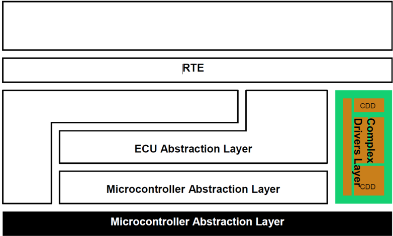
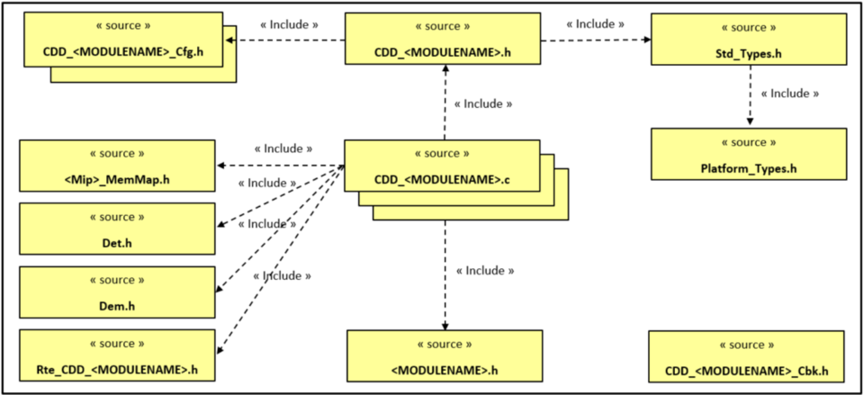

<!-- 源文档 AUTOSAR_CP_EXP_CDDDesignAndIntegrationGuideline（R23-11），讲述型指南（EXP），不受 Type A 七章骨架约束；章节结构镜像源文档自身编号（1–7）。 -->

## 1. 引言

### 1.1. 文档范围

本文档的目的是：

- 概述复杂驱动（Complex Driver，CDD）；
- 给出在 AUTOSAR 架构内实现与集成 CDD 的建议。

本文档面向 CDD 的开发者与集成者。

## 2. 术语与缩略语的定义

具有局部作用域、因而未包含在 AUTOSAR 词汇表中的缩略语与缩写，必须出现在本地词汇表中。

| 缩写/缩略语 | 说明 |
| --- | --- |
| CDD | CDD 曾是 Complex Device Driver（复杂设备驱动）或 Complex Driver（复杂驱动）的缩写，但不限于驱动。 |

### 2.1. 术语词汇表

术语词汇表见文档 [\[1\]](#ref-1) AUTOSAR 词汇表。

| 术语 | 定义 |
| --- | --- |
| &lt;MODULENAME&gt; | 该术语在文档 [\[2\]](#ref-2) General Requirements on Basic Software Modules 中定义。 |

## 3. 要使用的约定

在需求中，应使用以下特定语义（基于互联网工程任务组 IETF）。

本文档中的关键词「MUST」「MUST NOT」「REQUIRED」「SHALL」「SHALL NOT」「SHOULD」「SHOULD NOT」「RECOMMENDED」「MAY」和「OPTIONAL」应按如下方式解释。

注意，使用这些词的文档的需求层级会修饰这些词的强制力。

- MUST：这个词或形容词「LEGALLY REQUIRED」表示该定义由于法律问题是规范的绝对要求。
- MUST NOT：这个短语表示该定义由于法律问题是规范的绝对禁止。
- SHALL：这个短语或形容词「REQUIRED」表示该定义是规范的绝对要求。
- SHALL NOT：这个短语表示该定义是规范的绝对禁止。
- SHOULD：这个词或形容词「RECOMMENDED」表示在特定情况下可能存在忽略某一特定条目的正当理由，但在选择不同做法之前必须理解并仔细权衡其全部影响。
- SHOULD NOT：这个短语或短语「NOT RECOMMENDED」表示在特定情况下可能存在正当理由，使该特定行为是可接受的甚至有用的，但在实现以此标签描述的任何行为之前，应当理解全部影响并仔细权衡该情况。
- MAY：这个词或形容词「OPTIONAL」表示一个条目是真正可选的。一个供应商可能因为特定市场需要它、或认为它能增强产品而选择包含该条目，而另一个供应商可能省略同一条目。

不包含某个特定选项的实现，应当准备好与包含该选项的另一个实现互操作，尽管功能可能有所减少。同样，包含某个特定选项的实现，应当准备好与不包含该选项的另一个实现互操作（当然，该选项提供的特性除外）。

## 4. 相关文档

### 4.1. 输入文件和相关标准与规范

[1] Glossary
> AUTOSAR_FO_TR_Glossary

[2] General Requirements on Basic Software Modules
> AUTOSAR_CP_SRS_BSWGeneral

[3] Layered Software Architecture
> AUTOSAR_CP_EXP_LayeredSoftwareArchitecture

[4] List of Basic Software Modules
> AUTOSAR_CP_TR_BSWModuleList

[5] General Specification of Basic Software Modules
> AUTOSAR_CP_SWS_BSWGeneral

[6] Specification of Standard Types
> AUTOSAR_CP_SWS_StandardTypes

[7] Specification of Platform Types for Classic Platform
> AUTOSAR_CP_SWS_PlatformTypes

[8] Specification of Communication Stack Types
> AUTOSAR_CP_SWS_CommunicationStackTypes

[9] Basic Software Module Description Template
> AUTOSAR_CP_TPS_BSWModuleDescriptionTemplate

[10] Specification of ECU Configuration
> AUTOSAR_CP_TPS_ECUConfiguration

[11] Specification of ECU State Manager
> AUTOSAR_CP_SWS_ECUStateManager

[12] Specification of Watchdog Manager
> AUTOSAR_CP_SWS_WatchdogManager

[13] Specification of PDU Router
> AUTOSAR_CP_SWS_PDURouter

[14] Specification of Communication
> AUTOSAR_CP_SWS_COM

[15] Specification of Communication Manager
> AUTOSAR_CP_SWS_COMManager

[16] Specification of Network Management Interface
> AUTOSAR_CP_SWS_NetworkManagementInterface

[17] Specification of TCP/IP Stack
> AUTOSAR_CP_SWS_TcpIp

[18] Description of the AUTOSAR standard errors
> AUTOSAR_CP_EXP_ErrorDescription

[19] Specification of Operating System
> AUTOSAR_CP_SWS_OS

[20] Specification of Synchronized Time-Base Manager
> AUTOSAR_CP_SWS_SynchronizedTimeBaseManager

## 5. CDD 简介

复杂驱动（CDD）是未被 AUTOSAR 标准化的软件实体，它可以访问 AUTOSAR 接口和/或基础软件模块 API，或经由它们被访问。

按照文档 [\[3\]](#ref-3) Layered Software Architecture，CDD 是位于基础软件复杂驱动层的一个特定模块，它与标准 BSW 模块或 Rte 交互。

- CDD 可能需要与分层软件架构的模块对接；
- 分层软件架构的模块可能需要与 CDD 对接；
- CDD 可能需要经由 Rte 与 SW-C 对接。

CDD 的主要目标是：借助特定中断和/或复杂的微控制器外设、外部设备（通信收发器、ASIC 等）直接访问微控制器，实现复杂的传感器评估和执行器控制，以满足特殊的功能与时序要求。

此外，它还可以用于实现增强的服务/协议，或封装非 AUTOSAR 系统的既有功能。

CDD 的实现可能依赖应用、微控制器和 ECU。

最后，CDD 可以作为把现有或新概念引入 AUTOSAR 软件架构的迁移机制。

## 6. CDD 设计建议

为了对接并简化 CDD 在 AUTOSAR 架构中的集成，设计者应当考虑以下几点。

### 6.1. 文档

#### 6.1.1 用户手册

CDD 设计者应提供一份用户手册，以简化集成并向客户提供信息：

- CDD 的介绍与概览；
- 功能操作的描述（初始化、正常运行、关机、故障运行等）；
- 与其他 BSW 模块、SchM 和 Rte 的关系及其需要的描述；例如来自 NvM 的内存块、要配置的临界区；
- 文件结构与依赖；
- 接口（包括服务）的描述：名称、描述、可重入性、参数（名称、类型、范围、取值）、返回值（名称、类型、范围、取值）、配置类别；
- 非功能需求的描述：时序与行为要求、资源使用、与其他 BSW 模块或 SW-C 的行为等；
- Dem 错误的描述，可选的 Det 错误、调试变量；
- 配置参数的描述（名称、类型、范围、取值）；
- 内存映射需要的描述（Flash、RAM）；
- 使用限制与未决问题；
- 集成约束以及对其他模块的要求；
- 示例。

##### 6.1.1.1 模块 ID

CDD 可用模块 ID 的范围在文档 [\[4\]](#ref-4) List of Basic Software Modules 中描述。

### 6.2. 实现

AUTOSAR 对 CDD 实现几乎没有约束。至少：

- CDD 应遵守输入规范 [\[2\]](#ref-2)、[\[3\]](#ref-3)、[\[5\]](#ref-5)、[\[6\]](#ref-6)、[\[7\]](#ref-7)、[\[8\]](#ref-8)、[\[9\]](#ref-9)、[\[10\]](#ref-10)；
- CDD 应通过定义可由 SchM 或 OS 机制处理的临界区来保护其关键资源；
- CDD 模式可由 EcuM 和 BswM 模块管理；
- CDD 可以使用内存映射机制处理其内存段；
- CDD 可以使用 Det 或 Dem 模块报告其错误。

### 6.3. CDD 文件

本节仅是一条建议，并未完整定义模块的文件结构。

#### 6.3.1 代码文件

除文档 [\[2\]](#ref-2) General Requirements on Basic Software Modules 与文档 [\[5\]](#ref-5) General Specification on Basic Software Modules 中的要求之外，CDD 模块的代码文件结构不是固定的。

至少，应提供 CDD_&lt;MODULENAME&gt;.c。

中断函数可以放在 CDD_&lt;MODULENAME&gt;_Irq.c 中。

Callout 函数可以放在 CDD_&lt;MODULENAME&gt;_Callout.c 中。

根据需要，从配置在链接期生成的 C 对象可以放在 CDD_&lt;MODULENAME&gt;_Lcfg.c 文件中。

根据需要，从配置在构建后期（Post Build）生成的 C 对象可以放在 CDD_&lt;MODULENAME&gt;_PBcfg.c 文件中。

如果 CDD 模块的实现需要额外的代码文件，它可以自由地包含它们。

#### 6.3.2 头文件

下图包含 CDD 模块已定义的 AUTOSAR 头文件层级。

CDD 模块应提供一个头文件结构，使得 CDD 模块的用户只需要包含 CDD_&lt;MODULENAME&gt;.h 文件。

如果某些回调函数必须由其他 BSW 模块处理，CDD 模块可以提供 CDD_&lt;MODULENAME&gt;_Cbk.h 头文件。

根据需要，从配置生成的 C 对象声明可以放在 CDD_&lt;MODULENAME&gt;_Cfg.h、CDD_&lt;MODULENAME&gt;_PBcfg.h、CDD_&lt;MODULENAME&gt;_Lcfg.h 文件中。

如果 CDD 模块的实现需要额外的头文件，它可以自由地包含它们。头文件是自包含的，即它们会包含它们所需要的所有其他头文件。

CDD 模块可以包含 Det.h 和/或 Dem.h 头文件以报告错误。

如果必须定义某些内存映射区域，CDD 模块可以包含 &lt;Mip&gt;_MemMap.h 头文件，其中 &lt;Mip&gt; 是模块实现前缀（Module Implementation Prefix）。

如果配置了到 Rte 的接口，CDD 模块可以包含 Rte_CDD_&lt;MODULENAME&gt;.h 头文件。

#### 6.3.3 推荐的文件结构

下图描述了 CDD 模块的基本的、已定义的 AUTOSAR 头文件层级。

#### 6.3.4 一致性检查

CDD 模块应避免集成不兼容的（.c 或 .h）文件，如文档 [\[5\]](#ref-5) General Specification on Basic Software Modules 中所定义。

### 6.4. 行为与接口描述

一些 CDD 不仅拥有到其他 BSW 模块或集群的接口，还拥有由应用 SW-C 经由 Rte 访问的更抽象的接口。

在这些情况下，需要一个 CDD SW-C 类型来对接 Rte，并且 CDD 应遵守文档 [\[9\]](#ref-9) Basic Software Module Description Template 的要求。

该描述文件应包含：

- CDD 服务的描述；
- 类型与端口接口；
- 内部行为与可运行体实体（Runnable Entity）的描述；
- 可运行体实体所需的触发事件的描述；
- 用于共享资源保护的独占区域（Exclusive Area）的描述；
- 内存映射。

这里要求的更抽象的接口称为 AUTOSAR 接口，它们借助软件组件模板（SWCT）描述，由端口、端口接口及其进一步的细化组成。

用于为 CDD 描述这些元素的 SWCT 根类是 ComplexDeviceDriverSwComponentType。

从 Rte 进入这些 CDD 的函数调用应建模为 RunnableEntity，它们也包含在 SWCT 中。用于描述 RunnableEntity（以及其他一些东西）的 SWCT 根类称为 SwcInternalBehavior。

提示：CDD 可运行体的设计应减少 Rte 开销，例如：

- 服务器可运行体最好设计为可重入：canBeInvokedConcurrently = TRUE；
- 可运行体签名为：void 或 StdReturnType RunnableName(void 或参数)。

### 6.5. 参数配置

如果必须使用 AUTOSAR GCE 配置参数，CDD 应遵守文档 [\[10\]](#ref-10) Specification of ECU Configuration 的要求。

至少：

- 模块的 AUTOSAR 版本与软件版本应由配置文件标识；
- 生产阶段不应包含 Det，因此配置中需要一个参数来关闭错误报告。

## 7. 与其他模块的对接

本节描述与基础软件内其他模块的关系。

### 7.1. 与 Rte 和 SW-C 的对接

CDD 可能需要经由 Rte 与 SW-C 对接：

- 要求的端口与接口应按照 AUTOSAR 规定并实现（AUTOSAR 接口）；
- 在某些情况下，CDD 必须使用由 Rte 定义的一些端口特定参数。

参见前一章 6.4。

### 7.2. 与库的对接

CDD 可以使用 AUTOSAR 库。

示例：CDD 可以使用 E2E 库机制来传输针对数据损坏或数据丢失的通信保护。

### 7.3. 与标准 BSW 模块的对接

CDD 可能需要与分层软件架构中的其他模块对接，或者分层软件架构中的模块可能需要与 CDD 对接。如果是这种情况，适用以下建议：

**从分层软件架构的模块对接到 CDD：**

CDD 应提供可由访问它的 AUTOSAR 模块通用配置的接口。

一个典型的例子是 PDU 路由器：CDD 可以实现一个新总线系统的接口模块。这已经在 PDU 路由器的配置中得到考虑。

**从 CDD 对接到分层软件架构的模块：**

只有当分层软件架构的相应模块提供这些接口、并且准备好被 CDD 访问时，才允许这样做。通常这意味着：

- CDD 应注意接口的可重入性。对于不可重入的接口，只能有一个调用者访问该接口。对于有条件可重入的接口，如果使用不同的 ID，多个调用者可以并发访问该接口；
- 如果使用了回调例程，其名称是可配置的；
- 不存在对该模块状态进行管理的上层模块（并行访问会在上层模块察觉不到的情况下改变状态）。

CDD 应提供满足依赖该信息的其他 AUTOSAR 模块所需的全部配置参数，例如，如果调用 Dem 报告生产错误，则必须在 CDD 配置内按照 Dem 错误码定义的配置标准定义并引用 Dem 错误码。

在多核架构的情况下，参见 [7.4](#74-多核系统中的-cdd) 章。

一般而言，可以访问以下模块：

#### 7.3.1 与 MCAL 模块的对接

CDD 可以直接访问微控制器资源（例如硬件定时器）。如果所需的资源由某个 MCAL 模块管理、且没有特定的约束（例如实时需要），CDD 应使用 MCAL。强烈建议这样做以避免冲突（例如通常不允许并行访问同一组/通道等，因为 DIO 服务不可重入）。

在这种情况下，CDD 应使用 MCAL 模块的标准 API 访问 MCAL 模块。

#### 7.3.2 与 BSW 模式管理器和 ECU 状态管理器的对接

在使用 ECU 状态管理器的情况下，EcuM 和 BSW 模式管理器应当是模式管理的独占访问点。

ECU 状态管理器应用于：

- Init 与 De-Init 函数应排他地由 EcuM 和/或 BswM 模块调用；
- 如果 CDD 处理一个唤醒源，它必须遵循文档 [\[11\]](#ref-11) Specification of ECU State Manager 中规定的处理唤醒事件的协议。

BSW 模式管理器应用于：

- CDD 模式变更的管理；
- BswM（位于主核上）确认 ECU 应当关机，并向每个核分发适当的模式切换。从核上的 CDD 必须捕获该模式切换、适当地去初始化，并向 BswM 发送适当的信号以表明其就绪。

#### 7.3.3 与存储栈的对接

如果（存储器）被 CDD 排他地管理，则在 NVRAM 管理器之外直接访问是可能的。如果 CDD 使用标准存储栈，NVRAM 管理器是存储栈的独占访问点：CDD 应使用 NVM 的 API 访问存储器。

#### 7.3.4 与看门狗栈的对接

看门狗管理器可以把 CDD 的一个或多个可运行体的执行作为被监督实体进行监督。应当配置看门狗管理器，并且 CDD 可运行体应按照文档 [\[12\]](#ref-12) Specification of Watchdog Manager 的描述调用看门狗 API。

看门狗管理器是看门狗栈的独占访问点。

CDD 不应直接与看门狗管理器交互，而应经由 Rte 定义的端口交互。

通常，Rte 负责把检查点信息从 CDD 中的被监督实体传播到看门狗管理器模块。看门狗管理器模块使用运行时环境的服务把监督状态的变化告知 CDD。

为了控制 CDD 依赖状态的行为，Rte 提供了模式端口的机制。模式管理器可以在模式端口中定义的不同模式之间切换。连接到模式端口的 CDD 可以以两种方式使用模式信息：

- CDD 可以经由模式端口查询当前模式；
- CDD 可以声明由 Rte 因模式变化而启动或停止的可运行体。

在失败的情况下，看门狗管理器可以经由 Rte Mode 机制把监督失败告知 CDD 被监督实体。CDD 被监督实体随后可以采取其动作从该失败中恢复。

#### 7.3.5 与通信栈的对接

可能的访问点有若干个：

- 可以对接 PDU 路由器模块以处理 I-PDU；
- 可以对接 &lt;Bus&gt; 接口；
- 可以对接 NM 模块；
- 可以对接 TcpIp 模块；
- 也可以直接对接 Com 模块，因为可以拥有信号接口。

一般而言，不适合混用这些访问点，即同时使用 PduR 访问与 Com 访问或 &lt;Bus&gt; 接口。

处理通信、并可能触发 PDU 发送的 CDD 应提供一个用于启用/禁用发送的 API。这例如可以使 Dcm 在相应的诊断请求中禁用全部通信。CDD 提供的这些函数可以在链接到该功能的已配置动作列表中调用。关于这些函数的示例，请参见通信栈内类似的 API。

##### 7.3.5.1 与 PDU 路由器的对接

PduR 是通信栈的独占的、与总线和协议无关的 I-PDU 访问点。

CDD 应使用 PduR 模块的标准 API 访问 I-PDU。

当 CDD 与 PduR 交互时，应在 PduR 内为每个 CDD 配置一个容器。

更多细节请参见文档 [\[13\]](#ref-13) Specification of PDU Router。

##### 7.3.5.2 与 &lt;Bus&gt; 接口模块的对接

&lt;Bus&gt; 接口模块是通信栈的独占的、总线特定的访问点。

CDD 应使用 &lt;Bus&gt; 接口模块的标准 API 访问 I-PDU。

当 CDD 与 &lt;Bus&gt; 接口交互时，CDD 使用为 &lt;Bus&gt; 接口定义的访问函数，并且应根据 CDD 的需要配置 &lt;Bus&gt; 接口回调。应配置 &lt;Bus&gt; 接口以包含 CDD_&lt;MODULENAME&gt;_Cbk.h 头文件。

细节请参见各 &lt;BUS&gt; 接口规范与用户手册。

##### 7.3.5.3 与 Com 模块的对接

如果 CDD 处理 Com 信号，CDD 应使用 Com 模块的标准 API 或 Rte 定义来访问信号。

更多细节请参见文档 [\[14\]](#ref-14) Specification of Communication。

##### 7.3.5.4 与 Com 管理器的对接

如果 CDD 使用 Com 信号，CDD 应使用 Com 管理器的标准 API 来请求一个「通信模式」。

如果 CDD 处理一个非 AUTOSAR 标准的 &lt;Bus&gt;，&lt;Bus&gt; 状态应由 ComM 处理，以协调总线通信栈。

更多细节请参见文档 [\[15\]](#ref-15) Specification of Communication Manager。

##### 7.3.5.5 与网络管理接口模块的对接

如果 CDD 处理一个非 AUTOSAR 标准的 &lt;Bus&gt;，&lt;Bus&gt; 状态应由一个 &lt;Bus&gt;Nm_CDD 模块处理。

&lt;Bus&gt;Nm_CDD 应向网络管理器提供服务以管理 &lt;Bus&gt; 状态。

更多细节请参见文档 [\[16\]](#ref-16) Specification of Network Management Interface。

##### 7.3.5.6 与 TCP/IP 模块的对接

TcpIp 模块是通信栈的独占的、基于套接字的访问点。

CDD 应使用 TCP/IP 模块的标准 API 访问套接字。

更多细节请参见文档 [\[17\]](#ref-17) Specification of TCP/IP Stack。

#### 7.3.6 与 XCP 模块的对接

如果 CDD 处理一个非 AUTOSAR 标准的 &lt;Bus&gt;，XCP 可以对接 &lt;Bus&gt;_CDD 来转发数据。

XCP 模块提供可供 CDD 使用的可配置接口：

- &lt;Cdd_Transmit&gt;：请求经由 CDD 发送 PDU 的 API；
- &lt;Xcp_CddTxConfirmation&gt;：确认 PDU 成功发送的 API；
- &lt;Xcp_CddRxIndication&gt;：由 CDD 调用、指示成功接收一个 LPDU 的 API。

应配置 XCP 模块以允许 CDD 功能：应激活 XcpOnCddEnabled 参数。

如果需要，CDD 可以调用回调函数 Xcp_&lt;module&gt;RxIndication。

#### 7.3.7 与诊断日志与跟踪的对接

如果 CDD 处理一个非 AUTOSAR 标准的 &lt;Bus&gt;，Dlt 可以对接 &lt;Bus&gt;_CDD 来转发数据。

Dlt 把数据转发给 Dcm 或例如使用串行接口的 CDD。

Dlt 没有定义特定的通信接口。Dlt 规范定义了到一个内部 Dlt 通信模块的 API。该通信模块如何实现、以及它如何与可能的 CDD（例如串行或 USB）通信，取决于实现者。

#### 7.3.8 与默认错误跟踪器和诊断事件管理器的对接

CDD 应按照文档 [\[18\]](#ref-18) Description of the AUTOSAR standard errors 的描述使用 Det、Dem 报告错误。

CDD 应使用 Det 与 Dem 模块的标准 API。

CDD 应像任何 BSW 模块一样反应。错误 ID 应在 CDD 模块内本地定义。CDD 负责发起内部恢复。

注意：对于对 Det 的调用，模块 id 和/或实例 id 参数可用于区分不同的 CDD。

#### 7.3.9 与 OS 的对接

通常，只有 BSW 调度器和 Rte 应使用 OS 对象或 OS 服务。因此，CDD 应只访问 OS 的 GetCounterValue 和 GetElapsedCounterValue 服务。

只要所使用的 OS 对象未被另一个 BSW 模块使用，CDD 就可以访问 OS，例如 CDD 可以创建并使用一个 OS 报警。

OS 可以经由 OsRestartTask 通知 CDD：某个 OS-Application 已被终止并重启。CDD 随后必须采取适当的清理动作。

更多细节请参见文档 [\[19\]](#ref-19) Specification of Operating System。

#### 7.3.10 与 StbM 模块的对接

如果 CDD 模块实现一个用户定义的时基提供者（Timebase Provider），即它处理全局时间同步报文，则该 CDD 模块应使用 StbM 模块 API：

- StbM_GetCurrentTime，从 StbM 读取最新的时基值；
- StbM_GetCurrentTimeRaw、StbM_GetCurrentTimeDiff，用于计算时基值的更新；
- StbM_BusSetGlobalTime，把总线上收到的时基值转发给 StbM。

该接口目前仅限于不带硬件时间戳的时基提供者。关于该 API 的细节请参见文档 [\[20\]](#ref-20) Specification of Synchronized Time Base Manager。

CDD 模块针对全局时间同步的配置的相关细节由 CDD 模块定义中的容器 CddGlobalTimeContribution 规定。请参见文档 [\[10\]](#ref-10) Specification of the ECU Configuration。

### 7.4. 多核系统中的 CDD

CDD 可以用于多核架构。

在多核架构的情况下，CDD 可以驻留在任何核上，但要遵守以下规则：

- 仅允许模块内部通信跨越分区和核的边界，使用主/卫星实现；
- 因此，如果 CDD 需要访问 BSW 的标准化接口，它必须驻留在同一个核上；
- 如果 CDD 驻留在不同的核上，它可以使用正常的端口机制来访问 AUTOSAR 接口和标准化 AUTOSAR 接口。这会调用 Rte，Rte 使用操作系统的 IOC 机制把请求传输到另一个核；
- 但是，如果 CDD 需要访问 BSW 的标准化接口而又不在同一个核上：
  - 要么在 CDD 所在的核上运行一个提供该标准化接口的卫星，由它把调用转发到另一个核；
  - 要么需要在另一个核上实现 CDD 的桩（stub）部分，并使用操作系统的 IOC 机制以类似于 Rte 的方式组织 CDD 本地的通信；
- 此外，在后一种情况下，CDD 的初始化部分也需要驻留在另一个核的桩部分中。

### 7.5. MCAL 的 CDD 模块

可以为微控制器驱动构建 CDD，但由于它位于较低层级，它不能访问其他标准模块（Det、Dem、SchM 等除外）。
