<!-- 源文档 AUTOSAR_CP_EXP_ErrorDescription（R23-11），讲述型指南（EXP），不受 Type A 七章骨架约束；章节结构镜像源文档自身编号（1–6）。每个错误条目按源格式给出信息流图与各模块的「检测/反应/报告/恢复」表。 -->

## 1. 目的

本文档的目的是：

- 概述 BSW 的功能失常行为，不限于某一个特定模块；
- 澄清错误处理机制，以保证任何 BSW 实现都具有相同的行为，并允许更安全的模块交换；
- 列出为应用软件提供的 BSW 机制，并可能指出尚待填补的缺口；
- 从安全分析的角度给出不同机制在检测与恢复方面对失效模式的覆盖。

本文档面向 BSW 模块的开发者以及应用/SW-C 开发者。

本文档描述 AUTOSAR 基础软件处理的全部现有错误，以及架构按照 FDIR 过程（故障、检测、隔离与恢复）对这些错误的反应方式。

本文档还描述每个现有错误处理机制对已识别失效模式的覆盖。失效模式假定为与硬件相关的随机失效。不过，用于检测这些硬件失效的 SW 机制也可能检测到 SW（设计）故障。这些机制被映射到失效模式列表，并对机制在检测与恢复程度方面的效果进行评估。

## 限制

目前，本文档的范围限于 CAN 通信栈和存储栈。

本文档仅是描述性的，不包含需求。基础软件模块的功能与需求在规范文档中规定。

本文档只描述 AUTOSAR 架构中包含的标准错误。由于特定的实现和/或特定的硬件属性，可以添加特定的错误。

## 2. 与其他文档的关系

本文档与 AUTOSAR 内发布的许多其他文档相关。本文档的目的不是取代这些其他文档中的任何一个，而是给出 BSW 中错误处理的完整视图。因此，本文档与其他文档之间存在大量的重叠。注意，本文档仅是描述性的，不包含需求。

## 3. 文档阅读指南

以下是后续各章内容的总结。

- 第 [4](#4-通用机制) 章「通用机制」

  本章描述通用的错误处理机制。

- 第 [5](#5-与通信相关的错误) 章「与通信相关的错误」
  - [5.1](#51-概览) 章「概览」

    本章概述通信栈中现有的错误处理机制。它还描述每种机制到已识别失效模式的映射。

  - [5.1.1](#511-错误处理机制) 章「错误处理机制」和 [5.1.2](#512-can-栈错误列表) 章「CAN 栈错误列表」

    这些章节精确描述 AUTOSAR 架构对通信栈每个错误的行为。

- 第 [6](#6-与-nvram-相关的错误) 章「与 NVRAM 相关的错误」
  - [6.1](#61-概览) 章「概览」

    本章概述存储栈中现有的错误处理机制。它还描述每种机制到已识别失效模式的映射。

  - [6.2](#62-驱动层级错误) 章「驱动层级错误」、[6.3](#63-eeprom-抽象flash-仿真层级错误) 章「EEPROM 抽象/Flash 仿真层级错误」、[6.4](#64-nvram-管理器层级错误) 章「NVRAM 管理器层级错误」

    这些章节精确描述 AUTOSAR 架构对存储栈每个错误的行为。

对每个错误，用一幅图给出该错误的信息流摘要，并指示错误在哪里被检测、缓解或恢复。同样，对每个模块，用一张表详述与错误处理相关的具体条目：

| 条目 | 说明 |
| --- | --- |
| 检测（Detection） | 描述该模块如何检测或被告知这一错误情形。 |
| 反应（Reaction） | 指示模块的内部反应（例如内部状态变化）。 |
| 报告（Report） | 指示错误如何被通知给栈中的其他模块或 AUTOSAR 基础设施。 |
| 恢复（Recovery） | 指示错误如何/是否被该模块恢复或缓解。 |

## 4. 通用机制

本节描述本文档中提到的不同错误的错误处理策略所涉及的通用机制。在第 5、[6](#6-与-nvram-相关的错误) 章的错误描述中将不再重复描述这些机制。

### 4.1. 报告给诊断事件管理器（DEM）

#### 4.1.1 摘要

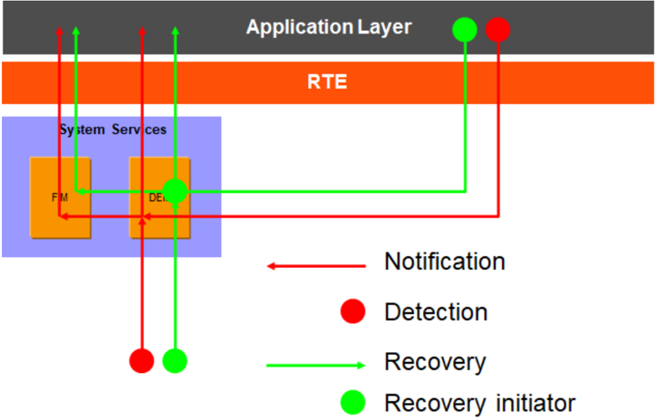

#### 4.1.2 模块的角色

##### 4.1.2.1 报告错误的模块（其他 BSW 或 SWC）

| 检测 | 取决于 SWC 或 BSW 模块 |
| --- | --- |
| 反应 | 取决于 SWC 或 BSW 模块 |
| 报告 | BSW 使用 Dem_SetEventStatus API 或 Det_ReportRuntimeError API 或 Det_ReportTransientFault API 报告事件的新状态；SWC 经由 RTE 使用 Dem_SetEventStatus API 报告事件的新状态 |
| 恢复 | 实现特定 |

##### 4.1.2.2 诊断事件管理器

| 检测 | 当错误发生（DEM_EVENT_STATUS_FAILED 或 DEM_EVENT_STATUS_PREFAILED）或被恢复（DEM_EVENT_STATUS_PASSED 或 DEM_EVENT_STATUS_PREPASSED）时，DEM 由 BSW 以 Dem_SetEventStatus API 通知；当错误发生或被恢复时，DEM 由 SWC 以 Dem_SetEventStatus API 通知 |
| --- | --- |
| 反应 | [SWS_Dem_00184] 事件状态的存储；[SWS_Dem_00190] FreezeFrame 的处理 |
| 报告 | 根据 DEM 的配置，它可以经由 CallbackEventStatusChange DEM 客户端-服务器接口（连接到可配置接口 EventStatusChanged [DEM285] 或 DTCStatusChanged）的 EventStatusChanged 操作 [SWS_Dem_00029] 把信息通知给 FIM 和/或一个 SWC [SWS_Dem_00016]；SWC 可以轮询 DEM 以获得某个事件的状态（DiagnosticMonitor 客户端-服务器接口的 GetEventStatus 操作，连接到 Dem_GetEventStatus 函数 [SWS_Dem_00195]） |
| 恢复 | DEM 拥有一些治愈（healing）能力（对 BSW 而言通过定义的治愈周期，对 SWC 而言通过监控函数）[SWS_Dem_127]；去抖动能力 [SWS_Dem_004] |

##### 4.1.2.3 DET

DET（默认错误跟踪器）经由集成者特定的代码提供对 DEM 和 RTE（SW-C）的访问。运行时错误的发生（通过调用 Det_ReportRuntimeError API 报告）或瞬态故障（通过调用 Det_ReportTransientFault API 报告）触发相应错误处理程序的执行——它可以由特定 ECU 的集成者实现为 Det 内的 callout，并且可以只包括把相应的错误事件存储到内存、对模块 Dem 的调用或短小且合理的动作的执行。

##### 4.1.2.4 功能抑制管理器

| 检测 | 存在不同的检测机制：访问 DEM 信息（以 Dem_GetEventStatus [SWS_Fim_00072] 轮询与所请求 FID 关联的事件，或在启动时转储事件状态 [SWS_Fim_00018]）；由 DEM 通过 Fim_DemTriggerOnEventStatus callout [SWS_Fim_00021] 通知 |
| --- | --- |
| 反应 | 取决于实现：当 DEM 报告变化时存储事件状态。 |
| 报告 | SWC 可以用 Fim_GetFunctionPermission [SWS_Fim_00011] 轮询 FIM。它不通知 SWC。 |
| 恢复 |  |

##### 4.1.2.5 RTE

RTE 为 SWC 提供对 DEM 与 FIM 操作的访问。当需要从某个 SWC 获取信息或必须通知某个 SWC 时，它执行与 DEM 监控器（DEM 回调）关联的可运行体。

RTE 没有为 DEM 提供特定的功能。

##### 4.1.2.6 对 SWC 的通知

| 检测 | 由 FIM 或 DEM（经由 RTE）通知 |
| --- | --- |
| 反应 | N/A |
| 报告 | N/A |
| 恢复 | N/A |

## 5. 与通信相关的错误

### 5.1. 概览

#### 5.1.1 错误处理机制

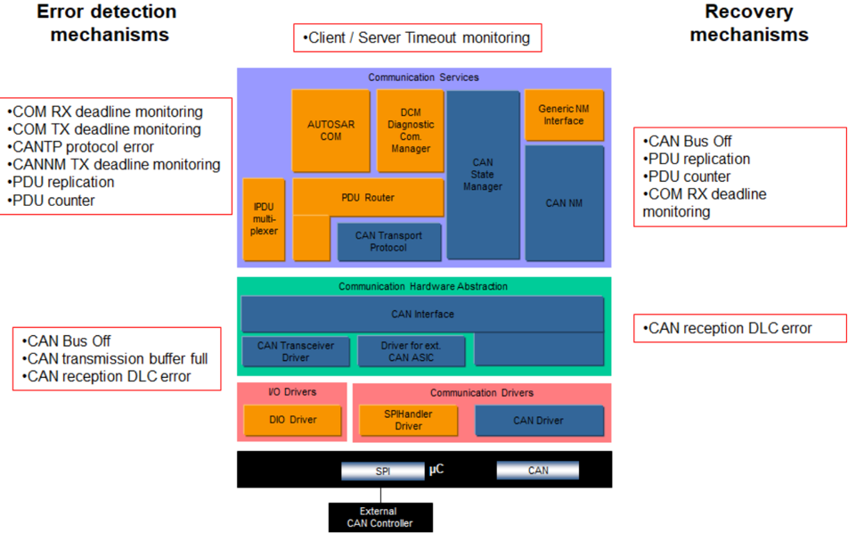

#### 5.1.2 CAN 栈错误列表

| 错误 | 说明 | 检测模块 | DEM/DET（运行时）错误（粗体为报告者） | 带 BSW 恢复动作的缓解者 |
| --- | --- | --- | --- | --- |
| **驱动层级错误** | | | | |
| CAN Bus Off | CAN 网络上的 Bus Off 错误 | CAN | CANSM_E_BUS_OFF¹ | CANSM：→ Bus Off 恢复状态机 |
| CAN Controller Hardware Timeout | 与 CAN 控制器的通信超时 | CANSM | CANSM_E_MODE_REQUEST_TIMEOUT | CANSM：→ 超时恢复状态机 |
| **信号错误** | | | | |
| CAN Transmission buffer full | 由于发送队列已满而无法发送新报文 | CANIF | 不报告给 DEM；报告给 CANIF；报告给 SW-C | 无；间接地经由 TX 最后期限监控 |
| CAN Reception DLC error | 收到的 CAN 帧带有非预期的数据长度计数器，且 DLC 检查已启用 | CANIF | CANIF_E_INVALID_DATA_LENGTH | 无；间接地经由 RX 最后期限监控 |
| COM RX Deadline Monitoring | COM 未及时收到预期的报文 | AUTOSAR COM | 不报告给 DEM；报告给 SW-C² | AUTOSAR COM/SW-C |
| COM TX Deadline Monitoring | 等待发送确认时超时 | AUTOSAR COM | 不报告给 DEM；报告给 SW-C | SW-C |
| CAN Transport Protocol error during reception / during transmission | CAN TP 报文的接收（或发送）期间超时（或其他协议错误） | CANTP | CANTP_E_COM | 用户，DCM |
| CANNM TX Deadline Monitoring | NM 报文的发送错误 | CANNM | 不报告给 DEM | CANNM/SW-C |
| Client / Server timeout | 客户端/服务器操作超时 | AUTOSAR COM/RTE | 不报告给 DEM | SW-C |

¹ CANSM_E_BUS_OFF 不是 DEM 事件的名称（由 DEM 配置生成）。它是一个 CANSM 配置元素，允许为每个 CAN 网络定义不同的 DEM 事件。

² 为每个错过的最后期限引发一个 DEM 事件可能影响太大，而且该事件无法识别出错的部件。COM 超时处理的细节见 [5.3.3](#533-com-rx-最后期限监控) 节「COM RX Deadline Monitoring」和 [5.3.4](#534-com-tx-最后期限监控) 节「COM TX Deadline Monitoring」。

#### 5.1.3 错误处理机制到硬件失效模式的映射

考虑了以下通信硬件失效模式：

| ID | 短名 | 说明 |
| --- | --- | --- |
| CH01 | 某一 CAN 帧 ID 类型的永久性丢失 | 具有特定 ID 的所有 CAN 帧在接收或发送期间丢失。 |
| CH02 | 一帧 CAN 帧的临时丢失 | 一帧 CAN 帧在接收或发送期间临时丢失。 |
| CH03 | 一帧重复的 CAN 帧 | 一帧 CAN 帧（具有相同的 ID 和内容）在 CAN 总线上被无意重复一次或多次。总线未被泛洪。 |
| CH04 | 一帧虚假的 CAN 帧 | 一帧内容可信的 CAN 帧被虚假地发送（因此被接收）。 |
| CH05 | CAN 帧乱序 | CAN 帧被发送的顺序与它们被接收的顺序不一致。 |
| CH06 | 一帧损坏的 CAN 帧 | 一帧 CAN 帧的内容被损坏。 |
| CH07 | 一帧延迟的 CAN 帧 | 一帧预期的 CAN 帧传输相对于预期传输被延迟。 |
| CH08 | CAN 总线被阻塞 | 所有用户失去 CAN 通信。 |
| CH09 | CAN 总线被泛洪 | CAN 帧在 CAN 总线上被持续发送。 |
| CH10 | 错误的路由 | CAN 帧被不正确的目的地接收，或从错误的源接收。 |
| CH11 | 某一 CAN 用户（ECU）的永久性丢失 | 一个 CAN 用户既不能发送也不能接收。 |

下表展示与每种失效模式（下文缩写为 FM）相关的错误处理机制，以及对机制效率的定性估计。定性度量定义为：

- A_D——对所考虑 FM 的检测有完全覆盖；
- A_R——对所考虑 FM 的恢复有完全覆盖；
- P_D——对所考虑 FM 的检测有部分覆盖；
- P_R——对所考虑 FM 的恢复有部分覆盖。

| ID | 简要说明 | Bus Off | 控制器硬件超时 | 发送缓冲区满 | 接收 DLC 错误 | 接收最后期限监控 | 发送最后期限监控 | PDU 复制 | PDU 计数器 |
| --- | --- | --- | --- | --- | --- | --- | --- | --- | --- |
| CH01 | 某一 CAN 帧 ID 类型的永久性丢失 |  | P_D |  |  | A_D P_R |  | A_D P_R |  |
| CH02 | 一帧 CAN 帧的临时丢失 |  |  |  |  | A_D P_R |  | A_D P_R | A_D |
| CH03 | 一帧重复的 CAN 帧 |  |  |  |  |  |  | A_D A_R | A_D A_R |
| CH04 | 一帧虚假的 CAN 帧 |  |  |  | P_D A_R |  |  | A_D A_R | P_D A_R |
| CH05 | CAN 帧乱序 |  |  |  |  |  |  | A_D P_R | A_D P_R |
| CH06 | 一帧损坏的 CAN 帧 |  |  |  | P_D |  |  | A_D A_R | P_D |
| CH07 | 一帧延迟的 CAN 帧 |  |  |  |  | A_D P_R |  |  |  |
| CH08 | CAN 总线被阻塞 | A_D P_R |  | A_D |  | A_D P_R | A_D |  |  |
| CH09 | CAN 总线被泛洪 |  |  |  |  | A_D P_R | A_D | P_D P_R | P_D |
| CH10 | 错误的路由 |  |  |  | P_D P_R | P_D P_R |  | A_D P_R | P_D P_R |
| CH11 | 某一 CAN 用户（ECU）的永久性丢失 |  |  |  |  | A_D P_R |  |  |  |

### 5.2. 通信通道的丢失

#### 5.2.1 CAN 总线关闭（CAN Bus Off）

##### 5.2.1.1 摘要

注意：AUTOSAR COM 模块（或 CANNM、CANTP 等其他模块）会因为通信通道的丢失而间接地对 BusOff 作出反应，但它并不知道错误的具体种类。因此，这些模块不在本节考虑之列。

##### 5.2.1.2 模块的角色

###### 5.2.1.2.1 CAN 控制器（外设）

| 检测 | 依赖硬件 |
| --- | --- |
| 反应 | [SWS_Can_00274] 应禁用 CAN 控制器的任何 Bus-Off 恢复。 |
| 报告 | 取决于 CAN 驱动的配置：把错误记录在寄存器中；如果配置了中断，则把错误报告给 CAN 驱动 |
| 恢复 | 见 CAN 状态管理器。[SWS_Can_00274] 应禁用 CAN 控制器的任何 Bus-Off 恢复。 |

###### 5.2.1.2.2 CAN 驱动

| 检测 | [SWS_Can_00020] [SWS_Can_00099] 取决于 CAN 驱动的配置：轮询 CAN 控制器寄存器 [SWS_Can_00109]；由中断激活 |
| --- | --- |
| 反应 | [SWS_Can_00272] 驱动转换到 CANIF_CS_STOPPED；[SWS_Can_00273] 尝试取消挂起的报文 |
| 报告 | [SWS_Can_00020] 该错误经由 CanIf_ControllerBusOff(controller) API 报告给 CAN 接口。 |
| 恢复 | 见 CAN 状态管理器。 |

###### 5.2.1.2.3 CAN 接口

| 检测 | 由 CanIf_ControllerBusOff(controller) 通知（见上文的 CAN 驱动） |
| --- | --- |
| 反应 | [SWS_CanIf_00298] 控制器操作模式被设置为 CANIF_CS_STOPPED |
| 报告 | 该错误经由 CanSm_ControllerBusOff(controller) 报告给 CAN 状态管理器 |
| 恢复 | 恢复由 CAN 状态管理器触发：CanIf_SetControllerMode(Controller, CANIF_CS_STARTED)；Can_InitController(Controller, *Config)；Can_SetControllerMode(Controller, CAN_T_STARTED)。 |

###### 5.2.1.2.4 CAN 状态管理器

| 检测 | 由 CanSm_ControllerBusOff(controller) 通知（见上文的 CAN 接口） |
| --- | --- |
| 反应 | 统计 Bus-Off 事件；启动错误恢复机制 |
| 报告 | 如果错误被确认，则报告给 DEM。如果恢复成功，该事件从 DEM 中清除（见 [SWS_CanSM_00605]、[SWS_CanSM_00498]、[SWS_CanSM_00522]）。该错误的 DEM 事件在 CANSM_E_BUS_OFF 中按 CAN 网络配置（见 [ECUC_CanSM_00070]）。CANSM 把通信状态（COMM_SILENT_COMMUNICATION）通知给通信管理器，经由 ComM_BusSM_ModeIndication 通知（见 [SWS_CanSM_00521]）。CANSM 把 BusOff 事件通知给 BSW 状态管理器（用 BswM_CanSM_CurrentState）（见 [SWS_CanSM_00508]） |
| 恢复 | [SWS_CanSM_00509] CAN 状态管理器控制错误恢复机制，包括：复位 CAN 控制器：CanIf_SetControllerMode(..., CANSM_CS_STARTED)；禁用/启用发送路径：CanIf_SetPduMode(..., CANIF_SET_TX_OFFLINE / CANIF_SET_TX_ONLINE) |

###### 5.2.1.2.5 通信管理器

| 检测 | 当 Bus Off 被确认或恢复时，由 ComM_BusSM_ModeIndication 通知（见上文的 CAN 状态管理器） |
| --- | --- |
| 反应 | N/A |
| 报告 | 把指示的状态传播给用户（经由 RTE） |
| 恢复 | N/A |

###### 5.2.1.2.6 BSW 状态管理器

| 检测 | 当 Bus Off 被确认或恢复时，由 BswM_CanSM_RequestMode 通知（见上文的 CAN 状态管理器） |
| --- | --- |
| 反应 | 未标准化 |
| 报告 | 未标准化 |
| 恢复 | N/A |

#### 5.2.2 CAN 控制器硬件超时

##### 5.2.2.1 摘要

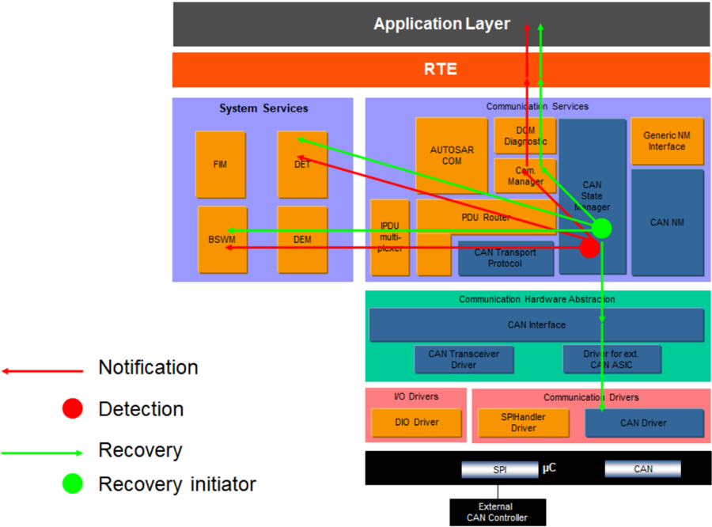

##### 5.2.2.2 模块的角色

###### 5.2.2.2.1 CAN 驱动

| 检测 | CAN 驱动负责在 Can_SetBaudrate()、Can_SetControllerMode() 中检测超时（或硬件缺陷）。当 CanTimeoutDuration 已过时，在每个函数中执行检测 |
| --- | --- |
| 反应 | CAN 驱动不执行任何反应。在超时的情况下，CAN 驱动不完成被请求的操作，并向调用者返回 NOT_OK 错误。 |
| 报告 | CAN 驱动不向上层报告任何超时事件。 |
| 恢复 | 见 CAN 状态管理器。 |

###### 5.2.2.2.2 CAN 接口

| 检测 | CanIf 没有超时检测 |
| --- | --- |
| 反应 | CanIf 不执行任何反应 |
| 报告 | CanIf 不向上层报告任何超时事件。 |
| 恢复 | 恢复由 CAN 状态管理器触发：CanIf_SetControllerMode(Controller, CANIF_CS_STARTED)；Can_InitController(Controller, *Config)；Can_SetControllerMode(Controller, CAN_T_STARTED)。 |

###### 5.2.2.2.3 CAN 状态管理器

| 检测 | 当没有来自 CanIf 模块的相应模式指示、且最大模式请求重复次数（CanSMModeRequestRepetitionMax）[ECUC_CanSM_00335] 已过时，检测到超时。 |
| --- | --- |
| 反应 | 统计控制器超时事件；启动错误恢复机制 |
| 报告 | 当 CANSM 模块状态机以 T_REPEAT_MAX 被触发时，它把 CANSM_E_MODE_REQUEST_TIMEOUT 作为运行时错误报告给 DET（见 [SWS_CanSM_00385]）。CANSM 把通信状态（COMM_SILENT_COMMUNICATION、COMM_NO_COMMUNICATION、COMM_FULL_COMMUNICATION，经由 ComM_BusSM_ModeIndication 通知）通知给通信管理器（见 [SWS_CanSM_00435] [SWS_CanSM_00538] [SWS_CanSM_00651]）。CANSM 把通信状态（CANSM_BSWM_NO_COMMUNICATION、CANSM_BSWM_SILENT_COMMUNICATION、CANSM_BSWM_BUS_OFF，经由 BswM_CanSM_CurrentState 通知）通知给 BSW 状态管理器（见 [SWS_CanSM_00431] [SWS_CanSM_00434] [SWS_CanSM_00508]） |
| 恢复 | CAN 状态管理器控制错误恢复机制，包括：复位 CAN 控制器：CanIf_SetControllerMode(..., CANSM_CS_STARTED)；禁用/启用发送路径：CanIf_SetPduMode(..., CANIF_SET_TX_OFFLINE / CANIF_SET_TX_ONLINE) |

###### 5.2.2.2.4 通信管理器

| 检测 | 当 Bus Off 被确认或恢复时，由 ComM_BusSM_ModeIndication 通知（见上文的 CAN 状态管理器） |
| --- | --- |
| 反应 | N/A |
| 报告 | 把指示的状态传播给用户（经由 RTE） |
| 恢复 | N/A |

###### 5.2.2.2.5 BSW 状态管理器

| 检测 | 当 Bus Off 被确认或恢复时，由 BswM_CanSM_RequestMode 通知（见上文的 CAN 状态管理器） |
| --- | --- |
| 反应 | 未标准化 |
| 报告 | 未标准化 |
| 恢复 | N/A |

### 5.3. 信号错误

#### 5.3.1 CAN 发送缓冲区满

##### 5.3.1.1 摘要

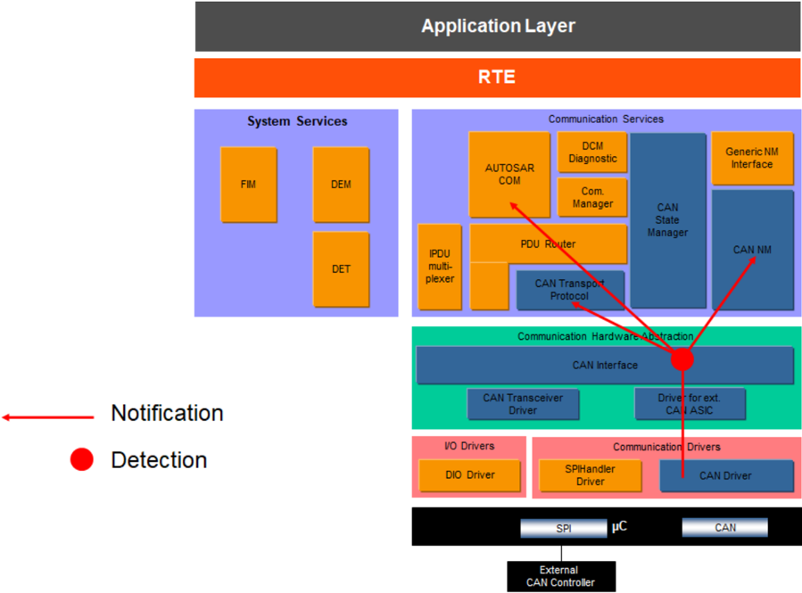

注意：该机制可以与 COM TX Deadline Monitoring 或「发送期间的 CAN 传输协议错误」机制组合使用。

##### 5.3.1.2 模块的角色

###### 5.3.1.2.1 CAN 驱动

| 检测 | 在没有可用于此次发送的硬件对象、且其他发送不能被抢占时，收到一个写请求。Can_Write [SWS_Can_00233]、[SWS_Can_00213]、[SWS_Can_00215]、[SWS_Can_00214]、[SWS_Can_00039] |
| --- | --- |
| 反应 | N/A |
| 报告 | CAN 驱动告知 CAN 接口：它当前正忙于更高优先级的报文或不能被抢占，当前无法发送新报文。 |
| 恢复 | N/A |

###### 5.3.1.2.2 CAN 接口

| 检测 | 发送缓冲可以启用或禁用：发送缓冲禁用：如果一个发送请求失败，则要发送的 L-PDU 丢失，API CanIf_Transmit() 返回值 E_NOT_OK。如果调用了函数 CanIf_Transmit()、且 CanIf 必须把该 L-PDU 存储到发送 L-PDU 缓冲区中，那么如果相应的 CanIfTxBuffer 已被填满，CanIf 应以新的 L-PDU 覆盖较旧的 L-PDU（见 [SWS_CanIf_00068]） |
| --- | --- |
| 反应 | N/A |
| 报告 | 该错误要么由 CanIf_Transmit() 的返回码报告，要么间接地由之后的发送确认缺失报告。 |
| 恢复 | N/A |

另见 COM TX Deadline Monitoring，它提供了一种在此类错误情况下检测并作出反应（从 SWC）的机制。

该错误也可能影响 TP（传输协议）通信；在这种情况下，它将被检测为「发送期间的 CAN 传输协议错误」。

#### 5.3.2 CAN 接收 DLC 错误

##### 5.3.2.1 摘要

注意：CAN 接收 DLC 错误可以与 COM RX Deadline Monitoring 机制组合使用。

此外，接收到错误的 DLC 并不一定表明 ECU 发生故障，也可能由 ECU 的环境引起。

##### 5.3.2.2 模块的角色

###### 5.3.2.2.1 CAN 接口

| 检测 | （CanIf_RxIndication）CAN 接口负责在触发接收指示时检查长度。该检查只在开发模式下、或在生产模式下模块配置了 DLC 检查特性且 PDU 配置了非空 DLC 时发生（见 [SWS_CanIf_00026]） |
| --- | --- |
| 反应 | N/A |
| 报告 | SWS_CanIf_00168：如果 DLC 检查失败，CANIF 把 CANIF_E_INVALID_DATA_LENGTH 错误作为运行时错误报告给 DET。其他上层不被通知。不执行接收指示。错误反应应基于 COM RX Deadline Monitoring 机制。SWS_CanIf_00006：CanDlc [对 CanIf_RxIndication API] 的无效值将被报告给 DET（CANIF_E_INVALID_DATA_LENGTH） |
| 恢复 | [SWS_CanIf_00168] 不执行接收指示 |

另见 COM RX Deadline Monitoring，它提供了一种在此类错误情况下检测并作出反应（从 SWC）的机制。

该错误也可能影响 CAN 传输协议或网络管理协议；在这些情况下，该错误也将由「接收期间的 CAN 传输协议错误」机制或网络管理协议检测到。

#### 5.3.3 COM RX 最后期限监控

##### 5.3.3.1 摘要

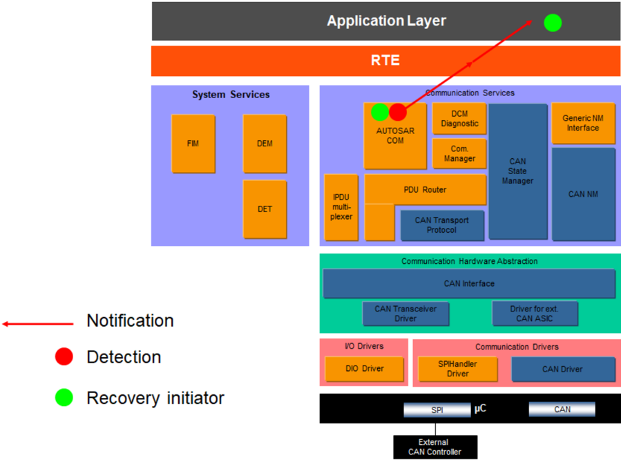

##### 5.3.3.2 模块的角色

###### 5.3.3.2.1 AUTOSAR COM

| 检测 | [SWS_Com_00292] 如果已配置，当在给定的时间段内没有收到任何信号时，AUTOSAR COM 将注意到该失效。 |
| --- | --- |
| 反应 | [SWS_Com_00470] [SWS_Com_00513] [SWS_Com_00500] AUTOSAR COM 可以用默认值替换该值，或保持先前的值。 |
| 报告 | [SWS_Com_00556] 上层（RTE）由 Com_CbkRxTOut 通知 |
| 恢复 | [SWS_Com_00470] [SWS_Com_00513] [SWS_Com_00500] AUTOSAR COM 可以用默认值替换该值，或保持先前的值。 |

###### 5.3.3.2.2 RTE

| 检测 | RTE 由 AUTOSAR COM 以 Rte_COMCbkRxTOut_&lt;sn&gt;（或 Rte_COMCbkRxTOut_&lt;sg&gt;）通知。（见上文的 AUTOSAR COM） |
| --- | --- |
| 反应 | N/A |
| 报告 | RTE 以 DataReceiveErrorEvent 通知 SWC。 |
| 恢复 | 见 AUTOSAR COM 和 SWC。 |

###### 5.3.3.2.3 SWC

| 检测 | SWC 由 RTE 通知（DataReceiveErrorEvent），传输状态以 Rte_Feedback API 请求。（见上文的 RTE） |
| --- | --- |
| 反应 | SWC 可以决定重新发送信号或忽略该错误。 |
| 报告 | N/A |
| 恢复 | SWC 可以决定重新发送信号。 |

#### 5.3.4 COM TX 最后期限监控

##### 5.3.4.1 摘要

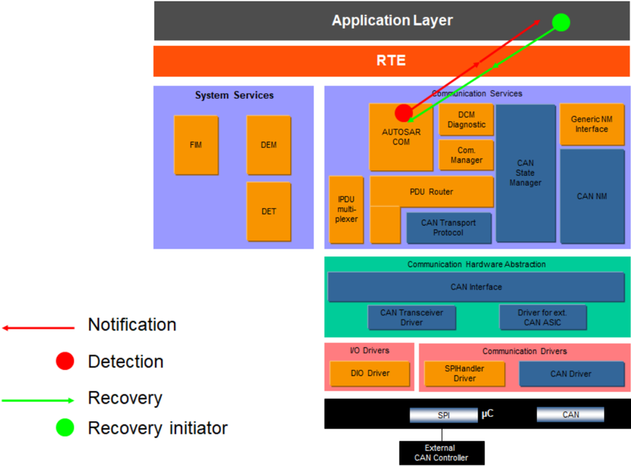

只有当下层通信模块为发送提供确认时，才应使用该特性。

##### 5.3.4.2 模块的角色

###### 5.3.4.2.1 AUTOSAR COM

| 检测 | [SWS_Com_00304] 如果配置了发送最后期限监控，当下层模块不确认发送、且发送最后期限已过时，AUTOSAR COM 将注意到超时。 |
| --- | --- |
| 反应 | N/A |
| 报告 | [SWS_Com_00554] 上层（RTE）由 Com_CbkTxTOut 通知 |
| 恢复 | 见 SWC。 |

###### 5.3.4.2.2 RTE

| 检测 | RTE 由 AUTOSAR COM 以以下方式通知：[SWS_Rte_03775] Rte_COMCbkTxTErr_&lt;sn&gt;（或 Rte_COMCbkTxTOut_&lt;sn&gt;？） |
| --- | --- |
| 反应 | N/A |
| 报告 | RTE 以 DataSendCompletedEvent 通知 SWC，并以 Rte_Feedback API 提供状态。 |
| 恢复 | 见 SWC。 |

###### 5.3.4.2.3 SWC

| 检测 | SWC 由 RTE 通知（DataSendCompletedEvent），传输状态以 Rte_Feedback API 请求。 |
| --- | --- |
| 反应 | SWC 可以决定重新发送信号、记录或忽略该错误。 |
| 报告 | N/A |
| 恢复 | SWC 可以决定重新发送信号。 |

#### 5.3.5 发送期间的 CAN 传输协议错误

该用例是传输协议的一个功能，在 CANTP 模块的功能行为中定义。此处提及它是为了完整覆盖 CAN 帧发送失败的用例。

下面的分析只考虑 CANTP 协议中的超时错误，但对于其他总线或其他传输协议错误，行为是相同的。

##### 5.3.5.1 摘要

注意：在上图中，DCM 代表 CANTP 用户。CANTP 的其他用户应以类似方式反应（它们将收到失败指示，并负责发起恢复）。另一个用户可以是一个 SWC，其通信由 PDU 路由器路由到 AUTOSAR COM；或者一个复杂驱动。

##### 5.3.5.2 模块的角色

###### 5.3.5.2.1 CANTP

| 检测 | CANTP 模块实现 CAN 传输层协议，负责检测发送期间的任何超时。 |
| --- | --- |
| 反应 | [SWS_CanTp_00205] 如果检测到超时，发送被取消。模块准备好处理另一个发送请求。 |
| 报告 | [SWS_CanTp_00229] 任何错误都作为运行时错误报告给 DET（事件 CANTP_E_TX_COM、CANTP_E_COM）。注意：这些事件无法在运行时用于为该错误情形构建反应，因为它不区分不同的错误情形或不同的通信通道。[SWS_CanTp_00205] 该错误还经由 PduR_CanTpTxConfirmation 报告给 CANTP 的用户（例如经由 PDUR 的 DCM）。 |
| 恢复 | N/A |

###### 5.3.5.2.2 PDUR

| 检测 | PDUR 经由 PduR_CanTpTxConfirmation API 获得通知。（见上文的 CANTP） |
| --- | --- |
| 反应 | N/A |
| 报告 | 该错误被路由到 CANTP 用户（Dcm_TxConfirmation） |
| 恢复 | N/A |

###### 5.3.5.2.3 DCM

| 检测 | [SWS_Dcm_00351] DCM 以 Dcm_TxConfirmation 的 Result 参数获得通知（见上文的 PDUR）。诊断会话还有一个内部超时处理器。 |
| --- | --- |
| 反应 | [SWS_Dcm_00351] 发送资源（发送缓冲区）被解锁。其他错误处理特性（DCM 中的超时）被取消。 |
| 报告 | 用户以 ConfirmationRespPend 操作获得通知 |
| 恢复 | N/A |

注意：CANTP 的其他用户应提供类似的通知 callout 并以类似方式反应。例如 AUTOSAR COM 模块就是如此。

#### 5.3.6 接收期间的 CAN 传输协议错误

##### 5.3.6.1 摘要

注意：在上图中，DCM 代表 CANTP 用户。CANTP 的其他用户应以类似方式反应（它们将收到失败指示，并负责发起恢复）。另一个用户可以是一个 SWC，其通信由 PDU 路由器路由到 AUTOSAR COM；或者一个复杂驱动。

##### 5.3.6.2 模块的角色

###### 5.3.6.2.1 CANTP

| 检测 | CANTP 模块实现 CAN 传输层协议，负责检测接收期间的任何超时。 |
| --- | --- |
| 反应 | [SWS_CanTp_00205] 如果检测到超时，接收被取消。 |
| 报告 | [SWS_CanTp_00229] 任何错误都作为运行时错误报告给 DET（事件 CANTP_E_RX_COM、CANTP_E_COM）。注意：这些事件无法用于为该错误情形构建反应，因为它不区分不同的错误情形或不同的通信通道。[SWS_CanTp_00205] 该错误还经由 PduR_CanTpRxIndication 报告给 CANTP 的用户（例如经由 PDUR 的 DCM）。 |
| 恢复 | N/A |

###### 5.3.6.2.2 PDUR

| 检测 | PDUR 经由 PduR_CanTpRxIndication API 获得通知。（见上文的 CANTP） |
| --- | --- |
| 反应 | N/A |
| 报告 | 该错误被路由到 CANTP 用户（Dcm_RxIndication） |
| 恢复 | N/A |

###### 5.3.6.2.3 DCM

| 检测 | DCM 以 Dcm_RxIndication 的 Result 参数获得通知。诊断会话还有一个内部超时处理器。 |
| --- | --- |
| 反应 | 接收资源（接收缓冲区）被解锁。 |
| 报告 | N/A |
| 恢复 | N/A |

注意：CANTP 的其他用户应提供类似的通知 callout 并以类似方式反应。例如 AUTOSAR COM 模块就是如此。

#### 5.3.7 CANNM TX 最后期限监控

该用例并不是一个真正的错误。它是网络管理的一个功能，在 CANNM 模块的功能行为中定义。此处提及它是为了完整覆盖 CAN 帧发送失败的用例。

#### 5.3.8 客户端/服务器超时

##### 5.3.8.1 摘要

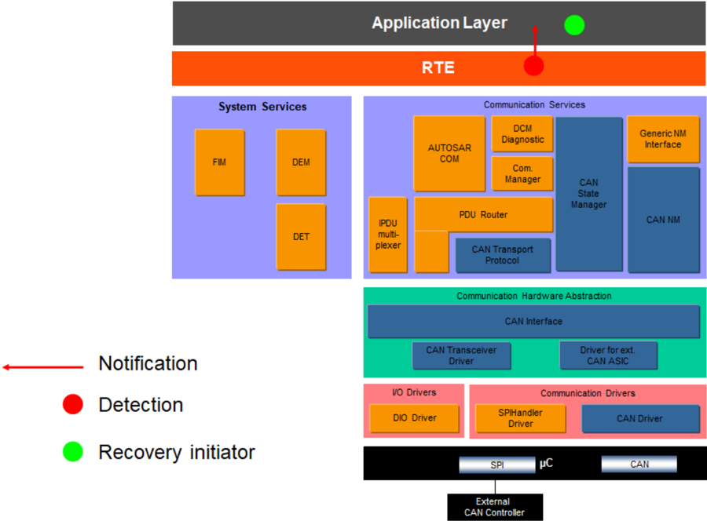

##### 5.3.8.2 模块的角色

###### 5.3.8.2.1 RTE

| 检测 | [SWS_Rte_3763] 如果已配置，RTE 负责超时的检测。（注意，对于本地 ECU 间通信存在一些例外，其中不考虑超时） |
| --- | --- |
| 反应 | N/A |
| 报告 | [SWS_Rte_1107、SWS_Rte_1114] RTE 以 AsynchronousServerCallReturnsEvent 通知 SWC，并以 Rte_Call 或 Rte_Result API 提供状态。 |
| 恢复 | 见 SWC |

###### 5.3.8.2.2 SWC

| 检测 | SWC 由 RTE 通知（DataSendCompletedEvent），传输状态以 Rte_Call 或 Rte_Result API 返回。 |
| --- | --- |
| 反应 | SWC 可以决定重新发送请求、记录或忽略该错误。 |
| 报告 | N/A |
| 恢复 | SWC 可以决定重新发送请求。 |

## 6. 与 NVRAM 相关的错误

### 6.1. 概览

#### 6.1.1 错误处理机制

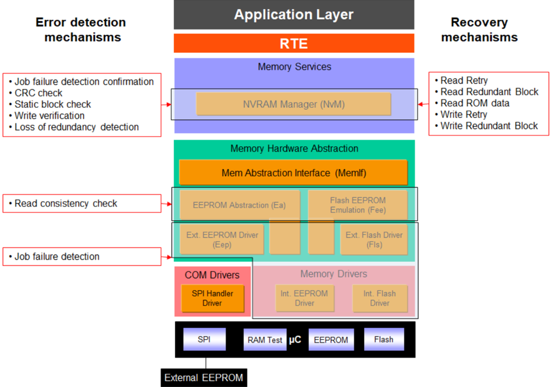

在 NVRAM 栈的较低层级，驱动中实现了检测硬件访问问题的机制。检测机制在 EEPROM 与 Flash 驱动之间是协调一致的。

在 NVRAM 栈的较高层级（主要在 NVRAM 管理器中），实现了检测数据损坏、内存地址损坏和冗余丢失的机制。NVRAM 栈中检测到的错误的所有恢复机制都由 NVRAM 管理器处理。

错误可以在轮询模式或中断模式下报告。整个存储栈的配置必须与 SWC 和 BSW 用户的使用方式一致。

#### 6.1.2 NVRAM 栈错误列表

| 错误 | 说明 | 检测模块 | DEM 错误（粗体为报告者） | 带 BSW 恢复动作的缓解者 |
| --- | --- | --- | --- | --- |
| **驱动层级错误** | | | | |
| Flash write job error | 由于硬件错误，Flash 写作业失败。 | FLS | FLS_E_WRITE_FAILED | NVM：→ 写重试 |
| Flash erase job error | 由于硬件错误，Flash 擦除作业失败。 | FLS | FLS_E_ERASE_FAILED | NVM：→ 若涉及写处理则写重试 |
| Flash read job error | 由于硬件错误，Flash 读作业失败。 | FLS | FLS_E_READ_FAILED | NVM：→ 读重试 → 读冗余块 → 读 ROM 块 |
| Flash compare job error | 由于硬件错误，Flash 比较作业失败。 | FLS | FLS_E_COMPARE_FAILED | 无 |
| External Flash Hardware ID Mismatch | 驱动初始化期间预期硬件 ID 不匹配。 | FLS | FLS_E_UNEXPECTED_FLASH_ID | 无 |
| EEPROM write job error | 由于硬件错误，EEPROM 写作业失败。 | EEP | EEP_E_WRITE_FAILED | NVM：→ 写重试 |
| EEPROM erase job error | 由于硬件错误，EEPROM 擦除作业失败。 | EEP | EEP_E_ERASE_FAILED | NVM：→ 若涉及写处理则写重试 |
| EEPROM read job error | 由于硬件错误，EEPROM 读作业失败。 | EEP | EEP_E_READ_FAILED | NVM：→ 读重试 → 读冗余块 → 读 ROM 块 |
| EEPROM compare job error | 由于硬件错误，EEPROM 比较作业失败。 | EEP | EEP_E_COMPARE_FAILED | 无 |
| **EEPROM 抽象/Flash 仿真层级错误** | | | | |
| FEE consistency check error | Flash EEPROM 仿真在要读取的块中检测到一致性问题。 | FEE | NVM_E_INTEGRITY_FAILED | NVM：→ 读冗余块 → 读 ROM 块 |
| EA consistency check error | EEPROM 抽象仿真在要读取的块中检测到一致性问题。 | EA | NVM_E_INTEGRITY_FAILED | NVM：→ 读冗余块 → 读 ROM 块 |
| **NVRAM 管理器层级错误** | | | | |
| NVM CRC check | RAM 块上的 CRC 检查失败。 | NVM | NVM_E_INTEGRITY_FAILED | NVM：→ 读冗余块 → 读 ROM 块 |
| NVM write verification error | 写入 NVRAM 的 NVRAM 块被立即读回，并与 RAM 中的原始内容进行比较。 | NVM | NVM_E_VERIFY_FAILED | NVM：→ 写重试 |
| Static block check error | 静态块 ID 检查失败。 | NVM | NVM_E_WRONG_BLOCK_ID | NVM：→ 读重试 → 读冗余块 → 读 ROM 块 |
| Loss of redundancy | 读取或写入期间冗余块无效。 | NVM | NVM_E_LOSS_OF_REDUNDANCY | NVM：→ 损坏的 NV 块的恢复。 |
| NVM API request failure | 恢复失败后确认作业失败。 | NVM | NVM_E_REQ_FAILED | 无 |

#### 6.1.3 错误处理机制到 NVRAM 硬件失效模式的映射

考虑了以下 NVRAM 硬件失效模式：

| ID | 短名 | 说明 |
| --- | --- | --- |
| FM01 | 无法访问 | 无法访问存储设备。 |
| FM02 | 读取损坏的数据 | 从存储器读取的数据是损坏的，即与预期不符。 |
| FM03 | 从不正确的地址读取 | 没有读取预期地址处的单元，而是获得了其他单元的值。 |
| FM04 | 写入损坏的数据 | 写入存储器的数据被存储设备损坏，即存储的数据与预期不符。 |
| FM05 | 写入不正确的地址 | 没有写入预期地址处的单元，而是覆盖了其他单元的值。 |

下表展示与每种 FM 相关的错误处理机制，以及对机制效率的定性估计。定性度量定义为：

- A——对所考虑 FM 的完全覆盖；
- P——对所考虑 FM 的部分覆盖；
- N——对所考虑 FM 的无覆盖；
- (1) 针对瞬态错误。

| ID | 失效模式 | 说明 | 作业失败检测 | CRC 检查 | 静态块 ID 检查 | 写验证 |
| --- | --- | --- | --- | --- | --- | --- |
| FM01 | 无法访问 | 无法访问存储设备。 | A | N | N | N |
| FM02 | 读取损坏的数据 | 从存储器读取的数据是损坏的，即与预期不符。 | N | P | N | N |
| FM03 | 从不正确的地址读取 | 没有读取预期地址处的单元，而是获得了其他单元的值。 | N | P | P | N |
| FM04 | 写入损坏的数据 | 写入存储器的数据被存储设备损坏，即存储的数据与预期不符。 | N | N | N | A |
| FM05 | 写入不正确的地址 | 没有写入预期地址处的单元，而是覆盖了其他单元的值。 | N | N | N | P |

| ID | 失效模式 | 说明 | 读重试(1) | 读冗余块 | 读 ROM 数据 | 写重试 | 写冗余块 |
| --- | --- | --- | --- | --- | --- | --- | --- |
| FM01 | 无法访问 | 无法访问存储设备。 | P | N | P | P | N |
| FM02 | 读取损坏的数据 | 从存储器读取的数据是损坏的，即与预期不符。 | P | P | P | N | N |
| FM03 | 从不正确的地址读取 | 没有读取预期地址处的单元，而是获得了其他单元的值。 | P | P | P | N | N |
| FM04 | 写入损坏的数据 | 写入存储器的数据被存储设备损坏，即存储的数据与预期不符。 | N | N | N | P | P |
| FM05 | 写入不正确的地址 | 没有写入预期地址处的单元，而是覆盖了其他单元的值。 | N | N | N | P | P |

### 6.2. 驱动层级错误

#### 6.2.1 Flash 写作业错误

##### 6.2.1.1 摘要

写作业错误由硬件检测 (1)。Flash 驱动是第一个涉及的 SW 模块，负责向 DEM 和上层报告 (2)。上层必须复位一些内部状态，以接受新的请求。NVM 模块中存在一种恢复机制，允许在失败时重试写作业 (3)。如果恢复也失败 (4)，NVRAM 管理器向 DEM 报告 [NVM_E_REQ_FAILED](#612-nvram-栈错误列表) 错误，并把作业结果置为 NOK (5)，见「NVM API 请求失败」。

##### 6.2.1.2 模块的角色

###### 6.2.1.2.1 Flash 控制器

| 检测 | 依赖硬件 |
| --- | --- |
| 反应 | N/A |
| 报告 | 取决于驱动配置或硬件实现，错误可以记录在寄存器中，或者控制器可以经由中断把错误报告给驱动。 |
| 恢复 | 见 NVRAM 管理器。 |

###### 6.2.1.2.2 Flash 驱动

| 检测 | 由 Flash 控制器报告（见上文的 Flash 控制器）。 |
| --- | --- |
| 反应 | 作业被中止 [SWS_Fls_00105]；模块状态被置为 MEMIF_IDLE，准备好接受新的作业 [SWS_Fls_052] |
| 报告 | 该错误以错误码 [FLS_E_WRITE_FAILED](#612-nvram-栈错误列表) 报告给 DEM [SWS_Fls_00004] [SWS_Fls_00105]。取决于 Flash 驱动的配置：Flash EEPROM 仿真应以函数 Fls_GetJobResult 轮询该错误（作业结果置为 MEMIF_JOB_FAILED）[SWS_Fls_00105] [SWS_Fls_00035]；应经由回调函数 Fee_JobErrorNotification 把该错误报告给 Flash EEPROM 仿真 [SWS_Fls_00263] [FLS168]。 |
| 恢复 | 见 NVRAM 管理器。 |

###### 6.2.1.2.3 Flash EEPROM 仿真

| 检测 | 由 Flash 驱动报告（见上文的 Flash 驱动） |
| --- | --- |
| 反应 | [SWS_Fee_00054] 实现特定的错误处理。 |
| 报告 | 取决于配置：存储抽象接口应以函数 Fee_GetJobResult 轮询该错误（作业结果置为 MEMIF_JOB_FAILED）[SWS_Fee_00091] [SWS_Fee_00035]；应经由回调函数 NvM_JobErrorNotification 把该错误报告给 NVRAM 管理器 [SWS_Fee_00056] [SWS_Fee_00054]。 |
| 恢复 | 见 NVRAM 管理器。 |

###### 6.2.1.2.4 存储抽象接口

| 检测 | 由 Flash EEPROM 仿真报告（见上文的 Flash EEPROM 仿真）——仅当栈配置为轮询模式时 |
| --- | --- |
| 反应 | N/A |
| 报告 | 仅当栈配置为轮询模式时：NVRAM 管理器应以函数 MemIf_GetJobResult 轮询该错误（作业结果置为 MEMIF_JOB_FAILED）[MemIf043] [MemIf053]。 |
| 恢复 | 见 NVRAM 管理器。 |

###### 6.2.1.2.5 NVRAM 管理器

| 检测 | 取决于栈的配置：以函数 MemIf_GetJobResult 轮询作业结果 MEMIF_JOB_FAILED（见上文的存储抽象接口）；由 FEE 经由回调函数 NvM_JobErrorNotification 通知（见上文的 Flash EEPROM 仿真）。 |
| --- | --- |
| 反应 | [SWS_NvM_00213] [SWS_NvM_00296] 递增写重试计数器。如果超过重试次数，请求被中止。 |
| 报告 | 如果恢复动作中止，则把错误 [NVM_E_REQ_FAILED](#612-nvram-栈错误列表) 报告给 DEM [SWS_NvM_00213] [SWS_NvM_00296]。取决于配置：用户应以函数 NvM_GetErrorStatus 轮询该错误（作业结果置为 NVM_REQ_NOT_OK）[SWS_NvM_00451] [SWS_NvM_00213] [SWS_NvM_00296]；应经由可配置回调 SingleBlockCallbackFunction 或 MultiBlockCallbackFunction 把该错误报告给用户 [SWS_NvM_00113] [SWS_NvM_00260]。 |
| 恢复 | [SWS_NvM_00168] [SWS_NvM_00213] [SWS_NvM_00296] NVRAM 管理器控制错误恢复机制。恢复机制为（如果配置）「写重试」。 |

###### 6.2.1.2.6 应用软件组件

| 检测 | 如果错误处理策略的设计需要，SWC 可以按两种不同的方式设计：它以连接到 NVM 的客户端端口上的 GetErrorStatus 操作轮询作业状态；它提供附加到 NvMNotifyJobFinished 服务器端口的服务器可运行体，该可运行体应由 NVM 调用。见 AUTOSAR_CP_SWS_NVRAMManager.pdf 的 13.3.1.3 节「Port Interface」、13.3.2 节「Ports and Port Interface for Notifications」 |

#### 6.2.2 Flash 擦除作业错误

##### 6.2.2.1 摘要

擦除作业错误由硬件检测 (1)。Flash 驱动是第一个涉及的 SW 模块，负责向 DEM 和上层报告 (2)。上层必须复位一些内部状态，以接受新的请求。如果擦除驱动作业是写操作的一部分，则一旦错误被报告到该层，NVRAM 管理器就发起写重试 (3)。如果恢复也失败 (4)，NVRAM 管理器向 DEM 报告 [NVM_E_REQ_FAILED](#612-nvram-栈错误列表) 错误，并把作业结果置为 NOK (5)，见「NVM API 请求失败」。

##### 6.2.2.2 模块的角色

###### 6.2.2.2.1 Flash 控制器

| 检测 | 依赖硬件。 |
| --- | --- |
| 反应 | N/A |
| 报告 | 取决于驱动配置或硬件实现，错误可以记录在寄存器中，或者控制器可以经由中断把错误报告给驱动。 |
| 恢复 | 见 NVRAM 管理器。 |

###### 6.2.2.2.2 Flash 驱动

| 检测 | 由 Flash 控制器报告（见上文的 Flash 控制器）。 |
| --- | --- |
| 反应 | 作业被中止 [SWS_Fls_00104]；模块状态被置为 MEMIF_IDLE，准备好接受新的作业 [FLS052] |
| 报告 | 该错误以错误码 [FLS_E_ERASE_FAILED](#612-nvram-栈错误列表) 报告给 DEM [SWS_Fls_00004] [SWS_Fls_00104]。取决于 Flash 驱动的配置：Flash EEPROM 仿真应以函数 Fls_GetJobResult 轮询该错误（作业结果置为 MEMIF_JOB_FAILED）[SWS_Fls_00104] [SWS_Fls_00035]；应经由回调函数 Fee_JobErrorNotification 把该错误报告给 Flash EEPROM 仿真 [SWS_Fls_00263] [FLS168]。 |
| 恢复 | 见 NVRAM 管理器。 |

###### 6.2.2.2.3 Flash EEPROM 仿真

| 检测 | 由 Flash 驱动报告（见上文的 Flash 驱动） |
| --- | --- |
| 反应 | [SWS_Fee_00054] 实现特定的错误处理。 |
| 报告 | 取决于配置：存储抽象接口应以函数 Fee_GetJobResult 轮询该错误（作业结果置为 MEMIF_JOB_FAILED）[SWS_Fee_00091] [SWS_Fee_00035]；应经由回调函数 NvM_JobErrorNotification 把该错误报告给 NVRAM 管理器 [SWS_Fee_00056] [SWS_Fee_00054]。 |
| 恢复 | 见 NVRAM 管理器。 |

###### 6.2.2.2.4 存储抽象接口

| 检测 | 由 Flash EEPROM 仿真报告（见上文的 Flash EEPROM 仿真）——仅当栈配置为轮询模式时 |
| --- | --- |
| 反应 | N/A |
| 报告 | 取决于配置：NVRAM 管理器应以函数 MemIf_GetJobResult 轮询该错误（作业结果置为 MEMIF_JOB_FAILED）[MemIf043] [MemIf053]。 |
| 恢复 | 见 NVRAM 管理器。 |

###### 6.2.2.2.5 NVRAM 管理器

| 检测 | 取决于栈的配置：以函数 MemIf_GetJobResult 轮询作业结果 MEMIF_JOB_FAILED（见上文的存储抽象接口）；由 FEE 经由回调函数 NvM_JobErrorNotification 通知（见上文的 Flash EEPROM 仿真）。 |
| --- | --- |
| 反应 | 如果涉及写处理：[SWS_NvM_00213] [SWS_NvM_00296] 递增写重试计数器。如果超过重试次数，请求被中止。 |
| 报告 | 错误 [NVM_E_REQ_FAILED](#612-nvram-栈错误列表) 报告给 DEM [SWS_NvM_00271] [SWS_NvM_00269]；可以通过以函数 NvM_GetErrorStatus 轮询 NVRAM 管理器获得该错误（作业结果置为 NVM_REQ_NOT_OK）。 |
| 恢复 | 如果涉及写处理：[SWS_NvM_00168] [SWS_NvM_00213] [SWS_NvM_00296] NVRAM 管理器控制错误恢复机制。恢复机制为（如果配置）「写重试」。 |

###### 6.2.2.2.6 应用软件组件

| 检测 | 如果错误处理策略的设计需要，SWC 可以按两种不同的方式设计：它以连接到 NVM 的客户端端口上的 GetErrorStatus 操作轮询作业状态；它提供附加到 NvMNotifyJobFinished 服务器端口的服务器可运行体，该可运行体应由 NVM 调用。见 AUTOSAR_CP_SWS_NVRAMManager.pdf 的 13.3.1.3 节「Port Interface」、13.3.2 节「Ports and Port Interface for Notifications」 |

#### 6.2.3 Flash 读作业错误

##### 6.2.3.1 摘要

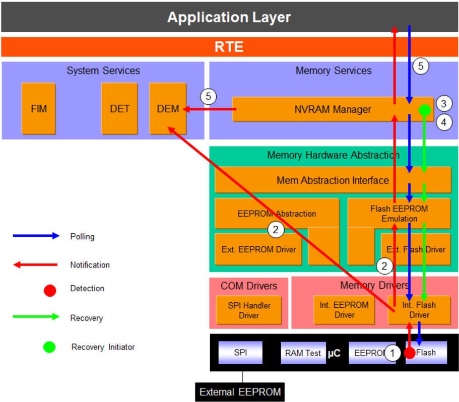

读作业错误由硬件检测 (1)。Flash 驱动是第一个涉及的 SW 模块，负责向 DEM 和上层报告 (2)。上层必须复位一些内部状态，以接受新的请求。恢复由 NVRAM 管理器发起 (3)：在继续读取冗余块或 ROM 数据之前，应进行一次或多次读取尝试。如果恢复动作意味着冗余丢失或使用 ROM 数据，NVRAM 管理器经由作业结果报告数据质量的损失。针对冗余丢失报告一个 DEM 错误（见「冗余丢失」）。如果恢复也失败 (4)，NVRAM 管理器向 DEM 报告 [NVM_E_REQ_FAILED](#612-nvram-栈错误列表) 错误，并把作业结果置为 NOK (5)，见「NVM API 请求失败」。

##### 6.2.3.2 模块的角色

###### 6.2.3.2.1 Flash 控制器

| 检测 | 依赖硬件。 |
| --- | --- |
| 反应 | N/A |
| 报告 | 取决于驱动配置或硬件实现，错误可以记录在寄存器中，或者控制器可以经由中断把错误报告给驱动。 |
| 恢复 | 见 NVRAM 管理器。 |

###### 6.2.3.2.2 Flash 驱动

| 检测 | 由 Flash 控制器报告（见上文的 Flash 控制器）。 |
| --- | --- |
| 反应 | 作业被中止 [SWS_Fls_00106]；模块状态被置为 MEMIF_IDLE，准备好接受新的作业 [FLS052] |
| 报告 | 该错误以错误码 [FLS_E_READ_FAILED](#612-nvram-栈错误列表) 报告给 DEM [SWS_Fls_00004] [SWS_Fls_00106]。取决于 Flash 驱动的配置：Flash EEPROM 仿真应以函数 Fls_GetJobResult 轮询该错误（作业结果置为 MEMIF_JOB_FAILED）[SWS_Fls_00106] [SWS_Fls_00035]；应经由回调函数 Fee_JobErrorNotification 把该错误报告给 Flash EEPROM 仿真 [SWS_Fls_00263] [FLS168]。 |
| 恢复 | 见 NVRAM 管理器。 |

###### 6.2.3.2.3 Flash EEPROM 仿真

| 检测 | 由 Flash 驱动报告（见上文的 Flash 驱动） |
| --- | --- |
| 反应 | [SWS_Fee_00054] 实现特定的错误处理。 |
| 报告 | 取决于配置：存储抽象接口应以函数 Fee_GetJobResult 轮询该错误（作业结果置为 MEMIF_JOB_FAILED）[SWS_Fee_00091] [SWS_Fee_00035]；应经由回调函数 NvM_JobErrorNotification 把该错误报告给 NVRAM 管理器 [SWS_Fee_00056] [SWS_Fee_00054]。 |
| 恢复 | 见 NVRAM 管理器。 |

###### 6.2.3.2.4 存储抽象接口

| 检测 | 由 Flash EEPROM 仿真报告（见上文的 Flash EEPROM 仿真）——仅当栈配置为轮询模式时 |
| --- | --- |
| 反应 | N/A |
| 报告 | 取决于配置：NVRAM 管理器应以函数 MemIf_GetJobResult 轮询该错误（作业结果置为 MEMIF_JOB_FAILED）[MemIf043] [MemIf053]。 |
| 恢复 | 见 NVRAM 管理器。 |

###### 6.2.3.2.5 NVRAM 管理器

| 检测 | 取决于栈的配置：以函数 MemIf_GetJobResult 轮询作业结果 MEMIF_JOB_FAILED（见上文的存储抽象接口）；由 FEE 经由回调函数 NvM_JobErrorNotification 通知（见上文的 Flash EEPROM 仿真）。 |
| --- | --- |
| 反应 | N/A |
| 报告 | 如果检测到冗余丢失，作业结果被置为 NVM_REQ_REDUNDANCY_FAILED，并把 [NVM_E_LOSS_OF_REDUNDANCY](#612-nvram-栈错误列表) 错误报告给 DEM（见 [SWS_NvM_00470] [SWS_NvM_00546]）。如果恢复期间使用了 ROM 数据，作业结果被置为 NVM_REQ_RESTORED_FROM_ROM（见 [SWS_NvM_00470]）。如果恢复机制「读重试」「读冗余块」和「读 ROM 块」失败，则把错误 [NVM_E_REQ_FAILED](#612-nvram-栈错误列表) 报告给 DEM（见 [SWS_NvM_00279] [SWS_NvM_00288]）。取决于配置：用户应以函数 NvM_GetErrorStatus 轮询该错误（作业结果置为 NVM_REQ_NOT_OK）（见 [SWS_NvM_00451] [SWS_NvM_00359] [SWS_NvM_00213]）；应经由可配置回调 SingleBlockCallbackFunction 或 MultiBlockCallbackFunction 把该错误报告给用户（见 [SWS_NvM_00113] [SWS_NvM_00260]）。 |
| 恢复 | NVRAM 管理器控制错误恢复机制。恢复机制包括（如果配置）「读重试」「读冗余块」和「读 ROM 块」（见 [SWS_NvM_00390] [SWS_NvM_00171] [SWS_NvM_00172] [SWS_NvM_00391] [SWS_NvM_00388]）。 |

###### 6.2.3.2.6 应用软件组件

| 检测 | 如果错误处理策略的设计需要，SWC 可以按两种不同的方式设计：它以连接到 NVM 的客户端端口上的 GetErrorStatus 操作轮询作业状态；它提供附加到 NvMNotifyJobFinished 服务器端口的服务器可运行体，该可运行体应由 NVM 调用。见 AUTOSAR_CP_SWS_NVRAMManager.pdf 的 13.3.1.3 节「Port Interface」、13.3.2 节「Ports and Port Interface for Notifications」 |

#### 6.2.4 Flash 比较作业错误

##### 6.2.4.1 摘要

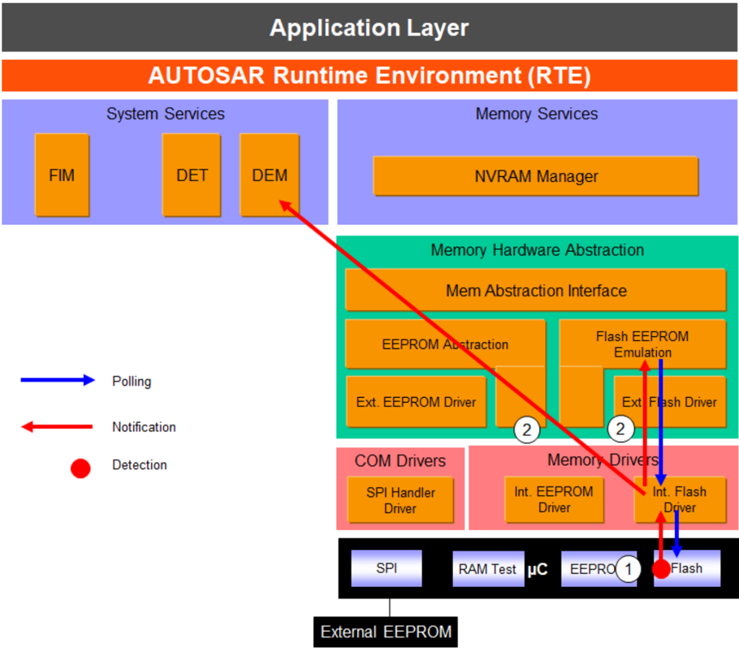

注意：Flash 比较函数是 Flash EEPROM 仿真用于判断是否需要擦除/写入的内部机制。

比较作业错误由硬件检测 (1)。Flash 驱动是第一个涉及的 SW 模块，负责向 DEM 和 Flash EEPROM 仿真报告 (2)，后者必须复位一些内部状态以接受新的请求。

##### 6.2.4.2 模块的角色

###### 6.2.4.2.1 Flash 控制器

| 检测 | 依赖硬件。 |
| --- | --- |
| 反应 | N/A |
| 报告 | 取决于驱动配置或硬件实现，错误可以记录在寄存器中，或者控制器可以经由中断把错误报告给驱动。 |
| 恢复 | N/A |

###### 6.2.4.2.2 Flash 驱动

| 检测 | 由 Flash 控制器报告（见上文的 Flash 控制器）。 |
| --- | --- |
| 反应 | 作业被中止（见 SWS_Fls_00154）；模块状态被置为 MEMIF_IDLE，准备好接受新的作业（见 [FLS052]） |
| 报告 | 该错误以错误码 [FLS_E_COMPARE_FAILED](#612-nvram-栈错误列表) 报告给 DEM（见 [SWS_Fls_00004] [SWS_Fls_00154]）。取决于 Flash 驱动的配置：Flash EEPROM 仿真应以函数 Fls_GetJobResult 轮询该错误（作业结果置为 MEMIF_JOB_FAILED）（见 [SWS_Fls_00154] [SWS_Fls_00035]）；应经由回调函数 Fee_JobErrorNotification 把该错误报告给 Flash EEPROM 仿真（见 [SWS_Fls_00263] [FLS168]）。 |
| 恢复 | N/A |

###### 6.2.4.2.3 Flash EEPROM 仿真

| 检测 | 由 Flash 驱动报告（见上文的 Flash 驱动） |
| --- | --- |
| 反应 | [SWS_Fee_00054] 实现特定的错误处理。 |
| 报告 | N/A |
| 恢复 | N/A |

#### 6.2.5 外部 Flash 硬件 ID 不匹配

##### 6.2.5.1 摘要

在外部 Flash 驱动的初始化期间，FLS 模块检查外部 Flash 设备的硬件 ID 与相应已发布参数之间是否存在不匹配 (1)。如果不匹配，模块保持未初始化状态。向 DEM 报告一个错误，错误状态也可以经由轮询转发给上层 (2)。没有描述进一步的反应（NVRAM 管理器层级不考虑该错误）。没有恢复动作。

##### 6.2.5.2 模块的角色

###### 6.2.5.2.1 外部 Flash 驱动

| 检测 | [SWS_Fls_00144] 在外部 Flash 驱动的初始化期间，FLS 模块应检查外部 Flash 设备的硬件 ID 与相应已发布参数之间是否存在不匹配。 |
| --- | --- |
| 反应 | 把 FLS 模块状态置为 FLS_E_UNINIT；FLS 模块不应初始化自身（见 [SWS_Fls_00144]） |
| 报告 | 该错误以错误码 [FLS_E_UNEXPECTED_FLASH_ID](#612-nvram-栈错误列表) 报告给 DEM（见 [SWS_Fls_00144] [SWS_Fls_00004]）；可以以函数 Fls_GetStatus 轮询该错误（模块状态置为 FLS_E_UNINIT）（见 [SWS_Fls_00034]） |
| 恢复 | N/A |

###### 6.2.5.2.2 Flash EEPROM 仿真

| 检测 | 由 Flash 驱动报告。 |
| --- | --- |
| 反应 | N/A |
| 报告 | [SWS_Fee_00090] 存储抽象接口可以以函数 Fee_GetStatus 轮询该错误（模块状态置为 Memif_E_UNINIT）。 |
| 恢复 | N/A |

###### 6.2.5.2.3 存储抽象接口

| 检测 | 由 Flash EEPROM 仿真报告。 |
| --- | --- |
| 反应 | N/A |
| 报告 | N/A |
| 恢复 | N/A |

#### 6.2.6 EEPROM 写作业错误

##### 6.2.6.1 摘要

写作业错误由硬件检测 (1)。EEPROM 驱动是第一个涉及的 SW 模块，负责向 DEM 和上层报告 (2)。上层必须复位一些内部状态，以接受新的请求。NVM 模块中存在一种恢复机制，允许在失败时重试写作业 (3)。如果恢复也失败 (4)，NVRAM 管理器向 DEM 报告 [NVM_E_REQ_FAILED](#612-nvram-栈错误列表) 错误，并把作业结果置为 NOK (5)，见「NVM API 请求失败」。

##### 6.2.6.2 模块的角色

###### 6.2.6.2.1 EEPROM 控制器

| 检测 | 依赖硬件 |
| --- | --- |
| 反应 | N/A |
| 报告 | 取决于驱动配置或硬件实现，错误可以记录在寄存器中，或者控制器可以经由中断把错误报告给驱动。 |
| 恢复 | 见 NVRAM 管理器。 |

###### 6.2.6.2.2 EEPROM 驱动

| 检测 | 由 EEPROM 控制器报告（见上文的 EEPROM 控制器）。 |
| --- | --- |
| 反应 | 作业被中止（见 [SWS_Eep_00068]）；模块状态被置为 MEMIF_IDLE，准备好接受新的作业（见 [SWS_Eep_00068]） |
| 报告 | 该错误以错误码 [EEP_E_WRITE_FAILED](#612-nvram-栈错误列表) 报告给 DEM。取决于 EEPROM 驱动的配置：EEPROM 抽象应以函数 Eep_GetJobResult 轮询该错误（作业结果置为 MEMIF_JOB_FAILED）（见 [SWS_Eep_00068]）；应经由回调函数 Fee_JobErrorNotification 把该错误报告给 EEPROM 抽象（见 [SWS_Eep_00068]）。 |
| 恢复 | 见 NVRAM 管理器。 |

###### 6.2.6.2.3 EEPROM 抽象

| 检测 | 由 EEPROM 驱动报告（见上文的 EEPROM 驱动）。 |
| --- | --- |
| 反应 | [SWS_Ea_00053] [SWS_Ea_00055] 实现特定的错误处理。 |
| 报告 | 取决于配置：存储抽象接口应以函数 Eep_GetJobResult 轮询该错误（作业结果置为 MEMIF_JOB_FAILED）（见 [SWS_Ea_00035]）；应经由回调函数 NvM_JobErrorNotification 把该错误报告给 NVRAM 管理器（见 [SWS_Ea_00053] [SWS_Ea_00095]）。 |
| 恢复 | 见 NVRAM 管理器。 |

###### 6.2.6.2.4 存储抽象接口

| 检测 | 由 EEPROM 抽象报告（见上文的 EEPROM 抽象）——仅当栈配置为轮询模式时 |
| --- | --- |
| 反应 | N/A |
| 报告 | 仅当栈配置为轮询模式时：NVRAM 管理器应以函数 MemIf_GetJobResult 轮询该错误（作业结果置为 MEMIF_JOB_FAILED）（见 [MemIf043] [MemIf053]）。 |
| 恢复 | 见 NVRAM 管理器。 |

###### 6.2.6.2.5 NVRAM 管理器

| 检测 | 取决于栈的配置：以函数 MemIf_GetJobResult 轮询作业结果 MEMIF_JOB_FAILED（见上文的存储抽象接口）；由 EA 经由回调函数 NvM_JobErrorNotification 通知（见上文的 EEPROM 抽象）。 |
| --- | --- |
| 反应 | 递增写重试计数器。如果超过重试次数，请求被中止（见 [SWS_NvM_00213] [SWS_NvM_00296]）。 |
| 报告 | 如果错误被确认，则把错误 [NVM_E_REQ_FAILED](#612-nvram-栈错误列表) 报告给 DEM（见 [SWS_NvM_00213] [SWS_NvM_00296]）。取决于配置：用户应以函数 NvM_GetErrorStatus 轮询该错误（作业结果置为 NVM_REQ_NOT_OK）（见 [SWS_NvM_00451] [SWS_NvM_00213] [SWS_NvM_00296]）；应经由可配置回调 SingleBlockCallbackFunction 或 MultiBlockCallbackFunction 把该错误报告给用户（见 [SWS_NvM_00113] [SWS_NvM_00260]）。 |
| 恢复 | [SWS_NvM_00168] [SWS_NvM_00213] [SWS_NvM_00296] NVRAM 管理器控制错误恢复机制。恢复机制为（如果配置）「写重试」。 |

###### 6.2.6.2.6 应用软件组件

| 检测 | 如果错误处理策略的设计需要，SWC 可以按两种不同的方式设计：它以连接到 NVM 的客户端端口上的 GetErrorStatus 操作轮询作业状态；它提供附加到 NvMNotifyJobFinished 服务器端口的服务器可运行体，该可运行体应由 NVM 调用。见 AUTOSAR_CP_SWS_NVRAMManager.pdf 的 13.3.1.3 节「Port Interface」、13.3.2 节「Ports and Port Interface for Notifications」 |

#### 6.2.7 EEPROM 擦除作业错误

##### 6.2.7.1 摘要

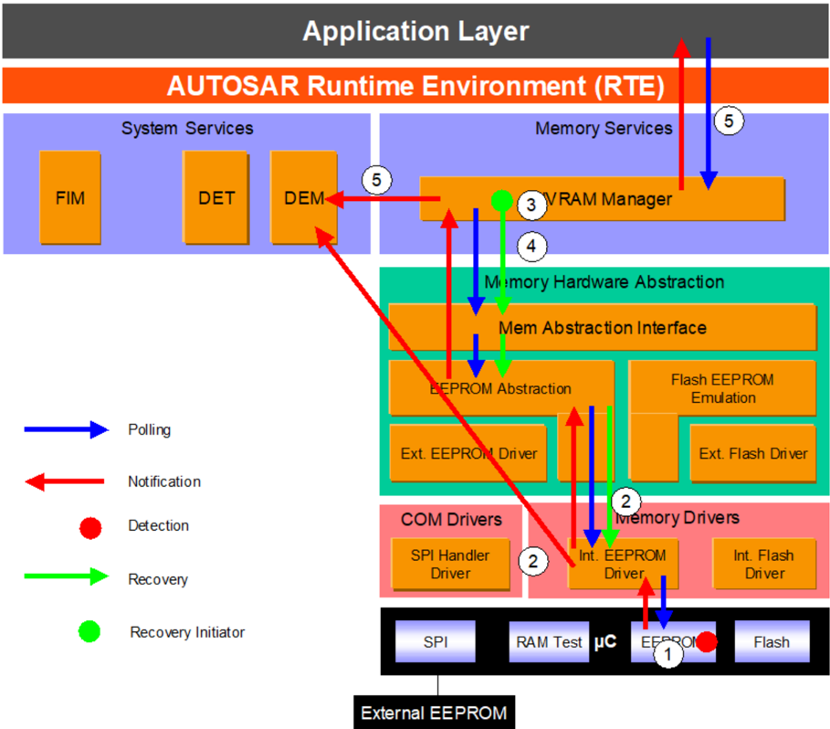

擦除作业错误由硬件检测 (1)。EEPROM 驱动是第一个涉及的 SW 模块，负责向 DEM 和上层报告 (2)。上层必须复位一些内部状态，以接受新的请求。如果擦除驱动作业是写操作的一部分，则一旦错误被报告到该层，NVRAM 管理器就发起写重试 (3)。如果恢复也失败 (4)，NVRAM 管理器向 DEM 报告 [NVM_E_REQ_FAILED](#612-nvram-栈错误列表) 错误，并把作业结果置为 NOK (5)，见「NVM API 请求失败」。

##### 6.2.7.2 模块的角色

###### 6.2.7.2.1 EEPROM 控制器

| 检测 | 依赖硬件 |
| --- | --- |
| 反应 | N/A |
| 报告 | 取决于驱动配置或硬件实现，错误可以记录在寄存器中，或者控制器可以经由中断把错误报告给驱动。 |
| 恢复 | 见 NVRAM 管理器。 |

###### 6.2.7.2.2 EEPROM 驱动

| 检测 | 由 EEPROM 控制器报告（见上文的 EEPROM 控制器）。 |
| --- | --- |
| 反应 | 作业被中止（见 [SWS_Eep_00068]）；模块状态被置为 MEMIF_IDLE，准备好接受新的作业（见 [SWS_Eep_00068]） |
| 报告 | 该错误以错误码 [EEP_E_ERASE_FAILED](#612-nvram-栈错误列表) 报告给 DEM。取决于 EEPROM 驱动的配置：EEPROM 抽象应以函数 Eep_GetJobResult 轮询该错误（作业结果置为 MEMIF_JOB_FAILED）（见 [SWS_Eep_00068]）；应经由回调函数 Fee_JobErrorNotification 把该错误报告给 EEPROM 抽象（见 [SWS_Eep_00068]）。 |
| 恢复 | 见 NVRAM 管理器。 |

###### 6.2.7.2.3 EEPROM 抽象

| 检测 | 由 EEPROM 驱动报告（见上文的 EEPROM 驱动）。 |
| --- | --- |
| 反应 | [SWS_Ea_00053] [SWS_Ea_00055] 实现特定的错误处理。 |
| 报告 | 取决于配置：存储抽象接口应以函数 Eep_GetJobResult 轮询该错误（作业结果置为 MEMIF_JOB_FAILED）（见 [SWS_Ea_00035]）；应经由回调函数 NvM_JobErrorNotification 把该错误报告给 NVRAM 管理器（见 [SWS_Ea_00053] [SWS_Ea_00095]）。 |
| 恢复 | 见 NVRAM 管理器。 |

###### 6.2.7.2.4 存储抽象接口

| 检测 | 由 EEPROM 抽象报告（见上文的 EEPROM 抽象）——仅当栈配置为轮询模式时 |
| --- | --- |
| 反应 | N/A |
| 报告 | 取决于配置：NVRAM 管理器应以函数 MemIf_GetJobResult 轮询该错误（作业结果置为 MEMIF_JOB_FAILED）（见 [MemIf043] [MemIf053]）。 |
| 恢复 | 见 NVRAM 管理器。 |

###### 6.2.7.2.5 NVRAM 管理器

| 检测 | 取决于栈的配置：以函数 MemIf_GetJobResult 轮询作业结果 MEMIF_JOB_FAILED（见上文的存储抽象接口）；由 EA 经由回调函数 NvM_JobErrorNotification 通知（见上文的 EEPROM 抽象）。 |
| --- | --- |
| 反应 | 如果涉及写处理：递增写重试计数器。如果超过重试次数，请求被中止（见 [SWS_NvM_00213] [SWS_NvM_00296]）。 |
| 报告 | 该错误报告给 DEM（见 [SWS_NvM_00271] [SWS_NvM_00269]）；可以通过轮询、以函数 NvM_GetErrorStatus 向存储抽象接口报告该错误（作业结果置为 NVM_REQ_NOT_OK）。 |
| 恢复 | 如果涉及写处理：[SWS_NvM_00168] [SWS_NvM_00213] [SWS_NvM_00296] NVRAM 管理器控制错误恢复机制。恢复机制为（如果配置）「写重试」。 |

###### 6.2.7.2.6 应用软件组件

| 检测 | 如果错误处理策略的设计需要，SWC 可以按两种不同的方式设计：它以连接到 NVM 的客户端端口上的 GetErrorStatus 操作轮询作业状态；它提供附加到 NvMNotifyJobFinished 服务器端口的服务器可运行体，该可运行体应由 NVM 调用。见 AUTOSAR_CP_SWS_NVRAMManager.pdf 的 13.3.1.3 节「Port Interface」、13.3.2 节「Ports and Port Interface for Notifications」 |

#### 6.2.8 EEPROM 读作业错误

##### 6.2.8.1 摘要

读作业错误由硬件检测 (1)。EEPROM 驱动是第一个涉及的 SW 模块，负责向 DEM 和上层报告 (2)。上层必须复位一些内部状态，以接受新的请求。恢复由 NVRAM 管理器发起 (3)：在继续读取冗余块或 ROM 数据之前，应进行一次或多次读取尝试。如果恢复动作意味着冗余丢失或使用 ROM 数据，NVRAM 管理器经由作业结果报告数据质量的损失。针对冗余丢失报告一个 DEM 错误（见「冗余丢失」）。如果恢复也失败 (4)，NVRAM 管理器向 DEM 报告 [NVM_E_REQ_FAILED](#612-nvram-栈错误列表) 错误，并把作业结果置为 NOK (5)，见「NVM API 请求失败」。

##### 6.2.8.2 模块的角色

###### 6.2.8.2.1 EEPROM 控制器

| 检测 | 依赖硬件 |
| --- | --- |
| 反应 | N/A |
| 报告 | 取决于驱动配置或硬件实现，错误可以记录在寄存器中，或者控制器可以经由中断把错误报告给驱动。 |
| 恢复 | 见 NVRAM 管理器。 |

###### 6.2.8.2.2 EEPROM 驱动

| 检测 | 由 EEPROM 控制器报告（见上文的 EEPROM 控制器）。 |
| --- | --- |
| 反应 | 作业被中止（见 [SWS_Eep_00068]）；模块状态被置为 MEMIF_IDLE，准备好接受新的作业（见 [SWS_Eep_00068]） |
| 报告 | 该错误以错误码 [EEP_E_READ_FAILED](#612-nvram-栈错误列表) 报告给 DEM。取决于 EEPROM 驱动的配置：EEPROM 抽象应以函数 Eep_GetJobResult 轮询该错误（作业结果置为 MEMIF_JOB_FAILED）（见 [SWS_Eep_00068]）；应经由回调函数 Fee_JobErrorNotification 把该错误报告给 EEPROM 抽象（见 [SWS_Eep_00068]）。 |
| 恢复 | 见 NVRAM 管理器。 |

###### 6.2.8.2.3 EEPROM 抽象

| 检测 | 由 EEPROM 驱动报告（见上文的 EEPROM 驱动）。 |
| --- | --- |
| 反应 | [SWS_Ea_00053] [SWS_Ea_00055] 实现特定的错误处理。 |
| 报告 | 取决于配置：存储抽象接口应以函数 Eep_GetJobResult 轮询该错误（作业结果置为 MEMIF_JOB_FAILED）（见 [SWS_Ea_00035]）；应经由回调函数 NvM_JobErrorNotification 把该错误报告给 NVRAM 管理器（见 [SWS_Ea_00053] [SWS_Ea_00095]）。 |
| 恢复 | 见 NVRAM 管理器。 |

###### 6.2.8.2.4 存储抽象接口

| 检测 | 由 EEPROM 抽象报告（见上文的 EEPROM 抽象）——仅当栈配置为轮询模式时 |
| --- | --- |
| 反应 | N/A |
| 报告 | 取决于配置：NVRAM 管理器应以函数 MemIf_GetJobResult 轮询该错误（作业结果置为 MEMIF_JOB_FAILED）（见 [MemIf043] [MemIf053]）。 |
| 恢复 | 见 NVRAM 管理器。 |

###### 6.2.8.2.5 NVRAM 管理器

| 检测 | 由存储抽象接口报告。 |
| --- | --- |
| 反应 | N/A |
| 报告 | 如果检测到冗余丢失，作业结果被置为 NVM_REQ_REDUNDANCY_FAILED，并把 [NVM_E_LOSS_OF_REDUNDANCY](#612-nvram-栈错误列表) 错误报告给 DEM（见 [SWS_NvM_00470] [SWS_NvM_00546]）。如果恢复期间使用了 ROM 数据，作业结果被置为 NVM_REQ_RESTORED_FROM_ROM（见 [SWS_NvM_00470]）。如果恢复机制「读重试」「读冗余块」和「读 ROM 块」失败，则把错误 [NVM_E_REQ_FAILED](#612-nvram-栈错误列表) 报告给 DEM（见 [SWS_NvM_00279] [SWS_NvM_00288]）。取决于配置：用户应以函数 NvM_GetErrorStatus 轮询该错误（作业结果置为 NVM_REQ_NOT_OK）（见 [SWS_NvM_00451] [SWS_NvM_00359] [SWS_NvM_00213]）；应经由可配置回调 SingleBlockCallbackFunction 或 MultiBlockCallbackFunction 把该错误报告给用户（见 [SWS_NvM_00113] [SWS_NvM_00260]）。 |
| 恢复 | NVRAM 管理器控制错误恢复机制。恢复机制包括（如果配置）「读重试」「读冗余块」和「读 ROM 块」（见 [SWS_NvM_00390] [SWS_NvM_00171] [SWS_NvM_00172] [SWS_NvM_00391] [SWS_NvM_00388]）。 |

###### 6.2.8.2.6 应用软件组件

| 检测 | 如果错误处理策略的设计需要，SWC 可以按两种不同的方式设计：它以连接到 NVM 的客户端端口上的 GetErrorStatus 操作轮询作业状态；它提供附加到 NvMNotifyJobFinished 服务器端口的服务器可运行体，该可运行体应由 NVM 调用。见 AUTOSAR_CP_SWS_NVRAMManager.pdf 的 13.3.1.3 节「Port Interface」、13.3.2 节「Ports and Port Interface for Notifications」 |

#### 6.2.9 EEPROM 比较作业错误

##### 6.2.9.1 摘要

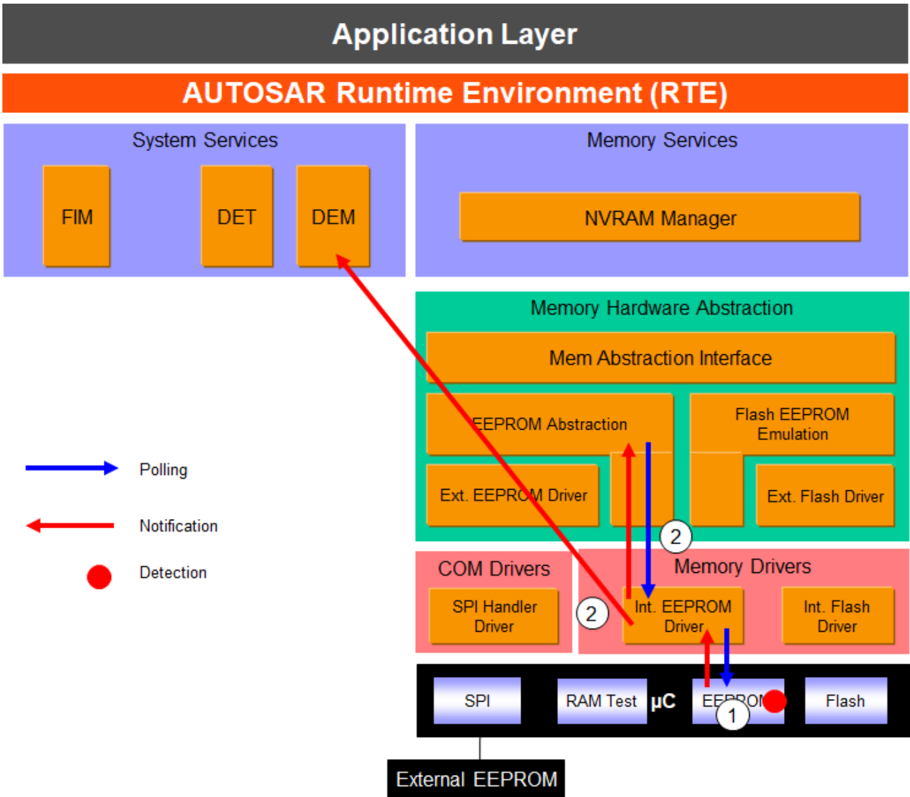

注意：EEPROM 比较函数是 EEPROM 抽象用于判断是否需要擦除/写入的内部机制。

比较作业错误由硬件检测 (1)。EEPROM 驱动是第一个涉及的 SW 模块，负责向 DEM 和 Flash EEPROM 仿真报告 (2)，后者必须复位一些内部状态以接受新的请求。

##### 6.2.9.2 模块的角色

###### 6.2.9.2.1 EEPROM 控制器

| 检测 | 依赖硬件 |
| --- | --- |
| 反应 | N/A |
| 报告 | 取决于驱动配置或硬件实现，错误可以记录在寄存器中，或者控制器可以经由中断把错误报告给驱动。 |
| 恢复 | N/A |

###### 6.2.9.2.2 EEPROM 驱动

| 检测 | 由 EEPROM 控制器报告（见上文的 EEPROM 控制器）。 |
| --- | --- |
| 反应 | 作业被中止（见 [SWS_Eep_00068]）；模块状态被置为 MEMIF_IDLE，准备好接受新的作业（见 [SWS_Eep_00068]） |
| 报告 | 该错误以错误码 [EEP_E_COMPARE_FAILED](#612-nvram-栈错误列表) 报告给 DEM。取决于 EEPROM 驱动的配置：EEPROM 抽象应以函数 Eep_GetJobResult 轮询该错误（作业结果置为 MEMIF_JOB_FAILED）（见 [SWS_Eep_00068]）；应经由回调函数 Fee_JobErrorNotification 把该错误报告给 EEPROM 抽象（见 [SWS_Eep_00068]）。 |
| 恢复 | N/A |

###### 6.2.9.2.3 EEPROM 抽象

| 检测 | 由 EEPROM 驱动报告（见上文的 EEPROM 驱动）。 |
| --- | --- |
| 反应 | [SWS_Ea_00053] [SWS_Ea_00055] 实现特定的错误处理。 |
| 报告 | 取决于配置：存储抽象接口应以函数 Eep_GetJobResult 轮询该错误（作业结果置为 MEMIF_JOB_FAILED）（见 [SWS_Ea_00035]）；应经由回调函数 NvM_JobErrorNotification 把该错误报告给 NVRAM 管理器（见 [SWS_Ea_00053] [SWS_Ea_00095]）。 |
| 恢复 | N/A |

### 6.3. EEPROM 抽象/Flash 仿真层级错误

#### 6.3.1 FEE 一致性检查错误

##### 6.3.1.1 摘要

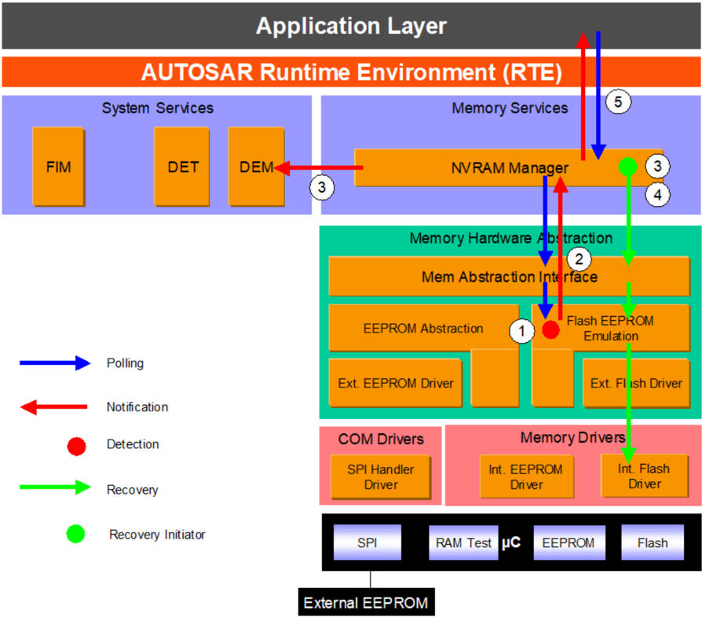

Flash EEPROM 仿真检查读取数据的一致性 (1)。如果检测到一致性错误，错误状态被转发给 NVRAM 管理器 (2)。NVRAM 管理器向 DEM 报告 [NVM_E_INTEGRITY_FAILED](#612-nvram-栈错误列表) (3)。同时启动恢复：「读重试」「读冗余块」和「读 ROM 块」（如果已配置）(4)。如果恢复动作意味着冗余丢失或使用 ROM 数据，NVRAM 管理器经由作业结果报告数据质量的损失。针对冗余丢失报告一个 DEM 错误（见「冗余丢失」）。如果恢复失败 (5)，作业结果被置为 NVM_REQ_INTEGRITY_FAILED (6)。

##### 6.3.1.2 模块的角色

###### 6.3.1.2.1 Flash EEPROM 仿真

| 检测 | [SWS_Fee_00023] Fee 模块检查读取数据的一致性。 |
| --- | --- |
| 反应 | N/A |
| 报告 | 取决于配置：存储抽象接口应以函数 Fee_GetJobResult 轮询该错误（作业结果置为 MEMIF_BLOCK_INCONSISTENT）（见 [SWS_Fee_00091] [SWS_Fee_00023]）；应经由回调函数把该错误报告给 NVRAM 管理器（见 [SWS_Fee_00056] [SWS_Fee_00054]）。 |
| 恢复 | 见 NVRAM 管理器。 |

###### 6.3.1.2.2 存储抽象接口

| 检测 | 由 Flash EEPROM 仿真报告（见上文的 Flash EEPROM 仿真）——仅当栈配置为轮询模式时。 |
| --- | --- |
| 反应 | N/A |
| 报告 | 取决于配置：NVRAM 管理器应以函数 MemIf_GetJobResult 轮询该错误（作业结果置为 MEMIF_JOB_FAILED）（见 [MemIf043] [MemIf053]）。 |
| 恢复 | 见 NVRAM 管理器。 |

###### 6.3.1.2.3 NVRAM 管理器

| 检测 | 由存储抽象接口报告（见上文的存储抽象接口）。 |
| --- | --- |
| 反应 | N/A |
| 报告 | 如果检测到冗余丢失，作业结果被置为 NVM_REQ_REDUNDANCY_FAILED，并把 [NVM_E_LOSS_OF_REDUNDANCY](#612-nvram-栈错误列表) 错误报告给 DEM（见 [SWS_NvM_00470] [SWS_NvM_00546]）。如果恢复期间使用了 ROM 数据，作业结果被置为 NVM_REQ_RESTORED_FROM_ROM（见 [SWS_NvM_00470]）。如果恢复机制失败，NVM 把错误 [NVM_E_INTEGRITY_FAILED](#612-nvram-栈错误列表) 报告给 DEM（见 [SWS_NvM_00358] [SWS_NvM_00360]）。如果恢复机制失败，取决于栈的配置：用户应以函数 NvM_GetErrorStatus 轮询该错误（作业结果置为 NVM_REQ_INTEGRITY_FAILED）（见 [SWS_NvM_00451] [SWS_NvM_00358] [SWS_NvM_00360]）；应经由可配置回调 SingleBlockCallbackFunction 或 MultiBlockCallbackFunction 把该错误报告给用户（见 [SWS_NvM_00113] [SWS_NvM_00260]）。 |
| 恢复 | NVRAM 管理器控制错误恢复机制。恢复机制包括（如果配置）「读冗余块」和「读 ROM 块」（见 [SWS_NvM_00390] [SWS_NvM_00171] [SWS_NvM_00172] [SWS_NvM_00391] [SWS_NvM_00388]）。 |

###### 6.3.1.2.4 应用软件组件

| 检测 | 如果错误处理策略的设计需要，SWC 可以按两种不同的方式设计：它以连接到 NVM 的客户端端口上的 GetErrorStatus 操作轮询作业状态；它提供附加到 NvMNotifyJobFinished 服务器端口的服务器可运行体，该可运行体应由 NVM 调用。见 AUTOSAR_CP_SWS_NVRAMManager.pdf 的 13.3.1.3 节「Port Interface」、13.3.2 节「Ports and Port Interface for Notifications」 |

#### 6.3.2 EA 一致性检查错误

##### 6.3.2.1 摘要

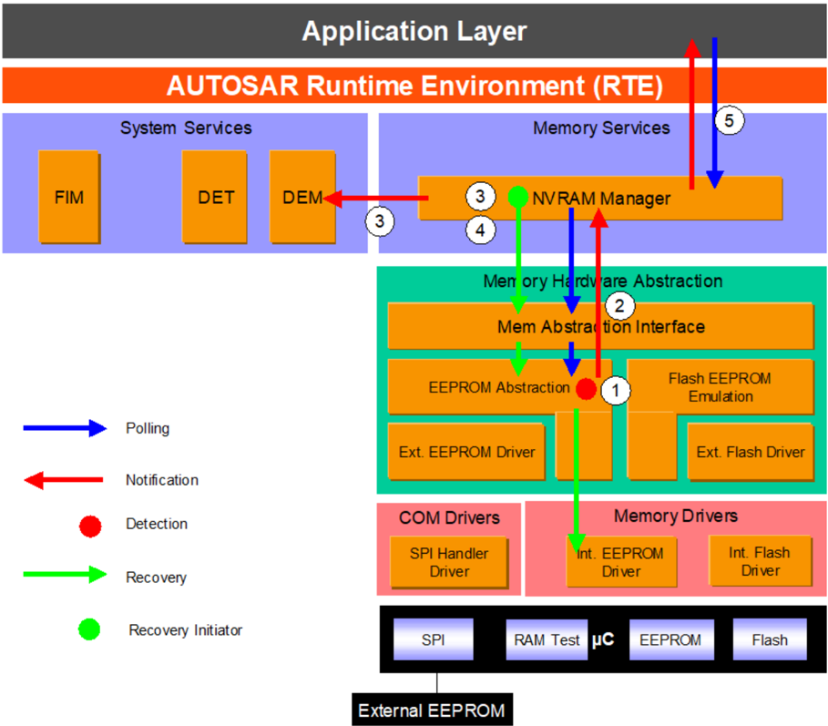

EEPROM 抽象检查读取数据的一致性 (1)。如果检测到一致性错误，错误状态被转发给 NVRAM 管理器 (2)。NVRAM 管理器向 DEM 报告 [NVM_E_INTEGRITY_FAILED](#612-nvram-栈错误列表)，并启动恢复：「读重试」「读冗余块」和「读 ROM 块」（如果已配置）(3)。如果恢复动作意味着冗余丢失或使用 ROM 数据，NVRAM 管理器经由作业结果报告数据质量的损失。针对冗余丢失报告一个 DEM 错误（见「冗余丢失」）。如果恢复失败 (4)，作业结果被置为 NVM_REQ_INTEGRITY_FAILED (5)。

##### 6.3.2.2 模块的角色

###### 6.3.2.2.1 EEPROM 抽象

| 检测 | [SWS_Ea_00104] EEPROM 抽象模块检查读取数据的一致性。 |
| --- | --- |
| 反应 | N/A |
| 报告 | 取决于配置：存储抽象接口应以函数 Eep_GetJobResult 轮询该错误（作业结果置为 MEMIF_JOB_FAILED）（见 [SWS_Ea_00035]）；应经由回调函数 NvM_JobErrorNotification 把该错误报告给 NVRAM 管理器（见 [SWS_Ea_00053] [SWS_Ea_00095]）。 |
| 恢复 | 见 NVRAM 管理器。 |

###### 6.3.2.2.2 存储抽象接口

| 检测 | 由 EEPROM 抽象报告（见上文的 EEPROM 抽象）——仅当栈配置为轮询模式时。 |
| --- | --- |
| 反应 | N/A |
| 报告 | 取决于配置：NVRAM 管理器应以函数 MemIf_GetJobResult 轮询该错误（作业结果置为 MEMIF_JOB_FAILED）（见 [MemIf043] [MemIf053]）。 |
| 恢复 | 见 NVRAM 管理器。 |

###### 6.3.2.2.3 NVRAM 管理器

| 检测 | 由存储抽象接口报告（见上文的存储抽象接口）。 |
| --- | --- |
| 反应 | N/A |
| 报告 | 如果检测到冗余丢失，作业结果被置为 NVM_REQ_REDUNDANCY_FAILED，并把 [NVM_E_LOSS_OF_REDUNDANCY](#612-nvram-栈错误列表) 错误报告给 DEM（见 [SWS_NvM_00470] [SWS_NvM_00546]）。如果恢复期间使用了 ROM 数据，作业结果被置为 NVM_REQ_RESTORED_FROM_ROM（见 [SWS_NvM_00470]）。如果恢复机制失败，则把错误 [NVM_E_REQ_FAILED](#612-nvram-栈错误列表) 报告给 DEM（见 [SWS_NvM_00279] [SWS_NvM_00288]）。如果恢复机制失败，取决于配置：用户应以函数 NvM_GetErrorStatus 轮询该错误（作业结果置为 NVM_REQ_NOT_OK）（见 [SWS_NvM_00451] [SWS_NvM_00359] [SWS_NvM_00213]）；应经由可配置回调 SingleBlockCallbackFunction 或 MultiBlockCallbackFunction 把该错误报告给用户（见 [SWS_NvM_00113] [SWS_NvM_00260]）。 |
| 恢复 | NVRAM 管理器控制错误恢复机制。恢复机制包括（如果配置）「读冗余块」和「读 ROM 块」（见 [SWS_NvM_00390] [SWS_NvM_00171] [SWS_NvM_00172] [SWS_NvM_00391] [SWS_NvM_00388]）。 |

###### 6.3.2.2.4 应用软件组件

| 检测 | 如果错误处理策略的设计需要，SWC 可以按两种不同的方式设计：它以连接到 NVM 的客户端端口上的 GetErrorStatus 操作轮询作业状态；它提供附加到 NvMNotifyJobFinished 服务器端口的服务器可运行体，该可运行体应由 NVM 调用。见 AUTOSAR_CP_SWS_NVRAMManager.pdf 的 13.3.1.3 节「Port Interface」、13.3.2 节「Ports and Port Interface for Notifications」 |

### 6.4. NVRAM 管理器层级错误

#### 6.4.1 NVM CRC 检查

##### 6.4.1.1 摘要

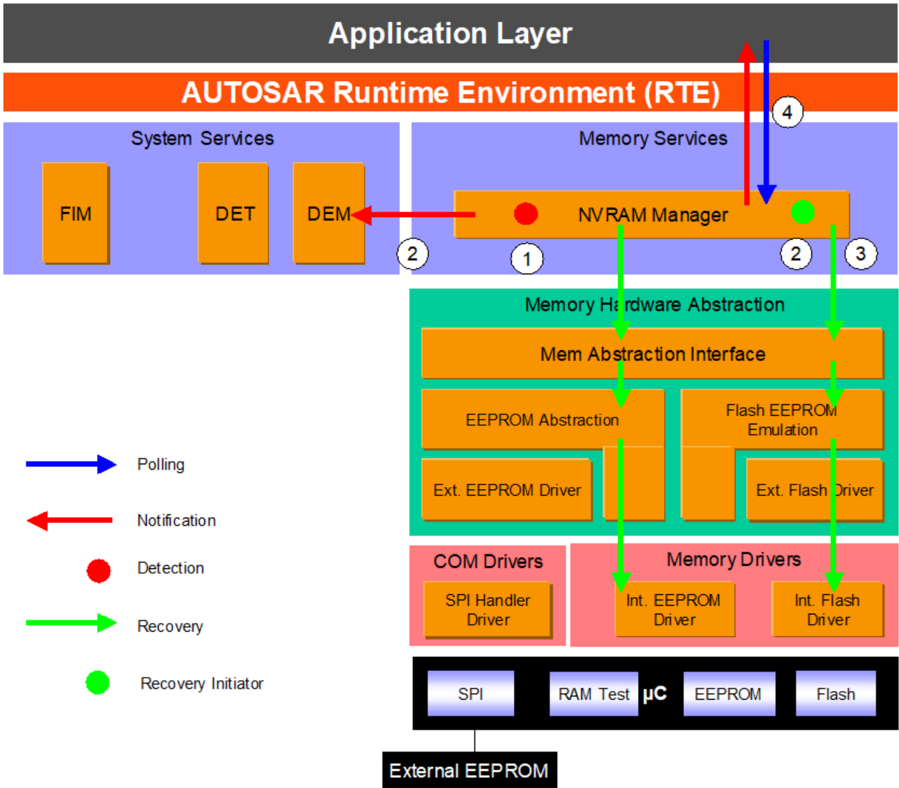

如果 NV 块配置了 CRC，NVRAM 管理器在读取操作结束时检查 RAM 块上是否存在 CRC 不匹配 (1)。如果存在，则把 [NVM_E_INTEGRITY_FAILED](#612-nvram-栈错误列表) 错误报告给 DEM。同时启动恢复：「读重试」「读冗余块」和「读 ROM 块」（如果已配置）(2)。如果恢复动作意味着冗余丢失或使用 ROM 数据，NVRAM 管理器经由作业结果报告数据质量的损失。针对冗余丢失报告一个 DEM 错误（见「冗余丢失」）。如果恢复失败 (3)，作业结果被置为 NVM_REQ_INTEGRITY_FAILED (4)。

##### 6.4.1.2 模块的角色

###### 6.4.1.2.1 NVRAM 管理器

| 检测 | [SWS_NvM_00292] [SWS_NvM_00201] 在读取操作结束时请求 CRC 检查。 |
| --- | --- |
| 反应 | N/A |
| 报告 | 如果检测到冗余丢失，作业结果被置为 NVM_REQ_REDUNDANCY_FAILED，并把 [NVM_E_LOSS_OF_REDUNDANCY](#612-nvram-栈错误列表) 错误报告给 DEM（见 [SWS_NvM_00470] [SWS_NvM_00546]）。如果恢复期间使用了 ROM 数据，作业结果被置为 NVM_REQ_RESTORED_FROM_ROM（见 [SWS_NvM_00470]）。如果发生 CRC 不匹配，NVM 把错误 [NVM_E_INTEGRITY_FAILED](#612-nvram-栈错误列表) 报告给 DEM，并把作业结果置为 NVM_REQ_INTEGRITY_FAILED（见 [SWS_NvM_00294] [SWS_NvM_00203] [SWS_NvM_00204]）。取决于配置：用户应以函数 NvM_GetErrorStatus 轮询该错误（见 [SWS_NvM_00451] [SWS_NvM_00295] [SWS_NvM_00204]）；应经由可配置回调 SingleBlockCallbackFunction 或 MultiBlockCallbackFunction 把该错误报告给用户（见 [SWS_NvM_00113] [SWS_NvM_00260]）。 |
| 恢复 | [SWS_NvM_00390] [SWS_NvM_00171] [SWS_NvM_00172] [SWS_NvM_00391] [SWS_NvM_00388] [SWS_NvM_00526] [SWS_NvM_00293] NVRAM 管理器控制错误恢复机制。恢复机制包括（如果配置）「读重试」「读冗余块」和「读 ROM 块」。 |

#### 6.4.2 NVM 写验证错误

##### 6.4.2.1 摘要

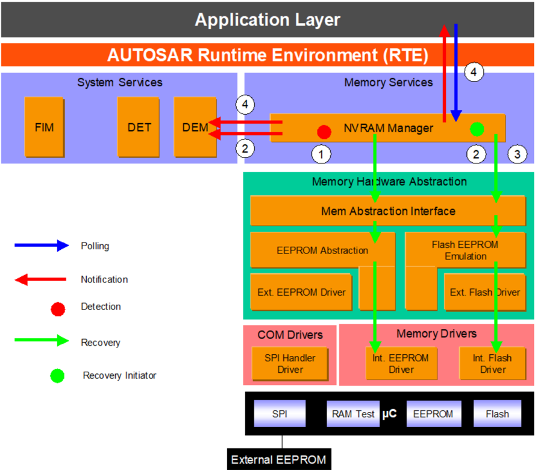

写入 NV 存储器的 NVRAM 块被立即读回，并与 RAM 中的原始内容进行比较 (1)。如果验证失败，则把 [NVM_E_VERIFY_FAILED](#612-nvram-栈错误列表) 错误报告给 DEM，并且如果已配置则以写重试启动恢复 (2)。如果恢复失败 (3)，NVRAM 管理器向 DEM 报告 [NVM_E_REQ_FAILED](#612-nvram-栈错误列表) 错误，并把作业结果置为 NVM_REQ_NOT_OK (4)，见「NVM API 请求失败」。

##### 6.4.2.2 模块的角色

###### 6.4.2.2.1 NVRAM 管理器

| 检测 | [SWS_NvM_00528] [SWS_NvM_00530] 写入 NV 存储器的 NVRAM 块被立即读回，并与 RAM 中的原始内容进行比较。注意：如果读回失败，则写验证应失败，且不执行读重试。 |
| --- | --- |
| 反应 | N/A |
| 报告 | 如果存在不匹配，则把错误 [NVM_E_VERIFY_FAILED](#612-nvram-栈错误列表) 报告给 DEM（见 [SWS_NvM_00528]）。如果恢复动作失败，作业结果被置为 NVM_REQ_NOT_OK，且 NVRAM 管理器把 [NVM_E_REQ_FAILED](#612-nvram-栈错误列表) 报告给 DEM（见「NVM API 请求失败」）（见 [SWS_NvM_00213]） |
| 恢复 | [SWS_NvM_00529] 如果写验证失败，则执行写重试。 |

#### 6.4.3 静态块检查错误

##### 6.4.3.1 摘要

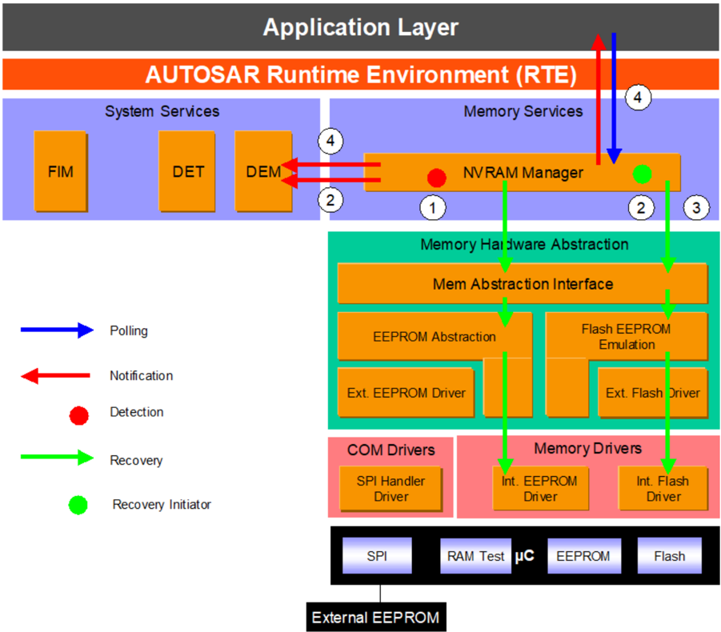

位于 NVRAM 管理器中的静态块 ID 检查机制提供了一种手段，用于检测是否由于寻址问题而从 NV 存储器读取了错误的块。每次把块写入 NV 存储器时，NVRAM 管理器把包含静态块 ID 的 NV 块头存储在 NV 块中。在读取操作期间，将 NV 头与所请求的块 ID 进行比较 (1)。

如果静态块 ID 检查失败，则把失效 [NVM_E_WRONG_BLOCK_ID](#612-nvram-栈错误列表) 报告给 DEM，并启动读恢复（「读重试」「读冗余块」和「读 ROM 块」，如果已配置）(2)。如果恢复动作意味着冗余丢失或使用 ROM 数据，NVRAM 管理器经由作业结果报告数据质量的损失。针对冗余丢失报告一个 DEM 错误（见「冗余丢失」）。如果恢复也失败 (3)，NVRAM 管理器向 DEM 报告 [NVM_E_REQ_FAILED](#612-nvram-栈错误列表) 错误，并把作业结果置为 NVM_REQ_NOT_OK (4)，见「NVM API 请求失败」。

##### 6.4.3.2 模块的角色

###### 6.4.3.2.1 NVRAM 管理器

| 检测 | [SWS_NvM_00524] NVRAM 管理器检查存储在 NVRAM 块头中的块 ID。 |
| --- | --- |
| 反应 | N/A |
| 报告 | 如果检测到冗余丢失，作业结果被置为 NVM_REQ_REDUNDANCY_FAILED，并把 [NVM_E_LOSS_OF_REDUNDANCY](#612-nvram-栈错误列表) 错误报告给 DEM（见 [SWS_NvM_00470] [SWS_NvM_00546]）。如果恢复期间使用了 ROM 数据，作业结果被置为 NVM_REQ_RESTORED_FROM_ROM（见 [SWS_NvM_00470]）。把错误 [NVM_E_WRONG_BLOCK_ID](#612-nvram-栈错误列表) 报告给 DEM（见 [SWS_NvM_00525]）。如果恢复动作失败，作业结果被置为 NVM_REQ_NOT_OK，且 NVRAM 管理器把 [NVM_E_REQ_FAILED](#612-nvram-栈错误列表) 报告给 DEM（见「NVM API 请求失败」）。 |
| 恢复 | [SWS_NvM_00525] [SWS_NvM_00526] 如果静态块 ID 检查失败，则启动读恢复（「读重试」「读冗余块」和「读 ROM 块」）。 |

#### 6.4.4 冗余丢失

##### 6.4.4.1 摘要

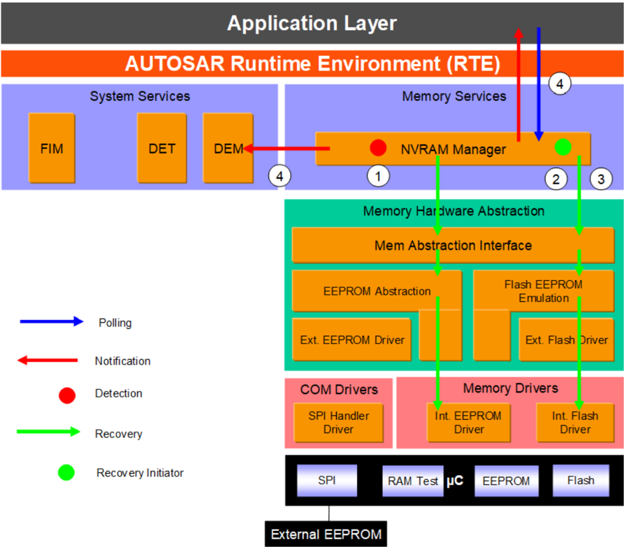

如果在读取或写入期间一个冗余块无效 (1)，NVRAM 管理器会尝试使用未损坏 NV 块的数据立即恢复该 NV 块 (2)。如果恢复失败 (3)，则把错误码 [NVM_E_LOSS_OF_REDUNDANCY](#612-nvram-栈错误列表) 报告给 DEM，并且 NVRAM 管理器把作业结果置为 NVM_REQ_REDUNDANCY_FAILED (4)。

##### 6.4.4.2 模块的角色

###### 6.4.4.2.1 NVRAM 管理器

| 检测 | [SWS_NvM_00531] NVRAM 管理器在读取操作或写入操作期间检测冗余丢失。 |
| --- | --- |
| 反应 | N/A |
| 报告 | [SWS_NvM_00546] 如果恢复失败（见下文），则把错误码 [NVM_E_LOSS_OF_REDUNDANCY](#612-nvram-栈错误列表) 报告给 DEM。取决于配置：用户应以函数 NvM_GetErrorStatus 轮询该错误（作业结果置为 NVM_REQ_REDUNDANCY_FAILED）（见 [SWS_NvM_00451] [SWS_NvM_00470]）；应经由可配置回调 SingleBlockCallbackFunction 或 MultiBlockCallbackFunction 把该错误报告给用户（见 [SWS_NvM_00113] [SWS_NvM_00260]）。 |
| 恢复 | [SWS_NvM_00531] 尝试使用未损坏 NV 块的数据立即恢复该 NV 块。 |

###### 6.4.4.2.2 应用软件组件

| 检测 | 如果错误处理策略的设计需要，SWC 可以按两种不同的方式设计：它以连接到 NVM 的客户端端口上的 GetErrorStatus 操作轮询作业状态；它提供附加到 NvMNotifyJobFinished 服务器端口的服务器可运行体，该可运行体应由 NVM 调用。见 AUTOSAR_CP_SWS_NVRAMManager.pdf 的 13.3.1.3 节「Port Interface」、13.3.2 节「Ports and Port Interface for Notifications」 |

#### 6.4.5 NVM API 请求失败

##### 6.4.5.1 摘要

NVRAM 管理器被告知：在 NVM 函数的处理过程中由后续层检测到的错误，或由内部检测机制（写验证、静态块检查或配置 ID 不匹配）检测到的错误 (1)。

NVRAM 管理器层级有不同可用的恢复机制，取决于所涉及函数的类型——写入或读取 (2)。如果可用的恢复机制失败 (3)，NVM 管理器向 DEM 报告 [NVM_E_REQ_FAILED](#612-nvram-栈错误列表) 错误，并把作业结果置为 NVM_REQ_NOT_OK (4)。

##### 6.4.5.2 模块的角色

###### 6.4.5.2.1 NVRAM 管理器

| 检测 | [SWS_NvM_00275] [SWS_NvM_00305] [SWS_NvM_00361] [SWS_NvM_00302] [SWS_NvM_00296] [SWS_NvM_00023] [SWS_NvM_00359] [SWS_NvM_00213] [SWS_NvM_00271] NVRAM 管理器被告知：在 NVM 函数（NvM_ReadAll、NvM_InvalidateNvBlock、NvM_WriteAll、NvM_ReadBlock、NvM_WriteBlock、NvM_EraseNvBlock）的处理过程中由后续层检测到的错误 |
| --- | --- |
| 反应 | N/A |
| 报告 | 如果恢复机制失败（见下文），则把错误 [NVM_E_REQ_FAILED](#612-nvram-栈错误列表) 报告给 DEM（见 [SWS_NvM_00213] [SWS_NvM_00296] [SWS_NvM_00279] [SWS_NvM_00288]）。取决于配置：用户应以函数 NvM_GetErrorStatus 轮询该错误（作业结果置为 NVM_REQ_NOT_OK）（见 [SWS_NvM_00451] [SWS_NvM_00295] [SWS_NvM_00204]）；应经由可配置回调 SingleBlockCallbackFunction 或 MultiBlockCallbackFunction 把该错误报告给用户（见 [SWS_NvM_00113] [SWS_NvM_00260]）。 |
| 恢复 | [SWS_NvM_00168] [SWS_NvM_00213] [SWS_NvM_00296] [SWS_NvM_00390] [SWS_NvM_00171] [SWS_NvM_00172] [SWS_NvM_00391] [SWS_NvM_00388] NVRAM 管理器控制错误恢复机制。恢复动作取决于正在进行的操作类型：写操作、读操作或其他。对于读操作，恢复机制包括（如果配置）「读重试」「读冗余块」和「读 ROM 块」。对于写操作，恢复机制为（如果配置）「写重试」。 |

###### 6.4.5.2.2 应用软件组件

| 检测 | 如果错误处理策略的设计需要，SWC 可以按两种不同的方式设计：它以连接到 NVM 的客户端端口上的 GetErrorStatus 操作轮询作业状态；它提供附加到 NvMNotifyJobFinished 服务器端口的服务器可运行体，该可运行体应由 NVM 调用。见 AUTOSAR_CP_SWS_NVRAMManager.pdf 的 13.3.1.3 节「Port Interface」、13.3.2 节「Ports and Port Interface for Notifications」 |
