<!-- 源文档 AUTOSAR_CP_EXP_LayeredSoftwareArchitecture（R23-11），讲述型指南（EXP），不受 Type A 七章骨架约束；章节结构镜像源文档自身的目录：第 1 部分 架构（1.1–1.8）、第 2 部分 配置、第 3 部分 集成与运行时方面。 -->

## 1. 架构

**本文档的目的与输入**（Introduction Purpose and Inputs）

分层软件架构（Layered Software Architecture）描述 AUTOSAR 的软件架构：

- 它以自顶向下的方式描述 AUTOSAR 软件的层次结构，
- 将基础软件模块映射到各软件层，并
- 展示它们之间的关系。

本文档不包含需求，仅具有参考性质。给出的示例并不意味着在所有方面都是完整的。

本文档聚焦于概念性分层软件架构的静态视图：

- 它不规定带详细静态与动态接口描述的结构化软件架构（设计），
- 这些信息包含在基础软件模块自身的规范中。

**输入**（Inputs）

本文档基于 AUTOSAR 的规范文档与需求文档。

**范围与可扩展性**（Introduction Scope and Extensibility）

AUTOSAR 的应用范围：AUTOSAR 面向汽车 ECU。这类 ECU 具有以下特性：

- 与硬件（传感器和执行器）的强交互，
- 与 CAN、LIN、FlexRay 或 Ethernet 等车载网络的连接，
- 计算能力与内存资源有限（相比企业级方案）的微控制器（典型为 16 位或 32 位）、
- 实时系统，以及
- 从内部或外部闪存执行程序。

**注意：** 在 AUTOSAR 的意义上，一个 ECU 指一个微控制器加上其外设以及相应的软件/配置。机械设计不在 AUTOSAR 的范围内。这意味着如果一个封装内布置了多个微控制器，那么每个微控制器都需要各自独立的 AUTOSAR-ECU 实例描述。

AUTOSAR 的可扩展性：AUTOSAR 软件架构是一种通用方法：

- 标准模块可以在功能上进行扩展，同时仍然保持合规，
- 但它们的配置仍必须纳入基础软件的自动配置流程中加以考虑！
- 非标准模块可以作为复杂驱动集成到基于 AUTOSAR 的系统中，并且
- 不能再增加新的层。

### 1.1. 软件层概览

#### 顶层视图

AUTOSAR 架构在最高抽象层级上区分三个软件层：应用层、运行时环境和基础软件，它们都运行在微控制器之上。

#### 粗视图

AUTOSAR 基础软件进一步划分为以下各层：服务层、ECU 抽象层、微控制器抽象层和复杂驱动。

基础软件的各层进一步划分为功能组。服务的例子有系统服务、存储服务和通信服务。

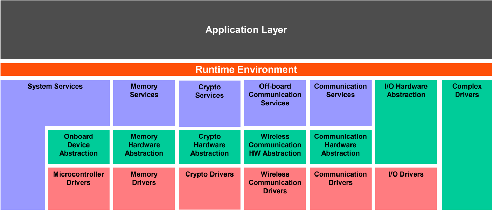

#### 微控制器抽象层

微控制器抽象层是基础软件中最低的软件层。

它包含内部驱动，即可以直接访问微控制器（µC）及其内部外设的软件模块。

- **任务：** 使更高的软件层独立于微控制器（µC）。
- **属性：**
  - **实现：** 依赖 µC；
  - **上层接口：** 标准化且独立于 µC。

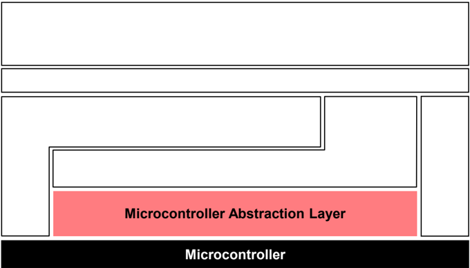

#### ECU 抽象层

ECU 抽象层与微控制器抽象层的驱动对接。它还包含针对外部设备的驱动。

它提供一个 API，用于访问外设和设备，而无论其位置（µC 内部/外部）以及它们与 µC 的连接方式（端口引脚、接口类型）如何。

- **任务：** 使更高的软件层独立于 ECU 硬件布局。
- **属性：**
  - **实现：** 独立于 µC，依赖 ECU 硬件；
  - **上层接口：** 独立于 µC 和 ECU 硬件。

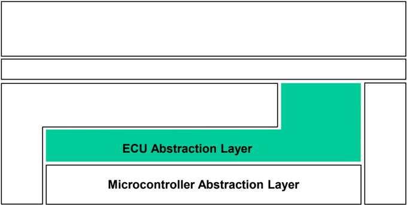

#### 复杂驱动

复杂驱动层从硬件一直跨越到 RTE。

- **任务：** 提供集成特殊用途功能的可能性，例如针对以下设备的驱动：
  - AUTOSAR 未规定的设备，
  - 具有极高时序约束的设备，或
  - 用于迁移目的的设备等。
- **属性：**
  - **实现：** 可能依赖应用、µC 和 ECU 硬件；
  - **上层接口：** 可能依赖应用、µC 和 ECU 硬件。

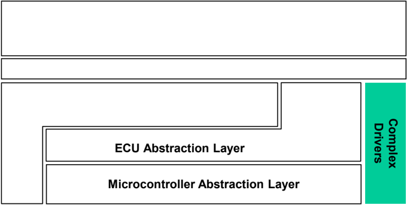

#### 服务层

服务层是基础软件中最高的层，这一点同样体现在它对应用软件的重要性上：对 I/O 信号的访问由 ECU 抽象层负责，而服务层提供：

- 操作系统功能
- 车载网络通信与管理服务
- 存储服务（NVRAM 管理）
- 诊断服务（包括 UDS 通信、错误存储器与故障处理）
- ECU 状态管理、模式管理
- 程序流的逻辑与时间监控（Wdg 管理器）

- **任务：** 为应用、RTE 和基础软件模块提供基础服务。
- **属性：**
  - **实现：** 大多独立于 µC 和 ECU 硬件；
  - **上层接口：** 独立于 µC 和 ECU 硬件。

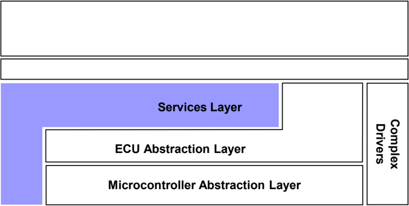

#### AUTOSAR 运行时环境（RTE）

RTE 是为应用软件（AUTOSAR 软件组件和/或 AUTOSAR 传感器/执行器组件）提供通信服务的一个层。

在 RTE 之上，软件架构风格从「分层」转变为「组件」风格。

AUTOSAR 软件组件通过 RTE 与其他组件（ECU 间和/或 ECU 内）和/或服务进行通信。

- **任务：** 使 AUTOSAR 软件组件独立于到特定 ECU 的映射。
- **属性：**
  - **实现：** 依赖 ECU 和应用（为每个 ECU 单独生成）；
  - **上层接口：** 完全独立于 ECU。

#### 服务的类型

基础软件可以细分为以下服务类型：

- **输入/输出（I/O）**：对传感器、执行器和 ECU 片上外设的标准化访问。
- **存储**：对内部/外部存储器（非易失性存储器）的标准化访问。
- **加密**：对密码学原语的标准化访问，包括内部/外部硬件加速器。
- **通信**：对车载网络系统、ECU 片上通信系统和 ECU 内部软件的标准化访问。
- **车外通信（Off-board Communication）**：对 Vehicle-to-X 通信、车内无线网络系统和 ECU 车外通信系统的标准化访问。
- **系统**：提供可标准化的（操作系统、定时器、错误存储器）以及 ECU 特定的（ECU 状态管理、看门狗管理器）服务和库函数。

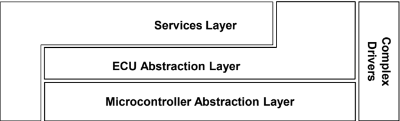

#### 基础软件模块类型

**驱动（Driver，内部）**

驱动包含控制和访问内部或外部设备的功能。

内部设备位于微控制器内部。内部设备的例子有：

- 内部 EEPROM
- 内部 CAN 控制器
- 内部 ADC

内部设备的驱动称为内部驱动，位于微控制器抽象层。

**驱动（Driver，外部）**

外部设备位于微控制器之外的 ECU 硬件上。外部设备的例子有：

- 外部 EEPROM
- 外部看门狗
- 外部闪存

外部设备的驱动称为外部驱动，位于 ECU 抽象层。它通过微控制器抽象层的驱动访问外部设备。

这样，集成在系统基础芯片（SBC）中的组件（如收发器和看门狗）也得到了 AUTOSAR 的支持。

- 例子：带 SPI 接口的外部 EEPROM 的驱动通过 SPI 总线的处理器的/驱动访问该外部 EEPROM。

**例外：**

针对内存映射的外部设备（例如外部闪存）的驱动可以直接访问微控制器。这类外部驱动位于微控制器抽象层，因为它们依赖于微控制器。

**接口（Interface）**

接口（接口模块）包含对架构上位于其下方的模块进行抽象的功能。例如，对某个特定设备的硬件实现进行抽象的接口模块。它提供通用 API 来访问特定类型的设备，与该类型现有设备的数量无关，也与不同设备的硬件实现无关。

接口不改变数据的内容。

一般而言，接口位于 ECU 抽象层。

例子：CAN 通信系统的接口提供通用 API 来访问 CAN 通信网络，与 ECU 内 CAN 控制器的数量无关，也与硬件实现（片上、片外）无关。

**处理器（Handler）**

处理器是一种特殊的接口，它控制一个或多个客户端对一个或多个驱动的并发、多重和异步访问。也就是说，它执行缓冲、排队、仲裁、多路复用。

处理器不改变数据的内容。

处理器的功能通常被合并进驱动或接口中（例如 SPIHandlerDriver、ADC 驱动）。

**管理器（Manager）**

管理器为多个客户端提供特定服务。在所有仅靠纯处理器功能不足以对多个客户端进行抽象的场合，都需要管理器。

除处理器功能之外，管理器还可以评估、更改或调整数据的内容。

一般而言，管理器位于服务层。

例子：NVRAM 管理器管理对内部和/或外部存储设备（如闪存和 EEPROM 存储器）的并发访问。它还执行分布式的可靠数据存储、数据检查、默认值提供等。

#### 库

库是为相关目的而收集的函数的集合。

库：

- 可以被基础软件模块（包括 RTE）、SW-C、库或集成代码调用，
- 在调用者的上下文中、处于同一保护环境中运行，
- 只能调用库，
- 是可重入的，
- 没有内部状态，
- 不需要任何初始化，
- 是同步的，即它们没有等待点。

AUTOSAR 中规定了以下库：

- 定点数学库，
- 浮点数学库，
- 定点数据插值库，
- 浮点数据插值库，
- 扩展函数库（例如 64 位计算、滤波等），
- 位处理库，
- E2E 通信库，
- CRC 计算库，
- 原子多核安全操作库。

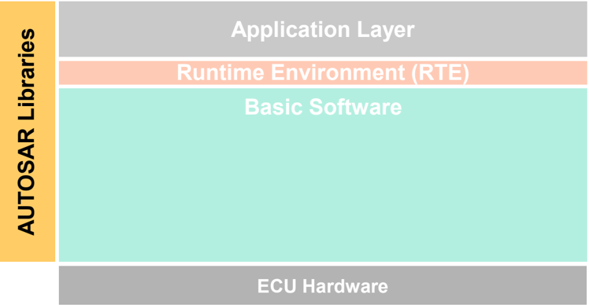
### 1.2. 软件层的内容

#### 微控制器抽象层

µC 抽象层由以下模块组组成：

- **微控制器驱动**：内部外设的驱动（例如看门狗、通用定时器）；具有直接 µC 访问能力的函数（例如内核测试）。
- **通信驱动**：针对 ECU 片上外设（例如 SPI）和车载通信（例如 CAN）的驱动。OSI 层：数据链路层的一部分。
- **存储驱动**：片上存储设备（例如内部 Flash、内部 EEPROM）以及内存映射的外部存储设备（例如外部 Flash）的驱动。
- **I/O 驱动**：模拟和数字 I/O 的驱动（例如 ADC、PWM、DIO）。
- **加密驱动**：片上加密设备（如 SHE 或 HSM）的驱动。

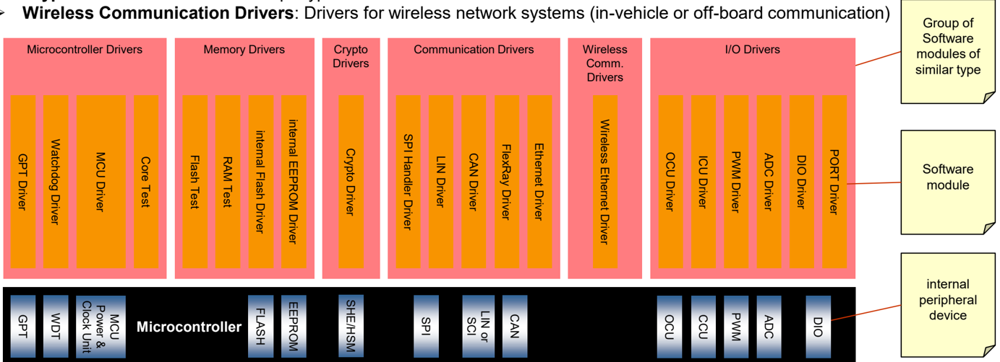

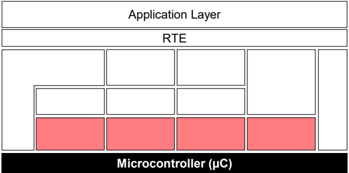

#### 微控制器抽象层：SPI 处理器/驱动

SPIHandlerDriver 允许多个客户端并发访问一个或多个 SPI 总线。

为了对 SPI 微控制器引脚的所有特性进行抽象（这些引脚专用于片选），这些引脚应由 SPIHandlerDriver 直接处理。这意味着这些引脚在 DIO 驱动中不可用。

**例子：**

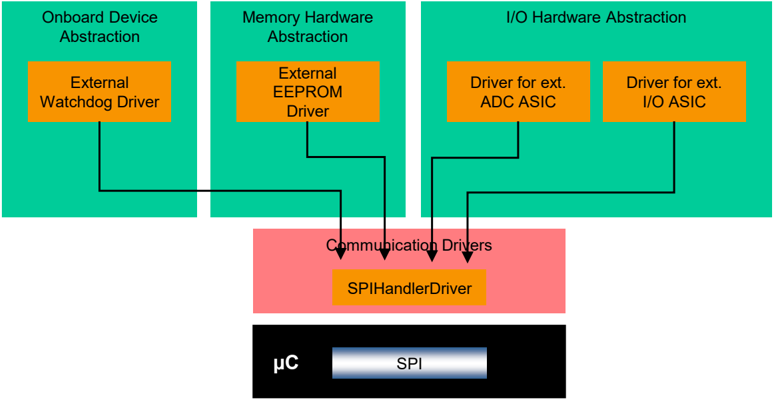

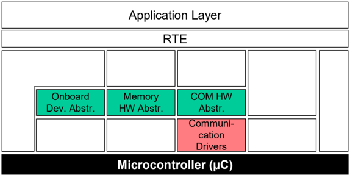

#### 复杂驱动

- 复杂驱动是在基础软件栈内实现非标准化功能的模块。

一个例子是借助特定中断和/或复杂 µC 外设（如 PCP、TPU）直接访问 µC，实现复杂的传感器评估和执行器控制，例如：

- 喷射控制
- 电子气门控制
- 增量式位置检测

- **任务：** 满足处理复杂传感器和执行器的特殊功能与时序要求。
- **属性：**
  - **实现：** 高度依赖 µC、ECU 和应用；
  - **到 SW-C 的上层接口：** 按照 AUTOSAR 规定并实现（AUTOSAR 接口）；
  - **下层接口：** 对标准化接口的受限访问。

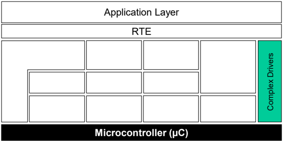

**例子：**

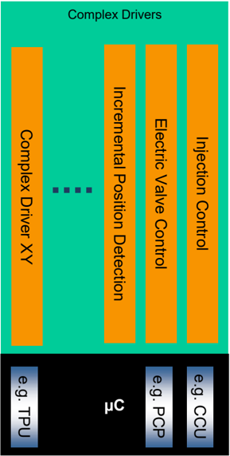

#### ECU 抽象：I/O 硬件抽象

I/O 硬件抽象是一组模块，它对外的抽象对象是外设 I/O 设备的位置（片上或板上）以及 ECU 硬件布局（例如 µC 引脚连接和信号电平反转）。I/O 硬件抽象不对传感器/执行器进行抽象！

不同的 I/O 设备可以通过 I/O 信号接口来访问。

- **任务：** 按照 I/O 信号连接到 ECU 硬件的实际形态来表示它们（例如电流、电压、频率）；对更高的软件层隐藏 ECU 硬件与布局属性。
- **属性：**
  - **实现：** 独立于 µC，依赖 ECU 硬件；
  - **上层接口：** 独立于 µC 和 ECU 硬件，依赖信号类型；按照 AUTOSAR 规定并实现（AUTOSAR 接口）。

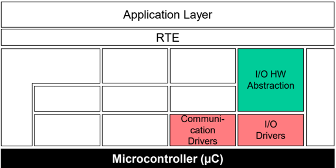

**例子：**

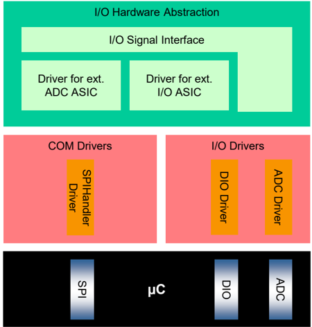

#### ECU 抽象：通信硬件抽象

通信硬件抽象是一组模块，它对通信控制器的位置和 ECU 硬件布局进行抽象。对于每种通信系统，都需要一个特定的通信硬件抽象（例如针对 LIN、CAN、FlexRay）。

例子：某个 ECU 的微控制器带有 2 个内部 CAN 通道，另有一块带 4 个 CAN 控制器的板载 ASIC。CAN-ASIC 通过 SPI 连接到微控制器。

通信驱动通过总线特定的接口（例如 CAN 接口）来访问。

- **任务：** 提供同等的机制来访问总线通道，无论其位于何处（片上/板上）。
- **属性：**
  - **实现：** 独立于 µC，依赖 ECU 硬件和外部设备；
  - **上层接口：** 依赖总线，独立于 µC 和 ECU 硬件。

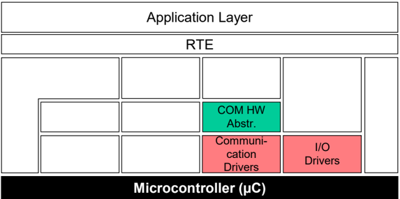

**例子：**

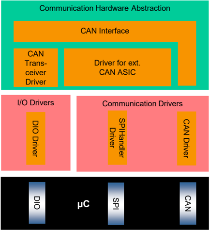

#### 存储硬件抽象

存储硬件抽象是一组模块，它对外设存储设备的位置（片上或板上）和 ECU 硬件布局进行抽象。

例子：片上 EEPROM 和外部 EEPROM 设备通过相同的机制访问。

存储驱动通过存储特定的抽象/仿真模块（例如 EEPROM 抽象）来访问。

通过在 Flash 硬件单元之上仿真 EEPROM 抽象，可以经由存储抽象接口对两类硬件进行统一访问。

- **任务：** 提供同等的机制来访问内部（片上）和外部（板上）存储设备以及各类存储硬件（EEPROM、Flash）。
- **属性：**
  - **实现：** 独立于 µC，依赖外部设备；
  - **上层接口：** 独立于 µC、ECU 硬件和存储设备。

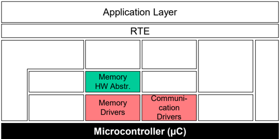

**例子：**

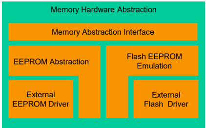

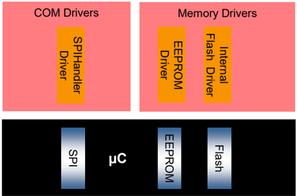

<!-- 源文档中该幻灯片出现两次（第二次带草稿标记），正文相同，仅示例图不同——合并为一节，两张示例图都保留。 -->

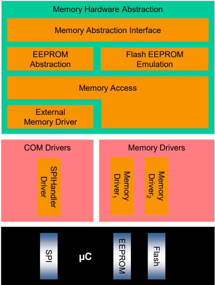

#### 板载设备抽象

板载设备抽象包含针对 ECU 板载设备的驱动，这些设备不能被视为传感器或执行器，例如内部或外部看门狗。这些驱动通过 µC 抽象层访问 ECU 板载设备。

- **任务：** 对 ECU 特定的板载设备进行抽象。
- **属性：**
  - **实现：** 独立于 µC，依赖外部设备；
  - **上层接口：** 独立于 µC，部分依赖 ECU 硬件。

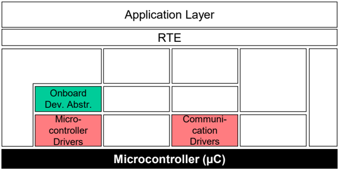

**例子：**

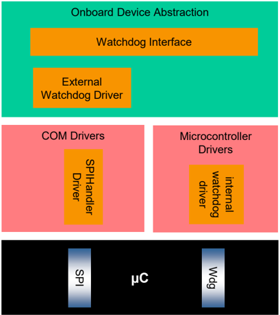

#### 加密硬件抽象

加密硬件抽象是一组模块，它对密码学原语的位置（内部或外部、硬件或软件实现）进行抽象。

例子：AES 原语在 SHE 中实现，或以软件库的形式提供。

- **任务：** 提供同等的机制来访问内部（片上）加密设备和软件加密设备。
- **属性：**
  - **实现：** 独立于 µC；
  - **上层接口：** 独立于 µC、ECU 硬件和加密设备。


**例子：**

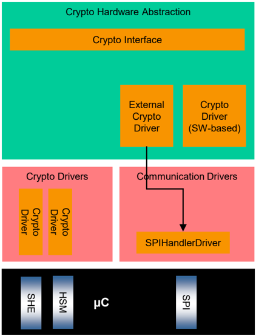

#### 服务：加密服务

加密服务由三个模块组成：

- 加密服务管理器（Crypto Service Manager）负责加密作业的管理；
- 密钥管理器（Key Manager）与密钥供给主设备（在 NVM 或加密驱动中）交互，并管理证书链的存储与验证；
- 入侵检测系统管理器（Intrusion Detection System Manager）负责处理基础软件模块或 SW-C 报告的安全事件。

- **任务：** 以统一的方式向应用提供密码学原语、IDS 服务和密钥存储。对硬件设备及其属性进行抽象。
- **属性：**
  - **实现：** 独立于 µC 和 ECU 硬件，高度可配置；
  - **上层接口：** 独立于 µC 和 ECU 硬件；按照 AUTOSAR 规定并实现（AUTOSAR 接口）。

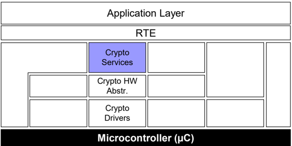

**例子：**

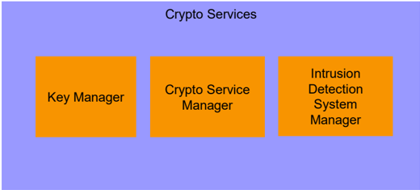

#### 通信服务——通用

通信服务是用于车载网络通信（CAN、LIN、FlexRay 和 Ethernet）的一组模块。它们通过通信硬件抽象与通信驱动对接。

- **任务：**
  - 为车载网络通信提供统一接口；
  - 为网络管理提供统一服务；
  - 为诊断通信提供到车载网络的统一接口；
  - 对应用隐藏协议和报文属性。
- **属性：**
  - **实现：** 独立于 µC 和 ECU 硬件，部分依赖总线类型；
  - **上层接口：** 独立于 µC、ECU 硬件和总线类型。

通信服务将在后续页面中针对每个相关的车载网络系统分别详述。

**例子：**

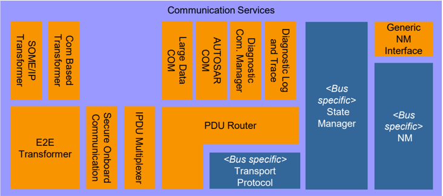

总线特定模块：

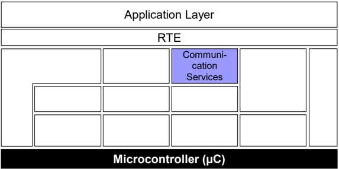

#### 通信栈——CAN

**例子：**


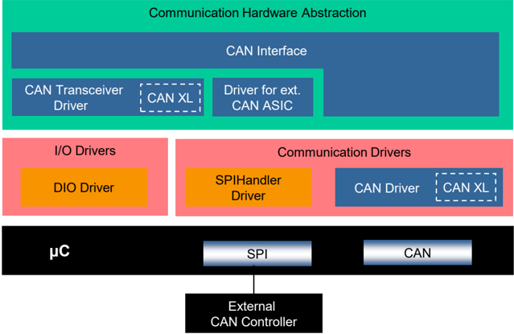

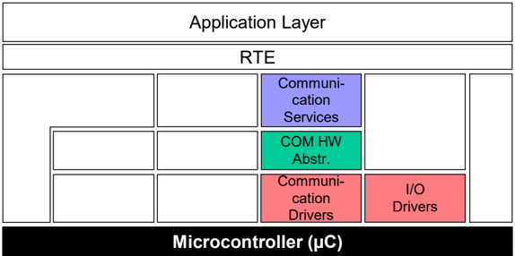

CAN 通信服务是用于 CAN 通信系统车载网络通信的一组模块。

- **任务：** 为 CAN 网络提供统一接口；对应用隐藏协议和报文属性。
- **CAN 通信栈支持：**
  - 经典 CAN 通信（CAN 2.0）
  - CAN FD 通信（若硬件支持）
  - CAN XL 通信（若硬件支持）

**属性：**

- 实现：独立于 µC 和 ECU 硬件，部分依赖 CAN。
- AUTOSAR COM、通用 NM（网络管理）接口和诊断通信管理器对所有车载网络系统都是相同的，每个 ECU 存在一个实例。
- 通用 NM 接口仅包含一个分发器，不含其他功能。对于网关 ECU，它还可以包含 NM 协调器功能，用于同步多个不同的网络（相同或不同类型），使它们同步唤醒或关闭。
- CAN NM 是 CAN 网络特有的，将按每个 CAN 车载网络系统实例化。
- 通信系统特定的 Can 状态管理器处理依赖通信系统的启动和关闭特性。此外，它还控制 COM 发送 PDU 和监控信号超时的不同选项。

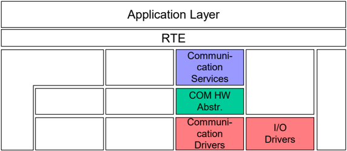

#### 通信栈——Ethernet/CAN XL

**例子：**

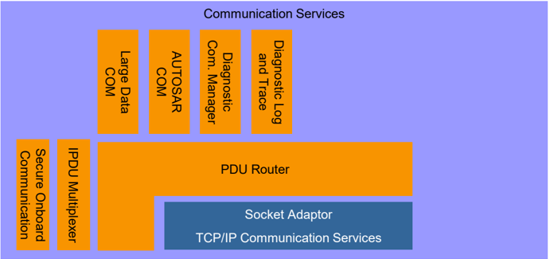

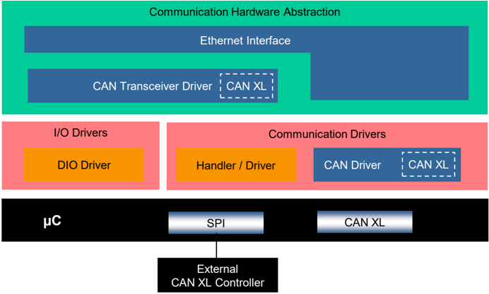


CAN XL 支持直接隧道传输 IEEE 802.3 以太网帧，以参与 IP 通信。

- **任务：** 提供整车范围内的通信，使用处处相同的语义，而无论物理连接（CAN XL / Ethernet）或通信范式（基于信号与基于服务的通信）如何。

#### 通信栈扩展——CAN XL

**属性：**

- CAN XL 是 CAN 的绝对超集，即支持 CAN XL 的 CAN 栈既能服务于 CAN 总线，也能服务于 CAN XL 总线。
- CanIf、CanTrcvDrv 和 CanDrv 是为服务 CAN XL 通信而需要扩展的仅有的模块。
- CAN 通信栈的各项特性对于带 CAN XL 功能的 CAN 同样成立。


#### 通信栈扩展——TTCAN

**例子：**

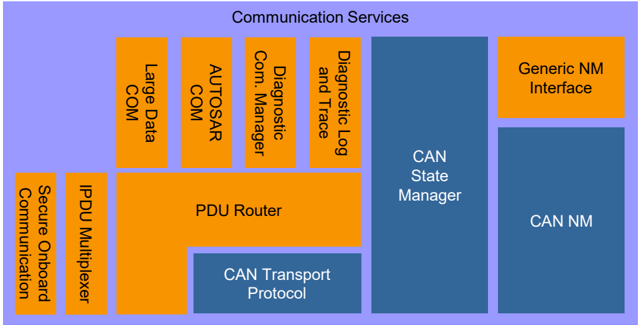

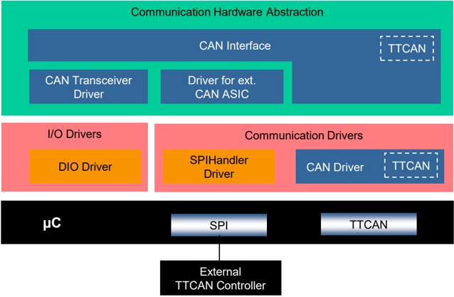


TTCAN 通信服务是普通 CAN 接口和 CAN 驱动模块针对 TTCAN 通信系统车载网络通信的可选扩展。

- **任务：** 为 TTCAN 网络提供统一接口；对应用隐藏协议和报文属性。
- **请注意：** 带 TTCAN 的 CAN 接口既能服务于普通 CAN 驱动，也能服务于 TTCAN CAN 驱动。

**属性：**

- TTCAN 是 CAN 的绝对超集，即支持 TTCAN 的 CAN 栈既能服务于 CAN 总线，也能服务于 TTCAN 总线。
- CanIf 和 CanDrv 是为服务 TTCAN 通信而需要扩展的仅有的模块。
- CAN 通信栈的各项特性对于带 TTCAN 功能的 CAN 同样成立。


#### 通信栈扩展——J1939

**例子：**

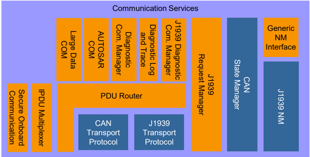

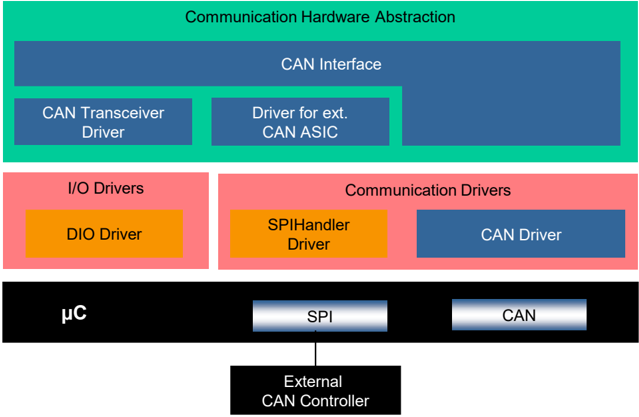


J1939 通信服务扩展了普通 CAN 通信栈，用于重型车辆的车载网络通信。

- **任务：** 提供 J1939 所要求的协议服务；在无需之处对应用隐藏协议和报文属性。
- **请注意：**
  - CAN 栈中有两个传输协议模块（CanTp 和 J1939Tp），它们可以在不同通道上交替使用或并行使用。用法如下：
  - CanTp：ISO 诊断（DCM），标准 CAN 总线上的大 PDU 传输；
  - J1939Tp：J1939 诊断，J1939 驱动的 CAN 总线上的大 PDU 传输。

**属性：**

- 实现：独立于 µC 和 ECU 硬件，基于 CAN。
- AUTOSAR COM、通用 NM（网络管理）接口和诊断通信管理器对所有车载网络系统都是相同的，每个 ECU 存在一个实例。
- 支持配置时未知的动态帧标识符。
- J1939 网络管理处理为每个 ECU 分配唯一地址，但不支持睡眠/唤醒处理以及部分组网等相关概念。
- 提供 J1939 诊断和请求处理。


#### 通信栈——LIN

**例子：**

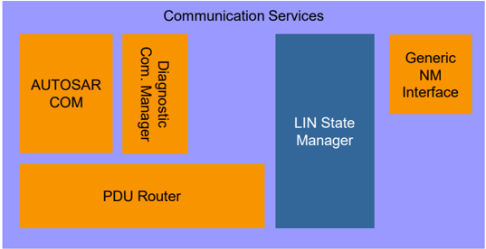

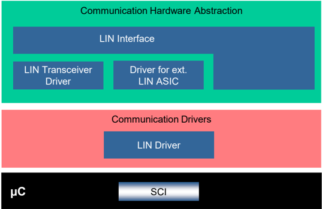

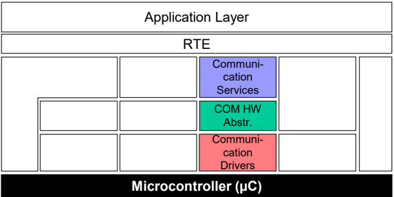

LIN 通信服务是用于 LIN 通信系统车载网络通信的一组模块。

- **任务：** 为 LIN 网络提供统一接口；对应用隐藏协议和报文属性。
- **属性：** LIN 通信服务包含：
  - 一个符合 ISO 17987 的通信栈，具有
    - 调度表管理器，用于处理切换到其他调度表的请求（针对 LIN 主节点）；
    - 对不同 LIN 帧类型的通信处理；
    - 用于诊断的传输协议；
    - 一个唤醒与睡眠接口。
  - 一个底层的 LIN 驱动：
    - 实现 LIN 协议并访问特定硬件；
    - 同时支持简单的 UART 和复杂的基于帧的 LIN 硬件。

**注意：LIN 集成到 AUTOSAR 的方式：**

- LIN 接口控制唤醒/睡眠 API，并允许从节点保持总线唤醒（去中心化方式）。
- 通信系统特定的 LIN 状态管理器处理依赖通信的启动和关闭特性。此外，它还控制来自通信管理器的通信模式请求。LIN 状态管理器还通过与 COM 对接来控制 I-PDU 组。
- 发送 LIN 帧时，LIN 接口在其需要数据的时刻（即恰在发送 LIN 帧之前）向 PDU 路由器请求该帧的数据（I-PDU）。


#### 通信栈——FlexRay

**例子：**

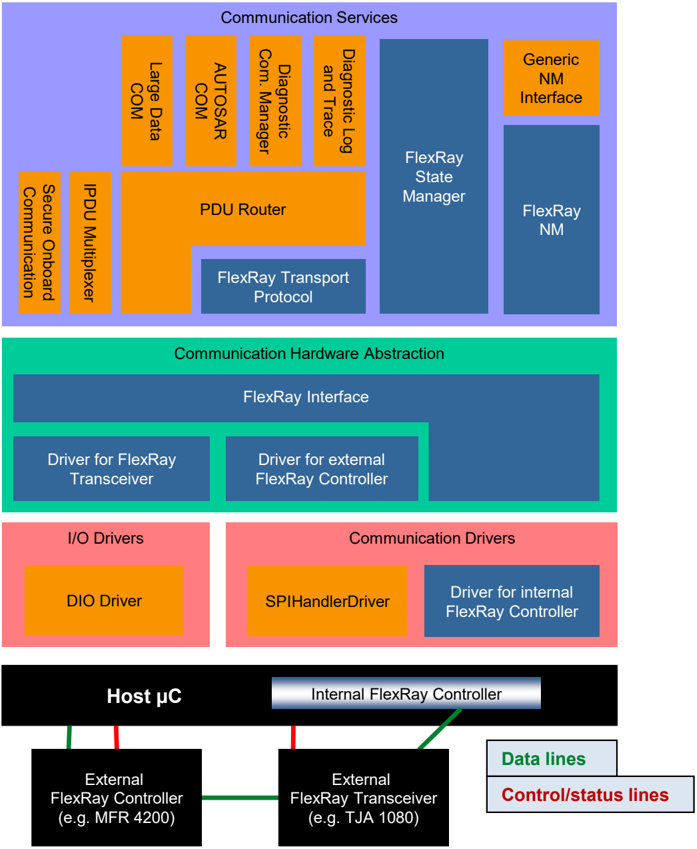


FlexRay 通信服务是用于 FlexRay 通信系统车载网络通信的一组模块。

- **任务：** 为 FlexRay 网络提供统一接口；对应用隐藏协议和报文属性。
- **请注意：**
  - FlexRay 栈中有两个传输协议模块，可以交替使用：
  - FrTp：FlexRay ISO 传输层；
  - FrArTp：FlexRay AUTOSAR 传输层，提供与 AUTOSAR R3.x 的总线兼容性。

**属性：**

- 实现：独立于 µC 和 ECU 硬件，部分依赖 FlexRay。
- AUTOSAR COM、通用 NM 接口和诊断通信管理器对所有车载网络系统都是相同的，每个 ECU 存在一个实例。
- 通用 NM 接口仅包含一个分发器，不含其他功能。对于网关 ECU，它被 NM 协调器取代，后者额外提供同步多个不同网络（相同或不同类型）的功能，使它们同步唤醒或关闭。
- FlexRay NM 是 FlexRay 网络特有的，按每个 FlexRay 车载网络系统实例化。
- 通信系统特定的 FlexRay 状态管理器处理依赖通信系统的启动和关闭特性。此外，它还控制 COM 发送 PDU 和监控信号超时的不同选项。


#### 通信栈——TCP/IP

**例子：**

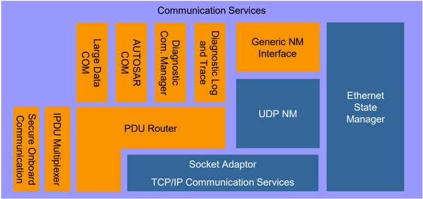

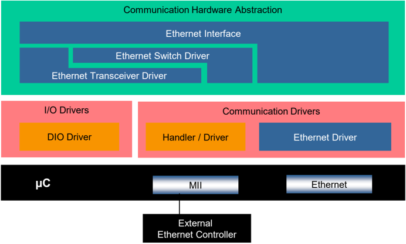


TCP/IP 通信服务是用于 TCP/IP 通信系统车载网络通信的一组模块。

- **任务：** 为 TCP/IP 网络提供统一接口；对应用隐藏协议和报文属性。

**属性：**

- TcpIp 模块实现 TCP/IP 协议族的主要协议（TCP、UDP、IPv4、IPv6、ARP、ICMP、DHCP），并经由 Ethernet 提供动态的、基于套接字的通信。
- 套接字适配器模块（SoAd）是 TcpIp 模块唯一的上层模块。


#### 通信栈——防火墙（Firewall）

防火墙模块通过检查网络报文并基于预定义的规则集进行过滤，保护 AUTOSAR 栈免受恶意报文侵害。

防火墙支持 3 个不同层级的网络报文检查：

- 无状态报文检查
- 有状态报文检查
- 深度报文检查

防火墙与 IdsM 模块相连，在出现意外网络报文时引发安全事件。

**例子：**

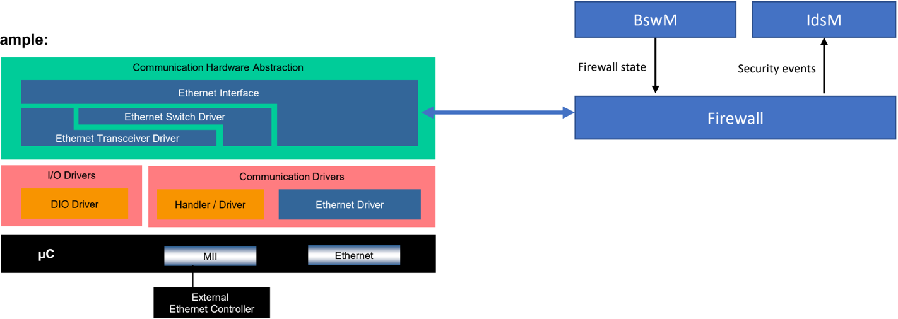


#### 通信栈——DDS

**例子：**

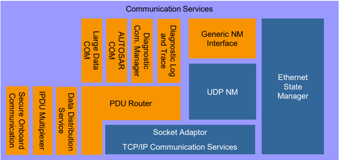

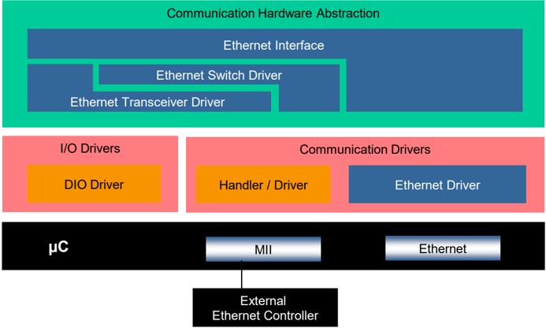


数据分发服务（Data Distribution Services）是面向数据的车载网络通信模块。

- **任务：** 提供 DDS 标准接口。
- **DDS 模块支持：**
  - 基于信号的发布者/订阅者通信路径；
  - QoS 处理；
  - 完全静态配置。

**属性：**

- DDS 模块以未序列化的数据作为输入，因此它可以实现 OMG（Object Management Group）DDS 标准的所有特性。
- 套接字适配器模块（SoAd）是唯一能够通过 PDU 路由器（PduR）处理 DDS-PDU 的模块。
- DDS 模块自身提供 E2E 特性和安全服务。


#### 通信栈——ChrgM

充电管理器（Charging Manager，ChrgM）属于 AUTOSAR 分层架构的通信服务。

- ChrgM 按照 ISO 15118-2 控制 EV 与 EVSE 之间的充电过程。
- ChrgM 与不同的 Bsw 模块（如 PduR、SoAd、Csm、KeyM、BswM）通信，以实现充电过程。
- 提供可由实现充电过程应用部分的 SWC 使用的端口。
- 提供 V2GTP 通信协议。
- 提供报文的 EXI 编码与解码。
- ChrgM 提供错误处理机制和定时器，用于管理 EV 与 EVSE 之间的通信。

ChrgM 由两个子模块组成：V2GTP 和 EXI。

- V2GTP（vehicle to grid standard protocol，车辆到电网标准协议）：该子模块将数据格式化为 PDU。
- EXI（efficient XML interchange，高效 XML 交换）：该子模块按照 W3C 1.0 推荐标准将数据转换为字节流。

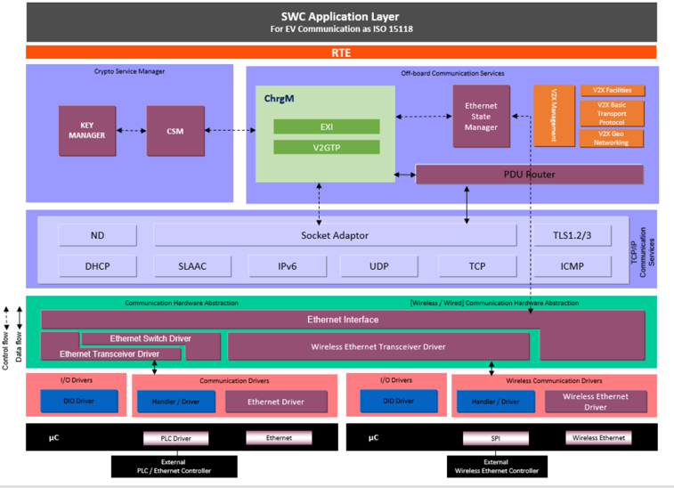

#### 通信栈——通用

- **通用通信栈特性：**
  - 信号网关是 AUTOSAR COM 的一部分，用于路由信号。
  - 基于 PDU 的网关是 PDU 路由器的一部分。
  - I-PDU 多路复用提供了添加信息以实现 I-PDU 多路复用的可能（总线上不同内容但相同 ID）。
  - 多 I-PDU 到容器（container）的映射提供了将若干 I-PDU 组合为一个更大的（容器）I-PDU、从而在单个（总线特定的）帧中传输的可能。
  - 上层接口：独立于 µC、ECU 硬件和网络类型。
  - 网关架构的细化请参见「通信示例」一节。


#### 车外通信栈——欧洲 Vehicle-2-X

**例子：**

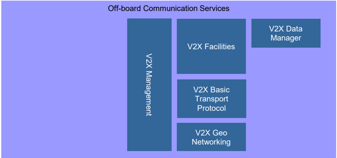

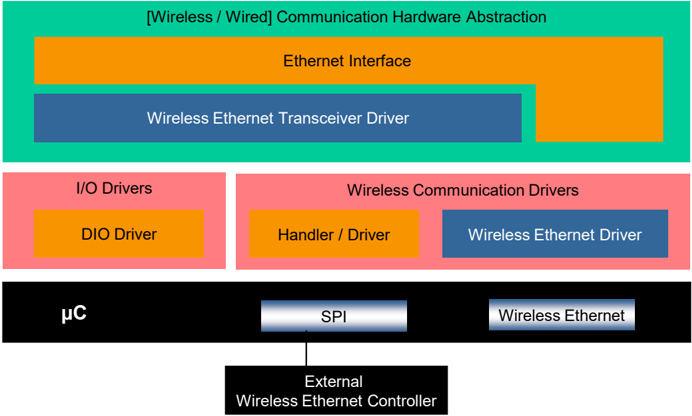

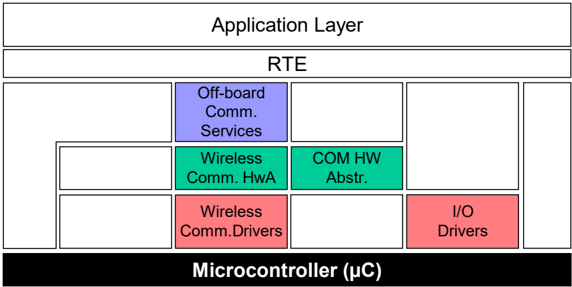

欧洲 Vehicle-2-X 通信服务是通过 ad-hoc 无线网络进行 Vehicle-to-X 通信的一组模块。

- **设施（Facilities）**：实现标准化 V2X 报文的接收与发送功能，为车辆特定的 SW-C 构建接口。
- **基本传输协议（Basic Transport Protocol）** = 第 4 层。
- **地理网络（Geo-Networking）** = 第 3 层（基于地理区域的寻址，相应的以太网帧拥有自己的 Ether-Type）。
- **V2X 管理**：管理跨层功能（如动态拥塞控制、安全、位置和时间）。
- **V2X 数据管理器**：管理 V2X 报文的接收与转换，并通过 RTE 将其发送给 SW-C 或经由 SOME/IP 发送。

- **任务：** 为无线以太网网络提供统一接口；对应用隐藏协议和报文属性。

#### 车外通信栈——中国 Vehicle-2-X

**例子：**


中国 Vehicle-2-X 通信服务是基于蜂窝 V2X 技术、遵循中国 V2X 标准的一组模块。

- **报文（Message）**：实现标准化中国 V2X 报文的接收与发送功能，为车辆特定的 SW-C 构建接口；实现与报文层相关的管理功能（发送频率、位置与时间、报文标识符）。
- **安全（Security）**：实现报文封装、解封装和假名管理的功能。
- **网络（Network）**：报文接收与发送、第 2 层 ID 设置等。
- **管理（Management）**：管理跨层功能（如专用服务通告等）。

- **任务：** 为基于蜂窝的 V2X 网络提供统一接口；对应用隐藏协议和报文属性。

#### 服务：存储服务

存储服务由一个模块组成，即 NVRAM 管理器。它负责非易失性数据的管理（从不同的存储驱动读/写）。

**任务：** 以统一的方式向应用提供非易失性数据。对存储位置和属性进行抽象。提供非易失性数据管理机制，如保存、加载、校验和保护、可靠存储等。

- **属性：**
  - **实现：** 独立于 µC 和 ECU 硬件，高度可配置；
  - **上层接口：** 独立于 µC 和 ECU 硬件；按照 AUTOSAR 规定并实现（AUTOSAR 接口）。


**例子：**


#### 服务：系统服务

系统服务是一组可被所有层的模块使用的模块和函数。例子有实时操作系统（包含定时器服务）和错误管理器。

- 这些服务中的一部分：
  - 依赖 µC（如 OS），并可能支持特殊的 µC 能力（如 Time Service），
  - 部分依赖 ECU 硬件和应用（如 ECU 状态管理器），或
  - 独立于硬件和 µC。

- **任务：** 为应用和基础软件模块提供基础服务。
- **属性：**
  - **实现：** 部分依赖 µC、ECU 硬件和应用；
  - **上层接口：** 独立于 µC 和 ECU 硬件。


**例子：**


#### 错误处理、报告与诊断


AUTOSAR 中有针对错误处理不同方面的专用模块。例如：

- 诊断事件管理器负责处理和存储诊断事件（错误）以及相关的 FreezeFrame 数据。
- 诊断日志与跟踪（Diagnostic Log and Trace）模块支持应用的日志记录与跟踪。它收集用户定义的日志消息，并将其转换为标准化格式。
- 基础软件中检测到的所有开发错误都报告给默认错误跟踪器（Default Error Tracer）。
- 诊断通信管理器为诊断服务提供公共 API。
- 等等。

#### 应用层：传感器/执行器软件组件

传感器/执行器 AUTOSAR 软件组件是一种特殊类型的 AUTOSAR 软件组件，用于传感器评估和执行器控制。它虽然不属于 AUTOSAR 基础软件，但由于其与本地信号的紧密关系而在此描述。出于集成原因（标准化的接口实现与接口描述），已决定将传感器/执行器软件组件置于 RTE 之上。由于它们与原始本地信号的强交互，其可重定位性受到限制。

- **任务：** 对连接到 ECU 的硬件传感器和执行器的特定物理属性进行抽象。
- **属性：**
  - **实现：** 独立于 µC 和 ECU 硬件，依赖传感器和执行器。


**例子：**


其接口指向（例如）：

- I/O 硬件抽象（对 I/O 信号的访问）
- 存储服务（对标定数据的访问）
- 系统服务（对错误管理器的访问）

### 1.3. 多核系统中的软件层内容

#### 多核微控制器分层软件架构示例


#### 分布式基础软件模块的详细视图

- 基础软件模块可以分布在多个分区和多个核上。所有分区共享同一份代码。
- 模块在每个分区上可以是完全相同的，如图中 I/O 栈的 DIO 驱动所示。
- 或者，它们可以使用依赖核的分支来实现不同的行为。Com 服务和 PWM 驱动使用主-卫星（master-satellite）通信来处理从相应卫星发出的对主节点的调用。
  - 主节点与卫星之间的通信不是标准化的。例如，它可以基于基础软件调度器提供的函数，或基于共享内存。
- 箭头指示在处理一次服务调用时涉及哪些组件，这取决于分布方式和调用的来源。


#### 多分区上的基础软件模块、OS、BswM 和 EcuM 概览


- 每个运行基础软件模块的分区中都有一个基础软件模式管理器（BswM）
  - 所有这些分区都是可信的。
- 每个核一个 EcuM（各自位于可信分区中）。
- 通过引导加载程序启动的那个核上的 EcuM 是主 EcuM。
  - 主 EcuM 启动所有卫星 EcuM。

#### 多核系统服务

- 如图所示，IOC 提供通信服务，需要跨 OS-Application 边界在同一 ECU 上通信的客户端可以访问这些服务。IOC 是 OS 的一部分。
- 基础软件模块可以在多个核上执行，例如图中的 ComM。负责执行某项服务的核在运行时确定。
- 每个核都运行一种 ECU 状态管理。


### 1.4. 混合关键度系统中的软件层内容

#### AUTOSAR 安全处理概览

- AUTOSAR 提供了一种灵活的方法来支持安全相关 ECU。可以使用两种方法：
  1. 所有基础软件模块都按照要求的 ASIL 开发；
  2. 选定的模块按照 ASIL 开发。ASIL 与非 ASIL 模块被分隔到不同的分区中（基础软件分布）。

**注意：** 分区基于 OS-Application。OS-Application 的 TRUSTED 属性与 ASIL/非 ASIL 无关。


方法 (1) 的使用示例。

#### 面向安全系统的 AUTOSAR 基础软件分布

- 使用不同基础软件分区的示例
  - 看门狗栈被放置在一个独立的分区中；
  - ASIL 与非 ASIL SW-C 可以通过 RTE 访问 WdgM；
  - 基础软件的其余部分放置在自己的分区中。


### 1.5. 模块概览

#### 实现一致性等级 3——ICC3

此图展示基础软件模块到 AUTOSAR 各层的映射。


#### 实现一致性等级——ICC2

本文档中展示的集群是项目迄今定义的集群。AUTOSAR 目前不将 ICC2 层级上的集群限制为特定的集群，因为许多不同的约束和优化准则可能导致不同的 ICC2 集群。可能存在不同的 AUTOSAR ICC2 集群，可以基于一个尚待定义的 ICC2 合规性方法针对它们声明合规性。


#### 实现一致性等级——ICC1

在符合 ICC1 的基础软件中，不要求任何模块或集群。

这种专有基础软件的内部结构不作规定。

应用层 / AUTOSAR 运行时环境之下为专有软件，之下为 ECU 硬件。

#### 实现一致性等级——对外行为

符合 AUTOSAR（ICC1–3）的基础软件（包括 RTE）对外必须按照 ICC3 模块规范所规定的方式行事。

例如，面向以下对象的行为：

- 总线，
- 引导加载程序，以及
- 应用。

此外，ICC1/2 配置在系统描述方面应当与 ICC3 兼容。

### 1.6. 接口：通用规则

#### AUTOSAR 中接口的类型

| 接口类型 | 说明 |
| --- | --- |
| AUTOSAR 接口（AUTOSAR Interface） | 「AUTOSAR 接口」定义软件组件和/或基础软件模块之间交换的信息。该描述独立于特定的编程语言、ECU 或网络技术。AUTOSAR 接口用于定义软件组件和/或基础软件模块的端口。通过这些端口，软件组件和/或基础软件模块可以相互通信（发送或接收信息，或调用服务）。AUTOSAR 使软件组件和/或基础软件模块之间的这种通信既可以在本地实现，也可以经由网络实现。 |
| 标准化 AUTOSAR 接口（Standardized AUTOSAR Interface） | 「标准化 AUTOSAR 接口」是一种其语法和语义在 AUTOSAR 中被标准化的「AUTOSAR 接口」。标准化 AUTOSAR 接口通常用于定义 AUTOSAR 服务，即由 AUTOSAR 基础软件提供给应用软件组件的标准化服务。 |
| 标准化接口（Standardized Interface） | 「标准化接口」是在 AUTOSAR 内标准化的 API，但不使用「AUTOSAR 接口」技术。这些标准化接口通常针对特定编程语言（如 C 语言）定义。因此，标准化接口通常用于始终位于同一 ECU 上的软件模块之间。当软件模块通过「标准化接口」通信时，就无法再经由网络路由这些软件模块之间的通信。 |

#### 组件与接口视图（简化）


注意：就各层之间可能的交互而言，此图是不完整的。

#### 通用接口规则

**水平接口**

服务层：允许水平接口。示例：错误管理器使用 NVRAM 管理器保存故障数据。

ECU 抽象层：允许水平接口。复杂驱动可以使用选定的其他基础软件模块。

µC 抽象层：不允许水平接口。例外：出于性能原因，允许可配置的通知（notification）。

**垂直接口**

一层可以访问其下方软件层的所有接口。

绕过一个软件层应当避免；绕过两个或更多软件层是不允许的；绕过 µC 抽象层是不允许的。

模块可以访问另一层组的下层模块（例如针对外部硬件的 SPI）。

所有层都可以与系统服务交互。

#### 层交互矩阵

此规范性矩阵展示 AUTOSAR 基础软件各层之间允许的交互：

- ✓ 允许使用
- ✗ 不允许使用
- Δ 受限使用（仅限回调）

矩阵按行读取：例如「I/O 驱动允许使用系统服务和硬件，但不允许使用其他任何层」。

（灰色背景表示「非基础软件」层）

| 使用\被使用 | 系统服务/OS | 存储服务 | 加密服务 | 通信服务 | 车外通信服务 | 复杂驱动 | I/O 硬件抽象 | 板载设备抽象 | 存储硬件抽象 | 加密硬件抽象 | 通信硬件抽象* | 微控制器驱动 | 存储驱动 | 加密驱动 | 通信驱动* | I/O 驱动 | 微控制器硬件 |
| --- | --- | --- | --- | --- | --- | --- | --- | --- | --- | --- | --- | --- | --- | --- | --- | --- | --- |
| SW 组件 / RTE | ✓ | ✓ | ✓ | ✓ | ✓ | ✓ | ✓ | ✗ | ✗ | ✗ | ✗ | ✗ | ✗ | ✗ | ✗ | ✗ | ✗ |
| 系统服务 / OS | ✓ | ✓ | ✓ | ✓ | ✓ | ✓ | ✓ | ✓ | ✓ | ✓ | ✓ | ✓ | ✓ | ✓ | ✓ | ✓ | ✓ |
| 存储服务 | ✓ | ✓ | ✓ | ✗ | ✗ | ✗ | ✗ | ✗ | ✓ | ✗ | ✗ | ✗ | ✗ | ✗ | ✗ | ✗ | ✗ |
| 加密服务 | ✓ | ✓ | ✓ | ✗ | ✗ | ✗ | ✗ | ✗ | ✗ | ✓ | ✗ | ✗ | ✗ | ✗ | ✗ | ✗ | ✗ |
| 通信服务 | ✓ | ✓ | ✓ | ✓ | ✓ | ✗ | ✗ | ✗ | ✗ | ✗ | ✓ | ✗ | ✗ | ✗ | ✗ | ✗ | ✗ |
| 车外通信服务 | ✓ | ✓ | ✓ | ✓ | ✓ | ✗ | ✗ | ✗ | ✗ | ✗ | ✓ | ✗ | ✗ | ✗ | ✗ | ✗ | ✗ |
| 复杂驱动 | 受限访问——参见后面两页 |
| I/O 硬件抽象 | ✓ | ✗ | ✓ | ✗ | ✗ | ✗ | ✓ | ✓ | ✗ | ✗ | ✓ | ✓ | ✗ | ✗ | ✓ | ✓ | ✗ |
| 板载设备抽象 | ✓ | ✗ | ✗ | ✗ | ✗ | ✗ | ✗ | ✓ | ✗ | ✗ | ✓ | ✓ | ✗ | ✗ | ✓ | ✓ | ✗ |
| 存储硬件抽象 | ✓ | ✓ | ✗ | ✗ | ✗ | ✗ | ✗ | ✓ | ✓ | ✗ | ✓ | ✗ | ✓ | ✗ | ✓ | ✗ | ✗ |
| 加密硬件抽象 | ✓ | ✓ | ✓ | ✗ | ✗ | ✗ | ✗ | ✓ | ✗ | ✓ | ✗ | ✗ | ✗ | ✗ | ✗ | ✓ | ✗ |
| 通信硬件抽象* | ✓ | ✗ | ✗ | ✓ | ✓ | ✗ | ✗ | ✓ | ✗ | ✗ | ✓ | ✗ | ✗ | ✗ | ✓ | ✓ | ✗ |
| 微控制器驱动 | ✓ | ✗ | ✗ | ✗ | ✗ | ✗ | Δ | Δ | ✗ | Δ | ✗ | Δ | ✗ | ✗ | ✗ | Δ | ✓ |
| 存储驱动 | ✓ | ✗ | ✗ | ✗ | ✗ | ✗ | ✗ | ✗ | Δ | ✗ | ✗ | ✗ | ✗ | ✗ | ✗ | ✗ | ✓ |
| 加密驱动 | ✓ | ✓ | ✗ | ✗ | ✗ | ✗ | ✗ | ✗ | ✗ | Δ | ✗ | ✗ | ✗ | ✗ | ✗ | ✗ | ✓ |
| 通信驱动* | ✓ | ✗ | ✗ | ✗ | ✗ | ✗ | ✗ | Δ | ✗ | ✗ | Δ | ✗ | ✗ | ✗ | ✗ | ✓ | ✓ |
| I/O 驱动 | ✓ | ✗ | ✗ | ✗ | ✗ | ✗ | Δ | Δ | ✗ | Δ | ✗ | Δ | ✗ | ✗ | ✗ | Δ | ✓ |

\*：包含有线与无线通信。

#### 与复杂驱动对接（1）

复杂驱动可能需要与分层软件架构中的其他模块对接，或者分层软件架构中的模块可能需要与复杂驱动对接。如果是这种情况，则适用以下规则：

**1. 从分层软件架构的模块对接到复杂驱动**

只有当复杂驱动提供的接口可以由访问它的 AUTOSAR 模块进行通用配置时，才允许这样做。

一个典型的例子是 PDU 路由器：复杂驱动可以实现一个新总线系统的接口模块。这已经在 PDU 路由器的配置中得到考虑。

**2. 从复杂驱动对接到分层软件架构的模块**

同样，只有当分层软件架构的相应模块提供这些接口、并且准备好被复杂驱动访问时，才允许这样做。通常这意味着：

- 相应的接口被定义为可重入；
- 如果使用了回调例程，其名称是可配置的；
- 不存在对该模块状态进行管理的上层模块（并行访问会在上层模块察觉不到的情况下改变状态）。

#### 与复杂驱动对接（2）

一般而言，可以访问以下模块：

- SPI 驱动；
- GPT 驱动；
- I/O 驱动，限制在于可重入性通常仅对单独的组/通道等成立。对同一组/通道等的并行访问大多是不允许的。这必须在配置期间加以注意；
- NVRAM 管理器，作为存储栈的独占访问点；
- 看门狗管理器，作为看门狗栈的独占访问点；
- PDU 路由器，作为通信栈的独占的、与总线和协议无关的访问点；
- 总线特定的接口模块，作为通信栈的独占的、总线特定的访问点；
- NM 接口模块，作为网络管理栈的独占访问点；
- 通信管理器（仅可从上层访问）和基础软件模式管理器，作为状态管理的独占访问点；
- Det、Dem 和 Dlt；
- OS，只要所使用的 OS 对象未被分层软件架构的某个模块使用。

尽管如此，对每个模块仍必须检查相应的函数是否被标记为可重入。例如，「init」函数通常不可重入，只应由 ECU 状态管理器调用。

#### 与复杂驱动对接（3）

在多核架构的情况下，还有额外的规则：

- 基础软件可以分布在多个核上。负责执行一次基础软件服务调用的核由其 BswOperationInvokedEvent 的任务映射决定。
- 仅允许模块内部通信跨越分区和核的边界，使用主/卫星实现。
- 因此，如果 CDD 需要访问基础软件的标准化接口，它必须驻留在同一个核上。
- 如果 CDD 驻留在不同的核上，它可以使用正常的端口机制来访问 AUTOSAR 接口和标准化 AUTOSAR 接口。这会调用 RTE，RTE 使用操作系统的 IOC 机制将请求传输到另一个核。
- 但是，如果 CDD 需要访问基础软件的标准化接口而又不在同一个核上：
  - 要么在 CDD 所在的核上运行一个提供该标准化接口的卫星，由它将调用转发到另一个核；
  - 要么需要在另一个核上实现 CDD 的桩（stub）部分，并使用操作系统的 IOC 机制以类似于 RTE 的方式组织 CDD 本地的通信。
- 此外，在后一种情况下，CDD 的初始化部分也需要驻留在另一个核的桩部分中。

### 1.7. 接口：层间交互

#### 示例「存储」——引言

以下几页以「存储」为例说明：

- 可用的存储服务模块有哪些特性/区别？
- 软件层如何交互？
- 软件接口看起来是什么样的？
- ECU 抽象层内部有什么？
- 如何高效地实现抽象层？

#### 背景：存储服务模块与存储类型的比较

- 不同的服务模块（存储管理器）对所使用的非易失性（NV）存储器进行抽象，但硬件的属性会影响它们的设计以及访问的实现方式。
- 根据所用 NV 硬件的属性，对所列不同模块的使用存在约束。
- 下表列出这些模块及相关 NV 存储器的属性。

| 模块 | 用例、特性 | 支持的 NV 存储器属性 | 示例硬件 |
| --- | --- | --- | --- |
| NvM | • 模块数据的存储（例如错误信息、特殊配置信息、状态信息、诊断数据等）<br>• 支持多个读/写者（BSW 和 SW-C）并行<br>• 大多在启动时读取、在关机时写入，但也支持正常运行期间的中间读/写<br>• 每个用户的典型数据大小为字节到若干 KiB | • 直接（内存映射）和间接（例如经由 SPI）NV 访问<br>• 序列化访问（同一硬件段内的边读边写可能无法工作 → NvM 始终缓冲数据） | • 内部数据闪存（经由 Flash EEPROM 仿真）<br>• 外部 EEPROM / 数据闪存 |
| BndM | • 车辆特定数据的存储<br>• （非常罕见）经由诊断的写入，仅在「受控环境」中（例如修理厂）<br>• 支持多个读取者（SW-C）并行<br>• 用户经由指针直接访问<br>• 典型大小为若干 KiB | • 要求直接访问 NV 数据（经由指针）<br>• 要求并行读取 NV 数据 | • 内部数据闪存<br>• 内部代码闪存 |
| FOTA（管理器） | • 车型特定车辆数据/代码的存储<br>• 用户极少，通常只有一个<br>• 典型大小为 MiB 量级<br>• 在后台写入新数据，例如跨越多个行驶循环（可中断且可抢占的更新流程） | • 边读边写（例如经由存储抽象/分区） | • 内部和外部代码闪存 |

#### 示例「存储」——示例与初步了解

此示例展示 NVRAM 管理器和看门狗管理器在一个假定的硬件配置上如何与驱动交互：

ECU 硬件包含一个外部 EEPROM 和一个外部看门狗，二者经由同一条 SPI 连接到微控制器。

SPIHandlerDriver 控制对 SPI 硬件的并发访问，并且必须给予看门狗访问比 EEPROM 访问更高的优先级。

微控制器还包含一个内部闪存，它与外部 EEPROM 并行使用。EEPROM 抽象与 Flash EEPROM 仿真拥有语义上一致的 API。

存储抽象接口可以按以下方式实现：

- 运行时基于设备索引（内部/外部）的路由；
- 运行时基于块索引的路由（例如 > 0x01FF = 外部 EEPROM）；
- 配置期经由 NVRAM 管理器内含函数指针的 ROM 表进行路由（在这种情况下，存储抽象接口只是「虚拟」存在的）。


#### 示例「存储」——批量 NV 数据管理器


- 用例：频繁写入且只有小的局部改动的大数据块。
  - 实际算法由供应商特定（分块、压缩、增量等）。


**架构描述**

NVRAM 管理器经由存储抽象接口访问驱动。它使用设备索引来寻址不同的存储设备。

**接口描述**

存储抽象接口可以具有如下接口（例如写函数）：

```C
Std_ReturnType MemIf_Write ( uint8 DeviceIndex, uint16 BlockNumber, uint8 *DataBufferPtr )
```

EEPROM 抽象以及 Flash EEPROM 仿真可以具有如下接口（例如写函数）：

```C
Std_ReturnType Ea_Write ( uint16 BlockNumber, uint8 *DataBufferPtr )
```


**情形 1：仅使用一种 NV 设备类型**

这是常见的用例。在这种情况下，如果源代码可用，存储抽象可以实现为一个忽略 DeviceIndex 参数的简单宏。以下示例仅展示写函数：

文件 MemIf.h：

```C
#include 'Ea.h'   /* for providing access to the EEPROM Abstraction */
...
#define MemIf_Write(DeviceIndex, BlockNumber, DataBufferPtr) \
    Ea_Write(BlockNumber, DataBufferPtr)
```

文件 MemIf.c：

不存在。

**结果：**

运行时没有额外的代码，NVRAM 管理器实际上直接访问 EEPROM 抽象或 Flash 仿真。

**情形 2：使用两种或更多不同类型的 NV 设备**

在这种情况下，必须使用 DeviceIndex 来选择正确的 NV 设备。通过使用函数指针数组，实现同样可以非常高效。以下示例仅展示写函数：

文件 MemIf.h：

```C
extern const WriteFctPtrType WriteFctPtr[2];
#define MemIf_Write(DeviceIndex, BlockNumber, DataBufferPtr) \
    WriteFctPtr[DeviceIndex](BlockNumber, DataBufferPtr)
```

文件 MemIf.c：

```C
#include 'Ea.h'    /* for getting the API function addresses */
#include 'Fee.h'   /* for getting the API function addresses */
#include 'MemIf.h' /* for getting the WriteFctPtrType        */

const WriteFctPtrType WriteFctPtr[2] = {Ea_Write, Fee_Write};
```

**结果：**

所需的代码和运行时间与把函数指针表放在 NVRAM 管理器内部时相同。存储抽象接口不带来任何开销。

#### 示例「存储」——结论

**结论：**

- 抽象层可以非常高效地实现；
- 抽象层可以伸缩；
- 存储抽象接口简化了 NVRAM 管理器对一个或多个 EEPROM 和 Flash 设备的访问。

#### 示例「通信」——PDU 流经分层架构

**术语解释：**

- **SDU**：SDU 是「Service Data Unit」（服务数据单元）的缩写。它是上层传递下来的、请求传输的数据；也是下层接收后提取出来并传递给上层的数据。SDU 是 PDU 的一部分。
- **PCI**：PCI 是「Protocol Control Information」（协议控制信息）的缩写。要把 SDU 从协议层的一个实例传递到另一个实例，需要这一信息。例如，它包含源和目标信息。PCI 由发送侧的协议层添加，并在接收侧再次移除。
- **PDU**：PDU 是「Protocol Data Unit」（协议数据单元）的缩写。PDU 包含 SDU 和 PCI。在发送侧，PDU 从上层传递到下层，下层将此 PDU 解释为它自己的 SDU。


#### 示例「通信」（1）

**SDU 与 PDU 命名约定**

PDU 和 SDU 的命名遵循以下规则：

对于 PDU：`<总线前缀> <层前缀> - PDU`；对于 SDU：`<总线前缀> <层前缀> - SDU`。

总线前缀和层前缀见下表：

| ISO 层 | 层前缀 | AUTOSAR 模块 | PDU 名称 | CAN / TTCAN 前缀 | LIN 前缀 | FlexRay 前缀 |
| --- | --- | --- | --- | --- | --- | --- |
| 第 6 层：表示（交互） | I | COM, DCM | I-PDU | N/A | N/A | N/A |
| 第 6 层：表示（交互） | I | PDU 路由器，PDU 多路复用器 | I-PDU | N/A | N/A | N/A |
| 第 3 层：网络层 | N | TP 层 | N-PDU | CAN SF, CAN FF, CAN CF, CAN FC | LIN SF, LIN FF, LIN CF, LIN FC | FR SF, FR FF, FR CF, FR FC |
| 第 2 层：数据链路层 | L | 驱动，接口 | L-PDU | CAN | LIN | FR |

**例子：**

- I-PDU 或 I-SDU；
- CAN FF N-PDU 或 FR CF N-SDU；
- LIN L-PDU 或 FR L-SDU。

SF：Single Frame（单帧）；FF：First Frame（首帧）；CF：Consecutive Frame（连续帧）；FC：Flow Control（流控制）。

关于帧类型的细节，请参见 CAN、TTCAN、LIN 和 FlexRay 的 AUTOSAR 传输协议规范。


#### 示例「通信」（2）

**组件**

- PDU 路由器：
  - 提供不同抽象通信控制器与上层之间 PDU 的路由；
  - 路由器的规模是 ECU 特定的（例如若只存在一个通信控制器，则可以小到没有）；
  - 提供 TP 的即时（on-the-fly）路由。TP 数据的传输在完整 TP 数据被缓冲之前即开始。
- COM：
  - 提供不同 I-PDU 之间单个信号或信号组的路由。
- NM 协调器：
  - 经由由 NM 协调器处理的网络管理，同步连接到某个 ECU 的不同通信通道的网络状态。
- 通信状态管理器：
  - 经由接口启动和关闭通信系统的硬件单元；
  - 控制 PDU 组。

#### 示例「通信」（3）


注意：就所有内部通信路径而言，此图是不完整的。

注：

1. PduR 与 TP 之间的接口与 PduR 与各 If 之间的接口相比差异显著。在涉及 TP 的情况下实现了一种握手机制，允许传输大于帧长度的 I-PDU。
2. 带 TTCAN 的 CanIf 既能服务于带 TTCAN 的 CanDrv，也能服务于不带 TTCAN 的 CanDrv；不带 TTCAN 的 CanIf 无法服务于带 TTCAN 的 CanDrv。

#### 示例「通信」（4）——以太网协议

- 此图展示以太网协议栈内部以及各栈之间的交互。


#### 示例「通信」（5）——使用 CAN XL 的以太网与 CAN 通信


注意：就所有内部通信路径而言，此图是不完整的。

#### 示例「数据转换」（1）——引言

以下几页解释使用数据转换的通信：

- 软件层如何交互？
- 软件接口看起来是什么样的？

#### 示例「数据转换」（2）——示例与初步了解

此示例展示在跨 ECU 通信中使用数据转换时的数据流。

一个 SW-C 发送被配置为传输到远端 ECU 并需经受数据转换的数据。此数据转换不使用就地（in-place）缓冲区处理。

**功能**

- RTE 调用 SOME/IP 转换器（转换器链中的第一个），并传入来自 SW-C 的数据。
- SOME/IP 转换器执行转换，并将输出（字节数组）写入 RTE 提供的缓冲区。
- 随后，RTE 执行转换器链中的第二个——安全（Safety）转换器。安全转换器的输入是 SOME/IP 转换器的输出。
- 安全转换器保护数据，并将输出写入 RTE 提供的另一个缓冲区。由于不使用就地缓冲区处理，需要一个新的缓冲区。
- RTE 将最终输出数据作为字节数组传递给 COM 模块。


#### 示例「数据转换」（3）——细看接口

**架构描述**

RTE 使用位于系统服务层的转换器。

**接口描述**

本例中的转换器具有如下接口：

```C
SomeIpXf_SOMEIP_Signal1 ( uint8  *buffer1, uint16 *buffer1Length, <type> data )
SafetyXf_Safety_Signal1 ( uint8  *buffer2, uint16 *buffer2Length, uint8 *buffer1, uint16 buffer1Length )
```


#### 示例「数据转换」（4）——基于 COM 的转换

**目标**

基于 COM 的转换器基于固定的通信矩阵为转换器链提供序列化功能。

固定的通信矩阵允许将信号优化地放置到 PDU 中（例如，可以把一个布尔数据配置为在 PDU 中只占一位）。这使得在低载荷网络（如 CAN 或 LIN）中使用转换器链成为可能。

**功能**

- 基于 COM 的转换器是第一个转换器（序列化器），经由 RTE 从应用获取数据。
- 基于 COM 配置（通信矩阵），数据以与 COM 模块完全相同的方式被序列化（字节序、符号扩展）。
- 其他转换器可以增强载荷，加入 CRC 和序列计数器（SC）。
- 转换器载荷作为一个字节数组经由 Com_SendSignalGroupArray API 传递给 COM 模块。
- COM 模块可以配置为基于通信矩阵定义执行传输模式选择。


#### 示例「信号-服务转换」（1）

**目标**

自适应平台将通信限定为面向服务的通信，而车辆其余部分仍然使用基于信号的通信手段——因此必须对这两种方式进行转换，才能让经典平台与自适应平台之间实现交互。

**功能**

- 经典平台的信号-服务转换的定义和实现应当在一个应用软件组件内完成，即所谓的转换软件组件（Translation Software Component）。
- 转换软件组件定义了端口，载荷使用 PortInterface 描述：
  - 信号到服务：用于入向信号的端口和用于出向事件的端口；
  - 服务到信号：用于入向事件的端口和用于出向信号的端口。


#### 示例「信号-服务转换」（2）

**功能**

- 对于基于信号的部分，经典平台 COM 栈的全部功能均可用，并且可以配置为：基于信号的 ISignalIPdu 可以来自多种源（CAN、LIN、FlexRay），且 ISignalIPdu 可以受安全（safety）与信息安全（security）保护。
- 对于面向服务的部分，必须保证所定义的 SOME/IP 服务确实与自适应平台兼容。这既适用于载荷部分（例如必须使用 SOME/IP 序列化器），也适用于使用 BswM 和服务发现（ServiceDiscovery）的控制路径。
- 转换软件组件自身的行为部分定义了来自基于信号一侧的数据如何被传输到面向服务的一侧，反之亦然。


### 1.8. CP 软件集群概览

#### 方法概要


- 软件集群（Software Cluster）使经典平台架构能够被拆分为更小的单元；
- 每个 CP 软件集群都可以单独构建；
- 软件集群可以被独立更新；
- 软件集群之间的连接基于二进制对象（Binary Object）和二进制清单（Binary Manifest）中保存的信息创建；
- 考虑了当前微控制器架构的限制，例如没有地址虚拟化；
- 在应用软件集群（Application Software Cluster）中，可以集成应用 SW-C 和基础软件模块（有限制）；
- 宿主软件集群（Host Software Cluster）包含基础软件栈的主要部分，尤其是依赖微控制器的模块，包括操作系统。


#### 软件集群连接

软件集群连接模块（Software Cluster Connection，SwCluC）有 3 个部分：

- 跨软件集群通信（SwCluC_Xcc）在经典平台中提供以下特性：
  - 基于二进制清单实现软件集群的连接；
  - 用于软件集群的跨集群交互和通信。
- 在相应的代理（proxy）模块中对非软件集群本地的基础软件模块及其 API 进行抽象：
  - 高代理（High Proxy）替代非本地的基础软件并提供相应的 API；
  - 低代理（Lower Proxy）模块连接到宿主软件集群的常规基础软件模块。
- 二进制清单（Binary Manifest，BManif）为接口提供二进制元信息，使软件集群能够连接。


- 软件集群连接（SwCluC）支持对接口的灵活处理：
  - 接口将在一个链接（link）过程中基于二进制清单以及所需与所提供条目的匹配而被连接；
  - 如果找到匹配，则建立连接；
  - 如果没有找到请求者，接口保持打开；
  - 如果没有找到提供者，接口保持打开，并提供默认值；
  - 这使得带接口变更的软件集群更新成为可能。
- 跨软件集群通信（SwCluC_Xcc）实现通信模式以及到 RTE 的接口：
  - RTE 接口：RIPS 插件。

## 2. 配置

#### 配置概览

AUTOSAR 基础软件支持以下配置类别：

1. **预编译期（Pre-compile time）**
   - 预处理指令；
   - 代码生成（选择或合成）。
2. **链接期（Link time）**
   - 模块之外的常量数据；这些数据可以在模块编译之后配置。
3. **构建后（Post-build time）**
   - 模块之外的可加载常量数据。与 [2] 非常相似，但数据位于允许重新加载的特定内存段中（例如在 ECU 生产线上的重新烧写）。

独立于配置类别，可以通过变体点（variation point）提供单个或多个配置集。在提供多个配置集的情况下，如果变体点在运行时绑定，则实际使用的配置集要在运行时选择。

在很多情况下，一个模块的配置参数会属于不同的配置类别。例子：一个提供构建后配置参数的模块，仍然会有一些参数是预编译期可配置的。

**注意：** 直到 AUTOSAR 4.1.x，多个配置集一直被建模为构建后配置类别的一个子类。

#### 预编译期（1）

**用例**

在以下情况下会选择预编译期配置：

- 启用/禁用可选功能——这允许排除不需要的源代码部分；
- 优化性能和代码大小——使用 `#define` 在大多数情况下会产生比访问常量、甚至通过指针访问常量更高效的代码。生成的代码避免了代码和运行时开销。

**限制**

- 模块必须以源代码形式提供；
- 配置是静态的，它可以由一个或多个配置集组成，通过变体点标识。要更新任何配置集（例如更改某些参数的值），模块必须重新编译。

**要求的实现**

预编译期配置应当通过模块的两个配置文件（*_Cfg.h、*_Cfg.c）和/或代码生成来完成：

- *_Cfg.h 存储例如宏和/或 `#define`；
- *_Cfg.c 存储例如常量。


#### 预编译期（2）

**示例 1：启用/禁用功能**

```C
文件 Spi_Cfg.h:
#define SPI_DEV_ERROR_DETECT   ON

文件 Spi_Cfg.c:
const uint8 myconstant = 1U;

文件 Spi.c（以源代码形式提供）:
#include "Spi_Cfg.h"     /* for importing the configuration parameters */
extern const uint8 myconstant;

#if (SPI_DEV_ERROR_DETECT == ON)
    Det_ReportError(Spi_ModuleId, 0U, 3U, SPI_E_PARAM_LENGTH);  /* only one instance available */
#endif
```

注意：为了保持示例简单，未使用（AUTOSAR 规定的）存储抽象。

#### 预编译期（3）

**示例 2：报告给 Dem 的事件 ID**

NVRAM 管理器的 XML 配置文件：规定它需要事件符号 NVM_E_REQ_FAILED 用于生产错误报告。

```C
文件 Dem_Cfg.h（由 Dem 配置工具生成）:
typedef uint8 Dem_EventIdType;
/* total number of events = 46 => uint8 sufficient */
#define DemConf_DemEventParameter_FLS_E_ERASE_FAILED_0   1U
#define DemConf_DemEventParameter_FLS_E_ERASE_FAILED_1   2U
#define DemConf_DemEventParameter_FLS_E_WRITE_FAILED_0   3U
#define DemConf_DemEventParameter_FLS_E_WRITE_FAILED_1   4U
#define DemConf_DemEventParameter_NVM_E_REQ_FAILED       5U
#define DemConf_DemEventParameter_CANSM_E_BUS_OFF        6U
...

文件 Dem.h:
#include "Dem_Cfg.h" /* for providing access to event symbols */

文件 NvM.c（以源代码形式提供）:
#include "Dem.h"     /* for reporting production errors       */

Dem_SetEventStatus(DemConf_DemEventParameter_NVM_E_REQ_FAILED, DEM_EVENT_STATUS_PASSED);
```

多实例驱动（例如内部和外部闪存模块）的示例。

#### 链接期（1）

**用例**

在以下情况下会选择链接期配置：

- 只以目标代码形式提供的模块的配置（例如出于知识产权保护或保修原因）；
- 在编译之后、链接之前创建配置。

**要求的实现**

1. 单个配置集，无运行时选择：配置数据应当保存在外部常量中。这些外部常量位于一个单独的文件中。模块直接访问这些外部常量。
2. 2..n 个配置集，可运行时选择：配置数据应当保存在外部常量结构体中。模块在初始化时获得指向其中一个结构体的指针。该结构体可以在每次初始化时选择。

#### 链接期（2）

**示例 1：由只能以目标代码形式提供的多实例化模块（Flash 驱动）报告给 Dem 的事件 ID**

Flash 驱动的 XML 配置文件：规定它需要事件符号 FLS_E_WRITE_FAILED 用于生产错误报告。

```C
文件 Dem_Cfg.h（由 Dem 配置工具生成）:
typedef uint16 Dem_EventIdType;
/* total number of events = 380 => uint16 required */
#define DemConf_DemEventParameter_FLS_E_ERASE_FAILED_0   1U
#define DemConf_DemEventParameter_FLS_E_ERASE_FAILED_1   2U
#define DemConf_DemEventParameter_FLS_E_WRITE_FAILED_0   3U
#define DemConf_DemEventParameter_FLS_E_WRITE_FAILED_1   4U
#define DemConf_DemEventParameter_NVM_E_REQ_FAILED       5U
#define DemConf_DemEventParameter_CANSM_E_BUS_OFF        6U
...

文件 Fls_Lcfg.c:
#include "Dem_Cfg.h"   /* for providing access to event symbols */
const Dem_EventIdType Fls_WriteFailed[2] =
    {DemConf_DemEventParameter_FLS_E_WRITE_FAILED_1, DemConf_DemEventParameter_FLS_E_WRITE_FAILED_2};

文件 Fls.c（以目标代码形式提供）:
#include "Dem.h"       /* for reporting production errors       */
extern const Dem_EventIdType Fls_WriteFailed[];

Dem_SetEventStatus(Fls_WriteFailed[instance], DEM_EVENT_STATUS_FAILED);
```

注意：为了保持示例简单，此处未展示包含所有前置声明的完整头文件结构。

#### 链接期（3）

**示例 2：由只以目标代码形式提供的模块（Flash 驱动）报告给 Dem 的事件 ID**

**问题**

Dem_EventIdType 也取决于该 ECU 上事件 ID 的总数而生成。在本例中它表示为 uint16。Flash 驱动使用该类型，但它只以目标代码形式提供。

**解决方案**

在 ECU 开发的合同阶段，必须固定一组变量类型（包括 Dem_EventIdType）并分发给每个 ECU。目标代码的供应方必须使用这些类型进行编译，并使用正确的类型交付目标代码。

#### 构建后（1）

**用例**

在以下情况下会选择构建后配置：

- 只定义了结构而内容在 ECU 构建期未知的数据的配置；
- 很可能变化或必须在 ECU 构建之后适配的数据的配置（例如产线末端、测试与标定期间）；
- ECU 跨不同车辆版本的可复用性（相同应用、不同配置），例如低成本车型版本中的 ECU 在总线上传输的信号可能少于豪华车型版本中的同一 ECU。

**限制**

- 实现要求把所有可能相关的配置项存储在一个可烧写的区域中，并要求在访问配置时进行指针解引用。实现排除了代码生成，这对性能、代码和数据大小有影响。

**要求的实现**

1. 单个配置集，无运行时选择：配置数据应当保存在外部常量结构体中。这些外部结构体位于一个可以单独重新加载的独立内存段中。模块在初始化时获得指向一个基础结构体的指针。
2. 2..n 个配置集，可运行时选择：配置数据应当保存在外部常量结构体中。这些外部结构体位于一个可以单独重新加载的独立内存段中。模块在初始化时获得指向若干基础结构体之一的指针。该结构体可以在每次初始化时选择。

#### 构建后（2）

**示例 1**

如果配置数据在内存中的大小和位置是固定的，模块可以直接访问这些外部结构体。


#### 构建后（3）

要求的实现 2：只以目标代码形式提供的 CAN 驱动的配置；在初始化期间可以从多个配置集中选择一个配置集。

```C
文件 Can_PBcfg.c:
#include 'Can.h' /* for getting Can_ConfigType */
const Can_ConfigType MySimpleCanConfig [2] =
{
  {
    Can_BitTiming       = 0xDF,
    Can_AcceptanceMask1 = 0xFFFFFFFF,
    Can_AcceptanceMask2 = 0xFFFFFFFF,
    Can_AcceptanceMask3 = 0x00034DFF,
    Can_AcceptanceMask4 = 0x00FF0000
  },
  {    …   }
};

文件 EcuM.c:
#include 'Can.h'     /* for initializing the CAN Driver */
Can_Init(&MySimpleCanConfig[0]);

文件 Can.c（以目标代码形式提供）:
#include 'Can.h'     /* for getting Can_ConfigType      */
void Can_Init(Can_ConfigType* Config)
{
  /* write the init data to the CAN HW */
};
```

#### 配置变体

不同的用例要求不同种类的可配置性。因此提供以下配置变体：

- **VARIANT-PRE-COMPILE**：此变体中只允许「预编译期」配置的参数。
- **VARIANT-LINK-TIME**：此变体中只允许「预编译期」和「链接期」的参数。
- **VARIANT-POST-BUILD**：此变体中允许「预编译期」「链接期」和「构建后」的参数。

**示例用例：**

- 网关中可重编程的 PDU 路由表（要求构建后可配置的 PDU 路由器）；
- 无开销的静态配置 PDU 路由（要求 PDU 路由器的预编译期配置）。

为了允许在每个基础软件模块中实现这些不同的用例，最多可以规定 3 种变体：

- 变体是一个模块的配置参数到配置类别的专门指派；
- 在一个变体内，一个配置参数只能指派给唯一一个配置类别；
- 在一个变体内，不同配置参数的配置类别可以不同（例如开发错误检测用 PreCompile，可重编程 PDU 路由表用 post-build）；
- 特定配置参数在所有变体中指派给同一配置类别，这是可能的，也是预期做法（例如开发错误检测通常是预编译期可配置的）。

#### 内存布局示例：构建后配置

EcuM 定义索引：

| 地址 | 内容 |
| --- | --- |
| 0x8000 | &index（=0x8000） |
| 0x8000 | &xx_configuration = 0x4710 |
| 0x8002 | &yy_configuration = 0x4720 |
| 0x8004 | &zz_configuration = 0x4730 |
| … | |

Xx 定义模块的配置数据：

| 地址 | 内容 |
| --- | --- |
| 0x4710 | &the_real_xx_configuration |
| 0x4710 | lower = 2 |
| 0x4712 | upper = 7 |
| 0x4714 | more_data |
| … | |

Yy 定义模块的配置数据：

| 地址 | 内容 |
| --- | --- |
| 0x4720 | &the_real_yy_configuration |
| 0x4720 | Xx_data1 = 0815 |
| 0x4722 | Yy_data2 = 4711 |
| 0x4724 | more_data |
| … | |

「在哪里找到什么」的描述是一个整体约定：

1. EcuM 需要知道所有地址，包括索引；
2. 各模块（xx、yy、zz）需要知道自己的起始地址：在本例中为 0x4710、0x4720 …；
3. 起始地址可能是动态的，即随新配置而改变；
4. 初始化某个模块（例如 xx、yy、zz）时，EcuM 把该模块配置数据的基地址（例如 0x4710、0x4720、0x4730）传递给该模块，以允许配置数据的大小可变。

模块数据只在（模块）本地约定：

1. 模块（xx、yy）知道自己的起始地址（使实现者能够分配数据段）；
2. 只有模块（xx、yy）自己知道自己配置的内部细节。

#### 内存布局示例：多个配置集

| 地址 | 内容 | | |
| --- | --- | --- | --- |
| 0x8000 | &index[]（=0x8000） | &index[]（=0x8000） | &index[]（=0x8000） |
| 0x8000 | &xx_configuration | = | 0x4710 |
| 0x8002 | &yy_configuration | = | 0x4720 |
| 0x8004 | &zz_configuration | = | 0x4730 |
| … | | | |
| 0x8008 | &xx_configuration | = | 0x5000 |
| 0x800a | &yy_configuration | = | 0x5400 |
| 0x800c | &zz_configuration | = | 0x5200 |
| … | | | |
| 0x8010 | &xx_configuration | = | … |
| 0x8012 | &yy_configuration | = | … |
| 0x8014 | &zz_configuration | = | … |
| … | | | |

与之前一样，「在哪里找到什么」的描述是一个整体约定：

1. 索引在一个数组中包含多于一份描述（FL、FR 等，此处约定数组元素的大小为 8）；
2. 有一个约定的变量，包含某个描述选择子的位置 = CheckPinCombination()；
3. 不是直接传递指针，而是有一层间接：
   `(struct EcuM_ConfigType *) &index[selector];`
4. 其余一切与常规的单配置情形相同。

## 3. 集成与运行时方面

### 3.1. 可运行体（Runnable）的映射

- 可运行体（Runnable）是软件组件中的活动部分。
- 通过把它们映射到不同的任务，它们可以被并发执行。
- 图中还展示了在此映射中必须考虑的其他实体，如 OS-Application、分区（Partition）、µC 内核和 BSW 资源。


### 3.2. 分区（Partitioning）

#### 引言

- 分区通过使用 OS 内的 OS-Application 来实现。
- OS-Application 用作错误遏制区域：
  - 允许对 SW-C 和资源进行逻辑分组；
  - 为每个 OS-Application 单独定义恢复策略。
- OS-Application 的一致性由系统/平台保证，例如针对：
  - 内存访问违例；
  - 时间预算违例。
- 作为检测到的错误的结果，OS-Application 可以在运行时被终止或重启：
  - 还需要的进一步动作：参见后续幻灯片中的示例。
  - 所有基础软件模块都放置在特权 OS-Application 中；
  - 这些 OS-Application 不应被重启或终止。
- OS-Application 在 ECU 配置中配置：
  - SW-C 被映射到 OS-Application（后果：限制了可运行体到任务的映射）；
  - OS-Application 可以配置为可重启或不可重启。
- 跨越 OS-Application 边界的通信由 IOC 实现。

#### 重启 OS-Application 的示例


1. 系统中发生了违例（错误）（例如内存或时序违例）；
2. （由集成者代码）决定重启该 OS-Application；其他 OS-Application 不受影响；
3. OS 终止该 OS-Application，可以执行清理；
4. 与该 OS-Application 的通信被停止；来自该 OS-Application 的通信被停止（例如使用端口的默认值）；
5. 该 OS-Application 正在重启（集成者代码），为 OS-Application 搭建初始环境（init 可运行体、端口值等）；
6. 与该 OS-Application 的通信被停止；来自该 OS-Application 的通信被停止；
7. 该 OS-Application 已重启并正常运行；通信被恢复；OS-Application 在内部处理状态一致性。

#### 涉及的组件

- **Protection Hook**：
  - 在保护违例（内存或时序）时执行；
  - 决定采取什么动作（Terminate、Restart、Shutdown、Nothing）；
  - 由集成者提供；
  - OS 通过检查返回值来执行决定。
- **OsRestartTask**：
  - 在 Protection Hook 返回 Restart 时由 OS 启动；
  - 由集成者提供；
  - 在该 OS-Application 的上下文中运行，并发起必要的清理与重启活动，例如：
    - 停止通信（ComM）；
    - 更新 NvM；
    - 通知看门狗、CDD 等。
- **RTE**：
  - 提供在 OS-Application 中执行清理与重启的函数；
  - 为重启的 OS-Application 触发 init 可运行体；
  - 处理正在重启/已被终止的 OS-Application 的通信一致性。
- **操作系统**：
  - OS-Application 具有状态（APPLICATION_ACCESSIBLE、APPLICATION_RESTART、APPLICATION_TERMINATED）；
  - OS 提供终止其他 OS-Application 的 API（针对内存/时序之外的其他错误）。

#### 重启示例


#### 其他示例

**终止（Termination）**

- OS-Application 可以被直接终止；
- 对于终止，同样可能需要一些清理，其执行方式应当与重启 OS-Application 时相同。

**应用中的错误检测**

- SW-C 可能因内存或时序违例之外的其他原因而要求重启；
- 终止/重启可以由 SW-C 使用 OS 服务 TerminateApplication() 触发；
- 示例：一个分布式应用要求在多个 ECU 上重启。

### 3.3. 调度

#### 通用架构方面

- 基础软件调度器与 RTE 一起生成。
- 这使得：
  - 同一个 OS 任务既能调度基础软件 Main 函数，也能调度软件组件的可运行体实体；
  - 可以优化资源消耗；
  - 可以配置可运行体实体与基础软件 Main 函数交错执行的序列；
  - 可以协调切换同时影响基础软件模块和应用软件组件的模式；
  - 可运行体实体与基础软件 Main 函数可以由同一个外部触发发生事件（External Trigger Occurred Event）同步触发。

#### 基础软件的基本调度概念

**基础软件调度应当**

- 保证基础软件正确的时序行为，即所有基础软件模块在时间上正确的相互作用。

**数据一致性机制**

- 所采用的数据一致性机制应当由 ECU/基础软件集成者根据所配置的调度进行配置。

**单个基础软件模块不知道**

- ECU 范围的时序依赖；
- 调度影响；
- 实现数据一致性的最高效方式。

**把基础软件调度集中到基础软件调度器中**——由 ECU/基础软件集成者配置、由 RTE 生成器与 RTE 一起生成：

- 减轻集成任务；
- 允许对可调度对象采用不同的调度策略（抢占式、非抢占式等）；
- 允许采用不同的数据一致性机制；
- 允许减少资源（例如最小化任务数量）；
- 允许可运行体实体与基础软件 Main 函数交错执行的序列。

**限制 OS 功能的使用**

- 只有基础软件调度器和 RTE 应当使用 OS 对象或 OS 服务（例外：EcuM、复杂驱动以及 GetCounterValue 和 GetElapsedCounterValue 服务模块可以启用/禁用中断）；
- 理由：
  - 基础软件的调度应当对系统（集成者）透明；
  - 允许减少 OS 资源（任务、资源等）的使用；
  - 允许在不同环境中复用模块。

#### 调度对象、触发器和模式禁用依赖

**基础软件调度对象**

- Main 函数：
  - 每个模块 n 个；
  - 位于所有层中。

**基础软件事件**

- BswTimingEvent
- BswBackgroundEvent
- BswModeSwitchEvent
- BswModeSwitchedAckEvent
- BswInternalTriggerOccuredEvent
- BswExternalTriggerOccuredEvent
- BswOperationInvokedEvent

**触发器**

- Main 函数在所有层中都可以由所列的基础软件事件触发。

**模式禁用依赖**

- Main 函数的调度可以在特定模式中被禁用。


#### 转换过程

**逻辑架构（模型）**

- 理想并发；
- 不受限的资源；
- 只有真实的数据依赖；
- 调度对象；
- 触发器——基础软件事件；
- 调度对象的序列；
- 调度条件；
- …

↓

**技术架构（实现）**

- 受限的并发；
- 受限的资源；
- 真实的数据依赖；
- 由限制给出的依赖；
- OS 对象——任务、ISR、报警（Alarm）、资源、OS 服务；
- 任务内调度对象的序列；
- 任务序列；
- …

转换：把调度对象映射到 OS 任务；规定任务内调度对象的序列；规定任务序列；规定调度策略。


#### 转换过程——示例 1

**逻辑架构（模型）**


**技术架构（调度模块）**


#### 转换过程——示例 2

**逻辑架构（模型）**


**技术架构（调度模块）**


#### 数据一致性——动机

**逻辑架构（模型） / 技术架构（调度模块）**

- 已实现的技术架构中不同且并发的实体对资源的访问（例如来自不同任务上下文的同一模块的 Main 函数和/或其他函数）。


要采用的数据一致性策略：

- 序列、中断屏蔽、协作行为、信号量（OSEK 资源）、副本等。


#### 数据一致性——示例 1：「临界区」方法

**逻辑架构（模型）/ 技术架构（调度模块）**


**调度模块的实现**

```C
#define SchM_Enter_<mod>_<name>  \
    DisableAllInterrupts
#define SchM_Exit_<mod>_<name>   \
    EnableAllInterrupts
```

```C
Yyy_AccessResource()
{
  ...
  SchM_Enter_Xxx_XYZ();
  <access_to_shared_resource>
  SchM_Exit_Xxx_XYZ();
  ...
}
```

```C
Yyy_MainFunction()
{
  ...
  SchM_Enter_Yyy_XYZ();
  <access_to_shared_resource>
  SchM_Exit_Yyy_XYZ();
  ...
}
```


#### 数据一致性——示例 1：「临界区」方法（续）

**逻辑架构（模型）/ 技术架构（调度模块）**


**调度模块的实现**

```C
#define SchM_Enter_<mod>_<name> \
    /* nothing required */
#define SchM_Exit_<mod>_<name>  \
    /* nothing required */
```

```C
Yyy_AccessResource()
{
  ...
  SchM_Enter_Xxx_XYZ();
  <access_to_shared_resource>
  SchM_Exit_Xxx_XYZ();
  ...
}
```

```C
Yyy_MainFunction()
{
  ...
  SchM_Enter_Yyy_XYZ();
  <access_to_shared_resource>
  SchM_Exit_Yyy_XYZ();
  ...
}
```


### 3.4. 模式管理

#### 模式通信 / 模式依赖调度

- 基础软件模块的模式依赖调度与软件组件可运行体的模式依赖调度完全相同。

- 模式管理器在其基础软件模块描述中定义一个 Provide ModeDeclarationGroupPrototype，基础软件调度器提供一个 API，用于把模式切换请求传递给基础软件调度器；
- 模式用户在其基础软件模块描述中定义一个 Required ModeDeclarationGroupPrototype。按需，基础软件调度器提供一个 API 来读取当前的活动模式；
- 如果基础软件模块描述定义了模式禁用依赖，基础软件调度器会在特定模式中抑制基础软件 Main 函数的调度。

#### 车辆与应用模式管理（1）——模式的关系

- 每个系统都包含不同粒度层级的模式。如图所示，存在车辆模式、若干带模式的应用以及带本地基础软件模式的 ECU。
- 所有这些层级的模式相互影响。

**因此：**

- 取决于车辆模式，应用可能处于活动或不活动状态，从而处于不同的应用模式；
- 反过来，某些应用的运行状态可能引起车辆模式的改变；
- 取决于车辆模式和应用模式，基础软件模式可能改变，例如应用的通信需求可能引起某个通信网络基础软件模式的改变；
- 反过来，基础软件模式可能影响应用甚至整车的模式，例如当某个通信网络不可用时，依赖它的应用可能切换到跛行回家（limp-home）模式。


#### 车辆与应用模式管理（2）——模式请求的处理

车辆模式管理的基本思想是分发并仲裁模式请求，并基于结果在本地控制基础软件。

这意味着在每个 OS-Application 中，都必须有一个模式管理器，为其本地的模式用户切换模式并控制基础软件。当然，也可以有多个模式管理器切换不同的模式。

模式请求是一种「普通的」发送者/接收者通信（系统范围），而模式切换始终是本地服务。


#### 车辆与应用模式管理（3）


- 所需功能的主要部分位于基础软件模式管理器（简称 BswM）中。由于 BswM 位于基础软件中，它存在于每个 OS-Application 中，对模式用户以及被控制的基础软件模块而言都是本地的。
- 模式请求的分发由 RTE 执行，RTE 也实现模式切换的处理。
- 例如对于车辆模式，模式请求源自一个中央模式请求者 SW-C，必须被许多 ECU 中的 BswM 接收。这是「SW-C 只能与本地基础软件通信」规则的一个例外。
- 运行在不同 OS-Application 中的 BswM 可以通过发送者/接收者通信（SchMWrite、SchMRead）传播模式请求。

#### 车辆与应用模式管理（4）——模式处理循环


- 模式请求者 SW-C 通过其发送者端口请求模式 A。RTE 分发该请求，BswM 通过其接收者端口接收它。
- BswM 评估其规则，如果某条规则触发，它执行相应的动作列表。
- 在执行动作列表时，BswM 可以（作为可配置的可选项）在最后一个动作中调用 RTE 的模式切换 API，把仲裁结果（例如最终的模式 A'）通知给模式用户。
- 任何 SW-C（尤其是模式请求者）都可以注册以接收模式切换指示。
- 模式请求可以来自本地和远端 ECU 或 OS-Application。
- 注意：即使请求被发送到多个 OS-Application，模式请求者也只能从本地 BswM 接收模式切换指示。

### 3.5. 错误处理、报告与诊断

#### 错误分类（1）——错误的类型

**硬件错误/失效**

- 根本原因：损坏、失效或「值超出范围」，由软件检测到；
- 示例 1：EEPROM 单元不再可写；
- 示例 2：传感器的输出电压超出规定范围。

**软件错误**

- 根本原因：错误的软件或系统设计，因为软件本身永远不会失效；
- 示例 1：错误的 API 参数（EEPROM 目标地址超出范围）；
- 示例 2：使用未初始化的数据。

**系统错误**

- 示例 1：CAN 接收缓冲区溢出；
- 示例 2：接收报文超时。

#### 错误分类（2）——错误类别

**开发错误（Development Errors）**

开发错误是软件错误。它们应当像断言一样被检测到，并在开发阶段被修复。对只应在开发期间发生的错误的检测，可以针对生产代码按模块关闭（通过静态配置，即预处理器开关）。相应的 API 在 AUTOSAR 中规定，但功能可以由开发者根据特定需求选择/实现。

**运行时错误（Runtime Errors）**

运行时错误是系统性的软件错误。它们指示妨碍代码正确执行的严重异常。即使对于已部署的系统，这些监控也可以留在代码中。这些错误的同步处理可以可选地在集成者代码中完成。

**瞬态故障（Transient Faults）**

瞬态故障发生在硬件中，例如由粒子通过或热噪声引起。这些故障的同步处理可以可选地在集成者代码中完成。检测模块可以提供由集成者代码选择的行为备选方案。

**生产错误/扩展生产错误（Production Errors / Extended Production Errors）**

这些错误被存储在故障存储器中，用于车间的维修动作。它们的发生可以被预料到，并且无法在生产代码中避免。生产错误具有检测条件和恢复条件。

#### 错误报告——备选方案

报告错误有若干种备选方案（后续幻灯片详述）：

- **经由 API**：将操作的成功/失败告知调用者。
- **经由静态可定义的回调函数（通知）**：将操作的失败告知调用者。
- **经由中央错误钩子（默认错误跟踪器，Det）**：用于产品开发期间的错误记录与跟踪。可以针对生产代码关闭。
- **经由中央 Callout（默认错误跟踪器，Det）**：用于产品生命周期内的错误处理。
- **经由中央错误函数（AUTOSAR 诊断事件管理器）**：用于量产（生产代码）中的错误反应与记录。

每个应用软件组件（SW-C）都可以向诊断事件管理器（Dem）报告错误。


#### 经由 API 的错误报告

经由 API 的错误报告通过返回错误状态将操作的失败告知调用者。

**基本返回类型**

```C
Success: E_OK   (value: 0)
Failure: E_NOT_OK (value: 1)
```

**特定返回类型**

如果生产代码需要区分不同的错误，必须定义自己的返回类型。只有当调用者真正能够处理这些错误时才应使用不同的错误。特定的开发错误不应经由 API 返回。它们可以报告给默认错误跟踪器（Det）。

```C
示例：EEPROM 驱动的服务
Success: EEP_E_OK
General error (service not accepted): EEP_E_NOT_OK
Write Operation to EEPROM was not successful: EEP_E_WRITE_FAILED
```

#### 错误报告——引言

**经由诊断事件管理器（Dem）的错误报告**

用于报告生产/量产错误。

这些错误具有取决于该 ECU 配置的既定反应，例如：

- 写入错误存储器；
- 禁用 ECU 功能（例如经由功能抑制管理器）；
- 通知 SW-C。

诊断事件管理器是一个标准的 AUTOSAR 模块，在生产代码中始终可用，其功能在 AUTOSAR 内规定。

**经由默认错误跟踪器（Det）的错误报告**

用于报告开发/运行时错误。

默认错误跟踪器主要用于处理开发期间的错误，但也用于处理生产代码中的系统性错误。在默认错误跟踪器中可以采用多种机制，例如：

- 计数错误；
- 将错误信息写入 RAM 中的环形缓冲区；
- 经由串行接口将错误信息发送给外部记录器；
- 无限循环、断点。

向默认错误跟踪器的开发错误检测与报告可以按模块静态地开启/关闭（预处理器开关或模块的不同目标代码构建），但运行时错误不能。

#### 诊断事件管理器——诊断错误报告

**API**

诊断事件管理器具有如下 API：

```C
Dem_SetEventStatus(EventId, EventStatus)
```

问题：通过此 API 传递的错误 ID 必须 ECU 范围内定义、必须静态定义，并且出于效率原因必须占据一段紧凑的取值范围。原因：诊断事件管理器使用此 ID 作为访问 ROM 数组的索引。

**错误编号概念：基于 XML 的错误编号生成**

**特性：**

- 源代码与目标代码兼容；
- 所有生产相关错误共用一个命名空间；
- 需要工具支持；
- 连续的错误编号 → 错误管理器可以轻松访问定义了错误处理与反应的 ROM 数组。

**流程：**

- 每个基础软件模块把它需要的所有生产代码相关错误变量声明为「extern」；
- 每个基础软件模块把它需要的所有错误变量保存在 ECU 配置描述中（例如 CANSM_E_BUS_OFF）；
- 诊断事件管理器的配置工具解析 ECU 配置描述，并生成一个包含软件模块所需的全局常量变量的单一文件（例如 `const Dem_EventIdType DemConf_DemEventParameter_CANSM_E_BUS_OFF=7U;` 或 `#define DemConf_DemEventParameter_CANSM_E_BUS_OFF ((Dem_EventIdType)7)`）；
- 对错误的反应同样在错误管理器配置工具中定义。此配置是项目特定的。

#### 默认错误跟踪器——示例：开发错误报告

**API**

默认错误跟踪器具有如下报告开发错误的 API（运行时错误和瞬态故障使用名称不同但形式相同的 API）：

```C
Det_ReportError(uint16 ModuleId, uint8 InstanceId, uint8 ApiId, uint8 ErrorId)
```

**错误编号概念**

- **ModuleId（uint16）**：模块 ID 包含来自基础软件模块列表的 AUTOSAR 模块 ID。由于范围是 16 位，未来可以为应用 SW-C 的开发错误报告进行扩展。基础软件只使用 0..255 的范围。
- **InstanceId（uint8）**：实例 ID 表示基于索引的模块的标识符，从 0 开始。如果模块是单实例模块，它应传递 0 作为实例 ID。
- **ApiId（uint8）**：API ID 在基础软件模块的软件规范中规定。它们可以是模块中定义的 `#define` 或常量，从 0 开始。
- **ErrorId（uint8）**：错误 ID 在基础软件模块的软件规范中规定。它们可以是模块头文件中定义的 `#define`。

如果某个特定软件模块检测到的错误多于 AUTOSAR 模块软件规范中规定的错误，它们必须在模块文档中记录。

所有错误 ID 都必须在基础软件描述中规定。

#### 诊断日志与跟踪（1）

诊断日志与跟踪（Diagnostic Log and Trace，Dlt）模块收集日志消息并将其转换为标准化格式。Dlt 模块将数据转发给 PduR，由其发送到所配置的通信总线。

因此 Dlt 提供以下功能：

- **日志（Logging）**：
  - 对来自 AUTOSAR SW-C 的错误、警告和信息消息进行日志记录，提供一个标准化的 AUTOSAR 接口；
  - 把所有 AUTOSAR SW-C 的所有日志与跟踪消息汇集到基础软件中一个集中式的 AUTOSAR 服务组件（Dlt）；
  - 对来自 Det 的消息进行日志记录；
  - 对来自 Dem 的消息进行日志记录。
- **跟踪（Tracing）**：对 RTE 活动的跟踪。
- **控制（Control）**：
  - 可以启用/禁用单条日志与跟踪消息；
  - 日志级别可以通过反向通道单独控制。
- **通用（Generic）**：
  - Dlt 在开发和生产阶段都可用；
  - 可以通过标准诊断或平台特定的测试接口访问；
  - 提供防止在生产阶段被滥用的安全机制。

#### 诊断日志与跟踪（2）

Dlt 通信模块由外部客户端启用。

1. 一个 SW-C 生成一条日志消息。通过调用 Dlt 提供的接口，该日志消息被发送给 Dlt。
2. Dlt 实现 Dlt 协议。
3. Dlt 把编码后的日志消息发送到通信总线。
4. 一个外部 Dlt 客户端收集该日志消息，并提供以供后续分析。


**log_info 的组成**

- **Application ID / Context ID**：Application ID 是 SW-C 的短名，它在日志与跟踪消息中标识该 SW-C。Context ID 是一个用户定义的 ID，用于把某个 SW-C 产生的日志与跟踪消息分组以区分功能。每个 Application ID 可以拥有多个 Context ID。Context ID 按 Application ID 分组。二者都由 4 个 8 位 ASCII 字符组成。
- **Message ID**：Message ID 是刻画消息本身所承载信息的 ID。它可以用于识别消息的（源代码中的）来源，并且应当用于刻画消息的载荷。Message ID 在开发或配置期静态固定。
- **log_data**：包含日志或跟踪数据本身。所提供缓冲区的内容与结构由 Dlt 传输协议规定。

**描述文件（Description File）**

通常 log_data 只包含非固定变量或信息的内容（例如不传输静态字符串）。此外还应当提供一个描述文件。在该文件中，针对与某个 Message ID 关联的日志消息发布同样的信息。这些信息说明如何解释 log_data 缓冲区，以及哪些固定条目属于一条日志消息。

### 3.6. 测量与标定

XCP 是一个用于 ECU 标定目的的 ASAM 标准。

AUTOSAR 中的 XCP 提供以下基本特性：

- 同步数据采集；
- 同步数据激励；
- 在线内存标定（读/写访问）；
- 标定数据页初始化与切换；
- 用于 ECU 开发目的的 Flash 编程。


### 3.7. 功能安全

#### 端到端（E2E）通信保护包装器方法——概览

导致被 E2E 保护检测到错误的典型干扰来源：


#### 端到端（E2E）通信保护包装器方法——逻辑


**注意：**

- 对于每个传输安全相关数据的 RTE Write 或 Read 函数（如 Rte_Write_&lt;p&gt;_&lt;o&gt;()），都存在相应的 E2E 保护包装器函数。
- 包装器函数调用 AUTOSAR E2E 库。
- 包装器函数是软件组件的一部分，并且最好是生成的。
- 包装器函数与相应的 RTE 函数具有相同的签名，只是把 Rte_ 换成 E2EPW_。
- E2EPW_ 函数由 SW-C 的应用逻辑调用，包装器执行保护/检查，并在内部调用 RTE 函数。
- 对于跨 ECU 通信，经由 E2E 保护包装器发送的数据元素是字节数组。这些字节数组不作任何改动地被放入 COM I-PDU 中。

#### 端到端（E2E）通信保护包装器方法——注意

**注意：**

- E2E 包装器方法涉及不受 AUTOSAR 标准约束的技术，并且已被更优的 E2E 转换器方法（由 AUTOSAR 完全标准化）取代。因此，新项目（没有因沿用部件带来的历史约束）应当使用完全标准化的 E2E 转换器方法。

### 3.8. 信息安全

#### 车载安全通信（SecOC）——概览：报文认证与新鲜度验证

FV：Freshness Counter Value（新鲜度计数器值）。


#### 车载安全通信（SecOC）——集成为通信服务


SecOC 基础软件：

- 为下层添加/验证认证信息；
- 实现上层与下层模块的接口；
- 由 PduR 路由配置寻址；
- 维护用于存储和修改受保护 I-PDU 的缓冲区。


#### 车载安全通信（SecOC）——与其他服务的集成


#### MACsec 密钥协商（MACsec Key Agreement）——与其他服务的集成


MACsec 密钥协商：

- 配置 MACsec 实体以启用 MACsec 保护的流量；
- 生成并处理 MKPDU；
- 使用加密服务生成并验证 MKPDU 的 ICV。


### 3.9. 能量管理

#### 引言

AUTOSAR 中高效能量管理的目标是提供省电机制，尤其是在总线通信处于活动状态时（例如充电或接线端子 15（点火）激活期间）。AUTOSAR R3.2 和 R4.0.3 只支持部分组网（Partial Networking）。

**部分组网（Partial Networking）**

- 在某些条件下其提供的功能不被需要时，允许跨多个 ECU 关闭网络通信。其他 ECU 可以继续在同一总线通道上通信。
- 使用 NM 报文在参与的部分网络集群（PNC）成员 ECU 之间传递请求/释放信息。

**ECU 降级（ECU Degradation）**

- 允许关闭外设。

#### 部分组网——部分网络进入睡眠的示例场景


**初始状态：**

- ECU「A」和「B」是部分网络集群（PNC）1 的成员。ECU「B」「C」「D」是 PNC 2 的成员。
- 各 ECU 的所有功能要么组织在 PNC 1 中，要么组织在 PNC 2 中。
- 两个 PNC 都处于活动状态。
- PNC 2 只被 ECU「C」请求。
- ECU「C」上要求 PNC 2 的功能已终止，因此 ECU「C」可以释放 PNC 2。

**接下来发生的事情：**

- ECU「C」停止请求 PNC 2 处于活动状态。
- ECU「C」和「D」不再参与任何 PNC，可以被关闭。
- ECU「B」停止发送和接收与 PNC 2 关联的所有信号。
- ECU「B」仍然参与 PNC 1。这意味着它保持唤醒，并继续发送和接收与 PNC 1 关联的所有信号。
- ECU「A」完全不受影响。

#### 部分组网——概念术语

- 能量管理的重要部分是模式处理。关于术语「车辆模式」「应用模式」和「基础软件模式」，请参见本文档 [3.4](#34-模式管理) 节。
- **虚拟功能集群（Virtual Function Cluster，VFC）**：把实现一个或多个车辆功能所需的 SW 组件之间端口层面的通信分组。这是逻辑视图，允许可复用的、独立于总线/ECU 的设计。
- **VFC 控制器（VFC-Controller）**：一种特殊的 SW 组件，它判断某个 VFC 的功能在给定时刻是否被需要，并相应地请求或释放通信。
- **部分网络集群（Partial Network Cluster，PNC）**：一组系统信号，用于支持分布在车辆网络多个 ECU 上的一个或多个车辆功能。它表示把一组总线映射到一个或多个 VFC 的系统视图。

#### 部分组网——限制

- 目前在 CAN 和 FlexRay 总线上支持部分组网（PN）。
- LIN 和 CAN 从属总线（即没有网络管理的 CAN 总线）可以使用 PN 激活\*，但在这些总线上不支持唤醒或 NM 报文的通信（包括 PNC 位向量）。
- 要唤醒一个 PN ECU，需要 ISO 11898-5 规定的特殊收发器硬件。
  - 之前 AUTOSAR 版本所知的、无需特殊收发器硬件的标准唤醒仍然受支持。
- 一个 VFC 可以映射到任意数量的 PNC（包括零个）。
  - PN 的概念把只有 ECU 内部通信的 VFC 映射到 ComM 中的内部通道类型，因为这种情况下没有总线通信，也没有物理 PNC。
- CAN 的限制
  - 由于地址声明和 J1939 的启动行为，J1939 与 PN 互斥；
  - J1939 在唤醒后开始通信之前，需要先在网络上注册其地址；
  - 不过，不使用地址声明的 J1939 总线可以按上文所述作为 CAN 从属总线用 PN 激活。
- FlexRay 的限制
  - FlexRay 只支持请求和释放 PNC；
  - FlexRay 节点无法被关闭，因为目前没有支持 PN 的硬件。

\* 连接到从属总线的所有节点总是被激活。不可能只激活节点的一个子集。

#### 部分组网——虚拟功能集群到部分网络集群的映射


#### 部分组网——涉及的模块：CAN 的解决方案


#### ECU 降级——涉及的模块：I/O 驱动的解决方案


#### ECU 降级——限制

- ECU 降级目前只在 MCAL 驱动 Pwm 和 Adc 上受支持。
- 内核 HALT 和 ECU 睡眠被认为是互斥的模式。
- 作为降低功耗手段的时钟修改不在该概念的范围内（但作为特定的 MCU 驱动配置仍然可用）。

### 3.10. 全局时间同步

全局时间同步跨多个车载网络提供同步的时基。

StbM 提供以下特性：

- 时间供给；
- 时基状态；
- 时间网关。

CanTSyn / FrTSyn / EthTSyn 提供网络特定的时间同步协议。

EthTSyn 额外提供速率修正（rate correction）与延迟计算。

用例示例：

- 传感器数据融合；
- 跨 ECU 日志记录。


#### 安全全局时间同步

安全全局时间同步确保车载网络之上同步时基的完整性与真实性。


ICV：Integrity Check Value（完整性校验值）；FV：Freshness Value（新鲜度值）；FVM：Freshness Value Manager（新鲜度值管理器）。
