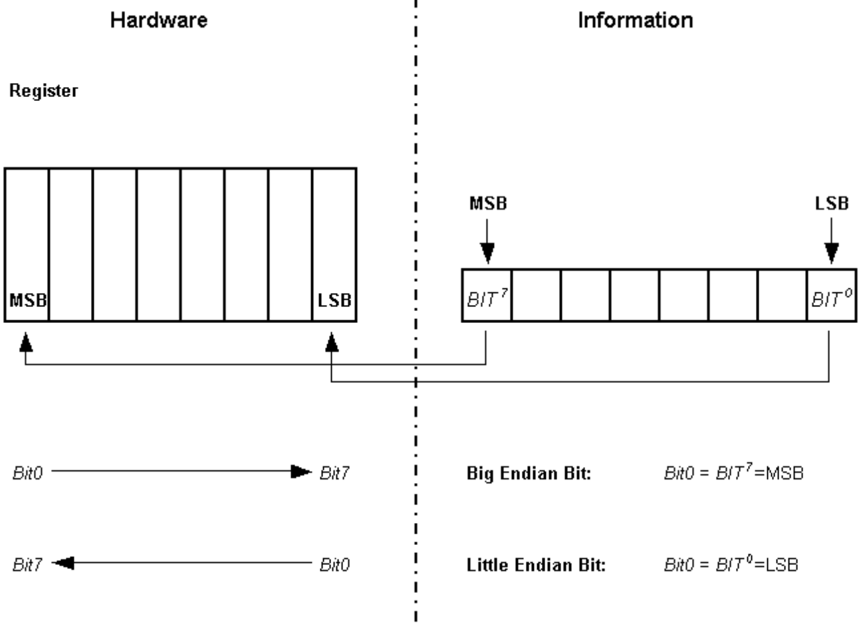
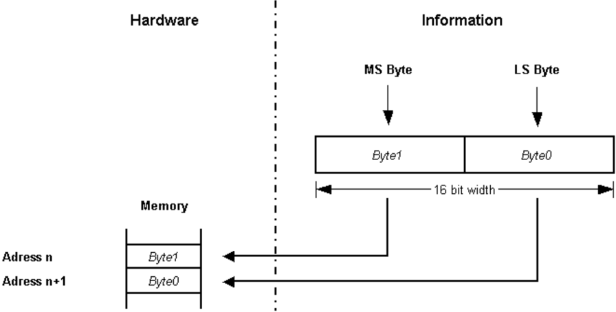
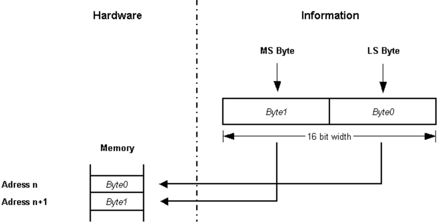

## 1. 简介和功能概述

本文档规定了**AUTOSAR**平台类型头文件（**platform types header file**）。其中包含所有与平台相关的类型和符号。必须对这些类型进行抽象，使其与平台和编译器无关。

要求所有平台类型文件在整个**AUTOSAR**社区内保持唯一，以保证每个平台的类型唯一，并避免在将软件模块从平台A迁移到平台B时发生类型变更。

## 2. 缩略语

局部作用域的缩略语和缩写不包含在**AUTOSAR**词汇表中，这些内容必须出现在本地词汇表中。

**Rollover mechanism**
> 下面的示例序列被称为"回绕"（**rollover**）：一个无符号字符（**unsigned char**）的值为 255；将其加 1；结果为 0。

**SDU**
> 服务数据单元（**Service Data Unit**，有效载荷）

**int**
> 整数（**Integer**）

## 3. 相关文档

### 3.1. 输入文件和相关标准与规范

<a id="ref-1"></a>[1] General Specification of Basic Software Modules
> AUTOSAR_CP_SWS_BSWGeneral

<a id="ref-2"></a>[2] General Requirements on Basic Software Modules
> AUTOSAR_CP_SRS_BSWGeneral

<a id="ref-3"></a>[3] Cosmic C Cross Compiler User's Guide for Motorola MC68HC12, V4.5
> Cosmic C Cross Compiler User's Guide

<a id="ref-4"></a>[4] ISO/IEC 9899:1999
> https://www.iso.org

### 3.2. 相关规范

**AUTOSAR**提供的基础软件模块通用规范（见[\[1\]](#ref-1)）同样适用于**Platform Types**。因此，"基础软件模块通用规范"[\[1\]](#ref-1)应被视为**Platform Types**的附加和必需的规范。

## 4. 约束和假设

### 4.1. 限制

无限制。

### 4.2. 汽车域的适用性

无限制。

### 4.3. 安全相关环境的适用性

如果**AUTOSAR**布尔类型的正确用法（见第[6.5](#65-布尔数据类型)节）能够通过正式的代码评审或经过验证的静态分析工具的静态分析得到证明，则可以使用该布尔类型。

如果**AUTOSAR**优化的整数数据类型（*\_least）的正确用法（见第[6.4](#64-优化的整数数据类型)节）能够通过正式的代码评审或经过验证的静态分析工具的静态分析得到证明，则可以使用这些类型。

## 5. 对其他模块的依赖

无。

### 5.1. 文件结构

#### 5.1.1. 代码文件结构

无

#### 5.1.2. 头文件结构

适用的头文件结构有两种：一种取决于与通信相关的基础软件模块，另一种取决于与通信无关的基础软件模块。

## 6. 功能规格

### 6.1. 一般问题

所有平台相关的抽象**AUTOSAR**数据类型和符号都应在 **Platform_Types.h** 头文件中定义。不允许对该文件添加任何扩展。任何扩展都会使**AUTOSAR**一致性失效。

### 6.2. CPU类型

对于每个平台，应通过定义 [**CPU_TYPE**](#731-cpu_type) 来指明所用**CPU**的寄存器宽度。

根据所用**CPU**的寄存器宽度，[**CPU_TYPE**](#731-cpu_type) 应被赋值为 **CPU_TYPE_8**、**CPU_TYPE_16**、**CPU_TYPE_32** 或 **CPU_TYPE_64** 中的一个符号。

### 6.3. 字节序

原生类型（如整数）中位、字节和字的排列模式称为字节序（**endianess**）。

对于每个平台，应在平台类型头文件中使用符号 [**CPU_BIT_ORDER**](#732-cpu_bit_order) 指明寄存器级别上适当的位序。

对于每个平台，应在平台类型头文件中使用符号 [**CPU_BYTE_ORDER**](#733-cpu_byte_order) 指明内存级别上适当的字节序。

#### 6.3.1. 位序（寄存器）

在大端（**Big Endian**）位序的情况下，[**CPU_BIT_ORDER**](#732-cpu_bit_order) 应在平台类型头文件中被赋值为 **MSB_FIRST**。

在小端（**Little Endian**）位序的情况下，[**CPU_BIT_ORDER**](#732-cpu_bit_order) 应在平台类型头文件中被赋值为 **LSB_FIRST**。



**重要说明：**

Bit0、Bit1 等命名约定与该位在字节、字等中的重要性（**significance**）是两个不同的主题，不应混为一谈。Motorola[\[3\]](#ref-3) 微控制器架构（大端位序）的位计数方案从 Bit0 开始，Bit0 表示最高有效位（**Most Significant Bit**）；而所有其他使用小端位序的微控制器则将 Bit0 指定为最低有效位（**Least Significant Bit**）！

无论**CPU**类型如何，累加器（**accumulator**）中的 **MSB** 始终存储为最左侧的位。因此，大端和小端位序意味着不同的位命名约定。

#### 6.3.2. 字节序（内存）

在大端（**Big Endian**）字节序的情况下，[**CPU_BYTE_ORDER**](#733-cpu_byte_order) 应在平台类型头文件中被赋值为 **HIGH_BYTE_FIRST**。



| 地址 | 数据 | 顺序 |
|---|---|---|
| n | Byte1 | 最高有效字节（**HIGH_BYTE_FIRST**） |
| n+1 | Byte0 | 最低有效字节 |

在小端（**Little Endian**）字节序的情况下，[**CPU_BYTE_ORDER**](#733-cpu_byte_order) 应在平台类型头文件中被赋值为 **LOW_BYTE_FIRST**。



插图命名约定：16 位宽的数据中，最高有效字节命名为 **Byte1**，最低有效字节命名为 **Byte0**。

| 地址 | 数据 | 顺序 |
|---|---|---|
| n | Byte0 | 最低有效字节（**LOW_BYTE_FIRST**） |
| n+1 | Byte1 | 最高有效字节 |

**重要说明：** Byte0 和 Byte1 的命名约定并不唯一，在特定微控制器的制造商参考文档中可能有所不同。

### 6.4. 优化的整数数据类型

详情请参阅《基础软件模块通用需求》[\[1\]](#ref-1)文档中的"AUTOSAR 整数数据类型"（**AUTOSAR Integer Data Types**）章节。

使用示例：

* 循环计数器（例如最大循环次数 = 124 ⇒ 使用 [**uint8_least**](#7210-uint8_least)）
* Switch 分支参数（例如最大状态数 = 17 ⇒ 使用 [**uint8_least**](#7210-uint8_least)）

### 6.5. 布尔数据类型

标准的**AUTOSAR**类型 [boolean](#721-boolean) 应使用 **C99** 内置类型 **_Bool** 来实现。

**注意：** 根据[\[4\]](#ref-4)第6.2.5章（第33页）第2行，声明为 **_Bool** 类型的对象足以存储值 0 和 1。因此，**AUTOSAR** 不再定义 [boolean](#721-boolean) 类型对象的确切大小。

标准的**AUTOSAR**类型 [boolean](#721-boolean) 只能与标准符号 **TRUE** 和 **FALSE** 结合使用。对于 [boolean](#721-boolean) 类型变量的赋值，不得使用算术或逻辑运算符（**+**、**++**、**-**、**--**、**\***、**/**、**%**、**\<\<**、**\>\>**、**~**、**&**）。唯一允许的赋值形式是：

```c
boolean var = TRUE;
...
var = TRUE;
var = FALSE;
var = (a < b) /* same for ">", "<=", ">=" */
var = (c && d) /* same for "!", "||" */
var = (e != f) /* same for "==" */
```

唯一允许的比较形式是：

```c
boolean var = FALSE;
...
if (var == TRUE)
...
if (var == FALSE)
if (var != TRUE)
...
if (var != FALSE)
if (var)
...
if (!var)
...
```

### 6.6. 错误分类

《基础软件模块通用规范》[\[1\]](#ref-1)文档的第[7.2](#72-类型定义)章"错误处理"（**Error Handling**）详细描述了基础软件的错误处理。其中最重要的是，它构成了一个由**BSW**模块中可能发生的五种错误类型组成的分类方案。

基于该基础，以下章节在相应的小节中规定具体的错误。

#### 6.6.1. 开发错误

没有开发错误。

#### 6.6.2. 运行时错误

没有运行时错误。

#### 6.6.3. 瞬态故障

没有瞬态故障。

#### 6.6.4. 生产错误

没有生产错误。

#### 6.6.5. 扩展生产错误

没有扩展生产错误。

## 7. API规范

### 7.1. 导入的类型

不适用。

### 7.2. 类型定义

关于有符号整数类型，**AUTOSAR** 针对编译器和目标实现仅支持2的补码（**2' complement**）算术。这直接影响了为这些类型所选定的范围。

#### 7.2.1. boolean

类型。范围：

* **FALSE**：false：--
* **TRUE**：true：--

说明：此标准**AUTOSAR**类型只能与 **TRUE** 和 **FALSE** 定义一起使用。可通过**Platform_Types.h**获得。

实现和使用方式见第[6.5](#65-布尔数据类型)节。

#### 7.2.2. uint8

类型。范围：

* **UINT8_MIN**（0）：**uint8** 可能的最小值
* **UINT8_MAX**（255）：**uint8** 可能的最大值

说明：此标准**AUTOSAR**类型应为8位无符号。可通过**Platform_Types.h**获得。

#### 7.2.3. uint16

类型。范围：

* **UINT16_MIN**（0）：**uint16** 可能的最小值
* **UINT16_MAX**（65535）：**uint16** 可能的最大值

说明：此标准**AUTOSAR**类型应为16位无符号。可通过**Platform_Types.h**获得。

#### 7.2.4. uint32

类型。范围：

* **UINT32_MIN**（0）：**uint32** 可能的最小值
* **UINT32_MAX**（4294967295）：**uint32** 可能的最大值

说明：此标准**AUTOSAR**类型应为32位无符号。可通过**Platform_Types.h**获得。

#### 7.2.5. uint64

类型。范围：

* **UINT64_MIN**（0）：**uint64** 可能的最小值
* **UINT64_MAX**（18446744073709551615）：**uint64** 可能的最大值

说明：此标准**AUTOSAR**类型应为64位无符号。可通过**Platform_Types.h**获得。

#### 7.2.6. sint8

类型。范围：

* **SINT8_MIN**（-128）：**sint8** 可能的最小值
* **SINT8_MAX**（127）：**sint8** 可能的最大值

说明：此标准**AUTOSAR**类型应为8位有符号。可通过**Platform_Types.h**获得。

#### 7.2.7. sint16

类型。范围：

* **SINT16_MIN**（-32768）：**sint16** 可能的最小值
* **SINT16_MAX**（32767）：**sint16** 可能的最大值

说明：此标准**AUTOSAR**类型应为16位有符号。可通过**Platform_Types.h**获得。

#### 7.2.8. sint32

类型。范围：

* **SINT32_MIN**（-2147483648）：**sint32** 可能的最小值
* **SINT32_MAX**（2147483647）：**sint32** 可能的最大值

说明：此标准**AUTOSAR**类型应为32位有符号。可通过**Platform_Types.h**获得。

#### 7.2.9. sint64

类型。范围：

* **SINT64_MIN**（-9223372036854775808）：**sint64** 可能的最小值
* **SINT64_MAX**（9223372036854775807）：**sint64** 可能的最大值

说明：此标准**AUTOSAR**类型应为64位有符号。可通过**Platform_Types.h**获得。

#### 7.2.10. uint8_least

类型，派生自 **uint**。范围：至少 0..255（0x00..0xFF）。

说明：此优化的**AUTOSAR**类型应为至少8位无符号。可通过**Platform_Types.h**获得。

实现和使用方式见第[6.4](#64-优化的整数数据类型)节。

#### 7.2.11. uint16_least

类型，派生自 **uint**。范围：至少 0..65535（0x0000..0xFFFF）。

说明：此优化的**AUTOSAR**类型应为至少16位无符号。可通过**Platform_Types.h**获得。

实现和使用方式见第[6.4](#64-优化的整数数据类型)节。

#### 7.2.12. uint32_least

类型，派生自 **uint**。范围：至少 0..4294967295（0x00000000..0xFFFFFFFF）。

说明：此优化的**AUTOSAR**类型应为至少32位无符号。可通过**Platform_Types.h**获得。

实现和使用方式见第[6.4](#64-优化的整数数据类型)节。

#### 7.2.13. sint8_least

类型，派生自 **sint**。范围：至少 -128..+127（0x80..0x7F）。

说明：此优化的**AUTOSAR**类型应为至少8位有符号。可通过**Platform_Types.h**获得。

实现和使用方式见第[6.4](#64-优化的整数数据类型)节。

#### 7.2.14. sint16_least

类型，派生自 **sint**。范围：至少 -32768..+32767（0x8000..0x7FFF）。

说明：此优化的**AUTOSAR**类型应为至少16位有符号。可通过**Platform_Types.h**获得。

实现和使用方式见第[6.4](#64-优化的整数数据类型)节。

#### 7.2.15. sint32_least

类型，派生自 **sint**。范围：至少 -2147483648..+2147483647（0x80000000..0x7FFFFFFF）。

说明：此优化的**AUTOSAR**类型应为至少32位有符号。可通过**Platform_Types.h**获得。

实现和使用方式见第[6.4](#64-优化的整数数据类型)节。

#### 7.2.16. float32

类型。范围：

* **FLOAT32_MIN**（1.17549435e-38）：**float32** 的最小正值
* **FLOAT32_MAX**（3.40282347e+38）：**float32** 的最大值
* **FLOAT32_EPSILON**（1.19209290e-07）：两个 **float32** 值之间的最小增量

说明：此标准**AUTOSAR**类型应遵循 **IEEE 754-2008** 的32位二进制交换格式，其编码参数在第3.6章表3.5"binary32"列中规定。可通过**Platform_Types.h**获得。

#### 7.2.17. float64

类型。范围：

* **FLOAT64_MIN**（2.2250738585072014e-308）：**float64** 的最小正值
* **FLOAT64_MAX**（1.7976931348623157e+308）：**float64** 的最大值
* **FLOAT64_EPSILON**（2.2204460492503131e-16）：两个 **float64** 值之间的最小增量

说明：此标准**AUTOSAR**类型应遵循 **IEEE 754-2008** 的64位二进制交换格式，其编码参数在第3.6章表3.5"binary64"列中规定。可通过**Platform_Types.h**获得。

#### 7.2.18. VoidPtr

指针类型。类型：**void\***。

说明：此标准**AUTOSAR**类型应为一个void指针。**注意：** 此类型应用于包含返回给调用者（**caller**）的数据的缓冲区。可通过**Platform_Types.h**获得。

#### 7.2.19. ConstVoidPtr

常量指针类型（**Const Pointer**）。类型：**const void\***。

说明：此标准**AUTOSAR**类型应为一个指向const的void指针。**注意：** 此类型应用于传递给被调用方（**callee**）的缓冲区。可通过**Platform_Types.h**获得。

### 7.3. 符号定义

#### 7.3.1. CPU_TYPE

枚举。范围：

* **CPU_TYPE_8**：指示8位处理器。
* **CPU_TYPE_16**：指示16位处理器。
* **CPU_TYPE_32**：指示32位处理器。
* **CPU_TYPE_64**：指示64位处理器。

说明：此符号应定义为 #define，根据平台取 **CPU_TYPE_8**、**CPU_TYPE_16**、**CPU_TYPE_32** 或 **CPU_TYPE_64** 之一。可通过**Platform_Types.h**获得。

#### 7.3.2. CPU_BIT_ORDER

枚举。范围：

* **MSB_FIRST**：最高有效位是位序列的第一位。
* **LSB_FIRST**：最低有效位是位序列的第一位。

说明：此符号应定义为 #define，根据平台取 **MSB_FIRST** 或 **LSB_FIRST** 之一。可通过**Platform_Types.h**获得。

#### 7.3.3. CPU_BYTE_ORDER

枚举。范围：

* **HIGH_BYTE_FIRST**：在 [**uint16**](#723-uint16) 中，高字节位于低字节之前。
* **LOW_BYTE_FIRST**：在 [**uint16**](#723-uint16) 中，低字节位于高字节之前。

说明：此符号应定义为 #define，根据平台取 **HIGH_BYTE_FIRST** 或 **LOW_BYTE_FIRST** 之一。可通过**Platform_Types.h**获得。

#### 7.3.4. TRUE, FALSE

枚举。范围：

* **FALSE**：false：--
* **TRUE**：true：--

说明：符号 **TRUE** 和 **FALSE** 应按如下方式定义。可通过**Platform_Types.h**获得。

```c
#ifndef TRUE
#define TRUE true
#endif
#ifndef FALSE
#define FALSE false
#endif
```

如果编译器内置支持这些符号，则应使用条件检查来避免重定义。

这些符号只能与 **Platform_Types.h** 中定义的 [boolean](#721-boolean) 类型结合使用。

### 7.4. 函数定义

不适用。

### 7.5. 回调通知

不适用。

### 7.6. 调度函数

不适用。

### 7.7. 期望接口

不适用。

## 8. 时序图

不适用。

## 9. 配置规范

### 9.1. 发布参数

详情请参阅[\[1\]](#ref-1)中的第10.3章"发布信息"（**Published Information**）。

## B. AUTOSAR 可追溯项变更历史

### B.1. 根据AUTOSAR R22-11的本文档可追溯项历史

#### B.1.1. R22-11中新增的规格项

```
[SWS_Platform_NA_00063]
```

#### B.1.2. R22-11中变更的规格项

```
[SWS_Platform_00013] [SWS_Platform_00014] [SWS_Platform_00015]
[SWS_Platform_00016] [SWS_Platform_00017] [SWS_Platform_00018]
[SWS_Platform_00020] [SWS_Platform_00021] [SWS_Platform_00022]
[SWS_Platform_00023] [SWS_Platform_00024] [SWS_Platform_00025]
[SWS_Platform_00026] [SWS_Platform_00027] [SWS_Platform_00038]
[SWS_Platform_00039] [SWS_Platform_00041] [SWS_Platform_00042]
[SWS_Platform_00056] [SWS_Platform_00064] [SWS_Platform_00066]
[SWS_Platform_00067] [SWS_Platform_91001] [SWS_Platform_91002]
```

#### B.1.3. R22-11中删除的规格项

```
[SWS_Platform_00060] [SWS_Platform_00063]
```

### B.2. 根据AUTOSAR R23-11的本文档可追溯项历史

#### B.2.1. R23-11中新增的规格项

无

#### B.2.2. R23-11中变更的规格项

无

#### B.2.3. R23-11中删除的规格项

无
