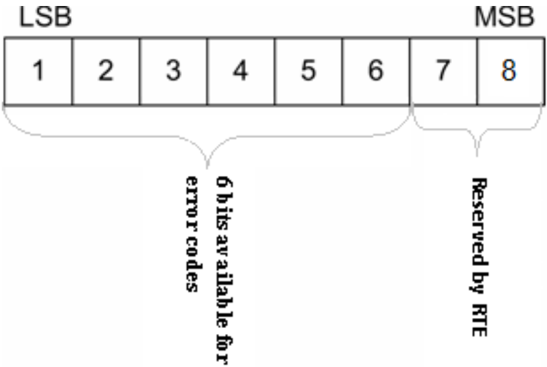

## 1. 简介和功能概述

本文档规定了**AUTOSAR**标准类型头文件（**standard types header file**）。其中包含基础软件中跨多个模块使用的所有类型，这些类型与平台和编译器无关。

强烈建议这些标准类型文件在整个**AUTOSAR**社区内保持唯一，以保证类型的唯一性，并避免在从供应商A切换到供应商B时发生类型变更。

## 2. 缩略语

局部作用域的缩略语和缩写不包含在**AUTOSAR**词汇表中，这些内容必须出现在本地词汇表中。

**API**
> 应用编程接口（**Application Programming Interface**）

**OSEK/VDX**
> 汽车电子开放系统及其接口（**Offene Systeme und deren Schnittstellen fuer die Elektronik im Kraftfahrzeug**）

**STD**
> 标准（**Standard**）

## 3. 相关文档

### 3.1. 输入文件和相关标准与规范

<a id="ref-1"></a>[1] General Requirements on Basic Software Modules
> AUTOSAR_CP_SRS_BSWGeneral

<a id="ref-2"></a>[2] General Requirements on SPAL
> AUTOSAR_CP_SRS_SPALGeneral

<a id="ref-3"></a>[3] Specification of RTE Software
> AUTOSAR_CP_SWS_RTE

<a id="ref-4"></a>[4] Requirements on Basic Software Module Description Template
> AUTOSAR_CP_RS_BSWModuleDescriptionTemplate

<a id="ref-5"></a>[5] List of Basic Software Modules
> AUTOSAR_CP_TR_BSWModuleList

<a id="ref-6"></a>[6] ISO 17356-3: Road vehicles - Open interface for embedded automotive applications - Part 3: OSEK/VDX Operating System (OS)
> ISO 17356-3

### 3.2. 相关规范

**AUTOSAR**提供的基础软件模块通用规范 [1, SWS BSW General] 同样适用于**Standard Types**。因此，**SWS BSW General**规范应被视为**Standard Types**的附加和必需的规范。

其他相关规范：

[2, SRS SPALGeneral] [3, SWS RTE] [4, RS BSW General] [5, TR BSW General] [6, OSEK/VDX Operating System] [ISO/IEC 9899:1990]

## 4. 约束和假设

### 4.1. 限制

无限制。

### 4.2. 汽车域的适用性

本规范中定义的许多符号（如 **OK**、**NOT_OK**、**ON**、**OFF**）已经在传统（legacy）软件中定义并使用。这类冲突（"重定义已有符号"）是预期之中的，但基于以下原因可以忽略：

1. **AUTOSAR**必须与传统的**ECU**保持网络兼容性，但无需与**传统软件**保持软件架构兼容性。许多类型的定义和使用方式与传统软件完全相同。传统软件可以继续使用这些符号，只需移除原有定义，改为从此文件中获取。

## 5. 软件架构

### 5.1. 对其他模块的依赖

### 5.2. 文件结构

属于**COM**栈（**COM-stack**）的**BSW**模块与其他模块的包含结构有所不同。被视为**COM**栈一部分的**BSW**模块应包含 **ComStackTypes.h**，其他模块应包含 **StandardTypes.h**。

#### 5.2.1. 通信相关的BSW模块

包含文件的结构应如下所示：

* **ComStackTypes.h** 应包含 **StandardTypes.h**
* 与通信相关的基础软件模块应包含 **ComStackTypes.h**

## 6. 功能规格

### 6.1. 一般问题

不允许在此文件中添加任何项目或供应商特定的扩展。任何扩展都会使**AUTOSAR**一致性失效。

标准类型头文件应防止被多次包含：

```c
#ifndef STD_TYPES_H

#define STD_TYPES_H

..

/*
 * Contents of file
 */

..

#endif /* STD_TYPES_H */
```

### 6.2. 错误分类

《基础软件模块通用规范》文档的"错误处理"（**Error Handling**）章节详细描述了基础软件的错误处理。其中最重要的是，它构成了一个由**BSW**模块中可能发生的五种错误类型组成的分类方案。

基于该基础，以下章节在相应的小节中规定具体的错误。

#### 6.2.1. 开发错误

没有开发错误。

#### 6.2.2. 运行时错误

没有运行时错误。

#### 6.2.3. 瞬态故障

没有瞬态故障。

#### 6.2.4. 生产错误

没有生产错误。

#### 6.2.5. 扩展生产错误

没有扩展生产错误。

## 7. API规范

### 7.1. 类型定义

#### 7.1.1. Std_ReturnType

类型，派生自 **uint8**。范围：

* **E_OK**（0）：见第7.2.1节。
* **E_NOT_OK**（1）：见第7.2.1节。
* 0x02-0x3F（2）：可供用户特定的错误使用。

此类型可用作**RTE**和**BSW**模块之间共享的标准**API**返回类型。它应按如下方式定义。可通过**Std_Types.h**获得。

此类型通常应与值 **E_OK** 或 **E_NOT_OK** 一起使用。如果这些返回值不够用，可以通过使用6个低特定位（**the 6 least specific bits**）来定义用户特定的值。对于用户自定义值的命名，应按 **SRS_BSW_00441** 的要求使用模块前缀。

**Std_ReturnType** 的布局应如 **RTE** 规范中所述。位7和位8为保留位，由 **RTE** 规范定义。



#### 7.1.2. Std_VersionInfoType

结构类型。组成元素：

* **vendorID**：**uint16**。
* **moduleID**：**uint16**。
* **sw_major_version**：**uint8**。
* **sw_minor_version**：**uint8**。
* **sw_patch_version**：**uint8**。

说明：此类型应用于通过 \<Module name\>_GetVersionInfo() 函数请求**BSW**模块的版本。可通过**Std_Types.h**获得。

#### 7.1.3. Std_TransformerError

数据类型 **Std_TransformerError** 是一个结构体，其中包含错误码以及该错误所属的转换器类（**transformer class**）。

数据类型 **Std_TransformerError** 应按如下方式定义：

**Std_TransformerError**：结构类型。组成元素：

* **errorCode**：类型 **Std_TransformerErrorCode** —— **Std_TransformerErrorCode** 各个值的具体含义，取决于该数据类型为其表示转换器错误的特定转换器链。
* **transformerClass**：类型 **Std_TransformerClass**。

说明：**Std_TransformerError** 表示某个特定转换器链上下文中的转换器错误。可通过**Std_Types.h**获得。

各个值针对每个转换器类在 [26, ASWS Transformer General] 中规定。

**Std_TransformerErrorCode**：类型，派生自 **uint8**。范围：-- —— 各个值针对每个转换器类在 **ASWS_TransformerGeneral** 中规定。说明：**Std_TransformerError** 的类型。可通过**Std_Types.h**获得。

**Std_TransformerClass** 表示发生错误时所处的转换器类。

**Std_TransformerClass** 的底层数据类型应为 **uint8**。

**Std_TransformerClass** 类型应为枚举，具有以下组成元素，其中每个元素代表一个转换器类：

* **STD_TRANSFORMER_UNSPECIFIED**（0x00）：未指定转换器类的转换器。
* **STD_TRANSFORMER_SERIALIZER**（0x01）：序列化（**serializer**）类的转换器。
* **STD_TRANSFORMER_SAFETY**（0x02）：安全（**safety**）类的转换器。
* **STD_TRANSFORMER_SECURITY**（0x03）：信息安全（**security**）类的转换器。
* **STD_TRANSFORMER_CUSTOM**（0xFF）：**AUTOSAR**未标准化的自定义（**custom**）类的转换器。

说明：**Std_TransformerClass** 是一个枚举，其中每个元素代表一个转换器类。可通过**Std_Types.h**获得。

如果没有发生转换器错误，则应使用转换器类 **STD_TRANSFORMER_UNSPECIFIED**。

**TransformationTechnology** 的 transformerClass 到数据类型 **Std_TransformerClass** 取值的映射应为：

* transformerClass serializer —— **STD_TRANSFORMER_SERIALIZER**
* transformerClass safety —— **STD_TRANSFORMER_SAFETY**
* transformerClass security —— **STD_TRANSFORMER_SECURITY**
* transformerClass custom —— **STD_TRANSFORMER_CUSTOM**

#### 7.1.4. Std_TransformerForwardCode

数据类型 **Std_TransformerForwardCode** 表示某个特定转换器链上下文中转发的转换器码（参见[5](#ref-5)）。

**Std_TransformerForwardCode** 各个值的具体含义，始终取决于该数据类型为其表示转换器状态的特定转换器链。

表8.1：安全转换器错误码（**Safety Transformer Error Codes**）

| 错误名称 | 错误码 | 说明 |
|---|---|---|
| E_OK | 0x00 | 无需注入的特定错误 |
| E_SAFETY_INVALID_REP | 0x01 | 重复最后使用的序列号。 |
| E_SAFETY_INVALID_CRC | 0x03 | 生成一个特意的错误**CRC**。 |
| E_SAFETY_INVALID_SEQ | 0x02 | 使用错误的序列号。 |

类型 **Std_TransformerForwardCode** 的底层数据类型应为 **uint8**：

**Std_TransformerForwardCode**：类型，派生自 **uint8**。范围：

* **E_OK**（0x00）：--
* **E_SAFETY_INVALID_REP**（0x01）：--
* **E_SAFETY_INVALID_SEQ**（0x02）：--
* **E_SAFETY_INVALID_CRC**（0x03）：--

说明：--。可通过**Std_Types.h**获得。

#### 7.1.5. Std_MessageTypeType

类型，派生自 **uint8**。范围：

* **STD_MESSAGETYPE_REQUEST**（0x00）：请求消息的消息类型。
* **STD_MESSAGETYPE_RESPONSE**（0x01）：响应消息的消息类型。
* 0x02-0x3F（0x02）：为未来的消息类型保留。

说明：此类型用于对不同的消息类型进行编码。目前此编码仅限于区分**C/S**通信中的请求和响应。可通过**Std_Types.h**获得。

**Std_MessageTypeType** 应用于对**AUTOSAR**中交换的不同类型的消息进行编码。目前此编码仅限于区分**C/S**通信中的请求和响应。

**注意：** 在未来的**AUTOSAR**版本中，此类型的字面值可能会扩展更多的消息类型。

#### 7.1.6. Std_MessageResultType

类型，派生自 **uint8**。范围：

* **STD_MESSAGERESULT_OK**（0x00）：**STD_MESSAGERESULT_OK**。
* **STD_MESSAGERESULT_ERROR**（0x01）：用于**ERROR**响应的消息结果。
* 0x02-0x3F（0x02）：为未来的消息结果保留。

说明：此类型用于对响应消息的不同结果类型进行编码。目前此编码仅限于区分**OK**和**ERROR**响应。可通过**Std_Types.h**获得。

**Std_MessageResultType** 应用于对响应消息的不同结果类型进行编码。目前此编码仅限于区分**OK**和**ERROR**响应。

**注意：** 在未来的**AUTOSAR**版本中，此类型的字面值可能会扩展更多的结果类型。

#### 7.1.7. Std_ExtractProtocolHeaderFieldsType

函数指针类型。语法：

```c
Std_ReturnType (*Std_ExtractProtocolHeaderFieldsType) (
    const uint8* buffer, uint32 bufferLength,
    Std_MessageTypeType* messageType, Std_MessageResultType* messageResult )
```

* **buffer**（in）：由**RTE**分配的缓冲区，转换器须将转换后的数据存储在其中。
* **bufferLength**（in）：缓冲区的长度。
* **messageType**（out）：消息类型的规范表示（从转换器的协议头中提取）。
* **messageResult**（out）：消息结果类型的规范表示（从转换器的协议头中提取）。
* 返回值：[**Std_ReturnType**](#711-std_returntype)：--。

说明：用于提取消息的相关协议头字段以及转换器的消息结果类型的函数指针类型。目前，这仅限于用于**C/S**通信的类型（即 **REQUEST** 和 **RESPONSE** 以及 **OK** 和 **ERROR**）。可通过**Std_Types.h**获得。

### 7.2. 符号定义

#### 7.2.1. E_OK, E_NOT_OK

枚举。范围：

* **E_OK**（0x00u）：--
* **E_NOT_OK**（0x01u）：--

说明：由于 **E_OK** 已经在 **OSEK** 中定义，因此必须共享符号 **E_OK**。为避免名称冲突和重定义问题，必须按以下方式定义这些符号（已在实现中获得认可）。可通过**Std_Types.h**获得。

```c
#ifndef STATUSTYPEDEFINED
#define STATUSTYPEDEFINED
#define E_OK 0x00u
typedef unsigned char StatusType; /* OSEK compliance */
#endif
#define E_NOT_OK 0x01u
```

#### 7.2.2. STD_HIGH, STD_LOW

枚举。范围：

* **STD_LOW**（0x00u）：--
* **STD_HIGH**（0x01u）：--

说明：符号 **STD_HIGH** 和 **STD_LOW** 应按如下方式定义。可通过**Std_Types.h**获得。

#### 7.2.3. STD_ACTIVE, STD_IDLE

枚举。范围：

* **STD_IDLE**（0x00u）：--
* **STD_ACTIVE**（0x01u）：--

说明：符号 **STD_ACTIVE** 和 **STD_IDLE** 应按如下方式定义。可通过**Std_Types.h**获得。

#### 7.2.4. STD_ON, STD_OFF

枚举。范围：

* **STD_OFF**（0x00u）：--
* **STD_ON**（0x01u）：--

说明：符号 **STD_ON** 和 **STD_OFF** 应按如下方式定义。可通过**Std_Types.h**获得。

#### 7.2.5. NULL_PTR

宏定义（**Define**）。范围：void指针。说明：实现应提供 **NULL_PTR** 宏定义，其定义为指向零的void指针。

### 7.3. 函数定义

不适用。

## 8. 时序图

不适用。

## 9. 配置规范

不适用。

## B. 需求历史

请注意，本章中的列表还包括在后续版本中已经从规范中移除的需求。这些需求不会作为超链接出现在文档中。

### B.1. 根据AUTOSAR R22-11的本文档需求历史

#### B.1.1. R22-11中新增的规格项

```
[SWS_Std_NA_00999]
```

#### B.1.2. R22-11中变更的规格项

```
[SWS_Std_00005] [SWS_Std_00006] [SWS_Std_00007] [SWS_Std_00010]
[SWS_Std_00013] [SWS_Std_00015] [SWS_Std_00021] [SWS_Std_00022]
[SWS_Std_00024] [SWS_Std_00029] [SWS_Std_00031] [SWS_Std_91001]
[SWS_Std_91002] [SWS_Std_91003]
```

#### B.1.3. R22-11中删除的规格项

```
[SWS_Std_00027] [SWS_Std_00999]
```

### B.2. 根据AUTOSAR R23-11的本文档需求历史

#### B.2.1. R23-11中新增的规格项

无

#### B.2.2. R23-11中变更的规格项

```
[SWS_Std_00028]
```

#### B.2.3. R23-11中删除的规格项

无
