<!-- 源文档 AUTOSAR_CP_EXP_VFB（R23-11），讲述型指南（EXP），不受 Type A 七章骨架约束；章节结构镜像源文档自身编号（1–13）。源文档的规范条目（Specification Items，形如 [EXP_VFB_XXXXX]）按站点规范去掉条目 ID 标记后翻译其内容。 -->

## 1. 本文档介绍

### 1.1. 前置阅读

本文档是 AUTOSAR 的高层概念文档之一，描述 AUTOSAR 虚拟功能总线（Virtual Functional Bus，VFB）。

有用的前置阅读是「Main Requirements」[\[1\]](#ref-1)。可以与本文档并行查阅的文档包括「Methodology」[\[2\]](#ref-2) 和「Glossary」[\[3\]](#ref-3)。

### 1.2. 与其他 AUTOSAR 规范的关系

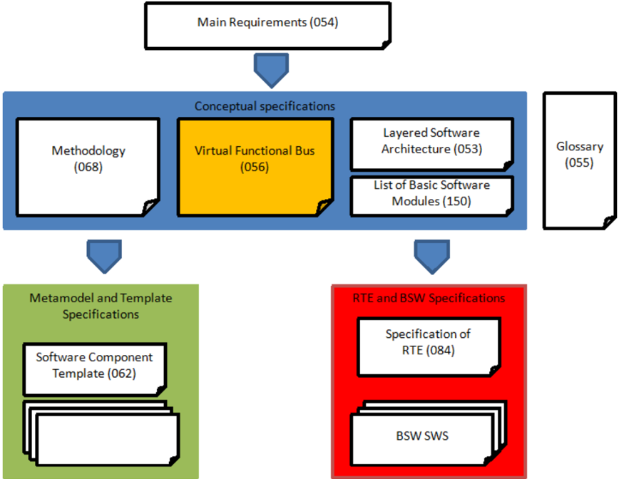

图 1.1 展示了「虚拟功能总线」规范与其他主要 AUTOSAR 规范之间的关系。「虚拟功能总线」规范是描述 AUTOSAR 整体概念的一组规范的一部分。这些文档给出 AUTOSAR 的概念性概览，并作为对更详细规范的要求。概念性规范包括：

- 「Methodology」[\[2\]](#ref-2)，描述使用 AUTOSAR 构建系统时所采用的方法；
- 「虚拟功能总线」规范；
- 「Layered Software Architecture」[\[4\]](#ref-4)；
- 以及「List of Basic Software Modules」[\[5\]](#ref-5)。

这些概念性文档被细化并具体化为一大批 AUTOSAR 规范，可以分为：

- 定义 AUTOSAR 元模型与模板的规范：在这一组中，「Software Component Template」[\[6\]](#ref-6) 直接受 VFB 概念影响；
- 定义 AUTOSAR 基础软件模块与 RTE 的规范：在这一组中，「Specification of RTE」[\[7\]](#ref-7) 直接受 VFB 概念影响。

### 1.3. 本文档的结构与约定

#### 本文档的结构

图 1.2 展示了本文档的结构。前几章一般性地定义 VFB 概念，应当按顺序阅读。最后几章定义并澄清具体问题，例如与硬件的交互、模式管理、AUTOSAR 服务或测量与标定。关于时序模型的章节仅供参考，不属于标准的一部分。它被公开出来，是为了展示在 VFB 中对时间方面建模的早期概念性工作。

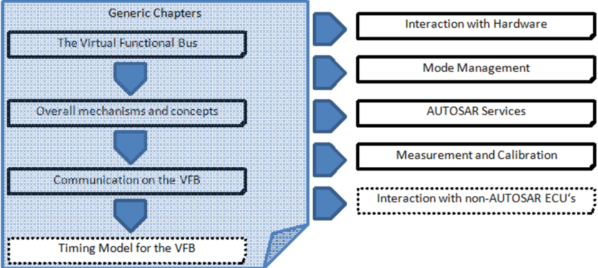

#### 规范条目（Specification Items）

本文档对「虚拟功能总线」提出的要求以编号的「规范条目」形式显式列出。每个规范条目具有形如「VFB-XXX」的唯一 ID，并采用如下格式：

VFB-XXX：规范条目示例

## 2. 虚拟功能总线

图 2.1 展示了「Methodology」规范 [\[2\]](#ref-2) 中的一个概览。图 2.2 说明了 VFB 的概念。

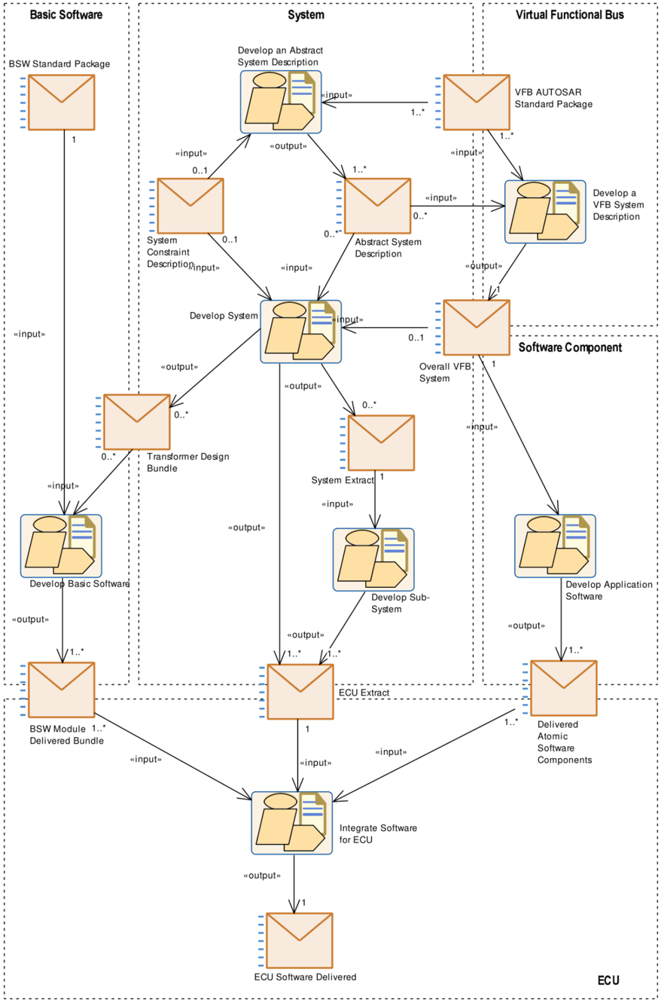

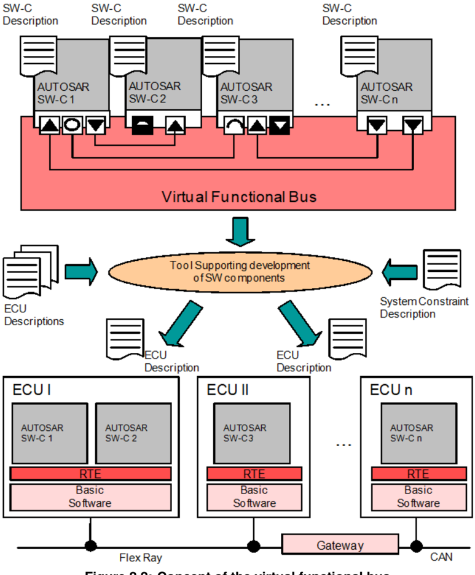

在 AUTOSAR 中，一个应用被建模为相互连接的组件的组合。这在图 2.2 的上半部分（标注为「VFB 视图」）中说明。「虚拟功能总线」是允许这些组件相互交互的通信机制。这些组件被映射到具体的系统资源（ECU）上。由此，组件之间的虚拟连接被映射到本地连接（单个 ECU 之内）或网络技术特定的通信机制（例如 CAN 或 FlexRay 帧）上。最后，这样一个系统中的各个 ECU 可以被配置。各个组件之间、以及组件与基础软件（BSW）[\[4\]](#ref-4)[\[5\]](#ref-5) 之间的具体接口称为运行时环境（Run-Time Environment，RTE）[\[7\]](#ref-7)。

一个组件封装完整或部分的汽车功能。组件由一个实现和一个相关联的形式化软件组件描述（在「Software Component Template」规范 [\[6\]](#ref-6) 中定义）组成。虚拟功能总线的概念允许应用与基础设施之间的严格分离。实现应用的软件组件在很大程度上独立于该组件与其他组件或与硬件（例如传感器或执行器）交互所经过的通信机制。这实现了 AUTOSAR 可重定位性的目标（另见 AUTOSAR「Main Requirements」[\[1\]](#ref-1)）。

这样，一个系统的完整通信（包括所有通信源和通信汇）都可以被规定。因此，VFB 可以用于对软件组件的通信进行合理性检查。通信连接以及所连接的软件组件被保存在一个描述中，该描述将用于后续的流程步骤（映射、软件配置等）。

VFB 规范需要为实现汽车应用的组件所需的全部基础设施服务提供概念。这些包括：

- 与系统中其他组件的通信；
- 与系统中传感器和执行器的通信（见第 [6](#6-与硬件的交互) 章「与硬件的交互」）；
- 对标准化服务的访问，例如对非易失性 RAM 的读写（见第 [7](#7-autosar-服务) 章「AUTOSAR 服务」）；
- 对模式变化的响应，例如本地 ECU 电源状态的变化（见第 [8](#8-模式管理) 章「模式管理」）；
- 与标定和测量系统的交互（见第 [10](#10-测量与标定) 章）。

## 3. 总体机制和概念

### 3.1. 组件

在 VFB 层级上构建系统时使用的核心结构元素是「组件」。组件具有定义良好的「端口」，组件通过端口与其他组件交互。一个端口始终恰好属于一个组件，并表示一个组件与其他组件之间的交互点。

图 3.1 展示了一个名为「SeatHeatingControl」的组件类型定义的例子，它基于若干信息源控制座椅中的加热元件。

在此例中，该组件类型要求以下信息作为输入：

- 是否有乘客坐在座椅上（通过端口「SeatSwitch」）；
- 座椅温度旋钮的设定（通过端口「Setting」）；
- 以及来自中央电源管理系统的一些信息（通过端口「PowerManagement」），后者可能在特定条件下决定禁用座椅加热。

它控制：

- 与座椅温度旋钮相关联的旋钮 LED（端口「DialLED」）；
- 以及加热元件（通过端口「HeatingElement」）。

最后，该组件可以被标定（端口「Calibration」），需要其运行所在的 ECU 的状态（端口「ecuMode」），并要求访问本地非易失性存储器（端口「nv」）。

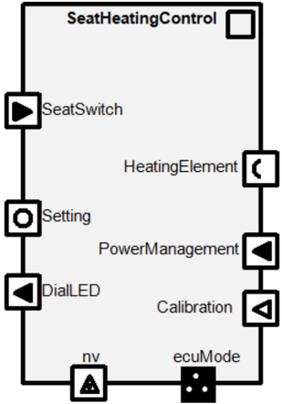

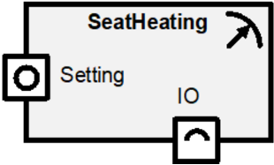

图 3.2 展示了一个名为「SeatHeating」的传感器-执行器组件¹ 定义的例子。该组件输入加热元件的期望设定（通过端口「Setting」），并直接控制座椅加热硬件（通过端口「IO」）。

一个组件既可以实现非常简单的功能，也可以实现非常复杂的功能。组件可以拥有少量端口以提供或要求简单的信息片段，也可以拥有大量端口以提供或要求复杂的数据与操作组合。

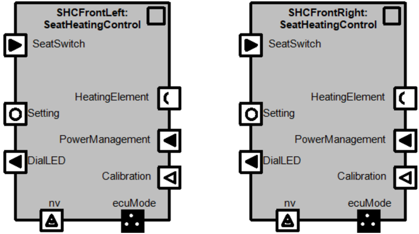

AUTOSAR 支持组件的多实例化。这意味着在一个车辆系统中可以存在同一组件的多个实例²。图 3.3 展示了「SeatHeatingControl」组件类型的两个实例如何分别用于控制左前座椅和右前座椅。这些组件通常拥有各自独立的内部状态（存储在独立的内存位置中），但例如可以共享同一份代码（只要代码的编写适当地支持这一点）。

- 在配置期，组件的端口是已知的。
- 组件只通过它们的端口相互交互。
- 一个组件类型可以在 VFB 上被多次实例化。

¹ 第 [6](#6-与硬件的交互) 章「与硬件的交互」定义了「传感器-执行器」组件的确切用途。
² 运行时的动态实例化不在 AUTOSAR 本版本的范围之内。

### 3.2. 端口接口（Port-Interface）

组件的端口与一个「端口接口」相关联。端口接口定义了提供或要求该接口的端口必须履行的契约。

- 在配置期，每个端口恰好由一个端口接口确定类型。

表 3.1 列出了 AUTOSAR 支持的端口接口。

| 端口接口种类 | 说明 | 进一步阅读 |
| --- | --- | --- |
| 客户端-服务器（Client-Server） | 服务器是操作的提供者，若干客户端可以调用这些操作。 | 本节及 [4.4](#44-客户端-服务器通信) 节 |
| 发送者-接收者（Sender-Receiver） | 发送者向一个或多个接收者分发信息，或一个接收者从多个发送者获取信息（事件）³。模式管理器可以向一个或多个接收者通知模式切换。 | 本节及 [4.3](#43-发送者-接收者通信) 节 |
| 参数接口（Parameter Interface） | 参数接口允许软件组件访问常量数据、固定数据或标定数据。需要注意，根据访问类型（即分别为 fixed、const 或 standard）的不同，适用不同的兼容性规则。例如，使用 fixed 实现策略的参数接口将不被允许连接到参数 SW 组件的端口——如果提供方使用可变数据实现（即 standard）。原因简单明了：应用将使用 `#define`（预编译期值优化），因此不会在运行时从参数 SW 组件获取实际值。 | 第 [10](#10-测量与标定) 章 |
| 非易失性数据接口（Non volatile Data Interface） | 提供对非易失性数据的元素级访问（只读或读/写），而不是 NV 块访问。 | [4.3](#43-发送者-接收者通信) 节 |
| 触发接口（Trigger Interface） | 触发接口允许软件组件触发其他软件组件的执行。触发接口的目的是针对可能偶发发生或以可变周期发生的触发实现快速响应时间。示例：基于曲轴和凸轮轴位置的触发。 | [3.8](#38-组件与可运行体的资源) 节 |
| 模式切换接口（Mode Switch Interface） | 模式切换接口用于向软件组件通知某个模式。模式管理器提供模式，模式用户可以用它们根据模式调整行为，或使活动与模式切换同步。 | 第 [8](#8-模式管理) 章 |

³ 在 AUTOSAR 的语境中，事件的发送、接收与分发被视为发送者-接收者通信模式的一部分。

客户端-服务器接口定义了一组可以由客户端调用、由服务器实现的操作。图 3.4 展示了一个简单客户端-服务器接口定义的例子。接口「HeatingElementControl」定义了一个名为「SetPower」的单一操作，带有一个名为「Power」的单一入向参数。该操作可以返回一个名为「HardwareProblem」的应用错误。

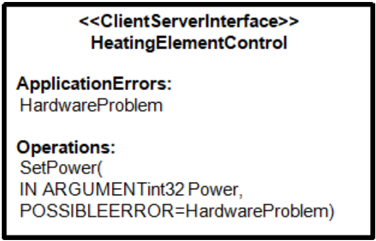

发送者-接收者接口定义了一组经由 VFB 发送和接收的数据元素。图 3.5 展示了一个名为「SeatSwitch」的简单发送者-接收器接口的定义，它包含一个名为「PassengerDetected」的单一数据元素。

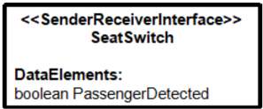

- 在配置期，端口接口是客户端-服务器接口还是发送者-接收者接口是已知的。
- 在配置期，客户端-服务器接口包含哪些操作是已知的。
- 在配置期，发送者-接收者接口包含哪些数据元素是已知的。

AUTOSAR 已经标准化了稳定且被广泛接受的应用接口，以确保来自不同供应商的软件组件的互操作性。应用接口旨在覆盖广泛的汽车域。

- Body and Comfort [\[8\]](#ref-8)
- Powertrain [\[9\]](#ref-9)
- Chassis [\[10\]](#ref-10)
- Occupant and Pedestrian Safety Systems [\[11\]](#ref-11)
- HMI, Multimedia and Telematics [\[12\]](#ref-12)

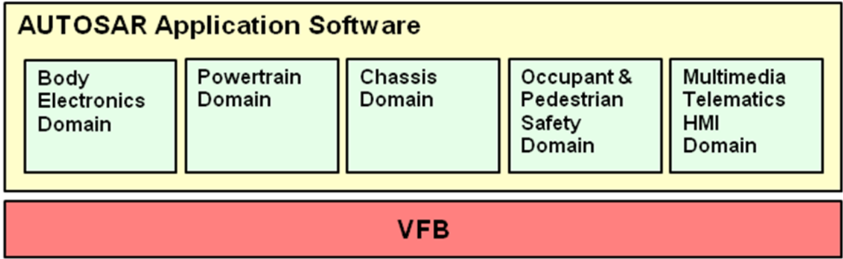

应用接口使用了蓝图（blueprint）的概念。蓝图是模型元素的预定义，可以用作进一步建模的基础。有一本专门介绍应用接口的用户指南 [\[13\]](#ref-13) 可供深入了解。

### 3.3. 端口

如前所述，组件的端口是组件之间的交互点。

组件的端口要么是「PPort」、要么是「RPort」要么是「PRPort」。「PPort」或「PRPort」提供端口接口中定义的元素。「RPort」或「PRPort」要求端口接口中定义的元素。因此，一个端口恰好由一个端口接口确定类型⁴。

#### 端口类型

一个端口接口可以确定多个不同端口的类型。

- 在配置期，组件的端口是 PPort、RPort 还是 PRPort 是已知的。

下面展示各种组合的端口图标，并总结这些端口的语义。请注意，由参数接口确定类型的 PRPort 不受支持。

⁴ 这意味着一个端口只提供一种基本通信模式（发送者-接收者或客户端-服务器二者之一）。这是必要的，否则端口的合理连接是不可能的。此外，只有这样，例如数据流的合理建模才是可能的。

**RPort · sender-receiver · 非服务端口**

- **端口类型：** RPort
- **接口类型：** sender-receiver
- **服务端口：** 否
- **端口描述：** 组件读取/消费数据元素的值
- **端口图标：**


**PPort · sender-receiver · 非服务端口**

- **端口类型：** PPort
- **接口类型：** sender-receiver
- **服务端口：** 否
- **端口描述：** 组件提供数据元素的值
- **端口图标：**


**PRPort · sender-receiver · 非服务端口**

- **端口类型：** PRPort
- **接口类型：** sender-receiver
- **服务端口：** 否
- **端口描述：** 组件提供并读取数据元素的值
- **端口图标：**


**RPort · sender-receiver · 服务端口**

- **端口类型：** RPort
- **接口类型：** sender-receiver
- **服务端口：** 是
- **端口描述：** 组件从 AUTOSAR 服务读取/消费数据元素的值
- **端口图标：**


**PPort · sender-receiver · 服务端口**

- **端口类型：** PPort
- **接口类型：** sender-receiver
- **服务端口：** 是
- **端口描述：** 组件向 AUTOSAR 服务提供数据元素的值
- **端口图标：**


**PRPort · sender-receiver · 服务端口**

- **端口类型：** PRPort
- **接口类型：** sender-receiver
- **服务端口：** 是
- **端口描述：** 组件向/从 AUTOSAR 服务提供并读取数据元素的值
- **端口图标：**


**RPort · client-server · 非服务端口**

- **端口类型：** RPort
- **接口类型：** client-server
- **服务端口：** 否
- **端口描述：** 组件要求（=使用或调用）接口中定义的操作
- **端口图标：**


**PPort · client-server · 非服务端口**

- **端口类型：** PPort
- **接口类型：** client-server
- **服务端口：** 否
- **端口描述：** 组件提供（=实现）接口中定义的操作
- **端口图标：**


**PRPort · client-server · 非服务端口**

- **端口类型：** PRPort
- **接口类型：** client-server
- **服务端口：** 否
- **端口描述：** 组件要求并提供接口中定义的操作
- **端口图标：**


**RPort · client-server · 服务端口**

- **端口类型：** RPort
- **接口类型：** client-server
- **服务端口：** 是
- **端口描述：** 组件从 AUTOSAR 服务要求（=使用或调用）接口中定义的操作
- **端口图标：**


**PPort · client-server · 服务端口**

- **端口类型：** PPort
- **接口类型：** client-server
- **服务端口：** 是
- **端口描述：** 组件向 AUTOSAR 服务提供（=实现）接口中定义的操作
- **端口图标：**


**PRPort · client-server · 服务端口**

- **端口类型：** PRPort
- **接口类型：** client-server
- **服务端口：** 是
- **端口描述：** 组件向/从 AUTOSAR 服务要求并提供接口中定义的操作
- **端口图标：**


**RPort · parameter · 非服务端口**

- **端口类型：** RPort
- **接口类型：** parameter（包括要求标定数据）
- **服务端口：** 否
- **端口描述：** 组件要求参数数据（fixed、const 或 variable）
- **端口图标：**

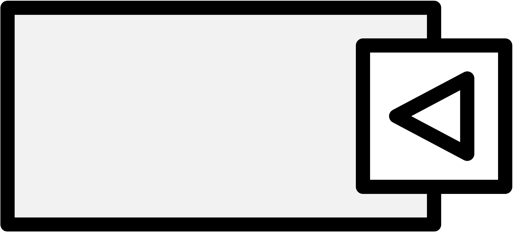

**PPort · parameter · 非服务端口**

- **端口类型：** PPort
- **接口类型：** parameter（包括要求标定数据）
- **服务端口：** 否
- **端口描述：** 组件提供参数数据（fixed、const 或 variable）
- **端口图标：**


**RPort · parameter · 服务端口**

- **端口类型：** RPort
- **接口类型：** parameter（包括要求标定数据）
- **服务端口：** 是
- **端口描述：** 组件从 AUTOSAR 服务要求参数数据（fixed、const 或 variable）
- **端口图标：**


**PPort · parameter · 服务端口**

- **端口类型：** PPort
- **接口类型：** parameter（包括要求标定数据）
- **服务端口：** 是
- **端口描述：** 组件向 AUTOSAR 服务提供参数数据（fixed、const 或 variable）
- **端口图标：**


**RPort · Trigger · 非服务端口**

- **端口类型：** RPort
- **接口类型：** Trigger
- **服务端口：** 否
- **端口描述：** 带有触发汇（trigger sink）的组件
- **端口图标：**


**PPort · Trigger · 非服务端口**

- **端口类型：** PPort
- **接口类型：** Trigger
- **服务端口：** 否
- **端口描述：** 带有触发源（trigger source）的组件
- **端口图标：**


**PRPort · Trigger · 非服务端口**

- **端口类型：** PRPort
- **接口类型：** Trigger
- **服务端口：** 否
- **端口描述：** 带有触发源和触发汇的组件
- **端口图标：**


**RPort · Trigger · 服务端口**

- **端口类型：** RPort
- **接口类型：** Trigger
- **服务端口：** 是
- **端口描述：** 带有来自 AUTOSAR 服务的触发汇的组件
- **端口图标：**


**PPort · Trigger · 服务端口**

- **端口类型：** PPort
- **接口类型：** Trigger
- **服务端口：** 是
- **端口描述：** 带有到 AUTOSAR 服务的触发源的组件
- **端口图标：**


**PRPort · Trigger · 服务端口**

- **端口类型：** PRPort
- **接口类型：** Trigger
- **服务端口：** 是
- **端口描述：** 带有到/来自 AUTOSAR 服务的触发源和触发汇的组件
- **端口图标：**


**RPort · mode switch · 非服务端口**

- **端口类型：** RPort
- **接口类型：** mode switch
- **服务端口：** 否
- **端口描述：** 带有模式切换使用方（user）的组件
- **端口图标：**


**PPort · mode switch · 非服务端口**

- **端口类型：** PPort
- **接口类型：** mode switch
- **服务端口：** 否
- **端口描述：** 带有模式切换管理方（manager）的组件
- **端口图标：**


**PRPort · mode switch · 非服务端口**

- **端口类型：** PRPort
- **接口类型：** mode switch
- **服务端口：** 否
- **端口描述：** 带有模式切换管理方和使用方的组件
- **端口图标：**


**RPort · mode switch · 服务端口**

- **端口类型：** RPort
- **接口类型：** mode switch
- **服务端口：** 是
- **端口描述：** 带有经由 AUTOSAR 服务的模式切换使用方的组件
- **端口图标：**

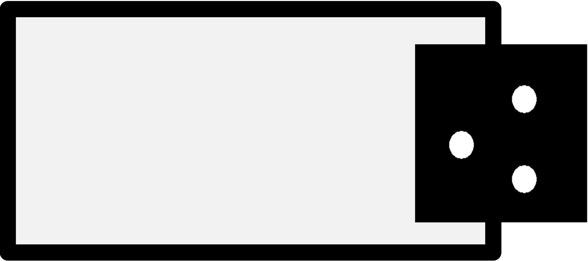

**PPort · mode switch · 服务端口**

- **端口类型：** PPort
- **接口类型：** mode switch
- **服务端口：** 是
- **端口描述：** 带有经由 AUTOSAR 服务的模式切换管理方的组件
- **端口图标：**

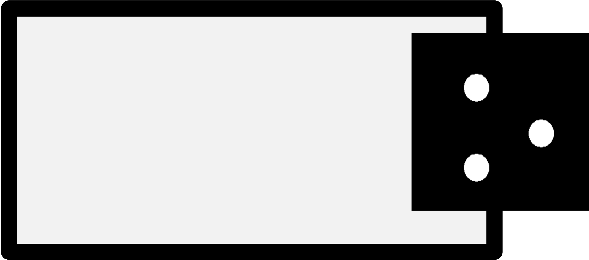

**PRPort · mode switch · 服务端口**

- **端口类型：** PRPort
- **接口类型：** mode switch
- **服务端口：** 是
- **端口描述：** 带有经由 AUTOSAR 服务的模式切换管理方和使用方的组件
- **端口图标：**


**RPort · NV data · 非服务端口**

- **端口类型：** RPort
- **接口类型：** NV data
- **服务端口：** 否
- **端口描述：** 组件要求访问由 NV 块组件提供的非易失性数据
- **端口图标：**

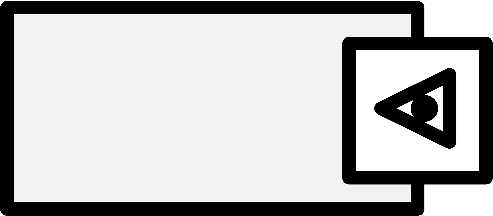

**PPort · NV data · 非服务端口**

- **端口类型：** PPort
- **接口类型：** NV data
- **服务端口：** 否
- **端口描述：** NV 块组件提供对非易失性数据的访问
- **端口图标：**


**PRPort · NV data · 非服务端口**

- **端口类型：** PRPort
- **接口类型：** NV data
- **服务端口：** 否
- **端口描述：** 组件提供并要求对/来自非易失性数据的访问
- **端口图标：**


**RPort · NV data · 服务端口**

- **端口类型：** RPort
- **接口类型：** NV data
- **服务端口：** 是
- **端口描述：** 组件要求访问由 AUTOSAR 服务提供的非易失性数据
- **端口图标：**


**PPort · NV data · 服务端口**

- **端口类型：** PPort
- **接口类型：** NV data
- **服务端口：** 是
- **端口描述：** 组件向 AUTOSAR 服务提供对非易失性数据的访问
- **端口图标：**


**PRPort · NV data · 服务端口**

- **端口类型：** PRPort
- **接口类型：** NV data
- **服务端口：** 是
- **端口描述：** 组件提供并要求对/来自 AUTOSAR 服务的非易失性数据的访问
- **端口图标：**


当组件的一个 PPort 提供客户端-服务器接口时，该端口所属的组件提供接口中定义之操作的一个实现。

在图 3.6 的示例中，组件「SeatHeating」实现操作「SetPower」，并通过端口「Setting」使其对其他组件可用。组件「SeatHeatingControl」使用操作「SetPower」，并期望这样的操作可以通过端口「HeatingElement」获得。

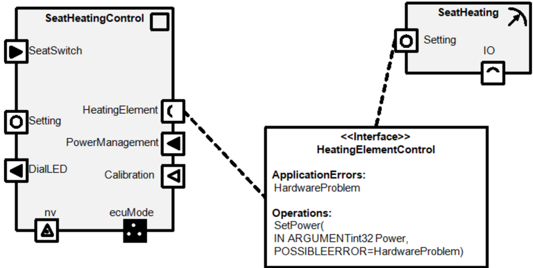

提供发送者-接收者接口的组件为接口中定义的数据元素生成值。

在图 3.7 的示例中，组件「SeatSwitch」通过其端口「Switch」为布尔值「PassengerDetected」生成值。类似地，组件「SeatHeatingControl」可以通过其端口「SeatSwitch」读取数据元素「PassengerDetected」。

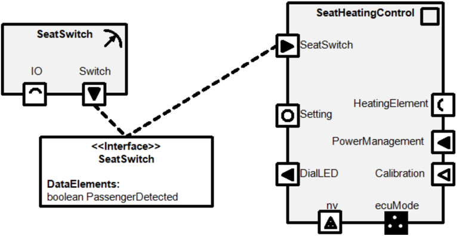

#### 端口兼容性

接收者端口只能连接到兼容的提供者端口。表 3.2 给出了端口兼容性的概览。下面的说明描述了一些基本的兼容性规则。请注意，此概览只包含一些基本规则。更全面、更详细的端口描述见「Software Component Template」[\[6\]](#ref-6)。

1. 对于要求端口的接口中的每个元素，提供端口的接口中必须存在一个兼容的元素。该映射通过元素的短名隐式实现，或通过显式映射实现（见 [3.9.1](#391-支持的转换与映射) 节）。
2. 对于模式切换端口，提供端口接口中的所有元素必须在要求端口的接口中有对应的元素。
3. 要求端口与提供端口或者都是服务端口，或者都不是服务端口。
4. 对于连接带发送者-接收者接口、参数接口或非易失性数据接口的端口，对应的元素必须具有兼容的实现策略（见「Software Component Template」[\[6\]](#ref-6)）。
5. 不支持由参数接口确定类型的 PRPort。

例如，期望 fixed 参数的要求端口只能连接到提供 fixed 参数的端口。这是因为这种固定数据可能被用于像 `#if` 这样的编译指令，而在这种情况下只有宏 `#define`（固定数据）可以被编译。

| 端口种类 | 接口种类 | Sender Receiver | Parameter | Non Volatile Data | Client Server | Trigger | Mode Switch |
| --- | --- | --- | --- | --- | --- | --- | --- |
| PPort 或 PRPort | Sender Receiver | yes (1,3,4) | no | yes (1,3,4) | no | no | no |
| PPort 或 PRPort | Parameter | yes (1,3,4,5) | yes (1,3,4,5) | yes (1,3,4,5) | no | no | no |
| PPort 或 PRPort | Non Volatile Data | yes (1,3,4) | no | yes (1,3,4) | no | no | no |
| PPort 或 PRPort | Client Server | no | no | no | yes (1,3) | no | no |
| PPort 或 PRPort | Trigger | no | no | no | no | yes (1,3) | no |
| PPort 或 PRPort | Mode Switch | no | no | no | no | no | yes (1,2,3) |

（表中的数字对应前述兼容性规则）

#### 数据类型策略

端口上的数据元素作为 SWC 端口接口的端口描述的一部分被适当地确定类型。但应当注意，在两个端口之间通信的元素的数据类型可以被集成者覆盖——通过使用数据类型策略（data type policy）覆盖数据类型，从而减少经由物理网络传输的位数。数据类型必须兼容，且通常会导致精度损失并引入量化伪影。

### 3.4. 连接器（Connector）

在 AUTOSAR 系统的设计期间，需要相互通信的组件之间的端口使用组装连接器（assembly-connector）连接。这样的组装连接器将一个 RPort 或 PRPort 与一个 PPort 或 PRPort 连接起来。

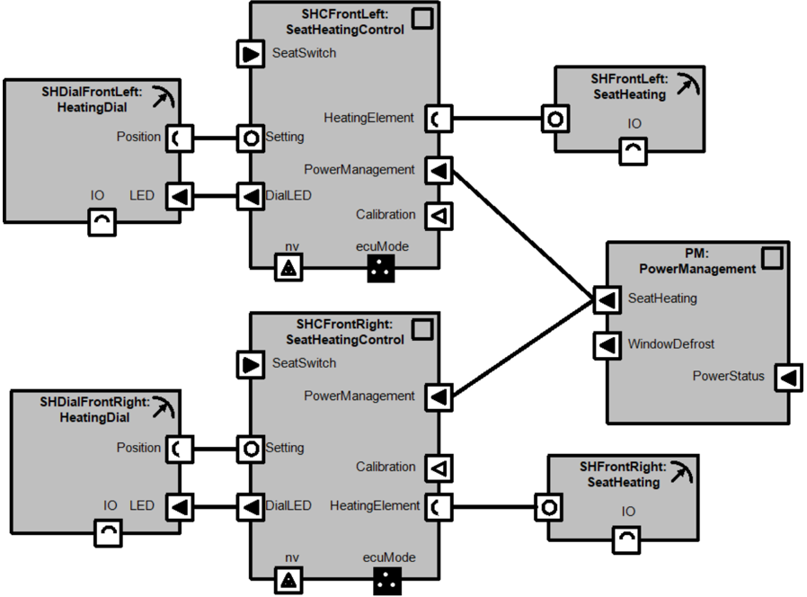

对于发送者-接收者通信的情况，组装连接器的存在表示如下事实：连接器上 PPort 生成的数据被传输到 RPort。在图 3.8 的示例中，组件「SHCFrontRight」（组件类型为「SeatHeatingControl」）在其 PPort「DialLED」上生成的数据被传输到组件「SHDialFrontRight」（组件类型为「HeatingDial」）的 RPort「LED」。

对于客户端-服务器通信的情况，拥有与某个 PPort 连接的 RPort 的组件可以调用该 PPort 上提供的操作。在图 3.8 的示例中：当组件「SHDialFrontLeft」通过端口「Position」调用一个操作时，该操作将在组件「SHCFrontLeft」的端口「Setting」上被调用。

无论是发送者-接收者通信还是客户端-服务器通信，一个 PPort 都可以连接到一个或多个 RPort（分别对应多播发送和多个客户端连接到一个服务器）。在图 3.8 的示例中，组件「PM」的端口「SeatHeating」输出的数据被同时发送到组件「SHCFrontLeft」和「SHCFrontRight」。

此外，在发送者-接收者通信中，一个或多个 PPort 可以连接到一个 RPort（例如用于在单个接收者中汇集来自不同发送者的信息）。

这种连接器所表示的确切通信行为取决于连接器所连接端口上提供和/或要求的操作或数据的种类。

- 在配置期，在 VFB 上实例化的所有组件都是已知的。
- 在配置期，VFB 上组件之间的所有通信可能性都通过连接器的存在来建模。未通过这种连接器连接的端口之间的通信是不可能的⁵。
- 一个组装连接器恰好将一个 PPort 或 PRPort 与一个 RPort 或 PRPort 连接。
- 只有当两个端口的端口类型、接口以及刻画其通信能力的属性彼此兼容时⁶，组装连接器才能将一个 PPort 或 PRPort 与一个 RPort 或 PRPort 连接。

⁵ AUTOSAR 服务是此规则的例外。与 AUTOSAR 服务相关的连接在 AUTOSAR 方法的稍后阶段建立，即 ECU 配置期间。更深入的解释见「AUTOSAR 服务」一章。

⁶ 「兼容性」的确切含义在 Software Component Template [\[6\]](#ref-6) 中定义。

#### 未连接的端口

未连接端口的出现本身并不是设计错误。当数据元素的应用提供方缺席且默认初始值足以支撑运行时，它可以是有效的；也可能是某个端点因为受可变性支配而被从系统中移除（见 [3.10](#310-变体处理variant-handling) 节「变体处理」）。

**未连接的 PRPort**

PRPort 永远不会被视作未连接，即使实际上没有连接器指向它。

**未连接的发送者/接收者端口**

如果发送者-接收者通信的一个 PPort 未连接，那么提供者发布的数据将不会出现在 VFB 上，因而不能被任何其他软件组件访问。

如果发送者-接收者通信的一个 RPort 未连接，那么该 RPort 应提供初始值并报告存在未连接的 RPort。

**未连接的客户端/服务器端口**

如果客户端-服务器通信的一个 PPort 未连接，服务器将不会收到任何请求。

如果客户端-服务器通信的一个 RPort 未连接，那么该 RPort 应报告存在未连接的 RPort。

### 3.5. 组合（Composition）与原子组件

由组件的使用和连接器构成的一个子系统被打包成一个「组合」。在 AUTOSAR 中，组件类型在一个组合中的使用称为「原型（prototype）」。组合本身也是一个组件类型，可以拥有自己的端口。组合可以用作结构化元素，构建具有任意层级数的分层系统。

图 3.9 展示了组合「SeatHeatingControlAndDrivers」的定义。该组合包含三个原型：原型「SHDial」（组件类型「HeatingDial」）、原型「SHC」（组件类型「SeatHeatingControl」）和原型「SH」（组件类型「SeatHeating」）。组合本身是一个组件类型，拥有七个端口。

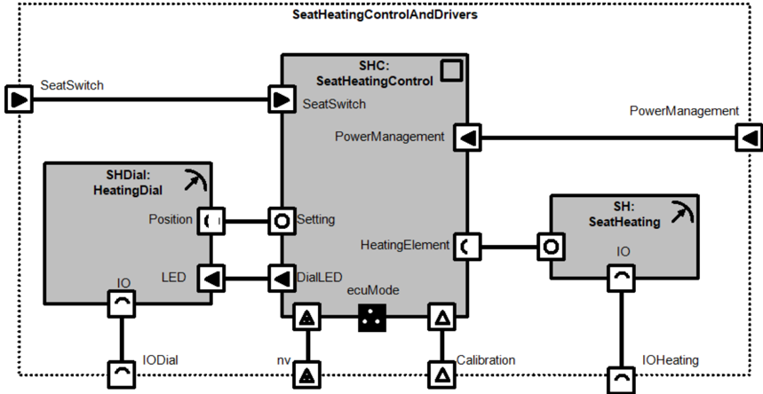

图 3.10 展示了组合作为一个组件类型的使用。图 3.10 实质上展示了另一个组合，它包含三个原型：原型「SHFrontLeft」和「SHFrontRight」（类型均为「SeatHeatingControlAndDrivers」）以及类型为「PowerManagement」的原型「PM」。

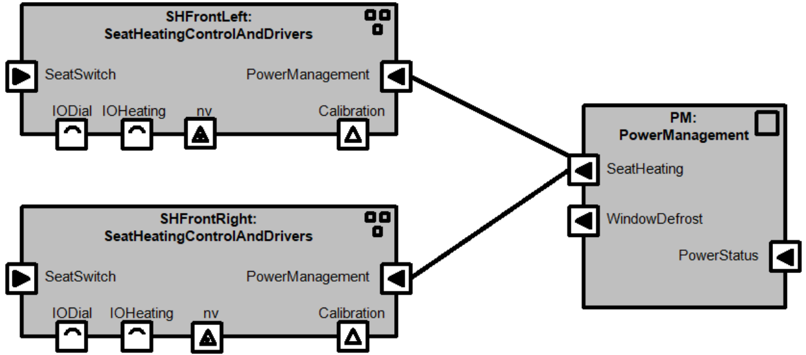

AUTOSAR 中的组件类型要么是「组合」，要么是「原子的」。组合通过相互连接的原型定义（如图 3.9）。原子组件不能再分解为更小的组件。

在设计组合时，服务端口必须被专门处理。AUTOSAR 服务的配置在 ECU 配置阶段进行，做法是添加必要的服务组件，并把它们连接到要求访问这些服务的、被扁平化的原子软件组件集合。因此，不允许组合拥有与服务一起使用的端口。关于服务的更多细节，见「AUTOSAR 服务」一章。

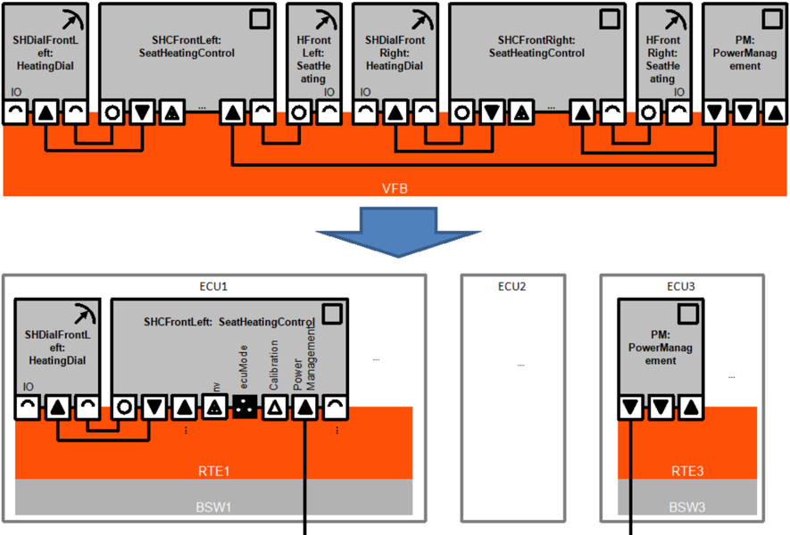

### 3.6. VFB 与 ECU 软件架构的关系

当由原子组件和组装连接器构成的一个子系统被部署到 ECU 网络上时，所有原子组件都被映射到一个 ECU 上。组件之间相应的连接器由 ECU 内或 ECU 间的通信机制实现。

在图 3.11 的示例中，原子组件「SHDialFrontLeft」和「SHCFrontLeft」被映射到「ECU1」，而原子组件「PM」被映射到「ECU3」。这意味着前两个组件之间的连接器在 ECU1 内部处理，而组件「SHCFrontLeft」与组件「PM」之间的连接将经由 ECU1 与 ECU3 之间的网络连接。


图 3.12 展示了 AUTOSAR 分层软件架构上的标准组件视图，它是单个 AUTOSAR ECU 的架构。组件的「AUTOSAR 接口」指组件端口的全部集合（如前所述，端口接口刻画组件的单个端口）。「标准化 AUTOSAR 接口」是由 AUTOSAR 标准化的 AUTOSAR 接口。通常，一个 AUTOSAR 服务会拥有这样的「标准化 AUTOSAR 接口」。关于术语 AUTOSAR 接口和标准化 AUTOSAR 接口的形式化定义，见规范「Layered Software Architecture」[\[4\]](#ref-4)。

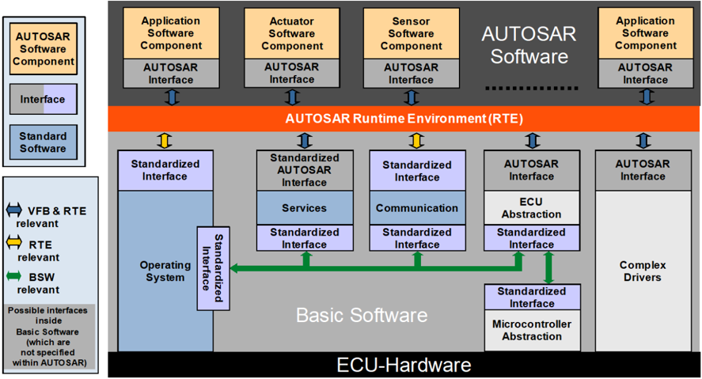

图 3.13 展示了图 3.11 示例中 ECU1 的一种可能的具体架构的样子。被映射到 ECU1 上的原子软件组件挂入为 ECU1 生成的运行时环境中。该运行时环境通常会实现本地组件「SHCFrontLeft」与「SHDialFrontLeft」之间的本地连接。

此外，运行时环境负责路由来自或去往远端组件的信息。在本例中，端口「PowerManagement」被路由到底层基础软件中的通信栈。

RTE 还把组件「SHCFrontLeft」挂接到本地的标准化 AUTOSAR 服务，例如本地非易失性存储器（通过端口「nv」）以及 ECU 本地状态的信息（通过端口「ecuMode」）。

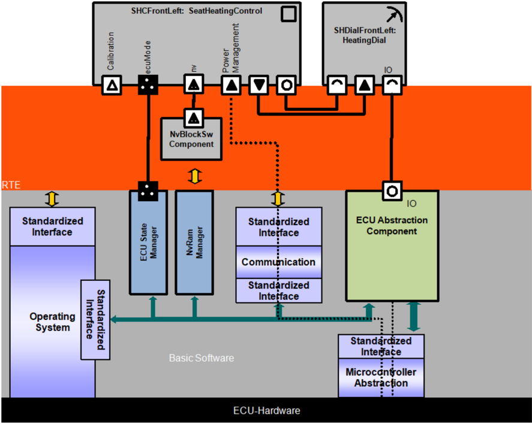

### 3.7. 软件组件的种类

本节最后概览与 AUTOSAR 相关的各种组件种类。

**应用软件组件（Application Software Component）**

- **种类：** 应用软件组件
- **描述：** 应用软件组件是一种原子软件组件，实现（部分）应用。它可以使用所有 AUTOSAR 通信机制和服务。应用软件组件通过传感器-执行器软件组件与传感器或执行器交互。
- **图示：**

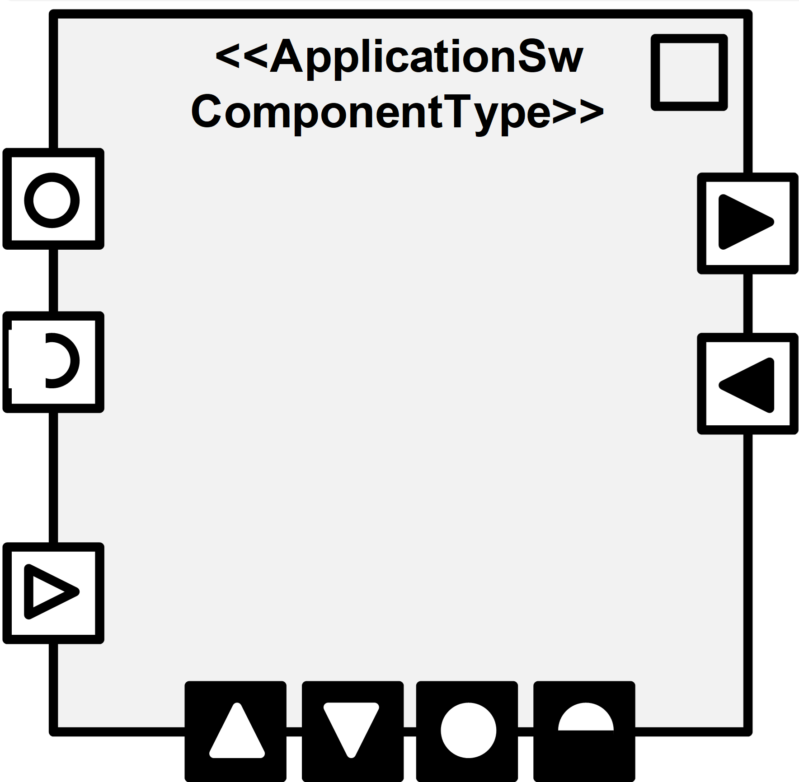

**传感器-执行器软件组件（Sensor-Actuator Software Component）**

- **种类：** 传感器-执行器软件组件
- **描述：** 传感器-执行器软件组件是一种原子软件组件，处理某个传感器和/或执行器的特定细节。它直接与 ECU 抽象交互（这由一个名为「IO」的端口表示）。
- **图示：**

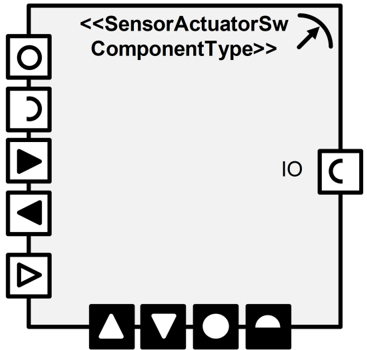

参见第 [6](#6-与硬件的交互) 章「与硬件的交互」。

**参数软件组件（Parameter Software Component）**

- **种类：** 参数软件组件
- **描述：** 参数软件组件提供参数值。这些值可以是固定数据、const 或可变数据。该软件组件允许对固定数据或标定数据的数据访问。
- **图示：**

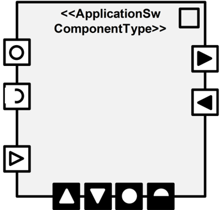

参见第 [10](#10-测量与标定) 章。

**组合软件组件（Composition Software Component）**

- **种类：** 组合软件组件
- **描述：** 组合软件组件封装软件组件之间的协作，从而隐藏细节并允许创建更高的抽象层级。组合软件组件通过委托连接器显式规定内部组件的哪些端口从外部可见。组合软件组件是软件组件的一种特殊类型，例如它们可以成为其他组合软件组件的一部分。
- **图示：**

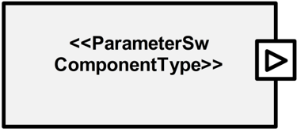

**服务代理软件组件（Service Proxy Software Component）**

- **种类：** 服务代理软件组件
- **描述：** 服务代理 SW 组件负责在整个系统中分发模式。部署之后，每个 ECU 应当拥有该软件组件类型的每个实例的一份副本。不过在 VFB 层级上只需要一个。
- **图示：**

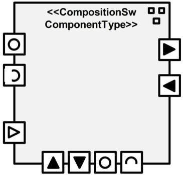

**服务软件组件（Service Software Component）**

- **种类：** 服务软件组件
- **描述：** 服务软件组件通过标准化接口提供标准化服务。为了提供这些服务，该组件可以直接与某些其他基础软件模块交互（这由双箭头表示）。
- **图示：**

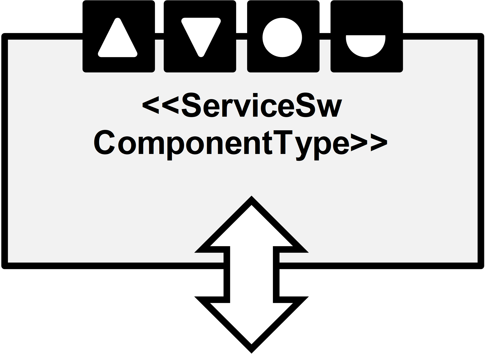

参见第 [7](#7-autosar-服务) 章。

**ECU 抽象软件组件（ECU-Abstraction Software Component）**

- **种类：** ECU 抽象软件组件
- **描述：** ECU 抽象软件组件提供对 ECU 特定 IO 能力的访问。这些服务通常经由客户端-服务器 PPort 提供，并由传感器-执行器软件组件使用。ECU 抽象可以直接与某些其他基础软件模块交互（这由双箭头表示）。
- **图示：**

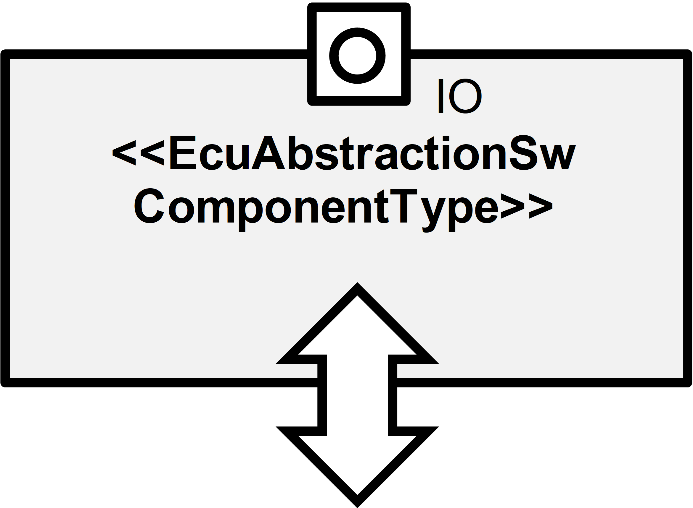

**NV 块软件组件（NVBlock Software Component）**

- **种类：** NV 块软件组件
- **描述：** NV 块软件组件允许 SWC 访问非易失性数据。具体而言，该块允许在 VFB 层级对 NV 数据进行建模。NV 块的职责是把各个 NV 数据元素映射到 NV 块，并与基础软件中的 NV 管理器交互。该组件的行为要基于端口服务在 RTE 中生成。
- **图示：**

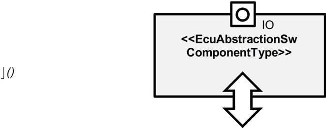

参见第 [6](#6-与硬件的交互) 章「与硬件的交互」。

**复杂驱动软件组件（Complex Driver Software Component）**

- **种类：** 复杂驱动软件组件
- **描述：** 复杂驱动软件组件是「ECU 抽象组件」的泛化。它可以定义端口以特定方式与其他组件交互，也可以直接与其他基础软件模块交互。
- **图示：**

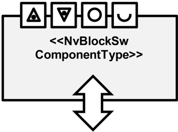

复杂驱动软件组件的用途在 [6.5](#65-复杂驱动组件) 节「复杂驱动」中进一步描述。

### 3.8. 组件与「可运行体」的资源

#### 3.8.1 背景

VFB 是一个系统建模与通信概念，它允许组件分布在 ECU 网络中。一个组件与其他组件之间的交互可能性通过组件的端口及其关联接口描述，接口定义了该组件提供或要求的操作、数据元素、模式组或标定参数。通过同样的通信机制，组件可以与标准化的 AUTOSAR 服务（在每个正确配置的 AUTOSAR ECU 上都可用）或 ECU 特定的 IO 能力（在合适的硬件存在且连接了正确设备的特定 ECU 上可用）交互。

然而，组件的实现需要访问额外的资源，主要是内存（组件的实现通常需要内存来维护其内部状态）和 CPU 算力（组件的实现包含必须按特定时序调度或响应特定事件而执行的代码）。

由于这些调度问题与组件的通信需求紧密相关，RTE 必须同时提供这两个方面。因此，RTE 必须为组件提供一个完整的环境，包括：

- 相应的机制，使组件的实现（例如以「C」这样的编程语言编写）能够：
  - 为组件 PPort 中的数据元素提供值；
  - 读取/消费组件 RPort 中数据元素的值；
  - 访问组件的标定参数；
  - 为组件 PPort 中的操作提供实现；
  - 通过组件的 RPort 调用其他组件提供的操作；
  - 等等。
- 相应的机制，使组件的实现（例如「C」函数）在响应以下情况时被调用：
  - 固定时间调度（例如：许多组件需要「周期性」运行）；
  - 与通信机制相关的事件（例如某些组件可能希望在接收到来自其他组件的数据时得到通知）；
  - 与物理现象相关的事件（即触发事件）。
- 相应的机制，使组件的实现可以访问其他公共资源，例如实例特定的内存。
- 由于 AUTOSAR ECU 通常是多线程环境，RTE 还必须提供所有常见的同步机制。

本节介绍解决这些各种需求的 AUTOSAR 构件：「可运行体（runnable）」。注意，存在这样的用例：SoftwareComponentType 可以在定义时不带 InternalBehavior 即可运行体。例如，如果不需要代理任何 NvM 服务端口或 NvM 管理端口，NvBlockSoftwareComponent 就不需要任何 RunnableEntity。

#### 3.8.2 「可运行体」概念

原子软件组件的「原子性」指的是：该组件不能再被划分为更小的组件，因此必须被映射到单个 ECU 上。

例如，图 3.14 展示了被映射的软件组件「SHCFrontLeft」在特定 ECU 上的逻辑组件视图。通过它的端口，该组件表达了它要求其他组件提供哪些信息、以及它向其他组件提供哪些信息。

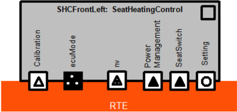

然而，组件的实际实现由一组「可运行体实体」（runnable entity，也更简单地称为「可运行体」）⁷组成。「可运行体实体」是由组件提供的一段指令序列，它可以被运行时环境启动⁸。图 3.15 展示了一个例子。逻辑上，组件类型「SeatHeatingControl」定义了六个端口，通过这些端口它希望与其他组件或服务交互。而该组件的实现包含两个可运行体：「MainCyclic」和「Setting」。组件要求 RTE 周期性地（以特定频率）调用可运行体「MainCyclic」。组件要求每当另一个组件在 PPort「Setting」上调用一个操作时，就调用第二个可运行体「Setting」。可运行体的实现将使用 RTE 提供的操作来实际执行经由组件端口的通信。例如，要访问通过 RPort「SeatSwitch」提供给组件的信息「PassengerDetected」，可运行体「Setting」将调用操作 Rte_Read_SeatSwitch_PassengerDetected()。

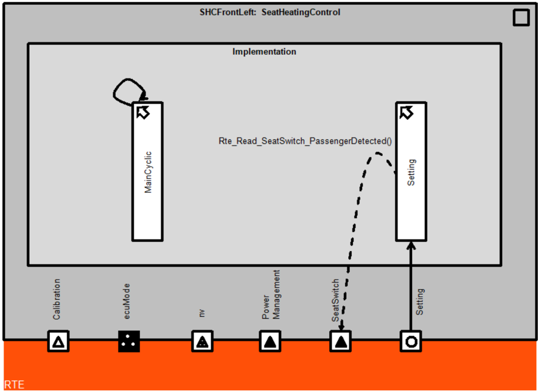

⁷ 「runnable」一词的用法例如与 Java 中的「Runnable」接口一致：「任何其实例打算由线程执行的类都应当实现 Runnable 接口」。

⁸ 在某些情况下，RTE 的优化可能导致可运行体实体直接从另一个软件组件启动，而无需 RTE 的实际干预。例如，对运行在同一 ECU 上、可以在调用者上下文（任务）内执行的组件的同步调用，可以被实现为直接函数调用。

一般而言，一个原子软件组件可以只提供一个可运行体，也可以包含大量可运行体。一个可运行体可以是一段执行简单算法的非常简单的代码，也可以是一个复杂的程序。

- 在配置期，组件的可运行体必须是已知的。

「可运行体实体」在「任务（task）」的上下文中运行⁹。任务向「可运行体实体」提供公共资源，例如上下文和栈空间。通常，操作系统调度器负责在运行时决定何时、哪个「任务」可以在 ECU 的 CPU（或多个 CPU）上运行。调度器可以采用许多标准策略（例如基于优先级的抢占式、轮转、时间触发等）。

⁹ 在此讨论中，没有必要区分「进程」（重量级任务，通常通过内存管理与其他进程隔离）和「线程」（在进程内运行的轻量级任务）。「任务」对两者都适用。

#### 3.8.3 组件的实现与 RTE 的角色

总之，一个原子软件组件的实现本质上由三个方面组成：

- 组件的一个模型（使用端口和端口接口的概念），用于在 VFB 层级把该组件与其他组件挂接；
- 一个实现（「代码」）。组件的实现被组织成「可运行体」，即可由 RTE 执行的代码片段；
- 一个软件组件描述 [\[6\]](#ref-6)，组件在其中描述对 RTE 的要求。这些包括：
  - 哪些可运行体需要被周期性调用；
  - 哪些可运行体需要在响应与通信或其他来源相关的事件时被调用；
  - 组件希望如何访问其端口中的信息或调用它要求其他组件提供的操作；
  - 组件要求的任何其他资源，例如 AUTOSAR 服务或本地内存。

在一个正确配置的 AUTOSAR ECU 中，RTE（与正确配置的基础软件协作）将满足组件的要求。例如，RTE 将：

- 确保可运行体在正确的时刻被调用；
- 提供组件访问数据或调用操作所需的函数；
- 提供组件需要的所有其他资源。

### 3.9. 接口转换块（Interface Conversion Block）

当软件组件由不同组织开发时（例如两个不同的供应商向集成这些 SWC 的 OEM 交付代码），可能出现两个或多个 SWC 具有相同的工程语义、却用不同的数据类型表示的情况。VFB 不要求集成者开发专门的 SWC 转换软件，而是在 VFB 层级为连接接口定义不匹配的发送者-接收者端口的连接器添加一个转换块。添加此转换块允许设计者添加所提供端口的哪些元素映射到所要求端口的元素，并提供转换语义。在 RTE 中，这些映射将用 PortInterfaceMapping 描述。该构件把一个接口对映射到该连接。

- 如果由发送者-接收者接口规定的一个 P 端口连接到一个接口不兼容的 R 端口，那么必须为该连接器添加一个转换块，以允许设计者描述该转换。不允许不完整的转换。

#### 3.9.1 支持的转换与映射

##### 3.9.1.1 接口元素映射

如果两个接口只在其元素的短名上有差异，那么可以提供一个映射，把一个接口的元素映射到另一个接口的元素。

##### 3.9.1.2 线性数据转换

如果两个接口的元素在逻辑上等价但范围和分辨率不同，那么可以根据元素的语义信息计算出线性转换系数。在这种情况下，数据语义使用类别为 IDENTICAL、LINEAR、SCALE_LINEAR 或 SCALE_LINEAR_AND_TEXTTABLE 的 CompuMethod 描述，其中：

- IDENTICAL 类别表示物理表示的值等于内部表示；而
- LINEAR、SCALE_LINEAR 或 SCALE_LINEAR_AND_TEXTTABLE 类别表示内部表示通过线性公式（factor × external value + offset）从一个或多个范围中的每个范围的物理表示计算得出（仅 SCALE_LINEAR 支持多范围）。

- 涉及 IDENTICAL、LINEAR、TEXTTABLE、SCALE_LINEAR 或 SCALE_LINEAR_AND_TEXTTABLE 数据类型的转换块，应当使用相应数据类型的 COMPU-METHOD 来确定转换函数。

以下示例展示对使用类别为 LINEAR 和 IDENTICAL 的 CompuMethod 描述的数据的转换：

1. 一个以 m/s 为单位、分辨率为 0,1 m/s 提供车速的软件组件（A），可以与一个要求以 m/s 为单位、分辨率为 0,01 m/s 的车速的组件（B）连接，前提是两个组件都假定物理表示与内部表示之间存在线性关系。后续公式展示该转换：

```Text
internal (A) = 10 * physical as m/s
internal (B) = 100 * physical as m/s
             = 100 * (internal (A) / 10)
             = 10 * internal (A)
```

示例：组件 A 提供值 100（10 m/s 的内部表示）。将该值乘以 10，我们得到值 1000 作为组件 B 的输入（组件 B 中 1000 的内部表示对应 10 m/s）。

2. 数据缩放的一个特例是单位转换：以 m/s 为单位提供车速的软件组件（A）可以与要求以 km/h 为单位的车速的组件（B）连接，前提是两个组件都假定物理表示与内部表示之间存在线性或恒等关系。

```Text
internal (A) = physical as m/s
internal (B) = physical as km/h
             = 3,6 * physical as m/s
             = 3,6 * internal (A)
```

示例：组件 A 提供值 10（10 m/s 的内部表示）。将该值乘以 3,6，我们得到值 36 作为组件 B 的输入（36 的内部表示对应 36 km/h，等价于 10 m/s）。

##### 3.9.1.3 数据映射

如果数据语义使用值列表（类别为 TEXTTABLE 的 CompuMethod）描述，或部分使用值列表（类别为 SCALE_LINEAR_AND_TEXTTABLE 的 CompuMethod）描述，那么需要为每个单独的值给出显式映射。

- 涉及 TEXTTABLE 或 SCALE_LINEAR_AND_TEXTTABLE 数据类型的转换块，应当使用从每个 RPort 表元素到 PPort 表元素的显式映射。

##### 3.9.1.4 混合转换

在转换块中可以混合线性转换和文本表映射（SCALE_LINEAR_AND_TEXTTABLE）。

一个例子是由一个 uint8 类型的输入值组成的转换块，它在 0..200 范围内线性转换，并且对值 254「SensorNotAvailable」和 255「SensorFault」有 2 个文本表映射。

### 3.10. 变体处理（Variant Handling）

为了支持汽车应用中的变化，AUTOSAR 提供了一种称为变体处理（variant handling）的机制。它允许许多层级的设计者组合一个功能超集，并选择在特定变体中将启用该功能中的哪些实际部分。设计中在 2 个或更多变体之间给出选择的位置称为变体点（variation point）。必须做出选择的时间称为最晚绑定时间（latest binding time）。更早绑定始终是允许的。

#### 3.10.1 绑定时间

AUTOSAR 支持若干个离散的绑定时间：

- 系统设计（System Design）
- 代码生成（Code Generation）
- 预编译（Pre Compile）
- 链接期（Link Time）
- 构建后（Post Build）

尽管可变性本可以存在于功能设计期和运行时，但 AUTOSAR 明确禁止后者，并且不为功能设计期提供支持。

#### 3.10.2 选择变体

为了选择一个变体，AUTOSAR 设计者必须在不晚于所需绑定时间的时刻，向一个软件系统常量（Software System Constant）或一个构建后变体准则（Post Build Variant Criterion）指派一个预定义值集合中的值。构建后变体准则用于启用构建后绑定时间，而软件系统常量可用于最晚绑定时间为链接期的一切。

通过向软件系统常量或构建后变体准则指派值，AUTOSAR 系统可以通过求值一个软件系统依赖公式（Software System Dependant Formula，使用系统常量判断变体点启用还是禁用）或求值一个或多个构建后变体条件（Post Build Variant Condition，使用构建后变体准则判断变体点启用还是禁用），来确定设计中每个变体点启用了哪个变体。如果变体点公式或条件的求值结果为真，那么设计中以该变体点为条件的元素将存在于设计中。

通常，设计者会为软件系统常量和构建后变体准则定义经过验证的指派集合。这些值指派的集合也称为预定义变体（Predefined Variant）。预定义变体集通常在组合层级（例如子系统或系统设计）定义。因此，一个系统的完整变体通常由绑定系统中每个变体点的预定义变体集合构成。

#### 3.10.3 可变性

尽管可变性存在于软件组件的内部行为之中，从 VFB 的视角出发，只有三种可变性元素是受关注的：

- 软件组件可变性；
- 端口可变性；
- 连接器可变性。

##### 3.10.3.1 软件组件可变性

软件组件（无论原子还是组合）的存在可以受某个变体点的存在支配。如果变体点存在且其条件（见 [3.10.2](#3102-选择变体) 节「选择变体」）求值为真，那么该软件组件存在，其行为将被调度，其端口产生输出。然而，如果该组件从组合中（即应用或系统设计中）被移除，那么所有与被移除软件组件连接的软件组件将拥有被视为未连接的端口，并表现得像未连接端口（更多细节见 3.4.1 节「未连接的端口」），且被移除组件的任何行为都不会执行。组合中的软件组件可变性最晚可以在构建后绑定。

##### 3.10.3.2 端口可变性

软件组件上的端口也可以受可变性支配。但它们的最晚绑定时间是预编译期，因此它们的可变性只能使用软件系统常量来约束。如果一个端口从设计中被移除，那么任何与之连接的端口必须表现得像未连接端口。在正确配置的系统中，如果一个端口被「禁用」，连接到该端口的连接器也应当受相同可变性条件的支配。

##### 3.10.3.3 连接器可变性

两个端口之间的连接可以受绑定时间为构建后的可变性支配。如果一个连接器被「禁用」，那么连接器两端的两个端口必须表现得像未连接端口。

## 4. VFB 上的通信

### 4.1. 引言

本节规定 VFB 的通信机制，原子软件组件可以用它们相互通信。

[4.2](#42-错误类型) 节「错误类型」定义了在发送者-接收者和客户端-服务器两种通信模型中都可能出现的错误类型。

[4.3](#43-发送者-接收者通信) 节「发送者-接收者通信」更详细地定义了发送者-接收者通信的功能语义。本节还定义了规定 AUTOSAR 所提供通信模式的确切特征的通信属性。与模式切换相关的一些细节在第 [8](#8-模式管理) 章「模式管理」中介绍。

[4.4](#44-客户端-服务器通信) 节「客户端-服务器通信」对客户端-服务器做同样的事情。

### 4.2. 错误类型

错误被分为两个简单的类别：基础设施错误和应用错误。

对于发送者-接收者通信，当发送者与接收者之间的基础设施失败时（对于客户端-服务器通信，则是客户端与服务器之间），返回基础设施错误。基础设施错误的一个典型例子是超时。如果客户端在一定时间内没有收到来自服务器的响应（因为客户端与服务器之间的通信通道不可用或报文丢失），则向客户端返回「超时」基础设施错误。可能的基础设施错误由 AUTOSAR 标准化。

应用错误是应用特定的，对于发送者-接收者通信必须作为发送者-接收者接口的一部分定义（对于客户端-服务器通信，则作为客户端-服务器接口的一部分）。

### 4.3. 发送者-接收者通信

发送者-接收者模式支持信息的分发：发送者向一个或多个接收者分发信息，或接收者从多个发送者接收信息。图 4.1 给出了一个在 AUTOSAR VFB 视图中如何建模发送者-接收者通信的例子。

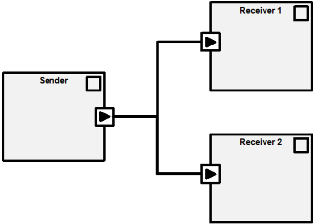

在此例中，有两条组装连接器把组件「Sender」的 PPort 与「Receiver 1」（分别为「Receiver 2」）的 RPort 连接起来。

与这些端口关联的发送者-接收者接口由数据元素组成，这些数据元素定义由发送者发送、由接收者接收的数据。

数据元素的类型可以非常简单（例如「整数」），也可以是复杂的（可能很大的）数据类型（例如数组或字符串）。即使是复杂数据类型的值的传输，在逻辑上也总是原子的。

- 在配置期，发送者-接收者接口中每个数据元素的数据类型是已知的。

发送者可以为发送者-接收者接口中定义的每个数据元素提供一个新值。确切的语义取决于该数据元素被定义为「last-is-best」类型还是「queued」（排队）类型。

- 在配置期，发送者-接收者接口中的每个数据元素必须被定义为具有「queued」或「last-is-best」语义。

每个具有「last-is-best」语义的数据元素都可以配置为支持失效（invalidation）。如果「last-is-best」数据元素支持失效，发送组件可以向接收者指示该数据元素「无效」（见表 4.1 和表 4.2 中的属性 RECEIVE_INVALID 和 CAN_INVALIDATE）。

- 在配置期，对于发送者-接收者接口中的每个「last-is-best」数据元素，必须已知该数据元素是否支持「无效」能力。

#### 4.3.1 从发送者的视角

发送者组件 PPort 中每个具有「last-is-best」语义的数据元素始终有一个当前值。这类数据元素的初始当前值可以通过 VFB 的配置定义（见表 4.1 和表 4.2 中的属性「INIT_VALUE」）。发送组件可以改变数据元素的当前值，从而覆盖该数据元素先前的值。

当数据元素具有「queued」语义时，发送者产生的连续值被存储在一个队列中。初始队列长度为零（没有值可用）。每当发送者产生一个新值，该值被加入队列，直到达到一个任意的、可配置的条目数。

发送组件不知道接收者的身份和数量。其行为与接收者的存在与否无关。发送者-接收者通信允许发送者与接收者之间的强解耦。发送者只提供信息，接收者自主决定何时以及如何使用该信息。分发信息是通信基础设施的职责。然而在某些情况下，发送应用希望在发送者与其接收者之间通信系统的预期服务质量已知被违反时得到通知（见表 4.1 中的属性「TRANSMISSION_ACKNOWLEDGEMENT」）。

- 在配置期，对于组件 PPort 或 PRPort 中的每个数据元素，必须已知该组件是否希望在传输成功或传输超时时得到通知。

表 4.1 概览了发送者可以用来控制发送者-接收者通信模式行为的通信属性。这些属性在单个数据元素或模式组的层级上定义。

| 属性/特性名称 | 在软件中的实现（component template [\[6\]](#ref-6)） | 说明 | 数据元素/模式组：data | event | mode |
| --- | --- | --- | --- | --- | --- |
| INIT_VALUE | 「UnqueuedSenderComSpec」的属性「initValue」 | 此属性定义该数据元素的初始值，该数据元素的所有接收者看到的都是它。此初始值可以被接收侧的属性 INIT_VALUE 覆盖。 | required | not available | not available |
| CAN_INVALIDATE | 「NonqueuedSenderComSpec」的属性「canInvalidate」 | 如果使用此特性，发送者可以使一个数据元素失效。 | optional | not available | not available |
| MODE_QUEUE_LENGTH | Mode SwitchSenderComSpec 的「queueLength」 | 此属性定义到模式机的模式切换通知输入队列的大小。 | not available | not available | required |
| IMPLICIT_SEND | 「DataWriteAccess」 | 通常，发送者必须进行显式函数调用来发送数据元素或更改当前模式。「隐式发送」意味着可运行体可以在运行期间修改数据元素。可运行体终止后，RTE 会把最新值提供给该数据元素的接收者。 | optional | not available | not available |
| TRANSMISSION_ACKNOWLEDGEMENT | 带「timeout」属性的「Transmission Acknowledgement Request」或带「timeout」属性的「Mode SwitchedAckRequest」 | 当数据已被正确发送，或模式切换已由 RTE 执行时，发送组件会得到通知。如果在此确认之前发生超时，发送者会被告知一个基础设施错误。 | optional | optional | optional |
| IS_QUEUED | 「VariableDataPrototype」中的「isQueued」 | 当此参数为 TRUE 时，数据元素是排队的（=用于「事件」）。当此参数为 false 时，数据元素具有「last-is-best」语义。 | FALSE | TRUE | not available |

注意：排队数据元素的初始状态是空队列。

注意：初始模式作为 ModeDeclarationGroup 的一部分定义。

细节见「Software Component Template」[\[6\]](#ref-6) 和「SWS RTE」[\[7\]](#ref-7)。

#### 4.3.2 从接收者的视角

接收者可以访问与接收组件的 RPort 关联的发送者-接收者接口中定义的每个数据元素的值。

对于具有「last-is-best」语义的数据元素，接收者可以访问该数据元素的最新值。或者，接收者会被告知该数据元素「无效」（在该数据元素支持此特性的情况下）。接收者可以访问数据元素的存活性（livelihood），即其值是有效还是过期。存活性通过配置 VFB 定义（见表 4.2 中的属性「TIME_FOR_RESYNC」和「ALIVE_TIMEOUT」）。

- 在配置期，组件 RPort 或 PRPort 中每个 last-is-best 数据元素的初始值必须被定义。
- 当发送组件尚未提供值时，接收组件看到的数据元素当前值是 RPort 或 PRPort 配置的初始值。
- 如果数据元素支持此能力，接收组件的初始值可以是「无效」。
- 在配置期，对于组件 RPort 或 PRPort 中的每个 last-is-best 数据元素，必须已知该组件是否希望得到该数据元素存活性的通知。
- 得到数据元素存活性通知的接收者必须配置两次接收之间的时间段。该阈值决定数据元素的存活性：actual（有效）或 outdated（过期）。

对于具有「queued」语义的数据元素，接收者本质上只有一个操作：从队列中取得下一个数据元素。如果队列为空，这一事实会返回给接收者。否则，读取下一个数据元素的值并将其从队列中取出（换言之，这是一种「消费式读取」）。队列的容量通过配置 VFB 定义（见表 4.2 中的属性「RECEIVER_QUEUE_LENGTH」）。

- 具有「queued」语义的数据元素所关联的队列初始（在发送者向队列添加值之前）为空。
- 逻辑上，队列位于接收者一侧。
- 在配置期，接收者队列的大小必须是已知的。
- 接收者队列具有先进先出（first-in first-out）语义。
- 当接收者队列已满且有新值到达时，该值被丢弃（「队列溢出」）。
- 如果接收者在配置期表明希望得到此通知，它可以被通知「队列溢出」。

表 4.2 概览了接收者可以用来控制发送者-接收者通信模式行为的通信属性。这些属性在单个数据元素或模式组的层级上定义。

| 属性/特性名称 | 属性值 | 说明 | 数据元素/模式组：data | event | mode |
| --- | --- | --- | --- | --- | --- |
| INIT_VALUE | 「NonqueuedReceiverComSpec」的「initValue」 | 接收者可以选择性地指定自己的初始值，它覆盖发送者的初始值。 | optional | not available | not available |
| RECEIVE_INVALID | 「NonqueuedReceiverComSpec」中的「handleInvalid」 | 接收者可以规定在收到数据元素的无效值时希望如何响应。 | optional | not available | not available |
| TIME_FOR_RESYNC | 「NonqueuedReceiverComSpec」的「resyncTime」 | 当前数据丢失后（例如 ECU 复位后）允许用于数据值重新同步的时间。 | optional | not available | not available |
| ALIVE_TIMEOUT | 「UnqueudReceiverComSpec」的「aliveTimeout」 | 接收者规定接收一个数据元素所允许的最长时间。如果数据元素未在定义的时间段内被接收，则该数据元素为「outdated」（过期）。 | optional | not available | not available |
| IMPLICIT_RECEIVE | 「dataReadAccess」 | 通常，希望读取数据元素的可运行体需要通过显式调用 RTE 来完成。「IMPLICIT_RECEIVE」意味着可运行体可以访问在可运行体启动时刻可用的数据元素值。它不需要调用显式 API 来获取最新数据。 | optional | not available | not available |
| RECEIVE_EVENT | 「DataReceivedEvent」和「SwcModeSwitchEvent」 | 这意味着当收到数据元素的新值或模式切换时，RTE 会通知接收应用。这意味着接收组件不需要轮询，而是可以等待新的数据元素或模式变化。 | optional | optional | optional |
| IS_QUEUED | 「VariableDataPrototype」中的「isQueued」 | 当此参数为 TRUE 时，数据元素是排队的（=用于「事件」）。当此参数为 false 时，数据元素具有「last-is-best」语义。 | FALSE | TRUE | not available |
| RECEIVER_QUEUE_LENGTH | QueuedReceiverComSpec 的 queueLength | 收到的值被添加到队列末尾，值从队列前端读取（消费式），即队列是先进先出的。如果队列已满且另一数据项到达，该数据项被丢弃，并通过错误处理机制通知接收者。 | not available | required | not available |
| FILTER | 「ReceiverComSpec」的属性「DataFilter」 | 只有当数据元素的值通过过滤器的条件时，数据元素才被传递给应用。如果数据元素新收到的值未通过过滤器的条件，该值被丢弃（对于排队接收者不入队，或者对于 last-is-best 接收者不更新该数据元素的当前值）。VFB 提供与 ISO 17356-4 [\[14\]](#ref-14) 中定义的相同的过滤器。这些过滤器只能应用于原生类型的数据元素。 | optional | optional | not available |
| SW_IMPLEMENTATION_POLICY | 「swImplPolicy」 | 使用参数接口时，可以规定访问参数的机制。这在处理固定数据交换时允许进行预编译期和编译期的优化。 | optional | not available | not available |

注意：排队数据元素的初始状态是空队列。

注意：初始模式作为 ModeDeclarationGroup 的一部分定义。

细节见「Software Component Template」[\[6\]](#ref-6) 和「SWS RTE」[\[7\]](#ref-7)。

#### 4.3.3 发送者-接收者的多重性

下面两节讨论的多重性术语适用于特定端口与一个或多个其他端口之间的连接多重性；它不涉及一个软件组件的两个不同端口分别连接到另一个软件组件的两个不同端口的情况。

两种发送者-接收者语义（即具有「last-is-best」语义数据元素的接口或具有排队语义的接口）都支持 1:n 通信（1 个发送者和 n 个接收者，n ≥ 0）或 n:1 通信（n 个发送者和 1 个接收者）。发送者拥有数据元素的当前值。在 last-is-best 语义下，数据的接收者始终只想拥有该数据最新的值。确保数据元素的正确值在接收侧可用是通信系统的职责。这如图 4.2 所示。

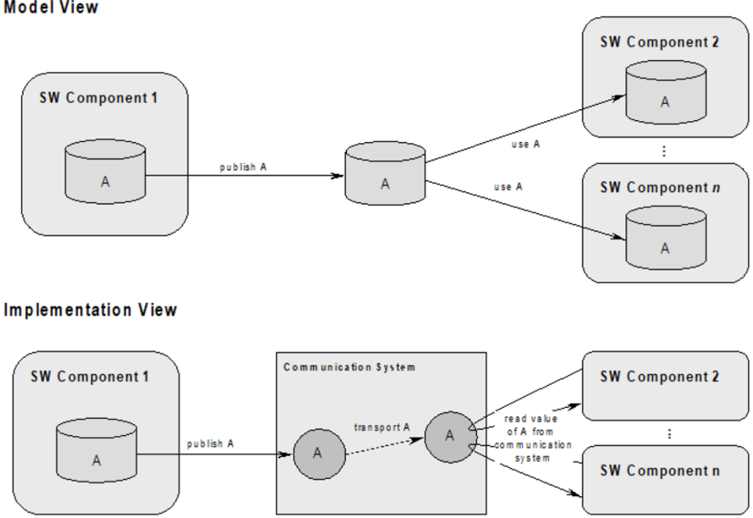

从实现的角度，这例如可以通过让发送者周期性地向其接收者广播数据元素的最新值来实现。第二种实现可以只把实际的变更传达给接收者。

在「queued」语义与 n:1 通信下，队列位于接收侧，多个发送者可以向单个接收者的队列添加该数据元素的值。为了避免 VFB 机制的复杂度进一步增加，所有其他通信场景（如 n:m，n, m > 1）都是不可能的。

- 对于具有「last-is-best」语义数据元素的发送者-接收者，1:n 和 n:1 通信（1 个发送者到多个接收者）都是可能的。
- 对于具有「queued」语义数据元素的发送者-接收者，1:n（1 个发送者到多个接收者）和 n:1 通信（多个发送者到 1 个接收者）都是可能的。
- 对于带 ModeDeclarationGroup 的发送者-接收者，只有 1:n（1 个发送者到多个接收者）是可能的。

由于一个组件可以拥有任意数量的端口，单个组件可以同时扮演发送者和/或接收者的角色。

#### 4.3.4 发送者与接收者之间的过滤

VFB 支持定义一个位于发送者与接收者之间的附加过滤器。

只有当数据元素的新值通过过滤器的条件时，才会传递给应用。如果数据元素新收到的值未通过过滤器的条件，该值被拒绝（对于排队数据元素不入队）或数据元素的当前值不被更新（对于 last-is-best 数据元素）。

AUTOSAR 支持的过滤器与 OSEK-COM V3.0.3 中定义的过滤器相同。这些过滤器只能应用于原生类型的数据元素。

- 在配置期，接收者侧的可选过滤器必须被定义。
- 过滤器具有 ISO 17356-4 [\[14\]](#ref-14) 过滤器的能力。

在 VFB 模型中，这样的过滤器只能在接收侧规定。但这并不意味着过滤必须在接收侧的 RTE 中实现。例如，考虑这样一个情况：接收过滤器表明接收者只想接收高于某个值的数据元素，而这是通过网络连接挂接到发送者的唯一接收者。在这种情况下，一个好的实现可能会决定在多余的值被发送到网络之前（在发送侧）将它们过滤掉。

#### 4.3.5 发送者-接收者连接器内的并发与排序

在发送者的 PPort 与接收者的 RPort 之间的单个连接器的范围内，VFB 保持对特定数据元素值的连续变更的顺序。

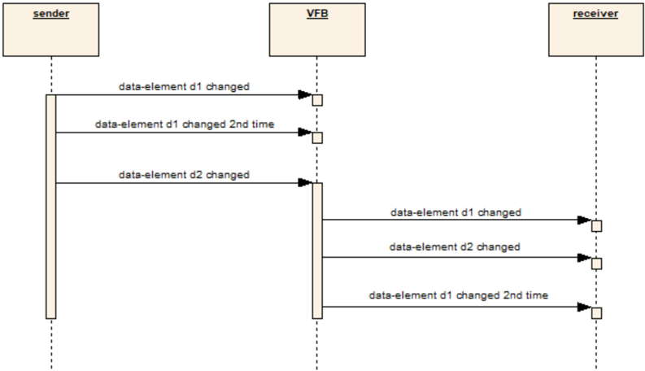

对于排队的数据元素，接收者必须以与某个特定发送者产生这些值时相同的顺序看到该数据元素的连续排队值。

对于「last-is-best」语义，该语义直接意味着「较旧」的值永远不应覆盖「较新」的值。

但是，VFB 不保证对不同数据元素的变更之间（即使在同一接口内）或不同连接器之间的任何顺序。

VFB 不保证不同 Mode DeclarationGroup 的模式切换之间（即使在同一接口内）或不同连接器之间的任何顺序。

- 在单个发送者-接收者连接器内，VFB 保证对单个数据元素所作变更的顺序。

### 4.4. 客户端-服务器通信

分布式系统中一种被广泛使用的通信模式是客户端-服务器模式，其中服务器是服务的提供者¹⁰，客户端是服务的使用者。一个简单的例子是对加密的无线密钥数据的解码（防盗器，见图 4.4）。

¹⁰ 本章中的「服务」是由某个 AUTOSAR SW 组件（服务器）提供、可被其他 AUTOSAR SW 组件（客户端）使用的功能。它不要与第 [7](#7-autosar-服务) 章「AUTOSAR 服务」中更精确定义的 AUTOSAR 服务混淆。

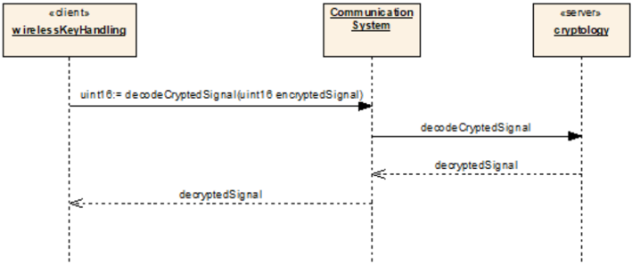

AUTOSAR 定义了一种非常简单的、静态的 n:1 客户端-服务器机制（n 个客户端和 1 个服务器，n ≥ 0）¹¹。图 4.5 给出了一个例子，说明由三个组件和两条连接构成的组合的客户端-服务器通信在 VFB 视图中如何可视化。

¹¹ 更复杂的客户端-服务器架构可能涉及代理者（broker）：由其登记服务器提供的服务，客户端动态订阅某些服务。为了支持这类机制的实现，可以通过定义额外的 AUTOSAR 服务来扩展 AUTOSAR（见第 [7](#7-autosar-服务) 章「AUTOSAR 服务」）。

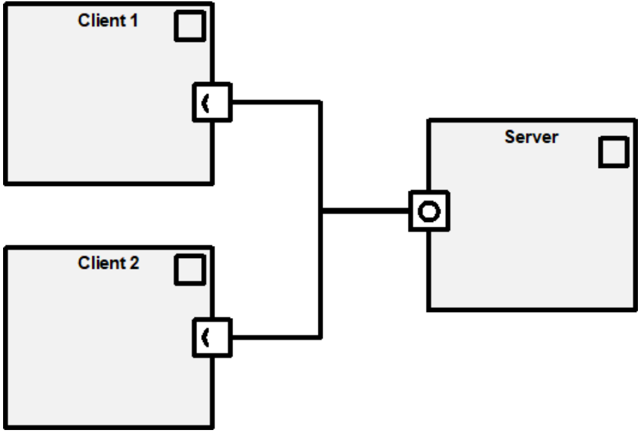

在此例中，有 2 条组装连接器。它们把「Client 1」（分别为「Client 2」）的 RPort与服务器的 PPort 挂接起来。每个端口都与一个客户端-服务器接口关联，该接口定义由服务器提供、由客户端使用的操作。

这种客户端-服务器接口中的每个操作都与参数相关联，参数在客户端与服务器之间传输。这些参数是有类型的。操作中参数的类型可以是简单的原生数据类型（如某个范围内的整数或布尔值），也可以是复杂的结构体或数组。³

- 在配置期，对于客户端-服务器接口中的每个操作，其入向参数、返回参数及其数据类型必须是已知的。

³ 关于 AUTOSAR 在参数中支持的数据类型的细节，见 [SW-C Template]。

图 4.6 说明经由 VFB 的客户端-服务器机制。

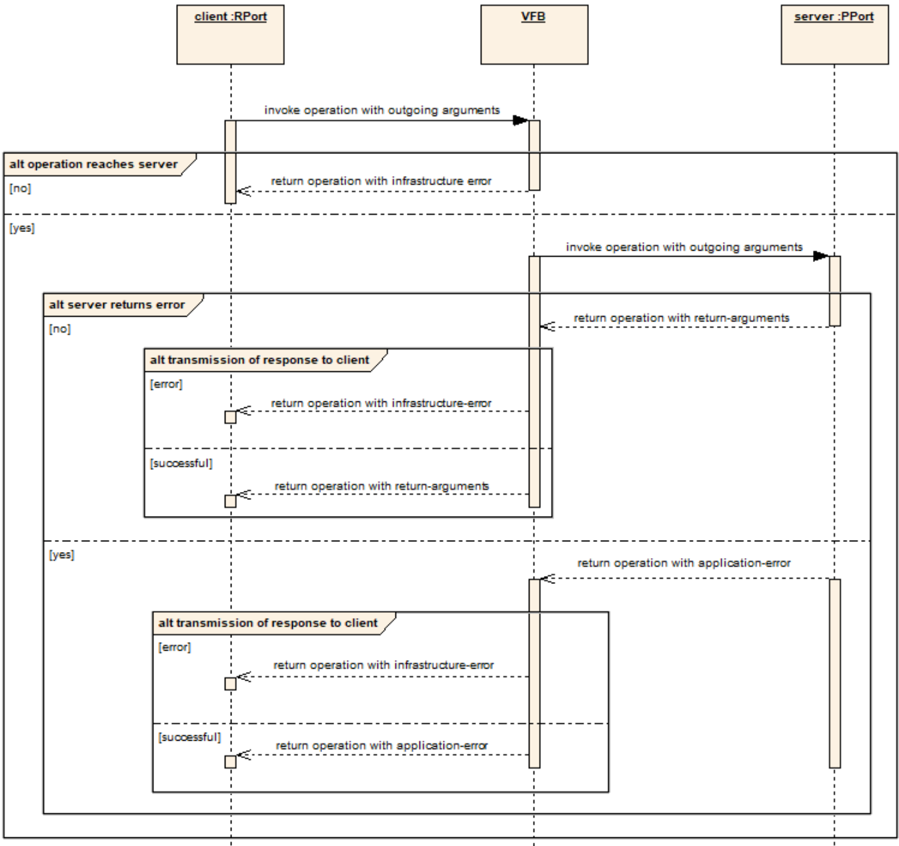

#### 4.4.1 从客户端的视角

客户端通过请求服务器执行接口中定义的某个特定操作来发起客户端-服务器机制。为此，客户端为该操作在客户端-服务器接口中定义的每个出向参数提供一个值。

最终，客户端要么收到该调用的有效响应，要么收到对该操作调用的错误响应。有效响应意味着服务器已执行该操作。在这种情况下，客户端会收到该操作在接口中定义的每个返回参数的值。

如果操作会改变服务器的状态，则应当谨慎设计它们，使得客户端能够轻松地把服务器置于一个已知状态，或在基础设施错误的情况下简单地重复该操作。一个好的规则是让操作「幂等」，即一个操作（带特定参数）可以被重复任意多次。

- 客户端可以调用其某个 RPort 的客户端-服务器接口中定义的操作。
- 调用操作时，客户端必须为该操作定义的每个出向参数提供一个值。
- 客户端对每次操作调用恰好收到一个响应。
- 客户端收到的响应可以是基础设施错误、应用错误或有效的服务器响应。
- 当客户端收到有效的服务器响应时，它获得该操作每个返回参数的值。
- 在配置期，服务器可以针对该操作返回给客户端的可能应用错误必须是已知的。
- 作为对客户端调用的可能响应提供给客户端的可能基础设施错误由 AUTOSAR 标准化。

表 4.3 展示客户端的通信属性。

| 属性名称 | 在软件组件模板 [\[6\]](#ref-6) 中的实现 | 说明 |
| --- | --- | --- |
| CLIENT_MODE | 由「SynchronousServerCallpoint」「AsynchronousServerCallpoint」和「AsynchronousServerCallReturnsEvent」间接涵盖 | 客户端的开发者可以选择与服务器交互的方式。当 CLIENT_MODE 为「synchronous」（同步）时，调用该操作的可运行体被阻塞，直到从服务器收到响应、返回基础设施错误或配置的最大阻塞时间到期。当 CLIENT_MODE 为「asynchronous - wakeup_of_wait_point」（异步——等待点唤醒）时，调用该操作的可运行体不被阻塞。可运行体可以在一个等待点等待响应（来自服务器或因基础设施错误）。当 CLIENT_MODE 为「asynchronous - activation_of_runnable_entity」（异步——可运行体实体激活）时，调用该操作的可运行体不被阻塞。当响应（来自服务器或基础设施错误）可用时，会启动一个可运行体来处理服务器的响应。 |
| TIMEOUT | ServerCallPoint 的属性「timeout」 | 服务器调用超时并返回错误消息之前的时间（秒）。该基础设施错误如何报告取决于调用类型（同步或异步）。 |

#### 4.4.2 从服务器的视角

服务器等待来自其客户端的操作调用。它使用客户端提供的参数值执行被请求的操作。在完成被请求操作的执行时，服务器向客户端提供每个返回参数的值。如果服务器遇到错误，它也可以选择向客户端返回一个应用错误，而不是一组返回参数的值。

表 4.4 展示服务器的通信属性。

| 属性名称 | 在软件组件模板 [\[6\]](#ref-6) 中的实现 | 说明 |
| --- | --- | --- |
| QUEUE-LENGTH | ServerCompSpec 的属性「queuelength」 | 在服务器侧有一个长度为 n 的队列，采用消费式读取和先进先出策略。如果队列已满且另一个请求到达，新请求被丢弃，客户端将收到一个「超时」基础设施错误。 |

#### 4.4.3 客户端-服务器的多重性

对于客户端-服务器通信，只支持「n:1」通信（n 个客户端，n ≥ 0，1 个服务器）。

- 对于客户端-服务器通信，只支持 n:1 通信（n 个客户端，1 个服务器）。

每个客户端 RPort 必须恰好挂接到一条连接器，该连接器把该 RPort 链接到服务器的恰好一个 PPort。而服务器的一个 PPort 可以挂接到任意数量的客户端 RPort，即没有或有多个客户端可以调用同一个服务器的操作。客户端-服务器通信的实现必须确保操作调用的结果被分派给正确的客户端。

由于一个组件可以拥有任意数量的端口，单个组件可以同时扮演客户端和服务器的角色。

#### 4.4.4 客户端-服务器连接器内的顺序与并发

不允许客户端在同一 RPort 上、在上一次对同一操作的调用已经返回（以来自服务器的有效响应或以错误返回）之前，调用该 RPort 上的特定操作。如图 4.7 所示。

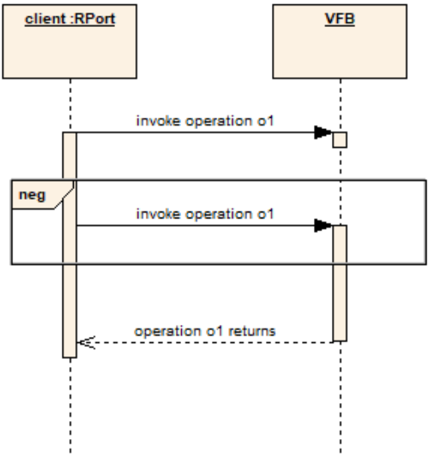

但是，允许客户端在第一个操作的调用返回之前，在同一 RPort 上调用一个不同的操作。然而在这种情况下，VFB 不对这些调用的顺序做任何保证。

更具体地说，它不保证服务器以与客户端发出调用时相同的顺序看到这些操作调用。类似地，也不保证响应以任何特定顺序（例如客户端调用那些操作的顺序）提供给客户端。

尽管顺序不被保证，VFB 的实现必须使客户端能够把来自服务器的响应（或在返回基础设施错误时来自基础设施的响应）与客户端所作的正确的对应调用关联起来。

- 不允许客户端在同一 RPort 上、在上一次对同一操作的调用已经返回之前调用该特定操作。
- 必须使客户端能够把响应与客户端所作的正确的对应调用关联起来。

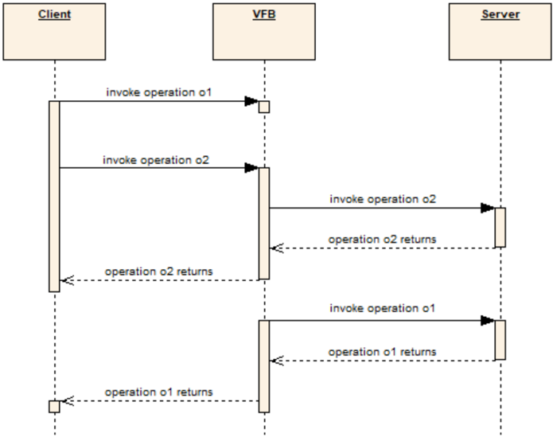

### 4.5. 关于通信伙伴标识的说明

AUTOSAR 的主要目标之一是 AUTOSAR 软件组件的可移植性，以及把同一组件集成到不同系统中的可能性。因此，基本通信机制不得依赖通信伙伴的身份。哪个组件经由哪个端口与另一个组件的哪个端口通信，由 VFB 视图中的连接器规定，并且对软件组件不可见。如果软件组件在特定的通信场景中确实需要知道通信伙伴的身份，那么标识必须由组件自身在应用层使用通用的 AUTOSAR 通信模式来完成⁴。

⁴ 对于未来的扩展（如「动态组件」和「动态通信」），通信伙伴必须提供在应用层被标识的手段。

与此相反，通信伙伴（即组件的实例及其端口/接口元素）的无歧义标识对于 RTE 的实现是必要的，对基础软件可能也是必要的⁵。

⁵ 例如，在客户端-服务器通信中，操作调用的结果必须被分派给正确的客户端，即调用了该服务的客户端。因此，客户端的身份（即 AUTOSAR SW 组件和端口）必须——至少在运行时——为 RTE 和基础软件所知。

## 5. 时序扩展（Timing Extensions）

实时系统研究领域提供了多种时序模型和规定技术。本节只是对「AUTOSAR Specification of Timing Extensions」[\[15\]](#ref-15) 的高层介绍，其意图只是让读者意识到存在另一份更详细的、处理时间建模问题的文档。

### 5.1. 时序扩展对 AUTOSAR 的主要用途

与系统功能行为的规范相比，其时序行为的规范要求捕获额外的信息。不仅事件的最终发生，而且它们的确切时序或各种事件的并发性都变得重要。因此，在 AUTOSAR 时序扩展的规范中，事件（event）是基本实体。它用于指代系统内某个时间点上的可观察行为（例如 RunnableEntity 的激活、一帧的传输等）。

由于需要处理不同的抽象层级和视图，并且为了避免与现有概念的语义混淆，引入了一个新的抽象类型 TimingDescriptionEvent 作为时序扩展的形式化基础。根据具体的模型实体及其关联的可观察行为，定义了特定的时序事件并链接到不同的视图。

对于系统时序行为的分析，通常不仅关注单个事件，也关注不同事件之间的关联。为了把时序事件彼此关联起来，引入了另一个概念 TimingDescriptionEventChain（时序描述事件链）。这里需要注意，对于事件链内所指的事件，隐式假定存在功能依赖。这意味着一个链中的事件以某种方式引发后续的链事件。

基于事件和事件链，可以表达从抽象类型 TimingConstraint 派生的各种特定时序约束。这些时序约束规定预期的时序行为。由于时序约束应当独立于实现细节而有效，它们也在抽象层级上表达，引用上面引入的 TimingDescriptionEvent 和 TimingDescriptionEventChain 形式化基础。

这样，借助事件、事件链以及在其上定义的时序约束，可以提供一个独立的中央时序规范，把预期的时序行为与实际实现的行为解耦。这种方法以自顶向下和自底向上两种方式支持 AUTOSAR 系统的时序契约。

### 5.2. AUTOSAR 方法论不同阶段中的时序

在 AUTOSAR 方法论的不同阶段可以应用多种时序视图。AUTOSAR 方法论提供了若干个定义良好的流程步骤，以及由这些步骤提供或需要的制品。可以识别出五种不同的时序视图：

- VfbTiming——此视图处理与 VFB 层级上 SwComponentType 交互相关的时序信息。
- SwcTiming——此视图处理与 AtomicSwComponentType 的 SwcInternalBehavior 相关的时序信息。
- SystemTiming——此视图处理与 System 相关的时序信息，利用关于拓扑、软件部署和信号映射的信息。
- BswModuleTiming——此视图处理与单个 BswModuleDescription 的 BswInternalBehavior 相关的时序信息。
- EcuTiming——此视图处理与 EcucValueCollection 相关的时序信息，尤其是 EcucModuleConfigurationValues。

对于这些视图中的每一个，可以根据必要信息的可得性、某个制品所扮演的角色以及与该视图关联的开发阶段，应用不同的时序规定侧重点。

「AUTOSAR Specification of Timing Extensions」[\[15\]](#ref-15) 为 AUTOSAR 中时序相关信息的描述提供了一个概念。

## 6. 与硬件的交互

### 6.1. 引言

本节的目标是聚焦于应用软件组件经由虚拟功能总线与硬件之间的标准化交互。硬件交互意味着对以下三种硬件的访问（另见图 6.1）：

- 微控制器外设；
- ECU 电子器件；
- 传感器和执行器。

执行器和传感器硬件通常需要专门的软件来提供面向应用软件的接口。该接口通常包括读取传感器值的软件接口、设置执行器的函数、诊断接口等。集成者需要灵活性，能够把其系统的传感器和执行器连接到其选择的合适 ECU。

在某些情况下，甚至需要 ECU 上的专门硬件，且无法通过标准化的基础软件与该硬件交互。在这些情况下，可以使用复杂驱动与该特定硬件交互。复杂驱动是供应商特定的。

图 6.1 展示了从物理信号到软件信号（例如车速）以及反向（例如车灯）的典型转换过程。采用这种接口架构出于 2 个原因：

最佳的复用潜力（当诸如性能要求之类的所有其他集成要求都得到满足时）：

- 如果 µC 变化，可以复用 ECU 抽象、传感器-执行器软件组件和应用软件组件；
- 如果 ECU 变化，可以复用传感器-执行器软件组件和应用软件组件；
- 如果传感器或执行器变化，仍然可以复用应用软件组件。

 various 模块可以由不同的专家和/或公司开发（µC、ECU、传感器/执行器、应用）。

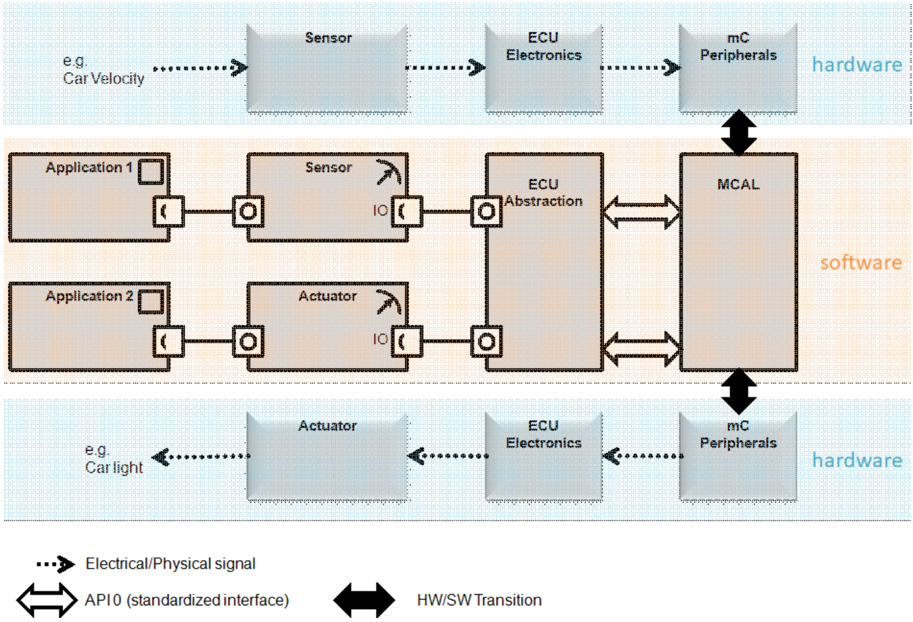

### 6.2. 微控制器抽象层（MCAL）

对硬件的访问经由微控制器抽象层（MCAL）路由，以避免高层软件直接访问微控制器寄存器。

MCAL 是一个硬件特定的层，它确保通向基础软件组件的标准接口。它管理微控制器外设，并向基础软件组件提供独立于微控制器的值。MCAL 实现通知机制，以支持向不同进程分发命令、响应和信息。

除其他外，它可以包括¹：

- 数字输入/输出；
- 模拟/数字转换器；
- 脉冲宽度（解）调制器；
- EEPROM；
- FLASH；
- 捕获比较单元；
- 看门狗定时器；
- 串行外设接口（SPI）；
- I²C 总线。

¹ 关于 AUTOSAR 实际支持的硬件，请查阅 [List of BSW Modules]。

MCAL 在每个标准微控制器上都可用。

### 6.3. ECU 抽象

ECU 抽象为任何特定 ECU 的电气值提供一个软件接口，以使高层软件与所有底层硬件依赖解耦。

图 6.2 展示了 ECU 抽象的一个典型例子。在该例中，服务「ECU_Set_I」在 ECU 上以 3 种不同的方式提供，但 SW 接口始终相同。

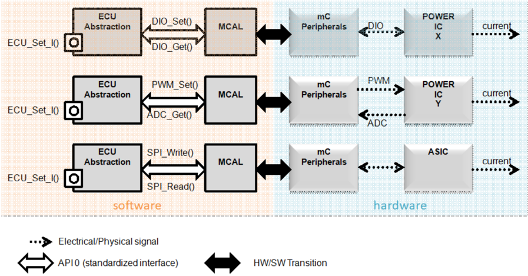

### 6.4. 传感器-执行器软件组件

传感器-执行器软件组件是一种原子软件组件，它使传感器或执行器的功能可被其他 SW 组件使用。这意味着传感器-执行器软件组件向应用软件组件提供一个针对传感器和执行器物理值的接口。传感器-执行器软件组件是为具体的传感器或执行器编写的，并使用 ECU 抽象接口。

### 6.5. 复杂驱动组件

复杂驱动（CDD）允许直接访问硬件，特别是对资源关键的应用。

复杂驱动是一个松耦合的容器，特定的软件实现可以放置其中。对软件部分的唯一要求是：到 AUTOSAR 世界的接口必须按照 AUTOSAR 端口和接口规范实现。

复杂驱动的主要任务是借助特定中断和/或复杂 µC 外设（如 PCP、TPU）直接访问 µC，实现复杂的传感器评估和执行器控制，例如：

- 喷射控制；
- 电子气门控制；
- 增量式位置检测。

此外，复杂驱动将用于实现 AUTOSAR 不支持的硬件的驱动。

例如，如果引入一种新的通信系统，通常不会有可用的 AUTOSAR 驱动来控制该通信控制器。为了启用经由该介质的通信，该驱动将在复杂驱动内部以专有方式实现。在经由该介质的通信请求的情况下，通信服务将调用复杂驱动而不是通信硬件抽象来进行通信。

另一个需要非标准驱动的例子是支持实现非标准化功能的 ASIC。

最后但同样重要的是，复杂驱动在某种程度上被用作一种迁移机制。由于在复杂驱动内可以直接访问硬件，已有的应用可以被定义为复杂驱动。如果扩展的接口按照 AUTOSAR 标准定义，新的扩展就可以按照 AUTOSAR 标准实现，这不会强迫 OEM 或供应商对所有现有应用进行重新工程。

## 7. AUTOSAR 服务

### 7.1. 引言

本节描述 AUTOSAR 服务在 VFB 视图中的处理，并定义它们可以如何图形化表示。

AUTOSAR 服务描绘了一个由基础软件模块以及 AUTOSAR 软件组件组成的混合概念。它们为映射到特定 ECU 基础设施（AUTOSAR BSW）之上的应用软件组件提供该基础设施的标准化功能。

为了简单起见，有时使用术语「服务」而不是完整的术语「AUTOSAR 服务」。但是，它与客户端-服务器接口的 service 部分没有任何关系。

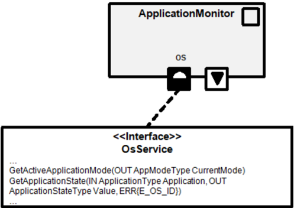

图 7.1 展示了一个要求服务的例子：软件组件类型 ApplicationMonitor 拥有一个由接口 OsService 确定类型的端口。由于该客户端-服务器接口包含诸如 GetActiveApplicationMode 或 GetApplicationState 之类的操作，软件组件 ApplicationMonitor 能够向 OS 查询 OS-Application 状态或 OS 启动模式。

图 8.4 展示了另一个例子：此处，软件组件可以访问 ECU 基础软件的 ECU 状态管理器及其能力。

### 7.2. VFB 表示

当涉及对 AUTOSAR 服务建模和配置时，主要的挑战是：

- 选择合适的通信范式；
- 满足 RTE 定义的前提条件（见 [\[7\]](#ref-7)）；
- 平台依赖类型；
- 配置。

#### 7.2.1 通信机制的选择

一般而言，AUTOSAR 服务经由标准化 AUTOSAR 接口通信。在 VFB 上，它们只在请求服务的软件组件处可见。基础软件中相应的对端在 VFB 上不可见，但固有地存在。

根据服务的性质，所有种类的端口都是可能的：

最自然的方式是通过一个由客户端-服务器接口确定类型的提供端口向 AUTOSAR 组件提供服务：这就像一个返回某些数据的库调用。相应的软件组件将拥有一个要求端口，如图 7.1 所示。

如果必须激活一个服务而不需要立即的应答，可以使用由发送者-接收者接口确定类型的要求端口来代替。

服务也可以使用由客户端-服务器接口确定类型的要求端口来与 AUTOSAR 组件通信。一个例子是状态管理器，它可能需要 AUTOSAR 组件的确认才能更改状态。

与前一种情况相反，如果不需要立即的应答，服务可以使用由发送者-接收者接口确定类型的提供端口来向 AUTOSAR 组件通知例如状态变化。

一般而言，合适通信范式的选择是用例相关的。除了已经定义的规则之外，不需要任何一般性概念。但是请注意，许多服务已经由 AUTOSAR 基础软件服务层的模块规范预定义。

在 VFB 视图中，AUTOSAR 组件对服务的使用通过为端口使用一种特定的图形记法（见 3.3.1 节）来建模。

SWC 模板提供了为关联接口以及软件组件添加属性的手段：接口把属性 isService 标记为 true，软件组件把属性 ServiceNeeds 设置为合适的值。

#### 7.2.2 服务的位置

图 7.1 和图 8.4 展示的例子指出了访问特定 AUTOSAR 服务的软件组件的一个特性。它们只能被集成到那些在 AUTOSAR 基础软件中提供绑定对端的 ECU 上。

这意味着服务的实现必须与使用该服务的 AUTOSAR 组件实例位于同一 ECU 上。这是出于良好性能与可靠性的要求，也是技术上的要求。例如，定时器服务在同一 CPU 上本地使用要容易得多。对于这类服务，我们会在不同的 ECU 上拥有实例。

#### 7.2.3 把请求分发到远端服务

应用软件组件与远端 ECU 的 AUTOSAR 服务之间的直接通信是不可能的。另一方面，应用与车辆模式管理的概念要求把模式请求从一个模式请求者分发到每个 ECU 上基础软件模式管理器（BswM）的服务。为了分发请求，使用服务代理 SW 组件。

服务代理 SW 组件类似于应用 SW 组件。但是，同一服务代理 SW 组件实例会在系统设计期间被复制到多个 ECU 上，而应用 SW 组件实例被映射到系统中恰好一个 ECU。

因此，在 VFB 中显示为 1:1 连接的应用软件组件与服务代理 SW 组件之间的连接，在系统中将是一个 1:n 连接。这使得把一个请求分发到多个 ECU 成为可能。

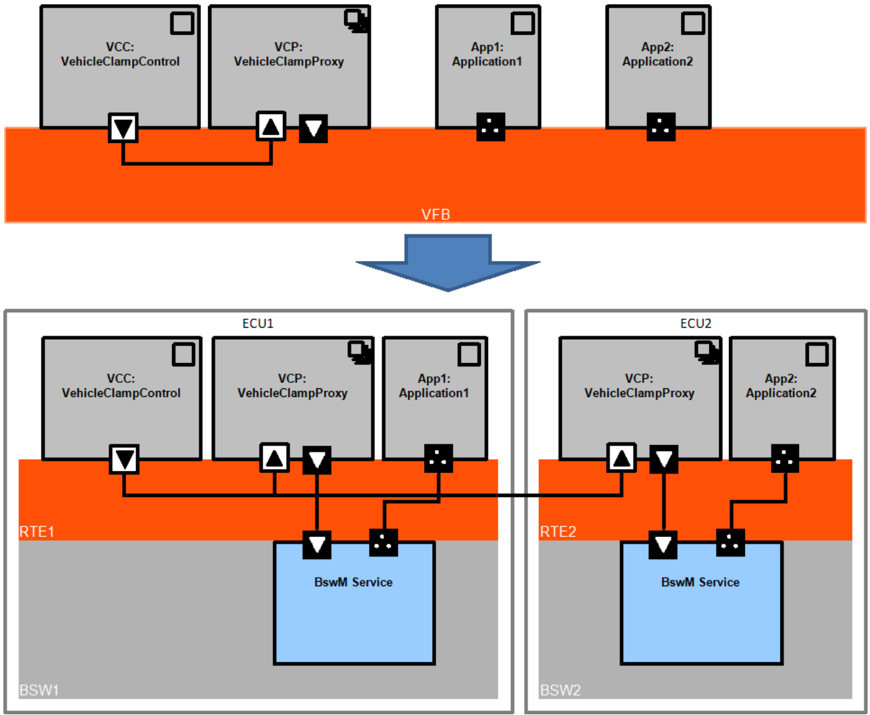

#### 7.2.4 平台依赖类型

基础软件中的许多数据类型是平台依赖的，以获得效率。例如：ID 的类型可能取决于特定 ECU 内要处理的实体，这会限制应用软件组件的可复用性。

对于以源代码形式集成的 SW-C，不会出现问题，因为类型在编译期是已知的。对于以目标代码形式集成的 SW-C，可能出现问题，因为编译 SW-C 时假定的类型可能与基础软件模块编译时假定的类型不同。

目前该问题的解决方案是：尽管 SW-C 本应以目标代码形式集成，但在合同阶段之后至少 SW-C 的部分必须重新编译。在这种情况下，集成者必须定义合适的类型，并向基础软件和应用软件组件的供应方提供合适的头文件。

这导致了如下限制：SW-C 与基础软件内的代码优化不得依赖特定的平台依赖类型，例如，数据类型的大小在不同的平台之间可能不同。

#### 7.2.5 配置

与基础软件的大多数部分一样，服务可以提供静态配置参数（即要在编译期之前定义的配置参数），以便高效地实现，例如保持低的内存使用。在许多情况下，这些配置参数将取决于将使用该服务的 AUTOSAR 组件的数量和类型。在这些情况下，特定 ECU 上 AUTOSAR 服务的软件至少有部分必须在系统集成期重新编译。必须为此规定合适的流程和工具。

但是，此配置不属于 VFB 视图的一部分。「Software Component Template」规范 [\[6\]](#ref-6) 中给出了 AUTOSAR 服务所需配置流程的良好概览。

### 7.3. 服务清单

以下基础软件模块的 AUTOSAR 服务可用：

- 基础软件模式管理器——BswM
- 通信管理器——ComM
- 加密服务管理器——Csm
- 默认错误跟踪器——Det
- 诊断通信管理器——Dcm
- SAE J1939 诊断通信管理器——J1939Dcm
- 诊断事件管理器——Dem
- 诊断日志与跟踪——Dlt
- 基于 IP 的诊断——DoIP
- ECU 状态管理器——EcuM
- 车载安全通信——SecOC
- NVRAM 管理器——NvM
- 操作系统——Os
- SAE J1939 请求管理器——J1939Rm
- 同步时基管理器——StbM
- 看门狗管理器——WdgM

## 8. 模式管理

### 8.1. 引言

大多数软件组件都拥有用于初始化、终止以及运行模式（operational/run mode）的特定可运行体。某些软件组件的行为可能以更复杂的方式依赖于某些系统模式。由于这些组件通常不会自己改变它们的模式，它们需要对由其他组件触发的模式变化作出反应。

因此，AUTOSAR 需要支持：

- 模式的定义；
- 允许组件（包括 AUTOSAR 服务）交换关于模式和模式变化的信息的通信机制；
- 允许组件规定它们在不同模式中如何表现的调度机制。

本节简要描述 AUTOSAR 为此提供的通用机制。这些通用机制随后可以应用于典型的汽车用例，例如 ECU 电源状态或通信总线模式的变化。

### 8.2. 定义模式

在 AUTOSAR 中，模式切换通知机制用于在组件之间交换模式。模式切换接口包含一个所谓的「ModeDeclarationGroup」（模式声明组）。

图 8.1 展示了模式切换接口「ECUMCurrentMode」定义的例子，它包含对 ModeDeclarationGroup「ECUMMode」的单一引用。

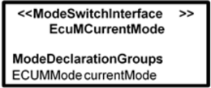

ModeDeclarationGroup 是一组 ModeDeclaration。在组的定义内，一个 ModeDeclaration 描述启动时假定的初始模式。例如，对于 ECU 电源状态的情形，ModeDeclarationGroup「ECUMMode」可以定义名为 { STARTUP_SHUTDOWN, RUN, POST_RUN, SLEEP, WAKE_SLEEP } 的模式组，以 STARTUP_SHUTDOWN 为初始模式。

模式是互斥的：运行时，一个 ModeDeclarationGroup 中始终有一个活动模式。在任何模式切换发生之前，ModeDeclarationGroup 的初始模式是活动的。

- 组件的模式 PPort 中每个 ModeDeclarationGroup 应当恰好有一个活动模式。
- 在配置期，模式切换接口中每个 ModeDeclarationGroup 的初始模式是已知的。
- 在配置期，模式切换接口包含哪个 ModeDeclarationGroup 是已知的。
- 在配置期，模式切换接口中每个 ModeDeclarationGroup 的模式是已知的。

### 8.3. 通信模式

模式经由模式切换通知机制传输。

会存在拥有由模式切换接口确定类型的 PPort 的软件组件。提供这些接口的组件在组内设置当前模式，因此被称为「模式管理器」。

「模式管理器」的对端是其行为依赖于当前模式的组件。这些模块拥有由同一接口确定类型的 RPort。如果相应的 PPort 与 RPort 通过连接器连接，这些组件会被告知模式切换以及模式管理器设置的当前模式。图 8.2 展示了模式管理器是一个 AUTOSAR 服务时的例子。此图是图 3.13 示例的一个节选。

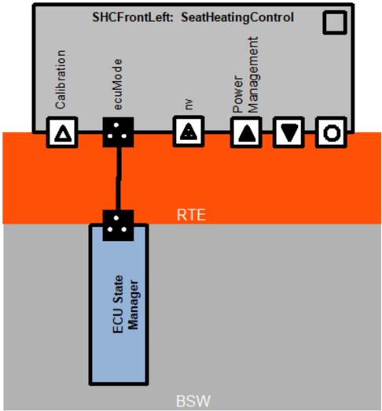

对于模式切换接口，只有 1:n 通信（1 个模式管理器和 n 个模式用户，n ≥ 0）是可能的。单一的模式管理器拥有 ModeDeclarationGroup 的当前模式。用户会被告知管理器的任何模式切换。

对于 AUTOSAR 基础软件的模式管理器，通常对每个基于模式切换的服务，还有一个基于发送者-接收者的服务用于请求模式。例如，对每个 ComM 用户，一个模式切换接口指示当前可用的通信模式，而一个发送者-接收者接口用于请求期望的通信模式。在此模式中，通常有一个模式请求者同时也是一个模式用户。图 8.3 展示了 ComM 的这个模式。

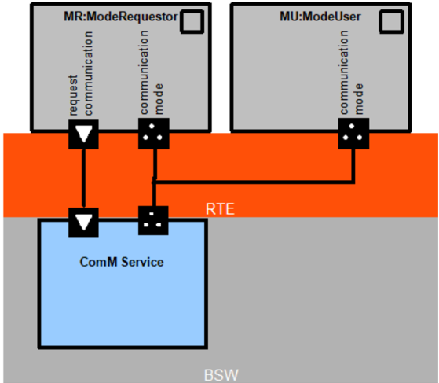

由于模式管理器与模式用户之间的强同步，模式切换通信只在 ECU 本地通信中受支持。对于跨越多个 ECU 的模式管理，推荐一种通信模式：包括用于分发模式请求的服务软件代理组件，以及用于在每个 ECU 上切换模式的 BswM（见 [7.2.3](#723-把请求分发到远端服务) 节）。

### 8.4. 模式管理器：控制模式的组件

进入和离开模式由模式管理器发起。模式管理器例如可以是通信管理器、ECU 状态管理器或一个应用模式管理器。应用模式管理器是提供切换模式服务的软件组件。

这样的模式管理器包含一个由模式切换接口确定类型的 PPort，该接口引用合适的 ModeDeclarationGroup。模式管理器的状态将使用发送者-接收者通信发送给其他组件。

可选地，模式管理器可以拥有一个由发送者-接收者接口确定类型的 RPort，其中一个数据元素映射到同一 ModeDeclarationGroup，以接收来自模式请求者的模式请求。

### 8.5. 依赖于模式的组件

一些软件组件需要能够对模式管理器发出的状态变化作出反应，并使其行为适应新的情况。这样的软件组件包含一个由模式切换接口确定类型的 RPort，该接口引用合适的 ModeDeclarationGroup。

图 8.4 展示了一个例子，其中模式切换接口「EcuMCurrentMode」用于确定组件「SeatHeatingControl」的端口「ecuMode」的类型。由于该接口包含 ModeDeclarationGroup「ECUMMode」，这表明组件「SeatHeatingControl」希望每当「ECUMMode」发生变化时（例如这可以是该组件运行所在 ECU 的当前模式）通过其端口「ecuMode」得到通知。该组件可以在模式 STARTUP_SHUTDOWN 期间禁用某些可运行体的执行，并在转换到模式 RUN 时启动初始化可运行体。

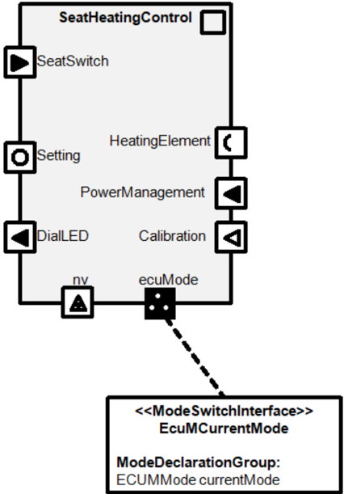

- 在配置期，模式切换接口中 ModeDeclarationGroup 的接收者希望被告知哪些模式切换必须是已知的。
- 从模式管理器的同一 ModeDeclarationGroup 实例收到的模式转换，应当被所有模式用户同步地感知。

由于原子软件组件的行为主要由其可运行体集合决定，组件可以在可运行体的层级规定它对模式变化的反应：组件可以规定当模式切换发生时调用某些可运行体，或某些可运行体只在特定模式中运行。

## 9. 端口组（Port Groups）

端口存在一种自然的层级分组，由软件组件中端口原型的聚合给出。此外，AUTOSAR 支持按照车辆系统软件的其他方面对端口进行替代的分组。这通过端口组（port group）表达。端口组的主要用例是表达某个特定运行模式（例如跛行回家模式或诊断模式）期间所需的通信资源。这些模式通常与组件和子组件的分解正交。

端口组具有以下特性：

- 聚合到一个软件组件类型；
- 该软件组件的要求与提供端口原型的列表；
- 对被合并入该端口组的子组件端口组的引用。

作为一个实际用例，端口组可以在 VFB 中反映一个 ComM 用户。与 ComM 用户关联的通信信道的配置可以从 VFB 模型中自动提取。

可以存在独立的模式管理器，分别用于接线端子控制、省电、诊断模式等。这些模式管理器中的每一个也可以拥有独立的、部分重叠的端口组。

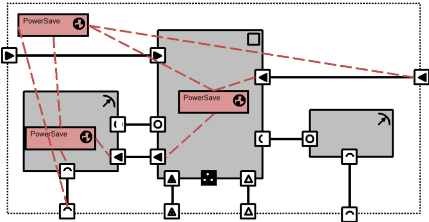

## 10. 测量与标定

在嵌入式汽车软件设计中，测量（measurement）意味着对 ECU 内部信号、状态变量和中间数据的「监测」。它通过读取运行中的 ECU 的内存单元内容来实现。在 AUTOSAR 中，这类数据被称为可测量的（measurable）。

「标定（Calibration）」意味着对特定标定参数的操作。一般而言，标定参数刻画控制算法的动态特性。从软件实现的角度，它是在 ECU 正常运行期间具有只读访问权限的变量。由于标定参数可以由标定系统设置，因此可以操纵和重新调整闭环或开环控制算法的决定因素。这样，标定在直到接近完成的开发过程中扮演着重要角色。

### 10.1. 标定（Calibration）

AUTOSAR 提供两种标定机制：

- 基于端口的标定（基于参数软件组件）：此机制在 VFB 上显式可见，并复用已经描述过的端口和连接器机制；
- 私有标定参数：这些参数驻留在原子软件组件内部。

#### 10.1.1 基于端口的标定

此机制以如下方式构建在常见的 VFB 模式之上：

要求标定参数的组件定义一个由参数接口确定类型的 RPort。

包含标定参数实际值的组件称为「参数软件组件」。与普通软件组件不同，参数软件组件不拥有内部行为，而是提供（标定）参数的简单容器。它们通过一个由兼容的参数接口确定类型的 PPort 来做到这一点。注意，参数接口以及参数软件组件也用于固定数据交换，而不仅仅是标定。端口接口上元素的「实现策略」决定从参数软件组件访问的是固定数据、const 还是可变数据。

组件由特定参数软件组件进行标定这一事实，通过相应端口之间的连接器来表达。标定数据经由参数软件组件的提供端口提供给任何软件组件的相应要求端口（适用兼容性规则）。

由于在此模型中参数在虚拟总线上可见，参数软件组件是表达公共标定参数的方式。

根据相应组件是否被实例化，可以区分几种不同的情况，在下面几节中描述。

##### 10.1.1.1 纯单实例化

图 10.1 展示了最简单的情况：一个软件组件通过来自提供参数软件组件的连接「接收」一组特定的标定参数来访问它们。


这里应当注意，所连接的参数软件组件和软件组件本身就驻留在同一个 ECU 上。实际上，参数软件组件只是表示包含被封装的（标定）参数的内存。

##### 10.1.1.2 所涉软件组件的多实例化

图 10.2 和图 10.3 描绘了这样一种情况：相同或不同组件类型的多个软件组件（实例）访问同一组（标定）参数。

由于（标定）参数需要与访问它们的软件组件驻留在同一 ECU 上，如果不同的软件组件实例被映射到不同的 ECU，参数软件组件就需要被复制（见图 10.3）。


##### 10.1.1.3 所涉标定组件的多实例化

图 10.4 展示了一种配置，其中不同的软件组件实例需要访问同一类型的标定参数的不同集合。

这里，如上文所解释的，只要求所连接的标定组件与软件组件实例集成在同一个 ECU 上。除此之外，不同的实例可以驻留在单个或不同的 ECU 上。


#### 10.1.2 私有标定

私有标定机制基于软件组件私有且内部的参数。从软件组件实现的角度，标定参数是在 ECU 正常运行期间只有读访问权限的变量。标定参数可以按软件组件的每个实例定义（perInstanceParameter），也可以在软件组件的所有实例之间共享（sharedParameter）。

标定参数本身在虚拟功能总线上不可见，因为它被视为与软件组件内部行为相关联的元素。

与被认为在系统设计期间规定的软件组件和组合的结构不同，内部行为可以在稍后的时间、当特定软件组件被交付时定义。就此而言，私有标定参数的可见性相当于是时间的函数，取决于谁在何时指派它们。

### 10.2. 测量（Measurement）

在 AUTOSAR 系统中，只有以下原型（prototype）的、被标记为可测量的实际实例可以被监测：

AUTOSAR SW 组件之间的通信：

- 包含在发送者-接收者接口中的 VariableDataPrototype；
- 包含在客户端-服务器接口中的 ClientServerOperation 的参数。

AUTOSAR SW 组件内部：

- 用于一个 AUTOSAR SW 组件的可运行体之间通信的 InterrunnableVariable 的内容。

## 11. VFB 特性与概况（Features and Profiles）

### 11.1. 动机与引言

在 VFB 层级上标识特性和概况的想法源于这样一个事实：RTE 上存在许多机制，SW-C 之间存在多种通信范式。由此得到的 RTE/VFB 特性表增强了 RTE/VFB 机制的文档，为刻画 SW-C、ECU 平台甚至工具能力提供了高层手段。

把 SW-C 集成到给定平台的工作量取决于使用了哪些特性。如果 SW-C 必须集成到一个已经做出并实现了调度等设计决策（在 CDD 或其他 SW-C 中）的给定系统中，集成使用某些 RTE 特性的 SW-C 甚至可能导致矛盾。

这些表可以在项目早期阶段支持供应商-OEM 协作中集成项目的讨论。在这里，它们刻画必须集成到某个 ECU 中的 SW-C 集合，或识别给定系统的集成能力。这意味着给定的 ECU 可以支持 VFB 层级上的哪些特性。

另一方面，SW-C 代码生成器和其他支持 AUTOSAR 方法论的工具可能只支持 VFB 和 RTE 特性的一个子集。所支持的特性甚至可以配置为在项目上下文中使用或不使用。同样，这些特性子集也值得用这种方法加以刻画，以简化软件共享和集成。

所提供的表还可用于定义缩减的特性集（所谓的 VFB/RTE 概况），它们也可以应用于不同的项目或 SW-C 集成场景。把这些概况定义为缩减的特性集由不同的合作方决定，不属于标准的一部分。这些概况很可能是 OEM、供应商甚至领域特定的。

注意，这种方法与「Feature Specification of the BSW Architecture and the RTE」文档有意不同且更加细粒度，但只聚焦于 VFB。

### 11.2. 特性表

特性在下面的表中描述。它们来自真实的项目经验以及对将要共享的应用 SW-C 的预测。因此，它们可以作为基础，并可以在基于特性/概况的技术讨论中由合作方扩展。

表条目（即一个 VFB 特性）是从单个 ECU 视角出发、在 VFB/RTE 层级上与以下方面密切相关的单个功能侧面：

- SW-C 复杂度；
- 集成工作量；
- 架构工作量；以及
- 与 ECU 设计中所作决策的兼容性。

这些表区分 ECU 内（编号 R）和 ECU 间（编号 E）的方面。将 ECU 间通信（RTE 与 COM 栈）与其他 RTE 特性分开被发现是有用的，因为它们在技术实现上的性质不同。分区间（Inter-Partition）方面也包含在 ECU 内表的分区部分中。

注意，特性可以用于描述单个 SW-C，但主要聚焦于描述在软件共享项目中映射到特定 ECU 的整个「子系统」。

#### 11.2.1 ECU 内特性

**R 1 — 发送者-接收者实现数据类型**

| 编号 | 非正式「类别」 | CATEGORY | 以 SWC 术语对特性描述的细化 |
| --- | --- | --- | --- |
| R 1.1 | PRIMITIVE | VALUE, DATA_REFERENCE, FUNCTION_REFERENCE | 使用类别为 "VALUE"、"DATA_REFERENCE" 或 "FUNCTION_REFERENCE" 的 ImplementationDataType 用于发送者-接收者通信 |
| R 1.2 | COMPLEX | STRUCTURE, ARRAY, UNION | 使用结构体、联合或数组作为 ImplementationDataType 的类别用于发送者-接收者通信 |
| R 1.3 | DYNAMIC | VARIABLE_LENGTH | 使用类别 = VARIABLE_LENGTH 的 SwBaseType 用于发送者-接收者通信 |

**R 2 — 发送者-接收者通信**

| 编号 | 语义 | 特性 | 以 SWC 术语对特性描述的细化 |
| --- | --- | --- | --- |
| R 2.1 | Data (Last-is-best) |  | 在 S/R 端口原型的 SenderReceiverInterface 中使用配置了 swImplPolicy = Standard 的 VariableDataPrototype |
| R 2.2 | Data (Last-is-best) | INIT value | 使用在 NonqueuedSenderComSpec、NonqueuedReceiverComSpec 或相应 VariableDataPrototype 中配置了 InitValue 属性的 PPortPrototype/RPortPrototype |
| R 2.3 | Data (Last-is-best) | Invalidation | 端口原型使用的 SenderReceiverInterface 配置了 InvalidationPolicy 的 handleInvalid 属性，取值为 keep 或 replace |
| R 2.4 | Data (Last-is-best) | Filter | 使用在 NonqueuedReceiverComSpec 中配置了 Filter 属性的 RPortPrototype |
| R 2.5 | Data (Last-is-best) | Alive Timeout | 一个或多个 RPortPrototype 在 NonqueuedReceiverComSpec 中配置了大于 0 的 AliveTimeOut 属性 |
| R 2.6 | Data (Last-is-best) | Acknowledgement | 一个或多个 PPortPrototype 在 SenderComSpec 中配置了 TransmissionAcknowledgmentRequest 属性 |
| R 2.7 | Data (Last-is-best) | NeverReceived indication（接收侧） | 一个或多个 RPortPrototype 在 NonqueuedReceiverComSpec 中配置了 HandleNeverReceived = TRUE 属性 |
| R 2.8 | Data (Last-is-best) | Enableupdate indication（接收侧） | 一个或多个 RPortPrototype 在 NonqueuedReceiverComSpec 中配置了 enableUpdate = true 属性 |
| R 2.9 | Data (Last-is-best) | Explicit access（读/写 API） | DataReceivePoint / DataSendPoint 至少存在于一个 RunnableEntity 中 |
| R 2.10 | Data (Last-is-best) | Implicit access（IRead/IWrite） | DataReadAccess / DataWriteAccess 至少存在于一个 RunnableEntity 中 |
| R 2.11 | Data (Last-is-best) | 带特殊语义的隐式访问：一致性组 | DataReadAccess / DataWriteAccess 至少存在于一个 RunnableEntity 中。RteImplicitCommunication 容器定义时 RteCoherentAccess 设为 "TRUE"（即定义了一致性组） |
| R 2.12 | Data (Last-is-best) | 带特殊语义的隐式访问：立即缓冲区更新 | DataReadAccess / DataWriteAccess 至少存在于一个 RunnableEntity 中。RteImplicitCommunication 容器定义时 RteImmediateBufferUpdate 设为 "TRUE"（即某些隐式读/写访问需要特定的缓冲区更新处理） |
| R 2.13 | Data (Last-is-best) | Handle out of range | 一个或多个 RPortPrototype/PPortPrototype 在相应的 SenderComSpec 或 ReceiverComSpec 中配置了 handleOutOfRange 属性（取值必须不同于 NONE） |
| R 2.14 | Data (Last-is-best) | 端到端保护 | 一个或多个 RPortPrototype/PPortPrototype 在 ReceiverComSpec 和/或 SenderComSpec 中配置了 usesEndToEndProtection = TRUE 属性 |
| R 2.15 | Event (queued) |  | SenderReceiverInterface 中的 VariableDataPrototype 配置了 swImplPolicy = Queued |
| R 2.16 | Event (queued) | Blocking Receive | 在带 TriggerRef 指向 DataReceivedEvent 的 RunnableEntity 中使用 WaitPoint 属性 |
| R 2.17 | Event (queued) | Handle out of range | 一个或多个 PPortPrototype/RPortPrototype 在相应的 SenderComSpec 或 ReceiverComSpec 中配置了 handleOutOfRange 属性 |
| R 2.18 | Event (queued) | 端到端保护 | 一个或多个 PPortPrototype/RPortPrototype 在 ReceiverComSpec 和/或 SenderComSpec 中配置了 usesEndToEndProtection = TRUE 属性 |

**R 3 — 可运行体间变量（Inter-Runnable Variable）**

| 编号 | 访问 | 特性 | 以 SWC 术语对特性描述的细化 |
| --- | --- | --- | --- |
| R 3.1 | EXPLICIT | PRIMITIVE DATA | 一个 explicitInterRunnableVariable 被声明为原子的（实现数据类型类别 "value"）VariableDataPrototype 并在 SwcInternalBehavior 中使用 |
| R 3.2 | EXPLICIT | COMPLEX DATA | 一个 explicitInterRunnableVariable 被声明为复杂的（实现数据类型类别 "array"、"structure" 或 "union"）VariableDataPrototype 并在 SwcInternalBehavior 中使用 |
| R 3.3 | IMPLICIT | PRIMITIVE DATA | 一个 implicitInterRunnableVariable 被声明为原子的（实现数据类型类别 "value"）VariableDataPrototype 并在 SwcInternalBehavior 中使用 |
| R 3.4 | IMPLICIT | COMPLEX DATA | 一个 implicitInterRunnableVariable 被声明为复杂的（实现数据类型类别 "array"、"structure" 或 "union"）VariableDataPrototype 并在 SwcInternalBehavior 中使用 |

**R 4 — 客户端-服务器通信**

| 编号 | 语义 | 特性 | 以 SWC 术语对特性描述的细化 |
| --- | --- | --- | --- |
| R 4.1 | Synchronous | Reentrant server | 存在一个 SynchronousServerCallPoint，且相应的 ServerRunnableEntity 配置了属性 "canBeInvokedConcurrently = true" |
| R 4.2 | Synchronous | Non-reentrant server | 存在一个 SynchronousServerCallPoint，且相应的 ServerRunnableEntity 配置了属性 "canBeInvokedConcurrently = false" |
| R 4.3 | Synchronous | Exclusive areas | 存在一个 SynchronousServerCallPoint，且相应的 ServerRunnableEntity 应用了 ExclusiveArea（runsInsideExclusiveArea 或 canEnterExclusiveArea） |
| R 4.4 | Synchronous | Cross Partition | 存在一个 SynchronousServerCallPoint，且相应的 ServerRunnableEntity 不在同一个 RTE 分区中 |
| R 4.5 | Synchronous | With timeout | 存在带 TimeOut > 0 属性的 SynchronousServerCallPoint |
| R 4.6 | Asynchronous | 客户端使用 Rte_Result API 轮询（无 ASYNCHRONOUS_SERVER_CALL_RETURNS_EVENT） | 存在 AsynchronousServerCallPoint 和相应的 AsynchronousServerCallResultPoint，但不存在相应的 AsynchronousServerCallReturnEvent |
| R 4.7 | Asynchronous | 客户端使用 Rte_Result API 轮询（有 ASYNCHRONOUS_SERVER_CALL_RETURNS_EVENT） | 存在 AsynchronousServerCallPoint 和相应的 AsynchronousServerCallResultPoint，且相应的 AsynchronousServerCallReturnEvent 触发一个可运行体，但没有 WaitPoint 引用它 |
| R 4.8 | Asynchronous | with WaitPoint，即阻塞式 Rte_Result | 存在 AsynchronousServerCallReturnEvent，且有一个 WaitPoint 引用它 |
| R 4.9 | Asynchronous | with Timeout（也可以没有 WaitPoint） | 存在带 TimeOut > 0 属性的 AsynchronousServerCallPoint |
| R 4.10 | PORT-DEFINED ARGUMENT VALUES |  | 在 SwcInternalBehavior 中配置了带 portArgValue 属性的 PortAPIOption |

**R 5 — 触发通信**

| 编号 | 语义 | 特性 | 以 SWC 术语对特性描述的细化 |
| --- | --- | --- | --- |
| R 5.1 | External Trigger | Non Queued | 使用由 TriggerInterface 确定类型的端口接口，其 triggers 配置了 swImplPolicy = Standard，并被 ExternalTriggeringPoint 引用 |
| R 5.2 | External Trigger | Queued | 使用由 TriggerInterface 确定类型的端口接口，其 triggers 配置了 swImplPolicy = Queued，并被 ExternalTriggeringPoint 引用 |
| R 5.3 | Inter runnable Trigger | Non Queued | 使用配置了 swImplPolicy = Standard 的 InternalTriggeringPoint |
| R 5.4 | Inter runnable Trigger | Queued | 使用配置了 swImplPolicy = Queued 的 InternalTriggeringPoint |

**R 6 — RTE 事件**

| 编号 | 反应 | 事件类型 | 以 SWC 术语对特性描述的细化 |
| --- | --- | --- | --- |
| R 6.1 | RE Activation | TIMING_EVENT | 一个 TimingEvent 引用一个 RunnableEntity |
| R 6.2 | RE Activation | DATA_RECEIVED_EVENT | 一个 DataReceivedEvent 引用一个 RunnableEntity 和一个要求的 VariableDataPrototype，但没有 WaitPoint 引用该 DataReceivedEvent |
| R 6.3 | RE Activation | DATA_RECEIVED_ERROR_EVENT | 一个 DataReceivedErrorEvent 引用一个 RunnableEntity 和一个要求的 VariableDataPrototype，但没有 WaitPoint 引用该 DataReceivedErrorEvent |
| R 6.4 | RE Activation | DATA_SEND_COMPLETED_EVENT | 一个 DataSendCompletedEvent 引用一个 RunnableEntity 和一个要求的 VariableDataPrototype，但没有 WaitPoint 引用该 DataSendCompletedEvent |
| R 6.5 | RE Activation | OPERATION_INVOKED_EVENT | 一个 OperationInvokedEvent 引用一个 RunnableEntity |
| R 6.6 | RE Activation | MODE_SWITCH_EVENT | 一个 ModeSwitchEvent 引用一个 RunnableEntity |
| R 6.7 | RE Activation | MODE_SWITCH_ACK_EVENT with Timeout | 一个 ModeSwitchAckEvent 引用一个 RunnableEntity 和一个 ModeDeclarationGroupPrototype，且 NonqueuedSenderComSpec 中未配置 ModeSwitchedAckRequest 属性 |
| R 6.8 | RE Activation | MODE_SWITCH_ACK_EVENT without Timeout | 一个 ModeSwitchAckEvent 引用一个 RunnableEntity 和一个 ModeDeclarationGroupPrototype，且 NonqueuedSenderComSpec 中的 ModeSwitchedAckRequest 配置了 TimeOut 属性 |
| R 6.9 | RE Activation | ASYNCHRONOUS_SERVER_CALL_RETURNS_EVENT | 一个 AsynchronousServerCallReturnsEvent 引用一个 RunnableEntity |
| R 6.10 | RE Activation | BACKGROUND_EVENT | 一个 BackgroundEvent 引用一个 RunnableEntity |
| R 6.11 | RE Activation | DATA_WRITE_COMPLETED_EVENT | 一个 DataWriteCompletedEvent 引用一个 RunnableEntity 和一个提供的 VariableDataPrototype，但没有 WaitPoint 引用该 DataWriteCompletedEvent |
| R 6.12 | RE Activation | EXTERNAL_TRIGGER_OCCURED_EVENT | 一个 ExternalTriggerOccurredEvent 引用一个 RunnableEntity |
| R 6.13 | RE Activation | INTERNAL_TRIGGER_OCCURED_EVENT | 一个 InternalTriggerOccurredEvent 引用一个 RunnableEntity |
| R 6.14 | RE Activation | INIT_EVENT | 一个 InitEvent 引用一个 RunnableEntity |
| R 6.15 | RE Activation | SWC_MODE_MANAGER_ERROR_EVENT | 一个 SwcModeManagerErrorEvent 引用一个 RunnableEntity |
| R 6.16 | Wakeup of Waitpoints | DATA_RECEIVED_EVENT | 一个 DataReceivedEvent 引用一个 RunnableEntity 和一个要求的 VariableDataPrototype。有一个 WaitPoint 引用该 DataReceivedEvent |
| R 6.17 | Wakeup of Waitpoints | DATA_SEND_COMPLETED_EVENT | 一个 DataSendCompletedEvent 引用一个 RunnableEntity 和一个提供的 VariableDataPrototype。有一个 WaitPoint 引用该 DataSendCompletedEvent |
| R 6.18 | Wakeup of Waitpoints | ASYNCHRONOUS_SERVER_CALL_RETURNS_EVENT | 一个 AsynchronousServerCallReturnsEvent 引用一个 RunnableEntity，且有一个 WaitPoint 引用该 AsynchronousServerCallReturnsEvent |
| R 6.19 | Wakeup of Waitpoints | MODE_SWITCH_ACK_EVENT | 一个 ModeSwitchAckEvent 引用一个 RunnableEntity 和一个 ModeDeclarationGroupPrototype，且 NonqueuedSenderComSpec 中配置了 TransmissionAcknowledge 属性。有一个 WaitPoint 引用该 ModeSwitchAckEvent |
| R 6.20 | Wakeup of Waitpoints with timeout |  | 至少为一个 WaitPoint 指定了大于 0 的 timeout 属性 |

**R 7 — 测量与标定**

| 编号 | 特性 | 子特性 | 以 SWC 术语对特性描述的细化 |
| --- | --- | --- | --- |
| R 7.1 | Measurement | Port-to-Port S/R communication | 发送者-接收者端口接口中使用的 VariableDataPrototype 存在 swCalibrationAccess，并设置为 readOnly 或 readWrite |
| R 7.2 | Measurement | IRV | 在 implicitInterRunnableVariable 或 explicitInterRunnableVariable 角色中的 VariableDataPrototype 存在一个 swCalibrationAccess，并设置为 readOnly 或 readWrite |
| R 7.3 | Measurement | Port-to-Port C/S communication | 客户端-服务器端口接口中使用的 ArgumentDataPrototype 存在 swCalibrationAccess，并设置为 readOnly |
| R 7.4 | Measurement | Non-volatile data communication | SW 组件原型的非易失性端口的 NvData 接口中使用的 VariableDataPrototype 存在一个 swCalibrationAccess，并设置为 readOnly 或 readWrite |
| R 7.5 | Measurement | PIM | 在 arTypedPerInstanceMemory 角色中的 VariableDataPrototype 存在一个 swCalibrationAccess，并设置为 readOnly 或 readWrite |
| R 7.6 | Measurement | RAM Block of a NV Block SW-C Type | NvBlockSwComponentType 的 NvBlockDescriptor 中 ramBlock 角色的 VariableDataPrototype 存在一个 swCalibrationAccess，并设置为 readOnly 或 readWrite |
| R 7.7 | Calibration | SWC internal: CData API（共享标定参数） | 一个 ParameterDataPrototype 以 sharedParameter 角色附加到 SwcInternalBehavior |
| R 7.8 | Calibration | SWC internal: CData API | 一个 ParameterDataPrototype 以 PerInstanceParameter 角色附加到 SwcInternalBehavior |
| R 7.9 | Calibration | ParameterSwComponent | 一个 ParameterSwComponentPrototype 作为 SwComponentPrototype 用在 CompositionSwComponentType 中 |
| R 7.10 | Calibration | Non-volatile data communication | SwComponentPrototype 的非易失性数据端口的 NvDataInterface 中使用的 VariableDataPrototype 的 swCalibrationAccess 设置为 readWrite |
| R 7.11 | Calibration | ROM Block of a NV Block SW-C Type | NvBlockSwComponentType 的 NvBlockDescriptor 中 romBlock 角色的 VariableDataPrototype 的 swCalibrationAccess 设置为 readWrite |
| R 7.12 | Calibration | 无 SW 支持的数据仿真 | 属性 RteCalibrationSupport 配置为 NONE |
| R 7.13 | Calibration | 有 SW 支持的数据仿真，单指针方法 | 属性 RteCalibrationSupport 配置为 SINGLE_POINTERED |
| R 7.14 | Calibration | 有 SW 支持的数据仿真，双指针方法 | 属性 RteCalibrationSupport 配置为 DOUBLE_POINTERED |
| R 7.15 | Calibration | 有 SW 支持的数据仿真，init-RAM 参数方法 | 属性 RteCalibrationSupport 配置为 INITIALIZED_RAM |

**R 8 — 模式**

| 编号 | 特性 | 子特性 | 以 SWC 术语对特性描述的细化 |
| --- | --- | --- | --- |
| R 8.1 | Mode Dependency |  | 一个 RTEEvent 配置了 ModeDisablingDependency 属性 |
| R 8.2 | Mode Access（读取当前模式） |  | 至少在一个 RunnableEntity 中存在一个 ModeAccessPoint |
| R 8.3 | ModeSwitch Acknowledgement |  | ModeSwitchSenderComSpec 中存在 ModeSwitchedAckRequest 属性 |
| R 8.4 | 同步模式切换 |  | 模式管理器的至少一个 ModeUser 的 ModeSwitchReceiverComSpec（软件组件）或 BswModeReceiverPolicy（BSW 模块）中，supportsAsynchronousModeSwitch 属性未配置为 TRUE ⇒ 模式机实例使用同步模式切换行为 |
| R 8.5 | 异步模式切换 |  | 模式管理器的所有 ModeUser（同一 ModeDeclarationGroupPrototype）的 ModeSwitchReceiverComSpec（软件组件）或 BswModeReceiverPolicy（BSW 模块）中，supportsAsynchronousModeSwitch 属性都配置为 TRUE ⇒ 模式机实例可以使用异步模式切换行为 |

**R 9 — 互斥区域（Exclusive Area）**

| 编号 | 特性 | 子特性 | 以 SWC 术语对特性描述的细化 |
| --- | --- | --- | --- |
| R 9.1 | RunnableCanEnterExclusiveArea |  | SwcInternalBehavior 中存在一个 ExclusiveArea，并在 RunnableEntity 中以 "canEnterExclusiveArea" 角色使用 |
| R 9.2 | RunnableRunsInExclusiveArea |  | SwcInternalBehavior 中存在一个 ExclusiveArea，并在 RunnableEntity 中以 "runsInsideExclusiveArea" 角色使用 |

**R 10 — 分区（Partitions）**

| 编号 | 特性 | 子特性 | 以 SWC 术语对特性描述的细化 |
| --- | --- | --- | --- |
| R 10.1 | 多于一个分区 |  | SystemTemplate 中的 SwcToEcuMapping 元素为给定的 ECU 引用多于一个 EcuPartition |
| R 10.2 | 多于一个分区 | Partition used for Memory Protection | 分区用于为 SWC 分离内存区域 |
| R 10.3 | 多于一个分区 | Partition used for Timing Protection | 分区用于为 SWC 分离时间预算 |
| R 10.4 | 多于一个分区 | Partitions used on MultiCores | 分区用于把 SWC 放置到不同的核上 |
| R 10.5 | Partition Restart |  | 需要重启一个已停止的分区 |
| R 10.6 | Inter Partition Communication | SenderReceiver（Last-is-best） | 使用映射到不同分区的 SWC 的 SenderReceiverInterface 端口原型连接（相应 swImplPolicy = Standard） |
| R 10.7 | Inter Partition Communication | SenderReceiver（Event 语义） | 使用映射到不同分区的 SWC 的 SenderReceiverInterface 端口原型连接（相应 swImplPolicy = Queued） |
| R 10.8 | Inter Partition Communication | ModeSwitch | 使用映射到不同分区的 SWC 的 ModeSwitchInterface 端口原型连接 |
| R 10.9 | Inter Partition Communication | ClientServer（同步） | 使用映射到不同分区的 SWC 的 ClientServerInterface 端口原型连接。使用同步 ServerCallPoint |
| R 10.10 | Inter Partition Communication | ClientServer（异步） | 使用映射到不同分区的 SWC 的 ClientServerInterface 端口原型连接。使用异步 ServerCallPoint |

**R 11 — 端口接口映射与数据缩放**

| 编号 | 特性 | 子特性 | 以 SWC 术语对特性描述的细化 |
| --- | --- | --- | --- |
| R 11.1 | Connections with Data Interfaces | 带端口元素名映射的数据接口端口连接 | SenderReceiverInterface、NvDataInterface 或 ParameterInterface 的 PortInterface 之间存在连接，且一个 VariableAndParameterInterfaceMapping 与该连接关联。使用 DataPrototypeMapping 连接短名不同但兼容的 DataPrototype（元素名映射） |
| R 11.2 | Connections with Data Interfaces | 带 TEXTTABLE 数据转换的数据接口端口连接 | SenderReceiverInterface、NvDataInterface 或 ParameterInterface 的 PortInterface 之间存在连接，且一个 VariableAndParameterInterfaceMapping 与该连接关联。DataPrototypeMapping 使用 TextTableMapping 连接具有 TEXTTABLE 类别 CompuMethod 的 DataPrototype（即让 RTE 生成表元素之间的重映射） |
| R 11.3 | Connections with Data Interfaces | 带 LINEAR 转换的数据接口端口连接 | SenderReceiverInterface、NvDataInterface 或 ParameterInterface 的 PortInterface 之间存在连接，且一个 VariableAndParameterInterfaceMapping 与该连接关联。DataPrototypeMapping 连接具有 LINEAR 或 IDENTICAL 类别 CompuMethod（单位兼容或物理表示相同）的 DataPrototype，以重新缩放元素（即让 RTE 生成端口元素之间的线性转换） |
| R 11.4 | Client/Server connections | 带端口元素名映射的 ClientServer 映射 | ClientServerInterface 的 PortInterface 之间存在连接，且一个 ClientServerInterfaceMapping 与该连接关联，用于连接短名不同但兼容的操作（仅名称映射） |
| R 11.5 | Client/Server connections | 带参数映射的 ClientServer 映射 | ClientServerInterface 的 PortInterface 之间存在连接，且一个 ClientServerInterfaceMapping 与该连接关联，包含 DataPrototypeMapping（角色 argumentMapping），用于映射名称不同的参数（仅参数的名称映射） |
| R 11.6 | Client/Server connections | 带参数 TEXTTABLE 数据转换的 ClientServer 映射 | ClientServerInterface 的 PortInterface 之间存在连接，且一个 ClientServerInterfaceMapping 与该连接关联，包含 DataPrototypeMapping（角色 argumentMapping）+ TextTableMapping，用于映射具有 TEXTTABLE 类别 CompuMethod 的类型的参数（即让 RTE 生成操作参数值之间的重映射） |
| R 11.7 | Client/Server connections | 带参数 LINEAR 数据转换的 ClientServer 映射 | ClientServerInterface 的 PortInterface 之间存在连接，且一个 ClientServerInterfaceMapping 与该连接关联，包含 DataPrototypeMapping（角色 argumentMapping），用于映射具有 LINEAR 或 IDENTICAL 类别 CompuMethod 的类型的参数，以重新缩放参数（即让 RTE 生成操作参数之间的线性转换） |
| R 11.8 | Mode Switch connections | Mode Switch 映射，兼容的模式声明 | ModeSwitchInterface 的 PortInterface 之间存在连接，且一个 ModeInterfaceMapping 与该连接关联（所引用的 ModeDeclarationGroupPrototype 兼容） |
| R 11.9 | Mode Switch connections | Mode Switch 映射，不同数量的 ModeDeclaration | ModeSwitchInterface 的 PortInterface 之间存在连接，且一个 ModeInterfaceMapping 与该连接关联（所引用的 ModeDeclarationGroupPrototype 在模式管理器侧和模式用户侧的 ModeDeclaration 数量不同） |
| R 11.10 | Trigger connections | Trigger Interface 映射 | TriggerInterface 的 PortInterface 之间存在连接，且一个 TriggerInterfaceMapping 与该连接关联 |
| R 11.11 | 用于复合数据类型的元素映射 | 用于 ImplementationDataType（类别 ARRAY、STRUCTURE） | 对数据接口使用带 SubElementMapping 的 DataPrototypeMapping，映射 ImplementationDataTypes 类别 ARRAY、STRUCTURE 的元素，或将/选择一个复合数据类型映射到原生元素（n:1 映射） |
| R 11.12 | 用于复合数据类型的元素映射 | 用于 ApplicationCompositeDataTypes | 对数据接口使用带 SubElementMapping 的 DataPrototypeMapping，映射 ApplicationCompositeDataTypes 的元素，或为 n:1 映射映射/选择单个元素 |
| R 11.13 | 用于复合数据类型的元素映射 | ImplementationDataTypes 与 ApplicationCompositeDataTypes 的混合 | 对数据接口使用带 SubElementMapping 的 DataPrototypeMapping，将 ApplicationCompositeDataTypes 的元素与 ImplementationDataTypes（ARRAY、STRUCTURE）相互映射 |

**R 12 — 可运行体激活选项**

| 编号 | 特性 | 子特性 | 以 SWC 术语对特性描述的细化 |
| --- | --- | --- | --- |
| R 12.1 | 可运行体激活偏移（负载均衡） |  | RteActivationOffset 属性配置在 RteEventToTaskMapping 中 |
| R 12.2 | 可运行体最小启动间隔 |  | 为一个 RunnableEntity 配置了 minimumStartInterval 属性 |
| R 12.3 | 等待点唤醒 |  | 请参见 RTE 事件一节中的「等待点唤醒」部分 |

**R 13 — 其他**

| 编号 | 特性 | 子特性 | 以 SWC 术语对特性描述的细化 |
| --- | --- | --- | --- |
| R 13.1 | SWC 以源代码形式 |  | SwcImplementation 的一个 Code 元素配置了 Category = SWSRC 属性 |
| R 13.2 | SWC 以目标代码形式 |  | SwcImplementation 的一个 Code 元素配置了 Category = SWOBJ 属性 |
| R 13.3 | 多实例化 |  | 一个 AtomicSwComponentType 的 supportsMultipleInstantiation 属性设置为 TRUE |
| R 13.4 | Per Instance Memory | C 类型 | 在一个 SwcInternalBehavior 中定义了一个 PerInstanceMemory |
| R 13.5 | Per Instance Memory | AR 类型 | 在一个 SwcInternalBehavior 中以 arTypedPerInstanceMemory 角色引用了一个 VariableDataPrototype |
| R 13.6 | 间接 API |  | 一个 PortApiOption 元素中 IndirectAPI 属性设置为 TRUE |
| R 13.7 | Enable take address |  | 至少对一个端口/函数强制使用可引用的 C 函数。一个 PortApiOption 元素中 enableTakeAddress 属性设置为 TRUE |
| R 13.8 | 激活性 Rte 事件 |  | 一个 ExecutableEntity 聚合一个 ExecutableEntityActivationReason，以经由 RTE API 获取激活事件 |
| R 13.9 | 变体处理 |  | 模型中使用经由 VariationPoint 的变体处理 |
| R 13.10 | 变体处理 | 预编译期可变性 | 以 VariationPoint 或 AttributeValueVariationPoint 定义、最晚绑定时间为 PreCompileTime 的可变性应用于 VFB/RTE 相关的模型元素 |
| R 13.11 | 变体处理 | 构建后可变性 | 以带 postBuildVariantCriterion 的 VariationPoint 定义的可变性应用于 VFB/RTE 相关的模型元素 |
| R 13.12 | FlatMap |  | 为 EcuExtract 或 SystemExtract 定义了一个 FlatMap（并在 RootSwCompositionPrototype 中引用）（这主要用于引用扁平 ECU 提取中的元素）以用于测量和标定 |
| R 13.13 | 组合的要求与提供端口 |  | 使用以 PRPortPrototype 作为端口的 SwComponentPrototype |

**R 14 — 可运行体类别**

| 编号 | 特性 | 子特性 | 以 SWC 术语对特性描述的细化 |
| --- | --- | --- | --- |
| R 14.1 | Cat 1A |  | 使用不带 WaitPoint、只使用隐式 S/R API 的 RunnableEntity |
| R 14.2 | Cat 1B |  | 使用不带 WaitPoint、同时使用隐式与显式 API 的 RunnableEntity |
| R 14.3 | Cat 2 |  | 使用带至少一个 WaitPoint 的 RunnableEntity |

**R 15 — 组件类型**

| 编号 | 特性 | 子特性 | 以 SWC 术语对特性描述的细化 |
| --- | --- | --- | --- |
| R 15.1 | ApplicationSwComponent |  | 存在一个类型为 ApplicationSwComponentType 的 ComponentPrototype |
| R 15.2 | EcuAbstractionSwComponent |  | 存在一个类型为 EcuAbstractionSwComponentType 的 ComponentPrototype |
| R 15.3 | NvBlockSwComponent |  | 存在一个类型为 NvBlockSwComponentType 的 ComponentPrototype |
| R 15.4 | ComplexDeviceDriverSwComponent |  | 存在一个类型为 ComplexDeviceDriverSwComponentType 的 ComponentPrototype |
| R 15.5 | SensorActuatorSwComponent |  | 存在一个类型为 SensorActuatorSwComponentType 的 ComponentPrototype |
| R 15.6 | ServiceSwComponent |  | 存在一个类型为 ServiceSwComponentType 的 ComponentPrototype |
| R 15.7 | ServiceProxySwComponent |  | 存在一个类型为 ServiceProxySwComponentType 的 ComponentPrototype |
| R 15.8 | ParameterSwComponent |  | 存在一个类型为 ParameterSwComponentType 的 ComponentPrototype |

**R 16 — 系统配置**

| 编号 | 特性 | 子特性 | 以 SWC 术语对特性描述的细化 |
| --- | --- | --- | --- |
| R 16.1 | 交换 System Description |  | 合作中交换类别为 SYSTEM_DESCRIPTION 的系统 |
| R 16.2 | 交换 System Extract |  | 合作中交换类别为 SYSTEM_EXTRACT 的系统 |
| R 16.3 | 交换 Ecu Extract |  | 合作中交换类别为 ECU_EXTRACT 的系统 |

**R 17 — 到 BSW 服务的接口**

| 编号 | BSW 模块 | 子特性 | 以 SWC 术语对特性描述的细化 |
| --- | --- | --- | --- |
| R 17.1 | NVRAM 管理器——NvM | with NvBlockSwComponentType | 一个 ComponentPrototype 要求一些 NvM 接口（示例：ClientServer 接口 NvMService）和 NvBlockSwComponentType |
| R 17.2 |  | without NvBlockSwComponentType（旧风格） | 一个 ComponentPrototype 要求一些 NvM 接口（示例：ClientServer 接口 NvMService），且使用 ServiceSwComponent。数据以 Per Instance Memory 的形式表示和访问 |
| R 17.3 | 通信管理器——ComM |  | 一个 ComponentPrototype 要求一些 ComM 接口（示例：ClientServer 接口 ComM_UserRequest、ComM_ECUModeLimitation、ComM_ChannelWakeup、ComM_ChannelLimitation 或 SenderReceiver 接口 ComM_CurrentMode） |
| R 17.4 | 诊断通信管理器——Dcm |  | 一个 ComponentPrototype 要求一些 Dcm 接口（示例：ClientServer 接口 DcmServices、DCM_Roe、PidDataServices_&lt;PIDData&gt; 等） |
| R 17.5 | 诊断事件管理器——Dem |  | 一个 ComponentPrototype 要求一些 Dem 接口（示例：ClientServer 接口 DiagnosticMonitor、DiagnosticInfo、GeneralDiagnosticInfo） |
| R 17.6 | 功能抑制管理器——FiM |  | 一个 ComponentPrototype 要求一些 FiM 接口（示例：ClientServer 接口 FunctionInhibition） |
| R 17.7 | ECU 状态管理器——EcuM |  | 一个 ComponentPrototype 要求一些 EcuM 接口（示例：ClientServer 接口 EcuM_ShutdownTarget、EcuM_BootTarget、EcuM_AlarmClock 等） |
| R 17.8 | 基础软件模式管理器——BswM |  | 一个 ComponentPrototype 要求一些 BswM 接口（示例：ModeSwitch 接口 modeRequestPort&lt;number&gt;、modeSwitchPort&lt;number&gt;、modeNotificationPort&lt;number&gt; 等） |
| R 17.9 | 看门狗管理器——WdgM |  | 一个 ComponentPrototype 要求一些 WdgM 接口（示例：ClientServer 接口 WdgM_AliveSupervision） |
| R 17.10 | 默认错误跟踪器——Det |  | 一个 ComponentPrototype 要求一些 Det 接口（示例：ClientServer 接口 DetService） |
| R 17.11 | 操作系统——Os |  | 一个 ComponentPrototype 要求一些 Os 接口（示例：ClientServer 接口 OsService） |
| R 17.12 | 加密服务管理器——Csm |  | 一个 ComponentPrototype 要求一些 Csm 接口（示例：ClientServer 接口 Csm_&lt;Service&gt;、CsmHash、CsmMacGenerate 等） |
| R 17.13 | 诊断日志与跟踪——Dlt |  | 一个 ComponentPrototype 要求一些 Dlt 接口（示例：ClientServer 接口 DltService、LogTraceSessionControl、VerboseModeControl 等） |
| R 17.14 | 同步时基管理器——StbM |  | 一个 ComponentPrototype 要求一些 StbM 接口（示例：ClientServer 接口 StartTimer 或 SenderReceiver 接口 StatusNotification） |
| R 17.15 | 基于 IP 的诊断——DoIP |  | 一个 ComponentPrototype 要求一些 DoIP 接口（示例：ClientServer 接口 RoutingActivation_&lt;RoutingActivation&gt; 或 CallbackTriggerGIDSynchronization 或 CallbackGetPowerMode） |

**R 18 — RTE 集成特性**

| 编号 | 特性 | 子特性 | 以 SWC 术语对特性描述的细化 |
| --- | --- | --- | --- |
| R 18.1 | VFB Tracing |  | RTE 生成器的 RteVfbTrace 设置为 TRUE |
| R 18.2 | 向 Det 报告 RTE 开发错误 |  | 属性 RteDevErrorDetect 设置为 TRUE |
| R 18.3 | Bypass Support | Component wrapper 方法 | 一个软件组件类型的参数 RteBypassSupport 设置为 COMPONENT_WRAPPER，且 RteBypassSupportEnabled 设置为 TRUE |
| R 18.4 | Bypass Support | Direct buffer access 方法 | 一个软件组件类型的参数 RteBypassSupportEnabled 设置为 TRUE |

#### 11.2.2 ECU 间特性

这些是可能与 ECU 之间的交互相关的特性。与 ECU 内相比，它们的技术实现和影响可能不同。

**E 1 — 发送者-接收者实现数据类型**

| 编号 | 非正式「类别」 | CATEGORY | 特性 | 以 SWC 术语对特性描述的细化 |
| --- | --- | --- | --- | --- |
| E 1.1 | PRIMITIVE | VALUE, DATA_REFERENCE, FUNCTION_REFERENCE |  | 使用类别为 "VALUE"、"DATA_REFERENCE" 或 "FUNCTION_REFERENCE" 的 ImplementationDataType 用于发送者-接收者通信 |
| E 1.2 | COMPLEX | STRUCTURE, ARRAY, UNION |  | 使用结构体、联合或数组作为 ImplementationDataType 的类别用于发送者-接收者通信 |
| E 1.3 | DYNAMIC | VARIABLE_LENGTH |  | 使用类别 VARIABLE_LENGTH 的 SwBaseType 用于发送者-接收者通信 |

**E 2 — 发送者-接收者通信**

| 编号 | ECU 间角色 | 语义 | 特性 | 以 SWC 术语对特性描述的细化 |
| --- | --- | --- | --- | --- |
| E 2.1 | As Sender | Data (Last-is-best) |  | 在 S/R 端口原型的 SenderReceiverInterface 中作为 PPort 使用配置了 swImplPolicy = Standard 的 VariableDataPrototype |
| E 2.2 | As Sender | Data (Last-is-best) | INIT value | 使用在 NonqueuedSenderComSpec 或相应 VariableDataPrototype 中配置了 InitValue 属性的 PPortPrototype |
| E 2.3 | As Sender | Data (Last-is-best) | Invalidation | 端口原型使用的 SenderReceiverInterface 配置了 InvalidationPolicy 的 handleInvalid 属性，取值为 keep 或 replace |
| E 2.4 | As Sender | Data (Last-is-best) | Acknowledgement | 一个或多个 PPortPrototype 在 SenderComSpec 中配置了 TransmissionAcknowledgmentRequest 属性 |
| E 2.5 | As Sender | Data (Last-is-best) | Explicit access（写 API） | DataSendPoint 至少存在于一个 RunnableEntity 中 |
| E 2.6 | As Sender | Data (Last-is-best) | Implicit access（IWrite API） | DataWriteAccess 至少存在于一个 RunnableEntity 中 |
| E 2.7 | As Sender | Data (Last-is-best) | 带特殊语义的隐式访问：一致性组 | DataReadAccess / DataWriteAccess 至少存在于一个 RunnableEntity 中。RteImplicitCommunication 容器定义时 RteCoherentAccess 设为 "TRUE"（即定义了一致性组） |
| E 2.8 | As Sender | Data (Last-is-best) | 带特殊语义的隐式访问：立即缓冲区更新 | DataReadAccess / DataWriteAccess 至少存在于一个 RunnableEntity 中。RteImplicitCommunication 容器定义时 RteImmediateBufferUpdate 设为 "TRUE"（即某些隐式读/写访问需要特定的缓冲区更新处理） |
| E 2.9 | As Sender | Data (Last-is-best) | Handle out of range | 一个或多个 PPortPrototype 在相应的 SenderComSpec 中配置了 handleOutOfRange 属性（取值必须不同于 NONE） |
| E 2.10 | As Sender | Data (Last-is-best) | 端到端保护 | 一个或多个 PPortPrototype 在 SenderComSpec 中配置了 usesEndToEndProtection = TRUE 属性 |
| E 2.11 | As Sender | Event (queued) |  | SenderReceiverInterface 中使用的一个或多个 VariableDataPrototype 配置了 swImplPolicy = Queued |
| E 2.12 | As Receiver | Data (Last-is-best) |  | 在 S/R 端口原型的 SenderReceiverInterface 中作为 RPort 使用配置了 swImplPolicy = Standard 的 VariableDataPrototype |
| E 2.13 | As Receiver | Data (Last-is-best) | INIT value | 使用在 NonqueuedReceiverComSpec 或相应 VariableDataPrototype 中配置了 InitValue 属性的 RPortPrototype |
| E 2.14 | As Receiver | Data (Last-is-best) | Invalidation | 端口原型使用的 SenderReceiverInterface 配置了 InvalidationPolicy 的 handleInvalid 属性，取值为 keep 或 replace |
| E 2.15 | As Receiver | Data (Last-is-best) | Filter | 使用在 NonqueuedReceiverComSpec 中配置了 Filter 属性的 RPortPrototype |
| E 2.16 | As Receiver | Data (Last-is-best) | Alive Timeout | 一个或多个 RPortPrototype 在 NonqueuedReceiverComSpec 中配置了大于 0 的 AliveTimeOut 属性 |
| E 2.17 | As Receiver | Data (Last-is-best) | NeverReceived indication（接收侧） | 一个或多个 RPortPrototype 在 NonqueuedReceiverComSpec 中配置了 HandleNeverReceived = TRUE 属性 |
| E 2.18 | As Receiver | Data (Last-is-best) | Enableupdate indication（接收侧） | 一个或多个 RPortPrototype 在 NonqueuedReceiverComSpec 中配置了 enableUpdate = TRUE 属性 |
| E 2.19 | As Receiver | Data (Last-is-best) | Explicit access（读 API） | DataReceivePoint 至少存在于一个 RunnableEntity 中 |
| E 2.20 | As Receiver | Data (Last-is-best) | Implicit access（IRead API） | DataReadAccess 至少存在于一个 RunnableEntity 中 |
| E 2.21 | As Receiver | Data (Last-is-best) | 带特殊语义的隐式访问：一致性组 | DataReadAccess / DataWriteAccess 至少存在于一个 RunnableEntity 中。RteImplicitCommunication 容器定义时 RteCoherentAccess 设为 "TRUE"（即定义了一致性组） |
| E 2.22 | As Receiver | Data (Last-is-best) | 带特殊语义的隐式访问：立即缓冲区更新 | DataReadAccess / DataWriteAccess 至少存在于一个 RunnableEntity 中。RteImplicitCommunication 容器定义时 RteImmediateBufferUpdate 设为 "TRUE"（即某些隐式读/写访问需要特定的缓冲区更新处理） |
| E 2.23 | As Receiver | Data (Last-is-best) | Handle out of range | 一个或多个 RPortPrototype 在相应的 ReceiverComSpec 中配置了 handleOutOfRange 属性（取值必须不同于 NONE） |
| E 2.24 | As Receiver | Data (Last-is-best) | 端到端保护 | 一个或多个 RPortPrototype 在 ReceiverComSpec 中配置了 usesEndToEndProtection = TRUE 属性 |
| E 2.25 | As Receiver | Event (queued) |  | SenderReceiverInterface 中的 VariableDataPrototype 配置了 swImplPolicy = Queued |
| E 2.26 | As Receiver | Event (queued) | Blocking Receive | 在带 TriggerRef 指向 DataReceivedEvent 的 RunnableEntity 中使用 WaitPoint 属性 |

**E 3 — 客户端-服务器通信**

| 编号 | ECU 间角色 | 语义 | 特性 | 以 SWC 术语对特性描述的细化 |
| --- | --- | --- | --- | --- |
| E 3.1 | As Client | Synchronous |  | 存在一个 SynchronousServerCallPoint（客户端位于另一个 ECU 上） |
| E 3.2 | As Client | Synchronous | With timeout | 存在带 TimeOut > 0 属性的 SynchronousServerCallPoint |
| E 3.3 | As Client | Asynchronous | 客户端使用 Rte_Result API 轮询（无 ASYNCHRONOUS_SERVER_CALL_RETURNS_EVENT） | 存在 AsynchronousServerCallPoint 和相应的 AsynchronousServerCallResultPoint，但不存在相应的 AsynchronousServerCallReturnEvent |
| E 3.4 | As Client | Asynchronous | 客户端使用 Rte_Result API 轮询（有 ASYNCHRONOUS_SERVER_CALL_RETURNS_EVENT） | 存在 AsynchronousServerCallPoint 和相应的 AsynchronousServerCallResultPoint，且相应的 AsynchronousServerCallReturnEvent 触发一个可运行体，但没有 WaitPoint 引用它 |
| E 3.5 | As Client | Asynchronous | with WaitPoint，即阻塞式 Rte_Result | 存在 AsynchronousServerCallReturnEvent，且有一个 WaitPoint 引用它 |
| E 3.6 | As Client | Asynchronous | with Timeout（也可以没有 WaitPoint） | 带 TimeOut > 0 属性的 AsynchronousServerCallPoint |
| E 3.7 | As Server | Synchronous/Asynchronous | reentrant | 服务器可运行体属性 "canBeInvokedConcurrently = true" |
| E 3.8 | As Server | Synchronous/Asynchronous | not invokeable concurrently | 服务器可运行体属性 "canBeInvokedConcurrently = false" |

**E 4 — 触发通信**

| 编号 | ECU 间角色 | 语义 | 特性 | 以 SWC 术语对特性描述的细化 |
| --- | --- | --- | --- | --- |
| E 4.1 | As trigger source | Non Queued |  | 使用由 TriggerInterface 确定类型的端口接口，其 triggers 配置了 swImplPolicy = Standard，并被 ExternalTriggeringPoint 引用 |
| E 4.2 | As trigger sink | Non Queued |  | 使用由 TriggerInterface 确定类型的端口接口，其 triggers 配置了 swImplPolicy = Standard，且可运行体被 ExternalTriggerOccurredEvent 引用 |

**E 5 — RTE 事件**

| 编号 | 反应 | 事件类型 | 特性 | 以 SWC 术语对特性描述的细化 |
| --- | --- | --- | --- | --- |
| E 5.1 | RE Activation | DATA_RECEIVED_EVENT |  | 一个 DataReceivedEvent 引用一个 RunnableEntity 和一个要求的 VariableDataPrototype，但没有 WaitPoint 引用该 DataReceivedEvent |
| E 5.2 | RE Activation | DATA_RECEIVED_ERROR_EVENT |  | 触发一个可运行体，用于在接收侧收集具有数据语义的数据元素的错误状态，例如 AliveTimeOut 属性大于 0 |
| E 5.3 | RE Activation | DATA_SEND_COMPLETED_EVENT |  | 一个 DataSendCompletedEvent 引用一个 RunnableEntity 和一个要求的 VariableDataPrototype，但没有 WaitPoint 引用该 DataSendCompletedEvent |
| E 5.4 | RE Activation | OPERATION_INVOKED_EVENT |  | 一个 OperationInvokedEvent 引用一个 RunnableEntity |
| E 5.5 | RE Activation | ASYNCHRONOUS_SERVER_CALL_RETURNS_EVENT |  | 一个 AsynchronousServerCallReturnsEvent 引用一个 RunnableEntity |
| E 5.7 | RE Activation | DATA_WRITE_COMPLETED_EVENT |  | 一个 DataWriteCompletedEvent 引用一个 RunnableEntity 和一个提供的 VariableDataPrototype，但没有 WaitPoint 引用该 DataWriteCompletedEvent |
| E 5.8 | RE Activation | EXTERNAL_TRIGGER_OCCURED_EVENT |  | 一个 ExternalTriggerOccurredEvent 引用一个 RunnableEntity |
| E 5.9 | Wakeup of Waitpoints | DATA_RECEIVED_EVENT |  | 一个 DataReceivedEvent 引用一个 RunnableEntity 和一个要求的 VariableDataPrototype。有一个 WaitPoint 引用该 DataReceivedEvent |
| E 5.10 | Wakeup of Waitpoints | DATA_SEND_COMPLETED_EVENT |  | 一个 DataSendCompletedEvent 引用一个 RunnableEntity 和一个提供的 VariableDataPrototype。有一个 WaitPoint 引用该 DataSendCompletedEvent |
| E 5.11 | Wakeup of Waitpoints | ASYNCHRONOUS_SERVER_CALL_RETURNS_EVENT |  | 一个 AsynchronousServerCallReturnsEvent 引用一个 RunnableEntity，且有一个 WaitPoint 引用该 AsynchronousServerCallReturnsEvent |

**E 6 — 经网络的端口接口元素映射与数据缩放**

| 编号 | 特性 | 子特性 | 以 SWC 术语对特性描述的细化 |
| --- | --- | --- | --- |
|  | 参见 ECU 内的端口接口元素映射与数据缩放（传输类似于 ECU 间通信） |  |  |
| E 6.1 | 转换为网络表示 |  | RTE 必须把数据转换为相关的网络表示。一个 SwDataDefProps 作为 "networkRepresentation" 附加到 S/R 端口的 SenderComSpec 或 ReceiverComSpec，或作为 "networkRepresentationProps" 附加到相应的 ISignal |

## 12. 与非 AUTOSAR ECU 的交互

### 12.1. 引言

本节描述在 VFB 层级上与非 AUTOSAR ECU 的交互。例如，为了提供一条迁移路径，这种交互是必要的。

非 AUTOSAR ECU 是：

未按照 AUTOSAR 机制开发的 ECU。例如这可用于：

- 把一个 AUTOSAR ECU 集成到已存在的 ECU 系统中；
- 把 AUTOSAR ECU 系统连接到已存在的 ECU 系统；
- 在 AUTOSAR ECU 系统中复用已存在的 ECU。

曾经按照 AUTOSAR 机制开发、但现在保持不变的 ECU。例如这可用于：

- 复用策略（接管完整且不可更改的 AUTOSAR（!!!）ECU）。

带有 ECU、但不实现 AUTOSAR VFB / AUTOSAR RTE 的智能（'Smart'）传感器/执行器。例如这可用于：

- 使用市售（commercial of the shelf）的 LIN 节点。

本文档不分析同一个 ECU 内 AUTOSAR SW-C 与非 AUTOSAR 软件的交互。

### 12.2. 交互的问题

与非 AUTOSAR ECU 的交互将带来以下问题：

与非 AUTOSAR ECU 上应用接口的交互：

- 端口/接口必须映射到预定义的通信报文（可以经由网关路由）；
- 非 AUTOSAR SW 组件目前不在 VFB 层级建模：
  - AUTOSAR SW 组件的未连接端口；
  - 隐藏的通信负载；
- 旧系统不支持客户端-服务器。

与非 AUTOSAR ECU 上实现的服务的交互/支持：

- 必须并行支持旧的服务/协议以实现互操作，例如网络管理；
- 通信系统支持的额外服务（例如总线睡眠/总线唤醒）；
- LIN 节点因为使用主从范式而天然不受影响：
  - 服务/协议在任何情况下都必须由主节点（此处为 AUTOSAR ECU）管理和实现；
  - 所需的配置数据在节点能力文件（NCF）中提供。

增强服务/协议（例如网络管理、诊断（到 AUTOSAR SW-C 的连接）、传输协议层等）的支持问题。

非 AUTOSAR ECU 连接到相同还是不同的通信系统，对 VFB 无关紧要，因为在 VFB 层级不考虑硬件。出于同样的原因，网关配置对 VFB 也不相关。

### 12.3. 交互的描述

与非 AUTOSAR ECU 交互的建模对所有类型的非 AUTOSAR ECU 都是相同的。

- 非 AUTOSAR ECU 被建模为带有独立 AUTOSAR SW-C（带 AUTOSAR SW-C 描述）的独立 ECU，这些 SW-C 不会被实现。为了启用与非 AUTOSAR ECU 的通信，AUTOSAR ECU 上的 RTE 必须为非 AUTOSAR 通信实现包装器代码；
- 通信报文、配置和负载由系统约束模板（System Constraint Template）定义（对于 LIN 节点，节点能力文件（NCF）中包含的信息必须整合进系统约束模板）。

下面的图（图 12.1：与非 AUTOSAR ECU 的交互）通过给出非 AUTOSAR ECU 与 AUTOSAR ECU 交互的例子来澄清这种交互。示例中展示了一个端口类型转换器（适配客户端-服务器/发送者-接收者通信）。端口类型转换器必须位于 AUTOSAR ECU 上；它不一定需要位于最终通信伙伴所在的 ECU 上。由于这里的转换器属于「AUTOSAR SW-C」类，它必须作为一个单独的组件实现。在后续的解决方案中，它可能是自动生成的 RTE 的一部分。

对于发送者-接收者通信，没有展示适配。但即使使用相同的通信范式，由于通信属性不同，也可能需要适配。这将以与端口类型转换相同的方式完成。适配必须作为一个单独的 AUTOSAR SW-C 实现；在后续的解决方案中，它可以在自动生成的 RTE 内完成。

从通信系统信号（例如 CAN 上的信号）到 RTE 层的通路，对 AUTOSAR 信号和非 AUTOSAR 信号是相同的。


增强服务/协议（例如网络管理、诊断（到 AUTOSAR SW-C 的连接）、传输协议层等）的支持可以由复杂驱动或相应基础软件模块的「特殊」实现来处理。

## 参考文献

<a id="ref-1"></a>[1] Main Requirements
> AUTOSAR_FO_RS_Main
<a id="ref-2"></a>[2] Methodology for Classic Platform
> AUTOSAR_CP_TR_Methodology
<a id="ref-3"></a>[3] Glossary
> AUTOSAR_FO_TR_Glossary
<a id="ref-4"></a>[4] Layered Software Architecture
> AUTOSAR_CP_EXP_LayeredSoftwareArchitecture
<a id="ref-5"></a>[5] List of Basic Software Modules
> AUTOSAR_CP_TR_BSWModuleList
<a id="ref-6"></a>[6] Software Component Template
> AUTOSAR_CP_TPS_SoftwareComponentTemplate
<a id="ref-7"></a>[7] Specification of RTE Software
> AUTOSAR_CP_SWS_RTE
<a id="ref-8"></a>[8] Explanation of Application Interfaces of the Body and Comfort Domain
> AUTOSAR_CP_EXP_AIBodyAndComfort
<a id="ref-9"></a>[9] Explanation of Application Interfaces of the Powertrain Engine Domain
> AUTOSAR_CP_EXP_AIPowertrain
<a id="ref-10"></a>[10] Explanation of Application Interfaces of the Chassis Domain
> AUTOSAR_CP_EXP_AIChassis
<a id="ref-11"></a>[11] Explanation of Application Interfaces of Occupant and Pedestrian Safety Systems Domain
> AUTOSAR_CP_EXP_AIOccupantAndPedestrianSafety
<a id="ref-12"></a>[12] Explanation of Application Interfaces of the HMI, Multimedia and Telematics Domain
> AUTOSAR_CP_EXP_AIHMIMultimediaAndTelematics
<a id="ref-13"></a>[13] Application Interfaces User Guide
> AUTOSAR_CP_EXP_AIUserGuide
<a id="ref-14"></a>[14] ISO 17356-4:Road vehicles - Open interface for embedded automotive applications - Part 4:OSEK/VDX Communication (COM)
<a id="ref-15"></a>[15] Specification of Timing Extensions for Classic Platform
> AUTOSAR_CP_TPS_TimingExtensions
