## 1. 简介和功能概述

**CanTSyn** 模块负责通过 **CAN** 总线分发时间信息。

仅仅通过广播 **CAN** 报文把时间信息从主节点发送到从节点有一个缺点：由于 **CAN** 特有的影响（如仲裁）和 **BSW** 特有的延迟，时间值会变得不准确。

该概念提出了一种两步机制：

- 在第一条广播报文（即所谓的 **SYNC** 报文）中，发送时间信息的第二部分（t0r）。发送 **ECU**（即时基主节点）使用 **CAN** 底层机制（如"CAN 发送确认"）来检测报文实际被发送的时间点（t1r），即它取一个时间戳。

接收 **ECU**（即时基从节点）接收该报文，并使用 **CAN** 底层机制（如"CAN 接收指示"）来检测报文实际被接收的时间点（t2r）。

- 在第二条广播报文（即所谓的跟随报文（**Follow-Up**，**FUP**）报文）中，时基主节点发送前一条 **SYNC** 报文中发送的时间信息与实际检测到的发送时间之间的偏移。对于 **FUP** 报文，无论在发送侧还是在接收侧都不取时间戳。
- 时基从节点现在可以把 **SYNC** 报文和 **FUP** 报文内的信息与其先前为接收到的 **SYNC** 报文所取的时间戳结合起来，通过仅接收一条报文并省去时间戳，以更精确的方式确定所发送的时间信息。

图 1.1 展示了 **CAN** 时间同步机制。

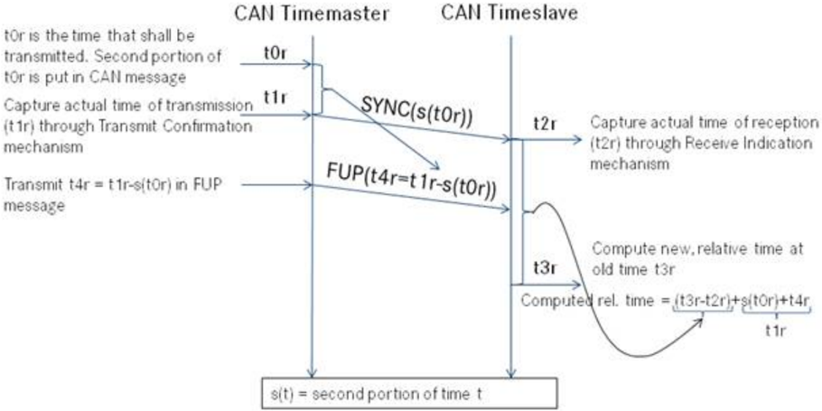

此外，**CanTSyn** 模块还支持通过 **CAN** 总线带安全保护地分发时间信息。下图展示了时间提供者模块在 **AUTOSAR** 分层架构中与安全模块的接口。

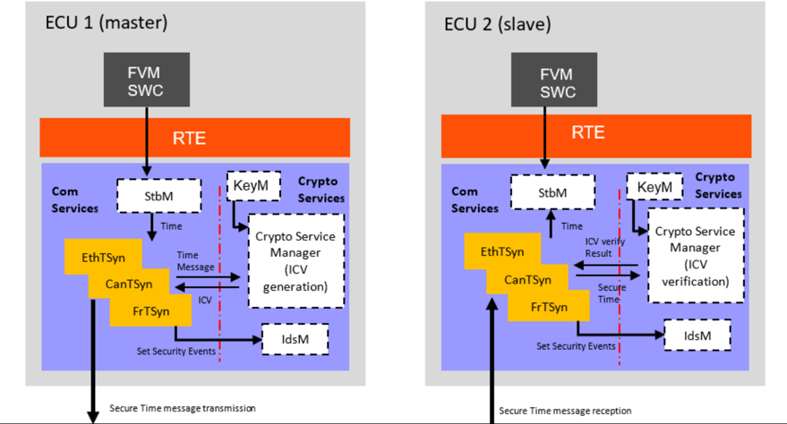

## 2. 缩略语

本节列出模块本地的缩略语和定义。关于其他与时间同步相关的缩略语和定义，请参阅 [1, **RS** Time Synchronization] 的第 [3](#3-相关文档) 章。关于一般术语和缩略语，请参阅 [2, **AUTOSAR** 术语表]。

**GTM**

> 全局时间主节点（**Global Time Master**）

**BswM**

> **BSW** 模式管理器模块（**BSW Mode Manager** module）

**&lt;Bus&gt;TSyn**

> 总线特定的时间同步模块（Bus specific Time Synchronization module）

**CAN FD**

> 控制器局域网（**CAN**）——可变数据速率（**Flexible Data Rate**）

**CanTSyn**

> **CAN** 时间同步模块（Time Synchronization over CAN module）

**CRC**

> 循环冗余校验和（**Cyclic Redundancy Checksum**）

**CSM**

> 加密服务管理器（**Crypto Service Manager**）

**Debounce Time**

> 具有相同 **PDU** 的两条 **TX** 报文之间的最小间隔

**Det**

> 默认错误追踪器模块（**Default Error Tracer** module）

**DLC**

> 数据长度码（**Data Length Code**）

**DoS**

> 拒绝服务（**Denial of Service**）

**CanIf**

> **CAN** 接口模块（**CAN** interface module）

**FUP message**

> 跟随报文（**Follow-Up message**）

**FV**

> 新鲜度值（**Freshness Value**）

**FVM**

> 新鲜度值管理器（**Freshness Value Manager**）

**ICV**

> 完整性校验值（**Integrity Check Value**）

**MAC**

> 报文认证码（**Message Authentication Code**）

**OFNS message**

> 偏移调整报文（Offset adjustment message）

**OFS message**

> 偏移同步报文（**Offset Synchronization message**）

**OVS**

> 溢出秒值（**Overflow Seconds** value，**FUP** 报文中的字段）

**SC**

> 时间同步报文中的序列计数器（**Sequence Counter**）

**SGW**

> 时间同步的"已同步到网关"（**Synchronized to Gateway**）状态

**StbM**

> 同步时基管理器（**Synchronized Time-Base Manager**）

**SYNC message**

> 时间同步报文（**Time Synchronization message**）

**Timesync**

> 时间同步（**Time Synchronization**）

## 3. 相关文档

### 3.1. 输入文件和相关标准与规范

<a id="ref-1"></a>[1] Requirements on Time Synchronization
> AUTOSAR_FO_RS_TimeSync

<a id="ref-2"></a>[2] Glossary
> AUTOSAR_FO_TR_Glossary

<a id="ref-3"></a>[3] General Specification of Basic Software Modules
> AUTOSAR_CP_SWS_BSWGeneral

<a id="ref-4"></a>[4] General Requirements on Basic Software Modules
> AUTOSAR_CP_SRS_BSWGeneral

<a id="ref-5"></a>[5] Specification of Synchronized Time-Base Manager
> AUTOSAR_CP_SWS_SynchronizedTimeBaseManager

<a id="ref-6"></a>[6] Specification of CRC Routines
> AUTOSAR_CP_SWS_CRCLibrary

<a id="ref-7"></a>[7] Specification of Crypto Service Manager
> AUTOSAR_CP_SWS_CryptoServiceManager

<a id="ref-8"></a>[8] Specification of Intrusion Detection System Manager
> AUTOSAR_CP_SWS_IntrusionDetectionSystemManager

### 3.2. 相关规范

**AUTOSAR** 提供了基础软件模块的通用规范 [3, **SWS** BSW General]，它同样适用于 **CanTSyn**。

因此，基础软件通用规范（**SWS** BSW General）应被额外视为 **CanTSyn** 的必需规范。

## 4. 约束和假设

### 4.1. 限制

1. **SYNC** 和 **OFS** 报文中的时基被限制为 32 位，因此支持的最大时间值为 4294967295 秒（2^32−1）。
2. 时基主节点、时间网关和时基从节点应使用最坏情况精度为 2 µs 的时基参考时钟工作。
3. 由于以下原因，经典 **CAN** 总线上不支持时间的认证保护机制：
   - 由于载荷限制，在经典 **CAN** 总线上实现认证保护机制很复杂，任何纳入的解决方案都会留下安全漏洞（例如密码学攻击、**DoS**）。
   - 如今车载 E/E 架构中的 **ECU** 同时支持经典 **CAN** 和 **CAN FD** 通道。

### 4.2. 汽车域的适用性

无论 **ECU** 连接到哪种总线系统，都需要共同时基的汽车系统。

## 5. 对其他模块的依赖

**CAN** 时间同步（**CanTSyn**）与同步时基管理器（**StbM**）、**CAN** 接口（**CanIf**）、**BSW** 模式管理器（**BswM**）、加密服务管理器（**CSM**）和默认错误追踪器（**DET**）有接口。

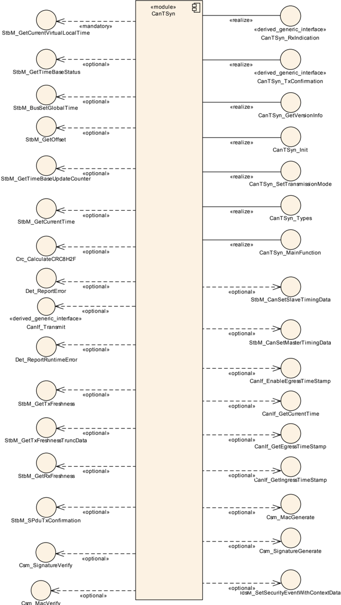

- **StbM**：
  - 获取并设置当前时间值
  - 从 **FVM** 获取 **FV**
- **CanIf**——接收和发送报文
- **BswM**——网络访问的协调（通过 [CanTSyn_SetTransmissionMode](#733-cantsyn_settransmissionmode)）
- **DET**——开发错误的报告
- **CSM**：
  - 为时基主节点生成 **ICV**
  - 为时基从节点验证 **ICV**
- **IdsM**——安全事件的报告

### 5.1. 文件结构

#### 5.1.1. 代码文件结构

细节请参阅 [3, **SWS** BSW General] 的第 5.1.6 节「Code file structure」。

#### 5.1.2. 头文件结构

细节请参阅 [3, **SWS** BSW General] 的第 5.1.7 节「Header file structure」。

## 6. 功能规格

本章定义 **CAN** 时间同步的行为。本模块的 **API** 在第 [7](#7-api规范) 章中定义，配置在第 [9](#9-配置规范) 章中定义。

### 6.1. 概述

**CAN** 时间同步负责实现 **CAN** 特定的时间同步协议。

时间同步的原理和通用措辞在 [5, **SWS** Synchronized Time-Base Manager] 和 [1, **RS** Time Synchronization] 中描述。

### 6.2. 模块处理

本节包含 **CAN** 时间同步辅助功能的描述。

如果 **CanTSyn** 调用 **StbM** 的 **API**，它应使用相应时间域的参数 CanTSynSynchronizedTimeBaseRef 所引用时基的时基 ID。

#### 6.2.1. 中断处理

在发送或接收 **SYNC** 报文时，需要在 RX 指示 / TX 确认回调中捕获虚拟本地时间的当前值：

- 要么在 **RX** / **TX** 中断的上下文中以中断模式捕获
- 要么在主函数中以轮询模式捕获（**注意：** 强烈建议时基从节点不要使用轮询模式）。

中断自身发生与当前虚拟本地时间的确定之间的任何延迟都会使发送或接收时基的精度变差。

因此，这些 RX 指示 / TX 确认回调在被调用后必须立即建立中断保护（如果在禁用中断嵌套的情况下于 **RX** / **TX** 中断的上下文中被调用，控制器会隐式地保证这一点）。

此后，只应进行必要的检查以确定该报文是 **SYNC** 报文（并在必要时确定时基 ID）。一旦时基 ID 和 **SYNC** 报文类型得到确认，就通过调用 **StbM** 的函数获取虚拟本地时间的当前值（仍在锁定的中断上下文中）。之后就可以移除中断保护，而不会对精度产生负面影响。

因此，尽管后续的帧检查（例如 **CRC** 校验、**SC** 校验）可能会失败从而使该快照变得多余，但仍可能已经获取了虚拟本地时间的快照。

#### 6.2.2. 初始化

**CAN** 时间同步通过 [CanTSyn_Init](#731-cantsyn_init) 初始化。除 [CanTSyn_GetVersionInfo](#732-cantsyn_getversioninfo) 和 [CanTSyn_Init](#731-cantsyn_init) 之外，**CAN** 时间同步的 **API** 函数只有在模块被正确初始化之后才能调用。

对 [CanTSyn_Init](#731-cantsyn_init) 的调用会初始化所有内部变量，并将 **CAN** 时间同步设置为已初始化状态。

序列计数器（**SC**）应以 0 初始化。

#### 6.2.3. 错误处理

在错误和异常情况下，**CanTSyn** 模块不应修改其当前模块状态，而只需报告该错误事件。

### 6.3. 报文格式

**SYNC**、**FUP**、**OFS** 和 **OFNS** 报文被分配给专用的报文类型"TimeSync"。

同一时间域的 **SYNC**、**FUP**、**OFS** 和 **OFNS** 报文通过使用多路复用的信号组共享相同的 **CAN** ID。如果 Timesync 报文由同一时基主节点或时间网关发送，则不同时间域可以使用相同的 **CAN** ID。如果 Timesync 报文由不同时基主节点或时间网关发送，则不同时间域应使用不同的 **CAN** ID。多路复用器位于字节 0，命名为 Type。

**CRC** 的使用是可选的。为了确保多个时间观察单元之间有足够的可变性，由配置决定当接收方不支持 **CRC** 计算时如何处理受 **CRC** 保护的 Timesync 报文。因此，接收方可能只使用给定的时间基值而不评估 **CRC**。

**SYNC**、**FUP**、**OFS** 和 **OFNS** 报文可以由 **ICV** 保护，**ICV** 提供这些报文的完整性和真实性保护。时间的认证仅对扩展 **CAN**（**CAN FD**）支持。

**ICV** 的使用是可选的。为了确保多个时间观察单元之间有足够的可变性，由配置决定当接收方不支持 **ICV** 计算时如何处理受 **ICV** 保护的时间同步报文。因此，接收方可能只使用给定的时间基值而不评估 **ICV**。

为了确保系统更高的性能，**ICV** 只包含在 **FUP** 报文中。但是，用于 **ICV** 计算的数据包括 **SYNC** 和 **FUP** 报文的载荷。类似地，对于偏移报文，**ICV** 包含在扩展 **OFS** 报文中。

时间同步报文中时间值信号的字节序为"Big Endian"。

对于经典 **CAN**，**SYNC**、**FUP**、**OFS** 和 **OFNS** 报文的 **DLC** 应为 8。

对于 **CAN FD**，如果：

- CanTSynUseExtendedMsgFormat 为 **TRUE**，
- 且 CanTSynGlobalTimeTxIcvSecured 为 **ICV_NOT_SUPPORTED**，
- 且 CanTSynRxIcvVerificationType 为 **ICV_NOT_VERIFIED**，

则 **SYNC**、**FUP**、**OFS** 和 **OFNS** 报文的 **DLC** 应为 16。

对于 **CAN FD**，如果：

- CanTSynUseExtendedMsgFormat 为 **TRUE**，且
  - CanTSynGlobalTimeTxIcvSecured 为 **ICV_SUPPORTED**，或
  - CanTSynRxIcvVerificationType 为 **ICV_IGNORED**，或
  - CanTSynRxIcvVerificationType 为 **ICV_OPTIONAL**，或
  - CanTSynRxIcvVerificationType 为 **ICV_VERIFIED**，

则 **SYNC**、**FUP**、**OFS** 和 **OFNS** 报文的 **DLC** 应可变，最大到 64。

取决于报文类型以及是否支持 **CRC** 保护和 **ICV** 验证，**CanTSyn** 按表 7.1 规定报文类型字段的值。报文布局的细节请参阅后续小节。从表中显而易见的是，**SYNC**、普通 **OFS** 和 **OFNS** 报文永远不会被 **ICV** 保护。

表7.1：**CanTSyn** 支持的报文类型（**Message Types supported by CanTSyn**）

| 报文类型字段值 | 报文类型 | CRC 保护 | ICV 保护 | 报文布局 |
| --- | --- | --- | --- | --- |
| 0x10 | SYNC | no | no | 'SYNC message format - not CRC protected'（表 7.2） |
| 0x20 | SYNC | yes | no | 'SYNC message format - CRC protected'（表 7.3） |
| 0x18 | FUP | no | no | 'FUP message format - not CRC protected, not ICV secured'（表 7.4） |
| 0x28 | FUP | yes | no | 'FUP message format - CRC protected, not ICV secured'（表 7.5） |
| 0x78 | FUP | no | yes | 'FUP message format - not CRC protected, ICV secured'（表 7.6） |
| 0x88 | FUP | yes | yes | 'FUP message format - CRC protected, ICV secured'（表 7.7） |
| 0x34 | OFS | no | no | 'OFS message format - not CRC protected'（表 7.8） |
| 0x44 | OFS | yes | no | 'OFS message format - CRC protected'（表 7.9） |
| 0x3C | OFNS | no | no | 'OFNS message format - not CRC protected'（表 7.10） |
| 0x4C | OFNS | yes | no | 'OFNS message format - CRC protected'（表 7.11） |
| 0x54 | Extended OFS | no | no | 'Extended OFS message format - not CRC protected, not ICV secured'（表 7.12） |
| 0x64 | Extended OFS | yes | no | 'Extended OFS message format - CRC protected, not ICV secured'（表 7.13） |
| 0x94 | Extended OFS | no | yes | 'Extended OFS message format - not CRC protected, ICV secured'（表 7.14） |
| 0xA4 | Extended OFS | yes | yes | 'Extended OFS message format - CRC protected, ICV secured'（表 7.15） |

根据其类型，时间同步报文可以按照给定的报文格式包含用户数据。

对于包含用户数据字段的进入时间同步报文，应一致地读取用户数据。

对于包含用户数据字段的发出时间同步报文，应一致地写入用户数据。

如果时间同步报文中用户数据字段的数量大于 **StbM** 提供的用户数据字节的数量，则剩余的用户数据字段应设为 0（默认值）。

用户数据应映射到 StbM_UserDataType，报文中给出的字节号与 StbM_UserDataType 给出的字节号应匹配（User Byte 0 映射到 StbM_UserDataType.userByte0，依此类推）。

StbM_UserDataType.userDataLength 应设为时间同步报文类型特定的用户字节数。

#### 6.3.1. SYNC 与 FUP 报文

普通 **SYNC** 和 **FUP** 报文的报文布局由以下规定定义，取决于载荷是否受 **CRC** 保护和/或被 **ICV** 保护：

- 'SYNC message format - not CRC protected'（表 7.2）
- 'SYNC message format - CRC protected'（表 7.3）
- 'FUP message format - not CRC protected, not ICV secured'（表 7.4）
- 'FUP message format - CRC protected, not ICV secured'（表 7.5）
- 'FUP message format - not CRC protected, ICV secured'（表 7.6）
- 'FUP message format - CRC protected, ICV secured'（表 7.7）

**注意：** **SYNC** 报文不被 **ICV** 保护。

表7.2：SYNC 报文格式——不受 CRC 保护（**SYNC message format - not CRC protected**）

| 字节 | 位位置 | 字段名 | 字段值范围 | 说明 |
| --- | --- | --- | --- | --- |
| 0 | | Type | 0x10 | |
| 1 | | User Byte 1 | 默认：0 | |
| 2 | 7..4 | D | 0..15 | 时间域 ID |
| | 3..0 | SC | 0..15 | 序列计数器 |
| 3 | | User Byte 0 | 默认：0 | |
| 4-7 | | SyncTimeSec | | 时间的 48 位秒部分的 32 位 LSB |
| 若 CanTSynUseExtendedMsgFormat = TRUE： | | | | |
| 8-15 | | reserved | 始终为 0 | |

表7.3：SYNC 报文格式——受 CRC 保护（**SYNC message format - CRC protected**）

| 字节 | 位位置 | 字段名 | 字段值范围 | 说明 |
| --- | --- | --- | --- | --- |
| 0 | | Type | 0x20 | |
| 1 | | CRC | | |
| 2 | 7..4 | D | 0..15 | 时间域 ID |
| | 3..0 | SC | 0..15 | 序列计数器 |
| 3 | | User Byte 0 | 默认：0 | |
| 4-7 | | SyncTimeSec | | 时间的 48 位秒部分的 32 位 LSB |
| 若 CanTSynUseExtendedMsgFormat = TRUE： | | | | |
| 8-15 | | reserved | 始终为 0 | |

表7.4：FUP 报文格式——不受 CRC 保护、不受 ICV 保护（**FUP message format - not CRC protected, not ICV secured**）

| 字节 | 位位置 | 字段名 | 字段值范围 | 说明 |
| --- | --- | --- | --- | --- |
| 0 | | Type | 0x18 | |
| 1 | | User Byte 2 | 默认：0 | |
| 2 | 7..4 | D | 0..15 | 时间域 ID |
| | 3..0 | SC | 0..15 | 序列计数器 |
| 3 | 7..3 | reserved | 默认：0 | |
| 3 | 2 | SGW | SyncToGTM = 0 / SyncToSubDomain = 1 | |
| 3 | 1..0 | OVS | | 秒的溢出 |
| 4-7 | | SyncTimeNSec | | 以纳秒为单位的 32 位时间值 |
| 若 CanTSynUseExtendedMsgFormat = TRUE： | | | | |
| 8-15 | | reserved | 始终为 0 | |

表7.5：FUP 报文格式——受 CRC 保护、不受 ICV 保护（**FUP message format - CRC protected, not ICV secured**）

| 字节 | 位位置 | 字段名 | 字段值范围 | 说明 |
| --- | --- | --- | --- | --- |
| 0 | | Type | 0x28 | |
| 1 | | CRC | | |
| 2 | 7..4 | D | 0..15 | 时间域 ID |
| 2 | 3..0 | SC | 0..15 | 序列计数器 |
| 3 | 7..3 | reserved | 默认：0 | |
| 3 | 2 | SGW | SyncToGTM = 0 / SyncToSubDomain = 1 | |
| 3 | 1..0 | OVS | | 秒的溢出 |
| 4-7 | | SyncTimeNSec | | 以纳秒为单位的 32 位时间值 |
| 若 CanTSynUseExtendedMsgFormat = TRUE： | | | | |
| 8-15 | | reserved | 始终为 0 | |

表7.6：FUP 报文格式——不受 CRC 保护、受 ICV 保护（**FUP message format - not CRC protected, ICV secured**）

| 字节 | 位位置 | 字段名 | 字段值范围 | 说明 |
| --- | --- | --- | --- | --- |
| 0 | | Type | 0x78 | |
| 1 | | User Byte 2 | 默认：0 | |
| 2 | 7..4 | D | 0..15 | 时间域 ID |
| 2 | 3..0 | SC | 0..15 | 序列计数器 |
| 3 | 7..3 | reserved | 默认：0 | |
| 3 | 2 | SGW | SyncToGTM = 0 / SyncToSubDomain = 1 | |
| 3 | 1..0 | OVS | | 秒的溢出 |
| 4-7 | | SyncTimeNSec | | 以纳秒为单位的 32 位时间值 |
| 8 | 7 | reserved | 始终为 0 | |
| 8 | 6..0 | FVL | 0..64 | 以比特为单位的 **FV** 长度 |
| 9 | 7..6 | reserved | 始终为 0 | |
| 9 | 5..0 | ICVL | 0..54 | 以字节为单位的 **ICV** 长度 |
| 10 | | FV | | **FV** |
| 10+ FVL（字节） | | ICV | | **ICV** |

表7.7：FUP 报文格式——受 CRC 保护、受 ICV 保护（**FUP message format - CRC protected, ICV secured**）

| 字节 | 位位置 | 字段名 | 字段值范围 | 说明 |
| --- | --- | --- | --- | --- |
| 0 | | Type | 0x88 | |
| 1 | | CRC | | |
| 2 | 7..4 | D | 0..15 | 时间域 ID |
| 2 | 3..0 | SC | 0..15 | 序列计数器 |
| 3 | 7..3 | reserved | 默认：0 | |
| 3 | 2 | SGW | SyncToGTM = 0 / SyncToSubDomain = 1 | |
| 3 | 1..0 | OVS | | 秒的溢出 |
| 4-7 | | SyncTimeNSec | | 以纳秒为单位的 32 位时间值 |
| 8 | 7 | reserved | 始终为 0 | |
| 8 | 6..0 | FVL | 0..64 | 以比特为单位的 **FV** 长度 |
| 9 | 7..6 | reserved | 始终为 0 | |
| 9 | 5..0 | ICVL | 0..54 | 以字节为单位的 **ICV** 长度 |
| 10 | | FV | | **FV** |
| 10+ FVL（字节） | | ICV | | **ICV** |

#### 6.3.2. 偏移报文

偏移报文可以与时间同步报文多路复用（使用相同的 **PDU** 等）。

对于经典 **CAN**（**CAN 2.0**），使用两种不同的偏移报文：**OFS** 和 **OFNS**。对于二者，都存在带有和不带有 **CRC** 字段的变体。

对于 **CAN FD**，如果 CanTSynUseExtendedMsgFormat 为 **TRUE**，**OFS** 和 **OFNS** 的内容被合并为单一的扩展 **OFS** 报文（同样存在带有和不带有 **CRC** 字段的变体）。此外，还存在带有和不带有 **ICV** 字段的变体。

对于 **CAN 2.0** 总线，CanTSynUseExtendedMsgFormat 应始终为 **FALSE**。

如果 CanTSynUseExtendedMsgFormat 为 **FALSE**，则应使用普通偏移报文格式，即报文类型为 0x34、0x44、0x3C 和 0x4C 的偏移报文。

**注意：** 普通偏移报文格式参见第 [6.3.2.1](#6321-普通偏移报文) 节。

如果 CanTSynUseExtendedMsgFormat 为 **TRUE**，则应使用扩展偏移报文格式，即报文类型为 0x54、0x64、0x94 和 0xA4 的偏移报文。

**注意：** 扩展偏移报文格式参见第 [6.3.2.2](#6322-扩展偏移报文) 节。

##### 6.3.2.1. 普通偏移报文

普通 **OFS**/**OFNS** 报文的报文布局由以下规定定义，取决于载荷是否受 **CRC** 保护：

- 'OFS message format - not CRC protected'（表 7.8）
- 'OFS message format - CRC protected'（表 7.9）
- 'OFNS message format - not CRC protected'（表 7.10）
- 'OFNS message format - CRC protected'（表 7.11）

**注意：** 普通 **OFS**/**OFNS** 报文不被 **ICV** 保护。

表7.8：OFS 报文格式——不受 CRC 保护（**OFS message format - not CRC protected**）

| 字节 | 位位置 | 字段名 | 字段值范围 | 说明 |
| --- | --- | --- | --- | --- |
| 0 | | Type | 0x34 | |
| 1 | | User Byte 1 | 默认：0 | |
| 2 | 7..4 | D | 0..15 | 时间域 ID |
| | 3..0 | SC | 0..15 | 序列计数器 |
| 3 | | User Byte 0 | 默认：0 | |
| 4-7 | | OfsTimeSec | | 以秒为单位的 32 位偏移时间值 |

表7.9：OFS 报文格式——受 CRC 保护（**OFS message format - CRC protected**）

| 字节 | 位位置 | 字段名 | 字段值范围 | 说明 |
| --- | --- | --- | --- | --- |
| 0 | | Type | 0x44 | |
| 1 | | CRC | | |
| 2 | 7..4 | D | 0..15 | 时间域 ID |
| | 3..0 | SC | 0..15 | 序列计数器 |
| 3 | | User Byte 0 | 默认：0 | |
| 4-7 | | OfsTimeSec | | 以秒为单位的 32 位偏移时间值 |

表7.10：OFNS 报文格式——不受 CRC 保护（**OFNS message format - not CRC protected**）

| 字节 | 位位置 | 字段名 | 字段值范围 | 说明 |
| --- | --- | --- | --- | --- |
| 0 | | Type | 0x3C | |
| 1 | | User Byte 2 | 默认：0 | |
| 2 | 7..4 | D | 0..15 | 时间域 ID |
| | 3..0 | SC | 0..15 | 序列计数器 |
| 3 | 7..1 | reserved | 默认：0 | |
| 3 | 0 | SGW | SyncToGTM = 0 / SyncToSubDomain = 1 | |
| 4-7 | | OfsTimeNSec | | 以纳秒为单位的 32 位偏移时间值 |

表7.11：OFNS 报文格式——受 CRC 保护（**OFNS message format - CRC protected**）

| 字节 | 位位置 | 字段名 | 字段值范围 | 说明 |
| --- | --- | --- | --- | --- |
| 0 | | Type | 0x4C | |
| 1 | | CRC | | |
| 2 | 7..4 | D | 0..15 | 时间域 ID |
| 2 | 3..0 | SC | 0..15 | 序列计数器 |
| 3 | 7..1 | reserved | 默认：0 | |
| 3 | 0 | SGW | SyncToGTM = 0 / SyncToSubDomain = 1 | |
| 4-7 | | OfsTimeNSec | | 以纳秒为单位的 32 位偏移时间值 |

##### 6.3.2.2. 扩展偏移报文

扩展 **OFS** 报文（即对于 **CAN FD PDU**，如果 CanTSynUseExtendedMsgFormat 设为 **TRUE**）的报文布局如下，取决于载荷是否受 **CRC** 保护和/或被 **ICV** 保护：

- 'Extended OFS message format - not CRC protected, not ICV secured'（表 7.12）
- 'Extended OFS message format - CRC protected, not ICV secured'（表 7.13）
- 'Extended OFS message format - not CRC protected, ICV secured'（表 7.14）
- 'Extended OFS message format - CRC protected, ICV secured'（表 7.15）

不需要单独的 **OFNS** 报文。

表7.12：扩展 OFS 报文格式——不受 CRC 保护、不受 ICV 保护（**Extended OFS message format - not CRC protected, not ICV secured**）

| 字节 | 位位置 | 字段名 | 字段值范围 | 说明 |
| --- | --- | --- | --- | --- |
| 0 | | Type | 0x54 | |
| 1 | | User Byte 2 | 默认：0 | |
| 2 | 7..4 | D | 0..15 | 时间域 ID |
| 2 | 3..0 | SC | 0..15 | 序列计数器 |
| 3 | 7..1 | reserved | 默认：0 | |
| 3 | 0 | SGW | SyncToGTM = 0 / SyncToSubDomain = 1 | |
| 4 | | User Byte 0 | 默认：0 | |
| 5 | | User Byte 1 | 默认：0 | |
| 6 | | reserved | 默认：0 | |
| 7 | | reserved | 默认：0 | |
| 8-11 | | OfsTimeSec | | 以秒为单位的 32 位偏移时间值 |
| 12-15 | | OfsTimeNSec | | 以纳秒为单位的 32 位偏移时间值 |

表7.13：扩展 OFS 报文格式——受 CRC 保护、不受 ICV 保护（**Extended OFS message format - CRC protected, not ICV secured**）

| 字节 | 位位置 | 字段名 | 字段值范围 | 说明 |
| --- | --- | --- | --- | --- |
| 0 | | Type | 0x64 | |
| 1 | | CRC | | |
| 2 | 7..4 | D | 0..15 | 时间域 |
| 2 | 3..0 | SC | 0..15 | 序列计数器 |
| 3 | 7..1 | reserved | 默认：0 | |
| 3 | 0 | SGW | SyncToGTM = 0 / SyncToSubDomain = 1 | |
| 4 | | User Byte 0 | 默认：0 | |
| 5 | | User Byte 1 | 默认：0 | |
| 6 | | reserved | 默认：0 | |
| 7 | | reserved | 默认：0 | |
| 8-11 | | OfsTimeSec | | 以秒为单位的 32 位偏移时间值 |
| 12-15 | | OfsTimeNSec | | 以纳秒为单位的 32 位偏移时间值 |

表7.14：扩展 OFS 报文格式——不受 CRC 保护、受 ICV 保护（**Extended OFS message format - not CRC protected, ICV secured**）

| 字节 | 位位置 | 字段名 | 字段值范围 | 说明 |
| --- | --- | --- | --- | --- |
| 0 | | Type | 0x94 | |
| 1 | | User Byte 2 | 默认：0 | |
| 2 | 7..4 | D | 0..15 | 时间域 ID |
| 2 | 3..0 | SC | 0..15 | 序列计数器 |
| 3 | 7..1 | reserved | 默认：0 | |
| 3 | 0 | SGW | SyncToGTM = 0 / SyncToSubDomain = 1 | |
| 4 | | User Byte 0 | 默认：0 | |
| 5 | | User Byte 1 | 默认：0 | |
| 6 | | reserved | 默认：0 | |
| 7 | | reserved | 默认：0 | |
| 8-11 | | OfsTimeSec | | 以秒为单位的 32 位偏移时间值 |
| 12-15 | | OfsTimeNSec | | 以纳秒为单位的 32 位偏移时间值 |
| 16 | 7 | reserved | 始终为 0 | |
| 16 | 6..0 | FVL | 0..64 | 以比特为单位的 **FV** 长度 |
| 17 | 7..6 | reserved | 始终为 0 | |
| 17 | 5..0 | ICVL | 0..46 | 以字节为单位的 **ICV** 长度 |
| 18 | | FV | | **FV** |
| 18+ FVL（字节） | | ICV | | **ICV** |

表7.15：扩展 OFS 报文格式——受 CRC 保护、受 ICV 保护（**Extended OFS message format - CRC protected, ICV secured**）

| 字节 | 位位置 | 字段名 | 字段值范围 | 说明 |
| --- | --- | --- | --- | --- |
| 0 | | Type | 0xA4 | |
| 1 | | CRC | | |
| 2 | 7..4 | D | 0..15 | 时间域 |
| 2 | 3..0 | SC | 0..15 | 序列计数器 |
| 3 | 7..1 | reserved | 默认：0 | |
| 3 | 0 | SGW | SyncToGTM = 0 / SyncToSubDomain = 1 | |
| 4 | | User Byte 0 | 默认：0 | |
| 5 | | User Byte 1 | 默认：0 | |
| 6 | | reserved | 默认：0 | |
| 7 | | reserved | 默认：0 | |
| 8-11 | | OfsTimeSec | | 以秒为单位的 32 位偏移时间值 |
| 12-15 | | OfsTimeNSec | | 以纳秒为单位的 32 位偏移时间值 |
| 16 | 7 | reserved | 始终为 0 | |
| 16 | 6..0 | FVL | 0..64 | 以比特为单位的 **FV** 长度 |
| 17 | 7..6 | reserved | 始终为 0 | |
| 17 | 5..0 | ICVL | 0..46 | 以字节为单位的 **ICV** 长度 |
| 18 | | FV | | **FV** |
| 18+ FVL（字节） | | ICV | | **ICV** |

### 6.4. 作为时基主节点

时基主节点是某个时基的主节点实体，它将该时基传播给通信网络某个区段内的一组时基从节点，作为该时基的源。

如果时基主节点也是全局时基（所有其他时基都从它派生）的拥有者，那么它就是全局时间主节点（参见图 7.1）。时间网关通常由一个时基主节点端口组成，该端口连接到一个或多个时基从节点。在把时间实体映射到实际 **ECU** 时必须注意，一个 **ECU** 可以是某一时基的时基主节点（甚至全局时间主节点），同时是另一时基的时基从节点。

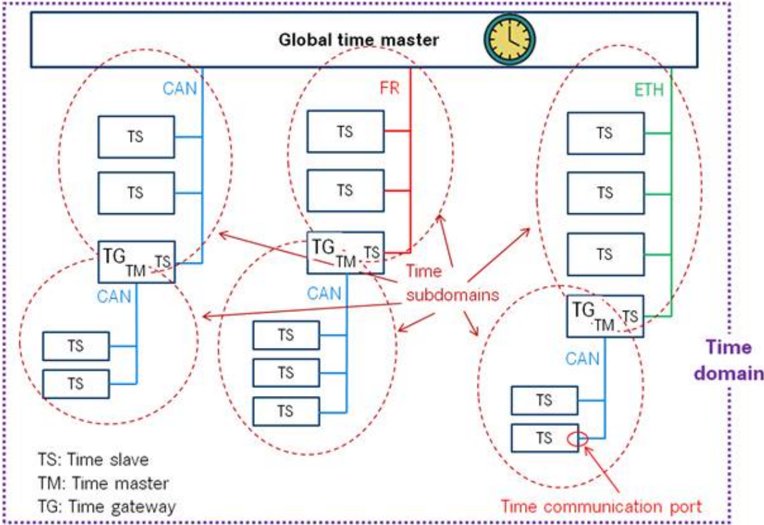

**CanTSyn** 支持将给定时基同时在多条 **CAN** 总线上扇出（fan-out）。这些总线都属于同一时间域。

**注意：** 对于 **CanTSyn** 在其上为给定时基发送该时基的每条 **CAN** 总线，都需要配置一个单独的配置容器 [CanTSynGlobalTimeDomain](#925-cantsynglobaltimedomain)——尽管这些总线都属于同一时间域。

图 7.2 展示了时基主节点如何触发 Timesync 报文发送的总体流程。

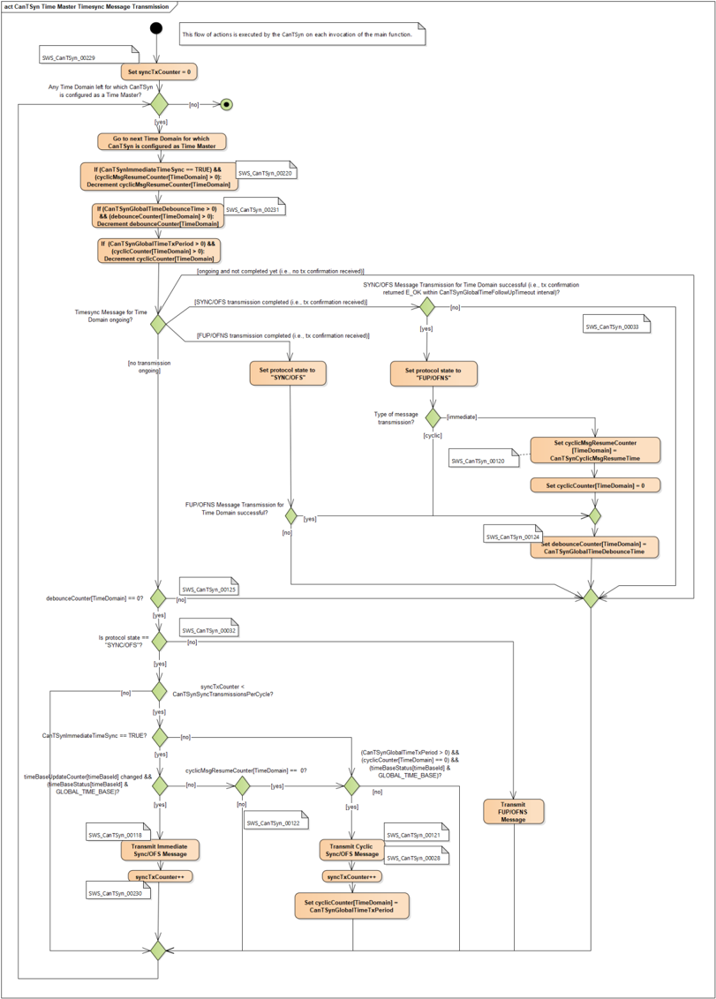

细节在后续小节中给出。关于发送 **SYNC**/**FUP** 报文序列期间与其他 **BSW** 模块的交互，另请参阅时序图图 9.2 和图 9.3。

时基主节点应通过调用 CanIf_Transmit 来发送 **SYNC**、**FUP**、**OFS** 和 **OFNS** 报文，所用的 **PduId** 通过相应时间域的 CanTSynGlobalTimePduRef 导出。

#### 6.4.1. SYNC 与 FUP 报文处理

时基主节点应以 **SYNC** 报文开始同步时基的每个时间同步序列。

时基主节点应以 **FUP** 报文结束同步时基的每个时间同步序列。

如果 **SYNC** 或 **FUP** 报文的发送失败（[CanTSyn_TxConfirmation](#742-cantsyn_txconfirmation) 以 **E_NOT_OK** 被调用），**CanTSyn** 应复位状态机，在到期时再次以新的 **SYNC** 发送开始。

**注意：** 如果 **SYNC** 报文发送失败，将不会发送 **FUP** 报文。

对于同步时间域（参见 [CanTSynGlobalTimeDomain](#925-cantsynglobaltimedomain)），如果：

- timeBaseStatus 中的 **GLOBAL_TIME_BASE** 位已置位，
- 且 CanTSynGlobalTimeTxPeriod 不等于 0，
- 且 debounceCounter 为 0，
- 且相应 **PDU** 没有待处理的发送（[CanTSyn_TxConfirmation](#742-cantsyn_txconfirmation) 已以 **E_OK** 或 **E_NOT_OK** 被调用），
- 且关联的 cyclicMsgResumeCounter 小于或等于 0，
- 且 syncTxCounter（如已配置）小于 CanTSynSyncTransmissionsPerCycle，

则时基主节点应以周期 CanTSynGlobalTimeTxPeriod 周期性地发送 **SYNC** 报文。

一旦满足上述要求，周期性发送应在最早可能的 [CanTSyn_MainFunction](#751-cantsyn_mainfunction) 调用中启动。

**注意：** "最早可能"意味着：
- 在下一个 [CanTSyn_MainFunction](#751-cantsyn_mainfunction) 中，因为 **GLOBAL_TIME_BASE** 是在 [CanTSyn_MainFunction](#751-cantsyn_mainfunction) 之外设置的。
- 在当前 [CanTSyn_MainFunction](#751-cantsyn_mainfunction) 中，当从立即发送切换到周期发送时（因为该决策是在 [CanTSyn_MainFunction](#751-cantsyn_mainfunction) 内部做出的）。

**SYNC** 和 **FUP** 序列不应被中断——既不能被同一时间域的时间同步报文中断，也不能在其他时间同步报文使用相同 **CAN** ID 时被其他时间域的时间同步报文中断。

如果 CanTSynGlobalTimeTxIcvSecured 为 **ICV_NOT_SUPPORTED**，则取决于 CanTSynGlobalTimeTxCrcSecured，**SYNC** / **FUP** 报文应为以下类型：

表7.16：无 ICV 的 SYNC / FUP 报文的 CanTSynGlobalTimeTxCrcSecured 设置（**Settings of CanTSynGlobalTimeTxCrcSecured for SYNC / FUP messages without ICV**）

| CanTSynGlobalTimeTxCrcSecured 值 | SYNC 报文类型 | FUP 报文类型 |
| --- | --- | --- |
| CRC_NOT_SUPPORTED | 0x10 SYNC 报文，不受 CRC 保护 | 0x18 FUP 报文，不受 CRC 保护 |
| CRC_SUPPORTED | 0x20 SYNC 报文，受 CRC 保护 | 0x28 FUP 报文，受 CRC 保护 |

如果 CanTSynGlobalTimeTxIcvSecured 为 **ICV_SUPPORTED** 且 CanTSynUseExtendedMsgFormat 为 **TRUE**，则取决于 CanTSynGlobalTimeTxCrcSecured，**SYNC** / **FUP** 报文应为以下类型：

表7.17：带 ICV 的 SYNC / FUP 报文的 CanTSynGlobalTimeTxCrcSecured 设置（**Settings of CanTSynGlobalTimeTxCrcSecured for SYNC / FUP messages with ICV**）

| CanTSynGlobalTimeTxCrcSecured 值 | SYNC 报文类型 | FUP 报文类型 |
| --- | --- | --- |
| CRC_NOT_SUPPORTED | 0x10 SYNC 报文，不受 CRC 保护 | 0x78 FUP 报文，不受 CRC 保护，受 ICV 保护 |
| CRC_SUPPORTED | 0x20 SYNC 报文，受 CRC 保护 | 0x88 FUP 报文，受 CRC 保护，受 ICV 保护 |

**FUP** 报文的发送方（时基主节点）使用 debounceCounter 值到达 0 作为从 **SYNC** 到 **FUP** 的触发条件。

**注意：** debounceCounter 的使用参见第 [6.4.4](#644-timesync-报文发送的去抖) 节。

每次 **SYNC** 报文的发送请求都应监视发送确认超时。

如果在发送请求后 2 秒内 [CanTSyn_TxConfirmation](#742-cantsyn_txconfirmation) 未被调用，**CanTSyn** 应：

- 等待直到 [CanTSyn_TxConfirmation](#742-cantsyn_txconfirmation) 被调用（以 **E_OK** 或 **E_NOT_OK**），并且
- 不发送 **FUP** 报文，而是
- 复位状态机，在到期时再次以新的 **SYNC** 发送开始。

**注意：** 如果 [CanTSyn_TxConfirmation](#742-cantsyn_txconfirmation) 被较晚调用，使用 2 秒的超时是为了避免 **FUP** 报文中 **OVS** 值的溢出（值域：0 .. 3 秒）。

#### 6.4.2. OFS 报文处理

时基主节点应以 **OFS** 报文开始偏移时基的每个时间同步序列。

如果 CanTSynUseExtendedMsgFormat 为 **FALSE**，时基主节点应以 **OFNS** 报文结束偏移时基的每个时间同步序列。

**注意：** 如果 CanTSynUseExtendedMsgFormat 为 **TRUE**，则不需要 **OFNS** 报文。

如果 **OFS** 或 **OFNS** 报文的发送失败（即相应 **PDU** 的 [CanTSyn_TxConfirmation](#742-cantsyn_txconfirmation) 以参数 result 设为 **E_NOT_OK** 被调用），状态机应被复位，在到期时再次以新的 **OFS** 发送开始。

**注意：** 如果 **OFS** 报文发送失败，将不会发送 **OFNS** 报文。

对于偏移时间域（参见 [CanTSynGlobalTimeDomain](#925-cantsynglobaltimedomain)），如果：

- 被引用时基 CanTSynSynchronizedTimeBaseRef 的 timeBaseStatus 中的 **GLOBAL_TIME_BASE** 位已置位，
- 且 CanTSynGlobalTimeTxPeriod 不等于 0，
- 且 debounceCounter 为 0，
- 且相应 **PDU** 没有待处理的发送（[CanTSyn_TxConfirmation](#742-cantsyn_txconfirmation) 已以 **E_OK** 或 **E_NOT_OK** 被调用），
- 且关联的 cyclicMsgResumeCounter 小于或等于 0，

则时基主节点应以周期 CanTSynGlobalTimeTxPeriod 周期性地发送 **OFS** 报文。

一旦满足上述要求，周期性发送应在最早可能的 [CanTSyn_MainFunction](#751-cantsyn_mainfunction) 调用中启动。

**注意：** "最早可能"意味着：
- 在下一个 [CanTSyn_MainFunction](#751-cantsyn_mainfunction) 中，因为 **GLOBAL_TIME_BASE** 是在 [CanTSyn_MainFunction](#751-cantsyn_mainfunction) 之外设置的。
- 在当前 [CanTSyn_MainFunction](#751-cantsyn_mainfunction) 中，当从立即发送切换到周期发送时（因为该决策是在 [CanTSyn_MainFunction](#751-cantsyn_mainfunction) 内部做出的）。

**OFS** 和 **OFNS** 序列不应被中断——既不能被同一时间域的时间同步报文中断，也不能在其他时间同步报文使用相同 **CAN** ID 时被其他时间域的时间同步报文中断。

**OFNS** 报文的发送方（时基主节点）使用 debounceCounter 值到达 0 作为从 **OFS** 到 **OFNS** 的触发条件。

**注意：** debounceCounter 的使用参见第 [6.4.4](#644-timesync-报文发送的去抖) 节。

如果 CanTSynGlobalTimeTxIcvSecured 为 **ICV_NOT_SUPPORTED**，则取决于 CanTSynGlobalTimeTxCrcSecured，**OFS** / **OFNS** 报文应为以下类型：

表7.18：无 ICV 的 OFS / OFNS 报文的 CanTSynGlobalTimeTxCrcSecured 设置（**Settings of CanTSynGlobalTimeTxCrcSecured for OFS / OFNS messages without ICV**）

| 总线类型 | 参数 CanTSynGlobalTimeTxCrcSecured 的值 | OFS 报文类型 | OFNS 报文类型 |
| --- | --- | --- | --- |
| CAN | CRC_NOT_SUPPORTED | 0x34 OFS 报文，不受 CRC 保护 | 0x3C OFNS 报文，不受 CRC 保护 |
| CAN | CRC_SUPPORTED | 0x44 OFS 报文，受 CRC 保护 | 0x4C OFNS 报文，受 CRC 保护 |
| CAN FD（CanTSynUseExtendedMsgFormat = TRUE） | CRC_NOT_SUPPORTED | 0x54（Ext）OFS 报文，不受 CRC 保护 | 不适用 |
| | CRC_SUPPORTED | 0x64（Ext）OFS 报文，受 CRC 保护 | 不适用 |

如果：

- CanTSynUseExtendedMsgFormat 设为 **TRUE**，
- 且 CanTSynGlobalTimeTxIcvSecured 设为 **ICV_SUPPORTED**，
- 且 CanTSynGlobalTimeTxCrcSecured 设为 **CRC_NOT_SUPPORTED**，

则 **OFS** 报文的类型应设为 0x94（即 Ext OFS 报文——不受 CRC 保护，受 ICV 保护）。

如果：

- CanTSynUseExtendedMsgFormat 设为 **TRUE**，
- 且 CanTSynGlobalTimeTxIcvSecured 设为 **ICV_SUPPORTED**，
- 且 CanTSynGlobalTimeTxCrcSecured 设为 **CRC_SUPPORTED**，

则 **OFS** 报文的类型应设为 0xA4（即 Ext OFS 报文——受 CRC 保护，受 ICV 保护）。

每次 **OFS** 报文的发送请求都应监视发送确认超时。

如果在发送请求后 2 秒内 [CanTSyn_TxConfirmation](#742-cantsyn_txconfirmation) 未被调用，**CanTSyn** 应：

- 等待直到 [CanTSyn_TxConfirmation](#742-cantsyn_txconfirmation) 被调用（以 **E_OK** 或 **E_NOT_OK**），并且
- 不发送 **OFNS** 报文，而是
- 复位状态机，在到期时再次以新的 **OFS** 发送开始。

**注意：** 超时事件中状态机的复位避免了发送可能已过期的偏移时间。取而代之的是通过 StbM_GetOffset 获取最新的偏移时间。

#### 6.4.3. 发送模式

如果调用 [CanTSyn_SetTransmissionMode](#733-cantsyn_settransmissionmode)(Controller, Mode) 且参数 Mode 等于 **CANTSYN_TX_OFF**，则应省略 **CanTSyn** 在此 **CAN** 通道上的所有发送请求。

如果调用 [CanTSyn_SetTransmissionMode](#733-cantsyn_settransmissionmode)(Controller, Mode) 且参数 Mode 等于 **CANTSYN_TX_ON**，则 **CanTSyn** 在此 **CAN** 通道上的所有发送请求应能够被发送。

#### 6.4.4. Timesync 报文发送的去抖

##### 6.4.4.1. 按 PDU 去抖

**CanTSyn** 对时基主节点的 **CAN Tx PDU** 进行去抖（debounce），以避免总线上 Timesync 报文的突发（例如在启用立即发送时）。该机制还定义了 **SYNC** 与其对应 **FUP** 报文之间的最小间隔（以及 **OFS** 与 **OFNS** 报文之间的最小间隔）。

对于每个 Tx **PDU**，**CanTSyn** 维护一个 debounceCounter。在每次发送 Timesync 报文时，去抖计数器会被配置的去抖时间 CanTSynGlobalTimeDebounceTime（重新）加载。该计数器在每个 **CanTSyn** 主循环中递减。只有当去抖计数器达到值 0 时，才能触发同一 **PDU** 的发送。另请参阅图 7.2 中 Timesync 报文发送的总体序列。

**CanTSyn** 不支持跨域和跨总线共享 **PDU**，即同一 **PDU** ID 不应用于不同的时间域。

但是，**CanTSyn** 支持一个单独的机制来对跨 **CAN** 总线的 **SYNC**/**OFS** 报文发送进行去抖（参见第 [6.4.4.2](#6442-跨多个域和总线的去抖) 节「跨多个域和总线的去抖」）。

如果某时基的 CanTSynGlobalTimeDebounceTime 大于 0，**CanTSyn** 应始终按下述方式对相应的 Timesync **PDU** 进行去抖，否则 **CanTSyn** 不应执行任何去抖。

对于某时间域，如果：

- CanTSynGlobalTimeDebounceTime 大于 0，
- 且相应的 Timesync **PDU** 已成功发送（即相应 **PDU** 的 [CanTSyn_TxConfirmation](#742-cantsyn_txconfirmation) 以参数 result 设为 **E_OK** 被调用），

则 **CanTSyn** 应将该 **PDU** 特定的 debounceCounter 设为 CanTSynGlobalTimeDebounceTime。

对于某时间域，如果：

- CanTSynGlobalTimeDebounceTime 大于 0，
- 且相应 Timesync **PDU** 的 debounceCounter 大于 0，

则 **CanTSyn** 应在每次调用 [CanTSyn_MainFunction](#751-cantsyn_mainfunction) 时将 debounceCounter 值减去 CanTSynMainFunctionPeriod。

**注意：** 由于 debounceCounter 的递减发生在 [CanTSyn_MainFunction](#751-cantsyn_mainfunction) 调用中，而计数器的启动发生在 Timesync **PDU** 已被发送时（在后续的 [CanTSyn_MainFunction](#751-cantsyn_mainfunction) 调用中或在发送确认回调函数中），实际的去抖时间将等于或大于 CanTSynGlobalTimeDebounceTime。去抖时间的延长应限制在 CanTSynMainFunctionPeriod 的值之内。

对于某时间域，如果：

- CanTSynGlobalTimeDebounceTime 大于 0，
- 且相应 Timesync **PDU** 的 debounceCounter 大于 0，
- 且请求发送一条 TimeSync 报文，

则 **CanTSyn** 应推迟该 Timesync 报文的实际发送，直到 debounceCounter 小于或等于 0。

**理由：** 去抖期间，新的发送请求不应丢失。

对于某时间域，如果：

- CanTSynGlobalTimeDebounceTime 大于 0，
- 有一个被推迟的 **SYNC** 或 **OFS** 报文发送请求处于未决状态，
- 且请求了一次新的 **SYNC** 或 **OFS** 报文的立即或周期发送，

则 **CanTSyn** 应丢弃该时间域的未决请求。

**理由：** 去抖期间，不对多个发送请求排队。最新的请求是最好的。

对于某时间域，如果：

- CanTSynGlobalTimeDebounceTime 大于 0，
- 有一个被推迟的 **FUP** 或 **OFNS** 报文发送请求处于未决状态，
- 且分别请求了一次新的 **SYNC** 或 **OFS** 报文的立即或周期发送，

则 **CanTSyn** 应推迟该时间域的 **SYNC** 或 **OFS** 报文的发送。

**理由：** **SYNC**/**FUP** 或 **OFS**/**OFNS** 序列不被中断，即在前一个序列完成之前不会开始新的 **SYNC**/**OFS** 序列。

##### 6.4.4.2. 跨多个域和总线的去抖

如果使用 **SW** 时间戳，时基主节点发送的全局时间的精度会受到发送确认 ISR 延迟/抖动的影响。当时基主节点在多个域/总线上发送 **SYNC** 报文、且发送确认中断由同一核处理时，该影响会加剧。在这种情况下，多个发送确认中断很可能几乎同时被触发。结果是，除了第一次之外，每次 CanTSyn ISR 的执行都会被"第一个"待处理中断的 CanTSyn ISR 延迟及其执行时间所延迟，也会被在第一个 CanTSyn ISR 之后、第二个中断之前直接处理的其他中断的 ISR 延迟（例如由于中断优先级）。为了避免这种 **SYNC** 报文的突发发送，发送将分布在多个 **CanTSyn** 主循环上，即每个 **CanTSyn** 主循环同时进行的 **SYNC** 报文发送数量是受限的。另请参阅图 7.2 中 Timesync 报文发送的总体序列。

如果：

- **CanTSyn** 模块被配置为至少一个时间域的时基主节点，
- 且 CanTSynSyncTransmissionsPerCycle 大于 0，

则 **CanTSyn** 模块应维护一个计数器 syncTxCounter，它在每个发送 **SYNC** 报文区间 CanTSynMainFunctionPeriod 内对 **SYNC** 报文发送请求进行计数。

**CanTSyn** 模块应在每个 [CanTSyn_MainFunction](#751-cantsyn_mainfunction) 开始时将 syncTxCounter 设为 0。

**CanTSyn** 模块应在每次为 **SYNC** 报文调用 CanIf_Transmit 时将 syncTxCounter 加 1。

#### 6.4.5. 立即时间同步

除了周期性的 Timesync 报文发送之外，可能还需要立即的报文发送。图 7.2 展示了立即发送与周期发送如何协调。

根据配置，**CanTSyn** 模块在每次 [CanTSyn_MainFunction](#751-cantsyn_mainfunction) 调用时，为每个主节点端口所属的时基检查是否需要发送 Timesync 报文。

如果某时基的 CanTSynImmediateTimeSync 设为 **TRUE**，**CanTSyn** 应在每次 [CanTSyn_MainFunction](#751-cantsyn_mainfunction) 调用时通过调用 StbM_GetTimeBaseUpdateCounter 检查相应时基的 timeBaseUpdateCounter 是否已变化。

如果：

- CanTSynImmediateTimeSync 设为 **TRUE**，
- 且某时基的 timeBaseUpdateCounter 已变化，
- 且 timeBaseStatus 的 **GLOBAL_TIME_BASE** 位已置位，
- 且 debounceCounter 为 0，
- 且 syncTxCounter（如已配置）小于 CanTSynSyncTransmissionsPerCycle，
- 且相应 **PDU** 没有待处理的发送（[CanTSyn_TxConfirmation](#742-cantsyn_txconfirmation) 已以 **E_OK** 或 **E_NOT_OK** 被调用），

则 **CanTSyn** 应触发相应时基的时间同步报文的立即发送。

**注意：** timeBaseStatus 可通过 StbM_GetTimeBaseStatus 或 StbM_GetCurrentTime 获取。

除了立即发送的实际触发条件（见上文）之外，立即发送还需要考虑参数 CanTSynCyclicMsgResumeTime。另请参阅周期 Timesync 报文发送的触发条件（分别见第 [6.4.1](#641-sync-与-fup-报文处理) 节和第 [6.4.2](#642-ofs-报文处理) 节的规定）。

配置 CanTSynCyclicMsgResumeTime 的两个主要场景：

- 当 CanTSynCyclicMsgResumeTime 和 CanTSynGlobalTimeTxPeriod 都配置为零时，实现单次（single shot）模式，它仅由 timeBaseUpdateCounter 的变化触发。
- 当 CanTSynCyclicMsgResumeTime 大于 CanTSynGlobalTimeTxPeriod 时，可以在时间网关中配置保持（hold-over）场景：
  - 当从时基主节点侧接收到 Timesync 报文时，子总线上的 Timesync 报文仅由立即发送触发，因为在 cyclicMsgResumeCounter 运行期间周期发送被挂起。
  - 如果不再从时基主节点侧接收到 Timesync 报文且检测到超时，周期发送接管，因为 cyclicMsgResumeCounter 已流逝，周期发送不再被挂起。
  - 如果从时基主节点侧的 Timesync 报文接收恢复，子总线上的 Timesync 报文再次由立即发送触发，因为由于 cyclicMsgResumeCounter，周期发送再次被挂起。

对于某时间域，如果：

- CanTSynImmediateTimeSync 设为 **TRUE**，
- 且 CanTSynCyclicMsgResumeTime 大于 0，
- 且 **SYNC** 或 **OFS** 报文的立即发送已成功完成（即 [CanTSyn_TxConfirmation](#742-cantsyn_txconfirmation) 在参数 result 中返回 **E_OK**），

则 **CanTSyn** 应将相应时间域的计数器 cyclicMsgResumeCounter 设为 CanTSynCyclicMsgResumeTime。

对于某时间域，如果 cyclicMsgResumeCounter 大于 0，则 **CanTSyn** 应丢弃该时间域的周期 Timesync 报文发送请求。

对于某时间域，如果 cyclicMsgResumeCounter 大于 0，则 **CanTSyn** 应在每次调用 [CanTSyn_MainFunction](#751-cantsyn_mainfunction) 时将相应时间域的 cyclicMsgResumeCounter 减去 CanTSynMainFunctionPeriod。

如果 cyclicMsgResumeCounter 被递减到 0 或以下，则 **CanTSyn** 应在同一个 [CanTSyn_MainFunction](#751-cantsyn_mainfunction) 调用内通过请求 **SYNC** 或 **OFS** 报文发送来恢复周期 Timesync 报文发送。

**理由：** 该规定是为了确保第一次周期发送在与 cyclicMsgResumeCounter 达到 0 相同的主函数调用中被请求（参见第 [6.4.1](#641-sync-与-fup-报文处理) 节和第 [6.4.2](#642-ofs-报文处理) 节规定中的"最早可能"主函数）。报文是否实际发送还取决于 debounceCounter。

#### 6.4.6. 时间同步报文的计算与组装

本章描述如何计算时间同步报文的各项（第 1 步）以及如何组装报文（第 2 步）的工作流。

##### 6.4.6.1. 全局时间计算

除了时基主节点实际在总线上发送的报文字段（参见第 [6.3](#63-报文格式) 节）——SyncTimeSec、OVS 和 SyncTimeNSec——之外，本章还定义并使用以下内部变量来计算要在总线上为同步时间域发送的全局时间：

- T0_SYNC：从 **StbM** 获取的全局时间
- T0_SYNC_ns：T0_SYNC 的纳秒部分
- T0_VLT：与 T0_SYNC 对应的虚拟本地时间。与 T0_SYNC 一起从 **StbM** 获取
- T1_VLT：**SYNC** 报文相对于 **StbM** 中虚拟本地时间的发出时间戳
- T1_CAN：由 **CAN** 控制器硬件捕获的 **SYNC** 报文的发出时间戳
- T4：T0_SYNC 的校正值，它考虑了从 **StbM** 获取时间元组 [T0_SYNC, T0_VLT] 到实际在总线上发送 **SYNC** 报文之间的延迟
- TcurrentTime_CAN：当 **CanTSyn** 中处理 **SYNC** 报文的 TX 确认中断时，从 **CAN** 控制器硬件读取的当前本地时间

请参阅图 1.1 和时序图图 9.2，以更好地理解下述规定中时基主节点全局时间计算序列的所有步骤。

对于同步时间域，如果请求了 **SYNC** 报文的周期或立即发送，时基主节点应：

1. 通过 StbM_GetCurrentTime 获取当前同步时基的时间元组作为 [T0_SYNC, T0_VLT]，并且
2. 调用 CanIf_Transmit，将 T0_SYNC 的秒部分写入报文数据的 SyncTimeSec 字段。

**SYNC** 报文成功发送之后，**CanTSyn** 捕获 **SYNC** 报文的发出时间戳。

对于同步时间域，在 **SYNC** 报文 TX 确认成功且未发生 TX 确认超时（参见第 [6.4.1](#641-sync-与-fup-报文处理) 节的发送确认超时规定）时，时基主节点应在 TX 确认例程（[CanTSyn_TxConfirmation](#742-cantsyn_txconfirmation)）内：

- 如果启用了硬件时间戳：
  - 通过 CanIf_GetEgressTimeStamp 从 **CAN** 控制器硬件值获取 T1_CAN 作为发出时间戳；
- 否则：
  - 通过 StbM_GetCurrentVirtualLocalTime 读取当前虚拟本地时间值，获取 T1_VLT 作为发出时间戳。

**注意：** 如果使用 **SW** 时间戳，**SW** 应在 TX 确认回调中立即建立中断保护——除非中断嵌套被禁用（此时通常由控制器隐式完成）。StbM_GetCurrentVirtualLocalTime 的任何延迟都会损害精度。

基于发出时间戳 T1_CAN 和 T1_VLT，**CanTSyn** 可以计算通过 StbM_GetCurrentTime 从 **StbM** 读取元组 [T0_SYNC, T0_VLT] 与 T0_SYNC 在总线上于 **SYNC** 报文中实际发送之间的延迟。

考虑该延迟的 T4 以 3 种不同方式计算，取决于：

- 是否启用了硬件时间戳，以及
- **StbM** 进行内部时间测量所用的时源是否与 **CanTSyn** 用于虚拟本地时间的时源相同。

这可以在 TX 确认例程（[CanTSyn_TxConfirmation](#742-cantsyn_txconfirmation)）中或在后续的 [CanTSyn_MainFunction](#751-cantsyn_mainfunction) 调用中完成。

如果禁用了硬件时间戳，**CanTSyn** 应在成功捕获发出时间戳（见上文）之后：

- 计算 T4 = T0_SYNC_ns + (T1_VLT − T0_VLT)。

如果启用了硬件时间戳，且 **CanTSyn** 进行内部时间测量所用的时源与 **StbM** 用于虚拟本地时间的时源相同，则 **CanTSyn** 应在成功捕获发出时间戳之后：

- 计算 T4 = T0_SYNC_ns + T1_VLT − T0_VLT，其中 T1_VLT = T1_CAN。

**注意：** 如果 **CanTSyn** 进行内部时间测量所用的时源与 **StbM** 用于虚拟本地时间的时源相同，则 T1_CAN 等于 T1_VLT。

如果启用了硬件时间戳，且 **CanTSyn** 进行内部时间测量所用的时源与 **StbM** 用于虚拟本地时间的时源不同，则 **CanTSyn** 应在成功捕获发出时间戳之后：

1. 建立中断保护；
2. 通过 CanIf_GetCurrentTime 读取 TcurrentTime_CAN；
3. 通过 StbM_GetCurrentVirtualLocalTime 读取 T1_VLT；
4. 释放中断保护，并且
5. 计算 T4 = T0_SYNC_ns + (T1_VLT − T0_VLT) − (TcurrentTime_CAN − T1_CAN)。

**注意：** 在上述序列中，中断保护很重要，因为步骤 2 和步骤 3 的序列的任何中断都会恶化 T4 进而恶化全局时间的精度。

**注意：** 项 TcurrentTime_CAN − T1_CAN 补偿了从硬件发出时间戳标记到可以在 [CanTSyn_TxConfirmation](#742-cantsyn_txconfirmation) 中通过 StbM_GetCurrentVirtualLocalTime 采样 T1_VLT 之间的中断延迟。

对于同步时间域，如果 **FUP** 报文到期，时基主节点应：

1. 调用 CanIf_Transmit，并且
2. 将以下数据写入报文：
   - (a) T4 的秒部分（T4 ≥ 1s）写入 **OVS** 字段，并且
   - (b) T4 的纳秒部分写入 SyncTimeNSec 字段。

偏移时基的发送方（时基主节点）应执行以下步骤以精确地分发偏移时基：

- 通过 StbM_GetOffset 获取当前偏移时间；
- 将偏移时间的秒部分写入 OfsTimeSec 字段；
- 将偏移时间的纳秒部分写入 OfsTimeNSec 字段。

**注意：** **OFS** 和 **OFNS** 报文不加时间戳。

##### 6.4.6.2. OVS 计算

如果发送方检测到超出 StbM_TimeStampType.nanoseconds 定义范围的纳秒溢出（参见上文 **FUP** 报文数据写入规定），则应在 **FUP** 报文中设置 **OVS**。不适合放入 StbM_TimeStampType.nanoseconds 的剩余秒部分应写入 **OVS**。

##### 6.4.6.3. SGW 计算

**SGW** 值（时间网关同步状态）应从时基同步状态获取。如果 timeBaseStatus 中的 **SYNC_TO_GATEWAY** 位未置位，**SGW** 值应为 SyncToGTM。否则 **SGW** 值应设为 SyncToSubDomain。

##### 6.4.6.4. 序列计数器计算

4 位的序列计数器（**SC**）表示每个时间域 0 到 15 的数字。序列计数器在 **SYNC** 和 **OFS** 报文之间应相互独立，并且在每次 **SYNC** 或 **OFS** 报文发送请求时连续加 1。它应在 15 处回绕到 0。

**FUP** 报文的序列计数器（**SC**）值应设为对应 **SYNC** 报文的 **SC** 值。**OFNS** 报文的 **SC** 值应设为对应 **OFS** 报文的 **SC** 值。

##### 6.4.6.5. CRC 计算

如果已配置，应使用 [6, **SWS** CRCLibrary] 中定义的函数 Crc_CalculateCRC8H2F 来计算 **CRC**。

DataID 应计算为 DataID = DataIDList[SC]，其中 DataIDList 由配置为每种报文类型给出（参见配置容器 [CanTSynGlobalTimeSyncDataIDList](#926-cantsynglobaltimesyncdataidlist)、[CanTSynGlobalTimeFupDataIDList](#928-cantsynglobaltimefupdataidlist)、[CanTSynGlobalTimeOfsDataIDList](#9210-cantsynglobaltimeofsdataidlist) 和 [CanTSynGlobalTimeOfnsDataIDList](#9212-cantsynglobaltimeofnsdataidlist)）。

**注意：** 预定义 DataIDList 中的特定 DataID 确保了对时间同步报文数据元素的标识。

如果 CanTSynUseExtendedMsgFormat 为 **FALSE**，**CRC** 应对时间同步报文字节 2 到字节 7 以及 DataID 计算，其中字节 2 最先施加，随后按升序施加其他字节，DataID 最后。

如果 CanTSynUseExtendedMsgFormat 为 **TRUE**，对于扩展 Timesync 报文格式，**CRC** 应对时间同步报文字节 2 到字节 15 以及 DataID 计算，其中字节 2 最先施加，随后按升序施加其他字节，DataID 最后。

##### 6.4.6.6. ICV 生成

**ICV** 应对 **SYNC** 载荷、**FUP** 载荷和 **FV**（基于配置 CanTSynIcvGenerationFvIdRef）计算，并包含在 **FUP** 报文中。

**ICV** 应对扩展 **OFS** 载荷和 **FV**（基于配置 CanTSynIcvGenerationFvIdRef）计算，并包含在扩展 **OFS** 报文中。

关于每个时间域所引用 **FV** 的配置细节，请参阅 [5, **SWS** StbM] 的第 [9.2.13](#9213-cantsynglobaltimeofnsdataidlistelement)/[9.2.14](#9214-cantsynglobaltimemaster) 节。

当 **FV** 被引用（参见 CanTSynIcvGenerationFvIdRef）且 **StbM** 中配置的截断 **FV** 长度（StbMFreshnessValueTruncLength）等于 **FV** 长度（StbMFreshnessValueLength）时，时基主节点应调用 StbM_GetTxFreshness **API**，使用 StbMFreshnessValueId 获取 **FV**。

当 **FV** 被引用（参见 CanTSynIcvGenerationFvIdRef）且配置的截断 **FV** 长度（StbMFreshnessValueTruncLength）小于 **FV** 长度（StbMFreshnessValueLength）时，时基主节点应调用 StbM_GetTxFreshnessTruncData **API**，使用 StbMFreshnessValueId 获取 **FV** 和截断的 **FV**。

当 **FV** 未被引用（参见 CanTSynIcvGenerationFvIdRef）时，时基主节点不应在 **ICV** 生成中包含 **FV**，并在报文类型 0x78、0x88、0x94、0xA4 中将 FVL 字段填 0。

如果 StbM_GetTxFreshness 返回 **E_OK**，时基主节点应构造报文类型 0x78、0x88、0x94、0xA4，携带完整 **FV**，将 FVL 设为 StbMFreshnessValueLength，并在 **ICV** 生成中使用完整 **FV**。

如果 StbM_GetTxFreshnessTruncData 返回 **E_OK**，时基主节点应构造报文类型 0x78、0x88、0x94、0xA4，携带截断 **FV**，将 FVL 设为 StbMFreshnessValueTruncLength，并在 **ICV** 生成中使用完整 **FV**。

如果 StbM_GetTxFreshness 或 StbM_GetTxFreshnessTruncData 返回不可恢复的错误码（即 **E_NOT_OK**），时基主节点应：

- 停止 **ICV** 生成，并相应地在报文类型 0x78、0x88、0x94 和 0xA4 中将 FVL 和 ICVL 字段填 0；
- 调用 Det_ReportRuntimeError，参数 ErrorId 设为 [**CANTSYN_E_FRESHNESSFAILURE**](#682-运行时错误)（参见第 [6.8](#68-错误分类) 节「错误分类」的运行时错误定义）；
- 调用 IdsM_SetSecurityEventWithContextData，参数 EventId 设为 **SEV_TSYN_CAN_FRESHNESS_NOT_AVAILABLE**（参见第 [6.7](#67-安全事件) 节「安全事件」）。

关于用于 **ICV** 生成的 **CSM** 任务的配置细节，请参阅 [7, **SWS** CryptoServiceManager] 的第 10.2.5 章。

如果某时间域的 CanTSynIcvGenerationBase 配置为 **ICV_MAC**，时基主节点应调用 Csm_MacGenerate 生成 **ICV** 值。

如果某时间域的 CanTSynIcvGenerationBase 配置为 **ICV_SIGNATURE**，时基主节点应调用 Csm_SignatureGenerate 生成 **ICV** 值。

**注意：** mode 参数有意保持开放，由实现者选择（即 **CRYPTO_OPERATIONMODE_SINGLECALL** 可能是最佳选项，因为它不需要进一步调用 **CSM**）。

用于生成 **ICV** 的 **CSM** 任务可以配置为同步或异步行为。

如果用于生成 **ICV** 的 **CSM** 任务配置为同步行为，时基主节点应停用 **ICV** 生成超时监视。

如果 CanTSynIcvGenerationTimeout 设为 0，时基主节点不应执行 **ICV** 生成超时监视。

如果 CanTSynIcvGenerationTimeout 设为任何大于 0 的值，且 Csm_MacGenerate 或 Csm_SignatureGenerate 返回 **E_OK**，时基主节点应启动 CanTSynIcvGenerationTimeout。

如果 CanTSynIcvGenerationTimeout 设为任何大于 0 的值，且 [CanTSyn_IcvGenerationIndication](#743-cantsyn_icvgenerationindication) 回调被调用，时基主节点应停止正在运行的 CanTSynIcvGenerationTimeout。

如果以下条件之一成立：

- 认证构建计数器已达到配置值 CanTSynTxAuthenticationBuildAttempts；
- **ICV** 的验证返回了不可恢复的错误，例如返回 **E_NOT_OK** 或 **KEY_FAILURE**；
- 或 CanTSynIcvGenerationTimeout 在 [CanTSyn_IcvGenerationIndication](#743-cantsyn_icvgenerationindication) 回调的通知之前到期；

则时基主节点应：

- 停止 **ICV** 生成，并相应地在报文类型 0x78、0x88、0x94 和 0xA4 中将 ICVL 字段填 0；
- 并调用 IdsM_SetSecurityEventWithContextData，参数 EventId 设为 **SEV_TSYN_CAN_ICV_GENERATION_FAILED**（参见第 [6.7](#67-安全事件) 节「安全事件」）。

随着 [CanTSyn_IcvGenerationIndication](#743-cantsyn_icvgenerationindication) 回调的通知和 **ICV** 的成功生成，时基主节点应将生成的 **ICV** 加入报文类型 0x78、0x88、0x94 和 0xA4 的 **ICV** 字段，并发送 **FUP**、扩展 **OFS** 报文。

如果 **FV** 被引用（参见 CanTSynIcvGenerationFvIdRef），则时基主节点应通过调用 StbM_SPduTxConfirmation 向 **FVM** 通知类型 0x78、0x88、0x94 和 0xA4 报文的成功发送。

对于类型 0x78、0x88、0x94 和 0xA4 报文的每次发送，时基主节点应维护一个认证构建计数器（参见 CanTSynTxAuthenticationBuildAttempts）。

在初次处理类型 0x78、0x88、0x94 和 0xA4 报文时，时基主节点应将认证构建计数器设为 0。

当 StbM_GetTxFreshness 或 StbM_GetTxFreshnessTruncData 返回可恢复的错误码（例如 **STBM_E_BUSY**）时，时基主节点应递增认证构建计数器。

当 Csm_MacGenerate 或 Csm_SignatureGenerate 返回可恢复的错误码（例如 **E_BUSY**、**QUEUE_FULL**）时，时基主节点应递增认证构建计数器。

如果：

- 构建经认证的报文已失败，
- 且认证构建计数器尚未达到配置值 CanTSynTxAuthenticationBuildAttempts，

则时基主节点应在下一次调用 [CanTSyn_MainFunction](#751-cantsyn_mainfunction) 时重试新鲜度获取和 **ICV** 计算。

##### 6.4.6.7. 报文组装

对于时间同步报文的每次发送，**CanTSyn** 模块应按如下方式组装报文：

1. 计算 **OVS**（仅 **FUP**）；
2. 计算 **SGW**（**FUP**、**OFNS** 和扩展 **OFS**）；
3. 计算 **SC**；
4. 将所有数据复制到相关报文中的适当位置；
5. 计算 **CRC**（取决于配置）；
6. 获取 **FV**（取决于配置）并将 FVL、ICVL 和 **FV** 附加到相关报文中的适当位置；
7. 计算 **ICV**（取决于配置）并附加到相关报文中的适当位置。

### 6.5. 作为时基从节点

时基从节点是在通信网络某个区段内作为某时基接收方/消费者的实体。

#### 6.5.1. SYNC 与 FUP 报文处理

如果 CanTSynRxCrcValidated 配置为 **CRC_VALIDATED**，**CanTSyn** 应只接受 Type 等于 0x20 且 **CRC** 值正确的 **SYNC** 报文。

如果 CanTSynRxCrcValidated 配置为 **CRC_NOT_VALIDATED**，**CanTSyn** 应只接受 Type 等于 0x10 的 **SYNC** 报文。

如果 CanTSynRxCrcValidated 配置为 **CRC_IGNORED**，**CanTSyn** 应只接受 Type 等于 0x10 或 0x20 的 **SYNC** 报文。

如果 CanTSynRxCrcValidated 配置为 **CRC_OPTIONAL**，**CanTSyn** 应只接受 Type 等于 0x10 的 **SYNC** 报文，或 Type 等于 0x20 且 **CRC** 值正确的 **SYNC** 报文。

如果 CanTSynRxIcvVerificationType 配置为 **ICV_VERIFIED**，**CanTSyn** 应对带 **ICV** 的 **FUP** 报文（报文类型 0x78、0x88）执行 **ICV** 验证。对于不带 **ICV** 的 **FUP** 报文（报文类型 0x18、0x28），**CanTSyn** 应将 **ICV** 验证视为失败。

如果 CanTSynRxIcvVerificationType 配置为 **ICV_NOT_VERIFIED**，**CanTSyn** 不应执行 **ICV** 验证，且 **FUP** 报文不应包含 **ICV** 值（报文类型 0x18、0x28）。对于带 **ICV** 的 **FUP** 报文（报文类型 0x78、0x88），**CanTSyn** 应将 **ICV** 验证视为失败。

如果 CanTSynRxIcvVerificationType 配置为 **ICV_IGNORED**，**CanTSyn** 不应执行 **ICV** 验证。对于带 **ICV** 的 **FUP** 报文（报文类型 0x78、0x88），**CanTSyn** 应忽略其中的 **ICV**。

如果 CanTSynRxIcvVerificationType 配置为 **ICV_OPTIONAL**，**CanTSyn** 应对带 **ICV** 的 **FUP** 报文（报文类型 0x78、0x88）执行 **ICV** 验证。对于不带 **ICV** 的 **FUP** 报文（报文类型 0x18、0x28），**CanTSyn** 不应执行 **ICV** 验证。

如果 CanTSynRxCrcValidated 配置为 **CRC_VALIDATED**，**CanTSyn** 应只接受满足以下条件的 **FUP** 报文：

- 序列计数器与对应 **SYNC** 报文的值相同，
- 且 Type 等于 0x28 或 0x88，
- 且 **CRC** 值正确。

如果 CanTSynRxCrcValidated 配置为 **CRC_NOT_VALIDATED**，**CanTSyn** 应只接受满足以下条件的 **FUP** 报文：

- 序列计数器与对应 **SYNC** 报文的值相同，
- 且 Type 等于 0x18 或 0x78。

如果 CanTSynRxCrcValidated 配置为 **CRC_IGNORED**，**CanTSyn** 应只接受满足以下条件的 **FUP** 报文：

- 序列计数器与对应 **SYNC** 报文的值相同，
- 且 Type 等于 0x18、0x28、0x78 和 0x88。

如果 CanTSynRxCrcValidated 配置为 **CRC_OPTIONAL**，**CanTSyn** 应只接受：

- 序列计数器与对应 **SYNC** 报文的值相同且 Type 等于 0x18 或 0x78 的 **FUP** 报文，或
- 序列计数器与对应 **SYNC** 报文的值相同、Type 等于 0x28 或 0x88 且 **CRC** 值正确的 **FUP** 报文。

对于每个配置的时基从节点（参见 [CanTSynGlobalTimeSlave](#9217-cantsynglobaltimeslave)），**CanTSyn** 模块应监视 **SYNC** 与其 **FUP** 报文之间的接收超时 CanTSynGlobalTimeFollowUpTimeout。

如果接收超时发生，该序列应被复位（即等待新的 **SYNC** 报文）。

如果在 CanTSynGlobalTimeFollowUpTimeout 正在运行时接收到 **SYNC** 报文，时基从节点应丢弃接收到的 **SYNC** 报文，复位序列（即等待新的 **SYNC**），并置起安全事件 **SEV_TSYN_CAN_MSG_SEQUENCE_ERROR**（参见第 [6.7](#67-安全事件) 节「安全事件」）。

**注意：** 时基更新的一般超时监视位于 **StbM** 中，而不是在 Timesync 模块中。

对于一组值 SyncTimeSec、OVS 和 SyncTimeNSec 均成功校验的有效的 **SYNC** 和 **FUP** 报文对，应计算一个新的接收时间元组 [TG_Rx, T2_VLT]（参见 **StbM** 规范），它由全局时间值和关联的虚拟本地时间值组成（参见下文的接收时间元组计算规定），并通过 StbM_BusSetGlobalTime 转发给 **StbM** 模块。

当某时间域在上一个该时间域的 Timesync 报文之后的 CanTSynGlobalTimeRxDebounceTime 内接收到任何 **SYNC** 或 **FUP** 报文时，时基从节点应丢弃接收到的报文并复位序列（即等待新的 **SYNC**）。

如果：

- 某时间域启用了安全事件报告（CanTSynEnableSecurityEventReporting 为 **true**），
- 且在该时间域的上一个 Timesync 报文之后的 CanTSynGlobalTimeRxDebounceTime 内接收到了任何 **SYNC** 或 **FUP** 报文，

则时基从节点应置起安全事件 **SEV_TSYN_CAN_MSG_SEQUENCE_ERROR**，即调用 IdsM_SetSecurityEventWithContextData，参数 securityEventId 设为 **SEV_TSYN_CAN_MSG_SEQUENCE_ERROR**。

**理由：** 上述两条规定的意图是提高 **CanTSyn** 模块对抗报文序列错误的稳健性，特别是攻击者注入伪造 **SYNC** 报文的场景。注意这并不能过滤掉所有可能的伪造 **SYNC** 场景。

#### 6.5.2. OFS 与 OFNS 报文处理

##### 6.5.2.1. OFS 报文的 CRC 校验

如果 CanTSynRxCrcValidated 配置为 **CRC_VALIDATED**，**CanTSyn** 应只接受：

- Type 等于 0x44、0x64 或 0xA4，
- 且 **CRC** 值正确的 **OFS** 报文。

如果 CanTSynRxCrcValidated 配置为 **CRC_NOT_VALIDATED**，**CanTSyn** 应只接受 Type 等于 0x34、0x54 或 0x94 的 **OFS** 报文。

如果 CanTSynRxCrcValidated 配置为 **CRC_IGNORED**，**CanTSyn** 应只接受 Type 等于 0x34、0x44、0x54、0x64、0x94 或 0xA4 的 **OFS** 报文。

如果 CanTSynRxCrcValidated 配置为 **CRC_OPTIONAL**，**CanTSyn** 应只接受：

- Type 等于 0x34、0x54 或 0x94 的 **OFS** 报文，或
- Type 等于 0x44、0x64 或 0xA4 且 **CRC** 值正确的 **OFS** 报文。

##### 6.5.2.2. OFNS 报文的 CRC 校验

表 7.19 列出了使 **CanTSyn** 对 **OFNS** 报文的 **CRC** 校验成功的以下各项值的组合：

- 参数 CanTSynRxCrcValidated 的值、
- 报文类型字节、
- 以及 **CRC** 正确性。

对于所列参数/变量的其他组合，**CRC** 校验将失败。

表7.19：OFNS 报文的 CanTSynRxCrcValidated 设置（**Settings of CanTSynRxCrcValidated for OFNS messages**）

| 参数 CanTSynRxCrcValidated 的值 | 报文类型 | 报文包含 CRC | 报文 CRC 正确 | 相关规定 |
| --- | --- | --- | --- | --- |
| CRC_NOT_VALIDATED | 0x3C | | 不适用 | 'OFNS 报文格式 - 不受 CRC 保护'（表 7.10 之规定） |
| CRC_VALIDATED | 0x4C | x | yes | 'OFNS 报文格式 - 受 CRC 保护'（表 7.11 之规定） |
| CRC_OPTIONAL | 0x3C | | 不适用 | 同上（CRC_OPTIONAL 规定） |
| CRC_OPTIONAL | 0x4C | x | yes | 同上（CRC_OPTIONAL 规定） |
| CRC_IGNORED | 0x3C | | 不适用 | 'CRC_IGNORED 规定' |
| CRC_IGNORED | 0x4C | x | 无关 | 同上 |

如果 CanTSynRxCrcValidated 配置为 **CRC_VALIDATED**，则 **CanTSyn** 应只接受序列计数器与对应 **OFS** 报文的值相同、Type 等于 0x4C 且 **CRC** 值正确的 **OFNS** 报文。

如果 CanTSynRxCrcValidated 配置为 **CRC_NOT_VALIDATED**，则 **CanTSyn** 应只接受序列计数器与对应 **OFS** 报文的值相同、Type 等于 0x3C 的 **OFNS** 报文。

如果 CanTSynRxCrcValidated 配置为 **CRC_IGNORED**，则 **CanTSyn** 应只接受序列计数器与对应 **OFS** 报文的值相同、Type 等于 0x3C 或 0x4C 的 **OFNS** 报文。

如果 CanTSynRxCrcValidated 配置为 **CRC_OPTIONAL**，则 **CanTSyn** 应只接受：

- 序列计数器与对应 **OFS** 报文的值相同、Type 等于 0x3C 的 **OFNS** 报文，或
- 序列计数器与对应 **OFS** 报文的值相同、Type 等于 0x4C 且 **CRC** 值正确的 **OFNS** 报文。

##### 6.5.2.3. 扩展 OFS 报文的 ICV 验证

如果 CanTSynRxIcvVerificationType 配置为 **ICV_VERIFIED**，**CanTSyn** 应对带 **ICV** 的扩展 **OFS** 报文（报文类型 0x94、0xA4）执行 **ICV** 验证。对于不带 **ICV** 的扩展 **OFS** 报文（报文类型 0x54、0x64），**CanTSyn** 应将 **ICV** 验证视为失败。

如果 CanTSynRxIcvVerificationType 配置为 **ICV_NOT_VERIFIED**，**CanTSyn** 不应执行 **ICV** 验证，且扩展 **OFS** 报文不应包含 **ICV** 值（报文类型 0x54、0x64）。对于带 **ICV** 的扩展 **OFS** 报文（类型 0x94、0xA4），**CanTSyn** 应将 **ICV** 验证视为失败。

如果 CanTSynRxIcvVerificationType 配置为 **ICV_IGNORED**，**CanTSyn** 不应执行 **ICV** 验证。对于带 **ICV** 的扩展 **OFS** 报文（报文类型 0x94、0xA4），**CanTSyn** 应忽略其中的 **ICV**。

如果 CanTSynRxIcvVerificationType 配置为 **ICV_OPTIONAL**，**CanTSyn** 应对带 **ICV** 的扩展 **OFS** 报文（报文类型 0x94、0xA4）执行 **ICV** 验证。对于不带 **ICV** 的扩展 **OFS** 报文（报文类型 0x54、0x64），**CanTSyn** 不应执行 **ICV** 验证。

##### 6.5.2.4. 概述

如果 CanTSynUseExtendedMsgFormat 为 **FALSE**，**CanTSyn** 应为每个配置的时基从节点（[CanTSynGlobalTimeSlave](#9217-cantsynglobaltimeslave)）监视 **OFS** 与其 **OFNS** 报文之间的接收超时 CanTSynGlobalTimeFollowUpTimeout。

如果接收超时发生，该序列应被复位（即等待新的 **OFS** 报文）。

**注意：** 时基更新的一般超时监视位于 **StbM** 中，而不是在 Timesync 模块中。

对于有效的 **OFS** 和 **OFNS** 报文对，且 CanTSynUseExtendedMsgFormat 为 **FALSE** 时，**CanTSyn** 应计算一个新的时间元组（由偏移时间值和关联的虚拟本地时间值组成，按下文的偏移时间组装规定），并通过 StbM_BusSetGlobalTime 转发给 **StbM** 模块。

如果 CanTSynUseExtendedMsgFormat 为 **TRUE**，**CanTSyn** 应在接收到有效的扩展 **OFS** 报文之后计算一个新的时间元组（由偏移时间值和关联的虚拟本地时间值组成，按下文的偏移时间组装规定），并通过 StbM_BusSetGlobalTime 转发给 **StbM** 模块。

在 CanTSynGlobalTimeRxDebounceTime 期间，当接收到任何 **OFS** 或 **OFNS** 报文时，时基从节点应丢弃接收到的报文并复位序列（即等待新的 **OFS** 报文）。

在 CanTSynGlobalTimeRxDebounceTime 期间，如果：

- 接收到了任何 **OFS** 或 **OFNS** 报文，
- 且安全事件报告已启用（CanTSynEnableSecurityEventReporting 为 **true**），

则时基从节点应置起安全事件 **SEV_TSYN_CAN_MSG_SEQUENCE_ERROR**。

在调用 StbM_BusSetGlobalTime 时，measureDataPtr 结构的参数 pathDelay 应设为 0。

#### 6.5.3. 时间同步报文的校验与拆解

本章描述如何校验时间同步报文的各项（第 1 步）以及如何拆卸报文（第 2 步）的工作流。

##### 6.5.3.1. 全局时间计算

除了时基从节点在总线上从时基主节点实际接收的报文字段（参见第 [6.3](#63-报文格式) 节）——SyncTimeSec、OVS 和 SyncTimeNSec——之外，本章还定义并使用以下内部变量来计算同步时间域的接收时间元组：

- T0：在 **SYNC** 报文中从时基主节点接收的全局时间（秒部分）。
- T1_VLT：**SYNC** 报文的进入时间戳，由 **CAN** 控制器中的硬件或在 [CanTSyn_RxIndication](#741-cantsyn_rxindication) 中的 **SW** 捕获。
- TG_Rx：接收时间元组的全局时间分量。
- T2_VLT：接收时间元组的虚拟本地时间分量（等同于 **StbM** 中的 TV_Rx）。
- T3_VLT：从 **CAN** 控制器硬件读出的当前时间——用于 **StbM** 时间与 **CAN** 硬件时钟的关联。
- T5_VLT：**StbM** 中的当前虚拟本地时间——用于 **StbM** 本地时间与 **CAN** 硬件时钟的关联。
- T4：从时基主节点接收的 T0 的校正值。它由 **FUP** 报文中 OVS 和 SyncTimeNSec 字段的值计算得出。
- T_RD（TSRD）：**SYNC** 接收延迟，为 T3_VLT 与 T1_VLT 之差。

请参阅图 1.1、图 9.4 的时序图以及图 7.3 的流程图，以更好地理解下述规定中时基从节点全局时间计算序列的所有步骤。

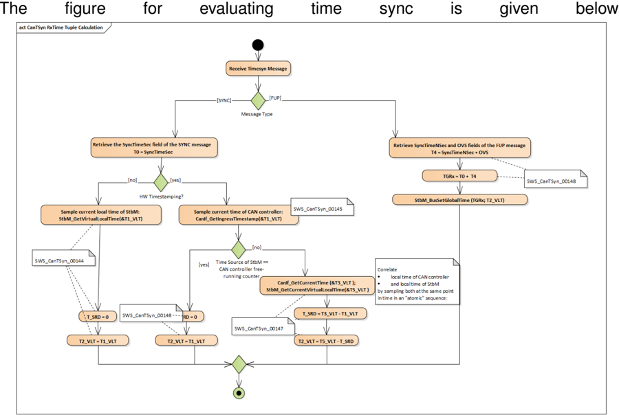

对于时基从节点，在为 **SYNC** 报文调用 [CanTSyn_RxIndication](#741-cantsyn_rxindication) 时，如果 CanTSynHardwareTimestampSupport 设为 **FALSE**，**CanTSyn** 应：

1. 立即建立中断保护；
2. 并紧接着通过 StbM_GetCurrentVirtualLocalTime 从 **StbM** 获取 **SYNC** 报文的参考时间 T1_VLT。

**注意：** 一旦获取了 T1_VLT，可以释放中断保护。

3. 将接收时间元组的 T2_VLT 部分设为 T1_VLT 的值（即 T2_VLT = T1_VLT）；
4. 将 **SYNC** 接收延迟 T_RD 设为 0；
5. 从 **SYNC** 报文的 SyncTimeSec 字段获取 T0。

**注意：** 立即建立中断保护意味着在此之前不应进行任何帧检查（如果在禁用中断嵌套的情况下于 RX 中断的上下文中被调用，中断保护通常由控制器隐式保证）。一旦中断被锁定，可以检查接收到的报文是否是需要对其取虚拟本地时间快照的 **SYNC** 报文，但在取 T1_VLT 之前不得做其他帧检查（例如 **CRC** 校验、**SC** 校验等）。一旦采样了 T1_VLT，就可以移除中断保护并进行必要的校验。这意味着即使后续的校验失败从而快照变得多余，T1_VLT 也会被取到。

对于时基从节点，在为 **SYNC** 报文调用 [CanTSyn_RxIndication](#741-cantsyn_rxindication) 时，如果 CanTSynHardwareTimestampSupport 设为 **TRUE**，**CanTSyn** 应：

- 通过 CanIf_GetIngressTimeStamp 从 **SYNC** 报文的进入时间戳获取 T1_VLT；
- 将 T1_VLT 转换为以 ns 为单位的表示；
- 从 **SYNC** 报文的 SyncTimeSec 字段获取 T0。

对于时基从节点，在为 **SYNC** 报文调用 [CanTSyn_RxIndication](#741-cantsyn_rxindication) 时：

- 如果 CanTSynHardwareTimestampSupport 设为 **TRUE**，
- 且 **StbM** 使用 **CAN** 控制器硬件计数器作为该时基的虚拟本地时间源（参见 StbMLocalTimeClock），

则 **CanTSyn** 应：

- 将接收时间元组的 T2_VLT 部分设为 T1_VLT 的值（即 T2_VLT = T1_VLT）；
- 并将 **SYNC** 接收延迟 T_RD 设为 0。

对于时基从节点，在为 **SYNC** 报文调用 [CanTSyn_RxIndication](#741-cantsyn_rxindication) 时：

- 如果 CanTSynHardwareTimestampSupport 设为 **TRUE**，
- 且 **StbM** 不使用 **CAN** 控制器硬件计数器作为该时基的虚拟本地时间源（参见 StbMLocalTimeClock），

则 **CanTSyn** 应通过施加以下序列将 **CAN** 硬件时间与 **StbM** 的虚拟本地时间进行关联：

1. 对下面两步建立中断保护；
2. 通过 CanIf_GetCurrentTime 获取 **CAN** 控制器硬件计数器的当前时间，并将其转换为虚拟本地时间 T3_VLT；
3. 通过 StbM_GetCurrentVirtualLocalTime 获取 **StbM** 中相应时基的虚拟本地时间的当前值作为 T5_VLT；
4. 将 **SYNC** 接收延迟 T_RD 计算为 (T3_VLT − T1_VLT)；
5. T2_VLT 应计算为 T5_VLT − T_RD。

**注意：** 在上述序列中，中断保护很重要，因为步骤 2 和步骤 3 的序列的任何中断都会恶化全局时间本地实例的精度。

对于时基从节点，在为 **FUP** 报文调用 [CanTSyn_RxIndication](#741-cantsyn_rxindication) 时，**CanTSyn** 应：

1. 从 **FUP** 报文获取以下数据：
   - OVS 字段，以及
   - SyncTimeSec 字段；
2. 并计算 T4 = OVS + SyncTimeSec。

在同一个 Rx 指示例程（[CanTSyn_RxIndication](#741-cantsyn_rxindication)）中或在后续的 [CanTSyn_MainFunction](#751-cantsyn_mainfunction) 调用中，**CanTSyn** 应：

1. 计算 TG_Rx 为 (T0 + T4)；
2. 并通过 StbM_BusSetGlobalTime 将新的接收时间元组 [TG_Rx, T2_VLT] 转发给 **StbM**。

**注意：** 在上述序列中，中断保护很重要，因为步骤 2 和步骤 3 的序列的任何中断都会恶化全局时间本地实例的精度，而后者依赖于时间元组 [TG_Rx, T2_VLT]。

偏移时基的接收方应执行以下步骤来组装偏移时间：

1. 从 OfsTimeSec 获取偏移时间的秒部分；
2. 从 OfsTimeNSec 获取偏移时间的纳秒部分；
3. 通过 StbM_GetCurrentVirtualLocalTime 获取当前虚拟本地时间值。

**注意：** **OFS** 和 **OFNS** 报文不加时间戳。

##### 6.5.3.2. OVS 的考量

接收方应考虑 **OVS**（仅 **FUP**）以获取接收到的同步时基的秒部分。

##### 6.5.3.3. SGW 计算

如果 **SGW** 值（**FUP**、**OFNS** 和扩展 **OFS**）设为 SyncToSubDomain，则 timeBaseStatus 中的 **SYNC_TO_GATEWAY** 位应设为 **TRUE**。否则应设为 **FALSE**。

##### 6.5.3.4. 序列计数器校验

图 7.4 展示了时基从节点对 **SYNC** 和 **OFS** 报文的序列计数器校验。

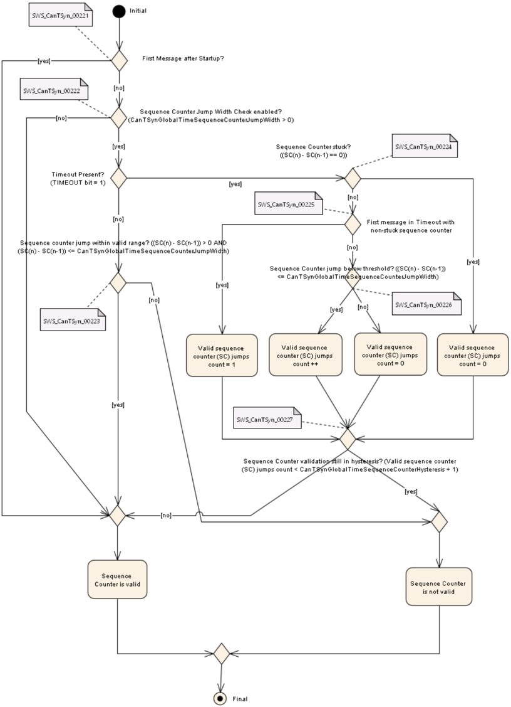

每条 **SYNC** 报文的序列计数器必须与同一时间域下一条到来的 **FUP** 报文的序列计数器匹配。否则，已接收的 **SYNC** 报文的内容应被丢弃，接收到的 **FUP** 报文应被忽略。

如果 CanTSynUseExtendedMsgFormat 为 **FALSE**，每条 **OFS** 报文的序列计数器必须与同一时间域下一条到来的 **OFNS** 报文的序列计数器匹配。如果 **SC** 不匹配，接收到的 **OFNS** 报文应被忽略，已接收的 **OFS** 报文的内容应被丢弃。

在接收到 **SYNC**（或 **OFS**）报文时，如果该报文是启动后的第一条 **SYNC**（或 **OFS**）报文，则时基从节点应将该 **SYNC**（或 **OFS**）报文的序列计数器值视为有效。

**理由：** 启动之后跳过序列计数器检查、允许时基从节点的序列计数器同步到时基主节点的序列计数器是合理的。

在接收到 **SYNC**（或 **OFS**）报文时，如果 **SYNC**（或 **OFS**）报文的序列计数器检查被禁用（即 CanTSynGlobalTimeSequenceCounterJumpWidth == 0），则时基从节点应将该 **SYNC**（或 **OFS**）报文的序列计数器值视为有效。

在接收到 **SYNC**（或 **OFS**）报文时，如果：

- 该报文不是启动后的第一条 **SYNC**（或 **OFS**）报文，
- 且序列计数器检查已启用（即 CanTSynGlobalTimeSequenceCounterJumpWidth > 0），
- 且该时间域未处于超时（即时基同步状态 timeBaseStatus 中 **TIMEOUT** 位未置位），

则时基从节点应检查当前报文的序列计数器与前一条 **SYNC**（或相应 **OFS**）报文的序列计数器之间的差值。

如果差值大于 0 且小于或等于 CanTSynGlobalTimeSequenceCounterJumpWidth，则时基从节点应将该序列计数器值视为有效，否则视为无效。

###### 6.5.3.4.1. 序列计数器滞回

本章规定如何应用可选的滞回（CanTSynGlobalTimeSequenceCounterHysteresis，参见下文的滞回计数规定）来检查序列计数器值是否有效，即序列计数器检查是否实际成功。

这要求一定数量的连续序列计数器跳变（jump）都是有效的。下述各条规定了单个序列计数器跳变何时被视为有效。

滞回提高了针对有缺陷的主节点实现或注入无效主节点报文场景的稳健性，即当序列计数器的增量超过 CanTSynGlobalTimeSequenceCounterJumpWidth 时。在这种场景下（没有任何滞回时），一条具有任何（也包含无效）序列计数器值的报文都会使时基从节点离开超时状态，尽管序列计数器并未正确递增。滞回避免了这一点。

在接收到 **SYNC**（或 **OFS**）报文时，如果：

- 序列计数器检查已启用（即 CanTSynGlobalTimeSequenceCounterJumpWidth > 0），
- 且该时间域处于超时（即时基同步状态 timeBaseStatus 中 **TIMEOUT** 位已置位），
- 且序列计数器卡死（stuck），即当前报文的序列计数器与前一条 **SYNC**（或相应 **OFS**）报文的序列计数器之差为 0，

则时基从节点应将该序列计数器跳变视为无效。

在接收到 **SYNC**（或 **OFS**）报文时，如果：

- 序列计数器检查已启用（即 CanTSynGlobalTimeSequenceCounterJumpWidth > 0），
- 且该时间域处于超时（即 **TIMEOUT** 位已置位），
- 且该报文是超时期间第一条序列计数器未卡死的 **SYNC**（或 **OFS**）报文，

则时基从节点应将该序列计数器跳变视为有效。

**理由：** 在超时之后（例如由于时基主节点复位或断开），接收到的第一条 Timesync 报文的序列计数器很可能失去同步，即序列计数器之差超过 CanTSynGlobalTimeSequenceCounterJumpWidth。为了让序列计数器更快地重新同步到时基主节点，第一条 Timesync 报文的序列计数器不按 CanTSynGlobalTimeSequenceCounterJumpWidth 检查。但是，卡死的序列计数器将始终（即在这种情况下也一样）被视为无效（参见上文的卡死规定）。

在接收到 **SYNC**（或 **OFS**）报文时，如果：

- 序列计数器检查已启用（即 CanTSynGlobalTimeSequenceCounterJumpWidth > 0），
- 且该时间域处于超时（即 **TIMEOUT** 位已置位），
- 且序列计数器未卡死，即当前报文的序列计数器与前一条报文的序列计数器之差不爲 0，
- 且该报文不是超时期间第一条序列计数器未卡死的 **SYNC**（或 **OFS**）报文，

则时基从节点应检查当前报文的序列计数器与前一条 **SYNC**（或相应 **OFS**）报文的序列计数器之差是否超过阈值 CanTSynGlobalTimeSequenceCounterJumpWidth。

如果差值超过阈值 CanTSynGlobalTimeSequenceCounterJumpWidth，则时基从节点应将该序列计数器跳变视为无效，否则视为有效。

在接收到 **SYNC**（或 **OFS**）报文时，如果：

- 序列计数器检查已启用（即 CanTSynGlobalTimeSequenceCounterJumpWidth > 0），
- 且该时间域处于超时（即 **TIMEOUT** 位已置位），

则时基从节点应检查连续有效序列计数器跳变的数量（参见上文各条跳变有效性规定）。

如果连续有效序列计数器跳变的数量超过值 CanTSynGlobalTimeSequenceCounterHysteresis，则时基从节点应将该序列计数器值视为有效，否则视为无效。

##### 6.5.3.5. CRC 校验

如果已配置，应使用 [6, **SWS** CRCLibrary] 中定义的函数 Crc_CalculateCRC8H2F 来校验 **CRC**。

DataID 应计算为 DataID = DataIDList[SC]，其中 DataIDList 由配置为每种报文类型给出。

**注意：** 预定义 DataIDList 中的特定 DataID 确保了对时间同步报文数据元素的标识。

如果 CanTSynUseExtendedMsgFormat 为 **FALSE**，**CRC** 应对时间同步报文字节 2 到字节 7 以及 DataID 计算，其中字节 2 最先施加，随后按升序施加其他字节，DataID 最后。

如果 CanTSynUseExtendedMsgFormat 为 **TRUE**，对于扩展 Timesync 报文格式，**CRC** 应对时间同步报文字节 2 到字节 15 以及 DataID 计算，其中字节 2 最先施加，随后按升序施加其他字节，DataID 最后。

##### 6.5.3.6. ICV 验证

关于每个时间域所引用 **FV** 的配置细节，请参阅 [5, **SWS** StbM] 的第 [9.2.13](#9213-cantsynglobaltimeofnsdataidlistelement)/[9.2.14](#9214-cantsynglobaltimemaster) 节。

当 **FV** 被引用（参见 CanTSynIcvVerificationFvIdRef）且接收到的 **FUP** 或扩展 **OFS** 报文中 FVL > 0 时，时基从节点应调用 StbM_GetRxFreshness **API** 获取新鲜度值，使用：

- 来自引用 CanTSynIcvVerificationFvIdRef 的 StbMFreshnessValueId；
- **FUP** 报文 **FV** 字段中接收到的 StbMTruncatedFreshnessValue；
- **FUP** 报文 FVL 字段中接收到的 StbMTruncatedFreshnessValueLength；
- 作为当前报文失败验证尝试次数（**ICV** 验证尝试计数器）的 StbMAuthVerifyAttempts；
- 来自引用 CanTSynIcvVerificationFvIdRef 的 StbMFreshnessValueLength。

当接收到的 **FUP** 或扩展 **OFS** 报文中 FVL 为 0 时，时基从节点不应在 **ICV** 验证中包含 **FV**。

当 **FV** 未被引用（参见 CanTSynIcvVerificationFvIdRef）且接收到的 **FUP** 或扩展 **OFS** 报文中 FVL > 0 时，时基从节点应停止 **ICV** 验证并将 **ICV** 验证视为失败。

如果 StbM_GetRxFreshness 返回 **E_OK**，时基从节点应在 **ICV** 验证中使用该 **FV**。

如果 StbM_GetRxFreshness 返回不可恢复的错误码（即 **E_NOT_OK**），则时基从节点应：

- 将接收到的 **FUP** 或扩展 **OFS** 报文的 **ICV** 验证视为失败；
- 停止 **ICV** 验证；
- 丢弃接收到的 **FUP** 或扩展 **OFS** 报文；
- 调用 Det_ReportRuntimeError，参数 ErrorId 设为 [**CANTSYN_E_FRESHNESSFAILURE**](#682-运行时错误)（参见第 [6.8](#68-错误分类) 节的运行时错误定义）；
- 并调用 IdsM_SetSecurityEventWithContextData，参数 EventId 设为 **SEV_TSYN_CAN_FRESHNESS_NOT_AVAILABLE**（参见第 [6.7](#67-安全事件) 节「安全事件」）。

关于用于 **ICV** 验证的 **CSM** 任务的配置细节，请参阅 [7, **SWS** CryptoServiceManager] 的第 10.2.5 章。

如果某时间域的 CanTSynIcvVerificationBase 配置为 **ICV_MAC**，时基从节点应调用 Csm_MacVerify 验证 **ICV** 值。

如果某时间域的 CanTSynIcvVerificationBase 配置为 **ICV_SIGNATURE**，时基从节点应调用 Csm_SignatureVerify 验证 **ICV** 值。

**注意：** mode 参数有意保持开放，由实现者选择（即 **CRYPTO_OPERATIONMODE_SINGLECALL** 可能是最佳选项，因为它不需要进一步调用 **CSM**）。

用于生成 **ICV** 的 **CSM** 任务可以配置为同步或异步行为。

当用于验证 **ICV** 的 **CSM** 任务配置为同步行为时，**ICV** 验证超时观察被禁用。在这种情况下，CanTSynIcvVerificationTimeout 应设为 0。

如果 Csm_MacVerify 或 Csm_SignatureVerify 返回 **E_OK**，时基从节点应启动 CanTSynIcvVerificationTimeout。

CanTSynIcvVerificationTimeout 应随着 [CanTSyn_IcvVerificationIndication](#744-cantsyn_icvverificationindication) 回调的通知而停止。

当 Csm_MacVerify 或 Csm_SignatureVerify 返回可恢复的错误码（例如 **E_BUSY**、**QUEUE_FULL**）时，时基从节点应：

- 将接收到的 **FUP** 或扩展 **OFS** 报文的验证视为失败；
- 并为该 **FUP** 或扩展 **OFS** 报文递增认证构建计数器。

如果以下条件之一成立：

- 认证构建计数器已达到配置值 CanTSynRxAuthenticationBuildAttempts；
- **ICV** 验证尝试计数器已达到配置值 CanTSynIcvVerificationAttempts；
- **ICV** 的验证返回了不可恢复的错误，例如返回 **E_NOT_OK** 或 **KEY_FAILURE**；
- CanTSynIcvVerificationTimeout 在 [CanTSyn_IcvVerificationIndication](#744-cantsyn_icvverificationindication) 回调的通知之前到期；

则时基从节点应：

- 停止 **ICV** 验证并将 **ICV** 验证视为失败；
- 并调用 IdsM_SetSecurityEventWithContextData，参数 EventId 设为 **SEV_TSYN_CAN_ICV_VERIFICATION_FAILED**（参见第 [6.7](#67-安全事件) 节「安全事件」）。

对于每次接收需要 **ICV** 验证的报文，时基从节点应维护一个认证构建计数器（参见 CanTSynRxAuthenticationBuildAttempts）。

在初次处理需要 **ICV** 验证的报文时（即对每条接收到的报文的第一次新鲜度和 **ICV** 检查尝试时），时基从节点应将认证构建计数器设为 0。

当 StbM_GetRxFreshness 返回可恢复的错误码（例如 **STBM_E_BUSY**）时，时基从节点应递增认证构建计数器，且不应执行 **ICV** 的验证。

如果：

- 经认证报文的验证已失败，
- 且认证构建计数器尚未达到配置值 CanTSynRxAuthenticationBuildAttempts，

则时基从节点应在下一次调用 [CanTSyn_MainFunction](#751-cantsyn_mainfunction) 时重试新鲜度获取和 **ICV** 验证。

如果 **ICV** 的验证可以成功执行但验证失败（例如 **MAC** 验证失败或密钥无效），则时基从节点应：

- 递增 **ICV** 验证尝试计数器；
- 并将认证构建计数器设为 0。

**注意：** 复位认证构建计数器可以防止在仍可能进行 **ICV** 验证尝试的情况下过早放弃认证过程。

##### 6.5.3.7. 报文拆解

对于每条接收到的时间同步报文，**CanTSyn** 应按如下方式校验该报文（所有条件都必须满足）：

1. 根据 CanTSynRxCrcValidated 参数，Type 匹配；
2. **SC** 值有效（参见第 [6.5.3.4](#6534-序列计数器校验) 节及 [6.5.3.4.1](#65341-序列计数器滞回) 节的各条规定）；
3. **D** 与每种 Type 定义的时间域范围匹配；
4. **D** 与某个配置的时间域匹配（由参数 CanTSynGlobalTimeDomainId 给出）；
5. SyncTimeNSec（仅 **FUP** / **OFNS** / 扩展 **OFS**）与 StbM_TimeStampType.nanoseconds 的定义范围匹配；
6. 根据 CanTSynRxCrcValidated 参数，**CRC**（含 DataID）匹配；
7. 根据 CanTSynRxIcvVerificationType 参数，**ICV** 匹配。

如果接收到的时间同步报文的校验成功（参见上述校验规定），**CanTSyn** 应拆卸该报文，并通过 StbM_BusSetGlobalTime 将全局时间转发给 **StbM**。

如果接收到的时间同步报文的校验失败（参见上述校验规定），**CanTSyn** 应丢弃接收到的时间同步报文。

### 6.6. 时间记录

#### 6.6.1. 全局时间精度测量

在调用 StbM_BusSetGlobalTime 时，measureDataPtr 结构的参数 pathDelay 应设为 0。

#### 6.6.2. 时间验证

如果 CanTSynTimeValidationSupport 设为 **TRUE**，**CanTSyn** 应支持时间验证。

如果：

- CanTSynTimeValidationSupport 已启用，且
- 该时间域的 CanTSynEnableTimeValidation 已启用，

则 **CanTSyn** 应为该时间域执行用于时间验证的时间记录。

如果：

- 某时间域已启用用于时间验证的时间记录（见上两条的规定），
- 且 **CanTSyn** 被配置为该时间域的时基从节点，

则 **CanTSyn** 应在成功接收到 **FUP** 报文时调用 StbM_CanSetSlaveTimingData。

StbM_CanSetSlaveTimingData 应在 StbM_BusSetGlobalTime 之后调用。

**注意：** StbM_BusSetGlobalTime 应先被调用，因为它更新同步本地时间元组（参见 **StbM** 规范），而 StbM_CanSetSlaveTimingData 需要它。

在调用 StbM_CanSetSlaveTimingData 时，**CanTSyn** 应通过参数 measureDataPtr 向该函数传递以下值：

- 来自发送方（时基主节点）的序列计数器值；
- 接收到 **SYNC** 报文的物理通道的段 ID（参见参数 CanTSynGlobalTimeNetworkSegmentId）；
- 作为 **SYNC** 报文的 syncIngressTimestamp 的 T2_VLT（参见第 [6.5.3.1](#6531-全局时间计算) 节的 **SW** 时间戳/硬件时间戳各条规定）；
- 从时基主节点接收的、作为 preciseOriginTimestamp 的 T0 + T4（参见第 [6.5.3.1](#6531-全局时间计算) 节的相应规定）。

结构成员 measureDataPtr→referenceLocalTimestamp 和 measureDataPtr→referenceGlobalTimestamp 应传 0。

**注意：** **CanTSyn** 传递 0 以避免未定义的值。结构成员 referenceLocalTimestamp 和 referenceGlobalTimestamp 将由 **StbM** 在 StbM_CanSetSlaveTimingData 内部设置（参见 **StbM** 规范的相应规定）。

如果：

- 某时间域已启用用于时间验证的时间记录（见上两条的规定），
- 且 **CanTSyn** 被配置为该时间域的时基主节点，

则 **CanTSyn** 应在成功发送 **SYNC** 报文时调用 StbM_CanSetMasterTimingData。

在调用 StbM_CanSetMasterTimingData 时，**CanTSyn** 应通过参数 measureDataPtr 向该函数传递以下数据：

- 在 **SYNC** 报文中发送的序列计数器；
- 发送 **SYNC** 报文的物理通道的段 ID（参见参数 CanTSynGlobalTimeNetworkSegmentId）；
- 作为 **SYNC** 报文的 syncEgressTimestamp 的 T1_VLT（参见第 [6.4.6.1](#6461-全局时间计算) 节的相应规定）；
- 作为精确 preciseOriginTimestamp 的 T0_SYNC + (T1_VLT − T0_VLT)（参见第 [6.4.6.1](#6461-全局时间计算) 节的相应规定）。

### 6.7. 安全事件

如果已为 **CanTSyn** 模块启用安全事件报告（CanTSynEnableSecurityEventReporting = **TRUE**），则相应安全事件应通过 [3, **SWS** BSWGeneral] 中定义的接口向 **IdsM** [\[8\]](#ref-8) 报告。

下表列出了为 **CanTSyn** 标准化的安全事件及其触发条件。

表6.1：**CanTSyn** 的安全事件（**Security events for CanTSyn**）

| 名称 | 说明 | ID |
| --- | --- | --- |
| SEV_TSYN_CAN_ICV_GENERATION_FAILED | **FUP** 或扩展 **OFS** 报文的 **ICV** 生成失败 | 66 |
| SEV_TSYN_CAN_ICV_VERIFICATION_FAILED | **FUP** 或扩展 **OFS** 报文的 **ICV** 验证失败 | 67 |
| SEV_TSYN_CAN_FRESHNESS_NOT_AVAILABLE | 从 **FvM** 获取新鲜度值失败 | 68 |
| SEV_TSYN_CAN_MSG_SEQUENCE_ERROR | 在（CanTSynGlobalTimeFollowUpTimeout）内未能从时基主节点接收到正确的 **SYNC** 和 **FUP** 或 **OFS** 和 **OFNS** 序列 | 69 |

下表描述应为相应安全事件报告的上下文数据：

表6.2：**CanTSyn** 相应安全事件的上下文数据（**Context data of respective Security events of CanTSyn**）

| 安全事件 | 上下文数据 |
| --- | --- |
| SEV_TSYN_CAN_ICV_GENERATION_FAILED | 上下文数据（1 字节）——GlobalTimeDomainId |
| SEV_TSYN_CAN_ICV_VERIFICATION_FAILED | 上下文数据（1 字节）——GlobalTimeDomainId |
| SEV_TSYN_CAN_FRESHNESS_NOT_AVAILABLE | 上下文数据（1 字节）——GlobalTimeDomainId |
| SEV_TSYN_CAN_MSG_SEQUENCE_ERROR | 上下文数据（1 字节）——GlobalTimeDomainId |

### 6.8. 错误分类

文档"General Specification of Basic Software Modules" [\[3\]](#ref-3) 的第 7.2 节"Error Handling"详细描述了基础软件的错误处理。其中最重要的是，它构成了一个由五种错误类型组成的分类方案，这些错误类型可能发生在 **BSW** 模块中。

基于该基础，下文按相应的小节规定了特定错误。

#### 6.8.1. 开发错误

表6.3：**CanTSyn** 模块中开发错误的定义（**Definition of development errors in module CanTSyn**）

| 错误类型 | 相关错误码 | 错误值 |
| --- | --- | --- |
| 使用错误的 **PDU** 或 **SDU** 调用 **API** 服务 | CANTSYN_E_INVALID_PDUID | 0x01 |
| 在未初始化状态下使用 **API** 服务 | CANTSYN_E_UNINIT | 0x02 |
| 指针为 **NULL** | CANTSYN_E_NULL_POINTER | 0x03 |
| **CanTSyn** 初始化失败 | CANTSYN_E_INIT_FAILED | 0x04 |
| 使用无效参数调用 **API** | CANTSYN_E_PARAM | 0x05 |
| 无效的控制器索引 | CANTSYN_E_INV_CTRL_IDX | 0x06 |

#### 6.8.2. 运行时错误

表6.4：**CanTSyn** 模块中运行时错误的定义（**Definition of runtime errors in module CanTSyn**）

| 错误类型 | 相关错误码 | 错误值 |
| --- | --- | --- |
| **FVM** 无可用 **FV** | CANTSYN_E_FRESHNESSFAILURE | 0x01 |

#### 6.8.3. 瞬态故障

没有瞬态故障。

#### 6.8.4. 生产错误

没有生产错误。

#### 6.8.5. 扩展生产错误

没有扩展生产错误。

## 7. API规范

### 7.1. 导入的类型

本节列出从以下文件包含的所有类型：

**CanTSyn**模块的导入数据类型定义

| 模块 | 头文件 | 导入的类型 |
|---|---|---|
| Can | Can_GeneralTypes.h | Can_TimeStampType (draft) |
| ComStack_Types | ComStack_Types.h | PduIdType |
| ComStack_Types | ComStack_Types.h | PduInfoType |
| ComStack_Types | ComStack_Types.h | PduLengthType |
| Csm | Rte_Csm_Type.h | Crypto_OperationModeType |
| Csm | Rte_Csm_Type.h | Crypto_ResultType |
| Csm | Rte_Csm_Type.h | Crypto_VerifyResultType |
| Eth | Eth.h | Eth_RateDeviationStatusType (draft) |
| Eth | Eth.h | Eth_RateDeviationType (draft) |
| IdsM | IdsM_Types.h | IdsM_SecurityEventIdType |
| StbM | Rte_StbM_Type.h | StbM_CanTimeMasterMeasurementType |
| StbM | Rte_StbM_Type.h | StbM_CanTimeSlaveMeasurementType |
| StbM | Rte_StbM_Type.h | StbM_SynchronizedTimeBaseType |
| StbM | Rte_StbM_Type.h | StbM_TimeBaseStatusType |
| StbM | Rte_StbM_Type.h | StbM_TimeStampShortType |
| StbM | Rte_StbM_Type.h | StbM_TimeStampType |
| StbM | Rte_StbM_Type.h | StbM_TimeTupleType |
| StbM | Rte_StbM_Type.h | StbM_UserDataType |
| StbM | StbM.h | StbM_MeasurementType |
| StbM | StbM.h | StbM_VirtualLocalTimeType |
| Std | Std_Types.h | Std_ReturnType |
| Std | Std_Types.h | Std_VersionInfoType |

### 7.2. 类型定义

#### 7.2.1. CanTSyn_ConfigType

结构类型，元素为实现特定的。这是 **CAN** 时间同步配置的基础类型。指向该结构实例的指针将用于 **CAN** 时间同步的初始化。可通过**CanTSyn.h**获得。

#### 7.2.2. CanTSyn_TransmissionModeType

枚举类型，处理发送模式的启用和禁用。取值：**CANTSYN_TX_OFF**（禁用发送）；**CANTSYN_TX_ON**（启用发送）。可通过**CanTSyn.h**获得。

### 7.3. 函数定义

#### 7.3.1. CanTSyn_Init

**说明**: 该函数初始化 **CAN** 时间同步。可通过**CanTSyn.h**获得。本服务为同步调用，不可重入。参数 configPtr（in）：指向所选配置结构的指针。服务 ID [hex]：0x01。

```C
void CanTSyn_Init ( const CanTSyn_ConfigType* configPtr )
```

[**CANTSYN_E_INIT_FAILED**](#681-开发错误) 按照 [3, **SWS** BSW General] 中 SWS_BSW_00050 的规定报告。细节见第 6.2.2 节「初始化」。

#### 7.3.2. CanTSyn_GetVersionInfo

**说明**: 返回本模块的版本信息。可通过**CanTSyn.h**获得。本服务为同步调用，不可重入。参数 versioninfo（out）：存储本模块版本信息的位置的指针。服务 ID [hex]：0x02。

```C
void CanTSyn_GetVersionInfo ( Std_VersionInfoType* versioninfo )
```

#### 7.3.3. CanTSyn_SetTransmissionMode

**说明**: 本 **API** 用于打开和关闭 **CanTSyn** 的 **TX** 能力。可通过**CanTSyn.h**获得。本服务为同步调用，不可重入。参数 CtrlIdx（in）：**CAN** 通道的索引。参数 Mode（in）：**CANTSYN_TX_OFF** / **CANTSYN_TX_ON**。服务 ID [hex]：0x03。

```C
void CanTSyn_SetTransmissionMode ( uint8 CtrlIdx, CanTSyn_TransmissionModeType Mode )
```

如果启用了开发错误检测（即 CanTSynDevErrorDetect 设为 **TRUE**）且函数调用因以下原因失败，函数 CanTSyn_SetTransmissionMode 应通知 **DET**：

- 无效的 CtrlIdx（[**CANTSYN_E_INV_CTRL_IDX**](#681-开发错误)）；
- 无效的 Mode（[**CANTSYN_E_PARAM**](#681-开发错误)）。

### 7.4. 回调通知

这是为其他模块提供的函数列表。

#### 7.4.1. CanTSyn_RxIndication

**说明**: 从下层通信接口模块接收 **PDU** 的指示。可通过**CanTSyn.h**获得。本服务为同步调用，对于不同的 PduId 可重入；对于相同的 PduId 不可重入。参数 RxPduId（in）：接收到的 **PDU** 的 ID。参数 PduInfoPtr（in）：包含接收到的 **PDU** 的长度（SduLength）、指向包含该 **PDU** 的缓冲区的指针（SduDataPtr）以及与该 **PDU** 相关的元数据（MetaData）。服务 ID [hex]：0x42。

```C
void CanTSyn_RxIndication ( PduIdType RxPduId, const PduInfoType* PduInfoPtr )
```

**注意：** 回调函数 CanTSyn_RxIndication 由 **CAN** 接口调用，由 **CanTSyn** 模块实现。它在 **CAN** 驱动程序的接收指示事件时被调用。

如果启用了开发错误检测（CanTSynDevErrorDetect 设为 **TRUE**）且函数调用因以下原因失败，回调函数 CanTSyn_RxIndication 应通知 **DET**：

- 无效的 **PDU** ID（[**CANTSYN_E_INVALID_PDUID**](#681-开发错误)）；
- PduInfoPtr 或 SduDataPtr 等于 **NULL_PTR**（[**CANTSYN_E_NULL_POINTER**](#681-开发错误)）。

CanTSyn_RxIndication 的注意事项：

- 在本服务返回之前，**CAN** 接口不会访问 canSduPtr。canSduPtr 只在指示返回之前有效并可供上层使用。**CAN** 接口保证该 CanTSynRxPduId 配置的字节数是有效的。调用上下文要么在中断级（中断模式），要么在任务级（轮询模式）。对于多个 **CAN** 控制器的使用，该回调服务是可重入的。

**注意：** 使用轮询模式作为调用上下文会显著增加延迟从而降低精度。因此强烈建议只使用中断模式。

- **CanTSyn** 模块已被正确初始化。

#### 7.4.2. CanTSyn_TxConfirmation

**说明**: 下层通信接口模块确认一个 **PDU** 的发送，或 **PDU** 发送的失败。可通过**CanTSyn.h**获得。本服务为同步调用，对于不同的 PduId 可重入；对于相同的 PduId 不可重入。参数 TxPduId（in）：已发送的 **PDU** 的 ID。参数 result（in）：**E_OK** 该 **PDU** 已发送；**E_NOT_OK** 该 **PDU** 的发送失败。服务 ID [hex]：0x40。

```C
void CanTSyn_TxConfirmation ( PduIdType TxPduId, Std_ReturnType result )
```

**注意：** 回调函数 CanTSyn_TxConfirmation 由 **CAN** 接口调用，由 **CanTSyn** 模块实现。

如果启用了开发错误检测（CanTSynDevErrorDetect 设为 **TRUE**）且函数调用因以下原因失败，回调函数 CanTSyn_TxConfirmation 应通知 **DET**：

- 无效的 **PDU** ID（[**CANTSYN_E_INVALID_PDUID**](#681-开发错误)），即参数 CanTSynGlobalTimeMasterConfirmationHandleId 未配置的 **PDU** ID。

CanTSyn_TxConfirmation 的注意事项：

- 调用上下文要么在中断级（中断模式），要么在任务级（轮询模式）。对于多个 **CAN** 控制器的使用，该回调服务是可重入的。

**注意：** 使用轮询模式作为调用上下文会显著增加延迟从而降低精度。因此强烈建议只使用中断模式。

- **CanTSyn** 模块已被正确初始化。

#### 7.4.3. CanTSyn_IcvGenerationIndication

**说明**: 通过该 **API** 服务，**CanTSyn** 获得 **ICV** 生成的指示和结果。可通过**CanTSyn.h**获得。本服务为同步调用，可重入。参数 jobId（in）：引起该回调的操作的 JobID。参数 result（in）：包含加密操作的结果。服务 ID [hex]：0x7。

```C
void CanTSyn_IcvGenerationIndication ( uint32 jobId, Crypto_ResultType result )
```

如果启用了开发错误检测（CanTSynDevErrorDetect 设为 **TRUE**）且函数调用因以下原因失败，函数 CanTSyn_IcvGenerationIndication 应通知 **DET**：

- jobId 无效（[**CANTSYN_E_PARAM**](#681-开发错误)）。

#### 7.4.4. CanTSyn_IcvVerificationIndication

**说明**: 通过该 **API** 服务，**CanTSyn** 获得 **ICV** 验证的指示和结果。可通过**CanTSyn.h**获得。本服务为同步调用，可重入。参数 jobId（in）：引起该回调的操作的 JobID。参数 result（in）：包含加密操作的结果。服务 ID [hex]：0x8。

```C
void CanTSyn_IcvVerificationIndication ( uint32 jobId, Crypto_ResultType result )
```

如果启用了开发错误检测（CanTSynDevErrorDetect 设为 **TRUE**）且函数调用因以下原因失败，函数 CanTSyn_IcvVerificationIndication() 应通知 **DET**：

- jobId 无效（[**CANTSYN_E_PARAM**](#681-开发错误)）。

### 7.5. 调度函数

这些函数由基础软件调度器直接调用。以下函数应没有返回值且没有参数。所有函数都应为不可重入。

#### 7.5.1. CanTSyn_MainFunction

**说明**: 用于周期性调用 / 相应 Timesync 报文发送的主函数。可通过**CanTSyn_SchM.h**获得。服务 ID [hex]：0x06。

```C
void CanTSyn_MainFunction ( void )
```

CanTSyn_MainFunction 的调用频率由配置参数 CanTSynMainFunctionPeriod 确定。

### 7.6. 期望接口

本章列出了从其他模块要求的全部接口。

#### 7.6.1. 必需接口

**注意：** 本节定义了为满足模块核心功能所需要的全部接口。

**CanTSyn**模块的必需接口定义

| **API** 函数 | 头文件 | 说明 |
|---|---|---|
| StbM_GetCurrentVirtualLocalTime | StbM.h | 返回被引用时基的虚拟本地时间。 |

#### 7.6.2. 可选接口

本节定义了为满足模块可选功能所需要的全部接口。

**CanTSyn**模块的可选接口定义

| **API** 函数 | 头文件 | 说明 |
|---|---|---|
| CanIf_EnableEgressTimeStamp (draft) | CanIf.h | 本服务调用相应的 **CAN** 驱动服务，以在专用报文对象上激活发出时间戳标记。 |
| CanIf_GetCurrentTime (draft) | CanIf.h | 本服务调用相应的 **CAN** 驱动服务，以从硬件寄存器中获取当前时间值。 |
| CanIf_GetEgressTimeStamp (draft) | CanIf.h | 本服务调用相应的 **CAN** 驱动服务，以读回专用报文对象上的发出时间戳。它需要在 TxConfirmation() 函数内被调用。 |
| CanIf_GetIngressTimeStamp (draft) | CanIf.h | 本服务调用相应的 **CAN** 驱动服务，以读回专用报文对象上的进入时间戳。它需要在 RxIndication() 函数内被调用。 |
| CanIf_Transmit | CanIf.h | 请求发送一个 **PDU**。 |
| Crc_CalculateCRC8H2F | Crc.h | 本服务在 Crc_Length 上用多项式 0x2F 做 **CRC8** 计算。 |
| Csm_MacGenerate | Csm.h | 使用给定的数据执行 **MAC** 生成，并将 **MAC** 存储到 **MAC** 指针所指向的内存位置。 |
| Csm_MacVerify | Csm.h | 通过比较 **MAC** 是否由给定数据生成来验证给定的 **MAC**。 |
| Csm_SignatureGenerate | Csm.h | 使用给定的数据执行签名计算，并将签名存储到结果指针所指向的内存位置。 |
| Csm_SignatureVerify | Csm.h | 通过比较签名是否由给定数据生成来验证给定的 **MAC**。 |
| Det_ReportError | Det.h | 报告开发错误的服务。 |
| Det_ReportRuntimeError | Det.h | 报告运行时错误的服务。如果配置了 callout，则应调用该 callout。 |
| IdsM_SetSecurityEventWithContextData | IdsM.h | 本 **API** 是向 **IdsM** 报告带上下文数据的安全事件的应用接口。 |
| StbM_BusSetGlobalTime | StbM.h | 允许时基提供者模块将接收时间元组转发给 **StbM**。 |
| StbM_CanSetMasterTimingData (draft) | StbM_CanTSyn.h | 向 **StbM** 提供时基主节点的 **CAN** Timesync 模块特定数据。 |
| StbM_CanSetSlaveTimingData (draft) | StbM_CanTSyn.h | 允许 **CanTSyn** 模块将 **CAN** 特定的细节转发给 **StbM**。 |
| StbM_GetCurrentTime | StbM.h | 返回时间元组（本地时间、全局时间和时基状态）以及用户数据详情。**注意：** 本 **API** 应在锁定中断的情况下调用/在独占区内调用，以防止中断（即时间戳在函数调用返回时已过时的风险）。 |
| StbM_GetOffset | StbM.h | 允许 Timesync 模块获取当前的偏移时间和用户数据。 |
| StbM_GetRxFreshness (draft) | StbM.h | **StbM** 使用该接口查询当前的新鲜度值。 |
| StbM_GetTimeBaseStatus | StbM.h | 返回同步时基（或纯本地时基）的详细状态信息；如果针对偏移时基调用，则还返回该偏移时基及其底层同步时基的详细状态信息。 |
| StbM_GetTimeBaseUpdateCounter | StbM.h | 允许 Timesync 模块检测某时基是否应在随后的 &lt;Bus&gt;TSyn_MainFunction() 周期中立即发送。 |
| StbM_GetTxFreshness (draft) | StbM.h | 本 **API** 以大端格式从新鲜度数组第一个字节的最高有效位返回新鲜度值。 |
| StbM_GetTxFreshnessTruncData (draft) | StbM.h | **StbM** 使用该接口获取当前的新鲜度值。该接口函数还提供在受保护时间同步报文中传输的截断新鲜度。 |
| StbM_SPduTxConfirmation (draft) | StbM.h | **StbM** 使用该接口指示受保护的时间同步报文已被发起传输。 |

## 8. 时序图

### 8.1. 启用出口时间戳

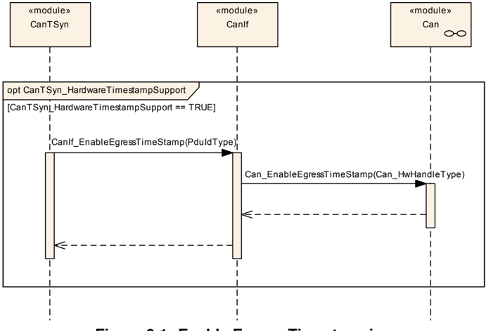

### 8.2. CAN 时间同步（时基主节点）

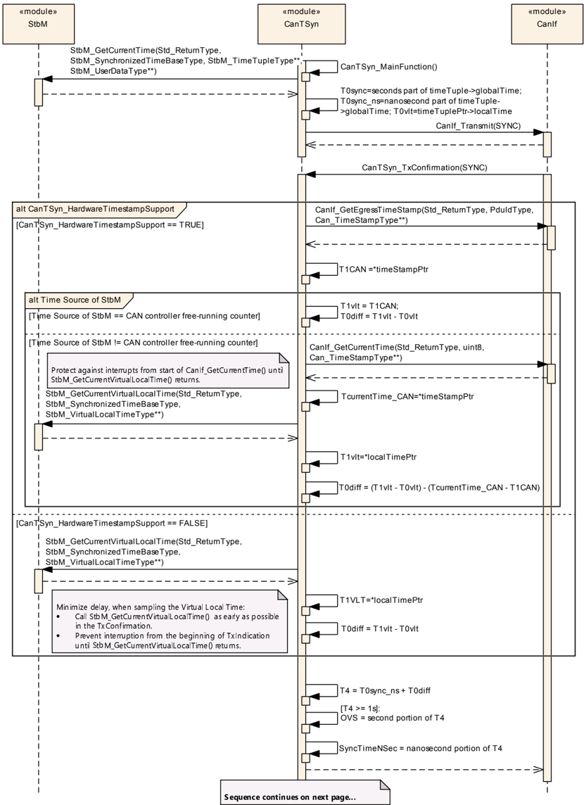

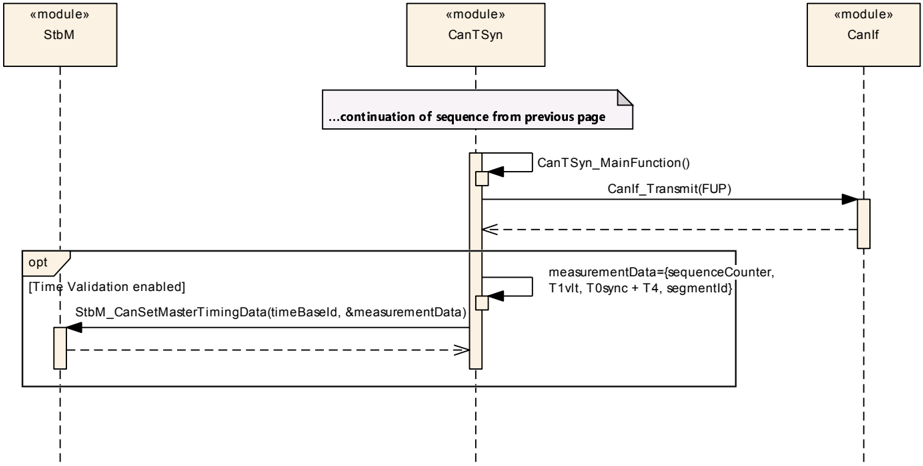

### 8.3. CAN 时间同步（时基从节点）

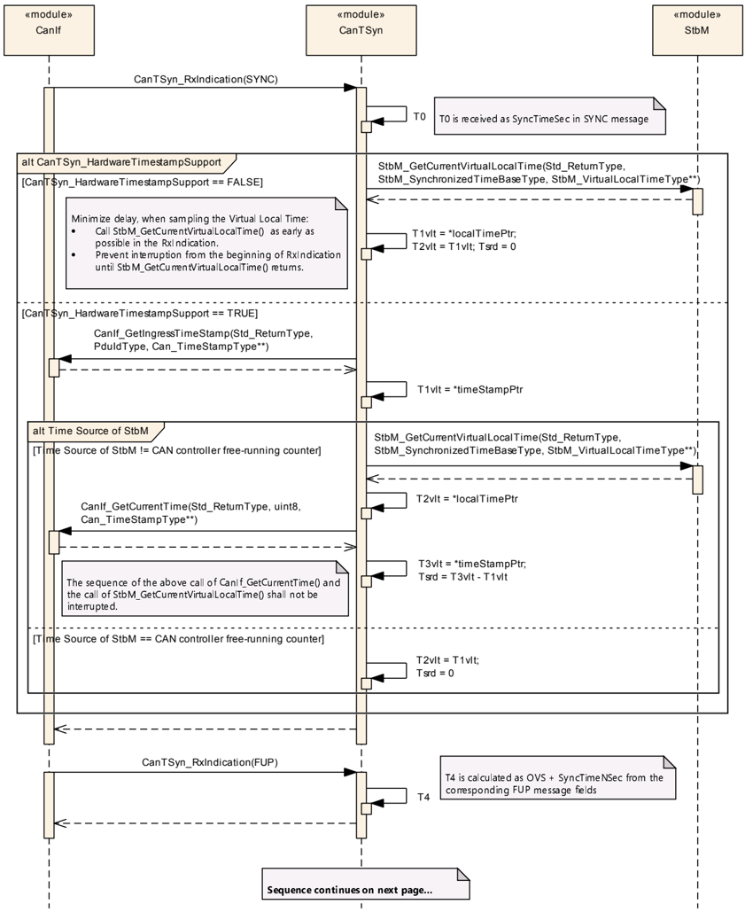

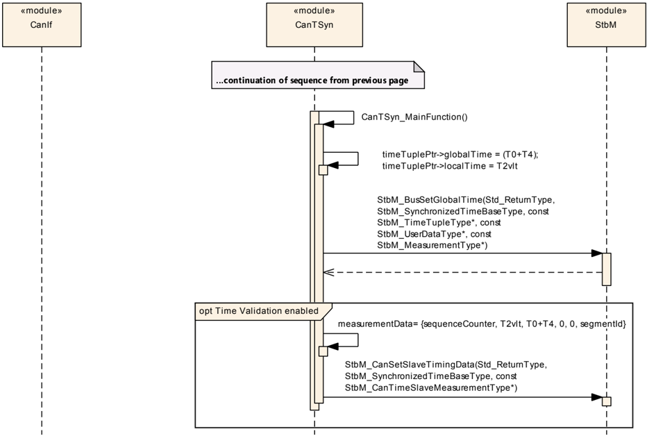

### 8.4. CAN 安全时间同步（时基主节点、时基从节点）

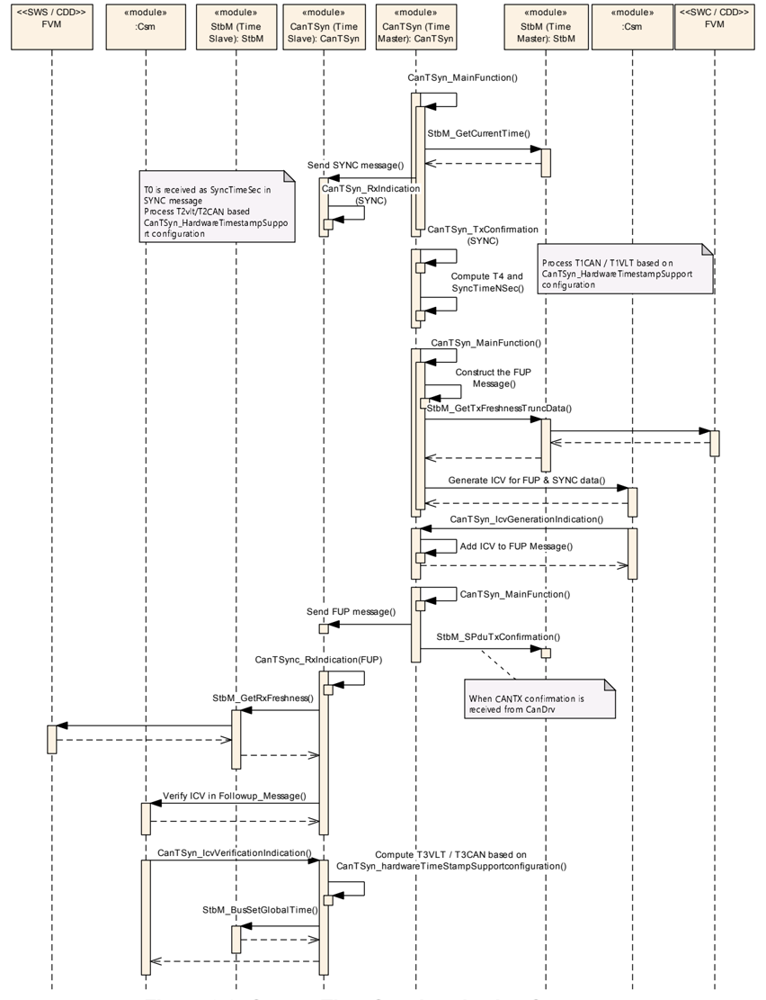

## 9. 配置规范

通常，本章定义配置参数及其到容器的聚集。为支持该规范，第 9.1 节描述基本原理。它还规定了应用于参数规范的模板（表）。我们有意将第 9.1 节保留在规范中，以保证可理解性。

第 9.2 节规定模块 **CanTSyn** 的结构（容器）和参数。

第 9.4 节规定模块 **CanTSyn** 的发布信息。

### 9.1. 如何阅读本章

细节请参阅 [3, **SWS** BSW General] 的第 10.1 章「Introduction to configuration specification」。

### 9.2. 容器与配置参数

以下各章汇总所有配置参数。第 6 章和第 7 章描述参数的详细含义。

#### 9.2.1. 变体

**CAN** 时间同步应支持时基主节点、时基从节点和时间网关的配置。

本模块支持不同的 post-build 变体（此前称为 post-build 可选配置集），但不支持 post-build 可加载配置。

#### 9.2.2. CanTSyn

| SWS 条目 | [ECUC_CanTSyn_00001] |
|---|---|
| 模块名称 | CanTSyn |
| 描述 | 关于 **CAN** 上全局时间处理的同步时基管理器（**StbM**）模块的配置。 |
| Post-Build 变体支持 | true |
| 支持的配置变体 | VARIANT-PRE-COMPILE |

| 容器名称 | 多重性 | 作用域/依赖 |
|---|---|---|
| CanTSynGeneral | 1 | 此容器保存 **CAN** 特定的同步时基管理器的通用参数 |
| CanTSynGlobalTimeDomain | 1..* | 这表示 **CAN** 上全局时间域的存在。**CanTSyn** 模块可以同时管理多个全局时间域，它们自身构成域和子域的层次结构。如果存在 **CanTSyn**，则假设至少存在一个全局时间域。 |

#### 9.2.3. CanTSynGeneral

| SWS 条目 | [ECUC_CanTSyn_00003] |
|---|---|
| 容器名称 | CanTSynGeneral |
| 父容器 | CanTSyn |
| 描述 | 此容器保存 **CAN** 特定的同步时基管理器的通用参数 |
| 配置参数 | 见下方参数表 |

| SWS 条目 | [ECUC_CanTSyn_00002] |
|---|---|
| 参数名称 | CanTSynDevErrorDetect |
| 父容器 | CanTSynGeneral |
| 描述 | 开启或关闭开发错误检测与通知（true：启用检测与通知；false：禁用检测与通知）。 |
| 多重性 | 1 |
| 类型 | EcucBooleanParamDef |
| 默认值 | false |
| Post-Build 变体值 | false |
| 值配置类 | Pre-compile time：X（所有变体）；Link time：-；Post-build time：- |
| 作用域/依赖 | scope: local |

| SWS 条目 | [ECUC_CanTSyn_00055] |
|---|---|
| 参数名称 | CanTSynEnableSecurityEventReporting |
| 父容器 | CanTSynGeneral |
| 描述 | 开启或关闭向 **IdsM** 的安全事件报告：true：启用报告；false：禁用报告。 |
| 多重性 | 1 |
| 类型 | EcucBooleanParamDef |
| 默认值 | false |
| Post-Build 变体值 | false |
| 值配置类 | Pre-compile time：X（所有变体）；Link time：-；Post-build time：- |
| 作用域/依赖 | scope: local |

| SWS 条目 | [ECUC_CanTSyn_00054] |
|---|---|
| 参数名称 | CanTSynHardwareTimestampSupport |
| 父容器 | CanTSynGeneral |
| 描述 | 激活/停用 **CAN** 硬件的硬件时间戳功能。True：时间戳从 **CAN** 硬件获取；False：时间戳从 **StbM** 获取。 |
| 多重性 | 1 |
| 类型 | EcucBooleanParamDef |
| 默认值 | - |
| Post-Build 变体值 | false |
| 值配置类 | Pre-compile time：X（所有变体）；Link time：-；Post-build time：- |
| 作用域/依赖 | scope: local |

| SWS 条目 | [ECUC_CanTSyn_00019] |
|---|---|
| 参数名称 | CanTSynMainFunctionPeriod |
| 父容器 | CanTSynGeneral |
| 描述 | 主函数 CanTSyn_MainFunction 的调度周期。单位：[s]。 |
| 多重性 | 1 |
| 类型 | EcucFloatParamDef |
| 取值范围 | ]0 .. INF[ |
| 默认值 | - |
| Post-Build 变体值 | false |
| 值配置类 | Pre-compile time：X（所有变体）；Link time：-；Post-build time：- |
| 作用域/依赖 | scope: local |

| SWS 条目 | [ECUC_CanTSyn_00088] |
|---|---|
| 参数名称 | CanTSynSyncTransmissionsPerCycle |
| 父容器 | CanTSynGeneral |
| 描述 | 一个 CanTSyn_MainFunction 内 **SYNC** 报文发送的最大数量。 |
| 多重性 | 0..1 |
| 类型 | EcucIntegerParamDef |
| 取值范围 | 0 .. 255 |
| 默认值 | 0 |
| Post-Build 变体多重性 | false |
| Post-Build 变体值 | false |
| 多重性配置类 | Pre-compile time：X（所有变体）；Link time：-；Post-build time：- |
| 值配置类 | Pre-compile time：X（所有变体）；Link time：-；Post-build time：- |
| 作用域/依赖 | scope: local |

| SWS 条目 | [ECUC_CanTSyn_00050] |
|---|---|
| 参数名称 | CanTSynTimeValidationSupport |
| 父容器 | CanTSynGeneral |
| 描述 | 开启或关闭时间验证支持（true：启用时间验证；false：禁用时间验证）。 |
| 多重性 | 1 |
| 类型 | EcucBooleanParamDef |
| 默认值 | false |
| Post-Build 变体值 | false |
| 值配置类 | Pre-compile time：X（所有变体）；Link time：-；Post-build time：- |
| 作用域/依赖 | scope: local |

| SWS 条目 | [ECUC_CanTSyn_00023] |
|---|---|
| 参数名称 | CanTSynVersionInfoApi |
| 父容器 | CanTSynGeneral |
| 描述 | 激活/停用版本信息 **API**（CanTSyn_GetVersionInfo）。True：版本信息 **API** 激活；False：版本信息 **API** 停用。 |
| 多重性 | 1 |
| 类型 | EcucBooleanParamDef |
| 默认值 | false |
| Post-Build 变体值 | false |
| 值配置类 | Pre-compile time：X（所有变体）；Link time：-；Post-build time：- |
| 作用域/依赖 | scope: local |

| 容器名称 | 多重性 | 作用域/依赖 |
|---|---|---|
| CanTSynSecurityEventRefs | 0..1 | 容器，包含到 IdsMEvent 元素的引用，这些元素表示当相应安全相关事件发生时（且若 CanTSynEnableSecurityEventReporting 设为 "true"），**CanTSyn** 模块应向 **IdsM** 报告的安全事件。此容器中的标准化安全事件可以由供应商特定的安全事件扩展。 |

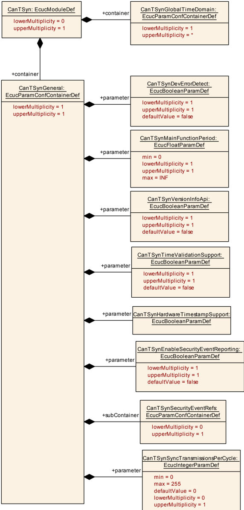

#### 9.2.4. CanTSynSecurityEventRefs

| SWS 条目 | [ECUC_CanTSyn_00056] |
|---|---|
| 容器名称 | CanTSynSecurityEventRefs |
| 父容器 | CanTSynGeneral |
| 描述 | 容器，包含到 IdsMEvent 元素的引用，这些元素表示当相应安全相关事件发生时（且若 CanTSynEnableSecurityEventReporting 设为 "true"），**CanTSyn** 模块应向 **IdsM** 报告的安全事件。此容器中的标准化安全事件可以由供应商特定的安全事件扩展。 |
| Post-Build 变体多重性 | false |
| 多重性配置类 | Pre-compile time：X（所有变体）；Link time：-；Post-build time：- |
| 配置参数 | 见下方参数表 |

| SWS 条目 | [ECUC_CanTSyn_00059] |
|---|---|
| 参数名称 | SEV_TSYN_CAN_FRESHNESS_NOT_AVAILABLE |
| 父容器 | CanTSynSecurityEventRefs |
| 描述 | **FVM** 无可用 **FV**。上下文数据提供相应的时间域 ID。 |
| 多重性 | 0..1 |
| 类型 | Symbolic name reference to IdsMEvent |
| Post-Build 变体多重性 | false |
| Post-Build 变体值 | false |
| 多重性配置类 | Pre-compile time：X；Link time：-；Post-build time：- |
| 值配置类 | Pre-compile time：X；Link time：-；Post-build time：- |
| 作用域/依赖 | scope: local |

| SWS 条目 | [ECUC_CanTSyn_00057] |
|---|---|
| 参数名称 | SEV_TSYN_CAN_ICV_GENERATION_FAILED |
| 父容器 | CanTSynSecurityEventRefs |
| 描述 | Follow_Up 报文的 **ICV** 生成失败。上下文数据提供相应的时间域 ID。 |
| 多重性 | 0..1 |
| 类型 | Symbolic name reference to IdsMEvent |
| Post-Build 变体多重性 | false |
| Post-Build 变体值 | false |
| 多重性配置类 | Pre-compile time：X（所有变体）；Link time：-；Post-build time：- |
| 值配置类 | Pre-compile time：X（所有变体）；Link time：-；Post-build time：- |
| 作用域/依赖 | scope: local |

| SWS 条目 | [ECUC_CanTSyn_00058] |
|---|---|
| 参数名称 | SEV_TSYN_CAN_ICV_VERIFICATION_FAILED |
| 父容器 | CanTSynSecurityEventRefs |
| 描述 | Follow_Up 报文的 **ICV** 验证失败。上下文数据提供相应的时间域 ID。 |
| 多重性 | 0..1 |
| 类型 | Symbolic name reference to IdsMEvent |
| Post-Build 变体多重性 | false |
| Post-Build 变体值 | false |
| 多重性配置类 | Pre-compile time：X；Link time：-；Post-build time：- |
| 值配置类 | Pre-compile time：X；Link time：-；Post-build time：- |
| 作用域/依赖 | scope: local |

| SWS 条目 | [ECUC_CanTSyn_00083] |
|---|---|
| 参数名称 | SEV_TSYN_CAN_MSG_SEQUENCE_ERROR |
| 父容器 | CanTSynSecurityEventRefs |
| 描述 | 在（CanTSynGlobalTimeFollowUpTimeout）内未能从时基主节点接收到正确的 **SYNC** 和 **FUP** 或 **OFS** 和 **OFNS** 序列。 |
| 多重性 | 0..1 |
| 类型 | Symbolic name reference to IdsMEvent |
| Post-Build 变体多重性 | false |
| Post-Build 变体值 | false |
| 多重性配置类 | Pre-compile time：X；Link time：-；Post-build time：- |
| 值配置类 | Pre-compile time：X；Link time：-；Post-build time：- |
| 作用域/依赖 | scope: local |

无包含的容器。

#### 9.2.5. CanTSynGlobalTimeDomain

| SWS 条目 | [ECUC_CanTSyn_00004] |
|---|---|
| 容器名称 | CanTSynGlobalTimeDomain |
| 父容器 | CanTSyn |
| 描述 | 这表示 **CAN** 上全局时间域的存在。**CanTSyn** 模块可以同时管理多个全局时间域，它们自身构成域和子域的层次结构。如果存在 **CanTSyn**，则假设至少存在一个全局时间域。 |
| 配置参数 | 见下方参数表 |

| SWS 条目 | [ECUC_CanTSyn_00051] |
|---|---|
| 参数名称 | CanTSynEnableTimeValidation |
| 父容器 | CanTSynGlobalTimeDomain |
| 描述 | 为特定时间域启用/禁用用于时间验证的时间记录。 |
| 多重性 | 0..1 |
| 类型 | EcucBooleanParamDef |
| 默认值 | - |
| Post-Build 变体值 | false |
| 值配置类 | Pre-compile time：X（所有变体）；Link time：-；Post-build time：- |
| 作用域/依赖 | scope: local；仅在 CanTSynTimeValidationSupport 为 **TRUE** 时有效。 |

| SWS 条目 | [ECUC_CanTSyn_00005] |
|---|---|
| 参数名称 | CanTSynGlobalTimeDomainId |
| 父容器 | CanTSynGlobalTimeDomain |
| 描述 | 全局时间域 ID。 |
| 多重性 | 1 |
| 类型 | EcucIntegerParamDef |
| 取值范围 | 0 .. 15 |
| 默认值 | - |
| Post-Build 变体值 | false |
| 值配置类 | Pre-compile time：X（所有变体）；Link time：-；Post-build time：- |
| 作用域/依赖 | scope: local |

| SWS 条目 | [ECUC_CanTSyn_00052] |
|---|---|
| 参数名称 | CanTSynGlobalTimeNetworkSegmentId |
| 父容器 | CanTSynGlobalTimeDomain |
| 描述 | 表示该全局时间在其上通信的网络在系统级范围中的数字标识符。 |
| 多重性 | 0..1 |
| 类型 | EcucIntegerParamDef |
| 取值范围 | 0 .. 255 |
| 默认值 | - |
| Post-Build 变体多重性 | false |
| Post-Build 变体值 | true |
| 多重性配置类 | Pre-compile time：X（所有变体）；Link time：-；Post-build time：- |
| 值配置类 | Pre-compile time：X（所有变体）；Link time：-；Post-build time：- |
| 作用域/依赖 | scope: local |

| SWS 条目 | [ECUC_CanTSyn_00042] |
|---|---|
| 参数名称 | CanTSynUseExtendedMsgFormat |
| 父容器 | CanTSynGlobalTimeDomain |
| 描述 | 开启或关闭对 16 字节 Timesync 报文的支持（仅用于 **CAN FD**）：true：**CAN FD** 支持激活：Timesync 报文至少使用 16 字节（取决于配置）；false：经典 **CAN** 支持激活：Timesync 报文始终使用 8 字节。 |
| 多重性 | 1 |
| 类型 | EcucBooleanParamDef |
| 默认值 | false |
| Post-Build 变体值 | false |
| 值配置类 | Pre-compile time：X（所有变体）；Link time：-；Post-build time：- |
| 作用域/依赖 | scope: local |

| SWS 条目 | [ECUC_CanTSyn_00022] |
|---|---|
| 参数名称 | CanTSynSynchronizedTimeBaseRef |
| 父容器 | CanTSynGlobalTimeDomain |
| 描述 | 对所需同步时基的必需引用。 |
| 多重性 | 1 |
| 类型 | Symbolic name reference to StbMSynchronizedTimeBase |
| Post-Build 变体值 | false |
| 值配置类 | Pre-compile time：X（所有变体）；Link time：-；Post-build time：- |
| 作用域/依赖 | scope: local |

| 容器名称 | 多重性 | 作用域/依赖 |
|---|---|---|
| CanTSynGlobalTimeFupDataIDList | 0..1 | **FUP** 报文的 DataIDList 确保因 **CRC** 计算和报文认证过程而对数据元素的标识。 |
| CanTSynGlobalTimeMaster | 0..1 | 某时间域（参见父容器）的时基主节点的配置。如果存在 CanTSynGlobalTimeMaster 容器，则本地 **ECU** 充当该时间域的时基主节点。 |
| CanTSynGlobalTimeOfnsDataIDList | 0..1 | **OFNS** 报文的 DataIDList 确保因 **CRC** 计算和报文认证过程而对数据元素的标识。 |
| CanTSynGlobalTimeOfsDataIDList | 0..1 | **OFS** 报文的 DataIDList 确保因 **CRC** 计算和报文认证过程而对数据元素的标识。 |
| CanTSynGlobalTimeSlave | 0..1 | 某时间域（参见父容器）的时基从节点的配置。如果存在 CanTSynGlobalTimeSlave 容器，则本地 **ECU** 充当该时间域的时基从节点。 |
| CanTSynGlobalTimeSyncDataIDList | 0..1 | **SYNC** 报文的 DataIDList 确保因 **CRC** 计算和报文认证过程而对数据元素的标识。 |

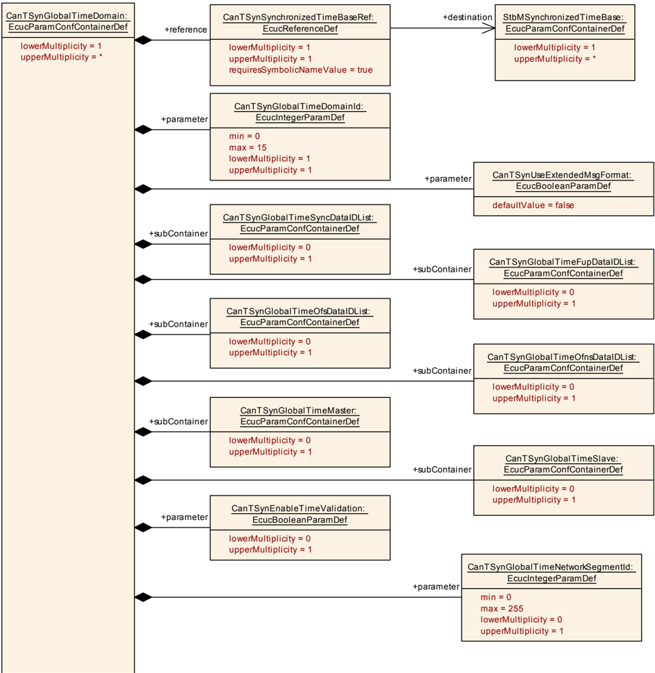

#### 9.2.6. CanTSynGlobalTimeSyncDataIDList

| SWS 条目 | [ECUC_CanTSyn_00024] |
|---|---|
| 容器名称 | CanTSynGlobalTimeSyncDataIDList |
| 父容器 | CanTSynGlobalTimeDomain |
| 描述 | **SYNC** 报文的 DataIDList 确保因 **CRC** 计算和报文认证过程而对数据元素的标识。 |
| Post-Build 变体多重性 | true |
| 多重性配置类 | Pre-compile time：X（所有变体）；Link time：-；Post-build time：- |
| 配置参数 | 无参数 |

| 容器名称 | 多重性 | 作用域/依赖 |
|---|---|---|
| CanTSynGlobalTimeSyncDataIDListElement | 16 | **SYNC** 报文的 DataIDList 的元素，确保因 **CRC** 计算和报文认证过程而对数据元素的标识。 |

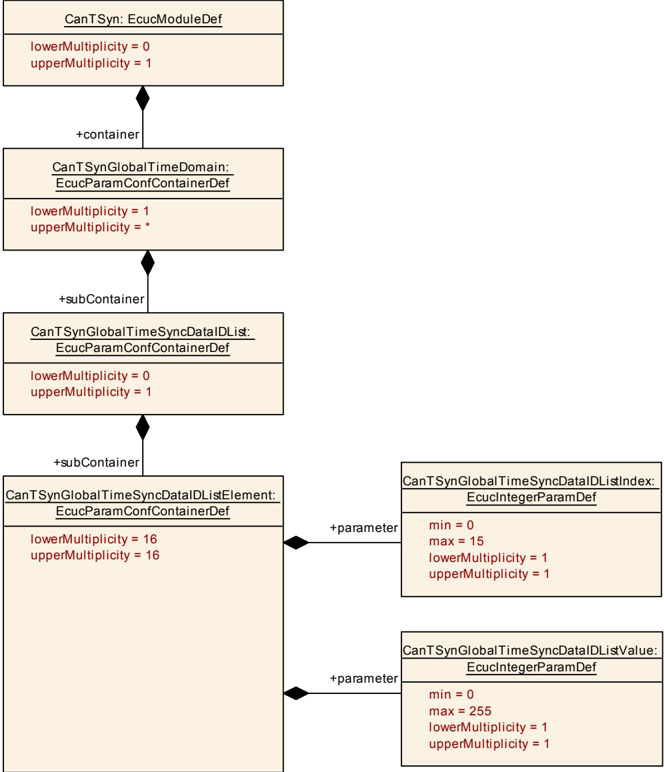

#### 9.2.7. CanTSynGlobalTimeSyncDataIDListElement

| SWS 条目 | [ECUC_CanTSyn_00028] |
|---|---|
| 容器名称 | CanTSynGlobalTimeSyncDataIDListElement |
| 父容器 | CanTSynGlobalTimeSyncDataIDList |
| 描述 | **SYNC** 报文的 DataIDList 的元素，确保因 **CRC** 计算和报文认证过程而对数据元素的标识。 |
| 配置参数 | 见下方参数表 |

| SWS 条目 | [ECUC_CanTSyn_00029] |
|---|---|
| 参数名称 | CanTSynGlobalTimeSyncDataIDListIndex |
| 父容器 | CanTSynGlobalTimeSyncDataIDListElement |
| 描述 | **SYNC** 报文的 DataIDList 的索引，确保因 **CRC** 计算和报文认证过程而对数据元素的标识。 |
| 多重性 | 1 |
| 类型 | EcucIntegerParamDef |
| 取值范围 | 0 .. 15 |
| 默认值 | - |
| Post-Build 变体值 | true |
| 值配置类 | Pre-compile time：X（所有变体）；Link time：-；Post-build time：- |
| 作用域/依赖 | scope: local |

| SWS 条目 | [ECUC_CanTSyn_00030] |
|---|---|
| 参数名称 | CanTSynGlobalTimeSyncDataIDListValue |
| 父容器 | CanTSynGlobalTimeSyncDataIDListElement |
| 描述 | **SYNC** 报文的 DataIDList 的值，确保因 **CRC** 计算和报文认证过程而对数据元素的标识。 |
| 多重性 | 1 |
| 类型 | EcucIntegerParamDef |
| 取值范围 | 0 .. 255 |
| 默认值 | - |
| Post-Build 变体值 | true |
| 值配置类 | Pre-compile time：X（所有变体）；Link time：-；Post-build time：- |
| 作用域/依赖 | scope: local |

无包含的容器。
#### 9.2.8. CanTSynGlobalTimeFupDataIDList

| SWS 条目 | [ECUC_CanTSyn_00025] |
|---|---|
| 容器名称 | CanTSynGlobalTimeFupDataIDList |
| 父容器 | CanTSynGlobalTimeDomain |
| 描述 | **FUP** 报文的 DataIDList 确保因 **CRC** 计算和报文认证过程而对数据元素的标识。 |
| Post-Build 变体多重性 | true |
| 多重性配置类 | Pre-compile time：X（所有变体）；Link time：-；Post-build time：- |
| 配置参数 | 无参数 |

| 容器名称 | 多重性 | 作用域/依赖 |
|---|---|---|
| CanTSynGlobalTimeFupDataIDListElement | 16 | **FUP** 报文的 DataIDList 的元素，确保因 **CRC** 计算和报文认证过程而对数据元素的标识。 |

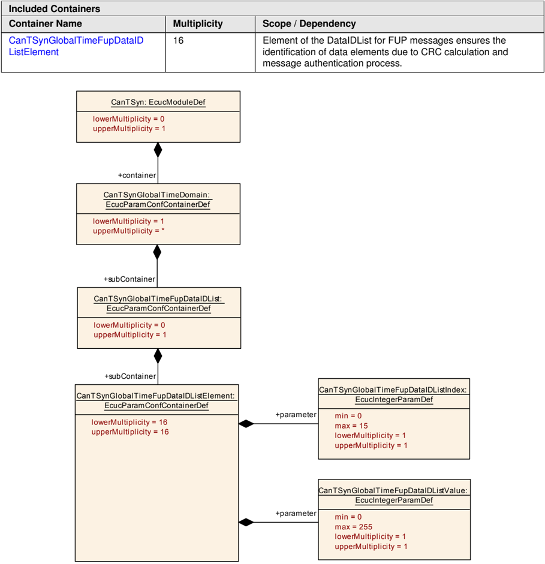

#### 9.2.9. CanTSynGlobalTimeFupDataIDListElement

| SWS 条目 | [ECUC_CanTSyn_00031] |
|---|---|
| 容器名称 | CanTSynGlobalTimeFupDataIDListElement |
| 父容器 | CanTSynGlobalTimeFupDataIDList |
| 描述 | **FUP** 报文的 DataIDList 的元素，确保因 **CRC** 计算和报文认证过程而对数据元素的标识。 |
| 配置参数 | 见下方参数表 |

| SWS 条目 | [ECUC_CanTSyn_00032] |
|---|---|
| 参数名称 | CanTSynGlobalTimeFupDataIDListIndex |
| 父容器 | CanTSynGlobalTimeFupDataIDListElement |
| 描述 | **FUP** 报文的 DataIDList 的索引，确保因 **CRC** 计算和报文认证过程而对数据元素的标识。 |
| 多重性 | 1 |
| 类型 | EcucIntegerParamDef |
| 取值范围 | 0 .. 15 |
| 默认值 | - |
| Post-Build 变体值 | true |
| 值配置类 | Pre-compile time：X（所有变体）；Link time：-；Post-build time：- |
| 作用域/依赖 | scope: local |

| SWS 条目 | [ECUC_CanTSyn_00033] |
|---|---|
| 参数名称 | CanTSynGlobalTimeFupDataIDListValue |
| 父容器 | CanTSynGlobalTimeFupDataIDListElement |
| 描述 | **FUP** 报文的 DataIDList 的值，确保因 **CRC** 计算和报文认证过程而对数据元素的标识。 |
| 多重性 | 1 |
| 类型 | EcucIntegerParamDef |
| 取值范围 | 0 .. 255 |
| 默认值 | - |
| Post-Build 变体值 | true |
| 值配置类 | Pre-compile time：X（所有变体）；Link time：-；Post-build time：- |
| 作用域/依赖 | scope: local |

无包含的容器。

#### 9.2.10. CanTSynGlobalTimeOfsDataIDList

| SWS 条目 | [ECUC_CanTSyn_00026] |
|---|---|
| 容器名称 | CanTSynGlobalTimeOfsDataIDList |
| 父容器 | CanTSynGlobalTimeDomain |
| 描述 | **OFS** 报文的 DataIDList 确保因 **CRC** 计算和报文认证过程而对数据元素的标识。 |
| Post-Build 变体多重性 | true |
| 多重性配置类 | Pre-compile time：X（所有变体）；Link time：-；Post-build time：- |
| 配置参数 | 无参数 |

| 容器名称 | 多重性 | 作用域/依赖 |
|---|---|---|
| CanTSynGlobalTimeOfsDataIDListElement | 16 | **OFS** 报文的 DataIDList 的元素，确保因 **CRC** 计算和报文认证过程而对数据元素的标识。 |

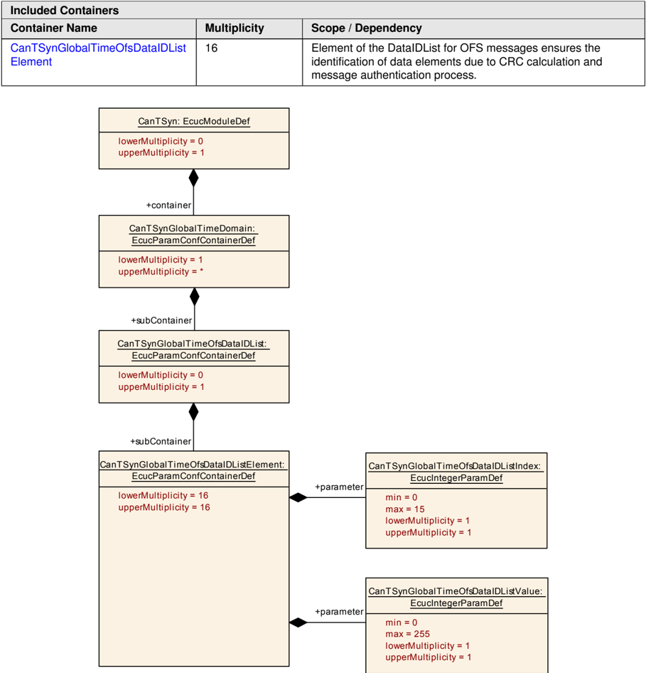

#### 9.2.11. CanTSynGlobalTimeOfsDataIDListElement

| SWS 条目 | [ECUC_CanTSyn_00034] |
|---|---|
| 容器名称 | CanTSynGlobalTimeOfsDataIDListElement |
| 父容器 | CanTSynGlobalTimeOfsDataIDList |
| 描述 | **OFS** 报文的 DataIDList 的元素，确保因 **CRC** 计算和报文认证过程而对数据元素的标识。 |
| 配置参数 | 见下方参数表 |

| SWS 条目 | [ECUC_CanTSyn_00035] |
|---|---|
| 参数名称 | CanTSynGlobalTimeOfsDataIDListIndex |
| 父容器 | CanTSynGlobalTimeOfsDataIDListElement |
| 描述 | **OFS** 报文的 DataIDList 的索引，确保因 **CRC** 计算和报文认证过程而对数据元素的标识。 |
| 多重性 | 1 |
| 类型 | EcucIntegerParamDef |
| 取值范围 | 0 .. 15 |
| 默认值 | - |
| Post-Build 变体值 | true |
| 值配置类 | Pre-compile time：X（所有变体）；Link time：-；Post-build time：- |
| 作用域/依赖 | scope: local |

| SWS 条目 | [ECUC_CanTSyn_00036] |
|---|---|
| 参数名称 | CanTSynGlobalTimeOfsDataIDListValue |
| 父容器 | CanTSynGlobalTimeOfsDataIDListElement |
| 描述 | **OFS** 报文的 DataIDList 的值，确保因 **CRC** 计算和报文认证过程而对数据元素的标识。 |
| 多重性 | 1 |
| 类型 | EcucIntegerParamDef |
| 取值范围 | 0 .. 255 |
| 默认值 | - |
| Post-Build 变体值 | true |
| 值配置类 | Pre-compile time：X（所有变体）；Link time：-；Post-build time：- |
| 作用域/依赖 | scope: local |

无包含的容器。

#### 9.2.12. CanTSynGlobalTimeOfnsDataIDList

| SWS 条目 | [ECUC_CanTSyn_00041] |
|---|---|
| 容器名称 | CanTSynGlobalTimeOfnsDataIDList |
| 父容器 | CanTSynGlobalTimeDomain |
| 描述 | **OFNS** 报文的 DataIDList 确保因 **CRC** 计算和报文认证过程而对数据元素的标识。 |
| Post-Build 变体多重性 | true |
| 多重性配置类 | Pre-compile time：X（所有变体）；Link time：-；Post-build time：- |
| 配置参数 | 无参数 |

| 容器名称 | 多重性 | 作用域/依赖 |
|---|---|---|
| CanTSynGlobalTimeOfnsDataIDListElement | 16 | **OFNS** 报文的 DataIDList 的元素，确保因 **CRC** 计算和报文认证过程而对数据元素的标识。 |

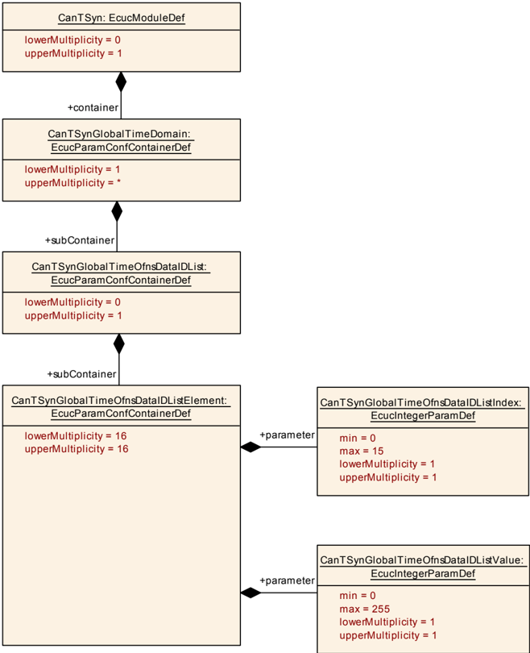

#### 9.2.13. CanTSynGlobalTimeOfnsDataIDListElement

| SWS 条目 | [ECUC_CanTSyn_00037] |
|---|---|
| 容器名称 | CanTSynGlobalTimeOfnsDataIDListElement |
| 父容器 | CanTSynGlobalTimeOfnsDataIDList |
| 描述 | **OFNS** 报文的 DataIDList 的元素，确保因 **CRC** 计算和报文认证过程而对数据元素的标识。 |
| 配置参数 | 见下方参数表 |

| SWS 条目 | [ECUC_CanTSyn_00038] |
|---|---|
| 参数名称 | CanTSynGlobalTimeOfnsDataIDListIndex |
| 父容器 | CanTSynGlobalTimeOfnsDataIDListElement |
| 描述 | **OFNS** 报文的 DataIDList 的索引，确保因 **CRC** 计算和报文认证过程而对数据元素的标识。 |
| 多重性 | 1 |
| 类型 | EcucIntegerParamDef |
| 取值范围 | 0 .. 15 |
| 默认值 | - |
| Post-Build 变体值 | true |
| 值配置类 | Pre-compile time：X（所有变体）；Link time：-；Post-build time：- |
| 作用域/依赖 | scope: local |

| SWS 条目 | [ECUC_CanTSyn_00039] |
|---|---|
| 参数名称 | CanTSynGlobalTimeOfnsDataIDListValue |
| 父容器 | CanTSynGlobalTimeOfnsDataIDListElement |
| 描述 | **OFNS** 报文的 DataIDList 的值，确保因 **CRC** 计算和报文认证过程而对数据元素的标识。 |
| 多重性 | 1 |
| 类型 | EcucIntegerParamDef |
| 取值范围 | 0 .. 255 |
| 默认值 | - |
| Post-Build 变体值 | true |
| 值配置类 | Pre-compile time：X（所有变体）；Link time：-；Post-build time：- |
| 作用域/依赖 | scope: local |

无包含的容器。

#### 9.2.14. CanTSynGlobalTimeMaster

| SWS 条目 | [ECUC_CanTSyn_00007] |
|---|---|
| 容器名称 | CanTSynGlobalTimeMaster |
| 父容器 | CanTSynGlobalTimeDomain |
| 描述 | 某时间域（参见父容器）的时基主节点的配置。如果存在 CanTSynGlobalTimeMaster 容器，则本地 **ECU** 充当该时间域的时基主节点。 |
| Post-Build 变体多重性 | true |
| 多重性配置类 | Pre-compile time：X（所有变体）；Link time：-；Post-build time：- |
| 配置参数 | 见下方参数表 |

| SWS 条目 | [ECUC_CanTSyn_00044] |
|---|---|
| 参数名称 | CanTSynCyclicMsgResumeTime |
| 父容器 | CanTSynGlobalTimeMaster |
| 描述 | 定义在先前的立即发送之后，第一次基于常规周期时间的报文发送发生的时间。单位：秒。 |
| 多重性 | 1 |
| 类型 | EcucFloatParamDef |
| 取值范围 | [0 .. INF[ |
| 默认值 | - |
| Post-Build 变体值 | true |
| 值配置类 | Pre-compile time：X（所有变体）；Link time：-；Post-build time：- |
| 作用域/依赖 | scope: local |

| SWS 条目 | [ECUC_CanTSyn_00045] |
|---|---|
| 参数名称 | CanTSynGlobalTimeDebounceTime |
| 父容器 | CanTSynGlobalTimeMaster |
| 描述 | 表示与之前具有相同 **PDU** 的报文相比，**SYNC**、**FUP**、**OFS** 和 **OFNS** 报文的 **TX** 去抖时间的配置。单位：秒。 |
| 多重性 | 1 |
| 类型 | EcucFloatParamDef |
| 取值范围 | [0 .. 4] |
| 默认值 | - |
| Post-Build 变体值 | true |
| 值配置类 | Pre-compile time：X（所有变体）；Link time：-；Post-build time：- |
| 作用域/依赖 | scope: local |

| SWS 条目 | [ECUC_CanTSyn_00015] |
|---|---|
| 参数名称 | CanTSynGlobalTimeTxCrcSecured |
| 父容器 | CanTSynGlobalTimeMaster |
| 描述 | 表示是否支持 **CRC** 的配置。取值：CRC_NOT_SUPPORTED（表示不支持 **CRC** 的配置）；CRC_SUPPORTED（表示支持 **CRC** 的配置）。 |
| 多重性 | 1 |
| 类型 | EcucEnumerationParamDef |
| Post-Build 变体值 | true |
| 值配置类 | Pre-compile time：X（所有变体）；Link time：-；Post-build time：- |
| 作用域/依赖 | scope: local |

| SWS 条目 | [ECUC_CanTSyn_00111] |
|---|---|
| 参数名称 | CanTSynGlobalTimeTxIcvSecured |
| 父容器 | CanTSynGlobalTimeMaster |
| 描述 | 该参数控制是否应支持 **ICV** 生成。取值：ICV_NOT_SUPPORTED（Timesync 模块不应生成 **ICV**）；ICV_SUPPORTED（Timesync 模块应生成 **ICV**）。 |
| 多重性 | 1 |
| 类型 | EcucEnumerationParamDef |
| 默认值 | ICV_NOT_SUPPORTED |
| Post-Build 变体值 | false |
| 值配置类 | Pre-compile time：X（所有变体）；Link time：-；Post-build time：- |
| 作用域/依赖 | scope: local |

| SWS 条目 | [ECUC_CanTSyn_00017] |
|---|---|
| 参数名称 | CanTSynGlobalTimeTxPeriod |
| 父容器 | CanTSynGlobalTimeMaster |
| 描述 | 表示 **TX** 周期的配置。单位：秒。 |
| 多重性 | 1 |
| 类型 | EcucFloatParamDef |
| 取值范围 | [0 .. INF] |
| 默认值 | - |
| Post-Build 变体值 | true |
| 值配置类 | Pre-compile time：X（所有变体）；Link time：-；Post-build time：- |
| 作用域/依赖 | scope: local |

| SWS 条目 | [ECUC_CanTSyn_00043] |
|---|---|
| 参数名称 | CanTSynImmediateTimeSync |
| 父容器 | CanTSynGlobalTimeMaster |
| 描述 | 启用/禁用在 CanTSyn_MainFunction() 内对 StbM_GetTimeBaseUpdateCounter() 的周期性轮询。 |
| 多重性 | 1 |
| 类型 | EcucBooleanParamDef |
| 默认值 | - |
| Post-Build 变体值 | true |
| 值配置类 | Pre-compile time：X（所有变体）；Link time：-；Post-build time：- |
| 作用域/依赖 | scope: local |

| 容器名称 | 多重性 | 作用域/依赖 |
|---|---|---|
| CanTSynGlobalTimeMasterPdu | 1 | 此容器包含应包含全局时间信息的 **PDU** 的配置。 |
| CanTSynGlobalTimeTxIcvGeneration | 0..1 | 此容器收集应用于 **ICV** 生成的配置。 |

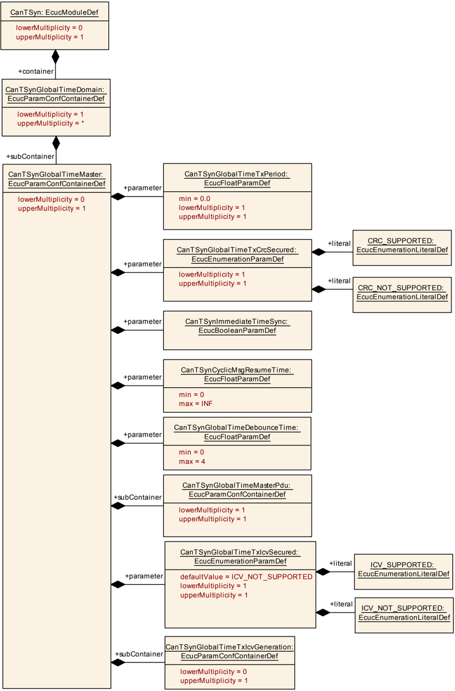

#### 9.2.15. CanTSynGlobalTimeMasterPdu

| SWS 条目 | [ECUC_CanTSyn_00009] |
|---|---|
| 容器名称 | CanTSynGlobalTimeMasterPdu |
| 父容器 | CanTSynGlobalTimeMaster |
| 描述 | 此容器包含应包含全局时间信息的 **PDU** 的配置。 |
| 配置参数 | 见下方参数表 |

| SWS 条目 | [ECUC_CanTSyn_00008] |
|---|---|
| 参数名称 | CanTSynGlobalTimeMasterConfirmationHandleId |
| 父容器 | CanTSynGlobalTimeMasterPdu |
| 描述 | 表示包含全局时间信息的 **PDU** 的句柄 ID。 |
| 多重性 | 1 |
| 类型 | EcucIntegerParamDef（为此参数生成符号名） |
| 取值范围 | 0 .. 65535 |
| 默认值 | - |
| Post-Build 变体值 | false |
| 值配置类 | Pre-compile time：X（所有变体）；Link time：-；Post-build time：- |
| 作用域/依赖 | scope: local |

| SWS 条目 | [ECUC_CanTSyn_00027] |
|---|---|
| 参数名称 | CanTSynGlobalTimePduRef |
| 父容器 | CanTSynGlobalTimeMasterPdu |
| 描述 | 表示对用于发送全局时间信息的 **Pdu** 的引用。全局时间域的全局时间主节点充当该 **Pdu** 的发送方，而所有时基从节点应接收该 **Pdu**。 |
| 多重性 | 1 |
| 类型 | Reference to Pdu |
| Post-Build 变体值 | true |
| 值配置类 | Pre-compile time：X（所有变体）；Link time：-；Post-build time：- |
| 作用域/依赖 | scope: local |

无包含的容器。

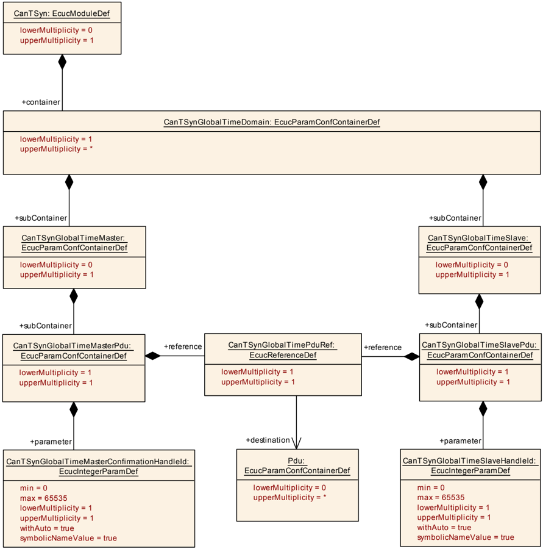

#### 9.2.16. CanTSynGlobalTimeTxIcvGeneration

| SWS 条目 | [ECUC_CanTSyn_00060] |
|---|---|
| 容器名称 | CanTSynGlobalTimeTxIcvGeneration |
| 父容器 | CanTSynGlobalTimeMaster |
| 描述 | 此容器收集应用于 **ICV** 生成的配置。 |
| Post-Build 变体多重性 | false |
| 多重性配置类 | Pre-compile time：X（所有变体）；Link time：-；Post-build time：- |
| 配置参数 | 见下方参数表 |

| SWS 条目 | [ECUC_CanTSyn_00062] |
|---|---|
| 参数名称 | CanTSynIcvGenerationBase |
| 父容器 | CanTSynGlobalTimeTxIcvGeneration |
| 描述 | 用于 **ICV** 生成的对称或非对称密码学选择。取值：ICV_MAC（用于 **ICV** 生成的对称密码学选择）；ICV_SIGNATURE（用于 **ICV** 生成的非对称密码学选择）。 |
| 多重性 | 1 |
| 类型 | EcucEnumerationParamDef |
| Post-Build 变体值 | false |
| 值配置类 | Pre-compile time：X（所有变体）；Link time：-；Post-build time：- |
| 作用域/依赖 | scope: local |

| SWS 条目 | [ECUC_CanTSyn_00065] |
|---|---|
| 参数名称 | CanTSynIcvGenerationTimeout |
| 父容器 | CanTSynGlobalTimeTxIcvGeneration |
| 描述 | **ICV** 生成的超时（在异步行为下相应 **CSM** 任务的完成）。值 0 禁用 **ICV** 超时监视。单位：秒。 |
| 多重性 | 1 |
| 类型 | EcucFloatParamDef |
| 取值范围 | [0 .. INF[ |
| 默认值 | - |
| Post-Build 变体值 | false |
| 值配置类 | Pre-compile time：X（所有变体）；Link time：-；Post-build time：- |
| 作用域/依赖 | scope: local |

| SWS 条目 | [ECUC_CanTSyn_00063] |
|---|---|
| 参数名称 | CanTSynIcvTxLength |
| 父容器 | CanTSynGlobalTimeTxIcvGeneration |
| 描述 | 在总线上于 Follow_Up 报文内发送的 **ICV** 的长度（字节）。 |
| 多重性 | 1 |
| 类型 | EcucIntegerParamDef |
| 取值范围 | 0 .. 54 |
| 默认值 | - |
| Post-Build 变体值 | false |
| 值配置类 | Pre-compile time：X（所有变体）；Link time：-；Post-build time：- |
| 作用域/依赖 | scope: local |

| SWS 条目 | [ECUC_CanTSyn_00086] |
|---|---|
| 参数名称 | CanTSynTxAuthenticationBuildAttempts |
| 父容器 | CanTSynGlobalTimeTxIcvGeneration |
| 描述 | 该参数规定当某给定 **FUP** 报文的 **ICV** 生成失败时应执行的认证构建尝试次数。如果设为零，则只进行一次 **ICV** 构建尝试。 |
| 多重性 | 1 |
| 类型 | EcucIntegerParamDef |
| 取值范围 | 0 .. 65535 |
| 默认值 | 0 |
| Post-Build 变体值 | false |
| 值配置类 | Pre-compile time：X（所有变体）；Link time：-；Post-build time：- |
| 作用域/依赖 | scope: local |

| SWS 条目 | [ECUC_CanTSyn_00061] |
|---|---|
| 参数名称 | CanTSynIcvGenerationFvIdRef |
| 父容器 | CanTSynGlobalTimeTxIcvGeneration |
| 描述 | 表示对用于生成 **ICV** 的 **FV** 的引用。 |
| 多重性 | 0..1 |
| 类型 | Symbolic name reference to StbMFreshnessValue |
| Post-Build 变体多重性 | false |
| Post-Build 变体值 | false |
| 多重性配置类 | Pre-compile time：X；Link time：-；Post-build time：- |
| 值配置类 | Pre-compile time：X；Link time：-；Post-build time：- |
| 作用域/依赖 | scope: local |

| SWS 条目 | [ECUC_CanTSyn_00064] |
|---|---|
| 参数名称 | CanTSynIcvGenerationJobRef |
| 父容器 | CanTSynGlobalTimeTxIcvGeneration |
| 描述 | 表示对用于获取 **CSM** 任务 ID 的 **CSM** 任务的引用。 |
| 多重性 | 1 |
| 类型 | Symbolic name reference to CsmJob |
| Post-Build 变体值 | false |
| 值配置类 | Pre-compile time：X（所有变体）；Link time：-；Post-build time：- |
| 作用域/依赖 | scope: local |

无包含的容器。

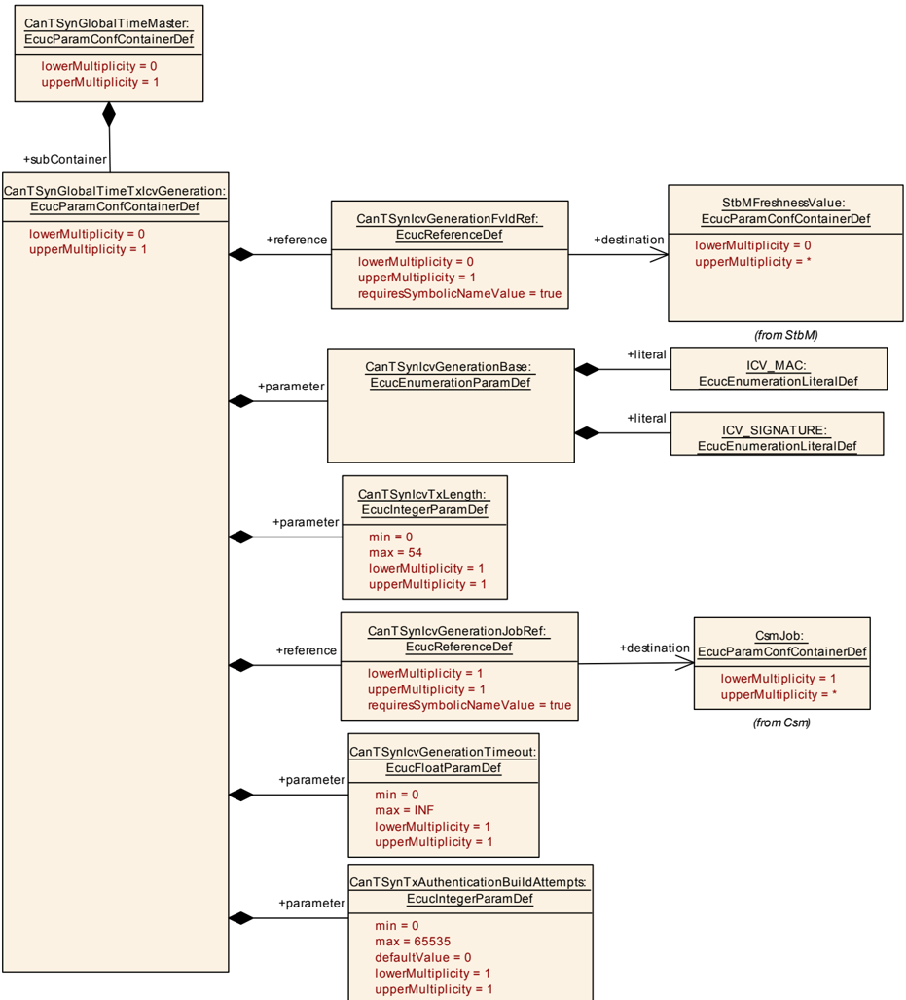
#### 9.2.17. CanTSynGlobalTimeSlave

| SWS 条目 | [ECUC_CanTSyn_00012] |
|---|---|
| 容器名称 | CanTSynGlobalTimeSlave |
| 父容器 | CanTSynGlobalTimeDomain |
| 描述 | 某时间域（参见父容器）的时基从节点的配置。如果存在 CanTSynGlobalTimeSlave 容器，则本地 **ECU** 充当该时间域的时基从节点。 |
| Post-Build 变体多重性 | true |
| 多重性配置类 | Pre-compile time：X（所有变体）；Link time：-；Post-build time：- |
| 配置参数 | 见下方参数表 |

| SWS 条目 | [ECUC_CanTSyn_00006] |
|---|---|
| 参数名称 | CanTSynGlobalTimeFollowUpTimeout |
| 父容器 | CanTSynGlobalTimeSlave |
| 描述 | 跟随报文的接收超时。这只对选定的总线系统相关。单位：秒。 |
| 多重性 | 1 |
| 类型 | EcucFloatParamDef |
| 取值范围 | [0 .. INF] |
| 默认值 | - |
| Post-Build 变体值 | true |
| 值配置类 | Pre-compile time：X（所有变体）；Link time：-；Post-build time：- |
| 作用域/依赖 | scope: local |

| SWS 条目 | [ECUC_CanTSyn_00068] |
|---|---|
| 参数名称 | CanTSynGlobalTimeRxDebounceTime |
| 父容器 | CanTSynGlobalTimeSlave |
| 描述 | 表示 **Sync** 和 **FUP**、**OFS** 和 **OFNS** 的 **RX** 去抖时间的配置。单位：秒。 |
| 多重性 | 1 |
| 类型 | EcucFloatParamDef |
| 取值范围 | [0 .. 4] |
| 默认值 | - |
| Post-Build 变体值 | true |
| 值配置类 | Pre-compile time：X（所有变体）；Link time：-；Post-build time：- |
| 作用域/依赖 | scope: local |

| SWS 条目 | [ECUC_CanTSyn_00053] |
|---|---|
| 参数名称 | CanTSynGlobalTimeSequenceCounterHysteresis |
| 父容器 | CanTSynGlobalTimeSlave |
| 描述 | CanTSynGlobalTimeSequenceCounterHysteresis 规定时基从节点在超时状态期间、在将时间元组转发给 **StbM** 之前所需的连续有效报文对的数量。 |
| 多重性 | 1 |
| 类型 | EcucIntegerParamDef |
| 取值范围 | 0 .. 15 |
| 默认值 | 0 |
| Post-Build 变体值 | true |
| 值配置类 | Pre-compile time：X（所有变体）；Link time：-；Post-build time：- |
| 作用域/依赖 | scope: local |

| SWS 条目 | [ECUC_CanTSyn_00011] |
|---|---|
| 参数名称 | CanTSynGlobalTimeSequenceCounterJumpWidth |
| 父容器 | CanTSynGlobalTimeSlave |
| 描述 | SequenceCounterJumpWidth 规定两条 **SYNC** 或两条 **OFS** 报文之间序列计数器允许的最大间隔。 |
| 多重性 | 1 |
| 类型 | EcucIntegerParamDef |
| 取值范围 | 0 .. 15 |
| 默认值 | 0 |
| Post-Build 变体值 | true |
| 值配置类 | Pre-compile time：X（所有变体）；Link time：-；Post-build time：- |
| 作用域/依赖 | scope: local |

| SWS 条目 | [ECUC_CanTSyn_00021] |
|---|---|
| 参数名称 | CanTSynRxCrcValidated |
| 父容器 | CanTSynGlobalTimeSlave |
| 描述 | 定义是否支持 **CRC** 的校验。取值：CRC_IGNORED（Timesync 模块接受受 **CRC** 保护的（而不实际校验 **CRC**）和不受 **CRC** 保护的时间同步报文。也就是说，Timesync 模块忽略 **CRC**）；CRC_NOT_VALIDATED（Timesync 模块只接受不受 **CRC** 保护的时间同步报文。所有其他时间同步报文被忽略）；CRC_OPTIONAL（Timesync 模块只接受不受 **CRC** 保护的时间同步报文以及受 **CRC** 保护且 **CRC** 正确的时间同步报文。所有其他时间同步报文被忽略）；CRC_VALIDATED（Timesync 模块只接受受 **CRC** 保护且 **CRC** 正确的时间同步报文。所有其他时间同步报文被忽略）。 |
| 多重性 | 1 |
| 类型 | EcucEnumerationParamDef |
| Post-Build 变体值 | true |
| 值配置类 | Pre-compile time：X（所有变体）；Link time：-；Post-build time：- |
| 作用域/依赖 | scope: local |

| SWS 条目 | [ECUC_CanTSyn_00075] |
|---|---|
| 参数名称 | CanTSynRxIcvVerificationType |
| 父容器 | CanTSynGlobalTimeSlave |
| 描述 | 该参数控制是否应支持 **ICV** 验证。取值：ICV_IGNORED（Timesync 模块接受受 **ICV** 保护的（而不实际校验 **ICV**）和不受 **ICV** 保护的时间同步报文。也就是说，Timesync 模块忽略 **ICV**）；ICV_NOT_VERIFIED（Timesync 模块只接受不受 **ICV** 保护的时间同步报文。所有其他时间同步报文被忽略）；ICV_OPTIONAL（Timesync 模块只接受不受 **ICV** 保护的时间同步报文以及受 **ICV** 保护且 **ICV** 正确的时间同步报文。所有其他时间同步报文被忽略）；ICV_VERIFIED（Timesync 模块只接受受 **ICV** 保护且 **ICV** 正确的时间同步报文。所有其他时间同步报文被忽略）。 |
| 多重性 | 1 |
| 类型 | EcucEnumerationParamDef |
| Post-Build 变体值 | false |
| 值配置类 | Pre-compile time：X（所有变体）；Link time：-；Post-build time：- |
| 作用域/依赖 | scope: local |

| 容器名称 | 多重性 | 作用域/依赖 |
|---|---|---|
| CanTSynGlobalTimeRxIcvVerification | 0..1 | 此容器收集 **ICV** 验证所需的配置。 |
| CanTSynGlobalTimeSlavePdu | 1 | 此容器包含应包含全局时间信息的 **PDU** 的配置。 |

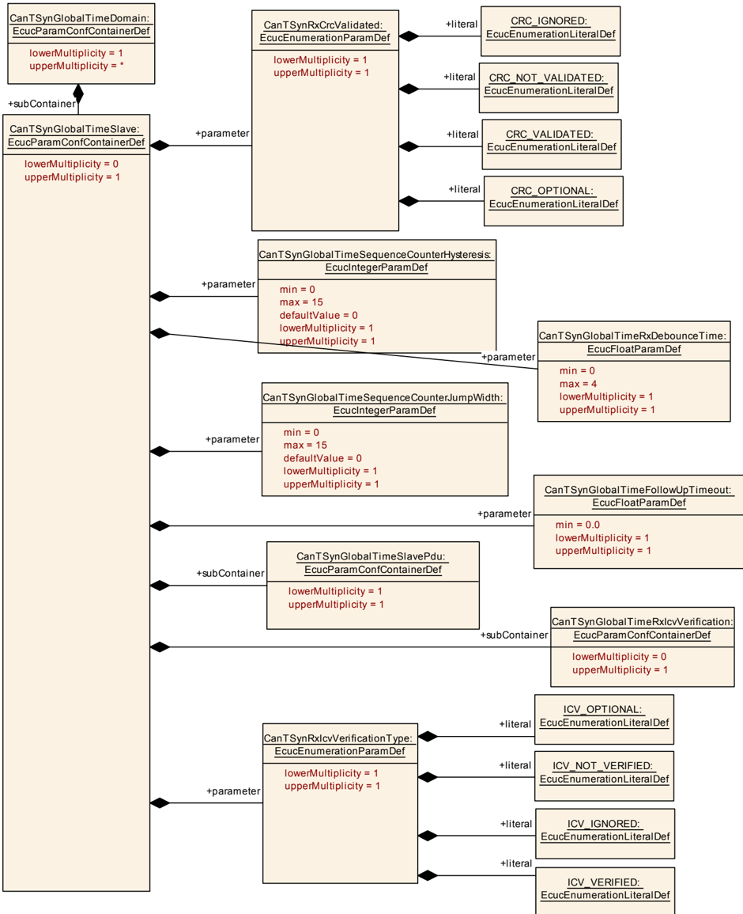

#### 9.2.18. CanTSynGlobalTimeSlavePdu

| SWS 条目 | [ECUC_CanTSyn_00014] |
|---|---|
| 容器名称 | CanTSynGlobalTimeSlavePdu |
| 父容器 | CanTSynGlobalTimeSlave |
| 描述 | 此容器包含应包含全局时间信息的 **PDU** 的配置。 |
| 配置参数 | 见下方参数表 |

| SWS 条目 | [ECUC_CanTSyn_00013] |
|---|---|
| 参数名称 | CanTSynGlobalTimeSlaveHandleId |
| 父容器 | CanTSynGlobalTimeSlavePdu |
| 描述 | 表示包含全局时间信息的 **PDU** 的句柄 ID。 |
| 多重性 | 1 |
| 类型 | EcucIntegerParamDef（为此参数生成符号名） |
| 取值范围 | 0 .. 65535 |
| 默认值 | - |
| Post-Build 变体值 | false |
| 值配置类 | Pre-compile time：X（所有变体）；Link time：-；Post-build time：- |
| 作用域/依赖 | scope: local |

| SWS 条目 | [ECUC_CanTSyn_00027] |
|---|---|
| 参数名称 | CanTSynGlobalTimePduRef |
| 父容器 | CanTSynGlobalTimeSlavePdu |
| 描述 | 表示对用于发送全局时间信息的 **Pdu** 的引用。全局时间域的全局时间主节点充当该 **Pdu** 的发送方，而所有时基从节点应接收该 **Pdu**。 |
| 多重性 | 1 |
| 类型 | Reference to Pdu |
| Post-Build 变体值 | true |
| 值配置类 | Pre-compile time：X（所有变体）；Link time：-；Post-build time：- |
| 作用域/依赖 | scope: local |

无包含的容器。

#### 9.2.19. CanTSynGlobalTimeRxIcvVerification

| SWS 条目 | [ECUC_CanTSyn_00076] |
|---|---|
| 容器名称 | CanTSynGlobalTimeRxIcvVerification |
| 父容器 | CanTSynGlobalTimeSlave |
| 描述 | 此容器收集 **ICV** 验证所需的配置。 |
| Post-Build 变体多重性 | false |
| 多重性配置类 | Pre-compile time：X（所有变体）；Link time：-；Post-build time：- |
| 配置参数 | 见下方参数表 |

| SWS 条目 | [ECUC_CanTSyn_00079] |
|---|---|
| 参数名称 | CanTSynIcvRxLength |
| 父容器 | CanTSynGlobalTimeRxIcvVerification |
| 描述 | 用于在 **FUP** 报文内验证接收到的 **ICV** 的 **ICV** 长度（字节）。 |
| 多重性 | 1 |
| 类型 | EcucIntegerParamDef |
| 取值范围 | 0 .. 54 |
| 默认值 | - |
| Post-Build 变体值 | false |
| 值配置类 | Pre-compile time：X（所有变体）；Link time：-；Post-build time：- |
| 作用域/依赖 | scope: local |

| SWS 条目 | [ECUC_CanTSyn_00082] |
|---|---|
| 参数名称 | CanTSynIcvVerificationAttempts |
| 父容器 | CanTSynGlobalTimeRxIcvVerification |
| 描述 | 该参数规定当某给定 **FUP** 报文的 **ICV** 验证失败时应执行的 **ICV** 验证尝试次数。如果设为零，则只进行一次 **ICV** 验证尝试。 |
| 多重性 | 1 |
| 类型 | EcucIntegerParamDef |
| 取值范围 | 0 .. 65535 |
| 默认值 | 0 |
| Post-Build 变体值 | false |
| 值配置类 | Pre-compile time：X（所有变体）；Link time：-；Post-build time：- |
| 作用域/依赖 | scope: local |

| SWS 条目 | [ECUC_CanTSyn_00078] |
|---|---|
| 参数名称 | CanTSynIcvVerificationBase |
| 父容器 | CanTSynGlobalTimeRxIcvVerification |
| 描述 | 用于 **ICV** 验证的对称或非对称密码学选择。取值：ICV_MAC（用于 **ICV** 验证的对称密码学选择）；ICV_SIGNATURE（用于 **ICV** 验证的非对称密码学选择）。 |
| 多重性 | 1 |
| 类型 | EcucEnumerationParamDef |
| Post-Build 变体值 | false |
| 值配置类 | Pre-compile time：X（所有变体）；Link time：-；Post-build time：- |
| 作用域/依赖 | scope: local |

| SWS 条目 | [ECUC_CanTSyn_00081] |
|---|---|
| 参数名称 | CanTSynIcvVerificationTimeout |
| 父容器 | CanTSynGlobalTimeRxIcvVerification |
| 描述 | **ICV** 生成的超时（在异步行为下相应 **CSM** 任务的完成）。值 0 禁用 **ICV** 超时监视。单位：秒。 |
| 多重性 | 1 |
| 类型 | EcucFloatParamDef |
| 取值范围 | [0 .. INF[ |
| 默认值 | - |
| Post-Build 变体值 | false |
| 值配置类 | Pre-compile time：X（所有变体）；Link time：-；Post-build time：- |
| 作用域/依赖 | scope: local |

| SWS 条目 | [ECUC_CanTSyn_00084] |
|---|---|
| 参数名称 | CanTSynRxAuthenticationBuildAttempts |
| 父容器 | CanTSynGlobalTimeRxIcvVerification |
| 描述 | 该参数规定当某给定 **FUP** 报文的 **ICV** 验证失败时应执行的认证构建尝试次数。如果设为零，则只进行一次 **ICV** 验证尝试。 |
| 多重性 | 1 |
| 类型 | EcucIntegerParamDef |
| 取值范围 | 0 .. 65535 |
| 默认值 | 0 |
| Post-Build 变体值 | false |
| 值配置类 | Pre-compile time：X（所有变体）；Link time：-；Post-build time：- |
| 作用域/依赖 | scope: local |

| SWS 条目 | [ECUC_CanTSyn_00077] |
|---|---|
| 参数名称 | CanTSynIcvVerificationFvIdRef |
| 父容器 | CanTSynGlobalTimeRxIcvVerification |
| 描述 | 表示对用于生成 **ICV** 的 **FV** 的引用。 |
| 多重性 | 0..1 |
| 类型 | Symbolic name reference to StbMFreshnessValue |
| Post-Build 变体多重性 | false |
| Post-Build 变体值 | false |
| 多重性配置类 | Pre-compile time：X；Link time：-；Post-build time：- |
| 值配置类 | Pre-compile time：X；Link time：-；Post-build time：- |
| 作用域/依赖 | scope: local |

| SWS 条目 | [ECUC_CanTSyn_00080] |
|---|---|
| 参数名称 | CanTSynIcvVerificationJobRef |
| 父容器 | CanTSynGlobalTimeRxIcvVerification |
| 描述 | 表示对用于获取 **CSM** 任务 ID 的 **CSM** 任务的引用。 |
| 多重性 | 1 |
| 类型 | Symbolic name reference to CsmJob |
| Post-Build 变体值 | false |
| 值配置类 | Pre-compile time：X（所有变体）；Link time：-；Post-build time：- |
| 作用域/依赖 | scope: local |

无包含的容器。

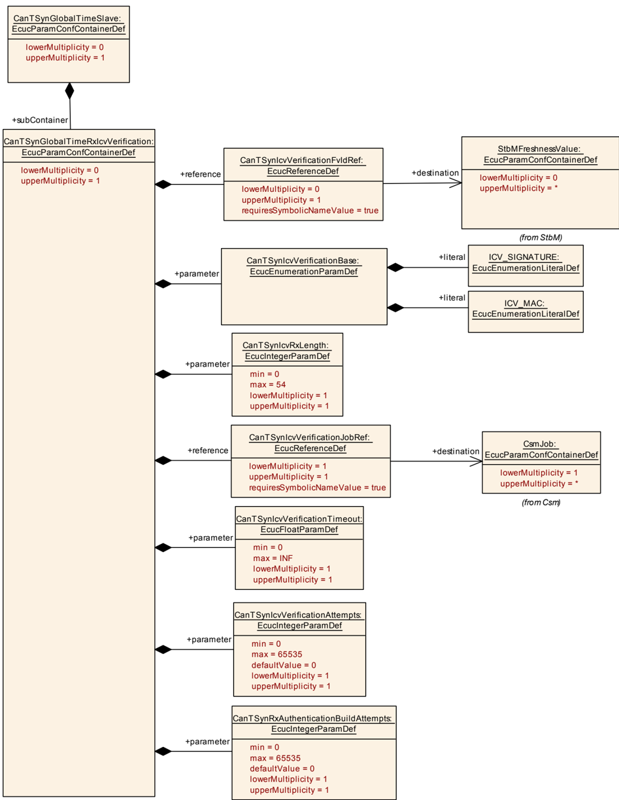

### 9.3. 约束

[SWS_CanTSyn_CONSTR_00001] 如果用于生成 **ICV** 的 **CSM** 任务配置为同步行为，则 CanTSynIcvGenerationTimeout 应设为 0。

[SWS_CanTSyn_CONSTR_00002] 如果用于验证 **ICV** 的 **CSM** 任务配置为同步行为，则 CanTSynIcvVerificationTimeout 应设为 0。

### 9.4. 发布信息

细节请参阅 [3, **SWS** BSW General] 的第 10.3 章「Published Information」。

## B. AUTOSAR 可追溯项变更历史

请注意，本章中的列表还包括在后续版本中已从规范中移除的约束和规范项。这些约束和规范项在文档中不再作为超链接出现。

### B.1. 按照AUTOSAR发布版本 R23-11 的本文档可追溯项历史

#### B.1.1. R23-11 中新增的规范项

```
[SWS_CanTSyn_00207] [SWS_CanTSyn_00208] [SWS_CanTSyn_00209] [SWS_CanTSyn_00210] [SWS_CanTSyn_00211] [SWS_CanTSyn_00212] [SWS_CanTSyn_00213] [SWS_CanTSyn_00214] [SWS_CanTSyn_00215] [SWS_CanTSyn_00216] [SWS_CanTSyn_00217] [SWS_CanTSyn_00218] [SWS_CanTSyn_00219] [SWS_CanTSyn_00220] [SWS_CanTSyn_00221] [SWS_CanTSyn_00222] [SWS_CanTSyn_00223] [SWS_CanTSyn_00224] [SWS_CanTSyn_00225] [SWS_CanTSyn_00226] [SWS_CanTSyn_00227] [SWS_CanTSyn_00228] [SWS_CanTSyn_00229] [SWS_CanTSyn_00230] [SWS_CanTSyn_00231] [SWS_CanTSyn_00232] [SWS_CanTSyn_00233]
```

#### B.1.2. R23-11 中变更的规范项

```
[SWS_CanTSyn_00010] [SWS_CanTSyn_00015] [SWS_CanTSyn_00016] [SWS_CanTSyn_00017] [SWS_CanTSyn_00018] [SWS_CanTSyn_00028] [SWS_CanTSyn_00031] [SWS_CanTSyn_00033] [SWS_CanTSyn_00038] [SWS_CanTSyn_00041] [SWS_CanTSyn_00042] [SWS_CanTSyn_00064] [SWS_CanTSyn_00068] [SWS_CanTSyn_00069] [SWS_CanTSyn_00070] [SWS_CanTSyn_00078] [SWS_CanTSyn_00079] [SWS_CanTSyn_00086] [SWS_CanTSyn_00090] [SWS_CanTSyn_00111] [SWS_CanTSyn_00112] [SWS_CanTSyn_00114] [SWS_CanTSyn_00118] [SWS_CanTSyn_00119] [SWS_CanTSyn_00120] [SWS_CanTSyn_00121] [SWS_CanTSyn_00122] [SWS_CanTSyn_00123] [SWS_CanTSyn_00124] [SWS_CanTSyn_00125] [SWS_CanTSyn_00126] [SWS_CanTSyn_00127] [SWS_CanTSyn_00128] [SWS_CanTSyn_00129] [SWS_CanTSyn_00139] [SWS_CanTSyn_00141] [SWS_CanTSyn_00143] [SWS_CanTSyn_00147] [SWS_CanTSyn_00148] [SWS_CanTSyn_00155] [SWS_CanTSyn_00156] [SWS_CanTSyn_00157] [SWS_CanTSyn_00158] [SWS_CanTSyn_00159] [SWS_CanTSyn_00160] [SWS_CanTSyn_00168] [SWS_CanTSyn_00175] [SWS_CanTSyn_00177] [SWS_CanTSyn_00182] [SWS_CanTSyn_00183] [SWS_CanTSyn_00193] [SWS_CanTSyn_00200] [SWS_CanTSyn_00204] [SWS_CanTSyn_00205] [SWS_CanTSyn_NA_00999]
```

#### B.1.3. R23-11 中删除的规范项

```
[SWS_CanTSyn_00192]
```

#### B.1.4. R23-11 中新增的约束

```
[SWS_CanTSyn_CONSTR_00002]
```

#### B.1.5. R23-11 中变更的约束

无

#### B.1.6. R23-11 中删除的约束

无
